## 1. 简介和功能概述

**EthTSyn** 模块按照 [1, **PRS** TimeSyncProtocol] 的规定处理 **Ethernet** 上的时间同步协议。

除了 [1, **PRS** Time Synchronization Protocol] 中规定的内容之外，**EthTSyn** 模块还支持以下特性：

- 对 Timesync **PDU** 进行去抖，以避免具有较高优先级的 **PDU** 阻塞具有较低优先级的 **PDU**；
- "立即"发送时间同步报文，以快速（重新）同步时基主节点和时基从节点。

**EthTSyn** 与同步时基管理器（**StbM**，参见 [2, **SWS** SynchronizedTimeBaseManager]）紧密耦合，后者负责在该时基的两条连续 **Sync** 报文的接收之间对（本地实例的）同步时基进行插值。**StbM** 还向应用提供用于时间同步的服务接口。图 1 展示了 **AUTOSAR** 分层架构中与时间同步相关的模块。

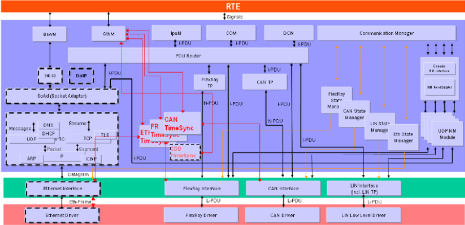

**EthTSyn** 支持在 **Ethernet** 通信总线上保护全局时间报文。下图展示了时间提供者模块在 **AUTOSAR** 分层架构中与安全模块的接口。

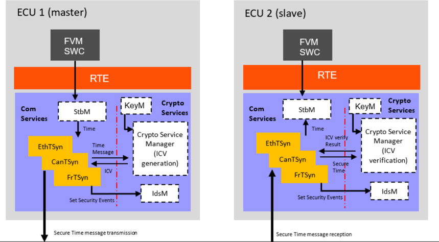

## 2. 缩略语

本节列出模块本地的缩略语和定义。关于完整的同步时基相关术语，请参阅 [3, **CP SWS** BSWGeneral] 的相应章节。

**(G)TD**

> （全局）时间域（**Global** Time Domain）

**(G)TM**

> （全局）时基主节点（**Global** Time Master）

**&lt;Bus&gt;TSyn**

> 总线特定的时间同步模块（A bus specific Time Synchronization module）

**AVB**

> 音视频桥接（**Audio Video Bridging**）

**BMCA**

> 最佳主时钟算法（**Best Master Clock Algorithm**）

**CID**

> 公司 ID（**IEEE**）（Company ID (IEEE)）

**CRC**

> 循环冗余校验和（**Cyclic Redundancy Checksum**）

**CSM**

> 加密服务管理器（**Crypto Service Manager**）

**Debounce Time**

> 发送（事件）报文之间的最小间隔。

**DEM**

> 诊断事件管理器（**Diagnostic Event Manager**）

**DET**

> 默认错误追踪器（**Default Error Tracer**）

**ETH**

> 以太网（**Ethernet**）

**EthTSyn**

> **Ethernet** 的时间同步提供者模块（**Time Synchronization Provider module for Ethernet**）

**Follow_Up**

> 时间传输报文（Follow-Up）

**FV**

> 新鲜度值（**Freshness Value**）

**FVM**

> 新鲜度值管理器（**Freshness Value Manager**）

**GM(C)**

> 顶级主节点（时钟）（**Grand Master (Clock)**）

**ICV**

> 完整性校验值（**Integrity Check Value**）

**MAC** [上下文——Ethernet 协议]

> 介质访问控制（**Media Access Control**）

**MAC** [上下文——安全]

> 报文认证码（**Message Authentication Code**）

**meanPropagationDelay**

> **IEEE 802.1AS** 定义的 meanPropagationDelay

**neighborRateRatio**

> **IEEE 802.1AS** 定义的 neighborRateRatio

**OFS**

> 偏移同步（Offset synchronization）

**Pdelay**

> **IEEE 802.1AS** 给出的传播/路径延迟（Propagation / path delay）

**Pdelay_Req**

> 传播/路径延迟请求报文（Propagation / path delay request message）

**Pdelay_Resp**

> 传播/路径延迟响应报文（Propagation / path delay response message）

**Pdelay_Resp_Follow_Up**

> 传播/路径延迟跟随报文（Propagation / path delay Follow-Up message）

**PDU**

> 协议数据单元（**Protocol Data Unit**）

**PTP**

> 精确时间协议（**Precision Time Protocol**）

**rateRatio**

> **IEEE 802.1AS** 定义的 rateRatio

**StbM**

> 同步时基管理器（**Synchronized Time-Base Manager**）

**Timesync**

> 时间同步（**Time Synchronization**）

**Sync**

> 时间同步报文（Sync）

**TG**

> 时间网关（**Time Gateway**）

**TLV**

> 类型、长度、值字段（按照 **IEEE 802.1AS**）（Type, Length, Value field (acc. to IEEE 802.1AS)）

**TS**

> 时基从节点（**Time Slave**）

**TSD**

> 时间子域（**Time Sub-domain**）

**VLAN**

> 虚拟局域网（**Virtual Local Area Network**）

## 3. 相关文档

### 3.1. 输入文件和相关标准与规范

<a id="ref-1"></a>[1] Time Synchronization Protocol Specification
> AUTOSAR_FO_PRS_TimeSyncProtocol

<a id="ref-2"></a>[2] Specification of Synchronized Time-Base Manager
> AUTOSAR_CP_SWS_SynchronizedTimeBaseManager

<a id="ref-3"></a>[3] General Specification of Basic Software Modules
> AUTOSAR_CP_SWS_BSWGeneral

<a id="ref-4"></a>[4] IEEE Standard 802.1AS-2011
> IEEE 802.1AS-2011

<a id="ref-5"></a>[5] Explanation of Time Sensitive Network features
> AUTOSAR_FO_EXP_TimeSensitiveNetworkFeatures

<a id="ref-6"></a>[6] Requirements on Time Synchronization
> AUTOSAR_FO_RS_TimeSync

<a id="ref-7"></a>[7] General Requirements on Basic Software Modules
> AUTOSAR_CP_SRS_BSWGeneral

<a id="ref-8"></a>[8] Specification of Crypto Service Manager
> AUTOSAR_CP_SWS_CryptoServiceManager

<a id="ref-9"></a>[9] Specification of CRC Routines
> AUTOSAR_CP_SWS_CRCLibrary

<a id="ref-10"></a>[10] Specification of Intrusion Detection System Manager
> AUTOSAR_CP_SWS_IntrusionDetectionSystemManager

### 3.2. 相关规范

**AUTOSAR** 提供：

- 对 **EthTSyn** 同样有效的基础软件通用规范 [3, **SWS** BSW General]，以及
- 对 **EthTSyn** 同样有效的时间同步协议规范 [1, **PRS** Time Synchronization Protocol]。

因此，规范 [3, **SWS** BSW General] 和 [1, **PRS** Time Synchronization Protocol] 应被视为 **EthTSyn** 的附加且必需的规范。

## 4. 约束和假设

### 4.1. 限制

- 不支持 **BMCA** 协议，如 [4, **IEEE 802.1AS**] 所规定。
- 不支持 **Announce** 和 **Signaling** 报文，如 [4, **IEEE 802.1AS**] 所规定。
- **Pdelay_Req** 的接收不被作为开始发送 **Sync** 报文的先决条件。
- 速率校正将由 **StbM**（参见 [\[2\]](#ref-2)）基于 **Sync** 报文执行，它不需要 **Pdelay** 机制，尽管 **IEEE** 标准要求基于 **Pdelay** 报文计算速率校正。这被视为对 **IEEE** 标准的偏离，但被认为是可互操作的。对于某些应用（例如音视频），可能需要使用由 **EthTSyn** 自身执行的基于 **Pdelay** 的速率校正，它是可选的且不被本规范考虑。
- 时间验证用例（启用时间验证）要求对于上层验证应用而言，**Pdelay** 测量表现得就像是用需要被验证的那个全局时基的时间戳执行的一样。因此，相关的时间戳被映射到该全局时间的本地实例。这不被视为对 **IEEE** 标准的偏离，因为对线上时间戳没有产生任何限制，即对于每一次 **Pdelay** 测量，仍然可以把虚拟本地时间放入 **PTP** 报文中；只是必须使相应实例的全局时间可用。
- **EthTSyn** 不会维护 **Ethernet** 硬件时钟，但可以把它用作虚拟本地时间的源。
- 虽然 [4, **IEEE 802.1AS**] 规定 **IEEE 802.1AS** 报文不应带有 **VLAN** 标签或优先级标签，但在交换机硬件支持转发 01:80:C2:00:00:00 .. 0F 范围内的保留多播地址的条件下，**EthTSyn** 允许在 **VLAN** 上进行时间同步。
- 本文档语境中的"CRC secured"指 **CRC** 完整性保护机制，并不意味着 **CRC** 被用作网络安全解决方案。
- 使用多点（multidrop）拓扑时，不支持 **pDelay** 测量，应将其设为静态值。
- 不支持对 **PDelay** 协议报文的保护。

### 4.2. 精度

时间同步的精度取决于各种因素（例如振荡器精度、网络路径中网桥的数量、配置等）。关于如何正确配置整个系统以获得尽可能高精度的建议，请参阅 [5, **EXP** Time Sensitive Network Features] 的"Accuracy of Time Synchronization"一章。

### 4.3. 汽车域的适用性

无论 **ECU** 连接到哪种总线系统，都需要共同时基的汽车系统。

## 5. 对其他模块的依赖

**Ethernet** 全局时间同步（**EthTSyn**）与同步时基管理器（**StbM**）、**Ethernet** 接口（**EthIf**）、**BSW** 模式管理器（**BswM**）、加密服务管理器（**CSM**）、入侵检测系统管理器（**IdsM**）和默认错误追踪器（**DET**）有接口。

- **StbM**：
  - 获取并设置当前时间值
  - 从 **FVM** 获取 **FV**
- **EthIf**——接收和发送报文
- **BswM**——网络访问的协调
- **DET**——开发错误的报告
- **CSM**：
  - 为时基主节点生成 **ICV**
  - 为时基从节点验证 **ICV**
- **IdsM**——安全事件的报告

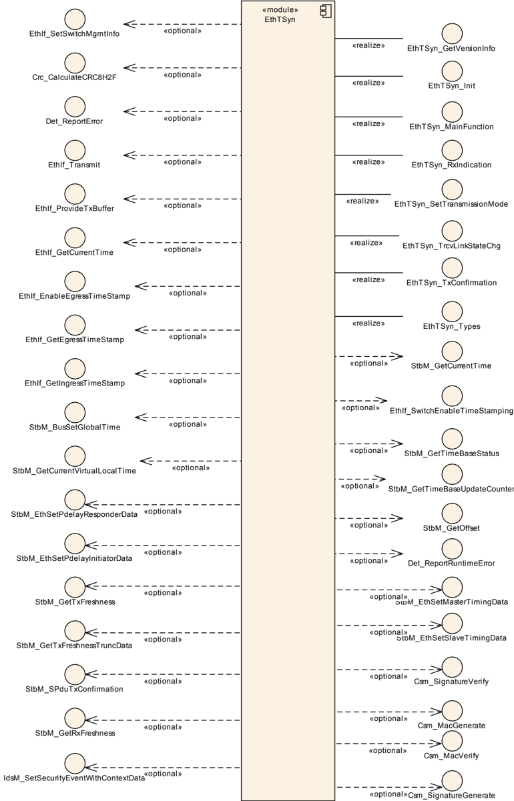

### 5.1. 文件结构

#### 5.1.1. 代码文件结构

细节请参阅 [3, **SWS** BSW General] 的第 5.1.6 节「Code file structure」。

## 6. 功能规格

本章定义负责 **Ethernet** 上时间同步的 **EthTSyn** 模块的行为。本模块的 **API** 在第 [7](#7-api规范) 章中定义，配置在第 [9](#9-配置规范) 章中定义。

### 6.1. 概述

**EthTSyn** 模块负责确保跨 **Ethernet** 网络的同步时间信息的收集与分发。它与 **StbM** 交互，并向 **StbM** 提供所有 **Ethernet** 特定的功能。

#### 6.1.1. 概述

参见 [1, **PRS** Time Synchronization Protocol] 的 General 一章。

#### 6.1.2. VLAN 支持

如果参数 EthTSynFramePrio 存在，则 EthTSynGlobalTimeEthIfRef 应指向表示一个 **VLAN** 的虚拟以太网控制器。

时基从节点和时基主节点在调用 EthIf_ProvideTxBuffer 时应使用 EthTSynFramePrio 值作为优先级参数。

关于附加要求，请参阅 [1, **PRS** Time Synchronization Protocol] 的 VLAN Support 一章。

### 6.2. 初始化

**Ethernet** 全局时间同步通过 [EthTSyn_Init](#731-ethtsyn_init) 初始化。除 [EthTSyn_GetVersionInfo](#732-ethtsyn_getversioninfo) 和 [EthTSyn_Init](#731-ethtsyn_init) 之外，**EthTSyn** 模块的 **API** 函数只有在模块被正确初始化之后才能调用。

对 [EthTSyn_Init](#731-ethtsyn_init) 的调用会初始化所有内部变量，并将 **EthTSyn** 模块设置为已初始化状态。

**注意：** 除非另有规定，**EthTSyn** 使用 [4, **IEEE 802.1AS**] 中给出的默认值。

### 6.3. 不同虚拟本地时间源的处理

如果启用了硬件时间戳，**StbM** 也可以使用 **ETH** 自由运行计数器来对全局时间的本地实例进行插值。但也存在 **StbM** 被配置为使用 **GPT** 的用例，例如：

- 一个全局时间主节点或时间网关连接到不同的 **CAN**/**ETH** 总线，而各 **CAN**/**ETH** 通信控制器的硬件时间戳彼此不同步。

在这种情况下，需要在不同的虚拟本地时间源的时间戳之间进行转换：

- **StbM** 只在其虚拟本地时间源的范围内使用（即捕获、存储和返回）时间戳。
- 因此，当向 **StbM** 传递全局时间或从 **StbM** 获取全局时间时，如果使用了不同的范围，&lt;Bus&gt;TSyn 模块需要把其虚拟本地时间源的时间戳转换到 **StbM** 的虚拟本地时间源的范围内（参见图 9-4、图 9-5 和图 9-6 中的备选标签"Time Source of StbM"）。
- 该转换可以线性进行，即无需确定并施加速率校正项。

如果时间戳的质量（参见 Eth_TimeStampQualType）被指示为 **ETH_INVALID** 或 **ETH_UNCERTAIN**，则 **EthTSyn** 应丢弃从以太网控制器硬件导出的时间戳（例如通过 EthIf_GetCurrentTimeTuple、EthIf_GetIngressTimeStamp 或 EthIf_GetEgressTimeStamp）。

### 6.4. 去抖时间

如果 EthTSynGlobalTimeDebounceTime 设为 0，**EthTSyn** 应忽略任何去抖。

如果 EthTSynGlobalTimeDebounceTime 大于 0，**EthTSyn** 应始终按下述方式对所有 Timesync **PDU**（Sync、Follow_Up、Pdelay_Req、Pdelay_Resp 和 Pdelay_Resp_Follow_Up）考虑去抖。

**注意：** 去抖避免了把时间戳错误地分配给错误的事件报文。

EthTSynGlobalTimeDebounceTime 表示一个 debounceCounter 的重装载值，该计数器应在 Timesync **PDU** 被发送的那个时刻重装载，并且如果未发送 Timesync **PDU**，则应在每次 [EthTSyn_MainFunction](#751-ethtsyn_mainfunction) 调用时递减。

只有当相应的 debounceCounter 达到 0 时，才应发送新的 Timesync **PDU**。

[EthTSynGlobalTimeDomain](#924-ethtsynglobaltimedomain) 的每个端口应拥有自己的 debounceCounter。

### 6.5. 用于延迟计算的 Pdelay 协议

本章在 [1, **PRS** Time Synchronization Protocol] 的"Pdelay Protocol for Latency Calculation"一章的通用要求之外定义 **EthTSyn** 特定的要求。

**Pdelay** 测量的动作总体序列见图 9-3（图 9-2 后的 Pdelay 序列图）。

#### 6.5.1. Pdelay 报文发送

发送下列报文的详细动作序列见图 9-4：

- Pdelay_Req 报文
- Pdelay_Resp 报文，以及
- Pdelay_Resp_Follow_Up 报文

如果时基主节点和时基从节点以（参见 [1, **PRS** Time Synchronization Protocol] 中 PRS_TS_00011 的）周期发送用于延迟计算的 Pdelay_Req，则应施加以下序列：

1. 通过 EthIf_ProvideTxBuffer 获取空闲发送缓冲区；
2. 如果 EthTSynHardwareTimestampSupport 设为 **TRUE**，通过 EthIf_EnableEgressTimeStamp 激活时间戳标记；
3. 通过 EthIf_Transmit 触发发送请求。

如果时基主节点和时基从节点发送用于延迟计算的 Pdelay_Resp（参见 [1, **PRS** Time Synchronization Protocol] 中 PRS_TS_00012），则应施加以下序列：

1. 通过 EthIf_ProvideTxBuffer 获取空闲发送缓冲区；
2. 如果 EthTSynHardwareTimestampSupport 设为 **TRUE**，通过 EthIf_EnableEgressTimeStamp 激活时间戳标记；
3. 通过 EthIf_Transmit 触发发送请求。

当 [EthTSyn_TxConfirmation](#742-ethtsyn_txconfirmation) 以参数 Result 等于 **E_OK** 被调用时，如果 EthTSynHardwareTimestampSupport 设为 **TRUE**，则应在 Pdelay_Req 报文发出时通过 EthIf_GetEgressTimeStamp 从 **EthIf** 获取 t1 的发出时间戳。

如果 **StbM** 不使用以太网控制器作为虚拟本地时间的源（参见 [\[2\]](#ref-2) 中的参数 StbMLocalTimeHardware），**EthTSyn** 应把发出时间戳转换为 **StbM** 中使用的虚拟本地时间。

当 [EthTSyn_TxConfirmation](#742-ethtsyn_txconfirmation) 以参数 Result 等于 **E_OK** 被调用时，如果 EthTSynHardwareTimestampSupport 设为 **FALSE**，则应在 Pdelay_Req 报文发出时通过 StbM_GetCurrentVirtualLocalTime 从 **StbM** 获取 t1 的发出时间戳。

当 [EthTSyn_TxConfirmation](#742-ethtsyn_txconfirmation) 以参数 Result 等于 **E_OK** 被调用时，如果 EthTSynHardwareTimestampSupport 设为 **TRUE**，则应在 Pdelay_Resp 报文发出时通过 EthIf_EnableEgressTimeStamp 从 **EthIf** 获取 t3 的发出时间戳。

如果 **StbM** 不使用以太网控制器作为虚拟本地时间的源（参见 [\[2\]](#ref-2) 中的参数 StbMLocalTimeHardware），**EthTSyn** 应把发出时间戳转换为 **StbM** 中使用的虚拟本地时间。

当 [EthTSyn_TxConfirmation](#742-ethtsyn_txconfirmation) 以参数 Result 等于 **E_OK** 被调用时，如果 EthTSynHardwareTimestampSupport 设为 **FALSE**，则应在 Pdelay_Resp 报文发出时通过 StbM_GetCurrentVirtualLocalTime 从 **StbM** 获取 t3 的发出时间戳。

时基主节点应将 responseOriginTimestamp（用于 Pdelay_Resp_Follow_Up 报文）设为 t3。

如果 EthTSynGlobalTimePdelayRespEnable 设为 **TRUE**，时基主节点和时基从节点应按照 [1, **PRS** Time Synchronization Protocol]"Propagation delay measurement"一章的规定、以该报文的发送时间戳发送 Pdelay_Resp_Follow_Up（如上文的 t3 规定所定义），并考虑表示 Pdelay_Resp 与 Pdelay_Resp_Follow_Up 之间时间偏移的 debounceCounter。

为此，应施加以下序列：

1. 通过 EthIf_ProvideTxBuffer 获取空闲发送缓冲区；
2. 通过 EthIf_Transmit 以上述 t3 规定的发送时间戳触发发送请求。

#### 6.5.2. Pdelay 报文接收

接收下列报文的详细动作序列见图 9-5、图 9-6：

- Pdelay_Req 报文
- Pdelay_Resp 报文，以及
- Pdelay_Resp_Follow_Up 报文

当调用 [EthTSyn_RxIndication](#741-ethtsyn_rxindication) 时，如果 EthTSynHardwareTimestampSupport 设为 **TRUE**，则应在 Pdelay_Req 报文进入时通过 EthIf_GetIngressTimeStamp 从 **EthIf** 获取进入时间戳 t2。

如果 **StbM** 不使用以太网控制器作为虚拟本地时间的源（参见 [\[2\]](#ref-2) 中的参数 StbMLocalTimeHardware），**EthTSyn** 应把进入时间戳转换为 **StbM** 中使用的虚拟本地时间。

当调用 [EthTSyn_RxIndication](#741-ethtsyn_rxindication) 时，如果 EthTSynHardwareTimestampSupport 设为 **FALSE**，则应在 Pdelay_Req 报文进入时通过 StbM_GetCurrentVirtualLocalTime 从 **StbM** 获取 t2 的进入时间戳。

时基主节点应将 requestReceiptTimestamp（用于 Pdelay_Resp 报文）设为 t2。

当调用 [EthTSyn_RxIndication](#741-ethtsyn_rxindication) 时，如果 EthTSynHardwareTimestampSupport 设为 **TRUE**，则应在 Pdelay_Resp 报文进入时通过 EthIf_GetIngressTimeStamp 从 **EthIf** 获取 t4 的进入时间戳。

如果 **StbM** 不使用以太网控制器作为虚拟本地时间的源（参见 [\[2\]](#ref-2) 中的参数 StbMLocalTimeHardware），**EthTSyn** 应把进入时间戳转换为 **StbM** 中使用的虚拟本地时间。

当调用 [EthTSyn_RxIndication](#741-ethtsyn_rxindication) 时，如果 EthTSynHardwareTimestampSupport 设为 **FALSE**，则应在 Pdelay_Resp 报文进入时通过 StbM_GetCurrentVirtualLocalTime 从 **StbM** 获取 t4 的进入时间戳。

如果：

- 配置参数 EthTSynRateRatioEnable 设为 **TRUE**，
- 且 EthTSynRateRatioMeasurementCount 次连续 pDelay 测量已成功完成，

则 **EthTSyn** 应在下一次主函数调用中按照 [\[1\]](#ref-1) 中 PRS_TS_00259 的规定计算 neighborRateRatio。

如果：

- 配置参数 EthTSynGlobalTimeTxPdelayReqPeriod 不为 0，
- 且接收到有效的 Pdelay_Resp_Follow_Up 报文，

则 **EthTSyn** 应在下一次主函数调用中按照 [\[1\]](#ref-1) 中 PRS_TS_00003 的规定计算 linkDelay 值。

### 6.6. 报文格式

关于附加要求：

- **Sync** 和 **Follow_Up**（按 **IEEE 802.1AS**）：请参阅 [1, **PRS** Time Synchronization Protocol] 的 Sync and Follow_Up acc. to IEEE 802.1AS 一章。
- **Sync** 和 **Follow_Up**（按 **AUTOSAR**）：请参阅 [1, **PRS** Time Synchronization Protocol] 的 Sync and Follow_Up acc. to AUTOSAR 一章。
- **Follow_Up** 报文头 [**AUTOSAR**]：请参阅 [1, **PRS** Time Synchronization Protocol] 的 Follow_Up Message Header [AUTOSAR] 一章。
- **AUTOSAR** 与 **OEM** Sub-TLV：请参阅 [1, **PRS** Time Synchronization Protocol] 的 AUTOSAR and OEM Sub-TLVs 一章。
- **AUTOSAR** Sub-TLV：Time Secured——请参阅 [1, **PRS** Time Synchronization Protocol] 的 AUTOSAR Sub-TLV: Time Secured 一章。
- **AUTOSAR** Sub-TLV：Status Secured / Not Secured——请参阅 [1, **PRS** Time Synchronization Protocol] 的 AUTOSAR Sub-TLV: Status Secured 一章。
- **AUTOSAR** Sub-TLV：Time Authenticated——请参阅 [1, **PRS** Time Synchronization Protocol] 的 AUTOSAR Sub-TLV: Time Authenticated 一章。

**AUTOSAR Sub-TLV：UserData Secured / Not Secured**——**AUTOSAR** Sub-TLV：UserData 应映射到 StbM_UserDataType，报文中给出的用户字节号与 StbM_UserDataType 给出的字节号应匹配（UserByte_0 映射到 StbM_UserDataType.userByte0 等）。UserDataLength 应映射到 StbM_UserDataType.StbM_UserDataLength，反之亦然。附加要求请参阅 [1, **PRS** Time Synchronization Protocol] 的 AUTOSAR Sub-TLV: UserData Secured / Not Secured 一章。

**AUTOSAR Sub-TLV：OFS Secured / Not Secured**——如果 **Ethernet** 上的偏移时间域引用了 **Ethernet** 上的同步时间域（参见 **StbM** 中的参数 StbMOffsetTimeBase），则相应的 **AUTOSAR** Sub-TLV：OFS 应映射到该同步时间域的 **Follow_Up** 报文。**AUTOSAR** Sub-TLV：OFS 的用户数据应映射到 StbM_UserDataType，报文中给出的字节号与 StbM_UserDataType 给出的字节号应匹配（UserByte_0 映射到 StbM_UserDataType.userByte0 等）。UserDataLength 应映射到 StbM_UserDataType.StbM_UserDataLength，反之亦然。附加要求请参阅 [1, **PRS** Time Synchronization Protocol] 的 AUTOSAR Sub-TLV: OFS Secured / Not Secured 一章。

### 6.7. 作为时基主节点

关于附加要求，请参阅 [\[1\]](#ref-1) 的 Acting as Time Master 一章。

如果 **EthTSyn** 被配置为某时间域的时基主节点，**EthTSyn** 模块会在每次 [EthTSyn_MainFunction](#751-ethtsyn_mainfunction) 调用时检查是否需要为该时间域发送 Timesync 报文。

图 7-1 展示了时基主节点触发 Timesync 报文（立即和周期）发送的流程。

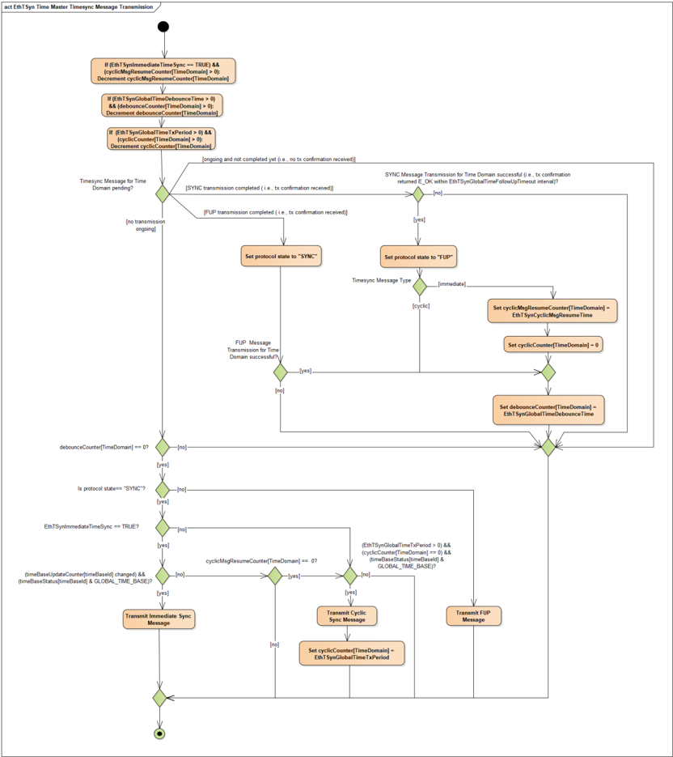

#### 6.7.1. 报文处理

当 EthTSynGlobalTimePortRole 设为 **DYNAMIC** 或 **TIME_MASTER** 时，端口（对于以太网控制器只有 1 个端口，对于交换机是单个端口）应按照配置参数 EthTSynGlobalTimeTxPeriod 发送 **Sync** 和 **Follow_Up** 报文。

**注意：** 对于上述规定，立即同步不受端口特定的 EthTSynGlobalTimeTxPeriod 的进一步影响。

关于附加要求，请参阅 [\[1\]](#ref-1) 的 Message Processing 一章。

如果时基主节点发送 **Sync** 报文（参见 [\[1\]](#ref-1) 中 PRS_TS_00016），则应施加以下序列：

- 应按照 **EthTSyn** 发出时间戳标记的规定，通过 StbM_GetCurrentTime 从 **StbM** 获取全局时间元组 [T0, T0_VLT]；
- 通过 EthIf_ProvideTxBuffer 获取空闲发送缓冲区；
- 如果 EthTSynHardwareTimestampSupport 设为 **TRUE**，通过 EthIf_EnableEgressTimeStamp 激活时间戳标记；
- 通过 EthIf_Transmit 触发发送请求。

**注意：** timeBaseStatus 可通过 StbM_GetTimeBaseStatus 或 StbM_GetCurrentTime 从 **StbM** 读取。

**注意：** **EthTSyn** 发出时间戳标记见图 9-4。

如果：

- 协议要求 PRS_TS_00016 已满足，
- 且关联的 cyclicMsgResumeCounter 小于或等于 0，

则时基主节点应在最早可能的 [EthTSyn_MainFunction](#751-ethtsyn_mainfunction) 调用中开始 **Sync** 报文的周期发送。

**注意：** "最早可能"意味着：
- 在下一个 [EthTSyn_MainFunction](#751-ethtsyn_mainfunction) 中，因为 **GLOBAL_TIME_BASE** 是在 [EthTSyn_MainFunction](#751-ethtsyn_mainfunction) 之外设置的。
- 在当前 [EthTSyn_MainFunction](#751-ethtsyn_mainfunction) 中，当从立即发送切换到周期发送时（因为该决策是在 [EthTSyn_MainFunction](#751-ethtsyn_mainfunction) 内部做出的）。

当 [EthTSyn_TxConfirmation](#742-ethtsyn_txconfirmation) 以参数 Result 等于 **E_OK** 被调用时，如果 EthTSynHardwareTimestampSupport 设为 **TRUE**，则应通过 EthIf_GetEgressTimeStamp 从 **EthIf** 获取 **Sync** 报文的发出时间戳，并按照 **EthTSyn** 发出时间戳标记的规定将其转换为虚拟本地时间 T2_VLT。

**注意：** **EthTSyn** 发出时间戳标记见图 9-4。

如果 EthTSynHardwareTimestampSupport 设为 **TRUE**，且 **StbM** 不使用以太网硬件计数器作为该时基的虚拟本地时间源，则在 [EthTSyn_TxConfirmation](#742-ethtsyn_txconfirmation) 以参数 Result 等于 **E_OK** 被调用时或在随后的 [EthTSyn_MainFunction](#751-ethtsyn_mainfunction) 调用中，应施加以下序列：

1. 对下面两步建立中断保护；
2. 应通过 EthIf_GetCurrentTimeTuple 的参数 currentTimeTuplePtr→timestampClockValue 从 **EthIf** 获取以太网硬件计数器的当前时间，并将其转换为虚拟本地时间 T3_VLT；
3. 应通过 StbM_GetCurrentVirtualLocalTime 获取该时基的虚拟本地时间的当前值作为 T4_VLT；
4. preciseOriginTimestamp 应计算为 T0 − (T3_VLT − T2_VLT) + (T4_VLT − T0_VLT)。

**注意：** 当使用禁用中断嵌套的中断模式时，**EthTSyn** 不需要在 [EthTSyn_TxConfirmation](#742-ethtsyn_txconfirmation) 中显式建立中断保护，因为控制器会隐式完成。

如果 EthTSynHardwareTimestampSupport 设为 **TRUE**，且 **StbM** 确实使用以太网硬件计数器作为该时基的虚拟本地时间源，则 preciseOriginTimestamp 应计算为 T0 + (T2_VLT − T0_VLT)。

如果 EthTSynHardwareTimestampSupport 设为 **FALSE**，则 preciseOriginTimestamp 应计算为 T0 + (T4_VLT − T0_VLT)。

时基主节点在发送 **Follow_Up** 报文之前应考虑 debounceCounter，它表示 **Sync** 与 **Follow_Up** 报文之间的时间偏移。

调用 [EthTSyn_SetProtocolParam](#734-ethtsyn_setprotocolparam) 在参数 protocolParam 中提供的以下参数，应由 **EthTSyn** 用于下一条 **Follow_Up** 信息 **TLV** 报文：

- cumulativeScaledRateOffset
- gmTimeBaseIndicator
- lastGmPhaseChange
- scaledLastGmFreqChange

如果时基主节点发送 **Follow_Up** 报文（参见 [\[1\]](#ref-1) 中 PRS_TS_00018），则应施加以下序列：

- 通过 EthIf_ProvideTxBuffer 获取空闲发送缓冲区；
- 通过 EthIf_Transmit 以上述序列计算的发送时间戳触发发送请求。

##### 6.7.1.1. 运行时错误检测

如果 EthTSynMasterSlaveConflictDetection 设为 **TRUE**，且时基主节点从另一个时基主节点接收到 **Sync** 报文，它应通过调用 Det_ReportRuntimeError 报告运行时错误（错误码 [**ETHTSYN_E_TMCONFLICT**](#6112-运行时错误)），并丢弃接收到的 **Sync** 报文。

##### 6.7.1.2. 帧去抖

请参阅 [\[1\]](#ref-1) 的 Frame Debouncing 一章。

##### 6.7.1.3. 立即时间同步

除了标准的周期报文发送之外，可能还需要立即报文发送。根据配置，**EthTSyn** 模块在每次 [EthTSyn_MainFunction](#751-ethtsyn_mainfunction) 调用时，为每个主节点端口所属的时基检查是否需要发送 Timesync 报文。

图 7-1 展示了立即发送与周期发送如何协调。

如果 EthTSynImmediateTimeSync 设为 **TRUE**，**EthTSyn** 应在每次 [EthTSyn_MainFunction](#751-ethtsyn_mainfunction) 调用内通过调用 StbM_GetTimeBaseUpdateCounter 检查返回的 timeBaseUpdateCounter 是否已变化。

如果：

- EthTSynImmediateTimeSync 设为 **TRUE**，
- 且被更新时基相应 timeBaseId 的 timeBaseUpdateCounter[timeBaseId] 已变化，
- 且从 **StbM** 读取的 timeBaseStatus 中的 **GLOBAL_TIME_BASE** 位已置位，

则 **EthTSyn** 应触发属于该时基的时间同步报文的立即发送。

**注意：** timeBaseStatus 可通过 StbM_GetTimeBaseStatus 或 StbM_GetCurrentTime 从 **StbM** 读取。

第 [6.4](#64-去抖时间) 节所述的 debounceCounter 始终需要考虑。

除了立即发送的实际触发条件（见上文）之外，立即发送还需要考虑参数 EthTSynCyclicMsgResumeTime。另请参阅周期 Timesync 报文发送的触发条件（参见第 [6.7.1](#671-报文处理) 节的规定）。

配置 EthTSynCyclicMsgResumeTime 的两个主要场景：

- 当 EthTSynCyclicMsgResumeTime 和 EthTSynGlobalTimeTxPeriod 都配置为零时，实现单次（single shot）模式，它仅由 timeBaseUpdateCounter 的变化触发。
- 当 EthTSynCyclicMsgResumeTime 大于 EthTSynGlobalTimeTxPeriod 时，可以在时间网关中配置保持（hold-over）场景：
  - 当从时基主节点侧接收到 Timesync 报文时，子总线上的 Timesync 报文仅由立即发送触发（在 cyclicMsgResumeCounter 运行期间周期发送被挂起）；
  - 如果不再从时基主节点侧接收到 Timesync 报文且检测到超时，周期发送接管（因为 cyclicMsgResumeCounter 已流逝，周期发送不再被挂起）；
  - 当从时基主节点侧的 Timesync 报文接收恢复时，子总线上的 Timesync 报文再次由立即发送触发（周期发送再次被运行中的 cyclicMsgResumeCounter 挂起）。

对于某时间域，如果：

- EthTSynImmediateTimeSync 设为 **TRUE**，
- 且 EthTSynCyclicMsgResumeTime 大于 0，
- 且一条立即 **SYNC** 报文已成功发送，

则 **EthTSyn** 应将相应时间域的计数器 cyclicMsgResumeCounter 设为 EthTSynCyclicMsgResumeTime。

对于某时间域，当 cyclicMsgResumeCounter 大于 0 时，**EthTSyn** 应丢弃该时间域的周期 Timesync 报文发送请求。

对于某时间域，当 cyclicMsgResumeCounter 大于 0 时，**EthTSyn** 应在每次调用 [EthTSyn_MainFunction](#751-ethtsyn_mainfunction) 时将相应时间域的 cyclicMsgResumeCounter 减去 EthTSynMainFunctionPeriod。

如果 cyclicMsgResumeCounter 被递减到 0 或以下，**EthTSyn** 应在同一个 [EthTSyn_MainFunction](#751-ethtsyn_mainfunction) 调用内通过请求 **SYNC** 报文发送来恢复周期 Timesync 报文发送。

**注意：** 该规定是为了确保第一次周期发送在与 cyclicMsgResumeCounter 达到 0 相同的主函数调用中被请求（参见上文"最早可能"主函数调用）。报文是否实际发送还取决于 debounceCounter。

##### 6.7.1.4. 安全时间同步

关于每个时间域所引用 **FV** 的配置细节，请参阅 [\[2\]](#ref-2) **StbM** 的相应章节。

当 **FV** 被引用（参见 EthTSynIcvGenerationFvIdRef，见下文注中的链接）且 **StbM** 中配置的截断 **FV** 长度（StbMFreshnessValueTruncLength）等于 **FV** 长度（StbMFreshnessValueLength）时，时基主节点应调用 StbM_GetTxFreshness **API**，使用 StbMFreshnessValueId 获取完整 **FV**。

当 **FV** 被引用（参见 EthTSynIcvGenerationFvIdRef）且配置的截断 **FV** 长度（StbMFreshnessValueTruncLength）小于 **StbM** 中的 **FV** 长度（StbMFreshnessValueLength）时，时基主节点应调用 StbM_GetTxFreshnessTruncData **API**，使用 StbMFreshnessValueId 获取完整 **FV** 和截断的 **FV**。

如果 StbM_GetTxFreshness 返回 **E_OK**，时基主节点应构造携带 **FV** 的 **AUTOSAR** Sub-TLV：Time Authenticated，并在 **ICV** 生成中使用完整 **FV**。

如果 StbM_GetTxFreshnessTruncData 返回 **E_OK**，时基主节点应构造携带截断 **FV** 的 **AUTOSAR** Sub-TLV：Time Authenticated，并在 **ICV** 生成中使用完整 **FV**。

如果 StbM_GetTxFreshness 或 StbM_GetTxFreshnessTruncData 返回不可恢复的错误码（即 **E_NOT_OK**），时基主节点应：

- 停止 **ICV** 生成（参见第 [6.7.3.5](#6735-icv-生成) 节「ICV 生成」），并相应地设置 **Follow_Up** 报文的 **AUTOSAR** Sub-TLV：Time Authenticated 中的 ICV_Flags；
- 调用 Det_ReportRuntimeError，参数 ErrorId 设为 [**ETHTSYN_E_FRESHNESSFAILURE**](#6112-运行时错误)（参见第 [6.11](#611-错误分类) 节的运行时错误定义）；
- 调用 IdsM_SetSecurityEventWithContextData，参数 EventId 设为 **SEV_TSYN_ETH_FRESHNESS_NOT_AVAILABLE**（参见第 [6.10](#610-安全事件) 节「安全事件」）。

**注意：** 关于用于 **ICV** 生成的 **CSM** 任务的配置细节，请参阅 [8, **SWS** CryptoServiceManager] 的相应章节。

如果某时间域的 EthTSynIcvGenerationBase 配置为 **ICV_MAC**，时基主节点应调用 Csm_MacGenerate 生成 **ICV** 值。

如果某时间域的 EthTSynIcvGenerationBase 配置为 **ICV_SIGNATURE**，时基主节点应调用 Csm_SignatureGenerate 生成 **ICV** 值。

**注意：** mode 参数有意保持开放，由实现者选择（即 **CRYPTO_OPERATIONMODE_SINGLECALL** 可能是最佳选项，因为它不需要进一步调用 **Csm**）。

用于生成 **ICV** 的 **CSM** 任务可以配置为同步或异步行为。

如果用于生成 **ICV** 的 **CSM** 任务配置为同步行为，时基主节点应停用 **ICV** 生成超时监视。

如果 Csm_MacGenerate 或 Csm_SignatureGenerate 返回 **E_OK**，时基主节点应启动 EthTSynIcvGenerationTimeout。

当 [EthTSyn_IcvGenerationIndication](#744-ethtsyn_icvgenerationindication) 回调被调用时，时基主节点应停止正在运行的 **ICV** 生成超时定时器（EthTSynIcvGenerationTimeout）。

如果以下条件之一成立：

- 认证构建计数器已达到配置值 EthTSynTxAuthenticationBuildAttempts；
- **ICV** 的验证返回了不可恢复的错误，例如返回 **E_NOT_OK** 或 **KEY_FAILURE**；
- EthTSynIcvGenerationTimeout 在 [EthTSyn_IcvGenerationIndication](#744-ethtsyn_icvgenerationindication) 回调的通知之前到期；

则时基主节点应：

- 停止 **ICV** 生成，并相应地设置 **Follow_Up** 报文的 **AUTOSAR** Sub-TLV：Time Authenticated 中的 ICV_Flags；
- 调用 IdsM_SetSecurityEventWithContextData，参数 EventId 设为 **SEV_TSYN_ETH_ICV_GENERATION_FAILED**（参见第 [6.10](#610-安全事件) 节「安全事件」）。

**注意：** 如果 **ICV** 生成失败，则无需在 **AUTOSAR** Sub-TLV：Time Authenticated 中包含 **FV**。

随着 [EthTSyn_IcvGenerationIndication](#744-ethtsyn_icvgenerationindication) 回调的通知，时基主节点应将生成的 **ICV** 加入 **AUTOSAR** Sub-TLV：Time Authenticated，并发送 **Follow_Up** 报文。

当 **FV** 被引用（参见 EthTSynIcvGenerationFvIdRef）时，时基主节点应通过调用 StbM_SPduTxConfirmation 向 **FVM** 通知 **Follow_Up** 报文的成功发送。

对于每次发送包含 **AUTOSAR** Sub-TLV：Time Authenticated 的报文，**EthTSyn** 应维护一个认证构建计数器（参见 EthTSynTxAuthenticationBuildAttempts）。

在初次处理包含 **AUTOSAR** Sub-TLV：Time Authenticated 的报文时，认证构建计数器应设为 0。

如果 StbM_GetTxFreshness 或 StbM_GetTxFreshnessTruncData 返回可恢复的错误码（例如 **STBM_E_BUSY**），认证构建计数器应递增。

如果 Csm_MacGenerate 或 Csm_SignatureGenerate 返回可恢复的错误码（例如 **E_BUSY**、**QUEUE_FULL**），认证构建计数器应递增。

如果经认证报文的构建已失败且认证构建计数器尚未达到配置值 EthTSynTxAuthenticationBuildAttempts，则应在下一次调用 [EthTSyn_MainFunction](#751-ethtsyn_mainfunction) 时重试新鲜度获取和 **ICV** 计算。

#### 6.7.2. 链路状态与发送模式

收发器链路状态变化（[EthTSyn_TrcvLinkStateChg](#743-ethtsyn_trcvlinkstatechg) 的通知调用）从 **ETHTRCV_LINK_STATE_ACTIVE** 到 **ETHTRCV_LINK_STATE_DOWN** 会复位时间同步报文发送和接收的状态机。

收发器链路状态变化（[EthTSyn_TrcvLinkStateChg](#743-ethtsyn_trcvlinkstatechg) 的通知调用）从 **ETHTRCV_LINK_STATE_DOWN** 到 **ETHTRCV_LINK_STATE_ACTIVE** 会（重新）启动时间同步报文的发送和接收。

如果调用 [EthTSyn_SetTransmissionMode](#733-ethtsyn_settransmissionmode) 且参数 Mode 等于 **ETHTSYN_TX_OFF**，则应省略 **EthTSyn** 在此以太网控制器上的所有发送请求。

如果调用 [EthTSyn_SetTransmissionMode](#733-ethtsyn_settransmissionmode) 且参数 Mode 等于 **ETHTSYN_TX_ON**，则 **EthTSyn** 在此以太网控制器上的所有发送请求应能够被发送。

#### 6.7.3. 报文字段的计算与组装

关于附加要求，请参阅 [\[1\]](#ref-1) 的 Message Field Calculation and Assembling 一章。

##### 6.7.3.1. SGW 计算

请参阅 [\[1\]](#ref-1) 的 SGW Calculation 一章。

##### 6.7.3.2. OFS 计算

时基主节点应通过 StbM_GetOffset 从 **StbM** 获取偏移时基的值。

关于附加要求，请参阅 [\[1\]](#ref-1) 的 OFS Calculation 一章。

##### 6.7.3.3. CRC 计算

关于附加要求，请参阅 [\[1\]](#ref-1) 的 CRC Calculation 一章。

如果已配置，应使用 [9, **SWS** CRCLibrary] 中定义的函数 Crc_CalculateCRC8H2F 来计算 **CRC**。

**AUTOSAR Sub-TLV**：Time Secured / Status secured / UserData secured / OFS secured——请参阅 [\[1\]](#ref-1) 的相应章节。

##### 6.7.3.4. 序列计数器（sequenceId）计算

关于附加要求，请参阅 [\[1\]](#ref-1) 的 Sequence Counter (sequenceId) Calculation 一章。

##### 6.7.3.5. ICV 生成

请参阅 [\[1\]](#ref-1) 的 ICV Generation 一章。

##### 6.7.3.6. 报文组装

请参阅 [\[1\]](#ref-1) 的 Message Assembling 一章。

##### 6.7.3.7. 时基主节点与时基从节点的动态端口配置

如果在任何端口上参数 EthTSynGlobalTimePortRole 设为 **DYNAMIC**，接收到一条 **Sync** 报文应把相应的接收端口自动转为从端口。所有其余设为 **DYNAMIC** 的端口应转为主端口。

**注意：** 在不同端口上接收 **Sync** 报文可能导致不一致。

如果在动态设为从端口的端口上 HoldOverTime 内未接收到 **Sync** 和 **Follow_Up** 报文，则所有动态设为主端口或从端口的端口应转回 **DYNAMIC**。

**注意：** 这将停止动态设为主端口的端口上 **Sync** 和 **Follow_Up** 的发送，并允许从端口的无缝切换。

如果在某从端口上 HoldOverTime 内未接收到 **Sync** 和 **Follow_Up**，则所有设为 **TIME_MASTER**（动态或静态）的端口应停止 **Sync** 和 **Follow_Up** 报文的发送。

**注意：** 从端口是动态还是静态配置为 **TIME_SLAVE** 并不重要；无论哪种情况，在 HoldOverTime 之后都应停止 **Sync** 和 **Follow_Up** 报文的发送，以防止不连续。

### 6.8. 作为时基从节点

关于附加要求，请参阅 [\[1\]](#ref-1) 的 Acting as Time Slave 一章。

#### 6.8.1. 报文处理

除了时基从节点在总线上从时基主节点接收的 **Follow_Up** 报文字段——preciseOriginTimeStamp 和 correctionField（参见 [\[1\]](#ref-1) 的 Message Processing 一章）——之外，本章还定义并使用以下内部变量来计算同步时基的接收时间元组：

- T1_VLT：**SYNC** 报文的进入时间戳，由以太网控制器中的硬件或在 [EthTSyn_RxIndication](#741-ethtsyn_rxindication) 中的 **SW** 捕获。
- T2：接收时间元组的全局时间分量（等同于 **StbM** 中的 TG_Rx）。
- T2_VLT：接收时间元组的虚拟本地时间分量（等同于 **StbM** 中的 TV_Rx）。
- T3_VLT：从以太网控制器硬件读出的当前时间——用于 **StbM** 时间与以太网硬件时钟的关联。
- T4_VLT：**StbM** 中的当前虚拟本地时间——用于 **StbM** 本地时间与以太网硬件时钟的关联。
- T_RD（TSRD）：**SYNC** 接收延迟，为 T3_VLT 与 T1_VLT 之差。

图 7-2 展示了从 **Sync** 和 **Follow_Up** 报文中接收的数据计算接收时间元组的动作流程。该图有助于理解本章的要求。更多细节见时序图图 9-5 和图 9-6。

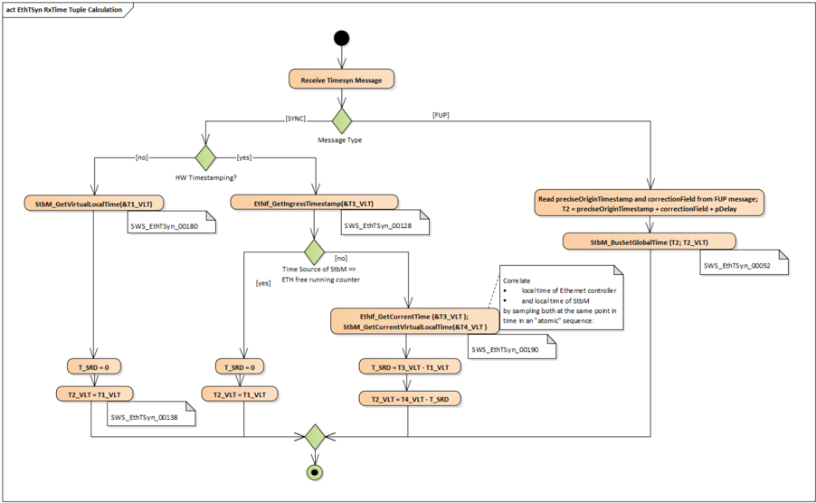

如果 EthTSynGlobalTimePortRole 设为 **TIME_SLAVE** 或 **DYNAMIC**，**Sync** 和 **Follow_Up** 报文应在 [EthTSyn_RxIndication](#741-ethtsyn_rxindication) 中按下文各条规定被处理。

如果 EthTSynGlobalTimePortRole 设为 **TIME_SLAVE**，其他任何端口都不得接受 **Sync** 和 **Follow_Up** 报文，即时间同步报文只由配置的从端口处理。

**注意：** 当为同一时间域配置多于一个从端口时，可能出现不一致。

当调用 [EthTSyn_RxIndication](#741-ethtsyn_rxindication) 时，如果 EthTSynHardwareTimestampSupport 设为 **TRUE**，**Sync** 报文的进入时间戳 T1_VLT 应通过 EthIf_GetIngressTimeStamp 获取。

在为 **Sync** 报文调用 [EthTSyn_RxIndication](#741-ethtsyn_rxindication) 时，如果 EthTSynHardwareTimestampSupport 设为 **TRUE**，且 **StbM** 确实使用以太网硬件计数器作为该时基的虚拟本地时间源：

- 接收时间元组的 T2_VLT 部分应设为 T1_VLT 的值（即 T2_VLT = T1_VLT）；
- **Sync** 接收延迟 T_RD 应设为 0。

当调用 [EthTSyn_RxIndication](#741-ethtsyn_rxindication) 时，如果 EthTSynHardwareTimestampSupport 设为 **FALSE**，则应施加以下序列：

- 立即建立中断保护，并紧接着执行下一步：
- 通过 StbM_GetCurrentVirtualLocalTime 从 **StbM** 获取 **Sync** 报文的参考时间 T1_VLT；
- 现在可以移除中断保护。

接收时间元组的 T2_VLT 部分应设为 T1_VLT 的值（即 T2_VLT = T1_VLT）。**Sync** 接收延迟 T_RD 应设为 0。

**注意：** 立即建立中断保护意味着在此之前不应进行任何帧检查。如果在禁用中断嵌套的情况下于 RX 中断的上下文中被调用，中断保护由控制器隐式完成。一旦中断被锁定，可以检查接收到的报文是否是需要对其取虚拟本地时间快照的 **Sync** 报文，但在取快照之前不得做其他帧检查（例如 **SC** 校验）。一旦取了快照，就可以移除中断保护并进行必要的校验。这意味着即使后续的校验失败从而快照变得多余，也会取到虚拟本地时间的快照。

在调用 [EthTSyn_RxIndication](#741-ethtsyn_rxindication) 时，如果 EthTSynHardwareTimestampSupport 设为 **TRUE**，且 **StbM** 不使用以太网硬件计数器作为该时基的虚拟本地时间源，则应在接收到 **Sync** 报文时通过施加以下序列获取参考时间：

- 对下面两步建立中断保护：
- 应通过 EthIf_GetCurrentTimeTuple 的参数 currentTimeTuplePtr→timestampClockValue 从 **EthIf** 获取以太网硬件计数器的当前时间，并将其转换为虚拟本地时间 T3_VLT；
- 应通过 StbM_GetCurrentVirtualLocalTime 获取该时基的虚拟本地时间的当前值作为 T4_VLT；
- **Sync** 接收延迟 T_RD 应计算为 T3_VLT − T1_VLT；
- T2_VLT 应计算为 T4_VLT − T_RD。

当接收到有效的 **Follow-Up** 报文时，**EthTSyn** 应：

- 通过将以下值相加计算 T2：
  - preciseOriginTimestamp（来自 **Follow-Up** 报文）；
  - correctionField（来自 **Follow-Up** 报文）；
  - Pdelay（按照上文 linkDelay 计算规定计算）；
- 并通过 StbM_BusSetGlobalTime 将得到的接收时间元组 [T2, T2_VLT] 转发给 **StbM** 模块。

**注意：** 按照上文的相应注意项，**Pdelay** 值不会受到 RateRatio 的显著影响。

如果：

- 配置参数 EthTSynRateRatioEnable 设为 **TRUE**，
- 且已计算出有效的 neighborRateRatio（参见第 [6.5.2](#652-pdelay-报文接收) 节的规定），
- 且接收到新的有效 **Follow-Up** 报文，

则 **EthTSyn** 应在下一次主函数中按照 [\[1\]](#ref-1) 中 PRS_TS_00261 的规定计算 rateRatio。

如果已成功计算出 rateRatio（参见上文规定），则在调用 StbM_BusSetGlobalTime 时，**EthTSyn** 应按如下方式设置参数 measureDataPtr→rateDeviation：

- 将 rateDeviationValue 计算为 rateDeviationValue = (rateRatio − 1) * 2^41，然后将 rateDeviationValue 截断到下一个更小的有符号整数；
- 并将 rateDeviationStatus 设为 **ETH_RATE_OK**。

如果计算出的速率偏差值超过了 rateDeviationValue 的值域，则 **EthTSyn** 应：

- 分别将 rateDeviationValue 设为 **SINT32_MIN** 或 **SINT32_MAX**；
- 将 rateDeviationStatus 设为 **ETH_RATE_EXCEEDED**。

**注意：** 按照 [4, **IEEE 802.1AS**]，假设速率偏差的小数值在范围 [−(2^−10 − 2^−41), 2^−10 − 2^−41] 内，即约为 [−9.766 * 10^−4, 9.766 * 10^−4]。

如果尚未成功计算出 rateRatio（参见上文规定），则在调用 StbM_BusSetGlobalTime 时，**EthTSyn** 应按如下方式设置参数 measureDataPtr→rateDeviation：

- rateDeviationValue 设为 0；
- rateDeviationStatus 设为 **ETH_RATE_NOT_AVAILABLE**。

在调用 StbM_BusSetGlobalTime 时，**EthTSyn** 应通过参数 measureDataPtr→pathDelay 将当前的 linkDelay 值（参见上文 linkDelay 计算规定）传递给 **StbM**。

当通过 StbM_BusSetGlobalTime 向 **StbM** 提供新的全局时间元组时，**EthTSyn** 应按照 **SGW** 值（参见 [PRS_TS_00156]）设置 timeBaseStatus（参数 timeTuplePtr 引用的结构成员）中的 **SYNC_TO_GATEWAY** 位。其余状态位应设为 0。

如果 EthTSynMessageCompliance 设为 **TRUE** 或 EthTSynRxSubTLVUserData 设为 **FALSE**，**EthTSyn** 应将 **NULL** 指针作为 StbM_BusSetGlobalTime 的参数 UserData 传递。

在调用 [EthTSyn_GetProtocolParam](#735-ethtsyn_getprotocolparam) 时，**EthTSyn** 应通过参数 protocolParam 返回在最近的 **Follow_Up** 信息 **TLV** 中接收到的以下值：

- cumulativeScaledRateOffset
- gmTimeBaseIndicator
- lastGmPhaseChange
- scaledLastGmFreqChange

参数 protocolParam 的成员 protocolType 应设为 **STBM_TIMESYNC_ETHERNET**。

##### 6.8.1.1. 运行时错误检测

如果 EthTSynMasterSlaveConflictDetection 设为 **TRUE**，且时基从节点接收到具有不同 sourcePortIdentity（即不同 **MAC** 地址）的 **Sync** 帧，它应通过调用 Det_ReportRuntimeError 报告运行时错误（错误码 [**ETHTSYN_E_TSCONFLICT**](#6112-运行时错误)），并丢弃接收到的 **Sync** 帧。

##### 6.8.1.2. 帧去抖

关于附加要求，请参阅 PRS-TimeSyncProtocol [\[1\]](#ref-1) 的 Frame Debouncing 一章。

在 EthTSynGlobalTimeRxDebounceTime 期间，如果序列被复位，则时基从节点应调用 IdsM_SetSecurityEventWithContextData，参数 EventId 设为 **SEV_TSYN_ETH_MSG_SEQUENCE_ERROR**（参见第 [6.10](#610-安全事件) 节「安全事件」）。

##### 6.8.1.3. 安全时间同步

关于每个时间域所引用 **FV** 的配置细节，请参阅 [\[2\]](#ref-2) **StbM** 的相应章节。

当 **FV** 被引用（参见 EthTSynIcvVerificationFvIdRef）、FVL 大于 0 且接收到的 **Follow_Up** 报文的 ICV_Flags 中「ICV with FV」位已置位时，时基从节点应调用 StbM_GetRxFreshness **API** 获取新鲜度值，使用：

- 来自引用 EthTSynIcvVerificationFvIdRef 的 StbMFreshnessValueId；
- **Follow_Up** 报文 **FV** 字段中接收到的 StbMTruncatedFreshnessValue；
- **Follow_Up** 报文 FVL 字段中接收到的 StbMTruncatedFreshnessValueLength；
- 作为当前报文失败验证尝试次数（**ICV** 验证尝试计数器）的 StbMAuthVerifyAttempts；
- 来自引用 EthTSynIcvVerificationFvIdRef 的 StbMFreshnessValueLength。

如果 StbM_GetRxFreshness 返回 **E_OK**，时基从节点应在 **ICV** 验证中使用该 **FV**。

如果 StbM_GetRxFreshness 返回不可恢复的错误码（例如 **E_NOT_OK**），或 FVL == 0 且接收到的 **Follow_Up** 报文的 ICV_Flags 中「ICV with FV」位已置位，则接收到的 **Follow_Up** 报文的 **ICV** 验证被视为失败，时基从节点应：

- 停止 **ICV** 验证（参见第 [6.8.2.5](#6825-icv-验证) 节「ICV 验证」）并丢弃接收到的 **Follow_Up** 报文；
- 调用 Det_ReportRuntimeError，参数 ErrorId 设为 [**ETHTSYN_E_FRESHNESSFAILURE**](#6112-运行时错误)（参见第 [6.11](#611-错误分类) 节的运行时错误定义）；
- 调用 IdsM_SetSecurityEventWithContextData，参数 EventId 设为 **SEV_TSYN_ETH_FRESHNESS_NOT_AVAILABLE**（参见第 [6.10](#610-安全事件) 节「安全事件」）。

关于用于 **ICV** 验证的 **CSM** 任务的配置细节，请参阅 [8, **SWS** CryptoServiceManager] 的相应章节。

如果某时间域的 EthTSynIcvVerificationBase 配置为 **ICV_MAC**，时基从节点应调用 Csm_MacVerify 验证 **ICV** 值。

如果某时间域的 EthTSynIcvVerificationBase 配置为 **ICV_SIGNATURE**，时基从节点应调用 Csm_SignatureVerify 验证 **ICV** 值。

**注意：** mode 参数有意保持开放，由实现者选择（即 **CRYPTO_OPERATIONMODE_SINGLECALL** 可能是最佳选项，因为它不需要进一步调用 **Csm**）。

用于生成 **ICV** 的 **CSM** 任务可以配置为同步或异步行为。

当用于验证 **ICV** 的 **CSM** 任务配置为同步行为时，**ICV** 验证超时观察被禁用。在这种情况下，EthTSynIcvVerificationTimeout 应设为 0。

如果 Csm_MacVerify 或 Csm_SignatureVerify 返回 **E_OK**，时基从节点应启动 EthTSynIcvVerificationTimeout。

如果 Csm_MacVerify 或 Csm_SignatureVerify 返回可恢复的错误码（例如 **CRYPTO_E_BUSY**、**CRYPTO_QUEUE_FULL**），则接收到的 **Follow_Up** 报文的当前验证被视为失败，时基从节点应为该 **Follow_Up** 报文递增认证构建计数器。

EthTSynIcvVerificationTimeout 应随着 [EthTSyn_IcvVerificationIndication](#745-ethtsyn_icvverificationindication) 回调的通知而停止。

如果以下条件之一成立：

- 认证构建计数器已达到配置值 EthTSynRxAuthenticationBuildAttempts；
- **ICV** 验证尝试计数器已达到配置值 EthTSynIcvVerificationAttempts；
- **ICV** 的验证返回了不可恢复的错误，例如返回 **E_NOT_OK** 或 **KEY_FAILURE**；
- EthTSynIcvVerificationTimeout 在 [EthTSyn_IcvVerificationIndication](#745-ethtsyn_icvverificationindication) 回调的通知之前到期；

则时基从节点应：

- 停止 **ICV** 验证（参见第 [6.8.2.5](#6825-icv-验证) 节「ICV 验证」）并丢弃接收到的 **Follow_Up** 报文；
- 调用 IdsM_SetSecurityEventWithContextData，参数 EventId 设为 **SEV_TSYN_ETH_ICV_VERIFICATION_FAILED**（参见第 [6.10](#610-安全事件) 节「安全事件」）。

对于每次接收需要 **ICV** 验证的报文，**EthTSyn** 应维护一个认证构建计数器（参见 EthTSynRxAuthenticationBuildAttempts）。

在初次处理需要 **ICV** 验证的报文时，认证构建计数器应设为 0。

如果 StbM_GetRxFreshness 返回可恢复的错误码（例如 **STBM_E_BUSY**），认证构建计数器应递增，且不应执行任何 **ICV** 验证尝试。

如果经认证报文的验证构建已失败且认证构建计数器尚未达到配置值 EthTSynRxAuthenticationBuildAttempts，则应在下一次调用 [EthTSyn_MainFunction](#751-ethtsyn_mainfunction) 时重试新鲜度获取和 **ICV** 验证。

如果 **ICV** 的验证可以成功执行但验证失败（例如 **MAC** 验证失败或密钥无效），则 **ICV** 验证尝试计数器应递增，且认证构建计数器应设为 0。

**注意：** 复位认证构建计数器应防止在仍可能进行 **ICV** 验证尝试的情况下过早放弃认证过程。

当 [EthTSyn_IcvVerificationIndication](#745-ethtsyn_icvverificationindication) 回调被调用且 **ICV** 验证结果成功时，时基从节点应接受该 **Follow_Up** 报文，并调用 StbM_BusSetGlobalTime 将全局时间转发给 **StbM**。

当 [EthTSyn_IcvVerificationIndication](#745-ethtsyn_icvverificationindication) 回调被调用且 **ICV** 验证结果不成功时，时基从节点应丢弃该 **Follow_Up** 报文。

#### 6.8.2. 报文字段的校验与拆解

本章的附加内容见 [\[1\]](#ref-1) 的 Message Field Validation and Disassembling 一章。

##### 6.8.2.1. SGW 计算

请参阅 [\[1\]](#ref-1) 的 SGW Calculation 一章。

##### 6.8.2.2. OFS 计算

如果成功校验，时基从节点应通过 StbM_BusSetGlobalTime 将新的偏移时间转发给 **StbM**（按照 [PRS_TS_00110] 计算）。

关于附加要求，请参阅 [\[1\]](#ref-1) 的 OFS Calculation 一章。

##### 6.8.2.3. CRC 校验

如果已配置，应使用 [9, **SWS** CRCLibrary] 中定义的函数 Crc_CalculateCRC8H2F 来计算 **CRC**。

关于附加要求，请参阅 [\[1\]](#ref-1) 的 CRC Calculation 一章。

**AUTOSAR Sub-TLV**：Time Secured / Status secured / UserData secured / OFS secured——请参阅 [\[1\]](#ref-1) 的相应章节。

##### 6.8.2.4. 序列计数器（sequenceId）校验

关于附加要求，请参阅 **AUTOSAR** 时间同步协议规范 [\[1\]](#ref-1) 的 Sequence Counter (sequenceId) Validation 一章。

##### 6.8.2.5. ICV 验证

请参阅 PRS-TimeSyncProtocol [\[1\]](#ref-1) 的 ICV Verification 一章。

##### 6.8.2.6. 报文拆解

请参阅 [\[1\]](#ref-1) 的 Message Disassembling 一章。

### 6.9. 时间记录

#### 6.9.1. 时间验证

如果 EthTSynTimeValidationSupport 设为 **TRUE**，**EthTSyn** 应支持时间验证。

如果：

- EthTSynTimeValidationSupport 已启用，且
- 该时间域的 EthTSynEnableTimeValidation 已启用，

则 **EthTSyn** 应为该时间域执行用于时间验证的时间记录。

如果某时间域的主端口域已启用用于时间验证的时间记录（见上两条的规定），则 **EthTSyn** 应在成功发送 **Sync** 报文时调用 StbM_EthSetMasterTimingData（参见 **EthTSyn** 时序序列，即图 9-2）。

在调用 StbM_EthSetMasterTimingData 时（参见上文规定），**EthTSyn** 应通过参数 measureDataPtr 传递以下参数：

- 已发送 **Sync** 报文的 sequenceId；
- **Sync** 报文中发送的 sourcePortIdentity；
- 在 **Sync** 报文发出时采样的虚拟本地时间 T2_VLT（参见第 [6.7.1](#671-报文处理) 节的发出时间戳规定）；
- 复制到 **Follow_Up** 报文的 preciseOriginTimestamp（参见第 [6.7.1](#671-报文处理) 节的相应规定）；
- 复制到 **Follow_Up** 报文的 correctionField。

如果：

- 某时间域已启用用于时间验证的时间记录（见上两条的规定），且
- **EthTSyn** 被配置为该时间域的时基从节点，

则 **EthTSyn** 应在成功接收到 **FollowUp** 报文时调用 StbM_EthSetSlaveTimingData（参见 **EthTSyn** 时序序列，即图 9-2）。

StbM_EthSetSlaveTimingData 应在 StbM_BusSetGlobalTime 之后调用。

**注意：** StbM_BusSetGlobalTime 应先被调用，因为它更新同步本地时间元组（参见 [\[2\]](#ref-2)），而 StbM_EthSetSlaveTimingData 需要它。

在调用 StbM_EthSetSlaveTimingData 时，**EthTSyn** 应向该函数传递以下值：

- **Follow_Up** 报文中接收到的 sequenceId；
- **Follow_Up** 报文中接收到的 sourcePortIdentity；
- 在 **Sync** 报文进入时采样的虚拟本地时间 T1_VLT（参见第 [6.8.1](#681-报文处理) 节的进入时间戳规定）；
- **Follow_Up** 报文中接收到的 preciseOriginTimestamp；
- **Follow_Up** 报文中接收到的 correctionField，以及
- **Pdelay** 的当前值。

结构成员 measureDataPtr→referenceLocalTimestamp 和 measureDataPtr→referenceGlobalTimestamp 应传 0。

**注意：** **EthTSyn** 传递 0 以避免未定义的值。**StbM** 将基于同步本地时间元组计算结构成员 referenceLocalTimestamp 和 referenceGlobalTimestamp（参见 **StbM** 规范的相应规定）。

##### 6.9.1.1. Pdelay 测量的记录

如果：

- 某时间域已启用用于时间验证的时间记录（见上两条的规定），且
- **EthTSyn** 被配置为该时间域的时基主节点，

则 **EthTSyn** 应在发送 Pdelay_Resp 报文之前调用 StbM_GetCurrentTime 获取时间元组 [T_refPDResponder, T_VLT_refPDResponder]（参见 **EthTSyn** Pdelay 序列，即图 9-3）。

**注意：** 时间元组 [T_refPDResponder, T_VLT_refPDResponder] 将用于把 t2（即 requestReceiptTimestamp）和 t3（即 responseOriginTimestamp）一致地转换为全局时间值，即把虚拟本地时间值中的实例转换为全局时间中的实例。

如果：

- 该时间域已启用用于时间验证的时间记录（见上两条的规定），且
- **EthTSyn** 被配置为该时间域的时基主节点，

则 **EthTSyn** 应在当前 **Pdelay** 测量完成之后，即在发送 Pdelay_Resp_Follow_Up 报文时（参见 **EthTSyn** Pdelay 序列），调用 StbM_EthSetPdelayResponderData。

时基主节点应在调用时通过参数 measureDataPtr 向 StbM_EthSetPdelayResponderData 传递以下参数：

- 接收到的 Pdelay_Req 报文的 sequenceId，以及该报文的 sourcePortIdentity；
- 已发送 Pdelay_Resp 报文的 sourcePortIdentity；
- t2（参见第 [6.5.2](#652-pdelay-报文接收) 节的 t2 规定）；
- t3（参见第 [6.5.1](#651-pdelay-报文发送) 节的 t3 规定），以及
- 采样的参考时间元组 [T_refPDResponder, T_VLT_refPDResponder]（参见本节前述的取元组规定）。

如果该时间域已启用用于时间验证的时间记录（见上两条的规定），时基从节点应在发送 Pdelay_Req 报文之前调用 StbM_GetCurrentTime 获取时间元组 [T_refPDInitiator, T_VLT_refPDInitiator]（参见 **EthTSyn** Pdelay 序列）。

**注意：** 时间元组 [T_refPDInitiator, T_VLT_refPDInitiator] 将用于把 t1 和 t4 从虚拟本地时间值一致地转换为全局时间值。

如果：

- 该时间域已启用用于时间验证的时间记录（见上两条的规定），且
- **EthTSyn** 被配置为该时间域的时基从节点，

则 **EthTSyn** 应在当前 **Pdelay** 测量完成之后，即在接收到 Pdelay_Resp_Follow_Up 报文时（参见 **EthTSyn** Pdelay 序列），调用 StbM_EthSetPdelayInitiatorData。

时基从节点应在调用时通过参数 measureDataPtr 向 StbM_EthSetPdelayInitiatorData 传递以下参数：

- 已发送 Pdelay_Req 报文的 sequenceId，及其 sourcePortIdentity；
- 接收到的 Pdelay_Resp 报文的 sourcePortIdentity；
- t1（参见第 [6.5.1](#651-pdelay-报文发送) 节的 t1 规定）、t4（参见第 [6.5.2](#652-pdelay-报文接收) 节的 t4 规定）；
- 来自 Pdelay_Resp 报文的 requestReceiptTimestamp；
- 来自 Pdelay_Resp_Follow_Up 报文的 responseOriginTimestamp；
- 采样的参考时间元组 [T_refPDInitiator, T_VLT_refPDInitiator]（参见本节前述的取元组规定）。

### 6.10. 安全事件

如果已为 **EthTSyn** 模块启用安全事件报告（EthTSynEnableSecurityEventReporting 设为 **true**），则相应安全事件应通过 [3, **SWS** BSWGeneral] 中定义的接口向 **IdsM** [\[10\]](#ref-10) 报告。

下表列出了为 **EthTSyn** 标准化的安全事件及其触发条件。

表6.1：**EthTSyn** 的安全事件（**Security events for EthTSyn**）

| 名称 | 说明 | ID |
| --- | --- | --- |
| SEV_TSYN_ETH_ICV_GENERATION_FAILED | **Follow_Up** 报文的 **ICV** 生成失败 | 73 |
| SEV_TSYN_ETH_ICV_VERIFICATION_FAILED | 接收到的 **Follow_Up** 报文的 **ICV** 验证失败 | 74 |
| SEV_TSYN_ETH_FRESHNESS_NOT_AVAILABLE | 从 **FvM** 获取新鲜度值失败 | 75 |
| SEV_TSYN_ETH_MSG_SEQUENCE_ERROR | 在（CanTSynGlobalTimeFollowUpTimeout）内未能从时基主节点接收到正确的 **SYNC** 和 **FUP** 或 **OFS** 和 **OFNS** 序列 | 76 |

下表描述应为相应安全事件报告的上下文数据：

表6.2：**EthTSyn** 相应安全事件的上下文数据（**Context data of respective Security events of EthTSyn**）

| 安全事件 | 上下文数据 |
| --- | --- |
| SEV_TSYN_ETH_ICV_GENERATION_FAILED | 上下文数据（1 字节）——GlobalTimeDomainId |
| SEV_TSYN_ETH_ICV_VERIFICATION_FAILED | 上下文数据（1 字节）——GlobalTimeDomainId |
| SEV_TSYN_ETH_FRESHNESS_NOT_AVAILABLE | 上下文数据（1 字节）——GlobalTimeDomainId |
| SEV_TSYN_ETH_MSG_SEQUENCE_ERROR | 上下文数据（1 字节）——GlobalTimeDomainId |

### 6.11. 错误分类

文档"General Specification of Basic Software Modules"的"Error Handling"一节详细描述了基础软件的错误处理。其中最重要的是，它构成了一个由五种错误类型组成的分类方案，这些错误类型可能发生在 **BSW** 模块中。

基于该基础，下文按相应的小节规定了特定错误。

在错误和异常情况下，**EthTSyn** 模块不应修改其当前模块状态，而只需报告该错误事件。

#### 6.11.1. 开发错误

开发错误的检测是可配置的（参见 EthTSynDevErrorDetect）。

表6.3：**EthTSyn** 模块中开发错误的定义（**Definition of development errors in module EthTSyn**）

| 错误类型 | 相关错误码 | 错误值 |
| --- | --- | --- |
| 在未初始化状态下使用 **API** 服务 | ETHTSYN_E_UNINIT | 0x20 |
| **EthTSyn** 初始化失败 | ETHTSYN_E_INIT_FAILED | 0x21 |
| 使用无效的控制器索引调用 **API** | ETHTSYN_E_CTRL_IDX | 0x22 |
| 使用无效指针调用 **API** | ETHTSYN_E_PARAM_POINTER | 0x23 |
| 使用无效参数调用 **API** | ETHTSYN_E_PARAM | 0x24 |

#### 6.11.2. 运行时错误

表6.4：**EthTSyn** 模块中运行时错误的定义（**Definition of runtime errors in module EthTSyn**）

| 错误类型 | 相关错误码 | 错误值 |
| --- | --- | --- |
| 时基主节点冲突 | ETHTSYN_E_TMCONFLICT | 0x01 |
| 时基从节点冲突 | ETHTSYN_E_TSCONFLICT | 0x02 |
| **FVM** 无可用 **FV** | ETHTSYN_E_FRESHNESSFAILURE | 0x03 |

#### 6.11.3. 瞬态故障

未定义瞬态故障。

#### 6.11.4. 生产错误

未定义生产错误。

#### 6.11.5. 扩展生产错误

未定义扩展生产错误。

## 7. API规范

### 7.1. 导入的类型

本节列出从以下模块包含的所有类型：

**EthTSyn**模块的导入数据类型定义

| 模块 | 头文件 | 导入的类型 |
|---|---|---|
| ComStack_Types | ComStack_Types.h | BufReq_ReturnType |
| Csm | Rte_Csm_Type.h | Crypto_OperationModeType |
| Csm | Rte_Csm_Type.h | Crypto_ResultType |
| Csm | Rte_Csm_Type.h | Crypto_VerifyResultType |
| Eth | Eth.h | Eth_RateDeviationStatusType (draft) |
| Eth | Eth.h | Eth_RateDeviationType (draft) |
| Eth | Eth_GeneralTypes.h | Eth_BufIdxType |
| Eth | Eth_GeneralTypes.h | Eth_DataType |
| Eth | Eth_GeneralTypes.h | Eth_FrameType |
| Eth | Eth_GeneralTypes.h | Eth_TimeStampQualType (obsolete) |
| Eth | Eth_GeneralTypes.h | Eth_TimeStampType (obsolete) |
| EthSwt | Eth_GeneralTypes.h | EthSwt_MgmtInfoType |
| EthTrcv | Eth_GeneralTypes.h | EthTrcv_LinkStateType |
| IdsM | IdsM_Types.h | IdsM_SecurityEventIdType |
| StbM | Rte_StbM_Type.h | StbM_EthTimeMasterMeasurementType |
| StbM | Rte_StbM_Type.h | StbM_EthTimeSlaveMeasurementType |
| StbM | Rte_StbM_Type.h | StbM_PdelayInitiatorMeasurementType |
| StbM | Rte_StbM_Type.h | StbM_PdelayResponderMeasurementType |
| StbM | Rte_StbM_Type.h | StbM_PortIdType |
| StbM | Rte_StbM_Type.h | StbM_ProtocolParamType |
| StbM | Rte_StbM_Type.h | StbM_SynchronizedTimeBaseType |
| StbM | Rte_StbM_Type.h | StbM_TimeBaseStatusType |
| StbM | Rte_StbM_Type.h | StbM_TimeStampShortType |
| StbM | Rte_StbM_Type.h | StbM_TimeStampType |
| StbM | Rte_StbM_Type.h | StbM_TimeSyncType |
| StbM | Rte_StbM_Type.h | StbM_TimeTupleType |
| StbM | Rte_StbM_Type.h | StbM_UserDataType |
| StbM | StbM.h | StbM_MeasurementType |
| StbM | StbM.h | StbM_VirtualLocalTimeType |
| Std | Std_Types.h | Std_ReturnType |
| Std | Std_Types.h | Std_VersionInfoType |

### 7.2. 类型定义

#### 7.2.1. EthTSyn_ConfigType

结构类型，元素为实现特定的。这是 **Ethernet** 全局时间同步配置的基础类型。指向该结构实例的指针将用于 **Ethernet** 全局时间同步的初始化。该结构的内容定义在第 [9](#9-配置规范) 章「配置规范」。可通过**EthTSyn.h**获得。

#### 7.2.2. EthTSyn_TransmissionModeType

枚举类型，处理发送模式的启用和禁用。取值：**ETHTSYN_TX_OFF**（0x00，禁用发送）；**ETHTSYN_TX_ON**（0x01，启用发送）。可通过**EthTSyn.h**获得。

### 7.3. 函数定义

#### 7.3.1. EthTSyn_Init

**说明**: 该函数初始化 **Ethernet** 时间同步。可通过**EthTSyn.h**获得。本服务为同步调用，不可重入。参数 configPtr（in）：指向所选配置结构的指针。服务 ID [hex]：0x01。细节见第 [6.1.1](#611-概述) 节。

```C
void EthTSyn_Init ( const EthTSyn_ConfigType* configPtr )
```

#### 7.3.2. EthTSyn_GetVersionInfo

**说明**: 返回本模块的版本信息。可通过**EthTSyn.h**获得。本服务为同步调用，不可重入。参数 versioninfo（out）：存储本模块版本信息的位置的指针。服务 ID [hex]：0x02。

```C
void EthTSyn_GetVersionInfo ( Std_VersionInfoType* versioninfo )
```

#### 7.3.3. EthTSyn_SetTransmissionMode

**说明**: 本 **API** 用于打开和关闭 **EthTSyn** 的 **TX** 能力。可通过**EthTSyn.h**获得。本服务为同步调用，不可重入。参数 CtrlIdx（in）：以太网控制器的索引。参数 Mode（in）：**ETHTSYN_TX_OFF** / **ETHTSYN_TX_ON**。服务 ID [hex]：0x05。

```C
void EthTSyn_SetTransmissionMode ( uint8 CtrlIdx, EthTSyn_TransmissionModeType Mode )
```

如果启用了开发错误检测（EthTSynDevErrorDetect 设为 **TRUE**）且函数调用因以下原因失败，函数 EthTSyn_SetTransmissionMode 应通知 **DET**：

- CtrlIdx 无效（[**ETHTSYN_E_CTRL_IDX**](#6111-开发错误)）；
- Mode 无效（[**ETHTSYN_E_PARAM**](#6111-开发错误)）。

#### 7.3.4. EthTSyn_SetProtocolParam

**说明**: 本 **API** 用于在发送之前设置 **Follow_Up** 报文的 FollowUp 信息 **TLV** 参数。该 **API** 在 StbM_SetBusProtocolParam 内被调用，后者提供结构 protocolParam 的内容。可通过**EthTSyn.h**获得。本服务为同步调用，不可重入。参数 timeBaseId（in）：同步时基的 ID。参数 protocolParam（in）：包含 Follow_Up 信息 **TLV** 参数的结构。返回值 **Std_ReturnType**：**E_OK** 成功；**E_NOT_OK** 失败。服务 ID [hex]：0xa。

```C
Std_ReturnType EthTSyn_SetProtocolParam ( StbM_SynchronizedTimeBaseType timeBaseId,
                                          const StbM_ProtocolParamType* protocolParam )
```

如果启用了开发错误检测（EthTSynDevErrorDetect 设为 **TRUE**）且函数调用因以下原因失败，函数 EthTSyn_SetProtocolParam() 应通知 **DET**：

- timeBaseId 不属于映射到 **EthTSyn** 中 ID 为 0..127 的时间域的时基（开发错误：[**ETHTSYN_E_PARAM**](#6111-开发错误)）；
- protocolParam 为 **NULL**（开发错误：[**ETHTSYN_E_PARAM_POINTER**](#6111-开发错误)）。

#### 7.3.5. EthTSyn_GetProtocolParam

**说明**: 本 **API** 用于从接收到的 Follow_Up 报文读取 FollowUp 信息 **TLV** 参数。可通过**EthTSyn.h**获得。本服务为同步调用，可重入。参数 timeBaseId（in）：同步时基的 ID。参数 protocolParam（out）：用于存储接收到的 Follow_Up 信息 **TLV** 参数的结构。返回值 **Std_ReturnType**：**E_OK** 成功；**E_NOT_OK** 失败。服务 ID [hex]：0xb。

```C
Std_ReturnType EthTSyn_GetProtocolParam ( StbM_SynchronizedTimeBaseType timeBaseId,
                                          StbM_ProtocolParamType* protocolParam )
```

如果启用了开发错误检测（EthTSynDevErrorDetect 设为 **TRUE**）且函数调用因以下原因失败，函数 EthTSyn_GetProtocolParam() 应通知 **DET**：

- timeBaseId 不属于映射到 **EthTSyn** 中 ID 为 0..127 的时间域的时基（开发错误：[**ETHTSYN_E_PARAM**](#6111-开发错误)）；
- protocolParam 为 **NULL**（开发错误：[**ETHTSYN_E_PARAM_POINTER**](#6111-开发错误)）。

### 7.4. 回调通知

这是为其他模块提供的函数列表。

#### 7.4.1. EthTSyn_RxIndication

**说明**: 通过该 **API** 服务，**EthTSyn** 获得接收帧的指示和数据。可通过**EthTSyn.h**获得。本服务为同步调用，不可重入。参数 CtrlIdx（in）：以太网控制器的索引。参数 FrameType（in）：接收到的以太网帧的帧类型。参数 IsBroadcast（in）：指示广播帧的参数，由于 gPTP 工作在多播域，可以忽略广播帧。参数 PhysAddrPtr（in）：指向接收到的以太网帧的物理源地址（网络字节序的 **MAC** 地址）的指针。参数 DataPtr（in）：指向接收到的以太网帧载荷的指针（即不提供以太网头）。参数 LenByte（in）：接收数据的长度。服务 ID [hex]：0x06。

```C
void EthTSyn_RxIndication ( uint8 CtrlIdx, Eth_FrameType FrameType, boolean IsBroadcast,
                            const uint8* PhysAddrPtr, const uint8* DataPtr, uint16 LenByte )
```

如果启用了开发错误检测（EthTSynDevErrorDetect 设为 **TRUE**）且函数调用因以下原因失败，回调函数 EthTSyn_RxIndication() 应通知 **DET**：

- CtrlIdx 无效（[**ETHTSYN_E_CTRL_IDX**](#6111-开发错误)）；
- DataPtr 或 PhysAddrPtr 无效（[**ETHTSYN_E_PARAM_POINTER**](#6111-开发错误)）。

#### 7.4.2. EthTSyn_TxConfirmation

**说明**: 确认一个以太网帧的发送。可通过**EthTSyn.h**获得。本服务为同步调用，不可重入。参数 CtrlIdx（in）：以太网接口上下文中以太网控制器的索引。参数 BufIdx（in）：缓冲区资源的索引。参数 Result（in）：**E_OK** 发送成功；**E_NOT_OK** 发送失败。服务 ID [hex]：0x07。

```C
void EthTSyn_TxConfirmation ( uint8 CtrlIdx, Eth_BufIdxType BufIdx, Std_ReturnType Result )
```

如果启用了开发错误检测（EthTSynDevErrorDetect 设为 **TRUE**）且函数调用因以下原因失败，函数 EthTSyn_TxConfirmation() 应通知 **DET**：

- CtrlIdx 无效（[**ETHTSYN_E_CTRL_IDX**](#6111-开发错误)）。

当 EthTSyn_TxConfirmation() 以参数 Result 等于 **E_NOT_OK** 被调用时，同步时间分发的过程应中止，并且所有中间结果变量应复位为默认值。

#### 7.4.3. EthTSyn_TrcvLinkStateChg

**说明**: 允许在意外链路丢失的情况下复位状态机，以避免不一致的 **Sync** 和 **Follow_Up** 序列。可通过**EthTSyn.h**获得。本服务为同步调用，不可重入。参数 CtrlIdx（in）：以太网控制器的索引。参数 TrcvLinkState（in）：**ETHTRCV_LINK_STATE_DOWN** / **ETHTRCV_LINK_STATE_ACTIVE**。服务 ID [hex]：0x08。

```C
void EthTSyn_TrcvLinkStateChg ( uint8 CtrlIdx, EthTrcv_LinkStateType TrcvLinkState )
```

如果启用了开发错误检测（EthTSynDevErrorDetect 设为 **TRUE**）且函数调用因以下原因失败，函数 EthTSyn_TrcvLinkStateChg() 应通知 **DET**：

- CtrlIdx 无效（[**ETHTSYN_E_CTRL_IDX**](#6111-开发错误)）。

#### 7.4.4. EthTSyn_IcvGenerationIndication

**说明**: 通过该 **API** 服务，**EthTSyn** 获得 **ICV** 生成的指示和结果。可通过**EthTSyn.h**获得。本服务为同步调用，可重入。参数 jobId（in）：引起该回调的操作的 JobID。参数 result（in）：包含加密操作的结果。服务 ID [hex]：0xc。

```C
void EthTSyn_IcvGenerationIndication ( uint32 jobId, Crypto_ResultType result )
```

如果启用了开发错误检测（EthTSynDevErrorDetect 设为 **TRUE**）且函数调用因以下原因失败，函数 EthTSyn_IcvGenerationIndication() 应通知 **DET**：

- jobId 无效（[**ETHTSYN_E_PARAM**](#6111-开发错误)）。

#### 7.4.5. EthTSyn_IcvVerificationIndication

**说明**: 通过该 **API** 服务，**EthTSyn** 获得 **ICV** 验证的指示和结果。可通过**EthTSyn.h**获得。本服务为同步调用，可重入。参数 jobId（in）：引起该回调的操作的 JobID。参数 result（in）：包含加密操作的结果。服务 ID [hex]：0xd。

```C
void EthTSyn_IcvVerificationIndication ( uint32 jobId, Crypto_ResultType result )
```

如果启用了开发错误检测（EthTSynDevErrorDetect 设为 **TRUE**）且函数调用因以下原因失败，函数 EthTSyn_IcvVerificationIndication() 应通知 **DET**：

- jobId 无效（[**ETHTSYN_E_PARAM**](#6111-开发错误)）。

### 7.5. 调度函数

基础软件调度器直接调用这些函数。以下函数应没有返回值且没有参数。所有函数都应为不可重入。

#### 7.5.1. EthTSyn_MainFunction

**说明**: 用于周期性调用 / 相应 **Sync**、**Follow_Up** 和 **Pdelay_Req** 发送的主函数。可通过**EthTSyn_SchM.h**获得。服务 ID [hex]：0x09。

```C
void EthTSyn_MainFunction ( void )
```

EthTSyn_MainFunction 的调用频率由配置参数 EthTSynMainFunctionPeriod 确定。

### 7.6. 期望接口

本节列出从其他模块要求的全部接口。

#### 7.6.1. 必需接口

未定义必需接口。

#### 7.6.2. 可选接口

本节定义了为满足模块可选功能所需要的全部接口。

**EthTSyn**模块的可选接口定义

| **API** 函数 | 头文件 | 说明 |
|---|---|---|
| Crc_CalculateCRC8H2F | Crc.h | 本服务在 Crc_Length 上用多项式 0x2F 做 **CRC8** 计算。 |
| Csm_MacGenerate | Csm.h | 使用给定的数据执行 **MAC** 生成，并将 **MAC** 存储到 **MAC** 指针所指向的内存位置。 |
| Csm_MacVerify | Csm.h | 通过比较 **MAC** 是否由给定数据生成来验证给定的 **MAC**。 |
| Csm_SignatureGenerate | Csm.h | 使用给定的数据执行签名计算，并将签名存储到结果指针所指向的内存位置。 |
| Csm_SignatureVerify | Csm.h | 通过比较签名是否由给定数据生成来验证给定的 **MAC**。 |
| Det_ReportError | Det.h | 报告开发错误的服务。 |
| Det_ReportRuntimeError | Det.h | 报告运行时错误的服务。如果配置了 callout，则应调用该 callout。 |
| EthIf_EnableEgressTimeStamp | EthIf.h | 在专用报文对象上激活发出时间戳标记。有些硬件会存储一次发出时间戳标记，有些硬件在每次发送前都需要它。由于网络设计上该报文类型始终"加时间戳"，因此没有"禁用"功能。 |
| EthIf_GetCurrentTime (obsolete) | EthIf.h | 根据硬件的能力从硬件寄存器返回时间值。如果硬件的分辨率低于 Eth_TimeStampType 的分辨率/取值范围，剩余的比特将以 0 填充。重要提示：EthIf_GetCurrentTime 可能在独占区内被调用。 |
| EthIf_GetEgressTimeStamp | EthIf.h | 读回专用报文对象上的发出时间戳。它必须在 TxConfirmation() 函数内被调用。 |
| EthIf_GetIngressTimeStamp | EthIf.h | 读回专用报文对象上的进入时间戳。它必须在 RxIndication() 函数内被调用。 |
| EthIf_ProvideTxBuffer | EthIf.h | 提供对指定以太网控制器的发送缓冲区的访问。 |
| EthIf_SetSwitchMgmtInfo | EthIf.h | 随以太网帧一起提供附加的管理信息，该帧需要在交换机内被特殊处理。它必须在相关帧的 EthIf_ProvideTxBuffer() 与 EthIf_Transmit() 之间被调用。 |
| EthIf_SwitchEnableTimeStamping | EthIf.h | 在由 CtrlIdx 和 BufIdx 寻址的专用报文对象上激活发出时间戳标记。 |
| EthIf_Transmit | EthIf.h | 触发对先前已填充的发送缓冲区的发送。 |
| IdsM_SetSecurityEventWithContextData | IdsM.h | 本 **API** 是向 **IdsM** 报告带上下文数据的安全事件的应用接口。 |
| StbM_BusSetGlobalTime | StbM.h | 允许时基提供者模块将接收时间元组转发给 **StbM**。 |
| StbM_EthSetMasterTimingData (draft) | StbM_EthTSyn.h | 向 **StbM** 提供时基主节点的 **Ethernet** Timesync 模块特定数据。 |
| StbM_EthSetPdelayInitiatorData (draft) | StbM_EthTSyn.h | 允许 **EthTSyn** 模块将 **Pdelay** 发起方特定的细节转发给 **StbM**。 |
| StbM_EthSetPdelayResponderData (draft) | StbM_EthTSyn.h | 允许 **EthTSyn** 模块将 **Pdelay** 响应方特定的细节转发给 **StbM**。 |
| StbM_EthSetSlaveTimingData (draft) | StbM_EthTSyn.h | 允许 **EthTSyn** 模块将 **Ethernet** 特定的细节转发给 **StbM**。 |
| StbM_GetCurrentTime | StbM.h | 返回时间元组（本地时间、全局时间和时基状态）以及用户数据详情。**注意：** 本 **API** 应在锁定中断的情况下调用/在独占区内调用，以防止中断（即时间戳在函数调用返回时已过时的风险）。 |
| StbM_GetCurrentVirtualLocalTime | StbM.h | 返回被引用时基的虚拟本地时间。 |
| StbM_GetOffset | StbM.h | 允许 Timesync 模块获取当前的偏移时间和用户数据。 |
| StbM_GetRxFreshness (draft) | StbM.h | **StbM** 使用该接口查询当前的新鲜度值。 |
| StbM_GetTimeBaseStatus | StbM.h | 返回同步时基（或纯本地时基）的详细状态信息；如果针对偏移时基调用，则还返回该偏移时基及其底层同步时基的详细状态信息。 |
| StbM_GetTimeBaseUpdateCounter | StbM.h | 允许 Timesync 模块检测某时基是否应在随后的 &lt;Bus&gt;TSyn_MainFunction() 周期中立即发送。 |
| StbM_GetTxFreshness (draft) | StbM.h | 本 **API** 以大端格式从新鲜度数组第一个字节的最高有效位返回新鲜度值。 |
| StbM_GetTxFreshnessTruncData (draft) | StbM.h | **StbM** 使用该接口获取当前的新鲜度值。该接口函数还提供在受保护时间同步报文中传输的截断新鲜度。 |
| StbM_SPduTxConfirmation (draft) | StbM.h | **StbM** 使用该接口指示受保护的时间同步报文已被发起传输。 |

## 8. 时序图

**注意：** 请注意，所有时序图都是用例特定的（不带交换机的以太网控制器）。

### 8.1. EthIf_EnableEgressTimeStamp

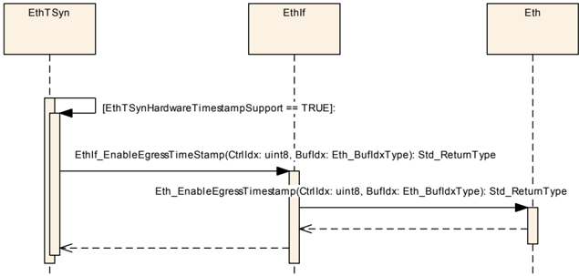

### 8.2. 时间同步序列

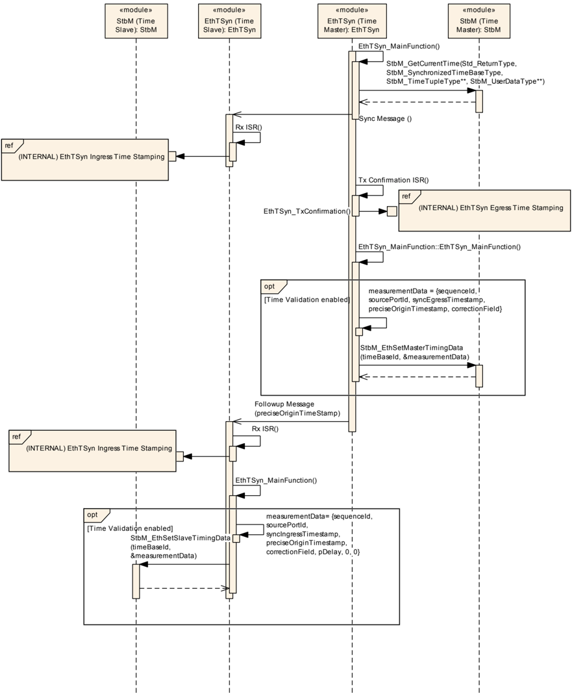

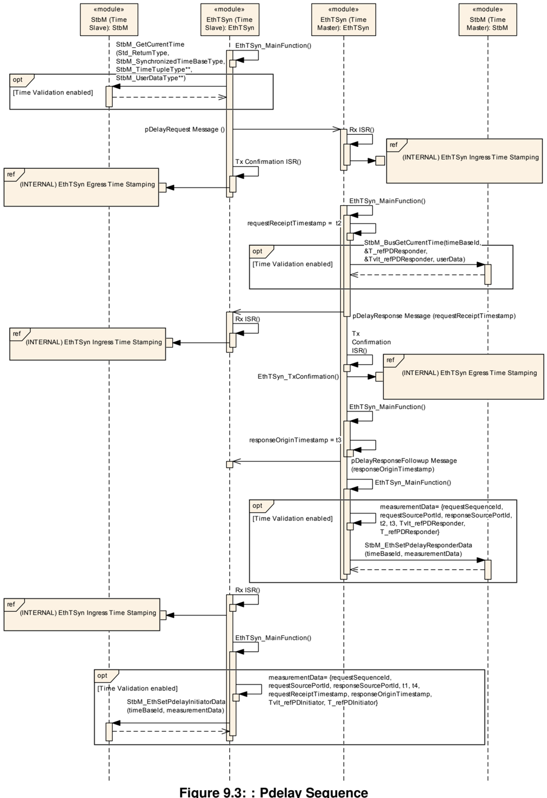

### 8.3. Pdelay 测量序列

（见源文档图 9.3——该图的图在 markdown 转换中未保留，图 9-3 由图 9-4/9-5/9-6 的 Pdelay 部分共同覆盖。）

### 8.4. EthTSyn 出口时间戳

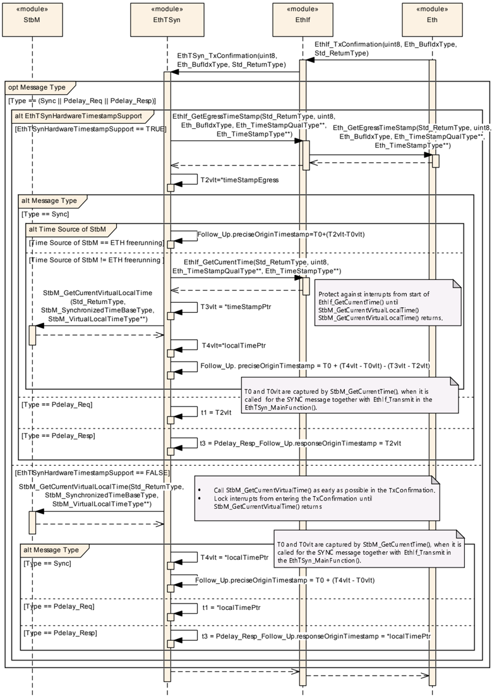

### 8.5. EthTSyn 入口时间戳

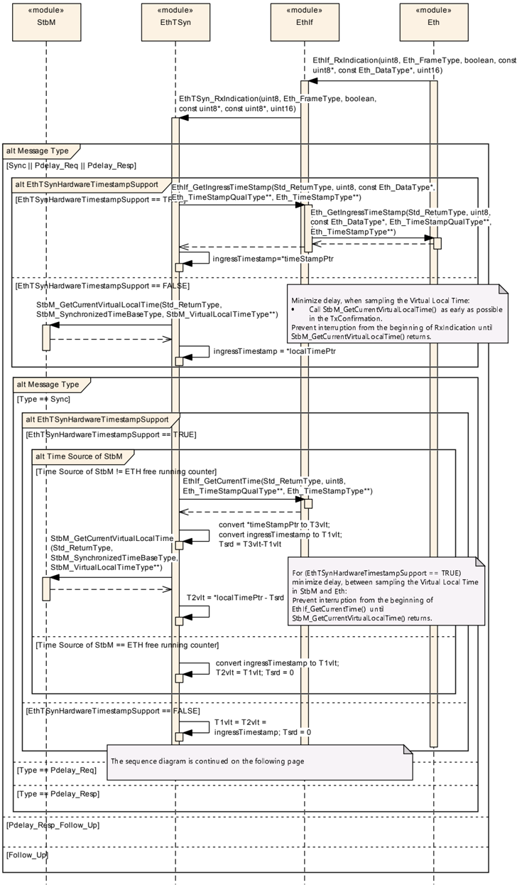

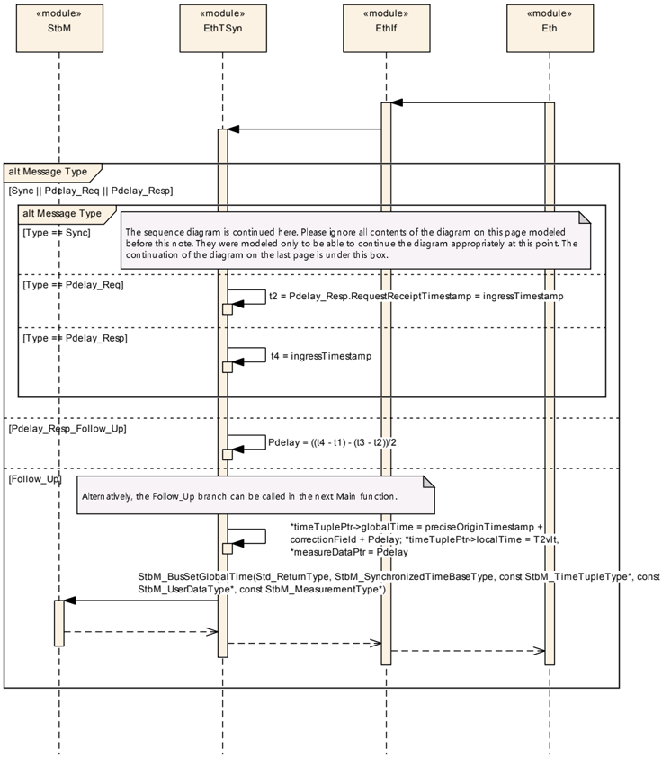

### 8.6. 使用交换机的时间测量

#### 8.6.1. 以 GTM 作为管理 CPU 的时间感知桥接 - 发送

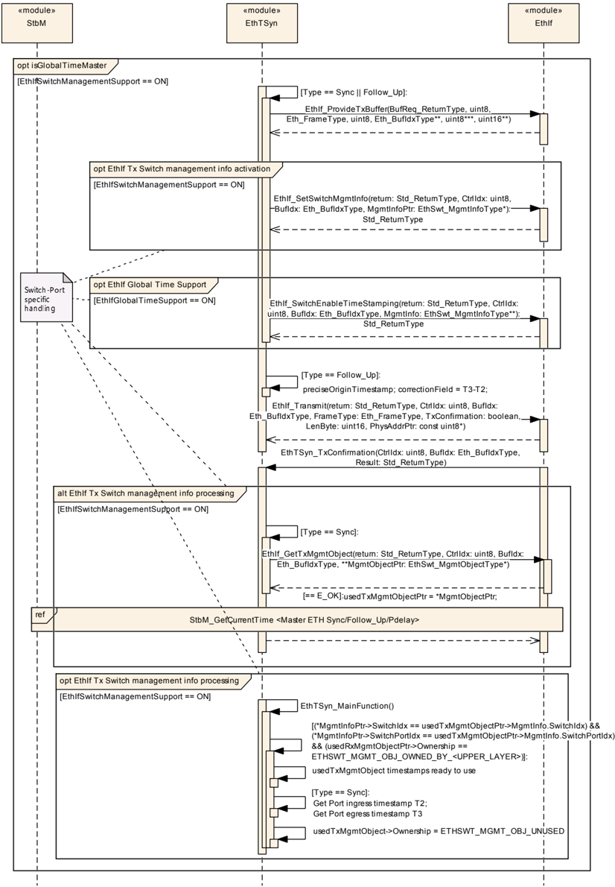

#### 8.6.2. 不使用 GTM 作为管理 CPU 的时间感知桥接 - 发送

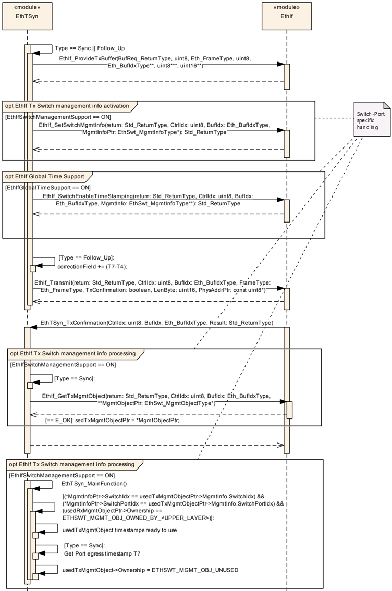

#### 8.6.3. 不使用 GTM 作为管理 CPU 的时间感知桥接 - 接收

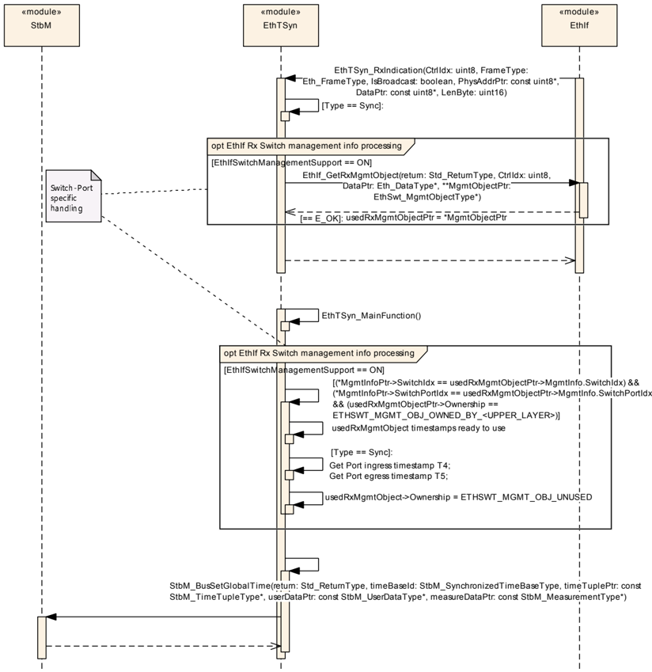

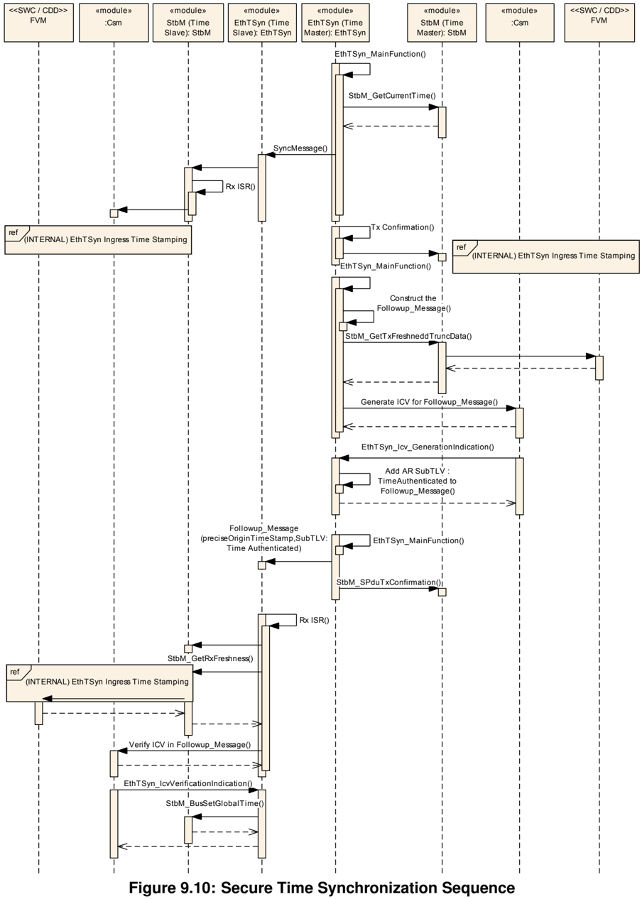

### 8.7. 安全时间同步序列

（见源文档第 9.7 节——正文仅为指向安全时间同步序列的指引，无独立内容。）

## 9. 配置规范

通常，本章定义配置参数及其到容器的聚集。为支持该规范，第 9.1 节描述基本原理。它还规定了应用于参数规范的模板（表）。我们有意将第 9.1 节保留在规范中，以保证可理解性。

第 9.2 节规定模块 **EthTSyn** 的结构（容器）和参数。

第 9.4 节规定模块 **EthTSyn** 的发布信息。

### 9.1. 如何阅读本章

细节请参阅 [3, **SWS** BSW General] 的第 10.1 章「Introduction to configuration specification」。

**EthTSyn** 模块应支持时基主节点、时基从节点和时间网关的配置。

### 9.2. 容器与配置参数

以下各节汇总 **Ethernet** 全局时间同步的所有配置参数。第 6 章和第 7 章描述参数的详细含义。

本模块支持不同的 post-build 变体（此前称为 post-build 可选配置集），但不支持 post-build 可加载配置。

#### 9.2.1. EthTSyn

| SWS 条目 | [ECUC_EthTSyn_00001] |
|---|---|
| 模块名称 | EthTSyn |
| 描述 | 关于 **Ethernet** 上全局时间处理的同步时基管理器（**StbM**）模块的配置。 |
| Post-Build 变体支持 | true |
| 支持的配置变体 | VARIANT-PRE-COMPILE |

| 容器名称 | 多重性 | 作用域/依赖 |
|---|---|---|
| EthTSynGeneral | 1 | 此容器保存 **Ethernet** 特定的同步时基管理器的通用参数 |
| EthTSynGlobalTimeDomain | 1..* | 这表示 **Ethernet** 上全局时间域的存在。**EthTSyn** 模块可以同时管理多个全局时间域，它们自身构成域和子域的层次结构。如果存在 **EthTSyn**，则假设至少存在一个全局时间域。 |

#### 9.2.2. EthTSynGeneral

| SWS 条目 | [ECUC_EthTSyn_00003] |
|---|---|
| 容器名称 | EthTSynGeneral |
| 父容器 | EthTSyn |
| 描述 | 此容器保存 **Ethernet** 特定的同步时基管理器的通用参数 |
| 配置参数 | 见下方参数表 |

| SWS 条目 | [ECUC_EthTSyn_00058] |
|---|---|
| 参数名称 | EthTSynDestPhyAddr |
| 父容器 | EthTSynGeneral |
| 描述 | 目的物理地址（**MAC** 地址）。EthTSyn-gPTP 帧的目的物理硬件地址（**MAC** 地址）。输入格式必须符合 xx:xx:xx:xx:xx:xx，其中 x 代表 0 到 F 之间的十六进制值。 |
| 多重性 | 1 |
| 类型 | EcucStringParamDef |
| 默认值 | 01:80:C2:00:00:0E |
| 正则表达式 | - |
| Post-Build 变体值 | false |
| 值配置类 | Pre-compile time：X（所有变体）；Link time：-；Post-build time：- |
| 作用域/依赖 | scope: local |

| SWS 条目 | [ECUC_EthTSyn_00002] |
|---|---|
| 参数名称 | EthTSynDevErrorDetect |
| 父容器 | EthTSynGeneral |
| 描述 | 开启或关闭开发错误检测与通知（true：启用检测与通知；false：禁用检测与通知）。 |
| 多重性 | 1 |
| 类型 | EcucBooleanParamDef |
| 默认值 | false |
| Post-Build 变体值 | false |
| 值配置类 | Pre-compile time：X（所有变体）；Link time：-；Post-build time：- |
| 作用域/依赖 | scope: local |

| SWS 条目 | [ECUC_EthTSyn_00089] |
|---|---|
| 参数名称 | EthTSynEnableSecurityEventReporting |
| 父容器 | EthTSynGeneral |
| 描述 | 开启或关闭向 **IdsM** 的安全事件报告：true：启用报告；false：禁用报告。 |
| 多重性 | 1 |
| 类型 | EcucBooleanParamDef |
| 默认值 | false |
| Post-Build 变体值 | false |
| 值配置类 | Pre-compile time：X（所有变体）；Link time：-；Post-build time：- |
| 作用域/依赖 | scope: local |

| SWS 条目 | [ECUC_EthTSyn_00060] |
|---|---|
| 参数名称 | EthTSynGlobalTimeRxToUplinkSwitchResidenceTime |
| 父容器 | EthTSynGeneral |
| 描述 | 该参数规定用于以太网交换机驻留时间 [Ingress to Uplink] 的默认值。如果驻留时间的计算失败，**EthTSyn** 使用该值。单位：秒。 |
| 多重性 | 0..1 |
| 类型 | EcucFloatParamDef |
| 取值范围 | [0 .. 4[ |
| 默认值 | 0 |
| Post-Build 变体多重性 | false |
| Post-Build 变体值 | false |
| 多重性配置类 | Pre-compile time：X；Link time：-；Post-build time：- |
| 值配置类 | Pre-compile time：X；Link time：-；Post-build time：- |
| 作用域/依赖 | scope: local |

| SWS 条目 | [ECUC_EthTSyn_00061] |
|---|---|
| 参数名称 | EthTSynGlobalTimeUplinkToTxSwitchResidenceTime |
| 父容器 | EthTSynGeneral |
| 描述 | 该参数规定用于以太网交换机驻留时间 [Uplink to Egress] 的默认值。如果驻留时间的计算失败，**EthTSyn** 使用该值。单位：秒。 |
| 多重性 | 0..1 |
| 类型 | EcucFloatParamDef |
| 取值范围 | [0 .. 4[ |
| 默认值 | 0 |
| Post-Build 变体多重性 | false |
| Post-Build 变体值 | false |
| 多重性配置类 | Pre-compile time：X；Link time：-；Post-build time：- |
| 值配置类 | Pre-compile time：X；Link time：-；Post-build time：- |
| 作用域/依赖 | scope: local |

| SWS 条目 | [ECUC_EthTSyn_00018] |
|---|---|
| 参数名称 | EthTSynHardwareTimestampSupport |
| 父容器 | EthTSynGeneral |
| 描述 | 激活/停用以太网硬件的硬件时间戳功能。True：时间戳从以太网硬件获取；False：时间戳从 **StbM** 获取。 |
| 多重性 | 1 |
| 类型 | EcucBooleanParamDef |
| 默认值 | - |
| Post-Build 变体值 | false |
| 值配置类 | Pre-compile time：X（所有变体）；Link time：-；Post-build time：- |
| 作用域/依赖 | scope: local |

| SWS 条目 | [ECUC_EthTSyn_00012] |
|---|---|
| 参数名称 | EthTSynMainFunctionPeriod |
| 父容器 | EthTSynGeneral |
| 描述 | 主函数 EthTSyn_MainFunction 的调度周期。单位：秒。 |
| 多重性 | 1 |
| 类型 | EcucFloatParamDef |
| 取值范围 | ]0 .. INF[ |
| 默认值 | - |
| Post-Build 变体值 | false |
| 值配置类 | Pre-compile time：X（所有变体）；Link time：-；Post-build time：- |
| 作用域/依赖 | scope: local |

| SWS 条目 | [ECUC_EthTSyn_00075] |
|---|---|
| 参数名称 | EthTSynMasterSlaveConflictDetection |
| 父容器 | EthTSynGeneral |
| 描述 | 启用主/从冲突检测与通知（true：启用检测与通知；false：禁用检测与通知）。 |
| 多重性 | 1 |
| 类型 | EcucBooleanParamDef |
| 默认值 | false |
| Post-Build 变体值 | false |
| 值配置类 | Pre-compile time：X（所有变体）；Link time：-；Post-build time：- |
| 作用域/依赖 | scope: local |

| SWS 条目 | [ECUC_EthTSyn_00029] |
|---|---|
| 参数名称 | EthTSynMessageCompliance |
| 父容器 | EthTSynGeneral |
| 描述 | true：将使用符合 **IEEE 802.1AS** 的报文格式；false：将使用带 **AUTOSAR** 扩展的 **IEEE 802.1AS** 报文格式。 |
| 多重性 | 1 |
| 类型 | EcucBooleanParamDef |
| 默认值 | - |
| Post-Build 变体值 | false |
| 值配置类 | Pre-compile time：X（所有变体）；Link time：-；Post-build time：- |
| 作用域/依赖 | scope: local |

| SWS 条目 | [ECUC_EthTSyn_00059] |
|---|---|
| 参数名称 | EthTSynSwitchMgmtRxMessageBufferCount |
| 父容器 | EthTSynGeneral |
| 描述 | 当 **EthTSyn** 用于网桥（Bridge）配置时，该参数用于确定 **EthTSyn** 中可用的 RX 报文缓冲区的数量。 |
| 多重性 | 0..1 |
| 类型 | EcucIntegerParamDef |
| 取值范围 | 1 .. 254 |
| 默认值 | 10 |
| Post-Build 变体多重性 | false |
| Post-Build 变体值 | false |
| 多重性配置类 | Pre-compile time：X；Link time：-；Post-build time：- |
| 值配置类 | Pre-compile time：X；Link time：-；Post-build time：- |
| 作用域/依赖 | scope: local |

| SWS 条目 | [ECUC_EthTSyn_00081] |
|---|---|
| 参数名称 | EthTSynTimeValidationSupport |
| 父容器 | EthTSynGeneral |
| 描述 | 开启或关闭时间验证支持（true：启用时间验证；false：禁用时间验证）。 |
| 多重性 | 1 |
| 类型 | EcucBooleanParamDef |
| 默认值 | false |
| Post-Build 变体值 | false |
| 值配置类 | Pre-compile time：X（所有变体）；Link time：-；Post-build time：- |
| 作用域/依赖 | scope: local |

| SWS 条目 | [ECUC_EthTSyn_00015] |
|---|---|
| 参数名称 | EthTSynVersionInfoApi |
| 父容器 | EthTSynGeneral |
| 描述 | 激活/停用版本信息 **API**（EthTSyn_GetVersionInfo）。True：版本信息 **API** 激活；False：版本信息 **API** 停用。 |
| 多重性 | 1 |
| 类型 | EcucBooleanParamDef |
| 默认值 | false |
| Post-Build 变体值 | false |
| 值配置类 | Pre-compile time：X（所有变体）；Link time：-；Post-build time：- |
| 作用域/依赖 | scope: local |

| SWS 条目 | [ECUC_EthTSyn_00062] |
|---|---|
| 参数名称 | EthTSynEthIfFrameType |
| 父容器 | EthTSynGeneral |
| 描述 | 所选的帧所有者决定接收哪些帧（就 ethertype 而言）。 |
| 多重性 | 1 |
| 类型 | Reference to EthIfFrameOwnerConfig |
| Post-Build 变体值 | false |
| 值配置类 | Pre-compile time：X（所有变体）；Link time：-；Post-build time：- |
| 作用域/依赖 | scope: local |

| 容器名称 | 多重性 | 作用域/依赖 |
|---|---|---|
| EthTSynSecurityEventRefs | 0..1 | 容器，包含到 IdsMEvent 元素的引用，这些元素表示当相应安全相关事件发生时（且若 EthTSynEnableSecurityEventReporting 设为 "true"），**EthTSyn** 模块应向 **IdsM** 报告的安全事件。此容器中的标准化安全事件可以由供应商特定的安全事件扩展。 |

#### 9.2.3. EthTSynSecurityEventRefs

| SWS 条目 | [ECUC_EthTSyn_00090] |
|---|---|
| 容器名称 | EthTSynSecurityEventRefs |
| 父容器 | EthTSynGeneral |
| 描述 | 容器，包含到 IdsMEvent 元素的引用，这些元素表示当相应安全相关事件发生时（且若 EthTSynEnableSecurityEventReporting 设为 "true"），**EthTSyn** 模块应向 **IdsM** 报告的安全事件。此容器中的标准化安全事件可以由供应商特定的安全事件扩展。 |
| Post-Build 变体多重性 | false |
| 多重性配置类 | Pre-compile time：X（所有变体）；Link time：-；Post-build time：- |
| 配置参数 | 见下方参数表 |

| SWS 条目 | [ECUC_EthTSyn_00093] |
|---|---|
| 参数名称 | SEV_TSYN_ETH_FRESHNESS_NOT_AVAILABLE |
| 父容器 | EthTSynSecurityEventRefs |
| 描述 | **FVM** 无可用 **FV**。上下文数据提供相应的时间域 ID。 |
| 多重性 | 0..1 |
| 类型 | Symbolic name reference to IdsMEvent |
| Post-Build 变体多重性 | false |
| Post-Build 变体值 | false |
| 多重性配置类 | Pre-compile time：X；Link time：-；Post-build time：- |
| 值配置类 | Pre-compile time：X；Link time：-；Post-build time：- |
| 作用域/依赖 | scope: local |

| SWS 条目 | [ECUC_EthTSyn_00091] |
|---|---|
| 参数名称 | SEV_TSYN_ETH_ICV_GENERATION_FAILED |
| 父容器 | EthTSynSecurityEventRefs |
| 描述 | Follow_Up 报文的 **ICV** 生成失败。上下文数据提供相应的时间域 ID。 |
| 多重性 | 0..1 |
| 类型 | Symbolic name reference to IdsMEvent |
| Post-Build 变体多重性 | false |
| Post-Build 变体值 | false |
| 多重性配置类 | Pre-compile time：X（所有变体）；Link time：-；Post-build time：- |
| 值配置类 | Pre-compile time：X（所有变体）；Link time：-；Post-build time：- |
| 作用域/依赖 | scope: local |

| SWS 条目 | [ECUC_EthTSyn_00092] |
|---|---|
| 参数名称 | SEV_TSYN_ETH_ICV_VERIFICATION_FAILED |
| 父容器 | EthTSynSecurityEventRefs |
| 描述 | Follow_Up 报文的 **ICV** 验证失败。上下文数据提供相应的时间域 ID。 |
| 多重性 | 0..1 |
| 类型 | Symbolic name reference to IdsMEvent |
| Post-Build 变体多重性 | false |
| Post-Build 变体值 | false |
| 多重性配置类 | Pre-compile time：X；Link time：-；Post-build time：- |
| 值配置类 | Pre-compile time：X；Link time：-；Post-build time：- |
| 作用域/依赖 | scope: local |

| SWS 条目 | [ECUC_EthTSyn_00114] |
|---|---|
| 参数名称 | SEV_TSYN_ETH_SYNC_FUP_SEQUENCE_ERROR |
| 父容器 | EthTSynSecurityEventRefs |
| 描述 | 在（EthTSynGlobalTimeFollowUpTimeout）内未能从时基主节点接收到正确的 **SYNC** 和 **Follow_Up** 序列。 |
| 多重性 | 0..1 |
| 类型 | Symbolic name reference to IdsMEvent |
| Post-Build 变体多重性 | false |
| Post-Build 变体值 | false |
| 多重性配置类 | Pre-compile time：X；Link time：-；Post-build time：- |
| 值配置类 | Pre-compile time：X；Link time：-；Post-build time：- |
| 作用域/依赖 | scope: local |

无包含的容器。

#### 9.2.4. EthTSynGlobalTimeDomain

| SWS 条目 | [ECUC_EthTSyn_00004] |
|---|---|
| 容器名称 | EthTSynGlobalTimeDomain |
| 父容器 | EthTSyn |
| 描述 | 这表示 **Ethernet** 上全局时间域的存在。**EthTSyn** 模块可以同时管理多个全局时间域，它们自身构成域和子域的层次结构。如果存在 **EthTSyn**，则假设至少存在一个全局时间域。 |
| 配置参数 | 见下方参数表 |

| SWS 条目 | [ECUC_EthTSyn_00034] |
|---|---|
| 参数名称 | EthTSynFramePrio |
| 父容器 | EthTSynGlobalTimeDomain |
| 描述 | 该可选参数（如存在）表示当经 **VLAN** 发送时的发出 EthTSyn 报文的优先级（用于 **VLAN** 标签的 3 位 PCP 字段）。如果该可选参数不存在，帧发送时不带优先级和 **VLAN** 字段。 |
| 多重性 | 0..1 |
| 类型 | EcucIntegerParamDef |
| 取值范围 | 0 .. 7 |
| 默认值 | - |
| Post-Build 变体多重性 | true |
| Post-Build 变体值 | true |
| 多重性配置类 | Pre-compile time：X（所有变体）；Link time：-；Post-build time：- |
| 值配置类 | Pre-compile time：X（所有变体）；Link time：-；Post-build time：- |
| 作用域/依赖 | scope: local |

| SWS 条目 | [ECUC_EthTSyn_00048] |
|---|---|
| 参数名称 | EthTSynGlobalTimeDebounceTime |
| 父容器 | EthTSynGlobalTimeDomain |
| 描述 | 表示与之前具有相同 **PDU** 的报文相比，**Sync**、**Follow_Up** 和 pDelay 报文的 **TX** 去抖时间的配置。单位：秒。 |
| 多重性 | 0..1 |
| 类型 | EcucFloatParamDef |
| 取值范围 | [0 .. 4] |
| 默认值 | - |
| Post-Build 变体值 | true |
| 值配置类 | Pre-compile time：X（所有变体）；Link time：-；Post-build time：- |
| 作用域/依赖 | scope: local |

| SWS 条目 | [ECUC_EthTSyn_00005] |
|---|---|
| 参数名称 | EthTSynGlobalTimeDomainId |
| 父容器 | EthTSynGlobalTimeDomain |
| 描述 | 全局时间域 ID。 |
| 多重性 | 1 |
| 类型 | EcucIntegerParamDef |
| 取值范围 | 0 .. 127 |
| 默认值 | - |
| Post-Build 变体值 | false |
| 值配置类 | Pre-compile time：X（所有变体）；Link time：-；Post-build time：- |
| 作用域/依赖 | scope: local |

| SWS 条目 | [ECUC_EthTSyn_00094] |
|---|---|
| 参数名称 | EthTSynGlobalTimeRxDebounceTime |
| 父容器 | EthTSynGlobalTimeDomain |
| 描述 | 表示 **Sync** 和 **Follow_Up** 的 **RX** 去抖时间的配置。单位：秒。 |
| 多重性 | 0..1 |
| 类型 | EcucFloatParamDef |
| 取值范围 | [0 .. 4] |
| 默认值 | - |
| Post-Build 变体多重性 | false |
| Post-Build 变体值 | true |
| 多重性配置类 | Pre-compile time：X（所有变体）；Link time：-；Post-build time：- |
| 值配置类 | Pre-compile time：X（所有变体）；Link time：-；Post-build time：- |
| 作用域/依赖 | scope: local |

| SWS 条目 | [ECUC_EthTSyn_00119] |
|---|---|
| 参数名称 | EthTSynClkUnitRef |
| 父容器 | EthTSynGlobalTimeDomain |
| 描述 | 对以太网控制器中硬件时钟单元的引用。 |
| 多重性 | 0..1 |
| 类型 | Symbolic name reference to EthIfClkUnit |
| Post-Build 变体多重性 | false |
| Post-Build 变体值 | false |
| 多重性配置类 | Pre-compile time：X（所有变体）；Link time：-；Post-build time：- |
| 值配置类 | Pre-compile time：X（所有变体）；Link time：-；Post-build time：- |
| 作用域/依赖 | scope: ECU |

| SWS 条目 | [ECUC_EthTSyn_00065] |
|---|---|
| 参数名称 | EthTSynGlobalTimeEthIfRef |
| 父容器 | EthTSynGlobalTimeDomain |
| 描述 | 表示对用于获取全局时间信息的以太网接口的引用。 |
| 多重性 | 0..* |
| 类型 | Symbolic name reference to EthIfController |
| Post-Build 变体值 | false |
| 值配置类 | Pre-compile time：X（所有变体）；Link time：-；Post-build time：- |
| 作用域/依赖 | scope: local |

| SWS 条目 | [ECUC_EthTSyn_00013] |
|---|---|
| 参数名称 | EthTSynSynchronizedTimeBaseRef |
| 父容器 | EthTSynGlobalTimeDomain |
| 描述 | 对所需同步时基的必需引用。 |
| 多重性 | 1 |
| 类型 | Symbolic name reference to StbMSynchronizedTimeBase |
| Post-Build 变体值 | false |
| 值配置类 | Pre-compile time：X（所有变体）；Link time：-；Post-build time：- |
| 作用域/依赖 | scope: local |

| 容器名称 | 多重性 | 作用域/依赖 |
|---|---|---|
| EthTSynGlobalTimeFollowUpDataIDList | 0..1 | **Follow_Up** 报文的 DataIDList 确保因 **CRC** 计算和报文认证过程而对数据元素的标识。 |
| EthTSynPortConfig | 0..* | 时间域内 EthTSyn 端口的配置。 |
| EthTSynPortRole | 0..1 | 规定 EthTSyn 端口的角色（主或从）。 |

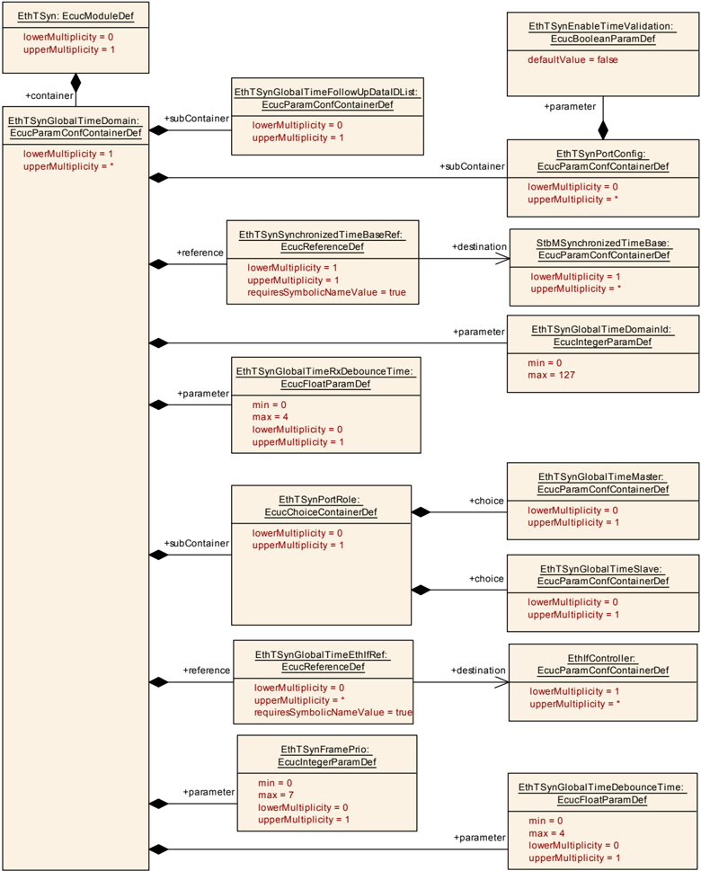

#### 9.2.5. EthTSynGlobalTimeFollowUpDataIDList

| SWS 条目 | [ECUC_EthTSyn_00030] |
|---|---|
| 容器名称 | EthTSynGlobalTimeFollowUpDataIDList |
| 父容器 | EthTSynGlobalTimeDomain |
| 描述 | **Follow_Up** 报文的 DataIDList 确保因 **CRC** 计算和报文认证过程而对数据元素的标识。 |
| Post-Build 变体多重性 | true |
| 多重性配置类 | Pre-compile time：X（所有变体）；Link time：-；Post-build time：- |
| 配置参数 | 无参数 |

| 容器名称 | 多重性 | 作用域/依赖 |
|---|---|---|
| EthTSynGlobalTimeFollowUpDataIDListElement | 16 | **Follow_Up** 报文的 DataIDList 的元素，确保因 **CRC** 计算和报文认证过程而对数据元素的标识。 |

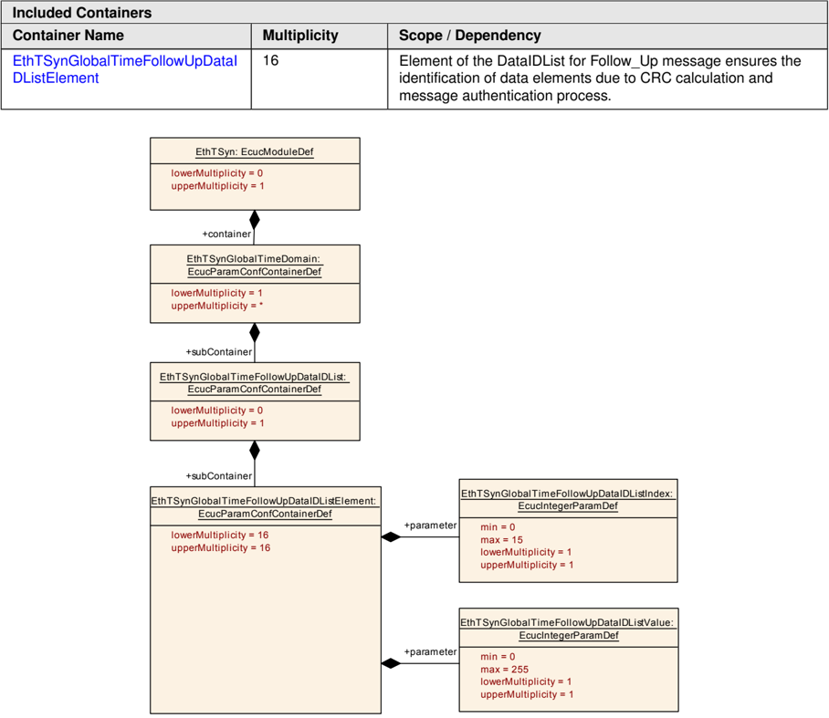

#### 9.2.6. EthTSynGlobalTimeFollowUpDataIDListElement

| SWS 条目 | [ECUC_EthTSyn_00031] |
|---|---|
| 容器名称 | EthTSynGlobalTimeFollowUpDataIDListElement |
| 父容器 | EthTSynGlobalTimeFollowUpDataIDList |
| 描述 | **Follow_Up** 报文的 DataIDList 的元素，确保因 **CRC** 计算和报文认证过程而对数据元素的标识。 |
| 配置参数 | 见下方参数表 |

| SWS 条目 | [ECUC_EthTSyn_00032] |
|---|---|
| 参数名称 | EthTSynGlobalTimeFollowUpDataIDListIndex |
| 父容器 | EthTSynGlobalTimeFollowUpDataIDListElement |
| 描述 | **Follow_Up** 报文的 DataIDList 的索引，确保因 **CRC** 计算和报文认证过程而对数据元素的标识。 |
| 多重性 | 1 |
| 类型 | EcucIntegerParamDef |
| 取值范围 | 0 .. 15 |
| 默认值 | - |
| Post-Build 变体值 | true |
| 值配置类 | Pre-compile time：X（所有变体）；Link time：-；Post-build time：- |
| 作用域/依赖 | scope: local |

| SWS 条目 | [ECUC_EthTSyn_00033] |
|---|---|
| 参数名称 | EthTSynGlobalTimeFollowUpDataIDListValue |
| 父容器 | EthTSynGlobalTimeFollowUpDataIDListElement |
| 描述 | **Follow_Up** 报文的 DataIDList 的值，确保因 **CRC** 计算和报文认证过程而对数据元素的标识。 |
| 多重性 | 1 |
| 类型 | EcucIntegerParamDef |
| 取值范围 | 0 .. 255 |
| 默认值 | - |
| Post-Build 变体值 | true |
| 值配置类 | Pre-compile time：X（所有变体）；Link time：-；Post-build time：- |
| 作用域/依赖 | scope: local |

无包含的容器。

#### 9.2.7. EthTSynPortConfig

| SWS 条目 | [ECUC_EthTSyn_00063] |
|---|---|
| 容器名称 | EthTSynPortConfig |
| 父容器 | EthTSynGlobalTimeDomain |
| 描述 | 时间域内 EthTSyn 端口的配置。 |
| Post-Build 变体多重性 | true |
| 多重性配置类 | Pre-compile time：X（所有变体）；Link time：-；Post-build time：- |
| 配置参数 | 见下方参数表 |

| SWS 条目 | [ECUC_EthTSyn_00082] |
|---|---|
| 参数名称 | EthTSynEnableTimeValidation |
| 父容器 | EthTSynPortConfig |
| 描述 | 为特定时间域启用/禁用用于时间验证的时间记录。 |
| 多重性 | 1 |
| 类型 | EcucBooleanParamDef |
| 默认值 | false |
| Post-Build 变体值 | false |
| 值配置类 | Pre-compile time：X（所有变体）；Link time：-；Post-build time：- |
| 作用域/依赖 | scope: local |

| SWS 条目 | [ECUC_EthTSyn_00116] |
|---|---|
| 参数名称 | EthTSynGlobalTimePortRole |
| 父容器 | EthTSynPortConfig |
| 描述 | 将端口行为设为时基从节点、时基主节点或动态（运行时的时基从节点或时基主节点）的参数。取值：DYNAMIC、TIME_MASTER、TIME_SLAVE。 |
| 多重性 | 0..1 |
| 类型 | EcucEnumerationParamDef |
| 默认值 | DYNAMIC |
| Post-Build 变体多重性 | false |
| Post-Build 变体值 | true |
| 值配置类 | Pre-compile time：X（所有变体）；Link time：-；Post-build time：- |
| 作用域/依赖 | scope: local |

| SWS 条目 | [ECUC_EthTSyn_00010] |
|---|---|
| 参数名称 | EthTSynGlobalTimeTxPeriod |
| 父容器 | EthTSynPortConfig |
| 描述 | 表示 **TX** 周期的配置。单位：秒。 |
| 多重性 | 0..1 |
| 类型 | EcucFloatParamDef |
| 取值范围 | [0 .. INF[ |
| 默认值 | - |
| Post-Build 变体值 | true |
| 值配置类 | Pre-compile time：X（所有变体）；Link time：-；Post-build time：- |
| 作用域/依赖 | scope: local |

| SWS 条目 | [ECUC_EthTSyn_00066] |
|---|---|
| 参数名称 | EthTSynSwitchManagementEthSwitchPortRef |
| 父容器 | EthTSynPortConfig |
| 描述 | 在 AVB 网桥配置中，该引用用于将 EthTSyn 端口分配给以太网交换机端口。 |
| 多重性 | 0..1 |
| 类型 | Symbolic name reference to EthSwtPort |
| Post-Build 变体多重性 | false |
| Post-Build 变体值 | false |
| 多重性配置类 | Pre-compile time：所有变体；Link time：-；Post-build time：- |
| 值配置类 | Pre-compile time：所有变体；Link time：-；Post-build time：- |
| 作用域/依赖 | scope: local |

| 容器名称 | 多重性 | 作用域/依赖 |
|---|---|---|
| EthTSynGlobalTimeRxIcvVerification | 0..1 | 此容器收集应用于 **ICV** 验证的配置。 |
| EthTSynGlobalTimeTxIcvGeneration | 0..1 | 此容器收集应用于 **ICV** 生成的配置。 |
| EthTSynPdelayConfig | 1 | 周期性传播延迟测量的配置。 |

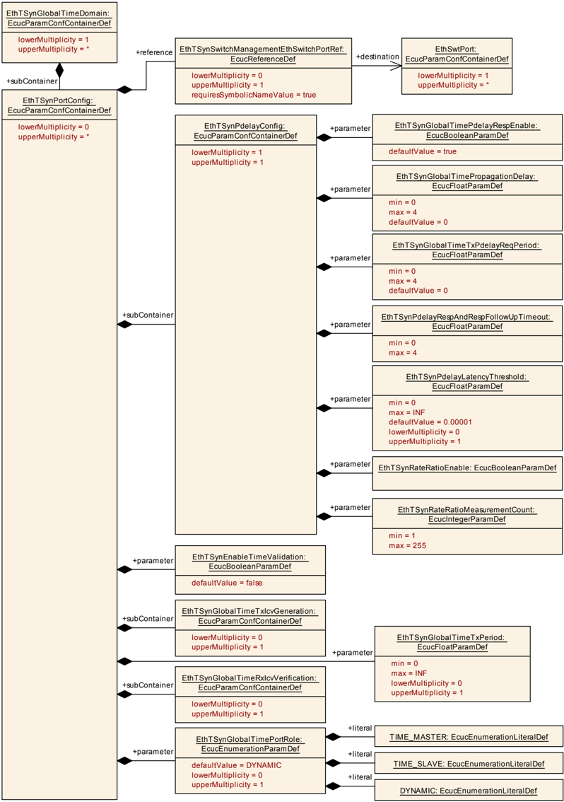

#### 9.2.8. EthTSynGlobalTimeTxIcvGeneration

| SWS 条目 | [ECUC_EthTSyn_00096] |
|---|---|
| 容器名称 | EthTSynGlobalTimeTxIcvGeneration |
| 父容器 | EthTSynPortConfig |
| 描述 | 此容器收集应用于 **ICV** 生成的配置。 |
| Post-Build 变体多重性 | false |
| 多重性配置类 | Pre-compile time：X（所有变体）；Link time：-；Post-build time：- |
| 配置参数 | 见下方参数表 |

| SWS 条目 | [ECUC_EthTSyn_00098] |
|---|---|
| 参数名称 | EthTSynIcvGenerationBase |
| 父容器 | EthTSynGlobalTimeTxIcvGeneration |
| 描述 | 用于 **ICV** 生成的对称或非对称密码学选择。取值：ICV_MAC（用于 **ICV** 生成的对称密码学选择）；ICV_SIGNATURE（用于 **ICV** 生成的非对称密码学选择）。 |
| 多重性 | 1 |
| 类型 | EcucEnumerationParamDef |
| Post-Build 变体值 | false |
| 值配置类 | Pre-compile time：X（所有变体）；Link time：-；Post-build time：- |
| 作用域/依赖 | scope: local |

| SWS 条目 | [ECUC_EthTSyn_00101] |
|---|---|
| 参数名称 | EthTSynIcvGenerationTimeout |
| 父容器 | EthTSynGlobalTimeTxIcvGeneration |
| 描述 | **ICV** 生成的超时（在异步行为下相应 **CSM** 任务的完成）。值 0 禁用 **ICV** 超时监视。单位：秒。 |
| 多重性 | 1 |
| 类型 | EcucFloatParamDef |
| 取值范围 | [0 .. INF[ |
| 默认值 | - |
| Post-Build 变体值 | false |
| 值配置类 | Pre-compile time：X（所有变体）；Link time：-；Post-build time：- |
| 作用域/依赖 | scope: local |

| SWS 条目 | [ECUC_EthTSyn_00099] |
|---|---|
| 参数名称 | EthTSynIcvTxLength |
| 父容器 | EthTSynGlobalTimeTxIcvGeneration |
| 描述 | 在总线上于 Follow_Up 报文内发送的 **ICV** 的长度（字节）。 |
| 多重性 | 1 |
| 类型 | EcucIntegerParamDef |
| 取值范围 | 0 .. 1061 |
| 默认值 | - |
| Post-Build 变体值 | false |
| 值配置类 | Pre-compile time：X（所有变体）；Link time：-；Post-build time：- |
| 作用域/依赖 | scope: local |

| SWS 条目 | [ECUC_EthTSyn_00113] |
|---|---|
| 参数名称 | EthTSynTxAuthenticationBuildAttempts |
| 父容器 | EthTSynGlobalTimeTxIcvGeneration |
| 描述 | 该参数规定当某给定 Follow_Up 报文的 **ICV** 生成失败时应执行的认证构建尝试次数。如果设为零，则只进行一次 **ICV** 生成尝试。 |
| 多重性 | 1 |
| 类型 | EcucIntegerParamDef |
| 取值范围 | 0 .. 65535 |
| 默认值 | 0 |
| Post-Build 变体值 | false |
| 值配置类 | Pre-compile time：X（所有变体）；Link time：-；Post-build time：- |
| 作用域/依赖 | scope: local |

| SWS 条目 | [ECUC_EthTSyn_00097] |
|---|---|
| 参数名称 | EthTSynIcvGenerationFvIdRef |
| 父容器 | EthTSynGlobalTimeTxIcvGeneration |
| 描述 | 表示对用于生成 **ICV** 的 **FV** 的引用。 |
| 多重性 | 0..1 |
| 类型 | Symbolic name reference to StbMFreshnessValue |
| Post-Build 变体多重性 | false |
| Post-Build 变体值 | false |
| 多重性配置类 | Pre-compile time：X；Link time：-；Post-build time：- |
| 值配置类 | Pre-compile time：X；Link time：-；Post-build time：- |
| 作用域/依赖 | scope: local |

| SWS 条目 | [ECUC_EthTSyn_00100] |
|---|---|
| 参数名称 | EthTSynIcvGenerationJobRef |
| 父容器 | EthTSynGlobalTimeTxIcvGeneration |
| 描述 | 表示对用于获取 **CSM** 任务 ID 的 **CSM** 任务的引用。 |
| 多重性 | 1 |
| 类型 | Symbolic name reference to CsmJob |
| Post-Build 变体值 | false |
| 值配置类 | Pre-compile time：X（所有变体）；Link time：-；Post-build time：- |
| 作用域/依赖 | scope: local |

无包含的容器。

#### 9.2.9. EthTSynGlobalTimeRxIcvVerification

| SWS 条目 | [ECUC_EthTSyn_00104] |
|---|---|
| 容器名称 | EthTSynGlobalTimeRxIcvVerification |
| 父容器 | EthTSynPortConfig |
| 描述 | 此容器收集应用于 **ICV** 验证的配置。 |
| Post-Build 变体多重性 | false |
| 多重性配置类 | Pre-compile time：X（所有变体）；Link time：-；Post-build time：- |
| 配置参数 | 见下方参数表 |

| SWS 条目 | [ECUC_EthTSyn_00107] |
|---|---|
| 参数名称 | EthTSynIcvRxLength |
| 父容器 | EthTSynGlobalTimeRxIcvVerification |
| 描述 | 在总线上于 Follow_Up 报文内发送的 **ICV** 的长度（字节）。 |
| 多重性 | 1 |
| 类型 | EcucIntegerParamDef |
| 取值范围 | 0 .. 1061 |
| 默认值 | - |
| Post-Build 变体值 | false |
| 值配置类 | Pre-compile time：X（所有变体）；Link time：-；Post-build time：- |
| 作用域/依赖 | scope: local |

| SWS 条目 | [ECUC_EthTSyn_00110] |
|---|---|
| 参数名称 | EthTSynIcvVerificationAttempts |
| 父容器 | EthTSynGlobalTimeRxIcvVerification |
| 描述 | 该参数规定当某给定受保护 Follow_Up 报文的 **ICV** 验证失败时应执行的 **ICV** 验证尝试次数。如果设为零，则只进行一次 **ICV** 验证尝试。 |
| 多重性 | 1 |
| 类型 | EcucIntegerParamDef |
| 取值范围 | 0 .. 65535 |
| 默认值 | 0 |
| Post-Build 变体值 | false |
| 值配置类 | Pre-compile time：X（所有变体）；Link time：-；Post-build time：- |
| 作用域/依赖 | scope: local |

| SWS 条目 | [ECUC_EthTSyn_00106] |
|---|---|
| 参数名称 | EthTSynIcvVerificationBase |
| 父容器 | EthTSynGlobalTimeRxIcvVerification |
| 描述 | 用于 **ICV** 验证的对称或非对称密码学选择。取值：ICV_MAC（用于 **ICV** 验证的对称密码学选择）；ICV_SIGNATURE（用于 **ICV** 验证的非对称密码学选择）。 |
| 多重性 | 1 |
| 类型 | EcucEnumerationParamDef |
| Post-Build 变体值 | false |
| 值配置类 | Pre-compile time：X（所有变体）；Link time：-；Post-build time：- |
| 作用域/依赖 | scope: local |

| SWS 条目 | [ECUC_EthTSyn_00109] |
|---|---|
| 参数名称 | EthTSynIcvVerificationTimeout |
| 父容器 | EthTSynGlobalTimeRxIcvVerification |
| 描述 | **ICV** 验证的超时（在异步行为下相应 **CSM** 任务的完成）。值 0 禁用 **ICV** 超时监视。单位：秒。 |
| 多重性 | 1 |
| 类型 | EcucFloatParamDef |
| 取值范围 | [0 .. INF[ |
| 默认值 | - |
| Post-Build 变体值 | false |
| 值配置类 | Pre-compile time：X（所有变体）；Link time：-；Post-build time：- |
| 作用域/依赖 | scope: local |

| SWS 条目 | [ECUC_EthTSyn_00112] |
|---|---|
| 参数名称 | EthTSynRxAuthenticationBuildAttempts |
| 父容器 | EthTSynGlobalTimeRxIcvVerification |
| 描述 | 该参数规定当某给定 Follow_Up 报文的 **ICV** 验证失败时应执行的认证构建尝试次数。如果设为零，则只进行一次 **ICV** 验证尝试。 |
| 多重性 | 1 |
| 类型 | EcucIntegerParamDef |
| 取值范围 | 0 .. 65535 |
| 默认值 | 0 |
| Post-Build 变体值 | false |
| 值配置类 | Pre-compile time：X（所有变体）；Link time：-；Post-build time：- |
| 作用域/依赖 | scope: local |

| SWS 条目 | [ECUC_EthTSyn_00105] |
|---|---|
| 参数名称 | EthTSynIcvVerificationFvIdRef |
| 父容器 | EthTSynGlobalTimeRxIcvVerification |
| 描述 | 表示对用于验证 **ICV** 的 **FV** 的引用。 |
| 多重性 | 0..1 |
| 类型 | Symbolic name reference to StbMFreshnessValue |
| Post-Build 变体多重性 | false |
| Post-Build 变体值 | false |
| 多重性配置类 | Pre-compile time：所有变体；Link time：-；Post-build time：- |
| 值配置类 | Pre-compile time：所有变体；Link time：-；Post-build time：- |
| 作用域/依赖 | scope: local |

| SWS 条目 | [ECUC_EthTSyn_00108] |
|---|---|
| 参数名称 | EthTSynIcvVerificationJobRef |
| 父容器 | EthTSynGlobalTimeRxIcvVerification |
| 描述 | 表示对用于获取 **CSM** 任务 ID 的 **CSM** 任务的引用。 |
| 多重性 | 1 |
| 类型 | Symbolic name reference to CsmJob |
| Post-Build 变体值 | false |
| 值配置类 | Pre-compile time：X（所有变体）；Link time：-；Post-build time：- |
| 作用域/依赖 | scope: local |

无包含的容器。

#### 9.2.10. EthTSynPortRole

| SWS 条目 | [ECUC_EthTSyn_00067] |
|---|---|
| 选择容器名称 | EthTSynPortRole |
| 父容器 | EthTSynGlobalTimeDomain |
| 描述 | 规定 EthTSyn 端口的角色（主或从）。 |
| Post-Build 变体多重性 | true |
| 多重性配置类 | Pre-compile time：X（所有变体）；Link time：-；Post-build time：- |

| 容器选择 | 多重性 | 作用域/依赖 |
|---|---|---|
| EthTSynGlobalTimeMaster | 0..1 | （全局）时基主节点的配置。每个时间域要求恰好有一个全局时间主节点，但可以有多个端口充当时间（子）主节点（参见时间网关）以将全局时间从全局时间主节点转发给各时基从节点。全局时间主节点可以存在也可以不存在于所配置的 **ECU** 上。端口的确切角色被隐式推导。 |
| EthTSynGlobalTimeSlave | 0..1 | 时基从节点的配置。每个全局时间域要求至少有一个时基从节点。所配置的 **ECU** 可以是也可以不是时基从节点。 |

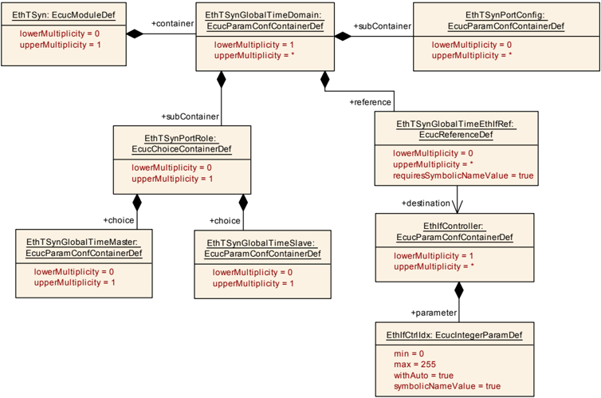

#### 9.2.11. EthTSynPdelayConfig

| SWS 条目 | [ECUC_EthTSyn_00068] |
|---|---|
| 容器名称 | EthTSynPdelayConfig |
| 父容器 | EthTSynPortConfig |
| 描述 | 周期性传播延迟测量的配置。 |
| Post-Build 变体多重性 | true |
| 多重性配置类 | Pre-compile time：X（所有变体）；Link time：-；Post-build time：- |
| 配置参数 | 见下方参数表 |

| SWS 条目 | [ECUC_EthTSyn_00069] |
|---|---|
| 参数名称 | EthTSynGlobalTimePdelayRespEnable |
| 父容器 | EthTSynPdelayConfig |
| 描述 | 该参数允许在不期望 Pdelay_Req 报文时禁用 Pdelay_Resp / Pdelay_Resp_Follow_Up 的发送。FALSE：不期望 Pdelay 请求，禁用 Pdelay_Resp / Pdelay_Resp_Follow_Up 发送；TRUE：期望 Pdelay 请求，启用 Pdelay_Resp / Pdelay_Resp_Follow_Up 发送。 |
| 多重性 | 1 |
| 类型 | EcucBooleanParamDef |
| 默认值 | true |
| Post-Build 变体值 | true |
| 值配置类 | Pre-compile time：X（所有变体）；Link time：-；Post-build time：- |
| 作用域/依赖 | scope: local |

| SWS 条目 | [ECUC_EthTSyn_00070] |
|---|---|
| 参数名称 | EthTSynGlobalTimePropagationDelay |
| 父容器 | EthTSynPdelayConfig |
| 描述 | 如果启用了周期性传播延迟测量，该参数表示在实际测得的传播延迟可用之前的传播延迟默认值。如果禁用了周期性传播延迟测量，该参数用固定值替代测得的传播延迟。单位：秒。 |
| 多重性 | 1 |
| 类型 | EcucFloatParamDef |
| 取值范围 | [0 .. 4] |
| 默认值 | 0 |
| Post-Build 变体值 | true |
| 值配置类 | Pre-compile time：X（所有变体）；Link time：-；Post-build time：- |
| 作用域/依赖 | scope: local |

| SWS 条目 | [ECUC_EthTSyn_00071] |
|---|---|
| 参数名称 | EthTSynGlobalTimeTxPdelayReqPeriod |
| 父容器 | EthTSynPdelayConfig |
| 描述 | 表示 Pdelay_Req 报文 **TX** 周期的配置。值 0 禁用周期性 **Pdelay** 测量。单位：秒。 |
| 多重性 | 1 |
| 类型 | EcucFloatParamDef |
| 取值范围 | [0 .. 4] |
| 默认值 | 0 |
| Post-Build 变体值 | true |
| 值配置类 | Pre-compile time：X（所有变体）；Link time：-；Post-build time：- |
| 作用域/依赖 | scope: local |

| SWS 条目 | [ECUC_EthTSyn_00076] |
|---|---|
| 参数名称 | EthTSynPdelayLatencyThreshold |
| 父容器 | EthTSynPdelayConfig |
| 描述 | 计算出的 **Pdelay** 的阈值。如果测得的 **Pdelay** 超过 EthTSynPdelayLatencyThreshold，该值被丢弃。单位：秒。 |
| 多重性 | 0..1 |
| 类型 | EcucFloatParamDef |
| 取值范围 | ]0 .. INF[ |
| 默认值 | 1E-5 |
| Post-Build 变体值 | true |
| 值配置类 | Pre-compile time：X（所有变体）；Link time：-；Post-build time：- |
| 作用域/依赖 | scope: local |

| SWS 条目 | [ECUC_EthTSyn_00074] |
|---|---|
| 参数名称 | EthTSynPdelayRespAndRespFollowUpTimeout |
| 父容器 | EthTSynPdelayConfig |
| 描述 | 在已发送 Pdelay_Req（或已接收到 Pdelay_Resp）之后，Pdelay_Resp 和 Pdelay_Resp_Follow_Up 的超时值。值 0 停用该超时观察。单位：秒。 |
| 多重性 | 1 |
| 类型 | EcucFloatParamDef |
| 取值范围 | [0 .. 4] |
| 默认值 | - |
| Post-Build 变体值 | true |
| 值配置类 | Pre-compile time：X（所有变体）；Link time：-；Post-build time：- |
| 作用域/依赖 | scope: local |

| SWS 条目 | [ECUC_EthTSyn_00118] |
|---|---|
| 参数名称 | EthTSynRateRatioEnable |
| 父容器 | EthTSynPdelayConfig |
| 描述 | 按照 **IEEE 802.1AS** 启用/禁用邻速率比（neighbor rate ratio）计算。 |
| 多重性 | 1 |
| 类型 | EcucBooleanParamDef |
| 默认值 | - |
| Post-Build 变体值 | true |
| 值配置类 | Pre-compile time：X（所有变体）；Link time：-；Post-build time：- |
| 作用域/依赖 | scope: ECU |

| SWS 条目 | [ECUC_EthTSyn_00117] |
|---|---|
| 参数名称 | EthTSynRateRatioMeasurementCount |
| 父容器 | EthTSynPdelayConfig |
| 描述 | 该参数定义按照 **IEEE 802.1AS** 计算邻速率比所用的成功 pDelay 测量的次数。 |
| 多重性 | 1 |
| 类型 | EcucIntegerParamDef |
| 取值范围 | 1 .. 255 |
| 默认值 | - |
| Post-Build 变体值 | true |
| 值配置类 | Pre-compile time：X（所有变体）；Link time：-；Post-build time：- |
| 作用域/依赖 | scope: local |

无包含的容器。
#### 9.2.12. EthTSynGlobalTimeMaster

| SWS 条目 | [ECUC_EthTSyn_00008] |
|---|---|
| 容器名称 | EthTSynGlobalTimeMaster |
| 父容器 | EthTSynPortRole |
| 描述 | （全局）时基主节点的配置。每个时间域要求恰好有一个全局时间主节点，但可以有多个端口充当时间（子）主节点（参见时间网关）以将全局时间从全局时间主节点转发给各时基从节点。全局时间主节点可以存在也可以不存在于所配置的 **ECU** 上。端口的确切角色被隐式推导。 |
| Post-Build 变体多重性 | true |
| 多重性配置类 | Pre-compile time：X（所有变体）；Link time：-；Post-build time：- |
| 配置参数 | 见下方参数表 |

| SWS 条目 | [ECUC_EthTSyn_00047] |
|---|---|
| 参数名称 | EthTSynCyclicMsgResumeTime |
| 父容器 | EthTSynGlobalTimeMaster |
| 描述 | 定义在先前的立即发送之后，第一次基于常规周期时间的报文发送发生的时间。单位：秒。 |
| 多重性 | 1 |
| 类型 | EcucFloatParamDef |
| 取值范围 | [0 .. INF[ |
| 默认值 | - |
| Post-Build 变体值 | true |
| 值配置类 | Pre-compile time：X（所有变体）；Link time：-；Post-build time：- |
| 作用域/依赖 | scope: local |

| SWS 条目 | [ECUC_EthTSyn_00039] |
|---|---|
| 参数名称 | EthTSynGlobalTimeTxCrcSecured |
| 父容器 | EthTSynGlobalTimeMaster |
| 描述 | 表示是否支持 **CRC** 的配置。取值：CRC_NOT_SUPPORTED（表示不支持 **CRC** 的配置）；CRC_SUPPORTED（表示支持 **CRC** 的配置）。 |
| 多重性 | 1 |
| 类型 | EcucEnumerationParamDef |
| Post-Build 变体值 | true |
| 值配置类 | Pre-compile time：X（所有变体）；Link time：-；Post-build time：- |
| 作用域/依赖 | scope: local |

| SWS 条目 | [ECUC_EthTSyn_00115] |
|---|---|
| 参数名称 | EthTSynHoldOverTime |
| 父容器 | EthTSynGlobalTimeMaster |
| 描述 | 定义在从端口上未接收到 **Sync** 和 **Follow_Up** 报文的情况下，主端口上 **Sync** 和 **Follow_Up** 报文发送的超时的参数。单位：秒。 |
| 多重性 | 0..1 |
| 类型 | EcucFloatParamDef |
| 取值范围 | [0 .. INF[ |
| 默认值 | 3 |
| Post-Build 变体多重性 | true |
| Post-Build 变体值 | true |
| 多重性配置类 | Pre-compile time：X；Link time：-；Post-build time：- |
| 值配置类 | Pre-compile time：X；Link time：-；Post-build time：- |
| 作用域/依赖 | scope: local |

| SWS 条目 | [ECUC_EthTSyn_00046] |
|---|---|
| 参数名称 | EthTSynImmediateTimeSync |
| 父容器 | EthTSynGlobalTimeMaster |
| 描述 | 启用/禁用在 EthTSyn_MainFunction() 内对 StbM_GetTimeBaseUpdateCounter() 的周期性轮询。 |
| 多重性 | 1 |
| 类型 | EcucBooleanParamDef |
| 默认值 | - |
| Post-Build 变体值 | true |
| 值配置类 | Pre-compile time：X（所有变体）；Link time：-；Post-build time：- |
| 作用域/依赖 | scope: local |

| SWS 条目 | [ECUC_EthTSyn_00095] |
|---|---|
| 参数名称 | EthTSynTLVFollowUpICVSubTLV |
| 父容器 | EthTSynGlobalTimeMaster |
| 描述 | 表示是否使用 **AUTOSAR** Follow_Up **ICV** Sub-TLV 的配置。true：表示使用 **AUTOSAR** Follow_Up **ICV** Sub-TLV 的配置；false：表示不使用 **AUTOSAR** Follow_Up **ICV** Sub-TLV 的配置。 |
| 多重性 | 1 |
| 类型 | EcucBooleanParamDef |
| 默认值 | - |
| Post-Build 变体值 | false |
| 值配置类 | Pre-compile time：X（所有变体）；Link time：-；Post-build time：- |
| 作用域/依赖 | scope: local |

| SWS 条目 | [ECUC_EthTSyn_00038] |
|---|---|
| 参数名称 | EthTSynTxSubTLVOFS |
| 父容器 | EthTSynGlobalTimeMaster |
| 描述 | 定义在 **Follow_Up** 报文的 **AUTOSAR TLV** 中是否应发送 Sub-TLV:OFS Secured 或 Sub-TLV:OFS Not Secured（true/false）。 |
| 多重性 | 1 |
| 类型 | EcucBooleanParamDef |
| 默认值 | - |
| Post-Build 变体值 | true |
| 值配置类 | Pre-compile time：X（所有变体）；Link time：-；Post-build time：- |
| 作用域/依赖 | scope: local |

| SWS 条目 | [ECUC_EthTSyn_00036] |
|---|---|
| 参数名称 | EthTSynTxSubTLVStatus |
| 父容器 | EthTSynGlobalTimeMaster |
| 描述 | 定义在 **Follow_Up** 报文的 **AUTOSAR TLV** 中是否应发送 Sub-TLV:Status Secured 或 Sub-TLV:Status Not Secured（true/false）。 |
| 多重性 | 1 |
| 类型 | EcucBooleanParamDef |
| 默认值 | - |
| Post-Build 变体值 | true |
| 值配置类 | Pre-compile time：X（所有变体）；Link time：-；Post-build time：- |
| 作用域/依赖 | scope: local |

| SWS 条目 | [ECUC_EthTSyn_00035] |
|---|---|
| 参数名称 | EthTSynTxSubTLVTime |
| 父容器 | EthTSynGlobalTimeMaster |
| 描述 | 定义在 **Follow_Up** 报文的 **AUTOSAR TLV** 中是否应发送 Sub-TLV:Time Secured（true/false）。 |
| 多重性 | 1 |
| 类型 | EcucBooleanParamDef |
| 默认值 | - |
| Post-Build 变体值 | true |
| 值配置类 | Pre-compile time：X（所有变体）；Link time：-；Post-build time：- |
| 作用域/依赖 | scope: local |

| SWS 条目 | [ECUC_EthTSyn_00037] |
|---|---|
| 参数名称 | EthTSynTxSubTLVUserData |
| 父容器 | EthTSynGlobalTimeMaster |
| 描述 | 定义在 **Follow_Up** 报文的 **AUTOSAR TLV** 中是否应发送 Sub-TLV:UserData Secured 或 Sub-TLV:UserData Not Secured（true/false）。 |
| 多重性 | 1 |
| 类型 | EcucBooleanParamDef |
| 默认值 | - |
| Post-Build 变体值 | true |
| 值配置类 | Pre-compile time：X（所有变体）；Link time：-；Post-build time：- |
| 作用域/依赖 | scope: local |

| 容器名称 | 多重性 | 作用域/依赖 |
|---|---|---|
| EthTSynCrcTimeFlagsTxSecured | 0..1 | 此容器收集 **Follow_Up** 报文元素中哪些部分应用于 **CRC** 计算的定义。 |

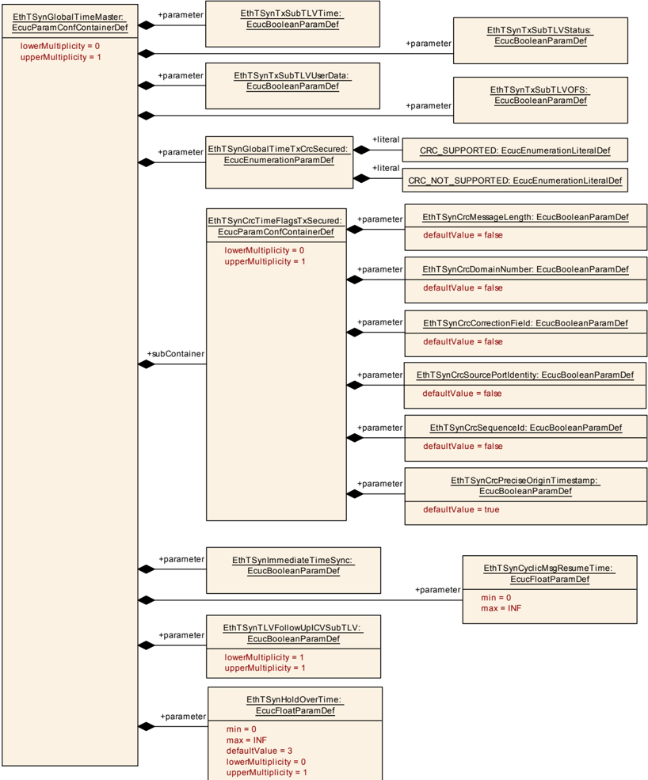

#### 9.2.13. EthTSynCrcTimeFlagsTxSecured

| SWS 条目 | [ECUC_EthTSyn_00057] |
|---|---|
| 容器名称 | EthTSynCrcTimeFlagsTxSecured |
| 父容器 | EthTSynGlobalTimeMaster |
| 描述 | 此容器收集 **Follow_Up** 报文元素中哪些部分应用于 **CRC** 计算的定义。 |
| Post-Build 变体多重性 | true |
| 多重性配置类 | Pre-compile time：X（所有变体）；Link time：-；Post-build time：- |
| 配置参数 | 见下方参数表 |

| SWS 条目 | [ECUC_EthTSyn_00042] |
|---|---|
| 参数名称 | EthTSynCrcCorrectionField |
| 父容器 | EthTSynCrcTimeFlagsTxSecured |
| 描述 | **Follow_Up** 报文头的 correctionField 应包含在 **CRC** 计算中。 |
| 多重性 | 1 |
| 类型 | EcucBooleanParamDef |
| 默认值 | false |
| Post-Build 变体值 | true |
| 值配置类 | Pre-compile time：X（所有变体）；Link time：-；Post-build time：- |
| 作用域/依赖 | scope: local |

| SWS 条目 | [ECUC_EthTSyn_00041] |
|---|---|
| 参数名称 | EthTSynCrcDomainNumber |
| 父容器 | EthTSynCrcTimeFlagsTxSecured |
| 描述 | **Follow_Up** 报文头的 domainNumber 应包含在 **CRC** 计算中。 |
| 多重性 | 1 |
| 类型 | EcucBooleanParamDef |
| 默认值 | false |
| Post-Build 变体值 | true |
| 值配置类 | Pre-compile time：X（所有变体）；Link time：-；Post-build time：- |
| 作用域/依赖 | scope: local |

| SWS 条目 | [ECUC_EthTSyn_00040] |
|---|---|
| 参数名称 | EthTSynCrcMessageLength |
| 父容器 | EthTSynCrcTimeFlagsTxSecured |
| 描述 | **Follow_Up** 报文头的 messageLength 应包含在 **CRC** 计算中。 |
| 多重性 | 1 |
| 类型 | EcucBooleanParamDef |
| 默认值 | false |
| Post-Build 变体值 | true |
| 值配置类 | Pre-compile time：X（所有变体）；Link time：-；Post-build time：- |
| 作用域/依赖 | scope: local |

| SWS 条目 | [ECUC_EthTSyn_00045] |
|---|---|
| 参数名称 | EthTSynCrcPreciseOriginTimestamp |
| 父容器 | EthTSynCrcTimeFlagsTxSecured |
| 描述 | **Follow_Up** 报文字段的 preciseOriginTimestamp 应包含在 **CRC** 计算中。 |
| 多重性 | 1 |
| 类型 | EcucBooleanParamDef |
| 默认值 | true |
| Post-Build 变体值 | true |
| 值配置类 | Pre-compile time：X（所有变体）；Link time：-；Post-build time：- |
| 作用域/依赖 | scope: local |

| SWS 条目 | [ECUC_EthTSyn_00044] |
|---|---|
| 参数名称 | EthTSynCrcSequenceId |
| 父容器 | EthTSynCrcTimeFlagsTxSecured |
| 描述 | **Follow_Up** 报文头的 sequenceId 应包含在 **CRC** 计算中。 |
| 多重性 | 1 |
| 类型 | EcucBooleanParamDef |
| 默认值 | false |
| Post-Build 变体值 | true |
| 值配置类 | Pre-compile time：X（所有变体）；Link time：-；Post-build time：- |
| 作用域/依赖 | scope: local |

| SWS 条目 | [ECUC_EthTSyn_00043] |
|---|---|
| 参数名称 | EthTSynCrcSourcePortIdentity |
| 父容器 | EthTSynCrcTimeFlagsTxSecured |
| 描述 | **Follow_Up** 报文头的 sourcePortIdentity 应包含在 **CRC** 计算中。 |
| 多重性 | 1 |
| 类型 | EcucBooleanParamDef |
| 默认值 | false |
| Post-Build 变体值 | true |
| 值配置类 | Pre-compile time：X（所有变体）；Link time：-；Post-build time：- |
| 作用域/依赖 | scope: local |

无包含的容器。

#### 9.2.14. EthTSynGlobalTimeSlave

| SWS 条目 | [ECUC_EthTSyn_00009] |
|---|---|
| 容器名称 | EthTSynGlobalTimeSlave |
| 父容器 | EthTSynPortRole |
| 描述 | 时基从节点的配置。每个全局时间域要求至少有一个时基从节点。所配置的 **ECU** 可以是也可以不是时基从节点。 |
| Post-Build 变体多重性 | true |
| 多重性配置类 | Pre-compile time：X（所有变体）；Link time：-；Post-build time：- |
| 配置参数 | 见下方参数表 |

| SWS 条目 | [ECUC_EthTSyn_00007] |
|---|---|
| 参数名称 | EthTSynGlobalTimeFollowUpTimeout |
| 父容器 | EthTSynGlobalTimeSlave |
| 描述 | **Follow_Up** 报文（针对后续 **Sync** 报文）的超时值。值 0 停用该超时观察。单位：秒。 |
| 多重性 | 1 |
| 类型 | EcucFloatParamDef |
| 取值范围 | [0 .. 4] |
| 默认值 | - |
| Post-Build 变体值 | true |
| 值配置类 | Pre-compile time：X（所有变体）；Link time：-；Post-build time：- |
| 作用域/依赖 | scope: local |

| SWS 条目 | [ECUC_EthTSyn_00084] |
|---|---|
| 参数名称 | EthTSynGlobalTimeSequenceCounterHysteresis |
| 父容器 | EthTSynGlobalTimeSlave |
| 描述 | EthTSynGlobalTimeSequenceCounterHysteresis 规定时基从节点在超时状态期间、在将时间元组转发给 **StbM** 之前所需的连续有效报文对的数量。 |
| 多重性 | 1 |
| 类型 | EcucIntegerParamDef |
| 取值范围 | 0 .. 15 |
| 默认值 | 0 |
| Post-Build 变体值 | true |
| 值配置类 | Pre-compile time：X（所有变体）；Link time：-；Post-build time：- |
| 作用域/依赖 | scope: local |

| SWS 条目 | [ECUC_EthTSyn_00083] |
|---|---|
| 参数名称 | EthTSynGlobalTimeSequenceCounterJumpWidth |
| 父容器 | EthTSynGlobalTimeSlave |
| 描述 | SequenceCounterJumpWidth 规定两条连续 **Sync** 报文之间序列计数器允许的最大跳变。 |
| 多重性 | 1 |
| 类型 | EcucIntegerParamDef |
| 取值范围 | 0 .. 65535 |
| 默认值 | 0 |
| Post-Build 变体值 | true |
| 值配置类 | Pre-compile time：X（所有变体）；Link time：-；Post-build time：- |
| 作用域/依赖 | scope: local |

| SWS 条目 | [ECUC_EthTSyn_00049] |
|---|---|
| 参数名称 | EthTSynRxCrcValidated |
| 父容器 | EthTSynGlobalTimeSlave |
| 描述 | 定义是否进行 **CRC** 的校验。取值：CRC_IGNORED（**EthTSyn** 忽略 Sub-TLV 内的任何 **CRC**）；CRC_NOT_VALIDATED（如果 EthTSynMessageCompliance 设为 **FALSE**：**EthTSyn** 丢弃带有类型 0x28、0x44、0x50 或 0x60 的 Sub-TLV 的 Follow_Up 报文）；CRC_OPTIONAL（如果 EthTSynMessageCompliance 设为 **FALSE**：**EthTSyn** 丢弃带有类型 0x28、0x44、0x50 或 0x60 的 Sub-TLV 且 **CRC** 值不正确的 Follow_Up 报文）；CRC_VALIDATED（如果 EthTSynMessageCompliance 设为 **FALSE**：**EthTSyn** 丢弃带有类型 0x28、0x44、0x50 或 0x60 的 Sub-TLV 且 **CRC** 值不正确的 Follow_Up 报文，并拒绝带有类型 0x34、0x51 或 0x61 的 Sub-TLV 的 Follow_Up 报文）。 |
| 多重性 | 1 |
| 类型 | EcucEnumerationParamDef |
| Post-Build 变体值 | true |
| 值配置类 | Pre-compile time：X（所有变体）；Link time：-；Post-build time：- |
| 作用域/依赖 | scope: local |

| SWS 条目 | [ECUC_EthTSyn_00103] |
|---|---|
| 参数名称 | EthTSynRxIcvVerificationType |
| 父容器 | EthTSynGlobalTimeSlave |
| 描述 | 该参数控制是否应支持 **ICV** 验证。取值：ICV_IGNORED（Timesync 模块不验证 **ICV**）；ICV_NOT_VERIFIED（Timesync 模块只接受不受 **ICV** 保护的时间同步报文。所有其他时间同步报文被忽略）；ICV_OPTIONAL（Timesync 模块只接受不受 **ICV** 保护的时间同步报文以及受 **ICV** 保护且 **ICV** 正确的时间同步报文。所有其他时间同步报文被忽略）；ICV_VERIFIED（Timesync 模块只接受受 **ICV** 保护且 **ICV** 正确的时间同步报文。所有其他时间同步报文被忽略）。 |
| 多重性 | 1 |
| 类型 | EcucEnumerationParamDef |
| Post-Build 变体值 | false |
| 值配置类 | Pre-compile time：X（所有变体）；Link time：-；Post-build time：- |
| 作用域/依赖 | scope: local |

| SWS 条目 | [ECUC_EthTSyn_00088] |
|---|---|
| 参数名称 | EthTSynRxSubTLVOFS |
| 父容器 | EthTSynGlobalTimeSlave |
| 描述 | 定义在处理接收到的 Follow_Up 报文时，Sub-TLV:OFS Secured 或 Sub-TLV:OFS Not Secured 是否应存在并被评估。 |
| 多重性 | 1 |
| 类型 | EcucBooleanParamDef |
| 默认值 | false |
| Post-Build 变体值 | false |
| 多重性配置类 | Pre-compile time：X；Link time：-；Post-build time：- |
| 值配置类 | Pre-compile time：X；Link time：-；Post-build time：- |
| 作用域/依赖 | scope: local |

| SWS 条目 | [ECUC_EthTSyn_00086] |
|---|---|
| 参数名称 | EthTSynRxSubTLVStatus |
| 父容器 | EthTSynGlobalTimeSlave |
| 描述 | 定义在处理接收到的 Follow_Up 报文时，Sub-TLV:Status Secured 或 Sub-TLV:Status Not Secured 是否应存在并被评估。 |
| 多重性 | 1 |
| 类型 | EcucBooleanParamDef |
| 默认值 | false |
| Post-Build 变体值 | false |
| 多重性配置类 | Pre-compile time：X；Link time：-；Post-build time：- |
| 值配置类 | Pre-compile time：X；Link time：-；Post-build time：- |
| 作用域/依赖 | scope: local |

| SWS 条目 | [ECUC_EthTSyn_00085] |
|---|---|
| 参数名称 | EthTSynRxSubTLVTime |
| 父容器 | EthTSynGlobalTimeSlave |
| 描述 | 定义在处理接收到的 Follow_Up 报文时，Sub-TLV:Time Secured 是否应存在并被评估。 |
| 多重性 | 1 |
| 类型 | EcucBooleanParamDef |
| 默认值 | false |
| Post-Build 变体值 | false |
| 多重性配置类 | Pre-compile time：X；Link time：-；Post-build time：- |
| 值配置类 | Pre-compile time：X；Link time：-；Post-build time：- |
| 作用域/依赖 | scope: local |

| SWS 条目 | [ECUC_EthTSyn_00087] |
|---|---|
| 参数名称 | EthTSynRxSubTLVUserData |
| 父容器 | EthTSynGlobalTimeSlave |
| 描述 | 定义在处理接收到的 Follow_Up 报文时，Sub-TLV:UserData Secured 或 Sub-TLV:UserData Not Secured 是否应存在并被评估。 |
| 多重性 | 1 |
| 类型 | EcucBooleanParamDef |
| 默认值 | false |
| Post-Build 变体值 | false |
| 多重性配置类 | Pre-compile time：所有变体；Link time：-；Post-build time：- |
| 值配置类 | Pre-compile time：所有变体；Link time：-；Post-build time：- |
| 作用域/依赖 | scope: local |

| 容器名称 | 多重性 | 作用域/依赖 |
|---|---|---|
| EthTSynCrcFlagsRxValidated | 0..1 | 此容器收集 **Follow_Up** 报文元素中哪些部分应包含在 **CRC** 校验中的定义。 |

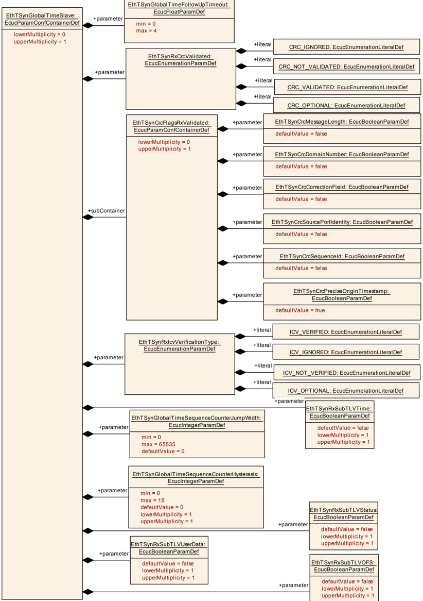

#### 9.2.15. EthTSynCrcFlagsRxValidated

| SWS 条目 | [ECUC_EthTSyn_00050] |
|---|---|
| 容器名称 | EthTSynCrcFlagsRxValidated |
| 父容器 | EthTSynGlobalTimeSlave |
| 描述 | 此容器收集 **Follow_Up** 报文元素中哪些部分应包含在 **CRC** 校验中的定义。 |
| Post-Build 变体多重性 | true |
| 多重性配置类 | Pre-compile time：X（所有变体）；Link time：-；Post-build time：- |
| 配置参数 | 见下方参数表 |

| SWS 条目 | [ECUC_EthTSyn_00042] |
|---|---|
| 参数名称 | EthTSynCrcCorrectionField |
| 父容器 | EthTSynCrcFlagsRxValidated |
| 描述 | **Follow_Up** 报文头的 correctionField 应包含在 **CRC** 计算中。 |
| 多重性 | 1 |
| 类型 | EcucBooleanParamDef |
| 默认值 | false |
| Post-Build 变体值 | true |
| 值配置类 | Pre-compile time：X（所有变体）；Link time：-；Post-build time：- |
| 作用域/依赖 | scope: local |

| SWS 条目 | [ECUC_EthTSyn_00041] |
|---|---|
| 参数名称 | EthTSynCrcDomainNumber |
| 父容器 | EthTSynCrcFlagsRxValidated |
| 描述 | **Follow_Up** 报文头的 domainNumber 应包含在 **CRC** 计算中。 |
| 多重性 | 1 |
| 类型 | EcucBooleanParamDef |
| 默认值 | false |
| Post-Build 变体值 | true |
| 值配置类 | Pre-compile time：X（所有变体）；Link time：-；Post-build time：- |
| 作用域/依赖 | scope: local |

| SWS 条目 | [ECUC_EthTSyn_00040] |
|---|---|
| 参数名称 | EthTSynCrcMessageLength |
| 父容器 | EthTSynCrcFlagsRxValidated |
| 描述 | **Follow_Up** 报文头的 messageLength 应包含在 **CRC** 计算中。 |
| 多重性 | 1 |
| 类型 | EcucBooleanParamDef |
| 默认值 | false |
| Post-Build 变体值 | true |
| 值配置类 | Pre-compile time：X（所有变体）；Link time：-；Post-build time：- |
| 作用域/依赖 | scope: local |

| SWS 条目 | [ECUC_EthTSyn_00045] |
|---|---|
| 参数名称 | EthTSynCrcPreciseOriginTimestamp |
| 父容器 | EthTSynCrcFlagsRxValidated |
| 描述 | **Follow_Up** 报文字段的 preciseOriginTimestamp 应包含在 **CRC** 计算中。 |
| 多重性 | 1 |
| 类型 | EcucBooleanParamDef |
| 默认值 | true |
| Post-Build 变体值 | true |
| 值配置类 | Pre-compile time：X（所有变体）；Link time：-；Post-build time：- |
| 作用域/依赖 | scope: local |

| SWS 条目 | [ECUC_EthTSyn_00044] |
|---|---|
| 参数名称 | EthTSynCrcSequenceId |
| 父容器 | EthTSynCrcFlagsRxValidated |
| 描述 | **Follow_Up** 报文头的 sequenceId 应包含在 **CRC** 计算中。 |
| 多重性 | 1 |
| 类型 | EcucBooleanParamDef |
| 默认值 | false |
| Post-Build 变体值 | true |
| 值配置类 | Pre-compile time：X（所有变体）；Link time：-；Post-build time：- |
| 作用域/依赖 | scope: local |

| SWS 条目 | [ECUC_EthTSyn_00043] |
|---|---|
| 参数名称 | EthTSynCrcSourcePortIdentity |
| 父容器 | EthTSynCrcFlagsRxValidated |
| 描述 | **Follow_Up** 报文头的 sourcePortIdentity 应包含在 **CRC** 计算中。 |
| 多重性 | 1 |
| 类型 | EcucBooleanParamDef |
| 默认值 | false |
| Post-Build 变体值 | true |
| 值配置类 | Pre-compile time：X（所有变体）；Link time：-；Post-build time：- |
| 作用域/依赖 | scope: local |

无包含的容器。

### 9.3. 约束

**注意：** 如果时基主节点经由多个以太网控制器为某时间域发送 Timesync 报文，**EthTSyn** 允许不同的配置选项：

1. 一个时间域容器（EthTSynGlobalTimeDomain）引用多个以太网控制器（EthTSynGlobalTimeEthIfRef）。
2. 一个时间域容器只引用一个以太网控制器。在这种情况下，每个以太网控制器都需要配置一个时间域容器，并且每个时间域都使用相同的时间域 ID（EthTSynGlobalTimeDomainId）进行配置。

[constr_0001] EthTSynPortConfig 容器仅对同步时间域（EthTSynGlobalTimeDomain 0..127）存在。

[constr_0002] 如果用于生成 **ICV** 的 **CSM** 任务配置为同步行为，则 EthTSynIcvGenerationTimeout 应设为 0。

[constr_0003] 如果用于验证 **ICV** 的 **CSM** 任务配置为同步行为，则 EthTSynIcvVerificationTimeout 应设为 0。

[constr_0004] 参数 EthTSynGlobalTimeTxPeriod 应规定 **Sync** 报文的发送区间。当且仅当参数 EthTSynGlobalTimePortRole 设为 **TIME_MASTER** 或 **DYNAMIC** 时它才可用。

**注意：** 为不同端口配置不同的 EthTSynGlobalTimeTxPeriod 需要 **StbM** 的参与。

[constr_0005] 在同一 EthTSynGlobalTimeDomain 下，参数 EthTSynGlobalTimePortRole 不得对两个端口配置为 **TIME_SLAVE**。

### 9.4. 发布信息

细节请参阅 [3, **SWS** BSW General] 的第 10.3 章「Published Information」。

## B. AUTOSAR 可追溯项变更历史

请注意，本章中的列表还包括在后续版本中已从规范中移除的约束和规范项。这些规范项在文档中不再作为超链接出现。

### B.1. 按照AUTOSAR发布版本 R23-11 的本文档变更历史

#### B.1.1. R23-11 中新增的规范项

```
[SWS_EthTSyn_00263] [SWS_EthTSyn_00264] [SWS_EthTSyn_00265] [SWS_EthTSyn_00266]
[SWS_EthTSyn_00267] [SWS_EthTSyn_00268] [SWS_EthTSyn_00400] [SWS_EthTSyn_00401]
[SWS_EthTSyn_00402] [SWS_EthTSyn_00403] [SWS_EthTSyn_00404] [SWS_EthTSyn_00405]
[SWS_EthTSyn_00406] [SWS_EthTSyn_00407] [SWS_EthTSyn_00408] [SWS_EthTSyn_00409]
[SWS_EthTSyn_00410] [SWS_EthTSyn_00411] [SWS_EthTSyn_00412] [SWS_EthTSyn_00413]
[SWS_EthTSyn_00414] [SWS_EthTSyn_00415] [SWS_EthTSyn_00416] [SWS_EthTSyn_NA_00996]
[SWS_EthTSyn_NA_00997] [SWS_EthTSyn_NA_00998] [SWS_EthTSyn_NA_00999]
```

#### B.1.2. R23-11 中变更的规范项

```
[SWS_EthTSyn_00017] [SWS_EthTSyn_00030] [SWS_EthTSyn_00031] [SWS_EthTSyn_00043]
[SWS_EthTSyn_00047] [SWS_EthTSyn_00052] [SWS_EthTSyn_00086] [SWS_EthTSyn_00127]
[SWS_EthTSyn_00128] [SWS_EthTSyn_00136] [SWS_EthTSyn_00137] [SWS_EthTSyn_00139]
[SWS_EthTSyn_00150] [SWS_EthTSyn_00172] [SWS_EthTSyn_00190] [SWS_EthTSyn_00210]
[SWS_EthTSyn_00211] [SWS_EthTSyn_00224] [SWS_EthTSyn_00225] [SWS_EthTSyn_00228]
[SWS_EthTSyn_00229] [SWS_EthTSyn_00236] [SWS_EthTSyn_00241] [SWS_EthTSyn_00243]
[SWS_EthTSyn_00248] [SWS_EthTSyn_00249] [SWS_EthTSyn_00250] [SWS_EthTSyn_00256]
[SWS_EthTSyn_00257] [SWS_EthTSyn_00258] [SWS_EthTSyn_00261] [SWS_EthTSyn_00262]
```

#### B.1.3. R23-11 中删除的规范项

```
[SWS_EthTSyn_00235]
```

## C. 变更约束历史

请注意，本章中的列表还包括在后续版本中已从规范中移除的约束和规范项。这些规范项在文档中不再作为超链接出现。

### C.1. 按照AUTOSAR发布版本 R23-11 的本文档变更历史

#### C.1.1. R23-11 中新增的约束

```
[constr_0001] [constr_0002] [constr_0003] [constr_0004] [constr_0005]
```

#### C.1.2. R23-11 中变更的约束

无

#### C.1.3. R23-11 中删除的约束

```
[SWS_EthTSyn_CONSTR_00001] [SWS_EthTSyn_CONSTR_00002]
```
