## 1. 简介和功能概述

**FrTSyn** 模块负责通过 **FlexRay** 总线分发时间信息。

与 **CAN** 相比，**FlexRay** 机制简单得多，因为它基于 **FlexRay** 节点彼此同步这一事实；否则，**FlexRay** 上无法传输任何报文。

时基主节点（**Time Master**）和时基从节点（**Time Slave**）对 **FlexRay** 全局时间具有相同的认知。因此，只需确定同一个（**FlexRay**）时间点，并传输在该时间点有效的时间信息。

理论上，这个（**FlexRay**）时间点可以是一个 **FlexRay** 周期内的任意宏节拍（**macrotick**），但选择 **FlexRay** 周期的起点可以简化该机制。此外，机制并非使用任意一个周期起点，而是使用后续周期中周期计数器值为 0 的周期起点；也就是说，时基主节点传输的是位于未来的时间信息。

在 **FlexRay** 上只需要一条时间同步报文。

时基主节点使用当前 **FlexRay** 时间（即宏节拍计数器和周期计数器）以及当前时间（即要分发的时间），计算下一个周期 0 起点处的时间值。计算出该时间值后，**FlexRay** 帧具体何时发送、何时接收和处理，都不再具有很强的时间要求。

每个接收到所传输时间信息的时基从节点，都会将其与当前 **FlexRay** 宏节拍计数器和周期计数器结合起来，以确定实际的主节点时间并设置其从节点时间。

图 1.1 展示了 **FlexRay** 上的时间同步机制。

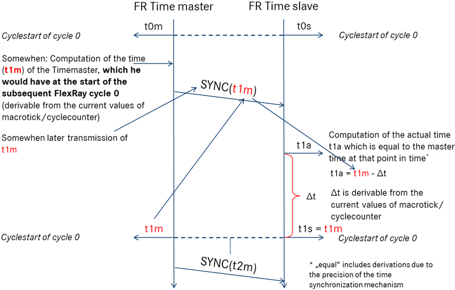

**FrTSyn** 还支持在 **FlexRay** 通信总线上保护全局时间报文。下图展示了 **AUTOSAR** 分层架构中时间提供者模块与安全模块之间的接口。

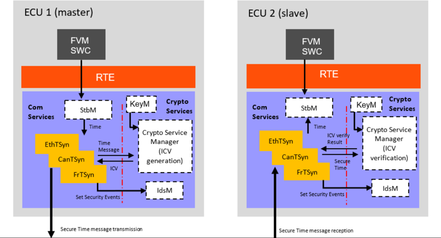

## 2. 缩略语

本节列出模块本地的缩略语和定义。有关其他与时间同步相关的缩略语和定义，请参阅 **RS Time Synchronization** [\[1\]](#ref-1) 的第 3 章。有关通用术语和缩略语，请参阅 **AUTOSAR** 术语表 [\[2\]](#ref-2)。

**GTM**

> 全局时间主节点（**Global Time Master**）

**BswM**

> **BSW** 模式管理器模块（**BSW Mode Manager** module）

**&lt;Bus&gt;TSyn**

> 特定总线的时间同步模块（**Bus specific Time Synchronization** module）

**CRC**

> 循环冗余校验和（**Cyclic Redundancy Checksum**）

**CSM**

> 加密服务管理器（**Crypto Service Manager**）

**Debounce Time**

> 具有相同 **PDU** 的两条发送（**Tx**）报文之间的最小间隔

**Det**

> 默认错误跟踪器模块（**Default Error Tracer** module）

**FCNT**

> **FlexRay** 周期计数器（**FlexRay Cycle Counter**）

**FR**

> **FlexRay**

**FrIf**

> **FlexRay** 接口模块（**FlexRay Interface** module）

**FrTSyn**

> **FlexRay** 时间同步模块（**Time Synchronization over FlexRay** module）

**FV**

> 新鲜度值（**Freshness Value**）

**FVL**

> 新鲜度值长度（**Freshness Value Length**）

**FVM**

> 新鲜度值管理器（**Freshness Value Manager**）

**ICV**

> 完整性校验值（**Integrity Check Value**）

**ICVL**

> 完整性校验值长度（**Integrity Check Value Length**）

**IdsM**

> 入侵检测系统管理器模块（**Intrusion Detection System Manager** module）

**MAC**

> 报文认证码（**Message Authentication Code**）

**OFS message**

> 偏移同步报文（**Offset Synchronization** message）

**SC**

> 时间同步报文中的序列计数器（**Sequence Counter**）

**SGW**

> 时间同步的“已同步到网关”（**Synchronized to Gateway**）状态

**StbM**

> 同步时基管理器（**Synchronized Time-Base Manager**）

**SYNC message**

> 时间同步报文（**Time Synchronization** message）

**Timesync**

> 时间同步（**Time Synchronization**）

## 3. 相关文档

### 3.1. 输入文件和相关标准与规范

<a id="ref-1"></a>[1] Requirements on Time Synchronization
> AUTOSAR_FO_RS_TimeSync

<a id="ref-2"></a>[2] Glossary
> AUTOSAR_FO_TR_Glossary

<a id="ref-3"></a>[3] General Specification of Basic Software Modules
> AUTOSAR_CP_SWS_BSWGeneral

<a id="ref-4"></a>[4] General Requirements on Basic Software Modules
> AUTOSAR_CP_SRS_BSWGeneral

<a id="ref-5"></a>[5] Specification of Synchronized Time-Base Manager
> AUTOSAR_CP_SWS_SynchronizedTimeBaseManager

<a id="ref-6"></a>[6] Specification of CRC Routines
> AUTOSAR_CP_SWS_CRCLibrary

<a id="ref-7"></a>[7] Specification of Crypto Service Manager
> AUTOSAR_CP_SWS_CryptoServiceManager

<a id="ref-8"></a>[8] Specification of Intrusion Detection System Manager
> AUTOSAR_CP_SWS_IntrusionDetectionSystemManager

### 3.2. 相关规范

**AUTOSAR** 提供的基础软件模块通用规范 **SWS BSW General** [\[3\]](#ref-3) 同样适用于 **FrTSyn**。

因此，应将 **SWS BSW General** 作为 **FrTSyn** 的补充且必需的规范。

## 4. 约束和假设

### 4.1. 限制

1. 时基主节点、时间网关和时基从节点应使用最坏情况精度为 2 µs 的时基参考时钟工作。
2. **OFS** 报文中的时基被限制为 32 位，因此支持的最大时间值为 4294967295 秒（2^32 - 1）。

### 4.2. 汽车域的适用性

适用于要求 **ECU** 之间具有公共时基、且不受 **ECU** 所连接总线系统影响的汽车系统。

## 5. 对其他模块的依赖

**FlexRay** 时间同步（**FrTSyn**）与同步时基管理器（**StbM**）、**FlexRay** 接口（**FrIf**）、**BSW** 模式管理器（**BswM**）、默认错误跟踪器（**Det**）、加密服务管理器（**CSM**）以及入侵检测系统管理器（**IdsM**）之间具有接口。

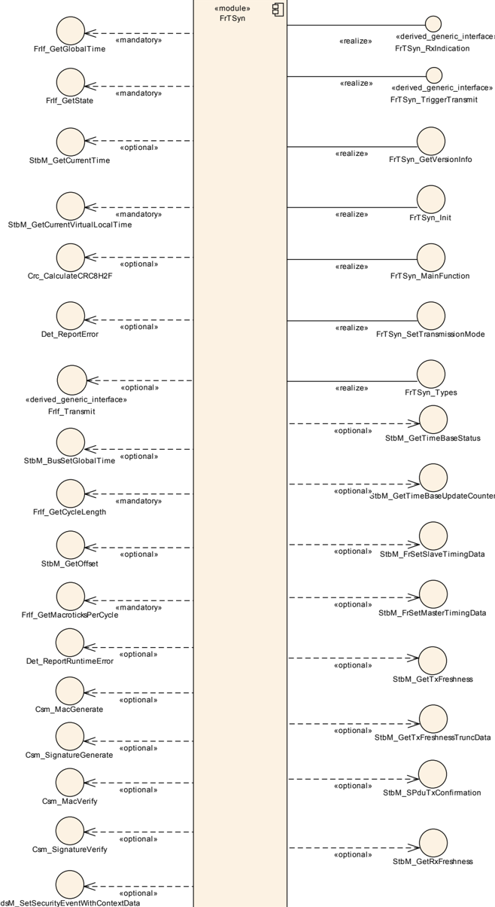

这些模块之间的依赖关系如下：

- **StbM**
  - 获取并设置当前时间值
  - 从 **FVM** 获取 **FV**
- **FrIf**：接收和发送报文
- **BswM**：协调网络访问（通过 `[FrTSyn_SetTransmissionMode](#733-frtsyn_settransmissionmode)()`）
- **Det**：报告开发错误
- **IdsM**：报告安全事件
- **CSM**
  - 为时基主节点生成 **ICV**
  - 为时基从节点验证 **ICV**

### 5.1. 文件结构

#### 5.1.1. 代码文件结构

详情请参阅 **SWS BSW General** [\[3\]](#ref-3) 的第 5.1.6 节“代码文件结构”。

#### 5.1.2. 头文件结构

详情请参阅 **SWS BSW General** [\[3\]](#ref-3) 的第 5.1.7 节“头文件结构”。

## 6. 功能规格

本章定义通过 **FlexRay** 进行时间同步的行为。模块的 **API** 见第 [7](#7-api规范) 章，配置见第 [9](#9-配置规范) 章。

### 6.1. 概述

通过 **FlexRay** 进行时间同步的模块负责确保在 **FlexRay** 网络中采集和分发同步时间信息。该模块与 **StbM** 交互，并向 **StbM** 提供所有 **FlexRay** 特定功能。

时间同步原则和通用术语见 [\[5\]](#ref-5) 和 [\[1\]](#ref-1)。

### 6.2. 模块处理

本节介绍通过 **FlexRay** 进行时间同步的辅助功能。

#### 6.2.1. 初始化

通过调用 [FrTSyn_Init](#731-frtsyn_init) 初始化 **FrTSyn**。除 [FrTSyn_GetVersionInfo](#732-frtsyn_getversioninfo) 和 [FrTSyn_Init](#731-frtsyn_init) 外，只有在模块已正确初始化后，才能调用 **FrTSyn** 的 **API** 函数。

调用 [FrTSyn_Init](#731-frtsyn_init) 会初始化所有内部变量，并使 **FrTSyn** 进入已初始化状态。

序列计数器（**SC**）应初始化为 0。

#### 6.2.2. FlexRay 接口

仅当 FrIf_GetState 返回 FRIF_STATE_ONLINE 时，**FrTSyn** 才应调用 FrIf_GetGlobalTime。这样可以确保 FrIf_GetGlobalTime 返回有效时间信息，即 **FlexRay** 通信控制器与 **FlexRay** 全局时间同步。

#### 6.2.3. 错误处理

发生错误或异常时，**FrTSyn** 模块不得更改其当前模块状态，而应仅报告错误事件。

### 6.3. 报文格式

**SYNC** 和 **OFS** 报文可以通过复用信号组共享同一个 **FR PDU**。多路复用器位于字节 0，名称为 `Type`。

如果不同时间域的时间同步报文由同一时基主节点或时间网关发送，则这些时间域可以使用相同的 **FR PDU**。

如果不同时间域的时间同步报文由不同的时基主节点或时间网关发送，则这些时间域应使用不同的 **FR PDU**。

**CRC** 的使用是可选的。为了让不同时间观测单元具有较大的配置灵活性，如果接收方不支持 **CRC** 计算，配置决定如何处理受 **CRC** 保护的时间同步报文。因此，接收方可能只使用给定的时基值，而不校验 **CRC**。

**SYNC** 和 **OFS** 报文可以采用 **ICV** 安全保护，以保护报文的完整性和真实性。

**ICV** 的使用是可选的。为了让不同时间观测单元具有较大的配置灵活性，如果接收方不支持 **ICV** 计算，配置决定如何处理采用 **ICV** 安全保护的时间同步报文。因此，接收方可能只使用给定的时基值，而不校验 **ICV**。

时间同步报文中的时间值采用“大端”（**Big Endian**）字节序。

当报文类型为 0x10、0x20、0x34 或 0x44（未采用 **ICV** 安全保护的 **SYNC** 和 **OFS** 报文）时，`PayloadLength` 应为 16。

采用 **ICV** 安全保护的报文长度取决于可变长度的 **FV** 和 **ICV** 字段。

当报文类型为 0x50、0x60、0x74 或 0x84（采用 **ICV** 安全保护的 **SYNC** 和 **OFS** 报文）时，`PayloadLength` 应为 18 至 254，具体取决于配置的 **FV** 长度（StbMFreshnessValueLength）和 **ICV** 长度（FrTSynIcvTxLength）。

对于 **SYNC** 或 **OFS** 报文，如果 `FVL` 字段为 0，则不应包含 **FV** 字段，即 **ICV** 字段应紧接在后，从字节 18 开始。

对于 **SYNC** 或 **OFS** 报文，如果 `ICVL` 字段为 0，则不应包含 **ICV** 字段，即 **SYNC** 报文应在字节 17 结束。

时间同步报文应按照相应报文格式包含用户数据。

应从接收到的时间同步报文中一致地读取用户数据。

应将用户数据一致地写入待发送的时间同步报文。如果时间同步报文中的用户数据字段数大于 **StbM** 提供的用户数据字节数，则其余用户数据字段应设为 0（默认值）。

用户数据应映射到 `StbM_UserDataType`，报文给出的字节编号应与 `StbM_UserDataType` 中的字节编号匹配（用户字节 0 映射到 `StbM_UserDataType.userByte0` 等）。`StbM_UserDataType.userDataLength` 应设为特定时间同步报文类型对应的用户字节数。

#### 6.3.1. SYNC 报文

**SYNC** 报文的布局由以下要求定义，具体取决于载荷是否受 **CRC** 保护和/或采用 **ICV** 安全保护：

- **SYNC** 报文格式：未受 **CRC** 保护，未采用 **ICV** 安全保护；
- **SYNC** 报文格式：受 **CRC** 保护，未采用 **ICV** 安全保护；
- **SYNC** 报文格式：未受 **CRC** 保护，采用 **ICV** 安全保护；
- **SYNC** 报文格式：受 **CRC** 保护，采用 **ICV** 安全保护。

表 7.1：SYNC 报文格式——未受 CRC 保护且未采用 ICV 安全保护

| 字节 | 位位置 | 字段名称 | 字段值范围 | 说明 |
| --- | --- | --- | --- | --- |
| 0 |  | Type | 0x10 | 报文类型 |
| 1 |  | User Byte 2 | 默认值：0 |  |
| 2 | 7..4 | D | 0..15 | 时间域标识 |
| 2 | 3..0 | SC | 0..15 | 序列计数器 |
| 3 | 7..2 | FCNT | 0..63 | FlexRay 周期计数器 |
| 3 | 1 | SGW | 0 = SyncToGTM<br>1 = SyncToSubDomain |  |
| 3 | 0 | reserved | 0 |  |
| 4 |  | User Byte 0 | 默认值：0 |  |
| 5 |  | User Byte 1 | 默认值：0 |  |
| 6..11 |  | SyncTimeSec |  | 48 位秒时间值 |
| 12..15 |  | SyncTimeNSec |  | 32 位纳秒时间值 |

表 7.2：SYNC 报文格式——受 CRC 保护且未采用 ICV 安全保护

| 字节 | 位位置 | 字段名称 | 字段值范围 | 说明 |
| --- | --- | --- | --- | --- |
| 0 |  | Type | 0x20 | 报文类型 |
| 1 |  | CRC | 0..255 | 校验和 |
| 2 | 7..4 | D | 0..15 | 时间域标识 |
| 2 | 3..0 | SC | 0..15 | 序列计数器 |
| 3 | 7..2 | FCNT | 0..63 | FlexRay 周期计数器 |
| 3 | 1 | SGW | 0 = SyncToGTM<br>1 = SyncToSubDomain |  |
| 3 | 0 | reserved | 0 |  |
| 4 |  | User Byte 0 | 默认值：0 |  |
| 5 |  | User Byte 1 | 默认值：0 |  |
| 6..11 |  | SyncTimeSec |  | 48 位秒时间值 |
| 12..15 |  | SyncTimeNSec |  | 32 位纳秒时间值 |

表 7.3：SYNC 报文格式——未受 CRC 保护，采用 ICV 安全保护

| 字节 | 位位置 | 字段名称 | 字段值范围 | 说明 |
| --- | --- | --- | --- | --- |
| 0 |  | Type | 0x50 | 报文类型 |
| 1 |  | User Byte 2 | 默认值：0 |  |
| 2 | 7..4 | D | 0..15 | 时间域标识 |
| 2 | 3..0 | SC | 0..15 | 序列计数器 |
| 3 | 7..2 | FCNT | 0..63 | FlexRay 周期计数器 |
| 3 | 1 | SGW | 0 = SyncToGTM<br>1 = SyncToSubDomain |  |
| 3 | 0 | reserved | 0 |  |
| 4 |  | User Byte 0 | 默认值：0 |  |
| 5 |  | User Byte 1 | 默认值：0 |  |
| 6..11 |  | SyncTimeSec |  | 48 位秒时间值 |
| 12..15 |  | SyncTimeNSec |  | 32 位纳秒时间值 |
| 16 | 7 | reserved | 0 |  |
| 16 | 6..0 | FVL | 0..64 | **FV** 长度，单位为位 |
| 17 |  | ICVL | 0..236 | **ICV** 长度，单位为字节 |
| 18 |  | FV |  | **FV** |
| 18+FVL |  | ICV |  | 按字节计的 **ICV** |

#### 6.3.2. OFS 报文

**OFS** 报文的布局由以下要求定义，具体取决于载荷是否受 **CRC** 保护和/或采用 **ICV** 安全保护：

- **OFS** 报文格式：未受 **CRC** 保护，未采用 **ICV** 安全保护；
- **OFS** 报文格式：受 **CRC** 保护，未采用 **ICV** 安全保护；
- **OFS** 报文格式：未受 **CRC** 保护，采用 **ICV** 安全保护；
- **OFS** 报文格式：受 **CRC** 保护，采用 **ICV** 安全保护。

表 7.5：OFS 报文格式——未受 CRC 保护且未采用 ICV 安全保护

| 字节 | 位位置 | 字段名称 | 字段值范围 | 说明 |
| --- | --- | --- | --- | --- |
| 0 |  | Type | 0x34 | 报文类型 |
| 1 |  | User Byte 2 | 默认值：0 |  |
| 2 | 7..4 | D | 0..15 | 时间域标识 |
| 2 | 3..0 | SC | 0..15 | 序列计数器 |
| 3 | 7..2 | reserved | 0 |  |
| 3 | 1 | SGW | 0 = SyncToGTM<br>1 = SyncToSubDomain |  |
| 3 | 0 | reserved | 0 |  |
| 4 |  | User Byte 0 | 默认值：0 |  |
| 5 |  | User Byte 1 | 默认值：0 |  |
| 6 |  | reserved | 0 |  |
| 7 |  | reserved | 0 |  |
| 8..11 |  | OfsTimeSec |  | 32 位秒偏移时间值 |
| 12..15 |  | OfsTimeNSec |  | 32 位纳秒偏移时间值 |

表 7.6：OFS 报文格式——受 CRC 保护且未采用 ICV 安全保护

| 字节 | 位位置 | 字段名称 | 字段值范围 | 说明 |
| --- | --- | --- | --- | --- |
| 0 |  | Type | 0x44 | 报文类型 |
| 1 |  | CRC | 0..255 | 校验和 |
| 2 | 7..4 | D | 0..15 | 时间域标识 |
| 2 | 3..0 | SC | 0..15 | 序列计数器 |
| 3 | 7..2 | reserved | 0 |  |
| 3 | 1 | SGW | 0 = SyncToGTM<br>1 = SyncToSubDomain |  |
| 3 | 0 | reserved | 0 |  |
| 4 |  | User Byte 0 | 默认值：0 |  |
| 5 |  | User Byte 1 | 默认值：0 |  |
| 6 |  | reserved | 0 |  |
| 7 |  | reserved | 0 |  |
| 8..11 |  | OfsTimeSec |  | 32 位秒偏移时间值 |
| 12..15 |  | OfsTimeNSec |  | 32 位纳秒偏移时间值 |

表 7.7：OFS 报文格式——未受 CRC 保护，采用 ICV 安全保护

| 字节 | 位位置 | 字段名称 | 字段值范围 | 说明 |
| --- | --- | --- | --- | --- |
| 0 |  | Type | 0x74 | 报文类型 |
| 1 |  | User Byte 2 | 默认值：0 |  |
| 2 | 7..4 | D | 0..15 | 时间域标识 |
| 2 | 3..0 | SC | 0..15 | 序列计数器 |
| 3 | 7..2 | reserved | 0 |  |
| 3 | 1 | SGW | 0 = SyncToGTM<br>1 = SyncToSubDomain |  |
| 3 | 0 | reserved | 0 |  |
| 4 |  | User Byte 0 | 默认值：0 |  |
| 5 |  | User Byte 1 | 默认值：0 |  |
| 6 |  | reserved | 0 |  |
| 7 |  | reserved | 0 |  |
| 8..11 |  | OfsTimeSec |  | 32 位秒偏移时间值 |
| 12..15 |  | OfsTimeNSec |  | 32 位纳秒偏移时间值 |
| 16 | 7 | reserved | 0 |  |
| 16 | 6..0 | FVL | 0..64 | **FV** 长度，单位为位 |
| 17 |  | ICVL | 0..236 | **ICV** 长度，单位为字节 |
| 18 |  | FV |  | **FV** |
| 18+FVL |  | ICV |  | 按字节计的 **ICV** |

表 7.8：OFS 报文格式——受 CRC 保护，采用 ICV 安全保护

| 字节 | 位位置 | 字段名称 | 字段值范围 | 说明 |
| --- | --- | --- | --- | --- |
| 0 |  | Type | 0x84 | 报文类型 |
| 1 |  | CRC | 0..255 | 校验和 |
| 2 | 7..4 | D | 0..15 | 时间域标识 |
| 2 | 3..0 | SC | 0..15 | 序列计数器 |
| 3 | 7..2 | reserved | 0 |  |
| 3 | 1 | SGW | 0 = SyncToGTM<br>1 = SyncToSubDomain |  |
| 3 | 0 | reserved | 0 |  |
| 4 |  | User Byte 0 | 默认值：0 |  |
| 5 |  | User Byte 1 | 默认值：0 |  |
| 6 |  | reserved | 0 |  |
| 7 |  | reserved | 0 |  |
| 8..11 |  | OfsTimeSec |  | 32 位秒偏移时间值 |
| 12..15 |  | OfsTimeNSec |  | 32 位纳秒偏移时间值 |
| 16 | 7 | reserved | 0 |  |
| 16 | 6..0 | FVL | 0..64 | **FV** 长度，单位为位 |
| 17 |  | ICVL | 0..236 | **ICV** 长度，单位为字节 |
| 18 |  | FV |  | **FV** |
| 18+FVL |  | ICV |  | 按字节计的 **ICV** |

### 6.4. 作为时基主节点

时基主节点是某个时基的主节点实体，它将该时基传播给通信网络某个区段内的一组时基从节点，并作为该时基的源。

如果时基主节点同时也是全局时基（即所有后续时基的来源时基）的拥有者，那么它就是全局时间主节点。时间网关通常由一个连接到一个或多个时基从节点的时基主节点端口构成。将时间实体映射到实际 **ECU** 时必须注意：一个 **ECU** 可以是某个时基的时基主节点（甚至是全局时间主节点），同时又是另一个时基的时基从节点。

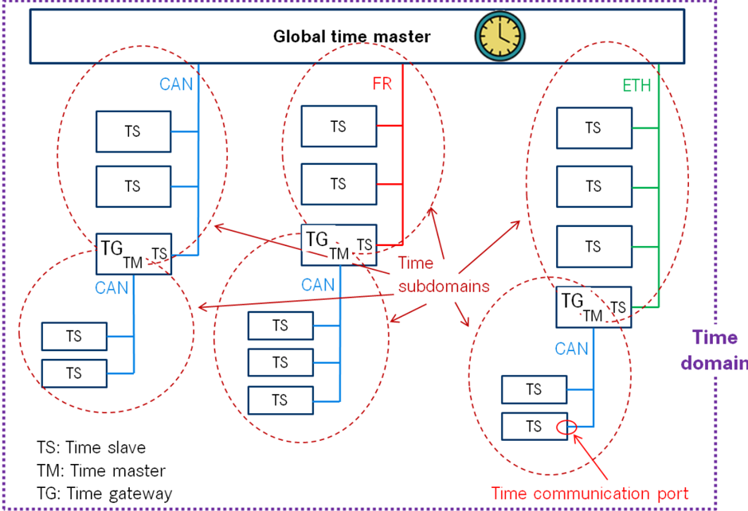

如果 **FrTSyn** 被配置为某个时间域的时基主节点，则 **FrTSyn** 模块会在每次调用 [FrTSyn_MainFunction](#751-frtsyn_mainfunction) 时检查该时间域是否需要发送时间同步报文。

图 7.2 展示 **FrTSyn** 如何判定是否需要立即或周期性地发送时间同步报文。

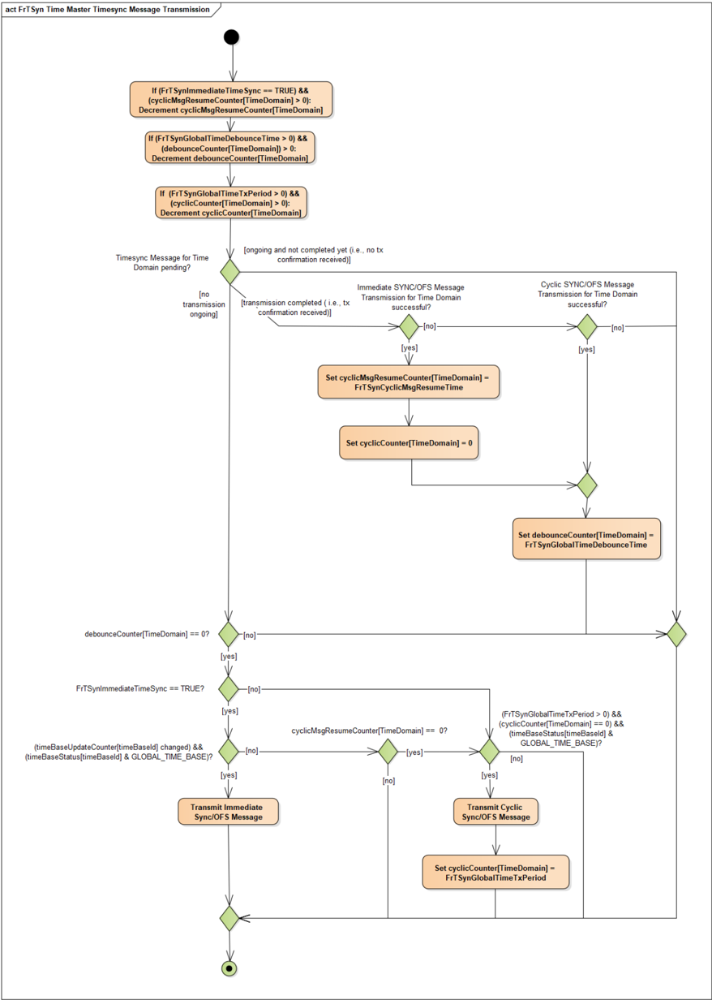

#### 6.4.1. SYNC 报文处理

每个时间域的一个时间同步报文序列由一条 **SYNC** 报文组成。

**注意：** 时基主节点的操作时序图见图 9.1。

对于每个已配置的时基主节点（参见 [FrTSynGlobalTimeMaster](#9210-frtsynglobaltimemaster)），如果满足以下条件：

- `timeBaseStatus` 中的 `GLOBAL_TIME_BASE` 位已置位；
- FrTSynGlobalTimeTxPeriod 不等于 0；
- 关联的 `cyclicMsgResumeCounter` 小于或等于 0；

则 **FrTSyn** 模块应按照 FrTSynGlobalTimeTxPeriod 周期性发送 **SYNC** 报文，其中包含在下一个 **FlexRay** 周期 0 起点处有效的时间值和用户数据。

满足上述条件后，应在最早可能的一次 [FrTSyn_MainFunction](#751-frtsyn_mainfunction) 调用中启动周期发送。“最早可能”是指：

- 如果 `GLOBAL_TIME_BASE` 在 [FrTSyn_MainFunction](#751-frtsyn_mainfunction) 之外置位，则在下一次 [FrTSyn_MainFunction](#751-frtsyn_mainfunction) 调用中启动；
- 如果从立即发送切换到周期发送，则在当前 [FrTSyn_MainFunction](#751-frtsyn_mainfunction) 调用中启动，因为该决定是在 [FrTSyn_MainFunction](#751-frtsyn_mainfunction) 内作出的。立即发送详见第 [6.4.5](#645-立即时间同步) 节。

如果 FrTSynGlobalTimeTxIcvSecured 设为 `ICV_NOT_SUPPORTED`，且 FrTSynGlobalTimeTxCrcSecured 设为 `CRC_NOT_SUPPORTED`，则 **SYNC** 报文的类型应为 0x10（即未受 **CRC** 保护、未采用 **ICV** 认证的 **SYNC** 报文）。

如果 FrTSynGlobalTimeTxIcvSecured 设为 `ICV_NOT_SUPPORTED`，且 FrTSynGlobalTimeTxCrcSecured 设为 `CRC_SUPPORTED`，则 **SYNC** 报文的类型应为 0x20（即受 **CRC** 保护、未采用 **ICV** 认证的 **SYNC** 报文）。

如果 FrTSynGlobalTimeTxIcvSecured 设为 `ICV_SUPPORTED`，且 FrTSynGlobalTimeTxCrcSecured 设为 `CRC_NOT_SUPPORTED`，则 **SYNC** 报文的类型应为 0x50（即未受 **CRC** 保护、但采用 **ICV** 认证的 **SYNC** 报文）。

如果 FrTSynGlobalTimeTxIcvSecured 设为 `ICV_SUPPORTED`，且 FrTSynGlobalTimeTxCrcSecured 设为 `CRC_SUPPORTED`，则 **SYNC** 报文的类型应为 0x60（即受 **CRC** 保护且采用 **ICV** 认证的 **SYNC** 报文）。

#### 6.4.2. OFS 报文处理

每个时间域的一个偏移报文序列由一条 **OFS** 报文组成。

对于每个已配置的时基主节点（[FrTSynGlobalTimeMaster](#9210-frtsynglobaltimemaster)），如果满足以下条件：

- `timeBaseStatus` 中的 `GLOBAL_TIME_BASE` 位已置位；
- FrTSynGlobalTimeTxPeriod 不等于 0；
- 关联的 `cyclicMsgResumeCounter` 小于或等于 0；

则 **FrTSyn** 模块应按照 FrTSynGlobalTimeTxPeriod 周期性发送 **OFS** 报文，其中包含偏移时间值和用户数据。

满足上述条件后，应在最早可能的一次 [FrTSyn_MainFunction](#751-frtsyn_mainfunction) 调用中启动周期发送。

**注意：** “最早可能”是指：

- 如果 `GLOBAL_TIME_BASE` 在 [FrTSyn_MainFunction](#751-frtsyn_mainfunction) 之外置位，则在下一次 [FrTSyn_MainFunction](#751-frtsyn_mainfunction) 调用中启动；
- 如果从立即发送切换到周期发送，则在当前 [FrTSyn_MainFunction](#751-frtsyn_mainfunction) 调用中启动，因为该决定是在 [FrTSyn_MainFunction](#751-frtsyn_mainfunction) 内作出的。立即发送详见第 [6.4.5](#645-立即时间同步) 节。

如果 FrTSynGlobalTimeTxIcvSecured 设为 `ICV_NOT_SUPPORTED`，且 FrTSynGlobalTimeTxCrcSecured 设为 `CRC_NOT_SUPPORTED`，则 **OFS** 报文的类型应为 0x34（即未受 **CRC** 保护、未采用 **ICV** 认证的 **OFS** 报文）。

如果 FrTSynGlobalTimeTxIcvSecured 设为 `ICV_NOT_SUPPORTED`，且 FrTSynGlobalTimeTxCrcSecured 设为 `CRC_SUPPORTED`，则 **OFS** 报文的类型应为 0x44（即受 **CRC** 保护、未采用 **ICV** 认证的 **OFS** 报文）。

如果 FrTSynGlobalTimeTxIcvSecured 设为 `ICV_SUPPORTED`，且 FrTSynGlobalTimeTxCrcSecured 设为 `CRC_NOT_SUPPORTED`，则 **OFS** 报文的类型应为 0x74（即未受 **CRC** 保护、但采用 **ICV** 认证的 **OFS** 报文）。

如果 FrTSynGlobalTimeTxIcvSecured 设为 `ICV_SUPPORTED`，且 FrTSynGlobalTimeTxCrcSecured 设为 `CRC_SUPPORTED`，则 **OFS** 报文的类型应为 0x84（即受 **CRC** 保护且采用 **ICV** 认证的 **OFS** 报文）。

#### 6.4.3. 发送模式

如果调用 [FrTSyn_SetTransmissionMode](#733-frtsyn_settransmissionmode)(Controller, Mode)，且参数 `Mode` 等于 `FRTSYN_TX_OFF`，则应省略 **FrTSyn** 在此 **FlexRay** 通道上的所有发送请求。

如果调用 [FrTSyn_SetTransmissionMode](#733-frtsyn_settransmissionmode)(Controller, Mode)，且参数 `Mode` 等于 `FRTSYN_TX_ON`，则 **FrTSyn** 在此 **FlexRay** 通道上的所有发送请求都应能够发送。

#### 6.4.4. 去抖时间

**FrTSyn** 对时基主节点的 **FlexRay Tx PDU** 进行去抖，以避免总线上突发发送时间同步报文（例如启用了立即发送时）。

**FrTSyn** 为每个 **Tx PDU** 维护一个去抖计数器 `debounceCounter`。每次发送时间同步报文时，都会将 `debounceCounter`（重新）装载为配置的去抖时间 FrTSynGlobalTimeDebounceTime。每个 **FrTSyn** 主循环周期都会递减 `debounceCounter`。只有当该计数器达到 0 时，才能触发同一个 **PDU** 的再次发送。另请参阅图 7.2 中时间同步报文发送的总体流程。

**FrTSyn** 不支持在不同域和总线之间共享 **PDU**，即不同时间域不得使用相同的 **PDU ID**。

如果某个时基的 FrTSynGlobalTimeDebounceTime 大于 0，**FrTSyn** 应始终按照下述规定对相应的时间同步 **PDU** 进行去抖；否则，**FrTSyn** 不应执行任何去抖。（源文档将此要求标记为已废弃。）

对于某个时间域，如果 FrTSynGlobalTimeDebounceTime 大于 0，且相应的时间同步 **PDU** 已成功发送，则 **FrTSyn** 应将该 **PDU** 专用的 `debounceCounter` 设为 FrTSynGlobalTimeDebounceTime。

**注意：** 满足以下条件时，时间同步 **PDU** 被视为已成功发送：

- 对于配置为立即发送的 **Tx PDU**，FrIf_Transmit 返回 `E_OK`；
- 对于配置为解耦发送的 **Tx PDU**，[FrTSyn_TriggerTransmit](#742-frtsyn_triggertransmit) 返回 `E_OK`。

对于某个时间域，如果 FrTSynGlobalTimeDebounceTime 大于 0，且相应时间同步 **PDU** 的 `debounceCounter` 大于 0，则每次调用 [FrTSyn_MainFunction](#751-frtsyn_mainfunction) 时，**FrTSyn** 应按 FrTSynMainFunctionPeriod 的值递减 `debounceCounter`。

对于某个时间域，如果 FrTSynGlobalTimeDebounceTime 大于 0、相应时间同步 **PDU** 的 `debounceCounter` 大于 0，且请求发送时间同步报文，则 **FrTSyn** 应推迟该报文的实际发送，直至 `debounceCounter` 小于或等于 0。

**理由：** 去抖期间，不应丢失新的发送请求。

对于某个时间域，如果 FrTSynGlobalTimeDebounceTime 大于 0、存在待处理的延迟 **SYNC** 或 **OFS** 报文发送请求，且又请求立即或周期发送新的 **SYNC** 或 **OFS** 报文，则 **FrTSyn** 应丢弃该时间域的待处理请求。

**理由：** 去抖期间不会对多个发送请求排队；最新的请求最有用。

#### 6.4.5. 立即时间同步

除周期性发送时间同步报文外，有时还需要立即发送报文。另请参阅图 7.2 中时间同步报文发送的总体流程。

如果某个时基的 FrTSynImmediateTimeSync 设为 `TRUE`，则 **FrTSyn** 应在每次调用 [FrTSyn_MainFunction](#751-frtsyn_mainfunction) 时，通过调用 StbM_GetTimeBaseUpdateCounter 检查相应时基的 `timeBaseUpdateCounter` 是否发生变化。

如果 FrTSynImmediateTimeSync 设为 `TRUE`、某个时基的 `timeBaseUpdateCounter` 已发生变化，且 `timeBaseStatus` 中的 `GLOBAL_TIME_BASE` 位置位，则 **FrTSyn** 应触发该时基的时间同步报文立即发送。

**注意：** 可通过 StbM_GetTimeBaseStatus 或 StbM_GetCurrentTime 获取 `timeBaseStatus`。

**注意：** 始终应考虑第 [6.4.4](#644-去抖时间) 节所述的 `debounceCounter`。

源文档将“如果 FrTSynImmediateTimeSync 设为 `TRUE`，则应考虑 `cyclicMsgResumeCounter` 和 FrTSynCyclicMsgResumeTime”这一要求标记为已废弃。

除立即发送的实际触发条件外，还需要考虑参数 FrTSynCyclicMsgResumeTime。周期性时间同步报文发送的触发条件分别见第 [6.4.1](#641-sync-报文处理) 节和第 [6.4.2](#642-ofs-报文处理) 节。

配置 FrTSynCyclicMsgResumeTime 时有两种主要场景：

- 如果 FrTSynCyclicMsgResumeTime 和 FrTSynGlobalTimeTxPeriod 均配置为 0，则形成单次发送模式，该模式仅由 `timeBaseUpdateCounter` 的变化触发。
- 如果 FrTSynCyclicMsgResumeTime 大于 FrTSynGlobalTimeTxPeriod，则可以为时间网关配置保持（hold-over）场景：
  - 当时基主节点侧仍有时间同步报文接收时，子总线上的时间同步报文仅由立即发送触发；在 `cyclicMsgResumeCounter` 运行期间，周期发送会暂停。
  - 如果不再从时基主节点侧接收到时间同步报文且检测到超时，则由周期发送接管；此时 `cyclicMsgResumeCounter` 已到期，周期发送不再暂停。
  - 如果恢复接收时基主节点侧的时间同步报文，则子总线上的时间同步报文再次由立即发送触发；由于 `cyclicMsgResumeCounter` 再次运行，周期发送也再次暂停。

对于某个时间域，如果 FrTSynImmediateTimeSync 设为 `TRUE`、FrTSynCyclicMsgResumeTime 大于 0，且立即发送了 **SYNC** 或 **OFS** 报文，则 **FrTSyn** 应将该时间域的 `cyclicMsgResumeCounter` 设为 FrTSynCyclicMsgResumeTime。

对于某个时间域，如果 `cyclicMsgResumeCounter` 大于 0，则 **FrTSyn** 应丢弃该时间域的周期性时间同步报文发送请求。

对于某个时间域，如果 `cyclicMsgResumeCounter` 大于 0，则每次调用 [FrTSyn_MainFunction](#751-frtsyn_mainfunction) 时，**FrTSyn** 应按 FrTSynMainFunctionPeriod 的值递减该时间域对应的 `cyclicMsgResumeCounter`。

如果 `cyclicMsgResumeCounter` 递减至 0 或更小，则 **FrTSyn** 应在当前 [FrTSyn_MainFunction](#751-frtsyn_mainfunction) 调用中恢复周期性时间同步报文发送，并请求发送 **SYNC** 或 **OFS** 报文。

**注意：** 上述要求确保当 `cyclicMsgResumeCounter` 达到 0 时，在同一次主函数调用中请求首次周期发送。报文是否实际发送还取决于 `debounceCounter`。

#### 6.4.6. 时间同步报文的计算与组装

本节描述时间同步报文各项内容的计算流程（第 1 步）以及报文的组装流程（第 2 步）。

##### 6.4.6.1. 全局时间计算

同步时基的发送方（时基主节点）应执行以下步骤，以分发同步时基：

1. 通过调用 StbM_GetCurrentTime，将当前同步时基的时间元组读取为 `[TSYNC; T0VLT]`。
2. 使以下两项操作免受中断影响：
   1. 通过 FrIf_GetGlobalTime 获取 `currentCycle` 和 `currentMacroticks`；
   2. 通过 StbM_GetCurrentVirtualLocalTime 获取当前虚拟本地时间值 `T1VLT`。
3. 计算下一个 **FlexRay** 周期起点处的时基未来时间值：

   ```C
   T0 = TSYNC + (T1VLT - T0VLT) + (64 - currentCycle) * CycleLength
        - (CycleLength / MacroticksPerCycle) * currentMacroticks
   ```

4. 计算 `T0` 的秒部分 `SyncTimeSec` 和纳秒部分 `SyncTimeNSec`。

**注意：** 时基主节点的操作时序见图 9.1。

**注意：** 必须以原子方式获取 **FlexRay** 时间中的 `currentCycle` 和 `currentMacroticks`，以及虚拟本地时间中的 `T1VLT`；否则，这些获取操作之间的任何延迟都会按其时长降低精度。

**注意：** 如果使用整数进行计算，则需要尽量减小 `(CycleLength / MacroticksPerCycle)` 项的舍入误差。例如可以采用以下方式计算：

- 在 64 位架构上：

  ```C
  (CycleLength * currentMacroticks) / MacroticksPerCycle
  ```

- 在 32 位架构上：

  ```C
  (((CycleLength * 256) / MacroticksPerCycle) * currentMacroticks) / 256
  ```

  对于任何可能的 **FlexRay** 参数配置，乘以 256 都是可接受的。

`CycleLength` 和 `MacroticksPerCycle` 分别通过 FrIf_GetCycleLength 和 FrIf_GetMacroticksPerCycle 获取。

偏移时基的发送方（时基主节点）应执行以下步骤，以分发偏移时基：

1. 通过 StbM_GetOffset 获取当前偏移时间；
2. 将偏移时间的秒部分写入 `OfsTimeSec`；
3. 将偏移时间的纳秒部分写入 `OfsTimeNSec`。

##### 6.4.6.2. SGW 计算

应从时基同步状态中获取 **SGW** 值（时间网关同步状态）。如果 `timeBaseStatus` 中的 `SYNC_TO_GATEWAY` 位未置位，则 **SGW** 值应为 `SyncToGTM`；否则，**SGW** 值应设为 `SyncToSubDomain`。

##### 6.4.6.3. 序列计数器计算

序列计数器（**SC**）为 4 位，用于表示每个时间域中 0 到 15 的数值。**SYNC** 和 **OFS** 报文应分别维护独立的序列计数器；每次请求发送 **SYNC** 或 **OFS** 报文时，相应计数器应递增 1。计数器从 15 回绕至 0。

##### 6.4.6.4. CRC 计算

如果配置要求使用 **CRC**，应使用 [\[6\]](#ref-6) 中定义的 Crc_CalculateCRC8H2F 函数计算 **CRC**。

`DataID` 应按以下方式计算：

```C
DataID = DataIDList[SC]
```

每种报文类型的 `DataIDList` 由配置提供（参见 [FrTSynGlobalTimeSyncDataIDList](#926-frtsynglobaltimesyncdataidlist) 和 [FrTSynGlobalTimeOfsDataIDList](#928-frtsynglobaltimeofsdataidlist)）。

**注意：** 从预定义的 `DataIDList` 中选择特定的 `DataID`，可确保识别时间同步报文中的数据元素。

**CRC** 应基于时间同步报文字节 2 至字节 15 和 `DataID` 计算：先处理字节 2，再按升序处理其余字节，最后处理 `DataID`。

##### 6.4.6.5. ICV 计算

有关各时间域所引用 **FV** 的配置详情，请参阅 [\[5\]](#ref-5) 的第 7.3.13 章。

当引用了 **FV**（参见参数 FrTSynIcvGenerationFvIdRef），且配置的截断 **FV** 长度（StbMFreshnessValueTruncLength）等于 **FV** 长度（StbMFreshnessValueLength）时，时基主节点应调用 StbM_GetTxFreshness，并使用通过 FrTSynIcvGenerationFvIdRef 参数引用的 StbMFreshnessValueId 获取 **FV**。

当引用了 **FV**（参见参数 FrTSynIcvGenerationFvIdRef），且配置的截断 **FV** 长度（StbMFreshnessValueTruncLength）小于 **FV** 长度（StbMFreshnessValueLength）时，时基主节点应调用 StbM_GetTxFreshnessTruncData，并使用通过 FrTSynIcvGenerationFvIdRef 参数引用的 StbMFreshnessValueId 获取 **FV** 和截断后的 **FV**。

**注意：** 在 **StbM** 中配置的截断 **FV** 长度（StbMFreshnessValueTruncLength）大于 **FV** 长度（StbMFreshnessValueLength）属于无效配置。

如果未引用 **FV**（参见参数 FrTSynIcvGenerationFvIdRef），时基主节点不得在 **ICV** 生成中包含 **FV**，也不得在 **SYNC**/**OFS** 报文中包含 **FV**。

如果 StbM_GetTxFreshness 返回 `E_OK`，时基主节点应组装带有 **FV** 的 **SYNC**/**OFS** 报文，并在 **ICV** 生成中使用完整 **FV**。

如果 StbM_GetTxFreshnessTruncData 返回 `E_OK`，时基主节点应组装带有截断 **FV** 的 **SYNC**/**OFS** 报文，并在 **ICV** 生成中使用完整 **FV**。

如果 StbM_GetTxFreshness 或 StbM_GetTxFreshnessTruncData 返回不可恢复的错误码（即 `E_NOT_OK`），则时基主节点应：

- 停止 **ICV** 生成，并将 **SYNC**/**OFS** 报文中的 `FVL` 和 `ICVL` 设为 0；
- 调用 Det_ReportRuntimeError，将参数 `ErrorId` 设为 `[FRTSYN_E_FRESHNESSFAILURE](#682-运行时错误)`；
- 调用 IdsM_SetSecurityEventWithContextData，将参数 `EventId` 设为 `SEV_TSYN_FR_FRESHNESS_NOT_AVAILABLE`。

有关用于生成 **ICV** 的 **CSM** 作业配置详情，请参阅 [\[7\]](#ref-7) 的第 10.2.5 章。

如果某时间域的 FrTSynIcvGenerationBase 配置为 `ICV_MAC`，时基主节点应调用 Csm_MacGenerate 生成 **ICV** 值。

如果某时间域的 FrTSynIcvGenerationBase 配置为 `ICV_SIGNATURE`，时基主节点应调用 Csm_SignatureGenerate 生成 **ICV** 值。

**注意：** 模式参数有意留给实现者选择（例如，`CRYPTO_OPERATIONMODE_SINGLECALL` 可能是最佳选项，因为它不需要进一步调用 **CSM**）。

用于生成 **ICV** 的 **CSM** 作业可以配置为同步或异步行为。如果该 **CSM** 作业配置为同步行为，则应停用 **ICV** 生成超时监视。

如果 FrTSynIcvGenerationTimeout 设为 0，时基主节点不应监视 **ICV** 生成超时。

如果 FrTSynIcvGenerationTimeout 设为大于 0 的值，且 Csm_MacGenerate 或 Csm_SignatureGenerate 返回 `E_OK`，时基主节点应启动 FrTSynIcvGenerationTimeout。

如果 FrTSynIcvGenerationTimeout 设为大于 0 的值，且调用了回调函数 [FrTSyn_IcvGenerationIndication](#743-frtsyn_icvgenerationindication)，时基主节点应停止 FrTSynIcvGenerationTimeout。

如果满足以下任一条件：

- 认证构建计数器已达到配置值 FrTSynTxAuthenticationBuildAttempts；
- **ICV** 验证返回不可恢复的错误，例如 `E_NOT_OK` 或 `KEY_FAILURE`；
- 在收到 [FrTSyn_IcvGenerationIndication](#743-frtsyn_icvgenerationindication) 回调通知之前，FrTSynIcvGenerationTimeout 已到期；

则时基主节点应停止 **ICV** 生成，将 **SYNC**/**OFS** 报文中的 `FVL` 和 `ICVL` 设为 0，并调用 IdsM_SetSecurityEventWithContextData，将参数 `EventId` 设为 `SEV_TSYN_FR_ICV_GENERATION_FAILED`。

收到 [FrTSyn_IcvGenerationIndication](#743-frtsyn_icvgenerationindication) 回调通知后，时基主节点应将生成的 **ICV** 加入 **SYNC**/**OFS** 报文并发送该报文。

如果引用了 **FV**（参见参数 FrTSynIcvGenerationFvIdRef），时基主节点应通过调用 StbM_SPduTxConfirmation 向 **FVM** 通知 **SYNC**/**OFS** 报文已成功发送。

对于每次发送类型为 0x50、0x60、0x74 和 0x84 的报文，时基主节点应维护一个认证构建计数器（参见 FrTSynTxAuthenticationBuildAttempts）。

首次处理类型为 0x50、0x60、0x74 和 0x84 的报文时（即对每条报文首次尝试获取新鲜度值并生成 **ICV** 时），时基主节点应将认证构建计数器设为 0。

如果 StbM_GetTxFreshness 或 StbM_GetTxFreshnessTruncData 返回可恢复的错误码（例如 `STBM_E_BUSY`），时基主节点应递增认证构建计数器。

如果 Csm_MacGenerate 或 Csm_SignatureGenerate 返回可恢复的错误码（例如 `E_BUSY`、`QUEUE_FULL`），时基主节点应递增认证构建计数器。

如果认证报文生成失败，且认证构建计数器尚未达到配置值 FrTSynTxAuthenticationBuildAttempts，则时基主节点应在下一次调用 [FrTSyn_MainFunction](#751-frtsyn_mainfunction) 时重试获取新鲜度值和计算 **ICV**。

##### 6.4.6.6. 报文组装

每次发送时间同步报文时，**FrTSyn** 模块应按以下步骤组装报文：

1. 计算 **SC**；
2. 将 `currentCycle`（参见本节全局时间计算）复制到 **SYNC** 报文的 `FCNT`；
3. 计算 **SGW**；
4. 将所有数据复制到相应报文中的适当位置；
5. 根据配置计算 **CRC**；
6. 根据配置获取 **FV**，并将 `FVL`、`ICVL` 和 **FV** 附加到相应报文中的适当位置；
7. 根据配置计算 **ICV**，并将其附加到相应报文中的适当位置。

表 7.4：SYNC 报文格式——受 CRC 保护，采用 ICV 安全保护

| 字节 | 位位置 | 字段名称 | 字段值范围 | 说明 |
| --- | --- | --- | --- | --- |
| 0 |  | Type | 0x60 | 报文类型 |
| 1 |  | CRC | 0..255 | 校验和 |
| 2 | 7..4 | D | 0..15 | 时间域标识 |
| 2 | 3..0 | SC | 0..15 | 序列计数器 |
| 3 | 7..2 | FCNT | 0..63 | FlexRay 周期计数器 |
| 3 | 1 | SGW | 0 = SyncToGTM<br>1 = SyncToSubDomain |  |
| 3 | 0 | reserved | 0 |  |
| 4 |  | User Byte 0 | 默认值：0 |  |
| 5 |  | User Byte 1 | 默认值：0 |  |
| 6..11 |  | SyncTimeSec |  | 48 位秒时间值 |
| 12..15 |  | SyncTimeNSec |  | 32 位纳秒时间值 |
| 16 | 7 | reserved | 0 |  |
| 16 | 6..0 | FVL | 0..64 | **FV** 长度，单位为位 |
| 17 |  | ICVL | 0..236 | **ICV** 长度，单位为字节 |
| 18 |  | FV |  | **FV** |
| 18+FVL |  | ICV |  | 按字节计的 **ICV** |

### 6.5. 作为时基从节点

时基从节点是在通信网络某个区段内接收某一时基的实体，是该时基的使用者。

#### 6.5.1. SYNC 报文处理

如果 FrTSynRxCrcValidated 配置为 `CRC_VALIDATED`，**FrTSyn** 只能接受类型为 0x20 或 0x60 且 **CRC** 值正确的 **SYNC** 报文。

如果 FrTSynRxCrcValidated 配置为 `CRC_NOT_VALIDATED`，**FrTSyn** 只能接受类型为 0x10 或 0x50 的 **SYNC** 报文。

如果 FrTSynRxCrcValidated 配置为 `CRC_IGNORED`，**FrTSyn** 只能接受类型为 0x10、0x50、0x20 或 0x60 的 **SYNC** 报文。

如果 FrTSynRxCrcValidated 配置为 `CRC_OPTIONAL`，**FrTSyn** 只能接受类型为 0x10 或 0x50 的 **SYNC** 报文，或者接受类型为 0x20 或 0x60 且 **CRC** 值正确的 **SYNC** 报文。

如果 FrTSynRxIcvVerificationType 配置为 `ICV_VERIFIED`，**FrTSyn** 应验证带有 **ICV** 值的 **SYNC** 报文（报文类型为 0x50 或 0x60）。对于不带 **ICV** 的 **SYNC** 报文（报文类型为 0x10 或 0x20），**FrTSyn** 应将 **ICV** 验证视为失败。

如果 FrTSynRxIcvVerificationType 配置为 `ICV_NOT_VERIFIED`，**FrTSyn** 不应执行 **ICV** 验证，且 **SYNC** 报文不得包含 **ICV** 值（报文类型为 0x10 或 0x20）。对于带有 **ICV** 的 **SYNC** 报文（报文类型为 0x50 或 0x60），**FrTSyn** 应将 **ICV** 验证视为失败。

如果 FrTSynRxIcvVerificationType 配置为 `ICV_IGNORED`，**FrTSyn** 不应执行 **ICV** 验证；对于带有 **ICV** 的 **SYNC** 报文（报文类型为 0x50 或 0x60），**FrTSyn** 应忽略其中的 **ICV**。

如果 FrTSynRxIcvVerificationType 配置为 `ICV_OPTIONAL`，**FrTSyn** 应验证带有 **ICV** 的 **SYNC** 报文（报文类型为 0x50 或 0x60），但不应验证不带 **ICV** 的 **SYNC** 报文（报文类型为 0x10 或 0x20）。

对于有效的 **SYNC** 报文，应计算由全局时间值及其对应虚拟本地时间值组成的新时间元组，并通过 StbM_BusSetGlobalTime 转发给 **StbM** 模块。

#### 6.5.2. OFS 报文处理

如果 FrTSynRxCrcValidated 配置为 `CRC_VALIDATED`，**FrTSyn** 只能接受类型为 0x44 或 0x84 且 **CRC** 值正确的 **OFS** 报文。

如果 FrTSynRxCrcValidated 配置为 `CRC_NOT_VALIDATED`，**FrTSyn** 只能接受类型为 0x34 或 0x74 的 **OFS** 报文。

如果 FrTSynRxCrcValidated 配置为 `CRC_IGNORED`，**FrTSyn** 只能接受类型为 0x34、0x74、0x44 或 0x84 的 **OFS** 报文。

如果 FrTSynRxCrcValidated 配置为 `CRC_OPTIONAL`，**FrTSyn** 只能接受类型为 0x34 或 0x74 的 **OFS** 报文，或者接受类型为 0x44 或 0x84 且 **CRC** 值正确的 **OFS** 报文。

如果 FrTSynRxIcvVerificationType 配置为 `ICV_VERIFIED`，**FrTSyn** 应验证带有 **ICV** 值的 **OFS** 报文（报文类型为 0x74 或 0x84）。对于不带 **ICV** 的 **OFS** 报文（报文类型为 0x34 或 0x44），**FrTSyn** 应将 **ICV** 验证视为失败。

如果 FrTSynRxIcvVerificationType 配置为 `ICV_NOT_VERIFIED`，**FrTSyn** 不应执行 **ICV** 验证，且 **OFS** 报文不得包含 **ICV** 值（报文类型为 0x34 或 0x44）。对于带有 **ICV** 的 **OFS** 报文（报文类型为 0x74 或 0x84），**FrTSyn** 应将 **ICV** 验证视为失败。

如果 FrTSynRxIcvVerificationType 配置为 `ICV_IGNORED`，**FrTSyn** 不应执行 **ICV** 验证；对于带有 **ICV** 的 **OFS** 报文（报文类型为 0x74 或 0x84），**FrTSyn** 应忽略其中的 **ICV**。

如果 FrTSynRxIcvVerificationType 配置为 `ICV_OPTIONAL`，**FrTSyn** 应验证带有 **ICV** 的 **OFS** 报文（报文类型为 0x74 或 0x84），但不应验证不带 **ICV** 的 **OFS** 报文（报文类型为 0x34 或 0x44）。

对于有效的 **OFS** 报文，应计算由偏移时间值及其对应虚拟本地时间值组成的新时间元组（按照第 [6.5.3.1](#6531-全局时间计算) 节的步骤），并通过 StbM_BusSetGlobalTime 转发给 **StbM** 模块。

#### 6.5.3. 时间同步报文的校验与拆解

本节介绍时间同步报文各项内容的校验流程（第 1 步）以及报文的拆解流程（第 2 步）。

##### 6.5.3.1. 全局时间计算

同步时基的接收方应执行以下步骤，以组装同步时基：

1. 在 **SYNC** 报文接收指示时（或在随后的主函数调用中），存储收到的时间值 `T0`（`SyncTimeSec`、`SyncTimeNSec`）。
2. 使以下两项操作免受中断影响：
   1. 通过 FrIf_GetGlobalTime 获取 `currentCycle` 和 `currentMacroticks`；
   2. 通过 StbM_GetCurrentVirtualLocalTime 获取当前虚拟本地时间值 `T1VLT`。
3. 计算时间元组 `[T1; T1VLT]`，以更新时基从节点的时基本地实例：
   1. `T1 = T0 + (CycleLength * currentCycle) + ((CycleLength / MacrotickPerCycle) * currentMacroticks)`；
   2. 如果 `currentCycle` 大于或等于从发送方（时基主节点）读取的 `FCNT` 值，则应从计算出的 `T1` 中减去 64 个 **FlexRay** 周期的时长：`T1 = T1 - (CycleLength * 64)`。

**注意：** 时基从节点的操作时序见图 9.2。

**注意：** 必须以原子方式获取 **FlexRay** 时间中的 `currentCycle` 和 `currentMacroticks`，以及虚拟本地时间中的 `T1VLT`；否则，这些获取操作之间的任何延迟都会按其时长降低精度。

**注意：** 使用整数计算时，为尽量减小 `(CycleLength / MacrotickPerCycle)` 项的舍入误差，请参阅第 [6.4.6.1](#6461-全局时间计算) 节中的说明。

偏移时基的接收方应执行以下步骤，以组装偏移时间：

1. 从 `OfsTimeSec` 获取偏移时间的秒部分；
2. 从 `OfsTimeNSec` 获取偏移时间的纳秒部分；
3. 通过 StbM_GetCurrentVirtualLocalTime 获取当前虚拟本地时间值。

##### 6.5.3.2. SGW 计算

如果 **SYNC** 和 **OFS** 报文中的 **SGW** 值设为 `SyncToSubDomain`，则应将 `timeBaseStatus` 中的 `SYNC_TO_GATEWAY` 位设为 `TRUE`；否则，应将该位设为 `FALSE`。

##### 6.5.3.3. 序列计数器校验

图 7.3 展示时基从节点对 **SYNC** 和 **OFS** 报文执行序列计数器校验的过程。

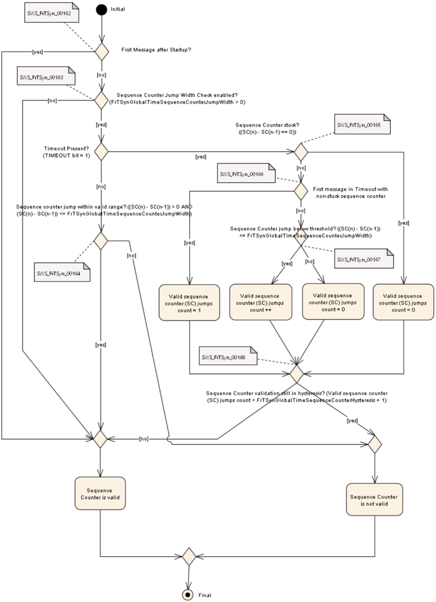

**注意：** 以下三项序列计数器校验要求在源文档中标记为已废弃。

连续两条属于同一时间域的 **SYNC** 报文或连续两条 **OFS** 报文之间的序列计数器跳变宽度，应大于 0 且小于或等于 FrTSynGlobalTimeSequenceCounterJumpWidth；否则，时基从节点应丢弃相应的 **SYNC**/**OFS** 报文。如果 FrTSynGlobalTimeSequenceCounterJumpWidth 设为 0，则时基从节点不应执行序列计数器跳变宽度检查。

收到 **SYNC** 或 **OFS** 报文时，时基从节点应按照 FrTSynGlobalTimeSequenceCounterJumpWidth 检查每个时间域中收到报文的序列计数器，但以下情况除外：该报文是启动后的第一条报文，或者该报文是检测到时基更新时间超时后的第一条报文（时基同步状态 `timeBaseStatus` 中的 `TIMEOUT` 位已置位）。

时基超时存在期间（时基同步状态 `timeBaseStatus` 中的 `TIMEOUT` 位已置位），**FrTSyn** 应丢弃 **SYNC** 或 **OFS** 报文，直到成功校验连续的 `n` 条 **SYNC** 或 **OFS** 报文为止；`n` 由参数 FrTSynGlobalTimeSequenceCounterHysteresis 给出。

收到 **SYNC** 或 **OFS** 报文时，如果该报文是启动后的第一条 **SYNC** 或 **OFS** 报文，则时基从节点应将其序列计数器值视为有效。

**理由：** 启动后跳过序列计数器检查是合理的，这样可以允许时基从节点的序列计数器与时基主节点的序列计数器同步。

收到 **SYNC** 或 **OFS** 报文时，如果已禁用 **SYNC** 或 **OFS** 报文的序列计数器检查（即 FrTSynGlobalTimeSequenceCounterJumpWidth == 0），则时基从节点应将该报文的序列计数器值视为有效。

收到 **SYNC** 或 **OFS** 报文时，如果该报文不是启动后的第一条 **SYNC** 或 **OFS** 报文、已启用序列计数器检查（即 FrTSynGlobalTimeSequenceCounterJumpWidth > 0），且该时间域未处于超时状态（时基同步状态 `timeBaseStatus` 中的 `TIMEOUT` 位未置位），则时基从节点应检查当前报文与前一条 **SYNC**（或相应的 **OFS**）报文的序列计数器之差。

如果差值大于 0 且小于或等于 FrTSynGlobalTimeSequenceCounterJumpWidth，则时基从节点应将该序列计数器值视为有效；否则应视为无效。

###### 6.5.3.3.1. 序列计数器滞回

本节规定如何使用可选的滞回机制（FrTSynGlobalTimeSequenceCounterHysteresis，参见本节后续规定）检查序列计数器值是否有效，即序列计数器检查是否实际成功。

这要求连续多个序列计数器跳变均有效。以下规定描述单个序列计数器跳变何时视为有效。

滞回机制可提高对以下情形的稳健性：主节点实现存在缺陷，或有人注入无效主节点报文，即序列计数器增量超过 FrTSynGlobalTimeSequenceCounterJumpWidth。在这种情形下，如果没有滞回机制，任何序列计数器值（包括无效值）都可能使时基从节点退出超时状态，尽管序列计数器并未正确递增。滞回机制可以避免这种情况。

收到 **SYNC** 或 **OFS** 报文时，如果已启用序列计数器检查（即 FrTSynGlobalTimeSequenceCounterJumpWidth > 0）、该时间域处于超时状态（时基同步状态 `timeBaseStatus` 中的 `TIMEOUT` 位置位），且序列计数器卡住（即当前报文与前一条 **SYNC** 或相应 **OFS** 报文的序列计数器之差为 0），则时基从节点应将该序列计数器跳变视为无效。

收到 **SYNC** 或 **OFS** 报文时，如果已启用序列计数器检查、该时间域处于超时状态，且这是超时期间序列计数器未卡住的第一条 **SYNC** 或 **OFS** 报文，则时基从节点应将该序列计数器跳变视为有效。

**理由：** 超时之后（例如时基主节点复位或断开），收到的第一条时间同步报文中的序列计数器很可能失去同步，即序列计数器差值超过 FrTSynGlobalTimeSequenceCounterJumpWidth。为使序列计数器更快地重新同步到时基主节点，第一条时间同步报文的序列计数器不按照 FrTSynGlobalTimeSequenceCounterJumpWidth 进行检查。但是，即使在这种情况下，卡住的序列计数器仍始终视为无效（参见上文规定）。

收到 **SYNC** 或 **OFS** 报文时，如果已启用序列计数器检查、该时间域处于超时状态、序列计数器未卡住（即当前报文与前一条报文的序列计数器之差不为 0），且这不是超时期间序列计数器未卡住的第一条 **SYNC** 或 **OFS** 报文，则时基从节点应检查当前报文与前一条 **SYNC** 或相应 **OFS** 报文的序列计数器之差是否超过 FrTSynGlobalTimeSequenceCounterJumpWidth。

如果差值超过 FrTSynGlobalTimeSequenceCounterJumpWidth，则时基从节点应将该序列计数器跳变视为无效；否则应视为有效。

收到 **SYNC** 或 **OFS** 报文时，如果已启用序列计数器检查，且该时间域处于超时状态，则时基从节点应检查连续有效序列计数器跳变的数量（参见本节前述规定）。

如果连续有效序列计数器跳变的数量超过 FrTSynGlobalTimeSequenceCounterHysteresis，则时基从节点应将序列计数器值视为有效；否则应视为无效。

##### 6.5.3.4. CRC 校验

如果配置要求校验 **CRC**，应使用 [\[6\]](#ref-6) 中定义的 Crc_CalculateCRC8H2F 函数校验 **CRC**。

`DataID` 应按以下方式计算：

```C
DataID = DataIDList[SC]
```

每种报文类型的 `DataIDList` 由配置提供。

**注意：** 从预定义的 `DataIDList` 中选择特定的 `DataID`，可确保识别时间同步报文中的数据元素。

**CRC** 应基于时间同步报文字节 2 至字节 15 和 `DataID` 计算：先处理字节 2，再按升序处理其余字节，最后处理 `DataID`。

##### 6.5.3.5. ICV 验证

有关各时间域所引用 **FV** 的配置详情，请参阅 [\[5\]](#ref-5) 的第 7.3.13 章。

如果引用了 **FV**（参见 FrTSynIcvVerificationFvIdRef），且收到的 **SYNC**/**OFS** 报文中的 `FVL` 大于 0，则时基从节点应调用 **StbM_GetRxFreshness API** 获取 **FV**，并使用以下参数：

- 从 FrTSynIcvVerificationFvIdRef 引用中取得的 StbMFreshnessValueId；
- 从 **SYNC**/**OFS** 报文的 **FV** 字段收到的 StbMTruncatedFreshnessValue；
- 从 **SYNC**/**OFS** 报文的 `FVL` 字段收到的 StbMTruncatedFreshnessValueLength；
- 从 FrTSynIcvVerificationFvIdRef 引用中取得的 StbMFreshnessValueLength；
- 作为当前报文失败验证次数（**ICV** 验证尝试计数器）的 StbMAuthVerifyAttempts。

如果收到的 **SYNC**/**OFS** 报文中的 `FVL` 等于 0，则时基从节点不应在 **ICV** 验证中包含 **FV**。

如果未引用 **FV**（参见 FrTSynIcvVerificationFvIdRef），且收到的 **SYNC**/**OFS** 报文中的 `FVL` 大于 0，则时基从节点应停止 **ICV** 验证，并将 **ICV** 验证视为失败。

如果 StbM_GetRxFreshness 返回 `E_OK`，时基从节点应在 **ICV** 验证中使用 **FV**。

如果 StbM_GetRxFreshness 返回不可恢复的错误码（即 `E_NOT_OK`），时基从节点应：

- 将收到的 **SYNC**/**OFS** 报文的 **ICV** 验证视为失败；
- 停止 **ICV** 验证；
- 调用 Det_ReportRuntimeError，将参数 `ErrorId` 设为 `[FRTSYN_E_FRESHNESSFAILURE](#682-运行时错误)`；
- 调用 IdsM_SetSecurityEventWithContextData，将参数 `EventId` 设为 `SEV_TSYN_FR_FRESHNESS_NOT_AVAILABLE`。

有关用于 **ICV** 验证的 **CSM** 作业配置详情，请参阅 [\[7\]](#ref-7) 的第 10.2.5 章。

如果某时间域的 FrTSynIcvVerificationBase 配置为 `ICV_MAC`，时基从节点应调用 Csm_MacVerify 验证 **ICV** 值，并使用 `ICVL` 指定的字节数。

如果某时间域的 FrTSynIcvVerificationBase 配置为 `ICV_SIGNATURE`，时基从节点应调用 Csm_SignatureVerify 验证 **ICV** 值，并使用 `ICVL` 指定的字节数。

**注意：** 模式参数有意留给实现者选择（例如，`CRYPTO_OPERATIONMODE_SINGLECALL` 可能是最佳选项，因为它不需要进一步调用 **CSM**）。

用于生成 **ICV** 的 **CSM** 作业可以配置为同步或异步行为。

如果 FrTSynIcvVerificationTimeout 设为 0，则时基从节点不应监视 **ICV** 验证超时。

如果 Csm_MacVerify 或 Csm_SignatureVerify 返回可恢复的错误码（例如 `CRYPTO_E_BUSY` 或 `CRYPTO_QUEUE_FULL`），则时基从节点应将收到的 **SYNC**/**OFS** 报文的验证视为失败，并递增该报文的 **ICV** 认证构建计数器。

如果 FrTSynIcvVerificationTimeout 设为大于 0 的值，且 Csm_MacVerify 或 Csm_SignatureVerify 返回 `E_OK`，时基从节点应启动 FrTSynIcvVerificationTimeout。

如果 FrTSynIcvVerificationTimeout 设为大于 0 的值，且调用了回调函数 [FrTSyn_IcvVerificationIndication](#744-frtsyn_icvverificationindication)，时基从节点应停止 FrTSynIcvVerificationTimeout。

如果满足以下任一条件：

- **ICV** 认证构建计数器已达到配置值 FrTSynRxAuthenticationBuildAttempts；
- **ICV** 验证尝试计数器已达到配置值 FrTSynIcvVerificationAttempts；
- **ICV** 验证返回不可恢复的错误，例如 `E_NOT_OK` 或 `KEY_FAILURE`；
- 收到的 **SYNC**/**OFS** 报文中的 `ICVL` 为 0；
- 在收到 [FrTSyn_IcvVerificationIndication](#744-frtsyn_icvverificationindication) 回调通知之前，FrTSynIcvVerificationTimeout 已到期；

则时基从节点应停止 **ICV** 验证、将验证视为失败，并调用 IdsM_SetSecurityEventWithContextData，将参数 `EventId` 设为 `SEV_TSYN_FR_ICV_VERIFICATION_FAILED`。

对于每次收到需要进行 **ICV** 验证的报文，时基从节点应维护一个认证构建计数器（参见 FrTSynRxAuthenticationBuildAttempts）。

首次处理需要进行 **ICV** 验证的报文时（即对每条收到的报文首次尝试获取新鲜度值并验证 **ICV** 时），时基从节点应将认证构建计数器设为 0。

如果 StbM_GetRxFreshness 返回可恢复的错误码（例如 `STBM_E_BUSY`），时基从节点应递增认证构建计数器，并且不执行 **ICV** 验证。

如果认证报文验证失败，且认证构建计数器尚未达到配置值 FrTSynRxAuthenticationBuildAttempts，则时基从节点应在下一次调用 [FrTSyn_MainFunction](#751-frtsyn_mainfunction) 时重试获取新鲜度值和验证 **ICV**。

如果 **ICV** 验证已成功执行，但验证结果失败（例如 **MAC** 验证失败或密钥无效），时基从节点应递增 **ICV** 验证尝试计数器，并将认证构建计数器设为 0。

**注意：** 重置认证构建计数器可避免在仍可尝试 **ICV** 验证时过早丢弃认证过程。

##### 6.5.3.6. 报文拆解

对于每条收到的时间同步报文，**FrTSyn** 应按以下条件进行校验（所有条件均须满足）：

1. 报文类型符合 FrTSynRxCrcValidated 参数的配置；
2. **SC** 值有效（参见第 [6.5.3.3](#6533-序列计数器校验) 节）；
3. `D` 符合每种报文类型所定义的时间域范围；
4. `D` 与某个已配置的时间域匹配；
5. `SyncTimeNSec`（**SYNC** 报文）或 `OfsTimeNSec`（**OFS** 报文）符合 `StbM_TimeStampType.nanoseconds` 定义的范围；
6. **CRC**（包括 `DataID`）符合 FrTSynRxCrcValidated 参数的配置；
7. **ICV** 验证符合 FrTSynRxIcvVerificationType 参数的配置且成功。

如果收到的时间同步报文通过校验，**FrTSyn** 应拆解该报文，并通过 StbM_BusSetGlobalTime 将全局时间转发给 **StbM**。

如果收到的时间同步报文未通过校验，**FrTSyn** 应丢弃该报文。

### 6.6. 时间记录

#### 6.6.1. 全局时间测量支持

调用 StbM_BusSetGlobalTime 时，应将 `measureDataPtr` 结构体成员 `pathDelay` 设为 0。

#### 6.6.2. 时间验证

如果 FrTSynTimeValidationSupport 设为 `TRUE`，**FrTSyn** 应支持时间验证。

如果启用了 FrTSynTimeValidationSupport，且某个时间域的 FrTSynEnableTimeValidation 已启用，则 **FrTSyn** 应为该时间域执行时间验证所需的时间记录。

如果某个时间域已启用时间验证所需的时间记录，且 **FrTSyn** 被配置为该时间域的时基从节点，则在成功接收到 **SYNC** 报文后，**FrTSyn** 应调用 StbM_FrSetSlaveTimingData。

应在调用 StbM_BusSetGlobalTime 之后调用 StbM_FrSetSlaveTimingData。

**注意：** 必须先调用 StbM_BusSetGlobalTime，因为该函数会更新同步本地时间元组（参见 [\[5\]](#ref-5)），而 StbM_FrSetSlaveTimingData 需要使用该元组。时基从节点的整体 **API** 调用顺序见图 9.2。

调用 StbM_FrSetSlaveTimingData 时，**FrTSyn** 应通过参数 `measureDataPtr` 传递以下值：

- **SYNC** 报文中收到的序列计数器；
- 收到 **SYNC** 报文的物理通道的网段标识（参见参数 FrTSynGlobalTimeNetworkSegmentId）；
- 收到 **SYNC** 报文时读取的 `currentCycle`、`currentMacroticks` 和 `FCNT`（参见第 [6.5.3.1](#6531-全局时间计算) 节第 2 步）；
- `CycleLength` 和 `MacrotickDuration`；
- 第 [6.5.3.1](#6531-全局时间计算) 节中读取的 **SYNC** 入口时间戳 `T1VLT`；
- **SYNC** 报文中收到的 `T0`（参见第 [6.5.3.1](#6531-全局时间计算) 节第 1 步）。

以下结构体成员应传递为 0：

- `measureDataPtr->referenceLocalTimestamp`；
- `measureDataPtr->referenceGlobalTimestampSec`。

**注意：** `MacrotickDuration` 按 `CycleLength / MacroticksPerCycle` 计算。

**注意：** **FrTSyn** 传递 0 是为了避免未定义值。结构体成员 `referenceLocalTimestamp` 和 `referenceGlobalTimestampSec` 将由 **StbM** 内部的 StbM_FrSetSlaveTimingData 设置（参见 [\[5\]](#ref-5) 中的相关 StbM 要求）。

如果某个时间域已启用时间验证所需的时间记录，且 **FrTSyn** 被配置为该时间域的时基主节点，则在成功发送 **SYNC** 报文后，**FrTSyn** 应调用 StbM_FrSetMasterTimingData。

**注意：** 时基主节点的整体 **API** 调用顺序见图 9.1。

调用 StbM_FrSetMasterTimingData 时，**FrTSyn** 应通过参数 `measureDataPtr` 传递以下数据：

- **SYNC** 报文中发送的序列计数器；
- 发送 **SYNC** 报文的物理通道的网段标识（参见参数 FrTSynGlobalTimeNetworkSegmentId）；
- 构造 **SYNC** 报文时读取的 `currentCycle` 和 `currentMacroticks`（参见第 [6.4.6.1](#6461-全局时间计算) 节第 2 步）；
- `CycleLength` 和 `MacrotickDuration`；
- 参考时间戳 `T1VLT`（参见第 [6.4.6.1](#6461-全局时间计算) 节第 2 步）；
- **SYNC** 报文中发送的 `T0`（参见第 [6.4.6.1](#6461-全局时间计算) 节第 3 步）。

### 6.7. 安全事件

如果已为 **FrTSyn** 模块启用安全事件报告（FrTSynEnableSecurityEventReporting = `true`），则应通过 **BSWGeneral** [\[3\]](#ref-3) 中定义的接口将相应安全事件报告给 **IdsM** [\[8\]](#ref-8)。

下表列出了 **FrTSyn** 标准化的安全事件及其触发条件。

| 名称 | 说明 | ID |
| --- | --- | --- |
| SEV_TSYN_FR_ICV_GENERATION_FAILED | **SYNC**/**OFS** 报文的 **ICV** 生成失败 | 70 |
| SEV_TSYN_FR_ICV_VERIFICATION_FAILED | 收到的 **SYNC**/**OFS** 报文的 **ICV** 验证失败 | 71 |
| SEV_TSYN_FR_FRESHNESS_NOT_AVAILABLE | 无法从 **FVM** 获取新鲜度值 | 72 |

下表描述应针对相应安全事件报告的上下文数据：

| 安全事件 | 上下文数据 |
| --- | --- |
| SEV_TSYN_FR_ICV_GENERATION_FAILED | 上下文数据（1 字节）——GlobalTimeDomainId |
| SEV_TSYN_FR_ICV_VERIFICATION_FAILED | 上下文数据（1 字节）——GlobalTimeDomainId |
| SEV_TSYN_FR_FRESHNESS_NOT_AVAILABLE | 上下文数据（1 字节）——GlobalTimeDomainId |

### 6.8. 错误分类

**基础软件模块通用规范**（**SWS BSW General**）[\[3\]](#ref-3) 的第 7.2 节“错误处理”详细说明了基础软件的错误处理方式。该节尤其规定了一种分类方案，用于划分 **BSW** 模块中可能发生的五种错误类型。

在此基础上，以下小节按错误类型分别规定具体错误。

#### 6.8.1. 开发错误

| 错误类型 | 相关错误代码 | 错误值 |
| --- | --- | --- |
| 使用错误的 **PDU** 或 **SDU** 调用 **API** 服务。 | FRTSYN_E_INVALID_PDUID | 0x01 |
| 在未初始化状态下使用 **API** 服务。 | FRTSYN_E_UNINIT | 0x20 |
| 指针无效。 | FRTSYN_E_NULL_POINTER | 0x21 |
| **FrTSyn** 初始化失败。 | FRTSYN_E_INIT_FAILED | 0x22 |
| 使用无效参数调用 **API**。 | FRTSYN_E_PARAM | 0x23 |
| 控制器索引无效。 | FRTSYN_E_INV_CTRL_IDX | 0x24 |

#### 6.8.2. 运行时错误

| 错误类型 | 相关错误代码 | 错误值 |
| --- | --- | --- |
| 无法从 **FVM** 获取 **FV**。 | FRTSYN_E_FRESHNESSFAILURE | 0x01 |

#### 6.8.3. 瞬态故障

不存在瞬态故障。

#### 6.8.4. 生产错误

不存在生产错误。

#### 6.8.5. 扩展生产错误

不存在扩展生产错误。

## 7. API规范

### 7.1. 导入的类型

本节列出从以下模块包含的全部类型：

**FrTSyn** 模块的导入数据类型定义

| 模块 | 头文件 | 导入的类型 |
| --- | --- | --- |
| ComStack_Types | ComStack_Types.h | PduIdType |
| ComStack_Types | ComStack_Types.h | PduInfoType |
| ComStack_Types | ComStack_Types.h | PduLengthType |
| Csm | Rte_Csm_Type.h | Crypto_OperationModeType |
| Csm | Rte_Csm_Type.h | Crypto_ResultType |
| Csm | Rte_Csm_Type.h | Crypto_VerifyResultType |
| Eth | Eth.h | Eth_RateDeviationStatusType (draft) |
| Eth | Eth.h | Eth_RateDeviationType (draft) |
| FrIf | FrIf.h | FrIf_StateType |
| IdsM | IdsM_Types.h | IdsM_SecurityEventIdType |
| StbM | Rte_StbM_Type.h | StbM_FrTimeMasterMeasurementType |
| StbM | Rte_StbM_Type.h | StbM_FrTimeSlaveMeasurementType |
| StbM | Rte_StbM_Type.h | StbM_SynchronizedTimeBaseType |
| StbM | Rte_StbM_Type.h | StbM_TimeBaseStatusType |
| StbM | Rte_StbM_Type.h | StbM_TimeStampShortType |
| StbM | Rte_StbM_Type.h | StbM_TimeStampType |
| StbM | Rte_StbM_Type.h | StbM_TimeTupleType |
| StbM | Rte_StbM_Type.h | StbM_UserDataType |
| StbM | StbM.h | StbM_MeasurementType |
| StbM | StbM.h | StbM_VirtualLocalTimeType |
| Std | Std_Types.h | Std_ReturnType |
| Std | Std_Types.h | Std_VersionInfoType |

### 7.2. 类型定义

#### 7.2.1. FrTSyn_ConfigType

结构类型。元素：实现特定；Type：-；Comment：-。此结构是 **FlexRay** 时间同步配置的基础类型。初始化时会使用指向此结构实例的指针。此结构的内容在第 [9](#9-配置规范) 章“配置规范”中定义。可通过 **FrTSyn.h** 获得。

#### 7.2.2. FrTSyn_TransmissionModeType

枚举类型，用于处理发送模式的启用和禁用。取值：`FRTSYN_TX_OFF`（发送禁用）、`FRTSYN_TX_ON`（发送启用）。可通过 **FrTSyn.h** 获得。

### 7.3. 函数定义

#### 7.3.1. FrTSyn_Init

**说明**: 初始化 **FlexRay** 时间同步。可通过 **FrTSyn.h** 获得。本服务为同步调用，不可重入。参数 configPtr（in）：指向所选配置结构的指针。服务 ID 0x01。

```C
void FrTSyn_Init ( const FrTSyn_ConfigType* configPtr )
```

细节见第 [6.2.1](#621-初始化) 节。

#### 7.3.2. FrTSyn_GetVersionInfo

**说明**: 返回本模块的版本信息。可通过 **FrTSyn.h** 获得。本服务为同步调用，不可重入。参数 versioninfo（out）：用于存储本模块版本信息的位置的指针。服务 ID 0x02。

```C
void FrTSyn_GetVersionInfo ( Std_VersionInfoType* versioninfo )
```

#### 7.3.3. FrTSyn_SetTransmissionMode

**说明**: 本 **API** 用于启用和禁用 **FrTSyn** 的 **TX** 能力。可通过 **FrTSyn.h** 获得。本服务为同步调用，不可重入。参数 CtrlIdx（in）：**FlexRay** 通道的索引。参数 Mode（in）：`FRTSYN_TX_OFF` 或 `FRTSYN_TX_ON`。服务 ID 0x03。

```C
void FrTSyn_SetTransmissionMode ( uint8 CtrlIdx, FrTSyn_TransmissionModeType Mode )
```

如果启用了开发错误检测（即 FrTSynDevErrorDetect 设为 `TRUE`），且函数调用因以下原因失败，则 FrTSyn_SetTransmissionMode 应通知 **Det**：

- CtrlIdx 无效（[FRTSYN_E_INV_CTRL_IDX](#681-开发错误)）；
- Mode 无效（[FRTSYN_E_PARAM](#681-开发错误)）。

### 7.4. 回调通知

本节列出为其他模块提供的函数。

#### 7.4.1. FrTSyn_RxIndication

**说明**: 指示从下层通信接口模块接收到 **PDU**。可通过 **FrTSyn.h** 获得。本服务为同步调用；对于不同的 PduId 可重入，对于相同的 PduId 不可重入。参数 RxPduId（in）：接收到的 **PDU** 的 ID。参数 PduInfoPtr（in）：包含接收 **PDU** 的长度（SduLength）、指向包含 **PDU** 的缓冲区的指针（SduDataPtr）以及与该 **PDU** 相关的元数据（MetaData）。服务 ID 0x42。

```C
void FrTSyn_RxIndication ( PduIdType RxPduId, const PduInfoType* PduInfoPtr )
```

**注意：** 回调函数 FrTSyn_RxIndication 由 **FrIf** 调用，由 **FrTSyn** 模块实现。它在 **FR** 驱动程序发生接收指示事件时被调用。

如果启用了开发错误检测（FrTSynDevErrorDetect 设为 `TRUE`），且函数调用因以下原因失败，则 FrTSyn_RxIndication 应通知 **Det**：

- RxPduId 无效（[FRTSYN_E_INVALID_PDUID](#681-开发错误)）；
- PduInfoPtr 或 SduDataPtr 等于 `NULL_PTR`（[FRTSYN_E_NULL_POINTER](#681-开发错误)）。

**前提：** **FrTSyn** 模块已正确初始化。

#### 7.4.2. FrTSyn_TriggerTransmit

**说明**: 在此 **API** 中，上层模块（称为调用模块）应检查可用数据是否适合 PduInfoPtr->SduLength 所报告的缓冲区大小。如果适合，则应将数据复制到 PduInfoPtr->SduDataPtr 所指向的缓冲区，并更新实际复制数据的长度 PduInfoPtr->SduLength。如果不适合，则应返回 `E_NOT_OK`，且不得更改 PduInfoPtr。可通过 **FrTSyn.h** 获得。本服务为同步调用；对于不同的 PduId 可重入，对于相同的 PduId 不可重入。参数 TxPduId（in）：请求发送的 **SDU** 的 ID。参数 PduInfoPtr（inout）：包含用于复制 **SDU** 数据的缓冲区指针（SduDataPtr）以及可用缓冲区大小（SduLength）；返回时，服务通过 SduLength 指示已复制的 **SDU** 数据长度。返回值 Std_ReturnType：`E_OK` 表示 **SDU** 已复制且 SduLength 指示已复制字节数；`E_NOT_OK` 表示未复制 **SDU** 数据，此时不得使用 PduInfoPtr，因为它可能包含空指针或指向无效数据。服务 ID 0x41。

```C
Std_ReturnType FrTSyn_TriggerTransmit ( PduIdType TxPduId, PduInfoType* PduInfoPtr )
```

**注意：** **FrTSyn** 模块的环境可能在中断上下文中调用 FrTSyn_TriggerTransmit。

如果启用了开发错误检测（FrTSynDevErrorDetect 设为 `TRUE`），且函数调用因以下原因失败，则 FrTSyn_TriggerTransmit 应通知 **Det**：

- TxPduId 无效（[FRTSYN_E_INVALID_PDUID](#681-开发错误)）；
- PduInfoPtr 或 SduDataPtr 等于 `NULL_PTR`（[FRTSYN_E_NULL_POINTER](#681-开发错误)）。

#### 7.4.3. FrTSyn_IcvGenerationIndication

**说明**: 该 **API** 服务向 **FrTSyn** 提供 **ICV** 生成的指示及结果。可通过 **FrTSyn.h** 获得。本服务为同步调用，可重入。参数 jobId（in）：引发该回调的操作的 JobID。参数 result（in）：加密操作的结果。服务 ID 0x5。

```C
void FrTSyn_IcvGenerationIndication ( uint32 jobId, Crypto_ResultType result )
```

如果启用了开发错误检测（FrTSynDevErrorDetect 设为 `TRUE`），且函数调用因 jobId 无效（[FRTSYN_E_PARAM](#681-开发错误)）而失败，则 FrTSyn_IcvGenerationIndication 应通知 **Det**。

#### 7.4.4. FrTSyn_IcvVerificationIndication

**说明**: 该 **API** 服务向 **FrTSyn** 提供 **ICV** 验证的指示及结果。可通过 **FrTSyn.h** 获得。本服务为同步调用，可重入。参数 jobId（in）：引发该回调的操作的 JobID。参数 result（in）：加密操作的结果。服务 ID 0x6。

```C
void FrTSyn_IcvVerificationIndication ( uint32 jobId, Crypto_ResultType result )
```

如果启用了开发错误检测（FrTSynDevErrorDetect 设为 `TRUE`），且函数调用因 jobId 无效（[FRTSYN_E_PARAM](#681-开发错误)）而失败，则 FrTSyn_IcvVerificationIndication 应通知 **Det**。

### 7.5. 调度函数

这些函数由基础软件调度器直接调用。以下函数不得有返回值或参数，且均不得重入。

#### 7.5.1. FrTSyn_MainFunction

**说明**: 用于周期性调用和/或发送时间同步报文的主函数。可通过 **FrTSyn_SchM.h** 获得。服务 ID 0x04。

```C
void FrTSyn_MainFunction ( void )
```

FrTSyn_MainFunction 的调用频率由配置参数 FrTSynMainFunctionPeriod 确定。

### 7.6. 期望接口

本节列出其他模块所需的全部接口。

#### 7.6.1. 必需接口

本小节定义实现模块强制功能所需的全部接口。

| API 函数 | 头文件 | 说明 |
| --- | --- | --- |
| FrIf_GetCycleLength | FrIf.h | 返回配置参数 GdCycle 中配置的时间值（单位为纳秒），该参数对应索引为 FrIf_CtrlIdx 的 **FlexRay** 控制器。 |
| FrIf_GetGlobalTime | FrIf.h | 封装 **FlexRay** 驱动程序的 API 函数 Fr_GetGlobalTime()。重要提示：FrIf_GetGlobalTime 可在独占区内调用。 |
| FrIf_GetMacroticksPerCycle | FrIf.h | 获取每个周期的宏节拍数量。 |
| FrIf_GetState | FrIf.h | 获取当前 FrIf 状态。 |
| StbM_GetCurrentVirtualLocalTime | StbM.h | 返回被引用时基的虚拟本地时间。 |

#### 7.6.2. 可选接口

本小节定义实现模块可选功能所需的全部接口。

| API 函数 | 头文件 | 说明 |
| --- | --- | --- |
| Crc_CalculateCRC8H2F | Crc.h | 使用多项式 0x2F 对 Crc_Length 执行 **CRC8** 计算。 |
| Csm_MacGenerate | Csm.h | 使用给定数据执行 **MAC** 生成，并将 **MAC** 存储在 **MAC** 指针所指向的内存位置。 |
| Csm_MacVerify | Csm.h | 通过比较 **MAC** 是否由给定数据生成来验证给定的 **MAC**。 |
| Csm_SignatureGenerate | Csm.h | 使用给定数据执行签名计算，并将签名存储在结果指针所指向的内存位置。 |
| Csm_SignatureVerify | Csm.h | 通过比较签名是否由给定数据生成来验证给定的 **MAC**。 |
| Det_ReportError | Det.h | 报告开发错误的服务。 |
| Det_ReportRuntimeError | Det.h | 报告运行时错误的服务。如果配置了 callout，则应调用该 callout。 |
| FrIf_Transmit | FrIf.h | 请求发送 **PDU**。 |
| IdsM_SetSecurityEventWithContextData | IdsM.h | 用于向 **IdsM** 报告带有上下文数据的安全事件的应用接口。 |
| StbM_BusSetGlobalTime | StbM.h | 允许时基提供者模块将接收时间元组转发给 **StbM**。 |
| StbM_FrSetMasterTimingData (draft) | StbM_FrTSyn.h | 向 **StbM** 提供时基主节点的 **FlexRay** 时间同步模块专用数据。 |
| StbM_FrSetSlaveTimingData (draft) | StbM_FrTSyn.h | 允许 **FrTSyn** 模块向 **StbM** 转发 **FlexRay** 特定信息。 |
| StbM_GetCurrentTime | StbM.h | 返回时间元组（本地时间、全局时间和时基状态）以及用户数据详情。**注意：** 应在锁定中断的情况下或在独占区内调用此 **API**，以避免中断（例如，避免返回时的时间戳已过时）。 |
| StbM_GetOffset | StbM.h | 允许时间同步模块获取当前偏移时间和用户数据。 |
| StbM_GetRxFreshness (draft) | StbM.h | **StbM** 使用此接口查询当前的新鲜度值。 |
| StbM_GetTimeBaseStatus | StbM.h | 返回同步时基（或纯本地时基）的详细状态信息；如果针对偏移时基调用，还返回该偏移时基及其底层同步时基的详细状态信息。 |
| StbM_GetTimeBaseUpdateCounter | StbM.h | 允许时间同步模块检测某时基是否应在后续 &lt;Bus&gt;TSyn_MainFunction() 周期中立即发送。 |
| StbM_GetTxFreshness (draft) | StbM.h | 以大端格式，从新鲜度数组第一个字节的最高有效位开始返回新鲜度值。 |
| StbM_GetTxFreshnessTruncData (draft) | StbM.h | **StbM** 使用此接口获取当前的新鲜度值。该接口还提供在受保护时间同步报文中传输的截断新鲜度值。 |
| StbM_SPduTxConfirmation (draft) | StbM.h | **StbM** 使用此接口指示已启动受保护时间同步报文的发送。 |

## 8. 时序图

### 8.1. FlexRay 时间同步（时基主节点）

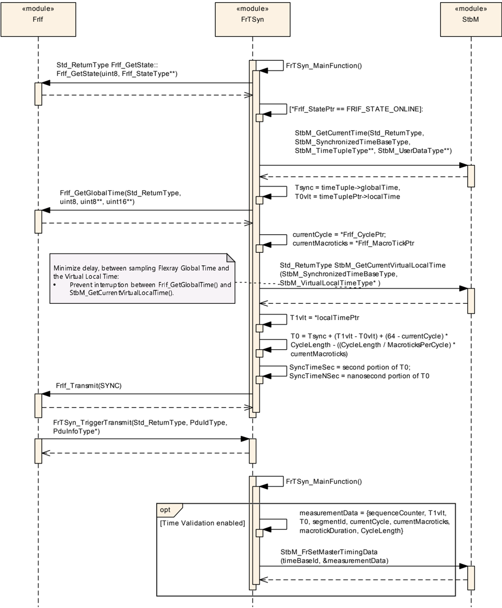

### 8.2. FlexRay 时间同步（时基从节点）

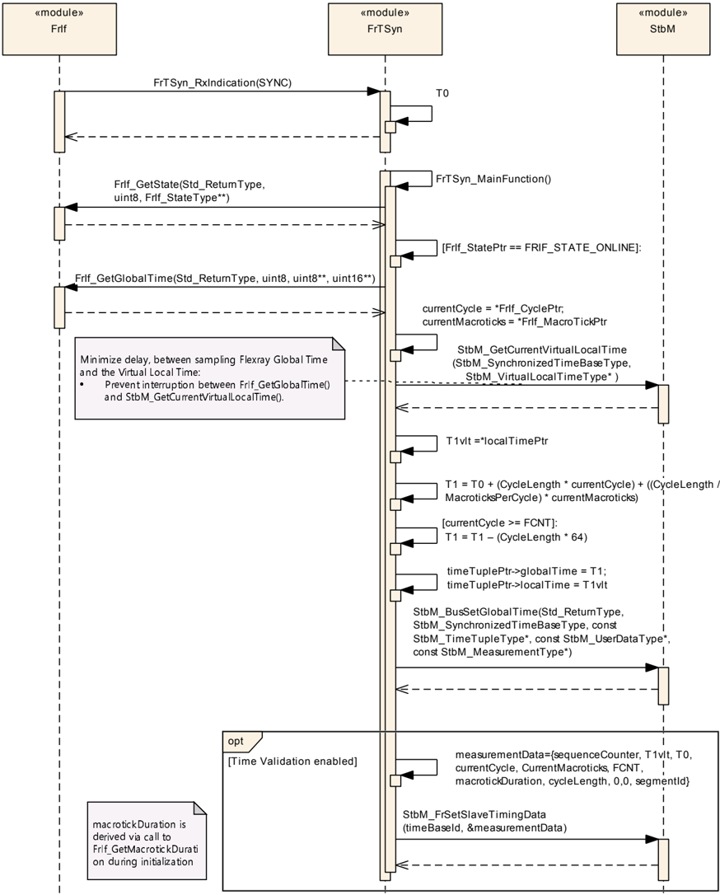

### 8.3. FlexRay 安全时间同步序列

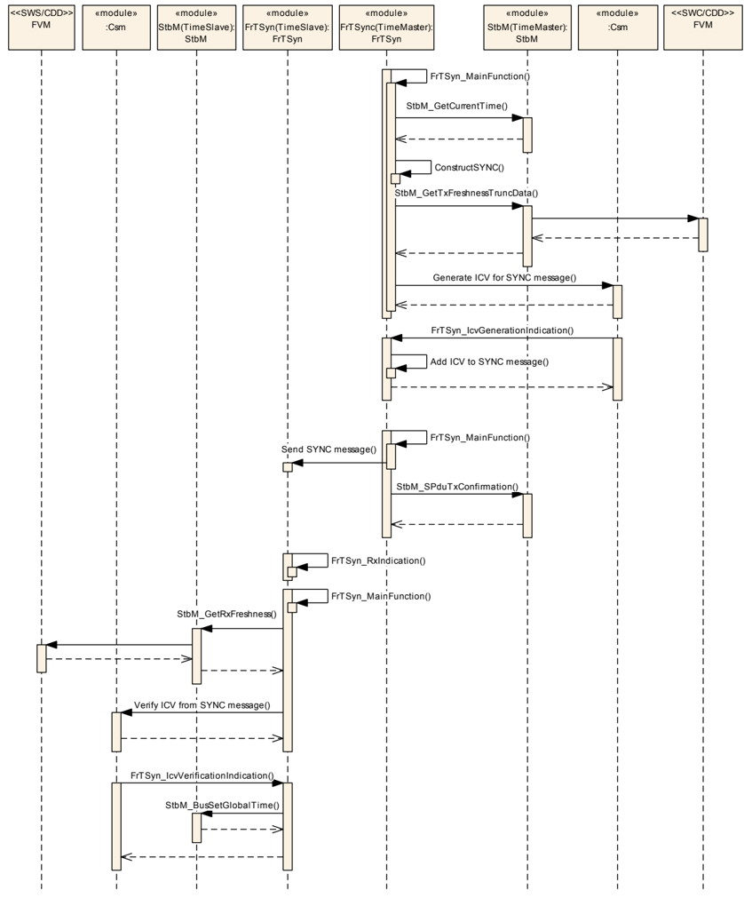

## 9. 配置规范

通常，本章定义配置参数及其在容器中的分组。为支持本规范，第 9.1 节描述基础知识，并规定参数规范所使用的模板（表）。为确保读者理解，我们有意在本规范中保留第 9.1 节。

第 9.2 节规定 **FrTSyn** 的结构（容器）和参数。

第 9.4 节规定 **FrTSyn** 的发布信息。

### 9.1. 如何阅读本章

详情请参阅 **SWS BSW General** [\[3\]](#ref-3) 的第 10.1 章“配置规范简介”。

### 9.2. 容器与配置参数

以下各节汇总通过 **FlexRay** 进行时间同步的所有配置参数。参数的详细含义见第 6 章和第 7 章。

#### 9.2.1. 变体

通过 **FlexRay** 进行时间同步的模块应支持时基主节点、时基从节点和时间网关的配置。

该模块支持不同的 post-build 变体（以前称为 post-build selectable configuration sets），但不支持 post-build loadable configuration。

#### 9.2.2. FrTSyn

| 字段 | 值 |
| --- | --- |
| SWS 条目 | [ECUC_FrTSyn_00001] |
| 模块名称 | FrTSyn |
| 描述 | 这是 **FlexRay** 时间同步的特定配置变体。 |
| Post-Build 变体支持 | true |
| 支持的配置变体 | VARIANT-PRE-COMPILE |

| 容器名称 | 多重性 | 作用域/依赖 |
| --- | --- | --- |
| FrTSynGeneral | 1 | 此容器保存 **FlexRay** 特定同步时基管理器的通用参数。 |
| FrTSynGlobalTimeDomain | 1..* | 表示 **FlexRay** 上存在全局时间域。**FrTSyn** 模块可同时管理多个全局时间域，这些时间域本身构成域和子域的层级结构。如果存在 **FrTSyn**，则假定至少存在一个全局时间域。 |

#### 9.2.3. FrTSynGeneral

| 字段 | 值 |
| --- | --- |
| SWS 条目 | [ECUC_FrTSyn_00003] |
| 容器名称 | FrTSynGeneral |
| 父容器 | FrTSyn |
| 描述 | 此容器保存 **FlexRay** 特定同步时基管理器的通用参数。 |
| 配置参数 | 见下方参数表。 |

| 字段 | 值 |
| --- | --- |
| SWS 条目 | [ECUC_FrTSyn_00002] |
| 参数名称 | FrTSynDevErrorDetect |
| 父容器 | FrTSynGeneral |
| 描述 | 开启或关闭开发错误检测与通知：**true**：启用检测与通知；**false**：禁用检测与通知。 |
| 多重性 | 1 |
| 类型 | EcucBooleanParamDef |
| 默认值 | false |
| Post-Build 变体值 | false |
| 值配置类 | Pre-compile time：X（All Variants）；Link time：-；Post-build time：- |
| 作用域/依赖 | scope: local |

| 字段 | 值 |
| --- | --- |
| SWS 条目 | [ECUC_FrTSyn_00044] |
| 参数名称 | FrTSynEnableSecurityEventReporting |
| 父容器 | FrTSynGeneral |
| 描述 | 开启或关闭向 **IdsM** 报告安全事件：**true**：启用报告；**false**：禁用报告。 |
| 多重性 | 1 |
| 类型 | EcucBooleanParamDef |
| 默认值 | false |
| Post-Build 变体值 | false |
| 值配置类 | Pre-compile time：X（All Variants）；Link time：-；Post-build time：- |
| 作用域/依赖 | scope: local |

| 字段 | 值 |
| --- | --- |
| SWS 条目 | [ECUC_FrTSyn_00016] |
| 参数名称 | FrTSynMainFunctionPeriod |
| 父容器 | FrTSynGeneral |
| 描述 | 主函数 FrTSyn_MainFunction 的调度周期。单位：[s]。 |
| 多重性 | 1 |
| 类型 | EcucFloatParamDef |
| 取值范围 | ]0 .. INF[ |
| 默认值 | - |
| Post-Build 变体值 | false |
| 值配置类 | Pre-compile time：X（All Variants）；Link time：-；Post-build time：- |
| 作用域/依赖 | scope: local |

| 字段 | 值 |
| --- | --- |
| SWS 条目 | [ECUC_FrTSyn_00040] |
| 参数名称 | FrTSynTimeValidationSupport |
| 父容器 | FrTSynGeneral |
| 描述 | 开启或关闭时间验证支持：**true**：启用时间验证；**false**：禁用时间验证。 |
| 多重性 | 1 |
| 类型 | EcucBooleanParamDef |
| 默认值 | false |
| Post-Build 变体值 | false |
| 值配置类 | Pre-compile time：X（All Variants）；Link time：-；Post-build time：- |
| 作用域/依赖 | scope: local |

| 字段 | 值 |
| --- | --- |
| SWS 条目 | [ECUC_FrTSyn_00019] |
| 参数名称 | FrTSynVersionInfoApi |
| 父容器 | FrTSynGeneral |
| 描述 | 激活或停用版本信息 **API**（FrTSyn_GetVersionInfo）。**true**：激活版本信息 **API**；**false**：停用版本信息 **API**。 |
| 多重性 | 1 |
| 类型 | EcucBooleanParamDef |
| 默认值 | false |
| Post-Build 变体值 | false |
| 值配置类 | Pre-compile time：X（All Variants）；Link time：-；Post-build time：- |
| 作用域/依赖 | scope: local |

| 容器名称 | 多重性 | 作用域/依赖 |
| --- | --- | --- |
| FrTSynSecurityEventRefs | 0..1 | 保存指向 IdsMEvent 元素的引用，这些元素代表 **FrTSyn** 模块在发生相应安全事件时应向 **IdsM** 报告的事件（前提是 FrTSynEnableSecurityEventReporting 设为 **true**）。此容器中的标准化安全事件可以扩展为供应商特定的安全事件。 |

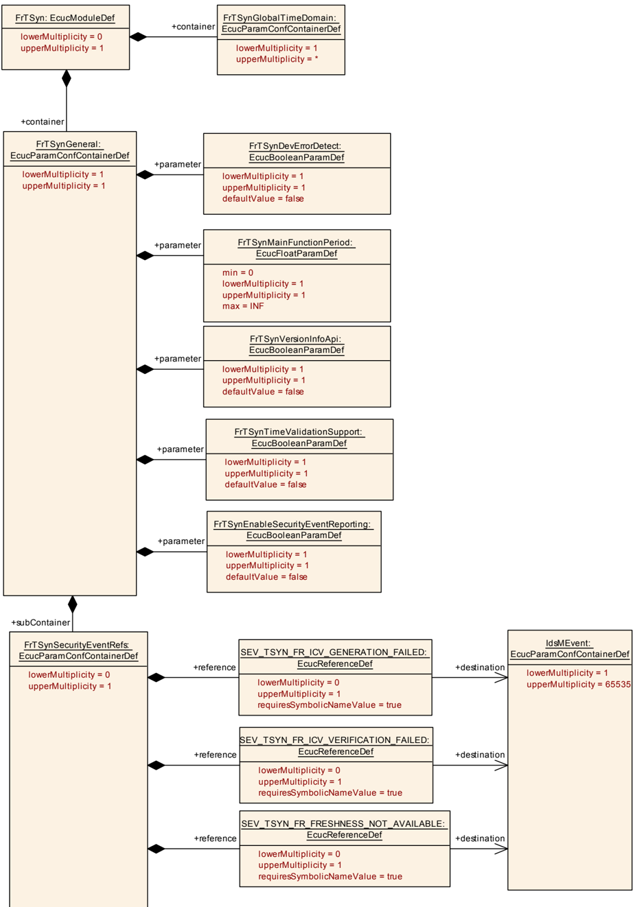

#### 9.2.4. FrTSynSecurityEventRefs

| 字段 | 值 |
| --- | --- |
| SWS 条目 | [ECUC_FrTSyn_00063] |
| 容器名称 | FrTSynSecurityEventRefs |
| 父容器 | FrTSynGeneral |
| 描述 | 保存指向 IdsMEvent 元素的引用，这些元素代表 **FrTSyn** 模块在发生相应安全事件时应向 **IdsM** 报告的事件（前提是 FrTSynEnableSecurityEventReporting 设为 **true**）。此容器中的标准化安全事件可以扩展为供应商特定的安全事件。 |
| Post-Build 变体多重性 | false |
| 多重性配置类 | Pre-compile time：X（所有变体）；Link time：-；Post-build time：- |
| 配置参数 | 见下方参数表。 |

| 字段 | 值 |
| --- | --- |
| SWS 条目 | [ECUC_FrTSyn_00047] |
| 参数名称 | SEV_TSYN_FR_FRESHNESS_NOT_AVAILABLE |
| 父容器 | FrTSynSecurityEventRefs |
| 描述 | **FVM** 中无可用 **FV**。上下文数据提供相应的域 ID。 |
| 多重性 | 0..1 |
| 类型 | 指向 IdsMEvent 的符号名称引用 |
| Post-Build 变体多重性 | false |
| Post-Build 变体值 | false |
| 多重性配置类 | Pre-compile time：X；Link time：-；Post-build time：- |
| 值配置类 | Pre-compile time：X；Link time：-；Post-build time：- |
| 作用域/依赖 | scope: local |

| 字段 | 值 |
| --- | --- |
| SWS 条目 | [ECUC_FrTSyn_00045] |
| 参数名称 | SEV_TSYN_FR_ICV_GENERATION_FAILED |
| 父容器 | FrTSynSecurityEventRefs |
| 描述 | **SYNC** 报文的 **ICV** 生成失败。上下文数据提供相应的域 ID。 |
| 多重性 | 0..1 |
| 类型 | 指向 IdsMEvent 的符号名称引用 |
| Post-Build 变体多重性 | false |
| Post-Build 变体值 | false |
| 多重性配置类 | Pre-compile time：X（所有变体）；Link time：-；Post-build time：- |
| 值配置类 | Pre-compile time：X（所有变体）；Link time：-；Post-build time：- |
| 作用域/依赖 | scope: local |

| 字段 | 值 |
| --- | --- |
| SWS 条目 | [ECUC_FrTSyn_00046] |
| 参数名称 | SEV_TSYN_FR_ICV_VERIFICATION_FAILED |
| 父容器 | FrTSynSecurityEventRefs |
| 描述 | **SYNC** 报文的 **ICV** 验证失败。上下文数据提供相应的域 ID。 |
| 多重性 | 0..1 |
| 类型 | 指向 IdsMEvent 的符号名称引用 |
| Post-Build 变体多重性 | false |
| Post-Build 变体值 | false |
| 多重性配置类 | Pre-compile time：X；Link time：-；Post-build time：- |
| 值配置类 | Pre-compile time：X；Link time：-；Post-build time：- |
| 作用域/依赖 | scope: local |

无包含的容器。

#### 9.2.5. FrTSynGlobalTimeDomain

| 字段 | 值 |
| --- | --- |
| SWS 条目 | [ECUC_FrTSyn_00004] |
| 容器名称 | FrTSynGlobalTimeDomain |
| 父容器 | FrTSyn |
| 描述 | 表示 **FlexRay** 上存在全局时间域。**FrTSyn** 模块可同时管理多个全局时间域，这些时间域本身构成域和子域的层级结构。如果存在 **FrTSyn**，则假定至少存在一个全局时间域。 |
| 配置参数 | 见下方参数表。 |

| 字段 | 值 |
| --- | --- |
| SWS 条目 | [ECUC_FrTSyn_00041] |
| 参数名称 | FrTSynEnableTimeValidation |
| 父容器 | FrTSynGlobalTimeDomain |
| 描述 | 为特定时间域启用或禁用时间验证所需的时间记录。 |
| 多重性 | 0..1 |
| 类型 | EcucBooleanParamDef |
| 默认值 | - |
| Post-Build 变体值 | false |
| 值配置类 | Pre-compile time：X（所有变体）；Link time：-；Post-build time：- |
| 作用域/依赖 | scope: local；仅当 FrTSynTimeValidationSupport 为 **TRUE** 时有效。值根据 **StbM** 中被引用时基的参数 StbMEnableTimeValidation 设置。 |

| 字段 | 值 |
| --- | --- |
| SWS 条目 | [ECUC_FrTSyn_00005] |
| 参数名称 | FrTSynGlobalTimeDomainId |
| 父容器 | FrTSynGlobalTimeDomain |
| 描述 | 全局时间域 ID。 |
| 多重性 | 1 |
| 类型 | EcucIntegerParamDef |
| 取值范围 | 0 .. 15 |
| 默认值 | - |
| Post-Build 变体值 | false |
| 值配置类 | Pre-compile time：X（所有变体）；Link time：-；Post-build time：- |
| 作用域/依赖 | scope: local |

| 字段 | 值 |
| --- | --- |
| SWS 条目 | [ECUC_FrTSyn_00042] |
| 参数名称 | FrTSynGlobalTimeNetworkSegmentId |
| 父容器 | FrTSynGlobalTimeDomain |
| 描述 | 表示系统级作用域中传送该全局时间的网络的数字标识符。 |
| 多重性 | 0..1 |
| 类型 | EcucIntegerParamDef |
| 取值范围 | 0 .. 255 |
| 默认值 | - |
| Post-Build 变体多重性 | false |
| Post-Build 变体值 | true |
| 多重性配置类 | Pre-compile time：X；Link time：-；Post-build time：- |
| 值配置类 | Pre-compile time：X；Link time：-；Post-build time：- |
| 作用域/依赖 | scope: local |

| 字段 | 值 |
| --- | --- |
| SWS 条目 | [ECUC_FrTSyn_00018] |
| 参数名称 | FrTSynSynchronizedTimeBaseRef |
| 父容器 | FrTSynGlobalTimeDomain |
| 描述 | 对所需同步时基的强制引用。 |
| 多重性 | 1 |
| 类型 | 指向 StbMSynchronizedTimeBase 的符号名称引用 |
| Post-Build 变体值 | false |
| 值配置类 | Pre-compile time：X（所有变体）；Link time：-；Post-build time：- |
| 作用域/依赖 | scope: local |

| 容器名称 | 多重性 | 作用域/依赖 |
| --- | --- | --- |
| FrTSynGlobalTimeMaster | 0..1 | 配置全局时间主节点。每个全局时间域都必须恰有一个全局时间主节点。该主节点可以存在，也可以不存在于已配置的 **ECU** 上。 |
| FrTSynGlobalTimeOfsDataIDList | 0..1 | **OFS** 报文的 DataIDList 用于通过 **CRC** 计算和报文认证过程识别数据元素。 |
| FrTSynGlobalTimeSlave | 0..1 | 表示所属全局时间域的时基从节点。 |
| FrTSynGlobalTimeSyncDataIDList | 0..1 | **SYNC** 报文的 DataIDList 用于通过 **CRC** 计算和报文认证过程识别数据元素。 |

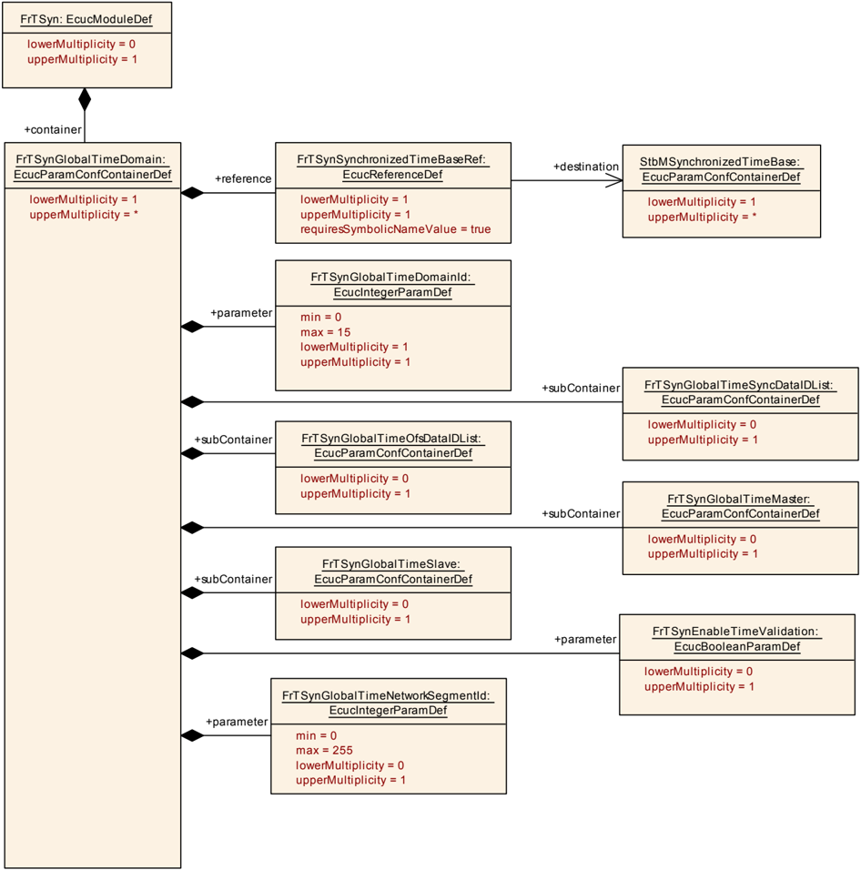

#### 9.2.6. FrTSynGlobalTimeSyncDataIDList

| 字段 | 值 |
| --- | --- |
| SWS 条目 | [ECUC_FrTSyn_00023] |
| 容器名称 | FrTSynGlobalTimeSyncDataIDList |
| 父容器 | FrTSynGlobalTimeDomain |
| 描述 | **SYNC** 报文的 DataIDList 用于通过 **CRC** 计算和报文认证过程识别数据元素。 |
| Post-Build 变体多重性 | true |
| 多重性配置类 | Pre-compile time：X（所有变体）；Link time：-；Post-build time：- |
| 配置参数 | 见下方参数表。 |

| 容器名称 | 多重性 | 作用域/依赖 |
| --- | --- | --- |
| FrTSynGlobalTimeSyncDataIDListElement | 16 | **SYNC** 报文 DataIDList 的元素，用于通过 **CRC** 计算和报文认证过程识别数据元素。 |

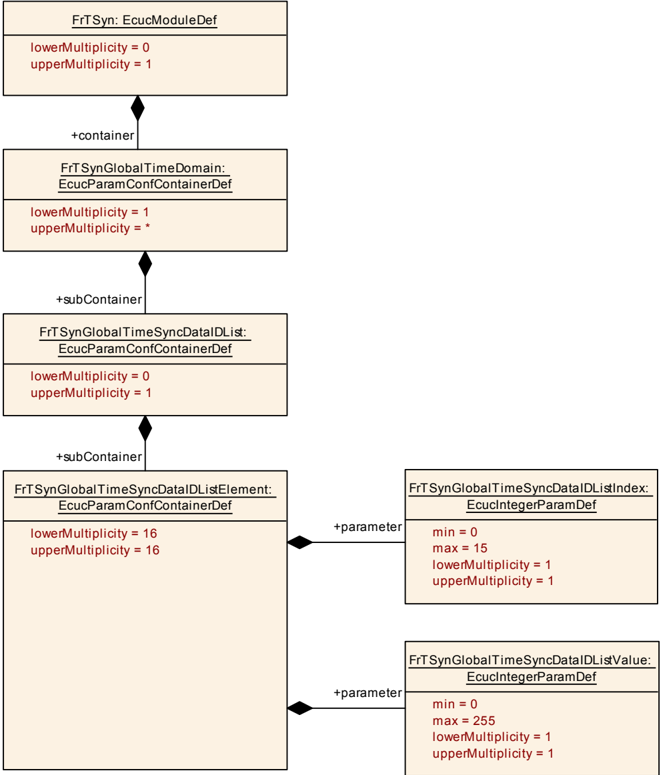

#### 9.2.7. FrTSynGlobalTimeSyncDataIDListElement

| 字段 | 值 |
| --- | --- |
| SWS 条目 | [ECUC_FrTSyn_00025] |
| 容器名称 | FrTSynGlobalTimeSyncDataIDListElement |
| 父容器 | FrTSynGlobalTimeSyncDataIDList |
| 描述 | **SYNC** 报文 DataIDList 的元素，用于通过 **CRC** 计算和报文认证过程识别数据元素。 |
| 配置参数 | 见下方参数表。 |

| 字段 | 值 |
| --- | --- |
| SWS 条目 | [ECUC_FrTSyn_00026] |
| 参数名称 | FrTSynGlobalTimeSyncDataIDListIndex |
| 父容器 | FrTSynGlobalTimeSyncDataIDListElement |
| 描述 | **SYNC** 报文 DataIDList 的索引，用于通过 **CRC** 计算和报文认证过程识别数据元素。 |
| 多重性 | 1 |
| 类型 | EcucIntegerParamDef |
| 取值范围 | 0 .. 15 |
| 默认值 | - |
| Post-Build 变体值 | true |
| 值配置类 | Pre-compile time：X（所有变体）；Link time：-；Post-build time：- |
| 作用域/依赖 | scope: local |

| 字段 | 值 |
| --- | --- |
| SWS 条目 | [ECUC_FrTSyn_00027] |
| 参数名称 | FrTSynGlobalTimeSyncDataIDListValue |
| 父容器 | FrTSynGlobalTimeSyncDataIDListElement |
| 描述 | **SYNC** 报文 DataIDList 的值，用于通过 **CRC** 计算和报文认证过程识别数据元素。 |
| 多重性 | 1 |
| 类型 | EcucIntegerParamDef |
| 取值范围 | 0 .. 255 |
| 默认值 | - |
| Post-Build 变体值 | true |
| 值配置类 | Pre-compile time：X（所有变体）；Link time：-；Post-build time：- |
| 作用域/依赖 | scope: local |

无包含的容器。

#### 9.2.8. FrTSynGlobalTimeOfsDataIDList

| 字段 | 值 |
| --- | --- |
| SWS 条目 | [ECUC_FrTSyn_00024] |
| 容器名称 | FrTSynGlobalTimeOfsDataIDList |
| 父容器 | FrTSynGlobalTimeDomain |
| 描述 | **OFS** 报文的 DataIDList 用于通过 **CRC** 计算和报文认证过程识别数据元素。 |
| Post-Build 变体多重性 | true |
| 多重性配置类 | Pre-compile time：X（所有变体）；Link time：-；Post-build time：- |
| 配置参数 | 见下方参数表。 |

| 容器名称 | 多重性 | 作用域/依赖 |
| --- | --- | --- |
| FrTSynGlobalTimeOfsDataIDListElement | 16 | **OFS** 报文 DataIDList 的元素，用于通过 **CRC** 计算和报文认证过程识别数据元素。 |

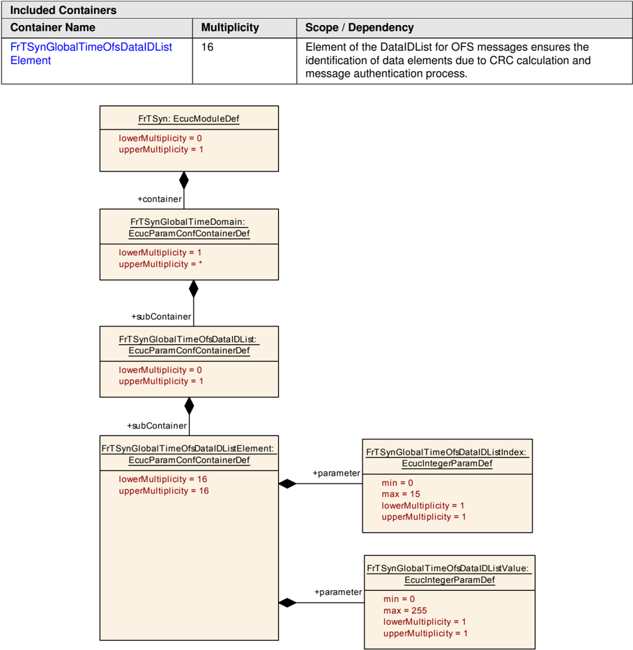

#### 9.2.9. FrTSynGlobalTimeOfsDataIDListElement

| 字段 | 值 |
| --- | --- |
| SWS 条目 | [ECUC_FrTSyn_00028] |
| 容器名称 | FrTSynGlobalTimeOfsDataIDListElement |
| 父容器 | FrTSynGlobalTimeOfsDataIDList |
| 描述 | **OFS** 报文 DataIDList 的元素，用于通过 **CRC** 计算和报文认证过程识别数据元素。 |
| 配置参数 | 见下方参数表。 |

| 字段 | 值 |
| --- | --- |
| SWS 条目 | [ECUC_FrTSyn_00029] |
| 参数名称 | FrTSynGlobalTimeOfsDataIDListIndex |
| 父容器 | FrTSynGlobalTimeOfsDataIDListElement |
| 描述 | **OFS** 报文 DataIDList 的索引，用于通过 **CRC** 计算和报文认证过程识别数据元素。 |
| 多重性 | 1 |
| 类型 | EcucIntegerParamDef |
| 取值范围 | 0 .. 15 |
| 默认值 | - |
| Post-Build 变体值 | true |
| 值配置类 | Pre-compile time：X（所有变体）；Link time：-；Post-build time：- |
| 作用域/依赖 | scope: local |

| 字段 | 值 |
| --- | --- |
| SWS 条目 | [ECUC_FrTSyn_00030] |
| 参数名称 | FrTSynGlobalTimeOfsDataIDListValue |
| 父容器 | FrTSynGlobalTimeOfsDataIDListElement |
| 描述 | **OFS** 报文 DataIDList 的值，用于通过 **CRC** 计算和报文认证过程识别数据元素。 |
| 多重性 | 1 |
| 类型 | EcucIntegerParamDef |
| 取值范围 | 0 .. 255 |
| 默认值 | - |
| Post-Build 变体值 | true |
| 值配置类 | Pre-compile time：X（所有变体）；Link time：-；Post-build time：- |
| 作用域/依赖 | scope: local |

无包含的容器。

#### 9.2.10. FrTSynGlobalTimeMaster

| 字段 | 值 |
| --- | --- |
| SWS 条目 | [ECUC_FrTSyn_00006] |
| 容器名称 | FrTSynGlobalTimeMaster |
| 父容器 | FrTSynGlobalTimeDomain |
| 描述 | 全局时间主节点的配置。每个全局时间域必须恰有一个全局时间主节点。该主节点可以存在，也可以不存在于已配置的 **ECU** 上。 |
| Post-Build 变体多重性 | true |
| 多重性配置类 | Pre-compile time：X（所有变体）；Link time：-；Post-build time：- |
| 配置参数 | 见下方参数表。 |

| 字段 | 值 |
| --- | --- |
| SWS 条目 | [ECUC_FrTSyn_00032] |
| 参数名称 | FrTSynCyclicMsgResumeTime |
| 父容器 | FrTSynGlobalTimeMaster |
| 描述 | 定义在之前立即发送之后，首次基于常规周期时间发送报文的时间。单位：秒。 |
| 多重性 | 1 |
| 类型 | EcucFloatParamDef |
| 取值范围 | [0 .. INF[ |
| 默认值 | - |
| Post-Build 变体值 | true |
| 值配置类 | Pre-compile time：X（所有变体）；Link time：-；Post-build time：- |
| 作用域/依赖 | scope: local |

| 字段 | 值 |
| --- | --- |
| SWS 条目 | [ECUC_FrTSyn_00033] |
| 参数名称 | FrTSynGlobalTimeDebounceTime |
| 父容器 | FrTSynGlobalTimeMaster |
| 描述 | 配置 **SYNC** 和 **OFS** 报文的 **TX** 去抖时间，即与之前使用相同 **PDU** 的报文之间的间隔。单位：秒。 |
| 多重性 | 1 |
| 类型 | EcucFloatParamDef |
| 取值范围 | [0 .. 4] |
| 默认值 | - |
| Post-Build 变体值 | true |
| 值配置类 | Pre-compile time：X（所有变体）；Link time：-；Post-build time：- |
| 作用域/依赖 | scope: local |

| 字段 | 值 |
| --- | --- |
| SWS 条目 | [ECUC_FrTSyn_00013] |
| 参数名称 | FrTSynGlobalTimeTxCrcSecured |
| 父容器 | FrTSynGlobalTimeMaster |
| 描述 | 配置是否支持 **CRC**。 |
| 多重性 | 1 |
| 类型 | EcucEnumerationParamDef |
| 取值范围 | `CRC_NOT_SUPPORTED`：配置为不支持 **CRC**；`CRC_SUPPORTED`：配置为支持 **CRC**。 |
| Post-Build 变体值 | true |
| 值配置类 | Pre-compile time：X（所有变体）；Link time：-；Post-build time：- |
| 作用域/依赖 | scope: local |

| 字段 | 值 |
| --- | --- |
| SWS 条目 | [ECUC_FrTSyn_00048] |
| 参数名称 | FrTSynGlobalTimeTxIcvSecured |
| 父容器 | FrTSynGlobalTimeMaster |
| 描述 | 控制是否支持 **ICV** 生成。 |
| 多重性 | 1 |
| 类型 | EcucEnumerationParamDef |
| 取值范围 | `ICV_NOT_SUPPORTED`：时间同步模块不得生成 **ICV**；`ICV_SUPPORTED`：时间同步模块应生成 **ICV**。 |
| 默认值 | ICV_NOT_SUPPORTED |
| Post-Build 变体值 | false |
| 值配置类 | Pre-compile time：X（所有变体）；Link time：-；Post-build time：- |
| 作用域/依赖 | scope: local |

| 字段 | 值 |
| --- | --- |
| SWS 条目 | [ECUC_FrTSyn_00014] |
| 参数名称 | FrTSynGlobalTimeTxPeriod |
| 父容器 | FrTSynGlobalTimeMaster |
| 描述 | 表示 **TX** 周期。单位：秒。 |
| 多重性 | 1 |
| 类型 | EcucFloatParamDef |
| 取值范围 | [0 .. INF] |
| 默认值 | - |
| Post-Build 变体值 | true |
| 值配置类 | Pre-compile time：X（所有变体）；Link time：-；Post-build time：- |
| 作用域/依赖 | scope: local |

| 字段 | 值 |
| --- | --- |
| SWS 条目 | [ECUC_FrTSyn_00031] |
| 参数名称 | FrTSynImmediateTimeSync |
| 父容器 | FrTSynGlobalTimeMaster |
| 描述 | 启用或禁用在 FrTSyn_MainFunction 中对 StbM_GetTimeBaseUpdateCounter() 进行周期轮询。 |
| 多重性 | 1 |
| 类型 | EcucBooleanParamDef |
| 默认值 | - |
| Post-Build 变体值 | true |
| 值配置类 | Pre-compile time：X（所有变体）；Link time：-；Post-build time：- |
| 作用域/依赖 | scope: local |

| 容器名称 | 多重性 | 作用域/依赖 |
| --- | --- | --- |
| FrTSynGlobalTimeMasterPdu | 1 | 此容器包含配置给定全局时间域的全局时间主节点所发送 **PDU** 的全部属性。 |
| FrTSynGlobalTimeTxIcvGeneration | 0..1 | 此容器收集用于 **ICV** 生成的配置。 |

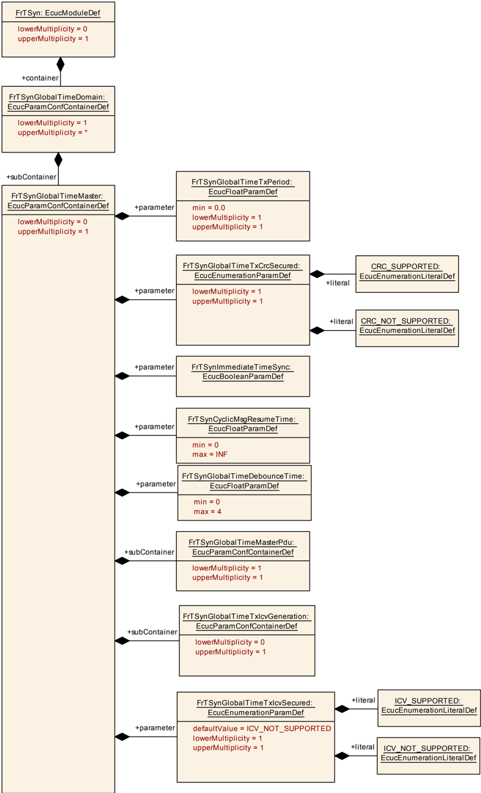

#### 9.2.11. FrTSynGlobalTimeMasterPdu

| 字段 | 值 |
| --- | --- |
| SWS 条目 | [ECUC_FrTSyn_00008] |
| 容器名称 | FrTSynGlobalTimeMasterPdu |
| 父容器 | FrTSynGlobalTimeMaster |
| 描述 | 此容器包含配置给定全局时间域的全局时间主节点所发送 **PDU** 的全部属性。 |
| 配置参数 | 见下方参数表。 |

| 字段 | 值 |
| --- | --- |
| SWS 条目 | [ECUC_FrTSyn_00007] |
| 参数名称 | FrTSynGlobalTimeMasterHandleId |
| 父容器 | FrTSynGlobalTimeMasterPdu |
| 描述 | 表示包含全局时间信息的 **PDU** 的句柄 ID。 |
| 多重性 | 1 |
| 类型 | EcucIntegerParamDef（为此参数生成符号名称） |
| 取值范围 | 0 .. 65535 |
| 默认值 | - |
| Post-Build 变体值 | false |
| 值配置类 | Pre-compile time：X（所有变体）；Link time：-；Post-build time：- |
| 作用域/依赖 | scope: local |

| 字段 | 值 |
| --- | --- |
| SWS 条目 | [ECUC_FrTSyn_00020] |
| 参数名称 | FrTSynGlobalTimePduRef |
| 父容器 | FrTSynGlobalTimeMasterPdu |
| 描述 | 表示用于发送全局时间信息的 **PDU** 引用。全局时间域的全局时间主节点作为该 **PDU** 的发送方，所有时基从节点则应接收该 **PDU**。 |
| 多重性 | 1 |
| 类型 | 对 Pdu 的引用 |
| Post-Build 变体值 | true |
| 值配置类 | Pre-compile time：X（所有变体）；Link time：-；Post-build time：- |
| 作用域/依赖 | scope: local |

无包含的容器。

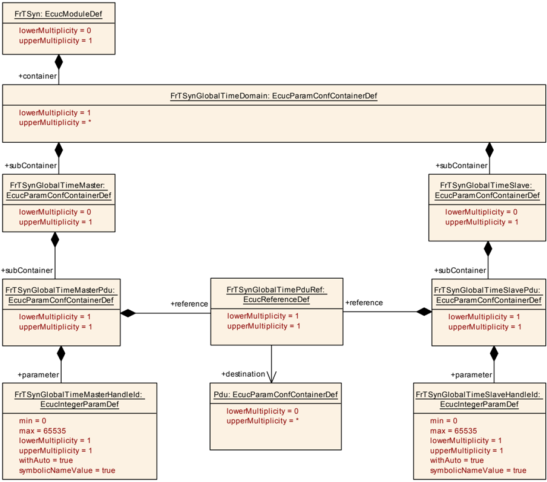

#### 9.2.12. FrTSynGlobalTimeTxIcvGeneration

| 字段 | 值 |
| --- | --- |
| SWS 条目 | [ECUC_FrTSyn_00049] |
| 容器名称 | FrTSynGlobalTimeTxIcvGeneration |
| 父容器 | FrTSynGlobalTimeMaster |
| 描述 | 此容器收集用于 **ICV** 生成的配置。 |
| Post-Build 变体多重性 | false |
| 多重性配置类 | Pre-compile time：X（所有变体）；Link time：-；Post-build time：- |
| 配置参数 | 见下方参数表。 |

| 字段 | 值 |
| --- | --- |
| SWS 条目 | [ECUC_FrTSyn_00051] |
| 参数名称 | FrTSynIcvGenerationBase |
| 父容器 | FrTSynGlobalTimeTxIcvGeneration |
| 描述 | 选择用于 **ICV** 生成的对称或非对称加密方式。 |
| 多重性 | 1 |
| 类型 | EcucEnumerationParamDef |
| 取值范围 | `ICV_MAC`：为 **ICV** 生成选择对称加密；`ICV_SIGNATURE`：为 **ICV** 生成选择非对称加密。 |
| Post-Build 变体值 | false |
| 值配置类 | Pre-compile time：X（所有变体）；Link time：-；Post-build time：- |
| 作用域/依赖 | scope: local |

| 字段 | 值 |
| --- | --- |
| SWS 条目 | [ECUC_FrTSyn_00054] |
| 参数名称 | FrTSynIcvGenerationTimeout |
| 父容器 | FrTSynGlobalTimeTxIcvGeneration |
| 描述 | **ICV** 生成的超时时间（异步行为下相应 **CSM** 作业完成的超时时间）。值为 0 时禁用 **ICV** 超时监视。单位：秒。 |
| 多重性 | 1 |
| 类型 | EcucFloatParamDef |
| 取值范围 | [0 .. INF[ |
| 默认值 | - |
| Post-Build 变体值 | false |
| 值配置类 | Pre-compile time：X（所有变体）；Link time：-；Post-build time：- |
| 作用域/依赖 | scope: local |

| 字段 | 值 |
| --- | --- |
| SWS 条目 | [ECUC_FrTSyn_00052] |
| 参数名称 | FrTSynIcvTxLength |
| 父容器 | FrTSynGlobalTimeTxIcvGeneration |
| 描述 | 要在总线上发送的 **SYNC** 报文中包含的 **ICV** 长度。 |
| 多重性 | 1 |
| 类型 | EcucIntegerParamDef |
| 取值范围 | 0 .. 236 |
| 默认值 | - |
| Post-Build 变体值 | false |
| 值配置类 | Pre-compile time：X（所有变体）；Link time：-；Post-build time：- |
| 作用域/依赖 | scope: local |

| 字段 | 值 |
| --- | --- |
| SWS 条目 | [ECUC_FrTSyn_00065] |
| 参数名称 | FrTSynTxAuthenticationBuildAttempts |
| 父容器 | FrTSynGlobalTimeTxIcvGeneration |
| 描述 | 指定针对给定 **SYNC**/**OFS** 报文的 **ICV** 生成失败时要执行的认证构建尝试次数。如果设为 0，则只尝试生成一次 **ICV**。 |
| 多重性 | 1 |
| 类型 | EcucIntegerParamDef |
| 取值范围 | 0 .. 65535 |
| 默认值 | 0 |
| Post-Build 变体值 | false |
| 值配置类 | Pre-compile time：X（所有变体）；Link time：-；Post-build time：- |
| 作用域/依赖 | scope: local |

| 字段 | 值 |
| --- | --- |
| SWS 条目 | [ECUC_FrTSyn_00050] |
| 参数名称 | FrTSynIcvGenerationFvIdRef |
| 父容器 | FrTSynGlobalTimeTxIcvGeneration |
| 描述 | 表示用于生成 **ICV** 的 **FV** 引用。 |
| 多重性 | 0..1 |
| 类型 | 指向 StbMFreshnessValue 的符号名称引用 |
| Post-Build 变体多重性 | false |
| Post-Build 变体值 | false |
| 多重性配置类 | Pre-compile time：X；Link time：-；Post-build time：- |
| 值配置类 | Pre-compile time：X；Link time：-；Post-build time：- |
| 作用域/依赖 | scope: local |

| 字段 | 值 |
| --- | --- |
| SWS 条目 | [ECUC_FrTSyn_00053] |
| 参数名称 | FrTSynIcvGenerationJobRef |
| 父容器 | FrTSynGlobalTimeTxIcvGeneration |
| 描述 | 表示用于获取 **CSM** 作业 ID 的 **CSM** 作业引用。 |
| 多重性 | 1 |
| 类型 | 指向 CsmJob 的符号名称引用 |
| Post-Build 变体值 | false |
| 值配置类 | Pre-compile time：X（所有变体）；Link time：-；Post-build time：- |
| 作用域/依赖 | scope: local |

无包含的容器。

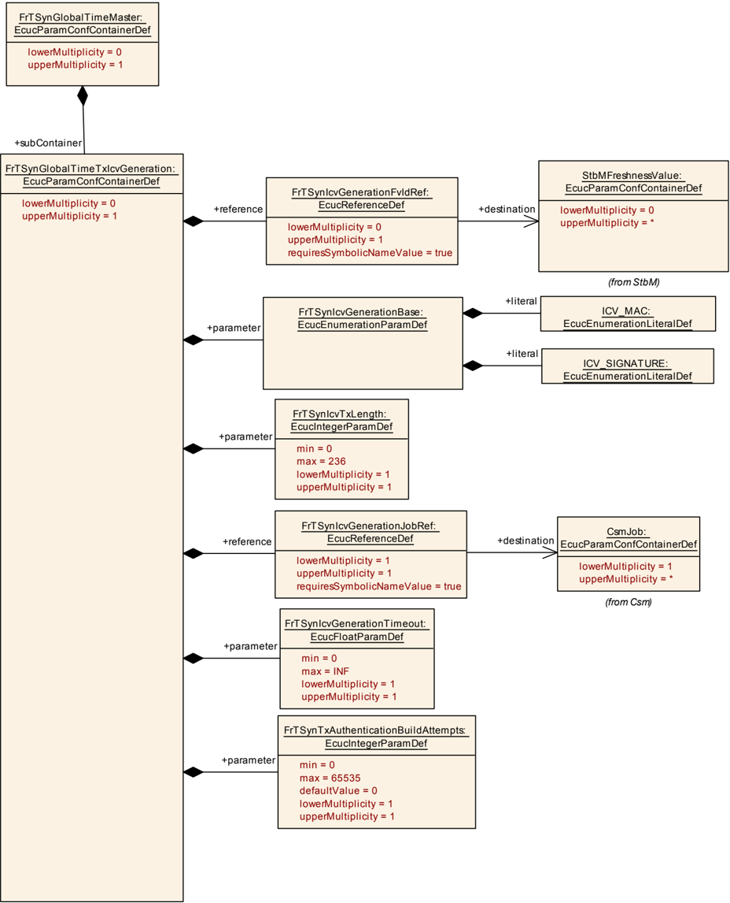

#### 9.2.13. FrTSynGlobalTimeSlave

| 字段 | 值 |
| --- | --- |
| SWS 条目 | [ECUC_FrTSyn_00010] |
| 容器名称 | FrTSynGlobalTimeSlave |
| 父容器 | FrTSynGlobalTimeDomain |
| 描述 | 表示所属全局时间域的时基从节点。 |
| Post-Build 变体多重性 | true |
| 多重性配置类 | Pre-compile time：X（所有变体）；Link time：-；Post-build time：- |
| 配置参数 | 见下方参数表。 |

| 字段 | 值 |
| --- | --- |
| SWS 条目 | [ECUC_FrTSyn_00043] |
| 参数名称 | FrTSynGlobalTimeSequenceCounterHysteresis |
| 父容器 | FrTSynGlobalTimeSlave |
| 描述 | FrTSynGlobalTimeSequenceCounterHysteresis 指定时基从节点在超时状态下、向 **StbM** 转发时间元组之前所需的连续有效 **SYNC** 或 **OFS** 报文数量。 |
| 多重性 | 1 |
| 类型 | EcucIntegerParamDef |
| 取值范围 | 0 .. 15 |
| 默认值 | 0 |
| Post-Build 变体值 | true |
| 值配置类 | Pre-compile time：X（所有变体）；Link time：-；Post-build time：- |
| 作用域/依赖 | scope: local |

| 字段 | 值 |
| --- | --- |
| SWS 条目 | [ECUC_FrTSyn_00022] |
| 参数名称 | FrTSynGlobalTimeSequenceCounterJumpWidth |
| 父容器 | FrTSynGlobalTimeSlave |
| 描述 | SequenceCounterJumpWidth 指定两条 **SYNC** 或两条 **OFS** 报文之间允许的序列计数器最大间隔。 |
| 多重性 | 1 |
| 类型 | EcucIntegerParamDef |
| 取值范围 | 0 .. 15 |
| 默认值 | 0 |
| Post-Build 变体值 | true |
| 值配置类 | Pre-compile time：X（所有变体）；Link time：-；Post-build time：- |
| 作用域/依赖 | scope: local |

| 字段 | 值 |
| --- | --- |
| SWS 条目 | [ECUC_FrTSyn_00017] |
| 参数名称 | FrTSynRxCrcValidated |
| 父容器 | FrTSynGlobalTimeSlave |
| 描述 | 控制是否支持 **CRC** 校验。 |
| 多重性 | 1 |
| 类型 | EcucEnumerationParamDef |
| 取值范围 | `CRC_IGNORED`：模块接受受 **CRC** 保护但不实际校验 **CRC** 的时间同步报文，也接受未受 **CRC** 保护的报文；即忽略 **CRC**。<br>`CRC_NOT_VALIDATED`：模块只接受未受 **CRC** 保护的时间同步报文，忽略其他报文。<br>`CRC_OPTIONAL`：模块只接受未受 **CRC** 保护的报文，以及受 **CRC** 保护且 **CRC** 正确的报文；忽略其他报文。<br>`CRC_VALIDATED`：模块只接受受 **CRC** 保护且 **CRC** 正确的时间同步报文；忽略其他报文。 |
| Post-Build 变体值 | true |
| 值配置类 | Pre-compile time：X（所有变体）；Link time：-；Post-build time：- |
| 作用域/依赖 | scope: local |

| 字段 | 值 |
| --- | --- |
| SWS 条目 | [ECUC_FrTSyn_00055] |
| 参数名称 | FrTSynRxIcvVerificationType |
| 父容器 | FrTSynGlobalTimeSlave |
| 描述 | 控制是否支持 **ICV** 验证。 |
| 多重性 | 1 |
| 类型 | EcucEnumerationParamDef |
| 取值范围 | `ICV_IGNORED`：模块接受采用 **ICV** 安全保护但不实际校验 **ICV** 的时间同步报文，也接受未采用 **ICV** 安全保护的报文；即忽略 **ICV**。<br>`ICV_NOT_VERIFIED`：模块只接受未采用 **ICV** 安全保护的时间同步报文，忽略其他报文。<br>`ICV_OPTIONAL`：模块只接受未采用 **ICV** 安全保护的报文，以及采用 **ICV** 安全保护且 **ICV** 正确的报文；忽略其他报文。<br>`ICV_VERIFIED`：模块只接受采用 **ICV** 安全保护且 **ICV** 正确的时间同步报文；忽略其他报文。 |
| 默认值 | ICV_IGNORED |
| Post-Build 变体值 | false |
| 值配置类 | Pre-compile time：X（所有变体）；Link time：-；Post-build time：- |
| 作用域/依赖 | scope: local |

| 容器名称 | 多重性 | 作用域/依赖 |
| --- | --- | --- |
| FrTSynGlobalTimeRxIcvVerification | 0..1 | 此容器收集 **ICV** 验证所需的配置。 |
| FrTSynGlobalTimeSlavePdu | 1 | 此容器包含配置给定全局时间域中时基从节点所接收 **PDU** 的全部属性。 |

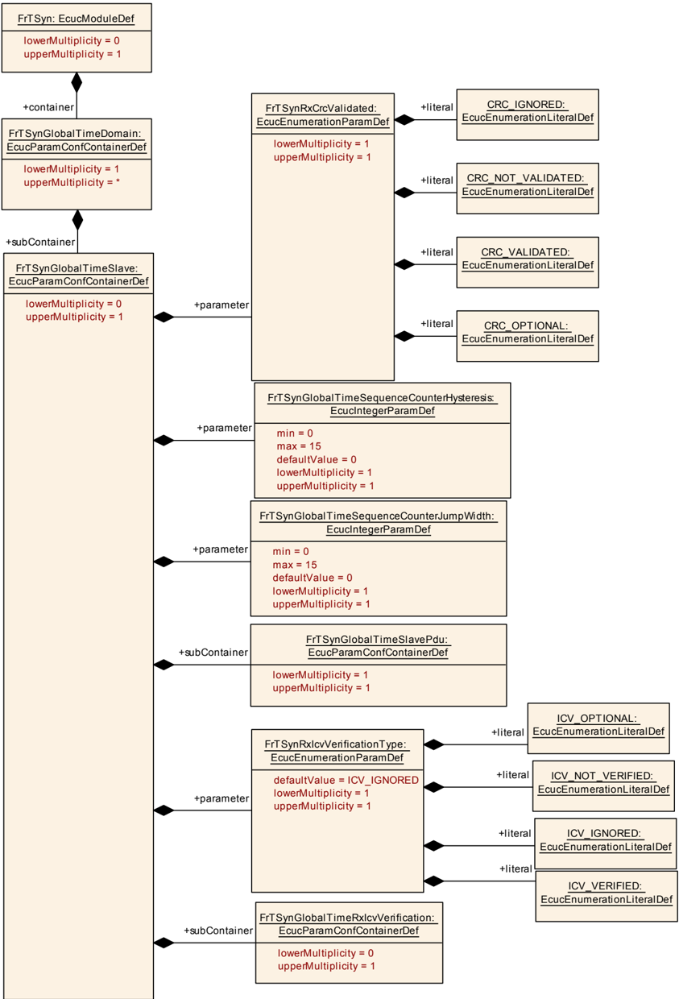

#### 9.2.14. FrTSynGlobalTimeSlavePdu

| 字段 | 值 |
| --- | --- |
| SWS 条目 | [ECUC_FrTSyn_00012] |
| 容器名称 | FrTSynGlobalTimeSlavePdu |
| 父容器 | FrTSynGlobalTimeSlave |
| 描述 | 此容器包含配置给定全局时间域中时基从节点所接收 **PDU** 的全部属性。 |
| 配置参数 | 见下方参数表。 |

| 字段 | 值 |
| --- | --- |
| SWS 条目 | [ECUC_FrTSyn_00011] |
| 参数名称 | FrTSynGlobalTimeSlaveHandleId |
| 父容器 | FrTSynGlobalTimeSlavePdu |
| 描述 | 表示包含全局时间信息的 **PDU** 的句柄 ID。 |
| 多重性 | 1 |
| 类型 | EcucIntegerParamDef（为此参数生成符号名称） |
| 取值范围 | 0 .. 65535 |
| 默认值 | - |
| Post-Build 变体值 | false |
| 值配置类 | Pre-compile time：X（所有变体）；Link time：-；Post-build time：- |
| 作用域/依赖 | scope: local |

| 字段 | 值 |
| --- | --- |
| SWS 条目 | [ECUC_FrTSyn_00020] |
| 参数名称 | FrTSynGlobalTimePduRef |
| 父容器 | FrTSynGlobalTimeSlavePdu |
| 描述 | 表示用于发送全局时间信息的 **PDU** 引用。全局时间域的全局时间主节点作为该 **PDU** 的发送方，所有时基从节点则应接收该 **PDU**。 |
| 多重性 | 1 |
| 类型 | 对 Pdu 的引用 |
| Post-Build 变体值 | true |
| 值配置类 | Pre-compile time：X（所有变体）；Link time：-；Post-build time：- |
| 作用域/依赖 | scope: local |

无包含的容器。

#### 9.2.15. FrTSynGlobalTimeRxIcvVerification

| 字段 | 值 |
| --- | --- |
| SWS 条目 | [ECUC_FrTSyn_00056] |
| 容器名称 | FrTSynGlobalTimeRxIcvVerification |
| 父容器 | FrTSynGlobalTimeSlave |
| 描述 | 此容器收集 **ICV** 验证所需的配置。 |
| Post-Build 变体多重性 | false |
| 多重性配置类 | Pre-compile time：X（所有变体）；Link time：-；Post-build time：- |
| 配置参数 | 见下方参数表。 |

| 字段 | 值 |
| --- | --- |
| SWS 条目 | [ECUC_FrTSyn_00059] |
| 参数名称 | FrTSynIcvRxLength |
| 父容器 | FrTSynGlobalTimeRxIcvVerification |
| 描述 | 对收到的 **SYNC** 报文中的 **ICV** 进行验证时所使用的 **ICV** 长度。 |
| 多重性 | 1 |
| 类型 | EcucIntegerParamDef |
| 取值范围 | 0 .. 236 |
| 默认值 | - |
| Post-Build 变体值 | false |
| 值配置类 | Pre-compile time：X（所有变体）；Link time：-；Post-build time：- |
| 作用域/依赖 | scope: local |

| 字段 | 值 |
| --- | --- |
| SWS 条目 | [ECUC_FrTSyn_00062] |
| 参数名称 | FrTSynIcvVerificationAttempts |
| 父容器 | FrTSynGlobalTimeRxIcvVerification |
| 描述 | 指定针对给定受保护 **SYNC** 报文的 **ICV** 验证失败时要执行的验证尝试次数。如果设为 0，则只尝试验证一次 **ICV**。 |
| 多重性 | 1 |
| 类型 | EcucIntegerParamDef |
| 取值范围 | 0 .. 65535 |
| 默认值 | 0 |
| Post-Build 变体值 | false |
| 值配置类 | Pre-compile time：X（所有变体）；Link time：-；Post-build time：- |
| 作用域/依赖 | scope: local |

| 字段 | 值 |
| --- | --- |
| SWS 条目 | [ECUC_FrTSyn_00058] |
| 参数名称 | FrTSynIcvVerificationBase |
| 父容器 | FrTSynGlobalTimeRxIcvVerification |
| 描述 | 选择用于 **ICV** 验证的对称或非对称加密方式。 |
| 多重性 | 1 |
| 类型 | EcucEnumerationParamDef |
| 取值范围 | `ICV_MAC`：为 **ICV** 验证选择对称加密；`ICV_SIGNATURE`：为 **ICV** 验证选择非对称加密。 |
| Post-Build 变体值 | false |
| 值配置类 | Pre-compile time：X（所有变体）；Link time：-；Post-build time：- |
| 作用域/依赖 | scope: local |

| 字段 | 值 |
| --- | --- |
| SWS 条目 | [ECUC_FrTSyn_00061] |
| 参数名称 | FrTSynIcvVerificationTimeout |
| 父容器 | FrTSynGlobalTimeRxIcvVerification |
| 描述 | **ICV** 验证的超时时间（异步行为下相应 **CSM** 作业完成的超时时间）。值为 0 时禁用 **ICV** 超时监视。单位：秒。 |
| 多重性 | 1 |
| 类型 | EcucFloatParamDef |
| 取值范围 | [0 .. INF[ |
| 默认值 | - |
| Post-Build 变体值 | false |
| 值配置类 | Pre-compile time：X（所有变体）；Link time：-；Post-build time：- |
| 作用域/依赖 | scope: local |

| 字段 | 值 |
| --- | --- |
| SWS 条目 | [ECUC_FrTSyn_00064] |
| 参数名称 | FrTSynRxAuthenticationBuildAttempts |
| 父容器 | FrTSynGlobalTimeRxIcvVerification |
| 描述 | 指定针对给定 **SYNC**/**OFS** 报文的 **ICV** 验证失败时要执行的认证构建尝试次数。如果设为 0，则只尝试验证一次 **ICV**。 |
| 多重性 | 1 |
| 类型 | EcucIntegerParamDef |
| 取值范围 | 0 .. 65535 |
| 默认值 | 0 |
| Post-Build 变体值 | false |
| 值配置类 | Pre-compile time：X（所有变体）；Link time：-；Post-build time：- |
| 作用域/依赖 | scope: local |

| 字段 | 值 |
| --- | --- |
| SWS 条目 | [ECUC_FrTSyn_00057] |
| 参数名称 | FrTSynIcvVerificationFvIdRef |
| 父容器 | FrTSynGlobalTimeRxIcvVerification |
| 描述 | 表示用于 **ICV** 验证的 **FV** 引用。 |
| 多重性 | 0..1 |
| 类型 | 指向 StbMFreshnessValue 的符号名称引用 |
| Post-Build 变体多重性 | false |
| Post-Build 变体值 | false |
| 多重性配置类 | Pre-compile time：X；Link time：-；Post-build time：- |
| 值配置类 | Pre-compile time：X；Link time：-；Post-build time：- |
| 作用域/依赖 | scope: local |

| 字段 | 值 |
| --- | --- |
| SWS 条目 | [ECUC_FrTSyn_00060] |
| 参数名称 | FrTSynIcvVerificationJobRef |
| 父容器 | FrTSynGlobalTimeRxIcvVerification |
| 描述 | 表示用于获取 **CSM** 作业 ID 的 **CSM** 作业引用。 |
| 多重性 | 1 |
| 类型 | 指向 CsmJob 的符号名称引用 |
| Post-Build 变体值 | false |
| 值配置类 | Pre-compile time：X（所有变体）；Link time：-；Post-build time：- |
| 作用域/依赖 | scope: local |

无包含的容器。

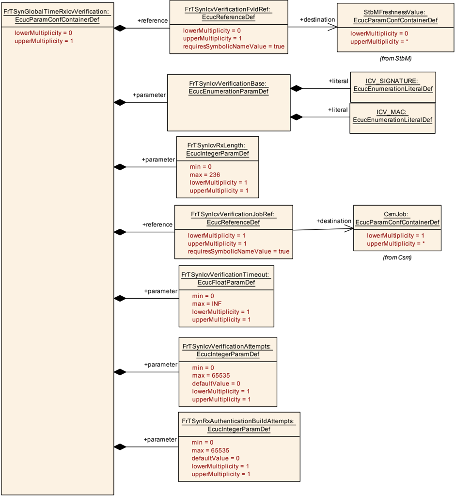

### 9.3. 约束

[SWS_FrTSyn_CONSTR_00001] 如果用于验证 **ICV** 的 **CSM** 作业配置为同步行为，则 FrTSynIcvVerificationTimeout 应设为 0。

[SWS_FrTSyn_CONSTR_00002] 如果用于生成 **ICV** 的 **CSM** 作业配置为同步行为，则 FrTSynIcvGenerationTimeout 应设为 0。

### 9.4. 发布信息

详情请参阅 **SWS BSW General** [\[3\]](#ref-3) 的第 10.3 章“发布信息”。

## B. AUTOSAR 可追溯项变更历史

请注意，本章中的列表还包括在后续版本中已从规范中移除的约束和规格项。这些约束和规格项在文档中不作为超链接出现。

### B.1. 按照 AUTOSAR 发布版本 R22-11 的本文档可追溯项历史

#### B.1.1. R22-11 中新增的规格项

```
SWS_FrTSyn_00103 SWS_FrTSyn_00104 SWS_FrTSyn_00105 SWS_FrTSyn_00106 SWS_FrTSyn_00107
SWS_FrTSyn_00108 SWS_FrTSyn_00109 SWS_FrTSyn_00110 SWS_FrTSyn_00111 SWS_FrTSyn_00112
SWS_FrTSyn_00113 SWS_FrTSyn_00114 SWS_FrTSyn_00115 SWS_FrTSyn_00116 SWS_FrTSyn_00117
SWS_FrTSyn_00118 SWS_FrTSyn_00119 SWS_FrTSyn_00120 SWS_FrTSyn_00121 SWS_FrTSyn_00122
SWS_FrTSyn_00123 SWS_FrTSyn_00124 SWS_FrTSyn_00125 SWS_FrTSyn_00126 SWS_FrTSyn_00127
SWS_FrTSyn_00128 SWS_FrTSyn_00129 SWS_FrTSyn_00130 SWS_FrTSyn_00131 SWS_FrTSyn_00132
SWS_FrTSyn_00133 SWS_FrTSyn_00134 SWS_FrTSyn_00135 SWS_FrTSyn_00136 SWS_FrTSyn_00137
SWS_FrTSyn_00138 SWS_FrTSyn_00139 SWS_FrTSyn_00140 SWS_FrTSyn_00141 SWS_FrTSyn_00142
SWS_FrTSyn_00143 SWS_FrTSyn_00144 SWS_FrTSyn_00145 SWS_FrTSyn_00146 SWS_FrTSyn_00147
SWS_FrTSyn_00148 SWS_FrTSyn_00149 SWS_FrTSyn_00150 SWS_FrTSyn_00151 SWS_FrTSyn_00152
SWS_FrTSyn_91000 SWS_FrTSyn_91001 SWS_FrTSyn_91002 SWS_FrTSyn_CONSTR_00001
SWS_FrTSyn_NA_00999
```

#### B.1.2. R22-11 中变更的规格项

```
SWS_FrTSyn_00009 SWS_FrTSyn_00014 SWS_FrTSyn_00015 SWS_FrTSyn_00018 SWS_FrTSyn_00019
SWS_FrTSyn_00021 SWS_FrTSyn_00022 SWS_FrTSyn_00023 SWS_FrTSyn_00025 SWS_FrTSyn_00028
SWS_FrTSyn_00036 SWS_FrTSyn_00037 SWS_FrTSyn_00038 SWS_FrTSyn_00039 SWS_FrTSyn_00040
SWS_FrTSyn_00042 SWS_FrTSyn_00043 SWS_FrTSyn_00044 SWS_FrTSyn_00055 SWS_FrTSyn_00056
SWS_FrTSyn_00057 SWS_FrTSyn_00059 SWS_FrTSyn_00060 SWS_FrTSyn_00061 SWS_FrTSyn_00062
SWS_FrTSyn_00063 SWS_FrTSyn_00064 SWS_FrTSyn_00065 SWS_FrTSyn_00066 SWS_FrTSyn_00067
SWS_FrTSyn_00069 SWS_FrTSyn_00070 SWS_FrTSyn_00071 SWS_FrTSyn_00074 SWS_FrTSyn_00075
SWS_FrTSyn_00079 SWS_FrTSyn_00080 SWS_FrTSyn_00081 SWS_FrTSyn_00082 SWS_FrTSyn_00095
```

#### B.1.3. R22-11 中删除的规格项

```
SWS_FrTSyn_00999
```

#### B.1.4. R22-11 中新增的约束

无。

#### B.1.5. R22-11 中变更的约束

无。

#### B.1.6. R22-11 中删除的约束

无。

### B.2. 按照 AUTOSAR 发布版本 R23-11 的本文档可追溯项历史

#### B.2.1. R23-11 中新增的规格项

```
SWS_FrTSyn_00153 SWS_FrTSyn_00154 SWS_FrTSyn_00155 SWS_FrTSyn_00156 SWS_FrTSyn_00157
SWS_FrTSyn_00158 SWS_FrTSyn_00159 SWS_FrTSyn_00160 SWS_FrTSyn_00161 SWS_FrTSyn_00162
SWS_FrTSyn_00163 SWS_FrTSyn_00164 SWS_FrTSyn_00165 SWS_FrTSyn_00166 SWS_FrTSyn_00167
SWS_FrTSyn_00168 SWS_FrTSyn_00169 SWS_FrTSyn_00170 SWS_FrTSyn_00171 SWS_FrTSyn_00172
```

#### B.2.2. R23-11 中变更的规格项

```
SWS_FrTSyn_00014 SWS_FrTSyn_00015 SWS_FrTSyn_00019 SWS_FrTSyn_00021 SWS_FrTSyn_00023
SWS_FrTSyn_00025 SWS_FrTSyn_00048 SWS_FrTSyn_00049 SWS_FrTSyn_00056 SWS_FrTSyn_00060
SWS_FrTSyn_00079 SWS_FrTSyn_00080 SWS_FrTSyn_00084 SWS_FrTSyn_00085 SWS_FrTSyn_00086
SWS_FrTSyn_00089 SWS_FrTSyn_00090 SWS_FrTSyn_00091 SWS_FrTSyn_00093 SWS_FrTSyn_00102
SWS_FrTSyn_00103 SWS_FrTSyn_00104 SWS_FrTSyn_00106 SWS_FrTSyn_00107 SWS_FrTSyn_00108
SWS_FrTSyn_00109 SWS_FrTSyn_00112 SWS_FrTSyn_00113 SWS_FrTSyn_00119 SWS_FrTSyn_00125
SWS_FrTSyn_00127 SWS_FrTSyn_00142 SWS_FrTSyn_00145 SWS_FrTSyn_00146 SWS_FrTSyn_00149
```

#### B.2.3. R23-11 中删除的规格项

```
SWS_FrTSyn_00141
```

#### B.2.4. R23-11 中新增的约束

```
SWS_FrTSyn_CONSTR_00002
```

#### B.2.5. R23-11 中变更的约束

无。

#### B.2.6. R23-11 中删除的约束

无。
