## 1. 简介和功能概述

本文档规定同步时基管理器（**Synchronized Time-Base Manager**，**StbM**）模块的功能、**API** 和配置。同步时基管理器的目的是向其客户（customer）提供同步时基（**Synchronized Time Base**），即与分布式系统其他节点上的时基同步的时基。

### 1.1. 用例

同步时基管理器支持两个主要用例：

**RunnableEntity 的同步**

任意数量的 **RunnableEntity** 必须同步执行。同步意味着它们应以明确定义且得到保证的相对偏移启动（例如相对偏移 "0"，表示执行应发生在同一时间点）。这样的需求可以由 [1, **AUTOSAR Timing Extensions**] 规定，并且必须独立于软件组件的实际部署来满足。该用例的典型例子是由不同 **RunnableEntity** 进行的传感器数据读取或执行器同步触发。

**绝对或相对时间值的提供**

应用（以及其他 **BSW** 模块）应有一个中心模块，负责提供关于绝对或相对时间及其推移（progression）的信息。

该用例的典型例子有：

- 传感器数据融合：来自雷达或立体多功能摄像头等各种传感器系统的数据可以在时间上相互关联。
- 事件数据记录：在某些情况下（例如碰撞），期望存储关于不同 **ECU** 的事件和内部状态的数据。为了对这些事件和状态进行时间上的关联，需要一个共同的时基。
- 访问同步的日历时间以存储诊断事件。

### 1.2. 功能概述

图 1 展示了同步时基管理器如何与其他模块交互。

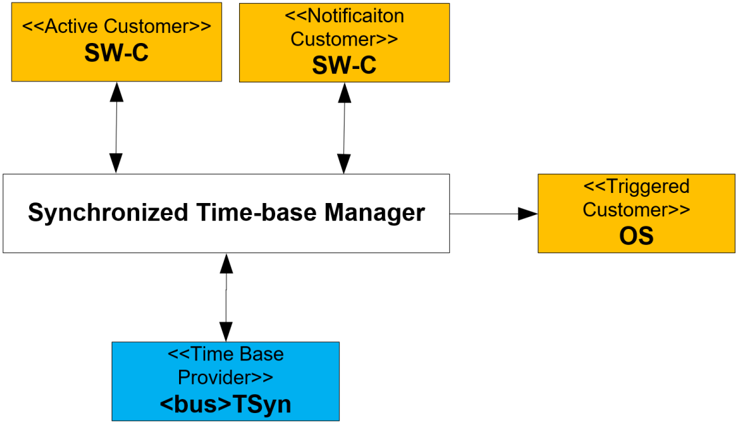

同步时基管理器自身并不提供诸如网络时间协议或时间协商协议之类的手段来将其（本地）时基与其他节点上的时基同步。它与 **BSW** 的 &lt;Bus&gt;TSyn 模块交互以实现这种同步。如图 1 所示，这些模块承担时基提供者（**Time Base Provider**）的角色，并支持上述时间协议。

利用从提供者模块获得的信息，同步时基管理器能够将其时基与其他节点上的时基同步。

扮演客户角色的 **BSW** 模块和 **SW-C** 消费由同步时基管理器提供和管理的时间信息。客户可以分为三种类型：

1. 触发型客户（**Triggered Customer**）
2. 主动型客户（**Active Customer**）
3. 通知型客户（**Notification Customer**）

因此，同步时基管理器通过向客户提供对同步时基的访问而扮演时基经纪人（broker）的角色。这样做时，同步时基管理器对"真正的"时基提供者进行了抽象。

在时基提供者两次更新之间提供对任意同步时基的访问，通常通过使用硬件参考时钟（**Hardware Reference Clock**）实现，往往与跟踪硬件参考时钟溢出的软件计数器（**Software Counter**）结合使用。软件计数器与硬件参考时钟一起构成虚拟本地时间（**Virtual Local Time**）（尽管名为"虚拟"，虚拟本地时间是一个实际实现的实体）。

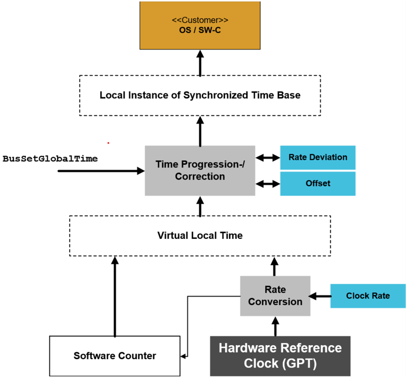

这个时间随后被用来驱动各时基的时间——记作全局时间的本地实例（**Local Instance of the Global Time**）——并考虑它们相对于底层虚拟本地时间的速率偏差（**Rate Deviation**）和偏移（**Offset**）。

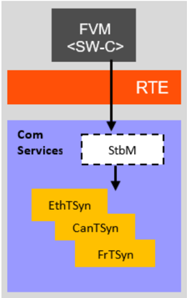

同步时基管理器将充当新鲜度值管理器（**Freshness Value Manager**，**FVM**）与 &lt;Bus&gt;TSyn 模块之间的接口。一旦被请求，新鲜度值（**Freshness Value**）就被提供给 &lt;Bus&gt;TSyn 模块，随后用于保护时间同步报文。**FVM** 可以是一个 **SW-C** 或 **CDD**。

访问同步时基的 **API** 既提供给应用软件组件，也提供给其他 **BSW** 模块：

- 对于与应用软件组件的交互，标准化的 **AUTOSAR** 接口在第 [7](#7-api规范) 章「API规范」中规定。
- 对于与其他 **BSW** 模块的交互，相应的接口在第 [7.7](#77-服务接口) 节「服务接口」中规定。

## 2. 定义和缩略语

下面的词汇表包括与 **StbM** 模块相关、但未包含于 [2, **AUTOSAR** 术语表] 和 [3, **RS** Time Synchronization] 中的缩略语和定义。

### 2.1. 缩略语

**&lt;Bus&gt;TSyn**

> 总线特定的时间同步提供者模块（A bus specific Time Synchronization Provider module）

**CAN**

> 控制器局域网（**Controller Area Network**）

**CanTSyn**

> **CAN** 的时间同步提供者模块（**Time Synchronization Provider module for CAN**）

**DET**

> 默认错误追踪器（**Default Error Tracer**）

**ECU**

> 电子控制单元（**Electronic Control Unit**）

**ETH**

> 以太网（**Ethernet**）

**EthTSyn**

> **Ethernet** 的时间同步提供者模块（**Time Synchronization Provider module for Ethernet**）

**FR**

> **FlexRay**

**FrTSyn**

> **FlexRay** 的时间同步提供者模块（**Time Synchronization Provider module for FlexRay**）

**FUP message**

> 同步时基的跟随报文（**Follow-Up message** for a Synchronized Time Base）

**FV**

> 新鲜度值（**Freshness Value**）

**FVM**

> 新鲜度值管理器（**Freshness Value Manager**）

**GTM**

> 全局时间主节点（**Global Time Master**）

**NvM**

> 非易失性存储器（**Non-volatile Memory**）

**OFS message**

> 偏移时基的时间同步报文（**Time Synchronization message** for an Offset Time Base）

**PTP**

> 精确时间协议（**Precision Time Protocol**）

**StbM**

> 同步时基管理器（**Synchronized Time-Base Manager**）

**SYNC message**

> 同步时基的时间同步报文（**Time Synchronization message** for a Synchronized Time Base）

**TG**

> 全局时间（**Global Time**）

**Timesync**

> 时间同步（**Time Synchronization**）

**TL**

> 全局时间的本地实例（**Local Instance of the Global Time**）

**TSP**

> 时间同步提供者（**Time Synchronization Provider**）

**TV**

> 虚拟本地时间（**Virtual Local Time**）

### 2.2. 定义

**Active Time Base Customer**

> 一种时基客户，它自主调用同步时基管理器，或用于从同步时基管理器读取某时基的时间信息，或用于根据应用信息更新同步时基管理器维护的时基。

**Applied Rate**

> 用于设置/计算全局时间的本地实例所施加的速率。对于时基主节点（**Time Master**），它与速率校正（**Rate Correction**）r_rc 相同；对于时基从节点（**Time Slave**），它是通过相加得到的：对于同步时基为 r_rc 与 r_oc 之和，对于偏移时基分别为 (r_orc − 1) 与 r_oc。

**Current Time Tuple**

> 保存当前全局时间的本地实例及对应当前虚拟本地时间的时间元组（**Time Tuple**）。

**Disciplined HW Clock**

> 可以在速率和偏移上被调整以跟随参考时钟的硬件时钟。

**Fallback Virtual Local Time**

> 从与导出主虚拟本地时间（**Primary Virtual Local Time**）不同的硬件时钟导出的次级虚拟本地时间。备用虚拟本地时间（**Fallback Virtual Local Time**）可用于监视主虚拟本地时间，并在后者不可用时作为其本地替代。

**Global Time**

> 由全局时间主节点提供的时间值，即跨网络时间同步的参考时间。

**hold-over**

> 一种场景，其中主时间源（通常）暂时不可用，而另一个时间源提供（可能降级的）时间信息。

**Local Instance of the Global Time**

> 在从全局时间主节点接收到两个时间值采样之间，借助虚拟本地时间或受控硬件时钟对时间当前值的本地外推。

**Main Time Triple**

> 参考时间三元组（**Reference Time Triple**）[TL_Main、TV_Main、TV_Fallback]，它在主时间元组（**Main Time Tuple**）[TL_Main、TV_Main] 的基础上增加了第三个成员 TV_Fallback，即在主时间元组被更新的时刻采样的备用虚拟本地时间。当没有主虚拟本地时间可用（但备用虚拟本地时间可用）时，主时间三元组允许计算全局时间的本地实例。

**Main Time Tuple**

> 参考时间元组（**Reference Time Tuple**）[TL_Main、TV_Main]，用于在不支持受控硬件时钟的情况下基于主虚拟本地时间计算全局时间的本地实例。

**Notification Time Base Customer**

> 一种时基客户，当发生以下与时基相关的事件时，它会被同步时基管理器通知：时基状态已改变（例如某时基发生了超时）；时基值已到达客户先前设置的给定值。

**Offset Correction**

> 补偿时间偏移（**Time Offset**）所需的偏移值。

**Offset Correction Adaption Interval**

> 时间区间 StbMOffsetCorrectionAdaptionInterval，当配置了通过速率自适应进行偏移校正（**Offset Correction by Rate Adaption**）时，在此期间施加一个附加的速率自适应 r_oc。

**Offset Correction by Rate Adaption**

> 在速率校正（对于同步时基为速率校正 r_rc，对于偏移时基为偏移时基的速率校正 r_orc）之外额外施加一个速率偏移。这是为了平滑地消除 StbM 预测时间 TL_Sync 与时间值 TG_URx 之间的时间偏移。

**Rate Correction**

> 补偿速率偏差（**Rate Deviation**）所需的因子。

**Rate Correction of the Offset Time Base**

> 偏移时基的速率校正。

**Rate Deviation**

> 速率偏差值表示时钟的频率偏离参考时钟速率的程度。

**Rx Time Tuple**

> 时间元组 [TG_Rx、TV_Rx]，在跟随报文（**Follow-up message**）进入时导出，并由 &lt;Bus&gt;TSyn 模块通过 [StbM_BusSetGlobalTime](#7314-stbm_bussetglobaltime) 交给 **StbM**。

**SYNC Ingress Processing Delay**

> 在 Timesync 模块一侧，从 **SYNC** 报文进入到通过 [StbM_BusSetGlobalTime](#7314-stbm_bussetglobaltime) 将接收时间元组转发给 **StbM** 之间的时间区间。

**SyncLocal Time Tuple**

> 时间元组 [TL_Sync、TV_Sync]，在 TV_Sync 时刻导出，或基于下文的规定，或（在支持时）从受控硬件时钟导出。

**Time Base Customer**

> 同步时基管理器支持 3 种类型的时基客户：主动型客户（**Active Customer**）；触发型客户（**Triggered Customer**）；通知型客户（**Notification Customer**）。

**Time Offset**

> 施加速率校正之后仍然残留的时间偏移。

**Time Tuple**

> Timesync 栈始终通过时间元组结构管理时基的时间，即全局时间采样和对应的虚拟本地时间采样，二者在完全相同的时间点采样。这与以下用例相关：1. Timesync 模块以时间元组的形式将接收到的全局时间提供给 **StbM**；2. Timesync 模块获取要发送的全局时间作为时间元组；3. 应用设置全局时间，**StbM** 立即通过加入虚拟本地时间的当前值将其扩展为时间元组；4. 应用以时间元组的形式读取当前时间。**StbM** 定义了 5 种特殊的、在明确定义的时间点采样的时间元组：主时间元组（**Main Time Tuple**，与所有用例相关）；接收时间元组（**Rx Time Tuple**，与用例 1 相关）；更新接收时间元组（**Updated Rx Time Tuple**，与用例 1 相关）；同步本地时间元组（**SyncLocal Time Tuple**，与用例 1 相关）；当前时间元组（**Current Time Tuple**，与用例 2、3 和 4 相关）。保证时间元组的完整性至关重要。

**Time Triple**

> 在时间元组的基础上加入对应的备用虚拟本地时间作为第三个成员而得到。

**Triggered Time Base Customer**

> 一种由同步时基管理器触发的时基客户。因此，同步时基管理器自身了解客户所需的功能，并使用客户定义的接口来访问它。该功能目前仅限于 **OS** ScheduleTable 的同步。

**Updated Rx Time Tuple**

> 时间元组 [TG_URx、TV_URx]，当 &lt;Bus&gt;TSyn 模块调用 [StbM_BusSetGlobalTime](#7314-stbm_bussetglobaltime) 时，通过在接收时间元组上加入 **SYNC** 进入处理延迟（**SYNC Ingress Processing Delay**）经速率校正后的值而导出。

**Virtual Local Time**

> **StbM** 从硬件时钟导出的本地时间参考，用于全局时间本地实例的推移。

## 3. 相关文档

### 3.1. 输入文件和相关标准与规范

<a id="ref-1"></a>[1] Specification of Timing Extensions for Classic Platform
> AUTOSAR_CP_TPS_TimingExtensions

<a id="ref-2"></a>[2] Glossary
> AUTOSAR_FO_TR_Glossary

<a id="ref-3"></a>[3] Requirements on Time Synchronization
> AUTOSAR_FO_RS_TimeSync

<a id="ref-4"></a>[4] General Specification of Basic Software Modules
> AUTOSAR_CP_SWS_BSWGeneral

<a id="ref-5"></a>[5] Specification of Operating System
> AUTOSAR_CP_SWS_OS

<a id="ref-6"></a>[6] General Requirements on Basic Software Modules
> AUTOSAR_CP_SRS_BSWGeneral

<a id="ref-7"></a>[7] System Template
> AUTOSAR_CP_TPS_SystemTemplate

<a id="ref-8"></a>[8] Specification of Secure Onboard Communication
> AUTOSAR_CP_SWS_SecureOnboardCommunication

<a id="ref-9"></a>[9] Complex Driver design and integration guideline
> AUTOSAR_CP_EXP_CDDDesignAndIntegrationGuideline

<a id="ref-10"></a>[10] Guide to BSW Distribution
> AUTOSAR_CP_EXP_BSWDistributionGuide

<a id="ref-11"></a>[11] IEEE Standard 802.1AS-2011
> IEEE 802.1AS-2011

### 3.2. 相关规范

**AUTOSAR** 提供了基础软件模块的通用规范 [4, **SWS** BSW General]，它同样适用于 **StbM**。

因此，规范 **SWS** BSW General 应被视为 **StbM** 的附加且必需的规范。

## 4. 约束和假设

### 4.1. 限制

当前的模块方案对于在 **AUTOSAR** 系统中应用同步时基管理器存在若干限制。

#### 4.1.1. OS 调度表

同步时基管理器应执行将 **OS** ScheduleTable 与相应的同步时基同步的功能。但是，**StbM** 只考虑目标 **OS** ScheduleTable 被显式同步的情况。隐式同步不影响 **StbM**，因为该同步机制绕过了本模块（关于显式同步与隐式同步区别的更多信息，请参阅 [\[5\]](#ref-5)）。因此，下文谈论 **OS** ScheduleTable 同步时，始终指显式同步。

#### 4.1.2. 同步时基标识符

StbMSynchronizedTimeBaseIdentifier 的取值范围（128 .. 65535）目前是保留的，可能仍被遗留应用（实现触发型客户）使用。不过，该 ID 范围将在下一个版本中重新分配给新特性。届时将不再支持遗留应用。

#### 4.1.3. 模式切换

同步时基管理器不处理运行期间的模式切换。

#### 4.1.4. 配置

**StbM** 的 Postbuild 配置仅限于为某时基启用或禁用系统范围全局时间主节点功能（参见 StbMIsSystemWideGlobalTimeMaster）。

#### 4.1.5. 备用虚拟本地时间

同步时基管理器允许配置备用虚拟本地时间。如果主虚拟本地时间失效，备用虚拟本地时间只为本地应用提供保持（hold-over）能力。这意味着，从该备用虚拟本地时间导出的时间信息不会在网络上分发。在 **StbM** 的后续版本中，备用虚拟本地时间的行为可能会被扩展以支持更多用例。

#### 4.1.6. 超出范围

- 在全局时间建立期间发生的、并非由本模块自身引起的错误（例如 FlexRay 全局时间的丢失是 FlexRay 的问题，而不是同步时基管理器的问题）。
- 在与客户交互期间发生的错误。

示例：调用显式 **OS** ScheduleTable 同步可能导致异常，因为所提交的参数 counterValue 与 **OS** 内部计数器之间的差值超过了受影响到期点（expiry point）的容差范围。处理该异常是 **OS** 的问题，而不是同步时基管理器的问题。

### 4.2. 汽车域的适用性

该概念旨在支持时间关键和安全相关的汽车应用，例如安全气囊系统和制动系统。这并不意味着该概念已具备此类系统所需的全部内容，而是考虑了那些不能推迟到实现阶段的关键的时序相关特性。

## 5. 对其他模块的依赖

### 5.1. 代码文件结构

细节请参阅 [4, **SWS** BSW General] 的第 5.1.6 章「Code file structure」。

### 5.2. 头文件结构

细节请参阅 [4, **SWS** BSW General] 的第 5.1.7 节「Header file structure」。

除了 [4, **SWS** BSW General] 第 5.1.7 节「Header file structure」中定义的文件之外，**StbM** 还需要包含文件 Os.h、CanIf.h、EthIf.h 和 Gpt.h。

如果配置了触发型客户（参见 [StbMTriggeredCustomer](#9212-stbmtriggeredcustomer)），StbM.c 应包含 Os.h，以访问 **OS** 的 schedule table 接口。

如果应支持经由 Ethernet 的时间戳（参见 EthIfGlobalTimeSupport，当 StbMLocalTimeHardware 或 StbMFallbackTimeHardware 设为 EthTSynGlobalTimeDomain 时被引用），StbM.c 应包含 EthIf.h，以访问 **EthIf** 模块的接口。

如果支持 **CAN** 硬件时间戳（参见 **CanIf** 中的配置参数 CanIfGlobalTimeSupport，当 StbMLocalTimeHardware 或 StbMFallbackTimeHardware 设为 CanTSynGlobalTimeDomain 时被引用），StbM.c 应包含 CanIf.h，以访问 **CanIf** 模块的接口。

如果应支持经由 **GPT** 的时间戳（当 StbMLocalTimeHardware 或 StbMFallbackTimeHardware 设为 GptChannelConfiguration 时被引用），StbM.c 应包含 Gpt.h，以访问 **GPT** 模块的接口。

## 6. 功能规格

### 6.1. 概述

一个全局时间（**Global Time**）网络由一个时基主节点（**Time Master**）和至少一个时基从节点（**Time Slave**）组成。时基主节点针对每个时间域（**Time Domain**）通过时间同步报文将全局时基分发给所连接的时基从节点。对于 **CAN** 和 **Ethernet**，时基从节点通过考虑发送侧的时间戳和自身生成的接收时间戳来校正接收到的全局时基。对于 **FlexRay**，时间同步机制基于 FlexRay 总线的本地时间。

时基的本地实例（从硬件参考时钟导出）将使用最近收到的有效全局时基值进行更新，并自主运行，直到接收到全局时基的下一个值。

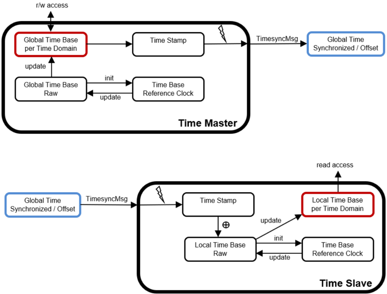

#### 6.1.1. 时基的类型

时基的类型由时基特定的配置参数 StbMSynchronizedTimeBaseType 定义为：

- 同步时基（**Synchronized Time Base**，参见第 [6.1.1.1](#6111-同步时基和偏移时基) 节「同步时基和偏移时基」）
- 或偏移时基（**Offset Time Base**，参见第 [6.1.1.1](#6111-同步时基和偏移时基) 节「同步时基和偏移时基」）
- 或纯本地时基（**Pure Local Time Base**，参见第 [6.1.1.2](#6112-纯本地时基) 节「纯本地时基」）

##### 6.1.1.1. 同步时基和偏移时基

每个时基都分配有一个介于 0 到 127 之间的时基标识符（**Time Base identifier**）。时基标识符在 **StbM** 中配置（参见参数 StbMSynchronizedTimeBaseIdentifier）。

此外，对于每个偏移时基和同步时基，Timesync 模块定义一个时间域标识符（**Time Domain identifier**）。时间域标识符实际由 Timesync 模块在网络上的 Timesync 报文中发送/接收。

时间域标识符在 Timesync 模块中配置，且与 **StbM** 中的时基标识符相互独立。对于 **CAN** 和 **FlexRay**，时间域标识符取值范围为 0 到 15；对于 **Ethernet**，取值范围为 0 到 127。

由于 **StbM** 中的时基标识符与 Timesync 模块中的时间域标识符相互独立，下面两个例子是有效的配置：

- 一个全局时间主节点包含单个时基标识符为 0 的同步时基，它在 **Ethernet** 上作为时间域 0 发送，在 **CAN** 上作为时间域 1 发送。
- 一个时基从节点在 **Ethernet** 上接收时间域 0 并将其存储为时基 0，同时它还在 **CAN** 上接收时间域 1 并将其存储为时基 2。

时间域与时基的实际链接由 Timesync 模块中每个时间域的参数 &lt;bus&gt;TSynSynchronizedTimeBaseRef 完成。

此外，偏移时基通过参数 StbMOffsetTimeBase 链接到同步时基。

示例：对于时基标识符为 17 的偏移时基，其底层的同步时基可以是时基标识符 1。另一个时基标识符为 18 的偏移时基也可以基于同一个底层同步时基 1。

##### 6.1.1.2. 纯本地时基

纯本地时基的细节参见第 [6.6](#66-纯本地时基) 节「纯本地时基」。

#### 6.1.2. StbM 的角色

根据配置，**StbM** 可以针对一个时基承担以下三种角色之一：

- 全局时间主节点（**Global Time Master**）
- 时基从节点（**Time Slave**）
- 时间网关（**Time Gateway**）

在每种角色下，特定的功能被支持或不被支持。

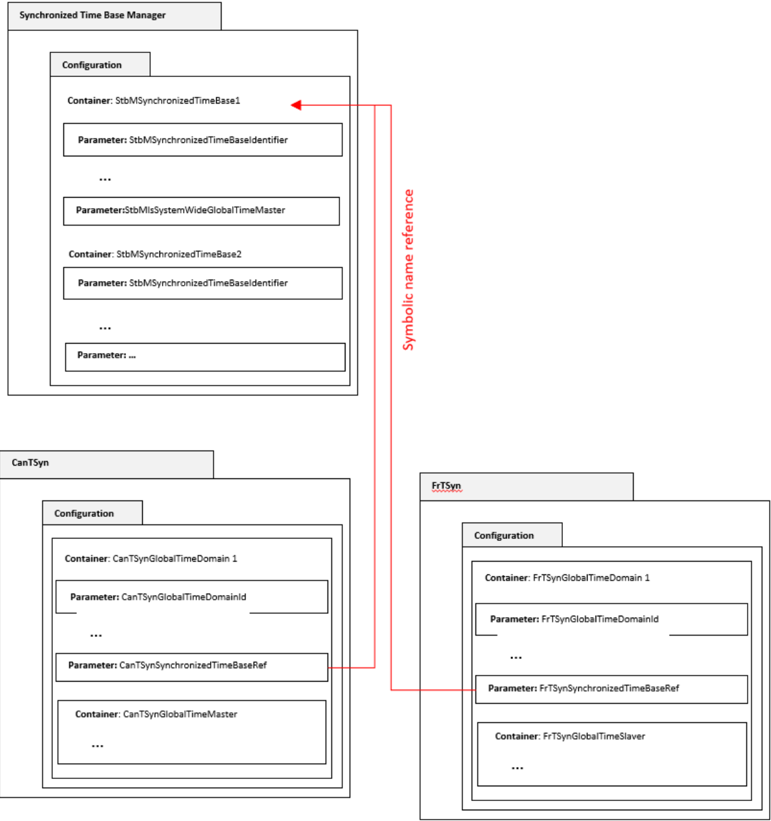

示例：在图 7.2 中，时基 StbMSynchronizedTimeBase1 分别被 **CanTSyn** 和 **FrTSyn** Timesync 模块中的两个时间域 CanTSynGlobalTimeDomain 1 和 FrTSynGlobalTimeDomain 1 引用。

CanTSyn 的 CanTSynGlobalTimeDomain 1 被配置为时基主节点，FrTSynGlobalTimeDomain 1 被配置为时基从节点。这使得 **StbM** 成为时基 StbMSynchronizedTimeBase1 的时间网关。

如果时基 StbMSynchronizedTimeBase1 只被 CanTSynGlobalTimeDomain 1 或 FrTSynGlobalTimeDomain 1 之一引用，则 **StbM** 将分别成为时基 StbMSynchronizedTimeBase1 的时基主节点或时基从节点。

**注意：** 关于角色的系统级表示，请参阅 [7, **TPS** System Template] 中的图 9.1（"Big Picture of AUTOSAR global time synchronization"）。

##### 6.1.2.1. 全局时间主节点

全局时间主节点是给定时基的系统级源头。其时基值通过网络分发给各时基从节点。

[StbM_GetMasterConfig](#7325-stbm_getmasterconfig) 应返回时基 timeBaseId 的配置参数 StbMIsSystemWideGlobalTimeMaster 的值。这用于检查 **StbM** 是否被配置为特定时基的系统范围全局时间主节点。

##### 6.1.2.2. 时基从节点

在时基从节点角色下，**StbM** 基于由相应 Timesync 模块提供的全局时基值来更新其内部维护的本地时基。

##### 6.1.2.3. 时间网关

**StbM** 中的时间网关是一个被一个时基从节点和一个或多个时基主节点引用的时基。引用 **StbM** 时间网关的时基从节点在相应总线上接收 Timesync 报文，并将接收到的时基值传递给 **StbM**。每个引用该时间网关的时基主节点从 **StbM** 获取网关时基值并在总线上发送。根据配置，从节点侧的接收可以自动触发主节点侧的发送，也可以不自动触发。

因此，Timesync 报文不会直接穿过 **AUTOSAR** 时间网关进行路由。这是因为路由延迟需要被补偿。

### 6.2. 虚拟本地时间

虚拟本地时间从硬件参考时钟导出（参见图 7.1）。支持以下硬件参考时钟：

- **OS** 计数器
- **GPT** 计数器
- **Ethernet** 自由运行计数器（用于进入和发出时间戳）

每个同步时基和纯本地时基都必须分配一个虚拟本地时间，以推进该时基的全局时间本地实例。该虚拟本地时间被称为相应时基的主虚拟本地时间（**Primary Virtual Local Time**，参见第 [6.2.1](#621-主虚拟本地时间) 节「主虚拟本地时间」）。

可选地（例如在支持时间验证（**Time Validation**）时），每个同步时基可以再分配一个次级虚拟本地时间，称为该时基的备用虚拟本地时间（**Fallback Virtual Local Time**，参见第 [6.2.2](#622-备用虚拟本地时间) 节「备用虚拟本地时间」）。

在本文档中，除非另有明确说明，术语虚拟本地时间均指主虚拟本地时间。

#### 6.2.1. 主虚拟本地时间

主虚拟本地时间由时基引用的配置容器 [StbMLocalTimeClock](#925-stbmlocaltimeclock) 配置。每个时基可以配置不同的主虚拟本地时间。

如果 StbMLocalTimeHardware 为某个同步时基引用了一个 **GPT** 通道作为本地时间源，则 **StbM** 应从相应 **GPT** 定时器的值导出虚拟本地时间。已流逝的定时器值应通过 Gpt_GetTimeElapsed 读取。

**StbM** 应使用因子（StbMClockPrescaler / StbMClockFrequency）将其本地硬件参考时钟的时间转换为虚拟本地时间的实际时间（参见 [StbM_VirtualLocalTimeType](#7755-stbm_virtuallocaltimetype)），前提是虚拟本地时间从 **GPT** 或 OsCounter 导出（参见 StbMLocalTimeHardware）。

**注意：** 其理由在于，硬件参考时钟的 tick 时长不必与虚拟本地时间的分辨率一致。

如果相应硬件参考计数器的量程小于虚拟本地时间的量程（参见 [StbM_VirtualLocalTimeType](#7755-stbm_virtuallocaltimetype)），则 **StbM** 应相应地扩展该量程。

**注意：** 取决于硬件参考时钟，扩展量程的一种方式是对硬件参考时钟的溢出进行计数。

如果某个同步时基的 EthIfGlobalTimeSupport 设为 **TRUE**，则 **StbM** 应通过 EthIf_GetCurrentTimeTuple 从相应 Ethernet 控制器的自由运行硬件计数器获取虚拟本地时间的当前值。

如果 EthIf_GetCurrentTimeTuple 对参数 currentTimeTuplePtr 的成员 timeQuality 返回 **ETH_UNCERTAIN** 或 **ETH_INVALID**，则 **StbM** 应忽略 EthIf_GetCurrentTimeTuple 返回的时间值 timestampClockValue。

如果某个同步时基的 CanIfGlobalTimeSupport 设为 **TRUE**，则 **StbM** 应通过 CanIf_GetCurrentTime 从相应 **CAN** 控制器的自由运行硬件计数器导出虚拟本地时间的当前值（参见 [StbM_VirtualLocalTimeType](#7755-stbm_virtuallocaltimetype)）。

如果 CanIf_GetCurrentTime 返回 **E_NOT_OK**，则应忽略 CanIf_GetCurrentTime 返回的时间值。

**注意：** 如果 CanIf_GetCurrentTime 或 EthIf_GetCurrentTimeTuple 失败，这意味着相应的虚拟本地时间不可用。因此，相关时基不再能够被插值（除非配置了备用虚拟本地时间且其可用）。依赖该虚拟本地时间的时基相关 **API** 将返回 **E_NOT_OK**。

**注意：** EthIfGlobalTimeSupport 和 CanIfGlobalTimeSupport 可分别通过 StbMLocalTimeHardware（设为 EthTSynGlobalTimeDomain 或 CanTSynGlobalTimeDomain 时）引用。

[StbM_GetCurrentVirtualLocalTime](#736-stbm_getcurrentvirtuallocaltime) 应返回所关联时基的主虚拟本地时间的值。

对于偏移时基，应返回被引用同步时基的主虚拟本地时间。

如果无法确定虚拟本地时间（例如底层硬件计数器尚未激活），则 [StbM_GetCurrentVirtualLocalTime](#736-stbm_getcurrentvirtuallocaltime) 应返回 **E_NOT_OK**。

**注意：** [StbM_GetCurrentVirtualLocalTime](#736-stbm_getcurrentvirtuallocaltime) 由 Timesync 模块在已建立中断保护的情况下调用。

**注意：** 对于偏移时基，所有 TVSync、TVStart、TVStop……实例均指底层同步时基的本地虚拟时间。

#### 6.2.2. 备用虚拟本地时间

**StbM** 可选地支持备用虚拟本地时间。与主虚拟本地时间一样，备用虚拟本地时间从硬件参考时钟导出，即从 **OS** 计数器、**GPT** 计数器、**Ethernet** 自由运行计数器或任何其他可用的硬件参考时钟导出。备用虚拟本地时间由时基引用的配置容器 [StbMFallbackTimeClock](#927-stbmfallbacktimeclock) 配置。

备用虚拟本地时间支持 2 个用例：

- 监视全局时间本地实例的推移（参见第 [6.17.3](#6173-监视全局时间本地实例的推移) 节「监视全局时间本地实例的推移」）
- 以及在主虚拟本地时间缺失时进行时间外推（参见第 [6.3.3](#633-在主虚拟本地时间缺失时处理全局时间的本地实例) 节「在主虚拟本地时间缺失时处理全局时间的本地实例」）

对于时间验证（安全时间用例），集成者必须确保虚拟本地时间与备用虚拟本地时间的时钟源不仅不同，而且相互独立。

如果配置了 [StbMFallbackTimeClock](#927-stbmfallbacktimeclock)，则 **StbM** 应提供一个备用虚拟本地时间。

**注意：** 关于 [StbMFallbackTimeClock](#927-stbmfallbacktimeclock) 的配置，另请参阅 [SWS_StbM_CONSTR_00004] 的约束。

如果 StbMFallbackTimeHardware 为某个同步时基引用了一个 **GPT** 通道作为备用虚拟本地时间源，则 **StbM** 应从相应 **GPT** 定时器的值导出该备用虚拟本地时间。已流逝的定时器值应通过 Gpt_GetTimeElapsed 读取。

**StbM** 应使用因子（StbMFallbackTimeClockPrescaler / StbMFallbackTimeClockFrequency）将其本地硬件参考时钟的时间转换为备用虚拟本地时间的实际时间（参见 [StbM_VirtualLocalTimeType](#7755-stbm_virtuallocaltimetype)），前提是备用虚拟本地时间从 **GPT** 或 OsCounter 导出（参见 StbMFallbackTimeHardware）。

**理由：** 硬件参考时钟的 tick 时长不必与备用虚拟本地时间的分辨率一致。

如果相应硬件参考计数器的量程小于备用虚拟本地时间的量程（参见 [StbM_VirtualLocalTimeType](#7755-stbm_virtuallocaltimetype)），则 **StbM** 应相应地扩展该量程。

**注意：** 取决于硬件参考时钟，扩展量程的一种方式是对硬件参考时钟的溢出进行计数。

如果某个同步时基的 EthIfGlobalTimeSupport 设为 **TRUE**，则 **StbM** 应通过 EthIf_GetCurrentTimeTuple 从相应 Ethernet 控制器的自由运行硬件计数器导出备用虚拟本地时间的当前值。

如果 EthIf_GetCurrentTimeTuple 对参数 currentTimeTuplePtr 的成员 timeQuality 返回 **ETH_UNCERTAIN** 或 **ETH_INVALID**，则 **StbM** 应忽略 EthIf_GetCurrentTimeTuple 返回的时间值 timestampClockValue。

如果某个同步时基的 CanIfGlobalTimeSupport 设为 **TRUE**，则 **StbM** 应通过 CanIf_GetCurrentTime 从相应 **CAN** 控制器的自由运行硬件计数器导出备用虚拟本地时间的当前值。

如果 CanIf_GetCurrentTime 返回 **E_NOT_OK**，则应忽略 CanIf_GetCurrentTime 返回的时间值。

**注意：** EthIfGlobalTimeSupport 和 CanIfGlobalTimeSupport 可分别通过 StbMFallbackTimeHardware（设为 EthTSynGlobalTimeDomain 或 CanTSynGlobalTimeDomain 时）引用。

**注意：** 如果 CanIf_GetCurrentTime 或 EthIf_GetCurrentTime 失败，这意味着相应的备用虚拟本地时间不可用。因此，相关时基不再能够被插值，依赖该备用虚拟本地时间的时基相关 **API** 将返回 **E_NOT_OK**。

对于同步时基，[StbM_GetFallbackVirtualLocalTime](#737-stbm_getfallbackvirtuallocaltime) 应返回所关联时基的备用虚拟本地时间的值。

对于偏移时基，[StbM_GetFallbackVirtualLocalTime](#737-stbm_getfallbackvirtuallocaltime) 应返回底层同步时基的备用虚拟本地时间的值。

如果无法确定备用虚拟本地时间（例如底层硬件计数器尚未激活），[StbM_GetFallbackVirtualLocalTime](#737-stbm_getfallbackvirtuallocaltime) 应返回 **E_NOT_OK**。

### 6.3. 全局时间的本地实例

同步时基管理器必须在两次更新之间推进同步时基或纯本地时基的全局时间本地实例（**TL**）：

- 来自 Timesync 模块的更新（对于同步时基的时基从节点）
- 或来自应用的更新（对于全局时间主节点或纯本地时基）

TL 的推进可以通过以下方式完成：

- 通过基于自由运行硬件时钟的 **SW** 计算（参见第 [6.3.1](#631-基于自由运行硬件时钟的全局时间本地实例推移) 节「基于自由运行硬件时钟的全局时间本地实例推移」）
- 或通过可在速率和偏移上调整的受控硬件时钟（**Disciplined HW Clock**，参见第 [6.3.2](#632-基于受控硬件时钟的全局时间本地实例推移) 节「基于受控硬件时钟的全局时间本地实例推移」）

推进的类型可以按时基配置。

#### 6.3.1. 基于自由运行硬件时钟的全局时间本地实例推移

本章规定如何基于自由运行硬件时钟推进全局时间的本地实例（**TL**）。

**StbM** 从自由运行硬件时钟导出 **TL** 的方式是：按照下述规定在 **SW** 中进行速率校正。

对于某时基，如果：

- 主虚拟本地时间 TV_Primary 可用（即 [StbM_GetCurrentVirtualLocalTime](#736-stbm_getcurrentvirtuallocaltime) 返回 **E_OK**）
- 且不支持受控硬件时钟（即未配置 [StbMDisciplinedClock](#926-stbmdisciplinedclock)），

则 **StbM** 应基于主时间元组（**Main Time Tuple**）和所施加速率（**Applied Rate**）计算该时基的全局时间本地实例（**TL**），计算公式为：

```C
TL = TL_Main + r * (TV_Primary - TV_Main)     /* (7.1) */
```

其中 r 为该时基的所施加速率（**Applied Rate**）。

上述规定同时适用于同步时基和偏移时基。但是，对于偏移时基，偏移值实际上并不推进而是基本保持恒定，即对于偏移时基，**TL** 和 TL_Main 分别指偏移时基的偏移值，而不是偏移时基的对应绝对值（即偏移值 + 底层同步时基的值）。

因此，对于偏移时基，r_rc（称为 r_orc）接近 0，而对于同步时基和纯本地时基，r_rc 接近 1。由于偏移时基未规定通过速率自适应进行偏移校正，偏移时基的 r_oc 为 0。

##### 6.3.1.1. 主时间元组

显然，**StbM** 按上述公式进行外推的精度取决于舍入效应以及主虚拟本地时间（TV_Primary）所来源的硬件计数器的粒度。

此外，时基的精度还取决于主时间元组 [TL_Main, TV_Main] 的处理方式，即：

- **StbM** 何时以及如何对它进行插值
- 对于时基从节点或时间网关：Timesync 模块如何接收和处理它，以及全局时间主节点的 Timesync 模块如何发送它

主时间元组由 **StbM** 管理。每次 TL_Main 更新时，TV_Main 也必须更新，反之亦然。

对于某时基，如果：

- 不支持受控硬件时钟（即未配置 [StbMDisciplinedClock](#926-stbmdisciplinedclock)）
- 或配置了备用虚拟本地时间（即配置了 [StbMFallbackTimeClock](#927-stbmfallbacktimeclock)），

并且当：

- 对于全局时间主节点：
  - 应用设置了新的全局时间或新的速率校正（**Rate Correction**）值（参见第 [6.4.1](#641-全局时间主节点) 节的规定）
  - 或某时基从另一时基克隆而来（参见第 [6.13](#613-时基克隆) 节「时基克隆」）
- 或对于时基从节点：
  - 从 Timesync 模块获得了新的有效接收时间元组（**Rx Time Tuple**，参见第 [6.4.2](#642-时基从节点) 节的相关规定）
  - 或通过速率自适应进行偏移校正的区间已流逝（参见第 [6.12.2](#6122-速率和偏移校正针对时基从节点) 节的相关规定），

则 **StbM** 应更新该时基的主时间元组。

如果超过 3 秒没有更新，**StbM** 也可以更新主时间元组。3 秒区间源于 32 位结果的值域（例如计算虚拟本地时间差时为 4.29 秒）并留有一定的安全裕量。这是为了防止主时间元组更新过于频繁，从而导致舍入误差的累积。

如果应用请求全局时间总是导致主时间元组的更新，那么这些请求的高频率也会由于前述舍入效应影响精度。因此有必要确保主时间元组的更新不会不必要地频繁发生。

所以，主时间元组不应在以下情况更新：

- 每次调用 [StbM_MainFunction](#751-stbm_mainfunction) 时
- 每次应用通过 [StbM_GetCurrentTime](#733-stbm_getcurrenttime) 请求全局时间值时

##### 6.3.1.2. 主时间三元组

如果备用虚拟本地时间被启用（即配置了 [StbMFallbackTimeClock](#927-stbmfallbacktimeclock)），则 **StbM** 应将主时间元组扩展为主时间三元组（**Main Time Triple**）(TL_Main, TV_Main, TV_Fallback_Main)。

**注意：** **StbM** 维护主时间三元组，并在需要时通过只读取主时间三元组的相关成员从中导出主时间元组。

当 **StbM** 更新主时间元组（参见第 [6.3.1.1](#6311-主时间元组) 节的规定）时，**StbM** 应立即用备用虚拟本地时间的当前值更新主时间三元组的备用虚拟本地时间（TV_Fallback_Main）。

如果在主时间三元组更新时无法确定备用虚拟本地时间（例如底层硬件计数器尚未激活），则 **StbM** 应将主时间三元组的备用虚拟本地时间（TV_Fallback_Main）设为 0。

**注意：** "立即"意味着主时间元组和备用虚拟本地时间的值在完全相同的时间点采样。理想情况下，这以原子（即不可中断）序列完成。然而，由于备用虚拟本地时间首先用于合理性检查和保持（hold-over）场景，采样备用虚拟本地时间的时序约束不如主时间元组本身严格。

**注意：** 零的虚拟本地时间对于"卡死"或不可用的计数器是一个合理的选择，因为在合理的设置中任何虚拟本地时间都不应返回零。

如果在主时间三元组更新时无法确定主虚拟本地时间（例如底层硬件计数器尚未激活），则 **StbM** 应将主时间元组的主虚拟本地时间（TV_Main）设为 0。

#### 6.3.2. 基于受控硬件时钟的全局时间本地实例推移

本章规定由受控硬件时钟支持的全局时间本地实例（**TL**）的推进，即由底层硬件递增且可在偏移和速率上调整的硬件时钟。

受控硬件时钟目前仅适用于引用底层 Ethernet 硬件时钟（**PHC**）的同步时基和纯本地时基。

**StbM** 将使用以下 2 个 **API** 在受控硬件时钟推进过程中调整其值：

- EthIf_SetPhcTime 用于设置绝对值，例如：
  - 在全局时间主节点侧，**ECU** 复位后从 **NvM** 恢复时间时
  - 或在全局时间主节点侧，调用 [StbM_SetGlobalTime](#738-stbm_setglobaltime) 或 [StbM_UpdateGlobalTime](#739-stbm_updateglobaltime) 时
- EthIf_SetPhcCorrection 用于根据第 [6.12](#612-时间校正) 节的规定平滑调整硬件时钟的速率并校正较小的偏移：
  - 在时基从节点侧
    - 在通过 [StbM_BusSetGlobalTime](#7314-stbm_bussetglobaltime) 接收到新的接收时间元组（TG_Rx）之后
    - 或当通过速率自适应进行偏移校正的自适应区间已流逝时
  - 或在全局时间主节点侧，调用 [StbM_SetRateCorrection](#7316-stbm_setratecorrection) 时

**StbM** 将使用以下 2 个 **API** 在受控硬件时钟推进过程中读取其值：

- EthIf_GetPhcTime 用于导出当前的全局时间本地实例（**TL**）
- EthIf_GetCurrentTimeTuple 用于导出当前的时间元组 [TL, TV]，即当前的全局时间本地实例（**TL**）以及相关联/交叉时间戳标记（cross-timestamped）的虚拟本地时间（**TV**）

如果：

- 支持受控硬件时钟（配置了 [StbMDisciplinedClock](#926-stbmdisciplinedclock)），
- 且 **StbM** 将同一硬件时钟单元用于：
  - 导出虚拟本地时间（StbMLocalTimeHardware → EthTSynGlobalTimeDomain → EthIfClkUnit）
  - 以及导出全局时间的本地实例（StbMDisciplinedClockHardwareRef → EthTSynGlobalTimeDomain → EthIfClkUnit），

则 **StbM** 应通过调用 EthIf_GetCurrentTimeTuple 导出当前时间元组 [TL, TV]：

- 从参数 currentTimeTuplePtr 的成员 disciplinedClockValue 读取全局时间的本地实例（**TL**）
- 并从参数 currentTimeTuplePtr 的成员 timestampClockValue 读取虚拟本地时间（**TV**）

如果：

- 支持受控硬件时钟（配置了 [StbMDisciplinedClock](#926-stbmdisciplinedclock)），
- 且 **StbM** 不将同一硬件时钟单元用于：
  - 导出虚拟本地时间（StbMLocalTimeHardware → EthTSynGlobalTimeDomain → EthIfClkUnit）
  - 以及导出全局时间的本地实例（StbMDisciplinedClockHardwareRef → EthTSynGlobalTimeDomain → EthIfClkUnit），

则 **StbM** 应通过连续调用以下两者导出当前时间元组 [TL, TV]：

- EthIf_GetPhcTime，从参数 timeStampPtr 获取时间元组的全局时间（**TL**）
- 以及 [StbM_GetCurrentVirtualLocalTime](#736-stbm_getcurrentvirtuallocaltime)，获取时间元组的虚拟本地时间（**TV**）。

[StbM_GetCurrentVirtualLocalTime](#736-stbm_getcurrentvirtuallocaltime) 与 EthIf_GetPhcTime 这两次调用的序列不应被中断。

#### 6.3.3. 在主虚拟本地时间缺失时处理全局时间的本地实例

如果主虚拟本地时间可用，时基的全局时间本地实例将基于该时基的主虚拟本地时间导出（参见第 [6.2.1](#621-主虚拟本地时间) 节「主虚拟本地时间」）。

如果某时基的主虚拟本地时间失效，**StbM** 仍可使用备用虚拟本地时间外推该时基的全局时间本地实例（如果该时基配置了备用虚拟本地时间）。备用虚拟本地时间为在本地外推全局时间本地实例提供保持（hold-over）能力。

"本地"意味着全局时间本地实例的值仅在被请求时提供给本地应用，而不会在网络上分发。这是因为 Timesync 模块目前仍会调用 [StbM_GetCurrentVirtualLocalTime](#736-stbm_getcurrentvirtuallocaltime)。由于当主虚拟本地时间不可用时该调用将返回 **E_NOT_OK**，Timesync 模块无法正确处理任何发送或接收请求。

图 7.3 展示了当主虚拟本地时间失效并随后从故障中恢复时，如何导出某时基的全局时间本地实例。

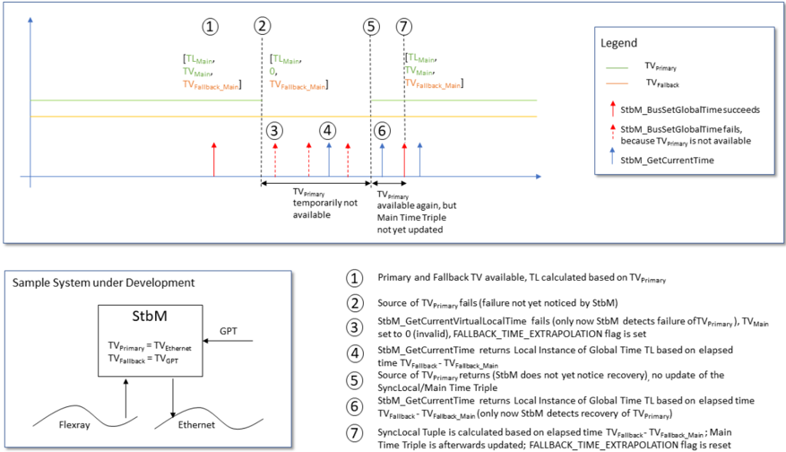

对于同步时基或纯本地时基，如果：

- 主虚拟本地时间不可用（即 [StbM_GetCurrentVirtualLocalTime](#736-stbm_getcurrentvirtuallocaltime) 返回 **E_NOT_OK**）
- 且备用虚拟本地时间已配置（即配置了 [StbMFallbackTimeClock](#927-stbmfallbacktimeclock)）
- 且备用虚拟本地时间可用（参见第 [6.2.2](#622-备用虚拟本地时间) 节的规定），

则 **StbM** 应基于主时间三元组计算该时基的全局时间本地实例（**TL**），不施加速率校正，计算公式为：

```C
TL = TL_Main + (TV_Fallback - TV_Fallback_Main)     /* (7.2) */
```

**理由：** 使用备用虚拟本地时间的外推目前不支持速率校正，以保持简单，因为不需要测量和计算速率校正（参见第 [6.12](#612-时间校正) 节「时间校正」）。对于合理性检查和保持运行，这种简化方法被认为足够好。

对于同步时基或纯本地时基，如果：

- 备用虚拟本地时间已配置（即配置了 [StbMFallbackTimeClock](#927-stbmfallbacktimeclock)）
- 且主虚拟本地时间不可用
- 且备用虚拟本地时间可用，

当 **StbM** 需要获取虚拟本地时间时，**StbM** 应设置该时基的 timeBaseStatus 位 **FALLBACK_TIME_EXTRAPOLATION**。

对于同步时基或纯本地时基，如果：

- 备用虚拟本地时间已配置（即配置了 [StbMFallbackTimeClock](#927-stbmfallbacktimeclock)）
- 且主虚拟本地时间再次变为可用（例如在故障之后）
- 且备用虚拟本地时间可用，

当 **StbM** 已更新主时间三元组（参见第 [6.3.1.1](#6311-主时间元组) 节的规定）时，**StbM** 应：

- 恢复基于主虚拟本地时间的时基外推
- 并复位该时基的 timeBaseStatus 位 **FALLBACK_TIME_EXTRAPOLATION**

对于同步时基的时基从节点，如果：

- 备用虚拟本地时间已配置（即配置了 [StbMFallbackTimeClock](#927-stbmfallbacktimeclock)）
- 且主虚拟本地时间再次变为可用（例如在故障之后）
- 且备用虚拟本地时间可用，

当 [StbM_BusSetGlobalTime](#7314-stbm_bussetglobaltime) 被调用时，**StbM** 应在主时间三元组更新之前按如下方式导出同步本地时间元组（**SyncLocal Time Tuple**）：

- 按照公式 [7.2](#72-类型定义) 计算 TL_Sync
- 并将 TV_Sync 设为 TV_Primary

**理由：** 同步本地时间元组需要为时间跳变（**Time Leap**）检测而计算。它在主时间元组之前计算，因为如果启用了通过速率自适应进行偏移校正，新的主时间元组依赖于同步本地时间元组（参见第 [6.12.2](#6122-速率和偏移校正针对时基从节点) 节）。

**注意：** 在主虚拟本地时间恢复之后预期会发生时间跳变，因为同步本地时间元组是：
- 基于较长时间未更新的 TL_Main 计算的
- 且未施加速率校正。

对于同步时基或纯本地时基，如果：

- 备用虚拟本地时间已配置（即配置了 [StbMFallbackTimeClock](#927-stbmfallbacktimeclock)）
- 且主虚拟本地时间不可用
- 且备用虚拟本地时间再次变为可用（例如在故障之后），

当需要导出虚拟本地时间时，**StbM** 应按照第 [6.3.3](#633-在主虚拟本地时间缺失时处理全局时间的本地实例) 节的规定恢复该时基的全局时间本地实例的备用外推。

### 6.4. 同步时基

初始化之后，**StbM** 应通过硬件参考时钟（由 [StbMLocalTimeClock](#925-stbmlocaltimeclock) 引用）自主维护每个时基的本地时间。

**注意：** 在尚未设置/接收到全局时基值之前（**GLOBAL_TIME_BASE** 位尚未设置），**StbM** 应维护每个时基的本地时间（即推进时间），从 **NvM** 恢复的值或值 0 开始（取决于 StbMStoreTimebaseNonVolatile 的设置）。

**注意：** 推进时间意味着，一旦主时间元组的全局时间部分被设为 0 或设为从 **NvM** 恢复的值，就需要获取作为主时间元组一部分的虚拟本地时间。

对于同步时基，如果：

- 主虚拟本地时间可用且有效，
- 或备用虚拟本地时间可用（即配置了 [StbMFallbackTimeClock](#927-stbmfallbacktimeclock)）且有效，

则 [StbM_GetCurrentTime](#733-stbm_getcurrenttime) 应返回：

- **E_OK**；
- 以及当前时间元组 [TL, TV]；
- 以及时基的当前状态 timeBaseStatus；
- 以及用户数据（**User Data**）。

对于同步时基，如果：

- 主虚拟本地时间不可用，
- 且备用虚拟本地时间未配置（即未配置 [StbMFallbackTimeClock](#927-stbmfallbacktimeclock)）或无效，

则 [StbM_GetCurrentTime](#733-stbm_getcurrenttime) 应返回 **E_NOT_OK**。

对于同步时基，如果主虚拟本地时间可用，则 **StbM** 应将当前时间元组 [TL, TV] 设置为：

- TV 设为主虚拟本地时间
- 且 TL 设为对应的全局时间本地实例

对于同步时基，如果：

- 主虚拟本地时间不可用
- 且备用虚拟本地时间已配置（即配置了 [StbMFallbackTimeClock](#927-stbmfallbacktimeclock)）
- 且备用虚拟本地时间可用，

则 **StbM** 应将当前时间元组 [TL, TV] 设置为：

- TV 设为备用虚拟本地时间，
- 且 TL 设为按照第 [6.3.3](#633-在主虚拟本地时间缺失时处理全局时间的本地实例) 节规定计算出的对应备用全局时间本地实例。

#### 6.4.1. 全局时间主节点

对于同步时基的全局时间主节点，如果不支持受控硬件时钟（即未配置 [StbMDisciplinedClock](#926-stbmdisciplinedclock)），当 [StbM_SetGlobalTime](#738-stbm_setglobaltime) 或 [StbM_UpdateGlobalTime](#739-stbm_updateglobaltime) 被调用时，**StbM** 应更新相应同步时基的主时间元组 [TL_Main, TV_Main]。**StbM** 应：

- 将 TL_Main 设为 [StbM_SetGlobalTime](#738-stbm_setglobaltime) 或 [StbM_UpdateGlobalTime](#739-stbm_updateglobaltime) 的参数 timeStamp 的值
- 并将 TV_Main 设为在进入 [StbM_SetGlobalTime](#738-stbm_setglobaltime) 或 [StbM_UpdateGlobalTime](#739-stbm_updateglobaltime) 之后立即采样的主虚拟本地时间的值

**注意：** 在进入 [StbM_SetGlobalTime](#738-stbm_setglobaltime) 或 [StbM_UpdateGlobalTime](#739-stbm_updateglobaltime) 之后立即采样虚拟本地时间可以提高精度。为了进一步提高精度，应用在锁定中断的情况下调用 [StbM_SetGlobalTime](#738-stbm_setglobaltime) 或 [StbM_UpdateGlobalTime](#739-stbm_updateglobaltime) 可能是有益的。

对于同步时基的全局时间主节点，如果支持受控硬件时钟（配置了 [StbMDisciplinedClock](#926-stbmdisciplinedclock)），当 [StbM_SetGlobalTime](#738-stbm_setglobaltime) 或 [StbM_UpdateGlobalTime](#739-stbm_updateglobaltime) 被调用时，**StbM** 应通过调用 EthIf_SetPhcTime 将受控硬件时钟的值调整为 [StbM_SetGlobalTime](#738-stbm_setglobaltime) 或 [StbM_UpdateGlobalTime](#739-stbm_updateglobaltime) 的参数 timeStamp 所设置的值。

**StbM** 应将 EthIf_SetPhcTime 的参数 timeStampPtr 分别设为 [StbM_SetGlobalTime](#738-stbm_setglobaltime) 或 [StbM_UpdateGlobalTime](#739-stbm_updateglobaltime) 的 timeStamp 的值。

对于同步时基的时基主节点，在调用 [StbM_SetBusProtocolParam](#7335-stbm_setbusprotocolparam) 时，**StbM** 应通过调用 EthTSyn_SetProtocolParam 转发在参数 protocolParam 中提供的值。

如果：

- 相应时基未映射到 **Ethernet**，或
- 参数 protocolParam 的成员 protocolType 未设为 **STBM_TIMESYNC_ETHERNET**，

则 [StbM_SetBusProtocolParam](#7335-stbm_setbusprotocolparam) 应返回 **E_NOT_OK**。

#### 6.4.2. 时基从节点

图 7.4 展示了当从时基主节点接收到新的 Timesync 报文时，更新同步时基的步骤。

**注意：** 跟随（Follow-up）报文仅由 **CanTSyn** 和 **EthTSyn** 支持（两步同步）。**FrTSyn** 直接从 **SYNC** 报文导出接收时间元组。

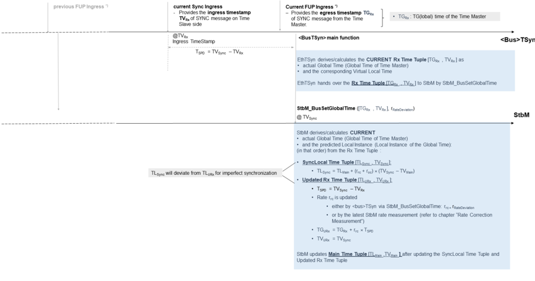

一旦 Timesync 模块导出了新的时间元组（记作接收时间元组 [TG_Rx, TV_Rx]），Timesync 模块便通过 [StbM_BusSetGlobalTime](#7314-stbm_bussetglobaltime) 将该时间元组转发给 **StbM** 做进一步处理。

以下步骤同样在时序图图 9.5 和图 9.6 中展示。在调用 [StbM_BusSetGlobalTime](#7314-stbm_bussetglobaltime) 时，**StbM** 将虚拟本地时间的当前值记录为 TV_Sync，并计算两个新的时间元组：

- 同步本地时间元组 [TL_Sync, TV_Sync]，即该时间点（TV_Sync）的时间元组。同步本地时间元组不考虑接收时间元组 [TG_Rx, TV_Rx] 的当前更新（参见第 [6.4.2.1](#6421-同步本地时间元组的计算) 节「同步本地时间元组的计算」）。

因此，同步本地时间元组是 **StbM** 在 TV_Sync 时刻基于从全局时间主节点接收到的"先前的"全局时间更新 TG_Rx 以及计算出的速率和偏移校正对全局时间的预测。

- 更新接收时间元组（**Updated Rx Time Tuple**）[TG_URx, TV_URx]，在与同步本地时间元组完全相同的时间点计算，即 TV_URx = TV_Sync。它从接收时间元组导出，考虑了从 **SYNC** 报文在 TV_Rx 时刻进入到 [StbM_BusSetGlobalTime](#7314-stbm_bussetglobaltime) 实际在 TV_Sync 时刻被调用之间的延迟。该延迟 TV_Sync − TV_Rx 被称为 **SYNC** 进入处理延迟（**SYNC Ingress Processing Delay**，TSPD）（参见第 [6.4.2.2](#6422-更新接收时间元组的计算) 节「更新接收时间元组的计算」）。

为了提高计算更新接收时间元组 [TG_URx, TV_URx] 时的精度，**SYNC** 进入处理延迟需要经过速率校正。

因此，更新接收时间元组直接从"当前的"、即来自全局时间主节点的最近一次全局时间更新 TG_Rx 导出。

##### 6.4.2.1. 同步本地时间元组的计算

对于同步时基，如果 **StbM** 不使用受控硬件时钟来维护全局时间的本地实例（即未配置容器 [StbMDisciplinedClock](#926-stbmdisciplinedclock)），当 [StbM_BusSetGlobalTime](#7314-stbm_bussetglobaltime) 被调用时，**StbM** 导出同步本地时间元组 [TL_Sync, TV_Sync] 的方式是：

- 通过调用 [StbM_GetCurrentVirtualLocalTime](#736-stbm_getcurrentvirtuallocaltime) 获取 TV_Sync
- 并按照第 [6.3.1](#631-基于自由运行硬件时钟的全局时间本地实例推移) 节的规定计算 TL_Sync。

对于同步时基，如果 **StbM** 使用受控硬件时钟来维护全局时间的本地实例（即配置了容器 [StbMDisciplinedClock](#926-stbmdisciplinedclock)），当 [StbM_BusSetGlobalTime](#7314-stbm_bussetglobaltime) 被调用时，**StbM** 应按照相应规定从底层受控硬件时钟获取当前同步本地时间元组 [TL_Sync, TV_Sync]。

##### 6.4.2.2. 更新接收时间元组的计算

对于同步时基，当 [StbM_BusSetGlobalTime](#7314-stbm_bussetglobaltime) 被调用时，**StbM** 应按如下方式计算同步时基更新接收时间元组的 TG_URx：

- 计算作为时间区间的 **SYNC** 进入处理延迟 TSPD = TV_Sync − TV_Rx，其中：
  - TV_Sync 按照第 [6.4.2.1](#6421-同步本地时间元组的计算) 节的规定为同步本地时间元组导出
  - TV_Rx 为通过 [StbM_BusSetGlobalTime](#7314-stbm_bussetglobaltime) 接收的值
- 将当前速率校正 r_rc 施加到 **SYNC** 进入处理延迟上，或取自当前 [StbM_BusSetGlobalTime](#7314-stbm_bussetglobaltime) 调用所接收的值（按照第 [6.12.1](#6121-速率校正测量针对时基从节点) 节的规定），或按照第 [6.12.1.2](#61212-stbm-的速率测量) 节的规定计算

- 通过将经速率校正的 **SYNC** 进入处理延迟加到接收时间元组的全局时间 TG_Rx 上来计算 TG_URx，即 TG_URx = TG_Rx + r_rc * TSPD

**StbM** 应在与同步本地时间元组相同的时间点计算更新接收时间元组，即在 TV_URx = TV_Sync 时刻。

其中：

- TV_Sync 分别按照第 [6.4.2.1](#6421-同步本地时间元组的计算) 节的规定导出

##### 6.4.2.3. 一般性规定

对于同步时基，每次调用 [StbM_BusSetGlobalTime](#7314-stbm_bussetglobaltime) 都应使用输入参数 userDataPtr 提供的数据更新该时基的用户数据。

对于同步时基，在调用 [StbM_GetBusProtocolParam](#7334-stbm_getbusprotocolparam) 时，如果参数 protocolParam 的成员 protocolType 设为 **STBM_TIMESYNC_ETHERNET**，则 **StbM** 应通过调用 EthTSyn_GetProtocolParam 读取参数 protocolParam 所引用的结构值。

如果：

- 相应时基未映射到 **Ethernet**，或
- 参数 protocolParam 的成员 protocolType 未设为 **STBM_TIMESYNC_ETHERNET**，

则 [StbM_GetBusProtocolParam](#7334-stbm_getbusprotocolparam) 应返回 **E_NOT_OK**。

### 6.5. 偏移时基

偏移时基只与其底层同步时基结合存在。

偏移时基的绝对时间值由偏移时基的偏移时间值加上底层同步时基的时间值得到。

对于偏移时基以外的时基，[StbM_SetOffset](#7311-stbm_setoffset) 和 [StbM_GetOffset](#7312-stbm_getoffset) 应返回 **E_NOT_OK**。

对于偏移时基，[StbM_GetCurrentTime](#733-stbm_getcurrenttime) 应返回该时基的当前时间元组 [TL_abs, TV]、相关状态和用户数据，其中 TL_abs 是通过将偏移时基的偏移值加到通过 StbMOffsetTimeBase 引用的底层同步时基的当前值 TL 上计算出的绝对时间值。

#### 6.5.1. 全局时间主节点

每次对 [StbM_SetOffset](#7311-stbm_setoffset) 的有效调用都应更新相应偏移时基的主时间元组。偏移时间值和用户数据应被相应设置。

每次调用 [StbM_GetOffset](#7312-stbm_getoffset) 都应返回相应偏移时基的偏移时间值和用户数据。

对于偏移时基，在调用 [StbM_SetGlobalTime](#738-stbm_setglobaltime) 或 [StbM_UpdateGlobalTime](#739-stbm_updateglobaltime) 时，**StbM** 应检查底层同步时基的 timeBaseStatus 中的 **GLOBAL_TIME_BASE** 位，如果该位未设置则返回 **E_NOT_OK**。

如果 **GLOBAL_TIME_BASE** 位已设置：

1. **StbM** 应通过获取底层同步时基的实际时基值并从 [StbM_SetGlobalTime](#738-stbm_setglobaltime) 或 [StbM_UpdateGlobalTime](#739-stbm_updateglobaltime) 传递的绝对时间值中减去它来计算偏移时间；
2. (a) 如果计算出的偏移时间值大于或等于零，**StbM** 应使用计算出的偏移时间值以及 [StbM_SetGlobalTime](#738-stbm_setglobaltime) 或 [StbM_UpdateGlobalTime](#739-stbm_updateglobaltime) 传递的用户数据更新相应的偏移时基；
   (b) 否则（计算出的偏移时间值小于零），**StbM** 应分别通过 [StbM_SetGlobalTime](#738-stbm_setglobaltime) 或 [StbM_UpdateGlobalTime](#739-stbm_updateglobaltime) 返回 **E_NOT_OK**。

#### 6.5.2. 时基从节点

对于偏移时基，每次调用 [StbM_BusSetGlobalTime](#7314-stbm_bussetglobaltime) 都应按如下方式更新接收时间元组 [TG_Rx, TV_Rx]：

1. 获取当前虚拟本地时间值作为 TV_Sync
2. 基于输入参数 timeTuplePtr 的成员 virtualLocalTime 提供的接收时间元组的本地虚拟时间值（TV_Rx），计算时间区间 TSPD = TV_Sync − TV_Rx
3. 将偏移时基的当前速率值 r = (r_orc − 1) 施加到时间区间 TSPD 上
4. 将经速率校正的区间 r*TSPD 加到输入参数 timeTuplePtr 的成员 globalTime 提供的接收时间元组的全局时间（TG_Rx）上

得到的时间元组 [TG_Rx + r*TSPD, TV_Sync] 被称为偏移时基的更新接收时间元组 [TG_URx, TV_URx]。

**注意：** 图 7.4 展示了时基从节点如何计算更新接收时间元组 [TG_URx, TV_URx] 的动作序列。

**注意：** 更新接收时间元组 [TG_URx, TV_URx] 的计算确保了 **SYNC**/**OFS** 报文进入与 **StbM** 中实际处理之间的延迟经过了速率校正。否则，精度可能显著下降。

对于偏移时基，每次调用 [StbM_BusSetGlobalTime](#7314-stbm_bussetglobaltime) 都应更新相应的主时间元组，并相应地设置用户数据和时基状态。

**注意：** 更新主时间元组并不意味着自动用更新接收时间元组覆盖主时间元组。

对于偏移时基，在每次调用 [StbM_BusSetGlobalTime](#7314-stbm_bussetglobaltime) 时，**StbM** 应使用更新接收时间元组的虚拟本地时间值作为参考来确定同步本地时间元组 [TL_Sync, TV_Sync]（即在第 [6.3.1](#631-基于自由运行硬件时钟的全局时间本地实例推移) 节的公式中计算 **TL** 时 TV 使用 TV_Rx）。同步本地时间元组应在主时间元组更新之前、使用更新之前的主时间元组来确定。

### 6.6. 纯本地时基

纯本地时基只在本地被设置和读取。纯本地时基的行为类似于同步时基，因为它随时间推进，但它不通过 Timesync 模块同步。因此，纯本地时基只支持 **API** 的一个子集。不支持行为类似偏移时基的纯本地时基。

初始化之后，**StbM** 应通过硬件参考时钟（由 [StbMLocalTimeClock](#925-stbmlocaltimeclock) 引用）自主维护每个纯本地时基的时间。

**注意：** 在尚未设置时基值之前（**GLOBAL_TIME_BASE** 位尚未设置），**StbM** 应维护每个纯本地时基的时间值（即推进时间），从值 0 开始。

对于纯本地时基，[StbM_GetCurrentTime](#733-stbm_getcurrenttime) 应返回由 [StbM_SetGlobalTime](#738-stbm_setglobaltime)、[StbM_UpdateGlobalTime](#739-stbm_updateglobaltime) 或 [StbM_SetUserData](#7310-stbm_setuserdata) 设置的用户数据。

对于纯本地时基，**StbM** 应：

- 允许改变：
  - **GLOBAL_TIME_BASE** 位（按照第 [6.9](#69-启动行为) 节「启动行为」的相关规定）
  - 以及 **RATE_CORRECTED** 位（按照第 [6.12](#612-时间校正) 节「时间校正」的相关规定）
- 并将时基状态 timeBaseStatus 的所有其他位保持在其初始状态 0。

对于纯本地时基，在对 [StbM_SetGlobalTime](#738-stbm_setglobaltime) 或 [StbM_UpdateGlobalTime](#739-stbm_updateglobaltime) 的有效调用时，**StbM** 应将相应时基状态的 **GLOBAL_TIME_BASE** 位置为 1。

对于纯本地时基，如果处理了一个克隆请求，**StbM** 应将源时基（**Source Time Base**）状态的 **GLOBAL_TIME_BASE** 位复制到相应目标时基（**Destination Time Base**）状态的 **GLOBAL_TIME_BASE** 位。

**注意：** 关于 **DEFERRED** 和 **IMMEDIATE** 克隆请求究竟何时被处理，请参阅第 [6.13](#613-时基克隆) 节「时基克隆」的相关规定。

**注意：** 假设 **API** [StbM_SetGlobalTime](#738-stbm_setglobaltime) 或 [StbM_UpdateGlobalTime](#739-stbm_updateglobaltime) 不用于作为克隆请求目标的纯本地时基，以避免冲突的设置。这样，**GLOBAL_TIME_BASE** 位便不能独立于克隆请求被置为 1。

### 6.7. 同步状态

对于偏移时基，[StbM_GetCurrentTime](#733-stbm_getcurrenttime) 应按照下述规定，从实际偏移时基的状态以及同步时基（通过参数 StbMOffsetTimeBase 引用）的状态导出与实际时间值一起返回的状态 timeBaseStatus。

表7.1：偏移时基的同步状态标志（**Synchronization Status flags of an Offset Time Base**）

| 位名称 | 位 | 说明 |
| --- | --- | --- |
| TIMEOUT | Bit 0 (LSB) | 0：未发生超时——偏移时基和被引用的同步时基均未发生 1：偏移时基或被引用的同步时基发生了超时 |
| Reserved | Bit 1 | 始终为 0（保留以供将来使用） |
| SYNC_TO_GATEWAY | Bit 2 | 0：本地偏移时基和被引用的同步时基与全局偏移时基主节点同步 1：本地偏移时基或被引用的同步时基的更新基于全局时间主节点之下的某个时间网关 |
| GLOBAL_TIME_BASE | Bit 3 | 0：本地偏移时基或被引用的同步时基仅基于本地时基参考时钟（从未与全局时基同步） 1：本地偏移时基和被引用的同步时基已至少与全局时基同步过一次 |
| TIMELEAP_FUTURE | Bit 4 | 0：偏移时基和被引用的同步时基在接收时间内没有向未来的跳变 1：偏移时基或被引用的同步时基在接收时间内向未来的跳变超过了配置的阈值 |
| TIMELEAP_PAST | Bit 5 | 0：偏移时基和被引用的同步时基在接收时间内没有向过去的跳变 1：偏移时基或被引用的同步时基在接收时间内向过去的跳变超过了配置的阈值 |
| RATE_CORRECTED | Bit 6 | 0：未为偏移时基或被引用的同步时基计算出有效的速率校正 1：已为偏移时基和被引用的同步时基计算出有效的速率校正 |
| RATE_EXCEEDED | Bit 7 | 0：为偏移时基和被引用的同步时基计算出的速率未超过限值 1：为偏移时基或被引用的同步时基计算出的速率超过了限值 |
| PDELAY_EXCEEDED | Bit 8 | 0：时基无 **Pdelay** 或 **Pdelay** 在阈值之内 1：时基的 **Pdelay** 超过了配置的阈值 |
| RATEJITTERWANDER_EXCEEDED | Bit 9 | 0：为偏移时基和被引用的同步时基计算出的速率抖动/漂移未超过限值 1：为偏移时基或被引用的同步时基计算出的速率抖动/漂移超过了限值 |
| TIME_PROGRESSION_INCONSISTENCY | Bit 10 | 0：为偏移时基和被引用的同步时基外推得到了有效的当前时间 1：为偏移时基或被引用的同步时基外推得到了无效的当前时间 |
| FALLBACK_TIME_EXTRAPOLATION | Bit 11 | 0：备用虚拟本地时间和主虚拟本地时间均可用于同步时基的外推 1：仅备用虚拟本地时间可用于外推 |

对于同步时基，[StbM_GetTimeBaseStatus](#7318-stbm_gettimebasestatus) 应：

- 通过 syncTimeBaseStatus 返回相应同步时基的状态，
- 并通过 offsetTimeBaseStatus 返回 0。

对于偏移时基，[StbM_GetTimeBaseStatus](#7318-stbm_gettimebasestatus) 应：

- 通过 offsetTimeBaseStatus 返回相应偏移时基的状态，
- 并通过 syncTimeBaseStatus 返回相关同步时基（由 StbMOffsetTimeBase 引用）的状态。

对于纯本地时基，[StbM_GetTimeBaseStatus](#7318-stbm_gettimebasestatus) 应：

- 通过 syncTimeBaseStatus 返回相应时基的状态（参见第 [6.6](#66-纯本地时基) 节「纯本地时基」的相关规定），
- 并通过 offsetTimeBaseStatus 返回 0。

#### 6.7.1. 全局时间主节点

在对 [StbM_SetGlobalTime](#738-stbm_setglobaltime)、[StbM_UpdateGlobalTime](#739-stbm_updateglobaltime) 或 [StbM_SetOffset](#7311-stbm_setoffset) 的有效调用时，**StbM** 应将相应时基 timeBaseStatus 中的 **GLOBAL_TIME_BASE** 位置位，并清除所有其他位。

#### 6.7.2. 时基从节点

通常，时基从节点从 0 启动其本地时基。因此，初始化之后对 StbMTimeLeapFutureThreshold / StbMTimeLeapPastThreshold 的第 1 次检查很可能总是失败，并且 **TIMELEAP_FUTURE** / **TIMELEAP_PAST** 位将总是被置位。为避免这种情况，阈值监视只会在收到第一个有效的时基值之后才开始。

下图的状态机展示了对向未来时间跳变的检测。对向过去时间跳变的检测行为将完全对称。

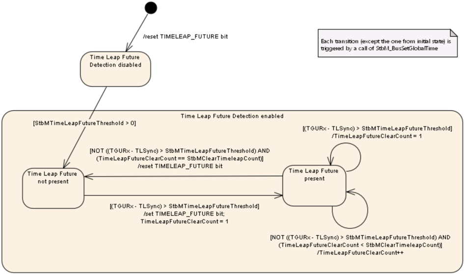

对于被配置为时基从节点或时间网关的同步时基和偏移时基，如果此前已成功接收过至少一个时基值，则每次调用 [StbM_BusSetGlobalTime](#7314-stbm_bussetglobaltime) 都应检查更新接收时间（即更新后的时基值）与同步本地时间（即当前时基值）之间的全局时间差是否超过配置的阈值 StbMTimeLeapFutureThreshold，即 TG_URx − TL_Sync > StbMTimeLeapFutureThreshold。

其中：

- TL_Sync = 同步本地时间元组的全局时间部分
- TG_URx = 更新接收时间元组的全局时间部分

在超过阈值的情况下，**StbM** 应将该时基 timeBaseStatus 中的 **TIMELEAP_FUTURE** 位置位。

如果接下来的 StbMClearTimeleapCount 次更新都在 StbMTimeLeapFutureThreshold 阈值之内，**StbM** 应清除该时基 timeBaseStatus 中的 **TIMELEAP_FUTURE** 位。

阈值为 0 时应停用该检查。

对于被配置为时基从节点或时间网关的同步时基和偏移时基，如果此前已成功接收过至少一个时基值，则每次调用 [StbM_BusSetGlobalTime](#7314-stbm_bussetglobaltime) 都应检查同步本地时间（即当前时基值）与接收时间（即更新后的时基值）之间的全局时间差是否超过配置的阈值 StbMTimeLeapPastThreshold，即 TL_Sync − TG_URx > StbMTimeLeapPastThreshold。

其中：

- TL_Sync = 同步本地时间元组的全局时间部分
- TG_URx = 更新接收时间元组的全局时间部分

在超过阈值的情况下，**StbM** 应将该时基 timeBaseStatus 中的 **TIMELEAP_PAST** 位置位。

如果接下来的 StbMClearTimeleapCount 次更新都在 StbMTimeLeapPastThreshold 阈值之内，**StbM** 应清除该时基 timeBaseStatus 中的 **TIMELEAP_PAST** 位。

阈值为 0 时应停用该检查。

**注意：** 在较长的超时之后，尽管时间漂移在可接受范围内，仍可能检测到时间跳变（StbMTimeLeapFutureThreshold 或 StbMTimeLeapPastThreshold 被超过）。如果时基从节点继续运行而时基主节点执行重启，也可能发生时间跳变。

可以在应用层采取附加措施来应对这些情况。

**注意：** 一旦置位，**TIMELEAP_FUTURE** / **TIMELEAP_PAST** 位在超时激活期间（即 **TIMEOUT** 位置位期间）保持置位，并且如果尚未发生 StbMClearTimeleapCount 次 StbMTimeLeapFutureThreshold / StbMTimeLeapPastThreshold 阈值内的更新，则在此之后也保持置位。

对于被配置为时基从节点或时间网关的同步时基和偏移时基，[StbM_GetTimeLeap](#7317-stbm_gettimeleap)() 应返回更新接收时间与同步本地时间之间的全局时间差，即 TG_URx − TL_Sync，它在对相应时基每次有效的 [StbM_BusSetGlobalTime](#7314-stbm_bussetglobaltime) 调用时（除第一次之外）计算。

其中：

- TL_Sync = 同步本地时间元组的全局时间部分
- TG_URx = 更新接收时间元组的全局时间部分

如果计算出的时间差超过了 [StbM_GetTimeLeap](#7317-stbm_gettimeleap) 的 timeJump 参数的值域，则返回的时间差应被限制为 timeJump 类型的最大负值或最大正值（参见 [StbM_TimeDiffType](#77511-stbm_timedifftype)）。

在相应时基的第二次有效 [StbM_BusSetGlobalTime](#7314-stbm_bussetglobaltime) 调用之前，[StbM_GetTimeLeap](#7317-stbm_gettimeleap) 应返回 **E_NOT_OK**。

对于被配置为时基从节点或时间网关的同步时基和偏移时基，**StbM** 应监视超时 StbMSyncLossTimeout。该超时应从最近一次 [StbM_BusSetGlobalTime](#7314-stbm_bussetglobaltime) 调用起测量。

如果超时发生，**StbM** 应将该时基 timeBaseStatus 中的 **TIMEOUT** 位置位。

一次 [StbM_BusSetGlobalTime](#7314-stbm_bussetglobaltime) 调用应清除 **TIMEOUT** 位。

**StbM** 应在 [StbM_MainFunction](#751-stbm_mainfunction) 中检查时基的超时：

- 或基于虚拟本地时间
- 或通过对主函数调用的计数

对于被配置为时间网关的同步时基和偏移时基，当超时发生时（参见本节前述规定），**StbM** 应将该时基 timeBaseStatus 中的 **SYNC_TO_GATEWAY** 位置位。

每次调用 [StbM_BusSetGlobalTime](#7314-stbm_bussetglobaltime) 都应将该时基 timeBaseStatus 中的 **SYNC_TO_GATEWAY** 位置为传递给 [StbM_BusSetGlobalTime](#7314-stbm_bussetglobaltime) 的 timeTuplePtr 参数的 timeBaseStatus 中 **SYNC_TO_GATEWAY** 位的值。

对于被配置为时基从节点或时间网关的同步时基和偏移时基，一次 [StbM_BusSetGlobalTime](#7314-stbm_bussetglobaltime) 调用应将该时基 timeBaseStatus 中的 **GLOBAL_TIME_BASE** 位置位。一旦置位，该位永远不会被清除。

### 6.8. 用户数据

用户数据（**User Data**）是每个全局时基的一部分。用户数据由每个时基的全局时间主节点设置，并作为 Timesync 报文的一部分分发。

用户数据可用于刻画时基，例如关于底层时钟源的质量或关于时间的推进情况。

用户数据最多由三个字节组成。由于各种 Timesync 报文的帧格式，无法在每种总线系统上都传输全部三个字节。系统设计者有责任只使用那些能够在车内网络中分发的用户数据字节。

所有设置用户数据的函数应只设置 [StbM_UserDataType](#77514-stbm_userdatatype) 结构中 userDataLength 元素所定义的那么多的用户数据字节。

如果 userDataLength 等于 0，则不应设置任何用户数据字节。未设置的用户数据字节应保持其先前的值。

### 6.9. 启动行为

本章描述在 [StbM_Init](#732-stbm_init) 期间应执行的动作。

[StbM_Init](#732-stbm_init) 应建立模块的初始状态，为模块向客户提供全局时基的实际功能做好准备。

#### 6.9.1. 前提条件

在同步时基管理器访问所需的基础软件模块之前，这些模块必须可用（正在运行）。

**StbM** 初始化的细节被认为与实现相关。

如果 **StbM** 依赖 **GPT** 驱动程序，则假设 **GPT** 驱动程序在 [StbM_Init](#732-stbm_init) 之前已初始化 **GPT**。[StbM_Init](#732-stbm_init) 启动由 StbMLocalTimeHardware 或 StbMFallbackTimeHardware 选择的 **GPT** 定时器，并以 **GPT_CH_MODE_CONTINUOUS** 模式、以 GptChannelTickValueMax 为目标时间进行配置。定时器溢出通过通知函数 Gpt_Notification_&lt;channel&gt; 计数，用于更新虚拟本地时间。该定时器在 **ECU** 关机之前不会被停止/重新配置。

#### 6.9.2. 初始化

在调用 [StbM_Init](#732-stbm_init) 时，每个配置的时基（参见 [StbMSynchronizedTimeBase](#923-stbmsynchronizedtimebase)）都应以零初始化，并且其同步状态 timeBaseStatus 应被置为 0。

对于每个时基，**StbM** 应将相应的事件状态 NotificationEvents 初始化为 0。

对于每个时基，**StbM** 应将相应的更新计数器 timeBaseUpdateCounter 初始化为 0。

对于每个配置为全局时间主节点且需非易失性存储的同步时基（即 StbMStoreTimebaseNonVolatile == **STORAGE**），**StbM** 应从 **NvM** 加载存储的备份时间。

在从 **NvM** 加载存储的备份时间之后，**StbM** 应立即向 **NvM** 存储一个新的备份时间（= 加载的（旧）备份时间 + StbMCyclicBackupInterval）。

如果恢复不成功，该时基应从零开始。

**注意：** **NvM** 处理的进一步细节有意保持开放。实现者可以选择，例如：
- **NvM** 的 ReadAll/WriteAll 功能
- 或显式的 **NvM** Block 配置与同步

此外，Block 的恢复可以：
- 通过回调
- 或通过常量。

对于每个满足以下条件的同步时基：配置为全局时间主节点、需非易失性存储（即 StbMStoreTimebaseNonVolatile == **STORAGE**）且使用受控硬件时钟（即配置了 [StbMDisciplinedClock](#926-stbmdisciplinedclock)），当存储的备份时间已成功从 **NvM** 加载时，**StbM** 应调用 EthIf_SetPhcTime 将受控硬件时钟的值设为从 **NvM** 读取的备份时间。

如果从 **NvM** 加载失败，则 **StbM** 应调用 EthIf_SetPhcTime 将受控硬件时钟的值设为 0。

如果 StbMTimeRecordingSupport 设为 **TRUE**，则 **StbM** 应将测量记录表的所有块元素（Block Element）初始化为零。

**注意：** 关于测量记录表——同步时基记录表（**Synchronized Time Base Record Table**）和偏移时基记录表（**Offset Time Base Record Table**）——的细节，请参阅第 [6.16.2](#6162-全局时间精度测量支持) 节「全局时间精度测量支持」。

对于每个时基，**StbM** 应将所有相应的用户数据字节初始化为 0。

### 6.10. 关机行为

对于每个配置为时基主节点且需非易失性存储的同步时基（即 StbMStoreTimebaseNonVolatile == **STORAGE**），**StbM** 应以 StbMCyclicBackupInterval 的周期区间，周期性地向 **NvM** 存储备份时间。

**StbM** 应将备份时间的值计算为：

- 时基的当前时间 + StbMCyclicBackupInterval。

**NvM** 中备份时间的初始值应设为 0。

**理由：** 在向 **NvM** 存储备份值时，通过将偏移值 StbMCyclicBackupInterval 加到当前时间上，可以确保即使发生复位（备份时间从 **NvM** 恢复），全局时间也（严格）单调递增。

在优雅关机（graceful shutdown）时，对于每个配置为时基主节点且需非易失性存储的同步时基（即 StbMStoreTimebaseNonVolatile == **STORAGE**），**StbM** 应将以下值作为备份时间存储到 **NvM**：

- 时基的当前时间

### 6.11. 立即时间同步

在处理总线特定的时间同步协议方面（即在总线上自主发送 Timesync 报文），所有 Timesync 模块都独立于 **StbM** 工作。

尽管如此，**StbM** 有必要提供一个基于 timeBaseUpdateCounter 的接口，让 Timesync 模块能够检测某时基是否已被更新，从而可以立即发送 Timesync 报文，例如以加速重新同步。

[StbM_GetTimeBaseUpdateCounter](#7324-stbm_gettimebaseupdatecounter) 允许 Timesync 模块检测某时基是否应在随后的 &lt;Bus&gt;TSyn_MainFunction 周期中立即发送。

[StbM_GetTimeBaseUpdateCounter](#7324-stbm_gettimebaseupdatecounter) 应返回相应时基的 timeBaseUpdateCounter 的值。

对于同步时基和偏移时基，时基的 timeBaseUpdateCounter 的取值范围应为 0 到 255。

- 对于同步时基和偏移时基，在对 [StbM_SetGlobalTime](#738-stbm_setglobaltime)、[StbM_BusSetGlobalTime](#7314-stbm_bussetglobaltime) 或 [StbM_TriggerTimeTransmission](#7323-stbm_triggertimetransmission) 的有效调用时；
- 对于偏移时基，在对 [StbM_SetOffset](#7311-stbm_setoffset) 的有效调用时；

**StbM** 应将相应时基的 timeBaseUpdateCounter 加 1。

在 255 处，timeBaseUpdateCounter 应回绕到 0。

**注意：** 对于偏移时基，术语"相应时基"仅指偏移时基本身，而不指底层同步时基。

**注意：** 如果 **StbM** 不应增加相应时基的 timeBaseUpdateCounter，则可以使用 [StbM_UpdateGlobalTime](#739-stbm_updateglobaltime) 代替 [StbM_SetGlobalTime](#738-stbm_setglobaltime)。

### 6.12. 时间校正

同步时基管理器为时基从节点提供对其时基执行以下校正的能力：

- 速率校正（**Rate Correction**，参见第 [6.12.1](#6121-速率校正测量针对时基从节点) 节「速率校正测量（针对时基从节点）」和第 [6.12.2](#6122-速率和偏移校正针对时基从节点) 节「速率和偏移校正（针对时基从节点）」）以及
- 偏移校正（**Offset Correction**，参见第 [6.12.2](#6122-速率和偏移校正针对时基从节点) 节）

对于全局时间主节点，**StbM** 提供对其时基执行以下校正的能力：

- 速率校正（参见第 [6.12.3](#6123-全局时间主节点的时间外推和速率校正) 节「全局时间主节点的时间外推和速率校正」）

如果检测到主虚拟本地时间（TV_Primary）与来自时基主节点的当前全局时间之间存在速率偏差，则施加速率校正以减小该速率偏差。

如果检测到经速率校正的主虚拟本地时间与来自时基主节点的当前全局时间之间存在偏移，则施加偏移校正以减小该偏移。

速率校正和偏移校正可以针对每个时基单独配置。

#### 6.12.1. 速率校正测量（针对时基从节点）

速率校正测量确定虚拟本地时间与全局时间之间的速率比（rate ratio）。

速率校正测量可以：

- 由 **StbM** 自身完成（参见第 [6.12.1.2](#61212-stbm-的速率测量) 节「StbM 的速率测量」）或
- 由底层 TimeSync 模块完成（参见第 [6.12.1.1](#61211-timesync-模块的速率测量) 节「Timesync 模块的速率测量」）

测得的速率校正因子 r_rc 由 **StbM** 用于在其确定时（例如在 [StbM_GetCurrentTime](#733-stbm_getcurrenttime) 的执行范围内，参见图 7.6）校正时基的时间。

**注意：** 施加速率校正对于短时间区间（以及小的速率偏差值）是不精确的。

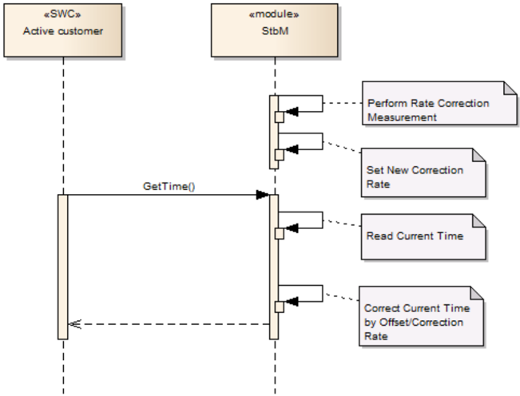

##### 6.12.1.1. Timesync 模块的速率测量

目前只有 Timesync 模块 **EthTSyn** 支持速率测量。

如果：

- 某同步时基的 StbMRateSource 被配置为 Timesync 模块，
- 且 measureDataPtr->rateDeviation->rateDeviationStatus 为 **ETH_RATE_OK**，

则在 [StbM_BusSetGlobalTime](#7314-stbm_bussetglobaltime) 内部，**StbM** 应：

- 将校正速率 r_rc 设为 [StbM_BusSetGlobalTime](#7314-stbm_bussetglobaltime) 的参数 measureDataPtr->rateDeviation->rateDeviationValue 的值，
- 且不执行 **StbM** 内部速率测量。

如果：

- 某同步时基的 StbMRateSource 被配置为 Timesync 模块，
- 且 measureDataPtr->rateDeviation->rateDeviationStatus 为 **ETH_RATE_NOT_AVAILABLE** 或 **ETH_RATE_INVALID**，

则在 [StbM_BusSetGlobalTime](#7314-stbm_bussetglobaltime) 内部，**StbM** 应：

- 忽略 [StbM_BusSetGlobalTime](#7314-stbm_bussetglobaltime) 的参数 measureDataPtr->rateDeviation->rateDeviationValue 的值，
- 且不改变校正速率 r_rc，
- 且不执行 **StbM** 内部速率测量。

**注意：** "**StbM** 内部"速率测量是指按照第 [6.12.1.2](#61212-stbm-的速率测量) 节「StbM 的速率测量」对速率校正进行的端到端测量。

##### 6.12.1.2. StbM 的速率测量

如果对于某时基：

- StbMRateSource 设为 [StbMSynchronizedTimeBase](#923-stbmsynchronizedtimebase)，且
- 测量时长 StbMRateCorrectionMeasurementDuration 大于 0，

则 **StbM** 自身应测量速率校正的值，并将测得的值 r_rc 用于速率校正。

对于速率校正测量，**StbM** 应在测量期间评估 **TIMELEAP_FUTURE** 和 **TIMELEAP_PAST** 标志。如果这些标志中有任何一个被置位，**StbM** 应丢弃该测量。

对于速率校正测量，**StbM** 应在测量期间评估 **SYNC_TO_GATEWAY** 标志的状态变化。如果该标志状态发生变化，**StbM** 应丢弃该测量。

对于速率校正测量，**StbM** 应在测量期间评估：

- **TIMEOUT** 标志、
- **TIME_PROGRESSION_INCONSISTENCY** 标志以及
- **FALLBACK_TIME_EXTRAPOLATION** 标志。

如果这些标志中有任何一个被置位，则 **StbM** 应丢弃该测量。

对于速率校正，**StbM** 应在测量开始时评估：

- **TIMELEAP_FUTURE** / **TIMELEAP_PAST** 标志、
- **TIME_PROGRESSION_INCONSISTENCY** 标志以及
- **FALLBACK_TIME_EXTRAPOLATION** 标志。

如果这些标志中有任何一个被置位，则 **StbM** 不应开始速率校正测量。

除非速率校正被停用（见下文的规定），**StbM** 应执行速率校正测量以确定每个配置时基的速率偏差。

**StbM** 应连续执行速率校正测量。一次测量的结束标志着下一次测量的开始。测量的开始和结束始终由同步时基或偏移时基时间值的接收触发并与之对齐。

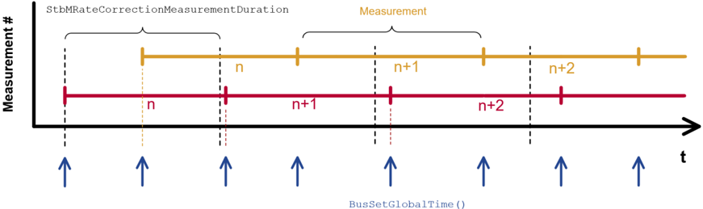

在运行期间，**StbM** 应基于虚拟本地时间确定速率校正测量的时间跨度。

**注意：** 简单地对 [StbM_BusSetGlobalTime](#7314-stbm_bussetglobaltime) 调用（由收到的 Timesync 报文引起）进行计数并从周期时间推导经过的时间跨度，可能导致错误的结果，因为 Timesync 周期时间是允许变化的。

只有当时间跳变检测配置得当，全局时间才适合作为确定速率校正测量时间跨度的时间参考；否则，时间跳变可能不可接受地缩短或拉长时间区间。

时间跨度应当改为通过以下方式之一确定：

- 基于虚拟本地时间，或
- 通过对主函数 [StbM_MainFunction](#751-stbm_mainfunction) 调用次数的计数。

在后一种情况下，在基于 StbMMainFunctionPeriod 和 StbMRateCorrectionMeasurementDuration 确定调用次数时，必须确保得到的时间跨度不短于 StbMRateCorrectionMeasurementDuration。

**注意：** 关于时间跨度测量的实现细节，请参阅下述规定的注释。

**StbM** 应为每个配置的时基执行与参数 StbMRateCorrectionsPerMeasurementDuration 配置数量相同的并发速率校正测量。

并发的速率校正测量应以定义的偏移（t_on）启动，以使速率校正在测量时长上均匀分布：

```C
t_on = n * (StbMRateCorrectionMeasurementDuration / StbMRateCorrectionsPerMeasurementDuration)
```

其中：

- n：当前测量的从零开始的索引

**注意：** 如果某次速率校正测量的启动被延迟——例如由于较晚收到同步时基或偏移时基的时间值——以至于它会与更晚的一次并发速率校正测量的启动重合，则应丢弃被延迟的测量，只启动最近的那一次。也就是说，在每次收到同步时基或偏移时基的时间值时，并发测量中只有一个被启动。

**注意：** 该实现可以（例如）通过将相关的时间快照存储在链表中来实现。或者，测量可以被视为对象，它们存储自己的相关数据并可独立使用。

在速率校正测量开始时，**StbM** 应存储更新接收时间元组。所存储时间元组的元素具有以下记号：

- TG_Start —— 更新接收时间元组的全局时间部分
- TV_Start —— 更新接收时间元组的虚拟本地时间部分

**注意：** 这等价于原子时间元组赋值：[TG_Start, TV_Start] = [TG_Rx, TV_Rx]。

在速率校正测量结束时，**StbM** 应存储更新接收时间元组。所存储时间元组的元素具有以下记号：

- TG_Stop —— 更新接收时间元组的全局时间部分
- TV_Stop —— 更新接收时间元组的虚拟本地时间部分

**注意：** 这等价于原子时间元组赋值：[TG_Stop, TV_Stop] = [TG_Rx, TV_Rx]。

在速率校正测量结束时，**StbM** 应按如下方式计算同步时基得到的校正速率（r_rc）：

```C
r_rc = (TG_Stop - TG_Start) / (TV_Stop - TV_Start)     /* (7.3) */
```

**注意：** 要确定得到的速率偏差，需要从 r_rc 中减去值 1。

**StbM** 应对 r_rc 和 r_orc 使用相同的值，直到计算出新的有效值（参见下文的速率有效性检查）。

**注意：** 新计算的速率校正 r_rc 或 r_orc 只应用于其后的时间计算。

在速率校正测量结束时，**StbM** 应按如下方式计算偏移时基得到的校正速率（r_orc）：

```C
r_orc = (TG_Stop - TG_Start) / (TV_Stop - TV_Start) + 1     /* (7.4) */
```

**注意：** TG_Stop 和 TG_Start 分别指测量结束和开始时偏移时基的偏移值，而不是偏移时基的对应绝对值（即偏移值 + 底层同步时基的值）。由于偏移值随时间几乎恒定，对于偏移时基 TG_Stop − TG_Start 接近 0。

因此，偏移时基的速率（r_orc）将接近 0，而同步时基的 r_rc 接近 1（参见上文公式），如果不加 +1 的话。通过在 r_orc 公式中加 +1，速率校正 r_orc 与 r_rc 的值域以及相应的速率偏差值可以被对齐，从而允许更一般的表达式，例如上文推导公式的形式。

然而，在对偏移时基执行实际的速率校正时，额外的 +1 需要被忽略（参见第 [6.12.2.2](#61222-通过速率自适应进行偏移校正) 节的相关规定）。

**StbM** 应将速率偏差 rDev 计算为：

- 同步时基：r_rc − 1；
- 偏移时基：r_orc − 1。

对于同步时基和偏移时基，且 StbMIsSystemWideGlobalTimeMaster 设为 **False** 时，**StbM** 应在调用 [StbM_GetRateDeviation](#7315-stbm_getratedeviation) 时返回为该时基计算出的速率偏差 rDev。

如果尚未计算出速率偏差，[StbM_GetRateDeviation](#7315-stbm_getratedeviation) 应返回 **E_NOT_OK**。

对于同步时基，如果有效的校正速率（r_rc）尚未计算出或当前未在计算（参见本节开头的配置检查）但应当被施用，则 **StbM** 应使用 r_rc = 1。

对于偏移时基，如果有效的校正速率（r_orc）尚未计算出或当前未在计算（参见本节开头的配置检查）但应当被施用，则 **StbM** 应使用 r_orc = 1。

对于同步时基，如果：

- StbMIsSystemWideGlobalTimeMaster 设为 **False**，
- 且 StbMRateCorrectionThreshold 大于 0，

则 **StbM** 应检查计算出的速率偏差的绝对值是否超过配置的 StbMRateCorrectionThreshold 值。

如果超过阈值，则 **StbM** 应将该时基 timeBaseStatus 中的 **RATE_EXCEEDED** 位置位，并将计算出的速率偏差视为无效。

如果未超过阈值，则 **StbM** 应清除该时基 timeBaseStatus 中的 **RATE_EXCEEDED** 位。

如果已为某时基计算出有效的速率校正值（按上文的有效性判定），则 **StbM** 应将该时基 timeBaseStatus 中的 **RATE_CORRECTED** 位置为 1。

**注意：** 只有 [StbM_Init](#732-stbm_init) 会复位 **RATE_CORRECTED** 位，即一旦置位，该标志将保持置位，直到 **StbM** 复位。

#### 6.12.2. 速率和偏移校正（针对时基从节点）

同步时基或偏移时基的时基从节点将其全局时间的本地实例调整为时基主节点提供的全局时间。为此，**StbM** 必须在插值全局时间本地实例的同时：

- 消除本地时钟频率与时基主节点时钟频率之间的差异，即速率偏差 rDev；
- 消除更新接收时间元组（TG_Rx）与同步本地时间元组的全局时间（TL_Sync）之间的时间偏移 oSyncDiff。

本章规定 **StbM** 如何：

- 通过施加速率校正因子 r_rc（在第 [6.12](#612-时间校正) 节中推导）来消除 rDev；
- 并以两种可选方式之一消除时间偏移 oSyncDiff：
  - 「通过跳变进行偏移校正」（**Offset Correction by Jump**）：全局时间本地实例（**TL**）的时间"跳变"到更新接收时间（TG_URx）的值，即跳变时间偏移 oSyncDiff（参见图 9.7）。
  - 「通过速率自适应进行偏移校正」（**Offset Correction by Rate Adaption**）：所施用的速率校正 r_rc 被一个附加的速率偏移 r_oc 调整，使得已存在的时间偏移 oSyncDiff 在配置的时间跨度（称为偏移校正自适应区间，由 StbMOffsetCorrectionAdaptionInterval 配置）内平稳地缩减为零（参见图 9.7）。

当 [StbM_BusSetGlobalTime](#7314-stbm_bussetglobaltime) 被调用且它不是 [StbM_BusSetGlobalTime](#7314-stbm_bussetglobaltime) 的第一次调用时，**StbM** 应计算更新接收时间与同步本地时间之间的时间偏移 oSyncDiff 为：

- oSyncDiff = TG_URx − TL_Sync

对于同步时基和偏移时基，只有在速率校正被启用时才支持速率校正和通过速率自适应进行的偏移校正。如果未启用，**StbM** 将只执行「通过跳变进行偏移校正」。

##### 6.12.2.1. 通过跳变进行偏移校正

对于同步时基或偏移时基，当按照上文公式计算出时间偏移 oSyncDiff 时，如果：

- 速率校正被停用，即 StbMRateSource 未配置，

则 **StbM** 应：

- 施加「通过跳变进行偏移校正」，即：
  - 设置值 o_oc = oSyncDiff；
  - 并将主时间元组更新为更新接收时间元组；
- 且不施加速率校正，即：
  - 对于同步时基：设置 r = 1；
  - 对于偏移时基：设置 r = 0。

对于已启用速率校正的同步时基和偏移时基，「通过速率自适应进行偏移校正」可以被打开或关闭。

对于同步时基或偏移时基，当按照上文公式计算出时间偏移 oSyncDiff 时，且如果：

- 速率校正被启用（即 StbMRateSource 已配置），
- 且 StbMOffsetCorrectionJumpThreshold 设为 0，

则 **StbM** 应：

- 施加「通过跳变进行偏移校正」，即：
  - 设置值 o_oc = oSyncDiff；
  - 并将主时间元组更新为更新接收时间元组；
- 且不施加「通过速率自适应进行偏移校正」，即：
  - 设置 r_oc = 0；
  - 由此：
    - 对于同步时基：设置 r = r_rc；
    - 对于偏移时基：设置 r = (r_orc − 1)。

如果时间偏移太大而无法在配置的时间跨度内平稳地缩减为零，**StbM** 将执行「通过跳变进行偏移校正」。

对于同步时基，当按照上文公式计算出时间偏移 oSyncDiff 时，且如果：

- 速率校正被启用（即 StbMRateSource 已配置），
- 且绝对值 abs(oSyncDiff) 大于或等于 StbMOffsetCorrectionJumpThreshold，

则 **StbM** 应：

- 施加「通过跳变进行偏移校正」，即：
  - 设置值 o_oc = oSyncDiff；
  - 并将主时间元组更新为更新接收时间元组；
- 且不施加「通过速率自适应进行偏移校正」，即：
  - 设置 r_oc = 0；
  - 由此设置 r = r_rc。

对于偏移时基，当按照上文公式计算出时间偏移 oSyncDiff 时，且如果：

- 速率校正被启用（即 StbMRateSource 已配置），
- 且绝对值 abs(oSyncDiff) 大于或等于 StbMOffsetCorrectionJumpThreshold，

则 **StbM** 应：

- 施加「通过跳变进行偏移校正」，即：
  - 设置值 o_oc = oSyncDiff；
  - 并将主时间元组更新为更新接收时间元组；
- 且不施加「通过速率自适应进行偏移校正」，即：
  - 设置 r_oc = 0；
  - 由此设置 r = r_orc − 1。

##### 6.12.2.2. 通过速率自适应进行偏移校正

对于同步时基或偏移时基，当按照上文公式计算出时间偏移 oSyncDiff 时，且如果：

- 速率校正被启用（即 StbMRateSource 已配置），
- 且绝对值 abs(oSyncDiff) 小于 StbMOffsetCorrectionJumpThreshold，

则 **StbM** 应：

- 启动偏移校正自适应区间；
- 通过 r_oc = oSyncDiff / StbMOffsetCorrectionAdaptionInterval 为「通过速率自适应进行偏移校正」计算一个新值；
- 相应地更新所施用的速率 r，即：
  - 对于同步时基：r = r_rc + r_oc；
  - 对于偏移时基：r = (r_orc − 1) + r_oc；
- 且不施加「通过跳变进行偏移校正」，即：
  - 设置值 o_oc = 0；
  - 并将主时间元组更新为同步本地时间元组。

对于同步时基或偏移时基，如果 **StbM** 不使用受控硬件时钟来维护全局时间的本地实例（未配置容器 [StbMDisciplinedClock](#926-stbmdisciplinedclock)），并且当偏移校正自适应区间到期时（启动条件见上文），则 **StbM** 应按该顺序：

1. 通过使用（按照上文的启动规定）：
   - 对于同步时基：r = r_rc + r_oc；
   - 或对于偏移时基：r = (r_orc − 1) + r_oc；

   在一个原子序列中更新主时间元组 [TL_Main, TV_Main] 为：
   - TV_Main = TV_Main + StbMOffsetCorrectionAdaptionInterval
   - 且 TL_Main = TL_Main + r * StbMOffsetCorrectionAdaptionInterval
2. 然后设置 r_oc = 0，即不再施加「通过速率自适应进行偏移校正」。

**注意：** 这假设没有因为例如 TimeSync 模块正在处理另一对 **SYNC**/FollowUp 报文而发生主时间元组的更新。

**注意：** "原子序列"意味着时间元组的两个成员需要通过一个原子（即不可中断）操作来更新，以保持其一致性。

**注意：** 如果全局时间本地实例 **TL** 不是从受控硬件时钟导出的，则 **StbM** 需要在 StbMOffsetCorrectionAdaptionInterval 到期后按照上述规定更新主时间元组：

- 在下一次 [StbM_GetCurrentTime](#733-stbm_getcurrenttime) 中（即 [StbM_GetCurrentTime](#733-stbm_getcurrenttime) 将首先计算新的主时间元组，然后基于它计算时间元组 [TL, TV]）；
- 或在下一次主函数中；

取决于两个事件中哪个先发生。

如果全局时间本地实例 **TL** 从受控硬件时钟导出，则一旦在偏移校正自适应区间到期后设置了新的 r，**StbM** 就需要立即更新该硬件时钟。

使用速率自适应产生的不精确性必须由用户加以考虑。

如果 **StbM** 使用受控硬件时钟来维护全局时间的本地实例（配置了容器 [StbMDisciplinedClock](#926-stbmdisciplinedclock)），并且当偏移校正自适应区间到期时（启动条件见上文），则 **StbM** 应不再施加「通过速率自适应进行偏移校正」，即设置 r_oc = 0，由此将所施用的速率更新为 r = r_rc。

如果 **StbM** 使用受控硬件时钟来维护全局时间的本地实例（配置了容器 [StbMDisciplinedClock](#926-stbmdisciplinedclock)），当：

- 通过 [StbM_BusSetGlobalTime](#7314-stbm_bussetglobaltime) 接收到了新的接收时间元组（TG_Rx）；
- 或偏移校正自适应区间已到期；

且：

- 计算出了新的所施用的速率 r（如果速率校正被启用）；
- 以及新的偏移校正 o_oc；

则 **StbM** 应通过调用 EthIf_SetPhcCorrection 更新受控硬件时钟：

- EthIf_SetPhcCorrection 的参数 rateDeviation 设为 r − 1；
- EthIf_SetPhcCorrection 的参数 offset 设为 o_oc。

**注意：** 假设 r 和 o_oc 同时变化，并且 **StbM** 在 [StbM_BusSetGlobalTime](#7314-stbm_bussetglobaltime) 内只调用一次 EthIf_SetPhcCorrection，同时更新速率和偏移。

#### 6.12.3. 全局时间主节点的时间外推和速率校正

全局时间主节点中的速率校正可以应用于同步时基和偏移时基（包括纯本地时基）。

全局时间主节点不支持偏移校正。

用例包括将纯本地时基的速率设置为接收到的同步时基的速率，或将同步时基的速率调整到外部时间源（例如 **GPS**）。

速率校正通过设置一个校正因子来施用，**StbM** 使用该因子在其被读取时（例如在 [StbM_GetCurrentTime](#733-stbm_getcurrenttime) 的执行范围内）校正时基的时间。

作为全局时间主节点，**StbM** 按如下方式导出某时基的全局时间本地实例（**TL**）：

- 如果不支持受控硬件时钟，则基于主时间元组、虚拟本地时间的当前值和所施用的速率值按上文推导公式进行外推；
- 如果支持受控硬件时钟，则通过读取受控硬件时钟。

对于某时基的全局时间主节点，如果不支持受控硬件时钟（未配置 [StbMDisciplinedClock](#926-stbmdisciplinedclock)），则 **StbM** 应按上文推导公式计算时基的全局时间本地实例（**TL**），其中所施用的速率 r 设为：

- 对于同步时基：r = r_rc；
- 对于偏移时基：r = (r_orc − 1)。

对于同步时基和纯本地时基的全局时间主节点，如果 StbMAllowMasterRateCorrection 等于 **FALSE**，则 **StbM** 应将速率校正的值设为 r_rc = 1。

对于偏移时基的全局时间主节点，如果 StbMAllowMasterRateCorrection 等于 **FALSE**，则 **StbM** 应将偏移时基的速率校正的值设为 r_orc = 1。

对于同步时基和纯本地时基的时基主节点，如果有效的校正速率（r_rc）尚未设置，则 **StbM** 应设置 r_rc = 1。

对于偏移时基的时基主节点，如果有效的校正速率（r_orc）尚未设置，则 **StbM** 应使用速率校正 r_orc = 1 进行时间推进。

如果 [StbM_SetRateCorrection](#7316-stbm_setratecorrection) 的参数 rateDeviation 的绝对值大于 StbMMasterRateDeviationMax，则在调用 [StbM_SetRateCorrection](#7316-stbm_setratecorrection) 时，**StbM** 应将参数 rateDeviation 传递的速率偏差值限制为：

- 或（+ StbMMasterRateDeviationMax），如果 rateDeviation 为正；
- 或（− StbMMasterRateDeviationMax），如果 rateDeviation 为负。

如果 StbMAllowMasterRateCorrection 等于 **FALSE**，则 [StbM_SetRateCorrection](#7316-stbm_setratecorrection) 应不执行任何操作并返回 **E_NOT_OK**。

对于某时基的全局时间主节点，如果：

- StbMAllowMasterRateCorrection 等于 **TRUE**，
- 且不支持受控硬件时钟（未配置 [StbMDisciplinedClock](#926-stbmdisciplinedclock)），

当 [StbM_SetRateCorrection](#7316-stbm_setratecorrection) 被调用时，**StbM** 应按该顺序：

1. 获取当前虚拟本地时间（TV_Temp）；
2. 按照上文规定为 TV_Temp 计算全局时间本地实例（TL_Temp）；
3. 用临时时间元组 [TL_Temp, TV_Temp] 的值更新当前的主时间元组；
4. 通过将所施用的速率 r 设置为以下值来更新它：
   - 对于同步时基：r_rc = rateDeviation；
   - 对于偏移时基：r_orc = (rateDeviation + 1)；

   其中 [StbM_SetRateCorrection](#7316-stbm_setratecorrection) 的 rateDeviation 已按上文规定加以限制。

对于某时基的全局时间主节点，如果：

- StbMAllowMasterRateCorrection 等于 **TRUE**，
- 且支持受控硬件时钟（配置了 [StbMDisciplinedClock](#926-stbmdisciplinedclock)），

当 [StbM_SetRateCorrection](#7316-stbm_setratecorrection) 被调用时，**StbM** 应：

- 通过将所施用的速率 r 设置为以下值来更新它：
  - 对于同步时基：r_rc = rateDeviation；
  - 对于偏移时基：r_orc = (rateDeviation + 1)；

  其中 [StbM_SetRateCorrection](#7316-stbm_setratecorrection) 的 rateDeviation 已按上文规定加以限制；
- 然后通过调用 EthIf_SetPhcCorrection 更新受控硬件时钟：
  - EthIf_SetPhcCorrection 的参数 rateDeviation 设为 (r − 1)；
  - EthIf_SetPhcCorrection 的参数 offset 设为 0。

**注意：** 如果要将一个时基的速率对齐到另一个时基的速率，可以通过 [StbM_GetRateDeviation](#7315-stbm_getratedeviation) 获取速率偏差，并将该值作为参数传递给 [StbM_SetRateCorrection](#7316-stbm_setratecorrection)。

在对 [StbM_SetRateCorrection](#7316-stbm_setratecorrection) 的有效调用时，**StbM** 应将相应时基状态（timeBaseStatus）的 **RATE_CORRECTED** 位置为 1。

**注意：** 只有 [StbM_Init](#732-stbm_init) 会复位 **RATE_CORRECTED** 位，即一旦置位，该标志将保持置位，直到 **StbM** 复位。

- 对于同步时基和偏移时基，如果 StbMIsSystemWideGlobalTimeMaster 等于 **TRUE**；
- 以及对于纯本地时基；

在调用 [StbM_GetRateDeviation](#7315-stbm_getratedeviation) 时，**StbM** 应返回当前的速率偏差。

如果尚未设置速率偏差，[StbM_GetRateDeviation](#7315-stbm_getratedeviation) 应返回 **E_NOT_OK**。

### 6.13. 时基克隆

**StbM** 提供了一个 **API**，通过将一个时基（称为源时基）的当前值、用户数据和速率校正复制到另一个时基（称为目标时基）来克隆时基。克隆 **API** 避免了复制时基时的精度损失。克隆的可能用例包括备用（fallback）场景以及冗余。

只有当源时基的当前状态满足特定条件（例如不存在时间跳变或超时）时，**StbM** 才会克隆时基。

**StbM** 支持同步时基和纯本地时基的克隆。不支持偏移时基的克隆。

对于同步时基和纯本地时基，在调用 [StbM_CloneTimeBase](#7319-stbm_clonetimebase) 时，**StbM** 应：

- 首先确定：
  - 目标时基（由输入参数 timeBaseId 给出）；
  - 以及源时基（由给定目标时基的配置参数 StbMSourceTimeBase 给出）；
- 然后从这些时基导出 [Source;Destination] 时间元组；
- 然后检查 cloneCfg 中的 **DEFERRED_COPY** 标志。

如果 **DEFERRED_COPY** 标志被置位，**StbM** 应：

- 将克隆请求连同 [StbM_CloneTimeBase](#7319-stbm_clonetimebase) 传递的参数一起作为"deferred"存储；
- 用实际的延迟克隆请求替换同一 [Source;Destination] 元组的任何未决延迟克隆请求；
- 返回 **E_OK**。

如果 **DEFERRED_COPY** 标志未置位，**StbM** 应：

- 移除同一 [Source;Destination] 元组的任何未决延迟克隆请求，并
- 立即处理该克隆请求。

对于被配置为克隆操作源的同步时基，**StbM** 应在 timeBaseStatus 中 **TIMEOUT** 位每次变化时检查是否存在未决的延迟克隆请求。

如果存在这样的未决延迟克隆请求，则应将其移除。

**注意：** 因此，当相关源时基进入 **TIMEOUT** 状态时，任何未决的延迟克隆请求都会被移除。

如果在置位 **DEFERRED_COPY** 标志的情况下调用 [StbM_CloneTimeBase](#7319-stbm_clonetimebase) 时源时基已处于 **TIMEOUT** 状态，那么稍后离开 **TIMEOUT** 状态时移除请求的效果等同于完全不存储未决延迟克隆请求。

对于被配置为克隆操作源的同步时基，**StbM** 应在每次调用 [StbM_BusSetGlobalTime](#7314-stbm_bussetglobaltime) 时检查是否存在未决的延迟克隆请求。

如果存在这样的未决延迟克隆请求，则应在 [StbM_BusSetGlobalTime](#7314-stbm_bussetglobaltime) 被完整处理之后处理它，即：时基状态已被更新、更新接收时间元组已经过速率校正计算、且主时间元组已被更新接收时间元组覆盖。

在处理完未决延迟克隆请求之后，应将其移除。

**注意：** 图 7.4 展示了调用 [StbM_BusSetGlobalTime](#7314-stbm_bussetglobaltime) 时时间元组的更新序列。

为处理立即或延迟克隆请求，**StbM** 应首先将当前时基状态与克隆请求的 statusMask 参数做掩码（逻辑与）。

如果掩码后的值等于克隆请求的 statusValue 参数，则 **StbM** 应执行克隆操作。

在 [StbM_CloneTimeBase](#7319-stbm_clonetimebase) 过程中处理立即克隆请求时，如果克隆请求被成功执行，**StbM** 应返回 **E_OK**；否则 **StbM** 应返回 **E_NOT_OK**。

如果不支持受控硬件时钟（未配置 [StbMDisciplinedClock](#926-stbmdisciplinedclock)），在执行克隆操作时，**StbM** 应按如下方式复制时基值：

如果源时基和目标时基二者使用相同的虚拟本地时间源，则应复制主时间元组；否则 **StbM** 应：

- 建立中断保护，并紧接着执行下面两步：
  - 为源时基获取当前虚拟本地时间 TV_Source；
  - 为目标时基获取当前虚拟本地时间 TV_Destination；
- 现在可以移除中断保护；
- 确定临时时间元组 [TL_Source, TV_Source]；
- 创建时间元组 [TL_Source, TV_Destination]，随后它替换目标时基的主时间元组。

如果支持受控硬件时钟（配置了 [StbMDisciplinedClock](#926-stbmdisciplinedclock)），在执行克隆操作时 **StbM** 应复制时基值。

**StbM** 应通过在一个原子（即不可中断）序列中执行以下两步，将 TL_Source 复制到 TL_Destination：

- 通过调用 EthIf_GetPhcTime 为源时基获取当前的全局时间本地实例 TL_Source；
- 通过调用 EthIf_SetPhcTime 为目标时基设置全局时间本地实例 TL_Destination。

在执行克隆操作时，**StbM** 应将源时基的用户字节复制到目标时基的用户字节。

在执行克隆操作时，**StbM** 应检查克隆请求的 cloneCfg 参数的 **APPLY_RATE** 标志。

如果：

- **APPLY_RATE** 标志被置位，
- 且已为源时基计算出有效的速率校正（即源时基的时基状态中的 **RATE_CORRECTED** 位已置位），

则 **StbM** 应将源时基的速率校正值和 **RATE_CORRECTED** 标志的值复制到目标时基的时基状态（timeBaseStatus）。

如果：

- **APPLY_RATE** 标志被置位，
- 且尚未为源时基计算出有效的速率校正（即源时基的时基状态中的 **RATE_CORRECTED** 位未置位），

则 **StbM** 应只将源时基的 **RATE_CORRECTED** 标志的值复制到目标时基的时基状态（timeBaseStatus）。

**注意：** 只有当 StbMAllowMasterRateCorrection 设为 **TRUE** 时，目标时基才会施用速率校正值。

在执行克隆操作时，**StbM** 应检查克隆请求的 cloneCfg 参数的 **IMMEDIATE_TX** 标志。

如果该标志被置位，**StbM** 应在将时基值和用户数据复制到目标时基之后（参见本节前述的复制规定），增加目标时基的 timeBaseUpdateCounter，以强制在总线上立即发送该时基。

**注意：** 如果 **IMMEDIATE_TX** 标志未置位，目标时基将在相应 Timesync 模块的下一次周期性发送时在总线上发送。

对于纯本地时基，**IMMEDIATE_TX** 标志没有效果，因为纯本地时基没有 timeBaseUpdateCounter。

### 6.14. 客户的通知

**StbM** 允许通知型客户（即 **SW-C** 或其他 **BSW** 模块）或注册以被通知时基的状态变化事件，或在报警到期时被通知。

#### 6.14.1. 时间通知

**StbM** 允许通知型客户注册，以便在客户特定的报警到期时被通知。

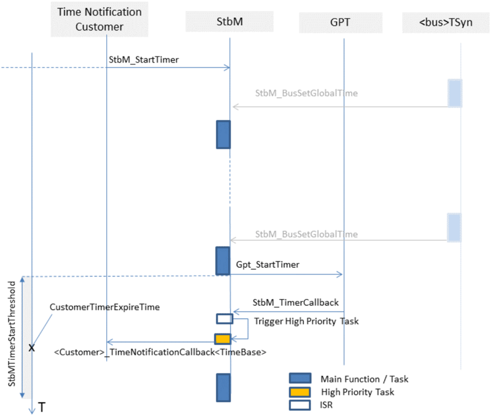

如果配置了任何 [StbMNotificationCustomer](#9211-stbmnotificationcustomer)，**StbM** 应使用一个额外的 **GPT** 时钟源（由 StbMGptTimerRef 引用），该时钟源不用于其他目的。

在为某时基的时间通知客户调用 [StbM_StartTimer](#7320-stbm_starttimer) 时，**StbM** 应基于相应的时基计算该客户定时器到期的时间 CustomerTimerExpireTime。如果同一客户的客户定时器已经在运行，[StbM_StartTimer](#7320-stbm_starttimer) 应返回 **E_NOT_OK**。

对于当前处于活动状态的时间通知客户，**StbM** 应在其 [StbM_MainFunction](#751-stbm_mainfunction) 中周期性地计算并监视相应时基的当前值与到期时间 CustomerTimerExpireTime 之间的差值。

**注意：** 周期性重计算考虑了时基的异步更新，例如通过 [StbM_BusSetGlobalTime](#7314-stbm_bussetglobaltime)。

在客户定时器到期之前的 StbMTimerStartThreshold 时间区间，**StbM** 应计算 CustomerTimerExpireTime 与相应时基当前值之间的时间差。

随后，**StbM** 应通过 Gpt_StartTimer 启动一个 **GPT** 定时器，以便在该时间差流逝后被通知。

**注意：** StbMTimerStartThreshold 应设置为大于 StbMMainFunctionPeriod 的值，以考虑 [StbM_MainFunction](#751-stbm_mainfunction) 的抖动。

如果 **GPT** 定时器为某时间通知客户到期，**GPT** 会调用 StbM_TimerCallback。

在调用 StbM_TimerCallback 时，**StbM** 应计算 CustomerTimerExpireTime 与相应时基当前值之间的时间差。

如果计算出的时间差超过了 &lt;Customer&gt;_TimeNotificationCallback&lt;TimeBase&gt; 的 deviationTime 参数的值域，则返回的时间差应被限制为 [StbM_TimeDiffType](#77511-stbm_timedifftype) 类型的最大负值或最大正值。

如果 StbMTimeNotificationCallback 不为 **NULL**：

- 则 **StbM** 应调用函数 &lt;Customer&gt;_TimeNotificationCallback&lt;TimeBase&gt;；

否则：

- **StbM** 应调用所需端口 [GlobalTime_TimeEvent](#7721-globaltime_timeevent) 的服务操作 NotifyTime；

以通知相应的时间通知客户，并在参数 deviationTime 中返回计算出的时间差的值。

**注意：** StbM_TimerCallback 在中断上下文中被调用。然而，操作 NotifyTime 只能从任务上下文调用。因此，**StbM** 必须将中断上下文与任务上下文解耦（例如通过触发 External TriggerOccurredEvent）。细节被认为与实现相关。

**注意：** 由 **StbM** 实现并由 **GPT** 调用的通知函数 StbM_TimerCallback 符合 Gpt_Notification_&lt;channel&gt; 原型。所配置的通知函数 StbM_TimerCallback 通过 **GPT** 头文件声明。

当 **StbM** 在监视与 CustomerTimerExpireTime 的差值时（参见本节前述规定），检测到对于某个活动客户：

- CustomerTimerExpireTime 已经过去，且
- **GPT** 定时器尚未启动，

则 **StbM** 应立即调用 &lt;Customer&gt;_TimeNotificationCallback&lt;TimeBase&gt;。

**注意：** 当由于调用 [StbM_BusSetGlobalTime](#7314-stbm_bussetglobaltime) 而使时基跳过到期时间（即 CustomerTimerExpireTime）但 **GPT** 定时器尚未启动时，可能出现 CustomerTimerExpireTime 已到期而 **GPT** 定时器尚未启动的场景。

**注意：** 如果 **GPT** 定时器已在运行，**StbM** 将只在 **GPT** 定时器到期时才调用 &lt;Customer&gt;_TimeNotificationCallback&lt;TimeBase&gt;。

**注意：** "立即"意味着 **StbM** 在检测到 CustomerTimerExpireTime 已经过去的同一个主函数调用内调用 &lt;Customer&gt;_TimeNotificationCallback&lt;TimeBase&gt;。因此，在这种情况下 &lt;Customer&gt;_TimeNotificationCallback&lt;TimeBase&gt; 是从任务上下文调用的。

如果多个客户定时器在同一个 StbMTimerStartThreshold 区间内运行并到期，**StbM** 应计算该 StbMTimerStartThreshold 区间内的所有到期点，并在前一个到期点到达后为下一个到期点重新启动同一个 **GPT** 定时器。

**警告：** 如果发生 [StbM_BusSetGlobalTime](#7314-stbm_bussetglobaltime) 函数调用并更新了正在运行 **GPT** 定时器的时基，新接收到的全局时间值可能相对于该时基的本地时间位于未来。根据该值位于未来多远，这可能意味着定时器（基于新的全局时间）过期得太晚。

#### 6.14.2. 状态通知

**StbM** 允许通知型客户注册，以便被通知时基的状态变化事件。**StbM** 为每个已注册的通知型客户跟踪各种与时基相关的事件的发生。通知型客户可以对 **StbM** 进行配置，使得在一个或多个事件发生时通过通知回调被告知。

对于同步时基、偏移时基和纯本地时基：

- 如果参数 StbMNotificationInterface 设为 **SR_INTERFACE** 或 **CALLBACK_AND_SR_INTERFACE**，**StbM** 应通过 [StatusNotification](#7731-statusnotification) 服务接口通知应用。
- 如果参数 StbMNotificationInterface 设为 **CALLBACK** 或 **CALLBACK_AND_SR_INTERFACE**，**StbM** 应使用回调 [StatusNotificationCallback](#7633-statusnotificationcallback)&lt;TimeBase&gt; 通知 **CDD** 与状态相关的事件。
- 如果参数 StbMNotificationInterface 设为 **NO_NOTIFICATION**，则给定时基的通知机制应被禁用。

回调 [StatusNotificationCallback](#7633-statusnotificationcallback)&lt;TimeBase&gt; 应通过配置参数 StbMNotificationInterface 设置。

**StbM** 应从 [StbM_MainFunction](#751-stbm_mainfunction) 调用状态通知回调。

**注意：** 由于状态通知是在 [StbM_MainFunction](#751-stbm_mainfunction) 内部触发的，其他函数（例如 [StbM_GetTimeBaseStatus](#7318-stbm_gettimebasestatus)）可能会在相应的状态通知实际被触发之前更早地检测到超时状况。这样的延迟状态通知被认为是可接受的。

对于每个时基，**StbM** 有一个可配置的掩码 StbMStatusNotificationMask，它允许单独掩蔽状态事件通知。

表7.2：**StbM** 检测到的状态事件（**Status Events detected by the StbM**）

| 状态事件名称 | 状态事件置位条件 |
| --- | --- |
| EV_GLOBAL_TIME | 1：timeBaseStatus 中的 GLOBAL_TIME_BASE 位已从 0 变为 1；0：其他情况 |
| EV_TIMEOUT_OCCURRED | 1：timeBaseStatus 中的 TIMEOUT 位已从 0 变为 1；0：其他情况 |
| EV_TIMEOUT_REMOVED | 1：timeBaseStatus 中的 TIMEOUT 位已从 1 变为 0；0：其他情况 |
| EV_TIMELEAP_FUTURE | 1：timeBaseStatus 中的 TIMELEAP_FUTURE 位已从 0 变为 1；0：其他情况 |
| EV_TIMELEAP_FUTURE_REMOVED | 1：timeBaseStatus 中的 TIMELEAP_FUTURE 位已从 1 变为 0；0：其他情况 |
| EV_TIMELEAP_PAST | 1：timeBaseStatus 中的 TIMELEAP_PAST 位已从 0 变为 1；0：其他情况 |
| EV_TIMELEAP_PAST_REMOVED | 1：timeBaseStatus 中的 TIMELEAP_PAST 位已从 1 变为 0；0：其他情况 |
| EV_SYNC_TO_SUBDOMAIN | 1：timeBaseStatus 中的 SYNC_TO_GATEWAY 位已从 0 变为 1；0：其他情况 |
| EV_SYNC_TO_GLOBAL_MASTER | 1：timeBaseStatus 中的 SYNC_TO_GATEWAY 位已从 1 变为 0；0：其他情况 |
| EV_RESYNC | 1：已发生重新同步且已施用新的时间值；0：其他情况 |
| EV_RATECORRECTION | 1：已计算出有效的速率校正（未超限）；0：其他情况 |
| EV_RATE_EXCEEDED | 1：已计算出无效的速率校正（超限）；0：其他情况 |
| EV_PDELAY_EXCEEDED | 1：timeBaseStatus 中的 PDELAY_EXCEEDED 位已从 0 变为 1；0：其他情况 |
| EV_PDELAY_EXCEEDED_REMOVED | 1：timeBaseStatus 中的 PDELAY_EXCEEDED 位已从 1 变为 0；0：其他情况 |
| EV_RATEJITTERWANDER_EXCEEDED | 1：timeBaseStatus 中的 RATEJITTERWANDER_EXCEEDED 位已从 0 变为 1；0：其他情况 |
| EV_RATEJITTERWANDER_EXCEEDED_REMOVED | 1：timeBaseStatus 中的 RATEJITTERWANDER_EXCEEDED 位已从 1 变为 0；0：其他情况 |
| EV_TIME_PROGRESSION_INCONSISTENCY | 1：timeBaseStatus 中的 TIME_PROGRESSION_INCONSISTENCY 位已从 0 变为 1；0：其他情况 |
| EV_TIME_PROGRESSION_INCONSISTENCY_REMOVED | 1：timeBaseStatus 中的 TIME_PROGRESSION_INCONSISTENCY 位已从 1 变为 0；0：其他情况 |
| EV_FALLBACK_TIME_EXTRAPOLATION | 1：timeBaseStatus 中的 FALLBACK_TIME_EXTRAPOLATION 位已从 0 变为 1；0：其他情况 |
| EV_FALLBACK_TIME_EXTRAPOLATION_REMOVED | 1：timeBaseStatus 中的 FALLBACK_TIME_EXTRAPOLATION 位已从 1 变为 0；0：其他情况 |

对于同步时基和偏移时基，**StbM** 应使用 [StbM_TimeBaseNotificationType](#7754-stbm_timebasenotificationtype) 类型的变量 NotificationEvents 来跟踪被引用时基是否发生了任何状态事件（参见表 7.2）。

如果任何状态事件发生且 StbMStatusNotificationMask 掩码中的相应位已置位，则 NotificationEvents 变量中的相应位被置位，即 NotificationEvents 只能包含 StbMStatusNotificationMask 掩码中启用了的事件所对应的位。

如果任何状态事件发生（参见表 7.2）且 StbMStatusNotificationMask 掩码中的相应位已置位，**StbM** 应报告 NotificationEvents 变量的值：

- 通过回调函数 [StatusNotificationCallback](#7633-statusnotificationcallback)&lt;TimeBase&gt;（参见参数 eventNotification）和/或
- 通过 [StatusNotification](#7731-statusnotification) 服务接口（参见数据元素 eventNotification），

取决于参数 StbMNotificationInterface 的设置。

如果同一时基的多个状态事件同时发生，**StbM** 应在一个主循环中只触发一次回调函数 [StatusNotificationCallback](#7633-statusnotificationcallback)&lt;TimeBase&gt; 和 [StatusNotification](#7731-statusnotification) 服务接口。

**注意：** 例如，如果发生（重新）同步，以下多个事件可能同时发生：
- **EV_RESYNC**、
- **EV_TIMEOUT_REMOVED**、
- **EV_GLOBAL_TIME**、
- **EV_TIMELEAP_FUTURE**、
- **EV_TIMELEAP_PAST**、
- **EV_TIMELEAP_FUTURE_REMOVED**、
- **EV_TIMELEAP_PAST_REMOVED**、
- **EV_RATECORRECTION**、
- **EV_RATE_EXCEEDED**、
- **EV_SYNC_TO_SUBDOMAIN** 以及
- **EV_SYNC_TO_GLOBAL_MASTER**、
- **EV_PDELAY_EXCEEDED**、
- **EV_PDELAY_EXCEEDED_REMOVED**、
- **EV_RATEJITTERWANDER_EXCEEDED**、
- **EV_RATEJITTERWANDER_EXCEEDED_REMOVED**。

另一方面，如果获取时间，则可能观察到以下事件：
- **EV_TIME_PROGRESSION_INCONSISTENCY**、
- **EV_TIME_PROGRESSION_INCONSISTENCY_REMOVED**、
- **EV_FALLBACK_TIME_EXTRAPOLATION**、
- **EV_FALLBACK_TIME_EXTRAPOLATION_REMOVED**；

原因可以是验证错误或切换到备用虚拟本地时间。

在通过 [StatusNotificationCallback](#7633-statusnotificationcallback)&lt;TimeBase&gt; **API** 和 [StatusNotification](#7731-statusnotification) 服务接口报告状态事件之后，**StbM** 应将 NotificationEvents 复位为 0。

### 6.15. 触发客户

**OS** 提供了 **API** SyncScheduleTable 来将 schedule table 同步到某个计数值。

同步时基管理器必须能够以触发型客户（**Triggered Customer**）的身份与 **OS** 交互。本模块调用 **OS** **API** 来同步 **OS** ScheduleTable。

同步时基管理器应提供配置 **OS** ScheduleTable 应同步到哪个时基的手段（参见容器 [StbMTriggeredCustomer](#9212-stbmtriggeredcustomer)）。

要同步的 schedule table 由 StbMOSScheduleTableRef 给出，同步该 schedule table 的时基由 StbMSynchronizedTimeBaseRef 给出。

**OS** ScheduleTable 是否应与同步时基同步，可以在预编译时配置。

触发型客户类型的客户应由同步时基管理器周期性地调用。

如果配置了触发型客户（参见 [StbMTriggeredCustomer](#9212-stbmtriggeredcustomer)），同步时基管理器应监视 [StbM_MainFunction](#751-stbm_mainfunction) 的周期性执行。这是为了保证 **OS** schedule table 的周期性同步。

触发周期 StbMTriggeredCustomerPeriod 应可针对每个触发型客户配置。

基于该配置，同步时基管理器同步所关联 **OS** ScheduleTable 的 **OS** 计数值。

**StbM** 应通过 SyncScheduleTable 设置 **OS** ScheduleTable 的同步计数。

同步时基管理器不负责启动和停止 **OS** ScheduleTable 的执行。

**StbM** 应通过计算当前时基值（转换为微秒）与 OsScheduleTableDuration 的模来导出以微秒为单位的 **OS** ScheduleTable 同步计数（参见通过 StbMOSScheduleTableRef 引用的 OsScheduleTable 容器）。

### 6.16. 时间记录

#### 6.16.1. 概述

如果 StbMTimeRecordingSupport 设为 **TRUE**，**StbM** 应为某时基支持全局时间精度测量。

#### 6.16.2. 全局时间精度测量支持

为了相对于全局时基验证每个本地时基的精度，应针对时基从节点和时间网关可选地支持一种记录机制。

原则上，**StbM** 在同步事件发生的时刻对所有需要的数据进行快照。**StbM** 在每个成功组装的数据块上通过一个主动推送的 **API** 函数提供对这些值的访问。离板测试仪（**Off-Board Tester**）收集每个块并随后计算精度，并相应地维护已记录块及其元素的历史。

数据如何以及通过哪种协议传输到离板测试仪将由应用规定。

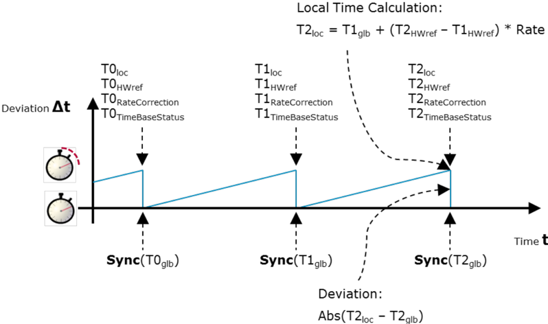

**StbM** 应只对 StbMIsSystemWideGlobalTimeMaster 设为 **FALSE** 的同步时基和偏移时基执行全局时间精度测量。

##### 6.16.2.1. 同步时基记录表

如果为该同步时基启用了全局时间精度测量（见本节及上节的规定），**StbM** 应按下述规定建立一个同步时基记录表来记录同步时基的值。

表7.3：同步时基记录表（**Synchronized Time Base Record Table**）

| | 记录表元素 | 多重性 | 范围 | 字节 | 类型 | 单位 |
| --- | --- | --- | --- | --- | --- | --- |
| Header | | 1 | | 9 | | |
| | Synchronized-TimeDomain | 1 | 0 .. 127 | 1 | uint8 | |
| | HWfrequency | 1 | 0 .. 4294967295 | 4 | uint32 | Hz |
| | HWprescaler | 1 | 0 .. 4294967295 | 4 | uint32 | |
| Block 0 | | 1 | | 32 | | |
| | GlbSeconds | 1 | 0 .. 4294967295 | 4 | [StbM_TimeStampType](#7757-stbm_timestamptype).seconds | sec |
| | GlbNanoSeconds | 1 | 0 .. 9999999999 | 4 | [StbM_TimeStampType](#7757-stbm_timestamptype).nanoseconds | ns |
| | TimeBaseStatus | 1 | 0 .. 65535 | 2 | [StbM_TimeBaseStatusType](#7753-stbm_timebasestatustype) | |
| | VirtualLocalTimeLow | 1 | 0 .. 4294967295 | 4 | uint32 | ns |
| | RateDeviation | 1 | 0 .. +/-32000 | 2 | [StbM_RateDeviationType](#77512-stbm_ratedeviationtype) | ppm |
| | LocSeconds | 1 | 0 .. 4294967295 | 4 | [StbM_TimeStampType](#7757-stbm_timestamptype).seconds | sec |
| | LocNanoSeconds | 1 | 0 .. 9999999999 | 4 | [StbM_TimeStampType](#7757-stbm_timestamptype).nanoseconds | ns |
| | PathDelay | 1 | 0 .. 4294967295 | 4 | uint32 | ns |
| | FallbackVirtualTimeLow | 1 | 0 .. 4294967295 | 4 | uint32 | ns |
| Block 1 | ... | 1 | | | | |
| ... | | 1 | | | | |
| Block (Block-Count-1) | ... | 1 | | | | |

如果为该时基启用了全局时间精度测量，StbMClockFrequency 应被映射到属于该同步时基的表的头元素（Header Element）HWfrequency，除非该时基的虚拟本地时间由 Timesync 模块提供。在这种情况下，HWfrequency 应设为 1000000000。

如果为该时基启用了全局时间精度测量，StbMClockPrescaler 应被映射到属于该同步时基的表的头元素 HWprescaler，除非该时基的虚拟本地时间由 Timesync 模块提供。在这种情况下，HWprescaler 应设为 1。

如果为该时基启用了全局时间精度测量，同步时基记录表应包含与 StbMSyncTimeRecordTableBlockCount 所配置数量相同的块历史。

##### 6.16.2.2. 偏移时基记录表

如果为某偏移时基启用了全局时间精度测量，**StbM** 应按下述规定建立一个偏移时基记录表来记录偏移时基的值。

表7.4：偏移时基记录表（**Offset Time Base Record Table**）

| | 记录表元素 | 多重性 | 范围 | 字节 | 类型 | 单位 |
| --- | --- | --- | --- | --- | --- | --- |
| Header | | 1 | | 1 | | |
| | OffsetTimeDomain | 1 | 0 .. 127 | 1 | uint8 | |
| Block 0 | | 1 | | 10 | | |
| | GlbSeconds | 1 | 0 .. 4294967295 | 4 | [StbM_TimeStampType](#7757-stbm_timestamptype).seconds | sec |
| | GlbNanoSeconds | 1 | 0 .. 9999999999 | 4 | [StbM_TimeStampType](#7757-stbm_timestamptype).nanoseconds | ns |
| | TimeBaseStatus | 1 | 0 .. 65535 | 2 | [StbM_TimeBaseStatusType](#7753-stbm_timebasestatustype) | |
| Block 1 | ... | 1 | | | | |
| ... Block (Block-Count-1) | ... | 1 | | | | |

如果为该时基启用了全局时间精度测量，偏移时基记录表应包含与 StbMOffsetTimeRecordTableBlockCount 所配置数量相同的块历史。

##### 6.16.2.3. 快照条件

如果为该时基启用了全局时间精度测量，在调用 [StbM_BusSetGlobalTime](#7314-stbm_bussetglobaltime) 时，**StbM** 应更新记录表块的所有元素。

如果所有块都已被写入，且尚未通过 [SyncTimeRecordBlockCallback](#7631-synctimerecordblockcallback)&lt;TimeBase&gt; 或 [OffsetTimeRecordBlockCallback](#7632-offsettimerecordblockcallback)&lt;TimeBase&gt; 发生通知以将所有块及其元素传递给应用，则 **StbM** 应再次用进入的测量数据覆盖包含最旧测量数据的块。

**注意：** 从实现的角度看，在数据无法足够快地转发给应用的情况下，该机制属于环形缓冲区概念。

对于同步时基，如果为该时基启用了全局时间精度测量，在调用 [StbM_BusSetGlobalTime](#7314-stbm_bussetglobaltime) 时，**StbM** 应在更新主时间元组之前（即用全局时基更新本地时基之前）将块元素：

- LocSeconds 以及
- LocNanoSeconds

写入相关的同步时基记录表。

LocSeconds 和 LocNanoSeconds 是同步本地时间元组（即 TL_Sync，参见第 [6.4.2.1](#6421-同步本地时间元组的计算) 节的规定）的全局时间部分的元素。

对于同步时基，如果为该时基启用了全局时间精度测量，在调用 [StbM_BusSetGlobalTime](#7314-stbm_bussetglobaltime) 时，**StbM** 应在更新主时间元组之后（即在用全局时基更新本地时基之后）将块元素：

- GlbSeconds、
- GlbNanoSeconds、
- VirtualLocalTimeLow、
- RateDeviation、
- timeBaseStatus、
- PathDelay、
- FallbackVirtualTimeLow

写入相关的同步时基记录表。

GlbSeconds 和 GlbNanoSeconds 是更新接收时间元组（即 TG_Rx）的全局时间部分的元素；VirtualLocalTimeLow 是更新接收时间元组（即 TV_Rx）的虚拟本地时间部分的 nanosecondsLo 元素。

**注意：** PathDelay 将从 &lt;Bus&gt;TSyn 模块获取，作为 [StbM_BusSetGlobalTime](#7314-stbm_bussetglobaltime) 的参数 measureDataPtr 的 pathDelay 成员。

对于偏移时基，如果为该时基启用了全局时间精度测量，在调用 [StbM_BusSetGlobalTime](#7314-stbm_bussetglobaltime)() 时，**StbM** 应将块元素：

- GlbSeconds、
- GlbNanoSeconds
- 以及 timeBaseStatus

写入相关的偏移时基记录表。

如果为该时基启用了全局时间精度测量，应用通过调用 [StbM_GetSyncTimeRecordHead](#7321-stbm_getsynctimerecordhead) 收集同步时基记录表头部的内容。

如果为该时基启用了全局时间精度测量，应用通过调用 [StbM_GetOffsetTimeRecordHead](#7322-stbm_getoffsettimerecordhead) 收集偏移时基记录表头部的内容。

如果为该时基启用了全局时间精度测量，**StbM** 应通过在下一个 [StbM_MainFunction](#751-stbm_mainfunction) 调用周期中调用 [SyncTimeRecordBlockCallback](#7631-synctimerecordblockcallback)&lt;TimeBase&gt;，逐块（即重复地）通知应用所有未读块（即包含尚未传递给应用的数据的块），从包含最旧数据的块开始，随后按数据的新旧升序（即 **FIFO** 顺序）排列各块，包含最新数据的块最后传递。

**StbM** 应确保数据完整性：正在被覆写的块不应被传递，而已传递的块在被应用处理之前应被防止覆写。

如果为该时基启用了全局时间精度测量，**StbM** 应通过在下一个 [StbM_MainFunction](#751-stbm_mainfunction) 调用周期中调用 [OffsetTimeRecordBlockCallback](#7632-offsettimerecordblockcallback)&lt;TimeBase&gt;，逐块（即重复地）通知应用所有未读块（即包含尚未传递给应用的数据的块），从包含最旧数据的块开始，随后按数据的新旧升序（即 **FIFO** 顺序）排列各块，包含最新数据的块最后传递。

**StbM** 应确保数据完整性：正在被覆写的块不应被传递，而已传递的块在被应用处理之前应被防止覆写。

### 6.17. 时间验证

图 7.10 概述了"时间验证"（**Time Validation**）特性的基本概念。时基从节点、时基主节点和时间网关从相应的 Timesync 模块收集关于时间同步过程的信息，以便例如基于其全局时间的本地实例（通过使用同步本地时间元组）预测 **SYNC** 进入事件的全局时间，并将该信息提供给应用（即某个 **SWC**）。这样，一个应用可以逐对检查主节点与相邻从节点是否就当前全局时间达成一致。

这些预测等可以由应用在本地分析，以便以期望的安全完整性快速检测任何受损。此外，关于参与"时间验证"的所有时基主节点和从节点之间的时间同步过程的信息，还会与验证器 **SWC**（**Validator SWC**）共享，后者可以运行在网络中的任何位置，例如全局时间主节点上。因此，验证器 **SWC** 拥有全局系统视图，使其能够检查所有对等方之间是否建立了一致的时基。验证器同时构成一个单一的授权实例，能够以期望的 **ASIL** 评估整个系统的安全完整性。验证器通过用户定义的反馈通道从所有实体接收必要的信息。

时间验证特性只向应用提供服务接口。反馈通道以及由各 **SWC** 执行的实际验证不在 **AUTOSAR** 中标准化。它以用户定义的方式在应用层完成。

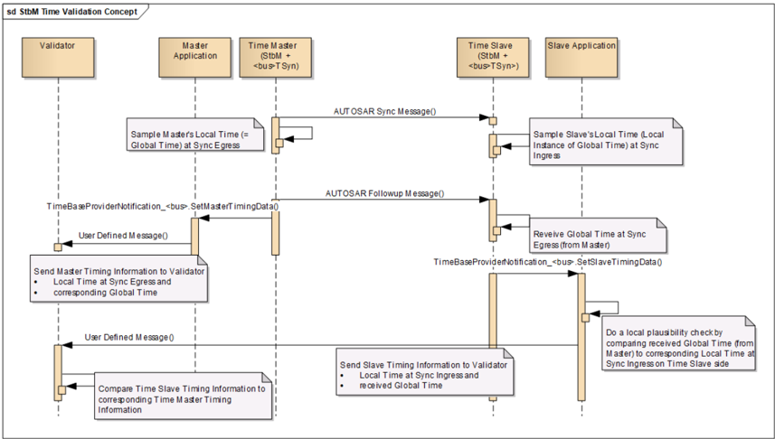

**StbM** 应为已启用时间验证（即配置了 [StbMTimeValidation](#929-stbmtimevalidation)）的同步时基（参见 [StbMSynchronizedTimeBase](#923-stbmsynchronizedtimebase)）记录用于时间验证的时序数据。

#### 6.17.1. 记录表

##### 6.17.1.1. 时基从节点/时基主节点

对于每个已启用时间验证且映射到 Timesync 模块中从通信端口（**Slave Communication Port**）的时基，**StbM** 应管理一个时基从节点验证记录表（**Time Slave Validation Record Table**），它持有：

- N 个块（参见下文的通用规定）；
- 类型为 StbM_&lt;bus&gt;TimeSlaveMeasurementType（参见表 7.6）。

表7.5：时基从节点验证记录表（**Time Slave Validation Record Table**）

| | 块结构元素 | 类型 | 说明 |
| --- | --- | --- | --- |
| Block 0 | &lt;bus&gt;Slave-TimingData[0] | StbM_&lt;bus&gt;TimeSlave-MeasurementType | 捕获时基从节点验证记录数据的总线特定结构 |
| Block 1 | &lt;bus&gt;Slave-TimingData[\[1\]](#ref-1) | StbM_&lt;bus&gt;TimeSlave-MeasurementType | |
| ... | | | |
| Block N (= StbMTime-Validation-RecordTable-BlockCount-1) | | | |

时基从节点验证记录表中块的类型取决于为相应时基的时基从节点验证记录表提供数据的 Timesync 模块。块类型到提供数据的 Timesync 模块（及相应 **API**）的映射见表 7.6。

表7.6：时基从节点验证记录表的类型映射（**Type Mapping for Time Slave Validation Record Table**）

| Timesync 模块（提供时序记录数据） | 类型（"从节点验证记录表"中块的类型） |
| --- | --- |
| CanTSyn（通过 [StbM_CanSetSlaveTimingData](#7326-stbm_cansetslavetimingdata)） | [StbM_CanTimeSlaveMeasurementType](#77526-stbm_cantimeslavemeasurementtype) |
| FrTSyn（通过 [StbM_FrSetSlaveTimingData](#7327-stbm_frsetslavetimingdata)） | [StbM_FrTimeSlaveMeasurementType](#77525-stbm_frtimeslavemeasurementtype) |
| EthTSyn（通过 [StbM_EthSetSlaveTimingData](#7328-stbm_ethsetslavetimingdata)） | [StbM_EthTimeSlaveMeasurementType](#77524-stbm_ethtimeslavemeasurementtype) |

对于每个已启用时间验证且映射到 Timesync 模块中主通信端口（**Master Communication Port**）的时基，**StbM** 应管理一个时基主节点验证记录表（**Time Master Validation Record Table**），它持有：

- N 个块（参见下文的通用规定）；
- 类型为 StbM_&lt;bus&gt;TimeMasterMeasurementType（参见表 7.8）。

表7.7：时基主节点验证记录表（**Time Master Validation Record Table**）

| | 块结构元素 | 类型 | 说明 |
| --- | --- | --- | --- |
| Block 0 | &lt;bus&gt;Master-TimingData[0] | StbM_&lt;bus&gt;TimeMaster-MeasurementType | 捕获时基主节点验证记录数据的总线特定结构 |
| Block 1 | &lt;bus&gt;Master-TimingData[\[1\]](#ref-1) | StbM_&lt;bus&gt;TimeMaster-MeasurementType | |
| ... | | | |
| Block N (= StbMTime-Validation-RecordTable-BlockCount-1) | | | |

时基主节点验证记录表中块的类型应取决于为相应时基的时基主节点验证记录表提供数据的 Timesync 模块。块类型到提供数据的 Timesync 模块（及相应 **API**）的映射见表 7.8。

表7.8：时基主节点验证记录表的类型映射（**Type Mapping for Time Master Validation Record Table**）

| Timesync 模块（提供时序记录数据） | 类型（"主节点验证记录表"中块的类型） |
| --- | --- |
| CanTSyn（通过 [StbM_CanSetMasterTimingData](#7329-stbm_cansetmastertimingdata)） | [StbM_CanTimeMasterMeasurementType](#77523-stbm_cantimemastermeasurementtype) |
| FrTSyn（通过 [StbM_FrSetMasterTimingData](#7330-stbm_frsetmastertimingdata)） | [StbM_FrTimeMasterMeasurementType](#77522-stbm_frtimemastermeasurementtype) |
| EthTSyn（通过 [StbM_EthSetMasterTimingData](#7331-stbm_ethsetmastertimingdata)） | [StbM_EthTimeMasterMeasurementType](#77521-stbm_ethtimemastermeasurementtype) |

**注意：** Timesync 模块配置中的 &lt;bus&gt;TSynSynchronizedTimeBaseRef 参数定义了哪个 Timesync 模块与 **StbM** 中的哪个时基链接，从而决定了哪个 Timesync 模块为该时基的时基主节点验证记录表/时基从节点验证记录表提供数据。

**注意：** 如果 **StbM** 被配置为某个已启用时间验证的时基的时间网关，**StbM** 会为该时基维护：
- 一个时基主节点验证记录表；
- 和一个时基从节点验证记录表。

##### 6.17.1.2. Pdelay 发起方/响应方

对于每个满足以下条件的时基：已启用时间验证，且映射到 **Ethernet** 时间域上的从通信端口，**StbM** 应管理一个 **Pdelay** 发起方验证记录表（**Pdelay Initiator Validation Record Table**），它持有：

- N 个块（参见下文的通用规定）；
- 类型为 [StbM_PdelayInitiatorMeasurementType](#77527-stbm_pdelayinitiatormeasurementtype)。

表7.9：Pdelay 发起方验证记录表（**Pdelay Initiator Validation Record Table**）

| | 块结构元素 | 类型 | 说明 |
| --- | --- | --- | --- |
| Block 0 | pdelayInitiatorData[0] | StbM_PdelayInitiator-MeasurementType | 捕获 Pdelay 发起方时间验证记录数据的结构 |
| Block 1 | pdelayInitiatorData[\[1\]](#ref-1) | StbM_PdelayInitiator-MeasurementType | |
| ... | | | |
| Block N (= StbMTime-Validation-RecordTable-BlockCount-1) | | | |

对于每个满足以下条件的时基：已启用时间验证，且映射到 **Ethernet** 时间域上的主通信端口，**StbM** 应管理一个 **Pdelay** 响应方验证记录表（**Pdelay Responder Validation Record Table**），它持有：

- N 个块（参见下文的通用规定）；
- 类型为 [StbM_PdelayResponderMeasurementType](#77528-stbm_pdelayrespondermeasurementtype)。

表7.10：Pdelay 响应方验证记录表（**Pdelay Responder Validation Record Table**）

| | 块结构元素 | 类型 | 说明 |
| --- | --- | --- | --- |
| Block 0 | pdelayResponderData[0] | StbM_PdelayResponder-MeasurementType | 捕获 Pdelay 响应方时间验证记录数据的结构 |
| Block 1 | pdelayResponderData[\[1\]](#ref-1) | StbM_PdelayResponder-MeasurementType | |
| ... | | | |
| Block N (= StbMTime-Validation-RecordTable-BlockCount-1) | | | |

对于每个时基，如果：

- 已启用时间验证，且
- [StbM_BusSetGlobalTime](#7314-stbm_bussetglobaltime) 的参数 measureDataPtr 的 pathDelay 成员大于 StbMPdelayValidationThreshold，

则 **StbM** 应在相应时基的 timeBaseStatus 中置位 **PDELAY_EXCEEDED** 位。

如果 pathDelay 小于或等于 StbMPdelayValidationThreshold，**StbM** 应复位相应时基的 timeBaseStatus 中的 **PDELAY_EXCEEDED** 位。

##### 6.17.1.3. 公共部分

以下的每一种记录表：

- 从节点验证记录表（见表 7.5）
- 主节点验证记录表（见表 7.7）
- **Pdelay** 发起方验证记录表（见表 7.9）
- **Pdelay** 响应方验证记录表（见表 7.10）

应包含与 StbMTimeValidationRecordTableBlockCount 所配置数量相同的块。

#### 6.17.2. 时间验证快照条件

##### 6.17.2.1. 时基从节点/时基主节点

如果某时基已启用时间验证，在调用 StbM_&lt;bus&gt;SetSlaveTimingData() 时，**StbM** 应将由参数 measureDataPtr 传递的结构的内容复制到该时基"从节点验证记录表"的下一个空闲 &lt;bus&gt;SlaveTimingData 块（见表 7.5）。

随后 **StbM** 应将块元素的值设置为：

- &lt;bus&gt;SlaveTimingData.referenceGlobalTimestamp 为 TL_SYNC（参见第 [6.4.2.1](#6421-同步本地时间元组的计算) 节的规定）；
- &lt;bus&gt;SlaveTimingData.referenceLocalTimestamp 为 TV_SYNC（参见第 [6.4.2.1](#6421-同步本地时间元组的计算) 节的规定）。

（即前一次 [StbM_BusSetGlobalTime](#7314-stbm_bussetglobaltime) 调用所设置的同步本地时间元组的值。）

如果某时基的从节点验证记录表（见表 7.5）中没有空闲块可用（即所有块都已被写入，且尚未通过端口 TimeBaseProviderNotification_{bus}_{TimeBase} 的操作 SetSlaveTimingData 发生通知以将所有块传递给应用），则 **StbM** 应在调用 StbM_&lt;bus&gt;SetSlaveTimingData 时覆盖包含最旧测量数据的块。

如果某时基已启用时间验证，在调用 StbM_&lt;bus&gt;SetMasterTimingData 时，**StbM** 应将由参数 measureDataPtr 传递的结构的内容复制到该时基主节点验证记录表的下一个空闲块 &lt;bus&gt;MasterTimingData（见表 7.7）。

如果某时基的主节点验证记录表（见表 7.7）中没有空闲块可用（即所有块都已被写入，且尚未通过端口 TimeBaseProviderNotification_{bus}_{TB_Name} 的操作 SetMasterTimingData 发生通知以将所有块传递给应用），则 **StbM** 应在调用 StbM_&lt;bus&gt;SetMasterTimingData 时覆盖包含最旧测量数据的块。

**注意：** 从实现的角度看，在数据无法足够快地转发给应用的情况下，该机制属于环形缓冲区概念。

对于每个已启用时间验证且 **StbM** 被配置为时基从节点或时间网关的时基，**StbM** 应在每次 [StbM_MainFunction](#751-stbm_mainfunction) 调用中检查从节点验证记录表（见表 7.5）中是否写入了新块（即包含尚未传递给应用的数据的块）。

如果是，**StbM** 应通过（重复地、逐块地）调用端口 TimeBaseProviderNotification_{bus}_{TimeBase} 的操作 SetSlaveTimingData 将所有新块传递给应用。

**StbM** 传递块时应从包含最旧数据的块开始，随后按数据的新旧升序（即 **FIFO** 顺序）排列。包含最新数据的块最后传递。

对于每个已启用时间验证且 **StbM** 被配置为时基主节点或时间网关的时基，**StbM** 应在每次 [StbM_MainFunction](#751-stbm_mainfunction) 中检查主节点验证记录表（见表 7.7）中是否写入了新块（即包含尚未传递给应用的数据的块）。

如果是，**StbM** 应通过（重复地、逐块地）调用端口 TimeBaseProviderNotification_{bus}_{TimeBase} 的操作 SetMasterTimingData 将所有新块传递给应用。

**StbM** 传递块时应从包含最旧数据的块开始，随后按数据的新旧升序（即 **FIFO** 顺序）排列。包含最新数据的块最后传递。

##### 6.17.2.2. Pdelay 发起方/响应方

如果某时基已启用时间验证，在调用 [StbM_EthSetPdelayInitiatorData](#7332-stbm_ethsetpdelayinitiatordata) 时，**StbM** 应将由参数 measureDataPtr 传递的结构的内容写入该时基相应 **Pdelay** 发起方验证记录表的下一个空闲块 pdelayInitiatorData（见表 7.9）。

如果某时基的 **Pdelay** 发起方验证记录表（见表 7.9）中没有空闲块可用（即所有块都已被写入，且尚未通过端口 [TimeBaseProviderNotification_Eth](#7723-timebaseprovidernotification_eth) 的操作 SetPdelayInitiatorData 发生通知以将所有块传递给应用），则 **StbM** 应在调用 [StbM_EthSetPdelayInitiatorData](#7332-stbm_ethsetpdelayinitiatordata) 时覆盖包含最旧测量数据的块。

对于每个已启用时间验证且映射到 **Ethernet** 时间域上从通信端口的时基，**StbM** 应在每次 [StbM_MainFunction](#751-stbm_mainfunction) 中检查该时基的 **Pdelay** 发起方验证记录表（见表 7.9）中是否写入了新块（即包含尚未传递给应用的数据的块）。

如果是，**StbM** 应通过（重复地、逐块地）调用端口 [TimeBaseProviderNotification_Eth](#7723-timebaseprovidernotification_eth) 的操作 SetPdelayInitiatorData 将所有新块传递给应用。

**StbM** 传递块时应从包含最旧数据的块开始，随后按数据的新旧升序（即 **FIFO** 顺序）排列。包含最新数据的块最后传递。

如果某时基已启用时间验证，在调用 [StbM_EthSetPdelayResponderData](#7333-stbm_ethsetpdelayresponderdata) 时，**StbM** 应将由参数 measureDataPtr 传递的结构的内容写入该时基相应 **Pdelay** 响应方验证记录表的下一个空闲块 pdelayResponderData（见表 7.10）。

如果某时基的 **Pdelay** 响应方验证记录表（见表 7.10）中没有空闲块可用（即所有块都已被写入，且尚未通过端口 [TimeBaseProviderNotification_Eth](#7723-timebaseprovidernotification_eth) 的操作 SetPdelayResponderData 发生通知以将所有块传递给应用），则 **StbM** 应在调用 [StbM_EthSetPdelayResponderData](#7333-stbm_ethsetpdelayresponderdata) 时覆盖包含最旧测量数据的块。

对于每个已启用时间验证且映射到 **Ethernet** 时间域上主通信端口的时基，**StbM** 应在每次 [StbM_MainFunction](#751-stbm_mainfunction) 中检查 **Pdelay** 响应方验证记录表（见表 7.10）中是否写入了新块（即包含尚未传递给应用的数据的块）。

如果是，**StbM** 应通过（重复地、逐块地）调用端口 [TimeBaseProviderNotification_Eth](#7723-timebaseprovidernotification_eth) 的操作 SetPdelayResponderData 将所有新块传递给应用。

**StbM** 传递块时应从包含最旧数据的块开始，随后按数据的新旧升序（即 **FIFO** 顺序）排列。包含最新数据的块最后传递。

##### 6.17.2.3. 公共部分

**StbM** 应确保以下记录表中块的数据完整性：

- 从节点验证记录表（见表 7.5）
- 主节点验证记录表（见表 7.7）
- **Pdelay** 发起方验证记录表（见表 7.9）
- **Pdelay** 响应方验证记录表（见表 7.10）。

如果某块当前正在被覆写，则不应将其传递给应用。

如果某块当前正被传递给应用，则在被应用处理之前不应被覆写。

#### 6.17.3. 监视全局时间本地实例的推移

如果主虚拟本地时间和备用虚拟本地时间二者都存在，**StbM** 可以使用备用虚拟本地时间来监视全局时间的主本地实例以及底层的备虚拟本地时间。

如果 **StbM** 检测到任何不一致，它会置起一个状态标志。

对于同步时基和纯本地时基，如果：

- 已启用时间验证；
- 且备用虚拟本地时间有效（即 [StbM_GetFallbackVirtualLocalTime](#737-stbm_getfallbackvirtuallocaltime) 返回 **E_OK**）；
- 且主虚拟本地时间有效（即 [StbM_GetCurrentVirtualLocalTime](#736-stbm_getcurrentvirtuallocaltime) 返回 **E_OK**）；

当 **StbM** 即将更新该时基的主时间元组时（参见第 [6.3.1.1](#6311-主时间元组) 节的规定），**StbM** 应按该顺序：

1. 将该时基当前的主时间三元组保存为先前主时间三元组 [TL_Main(prev), TV_Main(prev), TV_Fallback_Main(prev)]；
2. 更新该时基当前的主时间元组（参见第 [6.3.1.1](#6311-主时间元组) 节的规定）。

**注意：** 只有在主虚拟本地时间可用时才更新先前主时间三元组。

对于同步时基和纯本地时基，如果：

- 已启用时间验证；
- 且主虚拟本地时间有效（参见第 [6.2.1](#621-主虚拟本地时间) 节的规定）；
- 且备用虚拟本地时间有效（参见第 [6.2.2](#622-备用虚拟本地时间) 节的规定）；

当 **StbM** 更新该时基的全局时间本地实例（**TL**）时，**StbM** 应使用先前主时间三元组 [TL_Main(prev), TV_Main(prev), TV_Fallback_Main(prev)]（参见本节前述保存规定）按如下公式为该时基计算一个值 TL_Monitor：

```C
TL_Monitor = TL_Main(prev) + (TV_Fallback - TV_Fallback_Main(prev))     /* (7.5) */
```

**理由：** TL_Monitor 基于先前主时间三元组计算，是为了实现免受干扰（freedom from interference），即当前主时间三元组与先前主时间三元组在内存中是分离的，如果其中一个被破坏，仍然可以基于另一个检测到。不过，实现免受干扰还有其他手段。

**注意：** 用于监视目的的外推目前不支持速率校正。

对于某时基，如果已启用时间验证（即配置了 [StbMTimeValidation](#929-stbmtimevalidation)），当监视值（TL_Monitor）已被更新时，**StbM** 应将 TL_Monitor 与全局时间本地实例（**TL**）的当前值进行比较。

如果 TL 与 TL_Monitor 之差的绝对值大于参数 StbMMaxProgressionMismatchThreshold 引用的阈值，则 **StbM** 应在 timeBaseStatus 中置位 **TIME_PROGRESSION_INCONSISTENCY** 位，否则 **StbM** 应复位 **TIME_PROGRESSION_INCONSISTENCY** 位。

对于某时基，如果：

- 已启用时间验证（即配置了 [StbMTimeValidation](#929-stbmtimevalidation)）；
- 且主虚拟本地时间可用；
- 且备用虚拟本地时间可用；

则 [StbM_GetCurrentSafeTime](#734-stbm_getcurrentsafetime) 应返回 **E_OK**，以及：

- 当前的全局时间本地实例；
- 当前的主虚拟本地时间；
- 当前的备用虚拟本地时间；
- 当前的 timeBaseStatus。

对于某时基，如果：

- 未启用时间验证（即未配置 [StbMTimeValidation](#929-stbmtimevalidation)）；
- 或主虚拟本地时间或备用虚拟本地时间不可用；

则 [StbM_GetCurrentSafeTime](#734-stbm_getcurrentsafetime) 应返回 **E_NOT_OK**。

#### 6.17.4. 速率验证

速率验证（**Rate Validation**）旨在为时钟同步建立一个稳健的框架，特别是在涉及时钟的场景中。

系统中的时钟会因速率抖动（rate jitter）或速率漂移（rate wander）等影响而经历速率变化。抖动描述短期的频率变化，而漂移一词通常用于描述较为长期的频率变化或漂移。如果不加以控制，这些变化可能导致计时不准确和同步问题。

- 主时钟（全局时间）与本地时钟（虚拟本地时间）：

通过比较来自全局时间主节点时钟的已流逝时间测量（ΔTG_Validation）与来自时基从节点本地时钟的已流逝时间测量（ΔTV_Validation）（这在校正速率时固有地完成），系统可以评估主节点与从节点之间的时钟偏差是否超过预定义的阈值。该检查有助于捕获本地时钟计时能力的潜在不连续性。中央实体甚至可以通过将多个从节点的测量结果与全局时间主节点进行对比来判定主节点还是从节点时钟运行不稳定。

- 主时钟（全局时间）与同步时钟（全局时间的本地实例）：

该过程包括将主时钟的已流逝时间测量（ΔTG_Validation）与同步时钟（ΔTL_Validation）进行比较。这种比较验证同步过程的准确性，并识别主时钟时间与同步时间之间的任何差异。

- 本地时钟（虚拟本地时间）与同步时钟（全局时间的本地实例）：

另一种比较是在本地时钟的已流逝时间测量（ΔTV_Validation）与同步时钟（ΔTL_Validation）之间进行。该检查确保本地时钟与同步时间保持一致，从而有助于一致且可靠的同步。

其目标是创建一个全面的验证机制，确认不同时钟的对齐，促进整个系统的准确计时和同步。在通过 [StbM_BusSetGlobalTime](#7314-stbm_bussetglobaltime) 从 Timesync 模块接收到从节点时序数据后，如果时间验证支持已开启，**StbM** 将执行速率验证。速率验证包括对以下两者的检查：

- 速率抖动，按照第 [6.17.4.1](#61741-速率抖动的计算) 节「速率抖动的计算」；
- 以及速率漂移，按照第 [6.17.4.2](#61742-速率漂移的计算) 节「速率漂移的计算」。

##### 6.17.4.1. 速率抖动的计算

速率抖动是指时钟的时间随时间偏离理想时间参考的速率的变化或波动。

对于同步时基的时基从节点，如果已启用时间验证，则 **StbM** 应使用以下公式计算已流逝的全局时间 ΔTG_Validation_1：

```C
ΔTG_Validation_1 = TG_Rx(i) - TG_Rx(i-1)     /* (7.6) */
```

其中：

- TG_Rx(i)：最新接收时间元组的全局时间成员的值；
- TG_Rx(i-1)：前一个接收时间元组的全局时间成员的值。

对于同步时基的时基从节点，如果已启用时间验证，则 **StbM** 应使用以下公式计算已流逝的虚拟本地时间 ΔTV_Validation_1：

```C
ΔTV_Validation_1 = TV_Rx(i) - TV_Rx(i-1)     /* (7.7) */
```

其中：

- TV_Rx(i)：最新接收时间元组的本地时间成员的值；
- TV_Rx(i-1)：前一个接收时间元组的本地时间成员的值。

对于同步时基的时基从节点，如果已启用时间验证，则 **StbM** 应使用以下公式计算已流逝的全局时间本地实例 ΔTL_Validation_1：

```C
ΔTL_Validation_1 = TL_Sync(i) - TL_Sync(i-1)     /* (7.8) */
```

其中：

- TL_Sync(i)：当前同步本地时间元组的全局时间成员；
- TL_Sync(i-1)：前一个同步本地时间元组的本地时间成员。

对于速率抖动样本计算，**StbM** 将同时检查：

- 其全局时间本地实例的推移；
- 以及用其自身本地时钟度量的全局时间主节点的时间。

对于同步时基的时基从节点，如果：

- 已启用时间验证；
- 且速率偏差的绝对值

```C
ΔTG_Validation_1 / ΔTL_Validation_1 - 1     /* (7.9) */
```

- 或速率偏差的绝对值

```C
ΔTV_Validation_1 / ΔTL_Validation_1 - 1     /* (7.10) */
```

超过 StbMRateJitterThreshold，则 **StbM** 应在 timeBaseStatus 中置位 **RATEJITTERWANDER_EXCEEDED** 位。

如果以下任一值：

- TL_Sync(i-1)；
- 或 TG_Rx(i-1)；
- 或 TV_Rx(i-1)；

不可用，则 **StbM** 不应进行速率抖动检查。

##### 6.17.4.2. 速率漂移的计算

总体速率漂移通过聚合多个"速率抖动样本测量"得到。然而，出于验证目的，仅考虑瞬时变化就足够了，即评估两次连续同步之间的速率抖动当前值（参见第 [6.17.4.1](#61741-速率抖动的计算) 节「速率抖动的计算」）以及速率漂移的当前值，即通过 N 次重新同步的区间测得的频率变化。

**StbM** 应将全局时间本地实例的推移与其虚拟本地时间度量的全局时间主节点的时间同时检查，以计算速率漂移。

对于同步时基的时基从节点，如果已启用时间验证，则 **StbM** 应进一步计算全局时间主节点处的已流逝全局时间 ΔTG_Validation_N 为：

```C
ΔTG_Validation_N = TG_Rx(i) - TG_Rx(i-N)     /* (7.11) */
```

其中：

- TG_Rx(i)：最新接收时间元组的全局时间成员的值；
- TG_Rx(i-N)：当前接收时间元组之前第 N 个接收时间元组的全局时间成员的值；
- N：由参数 StbMRateWanderIntervalWindow 表示的索引偏移，它定义取接收时间元组的哪个样本。

对于同步时基的时基从节点，如果已启用时间验证，则 **StbM** 应计算已流逝的虚拟本地时间 ΔTV_Validation_N 为：

```C
ΔTV_Validation_N = TV_Rx(i) - TV_Rx(i-N)     /* (7.12) */
```

其中：

- TV_Rx(i)：最新接收时间元组的本地时间成员的值；
- TV_Rx(i-N)：当前接收时间元组之前第 N 个接收时间元组的本地时间成员的值；
- N：由参数 StbMRateWanderIntervalWindow 给出的索引偏移，它定义取接收时间元组的哪个样本。

对于同步时基的时基从节点，如果已启用时间验证，则 **StbM** 应计算已流逝的全局时间本地实例 ΔTL_Validation_N 为：

```C
ΔTL_Validation_N = TL_Sync(i) - TL_Sync(i-N)     /* (7.13) */
```

其中：

- TL_Sync(i)：最新同步本地时间元组的全局时间成员的值；
- TL_Sync(i-N)：当前同步本地时间元组之前第 N 个同步本地时间元组的全局时间成员的值；
- N：由参数 StbMRateWanderIntervalWindow 表示的索引偏移，它定义取同步本地时间元组的哪个样本。

**注意：** TG_Rx、TVRx 或 TLSync 的第 i 个和第 (i-N) 个样本不是 [StbM_BusSetGlobalTime](#7314-stbm_bussetglobaltime) 接收到的两个连续值，因为速率漂移监视的是较长时间内的速率波动。

如果 N 的值（即 StbMRateWanderIntervalWindow）配置为 0，**StbM** 应停用速率漂移计算。

如果以下任一值：

- TL_Sync(i-N)；
- 或 TG_Rx(i-N)；
- 或 TV_Rx(i-N)；

不可用，则 **StbM** 不应进行速率漂移检查。

对于同步时基的时基从节点，如果：

- 已启用时间验证；
- 且速率偏差的绝对值

```C
ΔTG_Validation_N / ΔTL_Validation_N - 1     /* (7.14) */
```

- 或速率偏差的绝对值

```C
ΔTV_Validation_N / ΔTL_Validation_N - 1     /* (7.15) */
```

超过 StbMRateWanderThreshold，则 **StbM** 应在 StbM_TimeBaseStatus 中置位 **RATEJITTERWANDER_EXCEEDED** 位。

**当且仅当**以下两个错误都不存在时：

- 速率抖动错误（参见本节前述的速率抖动检查）；
- 和速率漂移错误（参见本节前述的速率漂移检查）；

**StbM** 才应复位 **RATEJITTERWANDER_EXCEEDED** 标志。

### 6.18. 新鲜度值

新鲜度值（**Freshness Value**，**FV**）是指用于确保经认证的时间同步报文新鲜度的单调计数器。这样的单调计数器可以通过称为新鲜度计数器（**Freshness Counter**）的独立报文计数器实现，也可以通过称为新鲜度时间戳（**Freshness Timestamp**）的时间戳值实现。新鲜度值应从新鲜度值管理器（**FVM**）导出。**StbM** 在此的角色是充当 &lt;Bus&gt;TSyn 模块与 **FVM** 之间的接口。

关于处理 **FV** 的更多信息可在 [8, **AUTOSAR** Specification of Secure Onboard Communication] 中找到。

**FVM** 可以是一个 **SWC**，**StbM** 通过 **RTE** 接口与之通信；也可以是一个 **CDD**，在这种情况下需要在 **StbM** 配置中显式添加相应的 **API**。

如果 StbMQueryFreshnessValue 被设为不同于 **NONE** 的值，**StbM** 应为某时间域支持新鲜度值。

如果 StbMQueryFreshnessValue 设为 **CFUNC**，则函数：

- [StbM_GetTxFreshness](#7336-stbm_gettxfreshness)
- [StbM_GetRxFreshness](#7339-stbm_getrxfreshness)
- [StbM_SPduTxConfirmation](#7338-stbm_spdutxconfirmation)

应调用相应的可配置接口（参见第 [7.6.3](#763-可配置接口) 节）：

- [GetTxFreshnessFct](#7637-gettxfreshnessfct)
- [GetRxFreshnessFct](#7638-getrxfreshnessfct)
- [SPduTxConfirmationFct](#7635-spdutxconfirmationfct)

并返回与它们相同的返回值。

如果 StbMQueryFreshnessValue 设为 **SERVICE**，则函数：

- [StbM_GetTxFreshness](#7336-stbm_gettxfreshness)
- [StbM_GetRxFreshness](#7339-stbm_getrxfreshness)
- [StbM_SPduTxConfirmation](#7338-stbm_spdutxconfirmation)

应调用相应的服务接口（参见第 [7.7.4](#774-客户端-服务器接口) 节）：

- GetTxFreshness
- GetRxFreshness
- SPduTxConfirmation

并返回与它们相同的返回值。

**理由：** **StbM** 不应对可配置接口/服务接口的返回值采取任何动作，而应将其原样返回给调用者。

如果：

- StbMQueryFreshnessValue 设为 **CFUNC**，
- 且 StbMProvideTxTruncatedFreshnessValue 设为 **false**，

则 **StbM** 应在 [StbM_GetTxFreshnessTruncData](#7337-stbm_gettxfreshnesstruncdata) 内调用 [GetTxFreshnessFct](#7637-gettxfreshnessfct)，然后自行执行截断。

如果：

- StbMQueryFreshnessValue 设为 **SERVICE**，
- 且 StbMProvideTxTruncatedFreshnessValue 设为 **false**，

则 **StbM** 应在 [StbM_GetTxFreshnessTruncData](#7337-stbm_gettxfreshnesstruncdata) 内调用 GetTxFreshness，然后自行执行截断。

如果：

- StbMQueryFreshnessValue 设为 **CFUNC**，
- 且 StbMProvideTxTruncatedFreshnessValue 设为 **true**，

则 **StbM** 应在 [StbM_GetTxFreshnessTruncData](#7337-stbm_gettxfreshnesstruncdata) 内调用 [GetTxFreshnessTruncDataFct](#7636-gettxfreshnesstruncdatafct) 以获取截断的 **FV**。

如果：

- StbMQueryFreshnessValue 设为 **SERVICE**，
- 且 StbMProvideTxTruncatedFreshnessValue 设为 **true**，

则 **StbM** 应在 [StbM_GetTxFreshnessTruncData](#7337-stbm_gettxfreshnesstruncdata) 内调用 GetTxFreshnessTruncData 以获取截断的 **FV**。

**注意：** 关于 **FV** 如何对齐的细节可在 [8, Specification of Secure Onboard Communication] 的 SWS_SecOC_00220 中找到。

### 6.19. 与用户定义 Timesync 模块（CDD）的交互

用户定义的时基提供者由 **CDD** 模块实现。**StbM** 与这样的 **CDD** 模块之间交互的细节在 [9, "Complex Driver Design and Integration Guideline"] 的"Interfacing with StbM module"一节中描述。

### 6.20. 多核分发

**StbM** 需要确保同步时基（即全局时间）的精度。因此，它需要确保无延迟地处理报告当前时间戳的 **API**，即便如此，这些 **API** 也需要按照 [10, "Guide to BSW Distribution"] 支持 Master/Satellite 方式。这只有在调用者上下文中直接进行同步处理时才可能。这意味着所有这些 **API** 都在不同的上下文中执行，**StbM** 需要用具备多核能力的手段保护对相应数据的访问。

**StbM** 模块应施加适当的机制以允许从其主函数所在分区之外的其他分区调用其 **API**，例如通过提供 **StbM** 卫星（satellite）。

**注意：** 参数 StbMEcucPartitionRef 引用 [StbM_MainFunction](#751-stbm_mainfunction) 函数所分配到的分区。

**StbM** 模块应确保保持其 **API** 的同步契约，即便它们是在 **StbM** 模块所分配分区之外的其他分区中被调用。

### 6.21. 错误处理

对于 [StbM_Init](#732-stbm_init) 和 [StbM_GetVersionInfo](#731-stbm_getversioninfo) 之外的任何 **StbM** **API** 服务，如果在该 **API** 服务的执行期间发生错误，则所有出参（out parameter）应保持不变。

**注意：** 更多细节请参阅 [4, **SWS** BSW General] 的第 [7.2](#72-类型定义) 章「Error Handling」以及第 [7](#7-api规范) 章中 **API** 特定的错误处理。

### 6.22. 错误分类

文档 [4, **SWS** BSW General] 的"Error Handling"一节详细描述了基础软件的错误处理。其中最重要的是，它构成了一个由五种错误类型组成的分类方案，这些错误类型可能发生在 **BSW** 模块中。

基于该基础，下文按相应的小节规定了特定错误。

#### 6.22.1. 开发错误

表6.1：**StbM** 模块中开发错误的定义（**Definition of development errors in module StbM**）

| 错误类型 | 相关错误码 | 错误值 |
| --- | --- | --- |
| 使用无效的时基 ID 调用 **API** | STBM_E_PARAM | 0x0A |
| 在 **StbM** 未初始化时调用 **API** | STBM_E_UNINIT | 0x0B |
| 参数列表中使用了无效指针调用 **API** | STBM_E_PARAM_POINTER | 0x10 |
| 使用无效的配置指针调用 [StbM_Init](#732-stbm_init) | STBM_E_INIT_FAILED | 0x11 |
| **API** 被配置禁用 | STBM_E_SERVICE_DISABLED | 0x12 |
| 使用无效的时间戳调用 **API** | STBM_E_PARAM_TIMESTAMP | 0x25 |
| 使用无效的用户数据调用 **API** | STBM_E_PARAM_USERDATA | 0x26 |

#### 6.22.2. 运行时错误

没有运行时错误。

#### 6.22.3. 瞬态故障

没有瞬态故障。

#### 6.22.4. 生产错误

没有生产错误。

#### 6.22.5. 扩展生产错误

没有扩展生产错误。

### 6.23. 版本检查

细节请参阅 [4, **SWS** BSW General] 的第 5.1.8 章「Version Check」。

## 7. API规范

### 7.1. 导入的类型

本章列出了从以下文件包含的所有类型：

**StbM**模块的导入数据类型定义

| 模块 | 头文件 | 导入的类型 |
|---|---|---|
| Can | Can_GeneralTypes.h | Can_TimeStampType (draft) |
| Eth | Eth.h | Eth_RateDeviationStatusType (draft) |
| Eth | Eth.h | Eth_RateDeviationType (draft) |
| Eth | Eth_GeneralTypes.h | Eth_TimeStampQualType (obsolete) |
| Eth | Eth_GeneralTypes.h | Eth_TimeStampType (obsolete) |
| Gpt | Gpt.h | Gpt_ChannelType |
| Gpt | Gpt.h | Gpt_ValueType |
| Os | Os.h | ScheduleTableStatusRefType |
| Os | Os.h | ScheduleTableStatusType |
| Os | Os.h | ScheduleTableType |
| Os | Os.h | StatusType |
| Os | Os.h | TickRefType |
| Os | Os.h | TickType |
| Os | Rte_Os_Type.h | CounterType |
| Std | Std_Types.h | Std_ReturnType |
| Std | Std_Types.h | Std_VersionInfoType |

### 7.2. 类型定义

#### 7.2.1. Std_ReturnType 的扩展

范围 **STBM_E_BUSY**（0x02）：函数调用失败，因为该服务仍然忙碌。可通过**StbM.h**获得。

#### 7.2.2. StbM_ConfigType

结构类型。**StbM** 模块的配置数据结构，元素为实现特定的。可通过**StbM.h**获得。

#### 7.2.3. StbM_MeasurementType

结构类型，包含附加的测量数据。可通过**StbM.h**获得。元素：pathDelay（类型 uint32，以纳秒为单位的传播延迟）；rateDeviation（类型 Eth_RateDeviationType，由 Timesync 模块计算出的速率偏差值）。

### 7.3. 函数定义

这是提供给上层模块的函数列表。

#### 7.3.1. StbM_GetVersionInfo

**说明**: 返回本模块的版本信息。可通过**StbM.h**获得。本服务为同步调用，可重入。参数 versioninfo（out）：指向保存模块版本信息的内存位置的指针。

```C
void StbM_GetVersionInfo ( Std_VersionInfoType* versioninfo )
```

如果为 **StbM** 模块启用了开发错误检测，则当 versioninfo 为 **NULL** 指针（**NULL_PTR**）时，函数 StbM_GetVersionInfo 应引发开发错误 [**STBM_E_PARAM_POINTER**](#6221-开发错误) 并返回。

#### 7.3.2. StbM_Init

**说明**: 初始化同步时基管理器。可通过**StbM.h**获得。本服务为同步调用，不可重入。参数 ConfigPtr（in）：指向所选配置集的指针。

```C
void StbM_Init ( const StbM_ConfigType* ConfigPtr )
```

**ECU** 状态管理器在 **ECU** 的启动阶段调用函数 StbM_Init 以初始化模块。在该函数被调用之前，**StbM** 不起作用。

表示 **StbM** 是否已初始化的静态状态变量应在调用 **StbM** 的任何 **API** 之前用值 0 初始化。

StbM_Init 应将该静态状态变量设置为不等于 0 的值。

#### 7.3.3. StbM_GetCurrentTime

**说明**: 返回时间元组（本地时间、全局时间和时基状态）以及用户数据详情。可通过**StbM.h**获得。本服务为同步调用，不可重入。参数 timeBaseId（in）：时基引用。参数 timeTuple（out）：此刻有效的当前时间元组。参数 userData（out）：时基的用户数据。返回值 **Std_ReturnType**：**E_OK** 成功；**E_NOT_OK** 失败。**注意：** 本 **API** 应在锁定中断的情况下调用/在独占区（**Exclusive Area**）内调用，以防止中断（即时间戳在函数调用返回时已过时的风险）。

```C
Std_ReturnType StbM_GetCurrentTime ( StbM_SynchronizedTimeBaseType timeBaseId,
                                     StbM_TimeTupleType* timeTuple,
                                     StbM_UserDataType* userData )
```

如果开关 StbMDevErrorDetect 设为 **TRUE**，当使用满足以下条件的参数 timeBaseId 调用 StbM_GetCurrentTime 时，它应向 **DET** 报告开发错误 [**STBM_E_PARAM**](#6221-开发错误)：

- 未配置，或
- 位于保留值范围内。

如果开关 StbMDevErrorDetect 设为 **TRUE**，当参数 timeTuple 或 userData 以 **NULL** 指针调用 StbM_GetCurrentTime 时，它应向 **DET** 报告开发错误 [**STBM_E_PARAM_POINTER**](#6221-开发错误)。

#### 7.3.4. StbM_GetCurrentSafeTime

**说明**: 返回时间三元组（本地时间、备用本地时间、全局时间和时基状态）以及用户数据详情。可通过**StbM.h**获得。本服务为同步调用，不可重入。参数 timeBaseId（in）：时基引用。参数 timeTriple（out）：当前时间三元组值（当前时间、当前备用时间和全局时间）。参数 userData（out）：时基的用户数据。返回值 **Std_ReturnType**：**E_OK** 成功；**E_NOT_OK** 失败。**注意：** 本 **API** 应在锁定中断的情况下调用/在独占区（**Exclusive Area**）内调用，以防止中断（即时间戳在函数调用返回时已过时的风险）。

```C
Std_ReturnType StbM_GetCurrentSafeTime ( StbM_SynchronizedTimeBaseType timeBaseId,
                                         StbM_TimeTripleType* timeTriple,
                                         StbM_UserDataType* userData )
```

如果开关 StbMDevErrorDetect 设为 **TRUE**，当使用满足以下条件的参数 timeBaseId 调用 StbM_GetCurrentSafeTime 时，它应向 **DET** 报告开发错误 [**STBM_E_PARAM**](#6221-开发错误)：

- 未配置，或
- 位于保留值范围内。

如果开关 StbMDevErrorDetect 设为 **TRUE**，当参数 timeTriple 或 userData 以 **NULL** 指针调用 StbM_GetCurrentSafeTime 时，它应向 **DET** 报告开发错误 [**STBM_E_PARAM_POINTER**](#6221-开发错误)。

#### 7.3.5. StbM_GetCurrentTimeExtended

**说明**: 以扩展格式返回时间值（从全局时基导出的本地时基）。可通过**StbM.h**获得。本服务为同步调用，不可重入。参数 timeBaseId（in）：时基引用。参数 timeStamp（out）：此刻有效的当前时间戳。参数 userData（out）：时基的用户数据。返回值 **Std_ReturnType**：**E_OK** 成功；**E_NOT_OK** 失败。**注意：** 本 **API** 应在锁定中断的情况下调用/在独占区（**Exclusive Area**）内调用，以防止中断（即时间戳在函数调用返回时已过时的风险）。

```C
Std_ReturnType StbM_GetCurrentTimeExtended ( StbM_SynchronizedTimeBaseType timeBaseId,
                                             StbM_TimeStampExtendedType* timeStamp,
                                             StbM_UserDataType* userData )
```

#### 7.3.6. StbM_GetCurrentVirtualLocalTime

**说明**: 返回被引用时基的虚拟本地时间。可通过**StbM.h**获得。本服务为同步调用，不可重入。参数 timeBaseId（in）：时基引用。参数 localTimePtr（out）：当前虚拟本地时间的值。返回值 **Std_ReturnType**：**E_OK** 成功；**E_NOT_OK** 失败。

```C
Std_ReturnType StbM_GetCurrentVirtualLocalTime ( StbM_SynchronizedTimeBaseType timeBaseId,
                                                 StbM_VirtualLocalTimeType* localTimePtr )
```

如果开关 StbMDevErrorDetect 设为 **TRUE**，当参数 localTimePtr 以 **NULL** 指针调用 StbM_GetCurrentVirtualLocalTime 时，它应向 **DET** 报告开发错误 [**STBM_E_PARAM_POINTER**](#6221-开发错误)。

如果开关 StbMDevErrorDetect 设为 **TRUE**，当使用满足以下条件的参数 timeBaseId 调用 StbM_GetCurrentVirtualLocalTime 时，它应向 **DET** 报告开发错误 [**STBM_E_PARAM**](#6221-开发错误)：

- 未配置，或
- 位于保留值范围内。

#### 7.3.7. StbM_GetFallbackVirtualLocalTime

**说明**: 返回被引用时基的备用虚拟本地时间。可通过**StbM.h**获得。本服务为同步调用，不可重入。参数 timeBaseId（in）：时基引用。参数 localTimePtr（out）：当前备用虚拟本地时间的值。返回值 **Std_ReturnType**：**E_OK** 成功；**E_NOT_OK** 失败。

```C
Std_ReturnType StbM_GetFallbackVirtualLocalTime ( StbM_SynchronizedTimeBaseType timeBaseId,
                                                  StbM_VirtualLocalTimeType* localTimePtr )
```

如果开关 StbMDevErrorDetect 设为 **TRUE**，当参数 localTimePtr 以 **NULL** 指针调用 StbM_GetFallbackVirtualLocalTime 时，它应向 **DET** 报告开发错误 [**STBM_E_PARAM_POINTER**](#6221-开发错误)。

如果开关 StbMDevErrorDetect 设为 **TRUE**，当使用满足以下条件的参数 timeBaseId 调用 StbM_GetFallbackVirtualLocalTime 时，它应向 **DET** 报告开发错误 [**STBM_E_PARAM**](#6221-开发错误)：

- 未配置，或
- 位于保留值范围内。

#### 7.3.8. StbM_SetGlobalTime

**说明**: 允许客户设置对系统生效并将被发送到各总线的新全局时间。如果本 **ECU** 中存在时基主节点，则使用此函数。可通过**StbM.h**获得。本服务为同步调用，不可重入。参数 timeBaseId（in）：时基引用。参数 timeStamp（in）：新时间戳。参数 userData（in）：新用户数据（如果非 **NULL**）。返回值 **Std_ReturnType**：**E_OK** 成功；**E_NOT_OK** 失败。

```C
Std_ReturnType StbM_SetGlobalTime ( StbM_SynchronizedTimeBaseType timeBaseId,
                                    const StbM_TimeStampType* timeStamp,
                                    const StbM_UserDataType* userData )
```

如果开关 StbMDevErrorDetect 设为 **TRUE**，当使用满足以下条件的参数 timeBaseId 调用 StbM_SetGlobalTime 时，它应向 **DET** 报告开发错误 [**STBM_E_PARAM**](#6221-开发错误)：

- 未配置，或
- 位于保留值范围内。

如果开关 StbMDevErrorDetect 设为 **TRUE**，当参数 timeStamp 以 **NULL** 指针调用 StbM_SetGlobalTime 时，它应向 **DET** 报告开发错误 [**STBM_E_PARAM_POINTER**](#6221-开发错误)。

如果开关 StbMDevErrorDetect 设为 **TRUE**，当使用包含无效元素（例如纳秒部分 > 999999999 ns）的参数 timeStamp 调用 StbM_SetGlobalTime 时，它应向 **DET** 报告开发错误 [**STBM_E_PARAM_TIMESTAMP**](#6221-开发错误)。

如果开关 StbMDevErrorDetect 设为 **TRUE**，当使用参数 userData 的无效值（即 userData->userDataLength > 3）调用 StbM_SetGlobalTime 时，它应向 **DET** 报告开发错误 [**STBM_E_PARAM_USERDATA**](#6221-开发错误)。

#### 7.3.9. StbM_UpdateGlobalTime

**说明**: 允许客户设置将被发送到各总线的全局时间。如果本 **ECU** 中存在时基主节点，则使用此函数。使用 UpdateGlobalTime 不会导致全局时间的立即发送。可通过**StbM.h**获得。本服务为同步调用，不可重入。参数 timeBaseId（in）：时基引用。参数 timeStamp（in）：新时间戳。参数 userData（in）：新用户数据（如果非 **NULL**）。返回值 **Std_ReturnType**：**E_OK** 成功；**E_NOT_OK** 失败。

```C
Std_ReturnType StbM_UpdateGlobalTime ( StbM_SynchronizedTimeBaseType timeBaseId,
                                       const StbM_TimeStampType* timeStamp,
                                       const StbM_UserDataType* userData )
```

如果开关 StbMDevErrorDetect 设为 **TRUE**，当使用满足以下条件的参数 timeBaseId 调用 StbM_UpdateGlobalTime 时，它应向 **DET** 报告开发错误 [**STBM_E_PARAM**](#6221-开发错误)：

- 未配置，或
- 位于保留值范围内。

如果开关 StbMDevErrorDetect 设为 **TRUE**，当参数 timeStamp 以 **NULL** 指针调用 StbM_UpdateGlobalTime 时，它应向 **DET** 报告开发错误 [**STBM_E_PARAM_POINTER**](#6221-开发错误)。

如果开关 StbMDevErrorDetect 设为 **TRUE**，当使用包含无效元素（例如纳秒部分 > 999999999 ns）的参数 timeStamp 调用 StbM_UpdateGlobalTime 时，它应向 **DET** 报告开发错误 [**STBM_E_PARAM_TIMESTAMP**](#6221-开发错误)。

如果开关 StbMDevErrorDetect 设为 **TRUE**，当使用参数 userData 的无效值（即 userData->userDataLength > 3）调用 StbM_UpdateGlobalTime 时，它应向 **DET** 报告开发错误 [**STBM_E_PARAM_USERDATA**](#6221-开发错误)。

#### 7.3.10. StbM_SetUserData

**说明**: 允许客户设置对系统生效并将被发送到各总线的新用户数据。可通过**StbM.h**获得。本服务为同步调用，不可重入。参数 timeBaseId（in）：时基引用。参数 userData（in）：新用户数据。返回值 **Std_ReturnType**：**E_OK** 成功；**E_NOT_OK** 失败。

```C
Std_ReturnType StbM_SetUserData ( StbM_SynchronizedTimeBaseType timeBaseId,
                                  const StbM_UserDataType* userData )
```

如果开关 StbMDevErrorDetect 设为 **TRUE**，当使用满足以下条件的参数 timeBaseId 调用 StbM_SetUserData 时，它应向 **DET** 报告开发错误 [**STBM_E_PARAM**](#6221-开发错误)：

- 未配置，或
- 位于保留值范围内。

如果开关 StbMDevErrorDetect 设为 **TRUE**，当参数 userData 以 **NULL** 指针调用 StbM_SetUserData 时，它应向 **DET** 报告开发错误 [**STBM_E_PARAM_POINTER**](#6221-开发错误)。

如果开关 StbMDevErrorDetect 设为 **TRUE**，当使用参数 userData 的无效值（即 userData->userDataLength > 3）调用 StbM_SetUserData 时，它应向 **DET** 报告开发错误 [**STBM_E_PARAM_USERDATA**](#6221-开发错误)。

#### 7.3.11. StbM_SetOffset

**说明**: 允许客户和 Timesync 模块设置偏移时间和用户数据。可通过**StbM.h**获得。本服务为同步调用，不可重入。参数 timeBaseId（in）：时基引用。参数 timeStamp（in）：新偏移时间戳。参数 userData（in）：新用户数据（如果未提供新用户数据则为 **NULL**）。返回值 **Std_ReturnType**：**E_OK** 成功；**E_NOT_OK** 失败。

```C
Std_ReturnType StbM_SetOffset ( StbM_SynchronizedTimeBaseType timeBaseId,
                                const StbM_TimeStampType* timeStamp,
                                const StbM_UserDataType* userData )
```

如果开关 StbMDevErrorDetect 设为 **TRUE**，当使用满足以下条件的参数 timeBaseId 调用 StbM_SetOffset 时，它应向 **DET** 报告开发错误 [**STBM_E_PARAM**](#6221-开发错误)：

- 未配置，或
- 指向同步时基或纯本地时基，或
- 位于保留值范围内。

如果开关 StbMDevErrorDetect 设为 **TRUE**，当参数 timeStamp 以 **NULL** 指针调用 StbM_SetOffset 时，它应向 **DET** 报告开发错误 [**STBM_E_PARAM_POINTER**](#6221-开发错误)。

如果开关 StbMDevErrorDetect 设为 **TRUE**，当使用包含无效元素（例如纳秒部分 > 999999999 ns）的参数 timeStamp 调用 StbM_SetOffset 时，它应向 **DET** 报告开发错误 [**STBM_E_PARAM_TIMESTAMP**](#6221-开发错误)。

如果开关 StbMDevErrorDetect 设为 **TRUE**，当使用参数 userData 的无效值（即 userData->userDataLength > 3）调用 StbM_SetOffset 时，它应向 **DET** 报告开发错误 [**STBM_E_PARAM_USERDATA**](#6221-开发错误)。

#### 7.3.12. StbM_GetOffset

**说明**: 允许 Timesync 模块获取当前的偏移时间和用户数据。可通过**StbM.h**获得。本服务为同步调用，不可重入。参数 timeBaseId（in）：时基引用。参数 timeStamp（out）：当前偏移时间的值。参数 userData（out）：当前用户数据。返回值 **Std_ReturnType**：**E_OK** 成功；**E_NOT_OK** 失败。

```C
Std_ReturnType StbM_GetOffset ( StbM_SynchronizedTimeBaseType timeBaseId,
                                StbM_TimeStampType* timeStamp,
                                StbM_UserDataType* userData )
```

如果开关 StbMDevErrorDetect 设为 **TRUE**，当使用满足以下条件的参数 timeBaseId 调用 StbM_GetOffset 时，它应向 **DET** 报告开发错误 [**STBM_E_PARAM**](#6221-开发错误)：

- 未配置，或
- 指向同步时基或纯本地时基，或
- 位于保留值范围内。

如果开关 StbMDevErrorDetect 设为 **TRUE**，当参数 timeStamp 或 userData 以 **NULL** 指针调用 StbM_GetOffset 时，它应向 **DET** 报告开发错误 [**STBM_E_PARAM_POINTER**](#6221-开发错误)。

#### 7.3.13. StbM_BusGetCurrentTime

**说明**: 返回时基的当前时间元组、状态和用户数据。可通过**StbM.h**获得。本服务为同步调用，不可重入。参数 timeBaseId（in）：时基引用。参数 globalTimePtr（out）：调用该函数时采样的全局时间本地实例的值。参数 localTimePtr（out）：调用该函数时采样的虚拟本地时间的值。参数 userData（out）：时基的用户数据。返回值 **Std_ReturnType**：**E_OK** 成功；**E_NOT_OK** 失败。

```C
Std_ReturnType StbM_BusGetCurrentTime ( StbM_SynchronizedTimeBaseType timeBaseId,
                                        StbM_TimeStampType* globalTimePtr,
                                        StbM_VirtualLocalTimeType* localTimePtr,
                                        StbM_UserDataType* userData )
```

#### 7.3.14. StbM_BusSetGlobalTime

**说明**: 允许时基提供者模块将接收时间元组转发给 **StbM**。可通过**StbM.h**获得。本服务为同步调用，不可重入。参数 timeBaseId（in）：时基引用。参数 timeTuplePtr（in）：接收时间元组。参数 userDataPtr（in）：新用户数据（如果非 **NULL**）。参数 measureDataPtr（in）：新测量数据。返回值 **Std_ReturnType**：**E_OK** 成功；**E_NOT_OK** 失败。

```C
Std_ReturnType StbM_BusSetGlobalTime ( StbM_SynchronizedTimeBaseType timeBaseId,
                                       const StbM_TimeTupleType* timeTuplePtr,
                                       const StbM_UserDataType* userDataPtr,
                                       const StbM_MeasurementType* measureDataPtr )
```

如果开关 StbMDevErrorDetect 设为 **TRUE**，当使用满足以下条件的参数 timeBaseId 调用 StbM_BusSetGlobalTime 时，它应向 **DET** 报告开发错误 [**STBM_E_PARAM**](#6221-开发错误)：

- 指向纯本地时基，或
- 未配置，或
- 位于保留值范围内。

**注意：** 位于保留值范围内的参数 timeBaseId 表明是遗留用法。

如果开关 StbMDevErrorDetect 设为 **TRUE**，当参数 timeTuplePtr 或 measureDataPtr 以 **NULL** 指针调用 StbM_BusSetGlobalTime 时，它应向 **DET** 报告开发错误 [**STBM_E_PARAM_POINTER**](#6221-开发错误)。

如果开关 StbMDevErrorDetect 设为 **TRUE**，当使用引用了无效时间戳（例如纳秒部分 > 999999999 ns）的参数 timeTuplePtr 调用 StbM_BusSetGlobalTime 时，它应向 **DET** 报告开发错误 [**STBM_E_PARAM_TIMESTAMP**](#6221-开发错误)。

如果开关 StbMDevErrorDetect 设为 **TRUE**，当使用引用了无效长度（即 userDataPtr->userDataLength > 3）的参数 userDataPtr 调用 StbM_BusSetGlobalTime 时，它应向 **DET** 报告开发错误 [**STBM_E_PARAM_USERDATA**](#6221-开发错误)。

#### 7.3.15. StbM_GetRateDeviation

**说明**: 返回时基当前速率偏差的值。可通过**StbM.h**获得。本服务为同步调用，可重入。参数 timeBaseId（in）：时基引用。参数 rateDeviation（out）：时基当前速率偏差的值。返回值 **Std_ReturnType**：**E_OK** 成功；**E_NOT_OK** 失败。

```C
Std_ReturnType StbM_GetRateDeviation ( StbM_SynchronizedTimeBaseType timeBaseId,
                                       StbM_RateDeviationType* rateDeviation )
```

如果开关 StbMDevErrorDetect 设为 **TRUE**，当使用满足以下条件的参数 timeBaseId 调用 StbM_GetRateDeviation 时，它应向 **DET** 报告开发错误 [**STBM_E_PARAM**](#6221-开发错误)：

- 未配置，或
- 位于保留值范围内。

如果开关 StbMDevErrorDetect 设为 **TRUE**，当参数 rateDeviation 以 **NULL** 指针调用 StbM_GetRateDeviation 时，它应向 **DET** 报告开发错误 [**STBM_E_PARAM_POINTER**](#6221-开发错误)。

#### 7.3.16. StbM_SetRateCorrection

**说明**: 允许设置同步时基（无论是否为纯本地时基）的速率。可通过**StbM.h**获得。本服务为同步调用，不可重入。参数 timeBaseId（in）：时基引用。参数 rateDeviation（in）：所施用的速率偏差的值。返回值 **Std_ReturnType**：**E_OK** 成功；**E_NOT_OK** 失败。

```C
Std_ReturnType StbM_SetRateCorrection ( StbM_SynchronizedTimeBaseType timeBaseId,
                                        StbM_RateDeviationType rateDeviation )
```

如果开关 StbMDevErrorDetect 设为 **TRUE**，当使用满足以下条件的参数 timeBaseId 调用 StbM_SetRateCorrection 时，它应向 **DET** 报告开发错误 [**STBM_E_PARAM**](#6221-开发错误)：

- 未配置，或
- 位于保留值范围内。

如果开关 StbMDevErrorDetect 设为 **TRUE**，当相应时基的 StbMAllowMasterRateCorrection 设为 **FALSE**（即不允许调用 StbM_SetRateCorrection）时，StbM_SetRateCorrection 应向 **DET** 报告开发错误 [**STBM_E_SERVICE_DISABLED**](#6221-开发错误)。

#### 7.3.17. StbM_GetTimeLeap

**说明**: 返回时间跳变的值。可通过**StbM.h**获得。本服务为同步调用，可重入。参数 timeBaseId（in）：时基引用。参数 timeJump（out）：时间跳变的值。返回值 **Std_ReturnType**：**E_OK** 成功；**E_NOT_OK** 失败。

```C
Std_ReturnType StbM_GetTimeLeap ( StbM_SynchronizedTimeBaseType timeBaseId,
                                  StbM_TimeDiffType* timeJump )
```

如果开关 StbMDevErrorDetect 设为 **TRUE**，当使用满足以下条件的参数 timeBaseId 调用 StbM_GetTimeLeap 时，它应向 **DET** 报告开发错误 [**STBM_E_PARAM**](#6221-开发错误)：

- 未配置，或
- 指向纯本地时基，或
- 位于保留值范围内。

如果开关 StbMDevErrorDetect 设为 **TRUE**，当参数 timeJump 以 **NULL** 指针调用 StbM_GetTimeLeap 时，它应向 **DET** 报告开发错误 [**STBM_E_PARAM_POINTER**](#6221-开发错误)。

#### 7.3.18. StbM_GetTimeBaseStatus

**说明**: 返回同步时基（或纯本地时基）的详细状态信息；如果针对偏移时基调用，则还返回该偏移时基及其底层同步时基的详细状态信息。可通过**StbM.h**获得。本服务为同步调用，可重入。参数 timeBaseId（in）：时基引用。参数 syncTimeBaseStatus（out）：同步时基（或纯本地时基）的状态。参数 offsetTimeBaseStatus（out）：偏移时基的状态。返回值 **Std_ReturnType**：**E_OK** 成功；**E_NOT_OK** 失败。

```C
Std_ReturnType StbM_GetTimeBaseStatus ( StbM_SynchronizedTimeBaseType timeBaseId,
                                        StbM_TimeBaseStatusType* syncTimeBaseStatus,
                                        StbM_TimeBaseStatusType* offsetTimeBaseStatus )
```

如果开关 StbMDevErrorDetect 设为 **TRUE**，当使用满足以下条件的参数 timeBaseId 调用 StbM_GetTimeBaseStatus 时，它应向 **DET** 报告开发错误 [**STBM_E_PARAM**](#6221-开发错误)：

- 未配置，或
- 位于保留值范围内。

如果开关 StbMDevErrorDetect 设为 **TRUE**，当参数 syncTimeBaseStatus 或 offsetTimeBaseStatus 以 **NULL** 指针调用 StbM_GetTimeBaseStatus 时，它应向 **DET** 报告开发错误 [**STBM_E_PARAM_POINTER**](#6221-开发错误)。

#### 7.3.19. StbM_CloneTimeBase

**说明**: 将时基数据（当前时间、用户数据、速率校正）从源时基复制到目标时基。源时基由参数 StbMSourceTimeBase 标识。如果参数 cloneCfg 的 **DEFERRED_COPY** 标志设为 **true**，则 StbM_CloneTimeBase 同步地运行（立即复制时基），否则异步地运行（延迟复制时基）。**注意：** 即使被配置为同步运行（立即复制时基），克隆的时基值在总线上的实际发送也是异步发生的。可通过**StbM.h**获得。本服务取决于配置，不可重入。参数 timeBaseId（in）：用于克隆的目标时基。参数 cloneCfg（in）：细化源时基如何被克隆到目标时基。参数 statusMask（in）：用于定义相关状态标志的状态标志掩码。参数 statusValue（in）：定义是否应进行克隆的状态标志值。返回值 **Std_ReturnType**：**E_OK** 成功；**E_NOT_OK** 失败。

```C
Std_ReturnType StbM_CloneTimeBase ( StbM_SynchronizedTimeBaseType timeBaseId,
                                    StbM_CloneConfigType cloneCfg,
                                    StbM_TimeBaseStatusType statusMask,
                                    StbM_TimeBaseStatusType statusValue )
```

如果开关 StbMDevErrorDetect 设为 **TRUE**，当使用满足以下条件的参数 timeBaseId 调用 StbM_CloneTimeBase 时，它应向 **DET** 报告开发错误 [**STBM_E_PARAM**](#6221-开发错误)：

- 未配置，或
- 指向偏移时基，或
- 位于保留值范围内。

#### 7.3.20. StbM_StartTimer

**说明**: 设置一个时间值，时基的值将与该值进行比较。可通过**StbM.h**获得。本服务为同步调用，不可重入。参数 timeBaseId（in）：时基引用。参数 customerId（in）：通知型客户的客户 ID，其定时器应到期。参数 expireTime（in）：相对于通知型客户当前时基值、定时器应到期的时间值。返回值 **Std_ReturnType**：**E_OK** 成功；**E_NOT_OK** 失败。

```C
Std_ReturnType StbM_StartTimer ( StbM_SynchronizedTimeBaseType timeBaseId,
                                 StbM_CustomerIdType customerId,
                                 const StbM_TimeStampType* expireTime )
```

如果开关 StbMDevErrorDetect 设为 **TRUE**，当使用满足以下条件的参数 timeBaseId 调用 StbM_StartTimer 时，它应向 **DET** 报告开发错误 [**STBM_E_PARAM**](#6221-开发错误)：

- 未配置，或
- 位于保留值范围内。

如果开关 StbMDevErrorDetect 设为 **TRUE**，当使用未配置的参数 customerId 调用 StbM_StartTimer 时，它应向 **DET** 报告开发错误 [**STBM_E_PARAM**](#6221-开发错误)。

如果开关 StbMDevErrorDetect 设为 **TRUE**，当参数 expireTime 以无效指针调用 StbM_StartTimer 时，它应向 **DET** 报告开发错误 [**STBM_E_PARAM_POINTER**](#6221-开发错误)。

如果开关 StbMDevErrorDetect 设为 **TRUE**，当使用包含无效元素（例如纳秒部分 > 999999999 ns）的参数 expireTime 调用 StbM_StartTimer 时，它应向 **DET** 报告开发错误 [**STBM_E_PARAM_TIMESTAMP**](#6221-开发错误)。

#### 7.3.21. StbM_GetSyncTimeRecordHead

**说明**: 访问属于同步时基的表的已记录快照数据头部。可通过**StbM.h**获得。本服务为同步调用，可重入。参数 timeBaseId（in）：时基引用。参数 syncRecordTableHead（out）：表的头部。返回值 **Std_ReturnType**：**E_OK** 表访问完成；**E_NOT_OK** 表不包含数据或访问无效。

```C
Std_ReturnType StbM_GetSyncTimeRecordHead ( StbM_SynchronizedTimeBaseType timeBaseId,
                                            StbM_SyncRecordTableHeadType* syncRecordTableHead )
```

函数 StbM_GetSyncTimeRecordHead 应可通过配置参数 StbMTimeRecordingSupport 在预编译时配置为 **ON** / **OFF**。

如果开关 StbMDevErrorDetect 设为 **TRUE**，当使用满足以下条件的参数 timeBaseId 调用 StbM_GetSyncTimeRecordHead 时，它应向 **DET** 报告开发错误 [**STBM_E_PARAM**](#6221-开发错误)：

- 未配置，或
- 指向纯本地时基或偏移时基，或
- 位于保留值范围内。

如果开关 StbMDevErrorDetect 设为 **TRUE**，当参数 syncRecordTableHead 以无效指针调用 StbM_GetSyncTimeRecordHead 时，它应向 **DET** 报告开发错误 [**STBM_E_PARAM_POINTER**](#6221-开发错误)。

#### 7.3.22. StbM_GetOffsetTimeRecordHead

**说明**: 访问属于偏移时基的表的已记录快照数据头部。可通过**StbM.h**获得。本服务为同步调用，可重入。参数 timeBaseId（in）：时基引用。参数 offsetRecordTableHead（out）：表的头部。返回值 **Std_ReturnType**：**E_OK** 表访问完成；**E_NOT_OK** 表不包含数据或访问无效。

```C
Std_ReturnType StbM_GetOffsetTimeRecordHead ( StbM_SynchronizedTimeBaseType timeBaseId,
                                              StbM_OffsetRecordTableHeadType* offsetRecordTableHead )
```

函数 StbM_GetOffsetTimeRecordHead 应可通过配置参数 StbMTimeRecordingSupport 在预编译时配置为 **ON** / **OFF**。

如果开关 StbMDevErrorDetect 设为 **TRUE**，当使用满足以下条件的参数 timeBaseId 调用 StbM_GetOffsetTimeRecordHead 时，它应向 **DET** 报告开发错误 [**STBM_E_PARAM**](#6221-开发错误)：

- 未配置，或
- 指向纯本地时基或同步时基，或
- 位于保留值范围内。

如果开关 StbMDevErrorDetect 设为 **TRUE**，当参数 offsetRecordTableHead 以无效指针调用 StbM_GetOffsetTimeRecordHead 时，它应向 **DET** 报告开发错误 [**STBM_E_PARAM_POINTER**](#6221-开发错误)。

#### 7.3.23. StbM_TriggerTimeTransmission

**说明**: 由 &lt;上层&gt; 调用，以强制 Timesync 模块由于 timeBaseUpdateCounter[timeBaseId] 已递增而再次发送当前时基。可通过**StbM.h**获得。本服务为同步调用，不可重入。参数 timeBaseId（in）：时基引用。返回值 **Std_ReturnType**：**E_OK** 操作成功；**E_NOT_OK** 操作不成功。

```C
Std_ReturnType StbM_TriggerTimeTransmission ( StbM_SynchronizedTimeBaseType timeBaseId )
```

如果开关 StbMDevErrorDetect 设为 **TRUE**，当使用满足以下条件的参数 timeBaseId 调用 StbM_TriggerTimeTransmission 时，它应向 **DET** 报告开发错误 [**STBM_E_PARAM**](#6221-开发错误)：

- 未配置，或
- 指向纯本地时基，或
- 位于保留值范围内。

#### 7.3.24. StbM_GetTimeBaseUpdateCounter

**说明**: 允许 Timesync 模块检测某时基是否应在随后的 &lt;Bus&gt;TSyn_MainFunction() 周期中立即发送。可通过**StbM.h**获得。本服务为同步调用，可重入。参数 timeBaseId（in）：时基引用。返回值 **uint8**：属于该时基的计数值，向 Timesync 模块指示时基的一次更新。

```C
uint8 StbM_GetTimeBaseUpdateCounter ( StbM_SynchronizedTimeBaseType timeBaseId )
```

如果开关 StbMDevErrorDetect 设为 **TRUE**，当使用满足以下条件的参数 timeBaseId 调用 StbM_GetTimeBaseUpdateCounter 时，它应向 **DET** 报告开发错误 [**STBM_E_PARAM**](#6221-开发错误)：

- 未配置，或
- 指向纯本地时基，或
- 位于保留值范围内。

#### 7.3.25. StbM_GetMasterConfig

**说明**: 指示对于给定时基，系统范围主节点功能（例如 [StbM_SetGlobalTime](#738-stbm_setglobaltime)）是否可用。可通过**StbM.h**获得。本服务为同步调用，可重入。参数 timeBaseId（in）：时基引用。参数 masterConfig（out）：指示是否支持系统范围主节点功能。返回值 **Std_ReturnType**：**E_OK** 成功；**E_NOT_OK** 失败。

```C
Std_ReturnType StbM_GetMasterConfig ( StbM_SynchronizedTimeBaseType timeBaseId,
                                      StbM_MasterConfigType* masterConfig )
```

如果开关 StbMDevErrorDetect 设为 **TRUE**，当使用满足以下条件的参数 timeBaseId 调用 StbM_GetMasterConfig 时，它应向 **DET** 报告开发错误 [**STBM_E_PARAM**](#6221-开发错误)：

- 未配置，或
- 位于保留值范围内。

如果开关 StbMDevErrorDetect 设为 **TRUE**，当参数 masterConfig 以 **NULL** 指针调用 StbM_GetMasterConfig 时，它应向 **DET** 报告开发错误 [**STBM_E_PARAM_POINTER**](#6221-开发错误)。

#### 7.3.26. StbM_CanSetSlaveTimingData

**说明**: 允许 **CanTSyn** 模块将 **CAN** 特定的细节转发给 **StbM**。可通过**StbM_CanTSyn.h**获得。本服务为同步调用，不可重入。参数 timeBaseId（in）：时基引用。参数 measureDataPtr（in）：新测量数据。返回值 **Std_ReturnType**：**E_OK** 成功；**E_NOT_OK** 失败。

```C
Std_ReturnType StbM_CanSetSlaveTimingData ( StbM_SynchronizedTimeBaseType timeBaseId,
                                            const StbM_CanTimeSlaveMeasurementType* measureDataPtr )
```

#### 7.3.27. StbM_FrSetSlaveTimingData

**说明**: 允许 **FrTSyn** 模块将 **FlexRay** 特定的细节转发给 **StbM**。可通过**StbM_FrTSyn.h**获得。本服务为同步调用，不可重入。参数 timeBaseId（in）：时基引用。参数 measureDataPtr（in）：新测量数据。返回值 **Std_ReturnType**：**E_OK** 成功；**E_NOT_OK** 失败。

```C
Std_ReturnType StbM_FrSetSlaveTimingData ( StbM_SynchronizedTimeBaseType timeBaseId,
                                           const StbM_FrTimeSlaveMeasurementType* measureDataPtr )
```

#### 7.3.28. StbM_EthSetSlaveTimingData

**说明**: 允许 **EthTSyn** 模块将 **Ethernet** 特定的细节转发给 **StbM**。可通过**StbM_EthTSyn.h**获得。本服务为同步调用，不可重入。参数 timeBaseId（in）：时基引用。参数 measureDataPtr（in）：新测量数据。返回值 **Std_ReturnType**：**E_OK** 成功；**E_NOT_OK** 失败。

```C
Std_ReturnType StbM_EthSetSlaveTimingData ( StbM_SynchronizedTimeBaseType timeBaseId,
                                            const StbM_EthTimeSlaveMeasurementType* measureDataPtr )
```

函数 StbM_&lt;bus&gt;SetSlaveTimingData 应可在预编译时配置为 **ON** / **OFF**。如果相应的 &lt;bus&gt;TSyn 模块被配置为启用时间验证支持（参见 &lt;bus&gt;TSyn 模块中的参数 &lt;bus&gt;TSynTimeValidationSupport），则 StbM_&lt;bus&gt;SetSlaveTimingData 应为 **ON**，否则为 **OFF**。

如果开关 StbMDevErrorDetect 设为 **TRUE**，当使用不指向同步时基的参数 timeBaseId 调用 StbM_&lt;bus&gt;SetSlaveTimingData 时，它应向 **DET** 报告开发错误 [**STBM_E_PARAM**](#6221-开发错误)。

**注意：** 位于保留值范围内的参数 timeBaseId 表明是遗留用法。

如果开关 StbMDevErrorDetect 设为 **TRUE**，当参数 measureDataPtr 以 **NULL** 指针调用 StbM_&lt;bus&gt;SetSlaveTimingData 时，它应向 **DET** 报告开发错误 [**STBM_E_PARAM_POINTER**](#6221-开发错误)。

#### 7.3.29. StbM_CanSetMasterTimingData

**说明**: 向 **StbM** 提供时基主节点的 **CAN** Timesync 模块特定数据。可通过**StbM_CanTSyn.h**获得。本服务为同步调用，不可重入。参数 timeBaseId（in）：时基引用。参数 measureDataPtr（in）：测量数据。返回值 **Std_ReturnType**：**E_OK** 成功；**E_NOT_OK** 失败。

```C
Std_ReturnType StbM_CanSetMasterTimingData ( StbM_SynchronizedTimeBaseType timeBaseId,
                                             const StbM_CanTimeMasterMeasurementType* measureDataPtr )
```

#### 7.3.30. StbM_FrSetMasterTimingData

**说明**: 向 **StbM** 提供时基主节点的 **FlexRay** Timesync 模块特定数据。可通过**StbM_FrTSyn.h**获得。本服务为同步调用，不可重入。参数 timeBaseId（in）：时基引用。参数 measureDataPtr（in）：测量数据。返回值 **Std_ReturnType**：**E_OK** 成功；**E_NOT_OK** 失败。

```C
Std_ReturnType StbM_FrSetMasterTimingData ( StbM_SynchronizedTimeBaseType timeBaseId,
                                            const StbM_FrTimeMasterMeasurementType* measureDataPtr )
```

#### 7.3.31. StbM_EthSetMasterTimingData

**说明**: 向 **StbM** 提供时基主节点的 **Ethernet** Timesync 模块特定数据。可通过**StbM_EthTSyn.h**获得。本服务为同步调用，不可重入。参数 timeBaseId（in）：时基引用。参数 measureDataPtr（in）：测量数据。返回值 **Std_ReturnType**：**E_OK** 成功；**E_NOT_OK** 失败。

```C
Std_ReturnType StbM_EthSetMasterTimingData ( StbM_SynchronizedTimeBaseType timeBaseId,
                                             const StbM_EthTimeMasterMeasurementType* measureDataPtr )
```

函数 StbM_&lt;bus&gt;SetMasterTimingData 应可在预编译时配置为 **ON** / **OFF**。如果相应的 &lt;bus&gt;TSyn 模块被配置为启用时间验证支持（参见 &lt;bus&gt;TSyn 模块中的参数 &lt;bus&gt;TSynTimeValidationSupport），则 StbM_&lt;bus&gt;SetMasterTimingData 应为 **ON**，否则为 **OFF**。

如果开关 StbMDevErrorDetect 设为 **TRUE**，当使用不指向同步时基的参数 timeBaseId 调用 StbM_&lt;bus&gt;SetMasterTimingData 时，它应向 **DET** 报告开发错误 [**STBM_E_PARAM**](#6221-开发错误)。

如果开关 StbMDevErrorDetect 设为 **TRUE**，当参数 measureDataPtr 以 **NULL** 指针调用 StbM_&lt;bus&gt;SetMasterTimingData 时，它应向 **DET** 报告开发错误 [**STBM_E_PARAM_POINTER**](#6221-开发错误)。

#### 7.3.32. StbM_EthSetPdelayInitiatorData

**说明**: 允许 **EthTSyn** 模块将 **Pdelay** 发起方特定的细节转发给 **StbM**。可通过**StbM_EthTSyn.h**获得。本服务为同步调用，不可重入。参数 timeBaseId（in）：时基引用。参数 measureDataPtr（in）：测量数据。返回值 **Std_ReturnType**：**E_OK** 成功；**E_NOT_OK** 失败。

```C
Std_ReturnType StbM_EthSetPdelayInitiatorData ( StbM_SynchronizedTimeBaseType timeBaseId,
                                                const StbM_PdelayInitiatorMeasurementType* measureDataPtr )
```

函数 StbM_EthSetPdelayInitiatorData 应可在预编译时配置为 **ON** / **OFF**。如果 **EthTSyn** 模块被配置为启用时间验证支持（参见 **EthTSyn** 模块中的参数 EthTSynTimeValidationSupport），则 StbM_EthSetPdelayInitiatorData 应为 **ON**，否则为 **OFF**。

如果开关 StbMDevErrorDetect 设为 **TRUE**，当使用不指向同步时基的参数 timeBaseId 调用 StbM_EthSetPdelayInitiatorData 时，它应向 **DET** 报告开发错误 [**STBM_E_PARAM**](#6221-开发错误)。

如果开关 StbMDevErrorDetect 设为 **TRUE**，当参数 measureDataPtr 以 **NULL** 指针调用 StbM_EthSetPdelayInitiatorData 时，它应向 **DET** 报告开发错误 [**STBM_E_PARAM_POINTER**](#6221-开发错误)。

#### 7.3.33. StbM_EthSetPdelayResponderData

**说明**: 允许 **EthTSyn** 模块将 **Pdelay** 响应方特定的细节转发给 **StbM**。可通过**StbM_EthTSyn.h**获得。本服务为同步调用，不可重入。参数 timeBaseId（in）：时基引用。参数 measureDataPtr（in）：测量数据。返回值 **Std_ReturnType**：**E_OK** 成功；**E_NOT_OK** 失败。

```C
Std_ReturnType StbM_EthSetPdelayResponderData ( StbM_SynchronizedTimeBaseType timeBaseId,
                                                const StbM_PdelayResponderMeasurementType* measureDataPtr )
```

函数 StbM_EthSetPdelayResponderData 应可在预编译时配置为 **ON** / **OFF**。如果 **EthTSyn** 模块被配置为启用时间验证支持（参见 **EthTSyn** 模块中的参数 EthTSynTimeValidationSupport），则 StbM_EthSetPdelayResponderData 应为 **ON**，否则为 **OFF**。

如果开关 StbMDevErrorDetect 设为 **TRUE**，当使用不指向同步时基的参数 timeBaseId 调用 StbM_EthSetPdelayResponderData 时，它应向 **DET** 报告开发错误 [**STBM_E_PARAM**](#6221-开发错误)。

如果开关 StbMDevErrorDetect 设为 **TRUE**，当参数 measureDataPtr 以 **NULL** 指针调用 StbM_EthSetPdelayResponderData 时，它应向 **DET** 报告开发错误 [**STBM_E_PARAM_POINTER**](#6221-开发错误)。

#### 7.3.34. StbM_GetBusProtocolParam

**说明**: 本 **API** 用于从接收到的 Follow_Up 报文获取总线特定的参数。可通过**StbM.h**获得。本服务为同步调用，可重入。参数 timeBaseId（in）：被引用时基的 ID。参数 protocolParam（out）：用于存储接收到的 Follow_Up 信息 **TLV** 参数的结构。返回值 **Std_ReturnType**：**E_OK** 成功；**E_NOT_OK** 失败。

```C
Std_ReturnType StbM_GetBusProtocolParam ( StbM_SynchronizedTimeBaseType timeBaseId,
                                          StbM_ProtocolParamType* protocolParam )
```

如果开关 StbMDevErrorDetect 设为 **TRUE**，当使用不指向同步时基的参数 timeBaseId 调用 StbM_GetBusProtocolParam 时，它应向 **DET** 报告开发错误 [**STBM_E_PARAM**](#6221-开发错误)。

如果开关 StbMDevErrorDetect 设为 **TRUE**，当参数 protocolParam 以 **NULL** 指针调用 StbM_GetBusProtocolParam 时，它应向 **DET** 报告开发错误 [**STBM_E_PARAM_POINTER**](#6221-开发错误)。

#### 7.3.35. StbM_SetBusProtocolParam

**说明**: 本 **API** 用于设置时基主节点的总线特定参数。可通过**StbM.h**获得。本服务为同步调用，不可重入。参数 timeBaseId（in）：被引用时基的 ID。参数 protocolParam（in）：包含 Follow_Up 信息 **TLV** 参数的结构。返回值 **Std_ReturnType**：**E_OK** 成功；**E_NOT_OK** 失败。

```C
Std_ReturnType StbM_SetBusProtocolParam ( StbM_SynchronizedTimeBaseType timeBaseId,
                                          const StbM_ProtocolParamType* protocolParam )
```

如果开关 StbMDevErrorDetect 设为 **TRUE**，当使用不指向同步时基的参数 timeBaseId 调用 StbM_SetBusProtocolParam 时，它应向 **DET** 报告开发错误 [**STBM_E_PARAM**](#6221-开发错误)。

如果开关 StbMDevErrorDetect 设为 **TRUE**，当参数 protocolParam 以 **NULL** 指针调用 StbM_SetBusProtocolParam 时，它应向 **DET** 报告开发错误 [**STBM_E_PARAM_POINTER**](#6221-开发错误)。

#### 7.3.36. StbM_GetTxFreshness

**说明**: 本 **API** 以大端格式从新鲜度（**Freshness**）数组第一个字节的最高有效位返回新鲜度值。可通过**StbM.h**获得。本服务为同步调用，可重入。参数 StbMFreshnessValueId（in）：保存新鲜度值的标识符。参数 StbMFreshnessValueLength（inout）：保存所提供新鲜度以比特为单位的长度。参数 [StbMFreshnessValue](#9214-stbmfreshnessvalue)（out）：保存当前的新鲜度值。返回值 **Std_ReturnType**：**E_OK** 请求成功；**E_NOT_OK** 请求失败，由于该 FreshnessValueId 的新鲜度的一般性问题而无法提供新鲜度值；**STBM_E_BUSY** 新鲜度信息暂时无法提供。

```C
Std_ReturnType StbM_GetTxFreshness ( uint16 StbMFreshnessValueId,
                                     uint8* StbMFreshnessValue,
                                     uint32* StbMFreshnessValueLength )
```

如果开关 StbMDevErrorDetect 设为 **TRUE**，当使用未配置的参数 StbMFreshnessValueId 调用 StbM_GetTxFreshness 时，它应向 **DET** 报告开发错误 [**STBM_E_PARAM**](#6221-开发错误)。

如果开关 StbMDevErrorDetect 设为 **TRUE**，当参数 StbMFreshnessValueLength 或 [StbMFreshnessValue](#9214-stbmfreshnessvalue) 以 **NULL** 指针调用 StbM_GetTxFreshness 时，它应向 **DET** 报告开发错误 [**STBM_E_PARAM_POINTER**](#6221-开发错误)。

#### 7.3.37. StbM_GetTxFreshnessTruncData

**说明**: **StbM** 使用该接口获取当前的新鲜度值。该接口函数还提供在受保护的时间同步报文中传输的截断新鲜度。可通过**StbM.h**获得。本服务为同步调用，可重入。参数 StbMFreshnessValueId（in）：保存新鲜度值的标识符。参数 StbMFreshnessValueLength（inout）：保存所提供新鲜度以比特为单位的长度。参数 StbMTruncatedFreshnessValueLength（inout）：提供为该新鲜度配置的截断新鲜度长度。调用者可以在需要时调整该值，或者在配置的长度与提供的长度相同时保持不变。参数 [StbMFreshnessValue](#9214-stbmfreshnessvalue)（out）：保存当前的新鲜度值。参数 StbMTruncatedFreshnessValue（out）：保存要包含到受保护时间同步报文中的截断新鲜度。该参数是可选的。返回值 **Std_ReturnType**：**E_OK** 请求成功；**E_NOT_OK** 请求失败，由于该 FreshnessValueId 的新鲜度的一般性问题而无法提供新鲜度值；**STBM_E_BUSY** 新鲜度信息暂时无法提供。

```C
Std_ReturnType StbM_GetTxFreshnessTruncData ( uint16 StbMFreshnessValueId,
                                              uint8* StbMFreshnessValue,
                                              uint32* StbMFreshnessValueLength,
                                              uint8* StbMTruncatedFreshnessValue,
                                              uint32* StbMTruncatedFreshnessValueLength )
```

如果开关 StbMDevErrorDetect 设为 **TRUE**，当使用未配置的参数 StbMFreshnessValueId 调用 StbM_GetTxFreshnessTruncData 时，它应向 **DET** 报告开发错误 [**STBM_E_PARAM**](#6221-开发错误)。

如果开关 StbMDevErrorDetect 设为 **TRUE**，当参数 StbMFreshnessValueLength、[StbMFreshnessValue](#9214-stbmfreshnessvalue)、StbMTruncatedFreshnessValueLength 或 StbMTruncatedFreshnessValue 以 **NULL** 指针调用 StbM_GetTxFreshnessTruncData 时，它应向 **DET** 报告开发错误 [**STBM_E_PARAM_POINTER**](#6221-开发错误)。

#### 7.3.38. StbM_SPduTxConfirmation

**说明**: **StbM** 使用该接口指示受保护的时间同步报文已被发起传输。可通过**StbM.h**获得。本服务为同步调用，可重入。参数 StbMFreshnessValueId（in）：保存新鲜度值的标识符。

```C
void StbM_SPduTxConfirmation ( uint16 StbMFreshnessValueId )
```

如果开关 StbMDevErrorDetect 设为 **TRUE**，当使用未配置的参数 StbMFreshnessValueId 调用 StbM_SPduTxConfirmation 时，它应向 **DET** 报告开发错误 [**STBM_E_PARAM**](#6221-开发错误)。

#### 7.3.39. StbM_GetRxFreshness

**说明**: **StbM** 使用该接口查询当前的新鲜度值。可通过**StbM.h**获得。本服务为同步调用，可重入。参数 StbMFreshnessValueId（in）：保存新鲜度值的标识符。参数 StbMTruncatedFreshnessValue（in）：保存在受保护时间同步报文中的截断新鲜度值。参数 StbMTruncatedFreshnessValueLength（in）：保存截断新鲜度值以比特为单位的长度。参数 StbMAuthVerifyAttempts（in）：保存自上次接收以来该时间同步报文的认证验证尝试次数。第一次尝试时该值为 0，并且每次验证尝试不成功时递增。参数 StbMFreshnessValueLength（inout）：保存新鲜度值以比特为单位的长度。参数 [StbMFreshnessValue](#9214-stbmfreshnessvalue)（out）：保存当前的新鲜度值。返回值 **Std_ReturnType**：**E_OK** 请求成功；**E_NOT_OK** 请求失败，由于该 FreshnessValueId 的新鲜度的一般性问题而无法提供新鲜度值；**STBM_E_BUSY** 新鲜度信息暂时无法提供。

```C
Std_ReturnType StbM_GetRxFreshness ( uint16 StbMFreshnessValueId,
                                     const uint8* StbMTruncatedFreshnessValue,
                                     uint32 StbMTruncatedFreshnessValueLength,
                                     uint16 StbMAuthVerifyAttempts,
                                     uint8* StbMFreshnessValue,
                                     uint32* StbMFreshnessValueLength )
```

如果开关 StbMDevErrorDetect 设为 **TRUE**，当使用未配置的参数 StbMFreshnessValueId 调用 StbM_GetRxFreshness 时，它应向 **DET** 报告开发错误 [**STBM_E_PARAM**](#6221-开发错误)。

如果开关 StbMDevErrorDetect 设为 **TRUE**，当参数 StbMFreshnessValueLength 或 [StbMFreshnessValue](#9214-stbmfreshnessvalue) 以 **NULL** 指针调用 StbM_GetRxFreshness 时，它应向 **DET** 报告开发错误 [**STBM_E_PARAM_POINTER**](#6221-开发错误)。

### 7.4. 回调通知

**StbM**中没有回调通知。

### 7.5. 调度函数

这些函数由基础软件调度器直接调用。以下函数应没有返回值且没有参数。所有函数都应为不可重入。

#### 7.5.1. StbM_MainFunction

**说明**: 该函数将由 **BSW** 调度器提供的任务体周期性地调用。它会调用触发型客户并同步被引用的 **OS** ScheduleTable。可通过**SchM_StbM.h**获得。服务 ID [hex]：0x04。

```C
void StbM_MainFunction ( void )
```

StbM_MainFunction 的调用频率由配置参数 StbMMainFunctionPeriod 确定。

如果 **OS** 被配置为触发型客户，则函数 StbM_MainFunction 应同步被引用的 **OS** ScheduleTable。

### 7.6. 期望接口

本章列出了从其他模块要求的全部接口。

#### 7.6.1. 必需接口

**注意：** 本节定义了为满足模块核心功能所需要的全部接口。

**StbM**模块的必需接口定义

| **API** 函数 | 头文件 | 说明 |
|---|---|---|
| Det_ReportError | Det.h | 报告开发错误的服务。 |
| EthTSyn_GetProtocolParam | EthTSyn.h | 本 **API** 用于从接收到的 Follow_Up 报文读取 FollowUp 信息 **TLV** 参数。 |
| EthTSyn_SetProtocolParam | EthTSyn.h | 本 **API** 用于在发送之前设置 Follow_Up 报文的 FollowUp 信息 **TLV** 参数。该 **API** 在 [StbM_SetBusProtocolParam](#7335-stbm_setbusprotocolparam) 内被调用，后者提供结构 protocolParam 的内容。 |

#### 7.6.2. 可选接口

本节定义了为满足模块可选功能所需要的全部接口。

**StbM**模块的可选接口定义

| **API** 函数 | 头文件 | 说明 |
|---|---|---|
| CanIf_GetCurrentTime (draft) | CanIf.h | 本服务调用相应的 **CAN** 驱动服务以从硬件寄存器中获取当前的时间值。 |
| EthIf_GetCurrentTime (obsolete) | EthIf.h | 根据硬件的能力从硬件寄存器返回时间值。如果硬件的分辨率低于 Eth_TimeStampType 的分辨率/取值范围，剩余的比特将以 0 填充。重要提示：EthIf_GetCurrentTime 可能在独占区内被调用。 |
| GetCounterValue | Os.h | 本服务读取计数器的当前计数值（如果计数器由硬件驱动，则返回硬件定时器 tick；当用户驱动计数器时，则返回软件 tick）。 |
| GetElapsedValue | Os.h | 本服务获取当前 tick 值与先前读取的 tick 值之间的 tick 数。 |
| GetScheduleTableStatus | Os.h | 本服务查询 schedule table 的状态（包括其同步状态）。 |
| Gpt_GetTimeElapsed | Gpt.h | 返回已经流逝的时间。 |
| Gpt_StartTimer | Gpt.h | 启动一个定时器通道。 |
| SyncScheduleTable | Os.h | 本服务为 schedule table 提供同步计数并开始同步。 |

#### 7.6.3. 可配置接口

在本节中，列出了目标函数可被配置的所有接口。目标函数通常是回调函数。这类接口的名称不是固定的，因为它们是可配置的。

**注意：** 回调 C **API** 的返回值定义为 **Std_ReturnType**，以遵循相应服务 **API** 的签名。按照 [4, **SWS** BSW General] 第 [8.4](#84-接收时间元组处理序列) 章，调用者（即 **StbM**）可以假设回调将始终返回 **E_OK**。

##### 7.6.3.1. SyncTimeRecordBlockCallback

**说明**: 提供属于同步时基的测量数据表的已记录快照数据块。可通过**StbM_Externals.h**获得。本服务为同步调用，不可重入。参数 syncRecordTableBlock（in）：表的块。返回值 **Std_ReturnType**：**E_OK** 表访问完成；**E_NOT_OK** 表不包含数据或访问无效。

```C
Std_ReturnType SyncTimeRecordBlockCallback<TimeBase> ( const StbM_SyncRecordTableBlockType* syncRecordTableBlock )
```

函数 SyncTimeRecordBlockCallback&lt;TimeBase&gt; 应由参数 StbMSyncTimeRecordBlockCallback 设置。

##### 7.6.3.2. OffsetTimeRecordBlockCallback

**说明**: 提供属于偏移时基的测量数据表的已记录快照数据块。可通过**StbM_Externals.h**获得。本服务为同步调用，不可重入。参数 offsetRecordTableBlock（in）：表的块。返回值 **Std_ReturnType**：**E_OK** 表访问完成；**E_NOT_OK** 表不包含数据或访问无效。

```C
Std_ReturnType OffsetTimeRecordBlockCallback<TimeBase> ( const StbM_OffsetRecordTableBlockType* offsetRecordTableBlock )
```

函数 OffsetTimeRecordBlockCallback&lt;TimeBase&gt; 应由参数 StbMOffsetTimeRecordBlockCallback 设置。

##### 7.6.3.3. StatusNotificationCallback

**说明**: 当由通知掩码启用的与 &lt;TimeBase&gt; 相关的事件发生时，该回调通知客户。可通过**StbM_Externals.h**获得。本服务为同步调用，不可重入。参数 eventNotification（in）：保存与时基相关的不同事件的通知位。返回值 **Std_ReturnType**：**E_OK** 成功；**E_NOT_OK** 失败。

```C
Std_ReturnType StatusNotificationCallback<TimeBase> ( StbM_TimeBaseNotificationType eventNotification )
```

状态通知回调函数应由参数 StbMTimeNotificationCallback 设置。

**注意：** 事件通知回调可能只在中断上下文中被调用，前提是 **StbM** 中没有配置属于某个 **SW-C** 的回调。

##### 7.6.3.4. &lt;Customer&gt;_TimeNotificationCallback

**说明**: 当时基到达由 [StbM_StartTimer](#7320-stbm_starttimer) 为 &lt;TimeBase&gt; 设置的时间值时，该回调通知 &lt;Customer&gt;。可通过**StbM_Externals.h**获得。本服务为同步调用，不可重入。参数 deviationTime（in）：**StbM** 调用该回调时的差值时间值。返回值 **Std_ReturnType**：**E_OK** 成功；**E_NOT_OK** 失败。

```C
Std_ReturnType <Customer>_TimeNotificationCallback<TimeBase> ( StbM_TimeDiffType deviationTime )
```

事件通知回调函数应由参数 StbMTimeNotificationCallback 设置。

##### 7.6.3.5. SPduTxConfirmationFct

**说明**: **StbM** 使用该接口指示受保护的时间同步报文已被发起传输。可通过**StbM_Externals.h**获得。本服务为同步调用，可重入。参数 StbMFreshnessValueId（in）：保存新鲜度值的标识符。

```C
void SPduTxConfirmationFct ( uint16 StbMFreshnessValueId )
```

SPduTxConfirmationFct 函数应由参数 StbMGetTxConfFreshnessValueFuncName 设置。

##### 7.6.3.6. GetTxFreshnessTruncDataFct

**说明**: **StbM** 使用该接口获取当前的新鲜度值。该接口函数还提供在受保护时间同步报文中传输的截断新鲜度。可通过**StbM_Externals.h**获得。本服务为同步调用，可重入。参数 StbMFreshnessValueId（in）：保存新鲜度值的标识符。参数 StbMFreshnessValueLength（inout）：保存所提供新鲜度以比特为单位的长度。参数 StbMTruncatedFreshnessValueLength（inout）：提供为该新鲜度配置的截断新鲜度长度。调用者可以在需要时调整该值，或者在配置的长度与提供的长度相同时保持不变。参数 [StbMFreshnessValue](#9214-stbmfreshnessvalue)（out）：保存当前的新鲜度值。参数 StbMTruncatedFreshnessValue（out）：保存要包含到受保护时间同步报文中的截断新鲜度。该参数是可选的。返回值 **Std_ReturnType**：**E_OK** 请求成功；**E_NOT_OK** 请求失败；**STBM_E_BUSY** 新鲜度信息暂时无法提供。

```C
Std_ReturnType GetTxFreshnessTruncDataFct ( uint16 StbMFreshnessValueId,
                                            uint8* StbMFreshnessValue,
                                            uint32* StbMFreshnessValueLength,
                                            uint8* StbMTruncatedFreshnessValue,
                                            uint32* StbMTruncatedFreshnessValueLength )
```

GetTxFreshnessTruncDataFct 函数应由参数 StbMGetTxTruncFreshnessValueFuncName 设置。

##### 7.6.3.7. GetTxFreshnessFct

**说明**: 本 **API** 以大端格式从新鲜度（**Freshness**）数组第一个字节的最高有效位返回新鲜度值。可通过**StbM_Externals.h**获得。本服务为同步调用，可重入。参数 StbMFreshnessValueId（in）：保存新鲜度值的标识符。参数 StbMFreshnessValueLength（inout）：保存所提供新鲜度以比特为单位的长度。参数 [StbMFreshnessValue](#9214-stbmfreshnessvalue)（out）：保存当前的新鲜度值。返回值 **Std_ReturnType**：**E_OK** 请求成功；**E_NOT_OK** 请求失败；**STBM_E_BUSY** 新鲜度信息暂时无法提供。

```C
Std_ReturnType GetTxFreshnessFct ( uint16 StbMFreshnessValueId,
                                   uint8* StbMFreshnessValue,
                                   uint32* StbMFreshnessValueLength )
```

GetTxFreshnessFct 函数应由参数 StbMGetTxFreshnessValueFuncName 设置。

##### 7.6.3.8. GetRxFreshnessFct

**说明**: **StbM** 使用该接口查询当前的新鲜度值。可通过**StbM_Externals.h**获得。本服务为同步调用，可重入。参数 StbMFreshnessValueId（in）：保存新鲜度值的标识符。参数 StbMTruncatedFreshnessValue（in）：保存在受保护时间同步报文中的截断新鲜度值。参数 StbMTruncatedFreshnessValueLength（in）：保存截断新鲜度值以比特为单位的长度。参数 StbMAuthVerifyAttempts（in）：保存自上次接收以来该时间同步报文的认证验证尝试次数。第一次尝试时该值为 0，并且每次验证尝试不成功时递增。参数 StbMFreshnessValueLength（inout）：保存新鲜度值以比特为单位的长度。参数 [StbMFreshnessValue](#9214-stbmfreshnessvalue)（out）：保存当前的新鲜度值。返回值 **Std_ReturnType**：**E_OK** 请求成功；**E_NOT_OK** 请求失败；**STBM_E_BUSY** 新鲜度信息暂时无法提供。

```C
Std_ReturnType GetRxFreshnessFct ( uint16 StbMFreshnessValueId,
                                   const uint8* StbMTruncatedFreshnessValue,
                                   uint32 StbMTruncatedFreshnessValueLength,
                                   uint16 StbMAuthVerifyAttempts,
                                   uint8* StbMFreshnessValue,
                                   uint32* StbMFreshnessValueLength )
```

GetRxFreshnessFct 函数应由参数 StbMGetRxFreshnessValueFuncName 设置。

### 7.7. 服务接口

本章定义 **AUTOSAR** 服务"同步时基管理器"（**StbM**）的 **AUTOSAR** 接口和端口。

这里描述的接口和端口在 **VFB** 上可见，并用于在应用软件组件与同步时基管理器之间生成 **RTE**。

#### 7.7.1. 提供端口

##### 7.7.1.1. GlobalTime_Master

**StbM**模块提供的端口 GlobalTime_Master_{Name} 的定义

| 名称 | 值 |
| --- | --- |
| Name | GlobalTime_Master_{Name} |
| Kind | 提供端口（**ProvidedPort**） |
| 接口 | GlobalTime_Master_{Name} |
| 说明 | - |
| 端口定义的实参值（类型） | [StbM_SynchronizedTimeBaseType](#7752-stbm_synchronizedtimebasetype) |
| 端口定义的实参值（值） | {ecuc(StbM/[StbMSynchronizedTimeBase](#923-stbmsynchronizedtimebase)/StbMSynchronizedTimeBaseIdentifier.value)} |
| Variation | (({ecuc(StbM/[StbMSynchronizedTimeBase](#923-stbmsynchronizedtimebase)/StbMIsSystemWideGlobalTimeMaster)} == TRUE) \|\| ({ecuc(StbM/[StbMSynchronizedTimeBase](#923-stbmsynchronizedtimebase)/StbMAllowSystemWideGlobalTimeMaster)} == TRUE)) && ({ecuc(StbM/[StbMSynchronizedTimeBase](#923-stbmsynchronizedtimebase)/StbMSynchronizedTimeBaseIdentifier)} < 128)，Name = {ecuc(StbM/[StbMSynchronizedTimeBase](#923-stbmsynchronizedtimebase).SHORT-NAME)} |

##### 7.7.1.2. GlobalTime_Slave

**StbM**模块提供的端口 GlobalTime_Slave_{Name} 的定义

| 名称 | 值 |
| --- | --- |
| Name | GlobalTime_Slave_{Name} |
| Kind | 提供端口（**ProvidedPort**） |
| 接口 | GlobalTime_Slave_{Name} |
| 说明 | - |
| 端口定义的实参值（类型） | [StbM_SynchronizedTimeBaseType](#7752-stbm_synchronizedtimebasetype) |
| 端口定义的实参值（值） | {ecuc(StbM/[StbMSynchronizedTimeBase](#923-stbmsynchronizedtimebase)/StbMSynchronizedTimeBaseIdentifier.value)} |
| Variation | Name = {ecuc(StbM/[StbMSynchronizedTimeBase](#923-stbmsynchronizedtimebase).SHORT-NAME)} |

##### 7.7.1.3. GlobalTime_StatusEvent

**StbM**模块提供的端口 GlobalTime_StatusEvent_{TBName} 的定义

| 名称 | 值 |
| --- | --- |
| Name | GlobalTime_StatusEvent_{TBName} |
| Kind | 提供端口（**ProvidedPort**） |
| 接口 | [StatusNotification](#7731-statusnotification) |
| 说明 | - |
| Variation | (({ecuc(StbM/[StbMSynchronizedTimeBase](#923-stbmsynchronizedtimebase)/StbMNotificationInterface)} == SR_INTERFACE \|\| {ecuc(StbM/[StbMSynchronizedTimeBase](#923-stbmsynchronizedtimebase)/StbMNotificationInterface)} == CALLBACK_AND_SR_INTERFACE)) && ({ecuc(StbM/[StbMSynchronizedTimeBase](#923-stbmsynchronizedtimebase)/StbMSynchronizedTimeBaseIdentifier)} < 128)，TBName = {ecuc(StbM/[StbMSynchronizedTimeBase](#923-stbmsynchronizedtimebase).SHORT-NAME)} |

##### 7.7.1.4. StartTimer

**StbM**模块提供的端口 StartTimer_{TimeBase}_{Customer} 的定义

| 名称 | 值 |
| --- | --- |
| Name | StartTimer_{TimeBase}_{Customer} |
| Kind | 提供端口（**ProvidedPort**） |
| 接口 | StartTimer |
| 说明 | - |
| 端口定义的实参值（类型） | [StbM_SynchronizedTimeBaseType](#7752-stbm_synchronizedtimebasetype) |
| 端口定义的实参值（值） | {ecuc(StbM/[StbMSynchronizedTimeBase](#923-stbmsynchronizedtimebase)/StbMSynchronizedTimeBaseIdentifier.value)} |
| 端口定义的实参值（类型） | [StbM_CustomerIdType](#77515-stbm_customeridtype) |
| 端口定义的实参值（值） | {ecuc(StbM/[StbMSynchronizedTimeBase](#923-stbmsynchronizedtimebase)/[StbMNotificationCustomer](#9211-stbmnotificationcustomer)/StbMNotificationCustomerId.value)} |
| Variation | {ecuc(StbM/[StbMSynchronizedTimeBase](#923-stbmsynchronizedtimebase)/StbMSynchronizedTimeBaseIdentifier)} < 128，TimeBase = {ecuc(StbM/[StbMSynchronizedTimeBase](#923-stbmsynchronizedtimebase).SHORT-NAME)}，Customer = {ecuc(StbM/[StbMSynchronizedTimeBase](#923-stbmsynchronizedtimebase)/[StbMNotificationCustomer](#9211-stbmnotificationcustomer).SHORT-NAME)} |

#### 7.7.2. 需求端口

##### 7.7.2.1. GlobalTime_TimeEvent

**StbM**模块需要的端口 GlobalTime_TimeEvent_{TBName}_{CName} 的定义

| 名称 | 值 |
| --- | --- |
| Name | GlobalTime_TimeEvent_{TBName}_{CName} |
| Kind | 需求端口（**RequiredPort**） |
| 接口 | [TimeNotification](#7744-timenotification) |
| 说明 | - |
| Variation | ({ecuc(StbM/[StbMSynchronizedTimeBase](#923-stbmsynchronizedtimebase)/[StbMNotificationCustomer](#9211-stbmnotificationcustomer)/StbMTimeNotificationCallback)} == NULL) && ({ecuc(StbM/[StbMSynchronizedTimeBase](#923-stbmsynchronizedtimebase)/StbMSynchronizedTimeBaseIdentifier)} < 128)，TBName = {ecuc(StbM/[StbMSynchronizedTimeBase](#923-stbmsynchronizedtimebase).SHORT-NAME)}，CName = {ecuc(StbM/[StbMSynchronizedTimeBase](#923-stbmsynchronizedtimebase)/[StbMNotificationCustomer](#9211-stbmnotificationcustomer).SHORT-NAME)} |

##### 7.7.2.2. GlobalTime_Measurement

**StbM**模块需要的端口 MeasurementNotification_{TBName} 的定义

| 名称 | 值 |
| --- | --- |
| Name | MeasurementNotification_{TBName} |
| Kind | 需求端口（**RequiredPort**） |
| 接口 | MeasurementNotification_{TB_Name} |
| 说明 | - |
| Variation | (({ecuc(StbM/[StbMSynchronizedTimeBase](#923-stbmsynchronizedtimebase)/StbMIsSystemWideGlobalTimeMaster)} == FALSE) && ({ecuc(StbM/[StbMSynchronizedTimeBase](#923-stbmsynchronizedtimebase)/StbMAllowSystemWideGlobalTimeMaster)} == FALSE)) && ({ecuc(StbM/[StbMGeneral](#922-stbmgeneral)/StbMTimeRecordingSupport)} == True) && (({ecuc(StbM/[StbMSynchronizedTimeBase](#923-stbmsynchronizedtimebase)/StbMSynchronizedTimeBaseType)} == TBTYPE_SYNCHRONIZED) \|\| ({ecuc(StbM/[StbMSynchronizedTimeBase](#923-stbmsynchronizedtimebase)/StbMSynchronizedTimeBaseType)} == TBTYPE_OFFSET)) && (({ecuc(StbM/[StbMSynchronizedTimeBase](#923-stbmsynchronizedtimebase)/[StbMTimeRecording](#928-stbmtimerecording)/StbMSyncTimeRecordBlockCallback)} == NULL) && ({ecuc(StbM/[StbMSynchronizedTimeBase](#923-stbmsynchronizedtimebase)/[StbMTimeRecording](#928-stbmtimerecording)/StbMOffsetTimeRecordBlockCallback)} == NULL))，TBName = {ecuc(StbM/[StbMSynchronizedTimeBase](#923-stbmsynchronizedtimebase).SHORT-NAME)} |

##### 7.7.2.3. TimeBaseProviderNotification_Eth

**StbM**模块需要的端口 TimeBaseProviderNotification_Eth_{TB_Name} 的定义

| 名称 | 值 |
| --- | --- |
| Name | TimeBaseProviderNotification_Eth_{TB_Name} |
| Kind | 需求端口（**RequiredPort**） |
| 接口 | TimeBaseProviderNotification_Eth_{TB_Name} |
| 说明 | - |
| Variation | ({ecuc(StbM/[StbMSynchronizedTimeBase](#923-stbmsynchronizedtimebase)/[StbMTimeValidation](#929-stbmtimevalidation))} != NULL) && ({ecuc(StbM/[StbMSynchronizedTimeBase](#923-stbmsynchronizedtimebase)/StbMSynchronizedTimeBaseType)} == TBTYPE_SYNCHRONIZED) && ({ecuc(StbM/[StbMSynchronizedTimeBase](#923-stbmsynchronizedtimebase))} == {ecuc(EthTSyn/EthTSynGlobalTimeDomain/EthTSynSynchronizedTimeBaseRef->[StbMSynchronizedTimeBase](#923-stbmsynchronizedtimebase))})，TBName = {ecuc(StbM/[StbMSynchronizedTimeBase](#923-stbmsynchronizedtimebase).SHORT-NAME)} |

##### 7.7.2.4. TimeBaseProviderNotification_Fr

**StbM**模块需要的端口 TimeBaseProviderNotification_Fr_{TB_Name} 的定义

| 名称 | 值 |
| --- | --- |
| Name | TimeBaseProviderNotification_Fr_{TB_Name} |
| Kind | 需求端口（**RequiredPort**） |
| 接口 | TimeBaseProviderNotification_Fr_{TB_Name} |
| 说明 | - |
| Variation | ({ecuc(StbM/[StbMSynchronizedTimeBase](#923-stbmsynchronizedtimebase)/[StbMTimeValidation](#929-stbmtimevalidation))} != NULL) && ({ecuc(StbM/[StbMSynchronizedTimeBase](#923-stbmsynchronizedtimebase)/StbMSynchronizedTimeBaseType)} == TBTYPE_SYNCHRONIZED) && ({ecuc(StbM/[StbMSynchronizedTimeBase](#923-stbmsynchronizedtimebase))} == {ecuc(FrTSyn/FrTSynGlobalTimeDomain/FrTSynSynchronizedTimeBaseRef->[StbMSynchronizedTimeBase](#923-stbmsynchronizedtimebase))})，TBName = {ecuc(StbM/[StbMSynchronizedTimeBase](#923-stbmsynchronizedtimebase).SHORT-NAME)} |

##### 7.7.2.5. TimeBaseProviderNotification_Can

**StbM**模块需要的端口 TimeBaseProviderNotification_Can_{TB_Name} 的定义

| 名称 | 值 |
| --- | --- |
| Name | TimeBaseProviderNotification_Can_{TB_Name} |
| Kind | 需求端口（**RequiredPort**） |
| 接口 | TimeBaseProviderNotification_Can_{TB_Name} |
| 说明 | - |
| Variation | ({ecuc(StbM/[StbMSynchronizedTimeBase](#923-stbmsynchronizedtimebase)/[StbMTimeValidation](#929-stbmtimevalidation))} != NULL) && ({ecuc(StbM/[StbMSynchronizedTimeBase](#923-stbmsynchronizedtimebase)/StbMSynchronizedTimeBaseType)} == TBTYPE_SYNCHRONIZED) && ({ecuc(StbM/[StbMSynchronizedTimeBase](#923-stbmsynchronizedtimebase))} == {ecuc(CanTSyn/CanTSynGlobalTimeDomain/CanTSynSynchronizedTimeBaseRef->[StbMSynchronizedTimeBase](#923-stbmsynchronizedtimebase))})，TBName = {ecuc(StbM/[StbMSynchronizedTimeBase](#923-stbmsynchronizedtimebase).SHORT-NAME)} |

##### 7.7.2.6. FreshnessManagement

**StbM**模块需要的端口 FreshnessManagement 的定义

| 名称 | 值 |
| --- | --- |
| Name | FreshnessManagement |
| Kind | 需求端口（**RequiredPort**） |
| 接口 | FreshnessManagement |
| 说明 | 用于为 **StbM** 提供新鲜度的端口。 |
| Variation | ({ecuc(StbM/[StbMFreshnessValueInformation](#9213-stbmfreshnessvalueinformation)/StbMQueryFreshnessValue)} == SERVICE) |

#### 7.7.3. 发送者-接收者接口

##### 7.7.3.1. StatusNotification

发送者-接收者接口 StatusNotification 的定义

| 名称 | 值 |
| --- | --- |
| Name | StatusNotification |
| Comment | 关于时基相关状态变化的通知 |
| IsService | true |
| Variation | - |
| 数据元素 | eventNotification |
| 数据元素（类型） | [StbM_TimeBaseNotificationType](#7754-stbm_timebasenotificationtype) |
| 数据元素（Variation） | - |

#### 7.7.4. 客户端-服务器接口

##### 7.7.4.1. GlobalTime_Master

客户端-服务器接口 GlobalTime_Master_{Name} 的定义

| 名称 | 值 |
| --- | --- |
| Name | GlobalTime_Master_{Name} |
| Comment | - |
| IsService | true |
| Variation | (({ecuc(StbM/[StbMSynchronizedTimeBase](#923-stbmsynchronizedtimebase)/StbMIsSystemWideGlobalTimeMaster)} == TRUE) \|\| ({ecuc(StbM/[StbMSynchronizedTimeBase](#923-stbmsynchronizedtimebase)/StbMAllowSystemWideGlobalTimeMaster)} == TRUE)) && ({ecuc(StbM/[StbMSynchronizedTimeBase](#923-stbmsynchronizedtimebase)/StbMSynchronizedTimeBaseIdentifier)} < 128)，Name = {ecuc(StbM/[StbMSynchronizedTimeBase](#923-stbmsynchronizedtimebase).SHORT-NAME)} |
| 可能的错误 | 0：**E_OK** 操作成功；1：**E_NOT_OK** 操作失败 |

**操作 Clone**

| 名称 | 值 |
| --- | --- |
| Operation | Clone |
| Comment | 将时基数据（当前时间、用户数据、速率校正）从源时基复制到目标时基。源时基由参数 StbMSourceTimeBase 标识。 |
| 映射到的 **API** | [StbM_CloneTimeBase](#7319-stbm_clonetimebase) |
| Variation | ({ecuc(StbM/[StbMSynchronizedTimeBase](#923-stbmsynchronizedtimebase)/StbMSynchronizedTimeBaseType)} == TBTYPE_SYNCHRONIZED) \|\| ({ecuc(StbM/[StbMSynchronizedTimeBase](#923-stbmsynchronizedtimebase)/StbMSynchronizedTimeBaseType)} == TBTYPE_PURELOCAL) |
| 参数 cloneCfg（类型/方向/说明） | [StbM_CloneConfigType](#77513-stbm_cloneconfigtype) / IN / 细化源时基如何被克隆到目标时基 |
| 参数 statusMask（类型/方向/说明） | [StbM_TimeBaseStatusType](#7753-stbm_timebasestatustype) / IN / 用于定义相关状态标志的状态标志掩码 |
| 参数 statusValue（类型/方向/说明） | [StbM_TimeBaseStatusType](#7753-stbm_timebasestatustype) / IN / 定义是否应进行克隆的状态标志值 |
| 可能的错误 | **E_OK**、**E_NOT_OK** |

**操作 GetMasterConfig**

| 名称 | 值 |
| --- | --- |
| Operation | GetMasterConfig |
| Comment | 在 postbuild 用例中指示 **StbM** 实际上是否被配置为系统范围主节点 |
| 映射到的 **API** | [StbM_GetMasterConfig](#7325-stbm_getmasterconfig) |
| Variation | ({ecuc(StbM/[StbMSynchronizedTimeBase](#923-stbmsynchronizedtimebase)/StbMAllowSystemWideGlobalTimeMaster)} != NULL) |
| 参数 masterConfig（类型/方向/说明） | [StbM_MasterConfigType](#77520-stbm_masterconfigtype) / OUT / - |
| 可能的错误 | **E_OK**、**E_NOT_OK** |

**操作 SetBusProtocolParam**

| 名称 | 值 |
| --- | --- |
| Operation | SetBusProtocolParam |
| Comment | 该操作用于设置时基主节点的总线特定参数 |
| 映射到的 **API** | [StbM_SetBusProtocolParam](#7335-stbm_setbusprotocolparam) |
| Variation | ({ecuc(StbM/[StbMSynchronizedTimeBase](#923-stbmsynchronizedtimebase)/StbMSynchronizedTimeBaseType)} == TBTYPE_SYNCHRONIZED) && ({ecuc(StbM/[StbMSynchronizedTimeBase](#923-stbmsynchronizedtimebase))} == {ecuc(EthTSyn/EthTSynGlobalTimeDomain/EthTSynSynchronizedTimeBaseRef->[StbMSynchronizedTimeBase](#923-stbmsynchronizedtimebase))}) |
| 参数 protocolParams（类型/方向/说明） | [StbM_ProtocolParamType](#77530-stbm_protocolparamtype) / IN / 包含 Follow_Up 信息 **TLV** 参数的结构 |
| 可能的错误 | **E_OK**、**E_NOT_OK** |

**操作 SetGlobalTime**

| 名称 | 值 |
| --- | --- |
| Operation | SetGlobalTime |
| Comment | 允许客户设置将被发送到各总线的全局时间，并在支持时修改提供者背后的硬件寄存器。如果本 **ECU** 中存在时基主节点，则使用此函数。使用 SetGlobalTime 可能导致全局时间的立即发送。 |
| 映射到的 **API** | [StbM_SetGlobalTime](#738-stbm_setglobaltime) |
| Variation | - |
| 参数 timeStamp（类型/方向/说明） | [StbM_TimeStampType](#7757-stbm_timestamptype) / IN / - |
| 参数 userData（类型/方向/说明） | [StbM_UserDataType](#77514-stbm_userdatatype) / IN / - |
| 可能的错误 | **E_OK**、**E_NOT_OK** |

**操作 SetOffset**

| 名称 | 值 |
| --- | --- |
| Operation | SetOffset |
| Comment | 允许客户和 Timesync 模块设置偏移时间。 |
| 映射到的 **API** | [StbM_SetOffset](#7311-stbm_setoffset) |
| Variation | ({ecuc(StbM/[StbMSynchronizedTimeBase](#923-stbmsynchronizedtimebase)/StbMSynchronizedTimeBaseType)} == TBTYPE_OFFSET) |
| 参数 timeStamp（类型/方向/说明） | [StbM_TimeStampType](#7757-stbm_timestamptype) / IN / - |
| 参数 userData（类型/方向/说明） | [StbM_UserDataType](#77514-stbm_userdatatype) / IN / - |
| 可能的错误 | **E_OK**、**E_NOT_OK** |

**操作 SetRateCorrection**

| 名称 | 值 |
| --- | --- |
| Operation | SetRateCorrection |
| Comment | 允许设置同步时基（无论是否为纯本地时基）的速率。 |
| 映射到的 **API** | [StbM_SetRateCorrection](#7316-stbm_setratecorrection) |
| Variation | - |
| 参数 rateDeviation（类型/方向/说明） | [StbM_RateDeviationType](#77512-stbm_ratedeviationtype) / IN / 所施用的速率偏差的值 |
| 可能的错误 | **E_OK**、**E_NOT_OK** |

**操作 SetUserData**

| 名称 | 值 |
| --- | --- |
| Operation | SetUserData |
| Comment | 允许客户设置将被发送到各总线的用户数据。 |
| 映射到的 **API** | [StbM_SetUserData](#7310-stbm_setuserdata) |
| Variation | - |
| 参数 userData（类型/方向/说明） | [StbM_UserDataType](#77514-stbm_userdatatype) / IN / 新用户数据 |
| 可能的错误 | **E_OK**、**E_NOT_OK** |

**操作 TriggerTimeTransmission**

| 名称 | 值 |
| --- | --- |
| Operation | TriggerTimeTransmission |
| Comment | 允许客户由于 timeBaseUpdateCounter 已递增而强制 Timesync 模块发送当前时基。 |
| 映射到的 **API** | [StbM_TriggerTimeTransmission](#7323-stbm_triggertimetransmission) |
| Variation | ({ecuc(StbM/[StbMSynchronizedTimeBase](#923-stbmsynchronizedtimebase)/StbMSynchronizedTimeBaseType)} == TBTYPE_SYNCHRONIZED) \|\| ({ecuc(StbM/[StbMSynchronizedTimeBase](#923-stbmsynchronizedtimebase)/StbMSynchronizedTimeBaseType)} == TBTYPE_OFFSET) |
| 可能的错误 | **E_OK**、**E_NOT_OK** |

**操作 UpdateGlobalTime**

| 名称 | 值 |
| --- | --- |
| Operation | UpdateGlobalTime |
| Comment | 允许客户设置将被发送到各总线的全局时间，并在支持时修改提供者背后的硬件寄存器。如果本 **ECU** 中存在时基主节点，则使用此函数。使用 UpdateGlobalTime 不会导致全局时间的立即发送。 |
| 映射到的 **API** | [StbM_UpdateGlobalTime](#739-stbm_updateglobaltime) |
| Variation | - |
| 参数 timeStamp（类型/方向/说明） | [StbM_TimeStampType](#7757-stbm_timestamptype) / IN / - |
| 参数 userData（类型/方向/说明） | [StbM_UserDataType](#77514-stbm_userdatatype) / IN / - |
| 可能的错误 | **E_OK**、**E_NOT_OK** |

##### 7.7.4.2. GlobalTime_Slave

客户端-服务器接口 GlobalTime_Slave_{Name} 的定义

| 名称 | 值 |
| --- | --- |
| Name | GlobalTime_Slave_{Name} |
| Comment | - |
| IsService | true |
| Variation | {ecuc(StbM/[StbMSynchronizedTimeBase](#923-stbmsynchronizedtimebase)/StbMSynchronizedTimeBaseIdentifier)} < 128，Name = {ecuc(StbM/[StbMSynchronizedTimeBase](#923-stbmsynchronizedtimebase).SHORT-NAME)} |
| 可能的错误 | 0：**E_OK** 操作成功；1：**E_NOT_OK** 操作失败 |

**操作 GetBusProtocolParam**

| 名称 | 值 |
| --- | --- |
| Operation | GetBusProtocolParam |
| Comment | 该操作用于获取时基主节点或时基从节点的总线特定参数 |
| 映射到的 **API** | [StbM_GetBusProtocolParam](#7334-stbm_getbusprotocolparam) |
| Variation | ({ecuc(StbM/[StbMSynchronizedTimeBase](#923-stbmsynchronizedtimebase)/StbMSynchronizedTimeBaseType)} == TBTYPE_SYNCHRONIZED) && ({ecuc(StbM/[StbMSynchronizedTimeBase](#923-stbmsynchronizedtimebase))} == {ecuc(EthTSyn/EthTSynGlobalTimeDomain/EthTSynSynchronizedTimeBaseRef->[StbMSynchronizedTimeBase](#923-stbmsynchronizedtimebase))}) |
| 参数 protocolParams（类型/方向/说明） | [StbM_ProtocolParamType](#77530-stbm_protocolparamtype) / OUT / 包含 Follow_Up 信息 **TLV** 参数的结构 |
| 可能的错误 | **E_OK**、**E_NOT_OK** |

**操作 GetCurrentSafeTime**

| 名称 | 值 |
| --- | --- |
| Operation | GetCurrentSafeTime |
| Comment | 返回时间三元组（本地时间、备用本地时间、全局时间和时基状态）以及用户数据详情。 |
| 映射到的 **API** | [StbM_GetCurrentSafeTime](#734-stbm_getcurrentsafetime) |
| Variation | - |
| 参数 timeTuple（类型/方向/说明） | [StbM_TimeTripleType](#77510-stbm_timetripletype) / OUT / - |
| 参数 userData（类型/方向/说明） | [StbM_UserDataType](#77514-stbm_userdatatype) / OUT / - |
| 可能的错误 | - |

**操作 GetCurrentTime**

| 名称 | 值 |
| --- | --- |
| Operation | GetCurrentTime |
| Comment | 返回当前时间元组 [从全局时基导出的本地时基；虚拟本地时间] 以及该时基的用户数据 |
| 映射到的 **API** | [StbM_GetCurrentTime](#733-stbm_getcurrenttime) |
| Variation | - |
| 参数 timeTuple（类型/方向/说明） | [StbM_TimeTupleType](#7759-stbm_timetupletype) / OUT / - |
| 参数 userData（类型/方向/说明） | [StbM_UserDataType](#77514-stbm_userdatatype) / OUT / - |
| 可能的错误 | **E_OK**、**E_NOT_OK** |

**操作 GetCurrentTimeExtended**

| 名称 | 值 |
| --- | --- |
| Operation | GetCurrentTimeExtended |
| Comment | 以扩展格式返回时间值（从全局时基导出的本地时基）。 |
| 映射到的 **API** | [StbM_GetCurrentTimeExtended](#735-stbm_getcurrenttimeextended) |
| Variation | {ecuc(StbM/[StbMGeneral](#922-stbmgeneral)/StbMGetCurrentTimeExtendedAvailable)} |
| 参数 timeStamp（类型/方向/说明） | [StbM_TimeStampExtendedType](#7758-stbm_timestampextendedtype) / OUT / - |
| 参数 userData（类型/方向/说明） | [StbM_UserDataType](#77514-stbm_userdatatype) / OUT / - |
| 可能的错误 | **E_OK**、**E_NOT_OK** |

**操作 GetOffsetTimeRecordHead**

| 名称 | 值 |
| --- | --- |
| Operation | GetOffsetTimeRecordHead |
| Comment | 读取属于偏移时基的已记录测量数据表的头部 |
| 映射到的 **API** | [StbM_GetOffsetTimeRecordHead](#7322-stbm_getoffsettimerecordhead) |
| Variation | (({ecuc(StbM/[StbMSynchronizedTimeBase](#923-stbmsynchronizedtimebase)/StbMIsSystemWideGlobalTimeMaster)} == FALSE) && ({ecuc(StbM/[StbMSynchronizedTimeBase](#923-stbmsynchronizedtimebase)/StbMAllowSystemWideGlobalTimeMaster)} == FALSE)) && ({ecuc(StbM/[StbMGeneral](#922-stbmgeneral)/StbMTimeRecordingSupport)} == True) && ({ecuc(StbM/[StbMSynchronizedTimeBase](#923-stbmsynchronizedtimebase)/StbMSynchronizedTimeBaseType)} == TBTYPE_OFFSET) && ({ecuc(StbM/[StbMSynchronizedTimeBase](#923-stbmsynchronizedtimebase)/[StbMTimeRecording](#928-stbmtimerecording)/StbMOffsetTimeRecordBlockCallback)} == NULL) |
| 参数 offsetRecordTableHead（类型/方向/说明） | [StbM_OffsetRecordTableHeadType](#77518-stbm_offsetrecordtableheadtype) / OUT / 表的头部 |
| 可能的错误 | **E_OK**、**E_NOT_OK** |

**操作 GetRateDeviation**

| 名称 | 值 |
| --- | --- |
| Operation | GetRateDeviation |
| Comment | 返回时基当前速率偏差的值 |
| 映射到的 **API** | [StbM_GetRateDeviation](#7315-stbm_getratedeviation) |
| Variation | - |
| 参数 rateDeviation（类型/方向/说明） | [StbM_RateDeviationType](#77512-stbm_ratedeviationtype) / OUT / 时基当前速率偏差的值 |
| 可能的错误 | **E_OK**、**E_NOT_OK** |

**操作 GetSyncTimeRecordHead**

| 名称 | 值 |
| --- | --- |
| Operation | GetSyncTimeRecordHead |
| Comment | 读取属于同步时基的已记录测量数据表的头部 |
| 映射到的 **API** | [StbM_GetSyncTimeRecordHead](#7321-stbm_getsynctimerecordhead) |
| Variation | (({ecuc(StbM/[StbMSynchronizedTimeBase](#923-stbmsynchronizedtimebase)/StbMIsSystemWideGlobalTimeMaster)} == FALSE) && ({ecuc(StbM/[StbMSynchronizedTimeBase](#923-stbmsynchronizedtimebase)/StbMAllowSystemWideGlobalTimeMaster)} == FALSE)) && ({ecuc(StbM/[StbMGeneral](#922-stbmgeneral)/StbMTimeRecordingSupport)} == True) && ({ecuc(StbM/[StbMSynchronizedTimeBase](#923-stbmsynchronizedtimebase)/StbMSynchronizedTimeBaseType)} == TBTYPE_SYNCHRONIZED) && ({ecuc(StbM/[StbMSynchronizedTimeBase](#923-stbmsynchronizedtimebase)/[StbMTimeRecording](#928-stbmtimerecording)/StbMSyncTimeRecordBlockCallback)} == NULL) |
| 参数 syncRecordTableHead（类型/方向/说明） | [StbM_SyncRecordTableHeadType](#77516-stbm_syncrecordtableheadtype) / OUT / 表的头部 |
| 可能的错误 | **E_OK**、**E_NOT_OK** |

**操作 GetTimeBaseStatus**

| 名称 | 值 |
| --- | --- |
| Operation | GetTimeBaseStatus |
| Comment | 返回同步时基（或纯本地时基）的详细状态信息；如果针对偏移时基调用，则还返回该偏移时基及其底层同步时基的详细状态信息。 |
| 映射到的 **API** | [StbM_GetTimeBaseStatus](#7318-stbm_gettimebasestatus) |
| Variation | - |
| 参数 syncTimeBaseStatus（类型/方向/说明） | [StbM_TimeBaseStatusType](#7753-stbm_timebasestatustype) / OUT / 同步时基（或纯本地时基）的状态 |
| 参数 offsetTimeBaseStatus（类型/方向/说明） | [StbM_TimeBaseStatusType](#7753-stbm_timebasestatustype) / OUT / 偏移时基的状态 |
| 可能的错误 | **E_OK**、**E_NOT_OK** |

**操作 GetTimeLeap**

| 名称 | 值 |
| --- | --- |
| Operation | GetTimeLeap |
| Comment | 返回时间跳变的值。 |
| 映射到的 **API** | [StbM_GetTimeLeap](#7317-stbm_gettimeleap) |
| Variation | ({ecuc(StbM/[StbMSynchronizedTimeBase](#923-stbmsynchronizedtimebase)/StbMSynchronizedTimeBaseType)} == TBTYPE_SYNCHRONIZED) \|\| ({ecuc(StbM/[StbMSynchronizedTimeBase](#923-stbmsynchronizedtimebase)/StbMSynchronizedTimeBaseType)} == TBTYPE_OFFSET) |
| 参数 timeJump（类型/方向/说明） | [StbM_TimeDiffType](#77511-stbm_timedifftype) / OUT / 时间跳变的值 |
| 可能的错误 | **E_OK**、**E_NOT_OK** |

##### 7.7.4.3. StartTimer

客户端-服务器接口 [StartTimer](#7714-starttimer) 的定义

| 名称 | 值 |
| --- | --- |
| Name | [StartTimer](#7714-starttimer) |
| Comment | 为某时基启动定时器的接口 |
| IsService | true |
| Variation | - |
| 可能的错误 | 0：**E_OK** 操作成功；1：**E_NOT_OK** 操作失败 |

**操作 [StartTimer](#7714-starttimer)**

| 名称 | 值 |
| --- | --- |
| Operation | [StartTimer](#7714-starttimer) |
| Comment | 启动一个 **StbM** 内部定时器，它在给定的 expireTime 到期并触发时间通知回调。 |
| 映射到的 **API** | [StbM_StartTimer](#7320-stbm_starttimer) |
| Variation | - |
| 参数 expireTime（类型/方向/说明） | [StbM_TimeStampType](#7757-stbm_timestamptype) / IN / - |
| 可能的错误 | **E_OK**、**E_NOT_OK** |

##### 7.7.4.4. TimeNotification

客户端-服务器接口 TimeNotification 的定义

| 名称 | 值 |
| --- | --- |
| Name | TimeNotification |
| Comment | 指示由 [StartTimer](#7714-starttimer) 设置的定时器已到期的通知 |
| IsService | true |
| Variation | - |
| 可能的错误 | 0：**E_OK** 操作成功；1：**E_NOT_OK** 操作失败 |

**操作 NotifyTime**

| 名称 | 值 |
| --- | --- |
| Operation | NotifyTime |
| Comment | 指示由 [StbM_StartTimer](#7320-stbm_starttimer) 设置的定时器已到期的通知 |
| 映射到的 **API** | &lt;Customer&gt;_TimeNotificationCallback&lt;TimeBase&gt; |
| Variation | - |
| 参数 deviationTime（类型/方向/说明） | [StbM_TimeDiffType](#77511-stbm_timedifftype) / IN / - |
| 可能的错误 | **E_OK**、**E_NOT_OK** |

##### 7.7.4.5. MeasurementNotification

客户端-服务器接口 MeasurementNotification_{TB_Name} 的定义

| 名称 | 值 |
| --- | --- |
| Name | MeasurementNotification_{TB_Name} |
| Comment | 通知属于该时基的新记录测量数据块的可用性。 |
| IsService | true |
| Variation | ({ecuc(StbM/[StbMGeneral](#922-stbmgeneral)/StbMTimeRecordingSupport)} == True) && (({ecuc(StbM/[StbMSynchronizedTimeBase](#923-stbmsynchronizedtimebase)/StbMSynchronizedTimeBaseType)} == TBTYPE_SYNCHRONIZED) \|\| ({ecuc(StbM/[StbMSynchronizedTimeBase](#923-stbmsynchronizedtimebase)/StbMSynchronizedTimeBaseType)} == TBTYPE_OFFSET))，TBName = {ecuc(StbM/[StbMSynchronizedTimeBase](#923-stbmsynchronizedtimebase).SHORT-NAME)} |
| 可能的错误 | 0：**E_OK** 操作成功；1：**E_NOT_OK** 操作失败 |

**操作 SetOffsetTimeRecordTable**

| 名称 | 值 |
| --- | --- |
| Operation | SetOffsetTimeRecordTable |
| Comment | 提供属于偏移时基的表的已记录快照数据块。 |
| 映射到的 **API** | [OffsetTimeRecordBlockCallback](#7632-offsettimerecordblockcallback)&lt;TimeBase&gt; |
| Variation | ({ecuc(StbM/[StbMSynchronizedTimeBase](#923-stbmsynchronizedtimebase)/StbMSynchronizedTimeBaseType)} == TBTYPE_OFFSET) |
| 参数 offsetRecordTableBlock（类型/方向/说明） | [StbM_OffsetRecordTableBlockType](#77519-stbm_offsetrecordtableblocktype) / IN / 表的块 |
| 可能的错误 | **E_OK**、**E_NOT_OK** |

**操作 SetSyncTimeRecordTable**

| 名称 | 值 |
| --- | --- |
| Operation | SetSyncTimeRecordTable |
| Comment | 提供属于同步时基的表的已记录快照数据块。 |
| 映射到的 **API** | [SyncTimeRecordBlockCallback](#7631-synctimerecordblockcallback)&lt;TimeBase&gt; |
| Variation | ({ecuc(StbM/[StbMSynchronizedTimeBase](#923-stbmsynchronizedtimebase)/StbMSynchronizedTimeBaseType)} == TBTYPE_SYNCHRONIZED) |
| 参数 syncRecordTableBlock（类型/方向/说明） | [StbM_SyncRecordTableBlockType](#77517-stbm_syncrecordtableblocktype) / IN / 表的块 |
| 可能的错误 | **E_OK**、**E_NOT_OK** |

##### 7.7.4.6. TimeBaseProviderNotification_Eth

客户端-服务器接口 TimeBaseProviderNotification_Eth_{TB_Name} 的定义

| 名称 | 值 |
| --- | --- |
| Name | TimeBaseProviderNotification_Eth_{TB_Name} |
| Comment | 通知为该时基记录的新的 **Ethernet** 特定数据块的可用性。 |
| IsService | true |
| Variation | ({ecuc(StbM/[StbMSynchronizedTimeBase](#923-stbmsynchronizedtimebase)/[StbMTimeValidation](#929-stbmtimevalidation))} != NULL) && ({ecuc(StbM/[StbMSynchronizedTimeBase](#923-stbmsynchronizedtimebase)/StbMSynchronizedTimeBaseType)} == TBTYPE_SYNCHRONIZED) && ({ecuc(StbM/[StbMSynchronizedTimeBase](#923-stbmsynchronizedtimebase))} == {ecuc(EthTSyn/EthTSynGlobalTimeDomain/EthTSynSynchronizedTimeBaseRef->[StbMSynchronizedTimeBase](#923-stbmsynchronizedtimebase))})，TB_Name = {ecuc(StbM/[StbMSynchronizedTimeBase](#923-stbmsynchronizedtimebase).SHORT-NAME)} |
| 可能的错误 | 0：**E_OK** 操作成功；1：**E_NOT_OK** 操作失败 |

**操作 SetMasterTimingData**

| 名称 | 值 |
| --- | --- |
| Operation | SetMasterTimingData |
| Comment | 提供该时基的时基主节点的已记录数据块。 |
| 映射到的 **API** | - |
| Variation | ({ecuc(EthTSyn/EthTSynGlobalTimeDomain/EthTSynPortRole/EthTSynGlobalTimeMaster)} != NULL) |
| 参数 measurementData（类型/方向/说明） | [StbM_EthTimeMasterMeasurementType](#77521-stbm_ethtimemastermeasurementtype) / IN / 表的块 |
| 可能的错误 | **E_OK**、**E_NOT_OK** |

**操作 SetPdelayInitiatorData**

| 名称 | 值 |
| --- | --- |
| Operation | SetPdelayInitiatorData |
| Comment | 提供该时基的 **Pdelay** 发起方的已记录数据块。 |
| 映射到的 **API** | - |
| Variation | ({ecuc(EthTSyn/EthTSynGlobalTimeDomain/EthTSynPortRole/EthTSynGlobalTimeSlave)} != NULL) |
| 参数 measurementData（类型/方向/说明） | [StbM_PdelayInitiatorMeasurementType](#77527-stbm_pdelayinitiatormeasurementtype) / IN / 表的块 |
| 可能的错误 | **E_OK**、**E_NOT_OK** |

**操作 SetPdelayResponderData**

| 名称 | 值 |
| --- | --- |
| Operation | SetPdelayResponderData |
| Comment | 提供该时基的 **Pdelay** 响应方的已记录数据块。 |
| 映射到的 **API** | - |
| Variation | ({ecuc(EthTSyn/EthTSynGlobalTimeDomain/EthTSynPortRole/EthTSynGlobalTimeMaster)} != NULL) |
| 参数 measurementData（类型/方向/说明） | [StbM_PdelayResponderMeasurementType](#77528-stbm_pdelayrespondermeasurementtype) / IN / 表的块 |
| 可能的错误 | **E_OK**、**E_NOT_OK** |

**操作 SetSlaveTimingData**

| 名称 | 值 |
| --- | --- |
| Operation | SetSlaveTimingData |
| Comment | 提供该时基的时基从节点的已记录数据块。 |
| 映射到的 **API** | - |
| Variation | ({ecuc(EthTSyn/EthTSynGlobalTimeDomain/EthTSynPortRole/EthTSynGlobalTimeSlave)} != NULL) |
| 参数 measurementData（类型/方向/说明） | [StbM_EthTimeSlaveMeasurementType](#77524-stbm_ethtimeslavemeasurementtype) / IN / 表的块 |
| 可能的错误 | **E_OK**、**E_NOT_OK** |

##### 7.7.4.7. TimeBaseProviderNotification_Fr

客户端-服务器接口 TimeBaseProviderNotification_Fr_{TB_Name} 的定义

| 名称 | 值 |
| --- | --- |
| Name | TimeBaseProviderNotification_Fr_{TB_Name} |
| Comment | 通知为该时基记录的新的 **FlexRay** 特定数据块的可用性。 |
| IsService | true |
| Variation | ({ecuc(StbM/[StbMSynchronizedTimeBase](#923-stbmsynchronizedtimebase)/[StbMTimeValidation](#929-stbmtimevalidation))} != NULL) && ({ecuc(StbM/[StbMSynchronizedTimeBase](#923-stbmsynchronizedtimebase)/StbMSynchronizedTimeBaseType)} == TBTYPE_SYNCHRONIZED) && ({ecuc(StbM/[StbMSynchronizedTimeBase](#923-stbmsynchronizedtimebase))} == {ecuc(FrTSyn/FrTSynGlobalTimeDomain/FrTSynSynchronizedTimeBaseRef->[StbMSynchronizedTimeBase](#923-stbmsynchronizedtimebase))})，TB_Name = {ecuc(StbM/[StbMSynchronizedTimeBase](#923-stbmsynchronizedtimebase).SHORT-NAME)} |
| 可能的错误 | 0：**E_OK** 操作成功；1：**E_NOT_OK** 操作失败 |

**操作 SetMasterTimingData**

| 名称 | 值 |
| --- | --- |
| Operation | SetMasterTimingData |
| Comment | 提供该时基的时基主节点的已记录数据块。 |
| 映射到的 **API** | - |
| Variation | ({ecuc(FrTSyn/FrTSynGlobalTimeDomain/FrTSynGlobalTimeMaster)} != NULL) |
| 参数 measurementData（类型/方向/说明） | [StbM_FrTimeMasterMeasurementType](#77522-stbm_frtimemastermeasurementtype) / IN / 表的块 |
| 可能的错误 | **E_OK**、**E_NOT_OK** |

**操作 SetSlaveTimingData**

| 名称 | 值 |
| --- | --- |
| Operation | SetSlaveTimingData |
| Comment | 提供该时基的时基从节点的已记录数据块。 |
| 映射到的 **API** | - |
| Variation | ({ecuc(FrTSyn/FrTSynGlobalTimeDomain/FrTSynGlobalTimeSlave)} != NULL) |
| 参数 measurementData（类型/方向/说明） | [StbM_FrTimeSlaveMeasurementType](#77525-stbm_frtimeslavemeasurementtype) / IN / 表的块 |
| 可能的错误 | **E_OK**、**E_NOT_OK** |

##### 7.7.4.8. TimeBaseProviderNotification_Can

客户端-服务器接口 TimeBaseProviderNotification_Can_{TB_Name} 的定义

| 名称 | 值 |
| --- | --- |
| Name | TimeBaseProviderNotification_Can_{TB_Name} |
| Comment | 通知为该时基记录的新的 **CAN** 特定数据块的可用性。 |
| IsService | true |
| Variation | ({ecuc(StbM/[StbMSynchronizedTimeBase](#923-stbmsynchronizedtimebase)/[StbMTimeValidation](#929-stbmtimevalidation))} != NULL) && ({ecuc(StbM/[StbMSynchronizedTimeBase](#923-stbmsynchronizedtimebase)/StbMSynchronizedTimeBaseType)} == TBTYPE_SYNCHRONIZED) && ({ecuc(StbM/[StbMSynchronizedTimeBase](#923-stbmsynchronizedtimebase))} == {ecuc(CanTSyn/CanTSynGlobalTimeDomain/CanTSynSynchronizedTimeBaseRef->[StbMSynchronizedTimeBase](#923-stbmsynchronizedtimebase))})，TB_Name = {ecuc(StbM/[StbMSynchronizedTimeBase](#923-stbmsynchronizedtimebase).SHORT-NAME)} |
| 可能的错误 | 0：**E_OK** 操作成功；1：**E_NOT_OK** 操作失败 |

**操作 SetMasterTimingData**

| 名称 | 值 |
| --- | --- |
| Operation | SetMasterTimingData |
| Comment | 提供该时基的时基主节点的已记录数据块。 |
| 映射到的 **API** | - |
| Variation | ({ecuc(CanTSyn/CanTSynGlobalTimeDomain/CanTSynGlobalTimeMaster)} != NULL) |
| 参数 measurementData（类型/方向/说明） | [StbM_CanTimeMasterMeasurementType](#77523-stbm_cantimemastermeasurementtype) / IN / 表的块 |
| 可能的错误 | **E_OK**、**E_NOT_OK** |

**操作 SetSlaveTimingData**

| 名称 | 值 |
| --- | --- |
| Operation | SetSlaveTimingData |
| Comment | 提供该时基的时基从节点的已记录数据块。 |
| 映射到的 **API** | - |
| Variation | ({ecuc(CanTSyn/CanTSynGlobalTimeDomain/CanTSynGlobalTimeSlave)} != NULL) |
| 参数 measurementData（类型/方向/说明） | [StbM_CanTimeSlaveMeasurementType](#77526-stbm_cantimeslavemeasurementtype) / IN / 表的块 |
| 可能的错误 | **E_OK**、**E_NOT_OK** |

##### 7.7.4.9. FreshnessManagement

客户端-服务器接口 [FreshnessManagement](#7726-freshnessmanagement) 的定义

| 名称 | 值 |
| --- | --- |
| Name | [FreshnessManagement](#7726-freshnessmanagement) |
| Comment | **StbM** 的新鲜度管理 |
| IsService | true |
| Variation | ({ecuc(StbM/[StbMFreshnessValueInformation](#9213-stbmfreshnessvalueinformation)/StbMQueryFreshnessValue)} == SERVICE) |
| 可能的错误 | 0：**E_OK** 操作成功；1：**E_NOT_OK** 操作失败；2：**STBM_E_BUSY** 操作暂时失败，当前无法提供新鲜度。 |

**操作 GetRxFreshness**

| 名称 | 值 |
| --- | --- |
| Operation | GetRxFreshness |
| Comment | **StbM** 使用该接口获取当前的新鲜度值。 |
| 映射到的 **API** | [GetRxFreshnessFct](#7638-getrxfreshnessfct) |
| Variation | ({ecuc(CanTSyn/CanTSynGlobalTimeDomain/CanTSynGlobalTimeSlave)} != NULL) \|\| ({ecuc(FrTSyn/FrTSynGlobalTimeDomain/FrTSynGlobalTimeSlave)} != NULL) \|\| ({ecuc(EthTSyn/EthTSynGlobalTimeDomain/EthTSynPortRole/EthTSynGlobalTimeSlave)} != NULL) |
| 参数 freshnessValueId（类型/方向/说明） | uint16 / IN / 新鲜度的标识符 |
| 参数 truncatedFreshnessValue（类型/方向/说明） | [StbM_FreshnessArrayType](#77531-stbm_freshnessarraytype) / IN / 来自接收到的受保护时间同步报文的截断新鲜度值 |
| 参数 truncatedFreshnessValueLength（类型/方向/说明） | uint32 / IN / 截断新鲜度值以比特为单位的长度 |
| 参数 authVerifyAttempts（类型/方向/说明） | uint16 / IN / 当前时间同步报文的认证验证尝试次数 |
| 参数 freshnessValue（类型/方向/说明） | [StbM_FreshnessArrayType](#77531-stbm_freshnessarraytype) / OUT / 该时间同步报文的新鲜度值 |
| 参数 freshnessValueLength（类型/方向/说明） | uint32 / INOUT / 新鲜度值以比特为单位的长度 |
| 可能的错误 | **E_OK**、**E_NOT_OK** |

**操作 GetTxFreshness**

| 名称 | 值 |
| --- | --- |
| Operation | GetTxFreshness |
| Comment | 以大端格式返回新鲜度值。 |
| 映射到的 **API** | [GetTxFreshnessFct](#7637-gettxfreshnessfct) |
| Variation | ({ecuc(CanTSyn/CanTSynGlobalTimeDomain/CanTSynGlobalTimeMaster)} != NULL) \|\| ({ecuc(FrTSyn/FrTSynGlobalTimeDomain/FrTSynGlobalTimeMaster)} != NULL) \|\| ({ecuc(EthTSyn/EthTSynGlobalTimeDomain/EthTSynPortRole/EthTSynGlobalTimeMaster)} != NULL) |
| 参数 freshnessValueId（类型/方向/说明） | uint16 / IN / 新鲜度的标识符 |
| 参数 freshnessValue（类型/方向/说明） | [StbM_FreshnessArrayType](#77531-stbm_freshnessarraytype) / OUT / 新鲜度值 |
| 参数 freshnessValueLength（类型/方向/说明） | uint32 / INOUT / 新鲜度值以比特为单位的长度 |
| 可能的错误 | **E_OK**、**E_NOT_OK**、**STBM_E_BUSY** |

**操作 GetTxFreshnessTruncData**

| 名称 | 值 |
| --- | --- |
| Operation | GetTxFreshnessTruncData |
| Comment | **StbM** 使用该操作获取与 freshnessValueId 对应的新鲜度。该操作提供新鲜度，以及应放入受保护时间同步报文的截断新鲜度。 |
| 映射到的 **API** | [GetTxFreshnessTruncDataFct](#7636-gettxfreshnesstruncdatafct) |
| Variation | ({ecuc(CanTSyn/CanTSynGlobalTimeDomain/CanTSynGlobalTimeMaster)} != NULL) \|\| ({ecuc(FrTSyn/FrTSynGlobalTimeDomain/FrTSynGlobalTimeMaster)} != NULL) \|\| ({ecuc(EthTSyn/EthTSynGlobalTimeDomain/EthTSynPortRole/EthTSynGlobalTimeMaster)} != NULL) |
| 参数 freshnessValueId（类型/方向/说明） | uint16 / IN / 新鲜度的标识符 |
| 参数 freshnessValue（类型/方向/说明） | [StbM_FreshnessArrayType](#77531-stbm_freshnessarraytype) / OUT / 新鲜度值 |
| 参数 freshnessValueLength（类型/方向/说明） | uint32 / INOUT / 新鲜度值以比特为单位的长度 |
| 参数 truncatedFreshnessValue（类型/方向/说明） | [StbM_FreshnessArrayType](#77531-stbm_freshnessarraytype) / OUT / 必须放入受保护时间同步报文的截断新鲜度值 |
| 参数 truncatedfreshnessValueLength（类型/方向/说明） | uint32 / INOUT / 截断新鲜度以比特为单位的长度 |
| 可能的错误 | **E_OK**、**E_NOT_OK** |

**操作 SPduTxConfirmation**

| 名称 | 值 |
| --- | --- |
| Operation | SPduTxConfirmation |
| Comment | **StbM** 使用该操作指示受保护的时间同步报文已被发起传输。 |
| 映射到的 **API** | [SPduTxConfirmationFct](#7635-spdutxconfirmationfct) |
| Variation | ({ecuc(CanTSyn/CanTSynGlobalTimeDomain/CanTSynGlobalTimeMaster)} != NULL) \|\| ({ecuc(FrTSyn/FrTSynGlobalTimeDomain/FrTSynGlobalTimeMaster)} != NULL) \|\| ({ecuc(EthTSyn/EthTSynGlobalTimeDomain/EthTSynPortRole/EthTSynGlobalTimeMaster)} != NULL) |
| 参数 freshnessValueId（类型/方向/说明） | uint16 / IN / 新鲜度的标识符 |
| 可能的错误 | **E_OK** |

#### 7.7.5. 实现数据类型

本章规定用于访问同步时基管理器服务的服务端口接口所使用的数据类型。

实现头文件额外定义了第 [7.2](#72-类型定义) 节「类型定义」中列出的那些数据类型（如果应用类型头文件未包含它们的话）。

##### 7.7.5.1. StbM_PortIdType

结构类型，包含端口标识数据。元素：clockIdentity（类型 uint64，时钟的 ClockIdentity）；portNumber（类型 uint16，**Ethernet** 端口号）。Variation：({ecuc(EthTSyn/EthTSynGeneral/EthTSynTimeValidationSupport)} == True)。可通过**Rte_StbM_Type.h**获得。

##### 7.7.5.2. StbM_SynchronizedTimeBaseType

类型，派生自 uint16，范围 0..2^16-1。该类型的变量用于同步时基的寻址。可通过**Rte_StbM_Type.h**获得。

##### 7.7.5.3. StbM_TimeBaseStatusType

位域类型，派生自 uint16。该类型的变量用于表达本地时基是否以及如何同步到全局时间主节点。该类型是各个状态位的位域，尽管并非每种组合都可能出现，即除 **GLOBAL_TIME_BASE** 之外的任何位只有在 **GLOBAL_TIME_BASE** 位本身被置位时才能被置位。只有在时间验证特性被启用时，**PDELAY_EXCEEDED**、**RATEJITTERWANDER_EXCEEDED** 和 **TIME_PROGRESSION_INCONSISTENCY** 位才能被置位。只有在配置了备用虚拟本地时间时，**FALLBACK_TIME_EXTRAPOLATION** 位才能被置位。位 1 和 12..15 始终为 0（保留以供将来使用）。可通过**Rte_StbM_Type.h**获得。位定义如下：

| 位 | 掩码 | 说明 |
| --- | --- | --- |
| TIMEOUT | 0x01 | Bit 0 (LSB)：0x00 接收同步报文未超时；0x01 接收同步报文超时 |
| reserved | 0x02 | Bit 1：始终为 0x00 |
| SYNC_TO_GATEWAY | 0x04 | Bit 2：0x00 本地时基与全局时间主节点同步；0x04 本地时基的更新基于全局时间主节点之下的某个时间网关 |
| GLOBAL_TIME_BASE | 0x08 | Bit 3：0x00 本地时基仅基于本地时基参考时钟（从未与全局时基同步）；0x08 本地时基已至少与全局时基同步过一次 |
| TIMELEAP_FUTURE | 0x10 | Bit 4：0x00 时基在接收时间内没有向未来的跳变；0x10 时基在接收时间内向未来的跳变超过了配置的阈值 |
| TIMELEAP_PAST | 0x20 | Bit 5：0x00 时基在接收时间内没有向过去的跳变；0x20 时基在接收时间内向过去的跳变超过了配置的阈值 |
| RATE_CORRECTED | 0x40 | Bit 6：0x00 未为该时基计算出有效的速率校正；0x40 已为该时基计算出有效的速率校正 |
| RATE_EXCEEDED | 0x80 | Bit 7：0x00 为该时基计算出的速率未超过限值；0x80 为该时基计算出的速率超过了限值 |
| PDELAY_EXCEEDED | 0x100 | Bit 8：0x00 时基的 **Pdelay** 在阈值之内；0x100 时基的 **Pdelay** 超过了阈值 |
| RATEJITTERWANDER_EXCEEDED | 0x200 | Bit 9：0x00 为该时基计算出的速率抖动/漂移未超过限值；0x200 为该时基计算出的速率抖动/漂移超过了限值 |
| TIME_PROGRESSION_INCONSISTENCY | 0x400 | Bit 10：0x00 时间推移差异在阈值之内；0x400 时间推移差异超过阈值 |
| FALLBACK_TIME_EXTRAPOLATION | 0x800 | Bit 11：0x00 两个虚拟本地时间均可用于外推；0x800 仅备用虚拟本地时间可用于外推 |

##### 7.7.5.4. StbM_TimeBaseNotificationType

位域类型，派生自 uint32。StbM_TimeBaseNotificationType 类型定义了若干与全局时间相关的事件。该类型定义用于将事件存储在状态变量 NotificationEvents 中，并用于设置通过状态通知机制报告的事件。可通过**Rte_StbM_Type.h**获得。位定义如下：

| 位 | 掩码 | 说明 |
| --- | --- | --- |
| EV_GLOBAL_TIME | 0x01 | Bit 0 (LSB)：0 到全局时间主节点的同步未变化；1 [StbM_TimeBaseStatusType](#7753-stbm_timebasestatustype) 中的 GLOBAL_TIME_BASE 已从 0 变为 1 |
| EV_TIMEOUT_OCCURRED | 0x02 | Bit 1：1 timeBaseStatus 中的 TIMEOUT 位已从 0 变为 1；0 其他情况 |
| EV_TIMEOUT_REMOVED | 0x04 | Bit 2：1 timeBaseStatus 中的 TIMEOUT 位已从 1 变为 0；0 其他情况 |
| EV_TIMELEAP_FUTURE | 0x08 | Bit 3：1 timeBaseStatus 中的 TIMELEAP_FUTURE 位已从 0 变为 1；0 其他情况 |
| EV_TIMELEAP_FUTURE_REMOVED | 0x10 | Bit 4：1 timeBaseStatus 中的 TIMELEAP_FUTURE 位已从 1 变为 0；0 其他情况 |
| EV_TIMELEAP_PAST | 0x20 | Bit 5：1 timeBaseStatus 中的 TIMELEAP_PAST 位已从 0 变为 1；0 其他情况 |
| EV_TIMELEAP_PAST_REMOVED | 0x40 | Bit 6：1 timeBaseStatus 中的 TIMELEAP_PAST 位已从 1 变为 0；0 其他情况 |
| EV_SYNC_TO_SUBDOMAIN | 0x80 | Bit 7：1 timeBaseStatus 中的 SYNC_TO_GATEWAY 位已从 0 变为 1；0 其他情况 |
| EV_SYNC_TO_GLOBAL_MASTER | 0x100 | Bit 8：1 时间域的 SYNC_TO_GATEWAY 从 1 变为 0；0 其他情况 |
| EV_RESYNC | 0x0200 | Bit 9：1 本地时间到有效全局时间值的同步已发生；0 未发生重新同步事件 |
| EV_RATECORRECTION | 0x0400 | Bit 10：1 已计算出有效的速率校正（未超限）；0 未计算出速率校正 |
| EV_RATE_EXCEEDED | 0x0800 | Bit 11：1 已计算出无效的速率校正（即超限）；0 未计算出无效的速率校正 |
| EV_TIME_PROGRESSION_INCONSISTENCY | 0x1000 | Bit 12：1 timeBaseStatus 中的 TIME_PROGRESSION_INCONSISTENCY 位已从 0 变为 1；0 其他情况 |
| EV_TIME_PROGRESSION_INCONSISTENCY_REMOVED | 0x2000 | Bit 13：1 timeBaseStatus 中的 TIME_PROGRESSION_INCONSISTENCY 位已从 1 变为 0；0 其他情况 |
| EV_RATEJITTERWANDER_EXCEEDED | 0x4000 | Bit 14：1 timeBaseStatus 中的 RATEJITTERWANDER_EXCEEDED 位已从 0 变为 1；0 其他情况 |
| EV_RATEJITTERWANDER_EXCEEDED_REMOVED | 0x8000 | Bit 15：1 timeBaseStatus 中的 RATEJITTERWANDER_EXCEEDED 位已从 1 变为 0；0 其他情况 |
| EV_PDELAY_EXCEEDED | 0x10000 | Bit 16：1 timeBaseStatus 中的 PDELAY_EXCEEDED 位已从 0 变为 1；0 其他情况 |
| EV_PDELAY_EXCEEDED_REMOVED | 0x20000 | Bit 17：1 timeBaseStatus 中的 PDELAY_EXCEEDED 位已从 1 变为 0；0 其他情况 |
| EV_FALLBACK_TIME_EXTRAPOLATION | 0x40000 | Bit 18：1 timeBaseStatus 中的 FALLBACK_TIME_EXTRAPOLATION 位已从 0 变为 1；0 其他情况 |
| EV_FALLBACK_TIME_EXTRAPOLATION_REMOVED | 0x80000 | Bit 19：1 timeBaseStatus 中的 FALLBACK_TIME_EXTRAPOLATION 位已从 1 变为 0；0 其他情况 |

##### 7.7.5.5. StbM_VirtualLocalTimeType

结构类型。该类型的变量存储虚拟本地时间的时间戳，单位为纳秒。元素：nanosecondsLo（类型 uint32，64 位虚拟本地时间的最低有效 32 位）；nanosecondsHi（类型 uint32，64 位虚拟本地时间的最高有效 32 位）。可通过**StbM.h**获得。

##### 7.7.5.6. StbM_TimeStampShortType

结构类型。该类型的变量用于表达取值范围受限的时间戳，包括相对时间和绝对日历时间。绝对时间从 1970-01-01 开始。0 到 4.294.967.295 s ≈ 136 年；0 到 999999999 ns [0x3B9A C9FF]；纳秒中的无效值：[0x3B9A CA00] 到 [0x3FFF FFFF]。元素：nanoseconds（类型 uint32，时间的纳秒部分）；seconds（类型 uint32，时间的 48 位秒部分的 32 位 LSB）。可通过**Rte_StbM_Type.h**获得。

##### 7.7.5.7. StbM_TimeStampType

结构类型。该类型的变量用于表达时间戳，包括相对时间和绝对日历时间。绝对时间从 1970-01-01 开始。0 到 281474976710655 s == 3257812230 d [0xFFFF FFFF FFFF]；0 到 999999999 ns [0x3B9A C9FF]；纳秒中的无效值：[0x3B9A CA00] 到 [0x3FFF FFFF]；位 30 和 31 保留，默认：0。元素：nanoseconds（类型 uint32，时间的纳秒部分）；seconds（类型 uint32，时间的 48 位秒部分的 32 位 LSB）；secondsHi（类型 uint16，时间的 48 位秒部分的 16 位 MSB）。可通过**Rte_StbM_Type.h**获得。

**注意：** 绝对时间的起点（1970-01-01）遵循 [11, **IEEE** 802.1 AS] 附录 C/C1（参见 **PTP** 的参数 "approximate epoch"）。

##### 7.7.5.8. StbM_TimeStampExtendedType

结构类型。该类型的变量用于表达时间戳，包括相对时间和绝对日历时间。绝对时间从 1970-01-01 开始。元素：timeBaseStatus（类型 [StbM_TimeBaseStatusType](#7753-stbm_timebasestatustype)，时基的状态）；nanoseconds（类型 uint32，时间的纳秒部分）；seconds（类型 uint64，时间的 48 位秒部分）。可通过**Rte_StbM_Type.h**获得。

**注意：** 绝对时间的起点（1970-01-01）遵循 [11, **IEEE** 802.1 AS] 附录 C/C1（参见 **PTP** 的参数 "approximate epoch"）。

##### 7.7.5.9. StbM_TimeTupleType

结构类型。该类型的变量用于表达时间元组，其中包括全局时间（从全局时间主节点接收或本地插值得到）和虚拟本地时间。元素：virtualLocalTime（类型 [StbM_VirtualLocalTimeType](#7755-stbm_virtuallocaltimetype)，时间元组的虚拟本地时间值）；globalTime（类型 [StbM_TimeStampType](#7757-stbm_timestamptype)，时间元组的全局时间部分）；timeBaseStatus（类型 [StbM_TimeBaseStatusType](#7753-stbm_timebasestatustype)，时基的状态）。可通过**Rte_StbM_Type.h**获得。

##### 7.7.5.10. StbM_TimeTripleType

结构类型。该类型的变量用于表达时间三元组，其中包括全局时间（从全局时间主节点接收或本地插值得到）、虚拟本地时间和备用虚拟本地时间。元素：virtualLocalTime（类型 [StbM_VirtualLocalTimeType](#7755-stbm_virtuallocaltimetype)，时间三元组的虚拟本地时间值）；fallbackVirtualLocalTime（类型 [StbM_VirtualLocalTimeType](#7755-stbm_virtuallocaltimetype)，时间三元组的备用虚拟本地时间值）；globalTime（类型 [StbM_TimeStampType](#7757-stbm_timestamptype)，时间三元组的全局时间部分）；timeBaseStatus（类型 [StbM_TimeBaseStatusType](#7753-stbm_timebasestatustype)，时基的状态）。可通过**Rte_StbM_Type.h**获得。

##### 7.7.5.11. StbM_TimeDiffType

类型，派生自 sint32，范围 −2147483647..2147483647（纳秒）。该类型的变量用于以有符号值表达时间差/偏移。可通过**Rte_StbM_Type.h**获得。

##### 7.7.5.12. StbM_RateDeviationType

类型，派生自 sint16，范围 −32000..32000（百万分率，parts per million）。该类型的变量用于以 ppm 表达速率偏差。可通过**Rte_StbM_Type.h**获得。

##### 7.7.5.13. StbM_CloneConfigType

位域类型，派生自 uint8。用于配置克隆过程的位域。位 3..7 始终为 0（保留以供将来使用）。位定义：**DEFERRED_COPY**（0x01）：**True** 到目标的 time information 的复制被延迟，直到源时基下次被 &lt;bus&gt;TSyn 模块更新；**False** time information 立即复制到目标时基。**IMMEDIATE_TX**（0x02）：**True** 克隆之后 time information 立即在目标总线上发送；**False** 克隆之后 time information 只在下一次周期性发送时在目标总线上发送。**APPLY_RATE**（0x04）：**True** 源时基的速率校正值应施用于目标时基。可通过**Rte_StbM_Type.h**获得。

##### 7.7.5.14. StbM_UserDataType

结构类型。时基的当前用户数据。元素：userDataLength（类型 uint8，用户数据长度（字节），取值范围：0..3）；userByte0（类型 uint8，用户字节 0）；userByte1（类型 uint8，用户字节 1）；userByte2（类型 uint8，用户字节 2）。可通过**Rte_StbM_Type.h**获得。

##### 7.7.5.15. StbM_CustomerIdType

类型，派生自 uint16，范围 0..65535（0x00..0xFFFF）。通知客户的唯一标识符。可通过**Rte_StbM_Type.h**获得。

##### 7.7.5.16. StbM_SyncRecordTableHeadType

结构类型。同步时基记录表头部。元素：SynchronizedTimeDomain（类型 uint8，时间域 0..15）；HWfrequency（类型 uint32，以 Hz 为单位的硬件频率）；HWprescaler（类型 uint32，预分频器值）。可通过**Rte_StbM_Type.h**获得。

##### 7.7.5.17. StbM_SyncRecordTableBlockType

结构类型。同步时基记录表块。元素：GlbSeconds（类型 uint32，与全局时基同步后紧接的本地时基秒数）；GlbNanoSeconds（类型 uint32，与全局时基同步后紧接的本地时基纳秒数）；TimeBaseStatus（类型 [StbM_TimeBaseStatusType](#7753-stbm_timebasestatustype)，与全局时基同步后紧接的本地时基的时基状态）；VirtualLocalTimeLow（类型 uint32，与全局时基同步后紧接的虚拟本地时间的最低有效 32 位）；RateDeviation（类型 [StbM_RateDeviationType](#77512-stbm_ratedeviationtype)，速率偏差测量后紧接计算出的速率偏差）；LocSeconds（类型 uint32，与全局时基同步前紧接的本地时基秒数）；LocNanoSeconds（类型 uint32，与全局时基同步前紧接的本地时基纳秒数）；PathDelay（类型 uint32，当前以纳秒为单位的传播延迟）；FallbackVirtualTimeLow（类型 uint32，以纳秒为单位的备用虚拟时间的最低有效 32 位）。可通过**Rte_StbM_Type.h**获得。

##### 7.7.5.18. StbM_OffsetRecordTableHeadType

结构类型。偏移时基记录表头部。元素：OffsetTimeDomain（类型 uint8，时间域 16..31）。可通过**Rte_StbM_Type.h**获得。

##### 7.7.5.19. StbM_OffsetRecordTableBlockType

结构类型。偏移时基记录表块。元素：GlbSeconds（类型 uint32，偏移时基的秒数）；GlbNanoSeconds（类型 uint32，偏移时基的纳秒数）；TimeBaseStatus（类型 [StbM_TimeBaseStatusType](#7753-stbm_timebasestatustype)，与全局时基同步后紧接的本地时基的时基状态）。可通过**Rte_StbM_Type.h**获得。

##### 7.7.5.20. StbM_MasterConfigType

类型，派生自 uint8。该类型指示某 **ECU** 是否为给定时基配置了系统范围主节点。取值：**STBM_SYSTEM_WIDE_MASTER_DISABLED**（0x00，未配置为系统范围主节点）；**STBM_SYSTEM_WIDE_MASTER_ENABLED**（0x01，配置为系统范围主节点）。可通过**Rte_StbM_Type.h**获得。

##### 7.7.5.21. StbM_EthTimeMasterMeasurementType

结构类型，包含用于 **Ethernet** 上时基主节点时间验证的详细数据。元素：sequenceId（类型 uint16，已发送 Ethernet 帧的 sequenceId）；sourcePortId（类型 [StbM_PortIdType](#7751-stbm_portidtype)，发送 Ethernet 端口的 sourcePortId）；syncEgressTimestamp（类型 [StbM_VirtualLocalTimeType](#7755-stbm_virtuallocaltimetype)，**Sync** 帧的发出时间戳）；preciseOriginTimestamp（类型 [StbM_TimeStampShortType](#7756-stbm_timestampshorttype)，复制到 Follow_Up 帧的 preciseOriginTime）；correctionField（类型 sint64，复制到 Follow_Up 帧的 correctionField）。Variation：({ecuc(EthTSyn/EthTSynGeneral/EthTSynTimeValidationSupport)} == True)。可通过**Rte_StbM_Type.h**获得。

##### 7.7.5.22. StbM_FrTimeMasterMeasurementType

结构类型，包含用于 **FlexRay** 上时基主节点时间验证的详细数据。元素：sequenceCounter（类型 uint16，已发送 **Sync** 帧的序列计数器）；referenceTimestamp（类型 [StbM_VirtualLocalTimeType](#7755-stbm_virtuallocaltimetype)，获取的参考虚拟本地时间，用于计算时基的（未来）时间值）；preciseOriginTimestamp（类型 [StbM_TimeStampShortType](#7756-stbm_timestampshorttype)，全局时间中时基的（未来）时间值）；segmentId（类型 uint8，已发送 **Sync** 报文的物理通道的网络段 ID）；currentCycle（类型 uint8，发送 **Sync** 报文时的 currentCycle 值）；currentMacroticks（类型 uint16，发送 **Sync** 报文时的 CurrentMacroticks 值）；macrotickDuration（类型 uint16，一个 Macrotick 的时长（ns））；cycleLength（类型 uint32，以纳秒为单位的 FlexRay 周期长度）。Variation：({ecuc(FrTSyn/FrTSynGeneral/FrTSynTimeValidationSupport)} == True)。可通过**Rte_StbM_Type.h**获得。

##### 7.7.5.23. StbM_CanTimeMasterMeasurementType

结构类型，包含用于 **CAN** 上时基主节点时间验证的详细数据。元素：sequenceCounter（类型 uint16，已发送 **CAN** 帧的序列计数器）；syncEgressTimestamp（类型 [StbM_VirtualLocalTimeType](#7755-stbm_virtuallocaltimetype)，**Sync** 帧的发出时间戳）；preciseOriginTimestamp（类型 [StbM_TimeStampShortType](#7756-stbm_timestampshorttype)，在 Follow up 帧中发送的 preciseOriginTimestamp）；segmentId（类型 uint8，已发送 **Sync** 报文的物理通道的网络段 ID）。Variation：({ecuc(CanTSyn/CanTSynGeneral/CanTSynTimeValidationSupport)} == True)。可通过**Rte_StbM_Type.h**获得。

##### 7.7.5.24. StbM_EthTimeSlaveMeasurementType

结构类型，包含用于 **Ethernet** 上时基从节点时间验证的详细数据。元素：sequenceId（类型 uint16，接收到的 **Sync** 帧的序列 ID）；sourcePortId（类型 [StbM_PortIdType](#7751-stbm_portidtype)，来自接收到的 **Sync** 帧的 sourcePortId）；syncIngressTimestamp（类型 [StbM_VirtualLocalTimeType](#7755-stbm_virtuallocaltimetype)，**Sync** 帧的进入时间戳（转换为虚拟本地时间））；preciseOriginTimestamp（类型 [StbM_TimeStampShortType](#7756-stbm_timestampshorttype)，从接收到的 Follow_Up 帧取得的 preciseOriginTimestamp）；correctionField（类型 sint64，从接收到的 Follow_Up 帧取得的 correctionField）；pDelay（类型 uint32，当前有效的 pDelay 值）；referenceLocalTimestamp（类型 [StbM_VirtualLocalTimeType](#7755-stbm_virtuallocaltimetype)，同步本地时间元组（虚拟本地时间部分））；referenceGlobalTimestamp（类型 [StbM_TimeStampShortType](#7756-stbm_timestampshorttype)，同步本地时间元组（全局时间部分））。Variation：({ecuc(EthTSyn/EthTSynGeneral/EthTSynTimeValidationSupport)} == True)。可通过**Rte_StbM_Type.h**获得。

##### 7.7.5.25. StbM_FrTimeSlaveMeasurementType

结构类型，包含用于 **FlexRay** 上时基从节点时间验证的详细数据。元素：sequenceCounter（类型 uint16，接收到的 **Sync** 帧的序列计数器）；syncIngressTimestamp（类型 [StbM_VirtualLocalTimeType](#7755-stbm_virtuallocaltimetype)，获取的参考虚拟本地时间，用于计算时基的（未来）时间值）；preciseOriginTimestampSec（类型 [StbM_TimeStampShortType](#7756-stbm_timestampshorttype)，接收到的 **Sync** 帧中包含的时间戳）；currentCycle（类型 uint8，用于更新时基从节点的时基本地实例的 currentCycle 值）；currentMacroticks（类型 uint16，用于更新时基从节点的时基本地实例的 currentMacroticks 值）；FCNT（类型 uint8，接收到的 **Sync** 帧的 FCNT）；macrotickDuration（类型 uint16，一个 Macrotick 的时长（ns））；cycleLength（类型 uint32，以纳秒为单位的 FlexRay 周期长度）；referenceLocalTimestamp（类型 [StbM_VirtualLocalTimeType](#7755-stbm_virtuallocaltimetype)，同步本地时间元组（虚拟本地时间部分））；referenceGlobalTimestampSec（类型 [StbM_TimeStampShortType](#7756-stbm_timestampshorttype)，同步本地时间元组（全局时间部分））；segmentId（类型 uint8，接收到 **Sync** 报文的物理通道的网络段 ID）。Variation：({ecuc(FrTSyn/FrTSynGeneral/FrTSynTimeValidationSupport)} == True)。可通过**Rte_StbM_Type.h**获得。

##### 7.7.5.26. StbM_CanTimeSlaveMeasurementType

结构类型，包含 **CAN** 上时基从节点的详细时序数据。元素：sequenceCounter（类型 uint16，接收到的 **Sync** 帧的序列计数器）；syncIngressTimestamp（类型 [StbM_VirtualLocalTimeType](#7755-stbm_virtuallocaltimetype)，**Sync** 帧的进入时间戳）；preciseOriginTimestamp（类型 [StbM_TimeStampShortType](#7756-stbm_timestampshorttype)，从接收到的 Follow_Up 帧取得的 preciseOriginTimestamp）；referenceLocalTimestamp（类型 [StbM_VirtualLocalTimeType](#7755-stbm_virtuallocaltimetype)，同步本地时间元组（虚拟本地时间部分））；referenceGlobalTimestamp（类型 [StbM_TimeStampShortType](#7756-stbm_timestampshorttype)，同步本地时间元组（全局时间部分））；segmentId（类型 uint8，接收到 **Sync** 报文的物理通道的网络段 ID）。Variation：({ecuc(CanTSyn/CanTSynGeneral/CanTSynTimeValidationSupport)} == True)。可通过**Rte_StbM_Type.h**获得。

##### 7.7.5.27. StbM_PdelayInitiatorMeasurementType

结构类型，包含 **Pdelay** 发起方的详细时序数据。元素：sequenceId（类型 uint16，已发送 Pdelay_Req 帧的序列 ID）；requestPortId（类型 [StbM_PortIdType](#7751-stbm_portidtype)，已发送 Pdelay_Req 帧的 sourcePortId）；responsePortId（类型 [StbM_PortIdType](#7751-stbm_portidtype)，接收到的 Pdelay_Resp 帧的 sourcePortId）；requestOriginTimestamp（类型 [StbM_VirtualLocalTimeType](#7755-stbm_virtuallocaltimetype)，虚拟本地时间中 Pdelay_Req 的发出时间戳）；responseReceiptTimestamp（类型 [StbM_VirtualLocalTimeType](#7755-stbm_virtuallocaltimetype)，虚拟本地时间中 Pdelay_Resp 的进入时间戳）；requestReceiptTimestamp（类型 [StbM_TimeStampShortType](#7756-stbm_timestampshorttype)，从接收到的 Pdelay_Resp 取得的全局时间中 Pdelay_Req 的进入时间戳）；responseOriginTimestamp（类型 [StbM_TimeStampShortType](#7756-stbm_timestampshorttype)，从接收到的 Pdelay_Resp_Follow_Up 取得的全局时间中 Pdelay_Resp 的发出时间戳）；referenceLocalTimestamp（类型 [StbM_VirtualLocalTimeType](#7755-stbm_virtuallocaltimetype)，参考全局时间元组的虚拟本地时间值）；referenceGlobalTimestamp（类型 [StbM_TimeStampShortType](#7756-stbm_timestampshorttype)，参考全局时间元组的全局时间本地实例的值）；pdelay（类型 uint32，当前有效的 **Pdelay** 值）。Variation：({ecuc(EthTSyn/EthTSynGeneral/EthTSynTimeValidationSupport)} == True)。可通过**Rte_StbM_Type.h**获得。

##### 7.7.5.28. StbM_PdelayResponderMeasurementType

结构类型，包含 **Pdelay** 响应方的详细时序数据。元素：sequenceId（类型 uint16，接收到的 Pdelay_Req 帧的 sequenceId）；requestPortId（类型 [StbM_PortIdType](#7751-stbm_portidtype)，接收到的 Pdelay_Req 帧的 sourcePortId）；responsePortId（类型 [StbM_PortIdType](#7751-stbm_portidtype)，已发送 Pdelay_Resp 帧的 sourcePortId）；requestReceiptTimestamp（类型 [StbM_VirtualLocalTimeType](#7755-stbm_virtuallocaltimetype)，Pdelay_Req 的进入时间戳（转换为虚拟本地时间））；responseOriginTimestamp（类型 [StbM_VirtualLocalTimeType](#7755-stbm_virtuallocaltimetype)，Pdelay_Resp 的发出时间戳（转换为虚拟本地时间））；referenceLocalTimestamp（类型 [StbM_VirtualLocalTimeType](#7755-stbm_virtuallocaltimetype)，参考全局时间元组的虚拟本地时间值，用于将 requestReceiptTimestamp 和 responseOriginTimestamp 转换为全局时间）；referenceGlobalTimestamp（类型 [StbM_TimeStampShortType](#7756-stbm_timestampshorttype)，参考全局时间元组的全局时间本地实例的值，用于将 requestReceiptTimestamp 和 responseOriginTimestamp 转换为全局时间）。Variation：({ecuc(EthTSyn/EthTSynGeneral/EthTSynTimeValidationSupport)} == True)。可通过**Rte_StbM_Type.h**获得。

##### 7.7.5.29. StbM_TimeSyncType

类型，派生自 uint8。指示底层的时间同步模块。取值：**STBM_TIMESYNC_ETHERNET**（0x01，指示 **Ethernet** 上的时间同步）；**STBM_TIMESYNC_CAN**（0x02，指示 **CAN** 上的时间同步）；**STBM_TIMESYNC_FLEXRAY**（0x03，指示 **FlexRay** 上的时间同步）。可通过**Rte_StbM_Type.h**获得。

##### 7.7.5.30. StbM_ProtocolParamType

结构类型。该结构定义与各个 TimeSync 模块相关的 TimeSync 协议特定参数（目前只有 **EthTSyn** 特定的参数是已知的）。元素：protocolType（类型 [StbM_TimeSyncType](#77529-stbm_timesynctype)，指示底层的时间同步模块）；cumulativeScaledRateOffset（类型 sint32，按照 **IEEE** 802.1AS 的时基主节点的累积速率偏移）；gmTimeBaseIndicator（类型 uint16，按照 **IEEE** 802.1AS 的当前全局时间主节点的时基指示器）；lastGmPhaseChange（类型 sint32，按照 **IEEE** 802.1AS 的当前全局时间主节点的相位变化）；scaledLastGmFreqChange（类型 uint32，按照 **IEEE** 802.1AS 的全局时间主节点的缩放的最近频率变化）。可通过**Rte_StbM_Type.h**获得。

##### 7.7.5.31. StbM_FreshnessArrayType

数组类型，元素类型 uint8，大小为 STBM_MAX_FRESHNESS_VALUE_SIZE 个元素（即与 StbMMaxFreshnessValueSize 的值相同数量的元素）。Variation：({ecuc(StbM/[StbMFreshnessValueInformation](#9213-stbmfreshnessvalueinformation)/StbMQueryFreshnessValue)} != NONE)。可通过**Rte_StbM_Type.h**获得。

## 8. 时序图

本章的时序图展示了同步时基管理器的基本操作。

请注意，这些时序图是出于说明目的而对规范进行的扩展，以便于理解规范。

### 8.1. StbM 初始化

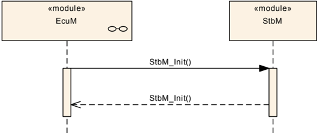

### 8.2. 立即时间同步

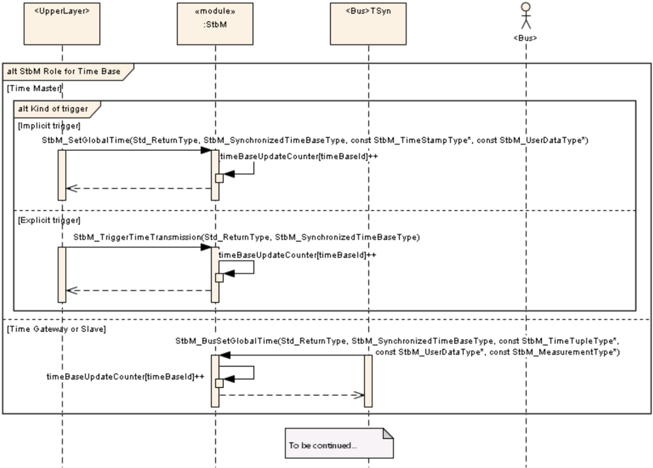

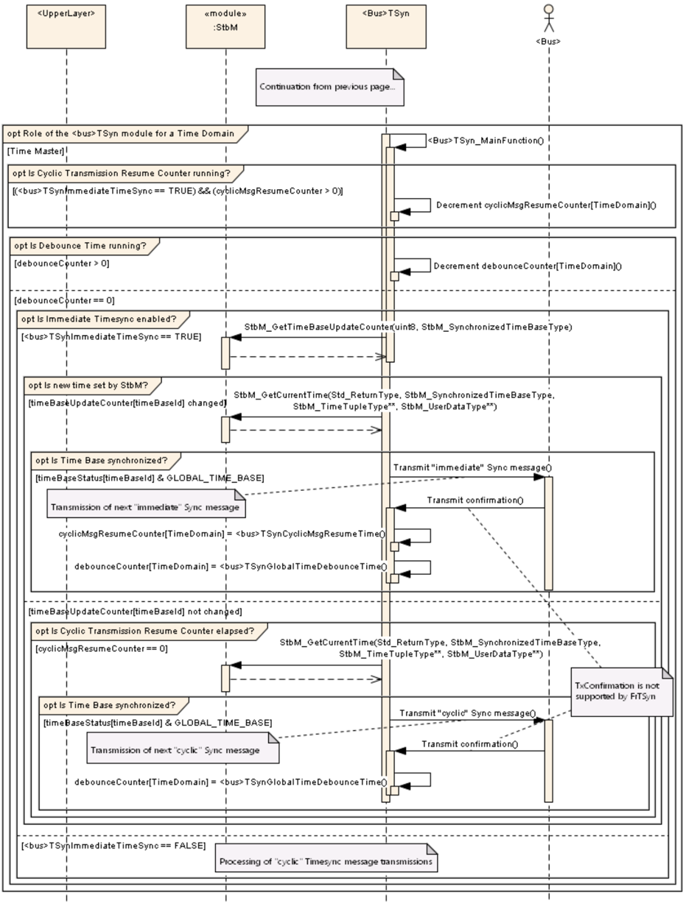

### 8.3. OS 调度表的显式同步

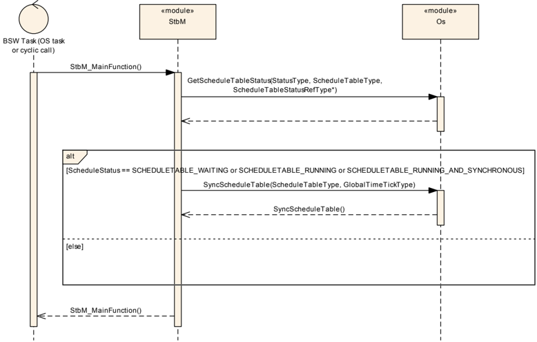

### 8.4. 接收时间元组处理序列

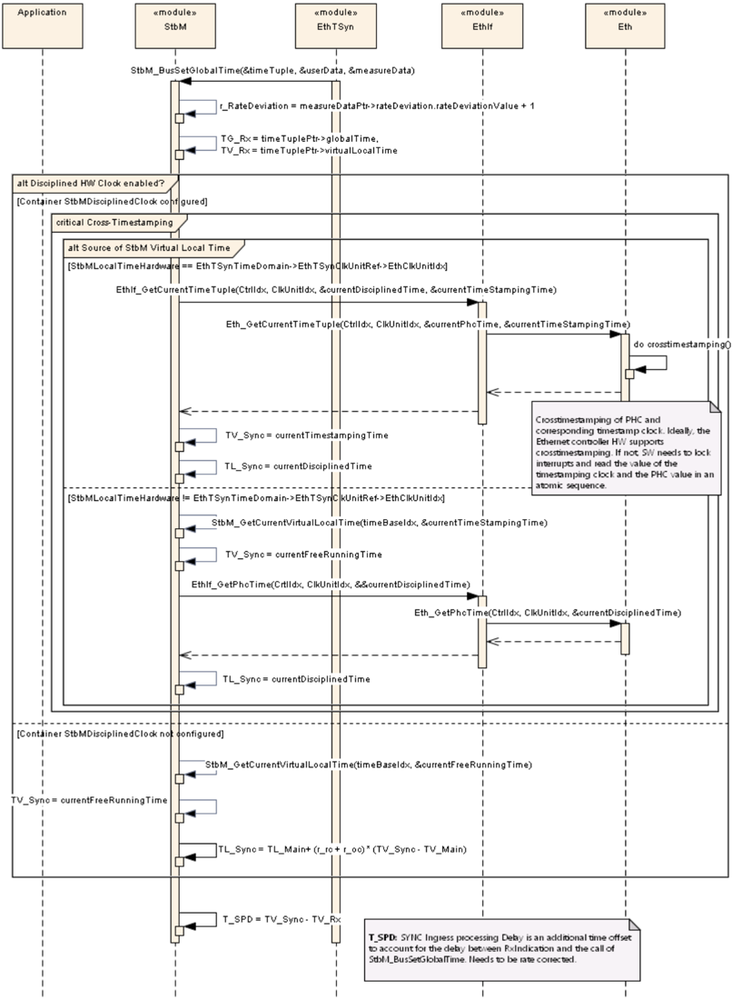

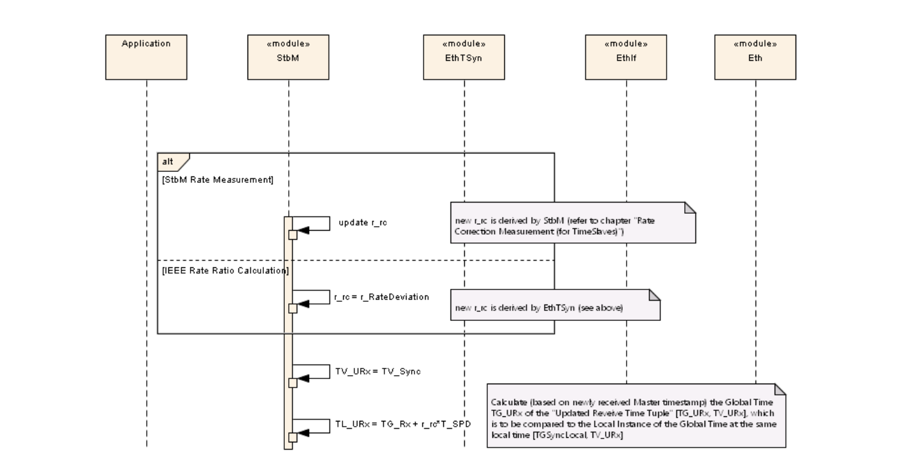

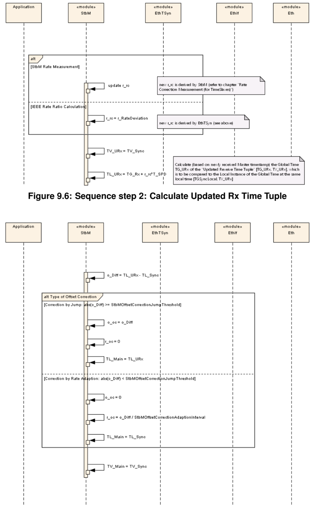

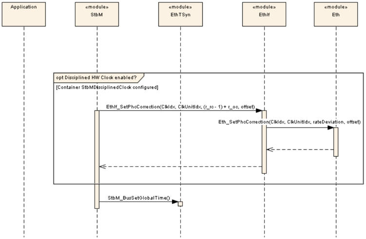

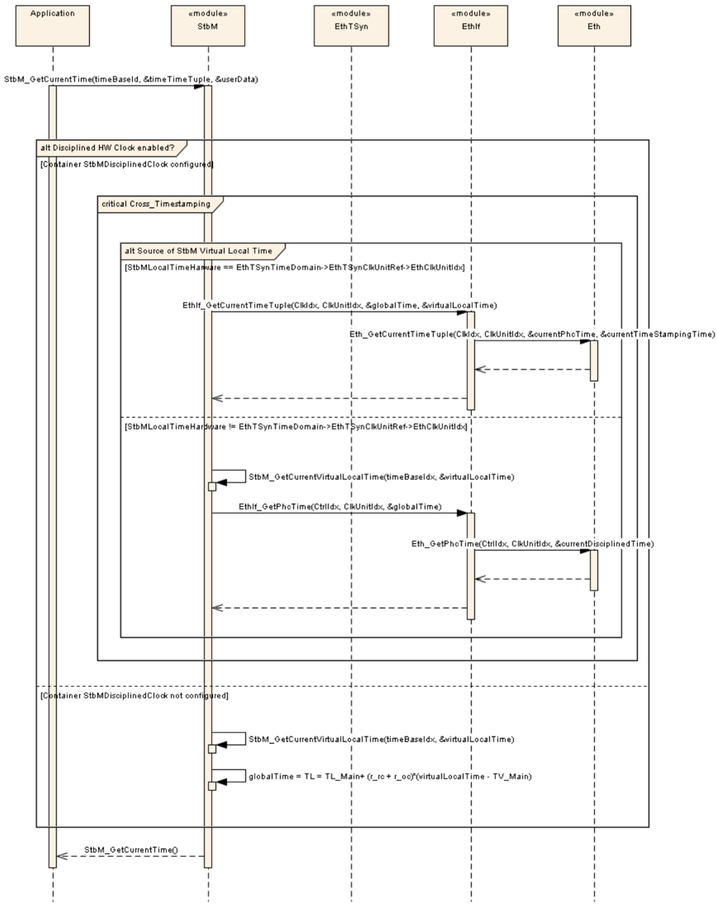

## 9. 配置规范

通常，本章定义配置参数及其到容器的聚集。为支持该规范，第 9.1 节「如何阅读本章」描述基本原理。它还规定了应用于参数规范的模板（表）。我们有意将第 9.1 节「如何阅读本章」保留在规范中，以保证可理解性。

第 9.2 节「容器与配置参数」规定模块 **StbM** 的结构（容器）和参数。

第 9.4 节「发布信息」规定模块 **StbM** 的发布信息。

### 9.1. 如何阅读本章

细节请参阅 [4, **SWS** BSW General] 的第 10.1 章「Introduction to configuration specification」。

### 9.2. 容器与配置参数

以下各章汇总所有配置参数。第 6 章「功能规格」和第 7 章「API规范」描述参数的详细含义。

本模块支持不同的 post-build 变体（此前称为 post-build 可选配置集），但不支持 post-build 可加载配置。

配置工具必须在配置时检查配置的一致性。

#### 9.2.1. StbM

| SWS 条目 | [ECUC_StbM_00065] |
|---|---|
| 模块名称 | StbM |
| 描述 | 同步时基管理器（**StbM**）模块的配置。 |
| Post-Build 变体支持 | true |
| 支持的配置变体 | VARIANT-PRE-COMPILE |

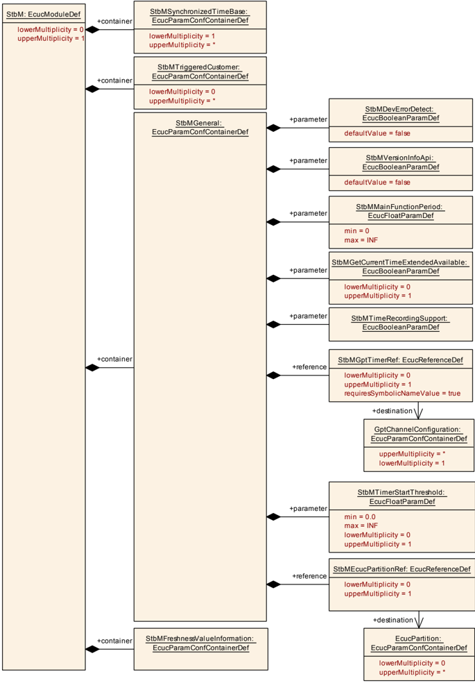

| 容器名称 | 多重性 | 作用域/依赖 |
|---|---|---|
| StbMFreshnessValueInformation | 1 | 包含新鲜度值配置的容器 |
| StbMGeneral | 1 | 此容器保存同步时基管理器的通用参数 |
| StbMSynchronizedTimeBase | 1..* | 同步时基收集系统中特定时基提供者的信息。 |
| StbMTriggeredCustomer | 0..* | 触发型客户由同步时基管理器直接触发，通过与当前（全局）时间定义和时间推移的定义同步。 |

#### 9.2.2. StbMGeneral

| SWS 条目 | [ECUC_StbM_00002] |
|---|---|
| 容器名称 | StbMGeneral |
| 父容器 | StbM |
| 描述 | 此容器保存同步时基管理器的通用参数 |
| 配置参数 | 见下方参数表 |

| SWS 条目 | [ECUC_StbM_00012] |
|---|---|
| 参数名称 | StbMDevErrorDetect |
| 父容器 | StbMGeneral |
| 描述 | 开启或关闭开发错误检测与通知（true：启用检测与通知；false：禁用检测与通知）。 |
| 多重性 | 1 |
| 类型 | EcucBooleanParamDef |
| 默认值 | false |
| Post-Build 变体值 | false |
| 值配置类 | Pre-compile time：X（所有变体）；Link time：-；Post-build time：- |
| 作用域/依赖 | scope: local |

| SWS 条目 | [ECUC_StbM_00032] (Obsolete) |
|---|---|
| 参数名称 | StbMGetCurrentTimeExtendedAvailable |
| 父容器 | StbMGeneral |
| 描述 | 用于定义是否提供带有 64 位参数的 **API** GetCurrentTime 的附加变体。 |
| 多重性 | 0..1 |
| 类型 | EcucBooleanParamDef |
| 默认值 | - |
| Post-Build 变体多重性 | false |
| Post-Build 变体值 | false |
| 多重性配置类 | Pre-compile time：X；Link time：-；Post-build time：- |
| 值配置类 | Pre-compile time：X；Link time：-；Post-build time：- |
| 作用域/依赖 | scope: local |

| SWS 条目 | [ECUC_StbM_00027] |
|---|---|
| 参数名称 | StbMMainFunctionPeriod |
| 父容器 | StbMGeneral |
| 描述 | 主函数 StbM_MainFunction 的调度周期。单位：[s]。 |
| 多重性 | 1 |
| 类型 | EcucFloatParamDef |
| 取值范围 | ]0 .. INF[ |
| 默认值 | - |
| Post-Build 变体值 | false |
| 值配置类 | Pre-compile time：X（所有变体）；Link time：-；Post-build time：- |
| 作用域/依赖 | scope: local |

| SWS 条目 | [ECUC_StbM_00038] |
|---|---|
| 参数名称 | StbMTimeRecordingSupport |
| 父容器 | StbMGeneral |
| 描述 | 启用/禁用针对同步时基和偏移时基的记录功能，用于全局时间精度测量。 |
| 多重性 | 1 |
| 类型 | EcucBooleanParamDef |
| 默认值 | - |
| Post-Build 变体值 | false |
| 值配置类 | Pre-compile time：X（所有变体）；Link time：-；Post-build time：- |
| 作用域/依赖 | scope: local |

| SWS 条目 | [ECUC_StbM_00063] |
|---|---|
| 参数名称 | StbMTimerStartThreshold |
| 父容器 | StbMGeneral |
| 描述 | 该区间定义，对于相应客户定时器正在运行的时间通知客户，何时应启动 **GPT** 定时器 [单位：秒]。 |
| 多重性 | 0..1 |
| 类型 | EcucFloatParamDef |
| 取值范围 | ]0 .. INF[ |
| 默认值 | - |
| Post-Build 变体多重性 | false |
| Post-Build 变体值 | false |
| 多重性配置类 | Pre-compile time：X；Link time：-；Post-build time：- |
| 值配置类 | Pre-compile time：X；Link time：-；Post-build time：- |
| 作用域/依赖 | scope: local |

| SWS 条目 | [ECUC_StbM_00013] |
|---|---|
| 参数名称 | StbMVersionInfoApi |
| 父容器 | StbMGeneral |
| 描述 | 激活/停用版本信息 **API**（StbM_GetVersionInfo）。True：版本信息 **API** 激活；False：版本信息 **API** 停用。 |
| 多重性 | 1 |
| 类型 | EcucBooleanParamDef |
| 默认值 | false |
| Post-Build 变体值 | false |
| 值配置类 | Pre-compile time：X（所有变体）；Link time：-；Post-build time：- |
| 作用域/依赖 | scope: local |

| SWS 条目 | [ECUC_StbM_00069] |
|---|---|
| 参数名称 | StbMEcucPartitionRef |
| 父容器 | StbMGeneral |
| 描述 | 对 **StbM** 模块所分配到的 EcucPartition 的引用。 |
| 多重性 | 0..1 |
| 类型 | Reference to EcucPartition |
| Post-Build 变体多重性 | false |
| Post-Build 变体值 | false |
| 多重性配置类 | Pre-compile time：所有变体；Link time：-；Post-build time：- |
| 值配置类 | Pre-compile time：所有变体；Link time：-；Post-build time：- |
| 作用域/依赖 | scope: local |

| SWS 条目 | [ECUC_StbM_00039] |
|---|---|
| 参数名称 | StbMGptTimerRef |
| 父容器 | StbMGeneral |
| 描述 | 在配置了任何时间通知客户的情况下，这表示一个可选的子容器。指定的 **GPT** 定时器必须被配置为具有一微秒的 tick 时长。 |
| 多重性 | 0..1 |
| 类型 | Symbolic name reference to GptChannelConfiguration |
| Post-Build 变体多重性 | false |
| Post-Build 变体值 | false |
| 多重性配置类 | Pre-compile time：X；Link time：-；Post-build time：- |
| 值配置类 | Pre-compile time：X；Link time：-；Post-build time：- |
| 作用域/依赖 | scope: local |

无包含的容器。

#### 9.2.3. StbMSynchronizedTimeBase

| SWS 条目 | [ECUC_StbM_00003] |
|---|---|
| 容器名称 | StbMSynchronizedTimeBase |
| 父容器 | StbM |
| 描述 | 同步时基收集系统中特定时基提供者的信息。 |
| Post-Build 变体多重性 | false |
| 多重性配置类 | Pre-compile time：X（所有变体）；Link time：-；Post-build time：- |
| 配置参数 | 见下方参数表 |

| SWS 条目 | [ECUC_StbM_00066] |
|---|---|
| 参数名称 | StbMAllowSystemWideGlobalTimeMaster |
| 父容器 | StbMSynchronizedTimeBase |
| 描述 | 对于 **StbM** 的 postbuild 变体，对于可能充当系统范围时间源的全局时间主节点，此参数必须设为 **true**。否则不提供相应的服务端口/接口。服务端口/接口背后的全局时间主节点功能必须通过参数 StbMIsSystemWideGlobalTimeMaster 单独启用/禁用。 |
| 多重性 | 0..1 |
| 类型 | EcucBooleanParamDef |
| 默认值 | - |
| Post-Build 变体多重性 | false |
| Post-Build 变体值 | false |
| 多重性配置类 | Pre-compile time：X；Link time：-；Post-build time：- |
| 值配置类 | Pre-compile time：X；Link time：-；Post-build time：- |
| 作用域/依赖 | scope: local |

| SWS 条目 | [ECUC_StbM_00037] |
|---|---|
| 参数名称 | StbMClearTimeleapCount |
| 父容器 | StbMSynchronizedTimeBase |
| 描述 | 该属性描述时基所需更新次数，在这些更新中与先前值的时间差必须保持在 StbMTimeLeapPastThreshold/StbMTimeLeapFutureThreshold 之下，直到该时基 timeBaseStatus 中的 **TIMELEAP_PAST**/**TIMELEAP_FUTURE** 位被清除。 |
| 多重性 | 0..1 |
| 类型 | EcucIntegerParamDef |
| 取值范围 | 1 .. 65535 |
| 默认值 | 1 |
| Post-Build 变体多重性 | false |
| Post-Build 变体值 | false |
| 多重性配置类 | Pre-compile time：X（所有变体）；Link time：-；Post-build time：- |
| 值配置类 | Pre-compile time：X（所有变体）；Link time：-；Post-build time：- |
| 作用域/依赖 | scope: local |

| SWS 条目 | [ECUC_StbM_00086] |
|---|---|
| 参数名称 | StbMCyclicBackupInterval |
| 父容器 | StbMSynchronizedTimeBase |
| 描述 | 用于计算要存储在 **NvM** 中的"备份"时间的时间区间 [单位：秒]。 |
| 多重性 | 0..1 |
| 类型 | EcucFloatParamDef |
| 取值范围 | ]0 .. 65535] |
| 默认值 | - |
| Post-Build 变体多重性 | false |
| Post-Build 变体值 | false |
| 多重性配置类 | Pre-compile time：X；Link time：-；Post-build time：- |
| 值配置类 | Pre-compile time：X；Link time：-；Post-build time：- |
| 作用域/依赖 | scope: local |

| SWS 条目 | [ECUC_StbM_00036] |
|---|---|
| 参数名称 | StbMIsSystemWideGlobalTimeMaster |
| 父容器 | StbMSynchronizedTimeBase |
| 描述 | 对于在全局时间方面充当系统范围时间信息源的全局时间主节点，此参数应设为 **true**。可能存在多个将此参数设为 **true** 的全局时间主节点，因为全局时间主节点在每个全局时间域中存在一次，而一个 **ECU** 可以在其所连接的不同总线上拥有多个全局时间域。 |
| 多重性 | 1 |
| 类型 | EcucBooleanParamDef |
| 默认值 | - |
| Post-Build 变体值 | true |
| 值配置类 | Pre-compile time：X（所有变体）；Link time：-；Post-build time：- |
| 作用域/依赖 | scope: local |

| SWS 条目 | [ECUC_StbM_00088] |
|---|---|
| 参数名称 | StbMMaxProgressionMismatchThreshold |
| 父容器 | StbMSynchronizedTimeBase |
| 描述 | 表示时基的本地时间与备用时间之间允许的最大差值 [单位：秒]。 |
| 多重性 | 1 |
| 类型 | EcucFloatParamDef |
| 取值范围 | [0 .. INF[ |
| 默认值 | - |
| Post-Build 变体多重性 | true |
| Post-Build 变体值 | false |
| 多重性配置类 | Pre-compile time：X（所有变体）；Link time：-；Post-build time：- |
| 值配置类 | Pre-compile time：X（所有变体）；Link time：-；Post-build time：- |
| 作用域/依赖 | scope: local |

| SWS 条目 | [ECUC_StbM_00068] |
|---|---|
| 参数名称 | StbMNotificationInterface |
| 父容器 | StbMSynchronizedTimeBase |
| 描述 | 该参数定义应使用何种类型的接口来向客户通知状态事件。取值：CALLBACK、CALLBACK_AND_SR_INTERFACE、NO_NOTIFICATION、SR_INTERFACE。 |
| 多重性 | 1 |
| 类型 | EcucEnumerationParamDef |
| Post-Build 变体多重性 | false |
| Post-Build 变体值 | false |
| 多重性配置类 | Pre-compile time：X；Link time：-；Post-build time：- |
| 值配置类 | Pre-compile time：X；Link time：-；Post-build time：- |
| 作用域/依赖 | scope: local |

| SWS 条目 | [ECUC_StbM_00046] |
|---|---|
| 参数名称 | StbMStatusNotificationCallback |
| 父容器 | StbMSynchronizedTimeBase |
| 描述 | 客户特定的状态通知回调函数的名称，当发生未被掩蔽的状态事件时应调用它。 |
| 多重性 | 0..1 |
| 类型 | EcucFunctionNameDef |
| 默认值 | - |
| 正则表达式 | - |
| Post-Build 变体多重性 | false |
| Post-Build 变体值 | false |
| 多重性配置类 | Pre-compile time：X（所有变体）；Link time：-；Post-build time：- |
| 值配置类 | Pre-compile time：X（所有变体）；Link time：-；Post-build time：- |
| 作用域/依赖 | scope: local；仅当 StbMNotificationInterface 设为 CALLBACK 或 CALLBACK_AND_SR_INTERFACE 时，StbMStatusNotificationCallback 才可用。 |

| SWS 条目 | [ECUC_StbM_00045] |
|---|---|
| 参数名称 | StbMStatusNotificationMask |
| 父容器 | StbMSynchronizedTimeBase |
| 描述 | 该参数定义 NotificationMask 掩码的初始值，它定义应为其调用事件通知回调函数的事件。 |
| 多重性 | 0..1 |
| 类型 | EcucIntegerParamDef |
| 取值范围 | 0 .. 4294967295 |
| 默认值 | 0 |
| Post-Build 变体多重性 | false |
| Post-Build 变体值 | false |
| 多重性配置类 | Pre-compile time：X；Link time：-；Post-build time：- |
| 值配置类 | Pre-compile time：X；Link time：-；Post-build time：- |
| 作用域/依赖 | scope: local |

| SWS 条目 | [ECUC_StbM_00031] |
|---|---|
| 参数名称 | StbMStoreTimebaseNonVolatile |
| 父容器 | StbMSynchronizedTimeBase |
| 描述 | 用于指定时基应存储在 NvRam 中。取值：NO_STORAGE、STORAGE。 |
| 多重性 | 0..1 |
| 类型 | EcucEnumerationParamDef |
| Post-Build 变体多重性 | false |
| Post-Build 变体值 | false |
| 多重性配置类 | Pre-compile time：X（所有变体）；Link time：-；Post-build time：- |
| 值配置类 | Pre-compile time：X（所有变体）；Link time：-；Post-build time：- |
| 作用域/依赖 | scope: local |

| SWS 条目 | [ECUC_StbM_00021] |
|---|---|
| 参数名称 | StbMSynchronizedTimeBaseIdentifier |
| 父容器 | StbMSynchronizedTimeBase |
| 描述 | 通过唯一标识符标识一个同步时基。范围：0 .. 127：同步时基、偏移时基和纯本地时基；128 .. 65535：保留。 |
| 多重性 | 1 |
| 类型 | EcucIntegerParamDef（为此参数生成符号名） |
| 取值范围 | 0 .. 65535 |
| 默认值 | - |
| Post-Build 变体值 | false |
| 值配置类 | Pre-compile time：X（所有变体）；Link time：-；Post-build time：- |
| 作用域/依赖 | scope: local |

| SWS 条目 | [ECUC_StbM_00100] |
|---|---|
| 参数名称 | StbMSynchronizedTimeBaseType |
| 父容器 | StbMSynchronizedTimeBase |
| 描述 | 时基类型的定义。取值：TBTYPE_OFFSET（偏移时基）；TBTYPE_PURELOCAL（纯本地时基）；TBTYPE_SYNCHRONIZED（同步时基）。 |
| 多重性 | 1 |
| 类型 | EcucEnumerationParamDef |
| 默认值 | TBTYPE_SYNCHRONIZED |
| Post-Build 变体值 | false |
| 值配置类 | Pre-compile time：X（所有变体）；Link time：-；Post-build time：- |
| 作用域/依赖 | scope: local |

| SWS 条目 | [ECUC_StbM_00028] |
|---|---|
| 参数名称 | StbMSyncLossTimeout |
| 父容器 | StbMSynchronizedTimeBase |
| 描述 | 该属性描述在时间域范围内时间同步丢失情况下的超时。单位：秒 |
| 多重性 | 0..1 |
| 类型 | EcucFloatParamDef |
| 取值范围 | ]0 .. INF[ |
| 默认值 | - |
| Post-Build 变体多重性 | false |
| Post-Build 变体值 | false |
| 多重性配置类 | Pre-compile time：X（所有变体）；Link time：-；Post-build time：- |
| 值配置类 | Pre-compile time：X（所有变体）；Link time：-；Post-build time：- |
| 作用域/依赖 | scope: local |

| SWS 条目 | [ECUC_StbM_00041] |
|---|---|
| 参数名称 | StbMTimeLeapFutureThreshold |
| 父容器 | StbMSynchronizedTimeBase |
| 描述 | 表示新接收的全局时基值与当前本地时基值之间允许的最大正差 [单位：秒]。 |
| 多重性 | 0..1 |
| 类型 | EcucFloatParamDef |
| 取值范围 | [0 .. INF[ |
| 默认值 | - |
| Post-Build 变体多重性 | false |
| Post-Build 变体值 | false |
| 多重性配置类 | Pre-compile time：X；Link time：-；Post-build time：- |
| 值配置类 | Pre-compile time：X；Link time：-；Post-build time：- |
| 作用域/依赖 | scope: local |

| SWS 条目 | [ECUC_StbM_00042] |
|---|---|
| 参数名称 | StbMTimeLeapPastThreshold |
| 父容器 | StbMSynchronizedTimeBase |
| 描述 | 表示当前本地时基值与新接收的全局时基值之间允许的最大负差 [单位：秒]。 |
| 多重性 | 0..1 |
| 类型 | EcucFloatParamDef |
| 取值范围 | [0 .. INF[ |
| 默认值 | - |
| Post-Build 变体多重性 | false |
| Post-Build 变体值 | false |
| 多重性配置类 | Pre-compile time：X；Link time：-；Post-build time：- |
| 值配置类 | Pre-compile time：X；Link time：-；Post-build time：- |
| 作用域/依赖 | scope: local |

| SWS 条目 | [ECUC_StbM_00030] |
|---|---|
| 参数名称 | StbMOffsetTimeBase |
| 父容器 | StbMSynchronizedTimeBase |
| 描述 | 这是对该偏移时基所基于的同步时基的引用。该引用使包含它的 StbMSynchronizedTimeBase 成为偏移时基。 |
| 多重性 | 0..1 |
| 类型 | Reference to StbMSynchronizedTimeBase |
| Post-Build 变体多重性 | false |
| Post-Build 变体值 | false |
| 多重性配置类 | Pre-compile time：X；Link time：-；Post-build time：- |
| 值配置类 | Pre-compile time：X；Link time：-；Post-build time：- |
| 作用域/依赖 | scope: local |

| SWS 条目 | [ECUC_StbM_00074] |
|---|---|
| 参数名称 | StbMSourceTimeBase |
| 父容器 | StbMSynchronizedTimeBase |
| 描述 | 这是对当前时基从中克隆的时基的引用。这使得被引用的时基成为克隆的源时基，而当前时基成为克隆的目标时基。 |
| 多重性 | 0..1 |
| 类型 | Reference to StbMSynchronizedTimeBase |
| Post-Build 变体多重性 | false |
| Post-Build 变体值 | false |
| 多重性配置类 | Pre-compile time：X；Link time：-；Post-build time：- |
| 值配置类 | Pre-compile time：X；Link time：-；Post-build time：- |
| 作用域/依赖 | scope: local |

| 容器名称 | 多重性 | 作用域/依赖 |
|---|---|---|
| StbMDisciplinedClock | 0..1 | 此容器保存与该同步时基的可调/受控硬件时钟相关的参数 |
| StbMFallbackTimeClock | 0..1 | 为备用时间特性引用该同步时基的硬件参考时钟 |
| StbMLocalTimeClock | 0..1 | 引用该同步时基的硬件参考时钟。 |
| StbMNotificationCustomer | 0..* | 此容器保存通知客户的配置，该客户在发生与时基相关的事件时被告知。 |
| StbMTimeCorrection | 0..1 | 收集与某时基的速率和偏移校正相关的信息。 |
| StbMTimeRecording | 0..1 | 收集与某时基的精度测量配置相关的信息。 |
| StbMTimeValidation | 0..1 | 包含时基的时间验证配置的容器。 |
| StbMTimeValidationThresholds | 0..1 | 包含时基的时间验证阈值配置的容器。 |

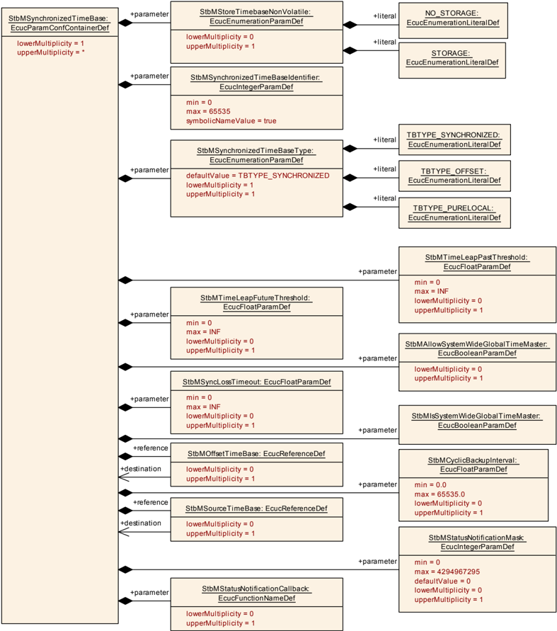

#### 9.2.4. StbMTimeCorrection

| SWS 条目 | [ECUC_StbM_00048] |
|---|---|
| 容器名称 | StbMTimeCorrection |
| 父容器 | StbMSynchronizedTimeBase |
| 描述 | 收集与某时基的速率和偏移校正相关的信息。 |
| Post-Build 变体多重性 | false |
| 多重性配置类 | Pre-compile time：X（所有变体）；Link time：-；Post-build time：- |
| 配置参数 | 见下方参数表 |

| SWS 条目 | [ECUC_StbM_00043] |
|---|---|
| 参数名称 | StbMAllowMasterRateCorrection |
| 父容器 | StbMTimeCorrection |
| 描述 | 该属性描述时基的速率校正值是否可以通过 StbM_SetRateCorrection() 设置：false：速率校正值不能通过 StbM_SetRateCorrection() 设置；true：速率校正值可以通过 StbM_SetRateCorrection() 设置。 |
| 多重性 | 0..1 |
| 类型 | EcucBooleanParamDef |
| 默认值 | false |
| Post-Build 变体多重性 | false |
| Post-Build 变体值 | false |
| 多重性配置类 | Pre-compile time：X（所有变体）；Link time：-；Post-build time：- |
| 值配置类 | Pre-compile time：X（所有变体）；Link time：-；Post-build time：- |
| 作用域/依赖 | scope: local |

| SWS 条目 | [ECUC_StbM_00044] |
|---|---|
| 参数名称 | StbMMasterRateDeviationMax |
| 父容器 | StbMTimeCorrection |
| 描述 | 该属性描述可通过 StbM_SetRateCorrection() 设置的速率偏差值允许的最大绝对值 [单位：ppm]。 |
| 多重性 | 0..1 |
| 类型 | EcucIntegerParamDef |
| 取值范围 | 0 .. 32000 |
| 默认值 | 0 |
| Post-Build 变体多重性 | false |
| Post-Build 变体值 | false |
| 多重性配置类 | Pre-compile time：X（所有变体）；Link time：-；Post-build time：- |
| 值配置类 | Pre-compile time：X（所有变体）；Link time：-；Post-build time：- |
| 作用域/依赖 | scope: local |

| SWS 条目 | [ECUC_StbM_00057] |
|---|---|
| 参数名称 | StbMOffsetCorrectionAdaptionInterval |
| 父容器 | StbMTimeCorrection |
| 描述 | 定义自适应速率校正消除速率偏差和时间偏差的区间 [单位：秒]。 |
| 多重性 | 0..1 |
| 类型 | EcucFloatParamDef |
| 取值范围 | ]0 .. INF[ |
| 默认值 | - |
| Post-Build 变体多重性 | false |
| Post-Build 变体值 | false |
| 多重性配置类 | Pre-compile time：X；Link time：-；Post-build time：- |
| 值配置类 | Pre-compile time：X；Link time：-；Post-build time：- |
| 作用域/依赖 | scope: local |

| SWS 条目 | [ECUC_StbM_00056] |
|---|---|
| 参数名称 | StbMOffsetCorrectionJumpThreshold |
| 父容器 | StbMTimeCorrection |
| 描述 | 校正方法的阈值。低于此值的偏差将通过在定义的时间跨度上线性缩减来校正。等于或大于此值的偏差将通过以跳变形式立即设置正确的时间和速率来校正 [单位：秒]。 |
| 多重性 | 0..1 |
| 类型 | EcucFloatParamDef |
| 取值范围 | [0 .. INF[ |
| 默认值 | - |
| Post-Build 变体多重性 | false |
| Post-Build 变体值 | false |
| 多重性配置类 | Pre-compile time：X（所有变体）；Link time：-；Post-build time：- |
| 值配置类 | Pre-compile time：X（所有变体）；Link time：-；Post-build time：- |
| 作用域/依赖 | scope: local |

| SWS 条目 | [ECUC_StbM_00054] |
|---|---|
| 参数名称 | StbMRateCorrectionMeasurementDuration |
| 父容器 | StbMTimeCorrection |
| 描述 | 用于计算速率偏差的时间跨度 [s] 的定义。 |
| 多重性 | 0..1 |
| 类型 | EcucFloatParamDef |
| 取值范围 | [0 .. INF[ |
| 默认值 | 1 |
| Post-Build 变体多重性 | false |
| Post-Build 变体值 | false |
| 多重性配置类 | Pre-compile time：X（所有变体）；Link time：-；Post-build time：- |
| 值配置类 | Pre-compile time：X（所有变体）；Link time：-；Post-build time：- |
| 作用域/依赖 | scope: local |

| SWS 条目 | [ECUC_StbM_00055] |
|---|---|
| 参数名称 | StbMRateCorrectionsPerMeasurementDuration |
| 父容器 | StbMTimeCorrection |
| 描述 | 用于确定当前速率偏差的并发速率测量次数。 |
| 多重性 | 0..1 |
| 类型 | EcucIntegerParamDef |
| 取值范围 | 1 .. 65535 |
| 默认值 | 1 |
| Post-Build 变体多重性 | false |
| Post-Build 变体值 | false |
| 多重性配置类 | Pre-compile time：X；Link time：-；Post-build time：- |
| 值配置类 | Pre-compile time：X；Link time：-；Post-build time：- |
| 作用域/依赖 | scope: local |

| SWS 条目 | [ECUC_StbM_00099] |
|---|---|
| 参数名称 | StbMRateCorrectionThreshold |
| 父容器 | StbMTimeCorrection |
| 描述 | 速率校正计算的阈值，用于判定计算出的速率偏差的绝对值是否超过可接受范围。值为 0 时停用该检查。 |
| 多重性 | 0..1 |
| 类型 | EcucIntegerParamDef |
| 取值范围 | 0 .. 32000 |
| 默认值 | 0 |
| Post-Build 变体多重性 | false |
| Post-Build 变体值 | false |
| 多重性配置类 | Pre-compile time：X（所有变体）；Link time：-；Post-build time：- |
| 值配置类 | Pre-compile time：X（所有变体）；Link time：-；Post-build time：- |
| 作用域/依赖 | scope: local |

| SWS 条目 | [ECUC_StbM_00101] |
|---|---|
| 参数名称 | StbMRateSource |
| 父容器 | StbMTimeCorrection |
| 描述 | 选择哪个模块提供速率：EthTSynGlobalTimeDomain：**EthTSyn** 提供基于 IEEE neighborRateRatio 计算的速率；StbMSynchronizedTimeBase：**StbM** 自身执行速率测量。 |
| 多重性 | 0..1 |
| 类型 | Reference to EthTSynGlobalTimeDomain |
| Post-Build 变体多重性 | true |
| Post-Build 变体值 | false |
| 多重性配置类 | Pre-compile time：X（所有变体）；Link time：-；Post-build time：- |
| 值配置类 | Pre-compile time：X（所有变体）；Link time：-；Post-build time：- |
| 作用域/依赖 | scope: ECU |

无包含的容器。

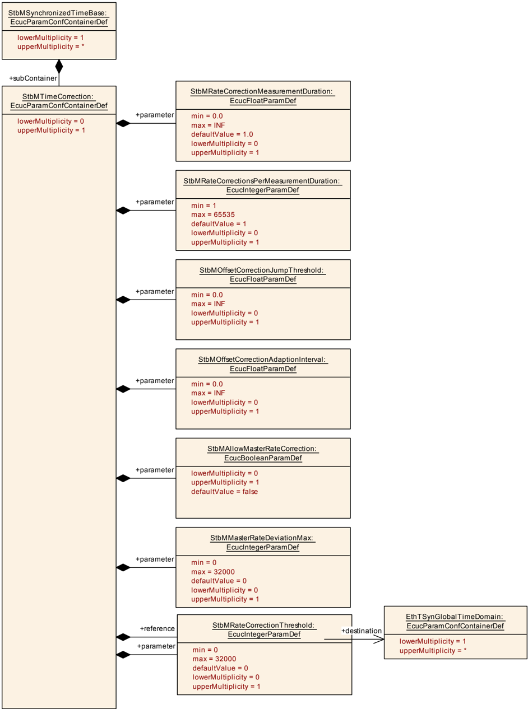

#### 9.2.5. StbMLocalTimeClock

| SWS 条目 | [ECUC_StbM_00047] |
|---|---|
| 容器名称 | StbMLocalTimeClock |
| 父容器 | StbMSynchronizedTimeBase |
| 描述 | 引用该同步时基的硬件参考时钟。 |
| Post-Build 变体多重性 | false |
| 多重性配置类 | Pre-compile time：X（所有变体）；Link time：-；Post-build time：- |
| 配置参数 | 见下方参数表 |

| SWS 条目 | [ECUC_StbM_00051] |
|---|---|
| 参数名称 | StbMClockFrequency |
| 父容器 | StbMLocalTimeClock |
| 描述 | 表示 **StbM** 所使用的硬件参考时钟的频率 [Hz]。 |
| 多重性 | 0..1 |
| 类型 | EcucIntegerParamDef |
| 取值范围 | 0 .. 4294967295 |
| 默认值 | - |
| Post-Build 变体值 | false |
| 值配置类 | Pre-compile time：X（所有变体）；Link time：-；Post-build time：- |
| 作用域/依赖 | scope: local |

| SWS 条目 | [ECUC_StbM_00052] |
|---|---|
| 参数名称 | StbMClockPrescaler |
| 父容器 | StbMLocalTimeClock |
| 描述 | 表示用于计算 **StbM** 所使用的硬件参考时钟的合成频率的预分频器。 |
| 多重性 | 0..1 |
| 类型 | EcucIntegerParamDef |
| 取值范围 | 0 .. 4294967295 |
| 默认值 | - |
| Post-Build 变体值 | false |
| 值配置类 | Pre-compile time：X（所有变体）；Link time：-；Post-build time：- |
| 作用域/依赖 | scope: local |

| SWS 条目 | [ECUC_StbM_00053] |
|---|---|
| 参数名称 | StbMLocalTimeHardware |
| 父容器 | StbMLocalTimeClock |
| 描述 | 对本地时间硬件的引用。 |
| 多重性 | 1 |
| 类型 | Choice reference to [ CanTSynGlobalTimeDomain, EthTSynGlobalTimeDomain, GptChannelConfiguration, OsCounter ] |
| Post-Build 变体多重性 | false |
| Post-Build 变体值 | false |
| 多重性配置类 | Pre-compile time：X（所有变体）；Link time：-；Post-build time：- |
| 值配置类 | Pre-compile time：X（所有变体）；Link time：-；Post-build time：- |
| 作用域/依赖 | scope: local |

无包含的容器。

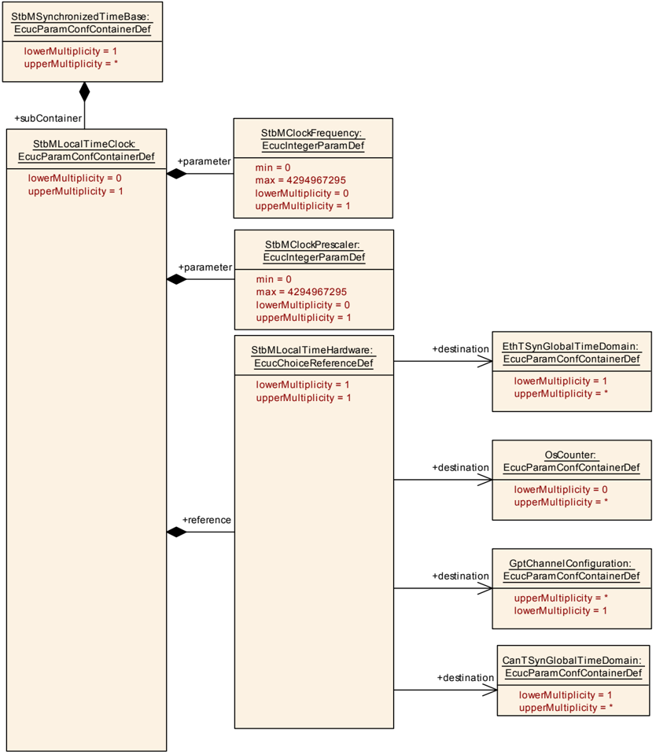

#### 9.2.6. StbMDisciplinedClock

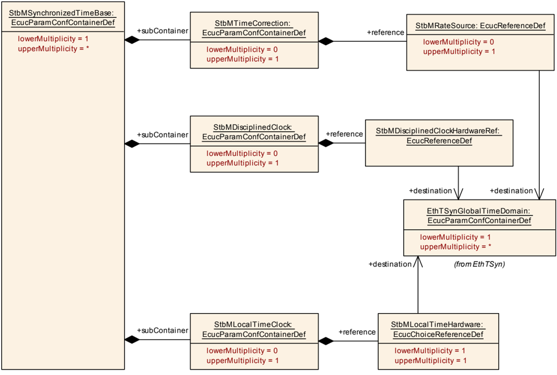

| SWS 条目 | [ECUC_StbM_00103] |
|---|---|
| 容器名称 | StbMDisciplinedClock |
| 父容器 | StbMSynchronizedTimeBase |
| 描述 | 此容器保存与该同步时基的可调/受控硬件时钟相关的参数。 |
| Post-Build 变体多重性 | false |
| 多重性配置类 | Pre-compile time：X（所有变体）；Link time：-；Post-build time：- |
| 配置参数 | 见下方参数表 |

| SWS 条目 | [ECUC_StbM_00102] |
|---|---|
| 参数名称 | StbMDisciplinedClockHardwareRef |
| 父容器 | StbMDisciplinedClock |
| 描述 | 对可调/受控硬件时钟的引用。 |
| 多重性 | 1 |
| 类型 | Reference to EthTSynGlobalTimeDomain |
| Post-Build 变体值 | false |
| 值配置类 | Pre-compile time：X（所有变体）；Link time：-；Post-build time：- |
| 作用域/依赖 | scope: ECU |

无包含的容器。

#### 9.2.7. StbMFallbackTimeClock

| SWS 条目 | [ECUC_StbM_00089] |
|---|---|
| 容器名称 | StbMFallbackTimeClock |
| 父容器 | StbMSynchronizedTimeBase |
| 描述 | 为备用时间特性引用该同步时基的硬件参考时钟。 |
| Post-Build 变体多重性 | false |
| 多重性配置类 | Pre-compile time：X（所有变体）；Link time：-；Post-build time：- |
| 配置参数 | 见下方参数表 |

| SWS 条目 | [ECUC_StbM_00091] |
|---|---|
| 参数名称 | StbMFallbackTimeClockFrequency |
| 父容器 | StbMFallbackTimeClock |
| 描述 | 表示 **StbM** 所使用的硬件参考时钟的频率 [Hz]。 |
| 多重性 | 0..1 |
| 类型 | EcucIntegerParamDef |
| 取值范围 | 0 .. 4294967295 |
| 默认值 | - |
| Post-Build 变体多重性 | false |
| Post-Build 变体值 | false |
| 多重性配置类 | Pre-compile time：X；Link time：-；Post-build time：- |
| 值配置类 | Pre-compile time：X；Link time：-；Post-build time：- |
| 作用域/依赖 | scope: local |

| SWS 条目 | [ECUC_StbM_00092] |
|---|---|
| 参数名称 | StbMFallbackTimeClockPrescaler |
| 父容器 | StbMFallbackTimeClock |
| 描述 | 表示用于计算 **StbM** 所使用的硬件参考时钟的合成频率的预分频器。 |
| 多重性 | 0..1 |
| 类型 | EcucIntegerParamDef |
| 取值范围 | 0 .. 4294967295 |
| 默认值 | - |
| Post-Build 变体多重性 | false |
| Post-Build 变体值 | false |
| 多重性配置类 | Pre-compile time：X；Link time：-；Post-build time：- |
| 值配置类 | Pre-compile time：X；Link time：-；Post-build time：- |
| 作用域/依赖 | scope: local |

| SWS 条目 | [ECUC_StbM_00093] |
|---|---|
| 参数名称 | StbMFallbackTimeHardware |
| 父容器 | StbMFallbackTimeClock |
| 描述 | 对本地时间硬件的引用。 |
| 多重性 | 1 |
| 类型 | Choice reference to [ CanTSynGlobalTimeDomain, EthTSynGlobalTimeDomain, GptChannelConfiguration, OsCounter ] |
| Post-Build 变体多重性 | false |
| Post-Build 变体值 | false |
| 多重性配置类 | Pre-compile time：X；Link time：-；Post-build time：- |
| 值配置类 | Pre-compile time：X；Link time：-；Post-build time：- |
| 作用域/依赖 | scope: local |

无包含的容器。

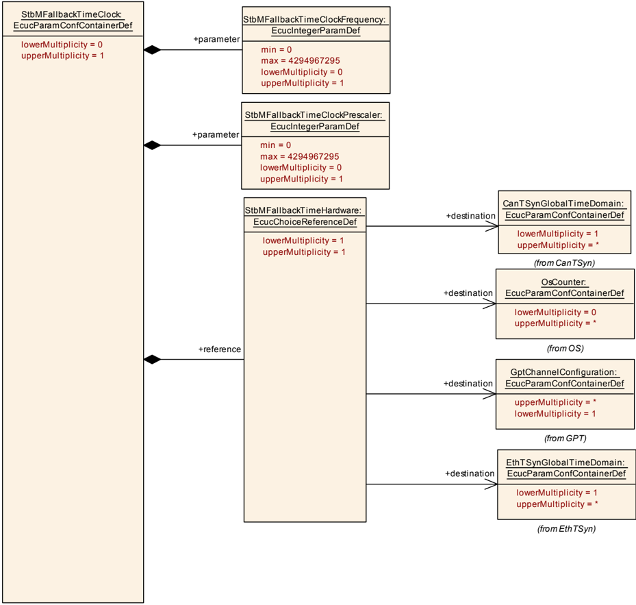

#### 9.2.8. StbMTimeRecording

| SWS 条目 | [ECUC_StbM_00049] |
|---|---|
| 容器名称 | StbMTimeRecording |
| 父容器 | StbMSynchronizedTimeBase |
| 描述 | 收集与某时基的精度测量配置相关的信息。 |
| Post-Build 变体多重性 | false |
| 多重性配置类 | Pre-compile time：X（所有变体）；Link time：-；Post-build time：- |
| 配置参数 | 见下方参数表 |

| SWS 条目 | [ECUC_StbM_00061] |
|---|---|
| 参数名称 | StbMOffsetTimeRecordBlockCallback |
| 父容器 | StbMTimeRecording |
| 描述 | 客户特定的回调函数的名称，当偏移时基的测量数据可用时应调用它。 |
| 多重性 | 0..1 |
| 类型 | EcucFunctionNameDef |
| 默认值 | - |
| 正则表达式 | - |
| Post-Build 变体多重性 | false |
| Post-Build 变体值 | false |
| 多重性配置类 | Pre-compile time：X；Link time：-；Post-build time：- |
| 值配置类 | Pre-compile time：X；Link time：-；Post-build time：- |
| 作用域/依赖 | scope: local |

| SWS 条目 | [ECUC_StbM_00059] |
|---|---|
| 参数名称 | StbMOffsetTimeRecordTableBlockCount |
| 父容器 | StbMTimeRecording |
| 描述 | 表示用于为偏移时基记录表排队时间测量事件的块的数量。 |
| 多重性 | 1 |
| 类型 | EcucIntegerParamDef |
| 取值范围 | 0 .. 65535 |
| 默认值 | - |
| Post-Build 变体值 | false |
| 值配置类 | Pre-compile time：X（所有变体）；Link time：-；Post-build time：- |
| 作用域/依赖 | scope: local |

| SWS 条目 | [ECUC_StbM_00060] |
|---|---|
| 参数名称 | StbMSyncTimeRecordBlockCallback |
| 父容器 | StbMTimeRecording |
| 描述 | 客户特定的回调函数的名称，当同步时基的测量数据可用时应调用它。 |
| 多重性 | 0..1 |
| 类型 | EcucFunctionNameDef |
| 默认值 | - |
| 正则表达式 | - |
| Post-Build 变体多重性 | false |
| Post-Build 变体值 | false |
| 多重性配置类 | Pre-compile time：X（所有变体）；Link time：-；Post-build time：- |
| 值配置类 | Pre-compile time：X（所有变体）；Link time：-；Post-build time：- |
| 作用域/依赖 | scope: local |

| SWS 条目 | [ECUC_StbM_00058] |
|---|---|
| 参数名称 | StbMSyncTimeRecordTableBlockCount |
| 父容器 | StbMTimeRecording |
| 描述 | 表示用于为同步时基记录表排队时间测量事件的块的数量。 |
| 多重性 | 1 |
| 类型 | EcucIntegerParamDef |
| 取值范围 | 0 .. 65535 |
| 默认值 | - |
| Post-Build 变体值 | false |
| 值配置类 | Pre-compile time：X（所有变体）；Link time：-；Post-build time：- |
| 作用域/依赖 | scope: local |

无包含的容器。

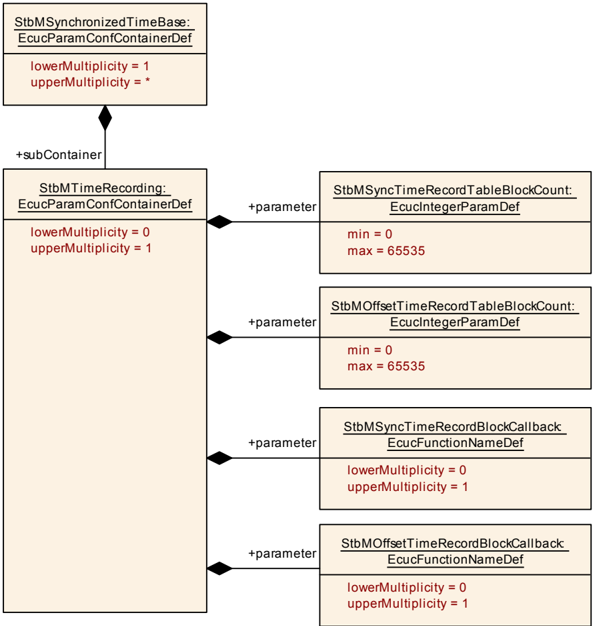

#### 9.2.9. StbMTimeValidation

| SWS 条目 | [ECUC_StbM_00072] |
|---|---|
| 容器名称 | StbMTimeValidation |
| 父容器 | StbMSynchronizedTimeBase |
| 描述 | 包含时基的时间验证配置的容器。 |
| Post-Build 变体多重性 | false |
| 多重性配置类 | Pre-compile time：X（所有变体）；Link time：-；Post-build time：- |
| 配置参数 | 见下方参数表 |

| SWS 条目 | [ECUC_StbM_00073] |
|---|---|
| 参数名称 | StbMTimeValidationRecordTableBlockCount |
| 父容器 | StbMTimeValidation |
| 描述 | 用于时间验证的记录表的大小（块的数量）。 |
| 多重性 | 1 |
| 类型 | EcucIntegerParamDef |
| 取值范围 | 0 .. 65535 |
| 默认值 | - |
| Post-Build 变体值 | false |
| 值配置类 | Pre-compile time：X（所有变体）；Link time：-；Post-build time：- |
| 作用域/依赖 | scope: local |

无包含的容器。

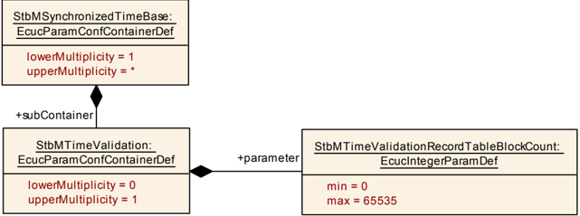

#### 9.2.10. StbMTimeValidationThresholds

| SWS 条目 | [ECUC_StbM_00090] |
|---|---|
| 容器名称 | StbMTimeValidationThresholds |
| 父容器 | StbMSynchronizedTimeBase |
| 描述 | 包含时基的时间验证阈值配置的容器。 |
| Post-Build 变体多重性 | false |
| 多重性配置类 | Pre-compile time：X（所有变体）；Link time：-；Post-build time：- |
| 配置参数 | 见下方参数表 |

| SWS 条目 | [ECUC_StbM_00097] |
|---|---|
| 参数名称 | StbMPdelayValidationThreshold |
| 父容器 | StbMTimeValidationThresholds |
| 描述 | 表示时基的 **Pdelay** 值允许的最大阈值 [单位：秒]。 |
| 多重性 | 0..1 |
| 类型 | EcucFloatParamDef |
| 取值范围 | [0 .. INF[ |
| 默认值 | - |
| Post-Build 变体多重性 | false |
| Post-Build 变体值 | false |
| 多重性配置类 | Pre-compile time：X（所有变体）；Link time：-；Post-build time：- |
| 值配置类 | Pre-compile time：X（所有变体）；Link time：-；Post-build time：- |
| 作用域/依赖 | scope: local |

| SWS 条目 | [ECUC_StbM_00095] |
|---|---|
| 参数名称 | StbMRateJitterThreshold |
| 父容器 | StbMTimeValidationThresholds |
| 描述 | 表示速率抖动允许的最大阈值。 |
| 多重性 | 0..1 |
| 类型 | EcucFloatParamDef |
| 取值范围 | [0 .. INF[ |
| 默认值 | - |
| Post-Build 变体多重性 | false |
| Post-Build 变体值 | false |
| 多重性配置类 | Pre-compile time：X；Link time：-；Post-build time：- |
| 值配置类 | Pre-compile time：X；Link time：-；Post-build time：- |
| 作用域/依赖 | scope: local |

| SWS 条目 | [ECUC_StbM_00098] |
|---|---|
| 参数名称 | StbMRateWanderIntervalWindow |
| 父容器 | StbMTimeValidationThresholds |
| 描述 | 表示为计算速率漂移而取样的窗口。 |
| 多重性 | 0..1 |
| 类型 | EcucIntegerParamDef |
| 取值范围 | 0 .. 255 |
| 默认值 | - |
| Post-Build 变体多重性 | false |
| Post-Build 变体值 | false |
| 多重性配置类 | Pre-compile time：X；Link time：-；Post-build time：- |
| 值配置类 | Pre-compile time：X；Link time：-；Post-build time：- |
| 作用域/依赖 | scope: local |

| SWS 条目 | [ECUC_StbM_00096] |
|---|---|
| 参数名称 | StbMRateWanderThreshold |
| 父容器 | StbMTimeValidationThresholds |
| 描述 | 表示速率漂移允许的最大阈值。 |
| 多重性 | 0..1 |
| 类型 | EcucFloatParamDef |
| 取值范围 | [0 .. INF[ |
| 默认值 | - |
| Post-Build 变体多重性 | false |
| Post-Build 变体值 | false |
| 多重性配置类 | Pre-compile time：X（所有变体）；Link time：-；Post-build time：- |
| 值配置类 | Pre-compile time：X（所有变体）；Link time：-；Post-build time：- |
| 作用域/依赖 | scope: local |

无包含的容器。

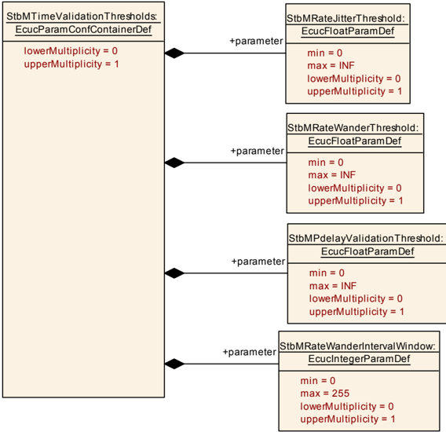

#### 9.2.11. StbMNotificationCustomer

| SWS 条目 | [ECUC_StbM_00050] |
|---|---|
| 容器名称 | StbMNotificationCustomer |
| 父容器 | StbMSynchronizedTimeBase |
| 描述 | 此容器保存通知客户的配置，该客户在发生与时基相关的事件时被告知。 |
| Post-Build 变体多重性 | false |
| 多重性配置类 | Pre-compile time：X（所有变体）；Link time：-；Post-build time：- |
| 配置参数 | 见下方参数表 |

| SWS 条目 | [ECUC_StbM_00062] |
|---|---|
| 参数名称 | StbMNotificationCustomerId |
| 父容器 | StbMNotificationCustomer |
| 描述 | 事件通知客户的标识。 |
| 多重性 | 1 |
| 类型 | EcucIntegerParamDef（为此参数生成符号名） |
| 取值范围 | 0 .. 65535 |
| 默认值 | - |
| Post-Build 变体值 | false |
| 值配置类 | Pre-compile time：X（所有变体）；Link time：-；Post-build time：- |
| 作用域/依赖 | scope: local |

| SWS 条目 | [ECUC_StbM_00064] |
|---|---|
| 参数名称 | StbMTimeNotificationCallback |
| 父容器 | StbMNotificationCustomer |
| 描述 | 客户特定的通知回调函数的名称，当到达客户先前设置的时间时应调用它。 |
| 多重性 | 0..1 |
| 类型 | EcucFunctionNameDef |
| 默认值 | - |
| 正则表达式 | - |
| Post-Build 变体值 | false |
| 值配置类 | Pre-compile time：X（所有变体）；Link time：-；Post-build time：- |
| 作用域/依赖 | scope: local |

无包含的容器。

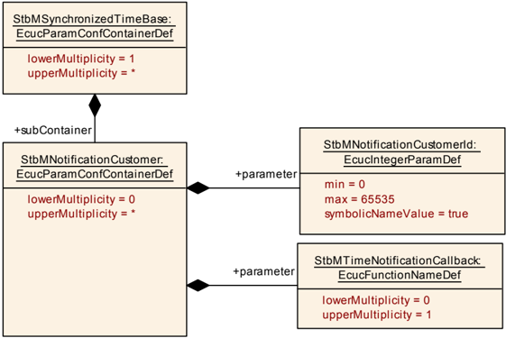

#### 9.2.12. StbMTriggeredCustomer

| SWS 条目 | [ECUC_StbM_00004] |
|---|---|
| 容器名称 | StbMTriggeredCustomer |
| 父容器 | StbM |
| 描述 | 触发型客户由同步时基管理器直接触发，通过与当前（全局）时间定义和时间推移的定义同步。 |
| Post-Build 变体多重性 | false |
| 多重性配置类 | Pre-compile time：X（所有变体）；Link time：-；Post-build time：- |
| 配置参数 | 见下方参数表 |

| SWS 条目 | [ECUC_StbM_00020] |
|---|---|
| 参数名称 | StbMTriggeredCustomerPeriod |
| 父容器 | StbMTriggeredCustomer |
| 描述 | 由 StbM_MainFunction 调用的触发型客户的触发周期。该周期以微秒为单位说明。 |
| 多重性 | 1 |
| 类型 | EcucIntegerParamDef |
| 取值范围 | 0 .. 4294967295 |
| 默认值 | - |
| Post-Build 变体值 | false |
| 值配置类 | Pre-compile time：X（所有变体）；Link time：-；Post-build time：- |
| 作用域/依赖 | scope: local |

| SWS 条目 | [ECUC_StbM_00007] |
|---|---|
| 参数名称 | StbMOSScheduleTableRef |
| 父容器 | StbMTriggeredCustomer |
| 描述 | 对将被 **StbM** 显式同步的 **OS** ScheduleTable 的必需引用。 |
| 多重性 | 1 |
| 类型 | Reference to OsScheduleTable |
| Post-Build 变体值 | false |
| 值配置类 | Pre-compile time：X（所有变体）；Link time：-；Post-build time：- |
| 作用域/依赖 | scope: local |

| SWS 条目 | [ECUC_StbM_00010] |
|---|---|
| 参数名称 | StbMSynchronizedTimeBaseRef |
| 父容器 | StbMTriggeredCustomer |
| 描述 | 对所需的同步时基的必需引用。 |
| 多重性 | 1 |
| 类型 | Reference to StbMSynchronizedTimeBase |
| Post-Build 变体值 | false |
| 值配置类 | Pre-compile time：X（所有变体）；Link time：-；Post-build time：- |
| 作用域/依赖 | scope: local |

无包含的容器。

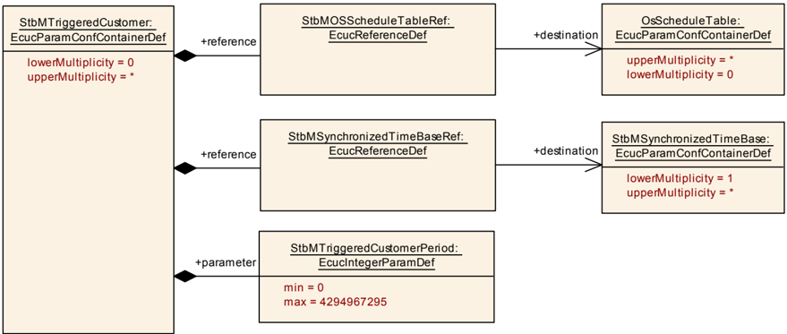

#### 9.2.13. StbMFreshnessValueInformation

| SWS 条目 | [ECUC_StbM_00075] |
|---|---|
| 容器名称 | StbMFreshnessValueInformation |
| 父容器 | StbM |
| 描述 | 包含新鲜度值配置的容器 |
| 配置参数 | 见下方参数表 |

| SWS 条目 | [ECUC_StbM_00081] |
|---|---|
| 参数名称 | StbMGetRxFreshnessValueFuncName |
| 父容器 | StbMFreshnessValueInformation |
| 描述 | 在 StbM_GetRxFreshness() 上下文中调用的函数指针。 |
| 多重性 | 0..1 |
| 类型 | EcucFunctionNameDef |
| 默认值 | - |
| 正则表达式 | - |
| Post-Build 变体多重性 | false |
| Post-Build 变体值 | false |
| 多重性配置类 | Pre-compile time：X；Link time：-；Post-build time：- |
| 值配置类 | Pre-compile time：X；Link time：-；Post-build time：- |
| 作用域/依赖 | scope: local |

| SWS 条目 | [ECUC_StbM_00080] |
|---|---|
| 参数名称 | StbMGetTxConfFreshnessValueFuncName |
| 父容器 | StbMFreshnessValueInformation |
| 描述 | 在 StbM_SPduTxConfirmation() 上下文中调用的函数指针。 |
| 多重性 | 0..1 |
| 类型 | EcucFunctionNameDef |
| 默认值 | - |
| 正则表达式 | - |
| Post-Build 变体多重性 | false |
| Post-Build 变体值 | false |
| 多重性配置类 | Pre-compile time：X；Link time：-；Post-build time：- |
| 值配置类 | Pre-compile time：X；Link time：-；Post-build time：- |
| 作用域/依赖 | scope: local |

| SWS 条目 | [ECUC_StbM_00078] |
|---|---|
| 参数名称 | StbMGetTxFreshnessValueFuncName |
| 父容器 | StbMFreshnessValueInformation |
| 描述 | 在 StbM_GetTxFreshness() 上下文中调用的函数指针。 |
| 多重性 | 0..1 |
| 类型 | EcucFunctionNameDef |
| 默认值 | - |
| 正则表达式 | - |
| Post-Build 变体多重性 | false |
| Post-Build 变体值 | false |
| 多重性配置类 | Pre-compile time：X；Link time：-；Post-build time：- |
| 值配置类 | Pre-compile time：X；Link time：-；Post-build time：- |
| 作用域/依赖 | scope: local |

| SWS 条目 | [ECUC_StbM_00079] |
|---|---|
| 参数名称 | StbMGetTxTruncFreshnessValueFuncName |
| 父容器 | StbMFreshnessValueInformation |
| 描述 | 在 StbM_GetTxFreshnessTruncData() 上下文中调用的函数指针。 |
| 多重性 | 0..1 |
| 类型 | EcucFunctionNameDef |
| 默认值 | - |
| 正则表达式 | - |
| Post-Build 变体多重性 | false |
| Post-Build 变体值 | false |
| 多重性配置类 | Pre-compile time：X；Link time：-；Post-build time：- |
| 值配置类 | Pre-compile time：X；Link time：-；Post-build time：- |
| 作用域/依赖 | scope: local |

| SWS 条目 | [ECUC_StbM_00076] |
|---|---|
| 参数名称 | StbMQueryFreshnessValue |
| 父容器 | StbMFreshnessValueInformation |
| 描述 | 该参数规定新鲜度值应通过 C 函数（**CDD**）还是软件组件（**SW-C**）确定。取值：CFUNC（**StbM** 使用 C 函数 **API** 为每个时间同步报文查询新鲜度）；NONE（**StbM** 不使用新鲜度值）；SERVICE（**StbM** 使用 **RTE** 服务端口 FreshnessManagement 为每个时间同步报文查询新鲜度）。 |
| 多重性 | 1 |
| 类型 | EcucEnumerationParamDef |
| 默认值 | NONE |
| Post-Build 变体值 | false |
| 值配置类 | Pre-compile time：X（所有变体）；Link time：-；Post-build time：- |
| 作用域/依赖 | scope: local |

| 容器名称 | 多重性 | 作用域/依赖 |
|---|---|---|
| StbMFreshnessValue | 0..* | 包含新鲜度值配置的容器 |

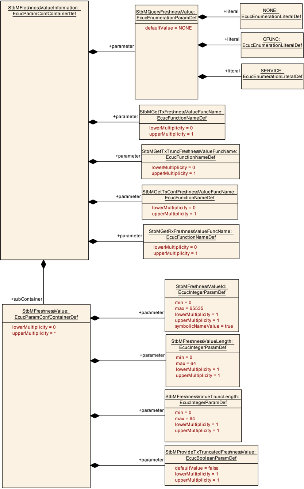

#### 9.2.14. StbMFreshnessValue

| SWS 条目 | [ECUC_StbM_00082] |
|---|---|
| 容器名称 | StbMFreshnessValue |
| 父容器 | StbMFreshnessValueInformation |
| 描述 | 包含新鲜度值配置的容器 |
| Post-Build 变体多重性 | false |
| 多重性配置类 | Pre-compile time：X（所有变体）；Link time：-；Post-build time：- |
| 配置参数 | 见下方参数表 |

| SWS 条目 | [ECUC_StbM_00083] |
|---|---|
| 参数名称 | StbMFreshnessValueId |
| 父容器 | StbMFreshnessValue |
| 描述 | 该参数定义新鲜度值的 ID。新鲜度值可以是普通计数器或时间值。 |
| 多重性 | 1 |
| 类型 | EcucIntegerParamDef（为此参数生成符号名） |
| 取值范围 | 0 .. 65535 |
| 默认值 | - |
| Post-Build 变体值 | false |
| 值配置类 | Pre-compile time：X（所有变体）；Link time：-；Post-build time：- |
| 作用域/依赖 | scope: local |

| SWS 条目 | [ECUC_StbM_00084] |
|---|---|
| 参数名称 | StbMFreshnessValueLength |
| 父容器 | StbMFreshnessValue |
| 描述 | 该参数定义新鲜度值以比特为单位的完整长度。只要密钥不改变，计数器就不应溢出。计数器的长度应根据相应密钥的预期生存期和计数器的使用频率来确定。 |
| 多重性 | 1 |
| 类型 | EcucIntegerParamDef |
| 取值范围 | 0 .. 64 |
| 默认值 | - |
| Post-Build 变体值 | false |
| 值配置类 | Pre-compile time：X（所有变体）；Link time：-；Post-build time：- |
| 作用域/依赖 | scope: local |

| SWS 条目 | [ECUC_StbM_00085] |
|---|---|
| 参数名称 | StbMFreshnessValueTruncLength |
| 父容器 | StbMFreshnessValue |
| 描述 | 该参数定义要包含到受保护时间同步报文载荷中的新鲜度值以比特为单位的长度。该长度专指完整新鲜度计数器的最低有效位。如果该参数为 0，则受保护时间同步报文中不包含新鲜度值。 |
| 多重性 | 1 |
| 类型 | EcucIntegerParamDef |
| 取值范围 | 0 .. 64 |
| 默认值 | - |
| Post-Build 变体值 | false |
| 值配置类 | Pre-compile time：X（所有变体）；Link time：-；Post-build time：- |
| 作用域/依赖 | scope: local |

| SWS 条目 | [ECUC_StbM_00087] |
|---|---|
| 参数名称 | StbMProvideTxTruncatedFreshnessValue |
| 父容器 | StbMFreshnessValue |
| 描述 | 该参数规定 **FVM** 是应直接提供截断的新鲜度值，还是 **FV** 应由 **StbM** 截断。 |
| 多重性 | 1 |
| 类型 | EcucBooleanParamDef |
| 默认值 | false |
| Post-Build 变体值 | false |
| 值配置类 | Pre-compile time：X（所有变体）；Link time：-；Post-build time：- |
| 作用域/依赖 | scope: local |

无包含的容器。

### 9.3. 约束

[SWS_StbM_CONSTR_00001] 如果变体为 VARIANT-POST-BUILD，则 StbMAllowSystemWideGlobalTimeMaster 应为必需。

[SWS_StbM_CONSTR_00002] 如果变体为 VARIANT-POST-BUILD，则仅当 StbMAllowSystemWideGlobalTimeMaster 设为 **TRUE** 时，StbMIsSystemWideGlobalTimeMaster 才能设为 **TRUE**。

[SWS_StbM_CONSTR_00003] 参数 StbMOffsetTimeBase 仅在参数 StbMSynchronizedTimeBaseType 设为 TBTYPE_OFFSET 时才有效。

[SWS_StbM_CONSTR_00004] 如果参数 StbMSynchronizedTimeBaseType 不等于 TBTYPE_SYNCHRONIZED，则参数 StbMCyclicBackupInterval 的多重性应设为 0。

[SWS_StbM_CONSTR_00005] 如果为某时基配置了容器 StbMTimeValidation，则容器 StbMFallbackTimeClock 对该时基应为必需。

### 9.4. 发布信息

细节请参阅 [4, **SWS** BSW General] 的第 10.3 章「Published Information」。

## B. AUTOSAR 可追溯项变更历史

请注意，本章中的列表还包括在后续版本中已从规范中移除的约束和规范项。这些约束和规范项在文档中不再作为超链接出现。

### B.1. 按照AUTOSAR发布版本 R23-11 的本文档可追溯项历史

#### B.1.1. R23-11 中新增的规范项

```
[SWS_StbM_00556] [SWS_StbM_00557] [SWS_StbM_00558] [SWS_StbM_00559]
[SWS_StbM_00560] [SWS_StbM_00561] [SWS_StbM_00562] [SWS_StbM_00563]
[SWS_StbM_00564] [SWS_StbM_00565] [SWS_StbM_00566] [SWS_StbM_00567]
[SWS_StbM_00568] [SWS_StbM_00569] [SWS_StbM_00570] [SWS_StbM_00571]
[SWS_StbM_00572] [SWS_StbM_00573] [SWS_StbM_00574] [SWS_StbM_00575]
[SWS_StbM_00576] [SWS_StbM_00577] [SWS_StbM_00578] [SWS_StbM_00579]
[SWS_StbM_00580] [SWS_StbM_00581] [SWS_StbM_00582] [SWS_StbM_00583]
[SWS_StbM_00584] [SWS_StbM_00585] [SWS_StbM_00586] [SWS_StbM_00587]
[SWS_StbM_00588] [SWS_StbM_00589] [SWS_StbM_00590] [SWS_StbM_00591]
[SWS_StbM_00592] [SWS_StbM_00593] [SWS_StbM_00594] [SWS_StbM_00595]
[SWS_StbM_00596] [SWS_StbM_00597] [SWS_StbM_00598] [SWS_StbM_00599]
[SWS_StbM_00600] [SWS_StbM_00601] [SWS_StbM_00602] [SWS_StbM_00603]
[SWS_StbM_00604] [SWS_StbM_00605] [SWS_StbM_00606] [SWS_StbM_00607]
[SWS_StbM_00608] [SWS_StbM_00609] [SWS_StbM_00610] [SWS_StbM_00611]
[SWS_StbM_00612] [SWS_StbM_00613] [SWS_StbM_00614] [SWS_StbM_00615]
[SWS_StbM_00616] [SWS_StbM_00617] [SWS_StbM_00618] [SWS_StbM_00619]
[SWS_StbM_00620] [SWS_StbM_00621] [SWS_StbM_00622] [SWS_StbM_00623]
[SWS_StbM_00624] [SWS_StbM_00625] [SWS_StbM_00626] [SWS_StbM_91027]
[SWS_StbM_91028] [SWS_StbM_91029]
```

#### B.1.2. R23-11 中变更的规范项

```
[SWS_StbM_00051] [SWS_StbM_00059] [SWS_StbM_00171] [SWS_StbM_00173]
[SWS_StbM_00177] [SWS_StbM_00178] [SWS_StbM_00179] [SWS_StbM_00191]
[SWS_StbM_00239] [SWS_StbM_00240] [SWS_StbM_00246] [SWS_StbM_00247]
[SWS_StbM_00261] [SWS_StbM_00284] [SWS_StbM_00304] [SWS_StbM_00308]
[SWS_StbM_00311] [SWS_StbM_00332] [SWS_StbM_00339] [SWS_StbM_00342]
[SWS_StbM_00353] [SWS_StbM_00355] [SWS_StbM_00356] [SWS_StbM_00359]
[SWS_StbM_00362] [SWS_StbM_00373] [SWS_StbM_00374] [SWS_StbM_00377]
[SWS_StbM_00384] [SWS_StbM_00387] [SWS_StbM_00393] [SWS_StbM_00395]
[SWS_StbM_00396] [SWS_StbM_00397] [SWS_StbM_00399] [SWS_StbM_00400]
[SWS_StbM_00411] [SWS_StbM_00422] [SWS_StbM_00424] [SWS_StbM_00426]
[SWS_StbM_00431] [SWS_StbM_00433] [SWS_StbM_00434] [SWS_StbM_00436]
[SWS_StbM_00437] [SWS_StbM_00438] [SWS_StbM_00439] [SWS_StbM_00440]
[SWS_StbM_00441] [SWS_StbM_00442] [SWS_StbM_00443] [SWS_StbM_00458]
[SWS_StbM_00459] [SWS_StbM_00460] [SWS_StbM_00461] [SWS_StbM_00462]
[SWS_StbM_00463] [SWS_StbM_00466] [SWS_StbM_00469] [SWS_StbM_00470]
[SWS_StbM_00507] [SWS_StbM_00508] [SWS_StbM_00516] [SWS_StbM_00517]
[SWS_StbM_00528] [SWS_StbM_00529] [SWS_StbM_00531] [SWS_StbM_00532]
[SWS_StbM_00534] [SWS_StbM_00535] [SWS_StbM_00538] [SWS_StbM_00541]
[SWS_StbM_00542] [SWS_StbM_00543] [SWS_StbM_00544] [SWS_StbM_00545]
[SWS_StbM_00546] [SWS_StbM_00547] [SWS_StbM_00548] [SWS_StbM_00549]
[SWS_StbM_00550] [SWS_StbM_91014] [SWS_StbM_91016] [SWS_StbM_91018]
[SWS_StbM_91023]
```

#### B.1.3. R23-11 中删除的规范项

无

#### B.1.4. R23-11 中新增的约束

```
[SWS_StbM_CONSTR_00005]
```

#### B.1.5. R23-11 中变更的约束

```
[SWS_StbM_CONSTR_00003] [SWS_StbM_CONSTR_00004]
```

#### B.1.6. R23-11 中删除的约束

无
