## 1. 简介和功能概述

本文介绍了**AUTOSAR**基础软件模块**ADC**驱动程序的功能、**API**和配置。**ADC**驱动程序的目标是逐次逼近**ADC**硬件数值。但**Delta Sigma ADC**转换用例超出了AUTOSAR ADC驱动的范畴。

**ADC**驱动模块主要负责初始化和控制**MCU**内部的模数转换器单元（**Analogue Digital Converter Unit**）。为此**ADC**驱动模块提供了启动和停止转换服务，以实现启用和禁用ADC转换的触发。此外也提供通知机制（**notification mechanism**）以及查询转换状态和结果的服务。

**ADC**模块工作在**ADC**通道组（**ADC Channel Group**）上。这些**ADC**通道组是由多条**ADC**通道（**ADC Channel**）构成。**ADC**通道组将模拟输入引脚（即：ADC通道）、所需的ADC电路本身和转换结果寄存器组合成一个实体，实现可通过**ADC**模块独立的控制及访问。

## 2. 缩略语

**DEM**
> 诊断事件管理器（**Diagnostic Event Manager**）。

**DET**
> 默认错误跟踪器（**Default Error Tracer**），实现报告开发错误的模块。

**ADC**
> 模数转换器（**Analogue Digital Converter**）

**MCU**
> 微控制器单元（**Microcontroller Unit**）

**API**
> 应用编程接口（**Application Programming Interface**）

**HW**
> 硬件（**Hardware**）

**SW**
> 软件（**Software**）

**ADC HW Unit**
> 微控制器的输入电子设备，包括执行模拟到数字转换所需的所有部件。

**ADC Module**
> ADC的基础软件模块ADC驱动模块（**ADC Driver**）

**ADC Channel**
> **ADC**通道是指绑定到一个端口引脚的逻辑**ADC**实体。同时多个**ADC**实体也可以映射到同一个端口引脚。

**ADC Channel Group**
> **ADC**通道组是指由一组**ADC**通道链接到同一个**ADC**硬件单元（**ADC HW Unit**）。例如：一个采样保持器（**Sample & Hold**）和一个**A/D**转换器。整个组的转换由一个触发源触发。

**ADC Result Buffer**（**ADC Streaming Buffer**，**ADC Stream Buffer**）
> **ADC**驱动程序的用户必须为每个组提供一个缓冲区。如果选择流式访问模式（**streaming access mode**），此缓冲区可以保存同一组通道的多个样本。如果选择单一访问模式（**Single Access Mode**），每个组通道的一个样本将保存在缓冲区中。

**Software Trigger**
> 软件触发是一个软件**API**调用，用于启动转换一个**ADC**通道组或一系列连续**ADC**通道组转换的。

**Hardware Trigger**
> 硬件触发是**ADC**内部触发信号，用于启动ADC通道组的一次转换。**ADC**硬件触发在ADC硬件内部生成（例如：基于**ADC**定时器或触发沿信号）。触发硬件是强耦合或者直接集成在**ADC**的硬件中。当检测到硬件触发后，无需软件即可启动**ADC**通道组转换。**注意：**即使**ADC**硬件不支持硬件触发，也可以通过软件触发结合**GPT/ICU**驱动程序来实现类似的行为。（例如：在GPT定时器通知函数中，启动软件触发的**ADC**通道组的转换）

**Conversion Mode**
> One-Shot：**ADC**通道组的转换在触发后执行一次，结果写入所分配的结果缓冲区。触发可以是软件**API**调用或硬件事件。Continuous：**ADC**通道组的转换在软件**API**调用（启动）后连续执行，结果写入所分配的结果缓冲区。转换本身自动运行（由硬件/中断控制）。连续转换可通过软件**API**调用（停止）停止。

**Sampling Time, Sample Time**
> 采样时间是指对模拟值进行采样的时间（例如：加载电容器，……）

**Conversion Time**
> 转换时间是指将采样的模拟值转换为数值所需的时间。

**Acquisition Time**
> 采集时间 = 采样时间（**Sample Time**）+ 转换时间（**Conversion Time**）

## 3. 相关文档

### 3.1. 输入文件

[1] General Specification of Basic Software Modules
> AUTOSAR_CP_SWS_BSWGeneral

### 3.2. 相关规范

AUTOSAR 提供了基础软件模块的通用规范 [1] ，此文档也适用于**ADC**驱动程序。因此，规范基础软件模块的通用规范 [1] 应被视为**ADC**驱动器的附加和必需规范。

## 4. 约束和假设

### 4.1. 限制

仅当**MCAL**驱动程序拥有完整的底层硬件外围设备（即：硬件外围设备不被其他 **MCAL**模块访问）时，电源状态控制**API**才可被实现。

### 4.2. 汽车域的适用性

无限制。

## 5. 对其他模块的依赖

### 5.1. MCU Driver

微控制器单元驱动（**MCU Driver**）主要负责初始化和控制芯片的内部时钟源和时钟预分频器。

时钟频率可能会影响：
* 触发频率（**Trigger frequency**）
* 转换时间（**Conversion time**）
* 采样时间（**Sampling time**）

### 5.2. PORT driver

**PORT**模块主要负责配置**ADC**模块使用的端口引脚。包括：模拟输入引脚（**analogue input pin**）和外部触发引脚（**external trigger pin**）。

## 6. 功能规格

### 6.1. 一般行为

#### 6.1.1. 背景与原理

下表列出了 **ADC** 用户可能需要的功能，以及 **ADC** 模块提供这些功能的方式。此外，该表还给出了一种可能的实现，以及这些功能到商用微控制器（C16x）能力的映射。

表 7.1：One-shot 与 Continuous 转换的不同可能性

| 期望功能 | **ADC** 驱动功能 | 示例：C16x 衍生产品的表述 |
|---|---|---|
| 仅需要一个通道的一次转换结果。 | 软件触发的一次性转换，被转换的通道组恰好由一个通道组成。 | 固定通道、单次转换、软件触发。 |
| 一个通道的周期性转换。 | 硬件触发的一次性转换，被转换的通道组恰好由一个通道组成。 | 固定通道、单次转换、硬件触发。 |
| 一个通道的重复转换。 | 连续转换，被转换的通道组恰好由一个通道组成。 | 固定通道、连续转换。 |
| 组内每个通道各一次转换结果。 | 软件触发的一次性转换，被转换的通道组由多于一个通道组成。 | 自动扫描、单次转换、软件触发。 |
| 组内每个通道的周期性转换。 | 硬件触发的一次性转换，被转换的通道组由多于一个通道组成。 | 自动扫描、单次转换、硬件触发。 |
| 组内每个通道的重复转换。 | 连续转换，被转换的通道组由多于一个通道组成。 | 自动扫描、连续转换。 |

#### 6.1.2. 需求

**ADC**模块可以允许将一个或多个**ADC**通道（**ADC channel**）分组为所谓的**ADC**通道组（**ADC Channel group**）。也即是说**ADC**模块的配置应使得一个**ADC**通道组包含至少一个**ADC**通道。

如果启用了全局限制检查功能并且为**ADC**通道启用了特定于通道的限制检查，则 **ADC**模块的配置应使**ADC**通道组仅包含一个**ADC**通道。

**ADC**模块应允许将一个**ADC**通道分配给多个ADC通道组。

**ADC**模块的配置应使得包含在一个**ADC**通道组中的所有通道应属于同一个**ADC**硬件单元。

**ADC**驱动需为每个**ADC**通道支持以下基础静态配置（若硬件支持）：通道符号名、采样时间（**Sampling Time**）、转换时间（**Conversion Time**）、分辨率（位）、参考电压源、时钟源（含可选的预分频器设置）以及其他**MCU**相关参数。**ADC**通道与**ADC**通道组的符号名由配置工具生成，定义在模块的配置头文件中，供上层使用。

对于每个**ADC**通道组，支持以下基础静态配置：组符号名、通知开关、回调通知函数、所配置使用的通道列表、组触发源以及组转换模式。此外，在配置期可为每个**ADC**通道组定义用于存储采样结果的缓冲区，即数据缓冲区指针（转换结果的目标地址）与**ADC**数值个数。

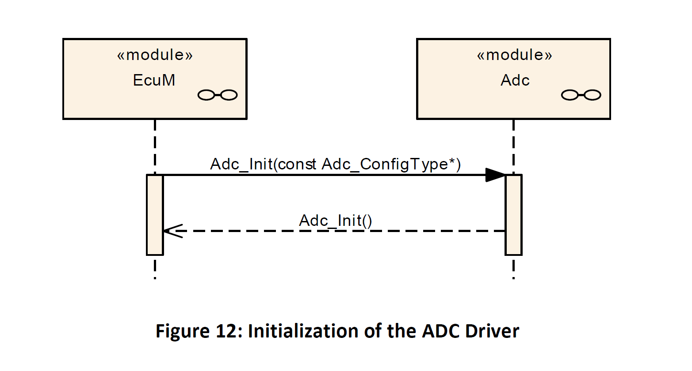

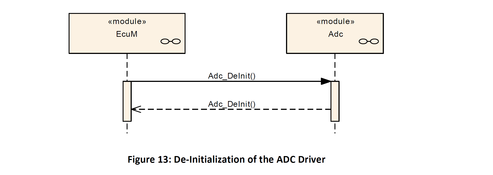

**ADC**模块支持以下转换模式：

**ADC**模块支持以下转换模式：

1. **ADC**模块需为所有**ADC**通道组，提供一次性转换模式（**One-shot Conversion**）的支持。 一次性转换意味着为正在转换的组配置的每个通道都执行一次转换。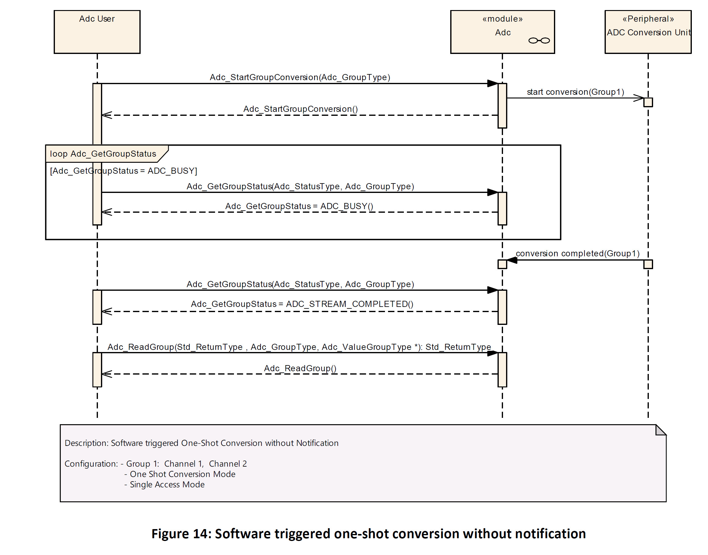
2. **ADC**模块需为所有带有触发源软件的**ADC**通道组，提供连续转换模式（**Continuous Conversion**）的支持。连续转换是指一次ADC转换完成后，一直重复整个**ADC**通道组的转换。组内各个**ADC**通道的转换以及整个**ADC**通道组的重复不需要执行任何额外的触发事件。根据硬件和软件功能，可以顺序或并行转换**ADC**通道组内的各个通道。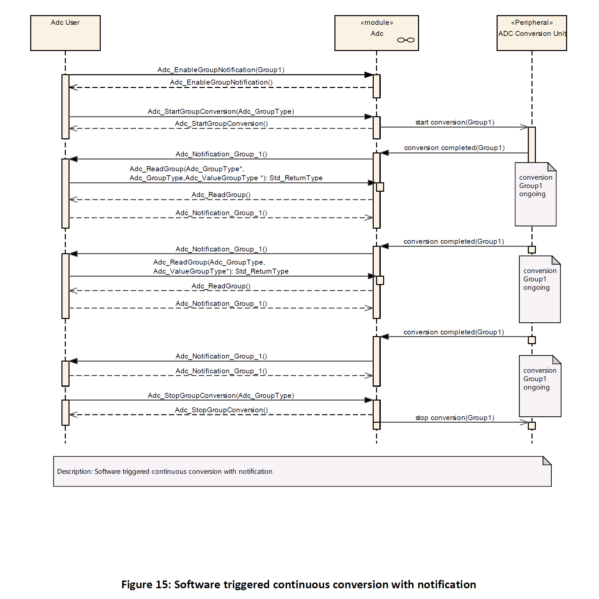

**ADC**模块需支持以下启动条件或触发源：

**ADC**模块需支持以下启动条件或触发源：

* **ADC**模块需支持所有转换模式的启动条件的软件**API**调用（**Software API Call**）。触发源的软件API调用是指ADC通道组的转换由ADC模块提供的服务来启动或者停止。
* **ADC**模块需支持在**One-Shot**转换模式中配置的**ADC**通道组的启动条件的硬件事件（**Hardware Event**）。触发源的硬件事件意味着**ADC**通道组的转换可以由硬件事件启动。（例如：定时器的超时事件，或者输入线上检测到一个边沿跳变）

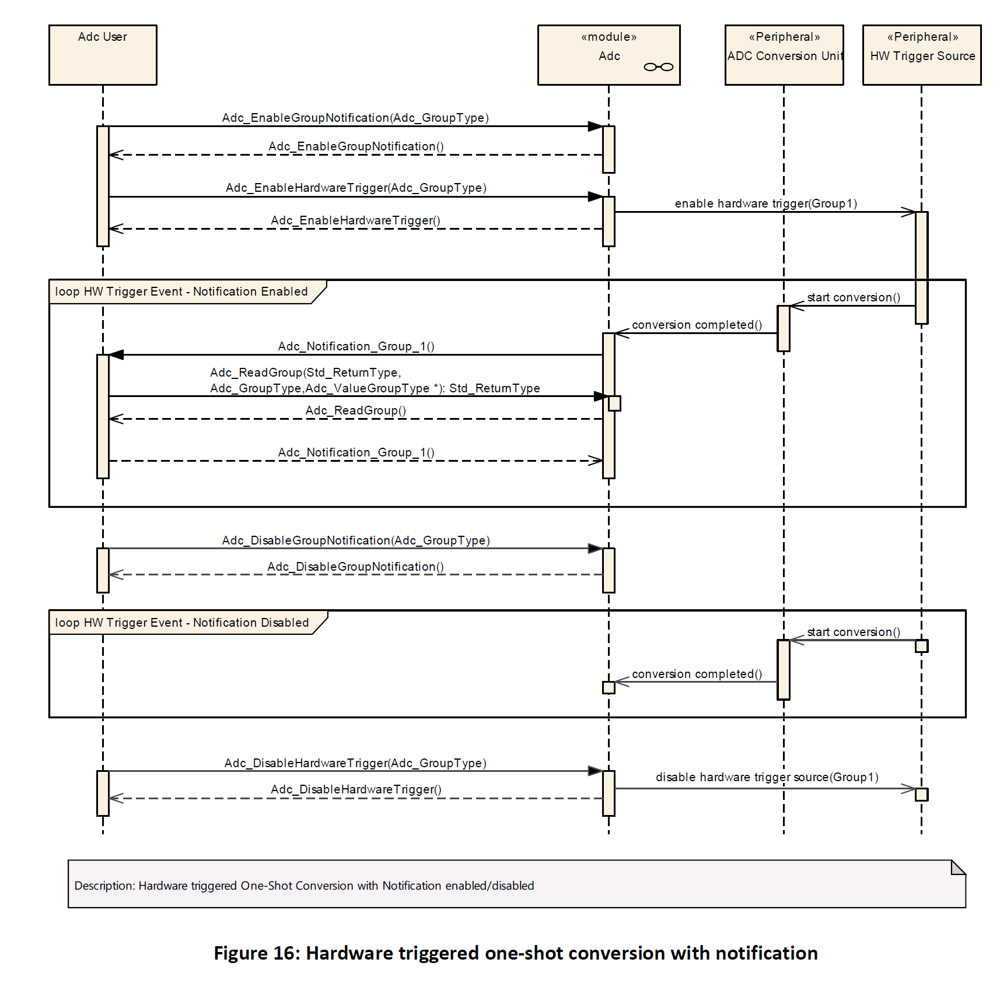

**ADC**模块应允许为每个**ADC**通道组配置一个触发源。

**ADC**模块需支持以下结果访问模式：

**ADC**模块需支持以下结果访问模式：

* **ADC**模块需支持使用API函数**Adc_GetStreamLastPointer**来访问结果。调用 **Adc_GetStreamLastPointer**会告知用户最新一轮的**ADC**通道组转换结果在结果缓冲区中的位置以及结果缓冲区中有效转换结果的数量。结果缓冲区是应用程序提供的外部缓冲区。此函数可用于**ADC**通道组的两种类型，通过配置**Streaming Access Mode**和**Single Access Mode**进行配置。同时**Single Access Mode**的处理等于**Streaming Access Mode**的**Streaming Counter**等于**1**的情况。
* 如果**API**函数的生成是静态配置的，**ADC**模块需支持使用API函数 **Adc_ReadGroup**来访问结果。调用**Adc_ReadGroup**将最近一轮转换的**ADC**通道组转换结果复制到应用程序缓冲区，其起始地址指定为**Adc_ReadGroup**的API参数。此函数可用于**ADC**通道组的两种类型，通过配置**Streaming Access Mode**和**Single Access Mode**进行配置。

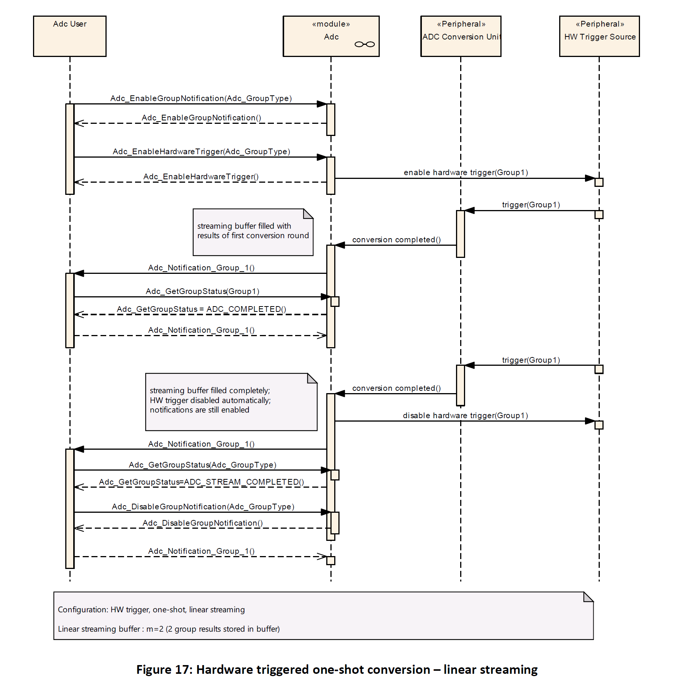

**ADC**模块需保证每次完成转换的返回结果值的一致性。

**注意：**

**ADC**通道组结果的一致性在应用端可以通过以下方法获得：

* 使用**ADC**通道组通知机制（**group notification mechanism**）
* 通过**API**函数**Adc_GetGroupStatus**轮询获取。

在任何情况下，新的结果数据都必须在被覆盖之前从结果缓冲区中读出（例如：通过 **Adc_ReadGroup**）。如果函数**Adc_GetGroupStatus**报告状态**ADC_STREAM_COMPLETED**, 并且同一**ADC**通道组的转换仍在进行中（因连续转换或硬件触发转换激活），则上层用户需负责在**ADC**驱动程序覆盖结果缓冲区之前，读取**ADC**通道组结果缓冲区中的结果。

**ADC**模块的环境应确保在请求转换结果之前，被请求的**ADC**通道组的转换已经完成。如果被请求的**ADC**通道组没有完成转换（例如：因为用户停止了**ADC**通道组的转换），ADC模块返回的值将是任意的。（如：**Adc_GetStreamLastPointer**将返回**0**并读取值为**NULL_PTR**，而**Adc_ReadGroup**将返回**E_NOT_OK**）。

对于流式访问模式（**Streaming Access Mode**），结果缓冲区的处理支持两种方式：线性缓冲区（**linear buffer**），即当流缓冲区已满（采样数达到配置的数量）时，**ADC**驱动停止转换；环形缓冲区（**ring buffer**），即到达流缓冲区末尾后回绕（**wrap around**），转换继续进行。

**ADC**模块需允许为每个**ADC**通道组配置优先级。这意味着优先级机制，在软件中实施，或者在可用的情况下由硬件支持。具有触发源硬件的**ADC**通道组，始终使用硬件优先级机制进行优先级排序。

**ADC**模块的优先级机制需允许中止和重新启动**ADC**通道组转换。**ADC**模块的优先级机制同时也应允许暂停和恢复**ADC**通道组转换。

**ADC**模块需允许**ADC**通道组特定配置，无论中止/重新启动或挂起/恢复机制是否用于被中断的**ADC**通道组。与**ADC**通道组（**ADC channel group**）级别的软件控制的中止/重启或挂起/恢复机制相比，**ADC**硬件可以支持**ADC**通道（**ADC channel**）级别的中止/重启和挂起/恢复机制。这两种机制中的哪一个在通道级别上实现，取决于最终的代码实现。

**ADC**模块的优先级机制需允许对不同**ADC**通道组的请求进行排队。较高优先级的**ADC**通道组可以中止或挂起较低优先级的**ADC**通道组。在这种情况下，优先级处理程序应将中断的**ADC**通道组转换放入队列中，并且此**ADC**通道组的转换将在稍后重新启动或恢复。具体实现对用户来说是透明的。

**ADC**模块的优先级机制需允许配置**256**个优先级（**0...255**）。最低优先级为**0**。

**ADC**模块需支持静态配置选项以禁用优先级机制。同时**ADC**模块需支持静态配置选项以启用**ADC_PRIORITY_HW_SW**优先级机制，即同时使用硬件和软件优先级机制。如果硬件不提供硬件优先级机制，则纯软件的优先级机制会被实施。

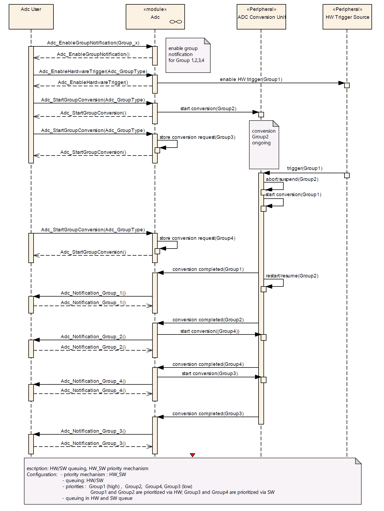

如果硬件支持优先级机制，**ADC**模块应支持静态配置选项**ADC_PRIORITY_HW**启用仅使用硬件优先级机制的优先级机制。如果选择了硬件优先机制，则具有软件触发源的**ADC**通道组也会使用硬件优先级机制中获得优先权配置。

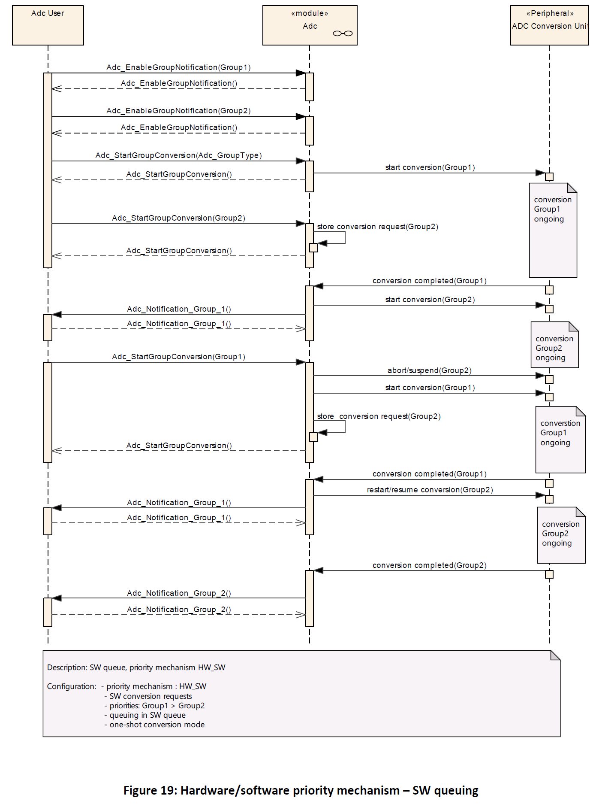

如果支持并选择了硬件优先级机制，**ADC**模块应允许将配置的优先级（**0-255**）映射到可用的硬件优先级。**ADC**模块的具体实现有关可用硬件优先级的限制以及可用硬件优先级到**ADC**通道组优先级的可能映射。

如果优先机制处于活动状态，**ADC**模块应支持转换请求的队列的功能：
1. 当较低优先级的**ADC**通道组转换正在进行时，收到更高优先级的**ADC**通道组转换请求，较低优先级的**ADC**通道组需放入队列中等待。
2. 因为更高优先级的**ADC**通道组转换正在进行中，较低优先级的**ADC**通道组转换请求将不能被立即处理时，较低优先级的**ADC**通道组转换请求也需要放入队列中等待。

如果优先级机制处于活动状态，则**ADC**模块会按照先到先服务（**first come first served**）的顺序，处理具有相同优先级的**ADC**通道组转换请求。

如果优先级机制未激活，并且静态配置参数**AdcEnableQueuing**设置为**ON**，则 **ADC**模块会支持转换请求的队列功能，并应以先到先服务（**first come first served**）的顺序为软件组提供服务。软件转换请求存储的队列中需由软件实现或由硬件支持。

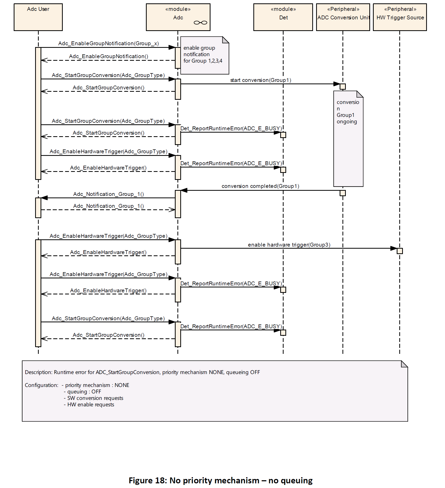

如果队列机制激活（优先机制激活或队列显式激活），**ADC**模块需为每个**ADC**通道组的每个软件转换请求，最多在软件队列中存储一次。**ADC**模块应仅存储每个**ADC**通道组的一个转换请求，而不是多个请求。原因就是避免高优先级长期转换阻塞硬件的情况。

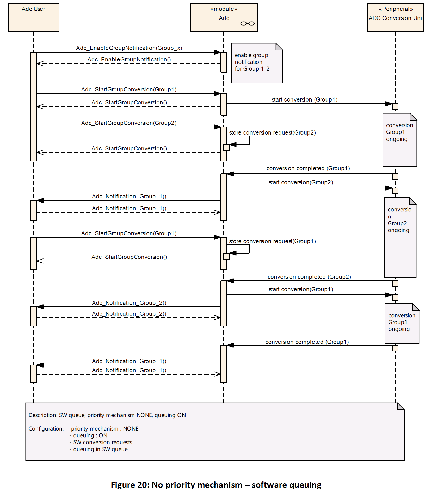

在启用硬件触发请求情况下，通过**API**函数**Adc_EnableHardwareTrigger**生成的请求不应存储在任何队列中。

在硬件触发转换请求的情况下，硬件优先级机制需被使用。

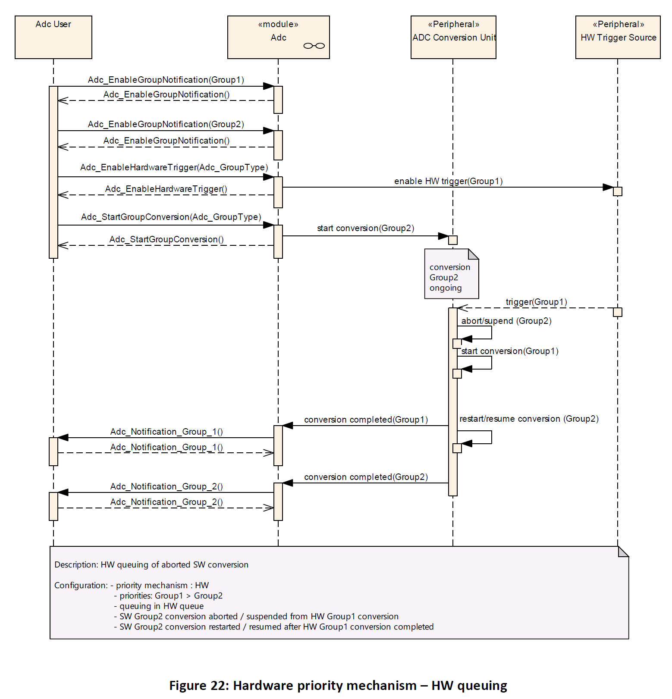

如果**ADC**通道组可以被隐式停止，当**ADC**通道组状态为**ADC_IDLE**或**ADC_STREAM_COMPLETED**，这时**ADC**模块则被允许存储同一**ADC**通道组的额外软件转换请求。

如果通知功能被配置并启用，当被请求**ADC**通道组的所有通道的转换完成后，**ADC**模块会调用此**ADC**通道组通知（**group notification**）函数。

对于不同的ADC通道组，**ADC**模块函数是可以支持可重入的。此要求应适用于除了以下的所有API函数：

* **Adc_Init**
* **Adc_DeInit**
* **Adc_GetVersionInfo**
* **Adc_SetPowerState**
* **Adc_GetTargetPowerState**
* **Adc_GetCurrentPowerState**
* **Adc_PreparePowerState**

**API**函数的可重入性，必须由调用者来关注是否同时使用了同一个**ADC**通道组的情况。

简单的读取调用，如**Adc_ReadGroup**和**Adc_GetGroupStatus**的实现，即使这些函数是为相同的**ADC**通道组调用，也需支持是可重入的。是否使用适当的保护机制（例如：禁用和启用中断）取决于代码实现。

**注意：**
调用**Adc_ReadGroup**可以隐式更改组状态。

在运行时，如果在不同的**Task**或者**ISR**中，对于同一个**ADC**通道组的多次调用，则**ADC**模块无需检查数据的完整性，但**ADC**模块的用户需确保数据的完整性。

**ADC**模块需允许为**ADC**通道配置限制检查。

如果**ADC**通道的限制检查（**limit checking**）处于激活状态，则只有在配置范围内的**ADC**转换结果，才会被考虑用于更新用户指定的**ADC**结果缓冲区，并用于触发**ADC**通道组状态转换（**state transitions**）。

如果选择了带软件触发源的一次性（**one-shot**）转换模式，并且对**ADC**的通道启用了限制检查，则 **ADC**驱动模块需忽略不在配置范围内的**ADC**转换结果，并且包含此**ADC**通道的**ADC**通道组，需仍旧保持**ADC_BUSY**的状态。

在重新发出新的一次性（**one-shot**）转换软件触发之前，必须使用**Adc_StopGroupConversion()**将**ADC**通道组状态设置为**ADC_IDLE**。

如果选择了带硬件触发源的一次性（**one-shot**）转换模式，并且对**ADC**的通道启用了限制检查，则**ADC**驱动模块需忽略不在配置范围内的**ADC**转换结果，并等待硬件触发源再次发出下一次的转换。

**ADC**驱动需从转换结果中掩掉不属于**ADC**数值本身的信息位。如果适用，函数**Adc_ReadGroup**需掩掉转换所提供的、但不属于转换结果本身的所有信息位或诊断位。

**Adc_ReadGroup**需读取原始转换值，不进行进一步的缩放。读取的数值需按配置参数**ADC_RESULT_ALIGNMENT**的设置进行对齐，可选择右对齐或左对齐。如果**ADC**提供有符号数值，**ADC**驱动需将符号位置于返回值的最高有效位（**MSB**）。

包含通道组转换结果的结构体需以统一的维度（位数）生成，并按属于任意通道组的位宽最大的通道进行裁剪。这是因为同一通道组内各通道的结果值位宽可能不同（例如**8**位、**12**位等）。

#### 6.1.3. ADC 缓冲区访问模式示例

#### 6.1.3.1. 配置

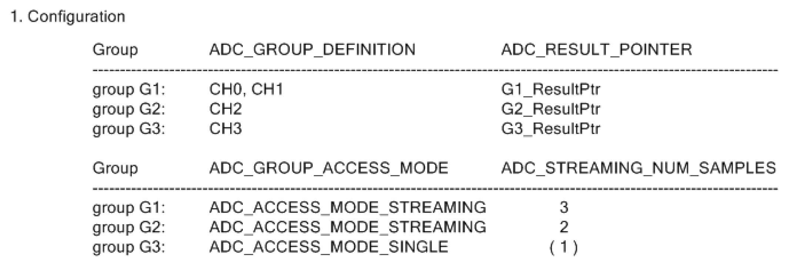

* 示例配置由三个**ADC**通道组组成。第1个**ADC**通道组由2个通道组成，第2个**ADC**通道组和第3个**ADC**通道组各由一个通道组成。
* 对于组1和组2，配置了组访问模式**ADC_ACCESS_MODE_STREAMING**。组3的组访问模式配置为**ADC_ACCESS_MODE_SINGLE**。
* **ADC**驱动程序将组1到组3的转换结果存储在三个应用程序缓冲区中，通过三个配置的 **ADC_RESULT_POINTER**访问：包括**G1_ResultPtr**、**G2_ResultPtr**和**G3_ResultPtr**。

#### 6.1.3.2. 初始化

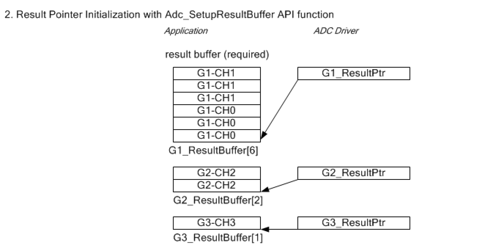

用户必须为**ADC**通道组结果提供应用程序结果缓冲区。每组都需要一个缓冲区。如果选择流模式（**ADC_ACCESS_MODE_STREAMING**）的访问模式，缓冲区大小取决于组通道的数量、组访问模式以及流模式采样的数量。在开始**ADC**通道组转换之前，用户必须使用**API**函数 **Adc_SetupResultBuffer**初始化**ADC**通道组结果指针，该函数将**ADC**通道组结果指针初始化为指向特定的应用程序结果缓冲区。

#### 6.1.3.3. Adc_GetStreamLastPointer的用法

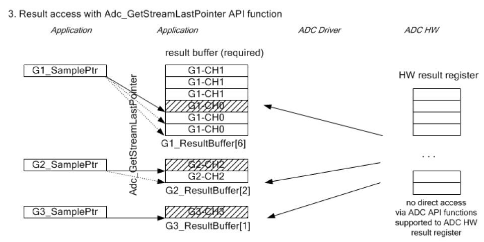

**ADC**驱动程序将**ADC**通道组**G1**、**G2**和**G3**的转换结果存储在相应的结果缓冲区数组**G1_ResultBuffer**、**G2_ResultBuffer**和**G3_ResultBuffer**中。**ADC**驱动程序并不支持通过**ADC**的**API**函数直接访问**ADC**硬件结果寄存器。

**ADC**用户定义了三个指针**G1_SamplePtr**、**G2_SamplePtr**和**G3_SamplePtr**。在调用**Adc_GetStreamLastPointer**后，这些指针分别指向 **ADC**应用程序结果缓冲区。

准确地说，指针**G1_SamplePtr**在调用**Adc_GetStreamLastPointer**后，指向最新完成的一轮AD转换后的最新的**G1_CH0**的结果（其中**G1_CH0**是**G1**组定义中的第一个通道）。应用程序结果缓冲区布局如上图所示。组1的应用程序结果缓冲区中保存了3份**G1_CH0**的流结果（**streaming result**），也保存了3份**G1_CH1** 的流结果。了解应用程序结果缓冲区布局后，用户可以访问最新一轮转换的所有**ADC**通道组的组内通道的结果。

**G2_SamplePtr**和**G3_SamplePtr**也对齐，在调用**Adc_GetStreamLastPointer**后，指向对应**ADC**通道组的的第一个组通道的最新结果。因为这两个**ADC**通道组只有一个频道。**G2_SamplePtr**指向**G2_CH2**结果之一（即：最新结果）。**ADC**通道组，因为配置为单一访问模式，所以**G3_SamplePtr**始终指向**G3_CH3**。

**Adc_GetStreamLastPointer**会返回存储在应用程序结果缓冲区中，每个通道的有效采样数（即：完整的组转换次数）。如果返回值等于配置参数流采样个数（**number of streaming samples**），则流缓冲区中的所有转换结果都有效。如果返回值为 0，则流缓冲区中没有可用的转换结果（采样数据的指针将对齐为**NULL**）。

为了使**Adc_GetStreamLastPointer**将采样数据指针（**G1_SamplePtr**、**G2_SamplePtr**和**G3_SamplePtr**）指向最新的通道结果，**API**被定义为将指针传递给结果指针而不是结果指针本身。

#### 6.1.3.4. Adc_ReadGroup的用法

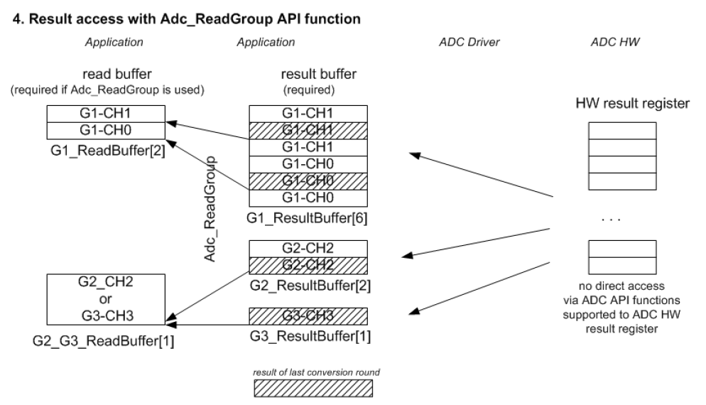

如果可选的API函数**Adc_ReadGroup**被启用，则用户必须为每个选定的**ADC**通道组提供额外的缓冲区，这些缓冲区可以保存一轮**ADC**通道组转换的结果。调用**Adc_ReadGroup**将最新结果从应用程序结果缓冲区复制到应用程序读取组缓冲区。 在示例中，一个应用程序读取缓冲区（**G2_G3_ReadBuffer**）被用于**ADC**通道组**G2**和**G3**。
### 6.2. 转换处理和交互

#### 6.2.1. 背景与原理

以下示例规定了通道转换的顺序，具体取决于通道组和转换类型：

* **示例1（多通道/连续转换）**
**ADC**通道组包含通道（**CH0**、**CH1**、**CH2**、**CH3** 和 **CH4**），并配置为连续转换模式。当完成每次扫描后，会调用通知（如果启用）。 然后自动开始新一轮扫描。

* **示例2（多通道/One-Shot）**
**ADC**通道组包含通道（**CH0**、**CH1**、**CH2**、**CH3** 和 **CH4**），并配置为**One-Shot**转换模式。当完成扫描后，会调用通知（如果启用）。

* **示例3（单通道/连续转换）**
**ADC**通道组包含通道（**CH3**）并配置为连续转换模式。当完成每次扫描后，将调用通知（如果启用）。然后自动开始新一轮的扫描。

* **示例4（单通道/One-Shot）**
**ADC**通道组包含通道（**CH4**）并配置为**One-Shot**转换模式。当完成扫描后，会调用通知（如果启用）。
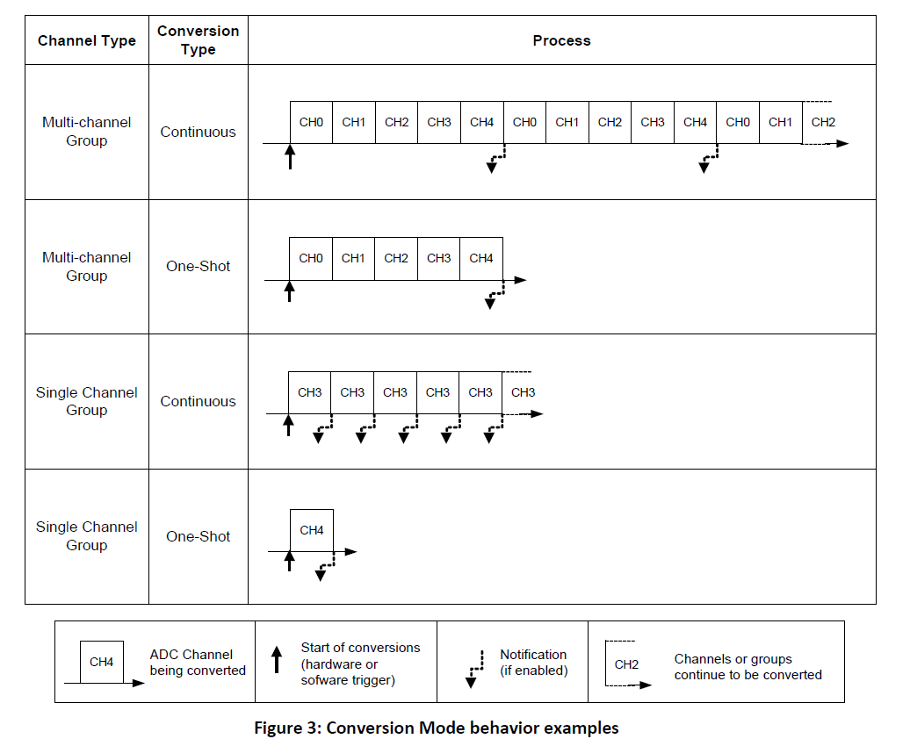

#### 6.2.2. 需求

**ADC**模块一次只能转换每个**ADC**硬件单元（**ADC HW Unit**）的一个**ADC**通道组。**ADC**模块不支持在同一个**ADC**硬件单元上，不同的**ADC**通道组的同时转换。

**注意：**

根据硬件的能力，不同**ADC**硬件单元上的**ADC**通道组的并发转换是可能的。如果硬件支持，也可以同时转换一个通道组内的个别通道。

如果一个通道需要在不同的转换模式下使用（例如：正常操作期间的连续转换模式和在特定时间点进行特殊转换的一次性转换模式），则该通道应分配到具有各自的不同转换模式配置的**ADC**通道组上。

为了请求转换两个组之间共享的通道，**ADC**用户必须停止包含指定通道的第一组的转换，然后才能开始包含指定通道的第二组的转换。

### 6.3. 状态图

**ADC**模块具有一个状态机，如下图所示。这些状态是通道组特定的，而非模块特定的。这些状态图展示了**ADC**通道组所有可能的配置选项。状态迁移取决于**ADC**通道组的配置。

#### 6.3.1. One-Shot/连续组转换模式的状态图

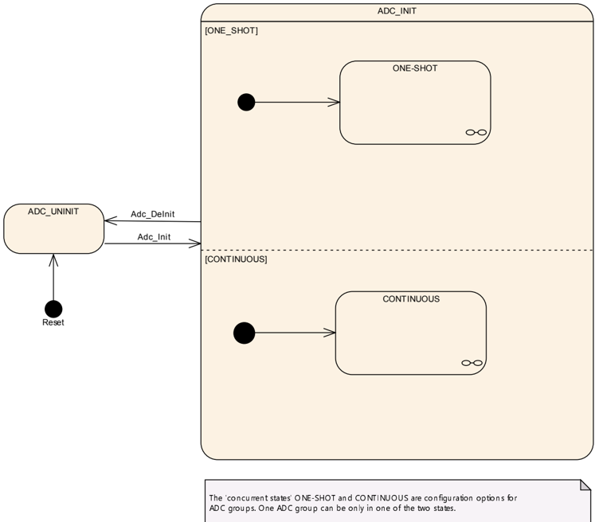

图 7.4：One-Shot/连续组转换模式状态图

#### 6.3.2. One-Shot组转换模式中HW/SW触发的状态图

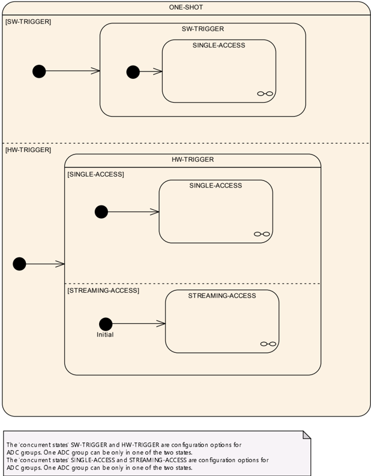

图 7.5：One-Shot组转换模式中HW/SW触发的状态图

#### 6.3.3. SW触发连续转换模式的状态图

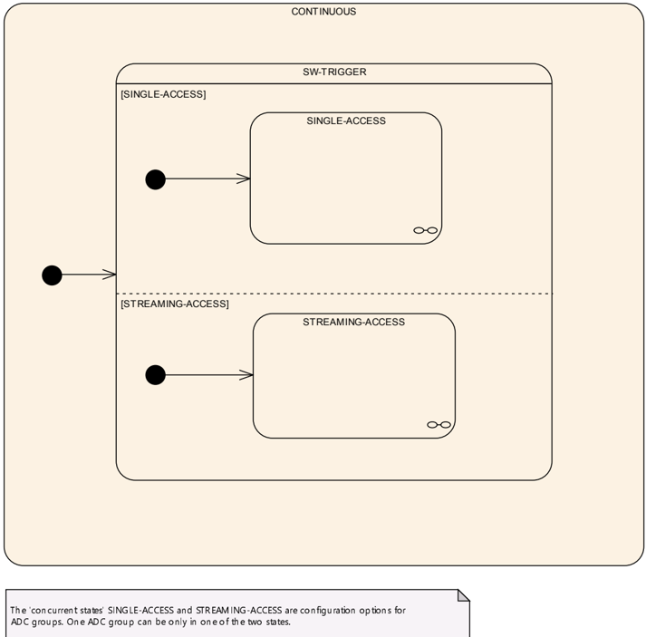

图 7.6：SW触发连续转换模式的状态图

#### 6.3.4. One-Shot转换模式、软件触发源、单一访问模式的状态图

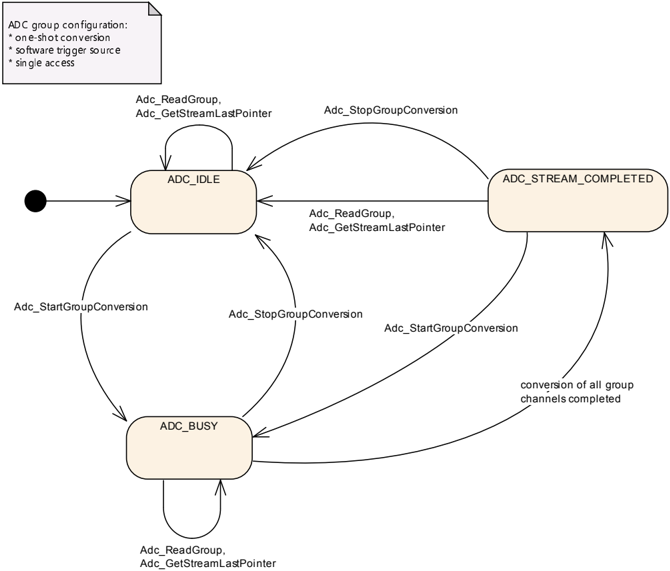

图 7.7：One-Shot、软件触发、单一访问模式的状态图

#### 6.3.5. One-Shot转换、硬件触发源、单一访问模式的状态图

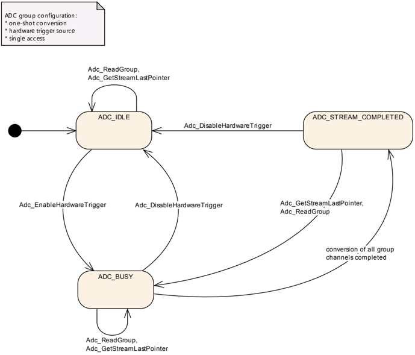

图 7.8：One-Shot、硬件触发、单一访问模式的状态图

#### 6.3.6. One-Shot转换模式、硬件触发源、线性和环形流访问模式的状态图

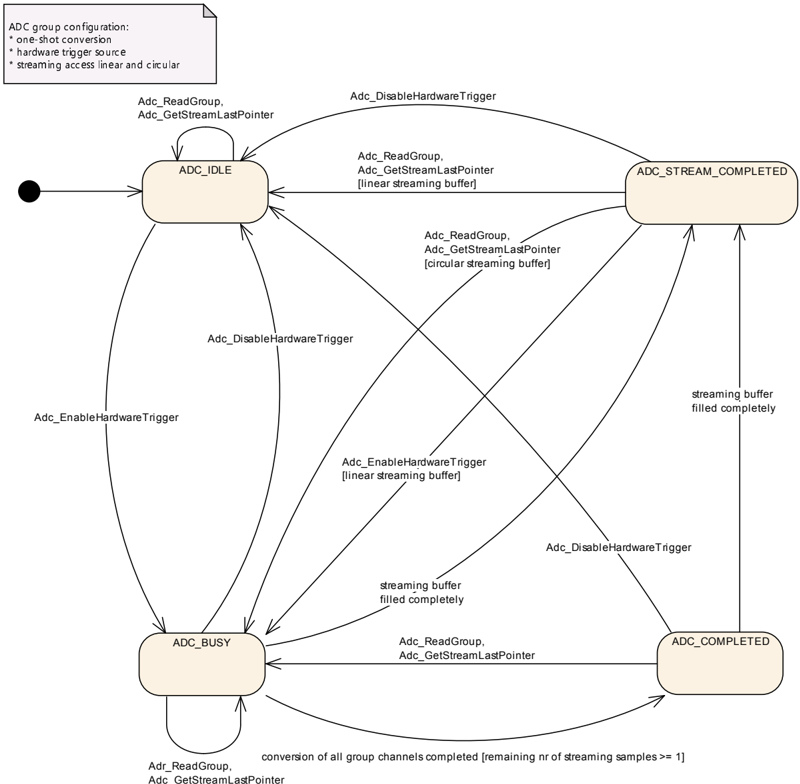

图 7.9：One-Shot、硬件触发、流访问模式的状态图

#### 6.3.7. 连续转换模式、软件触发源、单一访问模式的状态图

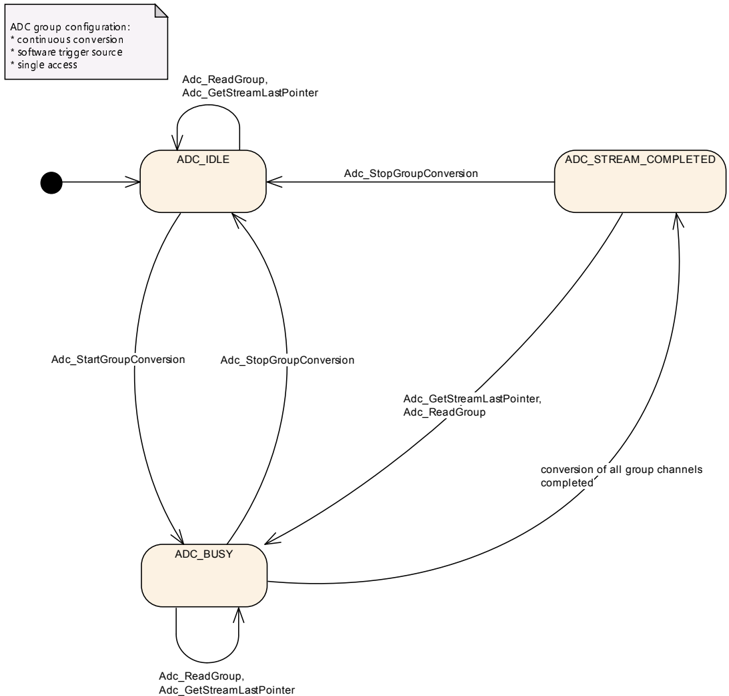

图 7.10：连续转换、软件触发、单一访问模式的状态图

#### 6.3.8. 连续转换模式、软件触发源、线性和环形流访问模式的状态图

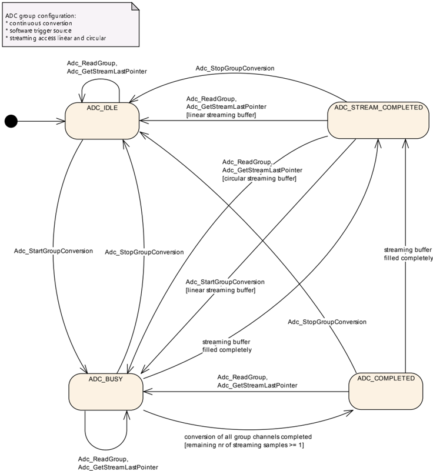

图 7.11：连续转换、软件触发、流访问模式的状态图

### 6.4. 电源状态管理

当配置参数**AdcLowPowerStatesSupport**设置为**TRUE**时，**ADC**驱动需支持电源状态切换及其**API**。此时需生成**Adc_PreparePowerState**、**Adc_SetPowerState**、**Adc_GetCurrentPowerState**和**Adc_GetTargetPowerState**这几个**API**函数，用于管理电源状态切换并获取相关信息。

**ADC**驱动需将电源状态切换序列分为两个阶段：准备阶段（进行初步的配置更改，以允许硬件外设进入目标电源状态）和设置阶段（实际使能有效的电源状态）。

**API**函数**Adc_PreparePowerState**用于启动电源状态切换。在通过**Adc_PreparePowerState**完成针对某个电源状态的准备后，再使用**Adc_SetPowerState**使**ADC**模块进入所请求的电源状态。为避免出现不连贯的电源状态，部分**API**（**Adc_SetPowerState**、**Adc_PreparePowerState**）必须按给定的顺序调用，否则会存储错误（若使能**DET**跟踪）并中断该动作。**ADC**驱动需跟踪**Adc_SetPowerState**与**Adc_PreparePowerState**的调用顺序：若**Adc_SetPowerState**在**Adc_PreparePowerState**之前被调用，则需存储**DET**条目，且不执行该动作。

**Adc_GetTargetPowerState**与**Adc_GetCurrentPowerState**分别用于获取所请求（目标）的与当前的**ADC**电源状态。**ADC**模块需跟踪当前电源状态与目标电源状态。当**AdcLowPowerStatesSupport**设置为**TRUE**时，初始化完成后模块的电源状态始终为**ADC_FULL_POWER**。

**ADC**驱动需支持同步和异步两种电源状态切换方式，取决于配置参数**AdcPowerStateAsynchTransitionMode**的取值。当该参数设置为**FALSE**时，准备过程和设置过程在各自**API**返回时即视为完成；设置为**TRUE**时，准备过程在请求发出后于后台进行，并在完成时通过通知（**IoHwAb_Adc_NotifyReadyForPowerState**）告知注册的**SWC**。

### 6.5. 错误分类

**SWS_BSWGeneral**文档第 7.x 章"错误处理"详细描述了基础软件的错误处理，并构成了包含五类可能出现在**BSW**模块中的错误类型的分类方案。在此基础上，以下各小节规定本模块的特定错误。

#### 6.5.1. 开发错误

| 错误类型 | 相关错误码 | 错误值 |
|---|---|---|
| API 在初始化之前被调用。 | ADC_E_UNINIT | 0x0A |
| API 在 **ADC** 已初始化时被调用。 | ADC_E_ALREADY_INITIALIZED | 0x0D |
| API 以错误的缓冲区指针被调用。 | ADC_E_PARAM_POINTER | 0x14 |
| API 以不存在的组被调用。 | ADC_E_PARAM_GROUP | 0x15 |
| API 为配置为连续转换模式的组被调用。 | ADC_E_WRONG_CONV_MODE | 0x16 |
| 根据组配置不允许的 API 调用。 | ADC_E_WRONG_TRIGG_SRC | 0x17 |
| API 被调用且通知函数指针为 **NULL**。 | ADC_E_NOTIF_CAPABILITY | 0x18 |
| API 在结果缓冲区指针未初始化时被调用。 | ADE_E_BUFFER_UNINIT | 0x19 |
| API 以不支持的电源状态请求被调用。 | ADE_E_POWER_STATE_NOT_SUPPORTED | 0x1B |
| **ADC** 未为请求的目标电源状态做准备。 | ADC_E_PERIPHERAL_NOT_PREPARED | 0x1D |

#### 6.5.2. 运行时错误

| 错误类型 | 相关错误码 | 错误值 |
|---|---|---|
| API 调用时另一个转换已在运行、硬件触发器已启用、请求已存储在队列中。 | ADC_E_BUSY | 0x0B |
| API 调用时组处于 **ADC_IDLE** 状态或组未启用。 | ADC_E_IDLE | 0x0C |
| API 调用时一个或多个 **ADC** 组不处于 **IDLE** 状态。 | ADC_E_NOT_DISENGAGED | 0x1A |
| 无法达到请求的电源状态。 | ADC_E_TRANSITION_NOT_POSSIBLE | 0x1C |

#### 6.5.3. 瞬时故障

无。

#### 6.5.4. 生产错误

无。

#### 6.5.5. 扩展生产错误

无。

## 7. API规范

### 7.1. 导入的类型

| 模块 | 头文件 | 导入类型 |
|---|---|---|
| Std | Std_Types.h | Std_ReturnType |
| Std | Std_Types.h | Std_VersionInfoType |

### 7.2. 类型定义

#### 7.2.1. Adc_ConfigType

**说明**: 结构类型，包含初始化**ADC**驱动程序和**ADC**硬件单元所需的配置参数集合。可通过**Adc.h**获得。

#### 7.2.2. Adc_ChannelType

**说明**: 类型，派生自**uint**。**ADC**通道的数字**ID**。此类型的范围是**µC**特定的，须由供应商描述。可通过**Adc.h**获得。

#### 7.2.3. Adc_GroupType

**说明**: 类型，派生自**uint**。**ADC**通道组的数字**ID**。此类型的范围是**µC**特定的，须由供应商描述。可通过**Adc.h**获得。

#### 7.2.4. Adc_ValueGroupType

**说明**: 类型，派生自**int**。用于读取通道组转换后数值的类型（原始值，不做进一步缩放，按预编译开关**ADC_RESULT_ALIGNMENT**进行对齐）。此类型为实现特定。可通过**Adc.h**获得。

转换结果值应存储在整数缓冲区（即整数数组）中，以下规则适用于驱动程序实现：

* 在单一值访问模式（**single value access mode**）下，结果缓冲区应具有与属于该组的通道数量相同的元素数。这样每个缓冲区元素对应一个通道，顺序与组内通道的定义顺序一致。
* 在流式访问模式（**streaming access mode**）下，结果缓冲区应具有**m*n**个元素，其中**n**为属于该组的通道数，**m**为每通道采集的采样数。这样前**m**个元素属于组内第一个通道，第二个**m**个元素属于第二个通道，以此类推。
* 每个缓冲区元素（整数类型）的维度（位数）应是统一的，按属于任意组的最大位宽通道裁剪。

**注意：** 只有当所有**ADC**组的所有**ADC**通道都具有**8**位分辨率时，**Adc_ValueGroupType**才可被配置为**8**位数据类型。

#### 7.2.5. Adc_PrescaleType

**说明**: 类型，派生自**uint**。时钟预分频器因子的类型（此类型不是**API**类型）。此类型的范围是**µC**特定的，须由供应商描述。可通过**Adc.h**获得。

#### 7.2.6. Adc_ConversionTimeType

**说明**: 类型，派生自**uint**。转换时间的类型，即将采样的模拟值转换为数字表示所需的时间（此类型不是**API**类型）。此类型的范围是**µC**特定的，须由供应商描述。可通过**Adc.h**获得。

#### 7.2.7. Adc_SamplingTimeType

**说明**: 类型，派生自**uint**。采样时间的类型，即对值进行采样的时间（以时钟周期计）（此类型不是**API**类型）。此类型的范围是**µC**特定的，须由供应商描述。可通过**Adc.h**获得。

#### 7.2.8. Adc_ResolutionType

**说明**: 类型，派生自**uint8**。通道分辨率的类型，以位数表示（此类型不是**API**类型）。此类型的范围是**µC**特定的，须由供应商描述。可通过**Adc.h**获得。

#### 7.2.9. Adc_StatusType

**说明**: 枚举类型，取值范围：

* **ADC_IDLE**（0x00）：指定组的转换尚未开始；无可用结果。
* **ADC_BUSY**（0x01）：指定组的转换已开始且仍在进行中；到目前为止无可用结果。
* **ADC_COMPLETED**（0x02）：指定组的一轮转换（非最终轮）已完成；该组所有通道的结果可用。
* **ADC_STREAM_COMPLETED**（0x03）：结果缓冲区已完全填充；所选组每个通道待采集的采样数已全部获得。

所请求**ADC**通道组转换的当前状态。可通过**Adc.h**获得。

#### 7.2.10. Adc_TriggerSourceType

**说明**: 枚举类型，取值范围：

* **ADC_TRIGG_SRC_SW**（0x00）：组由软件**API**调用触发。
* **ADC_TRIGG_SRC_HW**（0x01）：组由硬件事件触发。

用于配置**ADC**通道组触发源的类型。可通过**Adc.h**获得。

#### 7.2.11. Adc_GroupConvModeType

**说明**: 枚举类型，取值范围：

* **ADC_CONV_MODE_ONESHOT**（0x00）：配置的触发事件发生后，**ADC**通道组中每个通道恰好执行一次转换。若"组触发源为软件"，已启动的**One-Shot**转换可通过软件**API**调用停止；若"组触发源为硬件"，已启动的**One-Shot**转换可通过禁用触发事件停止（若硬件支持）。
* **ADC_CONV_MODE_CONTINUOUS**（0x01）：**ADC**通道组中每个**ADC**通道重复执行转换。"连续转换模式"仅适用于"组触发源为软件"。已启动的"连续转换"可通过软件**API**调用停止。

用于配置**ADC**通道组转换模式的类型。可通过**Adc.h**获得。

#### 7.2.12. Adc_GroupPriorityType

**说明**: 类型，派生自**uint8**，范围为**0..255**。通道的优先级级别，最低优先级为**0**。可通过**Adc.h**获得。

#### 7.2.13. Adc_GroupDefType

**说明**: 类型，派生自**implementation_specific**。用于将通道分配给通道组的类型（此类型不是**API**类型）。可通过**Adc.h**获得。

#### 7.2.14. Adc_StreamNumSampleType

**说明**: 类型，派生自**uint**。用于配置流式访问模式下组转换次数的类型（在单一访问模式下，该参数为**1**）。此类型的范围是**µC**特定的，须由供应商描述。可通过**Adc.h**获得。

#### 7.2.15. Adc_StreamBufferModeType

**说明**: 枚举类型，取值范围：

* **ADC_STREAM_BUFFER_LINEAR**（0x00）：一旦流缓冲区已满（达到采样数），**ADC**驱动即停止转换。
* **ADC_STREAM_BUFFER_CIRCULAR**（0x01）：即使流缓冲区已满（达到采样数），**ADC**驱动仍通过回绕流缓冲区本身继续转换。

用于配置流式访问模式缓冲区类型的类型。可通过**Adc.h**获得。

#### 7.2.16. Adc_GroupAccessModeType

**说明**: 枚举类型，取值范围：

* **ADC_ACCESS_MODE_SINGLE**（0x00）：单一值访问模式。
* **ADC_ACCESS_MODE_STREAMING**（0x01）：流式访问模式。

用于配置组转换结果访问模式的类型。可通过**Adc.h**获得。

#### 7.2.17. Adc_HwTriggerSignalType

**说明**: 枚举类型，取值范围：

* **ADC_HW_TRIG_RISING_EDGE**（0x00）：对硬件触发信号的上升沿作出反应（仅当**ADC**硬件支持时）。
* **ADC_HW_TRIG_FALLING_EDGE**（0x01）：对硬件触发信号的下降沿作出反应（仅当**ADC**硬件支持时）。
* **ADC_HW_TRIG_BOTH_EDGES**（0x02）：对硬件触发信号的两个边沿都作出反应（仅当**ADC**硬件支持时）。

用于配置驱动程序应对硬件触发信号的哪个边沿作出反应（即启动转换）的类型（仅当**ADC**硬件支持时）。可通过**Adc.h**获得。

#### 7.2.18. Adc_HwTriggerTimerType

**说明**: 类型，派生自**uint**。**ADC**模块嵌入式定时器重载值的类型（仅当**ADC**硬件支持时）。此类型的范围是**µC**特定的，须由供应商描述。可通过**Adc.h**获得。

#### 7.2.19. Adc_PriorityImplementationType

**说明**: 枚举类型，取值范围：

* **ADC_PRIORITY_NONE**（0x00）：优先级机制不可用。
* **ADC_PRIORITY_HW**（0x01）：仅硬件优先级机制可用。
* **ADC_PRIORITY_HW_SW**（0x02）：硬件和软件优先级机制均可用。

用于配置优先级机制的类型。可通过**Adc.h**获得。

#### 7.2.20. Adc_GroupReplacementType

**说明**: 枚举类型，取值范围：

* **ADC_GROUP_REPL_ABORT_RESTART**（0x00）：组被更高优先级组中断时，在组级别使用中止/重启机制。被中断组的完整转换轮（所有组通道）将在高优先级组转换后重新开始。已写入结果缓冲区的前几轮转换结果不受影响。
* **ADC_GROUP_REPL_SUSPEND_RESUME**（0x01）：组被更高优先级组中断时，在组级别使用挂起/恢复机制。

**ADC**组转换被更高优先级组中断时，在**ADC**组级别使用的替换机制。可通过**Adc.h**获得。

#### 7.2.21. Adc_ChannelRangeSelectType

**说明**: 枚举类型，取值范围：

* **ADC_RANGE_UNDER_LOW**（0x00）：低于下限的范围——包含下限值。
* **ADC_RANGE_BETWEEN**（0x01）：下限与上限之间的范围——包含上限值。
* **ADC_RANGE_OVER_HIGH**（0x02）：高于上限的范围。
* **ADC_RANGE_ALWAYS**（0x03）：完整范围——与通道限制设置无关。
* **ADC_RANGE_NOT_UNDER_LOW**（0x04）：高于下限的范围。
* **ADC_RANGE_NOT_BETWEEN**（0x05）：高于上限或低于下限的范围——包含下限值。
* **ADC_RANGE_NOT_OVER_HIGH**（0x06）：低于上限的范围——包含上限值。

在限制检查激活的情况下：定义相对于**AdcChannelLowLimit**和**AdcChannelHighLimit**所定义的边界，哪些转换值会被纳入考虑。可通过**Adc.h**获得。

#### 7.2.22. Adc_ResultAlignmentType

**说明**: 枚举类型，取值范围：

* **ADC_ALIGN_LEFT**（0x00）：左对齐。
* **ADC_ALIGN_RIGHT**（0x01）：右对齐。

用于**ADC**原始结果在**ADC**结果缓冲区中对齐（左/右对齐）的类型。可通过**Adc.h**获得。

#### 7.2.23. Adc_PowerStateType

**说明**: 枚举类型，取值范围：

* **1..255**：功耗递减的电源模式。
* **ADC_FULL_POWER**（0）：全功率。

当前激活或设为目标电源状态的电源状态。可通过**Adc.h**获得。

#### 7.2.24. Adc_PowerStateRequestResultType

**说明**: 枚举类型，取值范围：

* **ADC_SERVICE_ACCEPTED**（0）：电源状态切换已执行。
* **ADC_NOT_INIT**（1）：**ADC**模块未初始化。
* **ADC_SEQUENCE_ERROR**（2）：**API**调用顺序错误。
* **ADC_HW_FAILURE**（3）：硬件模块存在故障，使其无法进入所需电源状态。
* **ADC_POWER_STATE_NOT_SUPP**（4）：**ADC**模块不支持所请求的电源状态。
* **ADC_TRANS_NOT_POSSIBLE**（5）：**ADC**模块无法从当前电源状态直接切换。

与电源状态切换相关的请求结果。可通过**Adc.h**获得。

### 7.3. 函数定义

#### 7.3.1. Adc_Init

**说明**: 初始化**ADC**硬件单元和驱动程序。可通过**Adc.h**获得。本服务为同步调用，不可重入。参数 ConfigPtr（in）：指向**Variant PB**配置集的指针（**Variant PC**要求为**NULL_PTR**）。

```C
void Adc_Init ( const Adc_ConfigType* ConfigPtr )
```

在**Variant PB**情况下，函数**Adc_Init**应根据**ConfigPtr**引用的配置集初始化**ADC**硬件单元和驱动程序。

函数**Adc_Init**应仅初始化已配置的资源。配置文件中未包含的资源不得被触碰。

以下关于控制器寄存器初始化的规则适用于本驱动程序实现：

* 如果硬件只允许寄存器的一次性使用，则实现该功能的驱动模块负责初始化该寄存器。
* 如果寄存器可以影响多个硬件模块且为**I/O**寄存器，则应由**PORT**驱动初始化。
* 如果寄存器可以影响多个硬件模块且不是**I/O**寄存器，则应由**MCU**驱动初始化。
* 复位后需要立即初始化的一次性可写寄存器应由启动代码初始化。
* 所有其他寄存器应由启动代码初始化。

函数**Adc_Init**应禁用通知和硬件触发能力（若静态配置为激活）。

函数**Adc_Init**应将所有组设置为**ADC_IDLE**状态。

如果启用了**ADC**模块的开发错误检测：当**ADC**驱动程序和硬件已初始化时调用本函数，**Adc_Init**应上报开发错误**ADC_E_ALREADY_INITIALIZED**并不做任何动作返回。

#### 7.3.2. Adc_SetupResultBuffer

**说明**: 使用组特定的结果缓冲区起始地址初始化**ADC**驱动，转换结果将存储在该缓冲区中。应用程序必须确保**DataBufferPtr**所指向的应用程序缓冲区能够容纳指定组的全部转换结果。复位后、启动组转换之前，必须使用**Adc_SetupResultBuffer**进行初始化。可通过**Adc.h**获得。本服务为异步调用，可重入。参数 Group（in）：所请求**ADC**通道组的数字**ID**。参数 DataBufferPtr（in）：指向结果数据缓冲区的指针。返回值：**Std_ReturnType**，**E_OK**表示结果缓冲区指针已正确初始化；**E_NOT_OK**表示操作失败或发生开发错误。

```C
Std_ReturnType Adc_SetupResultBuffer ( Adc_GroupType Group, Adc_ValueGroupType* DataBufferPtr )
```

函数**Adc_SetupResultBuffer**应使用传入的地址值参数初始化所选组的结果缓冲区指针。

**ADC**模块的环境应确保在未先将相应的结果缓冲区指针初始化为指向有效结果缓冲区之前，不会启动任何组转换。

**ADC**模块的环境应确保**Adc_SetupResultBuffer**中传入地址的应用程序缓冲区具有足够大小，以容纳该组所有通道的转换结果；若选择流式访问，还应能按流式采样参数（见**ADC292**）容纳多份结果。

如果启用了**ADC**模块的开发错误检测：若通道组**ID**不存在，函数**Adc_SetupResultBuffer**应上报开发错误**ADC_E_PARAM_GROUP**并不做任何动作返回。

若调用时组不处于**ADC_IDLE**状态，函数**Adc_SetupResultBuffer**应上报运行时错误**ADC_E_BUSY**。

如果启用了**ADC**模块的开发错误检测：在初始化驱动程序之前调用时，函数**Adc_SetupResultBuffer**应上报开发错误**ADC_E_UNINIT**。

#### 7.3.3. Adc_DeInit

**说明**: 将所有**ADC**硬件单元恢复到与其上电复位状态相当的状态。不可写寄存器的值不包括在内。硬件设计需保证此状态不会导致**µC**中的未定义活动。可通过**Adc.h**获得。本服务为同步调用，不可重入。

```C
void Adc_DeInit ( void )
```

函数**Adc_DeInit**应将所有**ADC**硬件单元恢复到与其上电复位状态相当的状态。不可写寄存器的值不包括在内。硬件设计需负责保证此状态不会导致**µC**中的未定义活动。

函数**Adc_DeInit**应禁用所有通知。

若任何组不处于**ADC_IDLE**状态时调用**Adc_DeInit**，应报告运行时错误。

**Adc_DeInit**函数应可通过配置参数**AdcDeInitApi**设置为**On/Off**。

若调用时模块尚未初始化，**Adc_DeInit**应上报开发错误**ADC_E_UNINIT**。

#### 7.3.4. Adc_StartGroupConversion

**说明**: 启动所请求**ADC**通道组所有通道的转换。根据组的配置，启动一次性或连续转换。可通过**Adc.h**获得。本服务为异步调用，可重入。参数 Group（in）：所请求**ADC**通道组的数字**ID**。

```C
void Adc_StartGroupConversion ( Adc_GroupType Group )
```

函数**Adc_StartGroupConversion**应启动所请求**ADC**通道组所有通道的转换。根据组的配置，启动一次性或连续转换。

调用**Adc_StartGroupConversion**后，转换结果的存储始终从**Adc_SetupResultBuffer**配置的结果缓冲区基地址开始。

调用**Adc_StartGroupConversion**不会为该组启用通知机制（需通过单独的**API**调用完成）。

函数**Adc_StartGroupConversion**应仅能为配置了软件触发源的组启动转换。

若调用时组不处于**ADC_IDLE**状态，函数**Adc_StartGroupConversion**应上报运行时错误**ADC_E_BUSY**。

若调用时模块尚未初始化，函数**Adc_StartGroupConversion**应上报开发错误**ADC_E_UNINIT**。

若启用了开发错误检测且通道组不存在，函数**Adc_StartGroupConversion**应上报开发错误**ADC_E_PARAM_GROUP**。

#### 7.3.5. Adc_StopGroupConversion

**说明**: 停止所请求**ADC**通道组的转换。可通过**Adc.h**获得。本服务为同步调用，可重入。参数 Group（in）：所请求**ADC**通道组的数字**ID**。

```C
void Adc_StopGroupConversion ( Adc_GroupType Group )
```

在连续转换模式下，函数**Adc_StopGroupConversion**应停止该组正在进行的转换。

在连续转换模式下，函数**Adc_StopGroupConversion**应在启用排队且队列中存有启动/重启请求时，从队列中移除该组的启动/重启请求。

在软件触发模式下，函数**Adc_StopGroupConversion**应停止该组正在进行的转换。

在软件触发模式下，函数**Adc_StopGroupConversion**应在启用排队且队列中存有启动/重启请求时，从队列中移除该组的启动/重启请求。

函数**Adc_StopGroupConversion**应自动为所请求的组禁用组通知。

**注意：** 隐式停止的组在调用 **Adc_StopGroupConversion** 之前不得禁用组通知。

函数**Adc_StopGroupConversion**应将组状态设置为 **ADC_IDLE**。

**ADC**模块的环境应仅对配置为软件触发源的组调用**Adc_StopGroupConversion**函数。

函数**Adc_StopGroupConversion**应可通过配置参数 **AdcEnableStartStopGroupApi** 在预编译时配置为开/关。

若启用了**ADC**模块的开发错误检测：若组**ID**不存在，函数**Adc_StopGroupConversion**应上报开发错误 **ADC_E_PARAM_GROUP** 并返回，不执行任何动作。

若启用了**ADC**模块的开发错误检测：若该组的触发源配置为硬件，函数**Adc_StopGroupConversion**应上报开发错误 **ADC_E_WRONG_TRIGG_SRC** 并返回，不执行任何动作。

若调用时该组处于 **ADC_IDLE** 状态，函数**Adc_StopGroupConversion**应上报运行时错误 **ADC_E_IDLE**。

**注意：** 对于隐式停止的组（转换模式为单次转换的组，或使用线性流式缓冲模式的组），其状态保持为 **ADC_STREAM_COMPLETED**，直至通过 **Adc_ReadGroup** 或 **Adc_GetStreamLastPointer** **API** 函数访问结果，或直至通过 **Adc_StopGroupConversion** **API** 显式停止该组。

若启用了**ADC**模块的开发错误检测：若在初始化模块之前调用，函数**Adc_StopGroupConversion**应上报开发错误 **ADC_E_UNINIT** 并返回，不执行任何动作。

**注意：** 所有通过 **Adc_StartGroupConversion** 启动的组，在再次启动之前也应通过 **Adc_StopGroupConversion** 停止，以将组状态重置为 **ADC_IDLE**。该规则的例外是因所选转换模式（线性缓冲且使用流式访问模式，或单次转换模式且使用单一访问模式）而被隐式停止的组——这些组在状态为 **ADC_STREAM_COMPLETED** 时也可再次启动。

#### 7.3.6. Adc_ReadGroup

**说明**: 读取所请求组最近一轮已完成转换的组转换结果，并将通道值从**DataBufferPtr**地址开始存储。组通道值按通道号升序存储（与配置了流式访问时结果缓冲区的存储布局相反）。可通过**Adc.h**获得。本服务为同步调用，可重入。参数 Group（in）：所请求**ADC**通道组的数字**ID**。参数 DataBufferPtr（out）：所选组所有通道的**ADC**结果存储在指针所指向的数据缓冲区中。返回值：**Std_ReturnType**，**E_OK**表示结果可用并已写入数据缓冲区；**E_NOT_OK**表示无可用结果或发生开发错误。

```C
Std_ReturnType Adc_ReadGroup ( Adc_GroupType Group, Adc_ValueGroupType* DataBufferPtr )
```

函数**Adc_ReadGroup**应读取所请求组的最近一轮转换结果。

**Adc_ReadGroup**应读取不做进一步缩放的转换值。读取的数值应按配置参数**ADC_RESULT_ALIGNMENT**的设置进行对齐。

**Adc_ReadGroup**应掩掉转换所提供的、但不属于转换结果本身的信息位或诊断位。

若**Adc_GetGroupStatus**返回**ADC_STREAM_COMPLETED**，应触发状态转换到**ADC_BUSY**（针对连续转换模式——单一访问模式或环形流缓冲区模式——以及单一访问模式或环形流缓冲区模式下的硬件触发组）。

#### 7.3.7. Adc_EnableHardwareTrigger

**说明**: 为所请求**ADC**通道组启用硬件触发。可通过**Adc.h**获得。本服务为异步调用，可重入。参数 Group（in）：所请求**ADC**通道组的数字**ID**。

```C
void Adc_EnableHardwareTrigger ( Adc_GroupType Group )
```

函数**Adc_EnableHardwareTrigger**应为所请求**ADC**通道组启用硬件触发。

**注意：** **Adc_EnableHardwareTrigger**仅可用于由**ADC**硬件控制的**ADC**内部触发源。

触发源为硬件的组在通过**Adc_EnableHardwareTrigger**启用触发后，应在每次发生触发事件时执行该组的通道转换。

函数**Adc_EnableHardwareTrigger**应复位内部的组结果缓冲区指针，即调用**Adc_EnableHardwareTrigger**后，转换结果存储始终从通过 **Adc_SetupResultBuffer** 配置的结果缓冲区基地址开始。

**ADC**模块的环境应保证同一**HW Unit**上不发生并发转换（不同硬件触发同时发生）。

**注意：** 之所以要求上述约束，是因为**ADC**模块在同一时刻只能处理每个**HW Unit**的一个组转换请求。发生并发**HW**转换请求时，由**HW**优先级机制控制转换顺序。

**ADC**模块的环境应仅对配置为硬件触发模式的组（见 **AdcGroupTriggSrc**）调用**Adc_EnableHardwareTrigger**函数。

函数**Adc_EnableHardwareTrigger**应可通过配置参数 **AdcHwTriggerApi** 在预编译时配置为开/关。

若优先级机制被禁用且排队被禁用：当存在触发源为软件且状态不处于 **ADC_IDLE** 的组时，函数**Adc_EnableHardwareTrigger**应上报运行时错误 **ADC_E_BUSY**。

若该组的**HW**触发已处于启用状态，函数**Adc_EnableHardwareTrigger**应上报运行时错误 **ADC_E_BUSY**。

若已启用的**HW**触发数量已达可用上限（取决于器件与实现），函数**Adc_EnableHardwareTrigger**应上报运行时错误 **ADC_E_BUSY**。

若启用了**ADC**模块的开发错误检测：若通道组**ID**无效，函数**Adc_EnableHardwareTrigger**应上报开发错误 **ADC_E_PARAM_GROUP** 并返回，不执行任何动作。

若启用了**ADC**模块的开发错误检测：若该组配置为软件**API**触发模式，函数**Adc_EnableHardwareTrigger**应上报开发错误 **ADC_E_WRONG_TRIGG_SRC** 并返回，不执行任何动作。

若启用了**ADC**模块的开发错误检测：若**HW**组被错误地配置为连续转换模式，函数**Adc_EnableHardwareTrigger**应上报开发错误 **ADC_E_WRONG_CONV_MODE** 并返回，不执行任何动作。

**注意：** 配置为连续转换模式的软件组应改为上报开发错误 **ADC_E_WRONG_TRIGG_SRC**。

若启用了**ADC**模块的开发错误检测：若在初始化驱动之前调用，函数**Adc_EnableHardwareTrigger**应上报开发错误 **ADC_E_UNINIT** 并返回，不执行任何动作。

若启用了**ADC**模块的开发错误检测：若在通过 **Adc_SetupResultBuffer** 函数初始化结果缓冲区指针之前调用，函数**Adc_EnableHardwareTrigger**应上报开发错误 **ADC_E_BUFFER_UNINIT**。

#### 7.3.8. Adc_DisableHardwareTrigger

**说明**: 为所请求**ADC**通道组禁用硬件触发。可通过**Adc.h**获得。本服务为异步调用，可重入。参数 Group（in）：所请求**ADC**通道组的数字**ID**。

```C
void Adc_DisableHardwareTrigger ( Adc_GroupType Group )
```

函数**Adc_DisableHardwareTrigger**应为所请求**ADC**通道组禁用硬件触发。

函数**Adc_DisableHardwareTrigger**应在启用排队时，从队列中移除所请求**ADC**通道组的任何启动/重启请求。

函数**Adc_DisableHardwareTrigger**应中止正在进行的转换（如适用，即硬件支持）。

若已启用，函数**Adc_DisableHardwareTrigger**应为所请求的组禁用通知机制。

函数**Adc_DisableHardwareTrigger**应将组状态设置为 **ADC_IDLE**。

**ADC**模块的环境应仅对配置为硬件触发模式的组（见 **AdcGroupTriggSrc**）调用**Adc_DisableHardwareTrigger**函数。

函数**Adc_DisableHardwareTrigger**应可通过配置参数 **AdcHwTriggerApi** 在预编译时配置为开/关。

若启用了**ADC**模块的开发错误检测：若通道组**ID**不存在，函数**Adc_DisableHardwareTrigger**应上报开发错误 **ADC_E_PARAM_GROUP** 并返回，不执行任何动作。

若启用了**ADC**模块的开发错误检测：若该组配置为软件**API**触发模式，函数**Adc_DisableHardwareTrigger**应上报开发错误 **ADC_E_WRONG_TRIGG_SRC** 并返回，不执行任何动作。

若启用了**ADC**模块的开发错误检测：若**HW**组被错误地配置为连续转换模式，函数**Adc_DisableHardwareTrigger**应上报开发错误 **ADC_E_WRONG_CONV_MODE** 并返回，不执行任何动作。

**注意：** 配置为连续转换模式的软件组应改为上报开发错误 **ADC_E_WRONG_TRIGG_SRC**。

若该组未处于启用状态（此前未调用**Adc_EnableHardwareTrigger**），函数**Adc_DisableHardwareTrigger**应上报运行时错误 **ADC_E_IDLE**。

若启用了**ADC**模块的开发错误检测：若在初始化**ADC**模块之前调用，**Adc_DisableHardwareTrigger**应上报开发错误 **ADC_E_UNINIT** 并返回，不执行任何动作。

**注意：** 所有通过 **Adc_EnableHardwareTrigger** 启用的组，在再次启用之前也应通过 **Adc_DisableHardwareTrigger** 禁用，即使这些组因所选转换模式（线性缓冲且使用流式访问模式）而被隐式停止。

#### 7.3.9. Adc_EnableGroupNotification

**说明**: 为所请求**ADC**通道组启用通知机制。可通过**Adc.h**获得。本服务为异步调用，可重入。参数 Group（in）：所请求**ADC**通道组的数字**ID**。

```C
void Adc_EnableGroupNotification ( Adc_GroupType Group )
```

函数**Adc_EnableGroupNotification**应为所请求**ADC**通道组启用通知机制。

函数**Adc_EnableGroupNotification**应可通过配置参数 **AdcGrpNotifCapability** 在预编译时配置为开/关。

若启用了**ADC**模块的开发错误检测：若通道组**ID**不存在，函数**Adc_EnableGroupNotification**应上报开发错误 **ADC_E_PARAM_GROUP** 并返回，不执行任何动作。

若启用了**ADC**模块的开发错误检测：若组通知函数指针为 **NULL**，函数**Adc_EnableGroupNotification**应上报开发错误 **ADC_E_NOTIF_CAPABILITY** 并返回，不执行任何动作。

若启用了**ADC**模块的开发错误检测：若在初始化**ADC**模块之前调用，**Adc_EnableGroupNotification**应上报开发错误 **ADC_E_UNINIT** 并返回，不执行任何动作。

#### 7.3.10. Adc_DisableGroupNotification

**说明**: 为所请求**ADC**通道组禁用通知机制。可通过**Adc.h**获得。本服务为异步调用，可重入。参数 Group（in）：所请求**ADC**通道组的数字**ID**。

```C
void Adc_DisableGroupNotification ( Adc_GroupType Group )
```

函数**Adc_DisableGroupNotification**应为所请求**ADC**通道组禁用通知机制。

若调用时模块尚未初始化，函数**Adc_DisableGroupNotification**应上报开发错误**ADC_E_UNINIT**。

#### 7.3.11. Adc_GetGroupStatus

**说明**: 返回所请求**ADC**通道组的转换状态。可通过**Adc.h**获得。本服务为同步调用，可重入。参数 Group（in）：所请求**ADC**通道组的数字**ID**。返回值：**Adc_StatusType**，所请求组的转换状态。

```C
Adc_StatusType Adc_GetGroupStatus ( Adc_GroupType Group )
```

函数**Adc_GetGroupStatus**应返回所请求**ADC**通道组的转换状态。

函数**Adc_GetGroupStatus**应返回 **ADC_IDLE**：

* 在所请求组的转换开始之前调用 **Adc_GetGroupStatus**。
* 对于触发源为软件的组：在通过 **Adc_StopGroupConversion** 停止转换之后调用 **Adc_GetGroupStatus**。
* 在连续组转换模式且使用线性流式访问模式时：在调用 **Adc_GetStreamLastPointer** 之后调用 **Adc_GetGroupStatus**（调用 **Adc_GetStreamLastPointer** 时组处于 **ADC_STREAM_COMPLETED** 状态）。
* 在连续组转换模式且使用线性流式访问模式时：在调用 **Adc_ReadGroup** 之后调用 **Adc_GetGroupStatus**（调用 **Adc_ReadGroup** 时组处于 **ADC_STREAM_COMPLETED** 状态）。
* 在单次转换（one-shot）软件触发模式下：在调用 **Adc_GetStreamLastPointer** 之后调用 **Adc_GetGroupStatus**。
* 在单次转换（one-shot）软件触发模式下：在调用 **Adc_ReadGroup** 之后调用 **Adc_GetGroupStatus**。
* 对于触发源为硬件的组：在调用 **Adc_DisableHardwareTrigger** 之后调用 **Adc_GetGroupStatus**。
* 对于触发源为硬件且使用线性流式访问模式的组：在调用 **Adc_GetStreamLastPointer** 之后调用 **Adc_GetGroupStatus**（调用 **Adc_GetStreamLastPointer** 时组处于 **ADC_STREAM_COMPLETED** 状态）。
* 对于触发源为硬件且使用线性流式访问模式的组：在调用 **Adc_ReadGroup** 之后调用 **Adc_GetGroupStatus**（调用 **Adc_ReadGroup** 时组处于 **ADC_STREAM_COMPLETED** 状态）。

函数**Adc_GetGroupStatus**应返回 **ADC_BUSY**：

* 在所请求组的第一轮转换仍在进行中时调用（连续转换模式）。
* 在为具有**HW**触发源的组启用触发之后。
* 在为具有软件触发源的组调用 **Adc_StartGroupConversion** 之后。
* 在连续组转换模式且使用单一访问模式时：在调用 **Adc_GetStreamLastPointer** 之后调用 **Adc_GetGroupStatus**。
* 在连续组转换模式且使用单一访问模式时：在调用 **Adc_ReadGroup** 之后调用 **Adc_GetGroupStatus**。
* 在连续组转换模式且使用循环流式访问模式时：在调用 **Adc_GetStreamLastPointer** 之后调用 **Adc_GetGroupStatus**。
* 在连续组转换模式且使用循环流式访问模式时：在调用 **Adc_ReadGroup** 之后调用 **Adc_GetGroupStatus**。
* 在连续组转换模式且使用线性流式访问模式时：在调用 **Adc_GetStreamLastPointer** 之后调用 **Adc_GetGroupStatus**（调用 **Adc_GetStreamLastPointer** 时组处于 **ADC_COMPLETED** 状态）。
* 在连续组转换模式且使用线性流式访问模式时：在调用 **Adc_ReadGroup** 之后调用 **Adc_GetGroupStatus**（调用 **Adc_ReadGroup** 时组处于 **ADC_COMPLETED** 状态）。
* 在单次转换（one-shot）**HW**转换模式且使用单一访问模式时：在调用 **Adc_GetStreamLastPointer** 之后调用 **Adc_GetGroupStatus**。
* 在单次转换（one-shot）**HW**转换模式且使用单一访问模式时：在调用 **Adc_ReadGroup** 之后调用 **Adc_GetGroupStatus**。
* 在单次转换（one-shot）**HW**转换模式且使用循环流式访问模式时：在调用 **Adc_GetStreamLastPointer** 之后调用 **Adc_GetGroupStatus**。
* 在单次转换（one-shot）**HW**转换模式且使用循环流式访问模式时：在调用 **Adc_ReadGroup** 之后调用 **Adc_GetGroupStatus**。
* 在单次转换（one-shot）**HW**转换模式且使用线性流式访问模式时：在调用 **Adc_GetStreamLastPointer** 之后调用 **Adc_GetGroupStatus**（调用 **Adc_GetStreamLastPointer** 时组处于 **ADC_COMPLETED** 状态）。
* 在单次转换（one-shot）**HW**转换模式且使用线性流式访问模式时：在调用 **Adc_ReadGroup** 之后调用 **Adc_GetGroupStatus**（调用 **Adc_ReadGroup** 时组处于 **ADC_COMPLETED** 状态）。

函数**Adc_GetGroupStatus**应返回 **ADC_COMPLETED**：

* 在所请求组的一轮转换（非最后一轮）完成之后调用。

函数**Adc_GetGroupStatus**应返回 **ADC_STREAM_COMPLETED**：

* 在单一访问模式下，一轮转换完成之后调用。
* 在流式访问模式下，所请求组的转换轮数全部完成（即流式缓冲区被完全填满）之后调用。

函数**Adc_GetGroupStatus**应通过使用原子指令对状态数据提供原子访问。

为保证返回的值一致，假定**ADC**组转换总是由软件在开始状态轮询之前成功启动（对于**HW**组则为成功启用）。

若启用了**ADC**模块的开发错误检测：若通道组**ID**不存在，函数**Adc_GetGroupStatus**应上报开发错误 **ADC_E_PARAM_GROUP** 并返回 **ADC_IDLE**，不执行任何动作。

若启用了**ADC**模块的开发错误检测：若在初始化**ADC**模块之前调用，函数**Adc_GetGroupStatus**应上报开发错误 **ADC_E_UNINIT** 并返回 **ADC_IDLE**，不执行任何动作。

对于被中止/挂起的组，排队中该组的状态保持与中止/挂起之前相同。

#### 7.3.12. Adc_GetStreamLastPointer

**说明**: 返回存储在结果缓冲区中每通道的有效采样数。读取一个指向组结果缓冲区中某个位置的指针。借助该指针位置，可访问最近一轮已完成转换的所有组通道的结果。借助该指针和返回值，可访问所有有效的组转换结果（用户必须考虑结果缓冲区的布局）。可通过**Adc.h**获得。本服务为同步调用，可重入。参数 Group（in）：所请求**ADC**通道组的数字**ID**。参数 PtrToSamplePtr（out）：指向结果缓冲区指针的指针。返回值：**Adc_StreamNumSampleType**，每通道的有效采样数。

```C
Adc_StreamNumSampleType Adc_GetStreamLastPointer ( Adc_GroupType Group, Adc_ValueGroupType** PtrToSamplePtr )
```

函数**Adc_GetStreamLastPointer**应将作为参数传入的指针（**PtrToSamplePtr**）指向**ADC**结果缓冲区中最后一轮已完成转换的首个组通道的最新结果。

**ADC**驱动存储在**ADC**结果缓冲区中的所有值均不再缩放，并应按照配置参数 **ADC_RESULT_ALIGNMENT** 的设置进行对齐。

函数**Adc_GetStreamLastPointer**应返回存储在**ADC**结果缓冲区中的每通道有效采样数。

**注意：** 当组处于 **ADC_COMPLETED** 或 **ADC_STREAM_COMPLETED** 状态时，有效采样位于**ADC**结果缓冲区中。在 **ADC_BUSY** 或 **ADC_IDLE** 状态下返回数值 0。

**注意：** 对于配置为单一访问模式的组，若结果缓冲区中存储了有效采样，则返回值为 1。

若调用时组状态为 **ADC_BUSY**（该组的转换正在进行中），函数**Adc_GetStreamLastPointer**应将作为参数传入的指针（**PtrToSamplePtr**）设置为 **NULL** 并返回 0。

**ADC**模块的环境应通过检查 **Adc_GetGroupStatus** 的返回值来保证已读取数据的一致性。

若调用时组状态为 **ADC_STREAM_COMPLETED**，则函数**Adc_GetStreamLastPointer**应触发向 **ADC_BUSY** 的状态转换——适用于连续转换模式（单一访问模式或循环流式缓冲区模式），以及处于单一访问模式或循环流式访问模式的硬件触发组。

若调用时组状态为 **ADC_STREAM_COMPLETED**，则函数**Adc_GetStreamLastPointer**应触发向 **ADC_IDLE** 的状态转换——适用于自动停止转换的软件转换模式（线性访问模式下的流式缓冲区，或单一访问模式下的单次转换模式），以及与线性流式访问模式组合使用的硬件触发转换模式。

若调用时组状态为 **ADC_COMPLETED**，则函数**Adc_GetStreamLastPointer**应触发向 **ADC_BUSY** 的状态转换。

若调用时组状态为 **ADC_IDLE** 且该组的转换尚未开始（无先前转换的结果可用），函数**Adc_GetStreamLastPointer**应上报运行时错误 **ADC_E_IDLE**。

若启用了**ADC**模块的开发错误检测：若组**ID**不存在，函数**Adc_GetStreamLastPointer**应上报开发错误 **ADC_E_PARAM_GROUP**，将作为参数传入的指针（**PtrToSamplePtr**）设置为 **NULL** 并返回 0，不执行任何进一步动作。

若启用了**ADC**模块的开发错误检测：若在初始化驱动之前调用，函数**Adc_GetStreamLastPointer**应上报开发错误 **ADC_E_UNINIT**，将作为参数传入的指针（**PtrToSamplePtr**）设置为 **NULL** 并返回 0，不执行任何进一步动作。

#### 7.3.13. Adc_GetVersionInfo

**说明**: 返回此模块的版本信息。可通过**Adc.h**获得。本服务为同步调用，可重入。参数 versioninfo（out）：指向存储此模块版本信息位置的指针。

```C
void Adc_GetVersionInfo ( Std_VersionInfoType* versioninfo )
```

函数**Adc_GetVersionInfo**应返回此模块的版本信息。

#### 7.3.14. Adc_SetPowerState

**说明**: 此**API**配置**Adc**模块，使其进入已准备的电源状态（从预定义的一组已配置电源状态中选择）。可通过**Adc.h**获得。本服务为同步调用，不可重入。参数 Result（out）：若**API**返回**E_OK**：**ADC_SERVICE_ACCEPTED**表示电源状态切换已执行；若**API**返回**E_NOT_OK**：**ADC_NOT_INIT**表示**ADC**模块未初始化、**ADC_SEQUENCE_ERROR**表示**API**调用顺序错误、**ADC_HW_FAILURE**表示硬件模块故障、**ADC_POWER_STATE_NOT_SUPP**表示不支持请求的电源状态、**ADC_TRANS_NOT_POSSIBLE**表示无法直接切换。返回值：**Std_ReturnType**，**E_OK**表示电源模式已切换；**E_NOT_OK**表示请求被拒绝。

```C
Std_ReturnType Adc_SetPowerState ( Adc_PowerStateRequestResultType* Result )
```

此**API**配置**Adc**模块，使其进入已准备的电源状态（从预定义的一组已配置电源状态中选择）。

此**API**配置硬件以进入先前已准备的电源状态。所有为使该转换成为可能而采取的前期动作（例如将所有通道设置为 **IDLE** 状态、注销所有通知等）必须已由负责的软件组件（例如 **IoHwAbs**）完成。该**API**不得执行前期的、隐式的电源状态更改（即：若从当前状态无法达到所请求的电源状态，则不执行任何中间电源状态更改，并拒绝该请求）。

若目标电源状态与当前电源状态相同，则不执行任何动作，**API**立即以**E_OK**结果返回。

若请求的是正常电源状态，该**API**应引用 **Adc_Init** 所使用的相同容器中的必要参数。

**注意：** 正常（即完整）电源模式不得使用单独的容器或硬编码数据，以避免初始化阶段所用的参数与电源状态切换期间所用的参数之间出现不一致。

对于其他电源状态，在此**API**的上下文中仅应执行与电源状态切换相关的重新配置（即：该**API**不能用于向**Adc**模块施加全新的配置）。任何与电源状态切换无严格关联的其他重新配置都不应发生。

该**API**应引用与所请求电源状态相关的配置容器，以导出该状态的某些特定特性（例如对电源状态的支持）。

若激活了开发错误报告：在硬件单元初始化之前调用本**API**，应上报**DET**错误**ADC_E_UNINIT**。

该**API**应上报运行时错误 **ADC_E_NOT_DISENGAGED**——当一个或多个**HW**通道（在适用时）处于非 **IDLE** 状态（或类似的非运行状态），和/或**HW**模块的通道仍注册有通知时。

若激活了开发错误报告：以不支持的电源状态调用本**API**或外设完全不支持低功耗状态时，应上报**DET**错误**ADC_E_POWER_STATE_NOT_SUPPORTED**。

该**API**应上报运行时错误 **ADC_E_TRANSITION_NOT_POSSIBLE**——当所请求的电源状态无法从当前电源状态直接达到时。

若激活了开发错误报告：若**HW**单元此前未通过 **Adc_PreparePowerState()** **API**针对目标电源状态进行准备，该**API**应上报**DET**错误**ADC_E_PERIPHERAL_NOT_PREPARED**。

若无法从当前电源状态直接到达请求的电源状态，应上报运行时错误**ADC_E_TRANSITION_NOT_POSSIBLE**。到达目标电源状态所需的所有异步操作均可在**Adc_Main_PowerTransitionManager**的上下文中于后台执行。

#### 7.3.15. Adc_GetCurrentPowerState

**说明**: 此**API**返回**ADC**硬件单元的当前电源状态。可通过**Adc.h**获得。本服务为同步调用，不可重入。参数 CurrentPowerState（inout）：**ADC**硬件单元的当前电源模式通过此参数返回。参数 Result（out）：若**API**返回**E_OK**：**ADC_SERVICE_ACCEPTED**表示已返回当前电源模式；若**API**返回**E_NOT_OK**：**ADC_NOT_INIT**表示**ADC**模块未初始化。返回值：**Std_ReturnType**，**E_OK**表示模式可读取；**E_NOT_OK**表示服务被拒绝。

```C
Std_ReturnType Adc_GetCurrentPowerState ( Adc_PowerStateType* CurrentPowerState, Adc_PowerStateRequestResultType* Result )
```

此**API**返回**ADC**硬件单元的当前电源状态。

若激活了开发错误报告：在硬件单元初始化之前调用本**API**，应上报**DET**错误**ADC_E_UNINIT**。

#### 7.3.16. Adc_GetTargetPowerState

**说明**: 此**API**返回**ADC**硬件单元的目标电源状态。可通过**Adc.h**获得。本服务为同步调用，不可重入。参数 TargetPowerState（inout）：**ADC**硬件单元的目标电源模式通过此参数返回。参数 Result（out）：若**API**返回**E_OK**：**ADC_SERVICE_ACCEPTED**表示已返回目标电源模式；若**API**返回**E_NOT_OK**：**ADC_NOT_INIT**表示**ADC**模块未初始化。返回值：**Std_ReturnType**，**E_OK**表示模式可读取；**E_NOT_OK**表示服务被拒绝。

```C
Std_ReturnType Adc_GetTargetPowerState ( Adc_PowerStateType* TargetPowerState, Adc_PowerStateRequestResultType* Result )
```

此**API**返回**ADC**硬件单元的目标电源状态。若未正在进行状态切换，该目标电源状态应与当前电源状态一致。除**HW**故障情况外，该**API**视为始终成功。

若激活了开发错误报告：在硬件单元初始化之前调用本**API**，应上报**DET**错误**ADC_E_UNINIT**。

#### 7.3.17. Adc_PreparePowerState

**说明**: 此**API**启动允许**ADC**硬件模块进入请求电源状态所需的过程。外设能否运行取决于电源状态和硬件特性，集成人员应了解这些特性，是否使用外设由其负责。可通过**Adc.h**获得。本服务为同步调用，不可重入。参数 PowerState（in）：打算达到的目标电源状态。参数 Result（out）：若**API**返回**E_OK**：**ADC_SERVICE_ACCEPTED**表示**ADC**模块电源状态准备已启动；若**API**返回**E_NOT_OK**：**ADC_NOT_INIT**表示**ADC**模块未初始化。返回值：**Std_ReturnType**，**E_OK**表示准备过程已启动；**E_NOT_OK**表示服务被拒绝。

```C
Std_ReturnType Adc_PreparePowerState ( Adc_PowerStateType PowerState, Adc_PowerStateRequestResultType* Result )
```

此**API**启动使硬件模块能够进入目标电源状态所需的所有动作。外设能否运行取决于电源状态与**HW**特性。这些属性应被集成人员了解，是否使用该外设由其负责。

若目标电源状态与当前电源状态相同，则不执行任何动作，**API**立即以**E_OK**结果返回。前提条件的责任由环境承担。

若激活了开发错误报告：在硬件单元初始化之前调用本**API**，应上报**DET**错误**ADC_E_UNINIT**。

若激活了开发错误报告：请求了不支持的电源状态或外设完全不支持低功耗状态时，应上报**DET**错误**ADC_E_POWER_STATE_NOT_SUPPORTED**。

该**API**应上报运行时错误 **ADC_E_TRANSITION_NOT_POSSIBLE**——当所请求的电源状态无法从当前电源状态直接达到时。

为达到目标电源状态所需的所有异步操作，均可在 **Adc_Main_PowerTransitionManager** 的上下文中于后台执行。

若激活了开发错误报告：以不支持的电源状态调用本**API**或外设完全不支持低功耗状态时，应上报**DET**错误**ADC_E_POWER_STATE_NOT_SUPPORTED**。

若无法从当前电源状态直接到达请求的电源状态，应上报运行时错误**ADC_E_TRANSITION_NOT_POSSIBLE**。到达目标电源状态所需的所有异步操作均可在**Adc_Main_PowerTransitionManager**的上下文中于后台执行。

### 7.4. 回调通知

由于**ADC**驱动是位于最底层架构层的模块，它不向下层模块提供任何回调函数。

### 7.5. 调度函数

#### 7.5.1. Adc_Main_PowerTransitionManager

**说明**: 此**API**被周期性调用，监督电源状态切换，检查模块的就绪状态并发出回调**IoHwAb_Adc_NotifyReadyForPowerState\<Mode\>**（见**AdcPowerStateReadyCbkRef**配置参数）。可通过**SchM_Adc.h**获得。

```C
void Adc_Main_PowerTransitionManager ( void )
```

此**API**执行为完成**Adc_PreparePowerState()**请求的电源状态切换所需的任何非即时动作。

调度速率应由**AdcMainSchedulePeriod**定义且应是可变的，因为仅在请求了切换时才需要调用该函数。

仅在选择异步模式时，此**API**才应向最终注册的用户（**IoHwAb**）发出回调通知（按配置）。

若**ADC**模块未初始化，此函数应直接返回而不做任何进一步处理。这是为了避免处理未初始化的变量。由于该条件可在启动阶段轻松验证（初始化完成前启动的任务），因此不上报**DET**错误。理由：启动阶段可能出现**OS**已调度任务（调用主函数）而某些模块尚未初始化的情况。这不是真正的错误条件，尽管需要处理（即不执行直接返回）。尽管转换状态监视功能是强制的，但此**API**的实现是可选的，即如果硬件允许以其他方式传递通知并监视转换状态，则可跳过此函数的实现。

### 7.6. 期望接口

本章列出需要从其他模块获取的所有接口。

#### 7.6.1. 强制接口

本章定义履行模块核心功能所需的所有接口。

| API 函数 | 头文件 | 描述 |
|---|---|---|
| Det_ReportRuntimeError | Det.h | 上报运行时错误的服务。若配置了回调（**callout**），则应调用该回调。 |

#### 7.6.2. 可选接口

本章定义履行模块可选功能所需的所有接口。

| API 函数 | 头文件 | 描述 |
|---|---|---|
| Det_ReportError | Det.h | 上报开发错误的服务。 |

#### 7.6.3. 可配置接口

本章列出目标函数可被配置的所有接口。目标函数通常是回调函数。这类接口的名称不固定，因为它们是可配置的。

**ADC**模块中提供"转换完成事件"的**ISR**应负责复位中断标志（若硬件需要）并调用关联的通知函数。

**注意：** 通知函数**IoHwAb_Adc_Notification_\<GroupID\>**运行于中断上下文中。用户需负责使这些函数的代码保持合理简短。组通知函数的名称是可配置的（见**ADC402**）。

##### 7.6.3.1. IoHwAb_AdcNotification\<#groupID\>

**说明**: 当组**\<#groupID\>**的转换完成时，**ADC**驱动程序会调用此函数。可通过**IoHwAb_Adc.h**获得。本服务为同步调用，不可重入。

```C
void IoHwAb_AdcNotification<#groupID> ( void )
```

**ADC**驱动应支持每个**ADC**通道组各自的通知（若配置了该能力），每当该组所有通道的转换完成时调用。

当通知机制被禁用时，**ADC**模块不应发出任何通知。

当通知被重新启用时，**ADC**模块不应为通知禁用期间发生的事件发出通知。

每个组都必须配置一个特定的通知回调，可以是函数指针或**NULL**指针。

若为通知回调配置了**NULL**指针，则不应执行任何回调。

回调通知应可配置为配置结构体内指向用户定义函数的指针。所有可用的通道组，其回调函数必须在模块配置阶段声明。

##### 7.6.3.2. IoHwAb_Adc_NotifyReadyForPowerState\<#Mode\>

**说明**: 当模式**\<#Mode\>**请求的电源状态准备完成时，**ADC**驱动程序会调用此函数。可通过**IoHwAb_Adc.h**获得。本服务为同步调用，不可重入。

```C
void IoHwAb_Adc_NotifyReadyForPowerState<#Mode> ( void )
```

若配置参数**AdcPowerStateAsynchTransitionMode**设置为**TRUE**，**ADC**驱动应在**Adc_PreparePowerState**准备过程完成时，向注册的用户发出此通知。

## 8. 时序图

### 8.1. ADC 驱动初始化

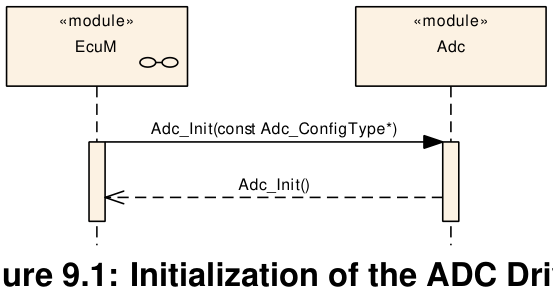

### 8.2. ADC 驱动反初始化

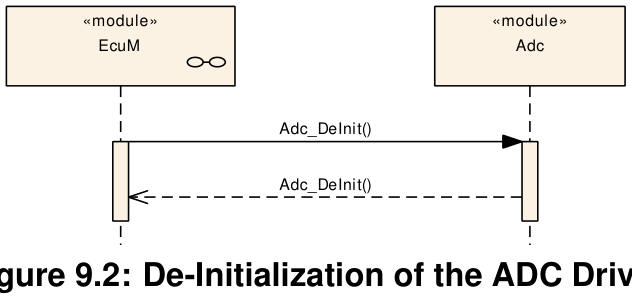

### 8.3. 软件触发的单次转换（无通知）

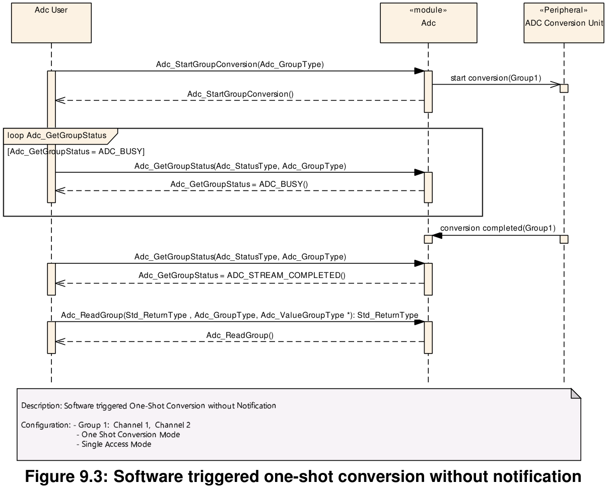

### 8.4. 软件触发的连续转换（有通知）

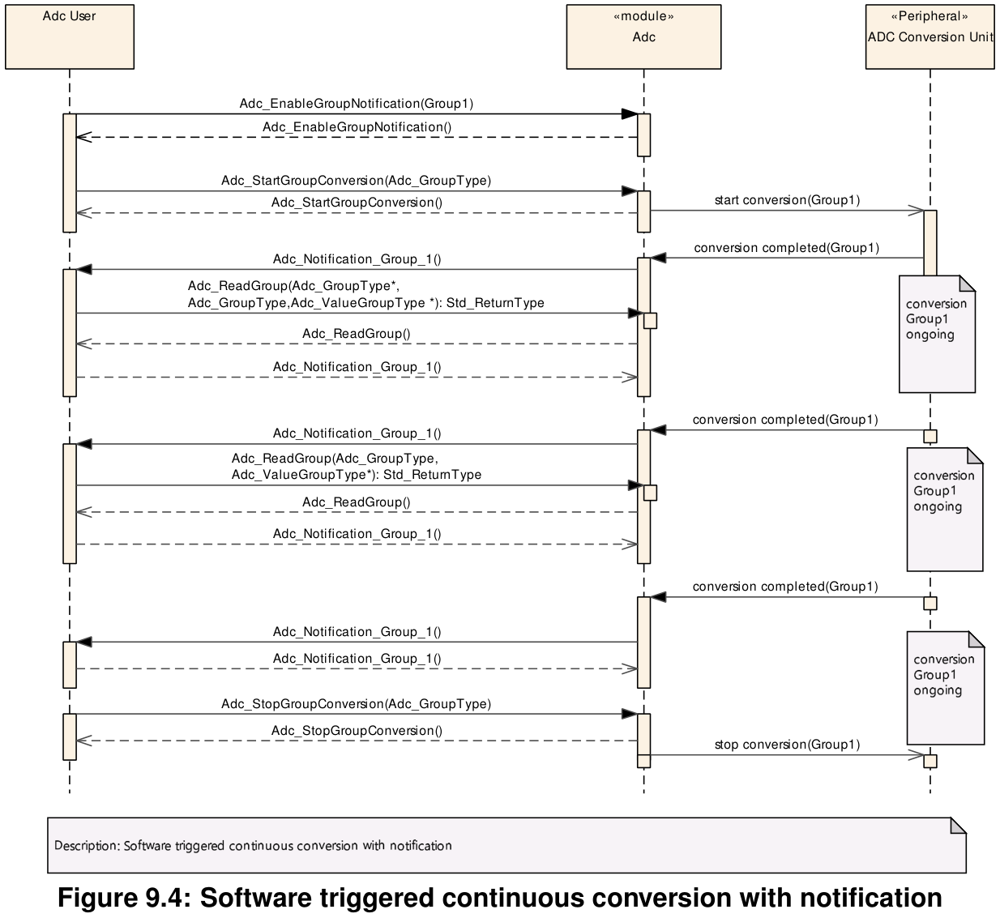

### 8.5. 硬件触发的单次转换（有通知）

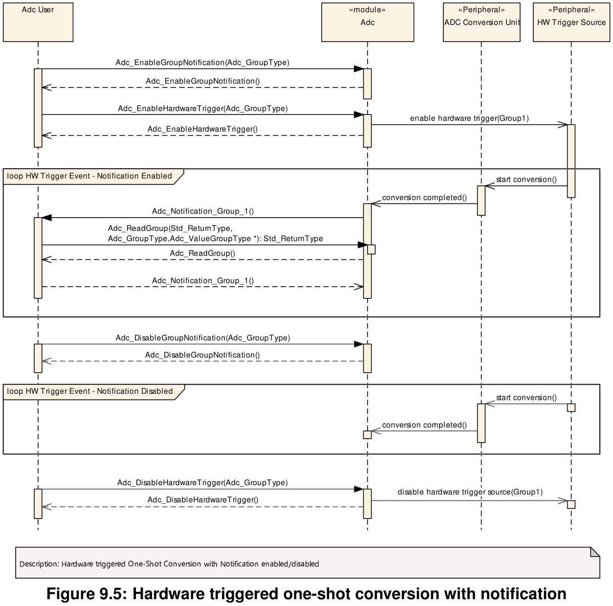

### 8.6. 硬件触发的单次转换——线性流式

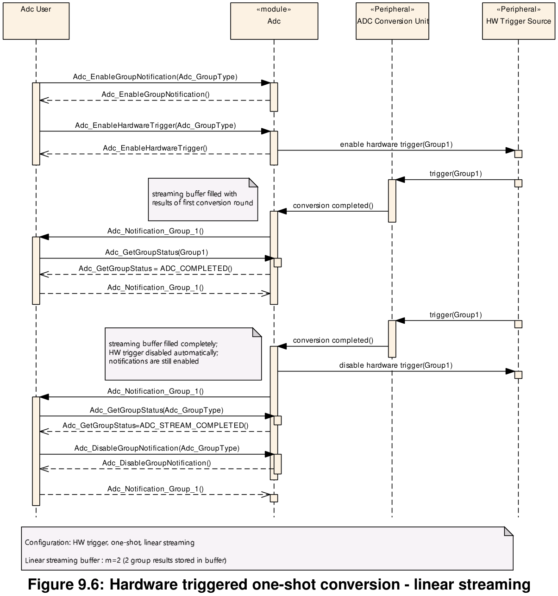

### 8.7. 无优先级机制——无排队

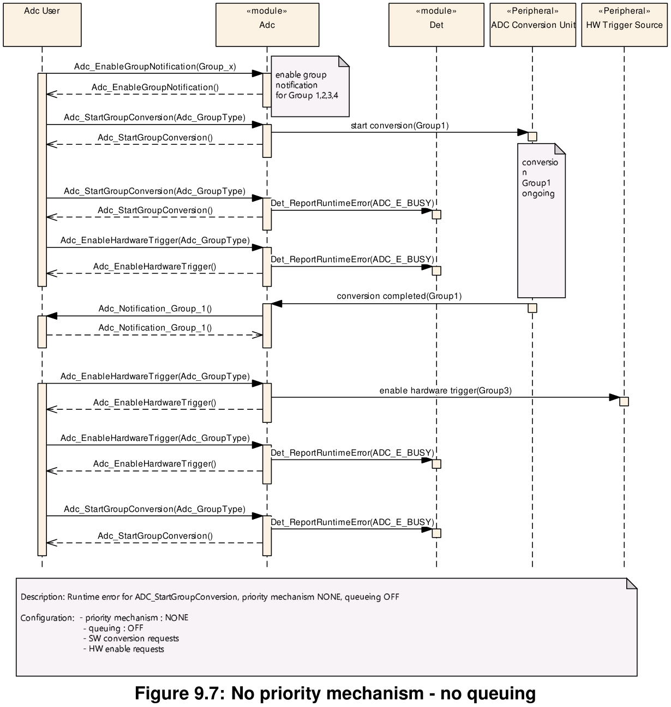

### 8.8. 无优先级机制——软件排队

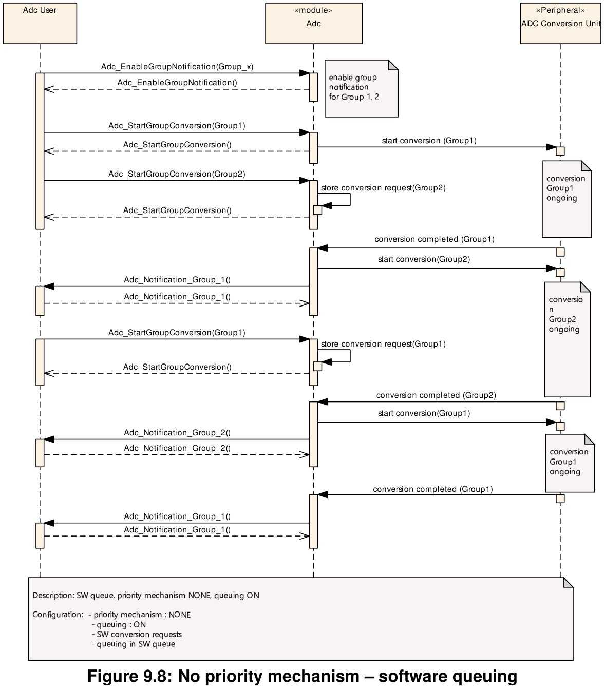

### 8.9. 硬件/软件优先级机制——软件排队

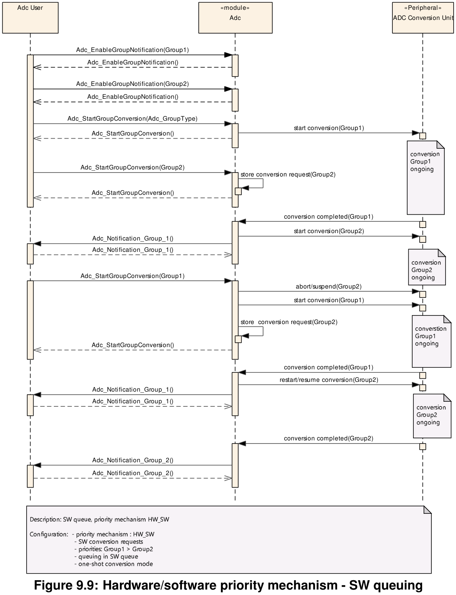

### 8.10. 硬件优先级机制——硬件排队

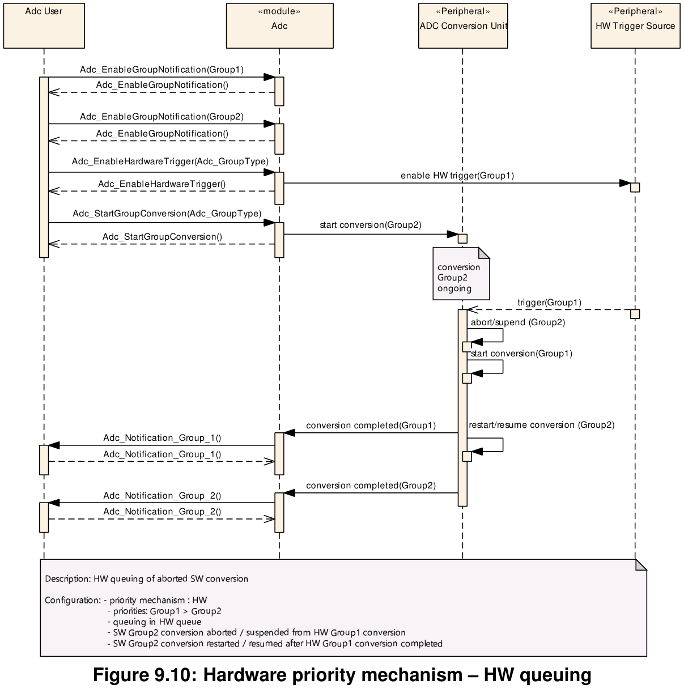

### 8.11. 硬件/软件优先级机制——硬件/软件排队

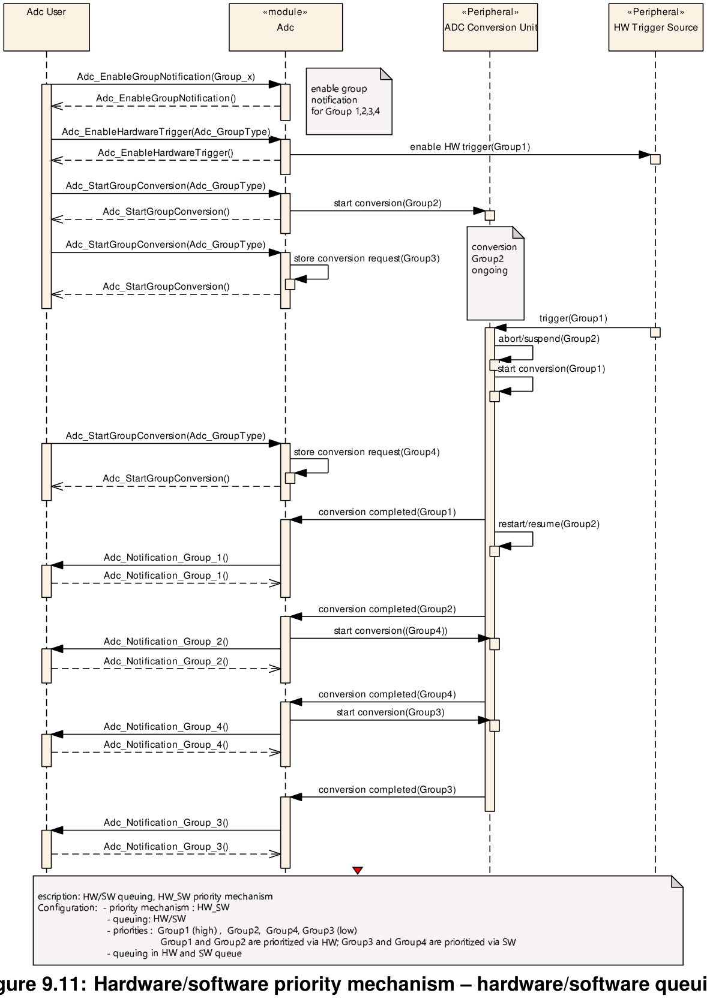

## 9. 配置规范

总体而言，本章定义配置参数及其到**容器**（container）的聚类组织。为支持本规范，第 9.1 章描述相关基础知识，并规定参数规范所应使用的模板（表格）。我们有意将第 9.1 章保留在规范中，以保证可理解性。

第 9.2 章规定**ADC**模块的结构（容器）与参数。

第 9.3 章规定**ADC**模块的发布信息。

第 9.4 章规定符号名的配置。

### 9.1. 如何阅读本章

详情请参阅 SWS_BSWGeneral 中的第 10.1 章 "Introduction to configuration specification"（配置规范导论）。

### 9.2. 容器与配置参数

以下各节汇总所有配置参数。各参数的详细含义见第 6 章和第 7 章。

**ADC** 模块应拒绝实现所不支持的、带有分区映射的配置。

#### 9.2.1. Adc

| SWS 条目 |  |
|---|---|
| 模块名称 | Adc |
| 描述 | **Adc**（**Analog Digital Conversion**，模数转换）模块的配置。 |
| Post-Build 变体支持 | true |
| 支持的配置变体 | VARIANT-POST-BUILD, VARIANT-PRE-COMPILE |

| 容器名称 | 多重性 | 作用域/依赖 |
|---|---|---|
| AdcConfigSet | 1 | 此容器包含 AUTOSAR **Adc** 模块的配置参数与子容器。 |
| AdcGeneral | 1 | **ADC** 驱动软件模块的通用配置（参数）。 |
| AdcPublishedInformation | 1 | 不属于“通用”发布信息的附加发布参数。注意：这些参数具有“PUBLISHED-INFORMATION”配置类设置，因为它们是发布信息。 |

#### 9.2.2. AdcGeneral

| SWS 条目 |  |
|---|---|
| 容器名称 | AdcGeneral |
| 父容器 | Adc |
| 描述 | **ADC** 驱动软件模块的通用配置（参数）。 |
| 配置参数 | 见下方参数表 |

| SWS 条目 |  |
|---|---|
| 参数名称 | AdcDeInitApi |
| 父容器 | AdcGeneral |
| 描述 | 在代码中添加/移除 Adc_DeInit() 服务（true：可以使用 Adc_DeInit()；false：不可使用 Adc_DeInit()）。 |
| 多重性 | 1 |
| 类型 | EcucBooleanParamDef |
| 默认值 | - |
| Post-Build 变体值 | false |
| 值配置类 | Pre-compile time：x（All Variants）；Link time：-；Post-build time：- |
| 作用域/依赖 | scope: local |

| SWS 条目 |  |
|---|---|
| 参数名称 | AdcDevErrorDetect |
| 父容器 | AdcGeneral |
| 描述 | 开启或关闭开发错误检测与通知（true：启用检测与通知；false：禁用检测与通知）。 |
| 多重性 | 1 |
| 类型 | EcucBooleanParamDef |
| 默认值 | false |
| Post-Build 变体值 | false |
| 值配置类 | Pre-compile time：x（All Variants）；Link time：-；Post-build time：- |
| 作用域/依赖 | scope: local |

| SWS 条目 |  |
|---|---|
| 参数名称 | AdcEnableLimitCheck |
| 父容器 | AdcGeneral |
| 描述 | 启用或禁用 **ADC** 驱动中的限值检查功能。 |
| 多重性 | 1 |
| 类型 | EcucBooleanParamDef |
| 默认值 | - |
| Post-Build 变体值 | false |
| 值配置类 | Pre-compile time：x（All Variants）；Link time：-；Post-build time：- |
| 作用域/依赖 | scope: local |

| SWS 条目 |  |
|---|---|
| 参数名称 | AdcEnableQueuing |
| 父容器 | AdcGeneral |
| 描述 | 确定在优先级机制被禁用时排队机制是否生效。**注意：** 若启用优先级机制，则排队机制始终生效，参数 **ADC_ENABLE_QUEUING** 不被评估（true：启用；false：禁用）。 |
| 多重性 | 1 |
| 类型 | EcucBooleanParamDef |
| 默认值 | - |
| Post-Build 变体值 | false |
| 值配置类 | Pre-compile time：x（All Variants）；Link time：-；Post-build time：- |
| 作用域/依赖 | scope: local dependency: AdcPriorityImplementation：仅对优先级实现 **ADC_PRIORITY_NONE** 评估该参数。 |

| SWS 条目 |  |
|---|---|
| 参数名称 | AdcEnableStartStopGroupApi |
| 父容器 | AdcGeneral |
| 描述 | 在代码中添加/移除 Adc_StartGroupConversion() 和 Adc_StopGroupConversion() 服务（true：可以使用这些服务；false：不可使用这些服务）。 |
| 多重性 | 1 |
| 类型 | EcucBooleanParamDef |
| 默认值 | - |
| Post-Build 变体值 | false |
| 值配置类 | Pre-compile time：x（All Variants）；Link time：-；Post-build time：- |
| 作用域/依赖 | scope: local |

| SWS 条目 |  |
|---|---|
| 参数名称 | AdcGrpNotifCapability |
| 父容器 | AdcGeneral |
| 描述 | 确定运行时是否可用组通知机制（用于启用和禁用通知的函数）（true：启用；false：禁用）。 |
| 多重性 | 1 |
| 类型 | EcucBooleanParamDef |
| 默认值 | - |
| Post-Build 变体值 | false |
| 值配置类 | Pre-compile time：x（All Variants）；Link time：-；Post-build time：- |
| 作用域/依赖 | scope: local |

| SWS 条目 |  |
|---|---|
| 参数名称 | AdcHwTriggerApi |
| 父容器 | AdcGeneral |
| 描述 | 在代码中添加/移除 Adc_EnableHardwareTrigger() 和 Adc_DisableHardwareTrigger() 服务（true：可以使用这些服务；false：不可使用这些服务）。 |
| 多重性 | 1 |
| 类型 | EcucBooleanParamDef |
| 默认值 | - |
| Post-Build 变体值 | false |
| 值配置类 | Pre-compile time：x（All Variants）；Link time：-；Post-build time：- |
| 作用域/依赖 | scope: local |

| SWS 条目 |  |
|---|---|
| 参数名称 | AdcLowPowerStatesSupport |
| 父容器 | AdcGeneral |
| 描述 | 在代码中添加/移除所有与电源状态管理相关的 **API**（Adc_SetPowerState、Adc_GetCurrentPowerState、Adc_GetTargetPowerState、Adc_PreparePowerState、Adc_Main_PowerTransitionManager），指示**硬件**是否提供低功耗状态管理。 |
| 多重性 | 0..1 |
| 类型 | EcucBooleanParamDef |
| 默认值 | false |
| Post-Build 变体多重性 | false |
| Post-Build 变体值 | false |
| 多重性配置类 | Pre-compile time：x；Link time：-；Post-build time：- |
| 值配置类 | Pre-compile time：x；Link time：-；Post-build time：- |
| 作用域/依赖 | scope: local |

| SWS 条目 |  |
|---|---|
| 参数名称 | AdcPowerStateAsynchTransitionMode |
| 父容器 | AdcGeneral |
| 描述 | 启用/禁用 **ADC** 驱动对异步电源状态切换的支持。 |
| 多重性 | 0..1 |
| 类型 | EcucBooleanParamDef |
| 默认值 | false |
| Post-Build 变体多重性 | false |
| Post-Build 变体值 | false |
| 多重性配置类 | Pre-compile time：x（All Variants）；Link time：-；Post-build time：- |
| 值配置类 | Pre-compile time：x（All Variants）；Link time：-；Post-build time：- |
| 作用域/依赖 | scope: local dependency: 仅当参数 AdcLowPowerStatesSupport 设置为 true 时才可配置该参数。 |

| SWS 条目 |  |
|---|---|
| 参数名称 | AdcPriorityImplementation |
| 父容器 | AdcGeneral |
| 描述 | 确定是否提供用于对转换请求进行优先化的优先级机制，若提供，则确定优先化机制的类型。该选择适用于触发源为软件和触发源为硬件的组。可选择两种优先化机制。硬件优先化机制（AdcPriorityHw）使用 **ADC** 硬件特性来对软件转换请求以及触发源为硬件的组的硬件触发信号进行优先化。硬件与软件混合优先化机制（AdcPriorityHwSw）使用 **ADC** 硬件特性对触发源为硬件的组的 **ADC** 硬件触发进行优先化，并对触发源为软件的组使用软件实现的优先化机制。软件触发组的组优先级通常配置为低于硬件触发组的组优先级。 |
| 多重性 | 1 |
| 类型 | EcucEnumerationParamDef |
| 范围 | ADC_PRIORITY_HW：仅提供硬件优先化机制；ADC_PRIORITY_HW_SW：提供硬件与软件优先化机制；ADC_PRIORITY_NONE：不提供优先化机制 |
| Post-Build 变体值 | false |
| 值配置类 | Pre-compile time：x（All Variants）；Link time：-；Post-build time：- |
| 作用域/依赖 | scope: local |

| SWS 条目 |  |
|---|---|
| 参数名称 | AdcReadGroupApi |
| 父容器 | AdcGeneral |
| 描述 | 在代码中添加/移除 Adc_ReadGroup() 服务（true：可以使用 Adc_ReadGroup()；false：不可使用 Adc_ReadGroup()）。 |
| 多重性 | 1 |
| 类型 | EcucBooleanParamDef |
| 默认值 | - |
| Post-Build 变体值 | false |
| 值配置类 | Pre-compile time：x（All Variants）；Link time：-；Post-build time：- |
| 作用域/依赖 | scope: local |

| SWS 条目 |  |
|---|---|
| 参数名称 | AdcResultAlignment |
| 父容器 | AdcGeneral |
| 描述 | **ADC** 原始结果在 **ADC** 结果缓冲区中的对齐方式（左对齐/右对齐）。实现类型：**Adc_ResultAlignmentType** |
| 多重性 | 1 |
| 类型 | EcucEnumerationParamDef |
| 范围 | ADC_ALIGN_LEFT：左对齐；ADC_ALIGN_RIGHT：右对齐 |
| Post-Build 变体值 | false |
| 值配置类 | Pre-compile time：x（All Variants）；Link time：-；Post-build time：- |
| 作用域/依赖 | scope: local |

| SWS 条目 |  |
|---|---|
| 参数名称 | AdcVersionInfoApi |
| 父容器 | AdcGeneral |
| 描述 | 在代码中添加/移除 Adc_GetVersionInfo() 服务（true：可以使用 Adc_GetVersionInfo()；false：不可使用 Adc_GetVersionInfo()）。 |
| 多重性 | 1 |
| 类型 | EcucBooleanParamDef |
| 默认值 | false |
| Post-Build 变体值 | false |
| 值配置类 | Pre-compile time：x（All Variants）；Link time：-；Post-build time：- |
| 作用域/依赖 | scope: local |

| SWS 条目 |  |
|---|---|
| 参数名称 | AdcEcucPartitionRef |
| 父容器 | AdcGeneral |
| 描述 | 将 **ADC** 驱动映射到零个或多个 ECUC 分区，以使驱动 API 在相应分区中可用。 |
| 多重性 | 0..* |
| 类型 | 对 EcucPartition 的引用 |
| Post-Build 变体多重性 | true |
| Post-Build 变体值 | true |
| 多重性配置类 | Pre-compile time：x（All Variants）；Link time：-；Post-build time：- |
| 值配置类 | Pre-compile time：x（All Variants）；Link time：-；Post-build time：- |
| 作用域/依赖 | scope: ECU |

| SWS 条目 |  |
|---|---|
| 参数名称 | AdcKernelEcucPartitionRef |
| 父容器 | AdcGeneral |
| 描述 | 将 **ADC** 内核映射到零个或一个 ECUC 分区，以将驱动内核分配到某个特定内核。所引用的 ECUC 分区是 **ADC** 驱动所映射到的 ECUC 分区的子集。 |
| 多重性 | 0..1 |
| 类型 | 对 EcucPartition 的引用 |
| Post-Build 变体多重性 | true |
| Post-Build 变体值 | true |
| 多重性配置类 | Pre-compile time：x；Link time：-；Post-build time：- |
| 值配置类 | Pre-compile time：x；Link time：-；Post-build time：- |
| 作用域/依赖 | scope: ECU |

| 容器名称 | 多重性 | 作用域/依赖 |
|---|---|---|
| AdcPowerStateConfig | 0..* | 每个实例定义一个电源状态，以及达到该电源状态时所要调用的回调。 |

AdcKernelEcucPartitionRef 所引用的 ECUC 分区应是 AdcEcucPartitionRef 所引用的 ECUC 分区的子集。

若 AdcEcucPartitionRef 引用一个或多个 ECUC 分区，则 AdcKernelEcucPartitionRef 的多重性应为一，并且也应引用这些 ECUC 分区之一。

#### 9.2.3. AdcPowerStateConfig

| SWS 条目 |  |
|---|---|
| 容器名称 | AdcPowerStateConfig |
| 父容器 | AdcGeneral |
| 描述 | 每个实例定义一个电源状态，以及达到该电源状态时所要调用的回调。 |
| 配置参数 | 见下方参数表 |

| SWS 条目 |  |
|---|---|
| 参数名称 | AdcPowerState |
| 父容器 | AdcPowerStateConfig |
| 描述 | 每个实例描述 **ADC** **硬件**支持的一种不同电源状态。它应由**硬件**供应商定义，并由 **ADC** 驱动用于引用将 **ADC** **硬件**模块置于所引用电源状态的特定**硬件**配置。至少应始终配置与完整电源状态相对应的电源模式。 |
| 多重性 | 1 |
| 类型 | EcucIntegerParamDef（为此参数生成符号名） |
| 范围 | 0 .. 18446744073709551615 |
| 默认值 | - |
| Post-Build 变体值 | false |
| 值配置类 | Pre-compile time：x（All Variants）；Link time：-；Post-build time：- |
| 作用域/依赖 | scope: local dependency: 仅当参数 AdcLowPowerStatesSupport 设置为 true 时才可配置该参数。 |

| SWS 条目 |  |
|---|---|
| 参数名称 | AdcPowerStateReadyCbkRef |
| 父容器 | AdcPowerStateConfig |
| 描述 | 每个实例包含对在 CDD 或 IoHwAbs 组件中定义的电源模式回调的引用。 |
| 多重性 | 1 |
| 类型 | EcucFunctionNameDef |
| 默认值 | - |
| 正则表达式 | - |
| Post-Build 变体值 | false |
| 值配置类 | Pre-compile time：x（All Variants）；Link time：-；Post-build time：- |
| 作用域/依赖 | scope: local dependency: 仅当参数 AdcLowPowerStatesSupport 设置为 true 时才可配置该参数。 |

无包含的容器。

#### 9.2.4. AdcConfigSet

| SWS 条目 |  |
|---|---|
| 容器名称 | AdcConfigSet |
| 父容器 | Adc |
| 描述 | 此容器包含 AUTOSAR **Adc** 模块的配置参数与子容器。 |
| 配置参数 | 见下方参数表 |

| 容器名称 | 多重性 | 作用域/依赖 |
|---|---|---|
| AdcHwUnit | 1..* | 此容器包含取决于通道分组的驱动配置（参数）。此容器可包含标准模块定义中未定义的**硬件**特定参数。这些参数必须在供应商特定模块定义中添加。 |

#### 9.2.5. AdcGroup

| SWS 条目 |  |
|---|---|
| 容器名称 | AdcGroup |
| 父容器 | AdcHwUnit |
| 描述 | 此容器包含组配置（参数）。 |
| 配置参数 | 见下方参数表 |

| SWS 条目 |  |
|---|---|
| 参数名称 | AdcGroupAccessMode |
| 父容器 | AdcGroup |
| 描述 | 组转换结果的访问模式类型。实现类型：**Adc_GroupAccessModeType** |
| 多重性 | 1 |
| 类型 | EcucEnumerationParamDef |
| 范围 | ADC_ACCESS_MODE_SINGLE：单一值访问模式；ADC_ACCESS_MODE_STREAMING：流式访问模式 |
| Post-Build 变体值 | true |
| 值配置类 | Pre-compile time：x（VARIANT-PRE-COMPILE）；Link time：-；Post-build time：x（VARIANT-POST-BUILD） |
| 作用域/依赖 | scope: local dependency: AdcGroupTriggSrc / AdcGroupConvMode：流式访问模式不适用于软件触发源的单次转换模式。 |

| SWS 条目 |  |
|---|---|
| 参数名称 | AdcGroupConversionMode |
| 父容器 | AdcGroup |
| 描述 | 驱动支持的转换模式类型。实现类型：**Adc_GroupConvModeType** |
| 多重性 | 1 |
| 类型 | EcucEnumerationParamDef |
| 范围 | ADC_CONV_MODE_CONTINUOUS：**ADC** 通道组的转换在软件 **API** 调用（启动）后连续执行。转换本身自动运行（无需额外的软件或硬件触发）；ADC_CONV_MODE_ONESHOT：**ADC** 通道组的转换在触发后执行一次。 |
| Post-Build 变体值 | true |
| 值配置类 | Pre-compile time：x（VARIANT-PRE-COMPILE）；Link time：-；Post-build time：x（VARIANT-POST-BUILD） |
| 作用域/依赖 | scope: local dependency: AdcGroupTriggSrc：连续转换模式仅适用于软件触发的组。 |

| SWS 条目 |  |
|---|---|
| 参数名称 | AdcGroupId |
| 父容器 | AdcGroup |
| 描述 | 组的数字**ID**。该参数是 **API** 上使用的符号名，该符号名允许访问通道组数据。该值将赋给由 AdcGroup 容器短名派生的符号名。实现类型：**Adc_GroupType** |
| 多重性 | 1 |
| 类型 | EcucIntegerParamDef（为此参数生成符号名） |
| 范围 | 0 .. 1023 |
| 默认值 | - |
| Post-Build 变体值 | false |
| 值配置类 | Pre-compile time：x（All Variants）；Link time：-；Post-build time：- |
| 作用域/依赖 | scope: local |

| SWS 条目 |  |
|---|---|
| 参数名称 | AdcGroupPriority |
| 父容器 | AdcGroup |
| 描述 | AdcGroup 的优先级级别。实现类型：**Adc_GroupPriorityType** |
| 多重性 | 0..1 |
| 类型 | EcucIntegerParamDef |
| 范围 | 0 .. 255 |
| 默认值 | - |
| Post-Build 变体多重性 | true |
| Post-Build 变体值 | true |
| 多重性配置类 | Pre-compile time：x（VARIANT-PRE-COMPILE）；Link time：-；Post-build time：x（VARIANT-POST-BUILD） |
| 值配置类 | Pre-compile time：x（VARIANT-PRE-COMPILE）；Link time：-；Post-build time：x（VARIANT-POST-BUILD） |
| 作用域/依赖 | scope: local dependency: ADC_PRIORITY_IMPLEMENTATION |

| SWS 条目 |  |
|---|---|
| 参数名称 | AdcGroupReplacement |
| 父容器 | AdcGroup |
| 描述 | 替换机制，在组转换被更高优先级的组打断时于 **ADC** 组层级使用。实现类型：**Adc_GroupReplacementType** |
| 多重性 | 0..1 |
| 类型 | EcucEnumerationParamDef |
| 范围 | ADC_GROUP_REPL_ABORT_RESTART：若某组被更高优先级的组打断，则在组层级使用中止/重启机制。在更高优先级组的转换完成后，将重新开始被打断组的完整转换轮次（所有组通道）。若该组配置为流式访问模式，则仅丢弃被打断转换轮次的结果。已写入结果缓冲区的先前转换轮次的结果不受影响；ADC_GROUP_REPL_SUSPEND_RESUME：若某组被更高优先级的组打断，则在组层级使用挂起/恢复机制。在更高优先级组的转换完成后，完成被打断组的转换轮次（所有组通道的转换）。若该组配置为流式访问模式，则仅丢弃被打断转换轮次的结果。已写入结果缓冲区的先前转换轮次的结果不受影响。 |
| Post-Build 变体多重性 | true |
| Post-Build 变体值 | true |
| 多重性配置类 | Pre-compile time：x（VARIANT-PRE-COMPILE）；Link time：-；Post-build time：x（VARIANT-POST-BUILD） |
| 值配置类 | Pre-compile time：x（VARIANT-PRE-COMPILE）；Link time：-；Post-build time：x（VARIANT-POST-BUILD） |
| 作用域/依赖 | scope: local |

| SWS 条目 |  |
|---|---|
| 参数名称 | AdcGroupTriggSrc |
| 父容器 | AdcGroup |
| 描述 | 启动组转换的源事件类型。实现类型：**Adc_TriggerSourceType** |
| 多重性 | 1 |
| 类型 | EcucEnumerationParamDef |
| 范围 | ADC_TRIGG_SRC_HW：组由硬件事件触发；ADC_TRIGG_SRC_SW：组由软件 **API** 调用触发。 |
| Post-Build 变体值 | true |
| 值配置类 | Pre-compile time：x（VARIANT-PRE-COMPILE）；Link time：-；Post-build time：x（VARIANT-POST-BUILD） |
| 作用域/依赖 | scope: local dependency: AdcGroupConvMode：硬件触发源不适用于连续转换模式。 |

| SWS 条目 |  |
|---|---|
| 参数名称 | AdcHwTrigSignal |
| 父容器 | AdcGroup |
| 描述 | 配置驱动应响应**硬件**触发信号的哪个边沿（即启动转换）（仅当 **ADC** **硬件**支持时）。实现类型：**Adc_HwTriggerSignalType** |
| 多重性 | 0..1 |
| 类型 | EcucEnumerationParamDef |
| 范围 | ADC_HW_TRIG_BOTH_EDGES：对**硬件**触发信号的两个边沿都响应（仅当 **ADC** **硬件**支持时）；ADC_HW_TRIG_FALLING_EDGE：对**硬件**触发信号的下降沿响应（仅当 **ADC** **硬件**支持时）；ADC_HW_TRIG_RISING_EDGE：对**硬件**触发信号的上升沿响应（仅当 **ADC** **硬件**支持时）。 |
| Post-Build 变体多重性 | true |
| Post-Build 变体值 | true |
| 多重性配置类 | Pre-compile time：x（VARIANT-PRE-COMPILE）；Link time：-；Post-build time：x（VARIANT-POST-BUILD） |
| 值配置类 | Pre-compile time：x（VARIANT-PRE-COMPILE）；Link time：-；Post-build time：x（VARIANT-POST-BUILD） |
| 作用域/依赖 | scope: local dependency: AdcTriggSrcHw：仅当该组配置为由硬件事件触发时有效。 |

| SWS 条目 |  |
|---|---|
| 参数名称 | AdcHwTrigTimer |
| 父容器 | AdcGroup |
| 描述 | **ADC** 模块内嵌定时器的重装值（仅当 **ADC** **硬件**支持时）。实现类型：**Adc_HwTriggerTimerType** |
| 多重性 | 0..1 |
| 类型 | EcucIntegerParamDef |
| 范围 | 0 .. 18446744073709551615 |
| 默认值 | - |
| Post-Build 变体多重性 | true |
| Post-Build 变体值 | true |
| 多重性配置类 | Pre-compile time：x（VARIANT-PRE-COMPILE）；Link time：-；Post-build time：x（VARIANT-POST-BUILD） |
| 值配置类 | Pre-compile time：x（VARIANT-PRE-COMPILE）；Link time：-；Post-build time：x（VARIANT-POST-BUILD） |
| 作用域/依赖 | scope: local dependency: AdcTriggSrcHw：仅当该组配置为由硬件事件触发时有效。 |

| SWS 条目 |  |
|---|---|
| 参数名称 | AdcNotification |
| 父容器 | AdcGroup |
| 描述 | 每个组的回调函数。 |
| 多重性 | 0..1 |
| 类型 | EcucFunctionNameDef |
| 默认值 | - |
| 正则表达式 | - |
| Post-Build 变体多重性 | true |
| Post-Build 变体值 | true |
| 多重性配置类 | Pre-compile time：x（VARIANT-PRE-COMPILE）；Link time：-；Post-build time：x（VARIANT-POST-BUILD） |
| 值配置类 | Pre-compile time：x（VARIANT-PRE-COMPILE）；Link time：-；Post-build time：x（VARIANT-POST-BUILD） |
| 作用域/依赖 | scope: local dependency: 仅在配置了通知能力时该参数才可用。 |

| SWS 条目 |  |
|---|---|
| 参数名称 | AdcStreamingBufferMode |
| 父容器 | AdcGroup |
| 描述 | 将流式缓冲区配置为“线性缓冲区”（即 **ADC** 驱动在流式缓冲区填满后立即停止转换）或“环形缓冲区”（到达流式缓冲区末尾时回绕）。实现类型：**Adc_StreamBufferModeType** |
| 多重性 | 1 |
| 类型 | EcucEnumerationParamDef |
| 范围 | ADC_STREAM_BUFFER_CIRCULAR：即使流式缓冲区已满（已达到样本数），**ADC** 驱动仍继续转换，通过流式缓冲区自身回绕；ADC_STREAM_BUFFER_LINEAR：流式缓冲区一满（已达到样本数），**ADC** 驱动即停止转换。 |
| Post-Build 变体值 | true |
| 值配置类 | Pre-compile time：x（VARIANT-PRE-COMPILE）；Link time：-；Post-build time：x（VARIANT-POST-BUILD） |
| 作用域/依赖 | scope: local dependency: AdcGroupAccessMode：仅对流式访问模式有效。 |

| SWS 条目 |  |
|---|---|
| 参数名称 | AdcStreamingNumSamples |
| 父容器 | AdcGroup |
| 描述 | 流式访问模式下每通道要采集的 **ADC** 值数量。**注意：** 在单一访问模式下该参数取值为 1，因为每通道仅处理一个样本。实现类型：**Adc_StreamNumSampleType** |
| 多重性 | 1 |
| 类型 | EcucIntegerParamDef |
| 范围 | 1 .. 255 |
| 默认值 | 1 |
| Post-Build 变体值 | true |
| 值配置类 | Pre-compile time：x（VARIANT-PRE-COMPILE）；Link time：-；Post-build time：x（VARIANT-POST-BUILD） |
| 作用域/依赖 | scope: local dependency: AdcGroupAccessMode：仅对流式访问模式有效。在单一访问模式下该参数取值为 1，因为每通道仅处理一个样本。 |

| SWS 条目 |  |
|---|---|
| 参数名称 | AdcGroupDefinition |
| 父容器 | AdcGroup |
| 描述 | **ADC** 通道到 **ADC** 组的分配。实现类型：**Adc_GroupDefType** |
| 多重性 | 1..* |
| 类型 | 对 AdcChannel 的引用 |
| Post-Build 变体多重性 | true |
| Post-Build 变体值 | true |
| 多重性配置类 | Pre-compile time：x（VARIANT-PRE-COMPILE）；Link time：-；Post-build time：x（VARIANT-POST-BUILD） |
| 值配置类 | Pre-compile time：x（VARIANT-PRE-COMPILE）；Link time：-；Post-build time：x（VARIANT-POST-BUILD） |
| 作用域/依赖 | scope: local |

| SWS 条目 |  |
|---|---|
| 参数名称 | AdcGroupEcucPartitionRef |
| 父容器 | AdcGroup |
| 描述 | 将一个 **ADC** 通道组映射到零个或多个 ECUC 分区，以限制对该通道组的访问。所引用的 ECUC 分区是 **ADC** 驱动所映射到的 ECUC 分区的子集。 |
| 多重性 | 0..* |
| 类型 | 对 EcucPartition 的引用 |
| Post-Build 变体多重性 | true |
| Post-Build 变体值 | true |
| 多重性配置类 | Pre-compile time：x（All Variants）；Link time：-；Post-build time：- |
| 值配置类 | Pre-compile time：x（All Variants）；Link time：-；Post-build time：- |
| 作用域/依赖 | scope: ECU |

无包含的容器。

一个组的所有通道共享相同的组配置（通道可具有不同的通道特定配置）。

#### 9.2.6. AdcChannel

| SWS 条目 |  |
|---|---|
| 容器名称 | AdcChannel |
| 父容器 | AdcHwUnit |
| 描述 | 此容器包含取决于**硬件**能力的通道配置（参数）。该数据结构的组织方式可能包含对微控制器的依赖，因此这留给实现者决定，其位置也留给配置决定。**注意：** 由于一个 **AdcChannel** 可以是多个 **AdcGroup** 的组成部分，因此该容器不作为 AdcGroup 的子容器实现，而是作为 AdcHwUnit 的子容器。 |
| 配置参数 | 见下方参数表 |

| SWS 条目 |  |
|---|---|
| 参数名称 | AdcChannelConvTime |
| 父容器 | AdcChannel |
| 描述 | 转换时间的配置，即每个通道中将模拟值转换为数字表示所需的时间（以时钟周期计），若**硬件**支持。实现类型：**Adc_ConversionTimeType** |
| 多重性 | 0..1 |
| 类型 | EcucIntegerParamDef |
| 范围 | 0 .. 18446744073709551615 |
| 默认值 | - |
| Post-Build 变体多重性 | true |
| Post-Build 变体值 | true |
| 多重性配置类 | Pre-compile time：x（VARIANT-PRE-COMPILE）；Link time：-；Post-build time：x（VARIANT-POST-BUILD） |
| 值配置类 | Pre-compile time：x（VARIANT-PRE-COMPILE）；Link time：-；Post-build time：x（VARIANT-POST-BUILD） |
| 作用域/依赖 | scope: local |

| SWS 条目 |  |
|---|---|
| 参数名称 | AdcChannelHighLimit |
| 父容器 | AdcChannel |
| 描述 | 高限值——用于限值检查。 |
| 多重性 | 0..1 |
| 类型 | EcucIntegerParamDef |
| 范围 | 0 .. 18446744073709551615 |
| 默认值 | - |
| Post-Build 变体多重性 | false |
| Post-Build 变体值 | false |
| 多重性配置类 | Pre-compile time：x；Link time：-；Post-build time：- |
| 值配置类 | Pre-compile time：x；Link time：-；Post-build time：- |
| 作用域/依赖 | scope: local dependency: AdcEnableLimitCheck：若未全局启用限值检查，则不可用。AdcChannelLimitCheck：若未启用通道特定限值检查，则不可用。AdcChannelLowLimit：应大于或等于 AdcChannelLowLimit。 |

| SWS 条目 |  |
|---|---|
| 参数名称 | AdcChannelId |
| 父容器 | AdcChannel |
| 描述 | 该参数定义通道到物理 **ADC** **硬件**通道的分配。实现类型：**Adc_ChannelType** |
| 多重性 | 1 |
| 类型 | EcucIntegerParamDef |
| 范围 | 0 .. 1024 |
| 默认值 | - |
| Post-Build 变体值 | true |
| 值配置类 | Pre-compile time：x（VARIANT-PRE-COMPILE）；Link time：-；Post-build time：x（VARIANT-POST-BUILD） |
| 作用域/依赖 | scope: local |

| SWS 条目 |  |
|---|---|
| 参数名称 | AdcChannelLimitCheck |
| 父容器 | AdcChannel |
| 描述 | 启用或禁用某个 **ADC** 通道的限值检查。 |
| 多重性 | 0..1 |
| 类型 | EcucBooleanParamDef |
| 默认值 | - |
| Post-Build 变体多重性 | false |
| Post-Build 变体值 | false |
| 多重性配置类 | Pre-compile time：x；Link time：-；Post-build time：- |
| 值配置类 | Pre-compile time：x；Link time：-；Post-build time：- |
| 作用域/依赖 | scope: local dependency: AdcEnableLimitCheck：若未全局启用限值检查，则不可用。AdcGroupDefinition：启用了限值检查功能的 **ADC** 通道必须分配到恰好由一个启用限值检查的 **ADC** 通道组成的 **ADC** 组。 |

| SWS 条目 |  |
|---|---|
| 参数名称 | AdcChannelLowLimit |
| 父容器 | AdcChannel |
| 描述 | 低限值——用于限值检查。 |
| 多重性 | 0..1 |
| 类型 | EcucIntegerParamDef |
| 范围 | 0 .. 18446744073709551615 |
| 默认值 | - |
| Post-Build 变体多重性 | false |
| Post-Build 变体值 | false |
| 多重性配置类 | Pre-compile time：x；Link time：-；Post-build time：- |
| 值配置类 | Pre-compile time：x；Link time：-；Post-build time：- |
| 作用域/依赖 | scope: local dependency: AdcEnableLimitCheck：若未全局启用限值检查，则不可用。AdcChannelLimitCheck：若未启用通道特定限值检查，则不可用。AdcChannelHighLimit：应小于或等于 AdcChannelHighLimit。 |

| SWS 条目 |  |
|---|---|
| 参数名称 | AdcChannelRangeSelect |
| 父容器 | AdcChannel |
| 描述 | 在限值检查激活时：定义要考虑哪些转换值，范围由 AdcChannelLowLimit 和 AdcChannelHighLimit 界定。实现类型：**Adc_ChannelRangeSelectType** |
| 多重性 | 0..1 |
| 类型 | EcucEnumerationParamDef |
| 范围 | ADC_RANGE_ALWAYS：完整范围——与通道限值设置无关；ADC_RANGE_BETWEEN：低限值与高限值之间的范围——包含高限值；ADC_RANGE_NOT_BETWEEN：高限值之上或低限值之下的范围——包含低限值；ADC_RANGE_NOT_OVER_HIGH：高限值之下的范围——包含高限值；ADC_RANGE_NOT_UNDER_LOW：低限值之上的范围；ADC_RANGE_OVER_HIGH：高限值之上的范围；ADC_RANGE_UNDER_LOW：限值之下的范围——包含低限值。 |
| Post-Build 变体多重性 | false |
| Post-Build 变体值 | false |
| 多重性配置类 | Pre-compile time：x（All Variants）；Link time：-；Post-build time：- |
| 值配置类 | Pre-compile time：x（All Variants）；Link time：-；Post-build time：- |
| 作用域/依赖 | scope: local dependency: AdcEnableLimitCheck：若未全局启用限值检查，则不可用。AdcChannelLimitCheck：若未启用通道特定限值检查，则不可用。 |

| SWS 条目 |  |
|---|---|
| 参数名称 | AdcChannelRefVoltsrcHigh |
| 父容器 | AdcChannel |
| 描述 | 每个通道的上参考电压源。枚举字面量由供应商具体定义。 |
| 多重性 | 0..1 |
| 类型 | EcucEnumerationParamDef |
| 范围 | - |
| Post-Build 变体多重性 | true |
| Post-Build 变体值 | true |
| 多重性配置类 | Pre-compile time：x（VARIANT-PRE-COMPILE）；Link time：-；Post-build time：x（VARIANT-POST-BUILD） |
| 值配置类 | Pre-compile time：x（VARIANT-PRE-COMPILE）；Link time：-；Post-build time：x（VARIANT-POST-BUILD） |
| 作用域/依赖 | scope: local |

| SWS 条目 |  |
|---|---|
| 参数名称 | AdcChannelRefVoltsrcLow |
| 父容器 | AdcChannel |
| 描述 | 每个通道的下参考电压源。枚举字面量由供应商具体定义。 |
| 多重性 | 0..1 |
| 类型 | EcucEnumerationParamDef |
| 范围 | - |
| Post-Build 变体多重性 | true |
| Post-Build 变体值 | true |
| 多重性配置类 | Pre-compile time：x（VARIANT-PRE-COMPILE）；Link time：-；Post-build time：x（VARIANT-POST-BUILD） |
| 值配置类 | Pre-compile time：x（VARIANT-PRE-COMPILE）；Link time：-；Post-build time：x（VARIANT-POST-BUILD） |
| 作用域/依赖 | scope: local |

| SWS 条目 |  |
|---|---|
| 参数名称 | AdcChannelResolution |
| 父容器 | AdcChannel |
| 描述 | 通道分辨率（以位为单位）。实现类型：**Adc_ResolutionType** |
| 多重性 | 0..1 |
| 类型 | EcucIntegerParamDef |
| 范围 | 1 .. 63 |
| 默认值 | - |
| Post-Build 变体多重性 | true |
| Post-Build 变体值 | true |
| 多重性配置类 | Pre-compile time：x（VARIANT-PRE-COMPILE）；Link time：-；Post-build time：x（VARIANT-POST-BUILD） |
| 值配置类 | Pre-compile time：x（VARIANT-PRE-COMPILE）；Link time：-；Post-build time：x（VARIANT-POST-BUILD） |
| 作用域/依赖 | scope: local dependency: AdcMaxChannelResolution：实际分辨率应小于或等于最大分辨率。 |

| SWS 条目 |  |
|---|---|
| 参数名称 | AdcChannelSampTime |
| 父容器 | AdcChannel |
| 描述 | 采样时间的配置，即每个通道中对值进行采样所需的时间（以时钟周期计），若**硬件**支持。实现类型：**Adc_SamplingTimeType** |
| 多重性 | 0..1 |
| 类型 | EcucIntegerParamDef |
| 范围 | 0 .. 18446744073709551615 |
| 默认值 | - |
| Post-Build 变体多重性 | true |
| Post-Build 变体值 | true |
| 多重性配置类 | Pre-compile time：x（VARIANT-PRE-COMPILE）；Link time：-；Post-build time：x（VARIANT-POST-BUILD） |
| 值配置类 | Pre-compile time：x（VARIANT-PRE-COMPILE）；Link time：-；Post-build time：x（VARIANT-POST-BUILD） |
| 作用域/依赖 | scope: local |

#### 9.2.7. AdcHwUnit

| SWS 条目 |  |
|---|---|
| 容器名称 | AdcHwUnit |
| 父容器 | AdcConfigSet |
| 描述 | 此容器包含取决于通道分组的驱动配置（参数）。此容器可包含标准模块定义中未定义的**硬件**特定参数。这些参数必须在供应商特定模块定义中添加。 |
| 配置参数 | 见下方参数表 |

| SWS 条目 |  |
|---|---|
| 参数名称 | AdcClockSource |
| 父容器 | AdcHwUnit |
| 描述 | 可静态配置转换单元的 **ADC** 模块特定时钟输入，以在**硬件**提供时选择不同的时钟源。枚举字面量由供应商具体定义。 |
| 多重性 | 0..1 |
| 类型 | EcucEnumerationParamDef |
| 范围 | - |
| Post-Build 变体多重性 | true |
| Post-Build 变体值 | true |
| 多重性配置类 | Pre-compile time：x（VARIANT-PRE-COMPILE）；Link time：-；Post-build time：x（VARIANT-POST-BUILD） |
| 值配置类 | Pre-compile time：x（VARIANT-PRE-COMPILE）；Link time：-；Post-build time：x（VARIANT-POST-BUILD） |
| 作用域/依赖 | scope: local |

| SWS 条目 |  |
|---|---|
| 参数名称 | AdcHwUnitId |
| 父容器 | AdcHwUnit |
| 描述 | **描述：** **HW Unit** 的数字**ID**。该符号名允许访问 **HW Unit** 数据。枚举字面量由供应商具体定义。 |
| 多重性 | 1 |
| 类型 | EcucEnumerationParamDef |
| 范围 | - |
| Post-Build 变体值 | true |
| 值配置类 | Pre-compile time：x（VARIANT-PRE-COMPILE）；Link time：-；Post-build time：x（VARIANT-POST-BUILD） |
| 作用域/依赖 | scope: local |

| SWS 条目 |  |
|---|---|
| 参数名称 | AdcPrescale |
| 父容器 | AdcHwUnit |
| 描述 | 可选的 **ADC** 模块特定时钟预分频因子，若**硬件**支持。实现类型：**Adc_PrescaleType** |
| 多重性 | 0..1 |
| 类型 | EcucIntegerParamDef |
| 范围 | 0 .. 65535 |
| 默认值 | - |
| Post-Build 变体多重性 | true |
| Post-Build 变体值 | true |
| 多重性配置类 | Pre-compile time：x（VARIANT-PRE-COMPILE）；Link time：-；Post-build time：x（VARIANT-POST-BUILD） |
| 值配置类 | Pre-compile time：x（VARIANT-PRE-COMPILE）；Link time：-；Post-build time：x（VARIANT-POST-BUILD） |
| 作用域/依赖 | scope: local |

| 容器名称 | 多重性 | 作用域/依赖 |
|---|---|---|
| AdcChannel | 1..* | 此容器包含取决于**硬件**能力的通道配置（参数）。 |
| AdcGroup | 1..* | 此容器包含组配置（参数）。 |

**ADC** 驱动应支持一个或多个同类型的 **ADC** **HW Unit**。**ADC HW Unit** 的选择通过配置容器 AdcHwUnit 完成。

### 9.3. 发布信息

详情请参阅 SWS_BSWGeneral 中的第 10.3 章 "Published Information"（发布信息）。

#### 9.3.1. AdcPublishedInformation

| SWS 条目 |  |
|---|---|
| 容器名称 | AdcPublishedInformation |
| 父容器 | Adc |
| 描述 | 不属于“通用”发布信息的附加发布参数。注意：这些参数具有“PUBLISHED-INFORMATION”配置类设置，因为它们是发布信息。 |
| 配置参数 | 见下方参数表 |

| SWS 条目 |  |
|---|---|
| 参数名称 | AdcChannelValueSigned |
| 父容器 | AdcPublishedInformation |
| 描述 | **ADC** 驱动的结果值是否带符号信息的信息（true 带符号，false 不带符号）。若结果应解释为有符号值，则应适用 C 语言规则。 |
| 多重性 | 1 |
| 类型 | EcucBooleanParamDef |
| 默认值 | - |
| Post-Build 变体值 | false |
| 值配置类 | Published Information：x（All Variants） |
| 作用域/依赖 | scope: local |

| SWS 条目 |  |
|---|---|
| 参数名称 | AdcGroupFirstChannelFixed |
| 父容器 | AdcPublishedInformation |
| 描述 | **ADC** 通道组的首个通道是否可配置（false），或固定（true）为由 **ADC** **HW Unit** 确定的值。 |
| 多重性 | 1 |
| 类型 | EcucBooleanParamDef |
| 默认值 | - |
| Post-Build 变体值 | false |
| 值配置类 | Published Information：x（All Variants） |
| 作用域/依赖 | scope: local |

| SWS 条目 |  |
|---|---|
| 参数名称 | AdcMaxChannelResolution |
| 父容器 | AdcPublishedInformation |
| 描述 | 最大通道分辨率（以位为单位，不表示精度）。 |
| 多重性 | 1 |
| 类型 | EcucIntegerParamDef |
| 范围 | 1 .. 63 |
| 默认值 | - |
| Post-Build 变体值 | false |
| 值配置类 | Published Information：x（All Variants） |
| 作用域/依赖 | scope: local |

无包含的容器。

### 9.4. 符号名的配置

供上层使用的 **ADC** 通道和 **ADC** 通道组的符号名应由配置器定义。它们应在模块的配置头文件中定义。

<section id="wechat">

<h4>微信扫一扫，获取更多及时资讯</h4>


</section>
