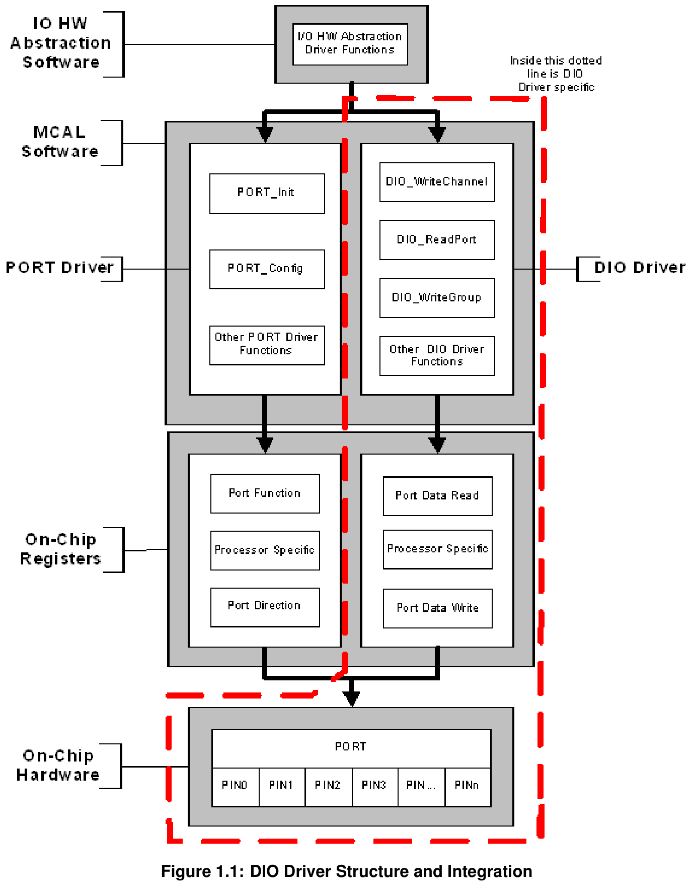
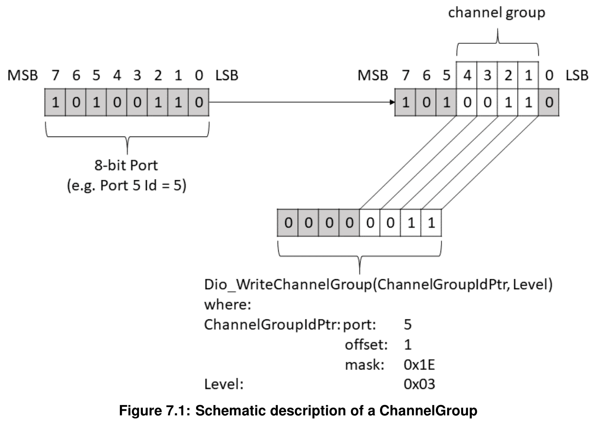
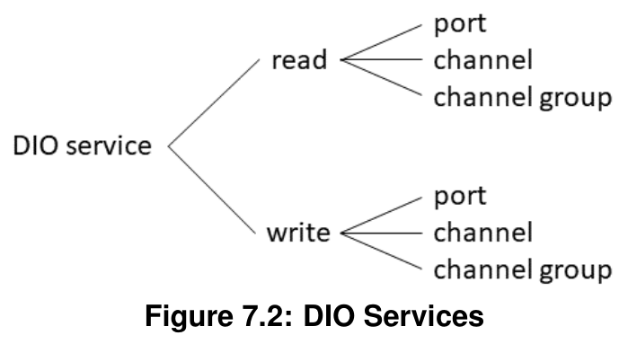

## 1. 简介和功能概述

本规范规定了**AUTOSAR**基础软件模块**DIO**驱动程序的功能、**API**和配置。

本规范仅适用于片上**DIO**引脚和端口的驱动程序。

**DIO**驱动程序提供从/向以下对象读取和写入数据的服务：

* **DIO**通道（引脚）
* **DIO**端口
* **DIO**通道组

这些服务的行为是同步的。

本模块作用于由**PORT**驱动程序为此目的配置的引脚和端口。因此，**DIO**驱动程序中不存在对此端口结构的配置和初始化。

下图标识了**DIO**驱动程序的功能，以及**PORT**驱动程序和**DIO**驱动程序在**MCAL**软件层中的结构。



## 2. 缩略语

下表包含了与**DIO**驱动程序模块相关、且未包含在[1] AUTOSAR术语表中的缩略语和缩写。

| 缩写/首字母缩写 | 描述 |
|---|---|
| DIO channel | 表示单个通用数字输入/输出引脚 |
| DIO port | 表示由硬件分组在一起的多个**DIO**通道（通常由一个硬件寄存器控制）。示例：Freescale HC08 的 Port A（8 位） |
| DIO channel group | 表示由逻辑组表示的多个相邻**DIO**通道。一个**DIO**通道组应属于一个**DIO**端口。示例：8 位端口中寻址复用器的端口引脚 2..6 |
| Physical Level (Input) | 两种可能的状态：**LOW** / **HIGH**。位值'0'表示**LOW**，位值'1'表示**HIGH**。 |
| Physical Level (Output) | 两种可能的状态：**LOW** / **HIGH**。位值'0'表示**LOW**，位值'1'表示**HIGH**。 |
| LSB | 最低有效位（Least Significant Bit） |
| MSB | 最高有效位（Most Significant Bit） |
| DIO | 数字输入输出（Digital Input Output） |
| ID | 标识符（Identifier） |
| ADC | 模数转换器（Analog to Digital Converter） |
| SPI | 串行外设接口（Serial Peripheral Interface） |
| PWM | 脉冲宽度调制（Pulse Width Modulation） |
| ICU | 输入捕获单元（Input Capture Unit） |
| DET | 默认错误跟踪器（Default Error Tracer） |
| DEM | 诊断事件管理器（Diagnostic Event Manager） |

## 3. 相关文档

### 3.1. 输入文件

[1] Glossary
AUTOSAR_FO_TR_Glossary

[2] General Specification of Basic Software Modules
AUTOSAR_CP_SWS_BSWGeneral

### 3.2. 相关规范

**AUTOSAR**提供了基础软件模块通用规范[2]（**SWS BSW General**），该规范同样适用于**DIO**驱动程序。

因此，**SWS BSW General**规范应被视为**DIO**驱动程序的附加必需规范。

## 4. 约束和假设

### 4.1. 限制

无限制。

### 4.2. 适用于汽车领域

无限制。

## 5. 对其他模块的依赖

### 5.1. Port Driver模块

许多端口和端口引脚被**PORT**驱动程序模块分配给各种功能，例如：

* 通用**I/O**
* **ADC**
* **SPI**
* **PWM**

**Dio**模块不应为**Dio**模块中使用的端口结构提供整体配置和初始化的**API**。这些操作由**PORT**驱动程序模块完成。

**Dio**模块应使其配置和使用适配于微控制器和**ECU**。

**Dio**模块的用户只允许在**Port**驱动程序初始化之后使用**Dio**函数。否则**Dio**模块将表现出未定义的行为。

### 5.2. DET（默认错误跟踪器）

如果启用了开发错误（**DET**）检测，则**Dio.c**应包含**Det.h**。

## 6. 功能规格

### 6.1. 一般行为

#### 6.1.1. 背景与原理

**DIO**驱动程序抽象对微控制器硬件引脚的访问。此外，它还允许对这些引脚进行分组。

#### 6.1.2. 需求

**DIO SWS**应定义允许基于以下方式对内部通用**I/O**端口进行读写访问的函数：

* 基于端口（Port-）
* 基于通道（Channel-）
* 基于通道组（Channel-group-）

**Dio**模块在提供读写服务时不应缓冲数据。**DIO SWS**应定义同步的读/写服务。

**Dio**模块的读写服务应为所有服务确保数据一致（不允许可中断的读-修改-写序列）。

**DIO**驱动程序用于表示通道软件电平的值只能是**STD_HIGH**或**STD_LOW**。

通用数字**IO**引脚表示一个**DIO**通道。

**Port**模块应将**DIO**通道配置为输入或输出。

在**DIO**驱动程序中，应可以将多个**DIO**通道按硬件分组（通常由一个硬件寄存器控制）以表示一个**DIO**端口。

注意：**DIO**端口内的单个**DIO**通道电平根据其在端口内的位置表示**DIO**端口值中的一个位。

通道组是**DIO**端口内多个相邻**DIO**通道的形式上的逻辑组合。



**DIO**驱动程序提供以下服务：

* **DIO SWS**应定义函数以单独地、针对端口或针对通道组修改输出通道的电平。
* **DIO SWS**应定义函数以单独地、针对端口或针对通道组读取输入和输出通道的电平。



**Dio**模块的所有读写函数应是可重入的。原因：**DIO**驱动程序可能被不同的上层处理程序或驱动程序访问。这些上层模块可能并发访问该驱动程序。

**Dio**模块的配置过程应为每个配置的**DIO**通道、端口和组提供符号名称。

### 6.2. 初始化

#### 6.2.1. 背景与原理

硬件的初始化由**PORT**驱动程序完成。

#### 6.2.2. 需求

**Dio**模块不应提供硬件初始化的接口。这由**Port**驱动程序执行。

### 6.3. 运行时重配置

#### 6.3.1. 背景与原理

运行时重配置由**PORT**驱动程序提供。

#### 6.3.2. 需求

**PORT**驱动程序应提供端口引脚方向在运行时的重配置。

### 6.4. DIO 写服务

#### 6.4.1. 背景与原理

**DIO**驱动程序提供服务以向微控制器的引脚传输数据。

#### 6.4.2. 需求

**Dio**模块的写函数应作用于输入和输出通道。

如果在输入通道上使用**Dio**写函数，其不应对物理输出电平产生影响。

如果硬件支持，**Dio**模块应设置/清除输入通道的输出数据锁存器，以便当端口驱动程序将该引脚配置为**DIO**输出引脚时，引脚输出所需的电平。

如果启用了开发错误检测且发生了错误，**Dio**模块的写函数不应处理写命令。

##### 6.4.2.1. DIO 通道写服务

**Dio_WriteChannel**函数应将单个**DIO**通道的电平设置为**STD_HIGH**或**STD_LOW**。

##### 6.4.2.2. DIO 端口写服务

**Dio_WritePort**函数应同时设置所有输出通道的电平。位值'0'将相应通道设置为物理**STD_LOW**，位值'1'将相应通道设置为物理**STD_HIGH**。

**Dio_WritePort**函数应确保该端口输入通道的功能不受影响。

##### 6.4.2.3. DIO 通道组写服务

**Dio_WriteChannelGroup**函数应同时设置相邻的**DIO**通道子集（通道组）的电平。位值'0'将相应通道设置为物理**STD_LOW**，位值'1'将相应通道设置为物理**STD_HIGH**。

##### 6.4.2.4. DIO 掩码端口写服务

**Dio_MaskedWritePort**函数应同时设置所选输出通道的电平。

**Mask**参数指定选择哪些位：位值'0'表示未选择相应通道，位值'1'表示选择了相应通道。

**Level**参数指定物理电平：位值'0'将相应通道设置为物理**STD_LOW**，位值'1'将相应通道设置为物理**STD_HIGH**。

**Dio_MaskedWritePort**函数应确保该端口输入通道的功能不受影响。

### 6.5. DIO 读服务

#### 6.5.1. 背景与原理

**DIO**驱动程序提供服务以从微控制器的引脚传输数据。

#### 6.5.2. 需求

**Dio**模块的读函数应作用于输入和输出通道。

##### 6.5.2.1. DIO 通道读服务

**Dio_ReadChannel**函数应读取单个**DIO**通道的电平。

##### 6.5.2.2. DIO 端口读服务

**Dio_ReadPort**函数应读取一个端口的所有通道的电平。位值'0'表示相应通道为物理**STD_LOW**，位值'1'表示相应通道为物理**STD_HIGH**。

##### 6.5.2.3. DIO 通道组读服务

**Dio_ReadChannelGroup**函数应读取一个**DIO**通道组的电平。位值'0'表示相应通道为物理**STD_LOW**，位值'1'表示相应通道为物理**STD_HIGH**。

##### 6.5.2.4. 输出引脚的回读

如果微控制器支持引脚值的直接回读，当读函数作用于配置为输出通道的通道时，**Dio**模块的读函数应提供真实引脚电平。

如果微控制器不支持引脚值的直接回读，当读函数作用于配置为输出通道的通道时，**Dio**模块的读函数应提供输出寄存器的值。

### 6.6. 错误分类

文档[2]《基础软件模块通用规范》的"错误处理"一章详细描述了基础软件的错误处理。最重要的是，它构成了一个由可能在**BSW**模块中发生的五种错误类型组成的分类方案。

在此基础上，以下章节规定了在下文相应小节中安排的特定错误。

#### 6.6.1. 开发错误

| 错误类型 | 相关错误代码 | 错误值 |
|---|---|---|
| 请求的通道无效 | DIO_E_PARAM_INVALID_CHANNEL_ID | 0x0A |
| 请求的端口无效 | DIO_E_PARAM_INVALID_PORT_ID | 0x14 |
| 请求的通道组无效 | DIO_E_PARAM_INVALID_GROUP | 0x1F |
| **API**服务以**NULL**指针调用 | DIO_E_PARAM_POINTER | 0x20 |

#### 6.6.2. 运行时错误

没有运行时错误。

#### 6.6.3. 瞬态故障

没有瞬态故障。

#### 6.6.4. 生产错误

没有生产错误。

#### 6.6.5. 扩展生产错误

没有扩展生产错误。

### 6.7. 安全事件

本模块不报告安全事件。

## 7. API规范

### 7.1. 导入的类型

本章列出了从以下模块包含的所有类型：

**Dio**模块的导入数据类型定义

| 模块 | 头文件 | 导入的类型 |
|---|---|---|
| Std | Std_Types.h | Std_ReturnType |
| Std | Std_Types.h | Std_VersionInfoType |

### 7.2. 类型定义

为**DIO**驱动程序定义的类型中的端口宽度应是**DIO**驱动程序可访问的**MCU**上最大端口的尺寸。

#### 7.2.1. Dio_ChannelType

类型，派生自 uint。范围为：这是实现特定的，但并非所有值在该类型内都有效。应覆盖所有可用的**DIO**通道。**DIO**通道的数字**ID**。可通过**Dio.h**获得。

**Dio_ChannelType**类型的参数包含**DIO**通道的数字**ID**。

**ID**的映射是实现特定的，但不可配置。

对于**Dio_ChannelType**类型的参数值，**Dio**的用户应使用配置描述提供的符号名称。此外，相关需求适用于**Dio_ChannelType**类型。

#### 7.2.2. Dio_PortType

类型，派生自 uint。范围为：0..<端口数量> —— 应覆盖所有可用的**DIO**端口。**DIO**端口的数字**ID**。可通过**Dio.h**获得。

**Dio_PortType**类型的参数包含**DIO**端口的数字**ID**。

**ID**的映射是实现特定的，但不可配置。

对于**Dio_PortType**类型的参数值，用户应使用配置描述提供的符号名称。此外，相关需求适用于**Dio_PortType**类型。

#### 7.2.3. Dio_ChannelGroupType

结构类型。用于定义通道组的类型，通道组由端口内多个相邻通道组成。可通过**Dio.h**获得。

* **mask**（uint8/16/32）：定义通道组位置的掩码元素。
* **offset**（uint8）：此元素应为通道组在端口上的位置，从**LSB**开始计数。
* **port**（Dio_PortType）：应为定义通道组的端口。

**Dio_ChannelGroupType**是用于定义通道组的类型，通道组由端口内多个相邻通道组成。

对于**Dio_ChannelGroupType**类型的参数值，用户应使用配置描述提供的符号名称。此外，相关需求适用于**Dio_ChannelGroupType**类型。

#### 7.2.4. Dio_LevelType

类型，派生自 uint8。这些是**DIO**通道可能具有的电平（输入或输出）。可通过**Dio.h**获得。

* **STD_LOW**（0x00）：物理状态 0V。
* **STD_HIGH**（0x01）：物理状态 5V 或 3.3V。

**Dio_LevelType**是**DIO**通道可能具有的电平（输入或输出）的类型。

#### 7.2.5. Dio_PortLevelType

类型，派生自 uint。范围为：0...xxx —— 如果**µC**拥有不同端口宽度的端口（例如 4、8、16...位），**Dio_PortLevelType**继承最大端口的尺寸。可通过**Dio.h**获得。

**Dio_PortLevelType**是**DIO**端口值的类型。此外，相关需求适用于**Dio_PortLevelType**类型。

### 7.3. 函数定义

以下是提供给上层模块的函数列表。

#### 7.3.1. Dio_ReadChannel

**说明**: 返回指定**DIO**通道的值。可通过**Dio.h**获得。本服务为同步调用，可重入。参数 ChannelId（in）：**DIO**通道的**ID**。返回值：Dio_LevelType，**STD_HIGH** 表示相应引脚的物理电平为**STD_HIGH**；**STD_LOW** 表示相应引脚的物理电平为**STD_LOW**。

```C
Dio_LevelType Dio_ReadChannel (Dio_ChannelType ChannelId)
```

**Dio_ReadChannel**函数应返回指定**DIO**通道的值。关于**Dio_ReadChannel**函数的返回值，相关需求适用。此外，相关需求适用于**Dio_ReadChannel**函数。

如果启用了开发错误检测，服务**Dio_ReadChannel**、**Dio_WriteChannel**和**Dio_FlipChannel**应检查"**ChannelId**"参数在当前配置内是否有效。如果"**ChannelId**"参数无效，函数应向**DET**报告错误代码**DIO_E_PARAM_INVALID_CHANNEL_ID**。

#### 7.3.2. Dio_WriteChannel

**说明**: 设置通道电平的服务。可通过**Dio.h**获得。本服务为同步调用，可重入。参数 ChannelId（in）：**DIO**通道的**ID**。参数 Level（in）：要写入的值。

```C
void Dio_WriteChannel (Dio_ChannelType ChannelId, Dio_LevelType Level)
```

如果指定通道配置为输出通道，**Dio_WriteChannel**函数应为指定通道设置指定的**Level**。

如果指定通道配置为输入通道，**Dio_WriteChannel**函数不应对物理输出产生影响。

如果指定通道配置为输入通道，**Dio_WriteChannel**函数不应对下一次读服务的结果产生影响。此外，相关需求适用于**Dio_WriteChannel**函数。

#### 7.3.3. Dio_ReadPort

**说明**: 返回该端口所有通道的电平。可通过**Dio.h**获得。本服务为同步调用，可重入。参数 PortId（in）：**DIO**端口的**ID**。返回值：Dio_PortLevelType，该端口所有通道的电平。

```C
Dio_PortLevelType Dio_ReadPort (Dio_PortType PortId)
```

**Dio_ReadPort**函数应返回该端口所有通道的电平。

当使用**Dio_ReadPort**函数读取小于**Dio_PortLevelType**的端口时，函数应将对应于未定义端口引脚的位设置为 0。此外，相关需求适用于**Dio_ReadPort**函数。

如果启用了开发错误检测，函数**Dio_ReadPort**、**Dio_WritePort**和**Dio_MaskedWritePort**应检查"**PortId**"参数在当前配置内是否有效。如果"**PortId**"参数无效，函数应向**DET**报告错误代码**DIO_E_PARAM_INVALID_PORT_ID**。

#### 7.3.4. Dio_WritePort

**说明**: 设置端口值的服务。可通过**Dio.h**获得。本服务为同步调用，可重入。参数 PortId（in）：**DIO**端口的**ID**。参数 Level（in）：要写入的值。

```C
void Dio_WritePort (Dio_PortType PortId, Dio_PortLevelType Level)
```

**Dio_WritePort**函数应为指定端口设置指定的值。

当调用**Dio_WritePort**函数时，配置为输入的**DIO**通道应保持不变。

当使用**Dio_WritePort**函数写入小于**Dio_PortLevelType**的端口时，函数应忽略**MSB**。

**Dio_WritePort**函数不应对该端口内配置为输入通道的通道产生影响。此外，相关需求适用于**Dio_WritePort**函数。

#### 7.3.5. Dio_ReadChannelGroup

**说明**: 此服务读取端口相邻位的子集。可通过**Dio.h**获得。本服务为同步调用，可重入。参数 ChannelGroupIdPtr（in）：指向**ChannelGroup**的指针。返回值：Dio_PortLevelType，端口相邻位子集的电平。

```C
Dio_PortLevelType Dio_ReadChannelGroup (const Dio_ChannelGroupType * ChannelGroupIdPtr)
```

**Dio_ReadChannelGroup**函数应读取端口相邻位的子集（通道组）。

**Dio_ReadChannelGroup**函数应对通道组进行掩码操作。

**Dio_ReadChannelGroup**函数应进行移位，使函数读取的值与**LSB**对齐。此外，相关需求适用于**Dio_ReadChannelGroup**函数。

如果启用了开发错误检测，函数**Dio_ReadChannelGroup**和**Dio_WriteChannelGroup**应检查"**ChannelGroupIdPtr**"参数在当前配置内是否有效。如果"**ChannelGroupIdPtr**"参数无效，函数应向**DET**报告错误代码**DIO_E_PARAM_INVALID_GROUP**。

#### 7.3.6. Dio_WriteChannelGroup

**说明**: 将端口相邻位的子集设置为指定电平的服务。可通过**Dio.h**获得。本服务为同步调用，可重入。参数 ChannelGroupIdPtr（in）：指向**ChannelGroup**的指针。参数 Level（in）：要写入的值。

```C
void Dio_WriteChannelGroup (
    const Dio_ChannelGroupType * ChannelGroupIdPtr, Dio_PortLevelType Level
)
```

**Dio_WriteChannelGroup**函数应将端口相邻位的子集（通道组）设置为指定的电平。

**Dio_WriteChannelGroup**不应改变端口的剩余通道以及配置为输入的通道。

**Dio_WriteChannelGroup**函数应对通道组进行掩码操作。

**Dio_WriteChannelGroup**函数应进行移位，使函数写入的值与**LSB**对齐。此外，相关需求适用于**Dio_WriteChannelGroup**函数。

#### 7.3.7. Dio_GetVersionInfo

**说明**: 获取本模块版本信息的服务。可通过**Dio.h**获得。本服务为同步调用，可重入。参数 VersionInfo（out）：指向存储本模块版本信息位置的指针。

```C
void Dio_GetVersionInfo (Std_VersionInfoType* VersionInfo)
```

如果为**DIO**驱动程序模块启用了**DET**，当参数为**NULL**指针时，函数**Dio_GetVersionInfo**应引发**DIO_E_PARAM_POINTER**并直接返回，不执行任何动作。

#### 7.3.8. Dio_FlipChannel

**说明**: 翻转（从 1 到 0 或从 0 到 1）通道电平并返回翻转后通道电平的服务。可通过**Dio.h**获得。本服务为同步调用，可重入。参数 ChannelId（in）：**DIO**通道的**ID**。返回值：Dio_LevelType，**STD_HIGH** 表示相应引脚的物理电平为**STD_HIGH**；**STD_LOW** 表示相应引脚的物理电平为**STD_LOW**。

```C
Dio_LevelType Dio_FlipChannel (Dio_ChannelType ChannelId)
```

如果指定通道配置为输出通道，**Dio_FlipChannel**函数应读取通道的电平（相关需求适用）并将其取反，然后将取反后的电平写入该通道。返回值应为指定通道取反后的电平。

如果指定通道配置为输入通道，**Dio_FlipChannel**函数不应对物理输出产生影响。返回值应为指定通道的电平。

如果指定通道配置为输入通道，**Dio_FlipChannel**函数不应对下一次读服务的结果产生影响。此外，相关需求适用于**Dio_FlipChannel**函数。

#### 7.3.9. Dio_MaskedWritePort

**说明**: 以所需掩码设置给定端口值的服务。可通过**Dio.h**获得。本服务为同步调用，可重入。参数 PortId（in）：**DIO**端口的**ID**。参数 Level（in）：要写入的值。参数 Mask（in）：端口中要掩码的通道。

```C
void Dio_MaskedWritePort (
    Dio_PortType PortId, Dio_PortLevelType Level, Dio_PortLevelType Mask
)
```

如果**Mask**中相应位为'1'，**Dio_MaskedWritePort**函数应为指定端口中相应通道设置指定的值。

当调用**Dio_MaskedWritePort**函数时，配置为输入的**DIO**通道应保持不变。

当使用**Dio_MaskedWritePort**函数写入小于**Dio_PortLevelType**的端口时，函数应忽略**MSB**。

### 7.4. 回调通知

本章列出了**Dio**模块提供给下层的所有函数。

**Dio**模块不提供任何回调通知。与**Dio**模块功能相关的回调在其他模块（**ICU**驱动程序和/或复杂驱动程序）中实现。

### 7.5. 调度函数

本章列出了由基础软件模块调度程序直接调用的所有函数。

**Dio**模块没有调度函数。

### 7.6. 期望接口

本章列出了**Dio**模块需要从其他模块获得的所有函数。

#### 7.6.1. 强制接口

无

#### 7.6.2. 可选接口

本章定义了为实现模块的可选功能而需要的所有接口。

| API 函数 | 头文件 | 描述 |
|---|---|---|
| Det_ReportError | Det.h | 报告开发错误的服务 |

<section id="wechat">

<h4>微信扫一扫，获取更多及时资讯</h4>


</section>
