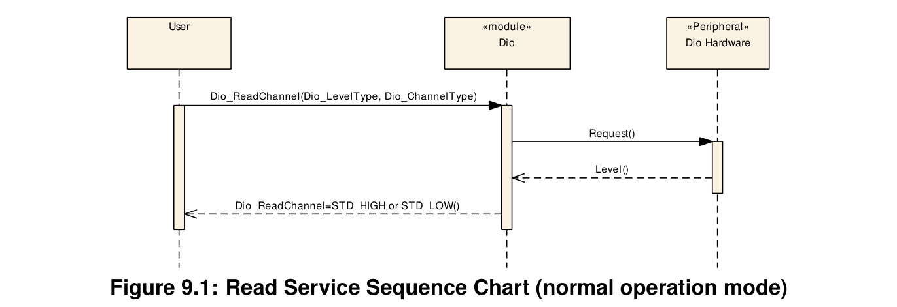
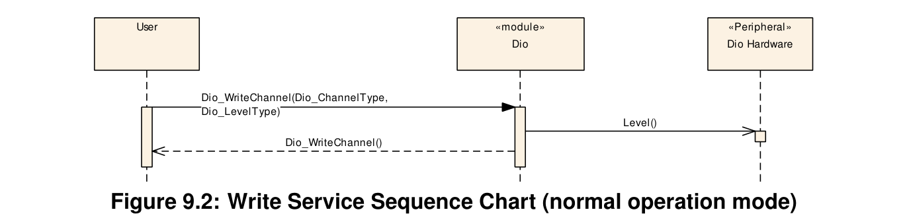
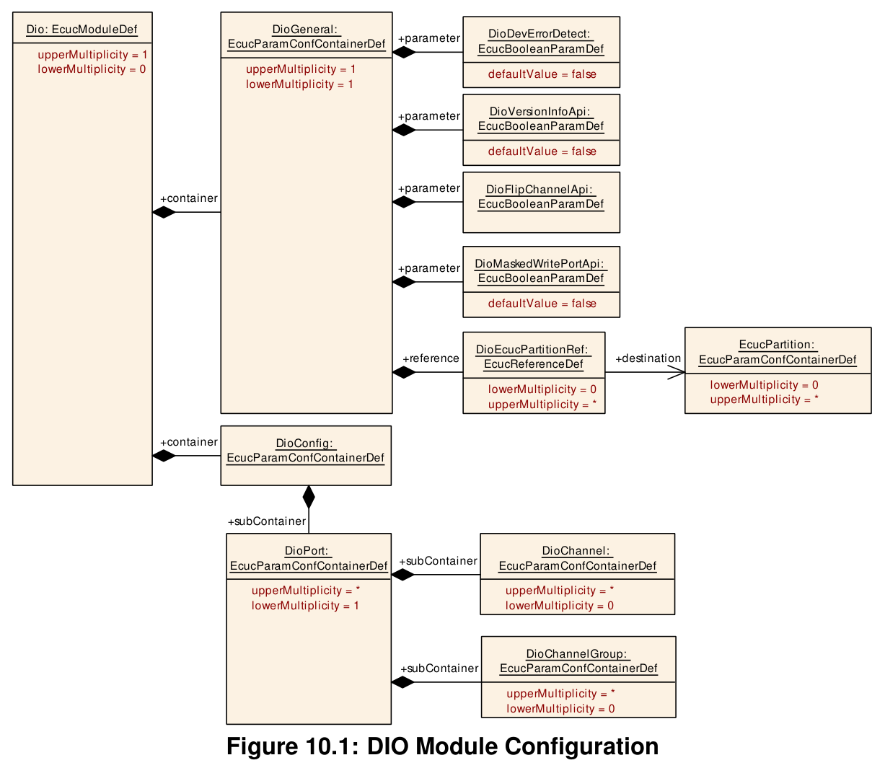
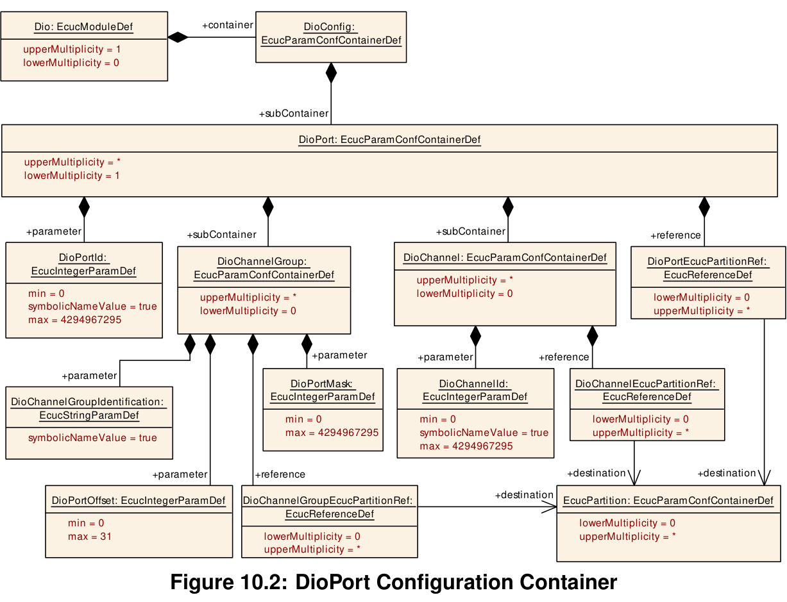

## 1. 简介和功能概述

本规范规定了**AUTOSAR**基础软件模块**DIO**驱动程序的功能、**API**和配置。

本规范仅适用于片上**DIO**引脚和端口的驱动程序。

**DIO**驱动程序提供从/向以下对象读取和写入数据的服务：

* **DIO**通道（引脚）
* **DIO**端口
* **DIO**通道组

这些服务的行为是同步的。

本模块作用于由**PORT**驱动程序为此目的配置的引脚和端口。因此，**DIO**驱动程序中不存在对此端口结构的配置和初始化。

下图标识了**DIO**驱动程序的功能，以及**PORT**驱动程序和**DIO**驱动程序在**MCAL**软件层中的结构。


## 2. 缩略语

下表包含了与**DIO**驱动程序模块相关、且未包含在[1] AUTOSAR术语表中的缩略语和缩写。

| 缩写/首字母缩写 | 描述 |
|---|---|
| DIO channel | 表示单个通用数字输入/输出引脚 |
| DIO port | 表示由硬件分组在一起的多个**DIO**通道（通常由一个硬件寄存器控制）。示例：Freescale HC08 的 Port A（8 位） |
| DIO channel group | 表示由逻辑组表示的多个相邻**DIO**通道。一个**DIO**通道组应属于一个**DIO**端口。示例：8 位端口中寻址复用器的端口引脚 2..6 |
| Physical Level (Input) | 两种可能的状态：**LOW** / **HIGH**。位值'0'表示**LOW**，位值'1'表示**HIGH**。 |
| Physical Level (Output) | 两种可能的状态：**LOW** / **HIGH**。位值'0'表示**LOW**，位值'1'表示**HIGH**。 |
| LSB | 最低有效位（Least Significant Bit） |
| MSB | 最高有效位（Most Significant Bit） |
| DIO | 数字输入输出（Digital Input Output） |
| ID | 标识符（Identifier） |
| ADC | 模数转换器（Analog to Digital Converter） |
| SPI | 串行外设接口（Serial Peripheral Interface） |
| PWM | 脉冲宽度调制（Pulse Width Modulation） |
| ICU | 输入捕获单元（Input Capture Unit） |
| DET | 默认错误跟踪器（Default Error Tracer） |
| DEM | 诊断事件管理器（Diagnostic Event Manager） |

## 3. 相关文档

### 3.1. 输入文件和相关标准与规范

[1] Glossary
AUTOSAR_FO_TR_Glossary

[2] General Specification of Basic Software Modules
AUTOSAR_CP_SWS_BSWGeneral

### 3.2. 相关规范

**AUTOSAR**提供了基础软件模块通用规范[2]（**SWS BSW General**），该规范同样适用于**DIO**驱动程序。

因此，**SWS BSW General**规范应被视为**DIO**驱动程序的附加必需规范。

## 4. 约束和假设

### 4.1. 限制

无限制。

### 4.2. 对汽车域的适用性

无限制。

## 5. 对其他模块的依赖

### 5.1. Port Driver模块

许多端口和端口引脚被**PORT**驱动程序模块分配给各种功能，例如：

* 通用**I/O**
* **ADC**
* **SPI**
* **PWM**

[SWS_Dio_00061] **Dio**模块不应为**Dio**模块中使用的端口结构提供整体配置和初始化的**API**。这些操作由**PORT**驱动程序模块完成。

[SWS_Dio_00063] **Dio**模块应使其配置和使用适配于微控制器和**ECU**。

[SWS_Dio_00102] **Dio**模块的用户只允许在**Port**驱动程序初始化之后使用**Dio**函数。否则**Dio**模块将表现出未定义的行为。

### 5.2. Default Error Tracer

[SWS_Dio_00194] 如果启用了开发错误（**DET**）检测，则**Dio.c**应包含**Det.h**。

## 6. Requirements Tracing

本章引用了适用于本软件模块的**SRS**文档（软件需求规范）中规定的输入需求。

下表列出了**DIO**驱动程序**SWS**文档中满足输入需求的规范条目链接。仅引用功能性需求。

| 需求 | 描述 | 满足项 |
|---|---|---|
| [SRS_BSW_00323] | 所有**AUTOSAR**基础软件模块应检查传入的**API**参数的有效性 | [SWS_Dio_00074] [SWS_Dio_00075] [SWS_Dio_00114] [SWS_Dio_00189] |
| [SRS_BSW_00344] | **BSW**模块应支持链接时配置 | [SWS_Dio_00001] [SWS_Dio_00002] |
| [SRS_BSW_00350] | 所有**AUTOSAR**基础软件模块应允许启用/禁用开发错误的检测和报告 | [SWS_Dio_00194] |
| [SRS_BSW_00396] | 基础软件模块规范应为每个参数/容器规定支持的值和多重性变更的配置类 | [SWS_Dio_00129] |
| [SRS_BSW_00411] | 所有**AUTOSAR**基础软件模块应对启用/禁用**API**的存在性应用命名规则 | [SWS_Dio_00139] |
| [SRS_Dio_12003] | **DIO**驱动程序应提供向分配的**DIO**端口写入数据字的服务 | [SWS_Dio_00004] [SWS_Dio_00007] [SWS_Dio_00034] [SWS_Dio_00035] [SWS_Dio_00051] [SWS_Dio_00053] [SWS_Dio_00089] [SWS_Dio_00105] [SWS_Dio_00108] [SWS_Dio_00200] [SWS_Dio_00201] [SWS_Dio_00202] [SWS_Dio_00203] [SWS_Dio_00204] |
| [SRS_Dio_12004] | **DIO**驱动程序应提供向分配的**DIO**端口的一部分写入可选择数量的相邻位的服务 | [SWS_Dio_00008] [SWS_Dio_00021] [SWS_Dio_00039] [SWS_Dio_00040] [SWS_Dio_00051] [SWS_Dio_00056] [SWS_Dio_00089] [SWS_Dio_00090] [SWS_Dio_00091] |
| [SRS_Dio_12005] | **DIO**驱动程序应提供对单个**DIO**通道的写入访问服务 | [SWS_Dio_00006] [SWS_Dio_00028] [SWS_Dio_00029] [SWS_Dio_00051] [SWS_Dio_00079] [SWS_Dio_00089] [SWS_Dio_00127] [SWS_Dio_00128] |
| [SRS_Dio_12006] | **DIO**驱动程序应提供从分配的**DIO**端口读取数据字的服务 | [SWS_Dio_00013] [SWS_Dio_00031] [SWS_Dio_00051] [SWS_Dio_00053] [SWS_Dio_00089] [SWS_Dio_00104] |
| [SRS_Dio_12007] | **DIO**驱动程序应提供从分配的**DIO**端口的一部分读取可选择数量的相邻位的服务 | [SWS_Dio_00014] [SWS_Dio_00021] [SWS_Dio_00037] [SWS_Dio_00051] [SWS_Dio_00056] [SWS_Dio_00089] [SWS_Dio_00092] [SWS_Dio_00093] |
| [SRS_Dio_12008] | **DIO**驱动程序应提供读取分配的**DIO**通道的一个位的服务 | [SWS_Dio_00011] [SWS_Dio_00027] [SWS_Dio_00051] [SWS_Dio_00089] [SWS_Dio_00127] [SWS_Dio_00128] |
| [SRS_Dio_12352] | **DIO**驱动程序应允许对**DIO**端口、通道组和通道进行读写 | [SWS_Dio_00012] [SWS_Dio_00064] [SWS_Dio_00070] [SWS_Dio_00083] [SWS_Dio_00084] [SWS_Dio_00109] |
| [SRS_Dio_12355] | 应配置符号名称 | [SWS_Dio_00017] [SWS_Dio_00020] [SWS_Dio_00022] [SWS_Dio_00026] |
| [SRS_Dio_12424] | 提供**DIO**访问的原子性 | [SWS_Dio_00005] [SWS_Dio_00060] |
| [SRS_Dio_12900] | **DIO**驱动程序应提供翻转（flip）服务 | [SWS_Dio_00191] [SWS_Dio_00192] [SWS_Dio_00193] |
| [SRS_SPAL_12064] | 所有驱动模块应在运行模式更改导致运行操作降级时引发错误 | [SWS_Dio_00001] [SWS_Dio_00002] |
| [SRS_SPAL_12263] | 所有驱动模块的实现应允许在链接时配置特定模块参数类型 | [SWS_Dio_00017] [SWS_Dio_00020] [SWS_Dio_00022] |
| [SRS_SPAL_12448] | 所有驱动模块在检测到开发错误后应具有特定行为 | [SWS_Dio_00074] [SWS_Dio_00075] [SWS_Dio_00114] [SWS_Dio_00119] |
| [SRS_SPAL_12461] | 关于控制器寄存器初始化的特定规则应适用于所有驱动实现 | [SWS_Dio_00001] [SWS_Dio_00002] |
| [SRS_SPAL_12462] | 寄存器初始化设置应被发布 | [SWS_Dio_00001] [SWS_Dio_00002] |
| [SRS_SPAL_12463] | 寄存器初始化设置应被合并并转发 | [SWS_Dio_00001] [SWS_Dio_00002] |

## 7. 功能规格

### 7.1. 一般行为

#### 7.1.1. 背景与原理

**DIO**驱动程序抽象对微控制器硬件引脚的访问。此外，它还允许对这些引脚进行分组。

#### 7.1.2. 需求

**DIO SWS**应定义允许基于以下方式对内部通用**I/O**端口进行读写访问的函数：

* 基于端口（Port-）
* 基于通道（Channel-）
* 基于通道组（Channel-group-）

[SWS_Dio_00051] **Dio**模块在提供读写服务时不应缓冲数据。**DIO SWS**应定义同步的读/写服务。

[SWS_Dio_00005] **Dio**模块的读写服务应为所有服务确保数据一致（不允许可中断的读-修改-写序列）。

[SWS_Dio_00089] **DIO**驱动程序用于表示通道软件电平的值只能是**STD_HIGH**或**STD_LOW**。

[SWS_Dio_00128] 通用数字**IO**引脚表示一个**DIO**通道。

[SWS_Dio_00127] **Port**模块应将**DIO**通道配置为输入或输出（见[SWS_Dio_00001]和[SWS_Dio_00002]）。

[SWS_Dio_00053] 在**DIO**驱动程序中，应可以将多个**DIO**通道按硬件分组（通常由一个硬件寄存器控制）以表示一个**DIO**端口。

注意：**DIO**端口内的单个**DIO**通道电平根据其在端口内的位置表示**DIO**端口值中的一个位。

[SWS_Dio_00056] 通道组是**DIO**端口内多个相邻**DIO**通道的形式上的逻辑组合。


**DIO**驱动程序提供以下服务：

* **DIO SWS**应定义函数以单独地、针对端口或针对通道组修改输出通道的电平。
* **DIO SWS**应定义函数以单独地、针对端口或针对通道组读取输入和输出（见[SWS_Dio_00083]）通道的电平。


[SWS_Dio_00060] **Dio**模块的所有读写函数应是可重入的。原因：**DIO**驱动程序可能被不同的上层处理程序或驱动程序访问。这些上层模块可能并发访问该驱动程序。

[SWS_Dio_00026] **Dio**模块的配置过程应为每个配置的**DIO**通道、端口和组提供符号名称。

### 7.2. 初始化

#### 7.2.1. 背景与原理

硬件的初始化由**PORT**驱动程序完成。

#### 7.2.2. 需求

[SWS_Dio_00001] **Dio**模块不应提供硬件初始化的接口。这由**Port**驱动程序执行。

### 7.3. 运行时重配置

#### 7.3.1. 背景与原理

运行时重配置由**PORT**驱动程序提供。

#### 7.3.2. 需求

[SWS_Dio_00002] **PORT**驱动程序应提供端口引脚方向在运行时的重配置。

### 7.4. DIO 写服务

#### 7.4.1. 背景与原理

**DIO**驱动程序提供服务以向微控制器的引脚传输数据。

#### 7.4.2. 需求

[SWS_Dio_00064] **Dio**模块的写函数应作用于输入和输出通道。

[SWS_Dio_00070] 如果在输入通道上使用**Dio**写函数，其不应对物理输出电平产生影响。

[SWS_Dio_00109] 如果硬件支持，**Dio**模块应设置/清除输入通道的输出数据锁存器，以便当端口驱动程序将该引脚配置为**DIO**输出引脚时，引脚输出所需的电平。

[SWS_Dio_00119] 如果启用了开发错误检测且发生了错误，**Dio**模块的写函数不应处理写命令。

##### 7.4.2.1. DIO 通道写服务

[SWS_Dio_00006] **Dio_WriteChannel**函数应将单个**DIO**通道的电平设置为**STD_HIGH**或**STD_LOW**。

##### 7.4.2.2. DIO 端口写服务

[SWS_Dio_00007] **Dio_WritePort**函数应同时设置所有输出通道的电平。位值'0'将相应通道设置为物理**STD_LOW**，位值'1'将相应通道设置为物理**STD_HIGH**。

[SWS_Dio_00004] **Dio_WritePort**函数应确保该端口输入通道的功能不受影响。

##### 7.4.2.3. DIO 通道组写服务

[SWS_Dio_00008] **Dio_WriteChannelGroup**函数应同时设置相邻的**DIO**通道子集（通道组）的电平。位值'0'将相应通道设置为物理**STD_LOW**，位值'1'将相应通道设置为物理**STD_HIGH**。

##### 7.4.2.4. DIO 掩码端口写服务

[SWS_Dio_00200] **Dio_MaskedWritePort**函数应同时设置所选输出通道的电平。

**Mask**参数指定选择哪些位：位值'0'表示未选择相应通道，位值'1'表示选择了相应通道。

**Level**参数指定物理电平：位值'0'将相应通道设置为物理**STD_LOW**，位值'1'将相应通道设置为物理**STD_HIGH**。

[SWS_Dio_00201] **Dio_MaskedWritePort**函数应确保该端口输入通道的功能不受影响。

### 7.5. DIO 读服务

#### 7.5.1. 背景与原理

**DIO**驱动程序提供服务以从微控制器的引脚传输数据。

#### 7.5.2. 需求

[SWS_Dio_00012] **Dio**模块的读函数应作用于输入和输出通道。

##### 7.5.2.1. DIO 通道读服务

[SWS_Dio_00011] **Dio_ReadChannel**函数应读取单个**DIO**通道的电平。

##### 7.5.2.2. DIO 端口读服务

[SWS_Dio_00013] **Dio_ReadPort**函数应读取一个端口的所有通道的电平。位值'0'表示相应通道为物理**STD_LOW**，位值'1'表示相应通道为物理**STD_HIGH**。

##### 7.5.2.3. DIO 通道组读服务

[SWS_Dio_00014] **Dio_ReadChannelGroup**函数应读取一个**DIO**通道组的电平。位值'0'表示相应通道为物理**STD_LOW**，位值'1'表示相应通道为物理**STD_HIGH**。

##### 7.5.2.4. 输出引脚的回读

[SWS_Dio_00083] 如果微控制器支持引脚值的直接回读，当读函数作用于配置为输出通道的通道时，**Dio**模块的读函数应提供真实引脚电平。

[SWS_Dio_00084] 如果微控制器不支持引脚值的直接回读，当读函数作用于配置为输出通道的通道时，**Dio**模块的读函数应提供输出寄存器的值。

### 7.6. 错误分类

文档[2]《基础软件模块通用规范》的"错误处理"一章详细描述了基础软件的错误处理。最重要的是，它构成了一个由可能在**BSW**模块中发生的五种错误类型组成的分类方案。

在此基础上，以下章节规定了在下文相应小节中安排的特定错误。

#### 7.6.1. 开发错误

[SWS_Dio_91001] **Dio**模块中开发错误的定义

| 错误类型 | 相关错误代码 | 错误值 |
|---|---|---|
| 请求的通道无效 | DIO_E_PARAM_INVALID_CHANNEL_ID | 0x0A |
| 请求的端口无效 | DIO_E_PARAM_INVALID_PORT_ID | 0x14 |
| 请求的通道组无效 | DIO_E_PARAM_INVALID_GROUP | 0x1F |
| **API**服务以**NULL**指针调用 | DIO_E_PARAM_POINTER | 0x20 |

#### 7.6.2. 运行时错误

没有运行时错误。

#### 7.6.3. 瞬态故障

没有瞬态故障。

#### 7.6.4. 生产错误

没有生产错误。

#### 7.6.5. 扩展生产错误

没有扩展生产错误。

### 7.7. 安全事件

无。

## 8. API规范

### 8.1. 导入的类型

本章列出了从以下模块包含的所有类型：

[SWS_Dio_00131] **Dio**模块的导入数据类型定义

| 模块 | 头文件 | 导入的类型 |
|---|---|---|
| Std_Types.h | Std_ReturnType | Std |
| Std_Types.h | Std_VersionInfoType | |

### 8.2. 类型定义

[SWS_Dio_00103] 为**DIO**驱动程序定义的类型中的端口宽度应是**DIO**驱动程序可访问的**MCU**上最大端口的尺寸。

#### 8.2.1. Dio_ChannelType

[SWS_Dio_00182] 数据类型**Dio_ChannelType**的定义

| 名称 | Dio_ChannelType |
|---|---|
| 类型 | Type |
| 派生自 | uint |
| 范围 | 这是实现特定的，但并非所有值在该类型内都有效。应覆盖所有可用的**DIO**通道 |
| 描述 | **DIO**通道的数字**ID**。可通过**Dio.h**获得 |

[SWS_Dio_00015] **Dio_ChannelType**类型的参数包含**DIO**通道的数字**ID**。

[SWS_Dio_00180] **ID**的映射是实现特定的，但不可配置。

[SWS_Dio_00017] 对于**Dio_ChannelType**类型的参数值，**Dio**的用户应使用配置描述提供的符号名称。此外，[SWS_Dio_00103]适用于**Dio_ChannelType**类型。

#### 8.2.2. Dio_PortType

[SWS_Dio_00183] 数据类型**Dio_PortType**的定义

| 名称 | Dio_PortType |
|---|---|
| 类型 | Type |
| 派生自 | uint |
| 范围 | 0..<端口数量> —— 应覆盖所有可用的**DIO**端口 |
| 描述 | **DIO**端口的数字**ID**。可通过**Dio.h**获得 |

[SWS_Dio_00018] **Dio_PortType**类型的参数包含**DIO**端口的数字**ID**。

[SWS_Dio_00181] **ID**的映射是实现特定的，但不可配置。

[SWS_Dio_00020] 对于**Dio_PortType**类型的参数值，用户应使用配置描述提供的符号名称。此外，[SWS_Dio_00103]适用于**Dio_PortType**类型。

#### 8.2.3. Dio_ChannelGroupType

[SWS_Dio_00184] 数据类型**Dio_ChannelGroupType**的定义

| 名称 | Dio_ChannelGroupType |
|---|---|
| 类型 | Structure |
| mask | 类型 uint8/16/32。注释：定义通道组位置的掩码元素 |
| offset | 类型 uint8。注释：此元素应为通道组在端口上的位置，从**LSB**开始计数 |
| port | 类型 Dio_PortType。元素注释：应为定义通道组的端口 |
| 描述 | 用于定义通道组的类型，通道组由端口内多个相邻通道组成。可通过**Dio.h**获得 |

[SWS_Dio_00021] **Dio_ChannelGroupType**是用于定义通道组的类型，通道组由端口内多个相邻通道组成。

[SWS_Dio_00022] 对于**Dio_ChannelGroupType**类型的参数值，用户应使用配置描述提供的符号名称。此外，[SWS_Dio_00056]适用于**Dio_ChannelGroupType**类型。

#### 8.2.4. Dio_LevelType

[SWS_Dio_00185] 数据类型**Dio_LevelType**的定义

| 名称 | Dio_LevelType |
|---|---|
| 类型 | Type |
| 派生自 | uint8 |
| STD_LOW | 0x00，物理状态 0V，范围 |
| STD_HIGH | 0x01，物理状态 5V 或 3.3V |
| 描述 | 这些是**DIO**通道可能具有的电平（输入或输出）。可通过**Dio.h**获得 |

[SWS_Dio_00023] **Dio_LevelType**是**DIO**通道可能具有的电平（输入或输出）的类型。

#### 8.2.5. Dio_PortLevelType

[SWS_Dio_00186] 数据类型**Dio_PortLevelType**的定义

| 名称 | Dio_PortLevelType |
|---|---|
| 类型 | Type |
| 派生自 | uint |
| 范围 | 0...xxx —— 如果**µC**拥有不同端口宽度的端口（例如 4、8、16...位），**Dio_PortLevelType**继承最大端口的尺寸 |
| 描述 | 如果**µC**拥有不同端口宽度的端口（例如 4、8、16...位），**Dio_PortLevelType**继承最大端口的尺寸。可通过**Dio.h**获得 |

[SWS_Dio_00024] **Dio_PortLevelType**是**DIO**端口值的类型。此外，[SWS_Dio_00103]适用于**Dio_PortLevelType**类型。

### 8.3. 函数定义

以下是提供给上层模块的函数列表。

#### 8.3.1. Dio_ReadChannel

[SWS_Dio_00133] **API**函数**Dio_ReadChannel**的定义

| 服务名称 | Dio_ReadChannel |
|---|---|
| 语法 | Dio_LevelType Dio_ReadChannel (Dio_ChannelType ChannelId) |
| 服务 ID [十六进制] | 0x00 |
| 同步/异步 | 同步 |
| 可重入性 | 可重入 |
| 参数（in） | ChannelId：**DIO**通道的**ID** |
| 参数（inout） | 无 |
| 参数（out） | 无 |
| 返回值 | Dio_LevelType：**STD_HIGH** 表示相应引脚的物理电平为**STD_HIGH**；**STD_LOW** 表示相应引脚的物理电平为**STD_LOW** |
| 描述 | 返回指定**DIO**通道的值。可通过**Dio.h**获得 |

```C
Dio_LevelType Dio_ReadChannel ( Dio_ChannelType ChannelId )
```

[SWS_Dio_00027] **Dio_ReadChannel**函数应返回指定**DIO**通道的值。关于**Dio_ReadChannel**函数的返回值，需求[SWS_Dio_00083]和[SWS_Dio_00084]适用。此外，需求[SWS_Dio_00005]和[SWS_Dio_00026]适用于**Dio_ReadChannel**函数。

[SWS_Dio_00074] 如果启用了开发错误检测，服务**Dio_ReadChannel**、**Dio_WriteChannel**和**Dio_FlipChannel**应检查"**ChannelId**"参数在当前配置内是否有效。如果"**ChannelId**"参数无效，函数应向**DET**报告错误代码**DIO_E_PARAM_INVALID_CHANNEL_ID**。

#### 8.3.2. Dio_WriteChannel

[SWS_Dio_00134] **API**函数**Dio_WriteChannel**的定义

| 服务名称 | Dio_WriteChannel |
|---|---|
| 语法 | void Dio_WriteChannel (Dio_ChannelType ChannelId, Dio_LevelType Level) |
| 服务 ID [十六进制] | 0x01 |
| 同步/异步 | 同步 |
| 可重入性 | 可重入 |
| 参数（in） | ChannelId：**DIO**通道的**ID**；Level：要写入的值 |
| 参数（inout） | 无 |
| 参数（out） | 无 |
| 返回值 | 无 |
| 描述 | 设置通道电平的服务。可通过**Dio.h**获得 |

```C
void Dio_WriteChannel ( Dio_ChannelType ChannelId, Dio_LevelType Level )
```

[SWS_Dio_00028] 如果指定通道配置为输出通道，**Dio_WriteChannel**函数应为指定通道设置指定的**Level**。

[SWS_Dio_00029] 如果指定通道配置为输入通道，**Dio_WriteChannel**函数不应对物理输出产生影响。

[SWS_Dio_00079] 如果指定通道配置为输入通道，**Dio_WriteChannel**函数不应对下一次读服务的结果产生影响。此外，需求[SWS_Dio_00005]、[SWS_Dio_00119]和[SWS_Dio_00026]适用于**Dio_WriteChannel**函数。

#### 8.3.3. Dio_ReadPort

[SWS_Dio_00135] **API**函数**Dio_ReadPort**的定义

| 服务名称 | Dio_ReadPort |
|---|---|
| 语法 | Dio_PortLevelType Dio_ReadPort (Dio_PortType PortId) |
| 服务 ID [十六进制] | 0x02 |
| 同步/异步 | 同步 |
| 可重入性 | 可重入 |
| 参数（in） | PortId：**DIO**端口的**ID** |
| 参数（inout） | 无 |
| 参数（out） | 无 |
| 返回值 | Dio_PortLevelType：该端口所有通道的电平 |
| 描述 | 返回该端口所有通道的电平。可通过**Dio.h**获得 |

```C
Dio_PortLevelType Dio_ReadPort ( Dio_PortType PortId )
```

[SWS_Dio_00031] **Dio_ReadPort**函数应返回该端口所有通道的电平。

[SWS_Dio_00104] 当使用**Dio_ReadPort**函数读取小于**Dio_PortLevelType**的端口时（见[SWS_Dio_00103]），函数应将对应于未定义端口引脚的位设置为 0。此外，需求[SWS_Dio_00005]和[SWS_Dio_00026]适用于**Dio_ReadPort**函数。

[SWS_Dio_00075] 如果启用了开发错误检测，函数**Dio_ReadPort**、**Dio_WritePort**和**Dio_MaskedWritePort**应检查"**PortId**"参数在当前配置内是否有效。如果"**PortId**"参数无效，函数应向**DET**报告错误代码**DIO_E_PARAM_INVALID_PORT_ID**。

#### 8.3.4. Dio_WritePort

[SWS_Dio_00136] **API**函数**Dio_WritePort**的定义

| 服务名称 | Dio_WritePort |
|---|---|
| 语法 | void Dio_WritePort (Dio_PortType PortId, Dio_PortLevelType Level) |
| 服务 ID [十六进制] | 0x03 |
| 同步/异步 | 同步 |
| 可重入性 | 可重入 |
| 参数（in） | PortId：**DIO**端口的**ID**；Level：要写入的值 |
| 参数（inout） | 无 |
| 参数（out） | 无 |
| 返回值 | 无 |
| 描述 | 设置端口值的服务。可通过**Dio.h**获得 |

```C
void Dio_WritePort ( Dio_PortType PortId, Dio_PortLevelType Level )
```

[SWS_Dio_00034] **Dio_WritePort**函数应为指定端口设置指定的值。

[SWS_Dio_00035] 当调用**Dio_WritePort**函数时，配置为输入的**DIO**通道应保持不变。

[SWS_Dio_00105] 当使用**Dio_WritePort**函数写入小于**Dio_PortLevelType**的端口时（见[SWS_Dio_00103]），函数应忽略**MSB**。

[SWS_Dio_00108] **Dio_WritePort**函数不应对该端口内配置为输入通道的通道产生影响。此外，需求[SWS_Dio_00005]、[SWS_Dio_00119]和[SWS_Dio_00026]适用于**Dio_WritePort**函数。

#### 8.3.5. Dio_ReadChannelGroup

[SWS_Dio_00137] **API**函数**Dio_ReadChannelGroup**的定义

| 服务名称 | Dio_ReadChannelGroup |
|---|---|
| 语法 | Dio_PortLevelType Dio_ReadChannelGroup (const Dio_ChannelGroupType * ChannelGroupIdPtr) |
| 服务 ID [十六进制] | 0x04 |
| 同步/异步 | 同步 |
| 可重入性 | 可重入 |
| 参数（in） | ChannelGroupIdPtr：指向**ChannelGroup**的指针 |
| 参数（inout） | 无 |
| 参数（out） | 无 |
| 返回值 | Dio_PortLevelType：端口相邻位子集的电平 |
| 描述 | 此服务读取端口相邻位的子集。可通过**Dio.h**获得 |

```C
Dio_PortLevelType Dio_ReadChannelGroup ( const Dio_ChannelGroupType * ChannelGroupIdPtr )
```

[SWS_Dio_00037] **Dio_ReadChannelGroup**函数应读取端口相邻位的子集（通道组）。

[SWS_Dio_00092] **Dio_ReadChannelGroup**函数应对通道组进行掩码操作。

[SWS_Dio_00093] **Dio_ReadChannelGroup**函数应进行移位，使函数读取的值与**LSB**对齐。此外，需求[SWS_Dio_00005]、[SWS_Dio_00056]、[SWS_Dio_00083]、[SWS_Dio_00084]和[SWS_Dio_00026]适用于**Dio_ReadChannelGroup**函数。

[SWS_Dio_00114] 如果启用了开发错误检测，函数**Dio_ReadChannelGroup**和**Dio_WriteChannelGroup**应检查"**ChannelGroupIdPtr**"参数在当前配置内是否有效。如果"**ChannelGroupIdPtr**"参数无效，函数应向**DET**报告错误代码**DIO_E_PARAM_INVALID_GROUP**。

#### 8.3.6. Dio_WriteChannelGroup

[SWS_Dio_00138] **API**函数**Dio_WriteChannelGroup**的定义

| 服务名称 | Dio_WriteChannelGroup |
|---|---|
| 语法 | void Dio_WriteChannelGroup (const Dio_ChannelGroupType * ChannelGroupIdPtr, Dio_PortLevelType Level) |
| 服务 ID [十六进制] | 0x05 |
| 同步/异步 | 同步 |
| 可重入性 | 可重入 |
| 参数（in） | ChannelGroupIdPtr：指向**ChannelGroup**的指针；Level：要写入的值 |
| 参数（inout） | 无 |
| 参数（out） | 无 |
| 返回值 | 无 |
| 描述 | 将端口相邻位的子集设置为指定电平的服务。可通过**Dio.h**获得 |

```C
void Dio_WriteChannelGroup ( const Dio_ChannelGroupType * ChannelGroupIdPtr, Dio_PortLevelType Level )
```

[SWS_Dio_00039] **Dio_WriteChannelGroup**函数应将端口相邻位的子集（通道组）设置为指定的电平。

[SWS_Dio_00040] **Dio_WriteChannelGroup**不应改变端口的剩余通道以及配置为输入的通道。

[SWS_Dio_00090] **Dio_WriteChannelGroup**函数应对通道组进行掩码操作。

[SWS_Dio_00091] **Dio_WriteChannelGroup**函数应进行移位，使函数写入的值与**LSB**对齐。此外，需求[SWS_Dio_00005]、[SWS_Dio_00056]、[SWS_Dio_00119]和[SWS_Dio_00026]适用于**Dio_WriteChannelGroup**函数。

#### 8.3.7. Dio_GetVersionInfo

[SWS_Dio_00139] **API**函数**Dio_GetVersionInfo**的定义

| 服务名称 | Dio_GetVersionInfo |
|---|---|
| 语法 | void Dio_GetVersionInfo (Std_VersionInfoType* VersionInfo) |
| 服务 ID [十六进制] | 0x12 |
| 同步/异步 | 同步 |
| 可重入性 | 可重入 |
| 参数（in） | 无 |
| 参数（inout） | 无 |
| 参数（out） | VersionInfo：指向存储本模块版本信息位置的指针 |
| 返回值 | 无 |
| 描述 | 获取本模块版本信息的服务。可通过**Dio.h**获得 |

```C
void Dio_GetVersionInfo ( Std_VersionInfoType* VersionInfo )
```

[SWS_Dio_00189] 如果为**DIO**驱动程序模块启用了**DET**，当参数为**NULL**指针时，函数**Dio_GetVersionInfo**应引发**DIO_E_PARAM_POINTER**并直接返回，不执行任何动作。

#### 8.3.8. Dio_FlipChannel

[SWS_Dio_00190] **API**函数**Dio_FlipChannel**的定义

| 服务名称 | Dio_FlipChannel |
|---|---|
| 语法 | Dio_LevelType Dio_FlipChannel (Dio_ChannelType ChannelId) |
| 服务 ID [十六进制] | 0x11 |
| 同步/异步 | 同步 |
| 可重入性 | 可重入 |
| 参数（in） | ChannelId：**DIO**通道的**ID** |
| 参数（inout） | 无 |
| 参数（out） | 无 |
| 返回值 | Dio_LevelType：**STD_HIGH** 表示相应引脚的物理电平为**STD_HIGH**；**STD_LOW** 表示相应引脚的物理电平为**STD_LOW** |
| 描述 | 翻转（从 1 到 0 或从 0 到 1）通道电平并返回翻转后通道电平的服务。可通过**Dio.h**获得 |

```C
Dio_LevelType Dio_FlipChannel ( Dio_ChannelType ChannelId )
```

[SWS_Dio_00191] 如果指定通道配置为输出通道，**Dio_FlipChannel**函数应读取通道的电平（需求[SWS_Dio_00083]和[SWS_Dio_00084]适用）并将其取反，然后将取反后的电平写入该通道。返回值应为指定通道取反后的电平。

[SWS_Dio_00192] 如果指定通道配置为输入通道，**Dio_FlipChannel**函数不应对物理输出产生影响。返回值应为指定通道的电平。

[SWS_Dio_00193] 如果指定通道配置为输入通道，**Dio_FlipChannel**函数不应对下一次读服务的结果产生影响。此外，需求[SWS_Dio_00005]、[SWS_Dio_00119]和[SWS_Dio_00026]适用于**Dio_FlipChannel**函数。

#### 8.3.9. Dio_MaskedWritePort

[SWS_Dio_00300] **API**函数**Dio_MaskedWritePort**的定义

| 服务名称 | Dio_MaskedWritePort |
|---|---|
| 语法 | void Dio_MaskedWritePort (Dio_PortType PortId, Dio_PortLevelType Level, Dio_PortLevelType Mask) |
| 服务 ID [十六进制] | 0x13 |
| 同步/异步 | 同步 |
| 可重入性 | 可重入 |
| 参数（in） | PortId：**DIO**端口的**ID**；Level：要写入的值；Mask：端口中要掩码的通道 |
| 参数（inout） | 无 |
| 参数（out） | 无 |
| 返回值 | 无 |
| 描述 | 以所需掩码设置给定端口值的服务。可通过**Dio.h**获得 |

```C
void Dio_MaskedWritePort ( Dio_PortType PortId, Dio_PortLevelType Level, Dio_PortLevelType Mask )
```

[SWS_Dio_00202] 如果**Mask**中相应位为'1'，**Dio_MaskedWritePort**函数应为指定端口中相应通道设置指定的值。

[SWS_Dio_00203] 当调用**Dio_MaskedWritePort**函数时，配置为输入的**DIO**通道应保持不变。

[SWS_Dio_00204] 当使用**Dio_MaskedWritePort**函数写入小于**Dio_PortLevelType**的端口时（见[SWS_Dio_00103]），函数应忽略**MSB**。

### 8.4. 回调通知

本章列出了**Dio**模块提供给下层层的所有函数。

**Dio**模块不提供任何回调通知。与**Dio**模块功能相关的回调在其他模块（**ICU**驱动程序和/或复杂驱动程序）中实现。

### 8.5. 调度函数

本章列出了由基础软件模块调度程序直接调用的所有函数。

**Dio**模块没有调度函数。

### 8.6. 期望接口

本章列出了**Dio**模块需要从其他模块获得的所有函数。

#### 8.6.1. 强制接口

无

#### 8.6.2. 可选接口

本章定义了为实现模块的可选功能而需要的所有接口。

[SWS_Dio_00140] **Dio**模块中可选接口的定义

| API 函数 | 头文件 | 描述 |
|---|---|---|
| Det_ReportError | Det.h | 报告开发错误的服务 |

## 9. 时序图

下图展示了调用**Dio_ReadChannel**和**Dio_WriteChannel**服务时的时序，展示了正常运行模式。由于第 8.3 章定义的所有其他服务都具有完全相同的同步行为，因此本文档有意不再提供更多时序图。

### 9.1. 从数字 I/O 读取值



### 9.2. 向数字 I/O 写入值



## 10. 配置规范

本章定义配置参数以及它们到容器的聚集。

### 10.1. 容器和配置参数

以下章节总结了所有配置参数。

[SWS_Dio_00205] **DIO**模块应拒绝实现不支持的包含分区映射的配置。

#### 10.1.1. 变体

[SWS_Dio_00129] 实现必须至少支持以下变体之一：**VARIANT-PRE-COMPILE**、**VARIANT-LINK-TIME**。



#### 10.1.2. Dio

**SWS 条目** [ECUC_Dio_00154]

| 模块名称 | Dio |
|---|---|
| 描述 | **Dio**（数字**IO**）模块的配置。 |
| Post-Build 变体支持 | false |
| 支持的配置变体 | VARIANT-LINK-TIME, VARIANT-PRE-COMPILE |

包含的容器

| 容器名称 | 多重性 | 范围/依赖 |
|---|---|---|
| DioConfig | 1 | 此容器包含**AUTOSAR DIO**模块的配置参数和子容器。 |
| DioGeneral | 1 | 通用**DIO**模块配置参数。 |

#### 10.1.3. DioGeneral

**SWS 条目** [ECUC_Dio_00141]

| 容器名称 | DioGeneral |
|---|---|
| 父容器 | Dio |
| 描述 | 通用**DIO**模块配置参数。 |

配置参数

**SWS 条目** [ECUC_Dio_00142]

| 参数名称 | DioDevErrorDetect |
|---|---|
| 父容器 | DioGeneral |
| 描述 | 打开或关闭开发错误检测和通知。• true：启用检测和通知。• false：禁用检测和通知。 |
| 多重性 | 1 |
| 类型 | EcucBooleanParamDef |
| 默认值 | false |
| Post-Build 变体值 | false |
| 预编译时间 | X（所有变体） |
| 链接时间 | – |
| 值配置类 | Post-build 时间 – |
| 范围/依赖 | scope: local |

**SWS 条目** [ECUC_Dio_00153]

| 参数名称 | DioFlipChannelApi |
|---|---|
| 父容器 | DioGeneral |
| 描述 | 从代码中添加/移除服务**Dio_FlipChannel()**。 |
| 多重性 | 1 |
| 类型 | EcucBooleanParamDef |
| 默认值 | – |
| Post-Build 变体值 | false |
| 预编译时间 | X（所有变体） |
| 链接时间 | – |
| 值配置类 | Post-build 时间 – |
| 范围/依赖 | scope: local |

**SWS 条目** [ECUC_Dio_00155]

| 参数名称 | DioMaskedWritePortApi |
|---|---|
| 父容器 | DioGeneral |
| 描述 | 从代码中添加/移除服务**Dio_MaskedWritePort()**。 |
| 多重性 | 1 |
| 类型 | EcucBooleanParamDef |
| 默认值 | false |
| Post-Build 变体值 | false |
| 预编译时间 | X（所有变体） |
| 链接时间 | – |
| 值配置类 | Post-build 时间 – |
| 范围/依赖 | scope: local |

**SWS 条目** [ECUC_Dio_00143]

| 参数名称 | DioVersionInfoApi |
|---|---|
| 父容器 | DioGeneral |
| 描述 | 从代码中添加/移除服务**Dio_GetVersionInfo()**。 |
| 多重性 | 1 |
| 类型 | EcucBooleanParamDef |
| 默认值 | false |
| Post-Build 变体值 | false |
| 预编译时间 | X（所有变体） |
| 链接时间 | – |
| 值配置类 | Post-build 时间 – |
| 范围/依赖 | scope: local |

**SWS 条目** [ECUC_Dio_00156]

| 参数名称 | DioEcucPartitionRef |
|---|---|
| 父容器 | DioGeneral |
| 描述 | 将**DIO**驱动程序映射到零个或多个**ECUC**分区，以使模块的**API**在此分区中可用。 |
| 多重性 | 0..* |
| 类型 | 对 EcucPartition 的引用 |
| Post-Build 变体多重性 | false |
| Post-Build 变体值 | false |
| 预编译时间 | X（所有变体） |
| 链接时间 | – |
| 多重性配置类 | Post-build 时间 – |
| 预编译时间 | X（所有变体） |
| 链接时间 | – |
| 值配置类 | Post-build 时间 – |
| 范围/依赖 | scope: ECU |

无包含的容器。

#### 10.1.4. DioPort

**SWS 条目** [ECUC_Dio_00144]

| 容器名称 | DioPort |
|---|---|
| 父容器 | DioConfig |
| 描述 | 单个**DIO**端口的配置，由通道和可能的通道组组成。注意，此容器定义没有显式定义符号名称参数。相反，容器的短名称将在**Ecu**配置描述中用于指定端口的符号名称。 |

配置参数

**SWS 条目** [ECUC_Dio_00145]

| 参数名称 | DioPortId |
|---|---|
| 父容器 | DioPort |
| 描述 | **DIO**端口的数字标识符。并非所有**MCU**端口都可用于**DIO**，因此在所有**ID**列表中可能存在"间隙"。此值将分配给**DIO**端口符号名称（即**DioPort**容器的**SHORT-NAME**）。 |
| 多重性 | 1 |
| 类型 | EcucIntegerParamDef（为此参数生成符号名称） |
| 范围 | 0 .. 4294967295 |
| 默认值 | – |
| Post-Build 变体值 | false |
| 值配置类 | 预编译时间 X（所有变体） |
| 链接时间 | – |
| Post-build 时间 | – |
| 范围/依赖 | scope: ECU |

**SWS 条目** [ECUC_Dio_00157]

| 参数名称 | DioPortEcucPartitionRef |
|---|---|
| 父容器 | DioPort |
| 描述 | 将**DIO**端口映射到零个或多个**ECUC**分区。引用的**ECUC**分区是**DIO**驱动程序所映射到的**ECUC**分区的子集。 |
| 多重性 | 0..* |
| 类型 | 对 EcucPartition 的引用 |
| Post-Build 变体多重性 | false |
| Post-Build 变体值 | false |
| 预编译时间 | X（所有变体） |
| 链接时间 | – |
| 多重性配置类 | Post-build 时间 – |
| 预编译时间 | X（所有变体） |
| 链接时间 | – |
| 值配置类 | Post-build 时间 – |
| 范围/依赖 | scope: ECU |

包含的容器

| 容器名称 | 多重性 | 范围/依赖 |
|---|---|---|
| DioChannel | 0..* | 单个**DIO**通道的配置。 |
| DioChannelGroup | 0..* | **DIO**通道组的定义和配置。通道组表示由逻辑组表示的多个相邻**DIO**通道。注意，此容器定义没有显式定义符号名称参数。相反，容器的短名称将在**Ecu**配置描述中用于指定通道组的符号名称。 |



[SWS_Dio_00206] **DioPortEcucPartitionRef**引用的**ECUC**分区应是**DioEcucPartitionRef**引用的**ECUC**分区的子集。

[SWS_Dio_00209] 如果**DioEcucPartitionRef**引用一个或多个**ECUC**分区，**DioPortEcucPartitionRef**应具有大于零的多重性，并同样引用这些**ECUC**分区中的一个或多个。

#### 10.1.5. DioChannel

**SWS 条目** [ECUC_Dio_00146]

| 容器名称 | DioChannel |
|---|---|
| 父容器 | DioPort |
| 描述 | 单个**DIO**通道的配置。 |

配置参数

**SWS 条目** [ECUC_Dio_00147]

| 参数名称 | DioChannelId |
|---|---|
| 父容器 | DioChannel |
| 描述 | **DIO**通道的通道**ID**。此值将分配给符号名称。 |
| 多重性 | 1 |
| 类型 | EcucIntegerParamDef（为此参数生成符号名称） |
| 范围 | 0 .. 4294967295 |
| 默认值 | – |
| Post-Build 变体值 | false |
| 预编译时间 | X（所有变体） |
| 链接时间 | – |
| 值配置类 | Post-build 时间 – |
| 范围/依赖 | scope: ECU |

**SWS 条目** [ECUC_Dio_00158]

| 参数名称 | DioChannelEcucPartitionRef |
|---|---|
| 父容器 | DioChannel |
| 描述 | 将**DIO**通道映射到零个或多个**ECUC**分区。引用的**ECUC**分区是相关**DIO**端口所映射到的**ECUC**分区的子集。 |
| 多重性 | 0..* |
| 类型 | 对 EcucPartition 的引用 |
| Post-Build 变体多重性 | false |
| Post-Build 变体值 | false |
| 预编译时间 | X（所有变体） |
| 链接时间 | – |
| 多重性配置类 | Post-build 时间 – |
| 预编译时间 | X（所有变体） |
| 链接时间 | – |
| 值配置类 | Post-build 时间 – |
| 范围/依赖 | scope: ECU |

无包含的容器。

[SWS_Dio_00207] **DioChannelEcucPartitionRef**引用的**ECUC**分区应是**DioPortEcucPartitionRef**引用的**ECUC**分区的子集。

[SWS_Dio_00210] 如果**DioEcucPartitionRef**引用一个或多个**ECUC**分区，**DioChannelEcucPartitionRef**应具有大于零的多重性，并同样引用这些**ECUC**分区中的一个或多个。

#### 10.1.6. DioChannelGroup

**SWS 条目** [ECUC_Dio_00148]

| 容器名称 | DioChannelGroup |
|---|---|
| 父容器 | DioPort |
| 描述 | **DIO**通道组的定义和配置。通道组表示由逻辑组表示的多个相邻**DIO**通道。注意，此容器定义没有显式定义符号名称参数。相反，容器的短名称将在**Ecu**配置描述中用于指定通道组的符号名称。 |

配置参数

**SWS 条目** [ECUC_Dio_00149]

| 参数名称 | DioChannelGroupIdentification |
|---|---|
| 父容器 | DioChannelGroup |
| 描述 | **DIO**通道组在**DIO API**中通过指向数据结构（**Dio_ChannelGroupType**类型）的指针来标识。该数据结构包含通道组信息。此参数包含必须插入调用模块的**API**调用中的代码片段，以获取内存中保存通道组信息的变量的地址。示例值为"&MyDioGroup1"或"&MyDioGroupArray[0]"。 |
| 多重性 | 1 |
| 类型 | EcucStringParamDef（为此参数生成符号名称） |
| 默认值 | – |
| 正则表达式 | – |
| Post-Build 变体值 | false |
| 预编译时间 | X（所有变体） |
| 链接时间 | – |
| 值配置类 | Post-build 时间 – |
| 范围/依赖 | scope: ECU |

**SWS 条目** [ECUC_Dio_00150]

| 参数名称 | DioPortMask |
|---|---|
| 父容器 | DioChannelGroup |
| 描述 | 定义通道组位置的掩码。通道应由同一端口中的相邻位组成。数据类型取决于端口宽度。 |
| 多重性 | 1 |
| 类型 | EcucIntegerParamDef |
| 范围 | 0 .. 4294967295 |
| 默认值 | – |
| Post-Build 变体值 | false |
| 预编译时间 | X（VARIANT-PRE-COMPILE） |
| 链接时间 | X（VARIANT-LINK-TIME） |
| 值配置类 | Post-build 时间 – |
| 范围/依赖 | scope: local |

**SWS 条目** [ECUC_Dio_00151]

| 参数名称 | DioPortOffset |
|---|---|
| 父容器 | DioChannelGroup |
| 描述 | 通道组在端口上的位置，从**LSB**开始计数。此值可以从**DioPortMask**导出。计算公式 = **DioPortMask**中从**LSB**开始计数的第一个置'1'位的位置。 |
| 多重性 | 1 |
| 类型 | EcucIntegerParamDef |
| 范围 | 0 .. 31 |
| 默认值 | – |
| Post-Build 变体值 | false |
| 预编译时间 | X（VARIANT-PRE-COMPILE） |
| 链接时间 | X（VARIANT-LINK-TIME） |
| 值配置类 | Post-build 时间 – |
| 范围/依赖 | scope: local |

**SWS 条目** [ECUC_Dio_00159]

| 参数名称 | DioChannelGroupEcucPartitionRef |
|---|---|
| 父容器 | DioChannelGroup |
| 描述 | 将**DIO**通道组映射到零个或多个**ECUC**分区。引用的**ECUC**分区是相关**DIO**端口所映射到的**ECUC**分区的子集。 |
| 多重性 | 0..* |
| 类型 | 对 EcucPartition 的引用 |
| Post-Build 变体多重性 | false |
| Post-Build 变体值 | false |
| 预编译时间 | X（所有变体） |
| 链接时间 | – |
| 多重性配置类 | Post-build 时间 – |
| 预编译时间 | X（所有变体） |
| 链接时间 | – |
| 值配置类 | Post-build 时间 – |
| 范围/依赖 | scope: ECU |

无包含的容器。

[SWS_Dio_00208] **DioChannelGroupEcucPartitionRef**引用的**ECUC**分区应是**DioPortEcucPartitionRef**引用的**ECUC**分区的子集。

[SWS_Dio_00211] 如果**DioPortEcucPartitionRef**引用一个或多个**ECUC**分区，**DioChannelGroupEcucPartitionRef**应具有大于零的多重性，并同样引用这些**ECUC**分区中的一个或多个。

#### 10.1.7. DioConfig

**SWS 条目** [ECUC_Dio_00152]

| 容器名称 | DioConfig |
|---|---|
| 父容器 | Dio |
| 描述 | 此容器包含**AUTOSAR DIO**模块的配置参数和子容器。 |

配置参数

包含的容器

| 容器名称 | 多重性 | 范围/依赖 |
|---|---|---|
| DioPort | 1..* | 单个**DIO**端口的配置，由通道和可能的通道组组成。注意，此容器定义没有显式定义符号名称参数。相反，容器的短名称将在**Ecu**配置描述中用于指定端口的符号名称。 |

### 10.2. 发布信息

详情请参阅**SWS_BSWGeneral**中第 10.3 章"Published Information"。

## A. 不适用的需求

无。
