## 1. 简介和功能概述

本文介绍了**AUTOSAR**基础软件**I/O**硬件抽象（**I/O Hardware Abstraction**）的功能和配置。**I/O**硬件抽象是**ECU**抽象层（**ECU Abstraction Layer**）的一部分。

**I/O**硬件抽象不应被视为单个模块，实现上此模块可以被实现为多个模块。 **AUTOSAR**的**I/O**硬件抽象标准并未为了实现模块或模块组的标准化。 相反标准的主要是为实现和其他模块的功能之间接口的指南。

**I/O**硬件抽象的目的是通过将**I/O**硬件抽象端口映射到**ECU**信号来提供对**MCAL**驱动程序的访问。提供给软件组件的数据可以完全从物理层中抽象出来。因此，软件组件设计人员不再需要详细了解**MCAL**驱动程序的**API**和物理层数据值的单位。

**I/O**硬件抽象始终针对**ECU**的特定实现，软件组件（**software component**）对基础软件（**basic software**）的需求必须适用具体**MCAL**实现的特征。

**I/O**硬件抽象需提供初始化整个**I/O**硬件抽象的服务。

在**AUTOSAR**的**I/O**硬件抽象指南中包含：

* 在定义**I/O**硬件抽象时，应使用软件组件模板（**Software Component template**）的哪一部分。
* 解释如何定义用于**ECU**信号映射的通用端口的方式。

在**AUTOSAR**的**I/O**硬件抽象指南中不包含：

* 提供**C**语言的**API**的定义
* 为每个**ECU**信号提供特定的形式化。此信息可在（车身域、动力总成、底盘域）的标准化的通过功能数据中找到。 

## 2. 缩略语

### 2.1. 缩略语

**AUTOSAR**
> 汽车开放系统架构（**AUTomotive Open System ARchitecture**）

**API**
> 应用编程接口（**Application Programming Interface**）

**BSW**
> 基础软件（**Basic SoftWare**）

**BSWMD**
> 基本软件模块说明（**Basic SoftWare Module Description**）

**C/S**
> 客户端/服务器（**Client/Server**）

**DET**
> 默认错误跟踪器（**Default Error Tracer**）

**ECU**
> 电子控制单元（**Electronic Control Unit**）

**HW**
> 硬件（**HardWare**）

**IoHwAb**
> 输入/输出硬件抽象（**Input/Output Hardware Abstraction**）

**ISR**
> 中断服务程序（**Interrupt Service Routine**）

**MCAL**
> 微控制器抽象层（**MicroController Abstraction Layer**）

**OS**
> 操作系统（**Operating System**）

**RTE**
> 运行时环境（**RunTime Environment**）

**S/R**
> 发送方/接收方（**Sender/Receiver**）

**SW**
> 软件（**SoftWare**）

**SWC**
> 软件组件（**SoftWare Component**）

**XML**
> 可扩展标记语言（**eXtensible Markup Language**）

### 2.2. 本文档中使用的表述

**Callback**
> 术语回调函数（**Callback**）主要用于**API**服务，实现通知其他**BSW**模块。

**Callout**
> **Callout**是一种函数**Stub**。主要在配置时进行填写，目的是向提供**Callout**函数的模块添加功能。

**Class**
> 一个类（**Class**）代表一组具有相似电气特性的信号。如：模拟类（**Analogue class**）

**Client-Server communication**
> 客户端-服务器通信（**Client-Server communication**）涉及两个实体。客户端是要求服务的一方，服务器是提供服务的一方。客户端发起通信，请求服务器执行服务，必要时传输参数集合。服务器以**RTE**的形式，等待来自客户端的传入通信请求，执行请求的服务并发送对客户端请求的响应。因此服务启动的方向是用来对**AUTOSAR**软件组件是客户端还是服务器分类的主要标识。

**Electrical Signal**
> 电信号（**Electrical Signal**）代表**ECU**引脚上的物理信号。

**ECU pin**
> ECU引脚（**ECU pin**）是**ECU**与电子系统其余部分的电气硬件连接。

**ECU Signal**
> ECU信号（**ECU Signal**）是电信号的软件表示。一个**ECU**信号具有一些属性（**Attribute**）和一个符号名称（**Symbolic name**）。

**ECU Signal Group**
> ECU信号组（**ECU Signal Group**）是一组电信号的软件表示。

**Attributes**
> 属性（**Attributes**）是**ECU**中存在的每个**ECU**信号所包含的软件或者硬件特性。一些属性是固定的，由端口定义决定。还有一些属性是可以在**I/O**硬件抽象中进行配置的。

**Sender-receiver communication**
> 发送方-接收方通信涉及原子数据元素组成的信号的发送和接收，这些原子数据元素由一个组件发送给另一个或多个组件。发送方-接收方接口可以包含多个数据元素。发送方-接收方通信是单向的 接收方发送的任何回复都可以视为一个单独的发送方-接收方通信。接收方组件的端口可以读取接口描述定义的数据元素，而提供方组件的端口可以按照接口描述定义写入数据元素。

**Symbolic name**
> ECU信号的符号名称（**Symbolic name**）在**I/O**硬件抽象模块中是用来建立链接的。（包括：功能、引脚等）

### 2.3. ECU信号属性

**Range**
> 范围（**Range**）在这里是一个功能范围（**functional range**），而不是电气范围（**electrical range**）。所有范围都用于功能的需要或者诊断的检测。对于模拟**ECU**信号，可以定义上下限值 [lowerLimit...upperLimit]（电压、电流）。对于电阻信号和时序信号（周期）的特殊情况，下限值（**lowerLimit**）不能为负。

**Resolution**

> 分辨率（**Resolution**）属性适用于依赖于范围和数据类型的许多类别。如：(upperLimit - lowerLimit) / (2<sup>datatypelength</sup> -1)。 对于其他类别，它可能是已知和被定义的。如：[-12 Volts…+12Volts]，数据类型: 16 bits，**Resolution** 为 24 / 65535。

**Accuracy**

> 精度（**Accuracy**）取决于用于采样或者生成的硬件外围设备。如：**ADC**转换器可以是 8/10/12/16 位转换器

**Inversion**
> 物理值与逻辑值的反转（**Inversion**）。此属性不可见，但可以由**I/O**硬件抽象来实现，并向用户传递预期值。

**Sampling rate**
> 采样率（**Sampling rate**）是获得信号值所需的时间段。

## 3. 相关文档

### 3.1. 输入文件

<a id="ref-1"></a>[1] List of Basic Software Modules
> AUTOSAR_TR_BSWModuleList.pdf

<a id="ref-2"></a>[2] Layered Software Architecture
> AUTOSAR_EXP_LayeredSoftwareArchitecture.pdf

<a id="ref-3"></a>[3] General Requirements on Basic Software Modules
> AUTOSAR_SRS_BSWGeneral.pdf

<a id="ref-4"></a>[4] Specification of ECU Configuration
> AUTOSAR_TPS_ECUConfiguration.pdf

<a id="ref-5"></a>[5] Glossary
> AUTOSAR_TR_Glossary.pdf

<a id="ref-6"></a>[6] General Requirements on SPA
> AUTOSAR_SRS_SPALGeneral.pdf

<a id="ref-7"></a>[7] Requirements on I/O Hardware Abstraction
> AUTOSAR_SRS_IOHWAbstraction.pdf

<a id="ref-8"></a>[8] Software Component Template
> AUTOSAR_TPS_SoftwareComponentTemplate.pdf

<a id="ref-9"></a>[9] Specification of RTE Software
> AUTOSAR_SWS_RTE.pdf

<a id="ref-10"></a>[10] Specification of ECU State Manager
> AUTOSAR_SWS_ECUStateManager.pdf

<a id="ref-11"></a>[11] Specification of ECU Resource Template
> AUTOSAR_TPS_ECUResourceTemplate.pdf

<a id="ref-12"></a>[12] Specification of ADC Driver
> AUTOSAR_SWS_ADCDriver.pdf

<a id="ref-13"></a>[13] Specification of DIO Driver
> AUTOSAR_SWS_DIODriver.pdf

<a id="ref-14"></a>[14] Specification of ICU Driver
> AUTOSAR_SWS_ICUDriver.pdf

<a id="ref-15"></a>[15] Specification of PWM Driver
> AUTOSAR_SWS_PWMDriver.pdf

<a id="ref-16"></a>[16] Specification of PORT Driver
> AUTOSAR_SWS_PORTDriver.pdf

<a id="ref-17"></a>[17] Specification of GPT Driver
> AUTOSAR_SWS_GPTDriver.pdf

<a id="ref-18"></a>[18] Specification of SPI Handler/Driver
> AUTOSAR_SWS_SPIHandlerDriver.pdf

<a id="ref-19"></a>[19] Basic Software Module Description Template
> AUTOSAR_TPS_BSWModuleDescriptionTemplate.pdf

<a id="ref-20"></a>[20] Specification of Standard Types
> AUTOSAR_SWS_StandardTypes.pdf

<a id="ref-21"></a>[21] General Specification of Basic Software Modules
> AUTOSAR_SWS_BSWGeneral.pdf

<a id="ref-22"></a>[22] Specification of OCU Driver
> AUTOSAR_SWS_OCUDriver.doc

### 3.2. 相关标准和规范

无

### 3.3. 相关规范

**AUTOSAR**标准提供了基础软件模块的通用规范 [\[21\]](#ref-21))，此文档也适用于**IO** 硬件抽象模块。因此规范[\[21\]](#ref-21))也应被视为**IO**硬件抽象的附加和必需的规范。

## 4. 约束和假设

### 4.1. 限制

无限制

### 4.2. 汽车域的适用性

无限制

## 5. 对其他模块的依赖

### 5.1. 与MCAL驱动程序的接口

#### 5.1.1. 概述

下图显示了**I/O**硬件抽象模块。它位于**MCAL**驱动程序之上。这意味着**I/O**硬件抽象模块将调用驱动程序的**API**来管理片载设备。**MCAL**驱动程序的配置取决于**SWC**所需的**ECU**信号的质量。例如：当引脚电平发生相关变化（上升沿、下降沿）时，可能需要发出通知。系统设计人员必须配置**MCAL**驱动程序以允许通知给定信号。 通知由**MCAL**驱动程序生成并在**I/O**硬件抽象模块中处理。

注意，**I/O**硬件抽象模块并非为了抽象**GPT**功能，而是使用**GPT**功能来执行自己的功能。下图显示了**I/O**硬件抽象模块与**GPT**驱动程序的接口，**GPT**驱动程序是**MCAL**的一部分。

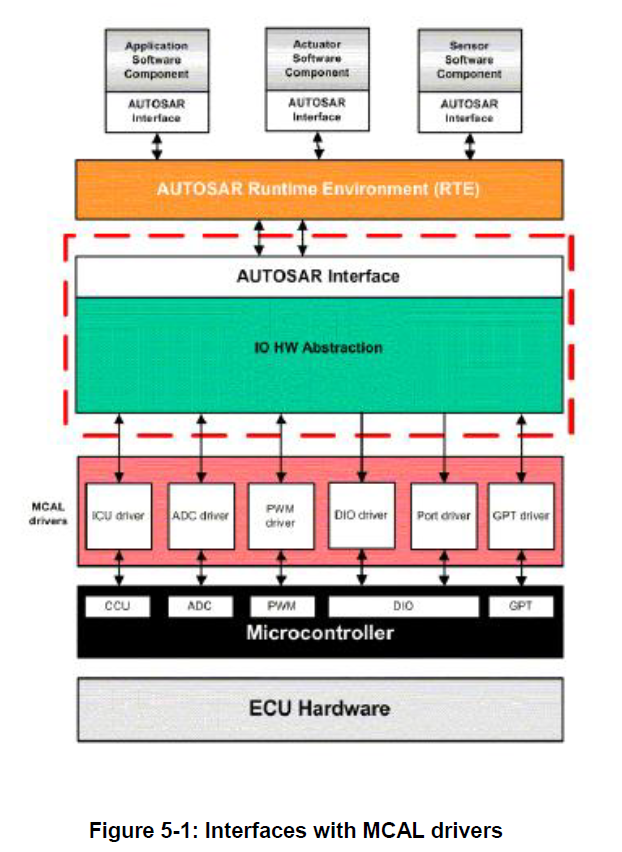

#### 5.1.2. 与MCAL驱动程序的接口摘要

**I/O**硬件抽象实现应向软件组件提供对所有**MCAL**驱动程序的访问。

| **IoHwAb** | ADC驱动程序 | OCU驱动程序 | PWM驱动程序 | ICU驱动程序 | DIO驱动程序 | PORT驱动程序 | GPT驱动程序 |
|---|---|---|---|---|---|---|---|
| 调用…的API | X | X | X | X | X | X | X |
| 从…接收通知 | X | X | X | X | - | - | X |

上表应按如下方式理解：

* **I/O**硬件抽象调用**ADC**驱动程序的**API**
* **I/O**硬件抽象接收来自**ADC**驱动程序的通知。
* **I/O**硬件抽象不接收来自**DIO**驱动程序的通知。

所有**API**的完整列表见第7.8.1节。

### 5.2. 与通信驱动程序的接口

如果对板载设备进行管理，**I/O**硬件抽象实现需为软件组件提供对通信驱动程序的访问（例如：通过**SPI**通讯）。

下图显示了**I/O**硬件抽象，其中：

* 接受一些来自**SPI**处理程序的信号。
* 使用**SPI**处理程序进行设置。
 
根据分层软件架构（**Layered Software Architecture**）[\[2\]](#ref-2)) (**ID03-16**)，I/O 硬件抽象包含专用驱动程序来管理外部设备，例如：

* 通过**SPI**连接外部**ADC**驱动程序。
* 通过**SPI**连接在ASIC设备上的**I/O**驱动程序。

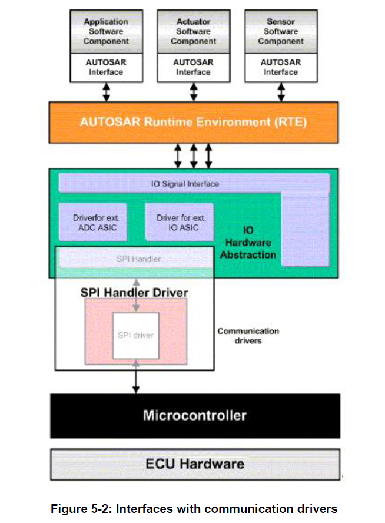

### 5.3. 与系统服务的接口

**I/O**硬件抽象模块需与以下系统服务进行交互：

* **ECU**状态管理器（初始化功能）
* **DET**：默认错误跟踪器
* **BSW**调度程序

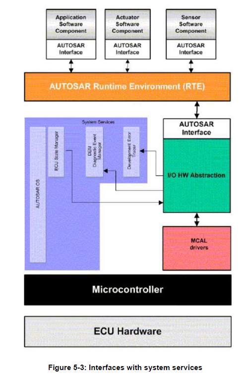

### 5.4. 与DCM的接口

**I/O**硬件抽象模块需提供与**DCM**的接口，为软件组件提供功能诊断。**DCM**将使用功能诊断来读取和控制已实现的**ECU**信号。
提供给**DCM**的接口原型，应在头文件**IoHwAb_Dcm.h**中定义。有关接口的详细信息，参见第7.6节。

### 5.5. 文件结构

#### 5.5.1. 代码文件结构

代码文件结构不在本规范中定义。

#### 5.5.2. 头文件结构

由于可能存在多个项目特定的**I/O**硬件抽象实例，因此无法规定其文件结构。

文件名应加上前缀 **IoHwAb_\<ComponentName\>_\<reference\>**（其中 \<reference\> 字段可以是实现特定的类别，\<ComponentName\> 字段是原子软件组件的名称，即**I/O**硬件抽象的实例），以避免名称冲突。

## 6. 功能规格

### 6.1. 集成代码

**I/O**硬件抽象作为**ECU**抽象的一部分，被定义为集成代码。

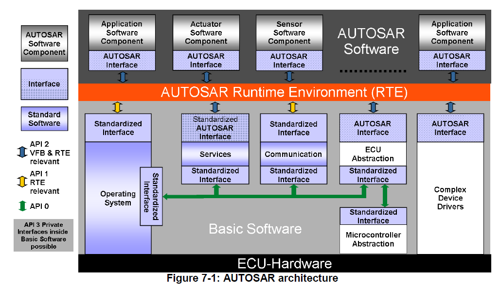

#### 6.1.1. 背景与原理

根据**AUTOSAR**词汇表[\[5\]](#ref-5))，集成代码是**ECU**原理图相关的软件，位于**AUTOSAR RTE**下方。

#### 6.1.2. 需求

以下关于**I/O**硬件抽象的需求与硬件保护相关。

集成代码通常意味着该软件是为了适应特定的**ECU**硬件Layout。所有保护硬件的策略都应包含在此软件包中。本文档不打算对此类硬件保护进行标准化或给出建议。

硬件保护意味着，当在某个输出上检测到故障时，**I/O**硬件抽象模块需切断输出信号。故障包括：接地短路、电源短路、过热、过载等。

**I/O**硬件抽象模块不需包含故障恢复策略。故障恢复操作应由负责的**SWC**决定。

**I/O**硬件抽象的内部行为是项目特定的，所以无法标准化。**I/O**硬件抽象模块不包含可扩展性。**SWC**定义需要什么信号已经信号质量，而**I/O**硬件抽象模块提供相关服务。

### 6.2. ECU信号概念

#### 6.2.1. 背景与原理

**I/O**硬件抽象模块并不会为**AUTOSAR SW-C**提供标准化的**AUTOSAR**接口，因为它与上层SW-C的接口强烈依赖于信号的采集链。但**I/O**硬件抽象模块会提供**AUTOSAR**接口。这些**AUTOSAR**接口用来表示来自**ECU**输入的电信号或者定位到**ECU**输出的电信号的抽象。

同时，这些电信号也可以来自其他**ECU**或被定位到其他的**ECU**（例如：通过**CAN**网络）。

端口（**Port**）是**AUTOSAR**组件的入口点。端口由**AUTOSAR**接口（AUTOSAR interface）来表示。这些接口对应于每个**ECU**信号。

ECU信号的概念来自于保证硬件平台互换性（**interchangeability of hardware platforms**）的必要性。

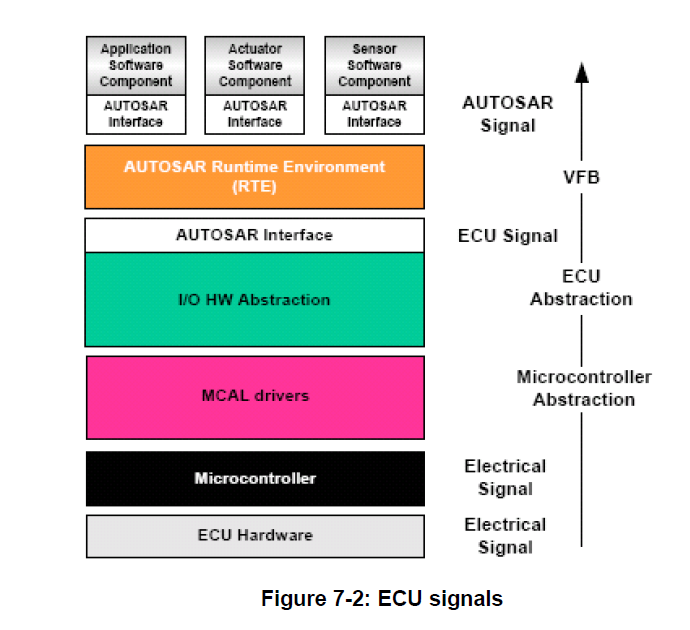

#### 6.2.2. 需求

**I/O**硬件抽象模块处理直接连接到**ECU**的所有输入和输出，但不包含那些具有专用驱动程序的输入和输出。（如:**CAN**驱动）。它所包括的所有输入和输出，会直接映射到微控制器端口或一个板载外围设备上。所有微控制器和外围设备之间的通信（但不包括传感器、执行器以及由复杂驱动程序管理的外围设备）都需被**I/O**硬件抽象模块隐藏，并提供相应的访问接口（**interfaces**）。

**ECU**通过网络以及输入和输出引脚连接到系统的其余部分。但网络并不包含在**I/O**硬件抽象模块的范围内。

一个**ECU**信号代表一个电信号，这意味着至少代表了一个输入或输出的ECU引脚。

在该层中实现的软件需对**ECU**引脚进行抽象化。通过使用示波器观测，输入和输出只不过是一个电信号，所以**I/O**硬件抽象模块定义的所有内容都与电信号的概念有关。对这个概念的一个扩展是诊断（如：电气故障状态）。通过**ECU**连接器（**connectors**）诊断并不可见，但**I/O**硬件抽象模块会提供相关服务。

具有类似行为的电信号可以形成一个类别。 因此通过软件表示的电信号的**ECU**信号，可能与某个特定于实现的类相关联。

### 6.3. 属性

#### 6.3.1. 背景与原理

尽管每个**ECU**信号的大部分特性都是由**SW-C**定义的，但必须为每个信号添加一些属性以实现**SW-C**期望的信号质量。

#### 6.3.2. 需求

为了详细说明信号采集链，需定义了一个属性列表来识别**ECU**信号的可配置特征。

##### 6.3.2.1. 过滤/去抖动（Filtering/Debouncing）属性

所有**ECU**信号都应具有过滤（**Filtering**）/去抖动（**Debounce**）的属性。以便于所捕获的原始值（**raw value**）在传递到上层之前可以被过滤或去抖动。此属性仅对输入信号有效。它会影响信号值采集和访问的具体实现。

##### 6.3.2.2. Age属性

由**I/O**硬件抽象模块处理的所有**ECU**信号都取决于**ECU**硬件设计。这意味着设置**ECU**输出信号的时间和获取**ECU**输入信号的时间，可能每个信号都是不同的。因此为了保证所有类型的**ECU**信号（输入/输出）的模板行为，定义了一个通用的年龄属性，并且需为每个**ECU**信号配置它。

所有**ECU**信号都应具有年龄属性。根据**ECU**信号的方向（如：输入或者输出），年龄属性有两个特定的名称。但无论如何它总是包含一个最大时间值。 

下面的描述解释了该属性对每种**ECU**信号的含义:

* **ECU**输入信号：该属性的具体功能是限制信号的寿命。该值定义了此信号数据的最大允许年龄。如果生命周期为**0**，则必须立即从物理寄存器中检索信号。如果生命周期大于**0**，则信号在指定时间内有效。
* **ECU**输出信号：此属性的具体功能是将信号输出限制为最大延迟。该值定义了实际设置此信号之前的最大允许时间。如果延迟为**0**，则必须立即将信号设置到物理寄存器中。如果延迟大于**0**，则可以等待配置的时间到达后，才将信号设置到物理寄存器中。

### 6.4. I/O 硬件抽象和软件组件模板

本章描述的内容和参考文档[\[8\]](#ref-8))相关，当参考文献档的内容有更改时，可能会影响本章描述的内容。

#### 6.4.1. 背景与原理

这种方法允许定义标准化的深度。如前所述，其实现为集成代码。本章总结了如何将**I/O**硬件抽象模块定义为一个软件组件（**SW-C**），并简要概述其内部行为。此内部行为描述主要涵盖**BSW**调度（**BSW scheduling**）机制。

#### 6.4.2. 需求

**I/O**硬件抽象模块需基于参考文档[\[8\]](#ref-8))中指定的软件组件模板（**Software Component Template**）。

与任何其他软件组件一样，**I/O**硬件抽象模块可能是子结构的（**sub-structured**），具体需取决于**ECU**的复杂性。

事实上，**I/O**硬件抽象模块属于一个经典的组件原型（**Component Prototype**），它可以是原子型的（**atomic**），也可以时组合型的（**composed**）。它定义了提供和所需要的接口（**interface**）。 此外，**I/O**硬件抽象模块只能通过其**PortPrototypes**与**RTE**之上的其他软件组件进行交互。任何使用**PortPrototypes**表达的隐藏依赖项是不被允许的。

**I/O**硬件抽象模块，通过标准化接口与**MCAL**驱动程序相连接，而通过**RTE**与其他软件组件相连接。 所以**I/O**硬件抽象模块需使用虚拟端口的概念（**Virtual Ports Concept**）。

**I/O**硬件抽象应实现为**EcuAbstractionSwComponentType**的一个或多个实例。具体有关**EcuAbstractionSwComponentType**的更多信息，可参阅参考文档[\[8\]](#ref-8))。**EcuAbstractionSwComponentType**的实例化提供了一组端口。在**RTE**生成期间，仅需考虑与软件组件连接的那些端口。

本章概述了应用于**I/O**硬件抽象需求的虚拟端口概念和可运行实体。本文档的以下章节将对这里列出的要点进行更详细的描述。

##### 6.4.2.1. 端口概念与I/O硬件抽象

参考AUTOSAR标准，建议**I/O**硬件抽象端口需使用软件组件模板来进行定义。本文档中的后续章节将更深入地介绍**I/O**硬件抽象端口的使用。因此具体的使用细节可参考软件组件模板文档[\[8\]](#ref-8))，以了解更多的使用的术语和概念。同时，第6.3节中描述的属性需通过对**I/O**硬件抽象组件的端口添加**IoHwAbstractionServerAnnotation**注解来进行定义（参见[\[8\]](#ref-8))）。

##### 6.4.2.2. 软件组件和可运行概念

软件组件具有实现其策略和内部行为的功能。这些部分使用可运行实体进行描述。前者包含在**runnables**中，而后者取决于**runnables**设计。可运行实体由原子软件组件提供，并且（至少间接地）是底层操作系统调度的主题。

原子软件组件的实现必须在其内部行为（**InternalBehavior**）中为每个**Runnable**提供代码入口点。有关详细信息，可参阅规范[\[8\]](#ref-8))。

可运行实体是最小的代码片段，可以独立激活。它们由原子软件组件提供并由**RTE**激活。例如：**Runnables**.被设置为响应服务器上的数据交换或操作调用。可运行实体具有三种可能的状态：**Suspended**、**Enabled** 和 **Running**。在运行时，原子软件组件的每个可运行对象（通过成为**OS**任务的成员）处于这些状态中的某种状态。

有关定义原子软件组件的每个可运行文件的可用选项和属性，可参阅规范[\[8\]](#ref-8))。

### 6.5. 调度概念

#### 6.5.1. 背景与原理

**I/O**硬件抽象模块可能会包含几个**BSW**模块，（例如：板载设备驱动程序）。这些**BSW**模块中的每一个都可以提供**BSW**可运行实体，在**RTE**规范中也称为**BswModuleEntity**，具体内容可参见参考文档[\[9\]](#ref-9))。

为了实现并行运行，**BswModuleEntity**等效于**SWC**的可运行实体（**runnable entities**），在**AUTOSAR**词汇表 [\[5\]](#ref-5)) 给出了以下定义：可运行实体是可以执行的原子软件组件的一部分，它可以独立于该原子软件组件的其他可运行实体，被执行及调度。

这意味着**I/O**硬件抽象可以同时使用**Runnable Scheduling**和**BSW Scheduling**。**Runnable Scheduling**处理**Runnable Entities**并且是强制性的。与**Runnable Scheduling**不同，**BSW Scheduling**是可选的，与**BSW**调度器的接口必须手动完成。

对于**SWC**的可运行实体，这些实体会在**AUTOSAR OS**任务主体中被调用。**Runnables**在**SW-C**描述中给出。**SW-C**的**Runnables**激活很大程度上取决于**RTE**的事件。

与**SWC**经常由**RTEEvents**激活的方式相同，可调度的**BswModuleEntities**可以由**BswEvents**激活。还有一种**BswModuleEntity**可以在中断的上下文（**interrupt context**）中被激活。这引出了两个子类别：**BswSchedulableEntity**和**BswInterruptEntity**。

#### 6.5.2. 需求

##### 6.5.2.1. Ports提供的接口的操作

**I/O**硬件抽象模块是通过接口（**interface**）来进行描述，在SW-C的实现中可对应与**PortInterfaces**。在可运行实体（**Runnable Entities**）中实现了**SW-C**所需的提供端口，包括了服务器端口（**Server port**）及发送方/接收方端口（**Sender/Receiver port**）。

**I/O**硬件抽象的提供端口服务的实现是特定于**ECU**的，与相应的**PortInterface**的映射需文档化在软件组件描述中。

###### 6.5.2.1.1. Get操作

对于与配置为输入信号的**PortInterface**关联的**ECU**信号，**I/O**硬件抽象应提供**GET**操作，并且操作的名称（**operation short name**）可以自由选择。

###### 6.5.2.1.2. Set操作

对于与配置为输出信号的**PortInterface**关联的**ECU**信号，**I/O**硬件抽象应提供**SET**操作，并且操作的名称（**operation short name**）可以自由选择。

##### 6.5.2.2. 通知和/或回调

**I/O**硬件抽象需定义**BswInterruptEntities**（与 **BswSchedulableEntity** 相对的 **BswModuleEntity** 的子类），以实现通知（**notification**）或回调（**callback**）机制，在中断上下文中实现与RTE下层的其他模块进行数据交换。

**I/O**硬件抽象可能包含一个或多个回调函数。可用的回调函数需要连接到**MCAL**驱动程序的通知接口。所以这些函数必须尊重**MCAL**驱动程序的原型定义，即：没有传递参数，也没有返回参数。

实现必须考虑到回调函数将在中断的上下文中执行的情况。回调函数还需支持可以提供触发**I/O**硬件抽象之外的软件组件的能力。这些通知需要通过**RTE**的发送方端口（**sender port**）进行处理。

可用回调函数的数量和执行顺序取决于实现，并且需要文档化在**I/O**硬件抽象的**BSWMD**描述中。

通过**RTE**路由的**I/O**硬件抽象的回调函数的函数原型需按照以下规则实现： 

```
StdReturnType Rte_Call_<p>_<o>(<parameters>)
```

回调函数必须与**RTE**的**Rte_Call_\<p\>_\<o\>**的**API**兼容，并启用**AUTOSAR**服务和**IO**硬件抽象的类型安全配置及实现。

##### 6.5.2.3. 主函数/作业处理函数

**I/O**硬件抽象模块可能包含一个或多个作业处理函数，它们是**BswSchedulableEntities**（与**BswInterruptEntity** 相对的**BswModuleEntity**的子类）。例如，每个设备驱动程序对应一个作业处理函数。它们需根据其用途被激活。

这些作业处理函数将由**BSW**调度程序进行时间触发（**time-triggered**）。它们可以与其他可运行实体同步执行。**BswSchedulableEntities**的数量及其执行顺序将取决于实现，并且必须文档化在**I/O**硬件抽象**BSWMD**描述中。

##### 6.5.2.4. 初始化、去初始化和/或Callout

**I/O**硬件抽象需定义**BswModuleEntries**，实现在非中断上下文中与**RTE**下层的其他软件交换数据，例如：在**BSW**初始化和去初始化的这些情况。这些**BswModuleEntries**链接到一个专用的**BswModuleEntity**，它将被调用以执行服务或者交换数据。

**I/O**硬件抽象可能包含一个或多个初始化和去初始化函数。例如：每个设备驱动程序定义一个初始化和去初始化函数。与**MCAL**驱动程序类似，初始化函数应包含一个参数，以便能够将不同的配置传递给设备驱动程序。该函数应将**I/O**硬件抽象驱动程序使用的所有局部和全局变量初始化为初始状态。

初始化和去初始化函数应由**ECU**状态管理器专门使用及处理。有关详细信息，可参阅参考文档[\[10\]](#ref-10))。

可用函数的数量和执行顺序取决于实现，并且需要文档化在**I/O**硬件抽象的**BSWMD**描述中。

##### 6.5.2.5. I/O硬件抽象调度示例

###### 6.5.2.5.1. ADC和I/O硬件抽象提供的接口

以下示例展示了**ADC**转换的调度示例。

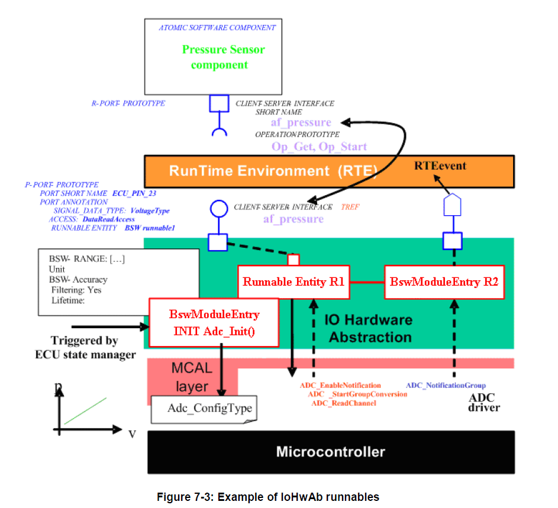

**I/O**硬件抽象提供了两个**P-port**。范例中的软件组件接口是**af_pressure**。

**ECU**状态管理器能够触发**BswModuleEntry**来初始化**ADC**驱动程序，通过使用**Adc_ConfigType**结构调用**Adc_Init**函数。

软件组件获取**af_pressure**值，步骤如下：

1. **RTE**触发专用**P-Port** 的**OP_GET**操作。
2. **R1**是一个可运行实体，它允许调用相关的**ADC**驱动程序服务：
    * ADC_EnableNotification
    * ADC_StartGroupConversion
3. 转换结束时，**ADC**在中断上下文中触发**R2**这个**BswModuleEntry**。因为该接口允许通知，在**ADC**驱动程序中指定**ADC_NotificationGroup**调用的**callout**函数。
4. 然后通过**RTEevent**将通知发送到软件组件。

本示例的时序图见第8章。

###### 6.5.2.5.2. 可运行实体与BswSchedulableEntities的同步调度

以下示例展示了用于设置一个连接到**SMART**电源的灯的调度。

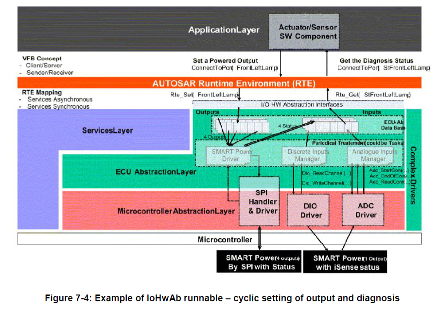

因为**SMART**电源通过**SPI**总线连接到微控制器，所以专用代码需使用**SPI**处理程序。

**FrontLeftLamp**的设置值通过**RTE**，保存在**I/O**硬件抽象模块的缓冲区中。

而另一个**SMART**电源的输出线，在设置时会同步触发ADC驱动对相同电信号进行**ADC**转换。在转换结束后，转换结果变成可用，同时通知设置到模拟输入管理器（**Analog input manager**）将值存储在缓冲区内，以便用于硬件的诊断。

在这个例子中，周期性处理是通过一个**BswSchedulableEntity**来实现的。

### 6.6. 错误分类

#### 6.6.1. 开发错误

| 错误类型 | 相关错误码 | 错误值 |
|---|---|---|
| 由实现者定义其要报告的错误 | 由实现者定义 | 0x01 |

#### 6.6.2. 运行时错误

**I/O**硬件抽象层不存在运行时错误。

#### 6.6.3. 瞬态故障

**I/O**硬件抽象层不存在瞬态故障。

#### 6.6.4. 生产错误

**I/O**硬件抽象层不存在生产错误。

#### 6.6.5. 扩展生产错误

| 错误名称: | 由实现者定义其要报告的错误 **IOHWAB_E_\<DESCRIPTIVE_NAME\>[_\<INSTANCE\>]** |
|---|---|
| 简要描述: | 由实现者定义 |
| 详细描述: | 由实现者定义 |
| 检测标准（Fail）: | 由实现者定义 |
| 检测标准（Pass）: | 由实现者定义 |
| 次要参数: | 由实现者定义 |
| 所需时间: | 由实现者定义 |
| 监控频率 | 由实现者定义 |

### 6.7. 其他需求

有关详细信息，请参阅**SWS_BSWGeneral**规范中的第5.1.8章"版本检查"（**Version Check**）。

### 6.8. I/O 硬件抽象层描述

**I/O**硬件抽象层与软件组件有一些类似，特别是通过端口定义来实现**RTE**的数据通信的。他们主要区别在于**I/O**硬件抽象位于RTE之下（在**ECU**抽象层中），而软件组件位于RTE之上。**I/O**硬件抽象是基础软件模块和应用软件之间的一种接口。

对于**I/O**硬件抽象模块，以及其他的服务，当前的方法论需要填写两个不同的模板。例如：为了在**AUTOSAR**的**ECU**上集成**NVRAM**管理器，需使用**BSWMD**模板记录其对**BSW**调度程序、操作系统资源等的需求。此外也需要使用**SWC**模板来描述和**RTE**相连接的端口信息。

**I/O**硬件抽象是**BSW**的一部分。它可以被视为是一组软件模块。虽然**IoHwAb**是集成代码，但**IoHwAb**的每个模块都可以适用**BSWDT**。 目前，众所周知这一点在当前规范中的文档化尚不充分。

同时，**ECU**信号需映射到**VFB**端口（参见第6.2节和第6.4节）。此外，为了描述**I/O**硬件抽象的实现与应用软件组件实现（**RTE**之上）之间的接口，应使用软件组件模板（**Software Component Template**）。

本章的目的是总结在配置过程中定义端口（**Port**）、接口（**Interface**）以及所有其他类软件组件元素的所有建议。

#### 6.8.1. I/O硬件抽象端口定义

**I/O**硬件抽象规范仅定义了端口使用方法的建议，但端口的实例化应在配置过程中完成，并且会特定于某个**ECU**的电子设计。

**I/O**硬件抽象建议为每个可识别的**ECU**信号创建一个端口，但关联到**ECU**输出信号的**ECU**诊断信号除外。 同时**ECU**信号和端口之间的关系需被创建。

**例如：**
某个**ECU**有**10**个模拟输入引脚（**Analog input pins**）、**15**个PWM输出引脚（**PWM output pins**）、**15**个数字输出引脚（**Digital output pins**）。

则**I/O**硬件抽象为每个**ECU**信号定义了至少一个端口。在这个简单的例子中，端口被实例化了**40**次。

### 6.9. 具体示例

#### 6.9.1. 示例1：板载硬件的使用案例

此示例来自于一个供电的**ECU**的例子。

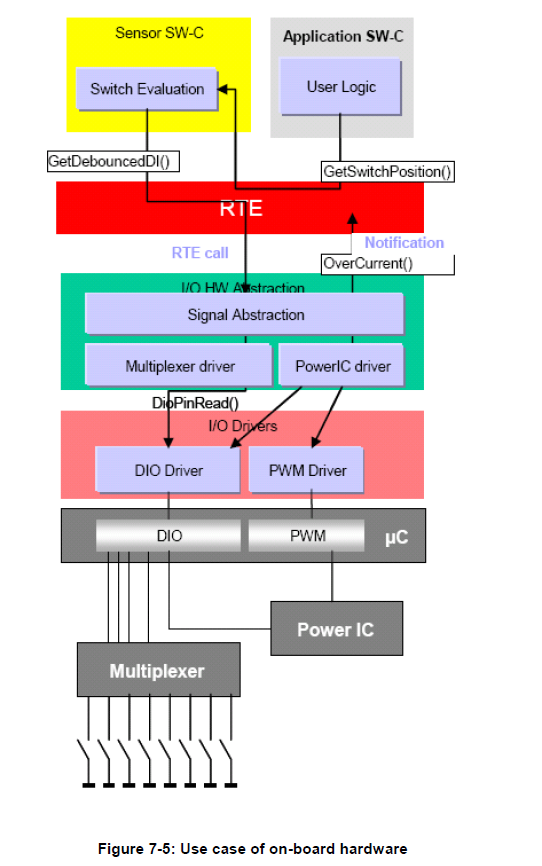

此**ECU**包含多个数字输入信号（DI）:
* 第一组是控制机械开关的慢速数字输入信号
* 第二组是用于诊断功率半导体（Power IC）的快速数字输入信号。这些信号输出电流是否过流（**over current**）。同时信号也没有从**ECU**中引出。

由于**MCU**没有足够的**PIN**脚，所以慢速的数字输入信号连接到了一个8位多路复用器，每个多路复用器会有**3**条地址线和**1**条数据线组成。

OEM客户需求如下：
1. 发生过流时到关闭**Power IC**的最长时间需为1ms
2. 开关的反应不得迟于**100**毫秒
3. 每个数字输入信号必须通过5票的3票（**3 of 5 voting**）来消除抖动。然而实际测试，因为机械开关和**Power IC**不会产生干扰信号，所以去抖的类型不是非常重要。

当前的解决方案是每**0.8**毫秒周期任务去读取一次所有数字输入。输入信号包括了慢速的和快速的。慢速数字输入的扫描速率可能可以更低一些，但额外任务的开销高于运行时节省。每次循环中，因为慢速数字输入的去抖是1次，所以最差的去抖值延迟是**3.2**毫秒。

如果检测到过流，该引脚将会被再次读取几次。但在同一个任务循环中，**Power IC**需被立即关闭。

应用程序会每**10**毫秒运行一次，并读取开关的去抖后的数字输入数值和诊断信息的反馈。

AUTOSAR架构上的分解：
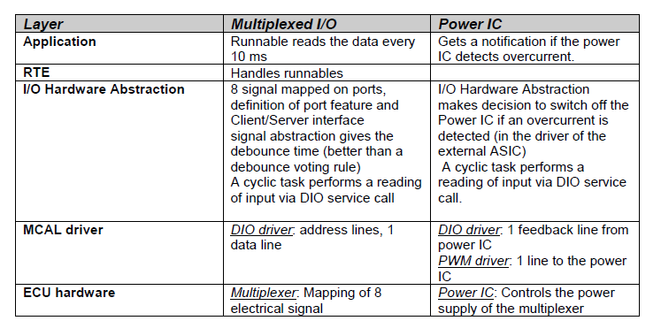

#### 6.9.2. 示例2：故障监测的使用案例

在本示例中，首先需定义一个信号用于输出的诊断，它是基于**I/O**硬件抽象级别的诊断属性来定义。所以一个输入信号会用于执行相关输出诊断的反馈。

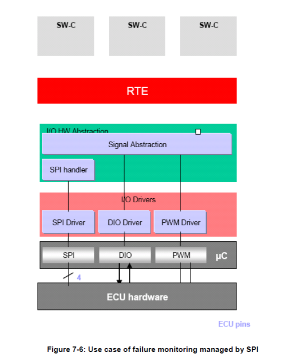

当**I/O**硬件抽象要求定位一个输出时，并调用Dio_WriteChannel，通道反馈的读取是通过配置为ECU输入引脚完成的。

ICU驱动程序向**I/O**硬件抽象发送通知。保护策略位于集成代码中。

软件组件可以通过端口定义的诊断操作来获取诊断值。

#### 6.9.3. 示例3：输出功率级

ECU 硬件有一个功率级ASIC。所有ECU引脚都需在**I/O**硬件抽象层上作为信号（**signal**）使用，在**RTE**层下面。

* 一些输出通过**SPI**处理程序控制。
* 一些输入通过**DIO**驱动程序直接控制。
* 一些电压值和频率通过**PWM**驱动程序设置。

功率级驱动程序（**Power Stage Driver**）提供了所有输出的视图。它会调用**PWM**、**DIO**驱动程序以及SPI处理程序的服务。从软件组件的角度来看，信号抽象使所有这些输出都可见，信号需映射到端口上。同时功率级驱动程序是可配置的。

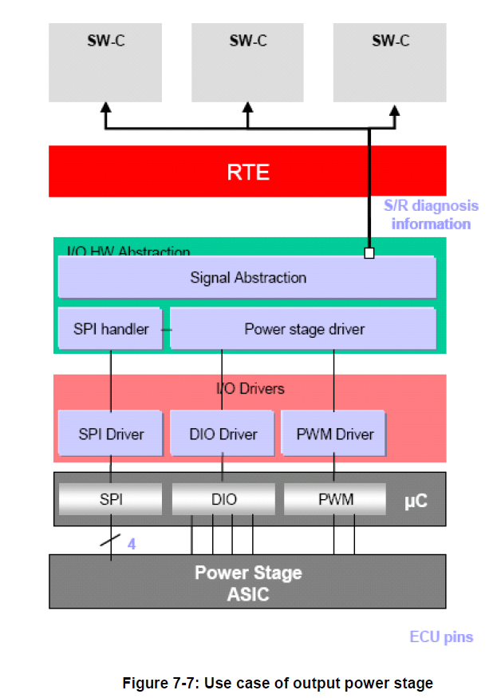

**诊断：**
每个故障都可以在功率级的级别上检测到。诊断数据流会通过**SPI**通信，传送到功率级驱动程序。接着通过**S/R**接口，将诊断结果提供给所有的软件组件。

#### 6.9.4. 示例4：在低功耗状态下设置传感器和控制外围设备

**ECU**通过**ADC**和**DIO**接口来控制外部的传感器（**External Sensor**）。在特定情况下，ECU进入传感器关闭且ADC设置为低功耗状态的操作模式。

操作动作顺序如下：

1. 应用程序电源模式管理器（**Application Power Mode Manager**）向**BswM**发出模式请求，希望能切换到低功耗模式（**LowPowerMode**）。
2. **BswM**评估请求。如果所有先决条件都满足，则向**Power Mode Manager**和传感器SWC（**Sensor SWC**）发出模式切换。
3. 传感器SWC停止读取传感数据，即不再向**IoHwAb**请求任何**Get**操作。
4. **IoHwAb**模块从ADC模块注销通知（**notification**），并最终停止周期性的硬件采集。
5. **IoHwAb**发送命令让外部传感器硬件进入低功耗模式或将其关闭。
6. **IoHwAb**调用低功耗模式准备的Callout函数，接着会调用低功耗模式设置Callout函数，并按配置中定义获得与请求的应用低功耗模式（**LowPowerMode**）相关的 ADC的电源状态。
   
通过引入更细粒度的模式请求并对确认和开关作出反应，可以逐步控制该过程。

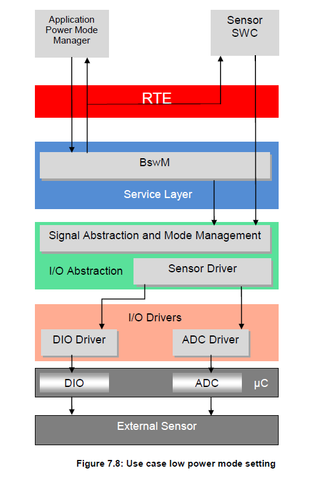

## 7. API规范

### 7.1. 导入的类型

本章列出了从以下模块导入的所有类型：

| 模块 | 头文件 | 导入的类型 |
|---|---|---|
| Adc | Adc.h | Adc_GroupType |
| Adc | Adc.h | Adc_StatusType |
| Adc | Adc.h | Adc_StreamNumSampleType |
| Adc | Adc.h | Adc_ValueGroupType |
| Dio | Dio.h | Dio_ChannelGroupType |
| Dio | Dio.h | Dio_ChannelType |
| Dio | Dio.h | Dio_LevelType |
| Dio | Dio.h | Dio_PortLevelType |
| Dio | Dio.h | Dio_PortType |
| EcuM | EcuM.h | EcuM_WakeupSourceType |
| Gpt | Gpt.h | Gpt_ChannelType |
| Gpt | Gpt.h | Gpt_ModeType |
| Gpt | Gpt.h | Gpt_ValueType |
| Icu | Icu.h | Icu_ActivationType |
| Icu | Icu.h | Icu_ChannelType |
| Icu | Icu.h | Icu_DutyCycleType |
| Icu | Icu.h | Icu_EdgeNumberType |
| Icu | Icu.h | Icu_IndexType |
| Icu | Icu.h | Icu_InputStateType |
| Icu | Icu.h | Icu_ValueType |
| Ocu | Ocu.h | Ocu_ChannelType |
| Ocu | Ocu.h | Ocu_PinStateType |
| Ocu | Ocu.h | Ocu_ReturnType |
| Ocu | Ocu.h | Ocu_ValueType |
| Port | Port.h | Port_PinDirectionType |
| Port | Port.h | Port_PinModeType |
| Port | Port.h | Port_PinType |
| Pwm | Pwm.h | Pwm_ChannelType |
| Pwm | Pwm.h | Pwm_OutputStateType |
| Spi | Spi.h | Spi_AsyncModeType |
| Spi | Spi.h | Spi_ChannelType |
| Spi | Spi.h | Spi_DataBufferType |
| Spi | Spi.h | Spi_HWUnitType |
| Spi | Spi.h | Spi_JobResultType |
| Spi | Spi.h | Spi_JobType |
| Spi | Spi.h | Spi_NumberOfDataType |
| Spi | Spi.h | Spi_SeqResultType |
| Spi | Spi.h | Spi_SequenceType |
| Spi | Spi.h | Spi_StatusType |
| Std | Std_Types.h | Std_ReturnType |
| Std | Std_Types.h | Std_VersionInfoType |

### 7.2. 类型定义

#### 7.2.1. IoHwAb\<Init_Id\>_ConfigType

**说明**: 结构类型（**Structure**）。组成元素为**IoHwAb**实现特定（**implementation specific**）。**IoHwAb**模块的配置数据结构（**Configuration data structure of the IoHwAb module**）。可通过**IoHwAb.h**获得。

### 7.3. 函数定义

本章列出提供给上层模块（**upper layer modules**）的函数。

**注意：**

如前几章所述，本规范不会为**I/O**硬件抽象指定任何功能性的**API**。

#### 7.3.1. IoHwAb_Init\<Init_Id\>

**说明**: 初始化所有**IO**硬件抽象软件或者是**IO**硬件抽象的一部分。可通过**IoHwAb.h**获得。本服务为同步调用，不可重入。参数 ConfigPtr（in）：指向所选配置集的指针。无返回值。

```C
void IoHwAb_Init<Init_Id> ( 
    const IoHwAb{Init_Id}_ConfigType* ConfigPtr )
```

配置指针 **ConfigPtr** 应始终具有 **NULL_PTR** 值。

**ConfigPtr** 配置指针当前未被使用，因此应将其设置为 **NULL_PTR** 值。

此类函数初始化所有**I/O**硬件抽象软件，或者初始化**I/O**硬件抽象的一部分。

**I/O**硬件抽象软件所管理的**I/O**设备的多样性应通过多个初始化函数来处理。每个初始化函数都应标记一个 \<Init_ID\>。因此，封装在**I/O**硬件抽象内部的外部设备可以被单独地初始化。

此类初始化函数应由**ECU**状态管理器调用。**ECU**集成人员能够配置由**ECU**状态管理器调用的初始化顺序。

在完成模块初始化后，**I/O**硬件抽象的状态应设置为 **IOHWAB_IDLE**，作业结果应设置为 **IOHWAB_JOB_OK**。

#### 7.3.2. IoHwAb_GetVersionInfo

**说明**: 返回此模块的版本信息。可通过**IoHwAb.h**获得。本服务为同步调用，可重入。参数 versioninfo（out）：指向存储该**IO**硬件抽象实现版本信息的位置的指针。无返回值。

```C
void IoHwAb_GetVersionInfo ( 
    Std_VersionInfoType* versioninfo )
```

### 7.4. 回调通知

本章列出提供给下层模块（**lower layer modules**）的函数。

#### 7.4.1. IoHwAb_AdcNotification\<#groupID\>

**说明**: 当组 \<#groupID\> 的组转换完成时将由**ADC**驱动程序调用。可通过**IoHwAb_Adc.h**获得。本服务为同步调用，不可重入。无参数，无返回值。

```C
void IoHwAb_AdcNotification<#groupID> ( void )
```

函数 **IoHwAb_AdcNotification\<#groupID\>** 旨在由**ADC**驱动程序在组 \<#groupID\> 的组转换完成时调用。

#### 7.4.2. IoHwAb_PwmNotification\<#channel\>

**说明**: 当通道 \<#channel\> 上出现信号边沿时，将由**PWM**驱动程序调用。可通过**IoHwAb_Pwm.h**获得。本服务为同步调用，不可重入。无参数，无返回值。

```C
void IoHwAb_PwmNotification<#channel> ( void )
```

函数 **IoHwAb_PwmNotification\<#channel\>** 旨在由**PWM**驱动程序在通道 \<#channel\> 上出现信号边沿时调用。

#### 7.4.3. IoHwAb_IcuNotification\<#channel\>

**说明**: 当通道 \<#channel\> 上出现信号边沿时，将由**ICU**驱动程序调用。可通过**IoHwAb_Icu.h**获得。本服务为同步调用，不可重入。无参数，无返回值。

```C
void IoHwAb_IcuNotification<#channel> ( void )
```

函数 **IoHwAb_IcuNotification\<#channel\>** 旨在由**ICU**驱动程序在通道 \<#channel\> 上出现信号边沿时调用。

#### 7.4.4. IoHwAb_GptNotification\<#channel\>

**说明**: 当通道 \<#channel\> 上的计时器值到期时，将由**GPT**驱动程序调用。可通过**IoHwAb_Gpt.h**获得。本服务为同步调用，不可重入。无参数，无返回值。

```C
void IoHwAb_GptNotification<#channel> ( void )
```

函数 **IoHwAb_GptNotification\<#channel\>** 旨在由**GPT**驱动程序在通道 \<#channel\> 上的计时器值到期时调用。

#### 7.4.5. IoHwAb_OcuNotification\<#channel\>

**说明**: 当阈值的当前值与通道\<#channel\>上的阈值匹配时，将由**OCU**驱动程序调用。可通过**IoHwAb_Ocu.h**获得。本服务为同步调用，不可重入。无参数，无返回值。

```C
void IoHwAb_OcuNotification<#channel> ( void )
```

函数 **IoHwAb_OcuNotification\<#channel\>** 旨在由**OCU**驱动程序在通道 \<#channel\> 上计数器的当前值与阈值匹配时调用。

#### 7.4.6. IoHwAb_Pwm_NotifyReadyForPowerState\<#Mode\>

**说明**: 当模式 \<#Mode\> 的请求电源状态准备完成时，**PWM**驱动程序将调用本**API**。可通过**IoHwAb_Pwm.h**获得。本服务为同步调用，不可重入。无参数，无返回值。

```C
void IoHwAb_Pwm_NotifyReadyForPowerState<#Mode> ( void )
```

如果**PWM**驱动程序被配置为支持异步模式（**asynchronous mode**）下的电源状态控制，则需要由**CDD**或**IoHwAb**提供的此接口。

#### 7.4.7. IoHwAb_Adc_NotifyReadyForPowerState\<#Mode\>

**说明**: 当为模式 \<#Mode\> 请求的电源状态准备完成时，**ADC**驱动程序将调用本**API**。可通过**IoHwAb_Adc.h**获得。本服务为同步调用，不可重入。无参数，无返回值。

```C
void IoHwAb_Adc_NotifyReadyForPowerState<#Mode> ( void )
```

如果**ADC**驱动程序被配置为支持异步模式（**asynchronous mode**）下的电源状态控制，则需要由**CDD**或**IoHwAb**提供的此接口。

### 7.5. 调度函数

这些函数由基础软件调度器（**Basic Software Scheduler**）直接调用。以下函数应无返回值且无参数。所有函数应为不可重入。

#### 7.5.1. \<调度函数的名称\>

| 服务名称: | \<API调用的名称\> |
|---|---|
| 服务ID [hex]: | \<服务ID编号。该ID用作默认错误跟踪器的错误报告**API**的参数。该ID不得与第0章中的ID相同\> |
| 说明: | \<包含定义此**API**调用操作的**ID**在内的本地软件需求集。\> |
| 时序: | \<固定周期 / 可变周期 / 前提条件触发\> |
| 前提条件: | \<关于此**API**调用必须运行的环境的假设列表。\> |
| 配置: | \<影响此**API**调用的静态可配置属性的描述。例如固定周期时序情况下的循环时间。\> |

### 7.6. 功能诊断接口

本章描述**I/O**硬件抽象提供给**DCM**模块的接口，以实现"软件组件的功能诊断"（**Functional Diagnostics of Software Components**）。

"软件组件的功能诊断"意味着：通过所提供的接口，**DCM**模块能够控制和读取每个已实现的**ECU**信号。

#### 7.6.1. IoHwAb_Dcm_\<EcuSignalName\>

**说明**: 此函数提供**DCM**模块对某个**ECU**信号的控制访问，其中\<EcuSignalName\>是**ECU**信号的符号名称。通过此函数可以进行**ECU**信号锁定（**locked**）和解锁（**unlocked**）。锁定代表将**ECU**信号冻结（**freeze**）为当前值、配置的默认值或者参数 signal 给出的值。可通过**IoHwAb_Dcm.h**获得。本服务为同步调用。参数 action（in）：**IOHWAB_RETURNCONTROLTOECU**——解锁信号；**IOHWAB_RESETTODEFAULT**——锁定信号并设置为配置的默认值；**IOHWAB_FREEZECURRENTSTATE**——锁定信号为当前值；**IOHWAB_SHORTTERMADJUSTMENT**——锁定信号并调整为**DCM**模块给定的值。参数 signal（in）：用于将信号调整到的值（仅用于"短期调整"）。无返回值。

```C
void IoHwAb_Dcm_<EcuSignalName> ( 
    uint8 action, <EcuSignalDataType> signal )
```

此函数允许控制关联的**ECU**信号，即可以锁定、解锁该**ECU**信号，并将其调整到某个特定值。

此函数应支持预编译期可配置的开启/关闭（**pre compile time configurable On/Off**）。

锁定一个信号意味着该信号在软件层面对**SW-C**锁定，即**SW-C**的请求在锁定状态下对硬件不起作用。如果输入信号使用**C/S**通信，则可能需要一个**IoHwAb**内部缓冲区，其值可以由**DCM**调整。

#### 7.6.2. IoHwAb_Dcm_Read\<EcuSignalName\>

**说明**: 该函数提供**DCM**模块对某个**ECU**信号的读取访问，其中\<EcuSignalName\>是**ECU**信号的符号名称。可通过**IoHwAb_Dcm.h**获得。本服务为同步调用。参数 signal（out）：指向存储当前信号值的变量的指针。无返回值。

```C
void IoHwAb_Dcm_Read<EcuSignalName> (
     <EcuSignalDataType>* signal )
```

此函数提供**DCM**模块对某个**ECU**信号的读取访问。读取访问独立于**ECU**信号的当前状态（锁定/解锁），并且应始终从硬件读取当前的物理值。

此函数应支持预编译期可配置的开启/关闭（**pre compile time configurable On/Off**）。

### 7.7. 电源状态函数

#### 7.7.1. IoHwAb_PreparePowerState\<#Mode\>

**说明**: 函数需由**IoHwAb**调用，为转换到给定的电源状态做准备工作。此函数的目的是封装所有操作，以便使硬件为预定义的电源模式做好准备，将应用程序电源定义与硬件电源状态分离。可通过**IoHwAb.h**获得。本服务为同步调用，不可重入。无参数，无返回值。本**API**为可配置 callout，须按配置为每个待管理的电源模式定义一次；此 callout 在**IoHwAb SWC**的上下文中执行，意味着它可以完全访问**MCAL**。

```C
void IoHwAb_PreparePowerState<#Mode> ( void )
```

许多外设的电源状态转换请求可以连接到给定的电源模式转换，由本 callout 加以实现，同时还包括使外设进入所需电源状态所需的任何其他操作（外设之间的交叉依赖可以在此上下文中解决）。

#### 7.7.2. IoHwAb_EnterPowerState\<#Mode\>

**说明**: 函数需由**IoHwAb**调用，以便有效地进入由函数[**IoHwAb_PreparePowerState\<#Mode\>**](#771-iohwab_preparepowerstatemode)准备的电源状态。此函数的目的是封装所有操作，以便将硬件设置为对应于预定义电源模式的电源状态，从而将应用程序电源定义与硬件电源状态分离。可通过**IoHwAb.h**获得。本服务为异步调用，不可重入。无参数，无返回值。本**API**为可配置 callout，须按配置为每个待管理的电源模式定义一次；此 callout 在**IoHwAb SWC**的上下文中执行，意味着它可以完全访问**MCAL**。

```C
void IoHwAb_EnterPowerState<#Mode> ( void )
```

此**API**执行由先前对相应的 [**IoHwAb_PreparePowerState\<#Mode\>**](#771-iohwab_preparepowerstatemode) 的调用所准备的所有电源状态转换。

### 7.8. 期望接口

本章列出从其他模块所需的所有接口。

#### 7.8.1. 强制接口

**I/O**硬件抽象没有强制接口。**I/O**硬件抽象使用哪些接口取决于**SWC**所定义通道的预期功能。

**使用所有MCAL驱动程序API的I/O硬件抽象示例：**

请注意，\<module_name\>_Init 和 \<module_name\>_DeInit 函数未列在下方。初始化序列由**ECU**状态管理器调用，而不是由**I/O**硬件抽象调用。

\<module_name\>_GetVersionInfo 函数也未在此列出。

此表格根据以下文档编制：

* **ADC**驱动程序 — 文档[\[12\]](#ref-12))
* **DIO**驱动程序 — 文档[\[13\]](#ref-13))
* **ICU**驱动程序 — 文档[\[14\]](#ref-14))
* **PWM**驱动程序 — 文档[\[15\]](#ref-15))
* **PORT**驱动程序 — 文档[\[16\]](#ref-16))
* **GPT**驱动程序 — 文档[\[17\]](#ref-17))
* **SPI**驱动程序 — 文档[\[18\]](#ref-18))
* **OCU**驱动程序 — 文档[\[22\]](#ref-22))

| API函数 | 头文件 | 说明 |
|---|---|---|
| Adc_GetGroupStatus | Adc.h | 返回所请求**ADC**通道组的转换状态。 |
| Adc_GetStreamLastPointer | Adc.h | 返回结果缓冲区中每个通道存储的有效采样数。读取一个指针，该指针指向组结果缓冲区中的某个位置。通过该指针位置，可以访问上一轮完成的转换中所有组通道的结果。通过该指针和返回值，可以访问所有有效的组转换结果（用户必须考虑结果缓冲区的布局）。 |
| Adc_ReadGroup | Adc.h | 读取所请求组的上一轮已完成转换的组转换结果，并从 **DataBufferPtr** 地址开始存储通道值。组通道值按通道编号升序存储（与配置流式访问时结果缓冲区的存储布局相反）。 |
| Adc_SetupResultBuffer | Adc.h | 用组特定的结果缓冲区起始地址初始化**ADC**驱动程序，转换结果将存储在该缓冲区中。应用程序必须确保 **DataBufferPtr** 所指向的应用程序缓冲区能够容纳指定组的所有转换结果。复位后，在启动组转换之前，必须先通过 **Adc_SetupResultBuffer** 进行初始化。 |
| Adc_StartGroupConversion | Adc.h | 启动所请求**ADC**通道组所有通道的转换。 |
| Adc_StopGroupConversion | Adc.h | 停止所请求**ADC**通道组的转换。 |
| Dio_ReadChannel | Dio.h | 返回指定**DIO**通道的值。 |
| Dio_ReadChannelGroup | Dio.h | 该服务读取某个端口中相邻位的一个子集。 |
| Dio_ReadPort | Dio.h | 返回该端口所有通道的电平。 |
| Dio_WriteChannel | Dio.h | 用于设置某个通道电平的服务。 |
| Dio_WriteChannelGroup | Dio.h | 用于将某个端口中相邻位的一个子集设置为指定电平的服务。 |
| Dio_WritePort | Dio.h | 用于设置端口值的服务。 |
| Gpt_CheckWakeup | Gpt.h | 检查具有唤醒能力的**GPT**通道是否为唤醒事件的来源，并在**GPT**通道唤醒事件有效的情况下调用**ECU**状态管理器服务 **EcuM_SetWakeupEvent**。 |
| Gpt_DisableWakeup | Gpt.h | 禁用某个通道的唤醒中断（在睡眠模式下相关）。 |
| Gpt_EnableWakeup | Gpt.h | 启用某个通道的唤醒中断（在睡眠模式下相关）。 |
| Gpt_GetTimeElapsed | Gpt.h | 返回已经过的时间。 |
| Gpt_GetTimeRemaining | Gpt.h | 返回到达目标时间之前剩余的时间。 |
| Gpt_SetMode | Gpt.h | 设置**GPT**的工作模式。 |
| Icu_DisableEdgeCount | Icu.h | 此函数禁用给定通道的边沿计数。 |
| Icu_DisableNotification | Icu.h | 此函数禁用某个通道的通知。 |
| Icu_DisableWakeup | Icu.h | 此函数禁用单个**ICU**通道的唤醒能力。 |
| Icu_EnableEdgeCount | Icu.h | 此函数启用给定通道的边沿计数。 |
| Icu_EnableNotification | Icu.h | 此函数在给定通道上启用通知。 |
| Icu_EnableWakeup | Icu.h | 此函数（重新）启用给定**ICU**通道的唤醒能力。 |
| Icu_GetDutyCycleValues | Icu.h | 此函数读取给定**ICU**通道的相干有效时间和周期时间。 |
| Icu_GetEdgeNumbers | Icu.h | 此函数读取已计数的边沿数量。 |
| Icu_GetInputState | Icu.h | 此函数返回**ICU**输入的状态。 |
| Icu_GetTimeElapsed | Icu.h | 此函数读取给定通道已经过的信号低电平时间。 |
| Icu_GetTimestampIndex | Icu.h | 此函数读取给定通道的时间戳索引。 |
| Icu_ResetEdgeCount | Icu.h | 此函数将已计数的边沿值重置为零。 |
| Icu_SetActivationCondition | Icu.h | 此函数为给定通道设置激活边沿。 |
| Icu_StartSignalMeasurement | Icu.h | 此函数启动信号测量。 |
| Icu_StartTimestamp | Icu.h | 此函数开始在边沿处捕获定时器值。 |
| Icu_StopSignalMeasurement | Icu.h | 此函数停止给定通道的信号测量。 |
| Icu_StopTimestamp | Icu.h | 此函数停止给定通道的时间戳测量。 |
| Ocu_DisableNotification | Ocu.h | 该服务用于禁用来自**OCU**通道的通知。 |
| Ocu_EnableNotification | Ocu.h | 该服务用于启用来自**OCU**通道的通知。 |
| Ocu_GetCounter | Ocu.h | 读取计数器当前值的服务。 |
| Ocu_SetAbsoluteThreshold | Ocu.h | 使用绝对输入数据设置通道阈值的服务。 |
| Ocu_SetPinState | Ocu.h | 立即设置与**OCU**通道关联的引脚电平的服务。 |
| Ocu_SetRelativeThreshold | Ocu.h | 相对于计数器当前值设置通道阈值的服务。 |
| Ocu_StartChannel | Ocu.h | 启动**OCU**通道的服务。 |
| Ocu_StopChannel | Ocu.h | 停止**OCU**通道的服务。 |
| Port_RefreshPortDirection | Port.h | 刷新端口方向。 |
| Port_SetPinDirection | Port.h | 设置端口引脚方向。 |
| Port_SetPinMode | Port.h | 设置端口引脚模式。 |
| Pwm_GetOutputState | Pwm.h | 读取**PWM**输出信号内部状态的服务。 |
| Spi_AsyncTransmit | Spi.h | 在**SPI**总线上传输数据的服务。 |
| Spi_Cancel | Spi.h | 取消指定正在进行中的序列传输的服务。 |
| Spi_GetHWUnitStatus | Spi.h | 此服务返回指定**SPI**硬件微控制器外设的状态。 |
| Spi_GetJobResult | Spi.h | 此服务返回指定作业（**Job**）的上一次传输结果。 |
| Spi_GetSequenceResult | Spi.h | 此服务返回指定序列（**Sequence**）的上一次传输结果。 |
| Spi_GetStatus | Spi.h | 该服务返回**SPI**处理程序/驱动程序软件模块的状态。 |
| Spi_MainFunction_Handling | SchM_Spi.h | -- |
| Spi_ReadIB | Spi.h | 从参数指定的**IB** **SPI**处理程序/驱动程序通道同步读取一个或多个数据的服务。 |
| Spi_SetAsyncMode | Spi.h | 为以异步方式处理的**SPI**总线设置异步机制模式的服务。 |
| Spi_SetupEB | Spi.h | 为指定的**EB** **SPI**处理程序/驱动程序通道设置缓冲区和数据长度的服务。 |
| Spi_SyncTransmit | Spi.h | 在**SPI**总线上传输数据的服务。 |
| Spi_WriteIB | Spi.h | 向参数指定的**IB** **SPI**处理程序/驱动程序通道写入一个或多个数据的服务。 |

#### 7.8.2. 可选接口

本章定义了实现**I/O**硬件抽象可选功能所需的所有接口。

| API函数 | 头文件 | 说明 |
|---|---|---|
| Det_ReportError | Det.h | 报告开发错误的服务。 |
| EcuM_SetWakeupEvent | EcuM.h | 设置唤醒事件。 |

#### 7.8.3. 作业结束通知

无

## 8. 时序图

> 以下时序图按 **AUTOSAR_SWS_IOHardwareAbstraction**（R22-11）第 9 章绘制。

### 8.1. I/O硬件抽象提供的ECU信号（示例）

本时序图解释了第6.5.2.5节（规范 7.5.2.5）给出的示例。在此示例中，传感器/执行器组件（**Sensor / Actuator Component**）是客户端，**I/O**硬件抽象是服务器。

传感器/执行器组件请求 **af_pressure** 信号的新值，该信号是**I/O**硬件抽象级别上的一个**ECU**信号。**ADC**转换结束后，来自**MCAL**驱动程序的通知被转换为发往传感器/执行器组件的**RTE**事件，随后该组件即可对 **af_pressure** 信号缓冲区中的值执行同步读取。

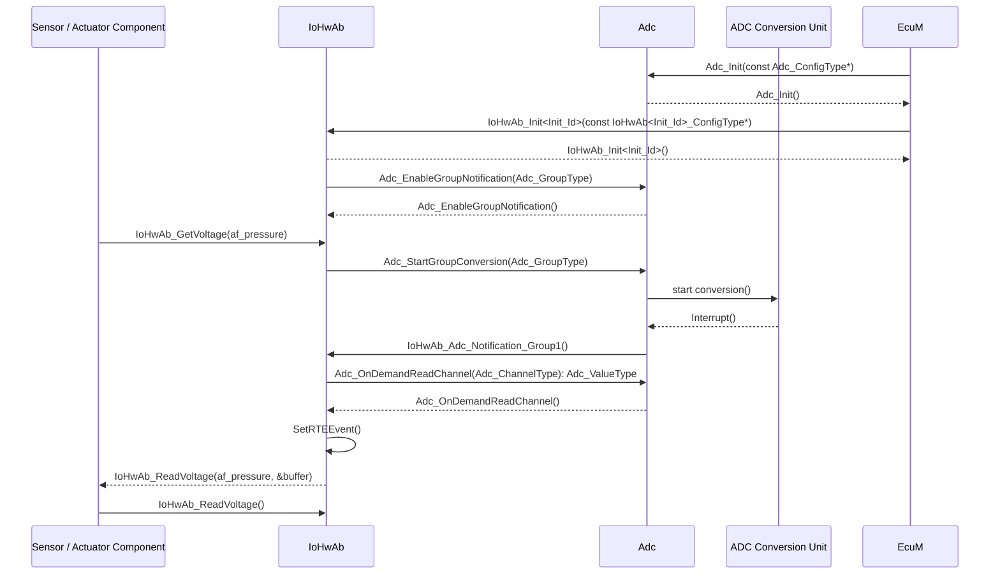

**注意：**

* **ADC**转换单元（**ADC Conversion Unit**）包含通道组 1（**Group 1**）：通道 1（**Channel 1**）与通道 2（**Channel 2**），且通知机制（**notification mechanism**）已激活。
* API **IoHwAb_GetVoltage**(af_pressure) 与 **IoHwAb_ReadVoltage**(af_pressure, &buffer) 并非规范定义的接口，仅用于本示例。
* 本图旨在展示可运行实体（**runnables**），并不表示服务器端口到可运行实体的映射关系。

### 8.2. 因应用低功耗模式请求而将ADC和PWM设置为低功耗电源状态（示例）

下图讲述了**I/O**硬件抽象模块设计的电源状态转换，实现将**ADC**和**PWM**设置为低功耗模式的状态。

其中外设配置为异步电源状态转换。在收到准备电源状态的请求后，外围设备的驱动程序向调用者**IoHwAb**发出通知，通知它已准备好转换到新的电源状态。

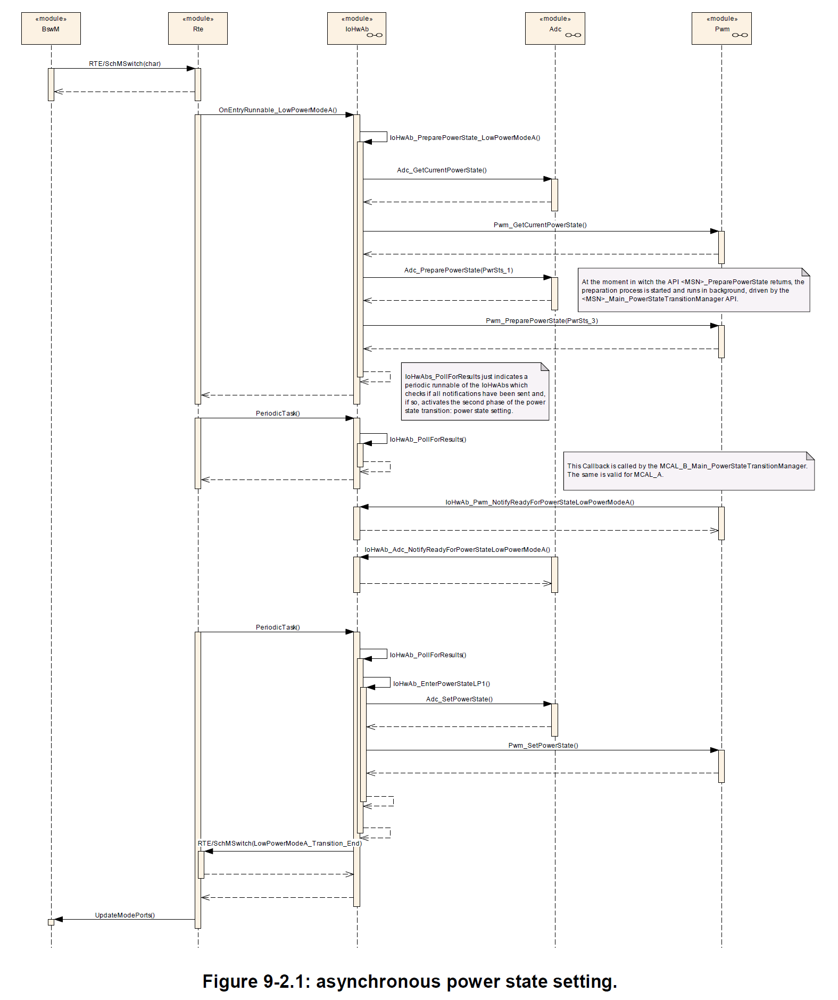

下图展示了一个同步转换，即：外围设备能够立即完成状态的转换，无需实现一个异步等待的过程。

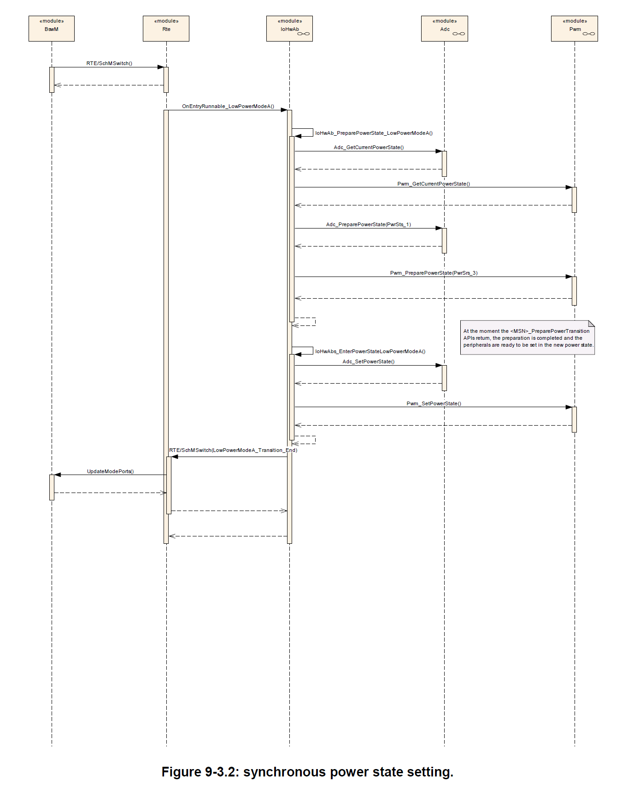

## 9. 配置规范

**I/O**硬件抽象没有标准化的配置参数，因此不属于**AUTOSAR** ECU-C参数定义的一部分。所有参数都是供应商特定参数。

### 9.1. 发布信息

有关详细信息，请参阅**SWS_BSWGeneral**规范中的第10.3章"发布信息"（**Published Information**）。

<section id="wechat">

<h4>微信扫一扫，获取更多及时资讯</h4>


</section>
