## 1. 简介和功能概述

本规范规定了**AUTOSAR**基础软件模块**OCU**驱动程序的功能、**API**和配置。

每个**OCU**软件通道都链接到属于微控制器的硬件**OCU**外设。可以选择性地为该通道附加一个输出引脚。

该驱动程序提供初始化和控制微控制器内部**OCU**（**Output Compare Unit**，输出比较单元）功能的函数。当计数器的值与定义的阈值匹配时，**OCU**驱动允许进行比较并自动执行动作。**OCU**驱动为以下目的提供服务与配置参数：

* 启动和停止比较过程
* 设置比较阈值
* 启用和禁用通知机制
* 获取计数器值
* 改变输出引脚状态
* 在可用时触发某些硬件资源（**ADC**、**DMA**）

通道计数器的 tick 时长取决于通道特定设置（**OCU**驱动的一部分）以及由**MCU**模块控制的系统时钟和时钟树设置。本规范不对 tick 时长施加限制。

某些微控制器没有专用的**OCU**硬件单元，而是具有可配置为提供**OCU**功能及其他定时器功能的通用定时器模块。本规范不假设硬件架构；相反，它定义的参数和**API**可以在任何合适的硬件架构上实现。下图展示了一个**OCU**通道的典型表示。

"output"（输出）是比较匹配时实际执行的动作。

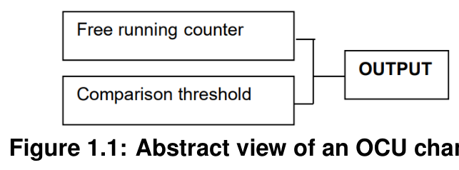

## 2. 缩略语

以下术语表包含与**OCU**驱动模块相关、且未包含在 [1] AUTOSAR 术语表中的缩略语和缩写。

局部作用域的缩略语和缩写出现在以下术语表中；全局作用域的包含在**AUTOSAR**术语表中。

**OCU**
> 输出比较单元（**Output Compare Unit**）

**DMA**
> 直接内存访问（**Direct Memory Access**）

**MCAL**
> 微控制器抽象层（**Microcontroller Abstraction Layer**）

**MCU**
> 微控制器单元（**Microcontroller Unit**）

**DEM**
> 诊断事件管理器（**Diagnostic Event Manager**）

**DET**
> 默认错误跟踪器（**Default Error Tracer**）

**SPAL**
> 标准外设抽象层（**Standard Peripheral Abstraction Layer**）

**MCU**
> 微控制器单元（**Microcontroller Unit**）

**ISR**
> 中断服务例程（**Interrupt Service Routine**）

术语定义：

**OCU channel**
> 表示一个逻辑实体，由自由运行计数器、比较阈值以及作为比较过程结果而执行的动作组成。

**Compare threshold**
> 每次计数器增加一个单位时与计数器内容相比较的目标值。

**Free running counter**
> 从最小值（分别为最大值）运行到最大值（分别为最小值）的计数器，并在到达最大值（分别为最小值）后自动从最小值（分别为最大值）重新开始。

**Reference Interval**
> 由**Ocu_SetAbsoluteThreshold** **API**的调用者给出的区间（以 tick 为单位），并用作计算返回信息的基础。

## 3. 相关文档

### 3.1. 输入文件

[1] Glossary
AUTOSAR_FO_TR_Glossary

[2] General Specification of Basic Software Modules
AUTOSAR_CP_SWS_BSWGeneral

[3] Specification of ECU Configuration
AUTOSAR_CP_TPS_ECUConfiguration

[4] Layered Software Architecture
AUTOSAR_CP_EXP_LayeredSoftwareArchitecture

[5] General Requirements on Basic Software Modules
AUTOSAR_CP_SRS_BSWGeneral

[6] List of Basic Software Modules
AUTOSAR_CP_TR_BSWModuleList

### 3.2. 相关规范

**AUTOSAR**提供了一份基础软件模块通用规范 [2]，它同样适用于**OCU**驱动。因此，基础软件模块通用规范 [2] 应视为**OCU**驱动的附加必需规范。

## 4. 约束和假设

**OCU**驱动程序工作所依据的假设如下。

**时钟**：该驱动程序不支持时钟的动态更改。由于系统时钟完全由**MCU**模块管理，系统时钟设置的任何动态更改都会影响本模块。该模块不在睡眠模式下运行。

**资源**：资源的分配完全由软件或硬件单方面进行，以避免共享资源问题。例如：使用**API Ocu_SetPinState**。不能对处于**RUNNING**状态的通道调用该**API**来改变引脚状态，否则可能在硬件在比较匹配时自动设置的状态与**API**设置的状态之间产生冲突。

**计数和比较**：我们假设将运行本驱动程序的硬件具有如下计数器抽象模型（以八位计数器为例）。


最小值为 0，最大值为 255。计数器超过最大值时重载为 0，即它具有 256 个计数步进。

由于计数量化，将计数器内容与阈值比较时可能出现两种情况：比较可以在进入计数器某个状态时发生，也可以在退出某个状态时发生，如下图所示。

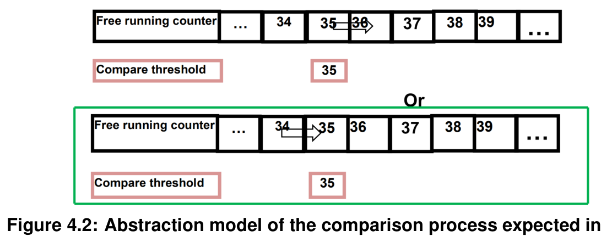

本驱动程序的预期行为是在进入阈值所代表的状态时完成比较。

### 4.1. 限制

无限制。

### 4.2. 汽车域的适用性

无限制。

## 5. 对其他模块的依赖

### 5.1. 模块 DET

如果为**OCU**驱动启用了开发错误检测，则本模块每当遇到开发错误时，应向默认错误跟踪器（**DET**）上报错误。

### 5.2. 模块 DEM

**OCU**驱动应向诊断事件管理器（**DEM**）报告生产错误。

### 5.3. 模块 MCU 驱动

微控制器单元驱动（**MCU Driver**）主要负责初始化和控制芯片内部时钟源和时钟预分频器。**OCU**依赖系统时钟。因此，系统时钟的更改（例如**PLL**开/**PLL**关）也会影响**OCU**硬件的时钟设置。

**MCU**驱动将设置全局预分频器和**OCU**时钟。**OCU**驱动在其初始化函数中不负责设置配置全局时钟、全局预分频器和**PLL**的寄存器，这必须由**MCU**模块完成。**OCU**驱动只配置本地（**OCU**外设特定）资源。

文档**AUTOSAR_TPS_ECUConfiguration** [3] 包含 "4.8 Clock Tree Configuration" 一章，其中详述了向外设提供参考时钟信号的机制。

### 5.4. 模块 PORT

用作**OCU**输出的端口引脚的配置由**PORT**驱动完成。因此**PORT**驱动必须在**OCU**函数使用之前初始化。

### 5.5. 文件结构

#### 5.5.1. 代码文件结构

代码文件结构不应完全在本规范中定义。在这一点上应指出，代码文件结构应包含以下文件：

* Ocu_Lcfg.c - 用于链接时间可配置参数
* Ocu_PBcfg.c - 用于构建后可配置参数

这些文件应包含所有链接时间和构建后可配置参数。

#### 5.5.2. 头文件结构

Ocu.c 应包含 Ocu.h 和 Det.h。

## 6. 功能规格

### 6.1. 一般行为

**OCU**通道由两个主要元素组成：自由运行计数器和比较阈值。这些元素共同作用以生成用户所需的动作。自由运行计数器可以由硬件或软件提供，而阈值是由用户设置的值。然后每次计数器增加一个单位时，将阈值与计数器的当前内容进行比较。

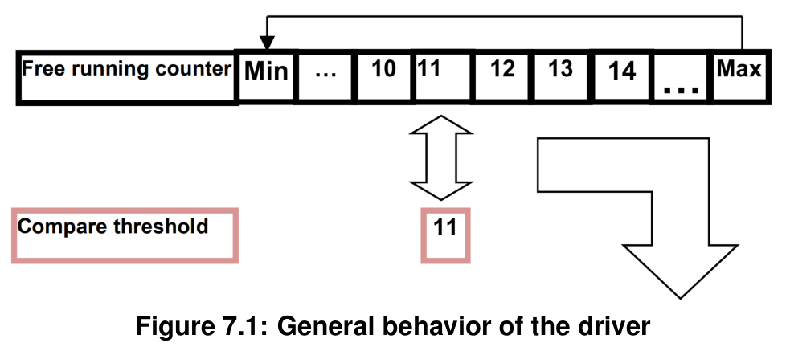

驱动程序每次计数器增加一个单位时比较这两个值。相等时，可以执行两种不同类型的动作：

* 通过通知函数向上层报告信息。
* 对配置的输出引脚施加作用。

**OCU**驱动提供以下通道管理服务：

* 启动通道
* 停止通道
* 设置比较阈值
* 启用和禁用通道的通知函数
* 获取计数器值
* 改变输出引脚状态

输出比较通道的状态和状态转换如下图所示。

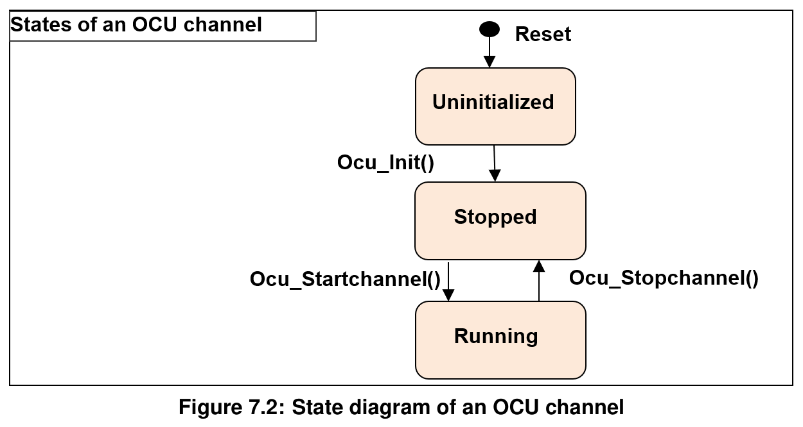

**Ocu**通道具有上图所示的简单状态图。驱动程序的所有通道都通过**API Ocu_Init()**一次性初始化。没有单独初始化每个通道的**API**。

根据硬件架构，与**Ocu**通道绑定的硬件可能由**OCU**单元或微控制器中的任何其他定时器模块管理。

### 6.2. 版本检查

#### 6.2.1. 背景和原理

应避免不兼容文件的集成。最低实现是在 **.c** 文件内检查头文件的版本（**.c** 和 **.h** 文件的版本号必须相同）。

**OCU**驱动应执行模块间检查以避免不兼容文件的集成。被包含的导入文件应通过预处理指令进行检查。

应验证以下版本号：

* <MODULENAME>_AR_RELEASE_MAJOR_VERSION
* <MODULENAME>_AR_RELEASE_MINOR_VERSION

其中 <MODULENAME> 是提供**OCU**驱动所包含头文件的外部（其他）模块的模块短名。如果这些值与期望值不一致，应报告错误。

### 6.3. 时间单位 Tick

#### 6.3.1. 背景和原理

要从寄存器值获取时间，需要知道振荡器频率、预分频器以及整个系统时钟的一些其他设置。由于这些设置是在**MCU**和/或其他模块中完成的，因此无法计算此类时间。因此，时间与 tick 之间的转换应是上层的一部分。

#### 6.3.2. 需求

**OCU**驱动**API**服务中使用的所有时间单位都应为 **tick**。

### 6.4. 错误分类

基础软件模块通用规范 [2] 的 "**Error Handling**" 一节详细描述了基础软件的错误处理。最重要的是，它构成了一个包含**BSW**模块中可能发生的五种错误类型的分类方案。

在此基础上，以下各节规定在相应小节中安排的特定错误。

以下错误应由**OCU**驱动根据其构建版本（开发/生产模式）检测。

#### 6.4.1. 开发错误

开发错误值的类型为 **uint8**。

| 错误类型 | 相关错误码 | 错误值 |
|---|---|---|
| 除**Ocu_GetVersionInfo()**和**Ocu_Init()**外的**API**服务在模块未初始化时被使用 | OCU_E_UNINIT | 0x02 |
| **API**服务使用了无效的通道标识符 | OCU_E_PARAM_INVALID_CHANNEL | 0x03 |
| **API Ocu_SetPinState()** 以无效的引脚状态调用，或在通道处于**RUNNING**状态时调用 | OCU_E_PARAM_INVALID_STATE | 0x04 |
| **API Ocu_SetPinAction()** 以无效的引脚动作调用 | OCU_E_PARAM_INVALID_ACTION | 0x05 |
| 在配置了**NULL**指针作为通知函数的通道上使用**Ocu_DisableNotification()**或**Ocu_EnableNotification()** | OCU_E_NO_VALID_NOTIF | 0x06 |
| **OCU**驱动已初始化时调用**API Ocu_Init()** | OCU_E_ALREADY_INITIALIZED | 0x07 |
| **API Ocu_GetVersionInfo()** 以**NULL**参数调用 | OCU_E_PARAM_POINTER | 0x08 |
| 对没有关联输出引脚的通道调用**Ocu_SetPinState()**或**Ocu_SetPinAction()** | OCU_E_PARAM_NO_PIN | 0x0A |
| **OCU**初始化失败，例如所选的配置集不存在 | OCU_E_INIT_FAILED | 0x0B |

由于特定实现和/或特定硬件属性而检测到的其他错误，应添加到**OCU**器件特定实现规范中。分类和枚举应与上面列出的错误兼容。

#### 6.4.2. 运行时错误

| 错误类型 | 相关错误码 | 错误值 |
|---|---|---|
| 对处于**RUNNING**状态的通道调用**API Ocu_StartChannel()** | OCU_E_BUSY | 0x09 |

#### 6.4.3. 瞬态故障

无瞬态故障。

#### 6.4.4. 生产错误

无生产错误。

#### 6.4.5. 扩展生产错误

无扩展生产错误。

### 6.5. 错误检测

开发错误的检测可在预编译时配置（开/关）。开关**OcuDevErrorDetectApi**应激活或停用所有开发错误的检测。

如果开关**OcuDevErrorDetectApi**启用，则启用**API**参数检查。被检测错误的详细描述可在错误分类章节和**API**规范章节中找到。

生产错误的检测不能关闭。

### 6.6. 错误通知

如果设置了预处理器开关**OcuDevErrorDetectApi**，检测到的开发错误应通过默认错误跟踪器（**DET**）的服务**Det_ReportError**上报。

### 6.7. 调试支持

每个需由**AUTOSAR**调试访问的变量应定义为全局变量。

所有需调试变量的类型定义应可通过头文件**Ocu.h**访问。

头文件中变量的声明应使得可以通过 **C** 的 "**sizeof**" 计算变量大小。

可用于调试的变量应在相应的**OCU**驱动描述中说明。

## 7. API规范

### 7.1. 导入的类型

本章列出从以下文件包含的所有类型。

| 模块 | 头文件 | 导入类型 |
|---|---|---|
| Std | Std_Types.h | Std_ReturnType |
| Std | Std_Types.h | Std_VersionInfoType |

### 7.2. 类型定义

#### 7.2.1. Ocu_ChannelType

类型，派生自 **uint**。范围为：8 / 16 / 32 位 - 这是实现特定的，但并非类型内的所有值都有效。应选择该类型以在特定微控制器平台上获得最高效的实现。**OCU**通道的数字标识符。可通过**Ocu.h**获得。

#### 7.2.2. Ocu_ValueType

类型，派生自 **uint**。范围为：8 / 16 / 32 位 - 这是实现特定的，但并非类型内的所有值都有效。应选择该类型以在特定微控制器平台上获得最高效的实现。用于读取计数器和写入阈值值的类型（以 tick 数为单位）。可通过**Ocu.h**获得。

#### 7.2.3. Ocu_PinStateType

枚举类型，取值范围：

* **OCU_HIGH**（0x00）：与**OCU**通道关联的引脚处于高电平。
* **OCU_LOW**（0x01）：与**OCU**通道关联的引脚处于低电平。

链接到**OCU**通道的引脚的输出状态。可通过**Ocu.h**获得。

#### 7.2.4. Ocu_PinActionType

枚举类型，取值范围：

* **OCU_SET_HIGH**（0x00）：通道引脚将在比较匹配时被置高。
* **OCU_SET_LOW**（0x01）：通道引脚将在比较匹配时被置低。
* **OCU_TOGGLE**（0x02）：通道引脚将在比较匹配时被设置为当前电平的相反电平。
* **OCU_DISABLE**（0x03）：通道引脚将在比较匹配时保持当前电平。

由硬件自动执行（如果支持）的、对附加到**OCU**通道的引脚的动作。可通过**Ocu.h**获得。

#### 7.2.5. Ocu_ConfigType

结构类型。硬件相关。初始化数据结构的内容是硬件特定的。这是包含**OCU**驱动初始化数据的数据结构的类型。可通过**Ocu.h**获得。

#### 7.2.6. Ocu_ReturnType

枚举类型，取值范围：

* **OCU_CM_IN_REF_INTERVAL**（0x00）：比较匹配将在当前参考区间内发生。
* **OCU_CM_OUT_REF_INTERVAL**（0x01）：比较匹配不会在当前参考区间内发生。

设置新阈值值后的返回信息。可通过**Ocu.h**获得。

### 7.3. 函数定义

#### 7.3.1. Ocu_Init

**说明**: **OCU**初始化服务。可通过**Ocu.h**获得。本服务为同步调用，不可重入。参数 ConfigPtr（in）：指向配置集的指针。

```C
void Ocu_Init ( const Ocu_ConfigType* ConfigPtr )
```

**Ocu_Init**函数应根据**ConfigPtr**引用的配置集，初始化所有内部变量和所使用的微控制器**Ocu**结构。

注意：所有通道都由**API Ocu_Init**一次性初始化。没有单独初始化每个通道的**API**。

如果**OCU**单元的自由运行计数器可被其他定时器模块使用，则**Ocu**驱动不得启动或停止该自由运行计数器。

**API Ocu_Init**应启动所有由本驱动独占使用的自由运行计数器。

**Ocu_Init**函数应只初始化配置的资源，不得触及配置文件中未配置的资源。

关于控制器寄存器初始化的以下规则适用于本驱动实现：

* 如果硬件只允许寄存器的一种用法（寄存器专用于**OCU**资源），则**OCU**驱动负责初始化该寄存器。
* 注意 1：如果寄存器可以影响多个硬件模块且不是 **I/O** 寄存器，则应由**MCU**驱动初始化。
* 注意 2：需要在复位后立即初始化的一次性可写寄存器，应由启动代码初始化。
* 注意 3：所有其他寄存器应由启动代码初始化。
* 注意 4：如果寄存器可以影响多个硬件模块且是 **I/O** 寄存器，应由**PORT**驱动初始化。

如果为**OCU**驱动启用了开发错误检测，且在**OCU**驱动和硬件已初始化时调用**Ocu_Init**函数，则**Ocu_Init**函数应上报开发错误**OCU_E_ALREADY_INITIALIZED**并不做任何动作地返回。

通过执行**Ocu_Init**函数重新初始化**OCU**驱动，需要事先通过执行**Ocu_DeInit**函数进行反初始化。

#### 7.3.2. Ocu_DeInit

**说明**: 此函数反初始化**OCU**模块。可通过**Ocu.h**获得。本服务为同步调用，不可重入。

```C
void Ocu_DeInit ( void )
```

**Ocu_DeInit**函数应将**Ocu_Init**初始化的**OCU**变量和寄存器反初始化到与上电复位状态相当的状态。不可写寄存器的值除外。

注意：硬件设计应负责确保该状态不会导致微控制器中的未定义行为。

**Ocu_DeInit**函数应禁用所有使用的中断和通知。

**Ocu_DeInit**函数应只影响由静态配置和/或先前**Ocu_Init()**调用传递的运行时配置集分配的外设。

**API Ocu_DeInit**应停止所有由本驱动独占使用的自由运行计数器。

注意：为防止反初始化期间的未定义行为，用户必须在调用**API Ocu_DeInit**之前停止所有**RUNNING**状态的通道（通过调用**Ocu_StopChannel**函数）。因此有下面的需求。

如果为**OCU**驱动启用了开发错误检测：如果调用**Ocu_DeInit**函数时仍有通道处于**RUNNING**状态，则函数应上报开发错误 "**OCU_E_PARAM_INVALID_STATE**" 并不做任何动作地返回。

**Ocu_DeInit**函数应可通过配置参数**OcuDeInitApi {OCU_DE_INIT_API}**在预编译时配置开/关。

如果为**OCU**驱动启用了开发错误检测：如果驱动未初始化，**Ocu_DeInit**函数应上报错误**OCU_E_UNINIT**。

#### 7.3.3. Ocu_StartChannel

**说明**: 启动**OCU**通道的服务。可通过**Ocu.h**获得。本服务为同步调用；对不同通道号可重入。参数 ChannelNumber（in）：**OCU**的数字标识符。返回值：**Std_ReturnType**，**E_OK** 表示通道已启动；**E_NOT_OK** 表示通道未启动。

```C
Std_ReturnType Ocu_StartChannel ( Ocu_ChannelType ChannelNumber )
```

**Ocu_StartChannel**函数应通过允许执行所有配置的比较匹配动作来启动**OCU**通道。

**Ocu_StartChannel**函数在针对不同通道调用时应可重入。

如果**Ocu_StartChannel**函数已成功执行，所选通道的状态应设置为 "**RUNNING**"。

如果对处于 "**RUNNING**" 状态的通道调用**Ocu_StartChannel**函数，则函数应上报错误**OCU_E_BUSY**并不做任何动作地返回。

如果为**OCU**驱动启用了开发错误检测：如果参数**ChannelNumber**无效（不在配置规定的范围内），**Ocu_StartChannel**函数应上报错误**OCU_E_PARAM_INVALID_CHANNEL**并不做任何动作地返回。

如果为**OCU**驱动启用了开发错误检测：如果驱动未初始化，**Ocu_StartChannel**函数应上报错误**OCU_E_UNINIT**并不做任何动作地返回。

#### 7.3.4. Ocu_StopChannel

**说明**: 停止**OCU**通道的服务。可通过**Ocu.h**获得。本服务为同步调用；对不同通道号可重入。参数 ChannelNumber（in）：**OCU**的数字标识符。

```C
void Ocu_StopChannel ( Ocu_ChannelType ChannelNumber )
```

**Ocu_StopChannel**函数应通过停止此通道配置的比较匹配动作来停止**OCU**通道。

**Ocu_StopChannel**函数不得停止与通道关联的自由运行计数器。

注意：这是因为一个自由运行计数器可以与多个**Ocu**通道关联。因此，停止该计数器将损害其他通道的运行。

**Ocu_StopChannel**函数在针对不同通道调用时应可重入。

如果**Ocu_StopChannel**函数成功执行，所选通道的状态应设置为 "**STOPPED**"。

如果对处于 "**STOPPED**" 状态的通道调用**Ocu_StopChannel**函数，则函数应不做任何动作地离开（不改变通道状态），且不应上报开发错误。

如果为**OCU**驱动启用了开发错误检测：如果参数**ChannelNumber**无效（不在配置规定的范围内），**Ocu_StopChannel**函数应上报错误**OCU_E_PARAM_INVALID_CHANNEL**并不做任何动作地返回。

如果为**OCU**驱动启用了开发错误检测：如果驱动未初始化，**Ocu_StopChannel**函数应上报错误**OCU_E_UNINIT**并不做任何动作地返回。

#### 7.3.5. Ocu_SetPinState

**说明**: 立即设置与**OCU**通道关联的引脚电平的服务。可通过**Ocu.h**获得。本服务为同步调用；对不同通道号可重入。参数 ChannelNumber（in）：**OCU**的数字标识符。参数 PinState（in）：**OCU_LOW**、**OCU_HIGH**。

```C
void Ocu_SetPinState ( Ocu_ChannelType ChannelNumber, Ocu_PinStateType PinState )
```

**Ocu_SetPinState**函数应将与通道关联的引脚设置为**PinState**指示的电平。

**Ocu_SetPinState**函数在针对不同通道调用时应可重入。

**Ocu_SetPinState**函数应仅在通道不处于**RUNNING**状态时使用。

注意：先前的需求也意味着应可以通过此**API**改变**STOPPED**状态通道的状态。

**Ocu_SetPinState**函数应可通过配置参数**OcuSetPinStateApi {OCU_SET_PIN_STATE_API}**在预编译时配置开/关。

如果为**OCU**驱动启用了开发错误检测：如果参数**ChannelNumber**无效（不在配置规定的范围内），**Ocu_SetPinState**函数应上报错误**OCU_E_PARAM_INVALID_CHANNEL**并不做任何动作地返回。

如果为**OCU**驱动启用了开发错误检测：如果引脚未与通道关联（未在通道配置中定义），**Ocu_SetPinState**函数应上报错误**OCU_E_PARAM_NO_PIN**并不做任何动作地返回。

如果为**OCU**驱动启用了开发错误检测：如果参数**PinState**无效（不在配置规定的范围内），**Ocu_SetPinState**函数应上报错误**OCU_E_PARAM_INVALID_STATE**并不做任何动作地返回。

如果为**OCU**驱动启用了开发错误检测：如果驱动未初始化，**Ocu_SetPinState**函数应上报错误**OCU_E_UNINIT**并不做任何动作地返回。

如果为**OCU**驱动启用了开发错误检测：如果通道处于**RUNNING**状态，**Ocu_SetPinState**函数应上报错误**OCU_E_PARAM_INVALID_STATE**并不做任何动作地返回。

#### 7.3.6. Ocu_SetPinAction

**说明**: 告知驱动程序比较匹配时硬件（如果支持）应自动执行什么动作的服务。可通过**Ocu.h**获得。本服务为同步调用；对不同通道号可重入。参数 ChannelNumber（in）：**OCU**的数字标识符。参数 PinAction（in）：**OCU_SET_LOW**、**OCU_SET_HIGH**、**OCU_TOGGLE**、**OCU_DISABLE**。

```C
void Ocu_SetPinAction ( Ocu_ChannelType ChannelNumber, Ocu_PinActionType PinAction )
```

**Ocu_SetPinAction**函数应设置硬件在相应**OCU**通道的下一次比较匹配时自动执行的动作。

**Ocu_SetPinAction**函数在针对不同通道调用时应可重入。

**Ocu_SetPinAction**函数应可通过配置参数**OcuSetPinActionApi {OCU_SET_PIN_ACTION_API}**在预编译时配置开/关。

如果为**OCU**驱动启用了开发错误检测：如果参数**ChannelNumber**无效（不在配置规定的范围内），**Ocu_SetPinAction**函数应上报错误**OCU_E_PARAM_INVALID_CHANNEL**并不做任何动作地返回。

如果为**OCU**驱动启用了开发错误检测：如果引脚未与通道关联（未在通道配置中定义），**Ocu_SetPinAction**函数应上报错误**OCU_E_PARAM_NO_PIN**并不做任何动作地返回。

如果为**OCU**驱动启用了开发错误检测：如果参数**PinAction**无效（不在类型规定的范围内），**Ocu_SetPinAction**函数应上报错误**OCU_E_PARAM_INVALID_ACTION**并不做任何动作地返回。

如果为**OCU**驱动启用了开发错误检测：如果驱动未初始化，**Ocu_SetPinAction**函数应上报错误**OCU_E_UNINIT**并不做任何动作地返回。

如果引脚与通道关联；比较匹配时应对此引脚执行相关动作。

#### 7.3.7. Ocu_GetCounter

**说明**: 读取计数器当前值的服务。可通过**Ocu.h**获得。本服务为同步调用，可重入。参数 ChannelNumber（in）：**OCU**通道的数字标识符。返回值：**Ocu_ValueType**，以 tick 为单位的计数器内容。

```C
Ocu_ValueType Ocu_GetCounter ( Ocu_ChannelType ChannelNumber )
```

**Ocu_GetCounter**函数应读取并返回**ChannelNumber**指示的通道的计数器值。

**Ocu_GetCounter**函数应可重入。

**Ocu_GetCounter**函数应可通过配置参数**OcuGetCounterApi {OCU_GET_COUNTER_API}**在预编译时配置开/关。

如果为**OCU**驱动启用了开发错误检测：如果参数**ChannelNumber**无效（不在配置规定的范围内），**Ocu_GetCounter**函数应上报错误**OCU_E_PARAM_INVALID_CHANNEL**并返回值 "**0**"。

如果为**OCU**驱动启用了开发错误检测：如果驱动未初始化，则**Ocu_GetCounterValue**函数应上报错误**OCU_E_UNINIT**并返回值 "**0**"。

#### 7.3.8. Ocu_SetAbsoluteThreshold

**说明**: 使用绝对输入数据设置通道阈值值的服务。可通过**Ocu.h**获得。本服务为同步调用；对不同通道号可重入。参数 ChannelNumber（in）：**OCU**通道的数字标识符。参数 ReferenceValue（in）：由上层给出的值，用作确定是否在函数退出之前调用通知的基础。参数 AbsoluteValue（in）：与计数器内容比较的值。此值以 tick 为单位。返回值：**Ocu_ReturnType**，告知调用者设置新阈值值后，比较匹配是否将在当前参考区间内发生（或已经发生）。

```C
Ocu_ReturnType Ocu_SetAbsoluteThreshold (
    Ocu_ChannelType ChannelNumber, Ocu_ValueType ReferenceValue, Ocu_ValueType AbsoluteValue
)
```

**Ocu_SetAbsoluteThreshold**函数应将通道阈值（比较值）设置为**AbsoluteValue**给出的值。

**Ocu_SetAbsoluteThreshold**函数在针对不同通道调用时应可重入。

**Ocu_SetAbsoluteThreshold**函数应可通过配置参数**OcuSetAbsoluteThresholdApi {OCU_SET_ABSOLUTE_THRESHOLD_API}**在预编译时配置开/关。

如果为**OCU**驱动启用了开发错误检测：如果驱动未初始化，**Ocu_SetAbsoluteThreshold**函数应上报错误**OCU_E_UNINIT**并不做任何动作地返回。

如果为**OCU**驱动启用了开发错误检测：如果参数**ChannelNumber**无效（不在配置规定的范围内），**Ocu_SetAbsoluteThreshold**函数应上报错误**OCU_E_PARAM_INVALID_CHANNEL**并不做任何动作地返回。

注意：**ReferenceValue**是来自上层的信息。通过**ReferenceValue**与**AbsoluteValue**的组合，提供了一个区间（定义为 "**Reference Interval**"，下图中的绿色区域），以考虑计数器连续运行的事实，以及调用者请求更新比较阈值与此阈值实际修改之间可能存在延迟。

为简化描述，我们假设由于内部**MCU**和外设时序，对**HW**比较寄存器的写动作总是：

* 在实际比较发生之前完成，甚至可能在同一个时钟周期内（情况 1）
* 在实际比较发生之后完成，甚至可能在同一个时钟周期内（情况 2）

如下图所示，以**Ocu_SetAbsoluteThreshold(1,30,35);**示例说明。

* 情况 1：阈值实际上在目标比较匹配发生之前写入。

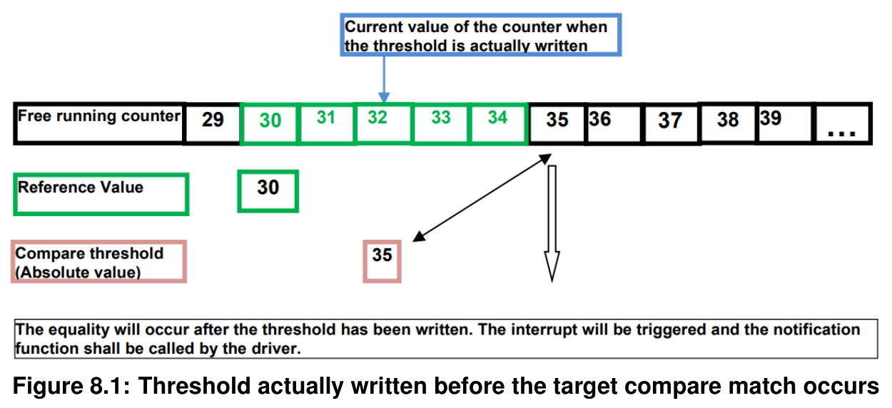

* 情况 2：阈值在目标比较匹配发生之后写入。

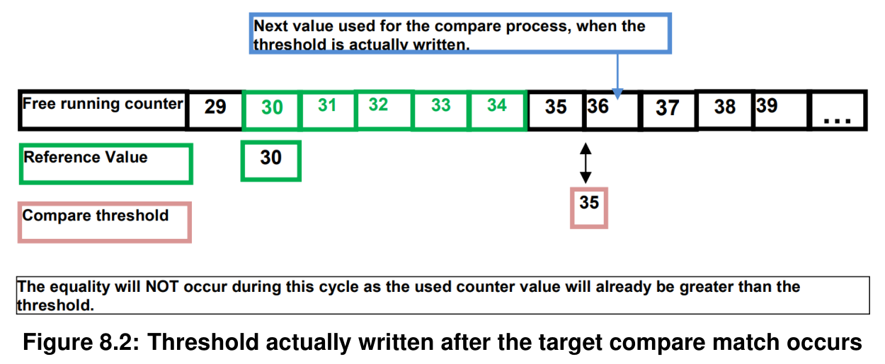

**Reference Interval**考虑计数器可能的翻转（**rollover**），如下图所示。

**Ocu_SetAbsoluteThreshold(1,70,20);**

以从 0 运行到 255 的计数器为例。

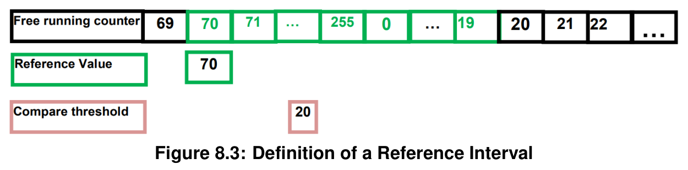

作为上述情况的结果，驱动程序的预期行为如下。

* 仅在比较匹配（硬件）时向上层发出通知：因此，在每个参考区间内写入阈值的每个值，应有唯一（至多，见下文关于如何管理写入的阈值值）的一次通知。
* **API Ocu_SetAbsoluteThreshold**应返回一个状态，告知调用者：
  * 写入是在当前参考区间内完成的（在实际比较匹配之前，甚至可能在**API**返回之前比较匹配已经发生）（情况 1）
  * 或者写入是在当前参考区间之外完成的。（情况 2）

此状态将帮助调用者（应用程序）决定如何进行。

设置新阈值值后，**API Ocu_SetAbsoluteThreshold**应返回一个状态，告知调用者设置新阈值值后，比较匹配是否将在当前参考区间内发生（或已经发生）。

对于先前调用**API Ocu_SetAbsoluteThreshold**期间写入的阈值，驱动程序的预期行为如下：先前写入的阈值值被当前调用擦除。

注意：由于实时行为，先前写入的阈值值仍可能产生比较匹配；即在**API**被调用之后、但阈值值尚未实际更改之前。

在实际设置新阈值值时，上次调用此**API**期间写入的先前阈值值不再产生比较匹配。

#### 7.3.9. Ocu_SetRelativeThreshold

**说明**: 相对于计数器当前值设置通道阈值值的服务。可通过**Ocu.h**获得。本服务为同步调用；对不同通道号可重入。参数 ChannelNumber（in）：**OCU**通道的数字标识符。参数 RelativeValue（in）：用于计算新阈值的值。返回值：**Ocu_ReturnType**，告知调用者设置新阈值值后，比较匹配是否将在当前参考区间内发生（或已经发生）。

```C
Ocu_ReturnType Ocu_SetRelativeThreshold (
    Ocu_ChannelType ChannelNumber, Ocu_ValueType RelativeValue
)
```

此**API**的行为如下。

* 进入时，**API**读取计数器值（**ReadValue**）。然后按以下公式计算并写入新阈值：

```C
NewThresholdValue = ReadValue + RelativeValue;
```

其余行为则与**API Ocu_SetAbsoluteThreshold**相同，其中参考值现在为**ReadValue**，参考区间位于**ReadValue**与新编程的阈值（**NewThresholdValue**）之间，如下图所示。

示例**Ocu_SetRelativeThreshold(1,5);**

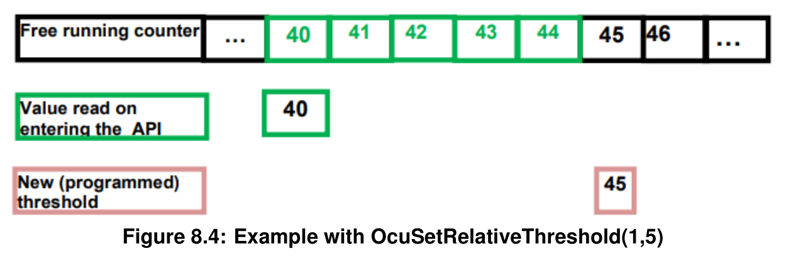

注意：与**API Ocu_SetAbsoluteThreshold**一样，计数器的可能翻转也包含在参考区间中，如下图所示。示例**Ocu_SetRelativeThreshold(1,20)**，**ReadValue**等于 253。因此，此**API**的行为类似于**Ocu_SetAbsoluteThreshold**，故有下面的需求。

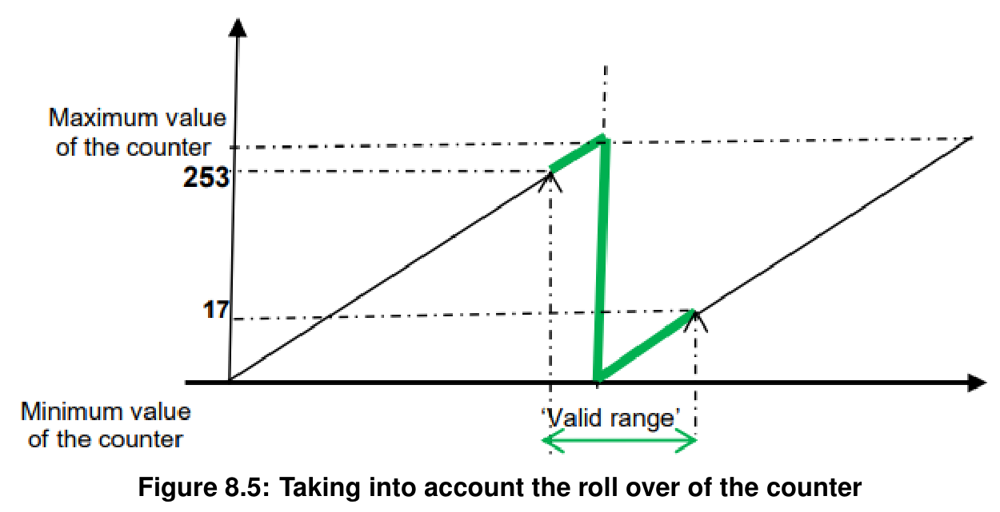

**Ocu_SetRelativeThreshold**函数应在进入函数时将**RelativeValue**加到计数器值上，以计算相对于计数器的新阈值。

设置新阈值值后，**API Ocu_SetRelativeThreshold**应返回一个状态，告知调用者设置新阈值值后，比较匹配是否将在当前参考区间内发生（或已经发生）。

在实际设置新阈值值（绝对或相对）时，先前阈值值不再产生比较匹配。

**API Ocu_SetAbsoluteThreshold**在针对不同通道调用时应可重入。

**Ocu_SetRelativeThreshold**函数应可通过配置参数**OcuSetRelativeThresholdApi {OCU_SET_RELATIVE_THRESHOLD_API}**在预编译时配置开/关。

如果为**OCU**驱动启用了开发错误检测：如果驱动未初始化，**Ocu_SetRelativeThreshold**函数应上报错误**OCU_E_UNINIT**并不做任何动作地返回。

如果为**OCU**驱动启用了开发错误检测：如果参数**ChannelNumber**无效（不在配置规定的范围内），**Ocu_SetRelativeThreshold**函数应上报错误**OCU_E_PARAM_INVALID_CHANNEL**并不做任何动作地返回。

#### 7.3.10. Ocu_DisableNotification

**说明**: 此服务用于禁用来自**OCU**通道的通知。可通过**Ocu.h**获得。本服务为同步调用；对不同通道号可重入。参数 ChannelNumber（in）：**OCU**通道的数字标识符。

```C
void Ocu_DisableNotification ( Ocu_ChannelType ChannelNumber )
```

**Ocu_DisableNotification**函数应禁用**OCU**比较匹配通知。

**Ocu_DisableNotification**函数在针对不同通道调用时应可重入。

**Ocu_DisableNotification**函数应可通过配置参数**OcuNotificationSupported {OCU_NOTIFICATION_SUPPORTED}**在预编译时配置开/关。

如果为**OCU**驱动启用了开发错误检测：如果驱动未初始化，**Ocu_DisableNotification**函数应上报错误**OCU_E_UNINIT**并不做任何动作地返回。

如果为**OCU**驱动启用了开发错误检测：如果参数**Channel**无效（不在配置规定的范围内），**Ocu_DisableNotification**函数应上报错误**OCU_E_PARAM_INVALID_CHANNEL**并不做任何动作地返回。

如果为**OCU**驱动启用了开发错误检测：如果通知函数是**NULL**指针，**Ocu_DisableNotification**函数应上报错误**OCU_E_NO_VALID_NOTIF**并不做任何动作地返回。

#### 7.3.11. Ocu_EnableNotification

**说明**: 此服务用于启用来自**OCU**通道的通知。可通过**Ocu.h**获得。本服务为同步调用；对不同通道号可重入。参数 ChannelNumber（in）：**OCU**通道的数字标识符。

```C
void Ocu_EnableNotification ( Ocu_ChannelType ChannelNumber )
```

**Ocu_EnableNotification**函数应启用被索引通道的**OCU**比较匹配通知。

**Ocu_EnableNotification**函数在针对不同通道调用时应可重入。

**Ocu_EnableNotification**函数应可通过配置参数**OcuNotificationSupported {OCU_NOTIFICATION_SUPPORTED}**在预编译时配置开/关。

如果为**OCU**驱动启用了开发错误检测：如果驱动未初始化，**Ocu_EnableNotification**函数应上报错误**OCU_E_UNINIT**并不做任何动作地返回。

如果为**OCU**驱动启用了开发错误检测：如果参数**Channel**无效（不在配置规定的范围内），**Ocu_EnableNotification**函数应上报错误**OCU_E_PARAM_INVALID_CHANNEL**并不做任何动作地返回。

如果为**OCU**驱动启用了开发错误检测：如果通知函数是**NULL**指针，**Ocu_EnableNotification**函数应上报错误**OCU_E_NO_VALID_NOTIF**并不做任何动作地返回。

#### 7.3.12. Ocu_GetVersionInfo

**说明**: 此服务返回此模块的版本信息。可通过**Ocu.h**获得。本服务为同步调用，可重入。参数 versioninfo（out）：指向存储此模块版本信息位置的指针。

```C
void Ocu_GetVersionInfo ( Std_VersionInfoType* versioninfo )
```

**Ocu_GetVersionInfo**函数应返回此模块的版本信息。版本信息包括：

* 模块 **ID**
* 供应商 **ID**
* 供应商特定版本号

**Ocu_GetVersionInfo**函数应可通过配置参数**OcuVersionInfoApi {OCU_VERSION_INFO_API}**在预编译时配置开/关。

如果**Ocu_GetVersionInfo**的调用者和被调用者的源代码都可用；**OCU**驱动应将**Ocu_GetVersionInfo**实现为定义在模块头文件中的宏。

如果为**OCU**驱动启用了开发错误检测，且参数**versioninfo**是空指针，**Ocu_GetVersionInfo**函数应上报开发错误**OCU_E_PARAM_POINTER**并不做任何动作地返回。

### 7.4. 回调通知

由于**OCU**驱动位于最低架构层的模块，它不为更低层模块提供任何回调函数。

### 7.5. 调度函数

**OCU**驱动仅提供同步服务，因此不需要任何调度函数。

### 7.6. 预期接口

本章列出需要从其他模块获得的所有接口。

#### 7.6.1. 强制接口

本模块不需要任何强制接口。

#### 7.6.2. 可选接口

本节定义为满足模块可选功能而需要的所有接口。

| API 函数 | 头文件 | 描述 |
|---|---|---|
| Det_ReportError | Det.h | 上报开发错误的服务 |

#### 7.6.3. 可配置接口

本节列出目标函数可配置的所有接口。目标函数通常是回调函数。此类接口的名称不固定，因为它们是可配置的。

**说明**: 当关联通道上发生比较匹配时调用此通知函数。可通过 <none> 获得。本服务为同步调用；此**API**调用的可重入性取决于用户代码。

```C
void Ocu_Notification_<Channel> ( void )
```

通知原型**Ocu_Notification_<channel#>**是上层提供、由用户实现的用于通知回调的函数。

如果通道 <Channel#> 上发生比较匹配，**OCU**驱动应根据该通道最近一次**Ocu_EnableNotification**/**Ocu_DisableNotification**的调用情况，调用函数**Ocu_Notification_<Channel#>**。

**OCU**驱动应复位（如果硬件需要）与通知**Ocu_Notification_<Channel#>**关联的中断标志。

如果为通知回调配置了**NULL**指针，则不应执行任何回调。

当通知机制被禁用时，**OCU**驱动不应发出任何通知。

## 8. 时序图

### 8.1. 初始化

* **OCU**驱动初始化。
* 所使用的硬件按照引用的配置结构进行配置。
* 所有通知均被禁用。
* 所有已使用的中断均被禁用。

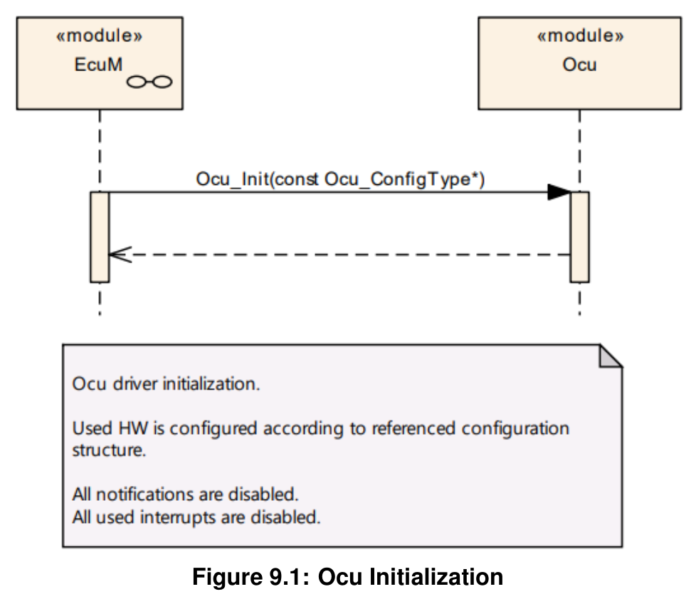

### 8.2. 反初始化

* **OCU**驱动反初始化。
* 所有通知均被禁用。
* 所有已使用的中断均被禁用。
* 硬件设计应负责确保该状态不会导致微控制器中的未定义活动。

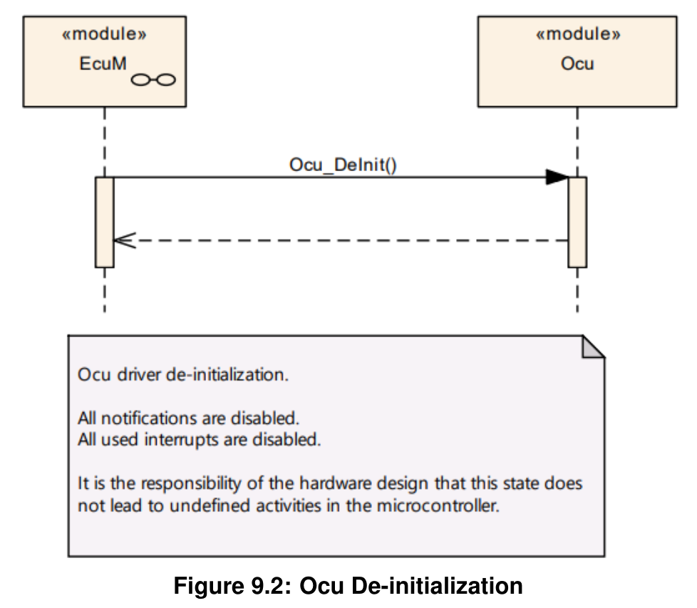

### 8.3. 使用 Ocu 通知

上层不会收到关于此比较匹配的通知。

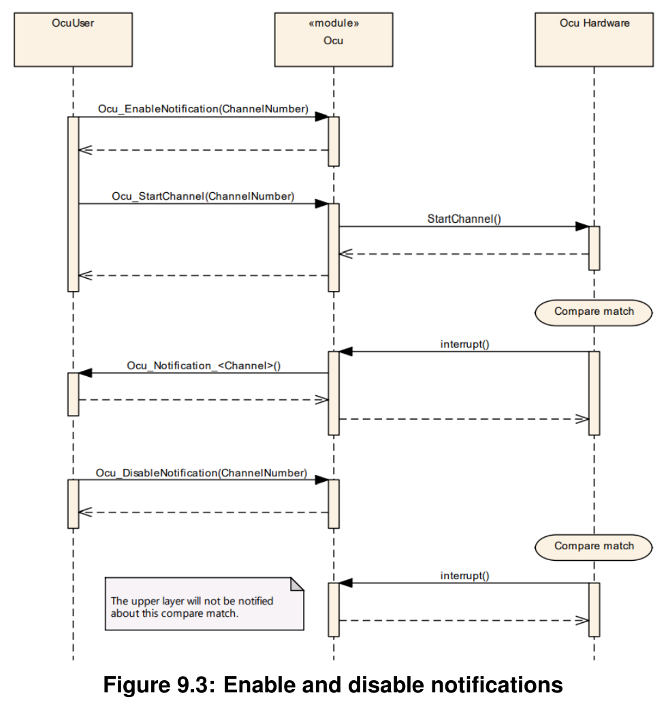

### 8.4. Ocu_SetPinState

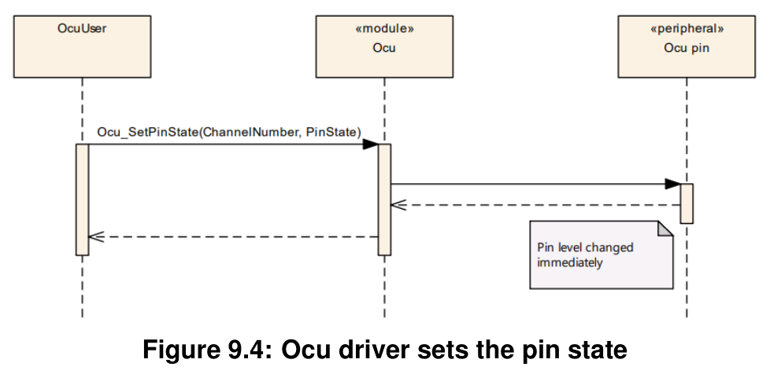

### 8.5. Ocu_SetPinAction

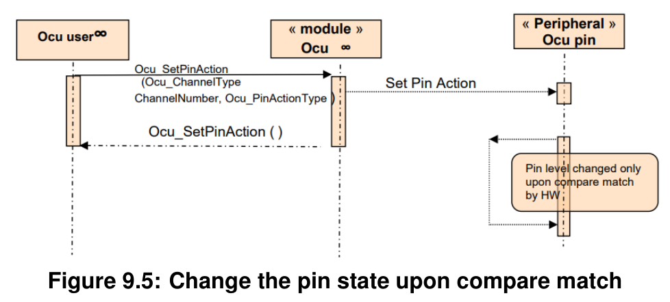

### 8.6. 设置新的比较阈值

关于新比较阈值的设置，参见 **Ocu_SetAbsoluteThreshold**（第 7.3.8 节）和 **Ocu_SetRelativeThreshold**（第 7.3.9 节）。

引脚电平仅在比较匹配时由硬件更改。

## 9. 配置规范

总体而言，本章定义配置参数及其到**容器**（container）的聚类组织。为支持本规范，第 9.1 章描述相关基础知识，并规定参数规范所应使用的模板（表格）。我们有意将第 9.1 章保留在规范中，以保证可理解性。

第 9.2 章规定**OCU**模块的结构（容器）与参数。

第 9.3 章规定**OCU**模块的发布信息。

### 9.1. 如何阅读本章

详情请参阅 SWS_BSWGeneral 中的第 10.1 章 "Introduction to configuration specification"（配置规范导论）。

除本节外，强烈建议阅读以下文档：

* AUTOSAR 分层软件架构 [4]
* AUTOSAR ECU 配置规范 [3]

这些文档详细描述了 AUTOSAR 配置方法论与 AUTOSAR 配置元模型。

以下仅是对该主题的简要概述，不能取代 ECU 配置规范文档。

#### 9.1.1. 配置与配置参数

配置参数定义模块实现的通用部分的可变性。这意味着只有通用的或可配置的模块实现才能在系统和/或 ECU 配置期间适配使用中的环境（软件/硬件）。

参数的配置可以在软件过程中的不同时间点完成：编译前（before compile time）、链接前（before link time）或构建后（after build time）。下文使用术语"（参数的）配置类"（configuration class）指代特定的配置时间点。

#### 9.1.2. 容器

容器对配置参数的集合进行结构化。这意味着：

* 所有配置参数都保存在容器中。

* （子）容器可以引用（子）容器。可以为这些引用分配多重性。该多重性定义了所包含参数的可能实例数量。

#### 9.1.3. 配置参数的规格模板

以下表格由三个部分组成：

* 通用部分（general section）
* 配置参数部分（configuration parameter section）
* 包含/引用容器部分（the section of included/referenced containers）

Pre-compile time —— 规定该配置参数是否属于 Pre-compile time 配置类。

| 标记 | 描述 |
|---|---|
| x | 该配置参数属于 Pre-compile time 配置类。 |
| - | 该配置参数绝不属于 Pre-compile time 配置类。 |

Link time —— 规定该配置参数是否属于 Link time 配置类。

| 标记 | 描述 |
|---|---|
| x | 该配置参数属于 Link time 配置类。 |
| - | 该配置参数绝不属于 Link time 配置类。 |

Post Build —— 规定该配置参数是否属于 Post Build 配置类。

| 标记 | 描述 |
|---|---|
| x | 该配置参数属于 Post Build 配置类，且不需要特定实现。 |
| L | Loadable —— 该配置参数属于 Post Build 配置类，且 ECU 中仅驻留一个配置参数集。 |
| M | Multiple —— 该配置参数属于 Post Build 配置类，通过向模块的初始化函数传递专用指针从多个参数集中选择。 |
| - | 该配置参数绝不属于 Post Build 配置类。 |

### 9.2. 容器与配置参数

以下各节汇总所有配置参数。各参数的详细含义见第 6 章和第 7 章。

OCU 模块应拒绝实现所不支持的、带有分区映射的配置。

#### 9.2.1. Ocu

| SWS 条目 |  |
|---|---|
| 模块名称 | Ocu |
| 描述 | OCU（输出比较单元）模块的配置。 |
| Post-Build 变体支持 | true |
| 支持的配置变体 | VARIANT-POST-BUILD, VARIANT-PRE-COMPILE |

| 容器名称 | 多重性 | 作用域/依赖 |
|---|---|---|
| OcuConfigSet | 1 | 此容器是配置集（Configuration Set）的基础，其中包含已配置的 OCU 通道。这样，可以为 Post-Build 流程定义不同的配置集。 |
| OcuConfigurationOfOptionalApis | 1 | 可选 API 的配置。 |
| OcuGeneral | 1 | 此容器包含 OCU 驱动的模块级配置参数。 |

#### 9.2.2. OcuGeneral

OcuKernelEcucPartitionRef 所引用的 ECUC 分区应是 OcuEcucPartitionRef 所引用的 ECUC 分区的子集。

| SWS 条目 |  |
|---|---|
| 容器名称 | OcuGeneral |
| 父容器 | Ocu |
| 描述 | 此容器包含 OCU 驱动的模块级配置参数。 |
| 配置参数 | 见下方参数表 |

| SWS 条目 |  |
|---|---|
| 参数名称 | OcuDevErrorDetect |
| 父容器 | OcuGeneral |
| 描述 | 开启或关闭开发错误检测与通知（true：启用检测与通知；false：禁用检测与通知）。 |
| 多重性 | 1 |
| 类型 | EcucBooleanParamDef |
| 默认值 | false |
| Post-Build 变体值 | false |
| 值配置类 | Pre-compile time：x（All Variants）；Link time：-；Post-build time：- |
| 作用域/依赖 | scope: local |

| SWS 条目 |  |
|---|---|
| 参数名称 | OcuEcucPartitionRef |
| 父容器 | OcuGeneral |
| 描述 | 将 OCU 驱动映射到零个或多个 ECUC 分区，以使驱动 API 在相应分区中可用。 |
| 多重性 | 0..* |
| 类型 | 对 EcucPartition 的引用 |
| Post-Build 变体多重性 | true |
| Post-Build 变体值 | true |
| 多重性配置类 | Pre-compile time：x（All Variants）；Link time：-；Post-build time：- |
| 值配置类 | Pre-compile time：x（All Variants）；Link time：-；Post-build time：- |
| 作用域/依赖 | scope: ECU |

| SWS 条目 |  |
|---|---|
| 参数名称 | OcuKernelEcucPartitionRef |
| 父容器 | OcuGeneral |
| 描述 | 将 OCU 内核映射到零个或一个 ECUC 分区，以将驱动内核分配到某个特定内核。所引用的 ECUC 分区是 OCU 驱动所映射到的 ECUC 分区的子集。 |
| 多重性 | 0..1 |
| 类型 | 对 EcucPartition 的引用 |
| Post-Build 变体多重性 | true |
| Post-Build 变体值 | true |
| 多重性配置类 | Pre-compile time：x；Link time：-；Post-build time：- |
| 值配置类 | Pre-compile time：x；Link time：-；Post-build time：- |
| 作用域/依赖 | scope: ECU |

无包含的容器。

若 OcuEcucPartitionRef 引用一个或多个 ECUC 分区，则 OcuKernelEcucPartitionRef 的多重性应为一，并且也应引用这些 ECUC 分区之一。

#### 9.2.3. OcuConfigurationOfOptionalApis

| SWS 条目 |  |
|---|---|
| 容器名称 | OcuConfigurationOfOptionalApis |
| 父容器 | Ocu |
| 描述 | 可选 API 的配置。 |
| 配置参数 | 见下方参数表 |

| SWS 条目 |  |
|---|---|
| 参数名称 | OcuDeInitApi |
| 父容器 | OcuConfigurationOfOptionalApis |
| 描述 | 在代码中添加/移除 Ocu_DeInit() 服务。 |
| 多重性 | 1 |
| 类型 | EcucBooleanParamDef |
| 默认值 | - |
| Post-Build 变体值 | false |
| 值配置类 | Pre-compile time：x（All Variants）；Link time：-；Post-build time：- |
| 作用域/依赖 | scope: local |

| SWS 条目 |  |
|---|---|
| 参数名称 | OcuGetCounterApi |
| 父容器 | OcuConfigurationOfOptionalApis |
| 描述 | 在代码中添加/移除 Ocu_GetCounter() 服务。 |
| 多重性 | 1 |
| 类型 | EcucBooleanParamDef |
| 默认值 | - |
| Post-Build 变体值 | false |
| 值配置类 | Pre-compile time：x（All Variants）；Link time：-；Post-build time：- |
| 作用域/依赖 | scope: local |

| SWS 条目 |  |
|---|---|
| 参数名称 | OcuNotificationSupported |
| 父容器 | OcuConfigurationOfOptionalApis |
| 描述 | 在代码中添加/移除 Ocu_EnableNotification() 与 Ocu_DisableNotification() 服务。 |
| 多重性 | 1 |
| 类型 | EcucBooleanParamDef |
| 默认值 | - |
| Post-Build 变体值 | false |
| 值配置类 | Pre-compile time：x（All Variants）；Link time：-；Post-build time：- |
| 作用域/依赖 | scope: local |

| SWS 条目 |  |
|---|---|
| 参数名称 | OcuSetAbsoluteThresholdApi |
| 父容器 | OcuConfigurationOfOptionalApis |
| 描述 | 在代码中添加/移除 Ocu_SetAbsoluteThreshold() 服务。 |
| 多重性 | 1 |
| 类型 | EcucBooleanParamDef |
| 默认值 | - |
| Post-Build 变体值 | false |
| 值配置类 | Pre-compile time：x（All Variants）；Link time：-；Post-build time：- |
| 作用域/依赖 | scope: local |

| SWS 条目 |  |
|---|---|
| 参数名称 | OcuSetPinActionApi |
| 父容器 | OcuConfigurationOfOptionalApis |
| 描述 | 在代码中添加/移除 Ocu_SetPinAction() 服务。 |
| 多重性 | 1 |
| 类型 | EcucBooleanParamDef |
| 默认值 | - |
| Post-Build 变体值 | false |
| 值配置类 | Pre-compile time：x（All Variants）；Link time：-；Post-build time：- |
| 作用域/依赖 | scope: local |

| SWS 条目 |  |
|---|---|
| 参数名称 | OcuSetPinStateApi |
| 父容器 | OcuConfigurationOfOptionalApis |
| 描述 | 在代码中添加/移除 Ocu_SetPinState() 服务。 |
| 多重性 | 1 |
| 类型 | EcucBooleanParamDef |
| 默认值 | - |
| Post-Build 变体值 | false |
| 值配置类 | Pre-compile time：x（All Variants）；Link time：-；Post-build time：- |
| 作用域/依赖 | scope: local |

| SWS 条目 |  |
|---|---|
| 参数名称 | OcuSetRelativeThresholdApi |
| 父容器 | OcuConfigurationOfOptionalApis |
| 描述 | 在代码中添加/移除 Ocu_SetRelativeThreshold() 服务。 |
| 多重性 | 1 |
| 类型 | EcucBooleanParamDef |
| 默认值 | - |
| Post-Build 变体值 | false |
| 值配置类 | Pre-compile time：x（All Variants）；Link time：-；Post-build time：- |
| 作用域/依赖 | scope: local |

| SWS 条目 |  |
|---|---|
| 参数名称 | OcuVersionInfoApi |
| 父容器 | OcuConfigurationOfOptionalApis |
| 描述 | 指示是否支持 Ocu_GetVersionInfo() 的开关。 |
| 多重性 | 1 |
| 类型 | EcucBooleanParamDef |
| 默认值 | false |
| Post-Build 变体值 | false |
| 值配置类 | Pre-compile time：x（All Variants）；Link time：-；Post-build time：- |
| 作用域/依赖 | scope: local |

无包含的容器。

#### 9.2.4. OcuConfigSet

| SWS 条目 |  |
|---|---|
| 容器名称 | OcuConfigSet |
| 父容器 | Ocu |
| 描述 | 此容器是配置集（Configuration Set）的基础，其中包含已配置的 OCU 通道。这样，可以为 Post-Build 流程定义不同的配置集。 |
| 配置参数 | 见下方参数表 |

| 容器名称 | 多重性 | 作用域/依赖 |
|---|---|---|
| OcuChannel | 1..* | 单个 OCU 通道的配置。 |
| OcuHWSpecificSettings | 0..* | 此容器包含用于选择时钟源以及（在硬件支持时）设置可选预分频器的 OCU 专用参数。实现由供应商具体定义。 |

| SWS 条目 |  |
|---|---|
| 参数名称 | OcuCountdirection |
| 父容器 | OcuConfigSet |
| 描述 | 此参数指示整个 OCU 驱动的计数方向。 |
| 多重性 | 0..1 |
| 类型 | EcucEnumerationParamDef |
| 范围 | OCU_DOWNCOUNTING：OCU 计数器将从最大值向最小值计数；OCU_UPCOUNTING：OCU 计数器将从最小值向最大值计数 |
| 默认值 | OCU_UPCOUNTING |
| Post-Build 变体多重性 | true |
| Post-Build 变体值 | true |
| 多重性配置类 | Pre-compile time：x（VARIANT-PRE-COMPILE）；Link time：-；Post-build time：x（VARIANT-POST-BUILD） |
| 值配置类 | Pre-compile time：x（VARIANT-PRE-COMPILE）；Link time：-；Post-build time：x（VARIANT-POST-BUILD） |
| 作用域/依赖 | scope: local |

#### 9.2.5. OcuChannel

| SWS 条目 |  |
|---|---|
| 容器名称 | OcuChannel |
| 父容器 | OcuConfigSet |
| 描述 | 单个 OCU 通道的配置。 |
| 配置参数 | 见下方参数表 |

| SWS 条目 |  |
|---|---|
| 参数名称 | OcuAssignedHardwareChannel |
| 父容器 | OcuChannel |
| 描述 | 分配给该逻辑通道的物理硬件通道。 |
| 多重性 | 1 |
| 类型 | EcucIntegerParamDef |
| 范围 | 0 .. 255 |
| 默认值 | - |
| Post-Build 变体值 | true |
| 值配置类 | Pre-compile time：x（VARIANT-PRE-COMPILE）；Link time：-；Post-build time：x（VARIANT-POST-BUILD） |
| 作用域/依赖 | scope: local |

| SWS 条目 |  |
|---|---|
| 参数名称 | OcuChannelId |
| 父容器 | OcuChannel |
| 描述 | OCU 通道的通道 ID。该值将赋给由 OcuChannel 容器短名派生的符号名。它定义该通道到物理 OCU 硬件通道的分配。 |
| 多重性 | 1 |
| 类型 | EcucIntegerParamDef（为此参数生成符号名） |
| 范围 | 0 .. 65535 |
| 默认值 | - |
| Post-Build 变体值 | false |
| 值配置类 | Pre-compile time：x（All Variants）；Link time：-；Post-build time：- |
| 作用域/依赖 | scope: local |

| SWS 条目 |  |
|---|---|
| 参数名称 | OcuChannelTickDuration |
| 父容器 | OcuChannel |
| 描述 | 规定通道计数器加一（即一个计数 tick）所需的输入时钟边沿（上升沿或下降沿）数量。取值范围取决于所使用的硬件，并非所有值都适用。 |
| 多重性 | 1 |
| 类型 | EcucIntegerParamDef |
| 范围 | 1 .. 32768 |
| 默认值 | - |
| Post-Build 变体值 | true |
| 值配置类 | Pre-compile time：x（VARIANT-PRE-COMPILE）；Link time：-；Post-build time：x（VARIANT-POST-BUILD） |
| 作用域/依赖 | scope: local |

| SWS 条目 |  |
|---|---|
| 参数名称 | OcuDefaultThreshold |
| 父容器 | OcuChannel |
| 描述 | 初始化时使用的比较阈值。 |
| 多重性 | 1 |
| 类型 | EcucIntegerParamDef |
| 范围 | 0 .. 4294967295 |
| 默认值 | - |
| Post-Build 变体值 | true |
| 值配置类 | Pre-compile time：x（VARIANT-PRE-COMPILE）；Link time：-；Post-build time：x（VARIANT-POST-BUILD） |
| 作用域/依赖 | scope: local |

| SWS 条目 |  |
|---|---|
| 参数名称 | OcuHardwareTriggeredAdc |
| 父容器 | OcuChannel |
| 描述 | 此参数用于在硬件支持的情况下，允许 OCU 通道在比较匹配时触发一个 ADC 通道。参数值表示要触发的 ADC 物理通道。 |
| 多重性 | 0..1 |
| 类型 | EcucIntegerParamDef |
| 范围 | 0 .. 255 |
| 默认值 | 0 |
| Post-Build 变体多重性 | true |
| Post-Build 变体值 | true |
| 多重性配置类 | Pre-compile time：x（VARIANT-PRE-COMPILE）；Link time：-；Post-build time：x（VARIANT-POST-BUILD） |
| 值配置类 | Pre-compile time：x（VARIANT-PRE-COMPILE）；Link time：-；Post-build time：x（VARIANT-POST-BUILD） |
| 作用域/依赖 | scope: local |

| SWS 条目 |  |
|---|---|
| 参数名称 | OcuHardwareTriggeredDMA |
| 父容器 | OcuChannel |
| 描述 | 此参数用于在硬件支持的情况下，允许 OCU 通道在比较匹配时触发一个 DMA 通道。参数值表示要触发的 DMA 物理通道。 |
| 多重性 | 0..1 |
| 类型 | EcucIntegerParamDef |
| 范围 | 0 .. 255 |
| 默认值 | 0 |
| Post-Build 变体多重性 | true |
| Post-Build 变体值 | true |
| 多重性配置类 | Pre-compile time：x（VARIANT-PRE-COMPILE）；Link time：-；Post-build time：x（VARIANT-POST-BUILD） |
| 值配置类 | Pre-compile time：x（VARIANT-PRE-COMPILE）；Link time：-；Post-build time：x（VARIANT-POST-BUILD） |
| 作用域/依赖 | scope: local |

| SWS 条目 |  |
|---|---|
| 参数名称 | OcuMaxCounterValue |
| 父容器 | OcuChannel |
| 描述 | 计数器以 tick 为单位的最大值。 |
| 多重性 | 1 |
| 类型 | EcucIntegerParamDef |
| 范围 | 1 .. 4294967295 |
| 默认值 | - |
| Post-Build 变体值 | true |
| 值配置类 | Pre-compile time：x（VARIANT-PRE-COMPILE）；Link time：-；Post-build time：x（VARIANT-POST-BUILD） |
| 作用域/依赖 | scope: local |

| SWS 条目 |  |
|---|---|
| 参数名称 | OcuNotification |
| 父容器 | OcuChannel |
| 描述 | 指向回调函数的函数指针的定义。 |
| 多重性 | 0..1 |
| 类型 | EcucFunctionNameDef |
| 默认值 | - |
| 正则表达式 | - |
| Post-Build 变体多重性 | true |
| Post-Build 变体值 | true |
| 多重性配置类 | Pre-compile time：x（VARIANT-PRE-COMPILE）；Link time：-；Post-build time：x（VARIANT-POST-BUILD） |
| 值配置类 | Pre-compile time：x（VARIANT-PRE-COMPILE）；Link time：-；Post-build time：x（VARIANT-POST-BUILD） |
| 作用域/依赖 | scope: local |

| SWS 条目 |  |
|---|---|
| 参数名称 | OcuOutputPinDefaultState |
| 父容器 | OcuChannel |
| 描述 | 参数 OcuOutputPinDefaultState 表示通道关联的引脚在初始化后应被置成的状态。 |
| 多重性 | 0..1 |
| 类型 | EcucEnumerationParamDef |
| 范围 | OCU_HIGH：请求时，OCU 通道输出引脚将被置为高电平（3 或 5 V）；OCU_LOW：请求时，OCU 通道输出引脚将被置为低电平（0 V） |
| Post-Build 变体多重性 | true |
| Post-Build 变体值 | true |
| 多重性配置类 | Pre-compile time：x（VARIANT-PRE-COMPILE）；Link time：-；Post-build time：x（VARIANT-POST-BUILD） |
| 值配置类 | Pre-compile time：x（VARIANT-PRE-COMPILE）；Link time：-；Post-build time：x（VARIANT-POST-BUILD） |
| 作用域/依赖 | scope: local |

| SWS 条目 |  |
|---|---|
| 参数名称 | OcuOutputPinUsed |
| 父容器 | OcuChannel |
| 描述 | 关于该通道上输出引脚使用情况的信息（true：该通道使用输出引脚；false：该通道不使用输出引脚）。 |
| 多重性 | 1 |
| 类型 | EcucBooleanParamDef |
| 默认值 | - |
| Post-Build 变体值 | false |
| 值配置类 | Pre-compile time：x（All Variants）；Link time：-；Post-build time：- |
| 作用域/依赖 | scope: local |

| SWS 条目 |  |
|---|---|
| 参数名称 | OcuChannelEcucPartitionRef |
| 父容器 | OcuChannel |
| 描述 | 将一个 OCU 通道映射到零个或多个 ECUC 分区，以限制对该通道的访问。所引用的 ECUC 分区是 OCU 驱动所映射到的 ECUC 分区的子集。 |
| 多重性 | 0..* |
| 类型 | 对 EcucPartition 的引用 |
| Post-Build 变体多重性 | true |
| Post-Build 变体值 | true |
| 多重性配置类 | Pre-compile time：x；Link time：-；Post-build time：- |
| 值配置类 | Pre-compile time：x；Link time：-；Post-build time：- |
| 作用域/依赖 | scope: ECU |

| SWS 条目 |  |
|---|---|
| 参数名称 | OcuHWSpecificSettingsRef |
| 父容器 | OcuChannel |
| 描述 | 对 OcuChannel 所使用的 OcuHWSpecificSettings 的引用。 |
| 多重性 | 0..1 |
| 类型 | 对 OcuHWSpecificSettings 的引用 |
| Post-Build 变体多重性 | true |
| Post-Build 变体值 | true |
| 多重性配置类 | Pre-compile time：x；Link time：-；Post-build time：- |
| 值配置类 | Pre-compile time：x；Link time：-；Post-build time：- |
| 作用域/依赖 | scope: local |

无包含的容器。

OcuChannelEcucPartitionRef 所引用的 ECUC 分区应是 OcuEcucPartitionRef 所引用的 ECUC 分区的子集。

若 OcuEcucPartitionRef 引用一个或多个 ECUC 分区，则 OcuKernelEcucPartitionRef 的多重性应为一，并且也应引用这些 ECUC 分区之一。

#### 9.2.6. OcuHWSpecificSettings

| SWS 条目 |  |
|---|---|
| 容器名称 | OcuHWSpecificSettings |
| 父容器 | OcuConfigSet |
| 描述 | 此容器包含用于选择时钟源以及（在硬件支持时）设置可选预分频器的 OCU 专用参数。实现由供应商具体定义。 |
| 配置参数 | 见下方参数表 |

| SWS 条目 |  |
|---|---|
| 参数名称 | OcuClockSource |
| 父容器 | OcuHWSpecificSettings |
| 描述 | 单元的 OCU 驱动专用时钟输入可以被静态配置，以在硬件提供时选择不同的时钟源。枚举字面量由供应商具体定义。 |
| 多重性 | 0..1 |
| 类型 | EcucEnumerationParamDef |
| 范围 | - |
| Post-Build 变体多重性 | true |
| Post-Build 变体值 | true |
| 多重性配置类 | Pre-compile time：x（VARIANT-PRE-COMPILE）；Link time：-；Post-build time：x（VARIANT-POST-BUILD） |
| 值配置类 | Pre-compile time：x（VARIANT-PRE-COMPILE）；Link time：-；Post-build time：x（VARIANT-POST-BUILD） |
| 作用域/依赖 | scope: local |

| SWS 条目 |  |
|---|---|
| 参数名称 | OcuPrescale |
| 父容器 | OcuHWSpecificSettings |
| 描述 | 可选的 OCU 驱动专用时钟预分频因子（如果硬件支持）。实现由供应商具体定义。 |
| 多重性 | 0..1 |
| 类型 | EcucEnumerationParamDef |
| 范围 | - |
| Post-Build 变体多重性 | true |
| Post-Build 变体值 | true |
| 多重性配置类 | Pre-compile time：x（VARIANT-PRE-COMPILE）；Link time：-；Post-build time：x（VARIANT-POST-BUILD） |
| 值配置类 | Pre-compile time：x（VARIANT-PRE-COMPILE）；Link time：-；Post-build time：x（VARIANT-POST-BUILD） |
| 作用域/依赖 | scope: local |

无包含的容器。

### 9.3. 发布信息

详情请参阅 SWS_BSWGeneral 中的第 10.3 章 "Published Information"（发布信息）。

按《基础软件模块通用需求》 [5] 中 SRS_BSW_00402 的要求，标准化的通用发布参数应发布于本模块的头文件中，并需要在 BSW 模块描述中提供。相应的模块缩写可在《基础软件模块列表》 [6] 中找到。

如适用，模块专用的附加发布参数列于附录 A 章。

<section id="wechat">

<h4>微信扫一扫，获取更多及时资讯</h4>


</section>
