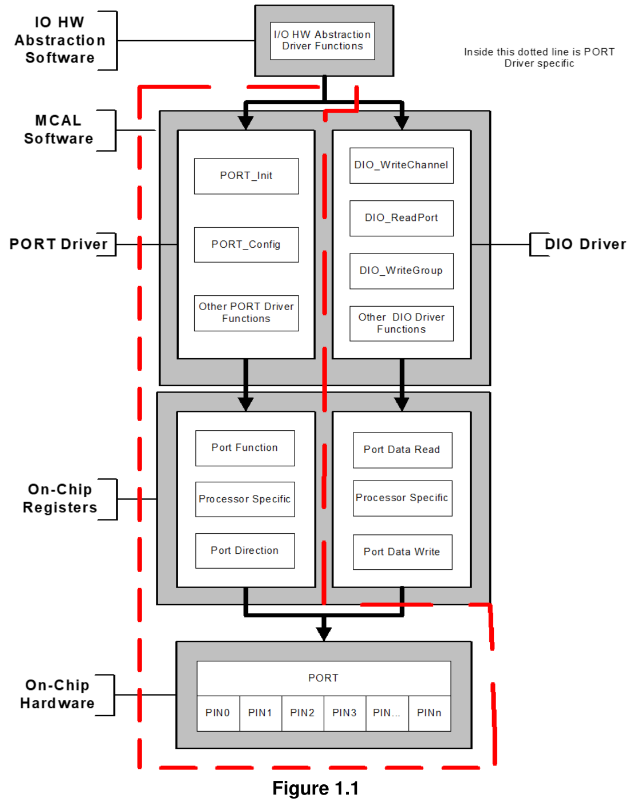

## 1. 简介和功能概述

本规范规定了**AUTOSAR**基础软件模块**PORT**驱动程序的功能、**API**和配置。

本驱动程序规范适用于片上端口和端口引脚。

本模块应提供初始化微控制器整个**PORT**结构的服务。许多端口和端口引脚可以被分配给各种功能，例如：

* 通用**I/O**
* **ADC**
* **SPI**
* **SCI**
* **PWM**
* **CAN**
* **LIN**
* 等等

因此，应对此端口结构进行整体配置和初始化。这些端口引脚的配置和模式取决于微控制器和**ECU**。

端口初始化数据应尽可能高效地写入每个端口。

本**PORT**驱动程序模块应完成**DIO**驱动程序模块中使用的端口结构的整体配置和初始化。因此，**DIO**驱动程序作用于由**PORT**驱动程序配置的引脚和端口。

**PORT**驱动程序应在使用**DIO**函数之前初始化。否则**DIO**函数将表现出未定义的行为。

下图标识了**PORT**驱动程序的功能，以及**PORT**驱动程序和**DIO**驱动程序在**MCAL**软件层中的结构[1]。



## 2. 缩略语

下表总结了**PORT**驱动程序中使用的表述。

| 缩写/首字母缩写 | 描述 |
|---|---|
| DEM | 诊断事件管理器（Diagnostic Event Manager）[2] |
| DET | 默认错误跟踪器（Default Error Tracer）[3] |
| MCU | 微控制器单元（MicroController Unit） |
| Port Pin | 表示**MCU**器件上单个可配置的输入或输出引脚。 |
| Port | 表示**MCU**器件上整个可配置的端口。 |
| Physical Level (Input) | 两种可能的状态：**LOW**/**HIGH** |
| Physical Level (Output) | 两种可能的状态：**LOW**/**HIGH** |

## 3. 相关文档

### 3.1. 输入文件

[1] Layered Software Architecture
AUTOSAR_CP_EXP_LayeredSoftwareArchitecture

[2] Specification of Diagnostic Event Manager
AUTOSAR_CP_SWS_DiagnosticEventManager

[3] Specification of Default Error Tracer
AUTOSAR_CP_SWS_DefaultErrorTracer

[4] General Specification of Basic Software Modules
AUTOSAR_CP_SWS_BSWGeneral

[5] General Requirements on Basic Software Modules
AUTOSAR_CP_SRS_BSWGeneral

[6] General Requirements on SPAL
AUTOSAR_CP_SRS_SPALGeneral

[7] Requirements on Port Driver
AUTOSAR_CP_SRS_PortDriver

[8] Specification of MCU Driver
AUTOSAR_CP_SWS_MCUDriver

### 3.2. 相关标准和规范

1. IEC 7498-1 The Basic Model, IEC Norm, 1994

### 3.3. 相关规范

**AUTOSAR**提供了基础软件模块通用规范[4]（**SWS BSW General**），该规范同样适用于**Port**驱动程序。

因此，**SWS BSW General**规范应被视为**Port**驱动程序的附加必需规范。

## 4. 约束和假设

### 4.1. 限制

**PORT**驱动程序的限制规定如下：

* 用户有责任确保同一系统中不同的实体不会并行访问同一端口/端口引脚，例如两个任务配置同一端口、两个任务配置同一引脚，或两个任务配置同一端口上的不同引脚。

### 4.2. 对汽车域的适用性

无限制

## 5. 对其他模块的依赖

其他驱动模块可能依赖于**PORT**驱动程序，具体取决于**MCU**上单个端口引脚的可用功能。例如，一个**MCU**引脚可能可配置为**DIO**或**SPI**引脚。因此，**DIO**和/或**SPI**驱动模块可能依赖**PORT**模块将引脚配置为所需的功能。

### 5.1. 文件结构

#### 5.1.1. 代码文件结构

详情请参阅[4]中第 5.1.6 章"Code file structure"。

## 6. 功能规格

### 6.1. 一般行为

#### 6.1.1. 背景与原理

**PORT**驱动程序模块应初始化微控制器的整个端口结构。

注意：定义端口和端口引脚的配置顺序是配置工具的任务。

#### 6.1.2. 需求

##### 6.1.2.1. 端口引脚属性的配置

**PORT**驱动程序模块应允许为每个端口和端口引脚配置不同的功能，例如**ADC**、**SPI**、**DIO**等。

端口（即整个端口或单个端口引脚）的配置取决于微控制器。

**PORT**驱动程序模块应为**MCU**端口/端口引脚提供以下附加配置：

* 引脚方向（输入/输出）
* 引脚电平初始值
* 引脚方向是否可在运行时更改（是/否）。
* 端口模式是否可在运行时更改。

**PORT**驱动程序模块应为**MCU**端口和端口引脚提供一些可选配置（如果硬件支持）：

* 斜率（Slew rate）控制
* 内部上拉的激活
* 输入阈值
* 引脚驱动模式（推挽/开漏）。
* 回读支持的类型（引脚电平、输出寄存器值）。

**PORT**驱动程序模块不应提供配置引脚电平反转的功能。应设置默认值（即不反转）。

注意：**I/O**硬件抽象层应执行电平反转。

##### 6.1.2.2. 切换端口引脚方向

对于使用配置工具配置为可更改的端口引脚，**PORT**驱动程序应允许用户在运行时更改端口引脚的方向。

如果**MCU**端口控制硬件提供用于在端口引脚上设置输出电平的输出锁存器，切换端口引脚方向不应改变此输出锁存器中设置的电平。

##### 6.1.2.3. 刷新端口方向

为了在微控制器上刷新端口，**PORT**驱动程序应允许用户刷新那些方向由配置设置且不能动态更改的端口引脚的方向。

##### 6.1.2.4. 未使用的端口和端口引脚的配置

**PORT**驱动程序模块应将所有未使用（既不用作**GPIO**也不用作特殊用途**IO**）的端口和端口引脚配置为由**PORT**驱动程序模块配置设置为确定的状态。

##### 6.1.2.5. 符号名称的配置

**PORT**驱动程序模块的用户应配置**MCU**端口引脚的符号名称。

单个端口引脚的这些符号名称（例如**PORT_A_PIN_0**）应在配置工具中定义。

**PORT**驱动程序模块的实现者应通过文件**Port.h**发布这些符号名称。

##### 6.1.2.6. 端口访问的原子性

**PORT**驱动程序模块应提供对所有端口和端口引脚的原子访问。

注意：

原子访问是通过使用原子指令或使用由基础软件调度程序模块提供的独占区域（例如禁用中断）对微控制器寄存器的不可中断访问。

#### 6.1.3. 版本检查

##### 6.1.3.1. 背景和原理

应避免不兼容文件的集成。最低实现是在**.c**文件内检查头文件的版本（**.c**和**.h**文件的版本号应相同）。

##### 6.1.3.2. 需求

**Port**模块应通过以下预处理器检查避免不兼容文件的集成：

详情请参阅[4]（**SWS BSW General**）中第 5.1.8 章"Version Check"。

### 6.2. 错误分类

| 错误类型 | 相关错误代码 | 错误值 |
|---|---|---|
| 请求的端口引脚 ID 无效 | PORT_E_PARAM_PIN | 0x0A |
| 端口引脚未配置为可更改 | PORT_E_DIRECTION_UNCHANGEABLE | 0x0B |
| **API Port_Init**服务以错误参数调用 | PORT_E_INIT_FAILED | 0x0C |
| 当模式不可更改时调用**API Port_SetPinMode**服务 | PORT_E_PARAM_INVALID_MODE | 0x0D |
| 当模式不可更改时调用**API Port_SetPinMode**服务 | PORT_E_MODE_UNCHANGEABLE | 0x0E |
| 未经模块初始化调用**API**服务 | PORT_E_UNINIT | 0x0F |
| 以空指针调用**API** | PORT_E_PARAM_POINTER | 0x10 |

#### 6.2.1. 运行时错误

没有运行时错误。

#### 6.2.2. 瞬态故障

没有瞬态故障。

#### 6.2.3. 生产错误

没有生产错误。

#### 6.2.4. 扩展生产错误

没有扩展生产错误。

### 6.3. API 参数检查

如果启用了开发错误检测，**Port**驱动程序模块应按参数传递的顺序检查函数参数，如果一项检查失败则跳过后续的参数检查。

示例：对于函数**Port_SetPinDirection**，传递的第一个参数是引脚**ID**。此参数应标识**MCU**端口的相关端口引脚。传递的第二个参数对应于要在端口引脚上更改的方向。

如果启用了开发错误检测且**Port**驱动程序模块检测到错误，应跳过所需功能，请求的服务应直接返回，不执行任何动作。

参见下表，了解每个函数报告的**Det**错误列表。

| 函数 | 错误条件 | 相关错误值 |
|---|---|---|
| Port_SetPinDirection | 传入的端口引脚 ID 不正确 | PORT_E_PARAM_PIN |
| Port_SetPinDirection | 端口引脚未配置为可更改 | PORT_E_DIRECTION_UNCHANGEABLE |
| Port_Init | Port_Init 服务以错误参数调用。 | PORT_E_INIT_FAILED |
| Port_SetPinMode | 传入的端口引脚 ID 不正确 | PORT_E_PARAM_PIN |
| Port_SetPinMode | 传入的端口引脚模式无效 | PORT_E_PARAM_INVALID_MODE |
| Port_SetPinMode | 当模式不可更改时调用**Port_SetPinMode**服务 | PORT_E_MODE_UNCHANGEABLE |
| Port_SetPinDirection, Port_SetPinMode, Port_RefreshPortDirection | 在模块初始化之前调用**API**服务 | PORT_E_UNINIT |
| Port_GetVersionInfo | 以空指针参数调用**API** | PORT_E_PARAM_POINTER |

## 7. API规范

### 7.1. 导入的类型

本章列出了从以下模块包含的所有类型：

**Port**模块的导入数据类型定义

| 模块 | 头文件 | 导入的类型 |
|---|---|---|
| Std | Std_Types.h | Std_ReturnType |
| Std | Std_Types.h | Std_VersionInfoType |

### 7.2. 类型定义

#### 7.2.1. Port_ConfigType

结构类型。初始化数据结构的内容特定于微控制器。包含本模块初始化数据的外部数据结构的类型。可通过**Port.h**获得。

#### 7.2.2. Port_PinType

类型，派生自 uint。范围为：0 - <端口引脚数量>：应覆盖所有可用的端口引脚。该类型应为特定**MCU**平台选择（最佳性能）。端口引脚符号名称的数据类型。可通过**Port.h**获得。

**Port_PinType**类型应用于端口引脚的符号名称。

**Port_PinType**类型应为**uint8**、**uint16**或**uint32**，基于特定**MCU**平台。

注意：用户应使用配置工具提供的符号名称。

#### 7.2.3. Port_PinDirectionType

枚举类型，取值范围：

* **PORT_PIN_IN**（0x00）：将端口引脚设置为输入。
* **PORT_PIN_OUT**（0x01）：将端口引脚设置为输出。

端口引脚可能的方向。可通过**Port.h**获得。

**Port_PinDirectionType**是定义端口引脚方向的类型。

**Port_PinDirectionType**应为枚举类型，其范围为**PORT_PIN_IN**和**PORT_PIN_OUT**。

#### 7.2.4. Port_PinModeType

类型，派生自 uint。范围为：实现特定 —— 由于一个引脚上应可配置多个端口引脚模式，范围应由实现确定。不同的端口引脚模式。可通过**Port.h**获得。

端口引脚应可配置多个端口引脚模式（**Port_PinModeType**类型）。

**Port_PinModeType**类型应与函数调用**Port_SetPinMode**一起使用。

**Port_PinModeType**类型应为**uint8**、**uint16**或**uint32**。

### 7.3. 函数定义

以下是提供给上层模块的函数列表。

#### 7.3.1. Port_Init

**说明**: 初始化**Port**驱动程序模块。可通过**Port.h**获得。本服务为同步调用，不可重入。参数 ConfigPtr（in）：指向配置集的指针。

```C
void Port_Init (const Port_ConfigType * ConfigPtr)
```

函数**Port_Init**应使用参数**ConfigPtr**指向的配置集初始化所有端口和端口引脚。

**Port**驱动程序模块的环境应首先调用函数**Port_Init**以初始化端口供使用。

如果未首先调用**Port_Init**函数，则无法对**MCU**端口和端口引脚执行任何操作。

函数**Port_Init**应初始化所有已配置的资源。

函数**Port_Init**应遵循以下关于控制器寄存器初始化的规则。

* 如果硬件只允许寄存器的一次使用，则实现该功能的驱动模块负责初始化该寄存器。
* 如果寄存器可以影响多个硬件模块且它是**I/O**寄存器，则它应由此**PORT**驱动程序初始化。
* 如果寄存器可以影响多个硬件模块且它不是**I/O**寄存器，则它应由**MCU**驱动程序[8]初始化。
* 需要在复位后直接初始化的单次可写寄存器应由启动代码初始化。
* 所有其他未提及的寄存器应由启动代码初始化。

函数**Port_Init**应避免在受影响的端口引脚上产生毛刺和尖峰。

**Port**驱动程序模块的环境应在复位后调用函数**Port_Init**，以重新配置**MCU**的端口和端口引脚。

函数**Port_Init**应将**PORT**驱动程序模块使用的所有变量初始化为初始状态。

**Port**驱动程序模块的环境也可以使用函数**Port_Init**来初始化驱动程序软件，并根据传递给此函数的配置集将端口和端口引脚重新初始化为另一个已配置状态。

注意：在某些情况下，**MCU**端口控制硬件提供输出锁存器，用于在可用作**DIO**端口引脚的端口引脚上设置输出电平。

函数**Port_Init**应在将端口引脚方向设置为输出之前，将端口引脚输出锁存器设置为默认电平（在配置期间定义）。

应确保当端口引脚被设置为输出端口引脚时，默认电平立即输出到端口引脚上。

示例：在某些**MCU**上，上电复位后，可配置为**DIO**的端口引脚将被配置为输入引脚。如果端口引脚所需的配置是输出引脚，则函数**Port_Init**应确保在将端口引脚功能从输入切换到输出之前设置默认电平。

函数**Port_Init**应始终具有一个指针作为参数，即使对于配置变体**VARIANT-PRE-COMPILE**，也不会给出配置集。在这种情况下，**Port**驱动程序模块的环境应向函数**Port_Init**传递**NULL**指针。

**Port**驱动程序模块的环境不应在运行操作期间调用函数**Port_Init**。这仅在**PORT**模块有多个调用者时适用。

**Port_Init**的配置：所有端口引脚及其功能、以及备用功能都应由配置工具配置。

#### 7.3.2. Port_SetPinDirection

**说明**: 设置端口引脚方向。可通过**Port.h**获得。本服务为同步调用，可重入。参数 Pin（in）：端口引脚 ID 编号。参数 Direction（in）：端口引脚方向。

```C
void Port_SetPinDirection (Port_PinType Pin, Port_PinDirectionType Direction)
```

函数**Port_SetPinDirection**应在运行时设置端口引脚方向。

如果访问独立于端口的不同引脚，函数**Port_SetPinDirection**应是可重入的。

只有当预编译参数**PortSetPinDirectionApi**设置为**TRUE**时，函数**Port_SetPinDirection**才可提供给用户使用。如果设置为**FALSE**，则函数**Port_SetPinDirection**不可用。

**Port_SetPinDirection**的配置：所有端口和端口引脚应由配置工具配置。参见**PORT117**。

#### 7.3.3. Port_RefreshPortDirection

**说明**: 刷新端口方向。可通过**Port.h**获得。本服务为同步调用，不可重入。

```C
void Port_RefreshPortDirection (void)
```

函数**Port_RefreshPortDirection**应将所有已配置端口的方向刷新为配置的方向（**PortPinDirection**）。

函数**Port_RefreshPortDirection**应将那些配置为"引脚方向可在运行时更改"的端口引脚排除在刷新之外。

配置工具应为每个配置的端口引脚提供名称。

#### 7.3.4. Port_GetVersionInfo

**说明**: 返回本模块的版本信息。可通过**Port.h**获得。本服务为同步调用，可重入。参数 versioninfo（out）：指向存储本模块版本信息位置的指针。

```C
void Port_GetVersionInfo (Std_VersionInfoType* versioninfo)
```

如果启用了**Det**，应检查参数**versioninfo**是否为**NULL**。如果值为**NULL**指针，应报告错误**PORT_E_PARAM_POINTER**。

#### 7.3.5. Port_SetPinMode

**说明**: 设置端口引脚模式。可通过**Port.h**获得。本服务为同步调用，可重入。参数 Pin（in）：端口引脚 ID 编号。参数 Mode（in）：要在端口引脚上设置的新端口引脚模式。

```C
void Port_SetPinMode (Port_PinType Pin, Port_PinModeType Mode)
```

函数**Port_SetPinMode**应在运行时设置引用引脚的端口引脚模式。

如果访问独立于端口的不同引脚，函数**Port_SetPinMode**应是可重入的。

如果启用了**Det**，当参数**PortPinModeChangeable**设置为**FALSE**时，函数**Port_SetPinMode**应报告**PORT_E_MODE_UNCHANGEABLE**错误并直接返回，不执行任何其他动作。

**Port_SetPinMode**的配置：所有端口和端口引脚应由配置工具配置。参见**PORT117**。

### 7.4. 回调通知

**PORT**驱动程序没有回调通知。回调通知在其他模块（**ICU**驱动程序和/或复杂驱动程序）中实现。

### 7.5. 调度函数

**PORT**驱动程序中没有调度函数。

### 7.6. 期望接口

本章列出了需要从其他模块获得的所有接口。

#### 7.6.1. 强制接口

无

#### 7.6.2. 可选接口

本章定义了为实现模块的可选功能而需要的所有接口。

| API 函数 | 头文件 | 描述 |
|---|---|---|
| Det_ReportError | Det.h | 报告开发错误的服务 |

#### 7.6.3. 可配置接口

无

<section id="wechat">

<h4>微信扫一扫，获取更多及时资讯</h4>


</section>
