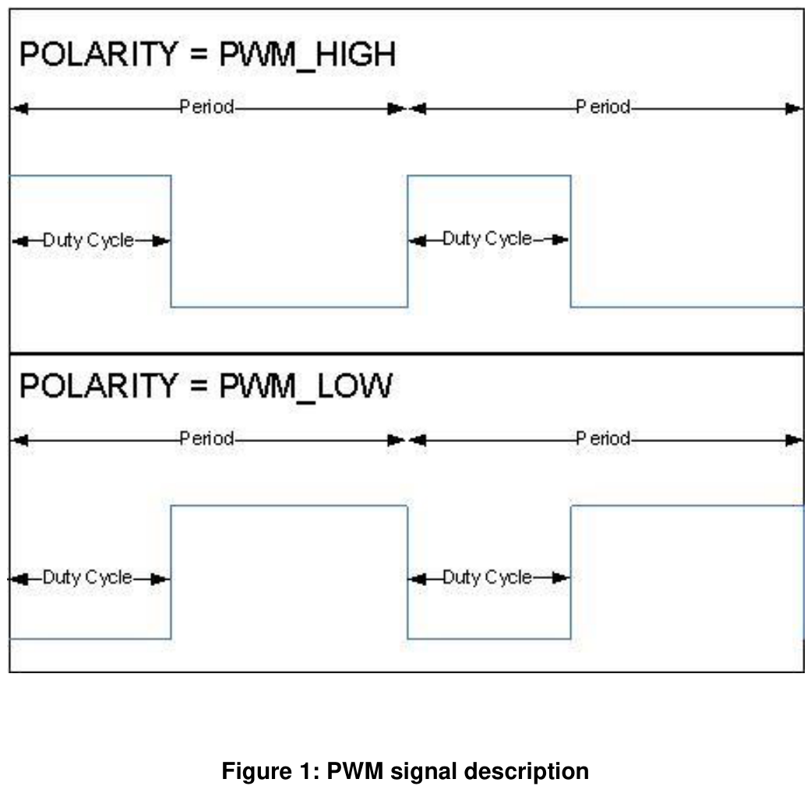

## 1. 简介和功能概述

本规范规定了**AUTOSAR**基础软件模块**PWM**驱动程序的功能、**API**和配置。

每个**PWM**通道都链接到属于微控制器的硬件**PWM**。**PWM**信号的类型（例如中心对齐、左对齐等）不在本规范中定义，而是留给实现决定。

该驱动程序提供初始化和控制微控制器内部**PWM**级（脉冲宽度调制）的函数。**PWM**模块生成具有可变脉冲宽度的脉冲。它允许选择占空比和信号周期时间。



## 2. 缩略语

**AUTOSAR**术语表中未包含的局部作用域的缩略语和缩写，必须出现在局部术语表中。

缩略语：

| 缩略语 | 描述 |
|---|---|
| PWM Channel | 链接到硬件**PWM**的数字标识符。 |
| PWM Output State | 定义**PWM**信号的输出状态。可以是：高、低。 |
| PWM Idle State | 空闲状态表示调用**Pwm_SetOutputToIdle**或**Pwm_DeInit**后**PWM**通道的输出状态。 |
| PWM Polarity | 定义每个**PWM**通道的起始输出状态。 |
| PWM Duty cycle | 定义与周期相关的起始电平（可以为高或低）的百分比。 |
| PWM period | 定义**PWM**信号的周期。 |

缩写：

| 缩写 | 描述 |
|---|---|
| PWM | 脉冲宽度调制（Pulse Width Modulation）。 |
| DEM | 诊断事件管理器（Diagnostic Event Manager）。 |
| DET | 默认错误跟踪器（Default Error Tracer）。 |
| MCU | 微控制器单元（Microcontroller Unit）。 |
| PLL | 锁相环（Phase Locked Loop）。 |
| ISR | 中断服务例程（Interrupt Service Routine）。 |

## 3. 相关文档

### 3.1. 输入文件

[1] Layered Software Architecture
AUTOSAR_CP_EXP_LayeredSoftwareArchitecture.pdf

[2] General Requirements on SPAL
AUTOSAR_CP_SRS_SPALGeneral.pdf

[3] General Requirements on Basic Software Modules
AUTOSAR_CP_SRS_BSWGeneral.pdf

[4] Specification of Default Error Tracer
AUTOSAR_CP_SWS_DefaultErrorTracer.pdf

[5] Specification of MCU Driver
AUTOSAR_CP_SWS_MCUDriver.pdf

[6] Specification of ECU Configuration
AUTOSAR_CP_TPS_ECUConfiguration.pdf

[7] Basic Software Module Description Template
AUTOSAR_CP_TPS_BSWModuleDescriptionTemplate.pdf

[8] List of Basic Software Modules
AUTOSAR_CP_TR_BSWModuleList

[9] General Specification of Basic Software Modules
AUTOSAR_CP_SWS_BSWGeneral.pdf

### 3.2. 相关规范

**AUTOSAR**提供了基础软件模块通用规范[9]（**SWS BSW General**），该规范同样适用于**PWM**驱动程序。

因此，**SWS BSW General**规范应被视为**PWM**驱动程序的附加必需规范。

## 4. 约束和假设

### 4.1. 限制

**Pwm SWS**不涵盖在通用**I/O**上模拟**PWM**。

电源状态控制**API**只有在**MCAL**驱动程序拥有完整的底层**HW**外设（即该**HW**外设不被其他**MCAL**模块访问）时才能实现。

### 4.2. 对汽车域的适用性

无限制。

## 5. 对其他模块的依赖

**PWM**依赖于系统时钟。因此，系统时钟的更改（例如**PLL**开→**PLL**关）也会影响**PWM**硬件的时钟设置。

**PWM**驱动程序依赖于以下模块：

* **PORT**驱动程序：设置端口引脚功能。
* **MCU**驱动程序：设置预分频器、系统时钟和**PLL**。
* **DET**：开发模式下的默认错误跟踪器。

文档**087_AUTOSAR_ECU_Configuration**包含第 4.6 章——时钟树配置，其中详细描述了向外设传递参考时钟信号的机制。

### 5.1. 文件结构

#### 5.1.1. 代码文件结构

**Pwm SWS**不应定义代码文件结构。

#### 5.1.2. 头文件结构

**Pwm.c**应包含**Pwm.h**、**Det.h**和。

**Pwm_Irq.c**应包含**Pwm.h**。

## 6. 功能规格

### 6.1. 一般行为

**PWM**模块的所有函数（除**Pwm_Init**、**Pwm_DeInit**和**Pwm_GetVersionInfo**外）对于不同的**PWM**通道编号应是可重入的。

为了保持简单的模块实现，模块不必执行相关检查。

如果在运行时不同的任务或**ISR**中对同一**PWM**通道进行多次函数调用，**Pwm**模块的用户应确保完整性。

### 6.2. 时间单位 Ticks

#### 6.2.1. 背景与原理

为了从寄存器值中获得时间，有必要知道振荡器频率、预分频器等。由于这些设置是在**MCU**和/或其他模块中进行的，因此无法计算此类时间。

因此，时间与**ticks**之间的转换应是上层的一部分。

#### 6.2.2. 需求

**PWM**模块的**API**服务中使用的所有时间单位都应是**ticks**单位。

### 6.3. 硬件低功耗状态的支持和管理

某些**PWM HW**模块允许被设置为某些可降低功耗的运行模式，代价可能是更慢的反应时间、更低的性能或完全不可用。每个**PWM**模块可以支持一种或多种低功耗运行模式，其中全功率模式始终存在并在启动时默认设置。

#### 6.3.1. 背景

**PWM**驱动程序提供电源状态控制**API**和后台处理机制，以处理异步电源状态更改过程（即请求后不会立即完成、而需要一些较长操作的电源状态更改）。

假设源自**ECU**和**SW**架构的所有约束已由上层（应用程序、服务层中的模式管理、处理外设控制的**IoHwAbstraction**组件）满足，因此控制范围仅限于**PWM HW**外设。

**PWM**驱动程序执行对操作序列的检查，以避免在先前的请求仍在处理中时请求不同的电源状态，或在未请求相同准备的情况下激活电源状态。

**PWM**模块应将电源控制能力作为可选功能支持。本模块既不强制只使用启用了电源控制的**MCU**，也不强制配置相同的**MCU**。相反，它在供应商支持的情况下提出了一种处理电源状态的方法。

#### 6.3.2. 需求

当相应的配置参数**PwmLowPowerStatesSupport**设置为**TRUE**时，**PwmDriver**应支持电源状态更改及其**API**。

如果参数**PwmLowPowerStatesSupport**启用，则应生成**API Pwm_PreparePowerState**、**Pwm_SetPowerState**、**Pwm_GetCurrentPowerState**、**Pwm_GetTargetPowerState**，并应使用它们来管理和获取电源状态转换的信息。

**API Pwm_GetTargetPowerState**和**Pwm_GetCurrentPowerState**应分别用于收集请求的**Pwm**电源状态和目标**Pwm**电源状态的信息。

**API Pwm_PreparePowerState**应用于启动电源状态转换。

在完成电源状态的准备后，应使用**API Pwm_SetPowerState**来达到**Pwm**模块请求的电源状态。

为了避免不一致的电源状态条件，某些**API**（**Pwm_SetPowerState**、**Pwm_PreparePowerState**）必须以给定的顺序调用，否则将存储错误（如果启用了**DET**跟踪）并中断动作。**Pwm**驱动程序跟踪调用序列。

**Pwm**驱动程序应跟踪**API Pwm_SetPowerState**和**Pwm_PreparePowerState**的调用顺序。如果在调用第二个**API**之前调用了第一个**API**，应存储**DET**条目且不执行该动作。

如果参数**PwmLowPowerStatesSupport**设置为**TRUE**，**Pwm**模块应跟踪当前和目标电源状态。

如果**PwmLowPowerStatesSupport**设置为**TRUE**，初始化后模块的电源状态应始终为**FULL POWER**。

**Pwm**驱动程序应支持同步和异步电源状态转换，具体取决于配置参数**PwmPowerStateAsynchTransitionMode**的值。

如果配置参数**PwmPowerStateAsynchTransitionMode**设置为**FALSE**，准备过程和设置过程应在相应**API**返回时即视为完成。

如果配置参数**PwmPowerStateAsynchTransitionMode**设置为**TRUE**，准备过程应在相应**API**返回后在后台继续，并通过配置的回调通知其完成。

### 6.4. 占空比分辨率和缩放

占空比参数的宽度为 16 位。

**Pwm**模块应对占空比遵循以下缩放方案：

* 0x0000 表示 0%。
* 0x8000 表示 100%。0x8000 在允许用 16 位值表示 100% 占空比的同时提供最高分辨率。

作为实现指南，给出以下源代码示例：

```C
AbsoluteDutyCycle = ((uint32)AbsolutePeriodTime * RelativeDutyCycle) >> 15;
```

### 6.5. 版本检查

详情请参阅**SWS_BSWGeneral**中第 5.1.8 章"Version Check"。

### 6.6. 错误分类

#### 6.6.1. 开发错误

| 错误类型 | 相关错误代码 | 错误值 |
|---|---|---|
| **API Pwm_Init**服务以错误参数调用 | PWM_E_INIT_FAILED | 0x10 |
| 未经模块初始化使用**API**服务 | PWM_E_UNINIT | 0x11 |
| 使用无效的通道标识符的**API**服务 | PWM_E_PARAM_CHANNEL | 0x12 |
| 在配置为固定周期的**PWM**通道上使用未授权的**PWM**服务 | PWM_E_PERIOD_UNCHANGEABLE | 0x13 |
| 在**PWM**驱动程序已初始化时调用**API Pwm_Init**服务 | PWM_E_ALREADY_INITIALIZED | 0x14 |
| **API Pwm_GetVersionInfo**以**NULL**参数调用。 | PWM_E_PARAM_POINTER | 0x15 |
| **PWM**模块不支持请求的电源状态。 | PWM_E_POWER_STATE_NOT_SUPPORTED | 0x17 |
| 从当前电源状态无法到达请求的电源状态 | PWM_E_TRANSITION_NOT_POSSIBLE | 0x18 |
| 调用**API Pwm_SetPowerState**之前未调用**API Pwm_PreparePowerState**。 | PWM_E_PERIPHERAL_NOT_PREPARED | 0x19 |

当**API**服务未经模块初始化而使用时，**PWM**驱动程序模块应报告开发错误"PWM_E_UNINIT (0x11)"。

当**API**服务使用无效的通道标识符时，**PWM**驱动程序模块应报告开发错误"PWM_E_PARAM_CHANNEL (0x12)"。

在配置为固定周期的**PWM**通道上使用未授权的**PWM**服务时，**PWM**驱动程序模块应报告开发错误"PWM_E_PERIOD_UNCHANGEABLE (0x13)"。

当**API Pwm_Init**服务在**PWM**驱动程序已初始化时被调用，**PWM**驱动程序模块应报告开发错误"PWM_E_ALREADY_INITIALIZED(0x14)"。

如果此**API**以不支持的电源状态调用，或外设完全不支持低功耗状态，**API**应报告开发错误**PWM_E_POWER_STATE_NOT_SUPPORTED**。

如果无法从当前电源状态直接到达请求的电源状态，**API**应报告开发错误**PWM_E_TRANSITION_NOT_POSSIBLE**。

如果**HW**单元先前未通过使用**API Pwm_PreparePowerState()**为目标电源状态做准备，**API**应报告开发错误**PWM_E_PERIPHERAL_NOT_PREPARED**。

有关错误检测的更多详情，请参阅**API**参数检查一章。

#### 6.6.2. 运行时错误

| 错误类型 | 相关错误代码 | 错误值 |
|---|---|---|
| 在**PWM**模块仍在使用时调用**API Pwm_SetPowerState**。 | PWM_E_NOT_DISENGAGED | 0x16 |

当调用此**API**时一个或多个**HW**通道（如适用）处于不同于**IDLE**（或类似非运行状态）的状态，和/或仍有为**HW**模块通道注册的通知，**API**应报告运行时错误**PWM_E_NOT_DISENGAGED**。

#### 6.6.3. 瞬态故障

没有瞬态故障。

#### 6.6.4. 生产错误

没有生产错误。

#### 6.6.5. 扩展生产错误

没有扩展生产错误。

## 7. API规范

### 7.1. 导入的类型

本章列出了从其他模块包含的所有类型。

| 模块 | 头文件 | 导入的类型 |
|---|---|---|
| Std | Std_Types.h | Std_ReturnType |
| Std | Std_Types.h | Std_VersionInfoType |

### 7.2. 类型定义

#### 7.2.1. Pwm_ChannelType

类型，派生自 uint。范围为：8..32 位 —— 这是实现特定的，但并非所有值在该类型内都有效。应选择此类型以在特定微控制器平台上具有最高效的实现。**PWM**通道的数字标识符。可通过**Pwm.h**获得。

#### 7.2.2. Pwm_PeriodType

类型，派生自 uint。范围为：8..32 位 —— 实现特定。应选择此类型以在特定微控制器平台上具有最高效的实现。**PWM**通道周期的定义。可通过**Pwm.h**获得。

#### 7.2.3. Pwm_OutputStateType

枚举类型，取值范围：

* **PWM_HIGH**（0x00）：**PWM**通道处于高状态。
* **PWM_LOW**（0x01）：**PWM**通道处于低状态。

**PWM**通道的输出状态。可通过**Pwm.h**获得。

#### 7.2.4. Pwm_EdgeNotificationType

枚举类型，取值范围：

* **PWM_RISING_EDGE**（0x00）：**PWM**输出信号出现上升沿时将调用通知。
* **PWM_FALLING_EDGE**（0x01）：**PWM**输出信号出现下降沿时将调用通知。
* **PWM_BOTH_EDGES**（0x02）：**PWM**输出信号出现上升沿或下降沿时将调用通知。

**PWM**通道边沿通知类型的定义。可通过**Pwm.h**获得。

#### 7.2.5. Pwm_ChannelClassType

枚举类型，取值范围：

* **PWM_VARIABLE_PERIOD**（0x00）：**PWM**通道具有可变周期。占空比和周期都可以更改。
* **PWM_FIXED_PERIOD**（0x01）：**PWM**通道具有固定周期。只能更改占空比。
* **PWM_FIXED_PERIOD_SHIFTED**（0x02）：**PWM**通道具有固定的移位周期。无法更改（仅当硬件支持时）。

定义**PWM**通道的类。可通过**Pwm.h**获得。

#### 7.2.6. Pwm_ConfigType

结构类型。硬件相关结构。初始化数据结构的内容是硬件特定的。这是包含**PWM**驱动程序初始化数据的数据结构类型。可通过**Pwm.h**获得。

#### 7.2.7. Pwm_PowerStateRequestResultType

枚举类型，取值范围：

* **PWM_SERVICE_ACCEPTED**（0x00）：电源状态更改已执行。
* **PWM_NOT_INIT**（0x01）：**PWM**模块未初始化。
* **PWM_SEQUENCE_ERROR**（0x02）：**API**调用顺序错误。
* **PWM_HW_FAILURE**（0x03）：**HW**模块有故障，使其无法进入所需的电源状态。
* **PWM_POWER_STATE_NOT_SUPP**（0x04）：**PWM**模块不支持请求的电源状态。
* **PWM_TRANS_NOT_POSSIBLE**（0x05）：**PWM**模块无法从当前电源状态直接转换到请求的电源状态，或**HW**外设仍忙。

与电源状态转换相关的请求的结果。可通过**Pwm.h**获得。

#### 7.2.8. Pwm_PowerStateType

枚举类型，取值范围：

* 1..255 —— 功耗递减的电源模式。
* **PWM_FULL_POWER**（0x00）：全功率。

当前激活或设置为目标电源状态的电源状态。可通过**Pwm.h**获得。

强制参数：

* 分配的**HW**通道
* 周期的默认值
* 占空比的默认值
* 极性（高或低）
* 空闲状态高或低
* 通道类：
  - 固定周期
  - 固定周期、移位（如果硬件支持）
  - 可变周期

可选参数（如果硬件支持）：

* 通道相移
* 相移的参考通道
* 微控制器特定的通道属性

### 7.3. 函数定义

#### 7.3.1. Pwm_Init

**说明**: **PWM**初始化服务。可通过**Pwm.h**获得。本服务为同步调用，不可重入。参数 ConfigPtr（in）：指向配置集的指针。

```C
void Pwm_Init (const Pwm_ConfigType* ConfigPtr)
```

函数**Pwm_Init**应根据**ConfigPtr**中指定的参数初始化所有内部变量和所使用的微控制器**PWM**结构。

函数**Pwm_Init**应只初始化已配置的资源，不应触及配置文件中未配置的资源。

函数**Pwm_Init**应以配置的默认值启动所有**PWM**通道。

如果占空比参数等于：

* 0% 或 100%：则**PWM**输出信号应处于与配置的极性参数相对应的状态。
* >0% 且 <100%：则**PWM**输出信号应根据参数周期、占空比和配置的极性进行调制。

函数**Pwm_Init**应禁用所有通知。

原因是这些通知的用户可能尚未准备好。他们可以调用**Pwm_EnableNotification**来启动通知。

**Pwm**模块的用户不应在运行操作期间调用函数**Pwm_Init**。

**Pwm**模块的环境在调用**Pwm_Init**之前不应调用**Pwm**模块的任何函数。

如果启用了开发错误检测，在**PWM**驱动程序和硬件已初始化时调用例程**Pwm_Init**将导致开发错误**PWM_E_ALREADY_INITIALIZED**。所需功能应保持不执行任何动作。

通过执行**Pwm_Init()**函数重新初始化**Pwm**驱动程序需要先通过执行**Pwm_DeInit()**进行去初始化。

关于错误检测，相关需求适用于函数**Pwm_Init**。

#### 7.3.2. Pwm_DeInit

**说明**: **PWM**去初始化服务。可通过**Pwm.h**获得。本服务为同步调用，不可重入。

```C
void Pwm_DeInit (void)
```

函数**Pwm_DeInit**应去初始化**PWM**模块。

函数**Pwm_DeInit**应将**PWM**输出信号的状态设置为空闲状态。

函数**Pwm_DeInit**应禁用**PWM**中断和**PWM**信号边沿通知。

函数**Pwm_DeInit**应可通过配置参数**PwmDeInitApi**在预编译时配置开/关。

函数**Pwm_DeInit**应可通过配置参数**PwmDeInitApi {PWM_DE_INIT_API}**配置开/关。

关于错误检测，相关需求适用于函数**Pwm_DeInit**。

#### 7.3.3. Pwm_SetDutyCycle

**说明**: 设置**PWM**通道占空比的服务。可通过**Pwm.h**获得。本服务为异步调用；对不同通道编号可重入。参数 ChannelNumber（in）：**PWM**的数字标识符。参数 DutyCycle（in）：最小值=0x0000，最大值=0x8000。

```C
void Pwm_SetDutyCycle (Pwm_ChannelType ChannelNumber, uint16 DutyCycle)
```

函数**Pwm_SetDutyCycle**应设置**PWM**通道的占空比。

当请求的占空比为 0% 或 100% 时，函数**Pwm_SetDutyCycle**应将**PWM**输出状态设置为**PWM_HIGH**或**PWM_LOW**，同时考虑配置的极性参数和请求的占空比。

因此，对于请求的 0% 占空比，输出将是配置的极性参数的反相；对于 100% 占空比，输出将等于配置的极性参数。

当占空比 > 0% 且 < 100% 时，函数**Pwm_SetDutyCycle**应根据参数周期、占空比和配置的极性调制**PWM**输出信号。

如果实现支持并使用**PwmDutycycleUpdatedEndperiod**配置，函数**Pwm_SetDutyCycle**应始终在周期结束时更新占空比。

关于占空比参数的格式定义，相关需求适用于函数**Pwm_SetDutyCycle**。

关于占空比参数的缩放定义，相关需求适用于函数**Pwm_SetDutyCycle**。

驱动程序应禁止**PWM**输出信号上的尖峰。

关于错误检测，相关需求适用于函数**Pwm_SetDutyCycle**。

函数**Pwm_SetDutyCycle**应可通过配置参数**PwmSetDutyCycle**在预编译时配置开/关。

函数**Pwm_SetDutyCycle**应可通过配置参数**PwmSetDutyCycle {PWM_SET_DUTY_CYCLE_API}**配置开/关。

#### 7.3.4. Pwm_SetPeriodAndDuty

**说明**: 设置**PWM**通道周期和占空比的服务。可通过**Pwm.h**获得。本服务为异步调用；对不同通道编号可重入。参数 ChannelNumber（in）：**PWM**的数字标识符。参数 Period（in）：**PWM**信号的周期。参数 DutyCycle（in）：最小值=0x0000，最大值=0x8000。

```C
void Pwm_SetPeriodAndDuty (
    Pwm_ChannelType ChannelNumber, Pwm_PeriodType Period, uint16 DutyCycle
)
```

函数**Pwm_SetPeriodAndDuty**应设置**PWM**通道的周期和占空比。

如果实现支持并使用**PwmPeriodUpdatedEndperiod**配置，函数**Pwm_SetPeriodAndDuty**应始终在当前周期结束时更新周期。

更新**PWM**周期和占空比时，驱动程序应抑制**PWM**输出信号上的任何尖峰。

**PWM**占空比参数是保持频率和占空比之间一致性所必需的。有关占空比参数的缩放和格式定义，请参阅相关需求。

关于错误检测，相关需求适用于函数**Pwm_SetPeriodAndDuty**。

函数**Pwm_SetPeriodAndDuty**应只允许为声明为可变周期类型的**PWM**通道更改周期。

函数**Pwm_SetPeriodAndDuty**应可通过配置参数**PwmSetPeriodAndDuty**在预编译时配置开/关。

函数**Pwm_SetPeriodAndDuty**应可通过配置参数**PwmSetPeriodAndDuty {PWM_SET_PERIOD_AND_DUTY_API}**配置开/关。

如果周期设置为零，则占空比的设置无关紧要。在这种情况下，输出应为零（零百分比占空比）。

#### 7.3.5. Pwm_SetOutputToIdle

**说明**: 将**PWM**输出设置为配置的空闲状态的服务。可通过**Pwm.h**获得。本服务为异步调用；对不同通道编号可重入。参数 ChannelNumber（in）：**PWM**的数字标识符。

```C
void Pwm_SetOutputToIdle (Pwm_ChannelType ChannelNumber)
```

函数**Pwm_SetOutputToIdle**应立即将**PWM**输出设置为配置的空闲状态。

关于错误检测，相关需求适用于函数**Pwm_SetOutputToIdle**。

函数**Pwm_SetOutputToIdle**应可通过配置参数**PwmSetOutputToIdle**在预编译时配置开/关。

函数**Pwm_SetOutputToIdle**应可通过配置参数**PwmSetOutputToIdle {PWM_SET_OUTPUT_TO_IDLE_API}**配置开/关。

调用函数**Pwm_SetOutputToIdle**后，可变周期类型通道应使用**API Pwm_SetPeriodAndDuty()**重新激活，以用新传递的周期激活**PWM**通道。

调用函数**Pwm_SetOutputToIdle**后，通道应使用**API Pwm_SetDutyCycle()**重新激活，以用旧周期激活**PWM**通道。

调用函数**Pwm_SetOutputToIdle**后，固定周期类型通道应只使用**API Pwm_SetDutyCycle()**重新激活，以用旧周期激活**PWM**通道。

#### 7.3.6. Pwm_GetOutputState

**说明**: 读取**PWM**输出信号内部状态的服务。可通过**Pwm.h**获得。本服务为同步调用；对不同通道编号可重入。参数 ChannelNumber（in）：**PWM**的数字标识符。返回值：Pwm_OutputStateType，PWM_HIGH 表示**PWM**输出状态为高；PWM_LOW 表示**PWM**输出状态为低。

```C
Pwm_OutputStateType Pwm_GetOutputState (Pwm_ChannelType ChannelNumber)
```

函数**Pwm_GetOutputState**应读取**PWM**输出信号的内部状态并按下图定义返回。

（该图展示了从微控制器**PWM**单元经端口逻辑到端口引脚的读取路径）

关于错误检测，相关需求适用于函数**Pwm_GetOutputState**。

函数**Pwm_GetOutputState**应可通过配置参数**PwmGetOutputState**在预编译时配置开/关。

函数**Pwm_GetOutputState**应可通过配置参数**PwmGetOutputState {PWM_GET_OUTPUT_STATE_API}**配置开/关。

由于实时约束和**PWM**通道的设置（项目相关），输出状态可能在调用服务**Pwm_GetOutputState**之后立即被修改。

如果在模块初始化之前或以无效通道调用**Pwm_GetOutputState**，它应返回**PWM_LOW**。

#### 7.3.7. Pwm_DisableNotification

**说明**: 禁用**PWM**信号边沿通知的服务。可通过**Pwm.h**获得。本服务为异步调用；对不同通道编号可重入。参数 ChannelNumber（in）：**PWM**的数字标识符。

```C
void Pwm_DisableNotification (Pwm_ChannelType ChannelNumber)
```

函数**Pwm_DisableNotification**应禁用**PWM**信号边沿通知。

函数**Pwm_DisableNotification**应可通过配置参数**PwmNotificationSupported**在预编译时配置开/关。

函数**Pwm_DisableNotification**应可通过配置参数**PwmNotificationSupported {PWM_NOTIFICATION_SUPPORTED}**配置开/关。

关于错误检测，相关需求适用于函数**Pwm_DisableNotification**。

#### 7.3.8. Pwm_EnableNotification

**说明**: 根据通知参数启用**PWM**信号边沿通知的服务。可通过**Pwm.h**获得。本服务为异步调用；对不同通道编号可重入。参数 ChannelNumber（in）：**PWM**的数字标识符。参数 Notification（in）：通知类型**PWM_RISING_EDGE**或**PWM_FALLING_EDGE**或**PWM_BOTH_EDGES**。

```C
void Pwm_EnableNotification (
    Pwm_ChannelType ChannelNumber, Pwm_EdgeNotificationType Notification
)
```

函数**Pwm_EnableNotification**应根据通知参数启用**PWM**信号边沿通知。

函数**Pwm_EnableNotification**应取消挂起的中断。

函数**Pwm_EnableNotification**应可通过配置参数**PwmNotificationSupported**在预编译时配置开/关。

函数**Pwm_EnableNotification**应可通过配置参数**PwmNotificationSupported {PWM_NOTIFICATION_SUPPORTED}**配置开/关。

关于错误检测，相关需求适用于函数**Pwm_EnableNotification**。

#### 7.3.9. Pwm_SetPowerState

**说明**: 此**API**配置**Pwm**模块，使其进入已准备的电源状态（从预定义的一组已配置电源状态中选择）。可通过**Pwm.h**获得。本服务为同步调用，不可重入。参数 Result（out）：如果**API**返回**E_OK**：**PWM_SERVICE_ACCEPTED**：电源状态更改已执行。如果**API**返回**E_NOT_OK**：**PWM_NOT_INIT**：**PWM**模块未初始化。**PWM_SEQUENCE_ERROR**：**API**调用顺序错误。**PWM_HW_FAILURE**：**HW**模块有故障，使其无法进入所需的电源状态。返回值：Std_ReturnType，**E_OK**：电源模式已更改；**E_NOT_OK**：请求被拒绝。

```C
Std_ReturnType Pwm_SetPowerState (Pwm_PowerStateRequestResultType* Result)
```

此**API**配置**HW**以进入给定的电源状态。启用此转换的所有预备动作（例如将所有通道设置为**IDLE**状态、注销所有通知等）必须已由负责的**SWC**（例如**IoHwAb**）采取。

此**API**不应执行预备性的隐式电源状态更改（即如果无法从当前电源状态到达请求的电源状态，则不应执行中间电源状态更改，请求应被拒绝）。

如果目标电源状态与当前电源状态相同，则不执行任何动作，**API**立即以**E_OK**结果返回。

如果请求正常电源状态，**API**应引用**Pwm_Init**使用的相同容器中包含的必要参数。

不应对正常（即全功率）电源模式使用单独的容器或硬编码数据，以避免初始化阶段使用的初始化参数与电源状态更改期间使用的参数之间出现错位。

对于其他电源状态，只应在此**API**的上下文中执行电源状态转换特定的重新配置（即此**API**不能用于向**Pwm**模块应用全新的配置）。不应进行与电源状态转换无严格关系的任何其他重新配置。

**API**应引用与所需电源状态相关的配置容器，以导出该状态的某些特定特征（例如电源状态的支持）。

如果激活了开发错误报告：

如果此**API**在初始化**HW**单元之前被调用，**API**应报告开发错误**PWM_E_UNINIT**。

当调用此**API**时一个或多个**HW**通道（如适用）处于不同于**IDLE**（或类似非运行状态）的状态，和/或仍有为**HW**模块通道注册的通知，**API**应报告运行时错误**PWM_E_NOT_DISENGAGED**。

如果此**API**以不支持的电源状态调用，或外设完全不支持低功耗状态，**API**应报告开发错误**PWM_E_POWER_STATE_NOT_SUPPORTED**。

如果无法从当前电源状态直接到达请求的电源状态，**API**应报告开发错误**PWM_E_TRANSITION_NOT_POSSIBLE**。

如果**HW**单元先前未通过使用**API Pwm_PreparePowerState()**为目标电源状态做准备，**API**应报告开发错误**PWM_E_PERIPHERAL_NOT_PREPARED**。

#### 7.3.10. Pwm_GetCurrentPowerState

**说明**: 此**API**返回**PWM HW**单元的当前电源状态。可通过**Pwm.h**获得。本服务为同步调用，不可重入。参数 CurrentPowerState（out）：在此参数中返回**PWM HW**单元的当前电源模式。Result：如果**API**返回**E_OK**：**PWM_SERVICE_ACCEPTED**：返回了当前电源模式。如果**API**返回**E_NOT_OK**：**PWM_NOT_INIT**：**PWM**模块未初始化。返回值：Std_ReturnType，**E_OK**：模式可读取；**E_NOT_OK**：服务被拒绝。

```C
Std_ReturnType Pwm_GetCurrentPowerState (
    Pwm_PowerStateType* CurrentPowerState, Pwm_PowerStateRequestResultType* Result
)
```

此**API**返回**HW**单元的电源状态。

如果激活了开发错误报告：

如果此**API**在初始化**HW**单元之前被调用，**API**应报告开发错误**PWM_E_UNINIT**。

#### 7.3.11. Pwm_GetTargetPowerState

**说明**: 此**API**返回**PWM HW**单元的目标电源状态。可通过**Pwm.h**获得。本服务为同步调用，不可重入。参数 TargetPowerState（out）：在此参数中返回**PWM HW**单元的目标电源模式。Result：如果**API**返回**E_OK**：**PWM_SERVICE_ACCEPTED**：返回了目标电源模式。如果**API**返回**E_NOT_OK**：**PWM_NOT_INIT**：**PWM**模块未初始化。返回值：Std_ReturnType，**E_OK**：模式可读取；**E_NOT_OK**：服务被拒绝。

```C
Std_ReturnType Pwm_GetTargetPowerState (
    Pwm_PowerStateType* TargetPowerState, Pwm_PowerStateRequestResultType* Result
)
```

此**API**返回**HW**单元请求的电源状态。如果没有正在进行的转换，它应与当前电源状态一致。

除**HW**故障外，此**API**被认为始终成功。

如果激活了开发错误报告：

如果此**API**在初始化**HW**单元之前被调用，**API**应报告开发错误**PWM_E_UNINIT**。

#### 7.3.12. Pwm_PreparePowerState

**说明**: 此**API**启动允许**PWM HW**模块进入请求的电源状态所需的过程。可通过**Pwm.h**获得。本服务为同步调用，不可重入。参数 PowerState（in）：打算达到的目标电源状态。参数 Result（out）：如果**API**返回**E_OK**：**PWM_SERVICE_ACCEPTED**：**PWM**模块电源状态准备已启动。如果**API**返回**E_NOT_OK**：**PWM_NOT_INIT**：**PWM**模块未初始化。**PWM_SEQUENCE_ERROR**：**API**调用顺序错误（当前电源状态 = 目标电源状态）。**PWM_POWER_STATE_NOT_SUPP**：**PWM**模块不支持请求的电源状态。**PWM_TRANS_NOT_POSSIBLE**：**PWM**模块无法从当前电源状态直接转换到请求的电源状态，或**HW**外设仍忙。返回值：Std_ReturnType，**E_OK**：准备过程已启动；**E_NOT_OK**：服务被拒绝。

```C
Std_ReturnType Pwm_PreparePowerState (
    Pwm_PowerStateType PowerState, Pwm_PowerStateRequestResultType* Result
)
```

此**API**启动使**HW**模块能够进入目标电源状态所需的所有动作。

外设的可操作性取决于电源状态和**HW**特性。集成人员应知道这些属性，是否使用外设的决定由其负责。

如果目标电源状态与当前电源状态相同，则不执行任何动作，**API**立即以**E_OK**结果返回。

前提条件的责任留给环境。

如果激活了开发错误报告：

如果此**API**在初始化**HW**单元之前被调用，**API**应报告开发错误**PWM_E_UNINIT**。

如果此**API**以不支持的电源状态调用，或外设完全不支持低功耗状态，**API**应报告开发错误**PWM_E_POWER_STATE_NOT_SUPPORTED**。

如果无法从当前电源状态直接到达请求的电源状态，**API**应报告开发错误**PWM_E_TRANSITION_NOT_POSSIBLE**。

达到目标电源状态所需的所有异步操作都可以在**Pwm_Main_PowerTransitionManager**的上下文中在后台执行。

#### 7.3.13. Pwm_GetVersionInfo

**说明**: 返回本模块版本信息的服务。可通过**Pwm.h**获得。本服务为同步调用，可重入。参数 versioninfo（out）：指向存储本模块版本信息位置的指针。

```C
void Pwm_GetVersionInfo (Std_VersionInfoType* versioninfo)
```

### 7.4. 回调通知

由于**PWM**驱动程序是架构最底层的模块，它不为下层模块提供任何回调函数。

### 7.5. 调度函数

**PWM**驱动程序提供的所有服务都是同步性质的，异步电源转换管理除外（如果如此配置）。

如果配置了同步电源转换管理，则不生成调度**API**。

#### 7.5.1. Pwm_Main_PowerTransitionManager

**说明**: 此**API**被周期性调用，监督电源状态转换，检查模块的就绪状态并发出回调**IoHwAb_Pwm_NotifyReadyForPowerState\<Mode\>**（参见**PwmPowerStateReadyCbkRef**配置参数）。可通过**SchM_Pwm.h**获得。

```C
void Pwm_Main_PowerTransitionManager (void)
```

此**API**执行完成**Pwm_PreparePowerState()**请求的电源状态转换所需的任何非即时动作。

调度速率应由**Pwm MainSchedulePeriod**定义并且是可变的，因为仅在请求了转换时才需要调用该函数。

此**API**还应仅在选择了异步模式时，向最终注册的用户（**IoHwAb**）发出回调通知（如已配置）。

如果**PWM**模块未初始化，此函数应直接返回，不进行任何进一步处理。这是为了避免处理未初始化的变量。不应输入开发错误，因为此条件可以在启动阶段轻松验证（初始化完成前启动的任务）。

理由：在启动阶段，可能会出现**OS**已调度调用主函数的任务，而某些模块尚未初始化。这不是真正的错误条件，尽管需要处理，即不执行而返回。

尽管转换状态监视功能是强制的，但此**API**的实现是可选的，这意味着如果**HW**允许通过其他方式传递通知并监视转换状态，则可以跳过此函数的实现。

### 7.6. 期望接口

本章列出了需要从其他模块获得的所有接口。

#### 7.6.1. 强制接口

本章定义了为实现模块核心功能而需要的所有接口。

由于本模块是**MCAL**层的一部分，它直接访问微控制器寄存器，因此不需要任何下层接口。

#### 7.6.2. 可选接口

本章定义了为实现模块可选功能而需要的所有接口。

| API 函数 | 头文件 | 描述 |
|---|---|---|
| Det_ReportError | Det.h | 报告开发错误的服务 |

#### 7.6.3. 可配置接口

本章列出了目标函数可被配置的所有接口。目标函数通常是回调函数。这类接口的名称不固定，因为它们是可配置的。

**说明**: **Pwm**模块应根据对通道**\<#Channel\>**最后一次**Pwm_EnableNotification**的调用调用函数**Pwm_Notification_\<#Channel\>**。可通过**Pwm_Externals.h**获得。本服务为同步调用；取决于**PWM**用户的实现。

```C
void Pwm_Notification_\<#Channel\> (void)
```

**Pwm**模块应根据对通道**\<#Channel\>**最后一次**Pwm_EnableNotification**和**Pwm_DisableNotification**的调用调用函数**Pwm_Notification_\<#Channel\>**。

**Pwm**模块应复位与通知**Pwm_Notification_\<#Channel\>**关联的中断标志。

只有当配置参数**PwmNotificationSupported**为**ON**时，**Pwm**模块才应提供**Pwm_EnableNotification**的功能。

只有当配置参数**PwmNotificationSupported**为**ON**时，**Pwm**模块才应提供**Pwm_DisableNotification**的功能。

只有当配置参数**PwmNotificationSupported**为**ON**时，**Pwm**模块才应复位与通知关联的中断标志。

**说明**: 当模式**\<#Mode\>**的请求电源状态准备完成时，**PWM**驱动程序应调用此**API**。可通过**IoHwAb_Pwm.h**获得。本服务为同步调用，不可重入。

```C
void IoHwAb_Pwm_NotifyReadyForPowerState\<#Mode\> (void)
```

如果**PWM**驱动程序配置为支持具有异步转换的电源状态管理，应调用此**API**以向**IoHwAb**模块发出电源转换准备阶段完成的信号。

这是一个回调，此**API**应在**IoHwAb**组件中实现。

### 7.7. API 参数检查

如果为**Pwm**模块启用了开发错误检测并发生了开发错误，则相应的**PWM**函数应向默认错误跟踪器报告错误。

如果为**Pwm**模块启用了开发错误检测并发生了开发错误，则相应的**PWM**函数应跳过所需功能，以避免数据或硬件寄存器的损坏，不执行任何动作而离开函数。

如果为**Pwm**模块启用了开发错误检测：如果在调用**Pwm_Init**之前调用任何函数（**Pwm_Init**除外），被调用的函数应引发开发错误**PWM_E_UNINIT**。

如果为**Pwm**模块启用了开发错误检测：**API Pwm_SetPeriodAndDuty()**应检查给定的**PWM**通道是否为通道类类型**PWM_VARIABLE_PERIOD**。如果不是，应引发开发错误**PWM_E_PERIOD_UNCHANGEABLE**。

如果为**Pwm**模块启用了开发错误检测：**PWM**函数应检查参数**ChannelNumber**，如果参数**ChannelNumber**无效，应引发开发错误**PWM_E_PARAM_CHANNEL**。

<section id="wechat">

<h4>微信扫一扫，获取更多及时资讯</h4>


</section>
