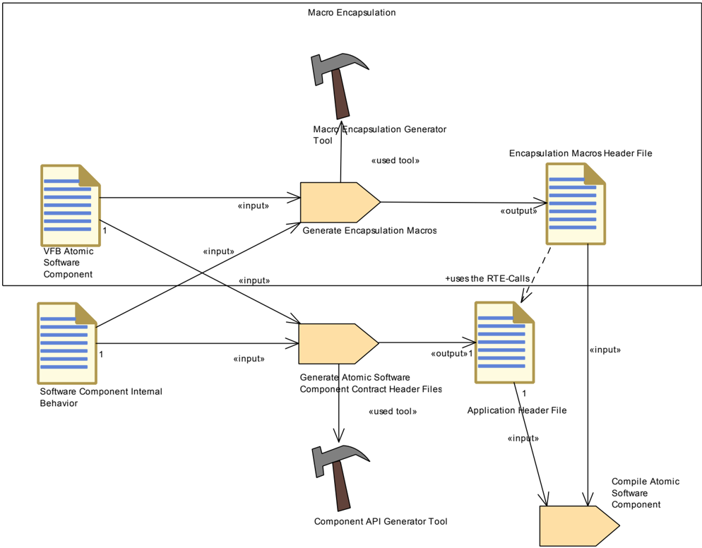
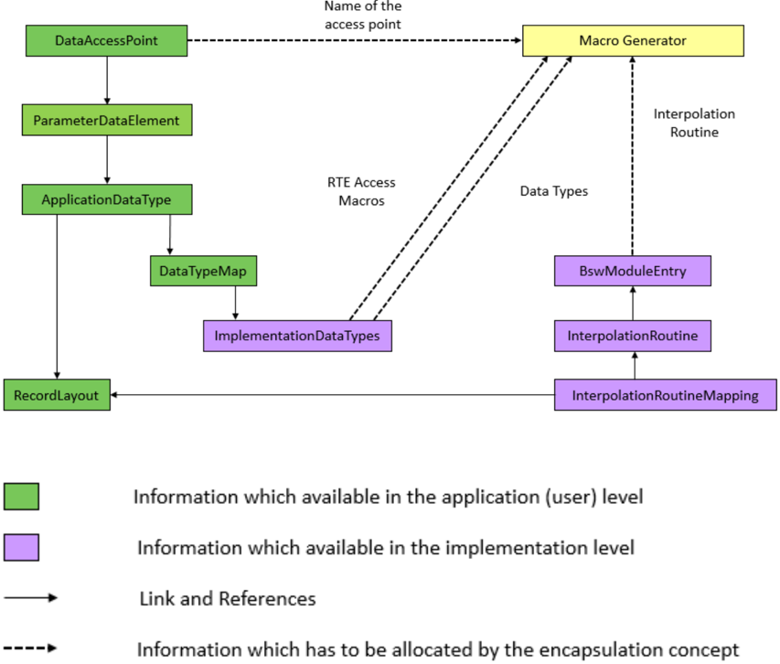
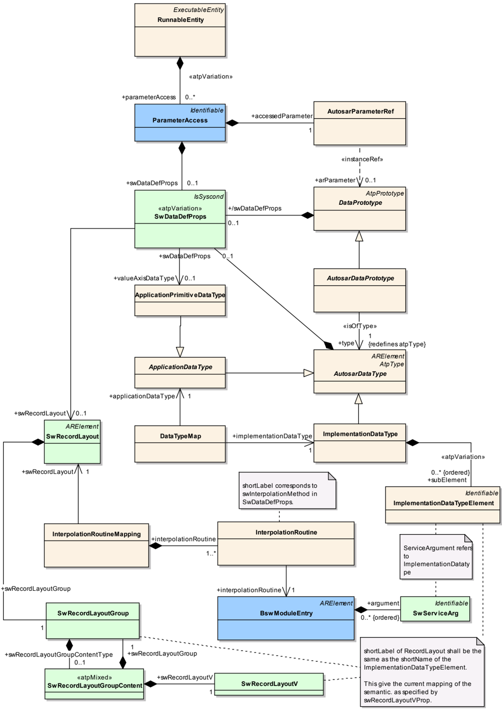
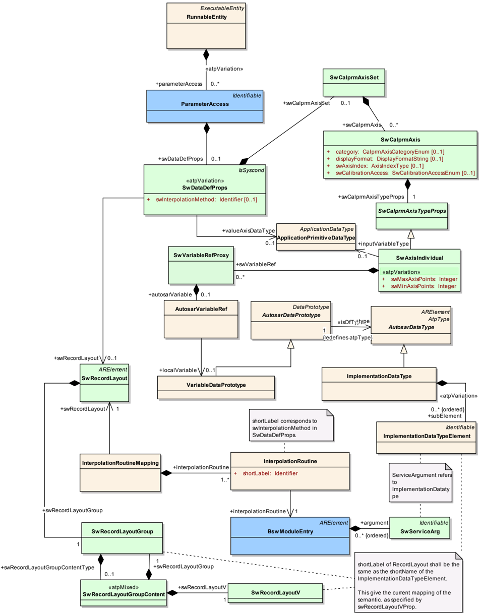
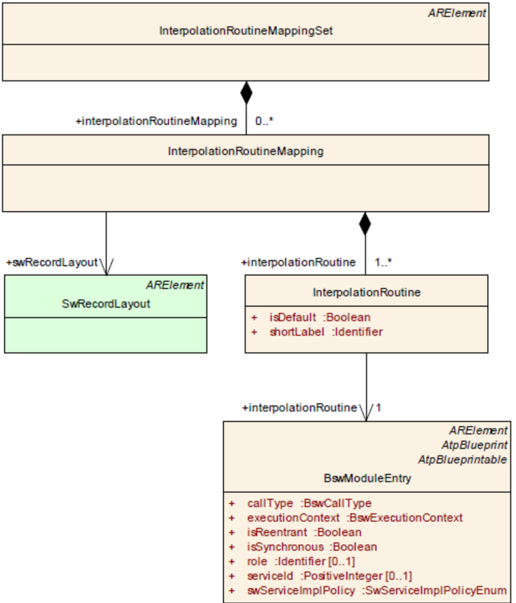
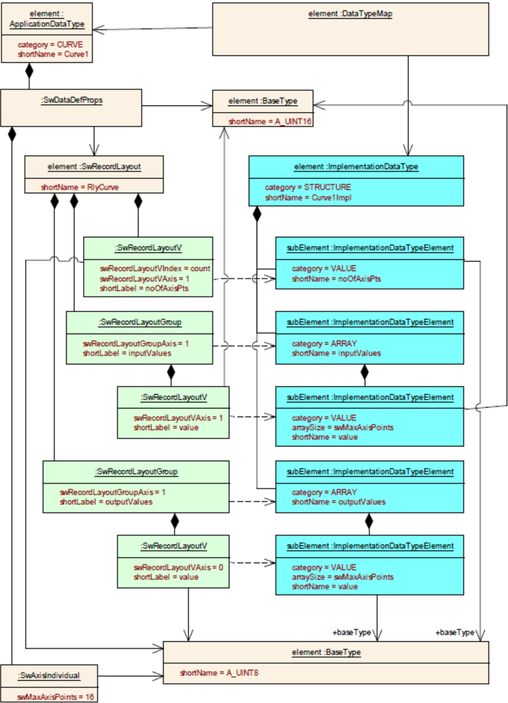
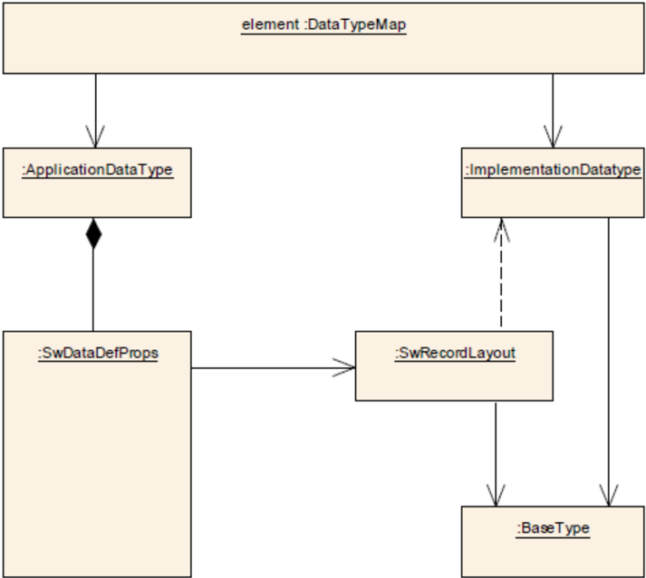
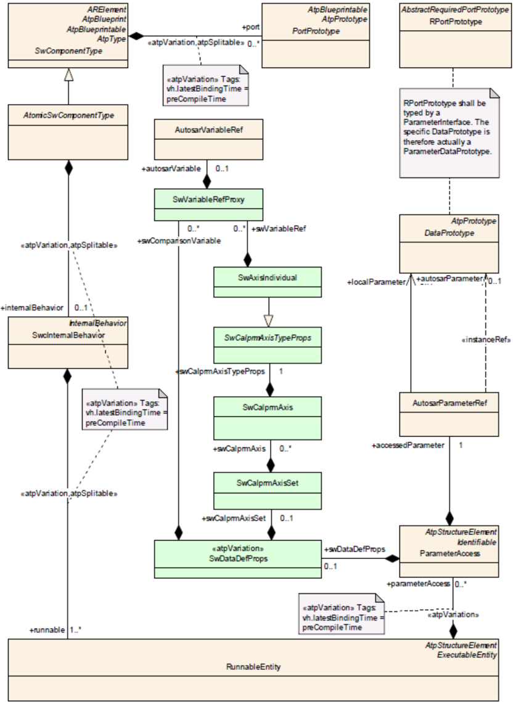

<!-- 源文档 AUTOSAR_CP_EXP_MacroEncapsulationofInterpolationCalls（R23-11），讲述型指南（EXP），不受 Type A 七章骨架约束；章节结构镜像源文档自身编号（1–7）。 -->

## 1. 缩略语与缩写

| 缩写/缩略语 | 说明 |
| --- | --- |
| DEM | Diagnostic Event Manager（诊断事件管理器） |
| DET | Default Error Tracer（默认错误跟踪器） |

## 2. 相关文档

### 2.1. 输入文件

<a id="ref-1"></a>[1] AUTOSAR Layered Software Architecture
> AUTOSAR_CP_EXP_LayeredSoftwareArchitecture

<a id="ref-2"></a>[2] AUTOSAR General Requirements on Basic Software Modules
> AUTOSAR_CP_SRS_BSWGeneral

<a id="ref-3"></a>[3] AUTOSAR General Specification for Basic Software Modules
> AUTOSAR_CP_SWS_BSWGeneral

<a id="ref-4"></a>[4] AUTOSAR Methodology
> AUTOSAR_CP_TR_Methodology

<a id="ref-5"></a>[5] Requirements on Software Component Template
> AUTOSAR_CP_RS_SoftwareComponentTemplate

### 2.2. 相关规范

<a id="ref-1"></a>[1] Specification of Fixed Point Interpolation Routines
> AUTOSAR_CP_SWS_IFXLibrary

<a id="ref-2"></a>[2] Specification of Floating Point Interpolation Routines
> AUTOSAR_CP_SWS_IFLLibrary

<a id="ref-3"></a>[3] Specification of Run Time Environment
> AUTOSAR_CP_SWS_RTE

## 3. 引言

应用软件使用插值例程从已知点计算未知点。现有的 AUTOSAR 插值例程支持曲线（1D）与映射（2D）两类插值功能，均支持整数与浮点。每类支持两种方法：插值（interpolation）与查找（lookup）。此外还支持称为曲线/映射组和固定曲线/映射的特殊变体，它们带有两种不同的计算公式，可以是插值或查找。

插值例程是应用软件中非常频繁使用的例程。因此，插值例程的设计对软件开发的工作量有重大影响，并将首先被优化。说明性文档「Macro Encapsulation of Interpolation Calls」的开发目的是指导应用开发者简化地调用符合 AUTOSAR 且经过资源优化的插值例程。

## 4. 动机

说明性文档「MacroEncapsulationofInterpolationCalls」的动机是通过引入单一来源原则来简化例程的处理。这将减少维护工作量，并避免导致缺陷的错误使用。它们是最终降低成本并提升质量的基础。

## 5. 免责声明

本说明性文档把库调用的宏封装表示为减少调用数学插值功能时应用开销的可能方法之一。本文档不强制要求用户只能使用宏封装来进行插值调用。

## 6. 用例

### 6.1. 生成封装宏

文档 AUTOSAR_TR_Methodology R4.2 说明了原子软件组件头文件生成的一般方法（图 1）。所提议的封装宏应保存在一个「封装码头文件（Encapsulation Macros Header File）」中，类似于「应用头文件（Application Header File）」。


图 2 展示了与应用头文件生成过程并行的生成过程。标记的块建议作为新部分。宏封装生成器工具可以实现为组件 API 生成工具（RTE）的附加组件。两个工具的输入都来自 VFB 原子软件组件与软件组件内部行为的信息。

所生成的封装宏需要来自应用头文件的接口，例如以获得对曲线和映射的访问。因此，宏封装概念必须了解 RTE 生成的接口的语法与结构。所提议的封装宏应保存在一个「封装码头文件」中（见图 2），类似于「应用头文件」。



### 6.2. 使用封装宏

以下矩阵展示 IFX 库提供的、应由宏封装概念处理的全部插值服务类型：

| | Linear | Lookup | Fix（interval） | Fix（shift） | Lookup Fix（interval） | Lookup Fix（shift） |
| --- | --- | --- | --- | --- | --- | --- |
| Curve | x | x | x | x | x | x |
| Map | x | x | x | x | x | x |
| Grouped Curve | x | x | | | | |
| Grouped Map | x | x | | | | |
| Axis Search | x | | | | | |

以下矩阵展示 IFL 库提供的、应由宏封装概念处理的全部插值服务类型：

| | Linear | Lookup | Fix（interval） | Fix（shift） | Lookup Fix（interval） | Lookup Fix（shift） |
| --- | --- | --- | --- | --- | --- | --- |
| Curve | x | | | | | |
| Map | x | | | | | |
| Grouped Curve | x | | | | | |
| Grouped Map | x | | | | | |
| Axis Search | x | | | | | |

**插值方法：**

- Linear（线性）：考虑两个数据点对结果进行插值。
- Lookup（查找）：不插值，返回入口数据点。
- Fix（固定）：没有显式的轴，分布点通过 Offset 和 Shift 或 Offset 和 Interval 计算。
- Lookup Fix（固定查找）：Lookup 与 Fix 的混合。

**插值计算：**

- Curve / Map（曲线/映射）：集成的数据点搜索与插值。
- Grouped Curve / Grouped Map（成组曲线/成组映射）：分布式的数据点搜索与插值。

对于成组插值方法，数据点搜索与插值计算是分离的。数据点搜索的结果是一个包含索引与比值信息的结构。该信息可以被曲线插值、曲线查找插值、映射插值和映射查找插值使用。目前本文档详述线性曲线与映射插值。其他类型的插值可以用类似的方式处理，但不在本文档中规定。

## 7. 方案建议

### 7.1. 术语定义

本概念将提供一个额外的头文件——「封装码头文件」。它包含生成的宏，用于封装曲线与映射插值例程的调用。

没有提供其他新术语。

### 7.2. 架构组件

#### 7.2.1 封装码头文件

| 制品 | 说明 |
| --- | --- |
| 包（Package） | AUTOSAR Root::M2::Methodology::MethodologyLibrary::Component:: Work Products |
| 简要描述 | 在 RTE 合同阶段之后由宏封装生成器工具为某个 AtomicSoftwareComponentType 生成的头文件。 |
| 描述 | 在 RTE 合同阶段之后由宏封装生成器工具为某个 AtomicSoftwareComponentType 生成的头文件。它表示组件代码与 RTE 之间完整的封装宏接口（对 RTE 的调用以及由 RTE 调用的原型）。所有封装插值例程的调用都经由该头文件路由。 |
| 种类（Kind） | Code |
| 关系类型 | Related Element / Mul. / Note |
| AggregatedBy | Delivered Software Component / 1 / |
| ParameterOut | Generate Atomic Software Component Contract Header Files / 1 / Meth.bindingTime = CodeGenerationTime |
| ParameterIn | Compile Atomic Software Component / 1 / Meth.bindingTime = CodeGenerationTime |

头文件的名称将采用如下形式：「&lt;component&gt;_Elc.h」，其中 &lt;component&gt; 是为其生成头文件的组件的名称。

### 7.3. 功能描述

#### 7.3.1 基本概念描述

##### 7.3.1.1 封装概念的原理

为了说明封装宏，下面演示一个曲线插值处理的例子。（给出的名称可能不符合命名规范，因为重点是概念原理。）假设某个特定 SWC 组件的数据规范（VFB 原子软件组件描述）定义了一个名为「IgnitionCurve」的数据原型。该数据原型由一个名为「IgnitionCurveType」的 ApplicationDataType 确定类型，包含其 x 轴与 y 轴。该 ApplicationDataType 对应于一个 ImplementationDataType（例如「GenericCurve」）。该 ImplementationDataType 规定最终结构的细节，包括其 BaseType（例如下例中曲线值用数据类型 uint8，x 轴用 sint16）。

一个插值服务的原型如下所示：

```C
uint8 Ifx_IntIpoCur_s16_u8(sint16 Xin, sint16 N, const sint16* X_Array, const uint8* Val_Array)
```

其中，Xin：输入值；N：轴点数量；X_Array：指向 X 分布的指针；Val_Array：指向曲线值的指针。

没有封装概念时，插值服务必须按如下方式调用：

```C
CurveValue = Ifx_IntIpoCur_s16_u8(X_input, Curve.N, Curve.Axis, Curve.Values);
```

封装概念现在提供一个宏来封装该插值服务调用：

```C
CurveValue = Elc_Get_myRunnable_IgnitionCurve();
```

因为封装宏按如下方式生成：

```C
#define Elc_Get_myRunnable_IgnitionCurve  \
    Ifx_IntIpoCur_s16_u8(X_input, \
    Curve.N,     \
    Curve.Axis,  \
    Curve.Values);
```

参数的顺序不是隐式的；需要经由语义映射提供显式行为（细节在 [7.3.2.3](#7323-为类别为-structure-的-implementationdatatype-生成插值例程的参数) 中定义）。为了给插值服务的单个参数提供值和指针，使用 RTE 访问。例如 Rte_CData()。

##### 7.3.1.2 概念决定

一般有两类参数：

- 第一类是曲线或映射的输入值；
- 第二类是指向相应曲线或映射的值和指针。

输入值通常从表示为 ApplicationDataType 的物理值导出。但是，这样的输入值有可能在调用插值例程之前被轻微地预处理。在这种情况下，插值例程用未经过 RTE 合同阶段的局部变量调用。将需要显式的通信，但就资源而言代价高昂。这会使插值调用的完整封装变得复杂，应当避免。

相应曲线或映射的值与指针的参数不会带来问题。这些参数具有更内部的视角，因为它们是从经由 RecordLayout 描述的曲线或映射的内存表示导出的。

为了限制输入值处理的复杂度，有两种可能的备选方案：

1. 生成的宏带有输入值的参数：

```C
CurveValue = Elc_Get_myRunnable_IgnitionCurve(local_input);
```
或

```C
CurveValue = Elc_Get_myRunnable_IgnitionCurve(Rte_X_input);
```

2. 在宏调用之前使用不带参数的临时变量：

```C
local_input = X_input;
```
或

```C
local_input = Rte_X_input;
CurveValue = Elc_Get_myRunnable_IgnitionCurve();
```

在方案 2 中，必须特定地知道临时变量的名称，因为该变量在生成的宏内是固定的。这可能过于复杂，因此选择方案 1。

注意，这些宏是 SWC 特定的，因此应应用特定的命名方案。只有曲线或映射的输入值必须由用户提供。插值例程的其余参数以及插值例程本身由生成的宏封装。该信息可以从数据规范中提取。通过这种方式，消除了由不一致定义引入错误的可能性。此外，SWC 组件的软件开发者被完全解除了存储分配与例程分配的工作——它们被自动执行。因此，软件开发的工作量显著降低。

##### 7.3.1.3 宏生成所需的信息

基于第 [7](#7-方案建议) 章的概念决定，要生成的宏如下所示。

（曲线的例子）：

```C
#define Elc_Get_{Runnable}_{Accesspoint}      {RoutineName}((X),       \
    {ImplTypeStruct}.{N},    \
    {ImplTypeStruct}.{Axis}, \
    {ImplTypeStruct}.{Values}
```

要生成该宏，需要以下信息：

- **生成的宏的名称**：Elc_Get_myRunnable_{NameOfAccessPoint}。生成的宏为每个访问点单独生成。
- **插值例程的名称**：{RoutineName}。插值例程的名称取决于插值例程的类型以及轴与输出值的数据类型。轴与插值输出值的每种数据类型组合都有一个单独的实现和一个单独的插值例程名称。创建插值例程的名称是本概念中最复杂的部分。例如，必须区分以下曲线插值例程：

```Text
Ifx_IntIpoCur_U8_U8 Ifx_IntIpoCur_U8_U16 Ifx_IntIpoCur_U8_S8 Ifx_IntIpoCur_U8_S16
Ifx_IntIpoCur_U16_U8 Ifx_IntIpoCur_U16_U16 Ifx_IntIpoCur_U16_S8 Ifx_IntIpoCur_U16_S16
Ifx_IntIpoCur_S8_U8 Ifx_IntIpoCur_S8_U16 Ifx_IntIpoCur_S8_S8 Ifx_IntIpoCur_S8_S16
Ifx_IntIpoCur_S16_U8 Ifx_IntIpoCur_S16_U16 Ifx_IntIpoCur_S16_S8 Ifx_IntIpoCur_S16_S16
```

- **插值例程的参数**：{ImplTypeStruct}.{N}，……。提供插值例程的参数。RTE 生成一个与某个 ImplementationDataType 对应、基于 SwRecordLayout 的结构。宏封装工具必须生成对轴点数量、轴以及曲线或映射的值的访问。插值例程所需的指针数量因插值类型而异。

轴点数量的数据类型具有特殊的相关性。该信息不需要显式提供，但必须在 ImplementationDataType 内严格定义。[7.3.1.9](#7319-轴点数量的数据类型) 章给出了定义分布点数量数据类型的规则。

##### 7.3.1.4 获取宏生成信息的概览

图 3 大致概览了宏封装概念的工作流。该图预示了概念必须准备哪些信息，以及哪些信息在 AUTOSAR 的元模型中仍然可用。



从 DataAccessPoint 出发，必须收集全部信息以生成封装插值例程调用的宏。在 DataAccessPoint 处，可以知道将使用哪个插值例程、以及哪些值应作为插值例程的输入与输出。访问点的名称可以直接取自 DataAccessPoint。插值例程的名称取自 BswModuleEntry。BswModuleEntry 经由 InterpolationRoutineMapping、RecordLayout 和 ApplicationDataType 与 DataAccessPoint 关联。RTE 访问宏与数据类型可以从经由 DataTypeMap 和 ApplicationDataType 链接到 DataAccessPoint 的 ImplementationDataType 导出。

插值例程随输入与输出值的数据类型而变化。到目前为止，还没有 AUTOSAR SWS 描述规定带有插值例程的 BswModuleEntry 与相应 ApplicationDataType、SwRecordLayout 和 ImplementationDataType 对应的完整机制。为了使宏封装概念能够使用 BswModuleEntry 的内容，必须对其进行定义。下一章描述了如何做到这一点的概念。

##### 7.3.1.5 无歧义的 InterpolationRoutineMapping

存在 InterpolationRoutineMapping 不无歧义、同一 RecordLayout 适合多于一个插值函数的场景。在这种场景中，从数据规范的角度，宏封装工具无法确定使用了哪种插值例程。曲线或映射可以被插值，或只使用查找行为。原因在于两种情况下曲线或映射在内存中的数据仍然完全相同。用户只在 ARXML 中规定曲线或映射的数据与属性，而插值的种类随后由在代码中调用相关的插值例程来选择。

例如 Ifx_IntIpoCur_s16_s16 与 Ifx_IntLkUpCur_s16_s16。

这种非无歧义场景的可能解决方案是：宏封装工具为不同的插值例程生成多于一个的宏。在这种情况下，宏应具有不同的名称，以区分不同种类的插值例程。

示例，考虑 Ifx_IntIpoCur_s16_s16 与 Ifx_IntLkUpCur_s16_s16：

```C
#define Elc_Get_myRunnable_IgnitionCurve_Ipo  \
    Ifx_IntIpoCur_s16_s16(X_input, \
    Curve.N,     \
    Curve.Axis,  \
    Curve.Values);
#define Elc_Get_myRunnable_IgnitionCurve_Lkup  \
    Ifx_IntLkUpCur_s16_s16(X_input, \
    Curve.N,     \
    Curve.Axis,  \
    Curve.Values);
```

用户现在可以调用：

```C
CurveValue = Elc_Get_myRunnable_IgnitionCurve_Ipo(); // 插值方法
```
或

```C
CurveValue = Elc_Get_myRunnable_IgnitionCurve_Lkup(); // 查找方法
```

##### 7.3.1.6 BswModuleEntry 的一般信息

BswModuleEntry 表示进入 BSW 模块或集群的单个 API 条目（C 函数原型）。对于 IFX 和 IFL，BswModuleEntry 是对插值例程的引用，从 AUTOSAR 在 SWS 文档中定义的插值 API 导出。

例如，IntIpoCur_u16_u16 对应于 API Ifx_IntIpoCur_u16_u16。更多信息见 AUTOSAR 蓝图文件，位于以下文件中的「AUTOSAR_MOD_GeneralBlueprints.zip」内：

- AUTOSAR_MOD_BswModuleEntrys_Blueprint.arxml
- AUTOSAR_MOD_IFX_RecordLayout_Blueprint.arxml
- AUTOSAR_MOD_IFL_RecordLayout_Blueprint.arxml

图 4 和图 5 以不同的侧重点描述了完整的概览。





##### 7.3.1.7 插值例程与记录布局

记录布局与插值例程之间的关系在 InterpolationRoutineMappingSet 中规定。插值例程表示为 BswModuleEntry，并实现一个特定的插值方法，该方法在 InterpolationRoutine 的 shortLabel 中表示。预期的插值方法在 SwDataDefProps 的 InterpolationMethod 中表示。

图 6 展示把 Record Layout 映射到特定插值例程的元模型（注意：该图取自 AUTOSAR_TPS_SoftwareComponentTemplate 描述，5.53）。



曲线或映射的结构与内存表示在数据规范层级经由 RecordLayout 描述。图 7 取自 AUTOSAR_TPS_SoftwareComponentTemplate 的图 5.48。



##### 7.3.1.8 插值例程名称的结构

插值例程的名称有一个基于内在语义的已定义构造约定。

示例：

```Text
Ifx_IntIpoCur_u8_s8    Ifl_IntIpoMap_f32f32_f32
```

名称的结构如下：

```Text
{ModuleID}_{Method}{Type}_{InputDataType(s)}_{OutputDataType}
```

各命名部分的描述如下：

- **{ModuleID}**：只有两个可能的模块 ID：「Ifx」表示整数插值，「Ifl」表示浮点插值。整数与浮点插值的混合不是预期的。
- **{Method}**：有多种可用方法。建议使用一张转换映射，以建立特定方法与插值例程名称的方法部分之间的映射。方法在 ApplicationDataType 的 interpolationMethod 中描述。例如 Linear → IntIpo，Lookup → IntLkUp。
- **{Type}**：针对曲线还是映射进行插值，可以通过 ApplicationDataType.category 的 category 选择。类别 CURVE → Cur，MAP → Map。
- **{InputDataType(s)}**：借助 ImplementationDataTypeElement 识别输入的数据类型。此外，可以经由 DataTypeMap 从 ApplicationDataType 的 DataTypes 导出轴的类型：valueAxisDataType。

图 8 可视化了 DataType 与 SwRecordLayout 之间的依赖关系，取自 AUTOSAR_TPS_SoftwareComponentTemplate 的图 5.33。

提示：轴值的数据类型可能与曲线输入值的数据类型不同。



- **{OutputDataType}**：输出数据类型取决于访问点的数据类型。

借助该原理，可以填充 InterpolationRoutineMapping 内的 BswModuleEntry。宏封装生成器工具可以假定 BswModuleEntry 内存在插值例程的名称。

##### 7.3.1.9 轴点数量的数据类型

宏封装概念不需要显式地使用该数据类型，但插值例程为轴点数量的参数应用一种特殊的数据类型。此外，轴点数量是一个像曲线或映射的轴与值一样位于内存中的元素。因此，当从 ApplicationDataType 派生 ImplementationDataType 时，必须定义轴点数量的数据类型。

确定轴点数量数据类型的规则很简单：

**轴点数量获得与第一根轴相同的数据类型。**

**对曲线的影响：**

曲线只有一根轴。因此轴点数量获得与 x 轴相同的数据类型。如果 x 轴是 sint8 轴，则轴点数量也将是 sint8 数据类型。显然，负的轴点数量没有意义，但 127 个轴点应当足够了。如果轴是 uint8、sint16 或 uint16 类型，轴点数量也使用相同的数据类型。

**对映射的影响：**

映射有两根轴。这里 x 轴与 y 轴的轴点数量获得 x 轴的数据类型。这样做的原因是为了避免 ImplementationDataType 定义中的填充字节。为了进一步理解这一点，需要做一个定义：ImplementationDataType 内元素的顺序有一个明确定义的序列。首先必须定义带轴点数量的元素，然后是轴，最后定义曲线或映射的值。ImplementationDataType 的实现可以作为结构或数组完成。作为例子：

```C
Struct {
  uint8 Nx;
  uint8 Ny;
  uint8 AxisX[];
  uint16 AxisY[];
  sint8 Values[];
} Map;
```

假定处理器对内存元素采用自然对齐（「自然对齐」意味着任何元素至少对齐到其自身大小的倍数。例如，一个 4 字节的对象对齐到 4 的倍数的地址，8 字节对象对齐到 8 的倍数的地址，等等），则 Nx 与 Ny 之间不需要间隙字节。如果 Ny 与 Y 轴具有相同的类型，则 Nx 与 Ny 之间有一个填充字节。

#### 7.3.2 宏封装概念的实现

本章描述如何生成封装宏以及如何获取所需的信息。本章引用 [7.3.1.3](#7313-宏生成所需的信息) 章，那里描述了宏封装所需的信息。必须生成三个部分：

- 封装宏的名称；
- 插值例程的名称；
- 插值例程的参数。

生成宏的抽象形式：

```Text
#define {NameOfMacro} {RoutineName}((X),{Parameters})
```

生成宏的细节（使用曲线的例子）：

```C
#define Elc_Get_{Runnable}_{NameOfAcessPoint}  {RoutineName}(X)((X), \
    {RteAccess}.{N},    \
    {RteAccess}.{Axis}, \
    {RteAccess}.{Values}
```

##### 7.3.2.1 封装宏名称的生成

封装宏的名称从访问点的名称与一个后缀派生，按照如下模式：

```Text
Elc_Get_{NameOfRunnable}_{NameOfAcessPoint}
```

在此语境中，图 9 展示了对标定端口的可运行体访问。该图取自 AUTOSAR_TPS_SoftwareComponentTemplate，7.29。



##### 7.3.2.2 插值例程名称的生成

插值例程的名称在元模型中定义为 BSWModuleEntry。宏封装生成器工具必须按以下序列解析元模型，以获得插值例程的名称：

1. 从 DataAccess → RunnableEntity → ParameterAccess 开始；
2. 经由 AutosarParameterRef 可以找到 DataPrototype；
3. 经由 AutosarDataPrototype 可以找到 AutosarDataType；
4. AutosarDataType 与 SwDataDefProps 有关系；
5. 经由 SwDataDefProps 选择一个 SwRecordLayout；
6. 经由 SwRecordLayout 与 InterpolationRoutineMapping 和 InterpolationRoutine，可以在 BSWModuleEntry 中找到所需的插值例程候选调用；
7. 最后，通过匹配 ImplementationDataType 的数据类型来确定适当的 InterpolationRoutine。

名称的结构如下：

```Text
{ModuleID}_{Method}{Type}_{InputDataType(s)}_{OutputDataType}
      ← 6 →                      ← 7 →
```

##### 7.3.2.3 为类别为 STRUCTURE 的 ImplementationDataType 生成插值例程的参数

如 [7.3.1.2](#7312-概念决定) 章的概念决定，曲线或映射插值的输入变量不被封装。一般而言，它们可以通过 DataAccess.dataDefProperties.swCalprmAxisSet.variableRef 获得。只生成轴点数量、指向轴的指针以及指向曲线或映射值的指针的参数。为了获得这些参数，使用 RTE 生成的信息。

RTE 依据 ImplementationDataType 生成 typedef 与结构，这些 ImplementationDataType 基于相应曲线或映射的 SwRecordLayout。宏封装生成器工具必须了解与 RTE 相同的方法，以从 ImplementationDataType 派生 typedef 与结构，才能使用该信息。

默认情况下，对于类别属性设置为「STRUCTURE」的每个 ImplementationDataType，RTE 在 RTE 数据码头文件「Rte_Type.h」中生成如下 typedef。这在「RTE Contract」与「RTE Generation」阶段完成。

```C
typedef struct { <elements> } <name>;
```

其中 &lt;elements&gt; 是记录元素规范，&lt;name&gt; 是结构实现数据类型的 shortName。对于由一个 ImplementationDataTypeElement 定义的每个记录元素，定义一个记录元素规范 &lt;elements&gt;。记录元素规范按照输入配置中相关 ImplementationDataTypeElement 的顺序排序。相邻的记录元素用分号分隔。RTE 确保结构及其元素的名称是唯一的。不使用前缀 Rte_，因为这些类型名表示 AUTOSAR 数据类型。

基于这样的 typedef，在 Rte.c 文件中生成一个定位的结构。使用标准 RTE 访引来寻址结构的元素。

需要澄清的一点是如何把 ImplementationDataType 的元素映射到插值例程的相应参数。一方面，ImplementationDataType 的元素可以以任意顺序定义；另一方面，插值例程的参数序列是固定的。必须存在一个映射，使 ImplementationDataType 的元素与插值例程的正确参数匹配。例如，描述轴点数量的元素必须与具有相同表示的插值例程参数匹配。

为了处理这种关系，有两种可能的做法：

- 要么需要在元模型中增加一个新的映射，以规定关于 ImplementationDataType 相应元素的参数序列顺序；
- 要么必须定义一个命名约定，为特定的元素行为提供明确定义的名称。

将选择命名约定，因为它更容易定义与实现，并且元模型无需扩展。下表展示 ImplementationDataType 与插值例程参数串联的命名约定。

| 参数 | 定义的名称 |
| --- | --- |
| x 轴点数量 | Nx |
| y 轴点数量 | Ny |
| X 轴 | AxisX |
| Y 轴 | AxisY |
| 曲线或映射的值 | Values |

##### 7.3.2.4 为类别为 ARRAY 的 ImplementationDataType 生成插值例程的参数

存在这样的做法：例如 Curve 的 ImplementationDataType 不是 STRUCTURE 而是 ARRAY。显然这要求轴点数量、轴点、值使用相同的基本数据类型。

尽管如此，在这种情况下，[7.3.2.3](#7323-为类别为-structure-的-implementationdatatype-生成插值例程的参数) 章描述的命名约定不完全适用。因此，实现数组中所需的位置需要通过一种基于 SwRecordLayout 以及相应曲线/映射当前大小的「地址计算」来确定。大小元素的位置可以按照 [7.3.2.3](#7323-为类别为-structure-的-implementationdatatype-生成插值例程的参数) 章的命名约定与记录布局找到。
