## 1. 简介和功能概述

本规范规定了称为内核测试驱动程序（**Core Test Driver**）的**AUTOSAR**基础软件模块的功能、**API**和配置。本规范适用于所有类型内核的驱动程序，无论该驱动程序是在**ECU**上电期间执行，还是在**ECU**应用程序运行期间执行。

内核测试驱动程序为配置、启动、轮询、终止内核测试（**Core Test**）结果以及向应用程序通知内核测试结果提供服务。它还提供以预定义方式返回测试结果的服务。此外，它提供若干测试来验证特定的内核功能，例如通用寄存器或算术逻辑单元（**ALU**）。假设每个被测试的内核硬件功能都可以被独占地用于测试目的。由内核测试驱动程序**API**的用户选择合适的测试组合和有调度顺序的执行，以满足系统的安全需求。这些服务的行为是异步或同步的。

内核测试驱动程序直接访问微控制器内核，不经过任何中间软件层，位于微控制器抽象层（**MCAL**）。

## 2. 缩略语

**MCAL**
> 微机抽象层（**Microcomputer Abstraction Layer**）

**DEM**
> 诊断事件管理器（**Diagnostic Event Manager**）

**DET**
> 默认错误跟踪器（**Default Error Tracer**）

**CPU**
> 中央处理器（**Central Processing Unit**）

**MPU**
> 内存保护单元（**Memory Protection Unit**）

**L1**
> 第一级存储器（**1st level memory**）

**L2**
> 第二级存储器（**2nd level memory**）

**MCU**
> 微控制器单元（**Microcontroller Unit**）

**BIST**
> 内建自测试（**Built in Self Test**）

**IRQ**
> 中断请求（**Interrupt Request**）

**Core**
> **CPU** 及其紧邻的功能资源。

**CSUM/Checksum/signature**
> 测试执行结果的数值表示。

**Background test**
> 后台测试由 **SW** 调度器/**RTOS** 周期性调用。

**Foreground test**
> 前台测试是同步测试，不得被中断。它通过用户应用程序调用。

**'Golden (Ref.) Value'**
> 用于与先前计算出的测试结果值进行比较的参考值（例如校验和/签名）。

**'Good Case'**
> 执行完成且未报告错误。

**Atomic sequence/ atomic piece**
> 原子序列是一段不得被中断的测试。

**External device**
> 物理外部实体；例如另一个微控制器。

**Resource**
> 「硬件资源」是 **CoreTest** 驱动程序用户可以选择的最小单元（实例）。它可以在一个或多个原子序列中被测试。它是执行特定功能（例如 **IRQ** 控制器）的内核内部单元。

**Partial test (orange block in Figure3)**
> 部分测试定义为一个或多个「硬件资源」的测试。（部分测试是可中断的，因为它在后台模式下执行。）

**Entity/unit**
> 内核内部的硬件功能（例如 **CPU**、**MMU** 等）。

**Caller/calling entity**
> 调用者/调用实体位于较高的 **AUTOSAR** 或 **ISO** 层。它是 **API** 调用的用户。

**test interval**
> **CoreTest** 测试间隔：在配置为构成一个完整内核测试的硬件资源上（后台模式下执行的）所有部分测试的总和。

**Test Interval Id**
> 测试间隔的标识符，每开始一个新的测试间隔时应递增。

由于本文档是由专业人士为专业人士编写的，其余所有术语均视为已知。

## 3. 相关文档

### 3.1. 输入文件和相关标准与规范

[1] List of Basic Software Modules
> AUTOSAR_TR_BSWModuleList

[2] Layered Software Architecture
> AUTOSAR_EXP_LayeredSoftwareArchitecture

[3] General Requirements on Basic Software Modules
> AUTOSAR_SRS_BSWGeneral

[4] Specification of BSW Scheduler
> AUTOSAR_SWS_BSW_Scheduler

[5] ECU Configuration Specification
> AUTOSAR_SWS_ECUStateManager

[6] Specification of Memory Mapping
> AUTOSAR_SWS_MemoryMapping

[7] Requirement on Core Test
> AUTOSAR_SRS_CoreTest

[8] AUTOSAR Basic Software Module Description Template
> AUTOSAR_RS_BSWModuleDescriptionTemplate

[9] General Specification of Basic Software Modules
> AUTOSAR_SWS_BSWGeneral

### 3.2. 相关标准和规范

[10] ISO 26262:2018（所有部分）—— 道路车辆 功能安全 www.iso.org

### 3.3. 相关规范

**AUTOSAR**提供了基础软件模块通用规范[9]（**SWS BSW General**），该规范同样适用于内核测试（**Core Test**）。

因此，**SWS BSW General**规范应被视为**Core Test**的附加必需规范。

## 4. 约束和假设

### 4.1. 限制

内核测试模块的实现可能仅限于在上电/启动期间执行，此时内核资源尚未在不同的活跃**AUTOSAR**相关软件任务或硬件实体（例如**IRQ**控制器、**DMA**、缓存、**MMU/MPU** 和 **MemoryIF**）之间共享

——或者——

可能仅限于测试运行期间软件执行中不被共享的资源（例如**ALU**和**CPU**寄存器）。这总体上取决于汽车系统体系结构，无法在**MCAL**内核测试**SWS**规范中覆盖。

由于**MCAL**驱动程序无法自行处理此类任务，必须存在一个管理实体或体系结构来管理「硬件资源访问管理」之类的任务。

### 4.2. 汽车域的适用性

无限制。

### 4.3. 安全相关环境的适用性

如果上层软件提供以下机制来处理内核测试**API**结果，本模块可用于安全相关系统：

* 校验和/签名保护
* 在使用前检查内核测试代码完整性
* 校验和/签名的冗余存储
* 内核测试结果的外部决策执行

并且内核测试模块实现被嵌入到系统安全体系结构概念中。

## 5. 对其他模块的依赖

**CoreTest**模块依赖以下模块：

* 需要 **BSW** 调度器在后台模式下触发主函数

**Core Test**库模块和/或源代码模块依赖于微控制器平台，因此依赖于硅制造商的硬件实现，甚至依赖于硅修订版。

**Core Test**库模块和/或源代码模块依赖于正常工作的内核时钟域。

### 5.1. 文件结构

#### 5.1.1. 代码文件结构

内核测试模块应仅为测试目的提供中断服务例程。

## 6. 功能规格

### 6.1. 一般行为

内核测试（**Core Test**）应提供测试所有**CPU**寄存器的过程。

内核测试应提供中断控制器和异常检测测试。特别是对中断本身的检测以及向有效中断服务地址的分支应是测试的一部分。无论测试是由软件异常触发还是由硅片中内置的专用硬件单元触发，都是如此。

内核测试应提供算术逻辑单元（**ALU**）测试。

内核测试应提供地址生成测试。

内核测试应提供内核存储器接口测试。这明确排除了对内核自身外部连接的存储位置或内核内部驻留的存储位置本身的测试。

**注意：**要执行的所需测试的细节在相应的硬件文档（例如硬件安全手册）中提供。

内核测试应提供内存保护单元（**MPU**）测试。即使内存管理单元（**MMU**）执行**MPU**功能，这也有效。

内核测试应提供缓存控制器测试。特别是应测试内核外存储器中的数据或指令与其相应缓存条目表示之间的一致性和相干性。

内核测试由部分测试（硬件资源测试的集合）构成，这些部分测试可以被更高优先级的任务中断。

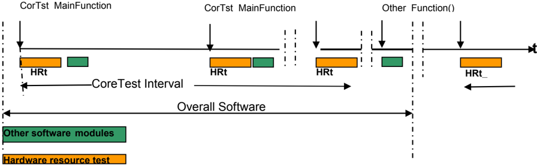

每个内核测试间隔应有一个标识符，每在后台模式下开始一个新的测试间隔时应递增该标识符。

内核测试模块应提供后台和前台模式的测试执行服务。内核测试在后台模式下的状态如图 2 所示。所描述的状态仅为后台运行模式下的驱动程序状态。

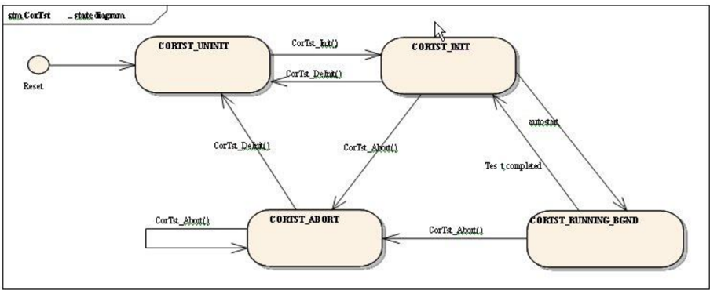

每个部分测试由不可中断的原子序列组成。下图展示 [**CorTst_MainFunction**](#751-cortst_mainfunction) 如何被调度器调用，以及它如何在原子片段之间被更高优先级的任务中断。

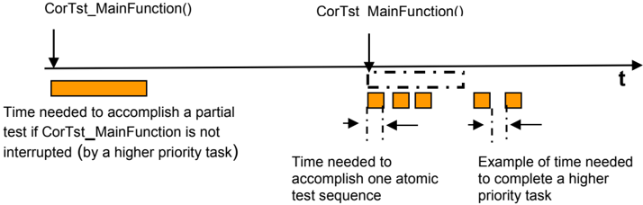

#### 6.1.1. 背景与原理

如内核测试**SRS**所述，内核测试专注于测试内核，包括**CPU**和本地耦合的单元（例如**MMU/MPU**和中断控制器）。

由于内核实现的复杂性，对内核结构的非常深入的了解是实现内核测试的前提。因此，假设硅制造商是使用**AUTOSAR API**实现内核测试、并将该测试作为库提供给用户或应用程序实现者的合适实体。

此外，假设内核测试实现很少会以纯源代码模块的形式从硅制造商处交付，以避免**IP**流失。

### 6.2. 错误分类

除**CPU**内部检测到的故障（例如**ALU**、**MAC**等）外——这些故障无法由软件可靠地报告——无法由 Dem_SetEventStatus **API**可靠报告的错误应由实现者记录。

#### 6.2.1. 开发错误

| 错误类型 | 相关错误代码 | 错误值 |
|---|---|---|
| 特定 API 在意外状态下被调用 | CORTST_E_STATUS_FAILURE | 0x01 |
| API 服务以错误参数范围调用 | CORTST_E_PARAM_INVALID | 0x11 |
| 未经内核测试初始化即调用 API | CORTST_E_UNINIT | 0x20 |
| 未在中间调用 [CorTst_DeInit](#732-cortst_deinit)() 的情况下再次调用 API 服务 [CorTst_Init](#731-cortst_init)() | CORTST_E_ALREADY_INITIALIZED | 0x23 |
| [CorTst_GetVersionInfo](#739-cortst_getversioninfo)() 和 [CorTst_GetCurrentStatus](#735-cortst_getcurrentstatus)() 以 NULL 指针调用 API 服务 | CORTST_E_PARAM_POINTER | 0x24 |

#### 6.2.2. 运行时错误

没有运行时错误。

#### 6.2.3. 瞬态故障

没有瞬态故障。

#### 6.2.4. 生产错误

没有生产错误。

#### 6.2.5. 扩展生产错误

##### 6.2.5.1. CORTST_E_CORE_FAILURE

| 错误名称 | [CORTST_E_CORE_FAILURE](#625-扩展生产错误) |
|---|---|
| 简短描述 | 测试期间发生内核失效。 |
| 详细描述 | 此错误表明 CorTst 模块在某个内核中检测到失效。 |
| 检测标准 | Fail：当 [CorTst_Start](#738-cortst_start) 或 [CorTst_MainFunction](#751-cortst_mainfunction) 检测到内核失效时报告 PREFAILED（见下方两个需求）。Pass：当 [CorTst_Start](#738-cortst_start) 或 [CorTst_MainFunction](#751-cortst_mainfunction) 能够完成内核测试而未检测到错误时报告 PREPASSED。 |
| 次要参数 | PREPASSED 与 PREFAILED 检测始终处于活动状态。但如果内核不处于错误可以由软件可靠报告的状态，则可能不报告 PREFAILED 状态。 |
| 所需时间 | 检测失效所需的时间取决于 [CorTst_Start](#738-cortst_start) 或 [CorTst_MainFunction](#751-cortst_mainfunction) 的调用频率以及前台或后台测试的数量（见第 9.1.2 章）。从失效中恢复所需的时间可能更长，因为应将内核的瞬时硬件失效视为失效。 |
| 监控频率 | 持续 |

**Fail** 判定：当 [CorTst_Start](#738-cortst_start) 或 [CorTst_MainFunction](#751-cortst_mainfunction) 检测到内核失效时报告 **PREFAILED**。

**Pass** 判定：当 [CorTst_Start](#738-cortst_start) 或 [CorTst_MainFunction](#751-cortst_mainfunction) 能够完成一次内核测试而未检测到错误时报告 **PREPASSED**。

### 6.3. 通用需求

由于内核测试是一个不了解硬件/软件系统体系结构的**MCAL**驱动模块，被测试的实体和资源（例如**ALU**）在运行期间测试执行开始前应被独占可用。

内核测试实现者应给出内核测试实现的故障覆盖成就的指示。

内核测试对被测试实体应是非破坏性的。如果内核测试自行修改了实体的设置、值、配置或选择，它必须在返回调用服务之前恢复先前的实体状态。

## 7. API规范

### 7.1. 导入的类型

本章列出了从其他**BSW**模块包含的所有类型。

**CorTst**模块的导入数据类型定义

| 模块 | 头文件 | 导入的类型 |
|---|---|---|
| Dem | Rte_Dem_Type.h | Dem_EventIdType |
| Dem | Rte_Dem_Type.h | Dem_EventStatusType |
| Std | Std_Types.h | Std_ReturnType |
| Std | Std_Types.h | Std_VersionInfoType |

### 7.2. 类型定义

#### 7.2.1. CorTst_ConfigType

结构类型。元素为实现特定。**CorTst**模块的配置数据结构。可通过**CorTst.h**获得。

#### 7.2.2. CorTst_CsumSignatureType

类型，派生自基类型 uint16 或 uint32。范围为 16..32 位 —— 大小取决于目标平台。当从**API**向**API**的调用者返回校验和/签名时，这是内核测试返回值的类型。可通过**CorTst.h**获得。

#### 7.2.3. CorTst_CsumSignatureBgndType

结构类型。元素为实现特定（类型 uint8、uint16、uint32，实现特定类型）以及 0..<CorTstTestIntervalIdEndValue>（类型 uint8、uint16、uint32，即 CorTstTestIntervalId 的值——每开始一个测试间隔递增）。后台模式下测试签名的类型。可通过**CorTst.h**获得。

#### 7.2.4. CorTst_ErrOkType

结构类型。元素为 0..<CorTstTestIntervalIdEndValue>（类型 uint8、uint16、uint32，即 CorTstTestIntervalId 的值——每开始一个测试间隔递增）以及 returnvalue（类型 [CorTst_ResultType](#725-cortst_resulttype)：CORTST_E_NOT_OK 内核测试检测到至少一个单一测试错误；CORTST_E_OKAY 内核测试通过且无错误；CORTST_E_NOT_TESTED 无可用内核测试结果（默认））。当从**API**向**API**的调用者返回状态时，这是内核测试测试返回的类型。可通过**CorTst.h**获得。

对于 CorTst_ErrOkType 类型，枚举值 **CORTST_E_NOT_TESTED** 应为复位后的默认值。CorTstTestIntervalId 默认应为值零。

#### 7.2.5. CorTst_ResultType

枚举类型。当从**API**向**API**的调用者返回状态时，这是内核测试测试返回的类型。可通过**CorTst.h**获得。

* **CORTST_E_NOT_OK**（0x00）：内核测试检测到至少一个单一测试错误。
* **CORTST_E_OKAY**（0x01）：内核测试通过且无错误。
* **CORTST_E_NOT_TESTED**（0x02）：无可用内核测试结果（默认）。

#### 7.2.6. CorTst_StateType

枚举类型。这是 **[CorTst_GetState](#734-cortst_getstate)()** **API** 返回的状态值。可通过**CorTst.h**获得。

* **CORTST_ABORT**（0x00）：内核测试已被 API [CorTst_Abort](#733-cortst_abort)() 取消。
* **CORTST_INIT**（0x01）：内核测试已初始化且可以启动。
* **CORTST_UNINIT**（0x02）：内核测试可以被初始化。
* **CORTST_RUNNING_BGND**（0x03）：内核测试当前正在执行。

#### 7.2.7. CorTst_TestIdFgndType

类型，派生自基类型 uint8、uint16 或 uint32。范围为 8..32 位 —— 大小取决于目标平台。这是用于运行特定前台测试配置的参数（Id）的类型。（该 Id 应在调用 API [CorTst_Start](#738-cortst_start)(CorTst_TestIdFgndType TestId) 时使用。）可通过**CorTst.h**获得。

### 7.3. 函数定义

以下是提供给调用服务和上层模块的函数列表。

#### 7.3.1. CorTst_Init

**说明**: 用于初始化和更改内核测试状态的服务。可通过**CorTst.h**获得。本服务为同步调用，不可重入。参数 ConfigPtr（in）：指向所选配置集的指针。

```C
void CorTst_Init (const CorTst_ConfigType* ConfigPtr)
```

配置指针 ConfigPtr 应始终为 NULL_PTR 值。

**注意：**配置指针 ConfigPtr 当前未被使用，因此应设置为 NULL_PTR 值。

**CorTst_Init** 函数应以用于内核测试的适当值初始化所有 CorTst 相关的数据结构、全局变量、寄存器和特殊测试硬件（如果存在）。

**CorTst_Init** 函数应只初始化已配置的资源，不得触及未在配置文件中配置的资源。

如果驱动程序在状态 CORTST_UNINIT 下被调用，执行状态将变为 CORTST_INIT。

如果在不处于状态 CORTST_UNINIT 时再次调用 CorTst_Init，则报告开发错误 [CORTST_E_ALREADY_INITIALIZED](#621-开发错误)。执行状态保持不变，忽略 API 调用 CorTst_Init()。

应首先调用 **CorTst_Init** 函数，然后才能调用除 [**CorTst_GetState**](#734-cortst_getstate) 和 [**CorTst_GetVersionInfo**](#739-cortst_getversioninfo) 函数之外的任何其他**CoreTest**函数。如果不遵守此顺序，应向默认错误跟踪器报告错误代码 [CORTST_E_UNINIT](#621-开发错误)（如果启用了开发错误检测）。

#### 7.3.2. CorTst_DeInit

**说明**: 从 CORTST_ABORT 或 CORTST_INIT 状态转换到 CORTST_UNINIT 状态的服务。可通过**CorTst.h**获得。本服务为同步调用，不可重入。无参数，无返回值。

```C
void CorTst_DeInit (void)
```

**API** 函数 CorTst_DeInit 应在运行启动软件（变量/结构）或上电（硬件默认）之后，以默认值初始化所有数据结构、全局变量、寄存器和特殊测试硬件（如果存在）。

如果在状态 CORTST_INIT：状态应从 CORTST_INIT 变为 CORTST_UNINIT 状态。

如果在状态 CORTST_ABORT：状态应从 CORTST_ABORT 变为 CORTST_UNINIT 状态。

如果启用了**DET**且**Core Test**模块的状态为 CORTST_RUNNING_BGND，CortTst_DeInit 函数应向**DET**报告错误值 [CORTST_E_STATUS_FAILURE](#621-开发错误)，然后立即返回。

#### 7.3.3. CorTst_Abort

**说明**: 从 CORTST_INIT 状态转换到 CORTST_ABORT 状态的服务。可通过**CorTst.h**获得。本服务为同步调用，不可重入。无参数，无返回值。

```C
void CorTst_Abort (void)
```

如果当前状态为 CORTST_INIT，状态应从 CORTST_INIT 变为 CORTST_ABORT 状态。

如果当前状态为 CORTST_RUNNING_BGND，状态应从 CORTST_RUNNING_BGND 变为 CORTST_ABORT 状态。

当调用 **CorTst_Abort** 函数时，[**CorTst_MainFunction**](#751-cortst_mainfunction) 应完成其正在执行的当前原子序列，并在从 CORTST_RUNNING_BGND 变为 CORTST_ABORT 状态之前提供已完成的原子测试序列结果。

在调用 CorTst_Abort 之后，在通过再次调用 [CorTst_DeInit](#732-cortst_deinit) 和 [CorTst_Init](#731-cortst_init) 对内核测试模块进行完整重新初始化之前，[CorTst_MainFunction](#751-cortst_mainfunction) 被调度器调用时不得再次开始测试。

在已处于状态 CORTST_ABORT 时调用 CorTst_Abort 不改变状态。

调用 CorTst_Abort 应使 [**CorTst_GetCurrentStatus**](#735-cortst_getcurrentstatus) 函数的结果返回 CORTST_E_NOT_TESTED。

#### 7.3.4. CorTst_GetState

**说明**: 返回当前执行的内核测试状态的服务。可通过**CorTst.h**获得。本服务为同步调用，不可重入。无参数。返回值：[CorTst_StateType](#726-cortst_statetype)，见类型定义。

```C
CorTst_StateType CorTst_GetState (void)
```

**CorTst_GetState** 函数应返回当前内核测试执行状态，无论当前处于哪个状态。允许在任何执行状态下调用此函数。

#### 7.3.5. CorTst_GetCurrentStatus

**说明**: 内核测试用于获取上次已执行测试指示的服务。可通过**CorTst.h**获得。本服务为同步调用，不可重入。参数 ErrOk（out）：见类型定义。

```C
void CorTst_GetCurrentStatus (CorTst_ErrOkType* ErrOk)
```

**CorTst_GetCurrentStatus** 函数应返回上次完成的内核测试运行的结果，并应返回上次后台测试的测试间隔 Id。

如果无可用结果，**CorTst_GetCurrentStatus** 函数应默认返回 CORTST_E_NOT_TESTED。

#### 7.3.6. CorTst_GetSignature

**说明**: 获取上次在后台模式下执行的内核测试签名的服务。可通过**CorTst.h**获得。本服务为同步调用，不可重入。无参数。返回值：[CorTst_CsumSignatureBgndType](#723-cortst_csumsignaturebgndtype)，实现特定。

```C
CorTst_CsumSignatureBgndType CorTst_GetSignature (void)
```

**CorTst_GetSignature** 函数应返回当前待定的内核测试结果签名以及上次在后台模式下完成的测试运行的内核测试间隔 Id。

在首次初始内核测试运行成功执行（它将提供第一个有效签名表示）之前，**CorTst_GetSignature** 函数应默认返回值零作为签名。

#### 7.3.7. CorTst_GetFgndSignature

**说明**: 获取上次在前台模式下执行的内核测试签名的服务。可通过**CorTst.h**获得。本服务为同步调用，不可重入。无参数。返回值：[CorTst_CsumSignatureType](#722-cortst_csumsignaturetype)，实现特定。

```C
CorTst_CsumSignatureType CorTst_GetFgndSignature (void)
```

**CorTst_GetFgndSignature** 函数应返回内核测试结果签名类型，作为上次在前台模式下完成的测试运行的内核测试结果。

在首次初始内核测试运行成功执行（它将提供第一个有效签名表示）之前，**CorTst_GetFgndSignature** 函数应默认返回值零作为签名。

#### 7.3.8. CorTst_Start

**说明**: 执行前台内核测试的服务。可通过**CorTst.h**获得。本服务为同步调用，不可重入。参数 TestId（in）：要执行的前台测试配置的 Id。返回值：Std_ReturnType，E_OK：前台测试已处理；E_NOT_OK：前台测试未被接受。

```C
Std_ReturnType CorTst_Start (CorTst_TestIdFgndType TestId)
```

**CorTst_Start** 函数仅适用于前台模式内核测试操作。

如果调用此函数**API**时执行状态为 CORTST_RUNNING_BGND，函数应不做任何动作即返回，且返回值应为 E_OK。

如果测试期间发生错误，当内核仍能由软件可靠地报告错误时，**CorTst_Start** 函数应向**DEM**报告扩展生产错误 [CORTST_E_CORE_FAILURE](#625-扩展生产错误)（见第 9.1.7 章）为 DEM_EVENT_STATUS_PREFAILED。

如果测试期间未发生错误，**CorTst_Start** 函数应向**DEM**报告扩展生产错误 [CORTST_E_CORE_FAILURE](#625-扩展生产错误)（见第 9.1.7 章）为 DEM_EVENT_STATUS_PREPASSED。

如果启用了开发错误检测且参数 TestId 超出范围，应引发**DET**错误值 [CORTST_E_PARAM_INVALID](#621-开发错误)，且函数应不做任何动作即返回，返回值为 E_NOT_OK。

#### 7.3.9. CorTst_GetVersionInfo

**说明**: 返回本模块的版本信息的服务。可通过**CorTst.h**获得。本服务为同步调用，可重入。参数 versioninfo（out）：存储本模块版本信息的位置的指针。

```C
void CorTst_GetVersionInfo (Std_VersionInfoType* versioninfo)
```

如果调用 **CorTst_GetVersionInfo** 函数时参数为 NULL 指针，它应立即返回而不做任何进一步动作。如果启用了**DET**，此函数应在不做任何进一步动作返回之前，向**DET**模块报告错误值 [CORTST_E_PARAM_POINTER](#621-开发错误)。

### 7.4. 回调通知

由于内核测试模块是**MCAL**驱动模块，它不向下层模块提供任何回调函数。

### 7.5. 调度函数

详情请参阅 SWS_BSWGeneral 中的第 8.5 章「Scheduled functions」（调度函数）。

#### 7.5.1. CorTst_MainFunction

**说明**: 由调度器循环调用以执行内核测试的处理。可通过**SchM_CorTst.h**获得。

```C
void CorTst_MainFunction (void)
```

**CorTst_MainFunction** 函数应在内核测试间隔内的所有工作已完成时将状态设置为 CORTST_INIT。

如果内核测试间隔内无需做任何工作，**CorTst_MainFunction** 函数应将状态设置为 CORTST_INIT。

如果**CoreTest**模块处于状态 CORTST_INIT，对该**API**的调用应将模块状态改为 CORTST_RUNNING_BGND。

**CorTst_MainFunction** 应测试按第 9.1.4 章配置选定的所有内核硬件实体。

**CorTst_MainFunction** 函数应在每个完整测试周期之后——该周期本身可由许多不同的原子测试周期组成——根据内核测试的结果，将内核测试结果状态设置为 CORTST_E_OKAY 或 CORTST_E_NOT_OK。

只有当 **CorTst_MainFunction** 的每个选定原子部分都成功执行且无任何错误时，才应从 **CorTst_MainFunction** 处理中将 CORTST_E_OKAY 设置为状态。在所有其他情况下，返回 CORTST_E_NOT_OK 作为当前状态。可通过调用 [**CorTst_GetCurrentStatus**](#735-cortst_getcurrentstatus) 检查状态。

**CorTst_MainFunction** 应在内核测试模块原子部分序列中首次检测到错误后设置 CORTST_E_NOT_OK 状态。可通过调用 [CorTst_GetCurrentStatus](#735-cortst_getcurrentstatus) 检查状态。

**CorTst_MainFunction** 函数应在新的测试间隔开始前递增测试间隔 Id。第一个测试间隔的测试间隔 Id 应始终为 '0'（零）。如果测试间隔 Id 变得大于或等于 CorTstTestIntervalIdEndValue，则下一个测试间隔的测试间隔 Id 应重新从值 '0'（零）开始。该值应作为 [**CorTst_GetSignature**](#736-cortst_getsignature) 和 [**CorTst_GetCurrentStatus**](#735-cortst_getcurrentstatus) 在后台模式下返回值的一部分提供。

如果测试期间发生错误，当内核仍能由软件可靠地报告错误时，**CorTest_MainFunction** 函数应向**DEM**报告扩展生产错误 [CORTST_E_CORE_FAILURE](#625-扩展生产错误)（见第 9.1.7 章）为 DEM_EVENT_STATUS_PREFAILED。

如果在 CorTst_MainFunction 调用期间完成了一次内核测试且该测试期间未发生错误，**CorTst_MainFunction** 函数应向**DEM**报告扩展生产错误 [CORTST_E_CORE_FAILURE](#625-扩展生产错误)（见第 9.1.7 章）为 DEM_EVENT_STATUS_PREPASSED。

### 7.6. 期望接口

本章列出了内核测试模块需要从其他模块获得的所有函数。

#### 7.6.1. 强制接口

本章列出了内核测试模块完成其任务所需的所有函数。

| API 函数 | 头文件 | 描述 |
|---|---|---|
| Dem_SetEventStatus | Dem.h | 由 SW-C 或 BSW 模块调用，向 Dem 报告监控器状态信息。调用 Dem_SetEventStatus 的 BSW 模块可以安全地忽略返回值。仅当（{Dem/DemConfigSet/DemEventParameter/DemEventReportingType} == STANDARD_REPORTING）时此 API 才可用。 |

#### 7.6.2. 可选接口

本章列出了内核测试模块为实现可选功能所需的所有函数。

| API 函数 | 头文件 | 描述 |
|---|---|---|
| Det_ReportError | Det.h | 报告开发错误的服务。 |

#### 7.6.3. 可配置接口

本章列出了目标函数可配置的所有接口。目标函数通常是回调函数。

##### 7.6.3.1. CorTst 测试完成通知

**说明**: 每当执行完一个完整测试周期时都应调用 CorTst_TestCompletedNotification 函数。可通过**CorTst.h**获得。本服务为同步调用，不可重入。参数 ResultOfLastCorTstRun（in）：CORTST_E_OKAY 上次内核测试执行成功完成且无错误；CORTST_E_NOT_OK 上次内核测试执行完成但有错误。

```C
void CorTst_TestCompletedNotification (CorTst_ErrOkType ResultOfLastCorTstRun)
```

内核测试模块每当它基于后台模式下内核测试原子部分的组合执行完一个完整内核测试周期时，都应调用回调通知 CorTst_TestCompletedNotification。

函数 CorTst_TestCompletedNotification 的调用应可通过配置参数 CorTstNotificationSupported 在预编译时配置。

## 8. 时序图

### 8.1. 初始化

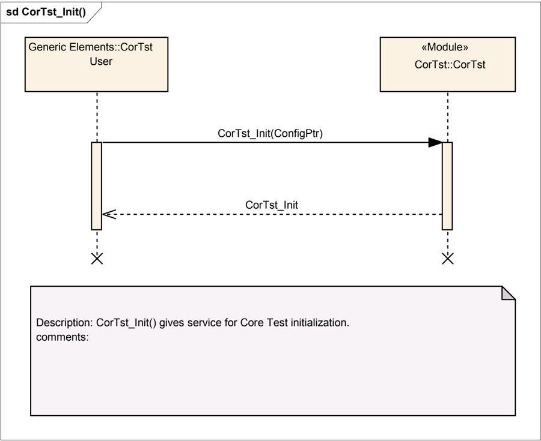

### 8.2. 去初始化

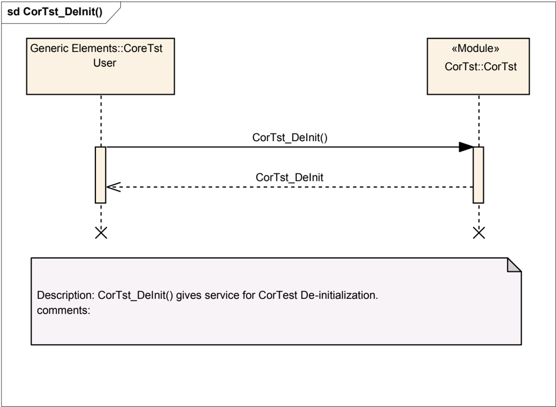

### 8.3. 后台测试

#### 8.3.1. Core Test 模块内的测试结果计算

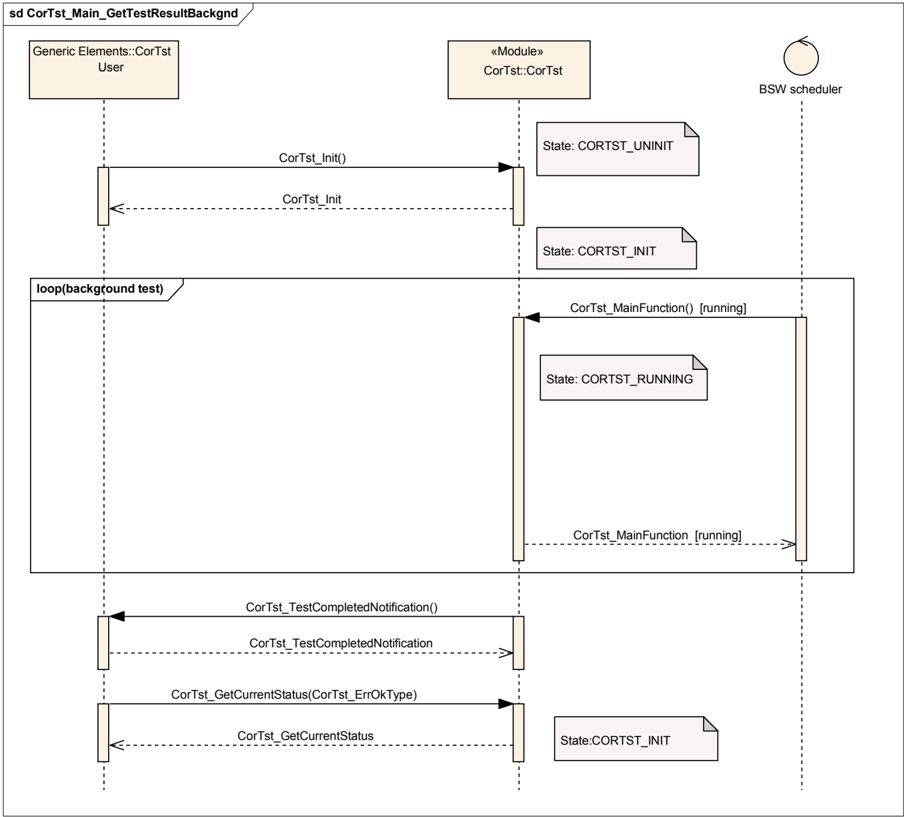

#### 8.3.2. 提供给调用实体的 Core Test 签名

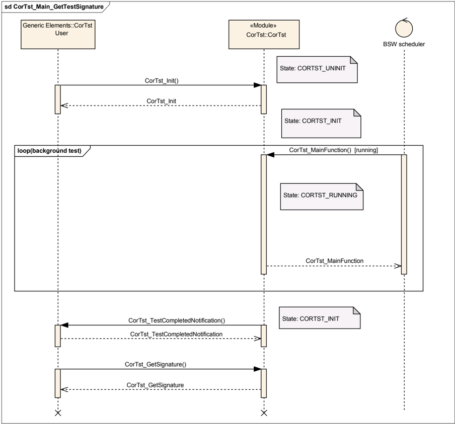

## 9. 配置规范

总体而言，本章定义配置参数及其到**容器**（container）的聚类组织。

详情请参阅 SWS_BSWGeneral 中的第 10.1 章「Introduction to configuration specification」（配置规范简介）。

内核测试模块应拒绝其实现所不支持的、带有分区映射的配置。

### 9.1. 容器与配置参数

以下各节汇总所有配置参数。各参数的详细含义见功能规格章和**API**规范章。

#### 9.1.1. CorTst

| SWS 条目 | [ECUC_CorTst_00125] |
|---|---|
| 模块名称 | CorTst |
| 描述 | CorTst 模块的配置。 |
| Post-Build 变体支持 | false |
| 支持的配置变体 | VARIANT-LINK-TIME, VARIANT-PRE-COMPILE |

| 容器名称 | 多重性 | 作用域/依赖 |
|---|---|---|
| CorTstBackgroundConfigSet | 0..* | 多重配置集容器，定义后台模式。 |
| CorTstConfigApiServices | 1 | - |
| CorTstDemEventParameterRefs | 0..1 | 对 DemEventParameter 元素的引用的容器，当相应错误发生时应使用 API Dem_SetEventStatus 调用这些元素。EventId 取自所引用 DemEventParameter 的 DemEventId 符号值。标准化错误在此容器中提供，并可通过供应商特定的错误引用进行扩展。 |
| CorTstForegroundConfigSet | 1..* | 多重配置集容器，定义前台模式。 |
| CorTstGeneral | 1 | - |

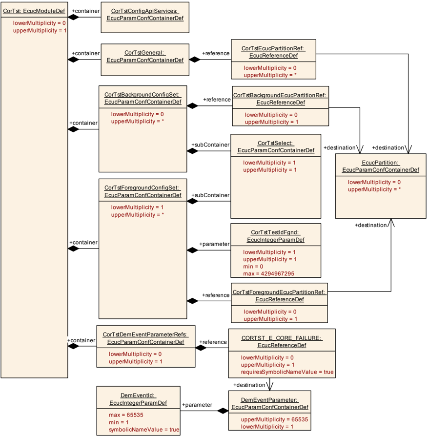

#### 9.1.2. CorTstGeneral

| SWS 条目 | [ECUC_CorTst_00081] |
|---|---|
| 容器名称 | CorTstGeneral |
| 父容器 | CorTst |
| 描述 | - |
| 配置参数 | 见下方参数表 |

| SWS 条目 | [ECUC_CorTst_00082] |
|---|---|
| 参数名称 | CorTstDevErrorDetect |
| 父容器 | CorTstGeneral |
| 描述 | 开启或关闭开发错误检测与通知（true：启用检测与通知；false：禁用检测与通知）。 |
| 多重性 | 1 |
| 类型 | EcucBooleanParamDef |
| 默认值 | false |
| Post-Build 变体值 | false |
| 值配置类 | Pre-compile time：x（All Variants）；Link time：-；Post-build time：- |
| 作用域/依赖 | scope: local |

| SWS 条目 | [ECUC_CorTst_00159] |
|---|---|
| 参数名称 | CorTstFgndTestNumber |
| 父容器 | CorTstGeneral |
| 描述 | 此参数保存此配置中为前台测试定义的可用测试配置数量。 |
| 多重性 | 1 |
| 类型 | EcucIntegerParamDef |
| 范围 | 1 .. 4294967295 |
| 默认值 | - |
| Post-Build 变体值 | false |
| 值配置类 | Pre-compile time：x（All Variants）；Link time：-；Post-build time：- |
| 作用域/依赖 | scope: local |

| SWS 条目 | [ECUC_CorTst_00083] |
|---|---|
| 参数名称 | CorTstNotificationSupported |
| 父容器 | CorTstGeneral |
| 描述 | 指示支持该通知的开关。 |
| 多重性 | 1 |
| 类型 | EcucBooleanParamDef |
| 默认值 | true |
| Post-Build 变体值 | false |
| 值配置类 | Pre-compile time：x（All Variants）；Link time：-；Post-build time：- |
| 作用域/依赖 | scope: local |

| SWS 条目 | [ECUC_CorTst_00143] |
|---|---|
| 参数名称 | CorTstTestIntervalIdEndValue |
| 父容器 | CorTstGeneral |
| 描述 | 定义测试间隔 Id 的结束值。 |
| 多重性 | 0..1 |
| 类型 | EcucIntegerParamDef |
| 范围 | 0 .. 4294967295 |
| 默认值 | - |
| Post-Build 变体多重性 | false |
| Post-Build 变体值 | false |
| 多重性配置类 | Pre-compile time：x（All Variants）；Link time：-；Post-build time：- |
| 值配置类 | Pre-compile time：x（All Variants）；Link time：-；Post-build time：- |
| 作用域/依赖 | scope: local |

| SWS 条目 | [ECUC_CorTst_00086] |
|---|---|
| 参数名称 | CorTstTestResultMode |
| 父容器 | CorTstGeneral |
| 描述 | 在内核测试驱动程序内启用测试结果比较的开关。在此模式下，内核测试驱动程序不计算内核测试结果 OK 或 NOTOK。在内核测试驱动程序内不处理与参考值的比较。 |
| 多重性 | 1 |
| 类型 | EcucBooleanParamDef |
| 默认值 | false |
| Post-Build 变体值 | false |
| 值配置类 | Pre-compile time：x（All Variants）；Link time：-；Post-build time：- |
| 作用域/依赖 | scope: local |

| SWS 条目 | [ECUC_CorTst_00160] |
|---|---|
| 参数名称 | CorTstEcucPartitionRef |
| 父容器 | CorTstGeneral |
| 描述 | 将内核测试映射到零个或多个 ECUC 分区，以使模块 API 在该分区中可用。 |
| 多重性 | 0..* |
| 类型 | 对 EcucPartition 的引用 |
| Post-Build 变体多重性 | false |
| Post-Build 变体值 | false |
| 多重性配置类 | Pre-compile time：x；Link time：-；Post-build time：- |
| 值配置类 | Pre-compile time：x；Link time：-；Post-build time：- |
| 作用域/依赖 | scope: ECU |

无包含的容器。

该模块将在每个分区中作为独立实例运行，即被调用的**API**仅作用于调用它时所在的分区。

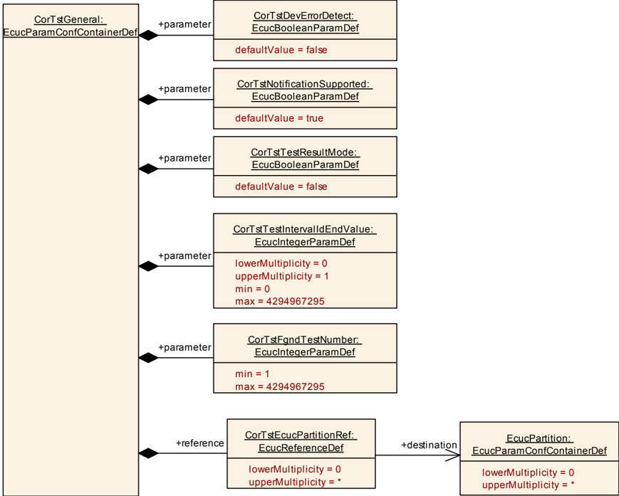

#### 9.1.3. CorTstSelect

| SWS 条目 | [ECUC_CorTst_00089] |
|---|---|
| 容器名称 | CorTstSelect |
| 父容器 | CorTstBackgroundConfigSet, CorTstForegroundConfigSet |
| 描述 | 此容器指定为前台模式和后台模式选择各个测试的配置参数。其可用性取决于硬件和实现。 |
| 配置参数 | 见下方参数表 |

| SWS 条目 | [ECUC_CorTst_00130] |
|---|---|
| 参数名称 | CorTstAddress |
| 父容器 | CorTstSelect |
| 描述 | 启用/禁用内核地址测试。 |
| 多重性 | 1 |
| 类型 | EcucBooleanParamDef |
| 默认值 | false |
| Post-Build 变体值 | false |
| 值配置类 | Pre-compile time：x（VARIANT-PRE-COMPILE）；Link time：x（VARIANT-LINK-TIME）；Post-build time：- |
| 作用域/依赖 | scope: local |

| SWS 条目 | [ECUC_CorTst_00129] |
|---|---|
| 参数名称 | CorTstAlu |
| 父容器 | CorTstSelect |
| 描述 | 启用/禁用内核 ALU 测试。 |
| 多重性 | 1 |
| 类型 | EcucBooleanParamDef |
| 默认值 | false |
| Post-Build 变体值 | false |
| 值配置类 | Pre-compile time：x（VARIANT-PRE-COMPILE）；Link time：x（VARIANT-LINK-TIME）；Post-build time：- |
| 作用域/依赖 | scope: local |

| SWS 条目 | [ECUC_CorTst_00133] |
|---|---|
| 参数名称 | CorTstCache |
| 父容器 | CorTstSelect |
| 描述 | 启用/禁用内核缓存测试。 |
| 多重性 | 1 |
| 类型 | EcucBooleanParamDef |
| 默认值 | false |
| Post-Build 变体值 | false |
| 值配置类 | Pre-compile time：x（VARIANT-PRE-COMPILE）；Link time：x（VARIANT-LINK-TIME）；Post-build time：- |
| 作用域/依赖 | scope: local |

| SWS 条目 | [ECUC_CorTst_00128] |
|---|---|
| 参数名称 | CorTstInterrupt |
| 父容器 | CorTstSelect |
| 描述 | 启用/禁用内核中断测试。 |
| 多重性 | 1 |
| 类型 | EcucBooleanParamDef |
| 默认值 | false |
| Post-Build 变体值 | false |
| 值配置类 | Pre-compile time：x（VARIANT-PRE-COMPILE）；Link time：x（VARIANT-LINK-TIME）；Post-build time：- |
| 作用域/依赖 | scope: local |

| SWS 条目 | [ECUC_CorTst_00131] |
|---|---|
| 参数名称 | CorTstMemoryIf |
| 父容器 | CorTstSelect |
| 描述 | 启用/禁用内核存储器接口测试。 |
| 多重性 | 1 |
| 类型 | EcucBooleanParamDef |
| 默认值 | false |
| Post-Build 变体值 | false |
| 值配置类 | Pre-compile time：x（VARIANT-PRE-COMPILE）；Link time：x（VARIANT-LINK-TIME）；Post-build time：- |
| 作用域/依赖 | scope: local |

| SWS 条目 | [ECUC_CorTst_00132] |
|---|---|
| 参数名称 | CorTstMpu |
| 父容器 | CorTstSelect |
| 描述 | 启用/禁用内核 MPU 测试。 |
| 多重性 | 1 |
| 类型 | EcucBooleanParamDef |
| 默认值 | false |
| Post-Build 变体值 | false |
| 值配置类 | Pre-compile time：x（VARIANT-PRE-COMPILE）；Link time：x（VARIANT-LINK-TIME）；Post-build time：- |
| 作用域/依赖 | scope: local |

| SWS 条目 | [ECUC_CorTst_00127] |
|---|---|
| 参数名称 | CorTstRegister |
| 父容器 | CorTstSelect |
| 描述 | 启用/禁用内核寄存器测试。 |
| 多重性 | 1 |
| 类型 | EcucBooleanParamDef |
| 默认值 | false |
| Post-Build 变体值 | false |
| 值配置类 | Pre-compile time：x（VARIANT-PRE-COMPILE）；Link time：x（VARIANT-LINK-TIME）；Post-build time：- |
| 作用域/依赖 | scope: local |

无包含的容器。

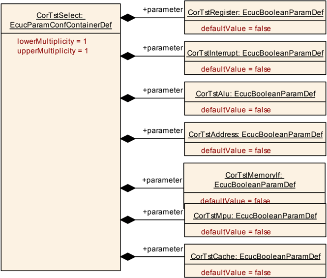

#### 9.1.4. CorTstBackgroundConfigSet

| SWS 条目 | [ECUC_CorTst_00087] |
|---|---|
| 容器名称 | CorTstBackgroundConfigSet |
| 父容器 | CorTst |
| 描述 | 多重配置集容器，定义后台模式。 |
| 配置参数 | 见下方参数表 |

| SWS 条目 | [ECUC_CorTst_00161] |
|---|---|
| 参数名称 | CorTstBackgroundEcucPartitionRef |
| 父容器 | CorTstBackgroundConfigSet |
| 描述 | 将后台测试配置映射到零个或一个 ECUC 分区。所引用的 ECUC 分区是 CorTst 驱动程序所映射到的 ECUC 分区的子集。 |
| 多重性 | 0..1 |
| 类型 | 对 EcucPartition 的引用 |
| Post-Build 变体值 | false |
| 值配置类 | Pre-compile time：x（All Variants）；Link time：-；Post-build time：- |
| 作用域/依赖 | scope: ECU |

| 容器名称 | 多重性 | 作用域/依赖 |
|---|---|---|
| CorTstSelect | 1 | 此容器指定为前台模式和后台模式选择各个测试的配置参数。其可用性取决于硬件和实现。 |

由 CorTstBackgroundEcucPartitionRef 引用的 ECUC 分区应是 CorTstEcucPartitionRef 所引用 ECUC 分区的子集。

如果 CorTstEcucPartitionRef 引用一个或多个 ECUC 分区，则 CorTstBackgroundEcucPartitionRef 的多重性应为一，并且也应引用这些 ECUC 分区之一。

#### 9.1.5. CorTstForegroundConfigSet

| SWS 条目 | [ECUC_CorTst_00088] |
|---|---|
| 容器名称 | CorTstForegroundConfigSet |
| 父容器 | CorTst |
| 描述 | 多重配置集容器，定义前台模式。 |
| 配置参数 | 见下方参数表 |

| SWS 条目 | [ECUC_CorTst_00158] |
|---|---|
| 参数名称 | CorTstTestIdFgnd |
| 父容器 | CorTstForegroundConfigSet |
| 描述 | 这是此特定前台测试配置的 Id。该值应在调用 API CorTst_Start(CorTst_TestIdFgndType TestId) 时使用。 |
| 多重性 | 1 |
| 类型 | EcucIntegerParamDef |
| 范围 | 0 .. 4294967295 |
| 默认值 | - |
| Post-Build 变体值 | false |
| 值配置类 | Pre-compile time：x（All Variants）；Link time：-；Post-build time：- |
| 作用域/依赖 | scope: local |

| SWS 条目 | [ECUC_CorTst_00162] |
|---|---|
| 参数名称 | CorTstForegroundEcucPartitionRef |
| 父容器 | CorTstForegroundConfigSet |
| 描述 | 将前台测试配置映射到零个或一个 ECUC 分区。所引用的 ECUC 分区是 CorTst 驱动程序所映射到的 ECUC 分区的子集。 |
| 多重性 | 0..1 |
| 类型 | 对 EcucPartition 的引用 |
| Post-Build 变体值 | false |
| 值配置类 | Pre-compile time：x（All Variants）；Link time：-；Post-build time：- |
| 作用域/依赖 | scope: ECU |

| 容器名称 | 多重性 | 作用域/依赖 |
|---|---|---|
| CorTstSelect | 1 | 此容器指定为前台模式和后台模式选择各个测试的配置参数。其可用性取决于硬件和实现。 |

由 CorTstForegroundEcucPartitionRef 引用的 ECUC 分区应是 CorTstEcucPartitionRef 所引用 ECUC 分区的子集。

如果 CorTstEcucPartitionRef 引用一个或多个 ECUC 分区，则 CorTstForegroundEcucPartitionRef 的多重性应为一，并且也应引用这些 ECUC 分区之一。

#### 9.1.6. CorTstConfigApiServices

| SWS 条目 | [ECUC_CorTst_00092] |
|---|---|
| 容器名称 | CorTstConfigApiServices |
| 父容器 | CorTst |
| 描述 | - |
| 配置参数 | 见下方参数表 |

| SWS 条目 | [ECUC_CorTst_00094] |
|---|---|
| 参数名称 | CorTstAbortApi |
| 父容器 | CorTstConfigApiServices |
| 描述 | 在代码中添加/移除 CorTst_Abort() 服务。 |
| 多重性 | 1 |
| 类型 | EcucBooleanParamDef |
| 默认值 | false |
| Post-Build 变体值 | false |
| 值配置类 | Pre-compile time：x（All Variants）；Link time：-；Post-build time：- |
| 作用域/依赖 | scope: local |

| SWS 条目 | [ECUC_CorTst_00104] |
|---|---|
| 参数名称 | CorTstGetCurrentStatus |
| 父容器 | CorTstConfigApiServices |
| 描述 | 在代码中添加/移除 CorTst_GetCurrentStatus() 服务。 |
| 多重性 | 1 |
| 类型 | EcucBooleanParamDef |
| 默认值 | false |
| Post-Build 变体值 | false |
| 值配置类 | Pre-compile time：x（All Variants）；Link time：-；Post-build time：- |
| 作用域/依赖 | scope: local |

| SWS 条目 | [ECUC_CorTst_00103] |
|---|---|
| 参数名称 | CorTstGetFgndSignature |
| 父容器 | CorTstConfigApiServices |
| 描述 | 在代码中添加/移除 CorTst_GetFgndSignature() 服务。 |
| 多重性 | 1 |
| 类型 | EcucBooleanParamDef |
| 默认值 | false |
| Post-Build 变体值 | false |
| 值配置类 | Pre-compile time：x（All Variants）；Link time：-；Post-build time：- |
| 作用域/依赖 | scope: local |

| SWS 条目 | [ECUC_CorTst_00097] |
|---|---|
| 参数名称 | CorTstGetSignature |
| 父容器 | CorTstConfigApiServices |
| 描述 | 在代码中添加/移除 CorTst_GetSignature() 服务。 |
| 多重性 | 1 |
| 类型 | EcucBooleanParamDef |
| 默认值 | false |
| Post-Build 变体值 | false |
| 值配置类 | Pre-compile time：x（All Variants）；Link time：-；Post-build time：- |
| 作用域/依赖 | scope: local |

| SWS 条目 | [ECUC_CorTst_00096] |
|---|---|
| 参数名称 | CorTstGetStateApi |
| 父容器 | CorTstConfigApiServices |
| 描述 | 在代码中添加/移除 CorTst_GetState() 服务。 |
| 多重性 | 1 |
| 类型 | EcucBooleanParamDef |
| 默认值 | false |
| Post-Build 变体值 | false |
| 值配置类 | Pre-compile time：x（All Variants）；Link time：-；Post-build time：- |
| 作用域/依赖 | scope: local |

| SWS 条目 | [ECUC_CorTst_00093] |
|---|---|
| 参数名称 | CorTstStartApi |
| 父容器 | CorTstConfigApiServices |
| 描述 | 在代码中添加/移除 CorTst_Start() 服务。 |
| 多重性 | 1 |
| 类型 | EcucBooleanParamDef |
| 默认值 | false |
| Post-Build 变体值 | false |
| 值配置类 | Pre-compile time：x（All Variants）；Link time：-；Post-build time：- |
| 作用域/依赖 | scope: local |

| SWS 条目 | [ECUC_CorTst_00098] |
|---|---|
| 参数名称 | CorTstVersionInfoApi |
| 父容器 | CorTstConfigApiServices |
| 描述 | 在代码中添加/移除 CorTst_GetVersionInfo() 服务。 |
| 多重性 | 1 |
| 类型 | EcucBooleanParamDef |
| 默认值 | false |
| Post-Build 变体值 | false |
| 值配置类 | Pre-compile time：x（All Variants）；Link time：-；Post-build time：- |
| 作用域/依赖 | scope: local |

无包含的容器。

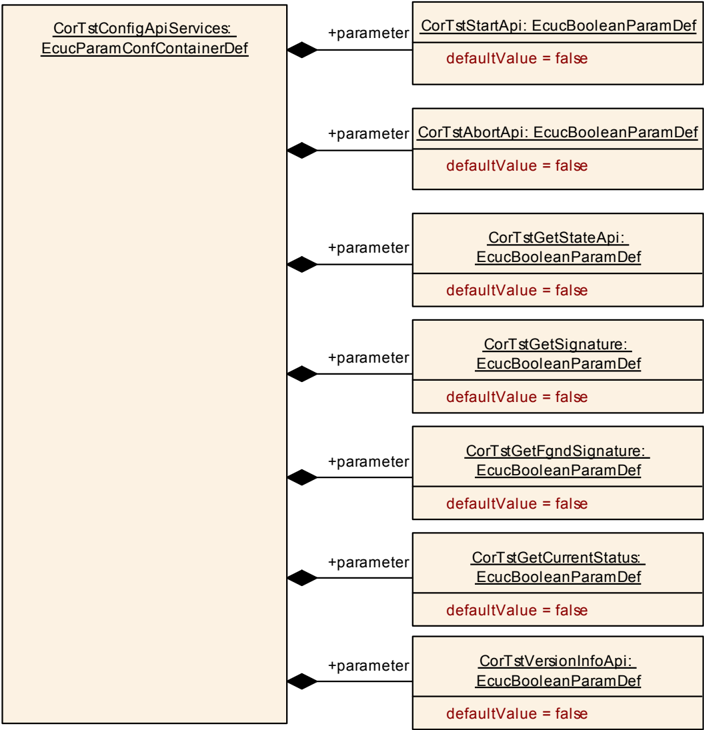

#### 9.1.7. CorTstDemEventParameterRefs

| SWS 条目 | [ECUC_CorTst_00156] |
|---|---|
| 容器名称 | CorTstDemEventParameterRefs |
| 父容器 | CorTst |
| 描述 | 对 DemEventParameter 元素的引用的容器，当相应错误发生时应使用 API Dem_SetEventStatus 调用这些元素。EventId 取自所引用 DemEventParameter 的 DemEventId 值。标准化错误在此容器中提供，并可通过供应商特定的错误引用进行扩展。 |
| 配置参数 | 见下方参数表 |

| SWS 条目 | [ECUC_CorTst_00157] |
|---|---|
| 参数名称 | CORTST_E_CORE_FAILURE |
| 父容器 | CorTstDemEventParameterRefs |
| 描述 | 对发生「内核失效」错误时应发出的 DemEventParameter 的引用。 |
| 多重性 | 0..1 |
| 类型 | 对 DemEventParameter 的符号名引用 |
| Post-Build 变体多重性 | false |
| Post-Build 变体值 | false |
| 多重性配置类 | Pre-compile time：x；Link time：-；Post-build time：- |
| 值配置类 | Pre-compile time：x；Link time：-；Post-build time：- |
| 作用域/依赖 | scope: local dependency: Dem |

无包含的容器。

### 9.2. 发布信息

详情请参阅 SWS_BSWGeneral 中的第 10.3 章「Published Information」（发布信息）。

<section id="wechat">

<h4>微信扫一扫，获取更多及时资讯</h4>


</section>
