## 1. 简介和功能概述

本规范规定了**AUTOSAR**基础软件模块**GPT**驱动程序的功能、**API**和配置。

**GPT**驱动程序是微控制器抽象层（**MCAL**）的一部分。它初始化并控制微控制器的内部通用定时器（**GPT**）。

**GPT**驱动程序为以下功能提供服务和配置参数：

* 启动和停止硬件定时器
* 获取定时器值
* 控制时间触发的中断通知（如果硬件支持）
* 控制时间触发的唤醒中断（如果硬件支持）

定时器通道的 tick 持续时间取决于通道特定的设置（**GPT**驱动程序的一部分）以及系统时钟和由**MCU**模块控制的时钟树设置。tick 持续时间不受本规范限制。

并非所有硬件定时器都必须由**GPT**模块控制。某些定时器可以由**AUTOSAR**操作系统或复杂驱动程序直接控制。由**GPT**驱动程序控制的定时器通道数量取决于硬件、实现和系统配置。

除了可以用个别属性配置个别定时器通道之外，还定义了一些自由运行的递增计数器——所谓**GPT Predef Timer**。这些定时器具有预定义的 tick 持续时间和预定义的位数（物理时间单位和范围）。**GPT Predef Timer**由时间服务模块使用。

**GPT**驱动程序仅生成时基。驱动程序级别上其他基于时间的功能由其他**MCAL**模块覆盖，例如：

* **PWM** 驱动程序（脉冲宽度调制驱动程序）
* **ICU** 驱动程序（输入捕获单元驱动程序）
* **OCU** 驱动程序（输出比较单元驱动程序）

## 2. 缩略语

以下词汇表包含与**GPT**驱动程序模块相关、且未包含在[1] AUTOSAR 术语表中的缩略语和缩写。

**BSW**
> 基础软件（**Basic Software**）

**DET**
> 默认错误跟踪器（**Default Error Tracer**）

**ECU**
> 电子控制单元（**Electronic Control Unit**）

**GPT**
> 通用定时器（**General Purpose Timer**）

**ICU**
> 输入捕获单元（**Input Capture Unit**）

**MCU**
> 微控制器单元（**Micro Controller Unit**）

**NOP, nop**
> 空操作（**Null Operation**）

**OS**
> 操作系统（**Operating System**）

**Timer channel**
> 表示分配给一个定时器硬件的逻辑定时器实体。

**Target time**
> 目标时间：到达该值时应有某事发生。其行为取决于配置和已启用的功能。

**Tick**
> 定义定时器分辨率，即定时器一次递增的持续时间。

**GPT Predef Timer**
> **GPT Predef Timer** 是 **GPT** 驱动程序提供的自由运行递增计数器。哪些 **GPT Predef Timer** 可用取决于硬件（时钟、硬件定时器、预分频器、定时器寄存器宽度等）和配置。**GPT Predef Timer** 具有预定义的物理时间单位和范围。

## 3. 相关文档

### 3.1. 输入文件和相关标准与规范

[1] Glossary
> AUTOSAR_FO_TR_Glossary

[2] General Specification of Basic Software Modules
> AUTOSAR_CP_SWS_BSWGeneral

[3] Specification of Default Error Tracer
> AUTOSAR_CP_SWS_DefaultErrorTracer

[4] Specification of MCU Driver
> AUTOSAR_CP_SWS_MCUDriver

[5] Specification of ECU State Manager
> AUTOSAR_CP_SWS_ECUStateManager

[6] Requirements on GPT Driver
> AUTOSAR_CP_SRS_GPTDriver

[7] List of Basic Software Modules
> AUTOSAR_CP_TR_BSWModuleList

### 3.2. 相关规范

**AUTOSAR**提供了基础软件模块通用规范[2]（**SWS BSW General**），该规范同样适用于**GPT**驱动程序。

因此，**SWS BSW General**规范应被视为**GPT**驱动程序的附加必需规范。

## 4. 约束和假设

### 4.1. 假设

无假设。

### 4.2. 限制

无限制。

### 4.3. 汽车域的适用性

无限制。

## 5. 对其他模块的依赖

### 5.1. DET 模块

在开发模式下，将调用**DET**模块[3]的错误钩子函数。

### 5.2. MCU 模块

**GPT**依赖于系统时钟、预分频器和**PLL**。因此，系统时钟的变更（例如**PLL**开/**PLL**关）也会影响**GPT**硬件的时钟设置。**GPT**模块在其初始化函数中不负责配置时钟、预分频器和**PLL**的设置。这必须由**MCU**模块[4]完成。

因此，时间与 tick 之间的换算应由上层完成。

### 5.3. EcuM 模块

**GPT**驱动程序将唤醒中断报告给**ECU**状态管理器[5]以作进一步处理。

### 5.4. 文件结构

文件结构未在本规范中完整定义。它取决于实现。如果所述条件满足，**GPT**驱动程序应至少提供以下文件：

**Gpt_Irq.c** 应包含 **Gpt.h**，用于通知函数的原型声明。

**Gpt.c** 无论如何都应包含 **Det.h**，以便能够引发运行时错误。

## 6. 功能规格

**GPT**驱动程序为启动和停止定时器通道（分配给定时器硬件的逻辑定时器实例）提供服务，可按通道个别调用：

* [**Gpt_StartTimer**](#736-gpt_starttimer)
* [**Gpt_StopTimer**](#737-gpt_stoptimer)

「目标时间」作为参数传递给 [**Gpt_StartTimer**](#736-gpt_starttimer)。因此，定时器通道每次启动时都可以单独设置目标时间。定时器通道的状态和状态转换如下图所示。

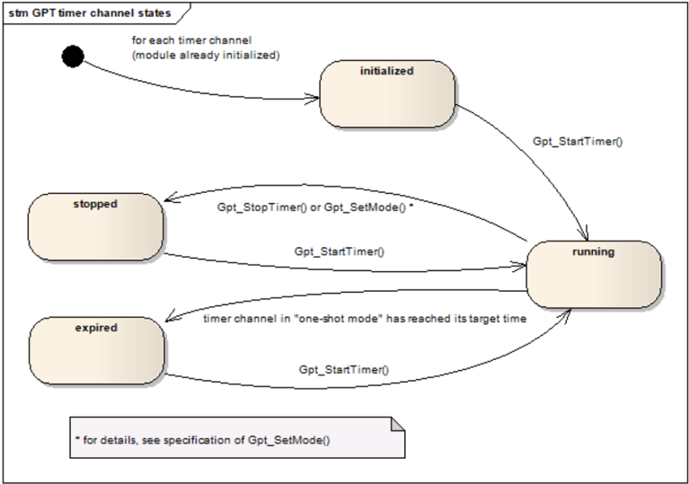

定时器通道可以配置为「单次模式（**one-shot mode**）」或「连续模式（**continuous mode**）」。

定时器通道从值零开始计数。

如果定时器通道配置为「单次模式」：当定时器到达目标时间（定时器值 = 目标时间）时，定时器应自动停止并保持其定时器值不变。通道状态应从「running」变为「expired」。

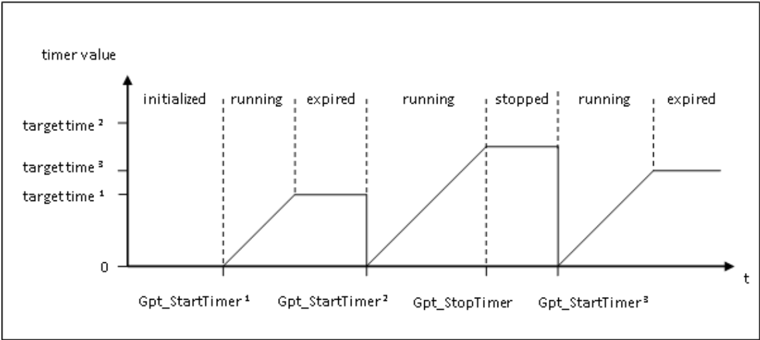

如果定时器通道配置为「连续模式」：当定时器到达目标时间（定时器值 = 目标时间）时，定时器应在下一个定时器 tick 以值「0」继续运行。因此，重现的时间间隔为：目标时间 + 1。该间隔应与实现无关（例如中断延迟）。

如果定时器通道配置为「连续模式」：如果硬件支持，应可以实现自由运行定时器。这意味着：当目标时间设置为定时器能够计数的最大值（最大值 = 2n -1，n = 位数）时，定时器由硬件自动回绕。

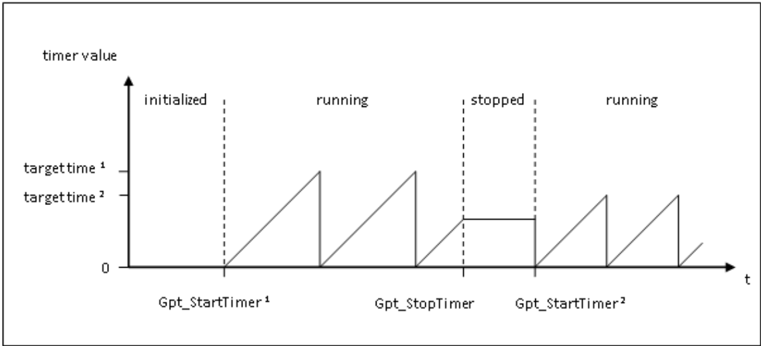

已流逝的相对时间和剩余时间都可以通过调用以下函数查询：

* [**Gpt_GetTimeElapsed**](#734-gpt_gettimeelapsed)
* [**Gpt_GetTimeRemaining**](#735-gpt_gettimeremaining)

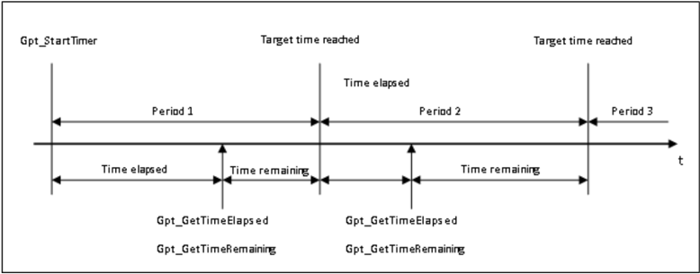

如果硬件支持，应可以将定时器通道配置为调用通知函数。如果启用，则在到达目标时间（定时器值 = 目标时间）时调用该函数。

中断通知可以在运行时按通道单独启用和禁用，通过调用：

* [**Gpt_EnableNotification**](#738-gpt_enablenotification)
* [**Gpt_DisableNotification**](#739-gpt_disablenotification)

如果硬件支持，应可以将定时器通道配置为**ECU**的唤醒源。如果启用，则在到达目标时间（定时器值 = 目标时间）时发生唤醒。

唤醒中断可以在运行时按通道单独启用和禁用，通过调用：

* [**Gpt_EnableWakeup**](#7312-gpt_enablewakeup)
* [**Gpt_DisableWakeup**](#7311-gpt_disablewakeup)

初始化之后，**GPT**驱动程序处于「normal mode（正常模式）」。只有当驱动程序切换到「sleep mode（睡眠模式）」时才可能发生唤醒中断。运行模式可以通过调用以下函数设置：

* [**Gpt_SetMode**](#7310-gpt_setmode)

有关唤醒处理的详细描述请参阅**ECU**状态管理器规范[5]。**GPT**驱动程序的运行模式和可能的模式转换如下图所示。

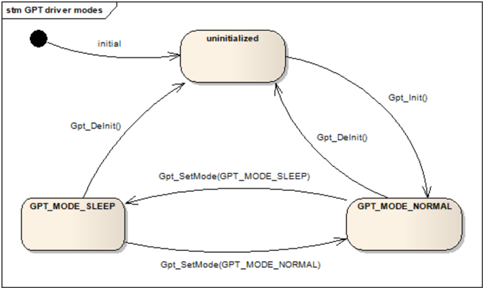

### 6.1. GPT Predef Timer

除了可以用个别属性配置个别定时器通道之外，还定义了一些**GPT Predef Timer**。为「**GPT**定时器通道」规定的**API**不能用于**GPT Predef Timer**。

**GPT Predef Timer** 是自由运行的递增计数器（用户视角）。如果定时器到达最大值（最大值 = 2n -1，n = 位数），定时器应在下一个定时器 tick 以值「0」继续运行。

表7.1：GPT Predef Timer 的类型（**Types of GPT Predef Timers**）

| GPT Predef Timer 名称 | Tick 持续时间 | 最大 tick 值 | 位数 | 最大时间跨度（约值） |
|---|---|---|---|---|
| GPT_PREDEF_TIMER_1US_16BIT | 1 µs | 65535 | 16 位 | 65 毫秒 |
| GPT_PREDEF_TIMER_1US_24BIT | 1 µs | 16777215 | 24 位 | 16 秒 |
| GPT_PREDEF_TIMER_1US_32BIT | 1 µs | 4294967295 | 32 位 | 71 分钟 |
| GPT_PREDEF_TIMER_100US_32BIT | 100 µs | 4294967295 | 32 位 | 4.9 天 |

**GPT Predef Timer** 的最大 tick 容差应为 +/- 1 tick，以确保基于时间的功能的准确性。

可以启用哪些**GPT Predef Timer**取决于时钟和可用的定时器硬件（预分频器、定时器寄存器宽度）。建议启用所有**GPT Predef Timer**，以确保所有平台上基于时间的功能的兼容性。

建议每种 tick 持续时间使用一个硬件定时器，并通过恰当选择时钟和预分频器，以时钟源「fclock = 1 /（tick 持续时间）」直接供给硬件定时器。这样，定时器计数寄存器的值可以直接使用，而无需出于性能原因进行任何适配（计算）。较低位数的定时器可以通过简单的软件掩码操作从较高位数的定时器导出。

实现**GPT Predef Timer**时，可以使用特殊的硬件特性：

* 定时器可以异步级联，以将一个定时器用作预分频器
* 定时器可以同步级联，以扩展定时器范围（位数）
* 可以使用位数大于 32 位的定时器
* 如有必要，可以在**GPT**内部使用汇编代码执行 64 位算术，例如，当一个 48 位、tick 持续时间为 250 ns 或 1 µs 的定时器被用于所有**GPT Predef Timer**时

应可以配置启用哪些**GPT Predef Timer**。

如果启用了一个**GPT Predef Timer**，具有相同 tick 持续时间和较低位数的定时器也应被启用。

如果需要，允许使用实现特定的配置参数，例如选择所使用的硬件单元。所有已启用的**GPT Predef Timer**在调用以下函数后运行：

* [**Gpt_Init**](#732-gpt_init)
* [**Gpt_SetMode**](#7310-gpt_setmode)（**GPT_MODE_NORMAL**）

所有已启用的**GPT Predef Timer**在调用以下函数时停止：

* [**Gpt_DeInit**](#733-gpt_deinit)
* [**Gpt_SetMode**](#7310-gpt_setmode)（**GPT_MODE_SLEEP**）

**GPT Predef Timer** 的当前时间值可以通过调用以下函数获取：

* [**Gpt_GetPredefTimerValue**](#7314-gpt_getpredeftimervalue)

### 6.2. 版本检查

详情请参阅 SWS_BSWGeneral 中的第 5.1.8 章「Version Check」（版本检查）。

### 6.3. 错误分类

文档[2]《基础软件模块通用规范》的「错误处理」一章详细描述了基础软件的错误处理。最重要的是，它构成了一个由可能发生在**BSW**模块中的五种错误类型组成的分类方案。

在此基础上，以下章节规定了在下面各小节中安排的特定错误。

#### 6.3.1. 开发错误

| 错误类型 | 相关错误代码 | 错误值 |
|---|---|---|
| 未初始化模块即调用 API 服务 | GPT_E_UNINIT | 0x0A |
| 已初始化后再次调用初始化 API 服务 | GPT_E_ALREADY_INITIALIZED | 0x0D |
| API 错误返回码：初始化函数失败 | GPT_E_INIT_FAILED | 0x0E |
| API 参数检查：无效通道 | GPT_E_PARAM_CHANNEL | 0x14 |
| API 参数检查：无效值 | GPT_E_PARAM_VALUE | 0x15 |
| API 参数检查：无效指针 | GPT_E_PARAM_POINTER | 0x16 |
| API 参数检查：无效 Predef Timer | GPT_E_PARAM_PREDEF_TIMER | 0x17 |
| API 参数检查：无效模式 | GPT_E_PARAM_MODE | 0x1F |

#### 6.3.2. 运行时错误

| 错误类型 | 相关错误代码 | 错误值 |
|---|---|---|
| 定时器通道仍忙（运行中）时调用 API 服务 | GPT_E_BUSY | 0x0B |
| 驱动程序处于错误模式时调用 API 服务 | GPT_E_MODE | 0x0C |

#### 6.3.3. 瞬态故障

没有瞬态故障。

#### 6.3.4. 生产错误

没有生产错误。

#### 6.3.5. 扩展生产错误

没有扩展生产错误。

## 7. API规范

### 7.1. 导入的类型

本章列出了从以下文件包含的所有类型：

**Gpt**模块的导入数据类型定义

| 模块 | 头文件 | 导入的类型 |
|---|---|---|
| EcuM | EcuM.h | EcuM_WakeupSourceType |
| Std | Std_Types.h | Std_ReturnType |
| Std | Std_Types.h | Std_VersionInfoType |

### 7.2. 类型定义

#### 7.2.1. Gpt_ConfigType

结构类型。实现特定的配置数据结构（可配置参数见第 9 章）。该类型是包含初始化**GPT**定时器单元所需配置集的数据结构的类型。可通过**Gpt.h**获得。

#### 7.2.2. Gpt_ChannelType

类型，派生自 uint。范围为 - —— 实现特定的，但并非该类型内的所有值都有效。应选择该类型以在特定微控制器平台上获得最有效的实现。**GPT**通道的数字**ID**。可通过**Gpt.h**获得。

#### 7.2.3. Gpt_ValueType

类型，派生自 uint。范围为 - —— 该类型的范围取决于 µC（定时器寄存器的宽度），须由供应商描述。读取和设置定时器值（tick 数）的类型。可通过**Gpt.h**获得。

#### 7.2.4. Gpt_ModeType

枚举类型。**GPT**驱动程序的模式。可通过**Gpt.h**获得。

* **GPT_MODE_NORMAL**（0x00）：**GPT** 的正常运行模式。
* **GPT_MODE_SLEEP**（0x01）：降功耗运行模式。睡眠模式下仅唤醒能力通道可用。

#### 7.2.5. Gpt_PredefTimerType

枚举类型。**GPT Predef Timer** 的类型。可通过**Gpt.h**获得。

* **GPT_PREDEF_TIMER_1US_16BIT**（0x00）：tick 持续时间 1µs、范围 16 位的 GPT Predef Timer。
* **GPT_PREDEF_TIMER_1US_24BIT**（0x01）：tick 持续时间 1µs、范围 24 位的 GPT Predef Timer。
* **GPT_PREDEF_TIMER_1US_32BIT**（0x02）：tick 持续时间 1µs、范围 32 位的 GPT Predef Timer。
* **GPT_PREDEF_TIMER_100US_32BIT**（0x03）：tick 持续时间 100µs、范围 32 位的 GPT Predef Timer。

### 7.3. 函数定义

以下是提供给上层模块的函数列表。

#### 7.3.1. Gpt_GetVersionInfo

**说明**: 返回本模块的版本信息。可通过**Gpt.h**获得。本服务为同步调用，可重入。参数 VersionInfoPtr（out）：存储本模块版本信息的位置的指针。

```C
void Gpt_GetVersionInfo (Std_VersionInfoType* VersionInfoPtr)
```

如果为**GPT**模块启用了开发错误检测：如果参数 VersionInfoPtr 为空指针，[**Gpt_GetVersionInfo**](#731-gpt_getversioninfo) 函数应引发错误 [GPT_E_PARAM_POINTER](#631-开发错误)。

#### 7.3.2. Gpt_Init

**说明**: 初始化**GPT**驱动程序。可通过**Gpt.h**获得。本服务为同步调用，不可重入。参数 ConfigPtr（in）：指向所选配置结构的指针。

```C
void Gpt_Init (const Gpt_ConfigType* ConfigPtr)
```

**Gpt_Init** 函数应根据 ConfigPtr 引用的配置集初始化硬件定时器模块。

**Gpt_Init** 函数应禁用由**GPT**驱动程序控制的所有中断通知。

**Gpt_Init** 函数应只初始化已配置的资源。未在配置文件中配置的资源不得被触及。

以下关于控制器寄存器初始化的规则适用于本驱动实现：

* 如果硬件只允许该寄存器的一次使用，实现该功能的驱动模块负责初始化该寄存器。
* 如果寄存器会影响多个硬件模块，且它是**I/O**寄存器，则应由**PORT**驱动程序初始化。
* 如果寄存器会影响多个硬件模块，且它不是**I/O**寄存器，则应由**MCU**驱动程序初始化。
* 要求在复位后直接初始化的一次性可写寄存器应由启动代码初始化。
* 所有其他寄存器应由启动代码初始化。

如果为**GPT**模块启用了开发错误检测：如果**GPT**驱动程序不处于「uninitialized（未初始化）」运行模式，**Gpt_Init** 函数应引发错误 [GPT_E_ALREADY_INITIALIZED](#631-开发错误)。

**Gpt_Init** 函数应禁用由**GPT**驱动程序控制的所有唤醒中断。

**Gpt_Init** 函数应将**GPT**驱动程序的运行模式设置为「正常模式」。这导致的行为如同以参数 **GPT_MODE_NORMAL** 调用了 [**Gpt_SetMode**](#7310-gpt_setmode)。

通过执行 **Gpt_Init** 函数对**GPT**驱动程序进行重新初始化，要求先通过执行 [**Gpt_DeInit**](#733-gpt_deinit) 进行去初始化。

**Gpt_Init** 函数应以值「0」启动所有已启用的**GPT Predef Timer**。

#### 7.3.3. Gpt_DeInit

**说明**: 去初始化**GPT**驱动程序。可通过**Gpt.h**获得。本服务为同步调用，不可重入。无参数，无返回值。

```C
void Gpt_DeInit (void)
```

**Gpt_DeInit** 函数应将**GPT**驱动程序使用的硬件去初始化（取决于配置，恢复到上电复位状态）。不可写寄存器的值除外。该状态不会导致 µC 中出现未定义活动是硬件设计的责任。

**Gpt_DeInit** 函数应禁用由**GPT**驱动程序控制的所有中断通知和唤醒中断。

**Gpt_DeInit** 函数应只影响由静态配置分配的外设。

如果使用了 post-build 多重可选配置变体，**Gpt_DeInit** 函数还应只影响由先前调用 [**Gpt_Init**](#732-gpt_init) 函数传递的运行时配置集所分配的外设。

**Gpt_DeInit** 函数应可通过配置参数 GptDeinitApi 在预编译时配置开/关。

**Gpt_DeInit** 函数应将**GPT**驱动程序的运行模式设置为「uninitialized（未初始化）」。

如果任何定时器通道处于「running」状态，**Gpt_DeInit** 函数应引发运行时错误 [GPT_E_BUSY](#632-运行时错误)。

如果为**GPT**模块启用了开发错误检测：如果驱动程序未初始化，**Gpt_DeInit** 函数应引发错误 [GPT_E_UNINIT](#631-开发错误)。

**Gpt_DeInit** 函数应停止所有已启用的**GPT Predef Timer**。

#### 7.3.4. Gpt_GetTimeElapsed

**说明**: 返回已流逝的时间。可通过**Gpt.h**获得。本服务为同步调用，可重入。参数 Channel（in）：**GPT**通道的数字标识符。返回值：[Gpt_ValueType](#723-gpt_valuetype)，已流逝的定时器值（tick 数）。

```C
Gpt_ValueType Gpt_GetTimeElapsed (Gpt_ChannelType Channel)
```

**Gpt_GetTimeElapsed** 函数应返回已流逝的时间。当通道处于「单次模式」时，这是相对于通道启动时刻的值。

当通道处于「连续模式」时，[**Gpt_GetTimeElapsed**](#734-gpt_gettimeelapsed) 的返回值是相对于上一次重现（到达目标时间）或相对于首次重现发生之前通道启动时刻的值。

如果在处于「initialized（已初始化）」状态（通道从未启动过）的定时器通道上调用 **Gpt_GetTimeElapsed** 函数，函数应返回值「0」。

如果在处于「stopped（已停止）」状态的定时器通道上调用 **Gpt_GetTimeElapsed** 函数，函数应返回停止时刻的时间值。

如果在配置为「单次模式」、处于「expired（已到期）」状态（定时器已到达目标时间）的通道上调用 **Gpt_GetTimeElapsed** 函数，函数应返回目标时间。

**Gpt_GetTimeElapsed** 函数应完全可重入，即使对于同一个定时器通道亦然。

**Gpt_GetTimeElapsed** 函数应可通过配置参数 GptTimeElapsedApi 在预编译时配置开/关。

如果为**GPT**模块启用了开发错误检测：如果驱动程序未初始化，**Gpt_GetTimeElapsed** 函数应引发错误 [GPT_E_UNINIT](#631-开发错误)。

如果为**GPT**模块启用了开发错误检测：如果参数 Channel 无效（不在配置指定的范围内），**Gpt_GetTimeElapsed** 函数应引发错误 [GPT_E_PARAM_CHANNEL](#631-开发错误)。

表8.1：Gpt_GetTimeElapsed 的返回值与 DET 错误（**Return values and DET errors of Gpt_GetTimeElapsed**）

| 状态/情形 | 定时器通道状态 | 返回值 | 开发错误（如启用） |
|---|---|---|---|
| 驱动程序未初始化 | - | 0 | [GPT_E_UNINIT](#631-开发错误) |
| 驱动程序已初始化 | initialized | 0 | - |
| 驱动程序已初始化 | running | 已流逝时间 | - |
| 驱动程序已初始化 | stopped | 停止时刻的已流逝时间 | - |
| 驱动程序已初始化 | expired（仅单次模式） | 目标时间 | - |
| 参数「Channel」无效 | 所有 | 0 | [GPT_E_PARAM_CHANNEL](#631-开发错误) |

#### 7.3.5. Gpt_GetTimeRemaining

**说明**: 返回到达目标时间之前的剩余时间。可通过**Gpt.h**获得。本服务为同步调用，可重入。参数 Channel（in）：**GPT**通道的数字标识符。返回值：[Gpt_ValueType](#723-gpt_valuetype)，剩余定时器值（tick 数）。

```C
Gpt_ValueType Gpt_GetTimeRemaining (Gpt_ChannelType Channel)
```

**Gpt_GetTimeRemaining** 函数应返回下一次到达目标时间之前剩余的定时器值。剩余时间为「目标时间」减去已流逝的时间。

如果在处于「initialized（已初始化）」状态（通道从未启动过）的定时器通道上调用 **Gpt_GetTimeRemaining** 函数，函数应返回值「0」。

如果在处于「stopped（已停止）」状态的定时器通道上调用 **Gpt_GetTimeRemaining** 函数，函数应返回停止时刻的剩余时间值。

如果在配置为「单次模式」、处于「expired（已到期）」状态（定时器已到达目标时间）的通道上调用 **Gpt_GetTimeRemaining** 函数，函数应返回值「0」。

**Gpt_GetTimeRemaining** 函数应完全可重入，即使对于同一个定时器通道亦然。

**Gpt_GetTimeRemaining** 函数应可通过配置参数 GptTimeRemainingApi 在预编译时配置开/关。

如果为**GPT**模块启用了开发错误检测：如果驱动程序未初始化，**Gpt_GetTimeRemaining** 函数应引发错误 [GPT_E_UNINIT](#631-开发错误)。

如果为**GPT**模块启用了开发错误检测：如果参数 Channel 无效（不在配置指定的范围内），**Gpt_GetTimeRemaining** 函数应引发错误 [GPT_E_PARAM_CHANNEL](#631-开发错误)。

表8.2：Gpt_GetTimeRemaining 的返回值与 DET 错误（**Return values and DET errors of Gpt_GetTimeRemaining**）

| 状态/情形 | 定时器通道状态 | 返回值 | 开发错误（如启用） |
|---|---|---|---|
| 驱动程序未初始化 | - | 0 | [GPT_E_UNINIT](#631-开发错误) |
| 驱动程序已初始化 | initialized | 0 | - |
| 驱动程序已初始化 | running | 剩余时间 | - |
| 驱动程序已初始化 | stopped | 停止时刻的剩余时间 | - |
| 驱动程序已初始化 | expired（仅单次模式） | 0 | - |
| 参数「Channel」无效 | 所有 | 0 | [GPT_E_PARAM_CHANNEL](#631-开发错误) |

#### 7.3.6. Gpt_StartTimer

**说明**: 启动一个定时器通道。可通过**Gpt.h**获得。本服务为同步调用，可重入（但不针对同一定时器通道）。参数 Channel（in）：**GPT**通道的数字标识符。参数 Value（in）：目标时间（tick 数）。

```C
void Gpt_StartTimer (Gpt_ChannelType Channel, Gpt_ValueType Value)
```

**Gpt_StartTimer** 函数应以定义的目标时间启动所选的定时器通道。

如果已配置并启用，则在到达目标时间时发生中断通知或唤醒中断。

如果并发调用中使用的定时器通道不同，**Gpt_StartTimer** 函数应是可重入的。

如果调用 **Gpt_StartTimer**，所选定时器通道的状态应变为「running（运行中）」。

如果为**GPT**模块启用了开发错误检测：如果参数 Channel 无效（不在配置指定的范围内），**Gpt_StartTimer** 函数应引发错误 [GPT_E_PARAM_CHANNEL](#631-开发错误)。

如果为**GPT**模块启用了开发错误检测：如果参数 Value 为「0」或不在允许范围内（超出最大定时器分辨率），**Gpt_StartTimer** 函数应引发错误 [GPT_E_PARAM_VALUE](#631-开发错误)。

如果为**GPT**模块启用了开发错误检测：如果驱动程序未初始化，**Gpt_StartTimer** 函数应引发错误 [GPT_E_UNINIT](#631-开发错误)。

如果在处于「running」状态的通道上调用 **Gpt_StartTimer** 函数，函数应引发运行时错误 [GPT_E_BUSY](#632-运行时错误)。

#### 7.3.7. Gpt_StopTimer

**说明**: 停止一个定时器通道。可通过**Gpt.h**获得。本服务为同步调用，可重入（但不针对同一定时器通道）。参数 Channel（in）：**GPT**通道的数字标识符。

```C
void Gpt_StopTimer (Gpt_ChannelType Channel)
```

**Gpt_StopTimer** 函数应停止所选的定时器通道。

如果调用 **Gpt_StopTimer**，所选定时器通道的状态应变为「stopped（已停止）」。

如果为**GPT**模块启用了开发错误检测：如果在处于「initialized」、「stopped」或「expired」状态的通道上调用 **Gpt_StopTimer** 函数，函数不应引发开发错误。

如果在处于「initialized」、「stopped」或「expired」状态的通道上调用 **Gpt_StopTimer** 函数，函数应不做任何动作即返回（不改变通道状态）。

如果并发调用中使用的定时器通道不同，**Gpt_StopTimer** 函数应是可重入的。

如果为**GPT**模块启用了开发错误检测：如果参数 Channel 无效（不在配置指定的范围内），**Gpt_StopTimer** 函数应引发错误 [GPT_E_PARAM_CHANNEL](#631-开发错误)。

如果为**GPT**模块启用了开发错误检测：如果驱动程序未初始化，**Gpt_StopTimer** 函数应引发错误 [GPT_E_UNINIT](#631-开发错误)。

#### 7.3.8. Gpt_EnableNotification

**说明**: 启用一个通道的中断通知（在正常模式下相关）。可通过**Gpt.h**获得。本服务为同步调用，可重入（但不针对同一定时器通道）。参数 Channel（in）：**GPT**通道的数字标识符。

```C
void Gpt_EnableNotification (Gpt_ChannelType Channel)
```

**Gpt_EnableNotification** 函数应启用所引用的、配置了通知的通道的中断通知。函数应保存通道的「notification enabled（通知已启用）」属性。**注意：**当驱动程序处于「正常模式」时，该属性始终影响中断通知。在「睡眠模式」下该属性没有影响。

如果并发调用中使用的定时器通道不同，**Gpt_EnableNotification** 函数应是可重入的。

**Gpt_EnableNotification** 函数应可通过配置参数 GptEnableDisableNotificationApi 在预编译时配置开/关。

如果为**GPT**模块启用了开发错误检测：如果驱动程序未初始化，**Gpt_EnableNotification** 函数应引发错误 [GPT_E_UNINIT](#631-开发错误)。

如果为**GPT**模块启用了开发错误检测：如果参数 Channel 无效（不在配置指定的范围内），**Gpt_EnableNotification** 函数应引发错误 [GPT_E_PARAM_CHANNEL](#631-开发错误)。

如果为**GPT**模块启用了开发错误检测：如果没有配置有效的通知函数（GptNotification），**Gpt_EnableNotification** 函数应引发错误 [GPT_E_PARAM_CHANNEL](#631-开发错误)。

#### 7.3.9. Gpt_DisableNotification

**说明**: 禁用一个通道的中断通知（在正常模式下相关）。可通过**Gpt.h**获得。本服务为同步调用，可重入（但不针对同一定时器通道）。参数 Channel（in）：**GPT**通道的数字标识符。

```C
void Gpt_DisableNotification (Gpt_ChannelType Channel)
```

**Gpt_DisableNotification** 函数应禁用所引用的、配置了通知的通道的中断通知。函数应保存通道的「notification disabled（通知已禁用）」属性。**注意：**当驱动程序处于「正常模式」时，该属性始终影响中断通知。在「睡眠模式」下该属性没有影响。

如果并发调用中使用的定时器通道不同，**Gpt_DisableNotification** 函数应是可重入的。

**Gpt_DisableNotification** 函数应可通过配置参数 GptEnableDisableNotificationApi 在预编译时配置开/关。

如果为**GPT**模块启用了开发错误检测：如果驱动程序未初始化，**Gpt_DisableNotification** 函数应引发错误 [GPT_E_UNINIT](#631-开发错误)。

如果为**GPT**模块启用了开发错误检测：如果参数 Channel 无效（不在配置指定的范围内），**Gpt_DisableNotification** 函数应引发错误 [GPT_E_PARAM_CHANNEL](#631-开发错误)。

如果为**GPT**模块启用了开发错误检测：如果没有配置有效的通知函数（GptNotification），**Gpt_DisableNotification** 函数应引发错误 [GPT_E_PARAM_CHANNEL](#631-开发错误)。

#### 7.3.10. Gpt_SetMode

**说明**: 设置**GPT**的运行模式。可通过**Gpt.h**获得。本服务为同步调用，不可重入。参数 Mode（in）：**GPT_MODE_NORMAL**：**GPT**驱动程序的正常运行模式；**GPT_MODE_SLEEP**：**GPT**驱动程序的睡眠模式（具备唤醒能力）。参见 [Gpt_ModeType](#724-gpt_modetype)。

```C
void Gpt_SetMode (Gpt_ModeType Mode)
```

**Gpt_SetMode** 函数应将**GPT**驱动程序的运行模式设置为给定的 Mode 参数。

仅当配置参数 GptReportWakeupSource 启用时，**Gpt_SetMode** 函数才可用。

如果参数 Mode 的值为 **GPT_MODE_NORMAL**：**Gpt_SetMode** 函数应为所有配置了通知、且先前已通过 [**Gpt_EnableNotification**](#738-gpt_enablenotification) 启用通知（存储的属性）的通道启用中断通知。所有其他中断通知应被禁用。

如果参数 Mode 的值为 **GPT_MODE_SLEEP**：**Gpt_SetMode** 函数应为所有配置了唤醒、且先前已通过 [**Gpt_EnableWakeup**](#7312-gpt_enablewakeup) 启用唤醒（存储的属性）的通道启用唤醒中断。所有其他唤醒中断应被禁用。

如果以参数 Mode 的值 **GPT_MODE_SLEEP** 调用 **Gpt_SetMode** 函数：所有处于「running」状态、且未配置唤醒或未通过 [**Gpt_EnableWakeup**](#7312-gpt_enablewakeup) 启用唤醒中断（存储的属性）的定时器通道应被停止，其状态应变为「stopped」。

如果参数 Mode 的值为 **GPT_MODE_NORMAL**，**Gpt_SetMode** 函数不应自动重启因进入睡眠模式而被停止的定时器通道。

如果参数的值为 **GPT_MODE_SLEEP**，**Gpt_SetMode** 函数不应自动启动唤醒定时器。用户应先调用 [**Gpt_StartTimer**](#736-gpt_starttimer) 启动唤醒定时器，之后再以参数 **GPT_MODE_SLEEP** 调用 **Gpt_SetMode**。

如果为**GPT**模块启用了开发错误检测：如果驱动程序未初始化，**Gpt_SetMode** 函数应引发错误 [GPT_E_UNINIT](#631-开发错误)。

如果为**GPT**模块启用了开发错误检测：如果参数 Mode 无效，**Gpt_SetMode** 函数应引发错误 [GPT_E_PARAM_MODE](#631-开发错误)。

**Gpt_SetMode** 函数应可通过配置参数 GptWakeupFunctionalityApi 在预编译时配置开/关。

如果参数 Mode 的值为 **GPT_MODE_NORMAL**：如果驱动程序处于「睡眠模式」，**Gpt_SetMode** 函数应以值「0」重启所有已启用的**GPT Predef Timer**。

如果参数 Mode 的值为 **GPT_MODE_SLEEP**：**Gpt_SetMode** 函数应停止所有已启用的**GPT Predef Timer**。

#### 7.3.11. Gpt_DisableWakeup

**说明**: 禁用一个通道的唤醒中断（在睡眠模式下相关）。可通过**Gpt.h**获得。本服务为同步调用，可重入（但不针对同一定时器通道）。参数 Channel（in）：**GPT**通道的数字标识符。

```C
void Gpt_DisableWakeup (Gpt_ChannelType Channel)
```

**Gpt_DisableWakeup** 函数应禁用所引用的、配置了唤醒的通道的唤醒中断。函数应保存通道的「wakeup disabled（唤醒已禁用）」属性。**注意：**当驱动程序处于「睡眠模式」时，该属性始终影响唤醒中断。在「正常模式」下该属性没有影响。

仅当 GptReportWakeupSource 被静态配置为可用时，**Gpt_DisableWakeup** 函数才可行。

如果并发调用中使用的定时器通道不同，**Gpt_DisableWakeup** 函数应是可重入的。

**Gpt_DisableWakeup** 函数应可通过配置参数 GptWakeupFunctionalityApi 在预编译时配置开/关。

如果为**GPT**模块启用了开发错误检测：如果参数 Channel 无效（不在配置指定的范围内）或配置未启用通道唤醒（GptEnableWakeup），**Gpt_DisableWakeup** 函数应引发错误 [GPT_E_PARAM_CHANNEL](#631-开发错误)。

如果为**GPT**模块启用了开发错误检测：如果驱动程序未初始化，**Gpt_DisableWakeup** 函数应引发错误 [GPT_E_UNINIT](#631-开发错误)。

#### 7.3.12. Gpt_EnableWakeup

**说明**: 启用一个通道的唤醒中断（在睡眠模式下相关）。可通过**Gpt.h**获得。本服务为同步调用，可重入（但不针对同一定时器通道）。参数 Channel（in）：**GPT**通道的数字标识符。

```C
void Gpt_EnableWakeup (Gpt_ChannelType Channel)
```

**Gpt_EnableWakeup** 函数应启用所引用的、配置了唤醒的通道的唤醒中断。函数应保存通道的「wakeup enabled（唤醒已启用）」属性。**注意：**当驱动程序处于「睡眠模式」时，该属性始终影响唤醒中断。在「正常模式」下该属性没有影响。

仅当 GptReportWakeupSource 被静态配置为可用时，**Gpt_EnableWakeup** 函数才可行。

如果并发调用中使用的定时器通道不同，**Gpt_EnableWakeup** 函数应是可重入的。

**Gpt_EnableWakeup** 函数应可通过配置参数 GptWakeupFunctionalityApi 在预编译时配置开/关。

如果为**GPT**模块启用了开发错误检测：如果驱动程序未初始化，**Gpt_EnableWakeup** 函数应引发错误 [GPT_E_UNINIT](#631-开发错误)。

如果为**GPT**模块启用了开发错误检测：如果参数 Channel 无效（不在配置指定的范围内）或配置未启用通道唤醒（GptEnableWakeup），**Gpt_EnableWakeup** 函数应引发错误 [GPT_E_PARAM_CHANNEL](#631-开发错误)。

#### 7.3.13. Gpt_CheckWakeup

**说明**: 检查一个具备唤醒能力的**GPT**通道是否为唤醒事件的源，并在有效的**GPT**通道唤醒事件情况下调用**ECU**状态管理器服务 EcuM_SetWakeupEvent。可通过**Gpt.h**获得。本服务为同步调用，可重入。参数 WakeupSource（in）：要检查的唤醒源信息。相关的**GPT**通道可由配置数据确定。

```C
void Gpt_CheckWakeup (EcuM_WakeupSourceType WakeupSource)
```

**Gpt_CheckWakeup** 函数应检查一个具备唤醒能力的**GPT**通道是否为唤醒事件的源，并调用 **EcuM_SetWakeupEvent** 以向**ECU**状态管理器[5]指示有效的定时器唤醒事件。

仅当 GptReportWakeupSource 被静态配置为可用时，**Gpt_CheckWakeup** 函数才可行。

**Gpt_CheckWakeup** 函数应是可重入的，因为可能在并发的中断服务例程中使用。

**Gpt_CheckWakeup** 函数应可通过配置参数 GptWakeupFunctionalityApi 在预编译时配置开/关。

如果为**GPT**模块启用了开发错误检测：如果驱动程序未初始化，**Gpt_CheckWakeup** 函数应引发错误 [GPT_E_UNINIT](#631-开发错误)。

#### 7.3.14. Gpt_GetPredefTimerValue

**说明**: 提供所需**GPT Predef Timer**的当前值。可通过**Gpt.h**获得。本服务为同步调用，可重入。参数 PredefTimer（in）：**GPT Predef Timer**。参数 TimeValuePtr（out）：RAM 中时间值目标数据的指针。返回值：Std_ReturnType，E_OK：未检测到错误；E_NOT_OK：因错误而中止。

**注意：**强烈建议在用户软件层面检查 **Gpt_GetPredefTimerValue** 函数的返回值。当返回 E_NOT_OK 时，由 TimeValuePtr 指向的时间值可能无效，不得使用。

```C
Std_ReturnType Gpt_GetPredefTimerValue (Gpt_PredefTimerType PredefTimer, uint32* TimeValuePtr)
```

**Gpt_GetPredefTimerValue** 函数应返回由 PredefTimer 传递的**GPT Predef Timer**的当前值。

如果 **Gpt_GetPredefTimerValue** 函数的定时器值小于 32 位（16 位或 24 位定时器），高位应以零填充。

**Gpt_GetPredefTimerValue** 函数应完全可重入，即使对于同一个**GPT Predef Timer**亦然。

如果**GPT**驱动程序未初始化、处于「睡眠模式」或**GPT Predef Timer**未启用，**Gpt_GetPredefTimerValue** 函数应返回 E_NOT_OK。

**注意：**这是为了在硬件定时器未运行时告知用户软件，与是否为**GPT**模块启用开发错误检测无关。**Gpt_GetPredefTimerValue** 函数由服务层的时间服务模块使用。时间服务模块的用户应有机会应对缺失的定时器支持。

如果为**GPT**模块启用了开发错误检测：如果驱动程序未初始化，**Gpt_GetPredefTimerValue** 函数应引发错误 [GPT_E_UNINIT](#631-开发错误)。

如果为**GPT**模块启用了开发错误检测：如果参数 PredefTimer 无效，**Gpt_GetPredefTimerValue** 函数应引发开发错误 [GPT_E_PARAM_PREDEF_TIMER](#631-开发错误)。

如果为**GPT**模块启用了开发错误检测：如果由参数 PredefTimer 传递的**GPT Predef Timer**未启用，**Gpt_GetPredefTimerValue** 函数应引发开发错误 [GPT_E_PARAM_PREDEF_TIMER](#631-开发错误)。

如果驱动程序处于「睡眠模式」，**Gpt_GetPredefTimerValue** 函数应引发运行时错误 [GPT_E_MODE](#632-运行时错误)。

如果为**GPT**模块启用了开发错误检测：如果参数 TimeValuePtr 为空指针，**Gpt_GetPredefTimerValue** 函数应引发错误 [GPT_E_PARAM_POINTER](#631-开发错误)。

### 7.4. 回调通知

由于**GPT**是一个驱动模块，它不向下层模块提供任何回调函数。

### 7.5. 调度函数

无。

### 7.6. 期望接口

本章列出了**Gpt**模块需要从其他模块获得的所有接口。

#### 7.6.1. 强制接口

**注意：**本节定义了实现模块核心功能所需的所有接口。

| API 函数 | 描述 |
|---|---|
| Det_ReportRuntimeError | 报告运行时错误的服务。 |

#### 7.6.2. 可选接口

本节定义了为实现模块的可选功能所需的所有接口。

| API 函数 | 头文件 | 描述 |
|---|---|---|
| Det_ReportError | Det.h | 报告开发错误的服务。 |
| EcuM_CheckWakeup | EcuM.h | 可调用此函数检查给定的唤醒源。它将参数传递给集成者函数 EcuM_CheckWakeupHook。唤醒源的 ISR 也可以调用它来设置 PLL 并检查可能连接到同一中断的其他唤醒源。 |
| EcuM_SetWakeupEvent | EcuM.h | 设置唤醒事件。 |

应在服务**GPT**通道唤醒事件的中断服务例程内、在唤醒能力通道上调用 **EcuM_CheckWakeup**。

提供唤醒事件的**ISR**应负责复位中断标志（如果硬件需要）。

#### 7.6.3. 可配置接口

本节列出了目标函数可配置的所有接口。目标函数通常是回调函数。此类接口的名称不固定，因为它们是可配置的。

##### 7.6.3.1. GPT 通知

**说明**: 无。可通过**Gpt.h**获得。本服务为同步调用。可重入性取决于**GPT**用户实现。

```C
void Gpt_Notification_<channel> (void)
```

通知原型 **Gpt_Notification_\<channel\>** 用于通知回调函数，应由用户实现。

**GPT**模块的环境应为每个通道声明一个单独的通知，以避免通知服务中的参数并提高运行时效率。

回调通知 **Gpt_Notification_\<channel\>** 应可配置为配置结构中指向用户定义函数的指针。

每个通道（如果已配置）应提供其自己的通知。

禁用时，**GPT**驱动程序将不发送通知。

每当到达通道的已定义目标时间时，**GPT**驱动程序应调用一次通知。

提供定时器事件的**ISR**应负责复位中断标志（如果硬件需要）并调用相应的通知函数。

对于所有可用通道，回调函数须由配置工具声明。

### 7.7. 错误检测

如果启用了 GptDevErrorDetect 开关：当发生开发错误时，相应的**GPT**函数应跳过期望的功能（不做任何动作即离开服务）。

## 8. 时序图

除 [**Gpt_Init**](#732-gpt_init)、[**Gpt_DeInit**](#733-gpt_deinit)、[**Gpt_GetVersionInfo**](#731-gpt_getversioninfo) 和 [**Gpt_SetMode**](#7310-gpt_setmode) 外，所有函数都是同步且可重入的。

### 8.1. Gpt_Init

**ECU**状态管理器（**EcuM**）负责调用初始化函数。

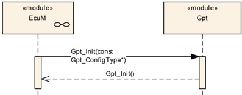

### 8.2. GPT 连续模式

通道 2 配置为「连续模式」。

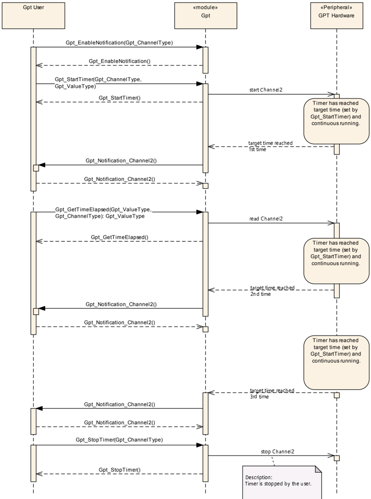

### 8.3. GPT 单次模式

通道 1 配置为「单次模式」。

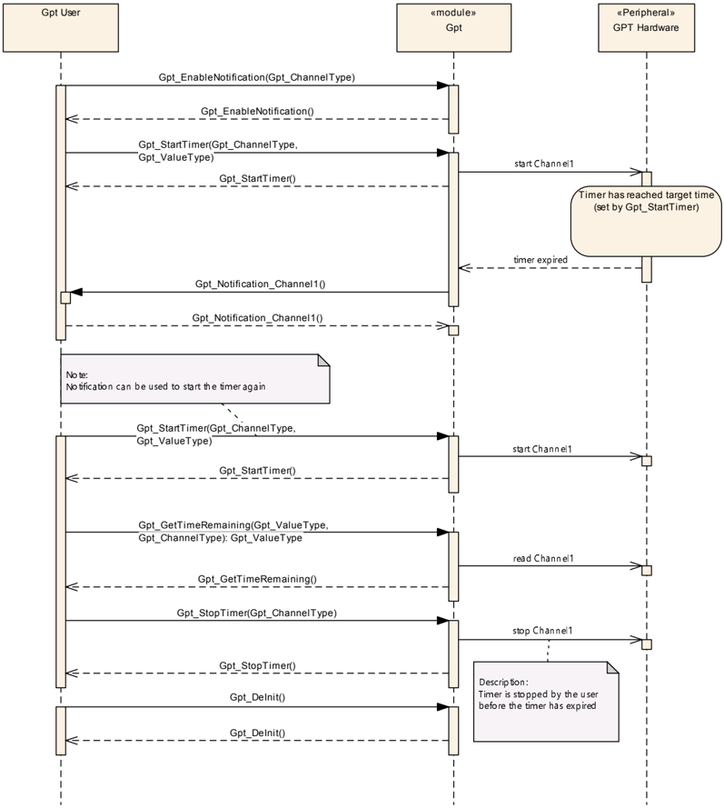

### 8.4. 禁用/启用通知

本章所示的时序图解释了当通知被禁用、而定时器仍在连续模式下运行时驱动程序的行为。如果通知被禁用，当定时器第 2 次到达目标时间（周期 2）时，用户不会收到通知。

该通知被丢弃，且在通知重新启用后也不会补发。

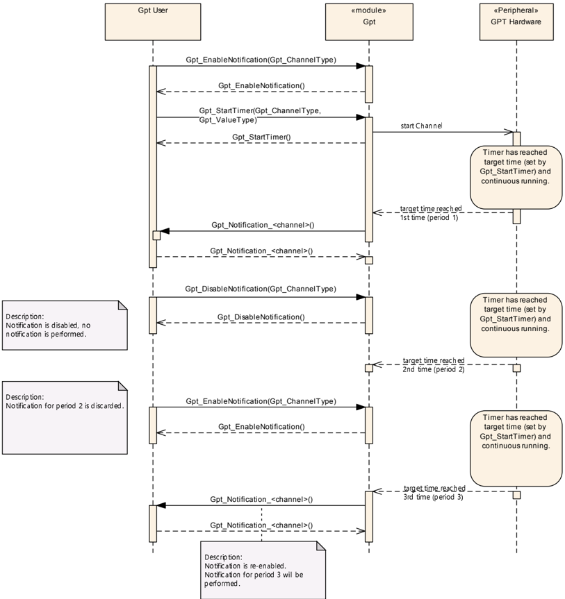

### 8.5. 唤醒

**注意：**有关定时器唤醒的时序图可参阅**ECU**状态管理器规范[5]。

## 9. 配置规范

总体而言，本章定义配置参数及其到**容器**（container）的聚类组织。为支持本规范，第 10.1 章描述基础知识，并规定了应用于参数规范的模板（表）。我们有意将第 10.1 章保留在规范中以保证可理解性。

详情请参阅 SWS_BSWGeneral 中的第 10.1 章「Introduction to configuration specification」（配置规范简介）。

第 9.1 章规定模块**GPT**的结构（容器）和参数。

第 9.2 章规定模块**GPT**的发布信息。

### 9.1. 容器与配置参数

以下各节汇总所有配置参数。各参数的详细含义见第 7 章和第 8 章。

**GPT**模块应拒绝其实现所不支持的、带有分区映射的配置。

#### 9.1.1. Gpt

| SWS 条目 | [ECUC_Gpt_00336] |
|---|---|
| 模块名称 | Gpt |
| 描述 | Gpt（通用定时器）模块的配置。 |
| Post-Build 变体支持 | true |
| 支持的配置变体 | VARIANT-POST-BUILD, VARIANT-PRE-COMPILE |

| 容器名称 | 多重性 | 作用域/依赖 |
|---|---|---|
| GptChannelConfigSet | 1 | 此容器是配置集的基，包含已配置的 GPT 通道。这样可以为 post-build 流程定义不同的配置集。 |
| GptConfigurationOfOptApiServices | 1 | 此容器包含配置 GPT 驱动程序可选 API 服务的所有配置开关。 |
| GptDriverConfiguration | 1 | 此容器包含 GPT 驱动程序的模块级配置（参数）。 |

#### 9.1.2. GptDriverConfiguration

| SWS 条目 | [ECUC_Gpt_00183] |
|---|---|
| 容器名称 | GptDriverConfiguration |
| 父容器 | Gpt |
| 描述 | 此容器包含 GPT 驱动程序的模块级配置（参数）。 |
| 配置参数 | 见下方参数表 |

| SWS 条目 | [ECUC_Gpt_00321] |
|---|---|
| 参数名称 | GptDevErrorDetect |
| 父容器 | GptDriverConfiguration |
| 描述 | 开启或关闭开发错误检测与通知（true：启用检测与通知；false：禁用检测与通知）。 |
| 多重性 | 1 |
| 类型 | EcucBooleanParamDef |
| 默认值 | false |
| Post-Build 变体值 | false |
| 值配置类 | Pre-compile time：x（All Variants）；Link time：-；Post-build time：- |
| 作用域/依赖 | scope: local |

| SWS 条目 | [ECUC_Gpt_00335] |
|---|---|
| 参数名称 | GptPredefTimer100us32bitEnable |
| 父容器 | GptDriverConfiguration |
| 描述 | 启用/禁用 GPT Predef Timer 100µs32bit。 |
| 多重性 | 1 |
| 类型 | EcucBooleanParamDef |
| 默认值 | - |
| Post-Build 变体值 | false |
| 值配置类 | Pre-compile time：x（All Variants）；Link time：-；Post-build time：- |
| 作用域/依赖 | scope: ECU |

| SWS 条目 | [ECUC_Gpt_00334] |
|---|---|
| 参数名称 | GptPredefTimer1usEnablingGrade |
| 父容器 | GptDriverConfiguration |
| 描述 | 指定启用 tick 持续时间为 1µs 的 GPT Predef Timer 的级别。 |
| 多重性 | 1 |
| 类型 | EcucEnumerationParamDef |
| 范围 | GPT_PREDEF_TIMER_1US_16BIT_ENABLED：启用 16 位定时器；GPT_PREDEF_TIMER_1US_16_24BIT_ENABLED：启用 16 和 24 位定时器；GPT_PREDEF_TIMER_1US_16_24_32BIT_ENABLED：启用 16、24 和 32 位定时器；GPT_PREDEF_TIMER_1US_DISABLED：禁用 |
| Post-Build 变体值 | false |
| 值配置类 | Pre-compile time：x（All Variants）；Link time：-；Post-build time：- |
| 作用域/依赖 | scope: ECU |

| SWS 条目 | [ECUC_Gpt_00322] |
|---|---|
| 参数名称 | GptReportWakeupSource |
| 父容器 | GptDriverConfiguration |
| 描述 | 启用/禁用唤醒源报告。 |
| 多重性 | 1 |
| 类型 | EcucBooleanParamDef |
| 默认值 | - |
| Post-Build 变体值 | false |
| 值配置类 | Pre-compile time：x（All Variants）；Link time：-；Post-build time：- |
| 作用域/依赖 | scope: local |

| SWS 条目 | [ECUC_Gpt_00337] |
|---|---|
| 参数名称 | GptEcucPartitionRef |
| 父容器 | GptDriverConfiguration |
| 描述 | 将 GPT 驱动程序映射到零个或多个 ECUC 分区，以使驱动程序 API 在相应分区中可用。取决于所寻址的定时器资源，接口按如下方式运行：a) 对于分区本地定时器资源（n:1 映射），API 在相应 ECUC 分区中作为独立实例运行。b) 对于全局定时器资源（1:m 映射），API 通过对资源的受保护访问或通过实现相应的内核，在全局定时器资源上运行。 |
| 多重性 | 0..* |
| 类型 | 对 EcucPartition 的引用 |
| Post-Build 变体多重性 | true |
| Post-Build 变体值 | true |
| 多重性配置类 | Pre-compile time：x（All Variants）；Link time：-；Post-build time：- |
| 值配置类 | Pre-compile time：x（All Variants）；Link time：-；Post-build time：- |
| 作用域/依赖 | scope: ECU |

| SWS 条目 | [ECUC_Gpt_00338] |
|---|---|
| 参数名称 | GptKernelEcucPartitionRef |
| 父容器 | GptDriverConfiguration |
| 描述 | 将 GPT 内核映射到零个或一个 ECUC 分区，以将驱动内核分配给某个内核核。所引用的 ECUC 分区是 GPT 驱动程序所映射到的 ECUC 分区的子集。**注意：**如果 GPT 驱动程序实现不带内核，则不应设置内核引用（参见 GptEcucPartitionRef 的定义）。 |
| 多重性 | 0..1 |
| 类型 | 对 EcucPartition 的引用 |
| Post-Build 变体多重性 | true |
| Post-Build 变体值 | true |
| 多重性配置类 | Pre-compile time：x；Link time：-；Post-build time：- |
| 值配置类 | Pre-compile time：x；Link time：-；Post-build time：- |
| 作用域/依赖 | scope: ECU |

| 容器名称 | 多重性 | 作用域/依赖 |
|---|---|---|
| GptClockReferencePoint | 1..* | 此容器包含一个参数，该参数表示对 McuClockReferencePoint 类型容器（定义于 MCU 模块）的引用。 |

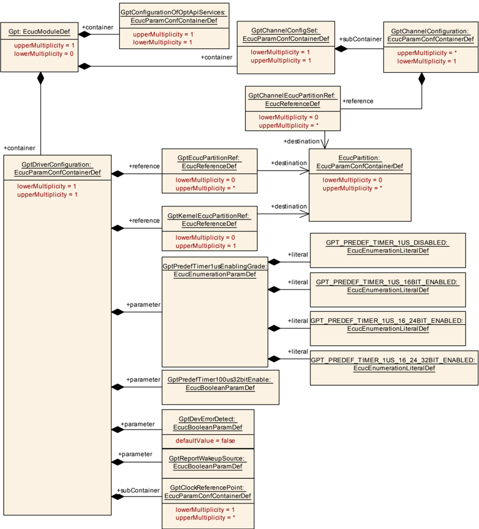

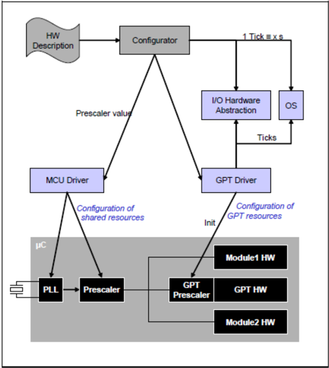

由 GptKernelEcucPartitionRef 引用的 ECUC 分区应是 GptEcucPartitionRef 所引用 ECUC 分区的子集。

如果 GptEcucPartitionRef 引用一个或多个 ECUC 分区，则 GptKernelEcucPartitionRef 的多重性应为一，并且也应引用这些 ECUC 分区之一。

对于分区本地定时器资源，该模块将在每个分区中作为独立实例运行，即被调用的 API 仅作用于调用它时所在的分区。

#### 9.1.3. GptClockReferencePoint

| SWS 条目 | [ECUC_Gpt_00329] |
|---|---|
| 容器名称 | GptClockReferencePoint |
| 父容器 | GptDriverConfiguration |
| 描述 | 此容器包含一个参数，该参数表示对 McuClockReferencePoint 类型容器（定义于 MCU 模块）的引用。需要一个容器来支持多个时钟引用（取决于硬件）。 |
| 配置参数 | 见下方参数表 |

| SWS 条目 | [ECUC_Gpt_00330] |
|---|---|
| 参数名称 | GptClockReference |
| 父容器 | GptClockReferencePoint |
| 描述 | 对 McuClockReferencePoint 类型容器的引用，用于选择输入时钟。GPT 模块的配置编辑器可以只允许选择那些物理上可连接到 GPT 硬件外设的时钟参考点来支持集成者。期望的频率（GPT 所期望的）必须与 MCU 配置所选择和提供的频率相同。这必须自动检查。 |
| 多重性 | 1 |
| 类型 | 对 McuClockReferencePoint 的引用 |
| Post-Build 变体值 | false |
| 值配置类 | Pre-compile time：x（All Variants）；Link time：-；Post-build time：- |
| 作用域/依赖 | scope: local |

无包含的容器。

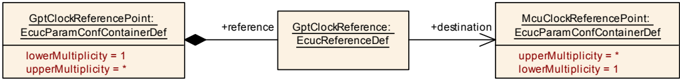

#### 9.1.4. GptChannelConfigSet

| SWS 条目 | [ECUC_Gpt_00269] |
|---|---|
| 容器名称 | GptChannelConfigSet |
| 父容器 | Gpt |
| 描述 | 此容器是配置集的基，包含已配置的 GPT 通道。这样可以为 post-build 流程定义不同的配置集。 |
| 配置参数 | - |

| 容器名称 | 多重性 | 作用域/依赖 |
|---|---|---|
| GptChannelConfiguration | 1..* | 此容器包含 GPT 驱动程序的通道特定配置。 |

#### 9.1.5. GptChannelConfiguration

| SWS 条目 | [ECUC_Gpt_00184] |
|---|---|
| 容器名称 | GptChannelConfiguration |
| 父容器 | GptChannelConfigSet |
| 描述 | 单个 GPT 通道的配置。 |
| 配置参数 | 见下方参数表 |

| SWS 条目 | [ECUC_Gpt_00308] |
|---|---|
| 参数名称 | GptChannelId |
| 父容器 | GptChannelConfiguration |
| 描述 | GPT 通道的通道 Id。此值将分配给由 GptChannelConfiguration 容器短名导出的符号名。 |
| 多重性 | 1 |
| 类型 | EcucIntegerParamDef（为此参数生成符号名） |
| 范围 | 0 .. 4294967295 |
| 默认值 | - |
| Post-Build 变体值 | false |
| 值配置类 | Pre-compile time：x（All Variants）；Link time：-；Post-build time：- |
| 作用域/依赖 | scope: ECU |

| SWS 条目 | [ECUC_Gpt_00309] |
|---|---|
| 参数名称 | GptChannelMode |
| 父容器 | GptChannelConfiguration |
| 描述 | 指定到达目标时间后定时器通道的行为。 |
| 多重性 | 1 |
| 类型 | EcucEnumerationParamDef |
| 范围 | GPT_CH_MODE_CONTINUOUS：到达目标时间后，定时器以值「零」继续运行；GPT_CH_MODE_ONESHOT：到达目标时间后，定时器自动停止（定时器到期） |
| Post-Build 变体值 | true |
| 值配置类 | Pre-compile time：x（VARIANT-PRE-COMPILE）；Link time：-；Post-build time：x（VARIANT-POST-BUILD） |
| 作用域/依赖 | scope: ECU |

| SWS 条目 | [ECUC_Gpt_00331] |
|---|---|
| 参数名称 | GptChannelTickFrequency |
| 父容器 | GptChannelConfiguration |
| 描述 | 指定定时器通道的 tick 频率（Hz）。 |
| 多重性 | 1 |
| 类型 | EcucFloatParamDef |
| 范围 | [0 .. INF] |
| 默认值 | - |
| Post-Build 变体值 | true |
| 值配置类 | Pre-compile time：x（VARIANT-PRE-COMPILE）；Link time：-；Post-build time：x（VARIANT-POST-BUILD） |
| 作用域/依赖 | scope: ECU |

| SWS 条目 | [ECUC_Gpt_00332] |
|---|---|
| 参数名称 | GptChannelTickValueMax |
| 父容器 | GptChannelConfiguration |
| 描述 | 定时器通道能够计数的最大值（tick 数）。在下一个 tick，定时器回绕到零。 |
| 多重性 | 1 |
| 类型 | EcucIntegerParamDef |
| 范围 | 0 .. 18446744073709551615 |
| 默认值 | - |
| Post-Build 变体值 | true |
| 值配置类 | Pre-compile time：x（VARIANT-PRE-COMPILE）；Link time：-；Post-build time：x（VARIANT-POST-BUILD） |
| 作用域/依赖 | scope: ECU |

| SWS 条目 | [ECUC_Gpt_00311] |
|---|---|
| 参数名称 | GptEnableWakeup |
| 父容器 | GptChannelConfiguration |
| 描述 | 为通道启用 MCU 的唤醒能力。 |
| 多重性 | 1 |
| 类型 | EcucBooleanParamDef |
| 默认值 | - |
| Post-Build 变体值 | true |
| 值配置类 | Pre-compile time：x（VARIANT-PRE-COMPILE）；Link time：-；Post-build time：x（VARIANT-POST-BUILD） |
| 作用域/依赖 | scope: local |

| SWS 条目 | [ECUC_Gpt_00312] |
|---|---|
| 参数名称 | GptNotification |
| 父容器 | GptChannelConfiguration |
| 描述 | 指向回调函数的函数指针（用于非唤醒通知）。 |
| 多重性 | 0..1 |
| 类型 | EcucFunctionNameDef |
| 默认值 | - |
| 正则表达式 | - |
| Post-Build 变体多重性 | true |
| Post-Build 变体值 | true |
| 多重性配置类 | Pre-compile time：x（VARIANT-PRE-COMPILE）；Link time：-；Post-build time：x（VARIANT-POST-BUILD） |
| 值配置类 | Pre-compile time：x（VARIANT-PRE-COMPILE）；Link time：-；Post-build time：x（VARIANT-POST-BUILD） |
| 作用域/依赖 | scope: local |

| SWS 条目 | [ECUC_Gpt_00333] |
|---|---|
| 参数名称 | GptChannelClkSrcRef |
| 父容器 | GptChannelConfiguration |
| 描述 | 对 GptClockReferencePoint 的引用，通道时钟由其导出。 |
| 多重性 | 1 |
| 类型 | 对 GptClockReferencePoint 的引用 |
| Post-Build 变体值 | true |
| 值配置类 | Pre-compile time：x（VARIANT-PRE-COMPILE）；Link time：-；Post-build time：x（VARIANT-POST-BUILD） |
| 作用域/依赖 | scope: local |

| SWS 条目 | [ECUC_Gpt_00339] |
|---|---|
| 参数名称 | GptChannelEcucPartitionRef |
| 父容器 | GptChannelConfiguration |
| 描述 | 将一个 GPT 通道映射到零个或多个 ECUC 分区，以限制对该通道组的访问。所引用的 ECUC 分区是 GPT 驱动程序所映射到的 ECUC 分区的子集。 |
| 多重性 | 0..* |
| 类型 | 对 EcucPartition 的引用 |
| Post-Build 变体多重性 | true |
| Post-Build 变体值 | true |
| 多重性配置类 | Pre-compile time：x；Link time：-；Post-build time：- |
| 值配置类 | Pre-compile time：x；Link time：-；Post-build time：- |
| 作用域/依赖 | scope: ECU |

| 容器名称 | 多重性 | 作用域/依赖 |
|---|---|---|
| GptWakeupConfiguration | 0..1 | 指向回调函数的函数指针（用于唤醒通知）。 |

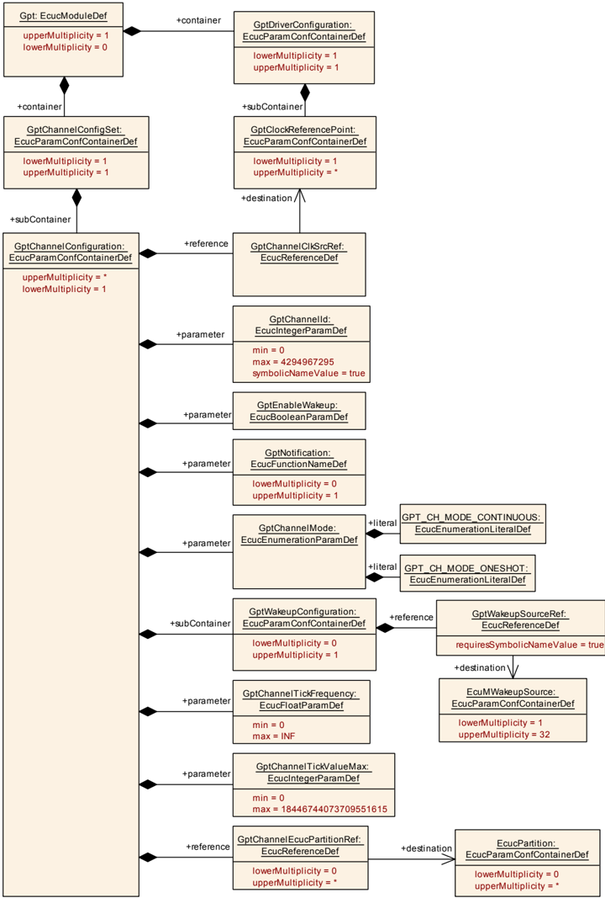

由 GptGroupEcucPartitionRef 引用的 ECUC 分区应是 GptEcucPartitionRef 所引用 ECUC 分区的子集。

如果 GptEcucPartitionRef 引用一个或多个 ECUC 分区，则 GptKernelEcucPartitionRef 的多重性应大于零，并且也应引用这些 ECUC 分区中的一个或多个。

#### 9.1.6. GptWakeupConfiguration

| SWS 条目 | [ECUC_Gpt_00235] |
|---|---|
| 容器名称 | GptWakeupConfiguration |
| 父容器 | GptChannelConfiguration |
| 描述 | 指向回调函数的函数指针（用于唤醒通知）。 |
| 配置参数 | 见下方参数表 |

| SWS 条目 | [ECUC_Gpt_00313] |
|---|---|
| 参数名称 | GptWakeupSourceRef |
| 父容器 | GptWakeupConfiguration |
| 描述 | 当唤醒能力为 true 时，此值被传递给 ECU 状态管理器。实现类型：对 EcuM_WakeupSourceType 的引用 |
| 多重性 | 1 |
| 类型 | 对 EcuMWakeupSource 的符号名引用 |
| Post-Build 变体值 | true |
| 值配置类 | Pre-compile time：x（VARIANT-PRE-COMPILE）；Link time：-；Post-build time：x（VARIANT-POST-BUILD） |
| 作用域/依赖 | scope: local |

无包含的容器。

#### 9.1.7. GptConfigurationOfOptApiServices

| SWS 条目 | [ECUC_Gpt_00193] |
|---|---|
| 容器名称 | GptConfigurationOfOptApiServices |
| 父容器 | Gpt |
| 描述 | 此容器包含配置 GPT 驱动程序可选 API 服务的所有配置开关。 |
| 配置参数 | 见下方参数表 |

| SWS 条目 | [ECUC_Gpt_00314] |
|---|---|
| 参数名称 | GptDeinitApi |
| 父容器 | GptConfigurationOfOptApiServices |
| 描述 | 在代码中添加/移除 Gpt_DeInit() 服务。 |
| 多重性 | 1 |
| 类型 | EcucBooleanParamDef |
| 默认值 | - |
| Post-Build 变体值 | false |
| 值配置类 | Pre-compile time：x（All Variants）；Link time：-；Post-build time：- |
| 作用域/依赖 | scope: local |

| SWS 条目 | [ECUC_Gpt_00315] |
|---|---|
| 参数名称 | GptEnableDisableNotificationApi |
| 父容器 | GptConfigurationOfOptApiServices |
| 描述 | 在代码中添加/移除 Gpt_EnableNotification() 和 Gpt_DisableNotification 服务。 |
| 多重性 | 1 |
| 类型 | EcucBooleanParamDef |
| 默认值 | - |
| Post-Build 变体值 | false |
| 值配置类 | Pre-compile time：x（All Variants）；Link time：-；Post-build time：- |
| 作用域/依赖 | scope: local |

| SWS 条目 | [ECUC_Gpt_00317] |
|---|---|
| 参数名称 | GptTimeElapsedApi |
| 父容器 | GptConfigurationOfOptApiServices |
| 描述 | 在代码中添加/移除 Gpt_GetTimeElapsed() 服务。 |
| 多重性 | 1 |
| 类型 | EcucBooleanParamDef |
| 默认值 | - |
| Post-Build 变体值 | false |
| 值配置类 | Pre-compile time：x（All Variants）；Link time：-；Post-build time：- |
| 作用域/依赖 | scope: local |

| SWS 条目 | [ECUC_Gpt_00318] |
|---|---|
| 参数名称 | GptTimeRemainingApi |
| 父容器 | GptConfigurationOfOptApiServices |
| 描述 | 在代码中添加/移除 Gpt_GetTimeRemaining() 服务。 |
| 多重性 | 1 |
| 类型 | EcucBooleanParamDef |
| 默认值 | - |
| Post-Build 变体值 | false |
| 值配置类 | Pre-compile time：x（All Variants）；Link time：-；Post-build time：- |
| 作用域/依赖 | scope: local |

| SWS 条目 | [ECUC_Gpt_00319] |
|---|---|
| 参数名称 | GptVersionInfoApi |
| 父容器 | GptConfigurationOfOptApiServices |
| 描述 | 在代码中添加/移除 Gpt_GetVersionInfo() 服务。 |
| 多重性 | 1 |
| 类型 | EcucBooleanParamDef |
| 默认值 | false |
| Post-Build 变体值 | false |
| 值配置类 | Pre-compile time：x（All Variants）；Link time：-；Post-build time：- |
| 作用域/依赖 | scope: local |

| SWS 条目 | [ECUC_Gpt_00320] |
|---|---|
| 参数名称 | GptWakeupFunctionalityApi |
| 父容器 | GptConfigurationOfOptApiServices |
| 描述 | 在代码中添加/移除 Gpt_SetMode()、Gpt_EnableWakeup()、Gpt_DisableWakeup() 和 Gpt_CheckWakeup() 服务。 |
| 多重性 | 1 |
| 类型 | EcucBooleanParamDef |
| 默认值 | - |
| Post-Build 变体值 | false |
| 值配置类 | Pre-compile time：x（All Variants）；Link time：-；Post-build time：- |
| 作用域/依赖 | scope: local |

无包含的容器。

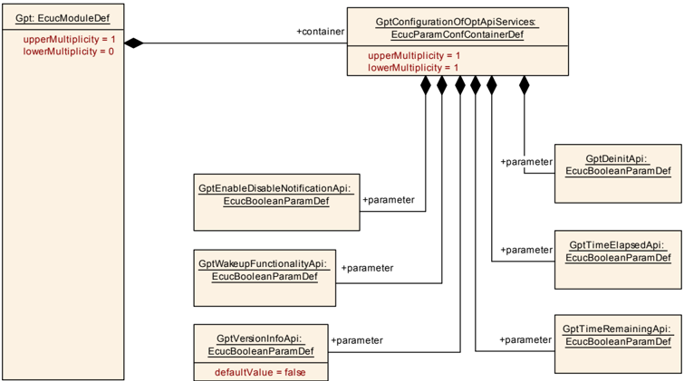

### 9.2. 发布信息

详情请参阅 SWS_BSWGeneral 中的第 10.3 章「Published Information」（发布信息）。

《基础软件模块通用 SRS》[7]所要求的标准化通用发布参数，应在本模块的头文件中发布，并须在 BSW 模块描述中提供。相应的模块缩写可在基础软件模块列表[7]中找到。

如适用，其他模块特定的发布参数列于下方。

<section id="wechat">

<h4>微信扫一扫，获取更多及时资讯</h4>


</section>
