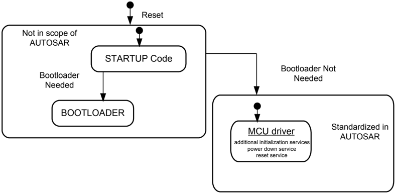
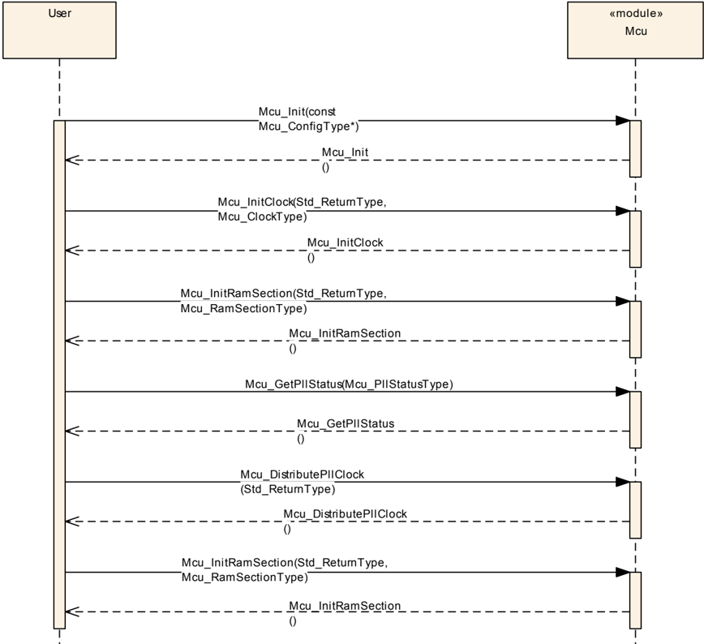
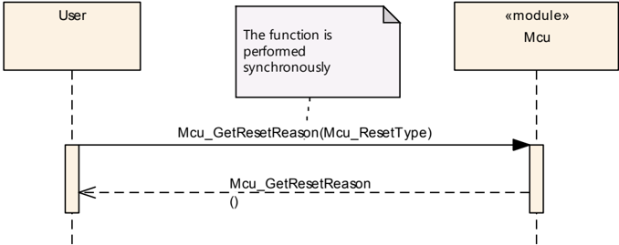
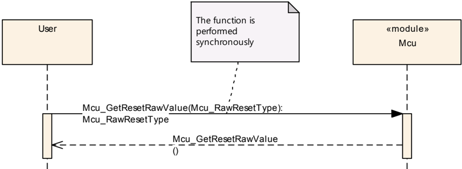
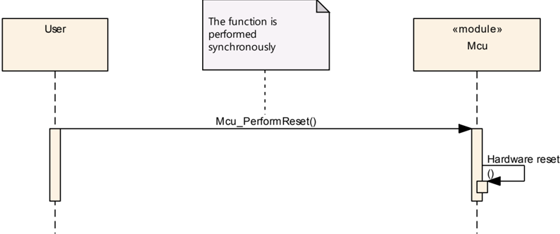

## 1. 简介和功能概述

本规范规定了**MCU**（微控制器单元）驱动程序的功能与**API**。**MCU**驱动程序为基础微控制器初始化、掉电（**power down**）功能、复位以及其他**MCAL**软件模块所需的微控制器特定功能提供服务。除启动代码（**start-up code**）之外，初始化服务还支持灵活的、与应用相关的**MCU**初始化（见下图）。启动代码是非常**MCU**特定的。本文档中所提供的启动代码描述仅供指导，并隐含了在标准化**MCU**初始化能够开始之前必须予以考虑的功能。



**MCU**驱动程序直接访问微控制器硬件，位于微控制器抽象层（**MCAL**）。

**MCU** 驱动程序特性：

* 初始化**MCU**时钟、**PLL**、时钟预分频器和**MCU**时钟分配
* 初始化 RAM 区段
* 激活 µC 降功耗模式
* 激活 µC 复位
* 提供从硬件获取复位原因的服务

## 2. 缩略语

**uC**
> 微控制器（**Microcontroller**）

**MCU**
> 微控制器单元（**Micro Controller Unit**）

**SFR**
> 特殊功能寄存器（**Special Function Register**），**MCU** 寄存器

**DEM**
> 诊断事件管理器（**Diagnostic Event Manager**）

**DET**
> 默认错误跟踪器（**Default Error Tracer**）

## 3. 相关文档

### 3.1. 输入文件和相关标准与规范

[1] List of Basic Software Modules
> AUTOSAR_CP_TR_BSWModuleList

[2] Layered Software Architecture
> AUTOSAR_CP_EXP_LayeredSoftwareArchitecture

[3] General Requirements on Basic Software Modules
> AUTOSAR_CP_SRS_BSWGeneral

[4] Specification of Default Error Tracer
> AUTOSAR_CP_SWS_DefaultErrorTracer

[5] Specification of ECU Configuration
> AUTOSAR_CP_TPS_ECUConfiguration

[6] Specification of Diagnostic Event Manager
> AUTOSAR_CP_SWS_DiagnosticEventManager

[7] Specification of ECU State Manager
> AUTOSAR_CP_SWS_ECUStateManager

[8] General Requirements on SPAL
> AUTOSAR_CP_SRS_SPALGeneral

[9] Requirements on MCU driver
> AUTOSAR_CP_SRS_MCUDriver

[10] Specification of Standard Types
> AUTOSAR_CP_SWS_StandardTypes

[11] Basic Software Module Description Template
> AUTOSAR_CP_TPS_BSWModuleDescriptionTemplate

[12] General Specification of Basic Software Modules
> AUTOSAR_CP_SWS_BSWGeneral

### 3.2. 相关规范

**AUTOSAR**提供了基础软件模块通用规范[12]（**SWS BSW General**），该规范同样适用于**MCU**驱动程序。

因此，**SWS BSW General**规范应被视为**MCU**驱动程序的附加必需规范。

## 4. 约束和假设

### 4.1. 限制

总体而言，在**AUTOSAR**标准化范围内，**MCU**降功耗模式的激活与配置不是强制性的。

开启/关闭**ECU**或 µC 的电源供应不是**MCU**驱动程序的任务。这应由上层处理。

### 4.2. 汽车域的适用性

无限制。

## 5. 对其他模块的依赖

### 5.1. 启动代码

在**MCU**驱动程序能够被初始化之前，必须先执行**MCU**的基本初始化。这种**MCU**特定的初始化通常在启动代码中执行。

**MCU**的启动代码应在上电以及任何一种微控制器复位之后执行。它应执行非常基本的、微控制器特定的启动初始化，并且应保持简短，因为**MCU**时钟和**PLL**尚未初始化。启动代码应涵盖不属于其他**MCU**服务或其他**MCAL**驱动程序的**MCU**特定初始化。以下描述汇总了应包含在启动代码中的基本功能。这些内容仅作指导列出，因为某些功能可能并非所有**MCU**都支持。

启动代码应初始化中断和陷阱向量表的基址。这些基址以配置参数或链接器/定位器（linker/locator）设置的形式提供。

如果**MCU**支持中断栈，启动代码应初始化中断栈指针。中断栈指针的基址和栈大小以配置参数或链接器/定位器设置的形式提供。

启动代码应初始化用户栈指针。用户栈指针的基址和栈大小以配置参数或链接器/定位器设置的形式提供。

如果**MCU**支持上下文保存操作，启动代码应初始化用于上下文保存操作的存储器。连续上下文保存操作的最大次数以配置参数或链接器/定位器设置的形式提供。

启动代码应确保在**MCAL**看门狗驱动程序初始化看门狗之前不对**MCU**内部看门狗进行服务。这可以通过例如增大看门狗服务时间来实现。

如果**MCU**支持用于数据和/或代码的缓存，应在启动代码中对其初始化并启用。

启动代码应初始化**MCU**关于内部存储器的特定特性，例如存储器保护。

如果使用外部存储器，应在启动代码中初始化该存储器。启动代码应准备好支持取决于代码位置的不同存储器配置。对于从外部/内部存储器执行代码，应考虑不同的配置选项。

不同存储器的设置应以配置参数的形式提供给启动代码。

在启动代码中，应执行**MCU**时钟系统的默认初始化，包括全局时钟预分频器。

如果**MCU**支持，启动代码应为特殊功能寄存器（**SFR**）启用保护机制。

启动代码应初始化所有必要的一次性可写寄存器，或多个驱动程序共用的寄存器——对这些寄存器，写入一次（而非重复写入）是必需的或非常可取的。

启动代码应初始化最少数量的 RAM，以允许**MCU**驱动程序服务及其调用者正确执行。

**注意：**启动代码依赖于**ECU**和**MCU**。规范的细节应在**MCU**的设计规范中描述。

### 5.2. 文件结构

#### 5.2.1. 代码文件结构

**注意：**代码文件结构不应在本规范中定义。

## 6. 功能规格

### 6.1. 一般行为

#### 6.1.1. 背景与原理

**MCU**驱动程序提供用于时钟和 RAM 初始化的**MCU**服务。在**MCU**配置集中，应配置时钟（即**PLL**设置）和 RAM（即区段基址和大小）的**MCU**特定设置。

#### 6.1.2. 需求

##### 6.1.2.1. 复位

**MCU**模块应提供一个以软件触发硬件复位的服务。

**注意：**只有经过授权的用户才能调用该复位服务函数。

**MCU**模块应提供服务以获取上一次复位的复位原因（如果硬件支持该特性）。

**注意：**在一个**ECU**中，存在多种可能引起复位的源。根据复位原因的不同，在**MCU**重新初始化之后可能需要若干不同的应用场景。

##### 6.1.2.2. 时钟

**Mcu**应提供启用并设置**MCU**时钟的服务（即必须在**MCU**中配置 CPU 时钟、外设时钟、预分频器、倍频器）。

**注意：**所有可用的外设时钟都必须通过**McuClockReferencePoint**容器提供给其他**BSW**模块。

##### 6.1.2.3. MCU 模式服务

**MCU**模块应提供激活**MCU**降功耗模式的服务。

激活降功耗模式的服务应允许访问 µC 硬件中可用的电源模式。

模式的数量和配置依赖于**MCU**，应在**MCU**模块的配置集中配置。

**注意：****MCU**降功耗模式的激活可能会影响**PLL**、内部振荡器、CPU 时钟、µC 外设时钟以及内核和外设的电源供应。

在典型运行中，**MCU**降功耗模式会在**ECU**运行期间被频繁地进入和退出。在这种情况下，当唤醒在某个**MCAL**模块中被激活时即执行唤醒。

上层负责激活**MCU**正常运行（执行**MCU**电源模式之前的状况），或关闭 µC 的电源供应。

对于某些**MCU**模式配置，**MCU**只能通过硬件复位来唤醒。

### 6.2. 错误分类

文档[12]《基础软件模块通用规范》的第 7.x 章「错误处理」详细描述了基础软件的错误处理。最重要的是，它构成了一个由可能发生在**BSW**模块中的五种错误类型组成的分类方案。

在此基础上，以下章节规定了在下面各小节中安排的特定错误。

**MCU**驱动程序遵循标准化的**AUTOSAR**生产错误报告概念。所提供的回调例程在[诊断事件管理器（**DEM**）规范](../../diagnostics/diagnostic_event_manager/index.md)（见[6]）中规定。

生产错误不应用作被调用函数的返回值。

#### 6.2.1. 开发错误

| 错误类型 | 相关错误代码 | 错误值 |
|---|---|---|
| **API**服务以错误参数调用 | MCU_E_PARAM_CONFIG | 0x0A |
| **API**服务以错误参数调用 | MCU_E_PARAM_CLOCK | 0x0B |
| **API**服务以错误参数调用 | MCU_E_PARAM_MODE | 0x0C |
| **API**服务以错误参数调用 | MCU_E_PARAM_RAMSECTION | 0x0D |
| **API**服务以错误参数调用 | MCU_E_PLL_NOT_LOCKED | 0x0E |
| **API**服务以错误参数调用 | MCU_E_UNINIT | 0x0F |
| **API**服务以错误参数调用 | MCU_E_PARAM_POINTER | 0x10 |
| **API**服务以错误参数调用 | MCU_E_INIT_FAILED | 0x11 |

#### 6.2.2. 运行时错误

没有运行时错误。

#### 6.2.3. 瞬态故障

没有瞬态故障。

#### 6.2.4. 生产错误

没有生产错误。

#### 6.2.5. 扩展生产错误

| 错误类型 | 相关错误代码 | 错误值 |
|---|---|---|
| 时钟源失效 | MCU_E_CLOCK_FAILURE | 由 DEM 分配 |

如果在配置集中启用了时钟失效通知，并且发生时钟源失效错误，则应报告错误代码**MCU_E_CLOCK_FAILURE**（另见上文生产错误报告概念）。

如果时钟失效由其他硬件机制（例如陷阱的产生）检测，则应禁用此通知，且失效报告应在**MCU**驱动程序之外完成。

##### 6.2.5.1. MCU_E_CLOCK_FAILURE

| 错误名称 | [MCU_E_CLOCK_FAILURE](#625-扩展生产错误) |
|---|---|
| 简短描述 | 时钟源失效。 |
| 详细描述 | 如果在配置集中启用了时钟失效通知且发生时钟源失效错误，应报告错误代码 [MCU_E_CLOCK_FAILURE](#625-扩展生产错误)。 |
| 检测标准 | Fail：见下方 **Fail** 判定标准。Pass：见下方 **Pass** 判定标准。 |
| 次要参数 | FAIL 或 PASS 检测处于活动状态的条件：在配置集中启用了时钟失效通知。 |
| 所需时间 | 不适用。 |
| 监控频率 | 持续 |

[**MCU_E_CLOCK_FAILURE**](#625-扩展生产错误) 的 **Fail** 判定标准：发生时钟源失效。

[**MCU_E_CLOCK_FAILURE**](#625-扩展生产错误) 的 **Pass** 判定标准：未发生时钟源失效。

## 7. API规范

### 7.1. 导入的类型

本章列出了从以下模块包含的所有类型：

**Mcu**模块的导入数据类型定义

| 模块 | 头文件 | 导入的类型 |
|---|---|---|
| Dem | Rte_Dem_Type.h | Dem_EventIdType |
| Dem | Rte_Dem_Type.h | Dem_EventStatusType |
| Std | Std_Types.h | Std_ReturnType |
| Std | Std_Types.h | Std_VersionInfoType |

### 7.2. 类型定义

#### 7.2.1. Mcu_ConfigType

结构类型。元素为硬件相关结构：用于保存**MCU**驱动程序配置的结构。指向这种结构的指针将提供给**MCU**初始化例程用于配置。可通过**Mcu.h**获得。

#### 7.2.2. Mcu_PllStatusType

枚举类型。这是**MCU**模块的 [Mcu_GetPllStatus](#735-mcu_getpllstatus) 函数返回的状态值。可通过**Mcu.h**获得。

* **MCU_PLL_LOCKED**（0x00）：**PLL** 已锁定。
* **MCU_PLL_UNLOCKED**（0x01）：**PLL** 未锁定。
* **MCU_PLL_STATUS_UNDEFINED**（0x02）：**PLL** 状态未知。

**Mcu_PllStatusType** 类型是 [Mcu_GetPllStatus](#735-mcu_getpllstatus) 函数返回值的类型。

**Mcu_PllStatusType** 类型是具有以下值的枚举：**MCU_PLL_LOCKED**、**MCU_PLL_UNLOCKED**、**MCU_PLL_STATUS_UNDEFINED**。

#### 7.2.3. Mcu_ClockType

类型，派生自 uint。范围为 0..<时钟设置数量>-1 —— 该范围取决于配置结构中提供的不同时钟设置的数量；应根据**MCU**平台选择该类型以获得最佳性能。该类型指定在配置结构中配置的时钟设置的标识（**ID**）。可通过**Mcu.h**获得。

**Mcu_ClockType** 类型定义经配置结构配置的时钟设置的标识（**ID**）。

该类型应为 uint8、uint16 或 uint32，取决于 µC 平台。

#### 7.2.4. Mcu_ResetType

枚举类型。这是复位枚举的类型，包含复位类型的子集。并不要求硬件支持所有复位类型。可通过**Mcu.h**获得。

* **MCU_POWER_ON_RESET**（0x00）：上电复位（默认）。
* **MCU_WATCHDOG_RESET**（0x01）：内部看门狗定时器复位。
* **MCU_SW_RESET**（0x02）：软件复位。
* **MCU_RESET_UNDEFINED**（0x03）：复位未定义。

**Mcu_ResetType** 类型表示特定**MCU**可以具有的不同复位。

**MCU**模块应至少为**Mcu_ResetType**枚举提供**MCU_POWER_ON_RESET**和**MCU_RESET_UNDEFINED**值。

**注意：****Mcu_ResetType** 的其他复位类型可以视**MCU**情况添加。

#### 7.2.5. Mcu_RawResetType

类型，派生自 uint。范围为 **MCU** 相关的寄存器值。该类型以从复位状态寄存器读取的原始寄存器格式指定复位原因。可通过**Mcu.h**获得。

**Mcu_RawResetType** 类型以从复位状态寄存器读取的原始寄存器格式指定复位原因。

该类型应为 uint8、uint16 或 uint32，基于最佳性能选择。

#### 7.2.6. Mcu_ModeType

类型，派生自 uint。范围为 0..<**MCU** 模式数量>-1 —— 该范围取决于配置结构中提供的**MCU**模式的数量；应根据**MCU**平台选择该类型以获得最佳性能。该类型指定在配置结构中配置的**MCU**模式的标识（**ID**）。可通过**Mcu.h**获得。

**Mcu_ModeType** 指定经配置结构配置的**MCU**模式的标识（**ID**）。

该类型应为 uint8、uint16 或 uint32。

#### 7.2.7. Mcu_RamSectionType

类型，派生自 uint。范围为 0..<RAM 区段数量>-1 —— 该范围取决于配置结构中 RAM 区段的数量；应根据**MCU**平台选择该类型以获得最佳性能。该类型指定在配置结构中配置的 RAM 区段的标识（**ID**）。可通过**Mcu.h**获得。

**Mcu_RamSectionType** 指定经配置结构配置的 RAM 区段的标识（**ID**）。

该类型应为 uint8、uint16 或 uint32，基于最佳性能选择。

#### 7.2.8. Mcu_RamStateType

枚举类型。这是**Mcu**模块的 RAM 状态类型。并不要求硬件支持所有 RAM 状态类型。可通过**Mcu.h**获得。

* **MCU_RAMSTATE_INVALID**（0x00）：RAM 内容无效或未知（默认）。
* **MCU_RAMSTATE_VALID**（0x01）：RAM 内容有效。

### 7.3. 函数定义

以下是提供给上层模块的函数列表。

#### 7.3.1. Mcu_Init

**说明**: 此服务初始化**MCU**驱动程序。可通过**Mcu.h**获得。本服务为同步调用，不可重入。参数 ConfigPtr（in）：指向**MCU**驱动程序配置集的指针。

```C
void Mcu_Init (const Mcu_ConfigType* ConfigPtr)
```

**Mcu_Init** 函数应初始化**MCU**模块，即在**MCU**模块内使掉电、时钟和 RAM 区段的配置设置生效。

**注意：****Mcu_Init** 函数执行之后，配置数据可访问，并可供**MCU**模块的函数（例如 [Mcu_InitRamSection](#732-mcu_initramsection)）使用。

**MCU**模块的实现者应在**Mcu_Init**函数内应用以下关于控制器寄存器初始化的规则：

1. 如果硬件只允许该寄存器的一次使用，实现该功能的驱动模块负责初始化该寄存器。
2. 如果寄存器会影响多个硬件模块，且它是**I/O**寄存器，则应由[**PORT** 驱动程序](../../io/port_driver/index.md)初始化。
3. 如果寄存器会影响多个硬件模块，且它不是**I/O**寄存器，则应由本**MCU**驱动程序初始化。
4. 要求在复位后直接初始化的一次性可写寄存器应由启动代码初始化。
5. 前面未提及的所有其他寄存器应由启动代码初始化。

**注意：**术语「硬件模块」指**MCU**的内部模块，而不是**BSW**模块。

#### 7.3.2. Mcu_InitRamSection

**说明**: 此服务按区段初始化 RAM。可通过**Mcu.h**获得。本服务为同步调用，不可重入。参数 RamSection（in）：选择配置集中提供的 RAM 存储区段。返回值：Std_ReturnType，E_OK：命令已被接受；E_NOT_OK：命令未被接受，例如由于参数错误。

```C
Std_ReturnType Mcu_InitRamSection (Mcu_RamSectionType RamSection)
```

**Mcu_InitRamSection** 函数应使用 McuRamDefaultValue 中包含的字节值，从地址 McuRamSectionBaseAddress 到地址 McuRamSectionBaseAddress + McuRamSectionSize - 1 填充存储器，每次写入由 McuRamSectionWriteSize 定义的字节数，其中 McuRamSectionBaseAddress、McuRamSectionSize、McuRamDefaultValue 和 McuRamSectionWriteSize 是每个 RamSection 的配置参数值。

**MCU**模块的环境应仅在**MCU**模块已使用 [Mcu_Init](#731-mcu_init) 函数初始化之后调用**Mcu_InitRamSection**函数。

#### 7.3.3. Mcu_InitClock

**说明**: 此服务初始化**PLL**和其他**MCU**特定的时钟选项。可通过**Mcu.h**获得。本服务为同步调用，不可重入。参数 ClockSetting（in）：时钟设置。返回值：Std_ReturnType，E_OK：命令已被接受；E_NOT_OK：命令未被接受。

```C
Std_ReturnType Mcu_InitClock (Mcu_ClockType ClockSetting)
```

**Mcu_InitClock** 函数应初始化**PLL**和其他**MCU**特定的时钟选项。时钟配置参数经配置结构提供。

**Mcu_InitClock** 函数应启动**PLL**锁定流程（如果应初始化**PLL**），并且应在不等待**PLL**锁定的情况下返回。

**MCU**模块的环境应仅在**MCU**模块已使用 [Mcu_Init](#731-mcu_init) 函数初始化之后调用**Mcu_InitClock**函数。

如果参数 McuInitClock 设置为 FALSE，则应禁用**Mcu_InitClock**函数；反之，当前述参数设置为 TRUE 时此函数可用（另见第 9.1.2 章）。

#### 7.3.4. Mcu_DistributePllClock

**说明**: 此服务将**PLL**时钟激活到**MCU**时钟分配。可通过**Mcu.h**获得。本服务为同步调用，不可重入。无参数。返回值：Std_ReturnType，E_OK：命令已被接受；E_NOT_OK：命令未被接受。

```C
Std_ReturnType Mcu_DistributePllClock (void)
```

**Mcu_DistributePllClock** 函数应将**PLL**时钟激活到**MCU**时钟分配。

**Mcu_DistributePllClock** 函数应从**MCU**时钟分配中移除当前时钟源（例如内部振荡器时钟）。

**MCU**模块的环境应仅在**PLL**状态已被 [Mcu_GetPllStatus](#735-mcu_getpllstatus) 函数检测为锁定之后调用**Mcu_DistributePllClock**函数。

如果**PLL**时钟已被**MCU**硬件自动激活，**Mcu_DistributePllClock**函数应在不影响**MCU**硬件的情况下返回。

如果在**PLL**锁定之前调用**Mcu_DistributePllClock**函数，该函数应立即返回 E_NOT_OK，而不做任何进一步操作。

如果预编译参数 McuNoPll 设置为 FALSE，**Mcu_DistributePllClock**函数应可用；否则必须禁用该**API**（另见第 9.1.2 章中的 McuNoPll 参数）。

#### 7.3.5. Mcu_GetPllStatus

**说明**: 此服务提供**PLL**的状态。可通过**Mcu.h**获得。本服务为同步调用，可重入。无参数。返回值：[Mcu_PllStatusType](#722-mcu_pllstatustype)，**PLL** 状态。

```C
Mcu_PllStatusType Mcu_GetPllStatus (void)
```

**Mcu_GetPllStatus** 函数应返回**PLL**的锁定状态。

如果在调用 [Mcu_Init](#731-mcu_init) 函数之前调用本函数，**Mcu_GetPllStatus** 函数应返回**MCU_PLL_STATUS_UNDEFINED**。

如果预编译参数 McuNoPll 设置为 TRUE，**Mcu_GetPllStatus** 函数同样应返回**MCU_PLL_STATUS_UNDEFINED**（另见第 9.1.2 章中的 McuNoPll 参数）。

#### 7.3.6. Mcu_GetResetReason

**说明**: 此服务在硬件支持时从硬件读取复位类型。可通过**Mcu.h**获得。本服务为同步调用，可重入。无参数。返回值：[Mcu_ResetType](#724-mcu_resettype)，--。

```C
Mcu_ResetType Mcu_GetResetReason (void)
```

**Mcu_GetResetReason** 函数应从硬件读取复位原因，并在硬件支持时返回该原因。如果硬件不支持复位原因的硬件检测，**Mcu_GetResetReason** 函数的返回值应始终为**MCU_POWER_ON_RESET**。

如果在调用 [Mcu_Init](#731-mcu_init) 函数之前调用本函数，且硬件支持，**Mcu_GetResetReason** 函数应返回**MCU_RESET_UNDEFINED**。

用户应确保复位原因一经读出即被清除，以避免出现多个复位原因。

**注意：**多次调用此函数时，返回值应始终相同。

#### 7.3.7. Mcu_GetResetRawValue

**说明**: 此服务在硬件支持时从硬件寄存器读取复位的原始值。可通过**Mcu.h**获得。本服务为同步调用，可重入。无参数。返回值：[Mcu_RawResetType](#725-mcu_rawresettype)，复位原始值。

```C
Mcu_RawResetType Mcu_GetResetRawValue (void)
```

如果在调用 [Mcu_Init](#731-mcu_init) 函数之前调用本函数，且硬件支持，**Mcu_GetResetRawValue** 函数应返回一个实现特定的值，该值不对应复位状态寄存器的任何有效值且不等于 0。

如果硬件支持，**Mcu_GetResetRawValue** 函数应从硬件寄存器读取复位原始值。如果硬件没有复位状态寄存器，返回值应为 0x0。

用户应确保复位原因一经读出即被清除，以避免出现多个复位原因。

**注意：**多次调用此函数时，返回值应始终相同。

#### 7.3.8. Mcu_PerformReset

**说明**: 此服务执行微控制器复位。可通过**Mcu.h**获得。本服务为同步调用，不可重入。无参数，无返回值。

```C
void Mcu_PerformReset (void)
```

**Mcu_PerformReset** 函数应使用微控制器的硬件特性执行微控制器复位。

**Mcu_PerformReset** 函数应执行配置集中配置的复位类型。

**MCU**模块的环境应仅在**MCU**模块已由 [Mcu_Init](#731-mcu_init) 函数初始化之后调用**Mcu_PerformReset**函数。

仅当预编译参数 McuPerformResetApi 设置为 TRUE 时，**Mcu_PerformReset** 函数才可用；如果设置为 FALSE，则**Mcu_PerformReset**函数不适用（见第 9.1.2 章）。

#### 7.3.9. Mcu_SetMode

**说明**: 此服务激活**MCU**电源模式。可通过**Mcu.h**获得。本服务为同步调用，可重入。参数 McuMode（in）：设置配置集中配置的不同**MCU**电源模式。无返回值。

```C
void Mcu_SetMode (Mcu_ModeType McuMode)
```

**Mcu_SetMode** 函数应设置**MCU**电源模式。在 CPU 掉电模式的情况下，**Mcu_SetMode** 函数在执行唤醒之后返回。

**MCU**模块的环境应仅在**MCU**模块已由 [Mcu_Init](#731-mcu_init) 函数初始化之后调用**Mcu_SetMode**函数。

**注意：****Mcu_SetMode** 函数的环境必须确保**ECU**已为降功耗模式的激活做好准备。

**注意：API** Mcu_SetMode 假定在调用实例调用该**API**之前所有中断都已被禁用。实现必须确保不丢失任何唤醒中断事件。这可以通过检查挂起的唤醒中断是否已经发生来实现——即使**Mcu_SetMode**尚未将控制器设置为掉电模式。

#### 7.3.10. Mcu_GetVersionInfo

**说明**: 此服务返回本模块的版本信息。可通过**Mcu.h**获得。本服务为同步调用，可重入。参数 versioninfo（out）：存储本模块版本信息的位置的指针。

```C
void Mcu_GetVersionInfo (Std_VersionInfoType* versioninfo)
```

#### 7.3.11. Mcu_GetRamState

**说明**: 此服务提供微控制器 RAM 的实际状态（如果支持）。可通过**Mcu.h**获得。本服务为同步调用，可重入。无参数。返回值：[Mcu_RamStateType](#728-mcu_ramstatetype)，RAM 内容的状态。

```C
Mcu_RamStateType Mcu_GetRamState (void)
```

**注意：**某些微控制器提供检查复位后 RAM 状态是否有效的功能。**Mcu_GetRamState** 函数可用于此目的。

**MCU**模块的环境应仅在**MCU**模块已使用 [Mcu_Init](#731-mcu_init) 函数初始化之后调用本函数。

仅当预编译参数 McuGetRamStateApi 设置为 TRUE 时，**Mcu_GetRamState** 函数才对用户可用；反之，当前述参数设置为 FALSE 时，该函数应被禁用（例如硬件不支持该功能）。

### 7.4. 回调通知

**MCU**驱动程序没有回调通知。回调通知在其他模块（**ICU**驱动程序和/或复杂驱动程序）中实现。

### 7.5. 调度函数

**MCU**驱动程序内没有调度函数。

### 7.6. 期望接口

本章列出了**Mcu**模块需要从其他模块获得的所有接口。

#### 7.6.1. 强制接口

| API 函数 | 头文件 | 描述 |
|---|---|---|
| Dem_SetEventStatus | Dem.h | 由 SW-C 或 BSW 模块调用，向 Dem 报告监控器状态信息。调用 Dem_SetEventStatus 的 BSW 模块可以安全地忽略返回值。仅当（{Dem/DemConfigSet/DemEventParameter/DemEventReportingType} == STANDARD_REPORTING）时此 API 才可用。 |

#### 7.6.2. 可选接口

本章定义了为实现模块的可选功能所需的所有接口。

| API 函数 | 头文件 | 描述 |
|---|---|---|
| Det_ReportError | Det.h | 报告开发错误的服务。 |

### 7.7. API 参数检查

如果为**MCU**模块启用了开发错误检测，**MCU**函数应检查以下**API**参数，将检测到的错误报告给默认错误跟踪器，并在函数具有标准返回类型的情况下以返回值 E_NOT_OK 拒绝。

ClockSetting 应在配置数据结构中定义的设置范围内。相关错误值：[MCU_E_PARAM_CLOCK](#621-开发错误)。

McuMode 应在配置数据结构中定义的模式范围内。相关错误值：[MCU_E_PARAM_MODE](#621-开发错误)。

RamSection 应在配置数据结构中定义的区段范围内。相关错误值：[MCU_E_PARAM_RAMSECTION](#621-开发错误)。

如果使用 [Mcu_DistributePllClock](#734-mcu_distributepllclock)() 函数检测到**PLL**状态未锁定，则应报告错误。应使用**DET**错误报告。相关错误值：[MCU_E_PLL_NOT_LOCKED](#621-开发错误)。

如果启用了开发错误检测，且在 [Mcu_Init](#731-mcu_init) 之前调用了**MCU**模块中除 [Mcu_GetVersionInfo](#7310-mcu_getversioninfo) 函数以外的任何其他函数，则应向**DET**报告错误代码 [MCU_E_UNINIT](#621-开发错误)。

## 8. 时序图

### 8.1. MCU 初始化服务的示例序列



服务的顺序只是一个示例，可能因用户而异。[**Mcu_Init**](#731-mcu_init) 应在上电后首先执行。用户通过执行 [Mcu_GetPllStatus](#735-mcu_getpllstatus) 来确保**PLL**已锁定。

### 8.2. Mcu_GetResetReason



### 8.3. Mcu_GetResetRawValue



### 8.4. Mcu_PerformReset



## 9. 配置规范

总体而言，本章定义配置参数及其到**容器**（container）的聚类组织。为支持本规范，本章描述基础知识，并规定了应用于参数规范的模板（表）。我们有意将这些内容保留在规范中以保证可理解性。

详情请参阅 SWS_BSWGeneral 中的第 10.1 章「Introduction to configuration specification」（配置规范简介）。

第 9.1 章规定模块 MCU 的结构（容器）和参数。

第 9.2 章规定模块 MCU 的发布信息。

### 9.1. 容器与配置参数

以下各节汇总所有配置参数。各参数的详细含义见第 6 章和第 7 章。

即使对于 VARIANT-PRE-COMPILE 不应给出配置集，本模块的初始化函数也应始终以指针作为参数；此时应向初始化函数传递 NULL 指针。

**MCU**驱动模块应拒绝其实现所不支持的、带有分区映射的配置。

该模块将在每个分区中作为独立实例运行，即被调用的**API**仅作用于调用它时所在的分区。

#### 9.1.1. Mcu

| SWS 条目 | [ECUC_Mcu_00189] |
|---|---|
| 模块名称 | Mcu |
| 描述 | Mcu（微控制器单元）模块的配置。 |
| Post-Build 变体支持 | true |
| 支持的配置变体 | VARIANT-POST-BUILD, VARIANT-PRE-COMPILE |

| 容器名称 | 多重性 | 作用域/依赖 |
|---|---|---|
| McuGeneralConfiguration | 1 | 此容器包含 MCU 驱动程序的配置（参数）。 |
| McuModuleConfiguration | 1 | 此容器包含 MCU 驱动程序的配置（参数）。 |
| McuPublishedInformation | 1 | 容纳所有 MCU 特定发布信息参数的容器。 |

#### 9.1.2. McuGeneralConfiguration

| SWS 条目 | [ECUC_Mcu_00118] |
|---|---|
| 容器名称 | McuGeneralConfiguration |
| 父容器 | Mcu |
| 描述 | 此容器包含 MCU 驱动程序的配置（参数）。 |
| 配置参数 | 见下方参数表 |

| SWS 条目 | [ECUC_Mcu_00166] |
|---|---|
| 参数名称 | McuDevErrorDetect |
| 父容器 | McuGeneralConfiguration |
| 描述 | 开启或关闭开发错误检测与通知（true：启用检测与通知；false：禁用检测与通知）。 |
| 多重性 | 1 |
| 类型 | EcucBooleanParamDef |
| 默认值 | false |
| Post-Build 变体值 | false |
| 值配置类 | Pre-compile time：x（All Variants）；Link time：-；Post-build time：- |
| 作用域/依赖 | scope: local |

| SWS 条目 | [ECUC_Mcu_00181] |
|---|---|
| 参数名称 | McuGetRamStateApi |
| 父容器 | McuGeneralConfiguration |
| 描述 | 启用/禁用 API Mcu_GetRamState 的预处理器开关（例如：如果硬件不支持该功能，可使用此参数禁用该 API）。 |
| 多重性 | 1 |
| 类型 | EcucBooleanParamDef |
| 默认值 | - |
| Post-Build 变体值 | false |
| 值配置类 | Pre-compile time：x（All Variants）；Link time：-；Post-build time：- |
| 作用域/依赖 | scope: local |

| SWS 条目 | [ECUC_Mcu_00182] |
|---|---|
| 参数名称 | McuInitClock |
| 父容器 | McuGeneralConfiguration |
| 描述 | 如果此参数设置为 FALSE，则必须从 MCU 驱动程序禁用时钟初始化。此概念适用于存在一些一次性可写时钟寄存器且存在引导加载程序的情况。如果此参数设置为 TRUE，则 MCU 驱动程序负责时钟初始化。 |
| 多重性 | 1 |
| 类型 | EcucBooleanParamDef |
| 默认值 | true |
| Post-Build 变体值 | false |
| 值配置类 | Pre-compile time：x（All Variants）；Link time：-；Post-build time：- |
| 作用域/依赖 | scope: local |

| SWS 条目 | [ECUC_Mcu_00180] |
|---|---|
| 参数名称 | McuNoPll |
| 父容器 | McuGeneralConfiguration |
| 描述 | 如果硬件没有 PLL，或 PLL 电路在上电后无需软件干预即被启用，此参数应设置为 True。在这种情况下，必须禁用 MCU_DistributePllClock，且 MCU_GetPllStatus 必须返回 MCU_PLL_STATUS_UNDEFINED。否则此参数必须设置为 False。 |
| 多重性 | 1 |
| 类型 | EcucBooleanParamDef |
| 默认值 | true |
| Post-Build 变体值 | false |
| 值配置类 | Pre-compile time：x（All Variants）；Link time：-；Post-build time：- |
| 作用域/依赖 | scope: local |

| SWS 条目 | [ECUC_Mcu_00167] |
|---|---|
| 参数名称 | McuPerformResetApi |
| 父容器 | McuGeneralConfiguration |
| 描述 | 启用/禁用 Mcu_PerformReset() 函数使用的预处理器开关。 |
| 多重性 | 1 |
| 类型 | EcucBooleanParamDef |
| 默认值 | - |
| Post-Build 变体值 | false |
| 值配置类 | Pre-compile time：x（All Variants）；Link time：-；Post-build time：- |
| 作用域/依赖 | scope: local |

| SWS 条目 | [ECUC_Mcu_00168] |
|---|---|
| 参数名称 | McuVersionInfoApi |
| 父容器 | McuGeneralConfiguration |
| 描述 | 启用/禁用读取模块版本信息 API 的预处理器开关。 |
| 多重性 | 1 |
| 类型 | EcucBooleanParamDef |
| 默认值 | false |
| Post-Build 变体值 | false |
| 值配置类 | Pre-compile time：x（All Variants）；Link time：-；Post-build time：- |
| 作用域/依赖 | scope: local |

| SWS 条目 | [ECUC_Mcu_00191] |
|---|---|
| 参数名称 | McuEcucPartitionRef |
| 父容器 | McuGeneralConfiguration |
| 描述 | 将 MCU 驱动程序映射到零个或多个 ECUC 分区，以使驱动程序 API 在该分区中可用。 |
| 多重性 | 0..* |
| 类型 | 对 EcucPartition 的引用 |
| Post-Build 变体多重性 | true |
| Post-Build 变体值 | true |
| 多重性配置类 | Pre-compile time：x（All Variants）；Link time：-；Post-build time：- |
| 值配置类 | Pre-compile time：x（All Variants）；Link time：-；Post-build time：- |
| 作用域/依赖 | scope: ECU |

无包含的容器。

#### 9.1.3. McuClockSettingConfig

| SWS 条目 | [ECUC_Mcu_00124] |
|---|---|
| 容器名称 | McuClockSettingConfig |
| 父容器 | McuModuleConfiguration |
| 描述 | 此容器包含 MCU 时钟设置的配置（参数）。有关 MCU 时钟设置的更多信息请参见 MCU031。 |
| 配置参数 | 见下方参数表 |

| SWS 条目 | [ECUC_Mcu_00183] |
|---|---|
| 参数名称 | McuClockSettingId |
| 父容器 | McuClockSettingConfig |
| 描述 | 此 McuClockSettingConfig 的 Id，用作 API 调用「Mcu_InitClock」的参数。 |
| 多重性 | 1 |
| 类型 | EcucIntegerParamDef（为此参数生成符号名） |
| 范围 | 0 .. 255 |
| 默认值 | - |
| Post-Build 变体值 | false |
| 值配置类 | Pre-compile time：x（All Variants）；Link time：-；Post-build time：- |
| 作用域/依赖 | scope: local |

| 容器名称 | 多重性 | 作用域/依赖 |
|---|---|---|
| McuClockReferencePoint | 1..* | 此容器在 MCU 时钟树中定义一个参考点。它定义频率，随后其他模块可以将其用作输入值。下限多重性为 1，因为即使在最简单的情况下（只使用一个频率），也必须定义一个频率。 |

#### 9.1.4. McuModuleConfiguration

| SWS 条目 | [ECUC_Mcu_00119] |
|---|---|
| 容器名称 | McuModuleConfiguration |
| 父容器 | Mcu |
| 描述 | 此容器包含 MCU 驱动程序的配置（参数）。 |
| 配置参数 | 见下方参数表 |

| SWS 条目 | [ECUC_Mcu_00170] |
|---|---|
| 参数名称 | McuClockSrcFailureNotification |
| 父容器 | McuModuleConfiguration |
| 描述 | 启用/禁用时钟失效通知。如果硬件不支持此功能，该设置应被禁用。 |
| 多重性 | 1 |
| 类型 | EcucEnumerationParamDef |
| 范围 | DISABLED、ENABLED |
| Post-Build 变体值 | true |
| 值配置类 | Pre-compile time：x（VARIANT-PRE-COMPILE）；Link time：-；Post-build time：x（VARIANT-POST-BUILD） |
| 作用域/依赖 | scope: local |

| SWS 条目 | [ECUC_Mcu_00171] |
|---|---|
| 参数名称 | McuNumberOfMcuModes |
| 父容器 | McuModuleConfiguration |
| 描述 | 此参数应表示 MCU 可用的模式数量。calculationFormula = 已配置的 McuModeSettingConf 的数量。 |
| 多重性 | 1 |
| 类型 | EcucIntegerParamDef |
| 范围 | 1 .. 255 |
| 默认值 | - |
| Post-Build 变体值 | true |
| 值配置类 | Pre-compile time：x（VARIANT-PRE-COMPILE）；Link time：-；Post-build time：x（VARIANT-POST-BUILD） |
| 作用域/依赖 | scope: local |

| SWS 条目 | [ECUC_Mcu_00172] |
|---|---|
| 参数名称 | McuRamSectors |
| 父容器 | McuModuleConfiguration |
| 描述 | 此参数应表示 MCU 可用的 RAM 扇区数量。calculationFormula = 已配置的 McuRamSectorSettingConf 的数量。 |
| 多重性 | 1 |
| 类型 | EcucIntegerParamDef |
| 范围 | 0 .. 4294967295 |
| 默认值 | - |
| Post-Build 变体值 | true |
| 值配置类 | Pre-compile time：x（VARIANT-PRE-COMPILE）；Link time：-；Post-build time：x（VARIANT-POST-BUILD） |
| 作用域/依赖 | scope: local |

| SWS 条目 | [ECUC_Mcu_00173] |
|---|---|
| 参数名称 | McuResetSetting |
| 父容器 | McuModuleConfiguration |
| 描述 | 此参数与 MCU 特定的复位配置相关。这适用于 Mcu_PerformReset 函数，该函数使用微控制器的硬件特性执行微控制器复位。 |
| 多重性 | 0..1 |
| 类型 | EcucIntegerParamDef |
| 范围 | 1 .. 255 |
| 默认值 | - |
| Post-Build 变体多重性 | false |
| Post-Build 变体值 | false |
| 多重性配置类 | Pre-compile time：x（All Variants）；Link time：-；Post-build time：- |
| 值配置类 | Pre-compile time：x（All Variants）；Link time：-；Post-build time：- |
| 作用域/依赖 | scope: local |

| 容器名称 | 多重性 | 作用域/依赖 |
|---|---|---|
| McuClockSettingConfig | 1..* | 此容器包含 MCU 时钟设置的配置（参数）。有关 MCU 时钟设置的更多信息请参见 MCU031。 |
| McuDemEventParameterRefs | 0..1 | 对 DemEventParameter 元素的引用的容器，当相应错误发生时应使用 API Dem_SetEventStatus 调用这些元素。EventId 取自所引用的 DemEventParameter 的 DemEventId 符号值。标准化错误在此容器中提供，并可通过供应商特定的错误引用进行扩展。 |
| McuModeSettingConf | 1..* | 此容器包含 MCU 模式设置的配置（参数）。有关 MCU 模式设置的更多信息请参见 MCU035。 |
| McuRamSectorSettingConf | 0..* | 此容器包含 RAM 扇区设置的配置（参数）。有关 RAM 扇区设置的更多信息请参见 MCU030。 |

#### 9.1.5. McuDemEventParameterRefs

| SWS 条目 | [ECUC_Mcu_00187] |
|---|---|
| 容器名称 | McuDemEventParameterRefs |
| 父容器 | McuModuleConfiguration |
| 描述 | 对 DemEventParameter 元素的引用的容器，当相应错误发生时应使用 API Dem_SetEventStatus 调用这些元素。EventId 取自所引用的 DemEventParameter 的 DemEventId 符号值。标准化错误在此容器中提供，并可通过供应商特定的错误引用进行扩展。 |
| 配置参数 | 见下方参数表 |

| SWS 条目 | [ECUC_Mcu_00188] |
|---|---|
| 参数名称 | MCU_E_CLOCK_FAILURE |
| 父容器 | McuDemEventParameterRefs |
| 描述 | 对所配置 DEM 事件的引用，用于报告「时钟源失效」。 |
| 多重性 | 0..1 |
| 类型 | 对 DemEventParameter 的符号名引用 |
| Post-Build 变体多重性 | false |
| Post-Build 变体值 | false |
| 多重性配置类 | Pre-compile time：x；Link time：-；Post-build time：- |
| 值配置类 | Pre-compile time：x；Link time：-；Post-build time：- |
| 作用域/依赖 | scope: local dependency: Dem |

无包含的容器。

#### 9.1.6. McuModeSettingConf

| SWS 条目 | [ECUC_Mcu_00123] |
|---|---|
| 容器名称 | McuModeSettingConf |
| 父容器 | McuModuleConfiguration |
| 描述 | 此容器包含 MCU 模式设置的配置（参数）。有关 MCU 模式设置的更多信息请参见 MCU035。 |
| 配置参数 | 见下方参数表 |

| SWS 条目 | [ECUC_Mcu_00176] |
|---|---|
| 参数名称 | McuMode |
| 父容器 | McuModeSettingConf |
| 描述 | 该参数表示 MCU 模式设置。 |
| 多重性 | 1 |
| 类型 | EcucIntegerParamDef（为此参数生成符号名） |
| 范围 | 0 .. 255 |
| 默认值 | - |
| Post-Build 变体值 | false |
| 值配置类 | Pre-compile time：x（All Variants）；Link time：-；Post-build time：- |
| 作用域/依赖 | scope: local |

无包含的容器。

#### 9.1.7. McuRamSectorSettingConf

| SWS 条目 | [ECUC_Mcu_00120] |
|---|---|
| 容器名称 | McuRamSectorSettingConf |
| 父容器 | McuModuleConfiguration |
| 描述 | 此容器包含 RAM 扇区设置的配置（参数）。有关 RAM 扇区设置的更多信息请参见 MCU030。 |
| 配置参数 | 见下方参数表 |

| SWS 条目 | [ECUC_Mcu_00177] |
|---|---|
| 参数名称 | McuRamDefaultValue |
| 父容器 | McuRamSectorSettingConf |
| 描述 | 此参数应表示要初始化的数据预设值。 |
| 多重性 | 1 |
| 类型 | EcucIntegerParamDef |
| 范围 | 0 .. 255 |
| 默认值 | - |
| Post-Build 变体值 | true |
| 值配置类 | Pre-compile time：x（VARIANT-PRE-COMPILE）；Link time：-；Post-build time：x（VARIANT-POST-BUILD） |
| 作用域/依赖 | scope: local |

| SWS 条目 | [ECUC_Mcu_00178] |
|---|---|
| 参数名称 | McuRamSectionBaseAddress |
| 父容器 | McuRamSectorSettingConf |
| 描述 | 此参数应表示 MCU RAM 区段基址。 |
| 多重性 | 1 |
| 类型 | EcucIntegerParamDef |
| 范围 | 0 .. 4294967295 |
| 默认值 | - |
| Post-Build 变体值 | true |
| 值配置类 | Pre-compile time：x（VARIANT-PRE-COMPILE）；Link time：-；Post-build time：x（VARIANT-POST-BUILD） |
| 作用域/依赖 | scope: local |

| SWS 条目 | [ECUC_Mcu_00179] |
|---|---|
| 参数名称 | McuRamSectionSize |
| 父容器 | McuRamSectorSettingConf |
| 描述 | 此参数表示 MCU RAM 区段的大小（字节）。 |
| 多重性 | 1 |
| 类型 | EcucIntegerParamDef |
| 范围 | 0 .. 4294967295 |
| 默认值 | - |
| Post-Build 变体值 | true |
| 值配置类 | Pre-compile time：x（VARIANT-PRE-COMPILE）；Link time：-；Post-build time：x（VARIANT-POST-BUILD） |
| 作用域/依赖 | scope: local |

| SWS 条目 | [ECUC_Mcu_00190] |
|---|---|
| 参数名称 | McuRamSectionWriteSize |
| 父容器 | McuRamSectorSettingConf |
| 描述 | 此参数应定义可一次写入 RAM 的数据大小（字节）。 |
| 多重性 | 1 |
| 类型 | EcucIntegerParamDef |
| 范围 | 0 .. 4294967295 |
| 默认值 | 8 |
| Post-Build 变体值 | true |
| 值配置类 | Pre-compile time：x（VARIANT-PRE-COMPILE）；Link time：-；Post-build time：x（VARIANT-POST-BUILD） |
| 作用域/依赖 | scope: local |

无包含的容器。

#### 9.1.8. McuClockReferencePoint

| SWS 条目 | [ECUC_Mcu_00174] |
|---|---|
| 容器名称 | McuClockReferencePoint |
| 父容器 | McuClockSettingConfig |
| 描述 | 此容器在 MCU 时钟树中定义一个参考点。它定义频率，随后其他模块可以将其用作输入值。下限多重性为 1，因为即使在最简单的情况下（只使用一个频率），也必须定义一个频率。 |
| 配置参数 | 见下方参数表 |

| SWS 条目 | [ECUC_Mcu_00175] |
|---|---|
| 参数名称 | McuClockReferencePointFrequency |
| 父容器 | McuClockReferencePoint |
| 描述 | 这是 McuClockReferencePoint 容器特定实例的频率。应以 Hz 给出。 |
| 多重性 | 1 |
| 类型 | EcucFloatParamDef |
| 范围 | [0 .. INF] |
| 默认值 | - |
| Post-Build 变体值 | true |
| 值配置类 | Pre-compile time：x（VARIANT-PRE-COMPILE）；Link time：-；Post-build time：x（VARIANT-POST-BUILD） |
| 作用域/依赖 | scope: ECU |

无包含的容器。

#### 9.1.9. McuPublishedInformation

| SWS 条目 | [ECUC_Mcu_00184] |
|---|---|
| 容器名称 | McuPublishedInformation |
| 父容器 | Mcu |
| 描述 | 容纳所有 MCU 特定发布信息参数的容器。 |
| 配置参数 | 见下方参数表 |

| 容器名称 | 多重性 | 作用域/依赖 |
|---|---|---|
| McuResetReasonConf | 1..* | 此容器包含可从 Mcu_GetResetReason API 获取的不同复位原因类型的配置。 |

#### 9.1.10. McuResetReasonConf

| SWS 条目 | [ECUC_Mcu_00185] |
|---|---|
| 容器名称 | McuResetReasonConf |
| 父容器 | McuPublishedInformation |
| 描述 | 此容器包含可从 Mcu_GetResetReason API 获取的不同复位原因类型的配置。 |
| 配置参数 | 见下方参数表 |

| SWS 条目 | [ECUC_Mcu_00186] |
|---|---|
| 参数名称 | McuResetReason |
| 父容器 | McuResetReasonConf |
| 描述 | 该参数表示 Micro 支持的不同复位类型。该参数被 ECU 状态管理器模块中的 EcuMResetReason 参数引用。 |
| 多重性 | 1 |
| 类型 | EcucIntegerParamDef（为此参数生成符号名） |
| 范围 | 0 .. 255 |
| 默认值 | - |
| Post-Build 变体值 | false |
| 值配置类 | Published Information：x（All Variants） |
| 作用域/依赖 | scope: ECU |

无包含的容器。

### 9.2. 发布信息

详情请参阅 SWS_BSWGeneral 中的第 10.3 章「Published Information」（发布信息）。

<section id="wechat">

<h4>微信扫一扫，获取更多及时资讯</h4>


</section>
