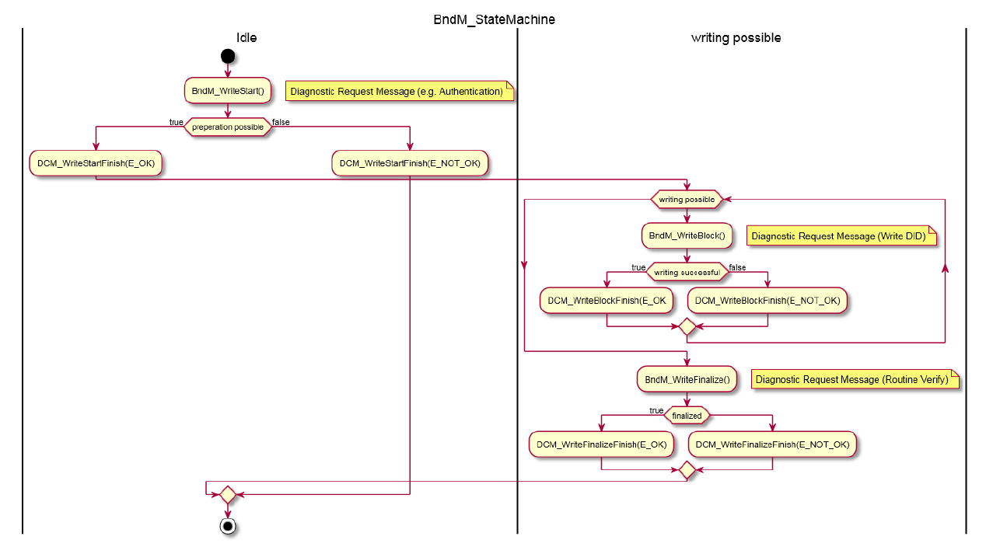

## 1. 简介和功能概述

本规范描述了 **AUTOSAR** 基础软件模块 **BulkNvDataManager** 的功能、**API** 和配置。

对于变体编码（**variant-coding**）等用例场景，对于非易失性大容量数据的需求正在增加。此类数据经常使用，但很少更新。与 **NvM** 相比，**BulkNvDataManager** 提供了一个 **API** 来直接从闪存中读取数据。带来的好处就是避免了 **RAM** 镜像，但缺点就是数据的写入会更加复杂。

变体编码（**Variant coding**）是车辆特定的数据集，它在每辆车的生产过程中计算并生成，当然也在生产过程中保存。

**注意：**

**AUTOSAR Classic Platform** 中的整个内存堆栈将在即将发布的 20/11 版本中进行系统审查。这可能会导致架构发生变化，例如将 **BndM** 功能集成到 **NvM** 中。

## 2. 缩略语

下面的词汇表包括与 **BulkNvDataManager** 相关的首字母缩写词和缩写词，它们未包含在 **AUTOSAR** 词汇表[\[1\]](#ref-1)中。

## 3. 相关文档

### 3.1. 输入文件和相关标准与规范

<a id="ref-1"></a>[1] Glossary
> AUTOSAR_FO_TR_Glossary

<a id="ref-2"></a>[2] General Specification of Basic Software Modules
> AUTOSAR_CP_SWS_BSWGeneral

### 3.2. 相关规范

因为 **AUTOSAR** 提供了一个关于基础软件模块的通用规范 **SWS BSW General**[\[2\]](#ref-2)，它对 **BulkNvDataManager** 也有效，所以，规范 **SWS BSW General** 应被视为 **BulkNvDataManager** 的附加和必需规范。

## 4. 约束和假设

### 4.1. 限制

对底层闪存驱动程序（例如：**FlashEEPROMEmulation**）潜在的并行访问的同步不是此 **AUTOSAR** 版本的一部分。

目前仅支持高端微控制器中，使用 **A/B** 扇区开关的 **PFlash** 写入。这限制了 **BndM** 对支持此功能的架构的适用性。

### 4.2. 汽车域的适用性

无限制。

## 5. 对其他模块的依赖

该模块依赖于底层闪存驱动程序的功能。

## 6. 功能规格

一般来说，**BndM** 将如何管理其闪存的概念是特定于供应商的。

基本思想是对数据块进行 **A/B** 分区切换。这意味着完整的非易失性大容量数据（**Bulk NvData**）将存储在分区 **A** 中。当写入动作开始时（[**BndM_WriteStart**](#734-bndm_writestart)），需要擦除 **B** 分区。更新的数据块（[**BndM_WriteBlock**](#735-bndm_writeblock)）将写入到分区 **B**。最终确定阶段（[**BndM_WriteFinalize**](#736-bndm_writefinalize)）将使分区 **B** 保持一致，例如：通过将未更新的块复制到分区 **B**，并将活动分区切换到 **B**，即：进一步调用 [**BndM_GetBlockPtr**](#733-bndm_getblockptr) 将指向分区 **B** 中的数据。尽管如此，供应商解决方案可以考虑替代解决方案，例如：通过 **FlashBootloader** 进行更新。

**BndM** 需在可直接访问的内存（即：通过指针）中管理其 **BndM** 块（[**BndMBlockDescriptor**](#823-bndmblockdescriptor)）。

[**BndM_GetBlockPtr**](#733-bndm_getblockptr) 的调用应将基指针传递给当前活动分区中相应的 **BndM** 块（[**BndMBlockDescriptor**](#823-bndmblockdescriptor)）。

[**BndM_WriteStart**](#734-bndm_writestart) 的调用将触发第二个（空闲）分区的准备。

**注意：**

根据实现的策略，准备工作可能需要更多时间。这可以在 [**BndM_MainFunction**](#751-bndm_mainfunction) 中进行协调。注意：如果对闪存进行直接写访问，则需要擦除闪存页面。

**警告：**

根据硬件的不同，无法对代码闪存进行并行读写访问。在这种情况下，整个 **ECU** 需要处于写入模式。例如：**FlashBootloader** 上下文或所有其他任务都被中断/停止。

在成功完成第二个（空闲）分区的准备后，可以写入第二个分区，需在 [**BndM_MainFunction**](#751-bndm_mainfunction) 的上下文中调用回调函数 **Xxx_BndMWriteStartFinish**，并将结果设置为 **E_OK**。

如果 [**BndM_WriteStart**](#734-bndm_writestart) 调用处于活动写入阶段，即：[**BndM_WriteStart**](#734-bndm_writestart) 和 [**BndM_WriteFinalize**](#736-bndm_writefinalize) 之间的阶段，则 [**BndM_WriteStart**](#734-bndm_writestart) 的调用将会被拒绝，并将错误代码设置为 **E_NOT_OK**。

[**BndM_WriteBlock**](#735-bndm_writeblock) 的调用需触发将数据写入第二个（未使用的）分区。数据（**ImplementationDataType**）不得被修改，以便允许指针访问。

在第二个（空闲）分区的写入完成后，需在 [**BndM_MainFunction**](#751-bndm_mainfunction) 的上下文中调用回调函数 **Xxx_BndMWriteBlockFinish**，并将结果设置为 **E_OK**。

如果 [**BndM_WriteBlock**](#735-bndm_writeblock) 的调用是在未先前调用 [**BndM_WriteStart**](#734-bndm_writestart) 的情况下、在同一块或另一块上的另一次写入正在进行时、或是在 **BndM** 的终结模式（**finalization mode**）内进行的，则该调用需被拒绝，并将错误代码设置为 **E_NOT_OK**。

如果 [**BndM_WriteBlock**](#735-bndm_writeblock) 的调用是在同一块或另一块上的另一次写入正在进行时进行的，则该调用需被拒绝，并将错误代码设置为 **E_NOT_OK**。

如果 [**BndM_WriteBlock**](#735-bndm_writeblock) 的调用是在 **BndM** 的终结模式（**finalization mode**）之内或之后进行的，则该调用需被拒绝，并将错误代码设置为 **E_NOT_OK**。

[**BndM_WriteFinalize**](#736-bndm_writefinalize) 的调用将触发第二个（未使用的）分区的最终化工作（**finalization**）。在后台，**BndM** 需通过将所有未更改的 [**BndMBlockDescriptor**](#823-bndmblockdescriptor) 复制到第二个（未使用的）分区来使第二个（未使用的）分区的数据保持一致。

如果最终确定成功，**BndM** 需将第二个（未使用的）分区设为活动分区，并调用回调函数 **Xxx_BndMWriteFinalizeFinish**，并将结果设置为 **E_OK**。

**注意：**

在最终确定成功后，对 [**BndM_GetBlockPtr**](#733-bndm_getblockptr) 的进一步调用将指向第二个（现在活动的）分区中的数据。

如果最终确定不成功，即：因为第二个分区数据不一致，所以数据不能使用。**BndM** 应将当前活动分区保持为活动分区，并触发回调 **Xxx_BndMWriteFinalizeFinish**，并将结果设置为 **E_NOT_OK**。

在未先前调用 [**BndM_WriteStart**](#734-bndm_writestart) 的情况下，或在 **BndM** 已经处于最终化模式（**finalization mode**）中时调用 [**BndM_WriteFinalize**](#736-bndm_writefinalize) 函数，[**BndM_WriteFinalize**](#736-bndm_writefinalize) 需抛出一个 **BndM_E_WRONG_SEQUENCE** 的 **DET** 错误。



### 6.1. 错误分类

《基础软件模块通用规范》（**General Specification of Basic Software Modules**）文档的第 7.2 章"错误处理"（**Error Handling**）详细描述了基础软件的错误处理。首先，它构成了一个由 **BSW** 模块中可能发生的五种错误类型组成的分类方案。

在此基础上，以下各节规定了布置在相应子节中的特定错误。

#### 6.1.1. 开发错误

**BndM** 模块的开发错误定义：

| 错误类型 | 相关错误代码 | 错误值 |
|---|---|---|
| API 服务调用时传入了错误的参数 | BNDM_E_PARAM | 0x01 |
| API 以错误的顺序调用 | BNDM_E_WRONG_SEQUENCE | 0x02 |

#### 6.1.2. 运行时错误

没有运行时错误。

#### 6.1.3. 瞬态故障

没有瞬态故障。

#### 6.1.4. 生产错误

没有生产错误。

#### 6.1.5. 扩展生产错误

没有扩展生产错误。

## 7. API规范

### 7.1. 导入的类型

本章列出了从以下文件中包含的所有类型。

| 模块 | 头文件 | 导入的类型 |
|---|---|---|
| Fls | Fls.h | Fls_AddressType |
| Fls | Fls.h | Fls_LengthType |
| MemIf | MemIf.h | MemIf_JobResultType |
| MemIf | MemIf.h | MemIf_StatusType |
| Std | Std_Types.h | Std_ReturnType |
| Std | Std_Types.h | Std_VersionInfoType |

### 7.2. 类型定义

#### 7.2.1. BndM_ConfigType

结构类型。元素为实现特定的（**implementation specific**）。该外部数据结构类型应包含 **BndM** 的后构建（**post build**）初始化数据。可通过 **bndm.h** 获得。

#### 7.2.2. BndM_BlockIdType

类型，派生自 uint16，范围 0..65535。非易失性大容量块（**bulk nv block**）的唯一标识。**BndM_BlockId** 由 **BndM** 分配。可通过 **bndm.h** 获得。

#### 7.2.3. BndM_Block&lt;BlockId.Shortname&gt;Type

结构类型。该结构数据类型的元素是所配置的 **ImplementationDataPrototype** 的 C 结构化表示。可通过 **bndm_externals.h** 获得。

#### 7.2.4. BndM_Result

类型，派生自 uint8。异步作业完成通知（**asynchronous job finish notifications**）的结果。取值：

* **E_OK**（0x00）：异步作业完成通知的结果。
* **E_NOT_OK**（0x01）：-。

可通过 **bndm.h** 获得。

### 7.3. 函数定义

#### 7.3.1. BndM_Init

**说明**: 服务 ID 0x1。初始化或重新初始化此模块。可通过**BndM.h**获得。本服务为同步调用，不可重入。参数 ConfigPtr（in）：指向 VARIANT-POST-BUILD 中所配置的配置集的指针。参数（inout）：无。参数（out）：无。返回值：无。

```C
void BndM_Init (
    const BndM_ConfigType* ConfigPtr
)
```

#### 7.3.2. BndM_GetVersionInfo

**说明**: 服务 ID 0x2。返回此模块的版本信息。**API** 可用性：仅当 (ecuc BndM/[BndMGeneral](#822-bndmgeneral).BndMVersionInfoApi) == true) 时此 **API** 才可用。可通过**BndM.h**获得。本服务为同步调用，不可重入。参数（in）：无。参数（inout）：无。参数 versioninfo（out）：指向存储本模块版本信息位置的指针。返回值：无。

```C
void BndM_GetVersionInfo (
    Std_VersionInfoType* versioninfo
)
```

#### 7.3.3. BndM_GetBlockPtr

**说明**: 服务 ID 0x3。本服务为同步调用，可重入。返回一个指向闪存中该结构的指针。参数 BlockId（in）：BlockId。参数（inout）：无。参数 BndM_BlockPtr（out）：BndM_BlockPtr。返回值：**Std_ReturnType**。可通过 **BndM_Externals.h** 获得。

```C
Std_ReturnType BndM_GetBlockPtr_<BlockId.Shortname> (
    BndM_BlockIdType BlockId,
    BndM_Block{BlockId.Shortname}Type** BndM_BlockPtr
)
```

#### 7.3.4. BndM_WriteStart

**说明**: 服务 ID 0x4。将触发写入阶段的开始。异步处理的完成将触发回调 [**xxx_BndMWriteStartFinish**](#7631-xxx_bndmwritestartfinish)，包括该操作的结果。可通过**BndM.h**获得。本服务为异步调用，不可重入。参数（in）：无。参数（inout）：无。参数（out）：无。返回值：**Std_ReturnType**，**E_OK**：准备请求被接受；**E_NOT_OK**：准备请求被拒绝。

```C
Std_ReturnType BndM_WriteStart (
    void
)
```

**注意：** 在对 **BndM** 的写入可行或不可行期间，什么可以并行运行由堆栈供应商决定（例如 **FEE** 可能不再工作）。

#### 7.3.5. BndM_WriteBlock

**说明**: 服务 ID 0x5。将数据持久化保存在闪存中，以便之后可以通过 [**BndM_GetBlockPtr**](#733-bndm_getblockptr) API 直接访问。写入需要一段时间，并在成功回调 [**xxx_BndMWriteBlockFinish**](#7632-xxx_bndmwriteblockfinish) 后完成。可通过 **BndM_Externals.h** 获得。本服务为异步调用，不可重入。参数 BlockId（in）：-。参数 BndM_SrcPtr（in）：-。参数（inout）：无。参数（out）：无。返回值：**Std_ReturnType**，**E_OK**：写入请求被接受；**E_NOT_OK**：写入请求被拒绝。

```C
Std_ReturnType BndM_WriteBlock_<BlockId.Shortname> (
    BndM_BlockIdType BlockId,
    const BndM_Block{BlockId.Shortname}Type* BndM_SrcPtr
)
```

**注意：** 需要预先调用 [**BndM_WriteStart**](#734-bndm_writestart)。

#### 7.3.6. BndM_WriteFinalize

**说明**: 服务 ID 0x6。将触发写入阶段的最终化。异步处理的完成将触发回调 [**xxx_BndMWriteFinalizeFinish**](#7633-xxx_bndmwritefinalizefinish)，包括该操作的结果。可通过**BndM.h**获得。本服务为异步调用，可重入。完成写入。在成功回调 [**xxx_BndMWriteFinalizeFinish**](#7633-xxx_bndmwritefinalizefinish) 之后，最终化即告完成（即：新存储的数据可用）。参数（in）：无。参数（inout）：无。参数（out）：无。返回值：**Std_ReturnType**，**E_OK**：最终化请求被接受；**E_NOT_OK**：最终化请求被拒绝。

```C
Std_ReturnType BndM_WriteFinalize (
    void
)
```

#### 7.3.7. BndM_WriteCancel

**说明**: 服务 ID 0x7。取消写入。可通过**BndM.h**获得。本服务为异步调用，可重入。参数（in）：无。参数（inout）：无。参数（out）：无。返回值：无。

```C
void BndM_WriteCancel (
    void
)
```

### 7.4. 回调通知

这是为 **FLS** 模块提供的函数列表。

#### 7.4.1. BndM_JobEndNotification

**说明**: 服务 ID 0x8。当 **FLS** 作业已以肯定结果完成时调用此回调函数。可通过**BndM.h**获得。本服务为同步调用，不可重入。参数（in）：无。参数（inout）：无。参数（out）：无。返回值：无。

```C
void BndM_JobEndNotification (
    void
)
```

#### 7.4.2. BndM_JobErrorNotification

**说明**: 服务 ID 0x9。当 **FLS** 作业已被取消或以否定结果完成时调用此回调函数。可通过**BndM.h**获得。本服务为同步调用，不可重入。参数（in）：无。参数（inout）：无。参数（out）：无。返回值：无。

```C
void BndM_JobErrorNotification (
    void
)
```

### 7.5. 调度函数

这些函数由基础软件调度程序（**Basic Software Scheduler**）直接调用。以下函数应没有返回值和参数。所有函数均不可重入。

#### 7.5.1. BndM_MainFunction

**说明**: 服务 ID 0x55。后台处理的调度函数。可通过 **SchM_BndM.h** 获得。

```C
void BndM_MainFunction (
    void
)
```

### 7.6. 期望接口

本章列出了从其他模块所需的所有接口。

#### 7.6.1. 强制接口

| API 函数 | 头文件 | 描述 |
|---|---|---|
| 无强制接口。 | | |

**注意：** 本节定义实现该模块核心功能所需的所有接口。

#### 7.6.2. 可选接口

本节定义实现该模块可选功能所需的所有接口。

| API 函数 | 头文件 | 描述 |
|---|---|---|
| Det_ReportRuntimeError | Det.h | 上报运行时错误的服务。如果已配置调出（**callout**），则应调用该调出。 |
| Fls_Cancel | Fls.h | 取消正在进行的作业。 |
| Fls_Compare | Fls_Com.h | 将闪存某个区域的内容与应用程序数据缓冲区的内容进行比较。 |
| Fls_Erase | Fls.h | 擦除闪存扇区。 |
| Fls_GetJobResult | Fls.h | 返回最后一个作业的结果。 |
| Fls_GetStatus | Fls.h | 返回驱动程序状态。 |
| Fls_Read | Fls.h | 从闪存中读取数据。 |
| Fls_SetMode | Fls.h | 设置闪存驱动程序的操作模式。 |
| Fls_Write | Fls.h | 写入一个或多个完整的闪存页。 |

#### 7.6.3. 可配置接口

本节列出了目标函数可被配置的所有接口。目标函数通常是回调函数。这类接口的名称不固定，因为它们是可配置的。

##### 7.6.3.1. xxx_BndMWriteStartFinish

**说明**: 服务 ID 0x56。当 [**BndM_WriteStart**](#734-bndm_writestart) 完成时调用此回调函数。可通过 **BndM_Externals.h** 获得。本服务为同步调用，不可重入。参数 BlockId（in）：-。参数 result（in）：-。参数（inout）：无。参数（out）：无。返回值：无。

```C
void Xxx_BndMWriteStartFinish (
    BndM_BlockIdType BlockId,
    BndM_ResultType result
)
```

##### 7.6.3.2. xxx_BndMWriteBlockFinish

**说明**: 服务 ID 0x57。当 [**BndM_WriteBlock**](#735-bndm_writeblock) 完成时调用此回调函数。可通过 **BndM_Externals.h** 获得。本服务为同步调用，不可重入。参数 BlockId（in）：-。参数 result（in）：-。参数（inout）：无。参数（out）：无。返回值：无。

```C
void Xxx_BndMWriteBlockFinish (
    BndM_BlockIdType BlockId,
    BndM_ResultType result
)
```

##### 7.6.3.3. xxx_BndMWriteFinalizeFinish

**说明**: 服务 ID 0x58。当 [**BndM_WriteFinalize**](#736-bndm_writefinalize) 完成时调用此回调函数。可通过 **BndM_Externals.h** 获得。本服务为同步调用，不可重入。参数 BlockId（in）：-。参数 result（in）：-。参数（inout）：无。参数（out）：无。返回值：无。

```C
void Xxx_BndMWriteFinalizeFinish (
    BndM_BlockIdType BlockId,
    BndM_ResultType result
)
```

### 7.7. 服务接口

**BndM**没有服务接口。

## 8. 配置规范

一般来说，本章定义配置参数及其到容器（**container**）中的聚类。为了支持本规范，第 8.1 节描述了基础知识。它还规定了应用于参数规范的模板（表）。我们打算将第 8.1 节保留在规范中，以保证可理解性。

第 8.2 节规定了模块 **BndM** 的结构（容器）和参数。

第 8.3 节规定了模块 **BndM** 的发布信息（**published information**）。

### 8.1. 如何阅读本章

有关详细信息，请参阅 **SWS_BSWGeneral** 中的第 10.1 章"配置规范简介"（**Introduction to configuration specification**）。

### 8.2. 容器与配置参数

以下各节汇总所有配置参数。各参数的详细含义在第 6 章和第 7 章中描述。

#### 8.2.1. BndM

| SWS 条目 | [ECUC_BndM_00001] |
|---|---|
| 模块名称 | BndM |
| 描述 | **BulkNvDataManager** 模块的配置。 |
| Post-Build 变体支持 | false |
| 支持的配置变体 | VARIANT-PRE-COMPILE |

| 容器名称 | 多重性 | 作用域/依赖 |
|---|---|---|
| BndMBlockDescriptor | 0..* | 每个容器定义一个可单独访问的 **Bulk NV** 块。 |
| BndMCallbackBlock | 0..* | 该容器包含块特定的回调（**callback**）。 |
| BndMCallbackGeneral | 0..1 | 该容器包含通用回调。 |
| BndMGeneral | 1 | 通用配置选项的容器。 |

#### 8.2.2. BndMGeneral

| SWS 条目 | [ECUC_BndM_00002] |
|---|---|
| 容器名称 | BndMGeneral |
| 父容器 | BndM |
| 描述 | 通用配置选项的容器。 |
| 配置参数 | 见下方参数表 |

| SWS 条目 | [ECUC_BndM_00003] |
|---|---|
| 参数名称 | BndMDevErrorDetect |
| 父容器 | BndMGeneral |
| 描述 | 打开或关闭开发错误检测和通知。true：启用检测和通知。false：禁用检测和通知。 |
| 多重性 | 1 |
| 类型 | EcucBooleanParamDef |
| 默认值 | false |
| Post-Build 变体值 | false |
| 值配置类 | Pre-compile time：x（All Variants）；Link time：-；Post-build time：- |
| 作用域/依赖 | scope: local |

| SWS 条目 | [ECUC_BndM_00004] |
|---|---|
| 参数名称 | BndMMainFunctionPeriod |
| 父容器 | BndMGeneral |
| 描述 | 对主函数连续两次调用之间的周期（以秒为单位）。 |
| 多重性 | 1 |
| 类型 | EcucFloatParamDef |
| 范围 | ]0 .. INF[ |
| 默认值 | - |
| Post-Build 变体值 | false |
| 值配置类 | Pre-compile time：x（All Variants）；Link time：-；Post-build time：- |
| 作用域/依赖 | scope: ECU |

| SWS 条目 | [ECUC_BndM_00005] |
|---|---|
| 参数名称 | BndMVersionInfoApi |
| 父容器 | BndMGeneral |
| 描述 | 启用/禁用用于读取模块版本信息的 **API** 的预处理器开关。true：版本信息 **API** 已启用。false：版本信息 **API** 已禁用。 |
| 多重性 | 1 |
| 类型 | EcucBooleanParamDef |
| 默认值 | false |
| Post-Build 变体值 | false |
| 值配置类 | Pre-compile time：x（All Variants）；Link time：-；Post-build time：- |
| 作用域/依赖 | scope: local |

无包含容器。

#### 8.2.3. BndMBlockDescriptor

| SWS 条目 | [ECUC_BndM_00014] |
|---|---|
| 容器名称 | BndMBlockDescriptor |
| 父容器 | BndM |
| 描述 | 每个容器定义一个可单独访问的 **Bulk NV** 块。 |
| 配置参数 | 见下方参数表 |

| SWS 条目 | [ECUC_BndM_00007] |
|---|---|
| 参数名称 | BndMBlockIdentifier |
| 父容器 | BndMBlockDescriptor |
| 描述 | 块的唯一标识。 |
| 多重性 | 1 |
| 类型 | EcucIntegerParamDef（为该参数生成符号名称） |
| 范围 | 0 .. 65535 |
| 默认值 | - |
| Post-Build 变体值 | false |
| 值配置类 | Pre-compile time：x（All Variants）；Link time：-；Post-build time：- |
| 作用域/依赖 | scope: local |

| SWS 条目 | [ECUC_BndM_00006] |
|---|---|
| 参数名称 | BndMBlockDescriptor |
| 父容器 | BndMBlockDescriptor |
| 描述 | 该参数定义块的数据结构。 |
| 类型 | 对 **IMPLEMENTATION-DATA-TYPE** 的外部引用（**foreign reference**） |
| Post-Build 变体值 | false |
| 值配置类 | Pre-compile time：x（All Variants）；Link time：-；Post-build time：- |
| 作用域/依赖 | scope: local |

| SWS 条目 | [ECUC_BndM_00013] |
|---|---|
| 参数名称 | BndMCallbackRef |
| 父容器 | BndMBlockDescriptor |
| 描述 | 对块特定回调函数的引用。 |
| 多重性 | 0..1 |
| 类型 | 对 **BndMCallbackBlock** 的引用 |
| Post-Build 变体多重性 | false |
| Post-Build 变体值 | false |
| 多重性配置类 | Pre-compile time：x（All Variants）；Link time：-；Post-build time：- |
| 值配置类 | Pre-compile time：x（All Variants）；Link time：-；Post-build time：- |
| 作用域/依赖 | scope: local |

| SWS 条目 | [ECUC_BndM_00008] |
|---|---|
| 参数名称 | BndMDeviceIndex |
| 父容器 | BndMBlockDescriptor |
| 描述 | 对该块所存储到的 **FLS** 设备的引用。 |
| 多重性 | 0..1 |
| 类型 | 对 **FlsGeneral** 的符号名称引用 |
| Post-Build 变体多重性 | false |
| Post-Build 变体值 | false |
| 多重性配置类 | Pre-compile time：x（All Variants）；Link time：-；Post-build time：- |
| 值配置类 | Pre-compile time：x（All Variants）；Link time：-；Post-build time：- |
| 作用域/依赖 | |

无包含容器。

#### 8.2.4. BndMCallbackBlock

| SWS 条目 | [ECUC_BndM_00011] |
|---|---|
| 容器名称 | BndMCallbackBlock |
| 父容器 | BndM |
| 描述 | 该容器包含块特定的回调。 |
| Post-Build 变体多重性 | false |
| 配置参数 | 见下方参数表 |

| SWS 条目 | [ECUC_BndM_00012] |
|---|---|
| 参数名称 | BndMWriteBlockFinishFnc |
| 父容器 | BndMCallbackBlock |
| 描述 | **WriteBlockFinish** 回调的回调函数。 |
| 多重性 | 1 |
| 类型 | EcucFunctionNameDef |
| 默认值 | - |
| 正则表达式 | - |
| Post-Build 变体值 | false |
| 值配置类 | Pre-compile time：x（All Variants）；Link time：-；Post-build time：- |
| 作用域/依赖 | scope: local |

无包含容器。

#### 8.2.5. BndMCallbackGeneral

| SWS 条目 | [ECUC_BndM_00015] |
|---|---|
| 容器名称 | BndMCallbackGeneral |
| 父容器 | BndM |
| 描述 | 该容器包含通用回调。 |
| 配置参数 | 见下方参数表 |

| SWS 条目 | [ECUC_BndM_00010] |
|---|---|
| 参数名称 | BndMWriteFinalizeFinishFnc |
| 父容器 | BndMCallbackGeneral |
| 描述 | **WriteFinalizeFinish** 回调的回调函数。 |
| 多重性 | 1 |
| 类型 | EcucFunctionNameDef |
| 默认值 | - |
| 正则表达式 | - |
| Post-Build 变体值 | false |
| 值配置类 | Pre-compile time：x（All Variants）；Link time：-；Post-build time：- |
| 作用域/依赖 | scope: local |

| SWS 条目 | [ECUC_BndM_00009] |
|---|---|
| 参数名称 | BndMWriteStartFinishFnc |
| 父容器 | BndMCallbackGeneral |
| 描述 | **WriteStartFinish** 回调的回调函数。 |
| 多重性 | 1 |
| 类型 | EcucFunctionNameDef |
| 默认值 | - |
| 正则表达式 | - |
| Post-Build 变体值 | false |
| 值配置类 | Pre-compile time：x（All Variants）；Link time：-；Post-build time：- |
| 作用域/依赖 | scope: local |

无包含容器。

### 8.3. 发布信息

有关详细信息，请参阅 **SWS_BSWGeneral** 中的第 10.3 章"发布信息"（**Published Information**）。

## B. AUTOSAR 可追溯项变更历史

### B.1. 根据 AUTOSAR 发布版本 R23-11 的本数字化文档可追溯项历史

#### B.1.1. R23-11 中新增的规范项

表B.1：R23-11 中新增的规范项（**Added Specification Items in R23-11**）

| 编号 | 标题 |
|---|---|
| [SWS_BndM_01018] | Definition of imported datatypes of module BndM |

#### B.1.2. R23-11 中变更的规范项

表B.2：R23-11 中变更的规范项（**Changed Specification Items in R23-11**）

| 编号 | 标题 |
|---|---|
| [SWS_BndM_01001] | Definition of datatype BndM_ConfigType |
| [SWS_BndM_01002] | Definition of datatype BndM_BlockIdType |
| [SWS_BndM_01006] | Definition of API function BndM_GetBlockPtr_&lt;BlockId.Shortname&gt; |
| [SWS_BndM_01007] | Definition of API function BndM_WriteStart |
| [SWS_BndM_01008] | Definition of API function BndM_WriteBlock_&lt;BlockId.Shortname&gt; |
| [SWS_BndM_01009] | Definition of API function BndM_WriteFinalize |
| [SWS_BndM_01017] | Definition of datatype BndM_ResultType |
| [SWS_BndM_01020] | Definition of optional interfaces in module BndM |

#### B.1.3. R23-11 中删除的规范项

无

<section id="wechat">

<h4>微信扫一扫，获取更多及时资讯</h4>


</section>
