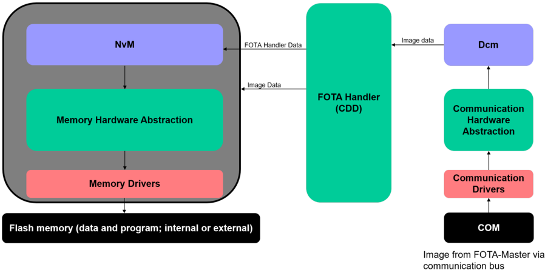
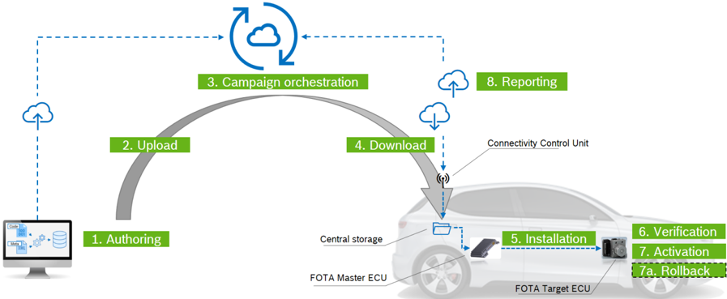
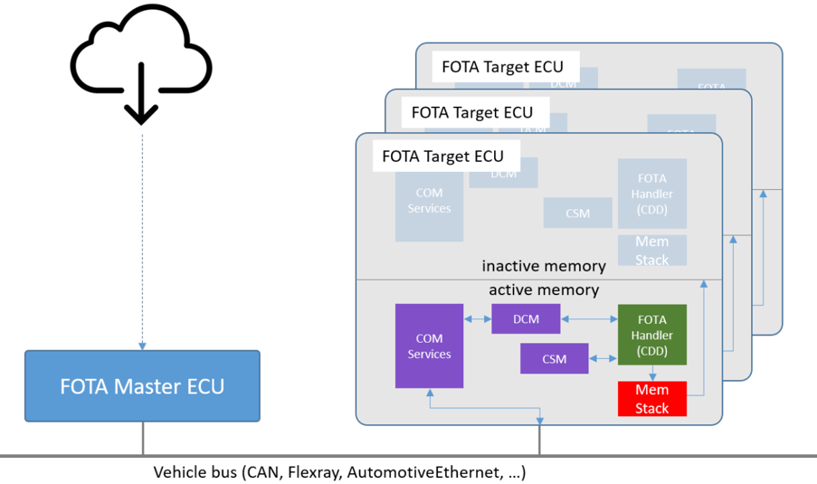
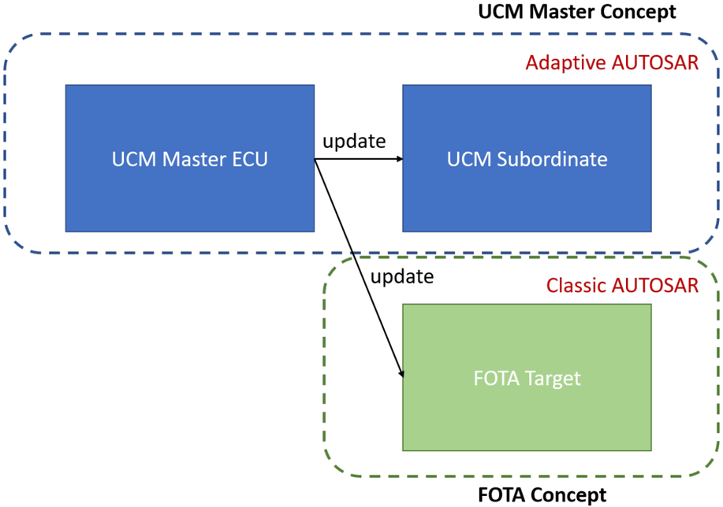
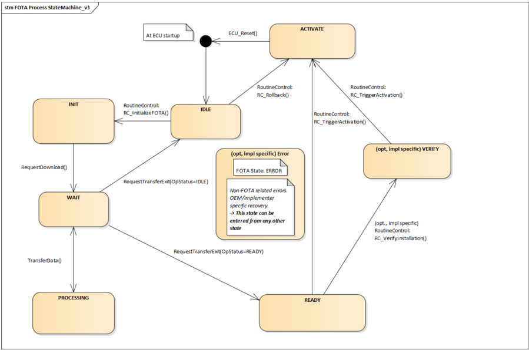
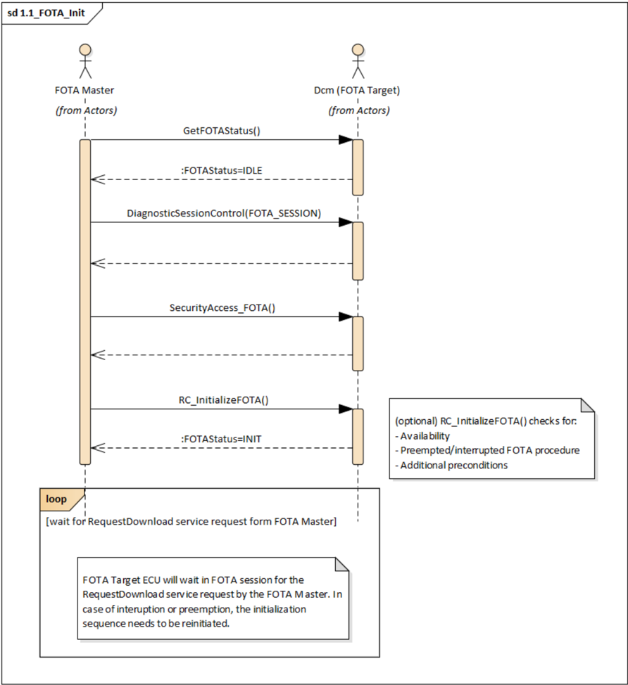
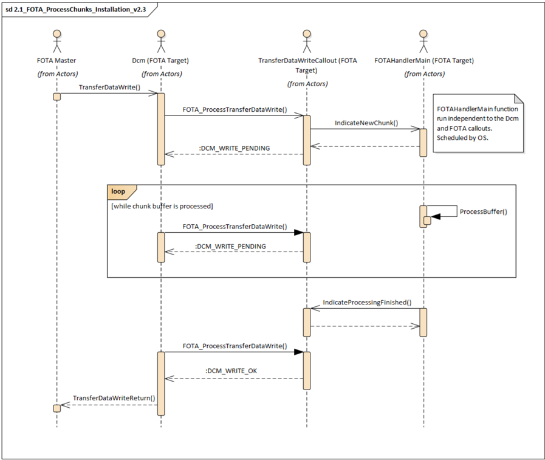

<!-- 源文档 AUTOSAR_CP_EXP_FirmwareOverTheAir（R23-11），讲述型指南（EXP），不受 Type A 七章骨架约束；章节结构镜像源文档自身编号（1–6，6 = Appendix 参考文献）。 -->

## 1. 引言

FOTA 方法应引入一种在运行期间更新 ECU 软件的通用机制。在当前 ECU 软件被执行、且从功能角度完全可用期间（例如行驶期间），新的 ECU 软件应在后台编程（安装阶段）。在安装时——它可以被中断并跨多个行驶循环继续——应验证新软件的真实性与完整性。在验证结果为正的情况下，ECU 应能够激活新软件。软件的激活始终需要一个特殊的 ECU 模式（例如 boot），因此新软件的激活不得在行驶期间开始或执行。激活应在车辆安全状态（例如静止、发动机关闭、施加驻车制动）下进行。在新软件激活期间或之后检测到异常或错误的情况下，ECU 应能够实现 ECU 内部回滚到先前的软件。ECU 内部回滚意味着这样的方法：先前的软件仍然存在于 ECU 上，并且可以被重新激活。

重要：FOTA 特性的整个实现方案在很大程度上取决于 AUTOSAR 内目前正在开发或讨论中的概念与变更请求。这些讨论点预计在下一个发布阶段解决：

- UCMMaster（见规范文档 [\[1\]](#ref-1) 与 [\[2\]](#ref-2)，另见本文档第 [2.2](#22-fota-master-实例的实现) 章）；
- 对 Flash 存储器的并发访问（边读边写特性，见第 [2.1](#21-对存储栈的前提条件) 章）。

### 1.1. 动机

由于不断演进的安全需求、分布式与互联功能所驱动的软件复杂性不断增长，使车辆内系统保持最新的需求持续增加。为了避免因即将到来的软件更新而进行耗时且反复的服务站访问，应通过无线方式协调面向车队的软件部署。可以使用不同的无线技术（UMTS、LTE、Bluetooth、WiFi、5G）将车辆连接到后端/云系统，以提供把软件下载到车辆的能力。新软件向受更新影响的目标 ECU 的分发经由车辆总线（如 CAN、CAN-FD、FlexRay 或 Automotive Ethernet）完成。

如今大多数 ECU 都具有板载重编程能力，它在服务站基础设施中用于向现场部署缺陷修复或功能改进。

该接口（通常是 Flash 引导加载程序）也可以由一个 OTA（Over-The-Air）更新主 ECU 寻址，以便在车辆离开服务站时安装新软件。换言之，你可以通过把编程功能从外部诊断测试仪转移到一台连接的车内 ECU（OTA-Master）来实现无线软件更新。从目标 ECU 的视角看，目标 ECU 是由诊断测试仪还是由 OTA-Master 操纵，甚至可以更加透明。

这种方法带来几个需要考虑的方面：

- 在整个软件更新过程中，目标 ECU 从功能角度是不可运行的。这通常导致软件更新期间整个车辆的停机；
- 对于分布式功能——其中若干个 ECU 必须在一次活动中更新——与单个 ECU 更新相比，车辆停机时间甚至更长；
- 在新软件安装期间或之后发生错误的情况下，可以经由 OTA-Master 发起并实现先前软件的重新安装。然而，这额外增加了车辆停机时间，并最终可能导致功能上「变砖」的 ECU；
- 如果需要回滚，与该更新相关的所有依赖 ECU 也必须回滚；
- 按照这种方法，电源概念与电池的剩余容量也应加以注意。

为了达到更高的成熟度、可靠性与最终的舒适性，应当分析其他 OTA 更新方法，并确定它们对现有 BSW 架构的影响。

为了减少正在进行的 OTA 更新造成的车辆停机，OTA 更新过程的部分内容应在 ECU 正常运行期间执行，例如行驶期间。

在当前软件正常执行的同时，新软件应在后台安装。这不应对当前运行软件的性能与可用性产生任何负面影响。新软件的安装应当是可中断的，即安装过程不应在一个行驶循环结束时被完全丢弃，而是在下一个行驶循环中继续。

在后台安装过程结束时，新软件应准备好激活。

由于 µC 与所用 Flash 存储设备的不同硬件能力，新软件的激活可以（取决于硬件能力）通过仅从 µC 先前未激活的分区引导来实现，或者可以发起 ECU 内部激活过程，包括把新软件从纯存储分区 ECU 内部复制到执行分区。纯存储分区既可以分配在 µC 内部 Flash，也可以分配在 µC 外部 Flash，例如经由 SPI 连接（细节见 [5.2.1.3](#5213-激活切换分区) 章）。

在根据给定产品的硬件能力激活新软件期间，先前的软件应保留在 ECU 内。在激活期间或之后检测到错误的情况下，应发起 ECU 内部回滚到先前的软件。这应通过定义的内部准则（例如检测到新软件的真实性被破坏）或由 OTA-Master 外部触发来完成。

这种方法将解决或实质性改善上面列出的 OTA 更新方法的缺点——在那些方法中安装与激活是在功能上不可运行的模式下实现的。车辆停机时间将显著减少，并且新软件可以并行安装在多个 ECU 上。一旦新软件安装在所有受影响的 ECU 上，就可以集中触发激活。在激活期间出现意外异常的情况下，应触发回滚，并且该回滚将在受上一次 OTA 更新影响的所有 ECU 上执行。

### 1.2. 范围

本文档的目标是提供新的软件更新概念，支持在当前软件正常执行的同时在 ECU 上安装新软件。这包括如下场景：车辆正在行驶，新软件安装在受影响的 ECU 上，而这些 ECU 没有功能降级。

避免与运行时系统的干扰和阻塞的策略将在本文档中评估。这意味着所有正在运行的应用以及系统服务（例如诊断、Nv 存储器）在更新过程中应完全可用，并且从功能角度只能以最小的方式影响任何请求处理的延迟。

本文档还将详述对 ECU 内部备份与回滚能力的不同方法的研究。

### 1.3. 一般用例

新的 ECU 软件应使用诊断通信服务（Dcm 使用 UDS）传输，并经由 FOTA Target 模块转发给低层存储驱动。存储栈应把新软件编程到一个未激活的内存分区中。应使用一种缓冲机制把软件映像分段传输给存储栈。在安装过程成功且新软件的完整性得到验证之后，将触发一个激活机制以最终启动新软件。在新软件激活期间或之后发生失败的情况下，应可能回滚到先前的软件——它应仍在 ECU 内部可用。

实现 FOTA 过程所需的已规定需求的完整列表见 [\[3\]](#ref-3)。

### 1.4. 本文档的限制

本文档未涵盖的用例与主题：

- 不支持 UDS 的 ECU 的更新；
- 新烧写软件的验证策略；
- ECU 软件版本处理与检查（供应商特定）；
- ECU 软件兼容性/完整性检查（供应商特定）；
- 关于存储栈软件架构的任何细节。

## 2. 约束和假定

### 2.1. 对存储栈的前提条件

在本文档中，术语存储栈应替代存储驱动（例如 FlashDriver）与存储管理模块（例如 Fee），无论它们实现为内部驱动还是外部驱动，因为 AUTOSAR 内尚未做出任何架构解决方案的决定。只要这些前提条件仍在讨论中、尚未成为规范文档的一部分，就必须在存储栈中考虑并实现以下假定，以实现本文档所述的 FOTA 方法。

- **对程序 Flash 存储器的访问**

迄今为止，AUTOSAR 只预见运行期间对数据 Flash 段的访问。对程序 Flash 段的访问尚未在 AUTOSAR 中解决，需要以专有方式实现（例如在引导加载模式中）。为了实现 FOTA 方法，必须在运行期间获得对程序 Flash 段的读写访问。因此，为获得对程序存储器的写访问而扩展 AUTOSAR 存储栈的工作正在开发中，计划在 R20-11 发布。

- **边读边写（Read-while-write）特性**

假定 FOTA 应在具有 A/B 交换能力（内存抽象）的硬件方案上实现，则需要把新软件写入一个未激活的内存段，同时活动段在正常运行期间被并行读取。这主要影响程序 Flash 访问的计划实现：一个分区被执行（活动）并被读取，而另一个与运行时无关的分区（未激活）需要写访问以便在后台应用新软件。为了实现边读边写的方法，硬件供应商需要在其 MCAL 实现中提供所需的功能。

- **使用不同的存储方案**

FOTA 过程意在适用于所有不同种类的内存架构与技术。但是，硬件与驱动供应商负责提供由 AUTOSAR MCAL 层定义的所需接口，以便以本文描述的方式配备 FOTA 特性。现有与未来的硬件方案及低层驱动之间的差异，预期在提供给存储栈 API 的所有接口内不可见。换言之，应支持所有现有的内存架构，而不以任何方式影响任何上层。

- **Nv（用户）数据的处理**

虽然用户数据（Nv 数据，见 [5.1.1.3](#5113-nv-数据) 节）的更新由 NvM 模块使用其提供的特性与接口处理，但必须定义一种与 NvM 配合的适当机制，以便在活动分区仍在访问它们时迁移例如数据模型。

从架构的角度，这将产生如图 2.1 所示的概览：

### 2.2. FOTA Master 实例的实现

由于 FOTA 方法应既适用于 AUTOSAR 经典平台也适用于自适应平台，因此决定把 FOTA-Master 的实现放到自适应平台中，因为自适应 ECU 预期比经典 ECU 强大得多。这个 FOTA-Master 的实现由 WG-UCM 团队在自适应平台语境中完成，并将被称为 UCM-Master。UCM-Master 应寻址、处理并引导对经典平台的更新，并预期与本文档一起在 R19-11 首次发布。

然而，由于本文档聚焦于 FOTA 特性，它将始终把主实例称为 FOTA-Master，而其具体的实现在自适应平台中作为 UCM-Master 实现。

#### 2.2.1 延伸阅读

- 关于 UCM-Master 实现的更多信息见规范文档 [\[1\]](#ref-1)；
- 关于本文所指 FOTA-Master 的角色的更多信息，其预期行为的细节见 [3.2.2](#322-fota-主节点fota-master) 与 [5.1.2](#512-fota-masterucm-master) 章；
- 关于潜在的非易失性数据处理与迁移的更多信息见规范文档 [\[4\]](#ref-4)。

## 3. 术语

本章列出 FOTA 过程中使用的所有前提条件、假定、过程与系统术语。

### 3.1. 缩略语与缩写

AUTOSAR 定义的、列于 AUTOSAR 词汇表 [\[5\]](#ref-5) 中的常见缩略语。

| 缩写/缩略语 | 说明 |
| --- | --- |
| BSW | Basic Software（基础软件）（见 AUTOSAR 发布版中的 LayeredSWArchitecture 幻灯片集） |
| ECU | Electronic control unit（电子控制单元） |

#### 3.1.1 TR_Glossary 中未列出的缩略语

以下是尚未纳入 TR_Glossary [\[5\]](#ref-5) 文档的缩略语的即拷即用列表：

| 缩写/缩略语 | 说明 |
| --- | --- |
| DCM | Diagnostic Communication Manager（诊断通信管理器，AUTOSAR BSW 模块，经典平台）（意外地尚未列出！） |
| FOTA | FirmwareOverTheAir（固件远程升级） |
| HSM | Hardware Security Module（硬件安全模块，在硬件中实现的加密特性）（实际上应来自其他文档，例如安全或信息安全） |
| NvM | Non-Volatile Memory（非易失性存储器，BSW 模块，有时称为 NV 存储器）（意外地尚未列出！） |
| OTA | 一般的 Over-The-Air 技术，无论 AUTOSAR 与否 |
| UCM | Update And Configuration Management（更新与配置管理，自适应平台的功能集群，AUTOSAR 工作组） |
| UDS | Unified diagnostic services（统一诊断服务，见 ISO-14229）（意外地尚未列出！） |

### 3.2. 系统组件术语

#### 3.2.1 FOTA 目标（FOTA Target）

该术语适用于一般而言能够经由 FOTA 过程更新的所有 ECU。

#### 3.2.2 FOTA 主节点（FOTA Master）

FOTA Master 规定这样的实例：它处理所有软件更新以及把相应更新应用到由 FOTA 更新过程寻址的 FOTA Target ECU 所需的全部相关信息。

注意：请记住，FOTA Master 是在 UCM Master 概念的语境中实现的，该概念目前正在开发中，将来可能改变。UCM 与 FOTA 组之间的合作正在考虑中，并计划在未来的版本中实施。

更多细节见 [5.1.2](#512-fota-masterucm-master) 章。

#### 3.2.3 （FOTA-）映像（Image）

术语 Image 描述一个完整的、可下载的 ECU 软件集合。无论下载与安装的是部分的、增量的还是全功能的 ECU 软件，该术语都适用（见图 3.1）。把一个新 Image 应用到一个 ECU，将至少更新以下 ECU 软件部分之一：

- 应用软件；
- 基础软件；
- 标定数据。

在把新 Image 应用到一个 ECU 之后，它必须处于完全功能状态，并与系统的其余部分兼容。

#### 3.2.4 后端（Backend）

该术语标识提供要下载到 FOTA Target ECU 的 FOTA Image 的远端实例（例如经由 Wifi、3G、4G、5G 等）。

#### 3.2.5 数据块（Data Chunk）

数据块是从 FOTA Master ECU 传输到 FOTA Target ECU 的数据包，包含原始映像数据（UDS TransferData 服务载荷）。使用该术语是因为每个数据块的长度可能不同。

### 3.3. 过程术语

整个 FOTA 更新过程可以分为若干阶段，本章予以展示。总体概览见图 3.1：

#### 3.3.1 更新（Update）

术语「（FOTA）更新」用于表示一个 ECU 的整个更新过程（在其他依赖 ECU 更新的情况下为多个 ECU）。它包含下文描述的所有任务，例如下载、安装、验证、激活等。在必要时，回滚功能可以被视为更新过程的一部分。

#### 3.3.2 下载（Download）

下载映像指把完整更新一个 FOTA Target ECU 所需的全部相关 ECU 软件、数据与配置，从后端服务器传输到 FOTA Master 实例。

#### 3.3.3 安装（Installation）

术语「安装」指把新 ECU 软件从 FOTA Master ECU 传输到 FOTA Target ECU。由于一次性把整个 ECU 软件完整传输到 FOTA Target ECU 并不方便，该过程使用数据块实现（细节见 [3.2.5](#325-数据块data-chunk) 章）。这意味着安装过程甚至可以跨多个行驶循环保持活动。当没有剩余的数据块要传输给 FOTA Target ECU、并且所有数据块都已成功写入存储栈时，安装过程完成。

此外，安装过程还涵盖由 FOTA Target ECU 内的程序 Flash 驱动把软件实际写入未激活的目标分区。

#### 3.3.4 验证（Verification）

验证过程是实现特定的，应确保新烧写的 ECU 软件的正确性。这只影响烧写到相应 FOTA Target ECU 的纯 ECU 软件（例如一个映像、甚至一个差分更新）。

注意：作为软件更新包的 FOTA Image 的完整性/真实性的初始验证、认证与条件检查由 FOTA Master 完成。从 FOTA Target 的视角，FOTA 过程序景中的验证检查应聚焦于语义与功能完整性，因此是实现特定的。如果需要，完整性与真实性验证可以在 FOTA Target 上再次进行。

注意：在使用需要在激活期间复制到内部存储器的外部 Flash 存储器的情况下，应考虑在复制之后进行第二个验证步骤。这应确保例如从外部存储器到内部存储器的 SPI 传输没有发生非预期的修改。

#### 3.3.5 激活（Activation）

激活过程描述 ECU 引导分区的实际切换。在不可切换内存架构的 ECU（例如外部 Flash 存储器、固定多分区内存）的情况下，这也涵盖从临时（例如外部）Flash 存储器到内部存储器的复制过程。当先前 ECU 软件（n-1）的备份也得到确认时，激活过程完成。

注意：新安装软件的最终激活必须在车辆安全状态下进行。确保该车辆安全状态由集成者负责。

#### 3.3.6 回滚（Rollback）

在回滚过程中，必须恢复先前运行软件的所有 ECU 数据与用户数据。回滚完成后，与整个更新过程开始之前相比，ECU 软件与用户数据必须没有任何差别。

## 4. 需求

迄今为止为 FOTA 定义的所有需求见 AUTOSAR RS 文档 [\[3\]](#ref-3)。

## 5. 详细技术方案

本章提供为固件远程升级过程建立 FOTA Target 特性所需的全部信息。FOTA Target ECU 之外的受影响架构组件也在此列出，以保持系统的完整性。

### 5.1. 功能与架构元素

FOTA 的整体架构设计（如图 5.1 所示）由以下部分组成：

- **FOTA Target ECU**：接收要烧写的 ECU 软件来自 FOTA Master，并把软件转发给低层存储栈实例（实际的 ECU 软件烧写过程）。
- **FOTA Master ECU**：缓存所有要烧写到某个 FOTA Target ECU 的新 ECU 软件制品。
- **后端服务器**：向 FOTA Master ECU 提供要安装到 FOTA Target ECU 的映像。

#### 5.1.1 FOTA 目标 ECU（FOTA Target ECU）

由于 FOTA Handler 规范目前正在演进、且并非所有特性都已规定与定义，FOTA Handler 模块目前被视为一个 CDD。做出这一决定是因为：迄今为止定义的特性还不足以发布一个完整的新 AUTOSAR 基础软件模块。如果未来特性集增长到值得成为 BSW 模块的复杂度，将考虑定义一个 FOTA BSW 模块。然而，由于「边读边写」Flash 方法与程序 Flash 访问（将由相关的 AUTOSAR MCAL 组实现）的架构决定尚未做出，CDD 方式保留了穿过所有 BSW 层连接的选项。

##### 5.1.1.1 FOTA Handler 模块的功能描述

FOTA Handler 模块应负责 FOTA 块缓冲区（位于 DCM 模块中，作为协议行配置的一部分）的处理，并在新的块数据到达且存储驱动可用于写入时最终触发存储栈。

在 FOTA Handler 模块内，需要实现为 Dcm 模块（提供 FOTA 数据块）所收到的请求服务的相应 callout 函数。在该 callout 函数内部，需要处理 FOTA 块的接收。

本文档描述的解决方案方法在 FOTA Handler 模块内实现两个函数：

- **FOTA_ProcessTransferDataWrite(...)**（Dcm callout）

Dcm 模块每收到一个映像块就调用该函数。该函数的主要任务是通知收到了一个新的数据块，该块将由 FOTAHandlerMain(...) 函数处理。此外，OpStatus 调用参数应被置为 DCM_PENDING，直到数据块处理完成。在数据块处理期间，该 callout 函数应始终以 Dcm_ReturnWriteMemoryType = DCM_WRITE_PENDING 返回。这把服务的当前处理告知 Dcm，并进一步转发给 FOTA Master 以防止超时。一旦收到块处理已由 FOTAHandlerMain(...) 函数完成的指示，FOTA_ProcessTransferDataWrite(...) 应以 Dcm_ReturnWriteMemoryType = DCM_WRITE_OK 返回，以把成功处理告知 Dcm 并进一步告知 FOTA Master。此后，FOTA Master ECU 可以发送新的数据块。

- **FOTAHandlerMain(...)**

该函数实际处理由 FOTA_ProcessTransferDataWrite(...) 函数指示的新数据块，并把其转发给存储栈进行编程。FOTAHandlerMain(...) 函数应由 AUTOSAR OS 周期性调度，并独立于诊断与通信栈。一旦收到的数据块的处理完成，FOTAHandlerMain(...) 函数应例如经由一个 InterRunnableVariable 把这一点指示给 FOTA_ProcessTransferDataWrite(...)。

##### 5.1.1.2 诊断（Dcm）

由于 AUTOSAR Dcm 模块实现了 UDS（见 [\[6\]](#ref-6)）诊断协议，大量有用的特性为实现 FOTA 功能「免费」提供。对于 FOTA 过程，可以考虑以下特性：

- 会话处理（Session Handling）；
- 安全访问（Security Access）；
- 认证（Authentication）；
- 服务处理（用户作业），例如：
  - 0x22/0x2E Read/WriteDataByIdentifier；
  - 0x31 Routine Control；
  - 0x34 RD/0x36 TD/0x37 TE（请求下载/传输数据/传输退出）；
- 错误处理；
- 检查编程条件；
- 复位/重启 ECU。

目标是尽可能多地使用 DCM 模块已提供的特性。由于缺乏 FOTA 过程所需的特性而产生的任何额外扩展，应在扩展 DCM 模块任何核心特性的情况下实现。

实现 FOTA 需求所需的额外扩展应由 FOTA Handler 模块实例或 FOTA Master 模块实例（UCM-Master，细节见 [5.1.2](#512-fota-masterucm-master) 章）实现。

##### 5.1.1.3 Nv 数据

AUTOSAR 中的 NvM 模块通常负责数据 Flash（用户数据、标定数据、错误与快照、ECU 软件的额外运行时数据），并把它们组织成所谓的 NvDataBlock。NvM 模块提供读取、写入或删除这些数据块的特性与接口。为了迁移或修改 Nv 数据，应使用 NvM 模块提供的特性。FOTA Master 与 FOTA Target 都不得直接与数据 Flash 交互，以避免干扰、阻塞或数据损坏。这意味着例如影响 Nv 数据的数据模型更改或用户数据迁移必须由实现者处理。细节见 [5.3](#53-迁移场景) 章。

然而，为了安全地存储与 FOTA 过程相关的信息（例如当前 FOTA 过程状态、FOTA handler 最后成功写入的内存地址等）以便在中断期间持久化，应使用 NvM 模块来处理（FOTA 特定的）用户数据。应使用相应规范文档中定义的机制（细节见 [\[7\]](#ref-7)）。

##### 5.1.1.4 FOTA 映像类型

一般而言，更新一个 ECU 有多种方式，例如安装完整的系统映像或只安装软件的一部分。甚至部分更新与增量更新也是可能的。然而，由于本文档没有详细规定如何把新软件安装到 FOTA Target ECU 上，只要所用的安装机制允许，所有类型的更新都是可能的。

基于所用硬件的能力，放置新映像有以下几种可选方案：

- **从固定地址执行运行时**

在这种配置中，由于硬件限制，无法交换分区。在这种情况下，映像数据需要放置在一个临时存储位置（无论内部还是外部存储器），并在激活阶段被复制到可执行的运行时分区。备份先前的软件版本是回滚场景所必需的。

- **从灵活地址执行运行时**

硬件支持分区交换，因此新软件可以放置在任何可用的分区中，并在激活之后从该位置执行。映像内地址与偏移的适配或转换必须由实现者确保。

下表列出两种分区类型的若干属性：

| 任务/条目 | 固定运行时地址映射 | 灵活运行时地址映射 |
| --- | --- | --- |
| 安装 | 存储在临时存储器中（外部或内部） | 直接进入存储器 |
| 激活 | 备份旧软件、复制新软件、重启 | 切换（逻辑）分区 |
| 激活持续时间 | 慢（需要把映像复制到目标分区） | 快（引导时立即切换分区） |
| 映像类型 | 可重定位与不可重定位映像 | 仅可重定位映像（仅当硬件支持时才可不可重定位） |
| 寻址方法 | 固定 | 逻辑（抽象的内存布局） |
| 最少分区数 | 3 | 2 |
| 典型用例 | 不可重定位映像；由于内部存储器只能容纳单个映像，微控制器以外部存储器扩展 | 物理闪存大小大于映像 2 倍的 ECU |

#### 5.1.2 FOTA Master（UCM-Master）

FOTA Target ECU 需要与相应的 Master 实例通信，以接收 FOTA 映像数据。该 Master 实例必须为车辆网络内所有相关的 ECU 存储映像数据，这可能是相当多的数据。

通常，经典平台所面向的嵌入式 ECU 在内存、存储与计算能力方面只有有限的资源。因此，把 Master 实例的职责转移到强大得多的 ECU——自适应平台——是有意义的。

与 FOTA Target ECU 通信的 Master 实例的实现目前由工作组 Update And Configuration Management（WG-UCM）完成。这将产生如下逻辑架构：

注意：请记住，UCM-Master 概念目前正在开发中，可能会改变。WG-UCM 与 FOTA 概念组之间的潜在合作正在为未来的版本考虑。

#### 5.1.3 后端（Backend）

后端实例表示初始的映像提供者以及面向要更新的车辆的通知接口。关于可用新软件的通知既可以由后端实例向车辆触发，也可以由车辆自行决定何时询问是否有新软件可用（轮询方式）。然而，如果车辆网络内的一个或多个 ECU 有新软件可用，则启动获取过程，并把映像存储到车辆内的适当位置（例如 FOTA Master）。关于对其他软件包的依赖的信息也必须由后端提供。关于 FOTA 过程的状态与更新进度信息可以与后端共享，用于分析与诊断目的。

### 5.2. FOTA 过程

注意：请记住，本章中的所有说明主要是最佳实践，仅应作为实现 FOTA 过程的指导。

#### 5.2.1 FOTA Handler 模块

在 FOTA 更新过程中，FOTA Handler 模块需要负责某些动作，以创建一个可靠的更新过程：

- 从 FOTA Master 接收数据块；
- 处理数据块；
- 把数据块转发给存储栈；
- 与 FOTA Master 交换状态信息。

本章解释这些任务应如何实现，并给出实现它们的提示与最佳实践。

##### 5.2.1.1 FOTA 内部状态

FOTA Handler 模块需要处理并指示 FOTA 映像处理期间的所有不同状态。这也包括对被中断（例如由于行驶循环改变）或被挂起（例如被更高优先级的诊断请求）的恢复。为了把该信息提供给发起并触发 FOTA 过程的 FOTA Master，应实现一个诊断服务，以从 FOTA Target 的视角提供并更新安装过程的当前状态。这些不同的状态应由以下枚举反映：

- **IDLE**：ECU 启动过程之后 FOTA Handler 的初始状态。
- **INIT**：FOTA Handler 已初始化，Dcm 被置于正确的状态（在 Dcm FOTA 会话中且安全访问已被授予）。
- **READY**：所有 FOTA 数据块已安装，可以触发激活过程。
- **PROCESSING**：Dcm callout 触发了 FOTA Handler，因为收到了新的块并在 callout 上下文中处理。
- **WAIT**：FOTA Handler 已成功处理最后收到的数据块，返回了 Dcm callout 函数，正在等待下一个数据块。
- **VERIFY**：可选且由实现者特定的步骤，因为 FOTA Target 没有对验证过程规定任何细节。
- **ERROR**：可选且由实现者特定。为例如实现者特定的错误处理保留的状态，FOTA Target（尚）未覆盖。
- **ACTIVATE**：FOTA 安装已完成，并从 FOTA Master 收到了指示在下次引导过程中进行分区切换的相应服务作业。

以上列出的所有状态应有助于保持 FOTA Target 状态、从而整个 FOTA 更新过程的确定性、可靠性与可恢复性。这将产生如图 5.3 所示的处理 FOTA 更新的状态机：

注意：到 IDLE 或 READY 的转换可以通过 RequestTransferExit() 调用中的 OpCode 参数区分，细节见 SWS_DiagnosticCommunicationManager [8]。

注意：FOTA Master 触发的回滚将是从任何状态到 ACTIVATE 状态的转换。

FOTA 内部状态枚举应可供 FOTA Master ECU 使用——由 FOTA Target ECU 的 Dcm 模块提供的 Read/WriteDataByIdentifier 或 RoutineControl UDS 服务。在正常（无中断）处理中，FOTA Handler 模块的状态转换由 FOTA Master 实例控制。在发生中断的情况下，FOTA 内部状态指示恢复策略。为了恢复任何被中断的 FOTA 过程所需的全部额外信息，应作为用户作业由 FOTA Target ECU 的 Dcm 模块提供（更多信息见 [5.2.3.8](#5238-公开的-fota-特定诊断服务) 节）。

##### 5.2.1.2 安装

安装过程从 WAIT 状态开始，包括等待来自 FOTA Master 的 TransferData 服务请求。一旦收到，FOTA handler 把其状态切换到 PROCESSING。在此状态中，FOTA 块在 DCM RAM 缓冲区中被接收（见 [5.2.3.4](#5234-fota-语境中的缓冲区处理) 章，另见规范文档 [8]）。一旦该块的所有数据都被接收，Dcm 模块将执行 FOTA callout 函数来处理该块（见 5.2.3.5）。该 callout 函数以 DCM RAM 缓冲区中该块的地址作为输入参数，并使用存储栈接口把该数据编程到 Flash 存储器中。目标地址（分区中的偏移）与块的大小也是该函数的输入参数。可选地（实现特定），callout 函数可以在数据被编程之后验证它。一旦编程完成，callout 函数把最终响应（OK/NOK）返回给 DCM，使其可以传输给 FOTA Master。此后，FOTA handler 切换回 WAIT 状态。callout 函数必须实现为异步的，即在一个由 OS 周期调用的 FOTA main 函数内。

##### 5.2.1.3 激活（切换分区）

为了启用新烧写的 ECU 软件，需要一个切换机制。这应适用于所有可用的 Flash 存储方案（例如 A/B 可交换或临时存储）。该切换机制需要负责成功切换引导/运行时分区所需的所有活动（例如把新 ECU 软件从外部 Flash 移动到内部 Flash）。关于当前活动分区以及未激活分区的更新状态的状态信息，必须在所有运行模式（例如引导加载程序、应用）中可用。

注意：从系统的角度，该切换机制也是对硬件的前提条件。

由于当前的更新是否依赖其他 ECU 更新及其状态，对 FOTA Target ECU 是不透明的，FOTA Master 需要负责依赖关系以及执行新软件激活的时间点。需要配置一个相应的 Dcm 服务作业来触发 FOTA 状态机从 READY 到 ACTIVATE 的转换，例如使用 RoutineControl（ARApi:RC_TriggerActivation）服务（参见图 5.3）。该 RoutineControl 服务的实现是 FOTA Handler 模块的一部分，必须负责在下次 ECU 重启期间准备实际激活步骤所需的所有步骤。

执行激活所需的所有步骤（例如验证、通知其他 ECU 或 FOTA-Master）都是项目特定的，因此这里不作进一步规定。

注意：请记住，用于控制激活指示的标志/数据字段必须位于引导加载程序与应用都能访问的内存区域中。

##### 5.2.1.4 回滚

回滚场景的主要用例是 Master 触发的回滚。这意味着 FOTA Master 检测到一个或多个新安装软件映像上的错误，并主动触发回滚，例如应后端请求或在检测到版本不兼容时。FOTA Master 必须以适当的方式——再次使用 Dcm 模块提供的 UDS 服务（例如 ReadDataByIdentifier/WriteDataByIdentifier、RoutineControl）——指示这一点，更多细节见 [5.2.3.1](#5231-经由诊断服务dcm对接-fota-target-实例) 节。

或者，无法成功引导的相应 FOTA Target ECU 将自主发起回滚过程（例如切回分区），以重新达到运行且可通信的状态。在自主回滚之后、且 FOTA Target ECU 重新可响应时，FOTA Master ECU 可以请求相应的软件版本。

为了把某个 FOTA Target ECU 当前运行的软件版本读回给 FOTA Master ECU，按照需求 [RS_FOTA_00035]，应提供适当的 UDS 服务（例如 ReadDataByIdentifier/WriteDataByIdentifier、RoutineControl），更多细节见 [5.2.3.1](#5231-经由诊断服务dcm对接-fota-target-实例) 节。

详细的实现方面在很大程度上取决于系统设计与架构以及特定的 OEM 与供应商偏好。[5.2.1.4.1](#52141-作为示例的实现方法) 节解释了一种可能的实现方法。

###### 5.2.1.4.1 作为示例的实现方法

为了在引导后向 FOTA Master ECU 指示一个正在运行的 FOTA Target ECU，应把每个 FOTA Target ECU 的相应 Dcm 配置元素 DcmDspEcuReset 中的参数 DcmResponseToEcuReset 设置为 AFTER_RESET。这将向 FOTA Master ECU 发送最终的肯定响应，以逐个宣告每个 FOTA Target ECU 在复位后的可用性。FOTA Master ECU 随后可以向系统中的每个 FOTA Target ECU 询问其当前运行的软件版本。

不同 FOTA Target ECU 之间的依赖关系、以及是否应执行潜在的回滚，必须由 FOTA Master ECU 评估并触发。

注意：考虑把配置参数 DcmSendRespPendOnRestart 设置为 TRUE，以便把为激活而进行的重启告知 FOTA Master ECU。

##### 5.2.1.5 取消（Cancellation）

取消描述对正在进行的 FOTA 软件更新过程的中止。取消过程可以由 FOTA Master ECU 在 FOTA 更新发起之后、安装过程完成后的激活触发之前的任何时间触发。具体而言，取消只是通过在 FOTA Master ECU 侧执行 RequestTransferExit 服务，停止从 FOTA Master ECU 到 FOTA Target ECU 的 FOTA 块传输。此外，应使刚被取消的软件本应应用到的目标分区失效，以便向 FOTA Target ECU 指示：在例如由于新行驶循环导致的 ECU 复位/重启之后，没有需要恢复的被中断更新。另见 [5.2.1.6](#5216-使旧运行时分区失效) 章关于失效处理。

##### 5.2.1.6 使「旧」运行时分区失效

在切换到新软件成功、且整个引导过程与运行时可用性得到确认之后，先前（现在未激活）的分区可以被失效，例如以避免非预期的或被强制的未授权回滚。这确保先前活动的软件及其潜在漏洞不能再被激活。何时使「旧」软件失效的决定权在实现者。

注意：使先前分区失效的触发预期由 FOTA Master 发送，因为在多 ECU 更新活动中如果另一个 ECU 更新失败，回滚可能仍然是必要的。

注意：如何在 FOTA 语境中实现该特性尚未定义，因此由实现者特定（例如通过设置标志、删除「旧」分区、使分区校验和失效等）。

#### 5.2.2 FOTA 主节点（FOTA Master）

该 FOTA Master 实例连接到一个在 Dcm 模块内配置的、专门定义的用户作业（细节见 [5.2.3](#523-dcm-交互) 章）。Dcm 模块与 FOTA Handler 模块之间的数据传输应使用 FOTA 数据块完成，以便使 FOTA 下载与烧写过程可中断（可抢占）。这是必要的，因为 FOTA Target ECU 的所有功能（例如应用 SWC、BSW 服务）在烧写过程中应保持可用。

一般而言，由于从远端端点接收 FOTA 映像期间的服务问题，无线（Over The Air）过程可能在任何时间被中断。由于这种情况，无法保证所有数据包都以连续的顺序、甚至在一次连接和/或一个行驶循环内被接收。

#### 5.2.3 Dcm 交互

Dcm 模块具有大量可供 FOTA 过程使用的功能，例如标识、认证、安全机制，甚至流控制与一致性功能。由于这些特性开箱即用，无需重新实现其中任何一个。

##### 5.2.3.1 经由诊断服务（Dcm）对接 FOTA Target 实例

下面列出 FOTA 更新过程中 Dcm 模块必须满足的所需步骤的列表：

- 读回 FOTA 状态信息；
- 预安装软件修订检查（由 FOTA Master）；
- 切换到 FOTA 会话（用户会话）；
- 验证 FOTA 会话的访问控制；
- 安装阶段（从 Master 到 Client 的数据传输与烧写）；
- 验证阶段（实现者特定，此处无细节）；
- 预激活条件（例如用户数据的迁移，细节见 [5.3](#53-迁移场景) 章）；
- 激活阶段（在车辆安全状态下；ECU 复位）；
- 激活后软件修订检查（由 FOTA Master）。

##### 5.2.3.2 FOTA 使用的诊断服务

具体而言，上述完成 FOTA 过程所需的步骤将由以下 Dcm 服务覆盖：

- **传输 FOTA 映像数据**：把从 FOTA Master 收到的数据传输给 FOTA Target。建议的服务：
  - Request Download/Transfer Data/Transfer Exit（0x34/0x36/0x37）。
- **交换状态信息**：读出当前的更新状态或 FOTA Target ECU 条件，并在 Master 需要时设置它们。建议的服务：
  - Routine Control（0x31）；
  - Read/Write Data by Identifier（0x22/0x2E）。
- **额外的控制功能**（例如用于激活、（使）失效或回滚）：为了设置特定的状态、标志或执行额外需要的函数（例如设置激活标志或使「旧」分区失效）：
  - Routine Control（0x31）；
  - Read/Write Data by Identifier（0x22/0x2E）。

##### 5.2.3.3 FOTA 诊断会话

由于 FOTA 过程不得影响 BSW 与应用层级的任何运行时执行与服务可用性，它应定义自己的诊断会话，FOTA 处理在该会话语境中进行。这允许 Dcm 使用诊断协议抢占特性——它是 Dcm 规范的一部分（见规范文档 [8] 的 7.3.4.16.3 章，以及本文档的 [5.2.3.6](#5236-fota-协议的抢占) 章）。

此外，进入 FOTA 诊断会话的变更应使用 Dcm 模块规定的安全访问机制加以保护（见 [8]）。

##### 5.2.3.4 FOTA 语境中的缓冲区处理

一般而言，FOTA 数据块由 FOTA-Master ECU 使用 UDS（0x36 TransferData）传输。从 FOTA Target 的视角，DCM 模块将从通信栈接收数据块。根据 Dcm 模块规范，内部缓冲区可以按诊断协议（例如 UDS、OBD 等）配置。

由于 FOTA 过程应在 Dcm 内自己的低优先级上下文中运行，应使用 DcmDslProtocolRow 配置容器为 FOTA 的使用定义一个自己的协议条目。这意味着需要引入第二个只处理 FOTA 请求的 UDS 协议（以 DcmDslProtocolPriority 定义最低优先级），它应引用 Dcm 模块内自己的数据缓冲区。

从 FOTA-Master ECU 接收的最大数据量取决于针对 FOTA 相关诊断协议处理的 DCM 配置参数 DcmDslBufferSize（细节见 DCM 模块规范 [8]）。由于 DCM 服务 TransferData（0x36）实现为 callout 函数，FOTA Handler 模块必须实现这样一个函数，处理收到的、包含 FOTA 数据块的指向 DCM 数据缓冲区的指针。该 callout 函数由 Dcm main 函数周期性触发，直到 FOTA Handler 提供最终响应（OK/NOK）。在数据块处理期间，FOTA Handler 应回「pending」状态。

注意：确定 FOTA 数据块缓冲区的适当大小高度依赖硬件与实现。不过，最佳实践是不要超过 Dcm 模块中其他 UDS 协议配置的最大大小。

##### 5.2.3.5 处理 FOTA 缓冲区

TransferData callout 只充当由 OS 异步调用的额外提供的 FOTA main 函数的指示器。在这个 FOTA main 函数内，完成把 FOTA 块实际处理到存储栈。TransferData 服务 callout 还应等待 FOTA main 函数的 FOTA 块处理完成后再返回，并由 Dcm 模块触发对 FOTA Master 的肯定响应。这将由服务返回值（Dcm_OpStatus）指示，并由 FOTA Handler 模块控制。

在发生协议抢占的情况下，由实现者决定已收到的 FOTA 块是否应由 FOTA main 函数在后台处理。然而，在任何情况下，最后成功写入存储栈的数据都应反映在一个特定的 Dcm 服务作业中（例如使用一个 DID）。

##### 5.2.3.6 FOTA 协议的抢占

在 Dcm 模块收到更高优先级协议请求而引起抢占的情况下，当前 FOTA 处理将立即停止，新请求先被处理。可以在 Dcm 中为每个协议使用配置容器 DcmDslCallbackDCMRequestService 配置抢占情况下的回调函数。一旦收到协议抢占，这将创建对这里定义的函数的调用。在该 callout 的实现内，应进行额外的调整，以确保 FOTA 过程的一致且可恢复的状态。

一旦 FOTA 会话因抢占被中断，没有任何信息传输给 FOTA Master ECU。在 FOTA Target ECU 的 Dcm 模块内定义的用户通知作业（用于把任何过程中断/抢占告知 FOTA Master）不在本文档的范围内，因此完全由实现者特定。

不过，本文档预期在抢占的情况下对 FOTA Master ECU 没有任何通知。这意味着 FOTA Master ECU 检测这种抢占的唯一方式是超时。该超时一般取决于 ECU 的需要。在超时发生后，FOTA Master ECU 需要重建并重新发起 FOTA 过程。

##### 5.2.3.7 被抢占 FOTA 过程的恢复

假定 FOTA Target ECU 侧的协议抢占已经结束，且 FOTA Master ECU 在处理最后提供的 FOTA 块时超时。从 FOTA Master ECU 的视角，只在 UDS 协议层级发生超时，由于协议限制，FOTA Target ECU 不提供关于数据块处理状态的进一步信息。因此无法确定：最后一个块是否被 FOTA Target ECU 完整接收并仍可在后台处理，或者整个块是否需要在重新初始化后重发。

FOTA Master ECU 可以使用 FOTA 特定的 Dcm 服务作业与 FOTA Target ECU 交换所需的信息，以恢复被抢占的 FOTA 过程，例如：

- 当前处理状态（细节见 [5.2.1.1](#5211-fota-内部状态) 章）；
- 最后一个数据块的编程状态；
- 最后成功编程的地址；
- 最后一个块的 id。

恢复的策略——或者总是在最后成功传输的数据块之后恢复（FOTA Master 独占），或者与 FOTA Target ECU 交换最后成功的写入位置——由实现者决定。一旦该信息以及所有其他必要的信息被交换，FOTA 过程应在指示的位置继续。

虽然 FOTA 过程的发起由 FOTA Master ECU 触发，映像数据的一般流向（安装步骤，另见 [3.3.3](#333-安装installation) 章）由 FOTA Target ECU 控制。由于 FOTA Master ECU 只能经由 UDS 提供 FOTA 映像数据，由 Dcm 从 FOTA Target ECU 发送的返回码指示接收数据块的可用性。如果通信终止（例如由于协议抢占），FOTA Master 侧的超时指示一次中断。在 FOTA Master 与 Target ECU 基于 FOTA Target ECU 提供的状态信息（例如 DID 或 RID 的结果）重新同步之后，FOTA 过程可以继续。

##### 5.2.3.8 公开的 FOTA 特定诊断服务

FOTA 相关信息交换与特性触发的建议方法：

- 例程（Routines）：
  - 验证（实现特定，本文档无细节）；
  - 激活；
  - 取消；
  - 回滚（在依赖更新与系统范围回滚的情况下）；
  - 安装前提条件检查；
  - 安装后检查；
  - 激活后检查。
- 数据标识符（DID）：
  - FOTA 映像最后成功写入的内存地址；
  - 获取已安装的软件版本；
  - 额外的实现特定的信息交换。

### 5.3. 迁移场景

本章涵盖迁移场景的各方面，处理运行期间使用并可能修改的用户或应用特定数据的移植。关于该过程与受影响组件的更多细节在 [2.1](#21-对存储栈的前提条件) 与 [5.1.1.3](#5113-nv-数据) 章描述。在 AUTOSAR 中，NvM BSW 模块负责所有可修改的用户与应用数据（见规范文档 [\[7\]](#ref-7)）。

一般前提是不得扩展 NvM 模块已提供的任何特性或功能。除 NvM 模块（或任何其他 BSW 模块）之外所需的全部功能，应由 FOTA Handler 模块实例或 FOTA Master ECU 实现（细节见 [5.1.2](#512-fota-masterucm-master) 章）。

迁移场景要覆盖的主要任务是处理随 FOTA-Image 一起交付的已更改的数据模型（见 [3.2.3](#323-fota-映像image) 章）。这意味着必须定义一种机制，在 FOTA 更新过程把分区切换到更新后的分区之前，把「旧」数据模型迁移到「新」数据模型。

由于 NvM 模块提供创建、删除与移动 NV 数据块的特性，应使用它们。

### 5.4. 对接额外的特性

AUTOSAR 提供的额外特性在 FOTA 的实现期间应加以考虑。然而，本文档不描述如何使用、实现或实现这些特性。更多细节请参见相关的 AUTOSAR 规范文档。

#### 5.4.1 安全特性

AUTOSAR 提供与支持的安全特性在 FOTA 的实现期间应加以考虑。它们例如可以是：

- 从 FOTA Master 到 FOTA Target 的加密传输；
- 解密加密的 FOTA-Image；
- 加密 Flash 存储器中的新数据；
- 从 Dcm 到存储栈的加密传输；
- 支持 HSM（硬件安全模块）特性。

#### 5.4.2 安全（Safety）特性

为了避免 FOTA Master 与 FOTA Target ECU 之间的通信错误，始终应考虑使用 AUTOSAR 提供的端到端保护机制。

### 5.5. 错误处理

一般而言，所有 FOTA 相关的错误与恢复动作预期由 FOTA Master ECU 完成或至少控制。FOTA Master ECU、通信栈或诊断栈未覆盖的所有错误处理都是实现特定的。本文档不处理那些实现特定的错误。

### 5.6. 时序图

本章展示相关的时序图。它们从 FOTA Target 的视角展示所有必要的模块与实例之间的交互。这些受影响的实例（至少）有：

- FOTA Master（ECU）；
- 诊断栈（Dcm）；
- FOTA Handler 模块（CDD）；
- 程序存储栈（低层存储驱动）。

注意：请记住，本章列出的时序图是建议，尚未固定。特性的更改或扩展取决于实现者。

关于 FOTA Master 与 FOTA Target 之间交换的状态信息与额外数据的细节见 [5.2.3.8](#5238-公开的-fota-特定诊断服务) 章。

#### 5.6.1 FOTA 过程的（重新）初始化

FOTA Target 的初始化（以及由于被中断或被抢占的 FOTA 过程而进行的重新初始化）序列涉及以下组件：

- FOTA Master（ECU）；
- Dcm（FOTA Target ECU）。

FOTA 过程的初始化看起来始终相同，无论更新是第一次触发、还是由于中断（例如行驶循环改变）或抢占（更高优先级的诊断协议请求）而恢复。使用 FOTA 特定诊断服务作业的信息交换应指示安装过程应在哪个位置恢复。

#### 5.6.2 FOTA 数据块的处理

FOTA 更新过程中的安装序列影响以下组件：

- FOTA Master（ECU）；
- Dcm（FOTA Target ECU）；
- FOTA Handler 模块（CDD）——FOTAHandlerMain 函数独立于 Dcm 与 FOTA callout 运行，由 OS 调度。

FOTA 数据块的数据传输由 FOTA Master 中央实例触发与控制。Dcm 模块在 DCM RAM 缓冲区中接收数据块。该 RAM 缓冲区随后被转发给 FOTA Handler 模块实现，在其中被处理。

本文档描述的方案应在 callout 签名所提供的 Dcm 缓冲区上工作。由于包含 FOTA 数据块的 Dcm 缓冲区被 FOTA Handler 模块独占地访问，即使跨越若干次诊断协议切换，也可以预期缓冲区载荷是一致的。因此，FOTA 数据块的 Dcm 缓冲区被 FOTA Handler 阻塞，直到它被完全处理。在 FOTA 数据块的处理期间，Dcm 模块返回一个 pending 状态，把处理活动指示给 FOTA Master ECU。一旦 FOTA 数据块被完全处理，由 Dcm 模块触发的 TransferData 服务 callout 函数将以肯定响应返回。

#### 5.6.3 恢复被中断/被抢占的 FOTA 过程

为了恢复被中断或被抢占的 FOTA 过程，需要重新初始化 FOTA 诊断会话以及安全访问（如 [5.6.1](#561-fota-过程的重新初始化) 中所述）。FOTA 特定诊断服务作业的使用（细节见 [5.2.3.8](#5238-公开的-fota-特定诊断服务) 节）应返回在给定位置恢复 FOTA 过程所需的全部信息。重新初始化之后，FOTA 过程遵循与 [5.6.2](#562-fota-数据块的处理) 中描述相同的序列。

#### 5.6.4 成功烧写的 FOTA 映像的激活

由于新安装软件映像的激活序列主要在引导加载程序语境中完成——它超出 AUTOSAR 的范围——这里不列出时序图。

关于激活过程的细节请参见 [5.2.1.3](#5213-激活切换分区) 节。

#### 5.6.5 FOTA 过程的回滚

由于向先前活动软件映像（n-1）的回滚序列主要在引导加载程序语境中完成——它超出 AUTOSAR 的范围——这里不列出时序图。

关于回滚过程的细节请参见 [5.2.1.4](#5214-回滚) 节。

## 参考文献

[1] Specification of Update and Configuration Management
> AUTOSAR_AP_SWS_UpdateAndConfigurationManagement

[2] Requirements on Update and Configuration Management
> AUTOSAR_AP_RS_UpdateAndConfigurationManagement

[3] Requirements on Firmware Over-The-Air
> AUTOSAR_CP_RS_FirmwareOverTheAir

[4] Specification of Bulk NvData Manager
> AUTOSAR_CP_SWS_BulkNvDataManager

[5] Glossary
> AUTOSAR_FO_TR_Glossary

[6] Unified diagnostic services (UDS) - Part 1:Application layer (Release 2013-03)
> https://www.iso.org

[7] Specification of NVRAM Manager
> AUTOSAR_CP_SWS_NVRAMManager
