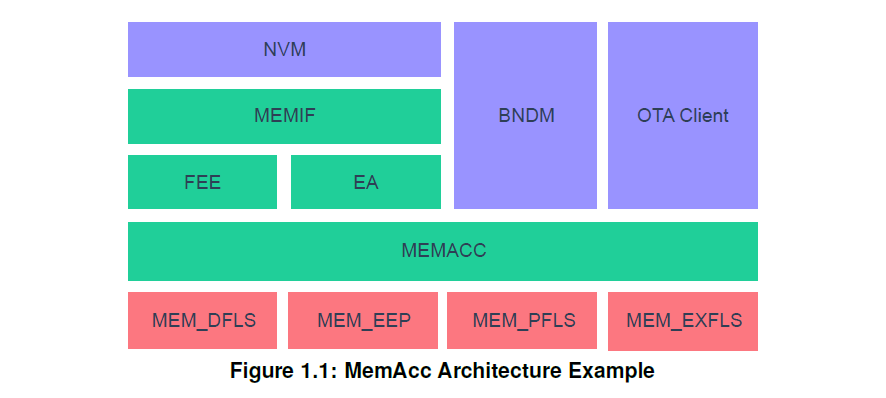
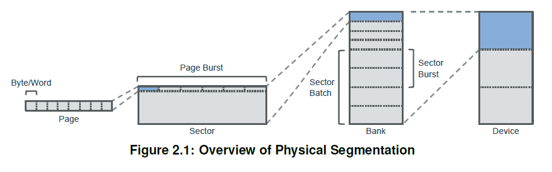
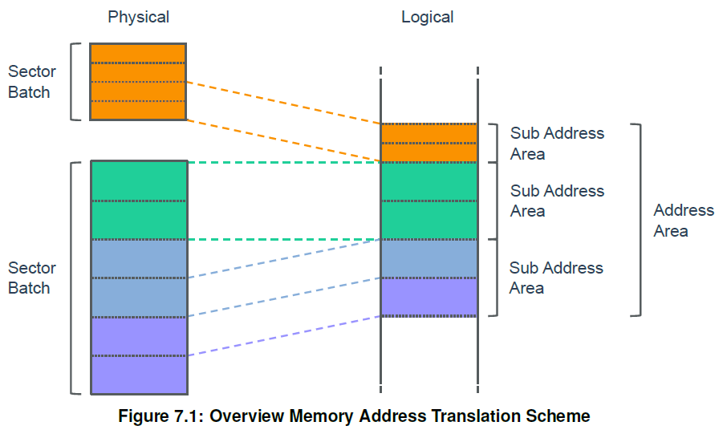
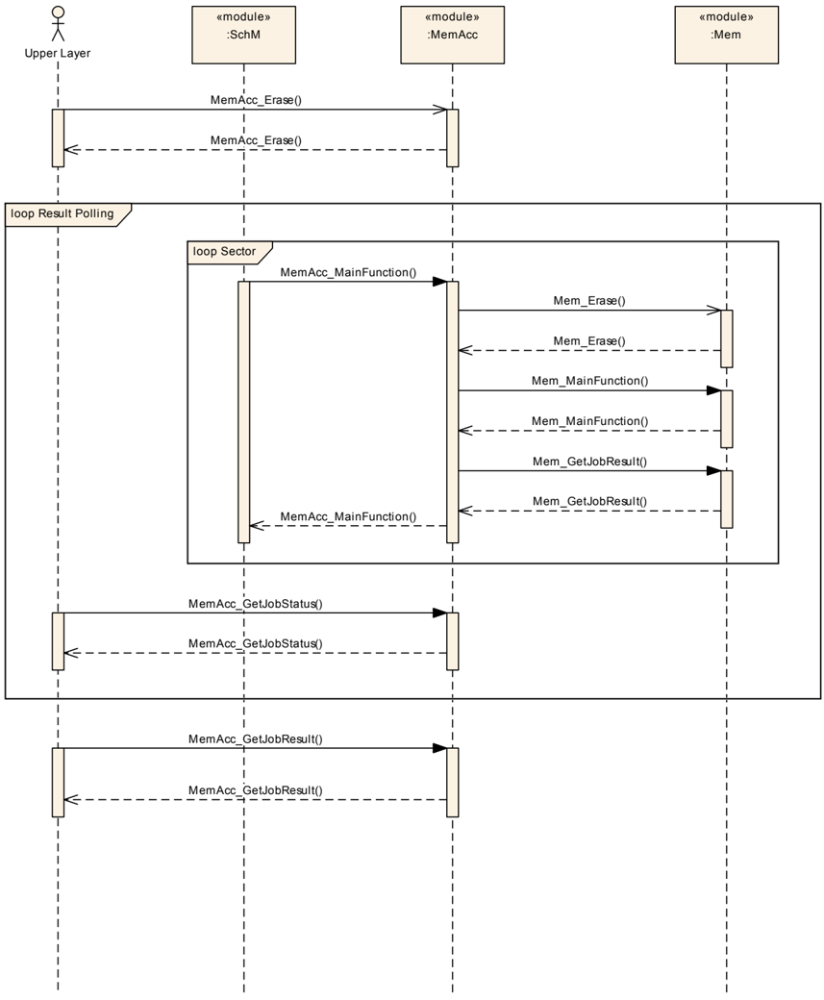
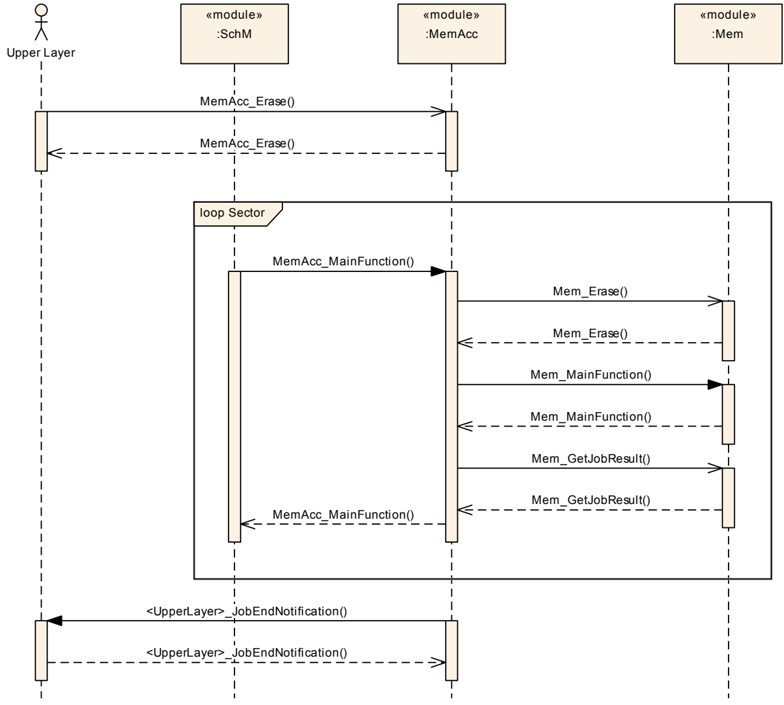
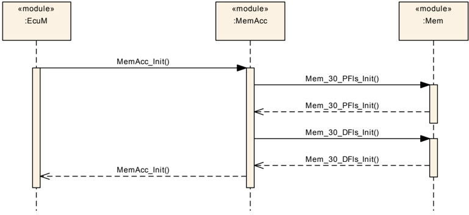
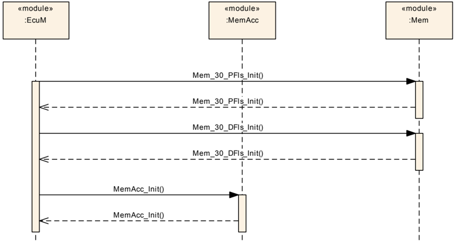
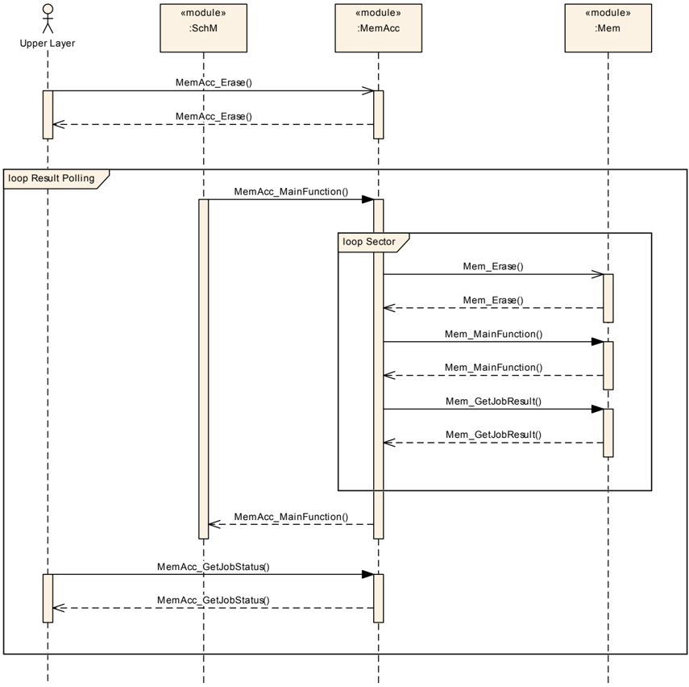
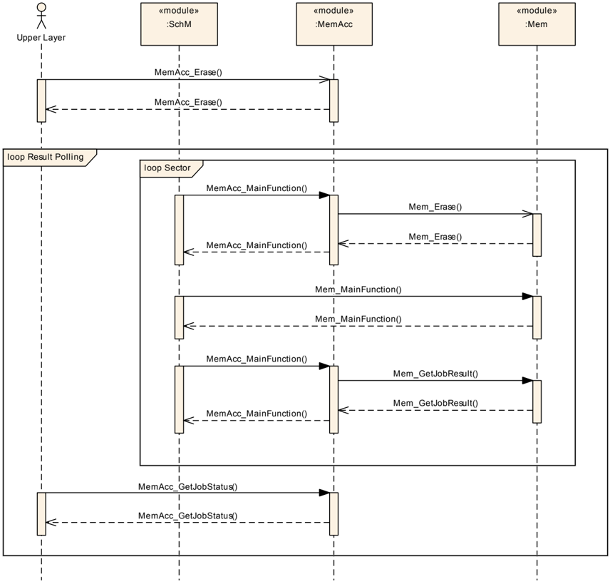
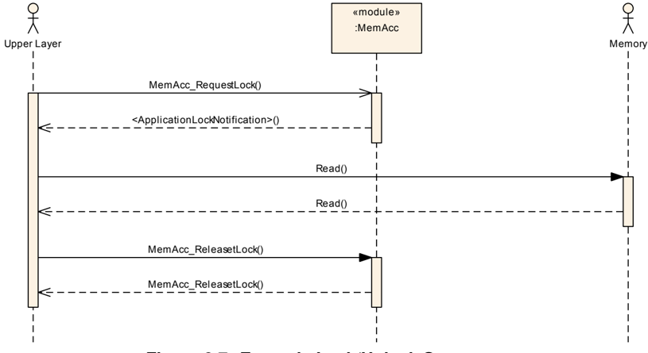

## 1. 简介和功能概述

本文介绍了 **AUTOSAR** 基本软件模块存储访问模块 (**MemAcc**) 的功能、API 和配置。

存储访问模块通过基于地址（**address-based**）的 API 提供对使用不同存储技术设备的访问。

存储访问模块可以通过一个或者多个存储驱动程序模块（**Mem Driver**）来进行扩充。存储访问模块是和存储设备技术不相关，它可用于各种典型的存储设备，例如：闪存（**flash**）、**EEPROM**、**RAM** 或者最新的相变存储器（**phase change memory**）。

存储访问模块和存储驱动程序（**Memory Driver**）模块，和 **Fls** 和 **Eep** 驱动类似，他们处于 **AUTOSAR** 架构的同一层次。但 **AUTOSAR** 架构设又把这些模块分为两大部分，即：独立于硬件的部分（**MemAcc**）和与硬件相关的部分（**Mem**）。

下图显示了包含不同存储驱动程序和上层模块关系的示例架构概览：



### 1.1. 支持的使用用例

存储访问模块（**MemAcc**）和存储驱动程序模块（**Mem Driver**）的组合可以支持以下的一些应用场景：

* 使用 **NvM** 和 **Fee** 或 **Ea** 进行基于块（**Block based**）的非易失性存储访问（**non-volatile memory access**）的数据存储。
* **OTA** 的软件更新。
* 普通基于地址的存储访问。例如：用于 **BndM** 和 闪存引导加载程序（**flash bootloader**）的使用。

同时当然也支持以上这些使用场景的组合使用。

因为存储访问模块（**MemAcc**）模块和存储驱动程序模块（**Mem Driver**）同时也涵盖了非易失性数据存储的 **Fls** 和 **Eep** 一些使用场景，所以 **Fls** 和 **Eep** 模块在未来可能会成为过时（**obsolete**）的模块。

## 2. 缩略语

下面的词汇表包括与 **MemAcc** 模块相关的首字母缩写词和缩写词，它们均未包含在 **AUTOSAR** 词汇表[\[1\]](#ref-1)中。

**BndM**
> 大容量非易失性数据管理器（**Bulk Non-Volatile Data Manager**）

**ECC**
> 纠错码（**Error Correction Code**）

**FOTA**
> 固件远程升级（**Firmware Over The Air**），通过无线通信进行固件远程更新。

**HSM** 
> 硬件安全模块（**Hardware Security Module**），专用的安全 **MCU** 的内核。

**OTA** 
> 远程升级（**Over The Air**），OEM 后台（**backend**）与车辆之间无线通信的总称。

**RWW**
> 并行读写（**Read While Write**）。指存储设备在一个存储 **Bank** 中执行读取操作，同时也在另一个存储 **Bank** 中进行写入/擦除操作的能力。

**SOTA**
> 软件远程升级（**Software Over The Air**），使用无线通信进行软件远程更新。

**Address Area**
> 地址区（Address Area）是指逻辑地址空间中连续的存储区域。通常多个物理存储扇区组合到一个逻辑地址区域。

**Bank** 
> 存储 **Bank** 是指一组扇区批次（**Section Batch**）的集合. 如果存储器技术支持分片成扇区，则存储 **Bank** 是指一个不允许进行边写边读操作的扇区批次组（**a sector batch group**）的实例。在闪存存储设备（flash memory）概念中，**Bank** 通常是映射到一个单独的闪存控制器。

**Job Request**
> 作业请求（**Job Request**）是指上层模块对地址区的存储访问请求。

**Memory Device**  
> 存储设备（**Memory Device**）是指一组存储 **bank** 的组合。

**Page Burst** 
> 通过存储页面的聚合访问（**aggregated access**）来提高性能。在存储设备技术支持物理分段（**physical segmentation**）的情况下，一些存储设备可以提供优化的访问方法，支持一次读取或写入多个页面。页面突发（**Page Burst**）表示用于访问优化的存储页面的聚合。

**Sector** 
> 扇区（**Sector**）是指最小的可擦除存储单元（以字节为单位）。某些存储设备技术需要在写入存储之前进行明确的物理擦除操作。扇区定义了这种擦除单元的最小大小。根据存储设备的不同，扇区可以是统一大小的或可变大小的。

**Sector Batch** 
> 扇区批次（**Sector Batch**）是指具有统一大小的扇区的集合。具有相同大小的连续扇区的逻辑集合。

**Sector Burst** 
> 扇区突发（**Sector Burst**）是指聚合扇区以提高擦除性能。如果存储技术需要物理擦除操作，一些设备通过一步擦除扇区集合来提供擦除性能优化。

**Sub Address Area** 
> 子地址区（**Sub Address Area**）是指逻辑地址空间中的连续存储区域映射到一个存储设备的一个扇区批次（**Sector Batch**）。

**Write Page**
> 写入页面（**Write Page**）是指存储设备的最小可写单元（以字节为单位）。因为一些存储设备技术的访问必须考虑到物理分段，所以并非所有存储设备技术都可以按字节访问。该术语定义了一次访问中需要写入页面最小的大小。

### 2.1. 物理分段（**physical segmentation**）

下图 2.1 概述了物理分段和相应的技术术语：



## 3. 相关文档

### 3.1. 输入文件和相关标准与规范

<a id="ref-1"></a>[1] Glossary
> AUTOSAR_TR_Glossary

<a id="ref-2"></a>[2] General Specification of Basic Software Modules
> AUTOSAR_SWS_BSWGeneral

<a id="ref-3"></a>[3] Requirements on Memory Hardware Abstraction Layer
> AUTOSAR_SRS_MemoryHWAbstractionLayer

<a id="ref-4"></a>[4] General Requirements on Basic Software Modules
> AUTOSAR_SRS_BSWGeneral

<a id="ref-5"></a>[5] Requirements on AUTOSAR Features
> AUTOSAR_RS_Features

### 3.2. 相关规范

**AUTOSAR** 提供了基本软件模块的通用规范 [\[2\]](#ref-2)，该规范（**SWS BSW General**）同样适用于 **MemAcc**。

因此，**SWS BSW General** 应被视为 **MemAcc** 的附加且必需的规范。

## 4. 约束和假设

为了能够控制和协调共享存储资源的访问，所有存储上层模块都需要使用 **MemAcc** 模块来访问这些共享存储资源。此约束的唯一例外是在离散时间点的独占存储访问。

### 4.1. 限制

#### 4.1.1. 一般限制

**MemAcc** 模块用于基于地址的存储访问。不考虑基于文件的访问。 同时基于块的存储设备，如果需要显式的坏块管理的 **NAND** 闪存设备，也不在本规范的范围内。

#### 4.1.2. 存储映射访问

因为不可能同时对共享存储资源（**shared memory resource**）执行存储映射访问，所以 **AUTOSAR** 的存储栈（**Memory Stack**）提供了在共享存储资源上执行访问的机制。

此限制适用于闪存（**flash**）或 **EEPROM** 等存储器设备，存储器必须置于特殊的编程模式下，在该模式下无法进行并发的读取访问。此限制适用于内部和外部共享存储设备，也会影响基于硬件的闪存 **EEPROM** 仿真。

如果需要存储映射访问，则必须在应用程序级别实现 **MemAcc** 协调。由应用程序必须确保没有对共享存储执行并发的访问。

### 4.2. 汽车域的适用性

**MemAcc** 模块可用于任何需要 **MemAcc** 来存储数据或执行软件更新的域应用程序。

## 5. 对其他模块的依赖

**MemAcc** 模块依赖 闪存 EEPROM 仿真 (**Fee**)、EEPROM 抽象 (**Ea**)、大容量 Nv 数据管理器 (**BndM**)、存储驱动程序 (**Mem**)、默认错误跟踪器 (**DET**) 的接口 。如果作为 **OTA** 软件的更新客户端，也依赖到复杂设备驱动程序 (**CDD**)。

**MemAcc** 模块包括 **DET** 和 **MemMap** 的头文件。

## 6. 功能规格

本章描述了 **MemAcc** 模块的行为。该模块的 API 在第 [7](#7-api规范) 章中定义，而配置在第 [9](#9-配置规范) 章中定义。

### 6.1. 概述

**MemAcc** 模块为不同的上层模块提供与存储设备无关的基于地址的存储访问。它实现了所有高级功能，如：作业管理、访问协调和根据物理分段分配内存驱动程序访问请求，因为内存驱动程序期望所有存储访问与物理段对齐。

### 6.2. 关键方面

* **Fee**、**Ea**、**OTA** 软件更新客户端等不同上层访问协调。
* 内存技术设备不可知，通过 **API** 支持各种内存，甚至包括：代码内存。
* 协调 **CPU** 的不同内核，如：主核和 **HSM** 内核。 
* 存储访问作业管理
* 内存区域的虚拟化，以支持非连续区域的映射以及跨不同存储设备的跨越区域。
* 内存位置到存储设备的映射。
* 根据闪存的页面和扇区等物理段拆分内存驱动程序访问请求。

### 6.3. 功能元素

#### 6.3.1. 内存地址转换

**MemAcc** 模块将 **Mem** 驱动的物理内存寻址方案通过逻辑地址空间的方式抽象给上层。

图 7.1 提供了内存地址转换/映射方案的概览：



所有 **MemAcc** 服务，即：擦除、读取和写入，都应支持基于逻辑/物理内存映射跨越存储设备边界的访问请求。

###### 6.3.1.1. 内存映射约束

一个地址区只能分配给一个上层模块。由于每个地址区域只允许一个内存作业，所以地址区域和上层之间存在 **1:1** 的关系。

在一个子地址（**sub-address**）区域内，只允许统一扇区的大小（**uniform sector size**）。

**注意：**

一个子地址区域映射到一个扇区批次。

地址区的起始地址和长度应与物理扇区对齐。

**注意：**

存储访问的起始地址和长度必须与物理分段对齐。

#### 6.3.2. 存储访问协调

MemAcc 模块应协调来自多个上层模块的冲突存储访问。

**注意：**

通常，代码闪存（**code flash**）和数据闪存（**data flash**）共用同一个闪存控制器，因此无法同时执行写访问。由于在软件更新用例中，代码闪存和数据闪存的写访问可能同时发生，所以 **MemAcc** 需要协调这些访问。

MemAcc 模块应仅协调相互冲突的资源访问。访问依赖关系应可在配置工具中进行配置。

**注意：**

只应协调与资源相关的冲突，以避免任何性能影响。

MemAcc 模块应同时支持来自不同上层模块针对不同存储区域的多个存储访问请求。如果存在硬件资源冲突，存储栈仍应接受该访问请求，并在资源空闲后对其进行处理。

**注意：**

AUTOSAR BSW 上层模块无需处理任何重试机制，因为这将影响每一个上层模块。

#### 6.3.3. 作业管理

通常，所有需要花费大量时间来处理操作（**operation**）的 MemAcc 服务均定义为异步服务。因此，MemAcc 作业请求仅通过 [MemAcc_Read](#7322-memacc_read) 等异步服务进行排队，而排队作业的处理在 [MemAcc_MainFunction](#751-memacc_mainfunction) 中执行。

MemAcc 模块应允许每个地址区只有一个作业请求。

**注意：**

这简化了作业管理，因为一个地址区只能拥有一个上层模块，并且作业请求通常由上层模块顺序发起。

MemAcc 模块应基于 **MemAccAddressAreaPriority** 对来自 AUTOSAR BSW 上层模块的存储访问请求进行优先级排序。

**注意：**

写入崩溃类非易失性数据应优先于后台软件更新任务。

如果存储硬件支持该功能，存储操作的优先级处理应使用 **Mem_Suspend** 和 **Mem_Resume** 服务。

如果存储硬件不支持挂起/恢复（**suspend/resume**）功能，则优先级处理应以页面/页面突发（page/page burst）或扇区/扇区突发（sector/sector burst）为单位来实现。

#### 6.3.4. 作业处理

如果通过 **MemAccJobEndNotificationName** 配置了作业结束通知函数，MemAcc 应通过调用所配置的通知函数来通知上层 BSW 模块。

**注意：**

如果未配置任何通知函数，上层 BSW 模块必须查询（**poll**）MemAcc 作业状态。

如果 MemAcc 模块无法处理某个作业请求（例如由于同一地址区上存在挂起的请求，或由于参数无效），该作业请求应以 E_NOT_OK 返回码拒绝。

###### 6.3.4.1. 作业状态

MemAcc 模块通过 [MemAcc_GetJobStatus](#7315-memacc_getjobstatus) 服务提供当前的作业处理状态信息。

在通过 [MemAcc_Init](#7311-memacc_init) 服务进行初始化之后，作业处理状态应被设置为 **MEMACC_JOB_IDLE**。

在作业处理已经完成或当前没有作业挂起的情况下，作业处理状态应被设置为 **MEMACC_JOB_IDLE**。

一旦作业请求被接受，作业处理状态应被设置为 **MEMACC_JOB_PENDING**。

###### 6.3.4.2. 作业结果

最后一次 MemAcc 作业的结果由 [MemAcc_GetJobResult](#7314-memacc_getjobresult) 服务提供。上层模块可以使用它来获取详细信息，以进行精细调整的故障处理。

在通过 [MemAcc_Init](#7311-memacc_init) 服务进行初始化之后，作业结果应被设置为 **MEMACC_OK**。

在作业处理成功完成的情况下，作业结果应被设置为 **MEMACC_OK**。

在作业处理已经完成、但最后一次 MemAcc 作业的结果未达到预期结果的情况下（例如在一个非空白的存储区域上执行了空白检查（**blank check**）操作），作业结果应被设置为 **MEMACC_INCONSISTENT**。

在最后一次存储操作已完成、但 ECC 电路纠正了一个 ECC 错误的情况下，作业结果应被设置为 **MEMACC_ECC_CORRECTED**。

在最后一次存储操作由于不可纠正的（**uncorrectable**）ECC 错误而未能完成的情况下，作业结果应被设置为 **MEMACC_ECC_UNCORRECTED**。

在最后一次存储操作被取消的情况下，作业结果应被设置为 **MEMACC_CANCELED**。

在存储操作由于任何其他原因而未能成功完成的情况下，作业结果应被设置为 **MEMACC_FAILED**。

#### 6.3.5. 硬件特定服务

为了支持存储设备特定的服务，MemAcc 模块提供了一个通用 API 来调用硬件特定的 Mem 驱动服务——参见 [MemAcc_HwSpecificService](#7327-memacc_hwspecificservice)。

每个 Mem 驱动可以拥有多个硬件特定服务，这些服务通过 **hwServiceId** 参数进行选择。

**注意：**

通过为硬件特定服务提供通用 API，MemAcc 模块可以保持与硬件无关。

#### 6.3.6. 性能优化

一些 Mem 驱动提供突发（**burst**）能力，即不是写入/擦除一个最小单元，而是同时写入/擦除多个这样的单元，以提高写入/擦除吞吐量。根据硬件能力，Mem 驱动可能提供两种突发模式：

* 擦除多个扇区
* 写入多个页面

如果通过 **MemAccUseEraseBurst** 启用，MemAcc 应根据 Mem 驱动的擦除突发大小（**erase burst size**）对齐并拆分 Mem 驱动擦除请求。

如果 MemAcc 读取请求的长度大于相应 Mem 驱动的 **MemMaxRead** 值，MemAcc 应按 **MemMaxRead** 定义的最大读取长度拆分 Mem 驱动读取请求。

如果通过 **MemAccUseWriteBurst** 启用，MemAcc 应根据 Mem 驱动的写入突发大小（**write burst size**）对齐并拆分 Mem 驱动写入请求。

**注意：**

启用突发模式也会增加处理较高优先级作业时的延迟。因此，系统集成者在配置突发模式时必须考虑最大延迟。

#### 6.3.7. 通用上锁机制

为了支持 **BndM** 等上层模块，MemAcc 模块提供了一个通用上锁 API，可用于限制对某个 Mem 驱动的存储访问，例如当某个上层模块想要执行直接的存储映射访问（**memory mapped access**）时。

图 9.7 显示了一个上锁/解锁序列的示例。

**注意：**

应用程序或上层模块必须维护锁状态，并在直接存储访问完成后释放锁。为简单起见，不支持嵌套锁。

#### 6.3.8. 动态存储驱动处理

对于一些安全相关的用例，不希望 Mem 驱动以可执行的形式永久可用，例如为了防止意外覆盖存储区域。对于这些用例，Mem 驱动被编译为一个单独的二进制文件（**binary**），其中包含一个函数指针表，用于将 Mem 驱动服务函数暴露给 MemAcc 模块；MemAcc 模块使用该函数指针表间接调用 Mem 驱动服务函数。

###### 6.3.8.1. 动态存储驱动的激活

对于动态存储驱动激活，上层模块必须确保 Mem 驱动二进制文件可用于执行，例如在为相应地址区请求任何 MemAcc 作业之前下载到 RAM 并完成初始化。

###### 6.3.8.2. 服务调用

如果通过 **MemAccUseMemFuncPtrTable** 启用，MemAcc 应通过 Mem 驱动函数指针表调用 Mem 驱动服务函数。否则，MemAcc 应直接调用 Mem 驱动服务函数。

### 6.4. 模块处理

#### 6.4.1. 初始化

MemAcc 模块通过 [MemAcc_Init](#7311-memacc_init) 进行初始化。除 [MemAcc_GetVersionInfo](#7313-memacc_getversioninfo) 和 [MemAcc_Init](#7311-memacc_init) 之外，MemAcc 模块的 API 函数只允许在模块被正确初始化之后调用。

根据 **MemAccMemInvocation** 属性，MemAcc 还可以初始化 Mem 驱动各自的初始化函数。

图 9.3 显示了经由 MemAcc 进行的 Mem 驱动初始化，而图 9.4 显示了经由 EcuM 进行的 Mem 驱动初始化。

#### 6.4.2. 调度

由于 MemAcc 模块的大多数服务都是异步服务，[MemAcc_MainFunction](#751-memacc_mainfunction) 需要被周期性地触发。

根据 **MemAccMemInvocation** 属性，MemAcc 可以在 [MemAcc_MainFunction](#751-memacc_mainfunction) 中调用所有 Mem 主函数。

**注意：**

如果 Mem 驱动要被动态激活，则 Mem 驱动主函数的调度无法经由 SchM 完成。因此，MemAcc 模块必须根据各个 Mem 驱动的状态负责主函数的触发。

图 9.5 显示了经由 MemAcc 进行的 Mem 主函数触发，而图 9.6 显示了经由 SchM 进行的 Mem 主函数触发。

### 6.5. 通用设计规则

MemAcc 模块的实现应与硬件无关。

**注意：**

MemAcc 模块将与不同种类的 Mem 驱动一起使用，例如用于内部和外部存储设备。因此，MemAcc 必须完全与硬件无关。

MemAcc 模块的实现应支持多个 Mem 驱动。

MemAcc 模块应静态地（最迟在编译时）检查静态配置参数的正确性。

#### 6.5.1. 重试机制

如果 **MemAccNumberOfEraseRetries** 被设置为大于 0 的值，当 Mem 驱动的擦除操作结果为 **MEM_JOB_FAILED** 时，MemAcc 应按照配置的值重试 Mem 驱动擦除操作。

如果 **MemAccNumberOfWriteRetries** 被设置为大于 0 的值，当 Mem 驱动的写入操作结果为 **MEM_JOB_FAILED** 时，MemAcc 应按照配置的值重试 Mem 驱动写入操作。

**注意：**

上层模块无需处理瞬时的存储写入/擦除问题。重试机制在很大程度上依赖于底层的存储技术/设备类型。并非所有存储设备都支持写入重试。

#### 6.5.2. 地址对齐

MemAcc 模块不执行任何类型的缓冲区对齐（**buffer alignment**）。因此，上层模块提供的缓冲区已经需要考虑 **MemAccBufferAlignmentValue** 属性定义的对齐要求。

**MemAccBufferAlignmentValue** 必须配置为底层 Mem 驱动所需的最小公倍数值。这同样适用于写页面（**write page**）要求。

MemAcc 模块应根据 **MemWritePageSize** / **MemWriteBurstSize** 定义的页面/页面突发大小，为 Mem 驱动层拆分存储写访问请求。

**注意：**

Mem 驱动期望请求与物理写分段对齐。

如果存储写请求的起始地址或长度与 **MemWritePageSize** 定义的设备物理写分段不匹配，[MemAcc_Write](#7323-memacc_write) 应以 E_NOT_OK 拒绝此类作业请求。

**注意：**

存储请求必须与物理存储分段对齐。

如果存储读请求的起始地址或长度与 **MemMinReadSize** 定义的设备最小读取大小不匹配，[MemAcc_Read](#7322-memacc_read) 应以 E_NOT_OK 拒绝此类作业请求。

如果存储擦除请求的起始地址或长度与 **MemEraseSectorSize** 定义的设备物理擦除分段不匹配，[MemAcc_Erase](#7324-memacc_erase) 应以 E_NOT_OK 拒绝此类作业请求。

MemAcc 模块应根据 **MemEraseSectorSize** / **MemEraseBurstSize** 定义的扇区/扇区突发大小，为 Mem 驱动层拆分存储擦除访问请求。

**注意：**

Mem 驱动期望请求与物理擦除分段对齐。

#### 6.5.3. 64 位支持

MemAcc 模块应支持大于 4 GB 的地址区；因此，当某个地址区的地址区配置（**address area configuration**）超过 4 GB 时，[**MemAcc_AddressType**](#722-memacc_addresstype) 和 [**MemAcc_LengthType**](#728-memacc_lengthtype) 应定义为 64 位类型。

如果所有地址区都不超过 4 GB，[**MemAcc_AddressType**](#722-memacc_addresstype) 和 [**MemAcc_LengthType**](#728-memacc_lengthtype) 应定义为 32 位类型。

**注意：**

避免 64 位类型带来的不必要开销。

### 6.6. 错误分类

#### 6.6.1. 开发错误

MemAcc 模块的开发错误定义：

| 错误类型 | 相关错误代码 | 错误值 |
|---|---|---|
| API 服务在模块未初始化时被调用 | MEMACC_E_UNINIT | 0x01 |
| API 服务调用时传入了 NULL 指针参数 | MEMACC_E_PARAM_POINTER | 0x02 |
| API 服务调用时使用了错误的地址区 ID | MEMACC_E_PARAM_ADDRESS_AREA_ID | 0x03 |
| API 服务调用时传入的地址和长度不属于所传递的地址区 ID | MEMACC_E_PARAM_ADDRESS_LENGTH | 0x04 |
| API 服务调用时传入的硬件 ID 不属于所传递的地址区 ID | MEMACC_E_PARAM_HW_ID | 0x05 |
| API 服务调用的地址区 ID 上存在挂起的作业请求 | MEMACC_E_BUSY | 0x06 |
| 由于 MEM 驱动二进制文件不一致，动态 MEM 驱动激活失败 | MEMACC_E_MEM_INIT_FAILED | 0x07 |

#### 6.6.2. 运行时错误

没有运行时错误。

#### 6.6.3. 瞬时故障

没有瞬时故障。

#### 6.6.4. 生产错误

没有生产错误。

#### 6.6.5. 扩展生产错误

没有扩展生产错误。

## 7. API规范

### 7.1. 导入的类型

本章列出了从以下文件中包含的所有类型。

| 模块 | 头文件 | 导入的类型 |
|---|---|---|
| Mem | Mem.h | Mem_AddressType |
| Mem | Mem.h | Mem_ConfigType |
| Mem | Mem.h | Mem_DataType |
| Mem | Mem.h | Mem_HwServiceIdType |
| Mem | Mem.h | Mem_InstanceIdType |
| Mem | Mem.h | Mem_LengthType |
| Std | Std_Types.h | Std_ReturnType |
| Std | Std_Types.h | Std_VersionInfoType |

### 7.2. 类型定义

#### 7.2.1. MemAcc_AddressAreaIdType

类型，派生自 uint16。唯一的地址区（**address area**）ID 类型。可通过**MemAcc_GeneralTypes.h**获得。

#### 7.2.2. MemAcc_AddressType

类型，派生自 **Basetype**——根据变体（**Variation**）为 uint32 或 uint64。逻辑内存地址（**Logical memory address**）类型。可通过**MemAcc_GeneralTypes.h**获得。

#### 7.2.3. MemAcc_ConfigType

结构类型。后构建（**postbuild**）配置结构体类型。可通过**MemAcc_GeneralTypes.h**获得。

#### 7.2.4. MemAcc_DataType

类型，派生自 uint8。通用数据类型。可通过**MemAcc_GeneralTypes.h**获得。

#### 7.2.5. MemAcc_JobResultType

枚举类型，取值：

* **MEMACC_OK**（0x00）：上一个 MemAcc 作业已成功完成。
* **MEMACC_FAILED**（0x01）：上一个 MemAcc 作业因非特定原因失败且未完成。
* **MEMACC_INCONSISTENT**（0x02）：上一个 MemAcc 作业的结果不符合预期结果，例如对非空白存储区域执行了空白检查（**blank check**）操作。
* **MEMACC_CANCELED**（0x03）：上一个 MemAcc 作业已被取消。
* **MEMACC_ECC_UNCORRECTED**（0x04）：上一个存储操作返回了不可纠正的 **ECC** 错误。
* **MEMACC_ECC_CORRECTED**（0x05）：上一个存储操作返回了可纠正的 **ECC** 错误。

异步作业结果类型。可通过**MemAcc_GeneralTypes.h**获得。

#### 7.2.6. MemAcc_JobStatusType

枚举类型，取值：

* **MEMACC_JOB_IDLE**（0x00）：作业处理已完成，或当前没有挂起的作业。
* **MEMACC_JOB_PENDING**（0x01）：一个作业正在处理之中。

异步作业状态类型。可通过**MemAcc_GeneralTypes.h**获得。

#### 7.2.7. MemAcc_JobType

枚举类型，取值：

* **MEMACC_NO_JOB**（0x00）：当前没有挂起的作业。
* **MEMACC_WRITE_JOB**（0x01）：写作业挂起。
* **MEMACC_READ_JOB**（0x02）：读作业挂起。
* **MEMACC_COMPARE_JOB**（0x03）：比较作业挂起。
* **MEMACC_ERASE_JOB**（0x04）：擦除作业挂起。
* **MEMACC_MEMHWSPECIFIC_JOB**（0x05）：硬件特定作业挂起。
* **MEMACC_BLANKCHECK_JOB**（0x06）：空白检查作业挂起。
* **MEMACC_REQUESTLOCK_JOB**（0x07）：请求锁作业挂起。

异步作业的类型。可通过**MemAcc_GeneralTypes.h**获得。

#### 7.2.8. MemAcc_LengthType

类型，派生自 **Basetype**——根据变体（**Variation**）为 uint32 或 uint64。作业长度类型。可通过**MemAcc_GeneralTypes.h**获得。

#### 7.2.9. MemAcc_MemoryInfoType

结构类型。元素为：

* **LogicalStartAddress**（[MemAcc_AddressType](#722-memacc_addresstype)）：子地址区的逻辑起始地址。
* **PhysicalStartAddress**（[MemAcc_AddressType](#722-memacc_addresstype)）：子地址区的物理起始地址。
* **MaxOffset**（[MemAcc_LengthType](#728-memacc_lengthtype)）：子地址区的大小（以字节为单位）减 1。
* **EraseSectorSize**（uint32）：扇区的大小（以字节为单位）。
* **EraseSectorBurstSize**（uint32）：扇区突发（**sector burst**）的大小（以字节为单位）。当禁用突发时，等于 SectorSize。
* **MinReadSize**（uint32）：最小可读单元（以字节为单位）。
* **WritePageSize**（uint32）：每页的写入大小（以字节为单位）。
* **MaxReadSize**（uint32）：最大可读单元（以字节为单位）。
* **WritePageBurstSize**（uint32）：页突发的大小（以字节为单位）。当禁用突发时，等于 WritePageSize。
* **HwId**（uint32）：所引用的 Mem 驱动硬件标识符。

该结构体包含 **Mem** 设备特性的信息。可通过 **[MemAcc_GetMemoryInfo](#7316-memacc_getmemoryinfo)()** 服务访问。

请注意，该类型目前处于草案（**draft**）状态。

#### 7.2.10. MemAcc_JobInfoType

结构类型。元素为：

* **LogicalAddress**（[MemAcc_AddressType](#722-memacc_addresstype)）：当前活动的地址区请求的地址。
* **Length**（[MemAcc_LengthType](#728-memacc_lengthtype)）：当前活动的地址区请求的长度。
* **HwId**（[MemAcc_HwIdType](#7211-memacc_hwidtype)）：所引用的 Mem 驱动硬件标识符。
* **MemInstanceId**（uint32）：当前存储请求的实例 ID。
* **MemAddress**（uint32）：当前 Mem 驱动请求的物理地址。
* **MemLength**（uint32）：Mem 驱动请求的长度。
* **CurrentJob**（[MemAcc_JobType](#727-memacc_jobtype)）：当前活动的 MemAcc 作业。
* **MemResult**（[MemAcc_MemJobResultType](#7217-memacc_memjobresulttype)）：当前或最近一次的 Mem 驱动结果。

该结构体包含 **MemAcc** 模块当前处理状态的信息。可通过**MemAcc_GeneralTypes.h**获得。

#### 7.2.11. MemAcc_HwIdType

枚举类型。范围为 0 - 4294967295——各枚举参数的名称由 **Mem** 模块名和 **Mem** 实例名构造而成。

**MemAcc_HwIdType**是用于所有**Mem** 硬件实例的唯一数字标识符的类型，这些硬件实例用于硬件特定请求（**hardware specific requests**）。可通过**MemAcc_GeneralTypes.h**获得。

#### 7.2.12. MemAcc_MemBinaryHeaderType

结构类型。元素为：

* **UniqueId**（uint64）：唯一 ID。
* **Flags**（uint64）：头标志（**header flags**）。
* **Header**（uint64）：Mem 驱动头结构体的地址。
* **Delimiter**（uint64）：Mem 驱动分隔符字段的地址。
* **InitFunc**（[MemAcc_MemInitFuncType](#7220-memacc_meminitfunctype)*）：Mem_Init 函数指针。
* **MainFunc**（[MemAcc_MemMainFuncType](#7231-memacc_memmainfunctype)*）：Mem_Main 函数指针。
* **GetJobResultFunc**（[MemAcc_MemGetJobResultFuncType](#7222-memacc_memgetjobresultfunctype)*）：Mem_GetJobResult 函数指针。
* **ReadFunc**（[MemAcc_MemReadFuncType](#7226-memacc_memreadfunctype)*）：Mem_Read 函数指针。
* **WriteFunc**（[MemAcc_MemWriteFuncType](#7227-memacc_memwritefunctype)*）：Mem_Write 函数指针。
* **EraseFunc**（[MemAcc_MemEraseFuncType](#7228-memacc_memerasefunctype)*）：Mem_Erase 函数指针。
* **PropagateErrorFunc**（[MemAcc_MemPropagateErrorFuncType](#7225-memacc_mempropagateerrorfunctype)*）：Mem_PropagateError 函数指针。
* **BlankCheckFunc**（[MemAcc_MemBlankCheckFuncType](#7229-memacc_memblankcheckfunctype)*）：Mem_BlankCheck 函数指针。
* **SuspendFunc**（[MemAcc_MemSuspendFuncType](#7223-memacc_memsuspendfunctype)*）：Mem_Suspend 函数指针。
* **ResumeFunc**（[MemAcc_MemResumeFuncType](#7224-memacc_memresumefunctype)*）：Mem_Resume 函数指针。
* **HwSpecificServiceFunc**（[MemAcc_MemHwSpecificServiceFuncType](#7230-memacc_memhwspecificservicefunctype)*）：硬件特定服务函数指针。

该结构体包含用于访问 Mem 驱动服务函数以及一致性信息的元素。

请注意，该类型目前处于草案（**draft**）状态。

#### 7.2.13. MemAcc_MemAddressType

类型，派生自 [MemAcc_AddressType](#722-memacc_addresstype)。物理存储设备地址类型。可通过**MemAcc_MemApi.h**获得。

#### 7.2.14. MemAcc_MemConfigType

结构类型。Mem 驱动配置结构体类型。可通过**MemAcc_MemApi.h**获得。

#### 7.2.15. MemAcc_MemDataType

类型，派生自 uint8。通用数据类型。可通过**MemAcc_MemApi.h**获得。

#### 7.2.16. MemAcc_MemInstanceIdType

类型，派生自 uint32。Mem 驱动实例 ID 类型。可通过**MemAcc_MemApi.h**获得。

#### 7.2.17. MemAcc_MemJobResultType

枚举类型，取值：

* **MEM_JOB_OK**（0x00）：上一个作业已成功完成。
* **MEM_JOB_PENDING**（0x01）：一个作业正在处理之中。
* **MEM_JOB_FAILED**（0x02）：作业因非特定原因失败。
* **MEM_INCONSISTENT**（0x03）：被检查的页非空白（**not blank**）。
* **MEM_ECC_UNCORRECTED**（0x04）：存储访问期间发生了不可纠正的 **ECC** 错误。
* **MEM_ECC_CORRECTED**（0x05）：存储访问期间发生了可纠正的 **ECC** 错误。

异步作业结果类型。可通过**MemAcc_GeneralTypes.h**获得。

#### 7.2.18. MemAcc_MemLengthType

类型，派生自 uint32。物理存储设备长度类型。可通过**MemAcc_MemApi.h**获得。

#### 7.2.19. MemAcc_MemHwServiceIdType

类型，派生自 uint32。Mem 驱动硬件特定服务表的索引类型。可通过**MemAcc_MemApi.h**获得。

#### 7.2.20. MemAcc_MemInitFuncType

函数指针类型。语法：

```C
void (*MemAcc_MemInitFuncType) ( MemAcc_MemConfigType* configPtr )
```

* **configPtr**（in）：指向 Mem 驱动配置数据结构体的指针。
* 返回值：无。

说明：用于通过函数指针接口调用 Mem 驱动 API 的 **Mem_Init** 服务的函数指针。可通过**MemAcc_MemApi.h**获得。

#### 7.2.21. MemAcc_MemDeInitFuncType

函数指针类型。语法：

```C
void (*MemAcc_MemDeInitFuncType) ( void )
```

* 返回值：无。

说明：用于通过函数指针接口调用 Mem 驱动 API 的 **Mem_DeInit** 服务的函数指针。可通过**MemAcc_MemApi.h**获得。

#### 7.2.22. MemAcc_MemGetJobResultFuncType

函数指针类型。语法：

```C
MemAcc_MemJobResultType (*MemAcc_MemGetJobResultFuncType) ( MemAcc_MemInstanceIdType instanceId )
```

* **instanceId**（in）：相关 Mem 驱动实例的 ID。
* 返回值：[**MemAcc_MemJobResultType**](#7217-memacc_memjobresulttype)——最近一次的作业结果。

说明：用于通过函数指针接口调用 Mem 驱动 API 的 **Mem_JobResultType** 服务的函数指针。可通过**MemAcc_MemApi.h**获得。

#### 7.2.23. MemAcc_MemSuspendFuncType

函数指针类型。语法：

```C
void (*MemAcc_MemSuspendFuncType) ( MemAcc_MemInstanceIdType instanceId )
```

* **instanceId**（in）：相关 Mem 驱动实例的 ID。
* 返回值：无。

说明：用于通过函数指针接口调用 Mem 驱动 API 的 **Mem_Suspend** 服务的函数指针。可通过**MemAcc_MemApi.h**获得。

请注意，该类型目前处于草案（**draft**）状态。

#### 7.2.24. MemAcc_MemResumeFuncType

函数指针类型。语法：

```C
void (*MemAcc_MemResumeFuncType) ( MemAcc_MemInstanceIdType instanceId )
```

* **instanceId**（in）：相关 Mem 驱动实例的 ID。
* 返回值：无。

说明：用于通过函数指针接口调用 Mem 驱动 API 的 **Mem_Resume** 服务的函数指针。可通过**MemAcc_MemApi.h**获得。

请注意，该类型目前处于草案（**draft**）状态。

#### 7.2.25. MemAcc_MemPropagateErrorFuncType

函数指针类型。语法：

```C
void (*MemAcc_MemPropagateErrorFuncType) ( MemAcc_MemInstanceIdType instanceId )
```

* **instanceId**（in）：相关 Mem 驱动实例的 ID。
* 返回值：无。

说明：用于通过函数指针接口调用 Mem 驱动 API 的 **Mem_PropagateError** 服务的函数指针。可通过**MemAcc_MemApi.h**获得。

#### 7.2.26. MemAcc_MemReadFuncType

函数指针类型。语法：

```C
Std_ReturnType (*MemAcc_MemReadFuncType) ( MemAcc_MemInstanceIdType instanceId,
    MemAcc_MemAddressType sourceAddress, MemAcc_MemLengthType length,
    MemAcc_MemDataType* destinationDataPtr )
```

* **instanceId**（in）：相关 Mem 驱动实例的 ID。
* **sourceAddress**（in）：读取数据的物理地址。
* **length**（in）：读取长度（以字节为单位）。
* **destinationDataPtr**（out）：用于存储所读取数据的目标内存指针。
* 返回值：**Std_ReturnType**：
    * **E_OK**：所请求的作业已被模块接受。
    * **E_NOT_OK**：所请求的作业未被模块接受。
    * **E_MEM_SERVICE_NOT_AVAIL**：该服务函数未实现。

说明：用于通过函数指针接口调用 Mem 驱动 API 的 **Mem_Read** 服务的函数指针。可通过**MemAcc_MemApi.h**获得。

请注意，该类型目前处于草案（**draft**）状态。

#### 7.2.27. MemAcc_MemWriteFuncType

函数指针类型。语法：

```C
void (*MemAcc_MemWriteFuncType) ( Std_ReturnType return,
    MemAcc_MemInstanceIdType instanceId, MemAcc_MemAddressType targetAddress,
    const MemAcc_MemDataType* sourceDataPtr, MemAcc_MemLengthType length )
```

* **return**（in）：
    * **E_OK**：所请求的作业已被模块接受。
    * **E_NOT_OK**：所请求的作业未被模块接受。
    * **E_MEM_SERVICE_NOT_AVAIL**：该服务函数未实现。
* **instanceId**（in）：相关 Mem 驱动实例的 ID。
* **targetAddress**（in）：写入的物理地址（对齐到页大小）。
* **sourceDataPtr**（in）：源数据指针（对齐到页大小）。
* **length**（in）：写入长度（以字节为单位，对齐到页大小）。
* 返回值：无。

说明：用于通过函数指针接口调用 Mem 驱动 API 的 **Mem_Write** 服务的函数指针。可通过**MemAcc_MemApi.h**获得。

请注意，该类型目前处于草案（**draft**）状态。

#### 7.2.28. MemAcc_MemEraseFuncType

函数指针类型。语法：

```C
void (*MemAcc_MemEraseFuncType) ( Std_ReturnType return,
    MemAcc_MemInstanceIdType instanceId, MemAcc_MemAddressType targetAddress,
    MemAcc_MemLengthType length )
```

* **return**（in）：
    * **E_OK**：所请求的作业已被模块接受。
    * **E_NOT_OK**：所请求的作业未被模块接受。
    * **E_MEM_SERVICE_NOT_AVAIL**：该服务函数未实现。
* **instanceId**（in）：相关 Mem 驱动实例的 ID。
* **targetAddress**（in）：擦除的物理地址（对齐到扇区大小）。
* **length**（in）：擦除长度（以字节为单位，对齐到扇区大小）。
* 返回值：无。

说明：用于通过函数指针接口调用 Mem 驱动 API 的 **Mem_Erase** 服务的函数指针。可通过**MemAcc_MemApi.h**获得。

请注意，该类型目前处于草案（**draft**）状态。

#### 7.2.29. MemAcc_MemBlankCheckFuncType

函数指针类型。语法：

```C
void (*MemAcc_MemBlankCheckFuncType) ( Std_ReturnType return,
    MemAcc_MemInstanceIdType instanceId, MemAcc_MemAddressType targetAddress,
    MemAcc_MemLengthType length )
```

* **return**（in）：
    * **E_OK**：所请求的作业已被模块接受。
    * **E_NOT_OK**：所请求的作业未被模块接受。
    * **E_MEM_SERVICE_NOT_AVAIL**：该服务函数未实现。
* **instanceId**（in）：相关 Mem 驱动实例的 ID。
* **targetAddress**（in）：空白检查的物理地址。
* **length**（in）：空白检查长度。
* 返回值：无。

说明：用于通过函数指针接口调用 Mem 驱动 API 的 **Mem_BlankCheck** 服务的函数指针。可通过**MemAcc_MemApi.h**获得。

请注意，该类型目前处于草案（**draft**）状态。

#### 7.2.30. MemAcc_MemHwSpecificServiceFuncType

函数指针类型。语法：

```C
void (*MemAcc_MemHwSpecificServiceFuncType) ( Std_ReturnType return,
    MemAcc_MemInstanceIdType instanceId, MemAcc_MemHwServiceIdType hwServiceId,
    MemAcc_MemDataType* dataPtr, MemAcc_MemLengthType* lengthPtr )
```

* **return**（in）：
    * **E_OK**：所请求的作业已被模块接受。
    * **E_NOT_OK**：所请求的作业未被模块接受。
    * **E_MEM_SERVICE_NOT_AVAIL**：该服务函数未实现。
* **instanceId**（in）：相关 Mem 驱动实例的 ID。
* **hwServiceId**（in）：用于分发请求的硬件特定服务请求标识符。
* **lengthPtr**（in）：所传递数据的大小指针。
* **dataPtr**（inout）：请求特定的数据指针。
* 返回值：无。

说明：用于通过函数指针接口调用 Mem 驱动 API 的 **Mem_HwSpecificService** 函数的函数指针。可通过**MemAcc_MemApi.h**获得。

请注意，该类型目前处于草案（**draft**）状态。

#### 7.2.31. MemAcc_MemMainFuncType

函数指针类型。语法：

```C
void (*MemAcc_MemMainFuncType) ( void )
```

* 返回值：无。

说明：用于通过函数指针接口调用 Mem 驱动 API 的 **Mem_MainFunction** 服务的函数指针。可通过**MemAcc_MemApi.h**获得。

### 7.3. 函数定义

#### 7.3.1. 同步函数

##### 7.3.1.1. MemAcc_Init

**说明**: 初始化函数——初始化所有变量并将模块状态设置为已初始化。可通过**MemAcc.h**获得。本服务为同步调用，不可重入。参数 configPtr（in）：指向所选配置结构体的指针。返回值：无。

```C
void MemAcc_Init ( const MemAcc_ConfigType* configPtr )
```

服务 **MemAcc_Init** 应初始化 MemAcc 模块的内部状态。如果 **MemAccMemInvocation** 设置为 **INDIRECT_DYNAMIC** 或 **INDIRECT_STATIC**，则 MemAcc_Init 还应通过调用 Mem 驱动各自的初始化函数来初始化所有可用的 Mem 驱动。

##### 7.3.1.2. MemAcc_DeInit

**说明**: 去初始化模块。如果仍有访问作业挂起，它们将被立即终止，并且模块状态被设置为未初始化。因此，在该服务处理完成之后，MemAcc 必须被重新初始化，才能接受任何新的作业请求。可通过**MemAcc.h**获得。本服务为同步调用，不可重入。返回值：无。

```C
void MemAcc_DeInit ( void )
```

服务 **MemAcc_DeInit** 应去初始化 MemAcc 模块的内部状态。如果 **MemAccMemInvocation** 设置为 **INDIRECT_DYNAMIC** 或 **INDIRECT_STATIC**，则 MemAcc_DeInit 还应通过调用 Mem 驱动各自的去初始化函数来去初始化所有可用的 Mem 驱动。

##### 7.3.1.3. MemAcc_GetVersionInfo

**说明**: 返回 MemAcc 模块的版本信息的服务。可通过**MemAcc.h**获得。本服务为同步调用，可重入。参数 versionInfoPtr（out）：用于存储本模块版本信息的指针。返回值：无。

```C
void MemAcc_GetVersionInfo ( Std_VersionInfoType* versionInfoPtr )
```

如果通过 **MemAccDevErrorDetect** 启用了开发错误检测，且参数为 NULL 指针，则服务 **MemAcc_GetVersionInfo** 应上报开发错误 [**MEMACC_E_PARAM_POINTER**](#661-开发错误)。

##### 7.3.1.4. MemAcc_GetJobResult

**说明**: 返回由 addressAreaId 所引用的地址区的合并作业结果。可通过**MemAcc.h**获得。本服务为同步调用，可重入。参数 addressAreaId（in）：地址区的数字标识符。返回值：[**MemAcc_JobResultType**](#725-memacc_jobresulttype)——所引用地址区最近一次的作业结果。

```C
MemAcc_JobResultType MemAcc_GetJobResult ( MemAcc_AddressAreaIdType addressAreaId )
```

服务 **MemAcc_GetJobResult** 应返回最近一次 MemAcc 作业的合并结果。

**注意：** 如果一个 MemAcc 作业仍然处于挂起状态，该 API 返回最近一次 MemAcc 作业的结果。

如果通过 **MemAccDevErrorDetect** 启用了开发错误检测，则服务 **MemAcc_GetJobResult** 应检查 MemAcc 模块是否已被初始化。如果该检查失败，则 MemAcc_GetJobResult 应上报开发错误 [**MEMACC_E_UNINIT**](#661-开发错误)。

如果通过 **MemAccDevErrorDetect** 启用了开发错误检测，则服务 **MemAcc_GetJobResult** 应检查所提供的 addressAreaId 是否与配置一致。如果该检查失败，则 MemAcc_GetJobResult 应上报开发错误 [**MEMACC_E_PARAM_ADDRESS_AREA_ID**](#661-开发错误)。

##### 7.3.1.5. MemAcc_GetJobStatus

**说明**: 返回由 addressAreaId 所引用的 MemAcc 作业的状态。可通过**MemAcc.h**获得。本服务为同步调用，可重入。参数 addressAreaId（in）：地址区的数字标识符。返回值：[**MemAcc_JobStatusType**](#726-memacc_jobstatustype)——所引用地址区最近一次的作业结果。

```C
MemAcc_JobStatusType MemAcc_GetJobStatus ( MemAcc_AddressAreaIdType addressAreaId )
```

服务 **MemAcc_GetJobStatus** 应在 MemAcc 未在处理作业请求时，为所引用的 addressAreaId 返回 **MEMACC_JOB_IDLE**。

服务 **MemAcc_GetJobStatus** 应在 MemAcc 当前正在处理一个作业请求时，为所引用的 addressAreaId 返回 **MEMACC_JOB_PENDING**。

如果通过 **MemAccDevErrorDetect** 启用了开发错误检测，则服务 **MemAcc_GetJobStatus** 应检查 MemAcc 模块是否已被初始化。如果该检查失败，则 MemAcc_GetJobStatus 应上报开发错误 [**MEMACC_E_UNINIT**](#661-开发错误)。

如果通过 **MemAccDevErrorDetect** 启用了开发错误检测，则服务 **MemAcc_GetJobStatus** 应检查所提供的 addressAreaId 是否与配置一致。如果该检查失败，则 MemAcc_GetJobStatus 应上报开发错误 [**MEMACC_E_PARAM_ADDRESS_AREA_ID**](#661-开发错误)。

##### 7.3.1.6. MemAcc_GetMemoryInfo

**说明**: 该服务函数检索特定地址区的物理存储设备信息。上层可以使用它来获取对齐起始地址以及削减擦除/写作业长度所需的全部信息。可通过**MemAcc.h**获得。本服务为同步调用，可重入。参数 addressAreaId（in）：地址区的数字标识符。参数 address（in）：逻辑地址空间中的地址，应从该地址检索对应的存储设备信息。参数 memoryInfoPtr（out）：用于存储存储设备信息的目标内存指针。返回值：**Std_ReturnType**，**E_OK**表示所请求的 addressAreaId 和 address 有效；**E_NOT_OK**表示所请求的 addressAreaId 和 address 无效。

```C
Std_ReturnType MemAcc_GetMemoryInfo ( MemAcc_AddressAreaIdType addressAreaId,
    MemAcc_AddressType address, MemAcc_MemoryInfoType* memoryInfoPtr )
```

如果通过 **MemAccDevErrorDetect** 启用了开发错误检测，则服务 **MemAcc_GetMemoryInfo** 应检查 MemAcc 模块是否已被初始化。如果该检查失败，则 MemAcc_GetMemoryInfo 应上报开发错误 [**MEMACC_E_UNINIT**](#661-开发错误)。

如果通过 **MemAccDevErrorDetect** 启用了开发错误检测，则服务 **MemAcc_GetMemoryInfo** 应检查所提供的 addressAreaId 是否与配置一致。如果该检查失败，则 MemAcc_GetMemoryInfo 应上报开发错误 [**MEMACC_E_PARAM_ADDRESS_AREA_ID**](#661-开发错误)。

如果通过 **MemAccDevErrorDetect** 启用了开发错误检测，若 jobInfoPtr 参数为 NULL 指针，则服务 **MemAcc_GetMemoryInfo** 应上报开发错误 [**MEMACC_E_PARAM_POINTER**](#661-开发错误)。

##### 7.3.1.7. MemAcc_GetProcessedLength

**说明**: 返回当前作业中已被处理累积的字节数。可通过**MemAcc.h**获得。本服务为同步调用，可重入。参数 addressAreaId（in）：地址区的数字标识符。返回值：[**MemAcc_LengthType**](#728-memacc_lengthtype)——当前作业中已被处理的长度（以字节为单位）。

```C
MemAcc_LengthType MemAcc_GetProcessedLength ( MemAcc_AddressAreaIdType addressAreaId )
```

服务 **MemAcc_GetProcessedLength** 应返回由 addressAreaId 所引用的当前 MemAcc 作业的已处理长度。只有在底层 Mem 作业被成功完成时，才应更新该已处理长度信息。

如果通过 **MemAccDevErrorDetect** 启用了开发错误检测，则服务 **MemAcc_GetProcessedLength** 应检查 MemAcc 模块是否已被初始化。如果该检查失败，则 MemAcc_GetProcessedLength 应上报开发错误 [**MEMACC_E_UNINIT**](#661-开发错误)。

如果通过 **MemAccDevErrorDetect** 启用了开发错误检测，则服务 **MemAcc_GetProcessedLength** 应检查所提供的 addressAreaId 是否与配置一致。如果该检查失败，则 MemAcc_GetProcessedLength 应上报开发错误 [**MEMACC_E_PARAM_ADDRESS_AREA_ID**](#661-开发错误)。

##### 7.3.1.8. MemAcc_GetJobInfo

**说明**: 返回当前存储作业的详细信息，例如存储设备 ID、作业类型、作业处理状态或作业结果、地址区以及地址和长度。如果所引用的地址区上没有作业挂起，该函数返回最近一次作业的信息。可通过**MemAcc.h**获得。本服务为同步调用，可重入。参数 addressAreaId（in）：地址区的数字标识符。参数 jobInfoPtr（out）：用于返回当前作业详细处理信息的结构体指针。返回值：无。

```C
void MemAcc_GetJobInfo ( MemAcc_AddressAreaIdType addressAreaId,
    MemAcc_JobInfoType* jobInfoPtr )
```

如果通过 **MemAccDevErrorDetect** 启用了开发错误检测，则服务 **MemAcc_GetJobInfo** 应检查 MemAcc 模块是否已被初始化。如果该检查失败，则 MemAcc_GetJobInfo 应上报开发错误 [**MEMACC_E_UNINIT**](#661-开发错误)。

如果通过 **MemAccDevErrorDetect** 启用了开发错误检测，则服务 **MemAcc_GetJobInfo** 应检查所提供的 addressAreaId 是否与配置一致。如果该检查失败，则 MemAcc_GetJobInfo 应上报开发错误 [**MEMACC_E_PARAM_ADDRESS_AREA_ID**](#661-开发错误)。

如果通过 **MemAccDevErrorDetect** 启用了开发错误检测，若 jobInfoPtr 参数为 NULL 指针，则服务 **MemAcc_GetJobInfo** 应上报开发错误 [**MEMACC_E_PARAM_POINTER**](#661-开发错误)。

##### 7.3.1.9. MemAcc_ActivateMem

**说明**: 对由 hwId 和 headerAddress 所引用的 Mem 驱动进行动态激活和初始化。可通过**MemAcc.h**获得。本服务为同步调用，可重入。参数 headerAddress（in）：Mem 驱动头结构体的物理起始地址。参数 hwId（in）：唯一的数字 Mem 驱动标识符。返回值：**Std_ReturnType**，**E_OK**表示 Mem 驱动激活成功；**E_NOT_OK**表示 Mem 驱动激活失败。

```C
Std_ReturnType MemAcc_ActivateMem ( MemAcc_AddressType headerAddress,
    MemAcc_HwIdType hwId )
```

如果 **MemAccMemInvocation** 设置为 **INDIRECT_DYNAMIC**，则服务 **MemAcc_ActivateMem** 应初始化由 hwId 和 headerAddress 所引用的 Mem 驱动，并更新内部驱动激活状态。

如果通过 **MemAccDevErrorDetect** 启用了开发错误检测，则服务 **MemAcc_ActivateMem** 应检查 MemAcc 模块是否已被初始化。如果该检查失败，则 MemAcc_ActivateMem 应上报开发错误 [**MEMACC_E_UNINIT**](#661-开发错误)。

如果通过 **MemAccDevErrorDetect** 启用了开发错误检测，则服务 **MemAcc_ActivateMem** 应通过按以下顺序执行的检查来确保 Mem 驱动二进制文件（**binary**）的有效性：

1. 将头地址字段与 Mem 驱动二进制文件的起始地址进行比较（如果该 Mem 驱动未被编译为可重定位的二进制文件）
2. 唯一 ID 的有效性
3. 分隔符字段的可用性和一致性

如果上述任何检查失败，则 MemAcc_ActivateMem 应上报开发错误 [**MEMACC_E_MEM_INIT_FAILED**](#661-开发错误)。

##### 7.3.1.10. MemAcc_DeactivateMem

**说明**: 对由 hwId 和 headerAddress 所引用的 Mem 驱动进行动态去激活。可通过**MemAcc.h**获得。本服务为同步调用，可重入。参数 hwId（in）：唯一的数字 Mem 驱动标识符。参数 headerAddress（in）：Mem 驱动头结构体的物理起始地址。返回值：**Std_ReturnType**，**E_OK**表示 Mem 驱动去激活成功；**E_NOT_OK**表示 Mem 驱动去激活失败。

```C
Std_ReturnType MemAcc_DeactivateMem ( MemAcc_HwIdType hwId,
    MemAcc_AddressType headerAddress )
```

如果 **MemAccMemInvocation** 设置为 **INDIRECT_DYNAMIC**，则服务 **MemAcc_DeactivateMem** 应去初始化由 hwId 和 headerAddress 所引用的 Mem 驱动，并更新内部驱动激活状态。

如果通过 **MemAccDevErrorDetect** 启用了开发错误检测，则服务 **MemAcc_DeactivateMem** 应检查 MemAcc 模块是否已被初始化。如果该检查失败，则 MemAcc_DeactivateMem 应上报开发错误 [**MEMACC_E_UNINIT**](#661-开发错误)。

如果一个 MemAcc 作业仍然处于挂起状态，则服务 **MemAcc_DeactivateMem** 应返回 **E_NOT_OK** 而不执行任何进一步的动作。

**注意：** 在调用 **MemAcc_DeactivateMem** 服务之后，集成代码还应清除存储相应 Mem 驱动的存储区域，以防止意外执行该 Mem 驱动。

#### 7.3.2. 异步函数

##### 7.3.2.1. MemAcc_Cancel

**说明**: 对由该地址区 ID 所引用的地址区上的挂起作业触发取消操作。取消仅影响处于挂起状态的作业。对于任何其他状态，该请求将被忽略。可通过**MemAcc.h**获得。本服务为异步调用，可重入。参数 addressAreaId（in）：地址区的数字标识符。返回值：无。

```C
void MemAcc_Cancel ( MemAcc_AddressAreaIdType addressAreaId )
```

当上层调用 **MemAcc_Cancel** 服务时，MemAcc 模块应等待挂起的 Mem 作业完成，并停止对当前 MemAcc 作业的进一步处理。

**注意：** 并非所有存储设备在硬件上都支持取消操作。为保持行为一致，取消操作仅施加于物理分段（**physical segmentation**）之上。

如果没有 MemAcc 作业挂起，则 **MemAcc_Cancel** 服务应直接返回而不执行任何进一步的动作，即最近一次 MemAcc 作业的结果不受影响。

如果通过 **MemAccDevErrorDetect** 启用了开发错误检测，则服务 **MemAcc_Cancel** 应检查 MemAcc 模块是否已被初始化。如果该检查失败，则 MemAcc_Cancel 应上报开发错误 [**MEMACC_E_UNINIT**](#661-开发错误)。

如果通过 **MemAccDevErrorDetect** 启用了开发错误检测，则服务 **MemAcc_Cancel** 应检查所提供的 addressAreaId 是否与配置一致。如果该检查失败，则 MemAcc_Cancel 应上报开发错误 [**MEMACC_E_PARAM_ADDRESS_AREA_ID**](#661-开发错误)。

##### 7.3.2.2. MemAcc_Read

**说明**: 触发一个读作业，将数据从源地址复制到所引用的目标数据缓冲区中。该服务的结果可以通过 [**MemAcc_GetJobResult**](#7314-memacc_getjobresult) API 检索。如果读操作成功，则作业结果为 **MEMACC_OK**。如果读操作失败，则作业结果为：一般错误时为 **MEMACC_FAILED**，可纠正/不可纠正的 **ECC** 错误时为 **MEMACC_ECC_CORRECTED**/**MEMACC_ECC_UNCORRECTED**。可通过**MemAcc.h**获得。本服务为异步调用，可重入。参数 addressAreaId（in）：地址区的数字标识符。参数 sourceAddress（in）：逻辑地址空间中的读取地址。参数 length（in）：读取长度（以字节为单位，对齐到 **MemMinReadSize**）。参数 destinationDataPtr（out）：用于存储所读取数据的目标内存指针。返回值：**Std_ReturnType**，**E_OK**表示所请求的作业已被模块接受；**E_NOT_OK**表示所请求的作业未被模块接受；**E_MEM_SERVICE_NOT_AVAIL**表示底层 Mem 驱动服务函数不可用。

```C
Std_ReturnType MemAcc_Read ( MemAcc_AddressAreaIdType addressAreaId,
    MemAcc_AddressType sourceAddress, MemAcc_DataType* destinationDataPtr,
    MemAcc_LengthType length )
```

如果通过 **MemAccDevErrorDetect** 启用了开发错误检测，则服务 **MemAcc_Read** 应检查 MemAcc 模块是否已被初始化。如果该检查失败，则 MemAcc_Read 应上报开发错误 [**MEMACC_E_UNINIT**](#661-开发错误)。

如果通过 **MemAccDevErrorDetect** 启用了开发错误检测，则服务 **MemAcc_Read** 应检查所提供的 addressAreaId 是否与配置一致。如果该检查失败，则 MemAcc_Read 应上报开发错误 [**MEMACC_E_PARAM_ADDRESS_AREA_ID**](#661-开发错误)。

如果通过 **MemAccDevErrorDetect** 启用了开发错误检测，若 destinationDataPtr 参数为 NULL 指针，则服务 **MemAcc_Read** 应上报开发错误 [**MEMACC_E_PARAM_POINTER**](#661-开发错误)。

如果通过 **MemAccDevErrorDetect** 启用了开发错误检测，如果由 sourceAddress 和 length 定义的地址范围无效，即未对齐到 **MemMinReadSize** 或超出所配置的区域，则服务 **MemAcc_Read** 应上报开发错误 [**MEMACC_E_PARAM_ADDRESS_LENGTH**](#661-开发错误)。

如果通过 **MemAccDevErrorDetect** 启用了开发错误检测，如果针对同一 addressAreaId 的上一个 MemAcc 作业仍处于处理之中，则服务 **MemAcc_Read** 应上报开发错误 [**MEMACC_E_BUSY**](#661-开发错误)。

##### 7.3.2.3. MemAcc_Write

**说明**: 触发一个写作业，将所传递的数据以给定的地址和长度存储到所提供的地址区中。该服务的结果可以通过 [**MemAcc_GetJobResult**](#7314-memacc_getjobresult) API 检索。如果写操作成功，则作业结果为 **MEMACC_OK**。如果写数据时出现问题，则结果为 **MEMACC_FAILED**。可通过**MemAcc.h**获得。本服务为异步调用，可重入。参数 addressAreaId（in）：地址区的数字标识符。参数 targetAddress（in）：逻辑地址空间中的写入地址。参数 sourceDataPtr（in）：源数据指针（对齐到 **MemAccBufferAlignmentValue**）。参数 length（in）：写入长度（以字节为单位，对齐到页大小）。返回值：**Std_ReturnType**，**E_OK**表示所请求的作业已被模块接受；**E_NOT_OK**表示所请求的作业未被模块接受；**E_MEM_SERVICE_NOT_AVAIL**表示底层 Mem 驱动服务函数不可用。

```C
Std_ReturnType MemAcc_Write ( MemAcc_AddressAreaIdType addressAreaId,
    MemAcc_AddressType targetAddress, const MemAcc_DataType* sourceDataPtr,
    MemAcc_LengthType length )
```

如果通过 **MemAccDevErrorDetect** 启用了开发错误检测，则服务 **MemAcc_Write** 应检查 MemAcc 模块是否已被初始化。如果该检查失败，则 MemAcc_Write 应上报开发错误 [**MEMACC_E_UNINIT**](#661-开发错误)。

如果通过 **MemAccDevErrorDetect** 启用了开发错误检测，则服务 **MemAcc_Write** 应检查所提供的 addressAreaId 是否与配置一致。如果该检查失败，则 MemAcc_Write 应上报开发错误 [**MEMACC_E_PARAM_ADDRESS_AREA_ID**](#661-开发错误)。

如果通过 **MemAccDevErrorDetect** 启用了开发错误检测，若 sourceDataPtr 参数为 NULL 指针，则服务 **MemAcc_Write** 应上报开发错误 [**MEMACC_E_PARAM_POINTER**](#661-开发错误)。

如果通过 **MemAccDevErrorDetect** 启用了开发错误检测，如果由 targetAddress 和 length 定义的地址范围无效，即未对齐到 **MemWritePageSize** 或超出所配置的区域，则服务 **MemAcc_Write** 应上报开发错误 [**MEMACC_E_PARAM_ADDRESS_LENGTH**](#661-开发错误)。

如果通过 **MemAccDevErrorDetect** 启用了开发错误检测，如果针对同一 addressAreaId 的上一个 MemAcc 作业仍处于处理之中，则服务 **MemAcc_Write** 应上报开发错误 [**MEMACC_E_BUSY**](#661-开发错误)。

##### 7.3.2.4. MemAcc_Erase

**说明**: 对给定区域触发擦除作业。对由 targetAddress 和 length 定义的区域触发擦除作业。该服务的结果可以通过 **Mem_GetJobResult** API 检索。如果擦除操作成功，则作业结果为 **MEM_JOB_OK**。如果擦除操作失败（例如由于硬件问题），则作业结果为 **MEM_JOB_FAILED**。可通过**MemAcc.h**获得。本服务为异步调用，可重入。参数 addressAreaId（in）：地址区的数字标识符。参数 targetAddress（in）：逻辑地址空间中的擦除地址（对齐到扇区大小）。参数 length（in）：擦除长度（以字节为单位，对齐到扇区大小）。返回值：**Std_ReturnType**，**E_OK**表示所请求的作业已被模块接受；**E_NOT_OK**表示所请求的作业未被模块接受；**E_MEM_SERVICE_NOT_AVAIL**表示底层 Mem 驱动服务函数不可用。

```C
Std_ReturnType MemAcc_Erase ( MemAcc_AddressAreaIdType addressAreaId,
    MemAcc_AddressType targetAddress, MemAcc_LengthType length )
```

如果通过 **MemAccDevErrorDetect** 启用了开发错误检测，则服务 **MemAcc_Erase** 应检查 MemAcc 模块是否已被初始化。如果该检查失败，则 MemAcc_Erase 应上报开发错误 [**MEMACC_E_UNINIT**](#661-开发错误)。

如果通过 **MemAccDevErrorDetect** 启用了开发错误检测，则服务 **MemAcc_Erase** 应检查所提供的 addressAreaId 是否与配置一致。如果该检查失败，则 MemAcc_Erase 应上报开发错误 [**MEMACC_E_PARAM_ADDRESS_AREA_ID**](#661-开发错误)。

如果通过 **MemAccDevErrorDetect** 启用了开发错误检测，如果由 targetAddress 和 length 定义的地址范围无效，即未对齐到 **MemEraseSectorSize** 或超出所配置的区域，则服务 **MemAcc_Erase** 应上报开发错误 [**MEMACC_E_PARAM_ADDRESS_LENGTH**](#661-开发错误)。

如果通过 **MemAccDevErrorDetect** 启用了开发错误检测，如果针对同一 addressAreaId 的上一个 MemAcc 作业仍处于处理之中，则服务 **MemAcc_Erase** 应上报开发错误 [**MEMACC_E_BUSY**](#661-开发错误)。

##### 7.3.2.5. MemAcc_Compare

**说明**: 触发一个作业，将所传递的数据与所提供的地址区的存储内容进行比较。当所有字节都匹配或检测到差异时，该作业终止。该服务的结果可以通过 **[MemAcc_GetJobResult](#7314-memacc_getjobresult)()** API 检索。如果比较操作判定不匹配，则结果代码为 **MEMACC_INCONSISTENT**。可通过**MemAcc.h**获得。本服务为异步调用，可重入。参数 addressAreaId（in）：地址区的数字标识符。参数 sourceAddress（in）：逻辑地址空间中的比较地址。参数 dataPtr（in）：指向应与存储中的数据进行比较的用户数据的指针。参数 length（in）：比较长度（以字节为单位）。返回值：**Std_ReturnType**，**E_OK**表示所请求的作业已被模块接受；**E_NOT_OK**表示所请求的作业未被模块接受；**E_MEM_SERVICE_NOT_AVAIL**表示底层 Mem 驱动服务函数不可用。

```C
Std_ReturnType MemAcc_Compare ( MemAcc_AddressAreaIdType addressAreaId,
    MemAcc_AddressType sourceAddress, const MemAcc_DataType* dataPtr,
    MemAcc_LengthType length )
```

请注意，该函数目前处于草案（**draft**）状态。

如果通过 **MemAccDevErrorDetect** 启用了开发错误检测，则服务 **MemAcc_Compare** 应检查 MemAcc 模块是否已被初始化。如果该检查失败，则 MemAcc_Compare 应上报开发错误 [**MEMACC_E_UNINIT**](#661-开发错误)。

如果通过 **MemAccDevErrorDetect** 启用了开发错误检测，则服务 **MemAcc_Compare** 应检查所提供的 addressAreaId 是否与配置一致。如果该检查失败，则 MemAcc_Compare 应上报开发错误 [**MEMACC_E_PARAM_ADDRESS_AREA_ID**](#661-开发错误)。

如果通过 **MemAccDevErrorDetect** 启用了开发错误检测，若 dataPtr 参数为 NULL 指针，则服务 **MemAcc_Compare** 应上报开发错误 [**MEMACC_E_PARAM_POINTER**](#661-开发错误)。

如果通过 **MemAccDevErrorDetect** 启用了开发错误检测，如果由 sourceAddress 和 length 定义的地址范围无效，即未对齐到 **MemMinReadSize**，则服务 **MemAcc_Compare** 应上报开发错误 [**MEMACC_E_PARAM_ADDRESS_LENGTH**](#661-开发错误)。

如果通过 **MemAccDevErrorDetect** 启用了开发错误检测，如果针对同一 addressAreaId 的上一个 MemAcc 作业仍处于处理之中，则服务 **MemAcc_Compare** 应上报开发错误 [**MEMACC_E_BUSY**](#661-开发错误)。

如果比较操作判定不匹配，则 [**MemAcc_GetJobResult**](#7314-memacc_getjobresult) 服务返回的结果代码应设置为 **MEMACC_INCONSISTENT**，否则 [MemAcc_GetJobResult](#7314-memacc_getjobresult) 应返回 **MEMACC_OK**。

##### 7.3.2.6. MemAcc_BlankCheck

**说明**: 检查所传递的地址空间是否为空白（**blank**），即已被擦除且可写。该服务的结果可以通过 [**MemAcc_GetJobResult**](#7314-memacc_getjobresult) API 检索。如果由 targetAddress 和 length 定义的地址区是空白的，则结果为 **MEMACC_OK**，否则结果为 **MEMACC_INCONSISTENT**。可通过**MemAcc.h**获得。本服务为异步调用，可重入。参数 addressAreaId（in）：地址区的数字标识符。参数 targetAddress（in）：逻辑地址空间中的空白检查地址。参数 length（in）：空白检查长度（以字节为单位）。返回值：**Std_ReturnType**，**E_OK**表示所请求的作业已被模块接受；**E_NOT_OK**表示所请求的作业已被模块拒绝；**E_MEM_SERVICE_NOT_AVAIL**表示底层 Mem 驱动服务函数不可用且未启动任何作业。

```C
Std_ReturnType MemAcc_BlankCheck ( MemAcc_AddressAreaIdType addressAreaId,
    MemAcc_AddressType targetAddress, MemAcc_LengthType length )
```

如果通过 **MemAccDevErrorDetect** 启用了开发错误检测，则服务 **MemAcc_BlankCheck** 应检查 MemAcc 模块是否已被初始化。如果该检查失败，则 MemAcc_BlankCheck 应上报开发错误 [**MEMACC_E_UNINIT**](#661-开发错误)。

如果通过 **MemAccDevErrorDetect** 启用了开发错误检测，则服务 **MemAcc_BlankCheck** 应检查所提供的 addressAreaId 是否与配置一致。如果该检查失败，则 MemAcc_BlankCheck 应上报开发错误 [**MEMACC_E_PARAM_ADDRESS_AREA_ID**](#661-开发错误)。

如果通过 **MemAccDevErrorDetect** 启用了开发错误检测，如果由 sourceAddress 和 length 定义的地址范围无效，即未对齐到 **MemMinReadSize**，则服务 **MemAcc_BlankCheck** 应上报开发错误 [**MEMACC_E_PARAM_ADDRESS_LENGTH**](#661-开发错误)。

如果通过 **MemAccDevErrorDetect** 启用了开发错误检测，如果针对同一 addressAreaId 的上一个 MemAcc 作业仍处于处理之中，则服务 **MemAcc_BlankCheck** 应上报开发错误 [**MEMACC_E_BUSY**](#661-开发错误)。

##### 7.3.2.7. MemAcc_HwSpecificService

**说明**: 触发一个由 hwServiceId 所引用的硬件特定的作业请求。特定于服务的数据可以通过 dataPtr 传递/检索。该服务的结果可以通过 [**MemAcc_GetJobResult**](#7314-memacc_getjobresult) API 检索。如果硬件特定操作成功，则作业结果为 **MEMACC_OK**。如果硬件特定操作失败，则作业结果为 **MEMACC_FAILED**。可通过**MemAcc.h**获得。本服务为异步调用，可重入。参数 addressAreaId（in）：地址区的数字标识符。参数 hwId（in）：唯一的数字 Mem 驱动标识符。参数 hwServiceId（in）：用于分发请求的硬件特定服务请求标识符。参数 dataPtr（inout）：指向作业缓冲区的数据指针。若不需要，其值可以为 NULL_PTR。如果该硬件特定服务使用 dataPtr，则该指针必须在作业完成前保持有效。参数 lengthPtr（inout）：由 dataPtr 传递的数据的大小指针。若 dataPtr 也为 NULL_PTR，则可为 NULL_PTR。返回值：**Std_ReturnType**，**E_OK**表示所请求的作业已被模块接受；**E_NOT_OK**表示所请求的作业未被模块接受；**E_MEM_SERVICE_NOT_AVAIL**表示底层 Mem 驱动服务函数不可用。

```C
Std_ReturnType MemAcc_HwSpecificService ( MemAcc_AddressAreaIdType addressAreaId,
    MemAcc_HwIdType hwId, MemAcc_MemHwServiceIdType hwServiceId,
    MemAcc_DataType* dataPtr, MemAcc_LengthType* lengthPtr )
```

如果通过 **MemAccDevErrorDetect** 启用了开发错误检测，则服务 **MemAcc_HwSpecificService** 应检查 MemAcc 模块是否已被初始化。如果该检查失败，则 MemAcc_HwSpecificService 应上报开发错误 [**MEMACC_E_UNINIT**](#661-开发错误)。

如果通过 **MemAccDevErrorDetect** 启用了开发错误检测，则服务 **MemAcc_HwSpecificService** 应检查所提供的 addressAreaId 是否与配置一致。如果该检查失败，则 MemAcc_HwSpecificService 应上报开发错误 [**MEMACC_E_PARAM_ADDRESS_AREA_ID**](#661-开发错误)。

如果通过 **MemAccDevErrorDetect** 启用了开发错误检测，如果由 hwId 给出的 Mem 驱动硬件标识无效或未分配给所传递的 addressAreaId，则服务 **MemAcc_HwSpecificService** 应上报开发错误 [**MEMACC_E_PARAM_HW_ID**](#661-开发错误)。

如果通过 **MemAccDevErrorDetect** 启用了开发错误检测，如果针对同一 addressAreaId 的上一个 MemAcc 作业仍处于处理之中，则服务 **MemAcc_HwSpecificService** 应上报开发错误 [**MEMACC_E_BUSY**](#661-开发错误)。

##### 7.3.2.8. MemAcc_RequestLock

**说明**: 请求锁定一个地址区以进行独占访问。一旦锁被授予，所引用的锁通知函数将被 MemAcc 调用。可通过**MemAcc.h**获得。本服务为异步调用，可重入。参数 addressAreaId（in）：地址区的数字标识符。参数 address（in）：用于标识要锁定的 Mem 驱动的地址区的逻辑起始地址。参数 length（in）：用于标识要锁定的 Mem 驱动的地址区长度。参数 lockNotificationFctPtr（in）：指向地址区锁通知回调函数的指针。返回值：**Std_ReturnType**，**E_OK**表示所请求的作业已被模块接受；**E_NOT_OK**表示所请求的作业已被模块拒绝。

```C
Std_ReturnType MemAcc_RequestLock ( MemAcc_AddressAreaIdType addressAreaId,
    MemAcc_AddressType address, MemAcc_AddressType length,
    void* lockNotificationFctPtr )
```

**MemAcc_RequestLock** 应锁定由 addressAreaId、address 和 length 参数所引用的 Mem 驱动的所有存储访问。如果上层针对一个为直接存储访问而锁定的地址区调用某个 MemAcc 服务函数，MemAcc 仍应接受该地址区的存储访问请求，但在 [**MemAcc_ReleaseLock**](#7329-memacc_releaselock) 服务释放该锁请求之前，不得将该访问请求转发给对应的 Mem 驱动。

MemAcc 应等到 addressAreaId 所引用的地址区空闲之后，才调用由 lockNotificationFctPtr 所引用的锁通知函数，以通知上层模块该地址区的锁已被成功获取。

如果通过 **MemAccDevErrorDetect** 启用了开发错误检测，则服务 **MemAcc_RequestLock** 应检查 MemAcc 模块是否已被初始化。如果该检查失败，则 MemAcc_RequestLock 应上报开发错误 [**MEMACC_E_UNINIT**](#661-开发错误)。

如果通过 **MemAccDevErrorDetect** 启用了开发错误检测，则服务 **MemAcc_RequestLock** 应检查所提供的 addressAreaId 是否与配置一致。如果该检查失败，则 MemAcc_RequestLock 应上报开发错误 [**MEMACC_E_PARAM_ADDRESS_AREA_ID**](#661-开发错误)。

如果通过 **MemAccDevErrorDetect** 启用了开发错误检测，若 lockNotificationFctPtr 参数为 NULL 指针，则服务 **MemAcc_RequestLock** 应上报开发错误 [**MEMACC_E_PARAM_POINTER**](#661-开发错误)。

如果通过 **MemAccDevErrorDetect** 启用了开发错误检测，如果由 address 和 length 定义的地址范围无效，即未映射到某个特定的 Mem 驱动，则服务 **MemAcc_RequestLock** 应上报开发错误 [**MEMACC_E_PARAM_ADDRESS_LENGTH**](#661-开发错误)。

##### 7.3.2.9. MemAcc_ReleaseLock

**说明**: 释放所提供地址区的访问锁。可通过**MemAcc.h**获得。本服务为同步调用，可重入。参数 addressAreaId（in）：地址区的数字标识符。参数 address（in）：用于标识锁区域的逻辑起始地址。参数 length（in）：用于标识锁区域的长度。返回值：**Std_ReturnType**，**E_OK**表示所请求的作业已被模块接受；**E_NOT_OK**表示所请求的作业已被模块拒绝。

```C
Std_ReturnType MemAcc_ReleaseLock ( MemAcc_AddressAreaIdType addressAreaId,
    MemAcc_AddressType address, MemAcc_LengthType length )
```

请注意，该函数目前处于草案（**draft**）状态。

如果通过 **MemAccDevErrorDetect** 启用了开发错误检测，则服务 **MemAcc_ReleaseLock** 应检查 MemAcc 模块是否已被初始化。如果该检查失败，则 MemAcc_ReleaseLock 应上报开发错误 [**MEMACC_E_UNINIT**](#661-开发错误)。

如果通过 **MemAccDevErrorDetect** 启用了开发错误检测，则服务 **MemAcc_ReleaseLock** 应检查所提供的 addressAreaId 是否与配置一致。如果该检查失败，则 MemAcc_ReleaseLock 应上报开发错误 [**MEMACC_E_PARAM_ADDRESS_AREA_ID**](#661-开发错误)。

如果通过 **MemAccDevErrorDetect** 启用了开发错误检测，如果由 address 和 length 定义的地址范围无效，即未映射到某个特定的 Mem 驱动，则服务 **MemAcc_ReleaseLock** 应上报开发错误 [**MEMACC_E_PARAM_ADDRESS_LENGTH**](#661-开发错误)。

### 7.4. 回调通知

MemAcc 不提供任何回调通知函数。

### 7.5. 调度函数

这些函数由基础软件调度器（**Basic Software Scheduler**）直接调用。以下函数应没有返回值和参数。所有函数都应不可重入。

##### 7.5.1. MemAcc_MainFunction

**说明**: 处理所请求的作业和内部管理操作的服务。根据配置，MemAcc 将调用 Mem 驱动的主函数。可通过**MemAcc.h**获得。本服务为同步调用，不可重入。返回值：无。

```C
void MemAcc_MainFunction ( void )
```

如果 **MemAccMemInvocation** 设置为 **INDIRECT_DYNAMIC** 或 **INDIRECT_STATIC**，MemAcc 应在 **MemAcc_MainFunction** 内调用所有 Mem 主函数。

只有当对应的 Mem 驱动存在挂起的作业请求时，MemAcc_MainFunction 才应调用该 Mem 主函数。

### 7.6. 期望接口

本章列出了其他模块所需的所有接口。

#### 7.6.1. 强制接口

本节定义实现该模块核心功能所需的所有接口。

| API 函数 | 头文件 | 描述 |
|---|---|---|
| Mem_BlankCheck | Mem.h | 触发一个作业，检查由 targetAddress 所引用的页的擦除状态。该服务的结果可以通过 **Mem_GetJobResult** API 检索。如果被检查的页是空白的，则作业结果为 **MEM_JOB_OK**。否则，如果该页非空白，则结果为 **MEM_INCONSISTENT**。 |
| Mem_Erase | Mem.h | 对由 targetAddress 和 length 定义的给定扇区/扇区批次（**sector batch**）触发擦除作业。该服务的结果可以通过 **Mem_GetJobResult** API 检索。如果擦除操作成功，则作业结果为 **MEM_JOB_OK**。如果擦除操作失败（例如由于硬件问题），则作业结果为 **MEM_JOB_FAILED**。 |
| Mem_GetJobResult | Mem.h | 返回最近一次作业结果的服务。 |
| Mem_HwSpecificService（草案） | Mem.h | 触发一个硬件特定的存储驱动作业。dataPtr 可用于向该服务传递数据和从该服务返回数据。该服务只是一个分发器（**dispatcher**），将请求分发到由 hwServiceId 所引用的硬件特定服务实现。该服务的结果可以通过 **Mem_GetJobResult** API 检索。如果硬件特定操作成功，则作业结果为 **MEM_JOB_OK**。如果硬件特定操作失败，则作业结果为 **MEM_JOB_FAILED**。 |
| Mem_Init | Mem.h | 初始化函数——初始化所有变量并将模块状态设置为已初始化。 |
| Mem_MainFunction | Mem.h | 处理所请求的作业和内部管理操作的服务。 |
| Mem_PropagateError | Mem.h | 在 Mem 驱动无法提供访问错误信息的情况下（通常用于 **ECC** 故障），该服务可用于上报访问错误。它由系统 **ECC** 处理程序调用，以将 **ECC** 错误传播到存储的上层模块。 |
| Mem_Read | Mem.h | 触发一个读作业，将数据从源地址复制到所引用的目标数据缓冲区中。该服务的结果可以通过 **Mem_GetJobResult** API 检索。如果读操作成功，则作业结果为 **MEM_JOB_OK**。如果读操作失败，则作业结果为：一般错误时为 **MEM_JOB_FAILED**，可纠正/不可纠正的 **ECC** 错误时为 **MEM_ECC_CORRECTED**/**MEM_ECC_UNCORRECTED**。 |
| Mem_Write | Mem.h | 触发一个写作业，将所传递的数据以给定的地址和长度存储到所提供的地址区中。该服务的结果可以通过 **Mem_GetJobResult** API 检索。如果写操作成功，则作业结果为 **MEM_JOB_OK**。如果写数据时出现问题，则结果为 **MEM_FAILED**。 |

#### 7.6.2. 可选接口

本节定义实现该模块可选功能所需的所有接口。

| API 函数 | 头文件 | 描述 |
|---|---|---|
| Det_ReportError | Det.h | 上报开发错误的服务。 |

#### 7.6.3. 可配置接口

本章列出了目标函数可被配置的所有接口。目标函数通常是回调函数。这类接口的名称不固定，因为它们是可配置的。

##### 7.6.3.1. &lt;AddressAreaJobEndNotification&gt;

**说明**: MemAcc 应用程序作业结束通知回调。函数名是可配置的。可通过配置获得。本服务为同步调用，可重入。参数 addressAreaId（in）：地址区的数字标识符。参数 jobResult（in）：最近一次 MemAcc 操作的结果。返回值：无。

```C
void &lt;AddressAreaJobEndNotification&gt; ( MemAcc_AddressAreaIdType addressAreaId,
    MemAcc_JobResultType jobResult )
```

请注意，该接口目前处于草案（**draft**）状态。

##### 7.6.3.2. &lt;ApplicationLockNotification&gt;

**说明**: 地址区锁定应用程序回调。函数名是可配置的。可通过配置获得。本服务为同步调用，可重入。返回值：无。

```C
void &lt;ApplicationLockNotification&gt; ( void )
```

请注意，该接口目前处于草案（**draft**）状态。

### 7.7. 服务接口

MemAcc 模块不提供服务接口。

## 8. 时序图

### 8.1. 结果轮询方式的作业处理（**Job Handling with Result Polling**）



### 8.2. 作业结束通知方式的作业处理（**Job Handling with Job End Notification**）



### 8.3. 由 MemAcc 进行 Mem 驱动初始化（**Mem Driver Initialization by MemAcc**）



### 8.4. 由 **EcuM** 进行 Mem 驱动初始化（**Mem Driver Initialization by EcuM**）



### 8.5. 由 MemAcc 调度 Mem 驱动（**Mem Driver Scheduling by MemAcc**）



### 8.6. 由 **SchM** 调度 Mem 驱动（**Mem Driver Scheduling by SchM**）



### 8.7. 通用锁序列（**Generic Lock Sequence**）



## 9. 配置规范

总体而言，本章定义配置参数及其到**容器**（**container**）的聚类组织。为支持这些规范条款，第 9.1 章描述其基本原理。它还规定用于参数规范的模板（表）。

第 9.2 章规定 **MemAcc** 模块的结构（容器）与参数。

第 9.3 章规定 **MemAcc** 模块的发布信息。

### 9.1. 如何阅读本章

详细内容请参阅 **SWS_BSWGeneral** 第 10.1 章「配置规范介绍」（**Introduction to configuration specification**）。

### 9.2. 容器与配置参数

以下各节汇总所有配置参数。各参数的详细含义见第 6 章和第 7 章。

#### 9.2.1. MemAcc

| SWS 条目 | [ECUC_MemAcc_00001] |
|---|---|
| 模块名称 | MemAcc |
| 描述 | **MemAcc**（存储访问模块，**Memory Access module**）协调多个用户对存储的访问，以避免对这个共享存储资源的冲突。该模块对存储设备特定的寻址方案进行抽象，并为上层提供逻辑寻址方案。 |
| Post-Build 变体支持 | false |
| 支持的配置变体 | VARIANT-POST-BUILD, VARIANT-PRE-COMPILE |

| 容器名称 | 多重性 | 作用域/依赖 |
|---|---|---|
| MemAccAddressAreaConfiguration | 1..65535 | 此容器包含 MemAcc 模块的地址区（**AddressArea**）特定参数的配置。地址区是一块逻辑存储区域。上层只使用逻辑地址来访问地址区。在逻辑地址与物理地址之间进行映射是 MemAcc 的任务。一个地址区包含若干子地址区（**SubAddressArea**），每个子地址区都是一块物理上连续的存储区域（扇区批次，**sector batch**）的一部分。 |
| MemAccGeneral | 1 | MemAcc 的通用配置参数。 |

#### 9.2.2. MemAccGeneral

| SWS 条目 | [ECUC_MemAcc_00002] |
|---|---|
| 容器名称 | MemAccGeneral |
| 父容器 | MemAcc |
| 描述 | MemAcc 的通用配置参数。 |
| 配置参数 | 见下方参数表 |

| SWS 条目 | [ECUC_MemAcc_00024] |
|---|---|
| 参数名称 | MemAcc64BitSupport |
| 父容器 | MemAccGeneral |
| 描述 | 如果选择此选项，则地址类型应以 64 位实现。 |
| 多重性 | 1 |
| 类型 | EcucBooleanParamDef |
| 默认值 | false |
| Post-Build 变体值 | false |
| 值配置类 | Pre-compile time：x（All Variants）；Link time：-；Post-build time：- |
| 作用域/依赖 | scope: local |

| SWS 条目 | [ECUC_MemAcc_00006] |
|---|---|
| 参数名称 | MemAccCompareApi |
| 父容器 | MemAccGeneral |
| 描述 | 该参数启用/禁用 **MemAcc_Compare()** 函数。该函数允许把缓冲区中存储的数据与存储中存储的数据进行比较。 |
| 多重性 | 1 |
| 类型 | EcucBooleanParamDef |
| 默认值 | false |
| Post-Build 变体值 | false |
| 值配置类 | Pre-compile time：x（All Variants）；Link time：-；Post-build time：- |
| 作用域/依赖 | scope: local |

| SWS 条目 | [ECUC_MemAcc_00005] |
|---|---|
| 参数名称 | MemAccDevErrorDetect |
| 父容器 | MemAccGeneral |
| 描述 | 开启或关闭开发错误检测与通知。 |
| 多重性 | 1 |
| 类型 | EcucBooleanParamDef |
| 默认值 | - |
| Post-Build 变体值 | false |
| 值配置类 | Pre-compile time：x（All Variants）；Link time：-；Post-build time：- |
| 作用域/依赖 | scope: local |

| SWS 条目 | [ECUC_MemAcc_00004] |
|---|---|
| 参数名称 | MemAccMainFunctionPeriod |
| 父容器 | MemAccGeneral |
| 描述 | 该值规定 **MemAcc_MainFunction()** 的固定调用周期。此外，如果某个 **Mem** 上有作业正在进行，底层 Mem_MainFunction 将由 MemAcc 按这一固定调用周期直接触发。MemAcc 不依赖于固定的周期时间；它能够以任意速率被触发。该参数目前为草案（**draft**）状态。 |
| 多重性 | 1 |
| 类型 | EcucFloatParamDef |
| 范围 | [1E-4 .. 1] |
| 默认值 | 0.005 |
| Post-Build 变体值 | false |
| 值配置类 | Pre-compile time：x（All Variants）；Link time：-；Post-build time：- |
| 作用域/依赖 | scope: local |

| SWS 条目 | [ECUC_MemAcc_00028] |
|---|---|
| 参数名称 | MemAccPublicCddHeaderFile |
| 父容器 | MemAccGeneral |
| 描述 | 为回调函数定义头文件，在存在 **CDD**（复杂设备驱动）的情况下应包含这些头文件。字符范围为 1..32。 |
| 多重性 | 0..* |
| 类型 | EcucStringParamDef |
| 默认值 | - |
| 长度 | 1-32 |
| 正则表达式 | - |
| Post-Build 变体多重性 | false |
| Post-Build 变体值 | false |
| 多重性配置类 | Pre-compile time：x（All Variants）；Link time：-；Post-build time：- |
| 值配置类 | Pre-compile time：x（All Variants）；Link time：-；Post-build time：- |
| 作用域/依赖 | scope: local |

| SWS 条目 | [ECUC_MemAcc_00007] |
|---|---|
| 参数名称 | MemAccUseMemFuncPtrTable |
| 父容器 | MemAccGeneral |
| 描述 | 该参数定义是否使用 **Mem** 函数指针表 API 来调用 Mem 驱动函数。该参数目前为草案（**draft**）状态。 |
| 多重性 | 1 |
| 类型 | EcucBooleanParamDef |
| 默认值 | true |
| Post-Build 变体值 | false |
| 值配置类 | Pre-compile time：x（All Variants）；Link time：-；Post-build time：- |
| 作用域/依赖 | scope: local |

MemAccGeneral 容器不包含任何包含的容器。

#### 9.2.3. MemAccAddressAreaConfiguration

| SWS 条目 | [ECUC_MemAcc_00010] |
|---|---|
| 容器名称 | MemAccAddressAreaConfiguration |
| 父容器 | MemAcc |
| 描述 | 此容器包含 MemAcc 模块的地址区特定参数的配置。地址区是一块逻辑存储区域。上层只使用逻辑地址来访问地址区。在逻辑地址与物理地址之间进行映射是 MemAcc 的任务。一个地址区包含若干子地址区，每个子地址区都是一块物理上连续的存储区域（扇区批次）的一部分。 |
| Post-Build 变体多重性 | true |
| 多重性配置类 | Pre-compile time：x（VARIANT-PRE-COMPILE）；Link time：-；Post-build time：x（VARIANT-POST-BUILD） |
| 配置参数 | 见下方参数表 |

| SWS 条目 | [ECUC_MemAcc_00011] |
|---|---|
| 参数名称 | MemAccAddressAreaId |
| 父容器 | MemAccAddressAreaConfiguration |
| 描述 | 该值规定一个用于引用某个地址区的唯一标识符。该标识符作为 MemAcc 作业的参数使用，以便在逻辑地址相同的多个地址区之间进行区分。 |
| 多重性 | 1 |
| 类型 | EcucIntegerParamDef（为该参数生成符号名） |
| 范围 | 0 .. 65535 |
| 默认值 | 0 |
| Post-Build 变体值 | false |
| 值配置类 | Pre-compile time：x（All Variants）；Link time：-；Post-build time：- |
| 作用域/依赖 | scope: local |

| SWS 条目 | [ECUC_MemAcc_00012] |
|---|---|
| 参数名称 | MemAccAddressAreaPriority |
| 父容器 | MemAccAddressAreaConfiguration |
| 描述 | 该值规定一个地址区相对于其他地址区的优先级（0 = 最低优先级，65535 = 最高优先级）。对每个地址区，同一时间只能处理一个作业。MemAcc 按优先级处理作业。如果上层请求一个更高优先级的作业，则较低优先级的作业被挂起，直到该高优先级作业完成。 |
| 多重性 | 1 |
| 类型 | EcucIntegerParamDef |
| 范围 | 0 .. 65535 |
| 默认值 | 0 |
| Post-Build 变体值 | true |
| 值配置类 | Pre-compile time：x（VARIANT-PRE-COMPILE）；Link time：-；Post-build time：x（VARIANT-POST-BUILD） |
| 作用域/依赖 | scope: local |

| SWS 条目 | [ECUC_MemAcc_00025] |
|---|---|
| 参数名称 | MemAccBufferAlignmentValue |
| 父容器 | MemAccAddressAreaConfiguration |
| 描述 | 由 MemAcc 上层模块继承的缓冲区对齐值。该值必须是 **MinReadSize** 的倍数。 |
| 多重性 | 1 |
| 类型 | EcucIntegerParamDef |
| 范围 | 0 .. 255 |
| 默认值 | - |
| Post-Build 变体值 | false |
| 值配置类 | Pre-compile time：x（All Variants）；Link time：-；Post-build time：- |
| 作用域/依赖 | scope: local |

| SWS 条目 | [ECUC_MemAcc_00027] |
|---|---|
| 参数名称 | MemAccJobEndNotificationName |
| 父容器 | MemAccAddressAreaConfiguration |
| 描述 | 在 MemAcc 作业完成后调用的作业结束通知函数。如果该参数留空，则不触发作业结束通知，上层模块需要轮询作业结果。 |
| 多重性 | 1 |
| 类型 | EcucFunctionNameDef |
| 默认值 | - |
| 正则表达式 | - |
| Post-Build 变体值 | false |
| 值配置类 | Pre-compile time：x（All Variants）；Link time：-；Post-build time：- |
| 作用域/依赖 | – |

MemAccAddressAreaConfiguration 容器包含以下包含的容器：

| 容器名称 | 多重性 | 作用域/依赖 |
|---|---|---|
| MemAccSubAddressAreaConfiguration | 1..65536 | 此容器包含一块物理上连续的存储区域的配置参数。 |

#### 9.2.4. MemAccSubAddressAreaConfiguration

| SWS 条目 | [ECUC_MemAcc_00013] |
|---|---|
| 容器名称 | MemAccSubAddressAreaConfiguration |
| 父容器 | MemAccAddressAreaConfiguration |
| 描述 | 此容器包含一块物理上连续的存储区域的配置参数。 |
| Post-Build 变体多重性 | true |
| 多重性配置类 | Pre-compile time：x（VARIANT-PRE-COMPILE）；Link time：-；Post-build time：x（VARIANT-POST-BUILD） |
| 配置参数 | 见下方参数表 |

| SWS 条目 | [ECUC_MemAcc_00015] |
|---|---|
| 参数名称 | MemAccLogicalStartAddress |
| 父容器 | MemAccSubAddressAreaConfiguration |
| 描述 | 该值规定该子地址区的逻辑起始地址。 |
| 多重性 | 1 |
| 类型 | EcucIntegerParamDef |
| 范围 | 0 .. 18446744073709551615 |
| 默认值 | 0 |
| Post-Build 变体值 | true |
| 值配置类 | Pre-compile time：x（VARIANT-PRE-COMPILE）；Link time：-；Post-build time：x（VARIANT-POST-BUILD） |
| 作用域/依赖 | scope: local |

| SWS 条目 | [ECUC_MemAcc_00026] |
|---|---|
| 参数名称 | MemAccMemInvocation |
| 父容器 | MemAccSubAddressAreaConfiguration |
| 描述 | 定义 Mem 驱动服务如何被访问、Mem 驱动如何被调度以及激活/初始化。该参数目前为草案（**draft**）状态。 |
| 多重性 | 1 |
| 类型 | EcucEnumerationParamDef |
| 范围 | **DIRECT_STATIC**：Mem 驱动与应用程序链接。Mem 服务函数由 MemAcc 直接调用。**Mem_Init** 由 **EcuM** 调用，**Mem_MainFunction** 由 **SchM** 触发。 |
| 范围 | **INDIRECT_DYNAMIC**：Mem 驱动作为单独的二进制文件（**binary**）链接并被动态激活。MemAcc 将使用 Mem 驱动头表（**header table**）来调用 Mem 服务函数。Mem_Init 和 Mem_MainFunction 的调用由 MemAcc 处理。 |
| 范围 | **INDIRECT_STATIC**：Mem 驱动与应用程序链接。MemAcc 将使用 Mem 驱动头表来调用 Mem 服务函数。Mem_Init 和 Mem_MainFunction 的调用由 MemAcc 处理。 |
| 默认值 | DIRECT_STATIC |
| Post-Build 变体值 | false |
| 值配置类 | Pre-compile time：x（All Variants）；Link time：-；Post-build time：- |
| 作用域/依赖 | – |

| SWS 条目 | [ECUC_MemAcc_00017] |
|---|---|
| 参数名称 | MemAccMemNamePrefix |
| 父容器 | MemAccSubAddressAreaConfiguration |
| 描述 | 根据 **MemAccUseMemFuncPtrTable** 的配置，该前缀要么用于引用 Mem 驱动头结构体，要么用于引用相应的 Mem 函数。该参数目前为草案（**draft**）状态。 |
| 多重性 | 1 |
| 类型 | EcucStringParamDef |
| 默认值 | - |
| 正则表达式 | - |
| Post-Build 变体值 | false |
| 值配置类 | Pre-compile time：x（All Variants）；Link time：-；Post-build time：- |
| 作用域/依赖 | scope: local |

| SWS 条目 | [ECUC_MemAcc_00021] |
|---|---|
| 参数名称 | MemAccNumberOfEraseRetries |
| 父容器 | MemAccSubAddressAreaConfiguration |
| 描述 | 该值规定失败的擦除作业的重试次数。0：不重试，失败的作业将被立即中止；大于 0：在中止作业之前重试指定的次数。该参数目前为草案（**draft**）状态。 |
| 多重性 | 0..1 |
| 类型 | EcucIntegerParamDef |
| 范围 | 0 .. 255 |
| 默认值 | 0 |
| Post-Build 变体多重性 | false |
| Post-Build 变体值 | true |
| 多重性配置类 | Pre-compile time：x（All Variants）；Link time：-；Post-build time：- |
| 值配置类 | Pre-compile time：x（VARIANT-PRE-COMPILE）；Link time：-；Post-build time：x（VARIANT-POST-BUILD） |
| 作用域/依赖 | scope: local |

| SWS 条目 | [ECUC_MemAcc_00014] |
|---|---|
| 参数名称 | MemAccNumberOfSectors |
| 父容器 | MemAccSubAddressAreaConfiguration |
| 描述 | 该值规定该子地址区的物理扇区数量。 |
| 多重性 | 1 |
| 类型 | EcucIntegerParamDef |
| 范围 | 1 .. 4294967295 |
| 默认值 | 1 |
| Post-Build 变体值 | true |
| 值配置类 | Pre-compile time：x（VARIANT-PRE-COMPILE）；Link time：-；Post-build time：x（VARIANT-POST-BUILD） |
| 作用域/依赖 | scope: local |

| SWS 条目 | [ECUC_MemAcc_00020] |
|---|---|
| 参数名称 | MemAccNumberOfWriteRetries |
| 父容器 | MemAccSubAddressAreaConfiguration |
| 描述 | 该值规定失败的写作业的重试次数。0：不重试，失败的作业将被立即中止；大于 0：在中止作业之前重试指定的次数。该参数目前为草案（**draft**）状态。 |
| 多重性 | 0..1 |
| 类型 | EcucIntegerParamDef |
| 范围 | 0 .. 255 |
| 默认值 | 0 |
| Post-Build 变体多重性 | false |
| Post-Build 变体值 | true |
| 多重性配置类 | Pre-compile time：x（All Variants）；Link time：-；Post-build time：- |
| 值配置类 | Pre-compile time：x（VARIANT-PRE-COMPILE）；Link time：-；Post-build time：x（VARIANT-POST-BUILD） |
| 作用域/依赖 | scope: local |

| SWS 条目 | [ECUC_MemAcc_00016] |
|---|---|
| 参数名称 | MemAccSectorOffset |
| 父容器 | MemAccSubAddressAreaConfiguration |
| 描述 | 如果该子地址区不应从所引用扇区批次（**MemSectorBatch**）的第一个扇区开始，该值规定该子地址区的扇区偏移。 |
| 多重性 | 1 |
| 类型 | EcucIntegerParamDef |
| 范围 | 0 .. 4294967295 |
| 默认值 | 0 |
| Post-Build 变体值 | true |
| 值配置类 | Pre-compile time：x（VARIANT-PRE-COMPILE）；Link time：-；Post-build time：x（VARIANT-POST-BUILD） |
| 作用域/依赖 | scope: local |

| SWS 条目 | [ECUC_MemAcc_00018] |
|---|---|
| 参数名称 | MemAccUseEraseBurst |
| 父容器 | MemAccSubAddressAreaConfiguration |
| 描述 | 该参数为相关的子地址区启用擦除突发（**erase bursting**）。 |
| 多重性 | 1 |
| 类型 | EcucBooleanParamDef |
| 默认值 | false |
| Post-Build 变体值 | true |
| 值配置类 | Pre-compile time：x（VARIANT-PRE-COMPILE）；Link time：-；Post-build time：x（VARIANT-POST-BUILD） |
| 作用域/依赖 | scope: local |

| SWS 条目 | [ECUC_MemAcc_00019] |
|---|---|
| 参数名称 | MemAccUseWriteBurst |
| 父容器 | MemAccSubAddressAreaConfiguration |
| 描述 | 该参数为相关的子地址区启用写突发（**write bursting**）。 |
| 多重性 | 1 |
| 类型 | EcucBooleanParamDef |
| 默认值 | false |
| Post-Build 变体值 | true |
| 值配置类 | Pre-compile time：x（VARIANT-PRE-COMPILE）；Link time：-；Post-build time：x（VARIANT-POST-BUILD） |
| 作用域/依赖 | scope: local |

| SWS 条目 | [ECUC_MemAcc_00023] |
|---|---|
| 参数名称 | MemAccSectorBatchRef |
| 父容器 | MemAccSubAddressAreaConfiguration |
| 描述 | 指向映射到该子地址区的扇区批次（**MemSectorBatch**）的引用。 |
| 多重性 | 1 |
| 类型 | 指向 MemSectorBatch 的引用 |
| Post-Build 变体值 | true |
| 值配置类 | Pre-compile time：x（VARIANT-PRE-COMPILE）；Link time：-；Post-build time：x（VARIANT-POST-BUILD） |
| 作用域/依赖 | scope: local |

MemAccSubAddressAreaConfiguration 容器不包含任何包含的容器。

### 9.3. 发布信息

详细内容请参阅 [\[2\]](#ref-2)（**SWS BSWGeneral**）第 10.3 章「发布信息」（**Published Information**）。

## B. AUTOSAR 可追溯项变更历史

### B.1. 根据 AUTOSAR 发布版本 R23-11 的本数字化文档可追溯项历史

#### B.1.1. R23-11 中新增的规范项

表B.1：R23-11 中新增的规范项（**Added Specification Items in R23-11**）

| 编号 | 标题 |
|---|---|
| [SWS_MemAcc_00125] |  |
| [SWS_MemAcc_00126] |  |
| [SWS_MemAcc_00127] |  |

#### B.1.2. R23-11 中变更的规范项

表B.2：R23-11 中变更的规范项（**Changed Specification Items in R23-11**）

| 编号 | 标题 |
|---|---|
| [SWS_MemAcc_00003] |  |
| [SWS_MemAcc_00004] |  |
| [SWS_MemAcc_00021] |  |
| [SWS_MemAcc_00037] |  |
| [SWS_MemAcc_00042] |  |
| [SWS_MemAcc_00046] |  |
| [SWS_MemAcc_00060] |  |
| [SWS_MemAcc_00064] |  |
| [SWS_MemAcc_00101] |  |
| [SWS_MemAcc_00105] |  |
| [SWS_MemAcc_00106] |  |
| [SWS_MemAcc_00107] |  |
| [SWS_MemAcc_00108] |  |
| [SWS_MemAcc_00109] |  |
| [SWS_MemAcc_00112] |  |
| [SWS_MemAcc_00114] |  |
| [SWS_MemAcc_00120] |  |
| [SWS_MemAcc_10012] | Definition of datatype MemAcc_MemoryInfoType |
| [SWS_MemAcc_10013] | Definition of datatype MemAcc_JobInfoType |
| [SWS_MemAcc_10022] | Definition of API function MemAcc_GetJobInfo |
| [SWS_MemAcc_10023] | Definition of API function MemAcc_Read |
| [SWS_MemAcc_10024] | Definition of API function MemAcc_Write |
| [SWS_MemAcc_10026] | Definition of API function MemAcc_Compare |
| [SWS_MemAcc_10027] | Definition of API function MemAcc_BlankCheck |
| [SWS_MemAcc_10028] | Definition of API function MemAcc_HwSpecificService |
| [SWS_MemAcc_10037] | Definition of imported datatypes of module MemAcc |
| [SWS_MemAcc_10039] | Definition of datatype MemAcc_JobResultType |
| [SWS_MemAcc_91016] | Definition of datatype MemAcc_MemJobResultType |

#### B.1.3. R23-11 中删除的规范项

无

### B.2. 根据 AUTOSAR 发布版本 R22-11 的本数字化文档可追溯项历史

#### B.2.1. R22-11 中新增的规范项

```
[SWS_MemAcc_00124]
```

#### B.2.2. R22-11 中变更的规范项

```
[SWS_MemAcc_00005] [SWS_MemAcc_00046] [SWS_MemAcc_00051] [SWS_MemAcc_00055] [SWS_MemAcc_00100]
[SWS_MemAcc_10000] [SWS_MemAcc_10001] [SWS_MemAcc_10002] [SWS_MemAcc_10004] [SWS_MemAcc_10007]
[SWS_MemAcc_10008] [SWS_MemAcc_10009] [SWS_MemAcc_10010] [SWS_MemAcc_10011] [SWS_MemAcc_10012]
[SWS_MemAcc_10013] [SWS_MemAcc_10014] [SWS_MemAcc_10028] [SWS_MemAcc_10029] [SWS_MemAcc_10032]
[SWS_MemAcc_10038] [SWS_MemAcc_10039] [SWS_MemAcc_10040] [SWS_MemAcc_10041] [SWS_MemAcc_91000]
[SWS_MemAcc_91001] [SWS_MemAcc_91002] [SWS_MemAcc_91003] [SWS_MemAcc_91004] [SWS_MemAcc_91005]
[SWS_MemAcc_91006] [SWS_MemAcc_91007] [SWS_MemAcc_91008] [SWS_MemAcc_91009] [SWS_MemAcc_91010]
[SWS_MemAcc_91011] [SWS_MemAcc_91012] [SWS_MemAcc_91013] [SWS_MemAcc_91014] [SWS_MemAcc_91016]
[SWS_MemAcc_91018] [SWS_MemAcc_91020]
```

#### B.2.3. R22-11 中删除的规范项

无
