## 1. 简介和功能概述

本文档说明了如何通过内存映射文件将代码和数据映射到特定内存部分的机制。对于大多数 **ECU** 和微控制器（**microcontroller**）平台来说，最有必要的是能够按模块将代码、变量和常量映射到特定的内存部分。

### 1.1. 用例说明

通过以下的使用用例来进一步说明此功能：

#### 1.1.1. 避免内存浪费

除了具有已定义对齐方式的符号（例如代码）之外，还必须分配不同对齐方式（例如 8、16 和 64 位）和大小的其他符号。如果未排序，链接器将在内存中这些符号之间留下间隙。这是因为微控制器平台需要这些符号的特定对齐，并且链接器通常不提供变量分配的优化。如果根据对齐方式将符号映射到特定的内存部分，则可以避免这种内存浪费。因此，在需要时提供相应的措施。

#### 1.1.2. 使用特定的 RAM 属性

某些变量（例如 **NVRAM** 管理器的 RAM 镜像）不得在非冷上电复位（**non cold-power-on reset**）之后被初始化。必须能够将它们映射到一个 RAM 段，该段在除冷上电复位之外的任何复位时都不被初始化。对于某些变量（例如通过位掩码访问的变量），如果将它们定位在一个允许编译器使用位操作指令的 RAM 段内，则可以同时提高性能和代码尺寸。

#### 1.1.3. 使用特定的 ROM 属性

在具有外部闪存的大型 **ECU** 中，存在这样的需求：将调用非常频繁的函数所属模块映射到允许快速访问的内部闪存，从而获得更高性能。调用较少或性能要求较低的模块则映射到访问速度较慢的外部闪存。

#### 1.1.4. 在引导加载程序和应用中使用同一模块源代码

如果一个模块需要在不同上下文（例如引导加载程序和应用）中同时使用，则必须允许将符号映射到不同的内存段。一种被第 [3.1](#31-输入文件和相关标准与规范) 章所列全部编译器支持的代码和数据到内存段的映射机制是使用 pragma（编译指示）。由于 #pragma 高度依赖编译器，因此必须规定一种以标准化方式使用这些 #pragma 的机制。

#### 1.1.5. 支持内存保护与分区

使用硬件内存保护需要把符号分配给分区。因此需要额外地把符号分离到不同的内存（分区）区域中。这应当通过标识 **BSW** 模块或 **SWC** 的 MSN，或者附加的特性前缀以及相关的软件寻址方法来实现。

## 2. 缩略语

下面的词汇表包括与内存映射规范相关的首字母缩写词和缩写词，它们均未包含在 **AUTOSAR** 词汇表[\[1\]](#ref-1)中。

**BSW**
> 基础软件（**Basic Software**）

**ISR**
> 中断服务例程（**Interrupt Service Routine**）

**NVRAM**
> 非易失性 RAM（**Non-Volatile RAM**）

**MAKW**
> 内存分配关键字（**Memory Allocation Key Word**）

## 3. 相关文档

### 3.1. 输入文件和相关标准与规范

<a id="ref-1"></a>[1] Glossary
> AUTOSAR_FO_TR_Glossary

<a id="ref-2"></a>[2] General Specification of Basic Software Modules
> AUTOSAR_CP_SWS_BSWGeneral

<a id="ref-3"></a>[3] General Requirements on Basic Software Modules
> AUTOSAR_CP_SRS_BSWGeneral

<a id="ref-4"></a>[4] Software Component Template
> AUTOSAR_CP_TPS_SoftwareComponentTemplate

<a id="ref-5"></a>[5] Basic Software Module Description Template
> AUTOSAR_CP_TPS_BSWModuleDescriptionTemplate

<a id="ref-6"></a>[6] Methodology for Classic Platform
> AUTOSAR_CP_TR_Methodology

<a id="ref-7"></a>[7] Guide to BSW Distribution
> AUTOSAR_CP_EXP_BSWDistributionGuide

<a id="ref-8"></a>[8] Specification of RTE Software
> AUTOSAR_CP_SWS_RTE

<a id="ref-9"></a>[9] Cosmic C Cross Compiler User's Guide for Motorola MC68HC12, V4.5

<a id="ref-10"></a>[10] ARM ADS compiler manual

<a id="ref-11"></a>[11] GreenHills MULTI for V850 V4.0.5 Building Applications for Embedded V800, V4.0, 30.1.2004

<a id="ref-12"></a>[12] TASKING for ST10 V8.5 C166/ST10 v8.5 C Cross-Compiler User's Manual, V5.16

<a id="ref-13"></a>[13] TASKING for ST10 V8.5 C166/ST10 v8.5 C Cross-Assembler, Linker/Locator, Utilities User's Manual, V5.16

相关标准和规范：不适用。

### 3.2. 相关规范

**AUTOSAR** 提供了基本软件模块的通用规范[\[2\]](#ref-2)，该规范（**SWS BSW General**）同样适用于 **MemMap**。

## 4. 约束和假设

### 4.1. 限制

内存分配机制的用户接口假定为受任意 ANSI-C 编译器支持。相反，内存映射头文件内部对该抽象的实现是硬件、编译器和编译器版本相关的，并产生特定的 #pragma。因此，该机制所提供的模式集需要反映这一限制，以便能够相应地映射到该限制。

不支持对结构体的专用打包控制。因此必须使用经由编译器/链接器参数传递的全局设置。

不支持对代码、变量和常量的专用对齐控制。因此受影响的对象必须被分配到不同的段，或者必须使用经由编译器/链接器参数传递的全局设置。

在抽象的规范制定和概念验证期间，仅考虑了第 [3.1](#31-输入文件和相关标准与规范) 章所列的编译器。该机制仅限于这些编译器，以及其他支持该用户接口和相应 #pragma 抽象的编译器。

### 4.2. 汽车域的适用性

无限制。

## 5. 对其他模块的依赖

**SWS Memory Mapping** 适用于每个 **AUTOSAR** 基础软件模块和软件组件。因此，内存映射文件的实现应满足特定构建场景下每个软件模块在实现和配置方面的特定需求。另见 [6.2.1](#621-对使用内存映射头文件的-bsw-模块和软件组件的实现要求) 节、[6.2.1.5](#6215-代码段) 节和 [6.1](#61-总体问题) 节。

### 5.1. 文件结构

#### 5.1.1. 代码文件结构

不适用。

#### 5.1.2. 头文件结构

如果任何 **BSW** 模块描述中把某个依赖描述为 `requiredArtifact.[DependencyOnArtifact](#116-dependencyonartifact).category = MEMMAP`，则内存映射必须提供一个 **BSW** 内存映射头文件。此时，**BSW** 内存映射头文件的文件名由 **BSW** 模块描述中 `requiredArtifact.[DependencyOnArtifact](#116-dependencyonartifact).artifactDescriptor.shortLabel` 属性值定义。

**注意：**允许多个 **BSW** 模块描述贡献到同一个文件（例如用于遗留代码的 `MemMap.h`），也允许同一个 **BSW** 模块描述指定一组具有不同名称的内存映射头文件，例如在 **ICC2** 集群的 **BSW** 模块描述的情形下。

例如：

```
<REQUIRED-ARTIFACTS>
  <DEPENDENCY-ON-ARTIFACT>
    <SHORT-NAME>MemMap</SHORT-NAME>
    <CATEGORY>MEMMAP</CATEGORY>
    <ARTIFACT-DESCRIPTOR>
      <SHORT-LABEL>MemMap.h</SHORT-LABEL>
      <CATEGORY>SWHDR</CATEGORY>
    </ARTIFACT-DESCRIPTOR>
  </DEPENDENCY-ON-ARTIFACT>
</REQUIRED-ARTIFACTS>
```

其结果是在 `MemMap.h` 文件中生成所请求的内存分配关键字。

对于属于输入配置的基础软件模块描述，如果 **BSW** 模块描述**未**把某个依赖描述为 `requiredArtifact.[DependencyOnArtifact](#116-dependencyonartifact).category = MEMMAP`，则内存映射必须为该基础软件模块提供一个基础软件模块特定的内存映射头文件 `{Mip}_MemMap.h`。其中 `{Mip}` 按照 `<Msn>[_<vi>_<ai>]` 针对基础软件模块构成：

- `<Msn>` 是 `[BswModuleDescription](#115-bswmoduledescription)` 的 shortName（区分大小写）
- `<vi>` 是 **BSW** 模块的 vendorId
- `<ai>` 是 **BSW** 模块的 vendorApiInfix

方括号中的子部分 `[_<vi>_<ai>]` 在基础软件模块未定义 vendorApiInfix 时被省略，这表明该模块不使用多重实例化。


**注意：**基础软件模块特定内存映射头文件的方法实现了文档 [\[3\]](#ref-3) 中规定的用户特定文件拆分模式。本节定义的具体命名模式与文档 [\[3\]](#ref-3) 的命名方案存在偏离，因为模块与用户的关系是从相反的方向来解释的。

对于属于输入配置的每个软件组件类型，内存映射必须提供一个软件组件类型特定的内存映射头文件 `{componentTypeName}_MemMap.h`。

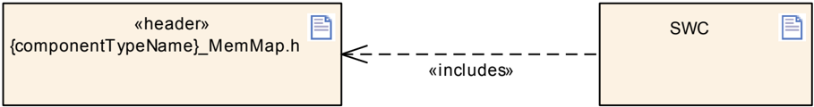

## 6. 功能规格

### 6.1. 总体问题

内存映射文件在头文件和源文件中包含用于内存分配的编译器专用和链接器专用关键字。这些关键字控制变量和函数到特定段的赋值。由此，实现与编译器和微控制器特定的属性无关。段到专用内存区域/地址范围的赋值不在内存映射文件的范围内，通常通过链接器控制文件完成。

对于每个构建场景（例如引导加载程序、**ECU** 应用），必须提供一套自己的内存映射文件。

内存映射文件名对基础软件模块应为 `{Mip}_MemMap.h`，对软件组件应为 `{componentTypeName}_MemMap.h`，其中 `{Mip}` 是模块实现前缀，`{componentTypeName}` 是软件组件类型的名称。

**注意：**`{Mip}` 的信息取自相关 **BSW** 模块的基础软件模块描述，如 [5.1.2](#512-头文件结构) 节所述。

如果编译器/链接器不需要特定命令来实现 **SWS** 内存映射的功能，则内存分配关键字定义可以未定义而不产生进一步影响。

如果编译器/链接器不支持 **BSW** 模块或软件组件所使用的 [**MemorySection**](#1114-memorysection) 种类所必需的强制性功能，则内存分配关键字应定义为引发错误。

**示例 7.1**

```
1 #ifdef EEP_START_SEC_VAR_CLEARED_16
2 #undef EEP_START_SEC_VAR_CLEARED_16
3 #endif
```

如 [5.1.2](#512-头文件结构) 节所述，文件的数量取决于输入配置中 [**SwComponentType**](#1121-swcomponenttype) 的数量。为了确定 [**MemorySection**](#1114-memorysection) 的数量，必须已知适用的 [**SwcImplementation**](#1122-swcimplementation)。在 **AUTOSAR** 环境中，这些通过 [**SystemMapping**](#1125-systemmapping) 中的 [**SwcToImplMapping**](#1124-swctoimplmapping) 以及/或者 **RteSwComponentType** 容器中的 **ECU** 配置值 **RteImplementationRef** 来描述。

已知 [**SwcImplementation**](#1122-swcimplementation) 也就提供了必须为 [6.2.2](#622-对内存映射头文件的要求) 节识别的 [**MemorySection**](#1114-memorysection) 的数量。关于 [**SwcImplementation**](#1122-swcimplementation) 内容的更多细节，请参阅文档 [\[4\]](#ref-4) 和 [\[5\]](#ref-5)。

此外，所使用的 [**MemorySection**](#1114-memorysection) 的总数还取决于所用 **BSW** 模块的数量。这些可以通过引用 **MemMap** 的 [**EcucModuleConfigurationValues**](#117-ecucmoduleconfigurationvalues) 的 **M1** 实例的 [**EcucValueCollection**](#118-ecucvaluecollection) 来确定。该 [**EcucValueCollection**](#118-ecucvaluecollection) 还引用其他 **Bsw** 模块的 [**EcucModuleConfigurationValues**](#117-ecucmoduleconfigurationvalues)，后者又通过模块描述引用再次引用 [**BswImplementation**](#114-bswimplementation)。已知 [**BswImplementation**](#114-bswimplementation) 也就提供了必须为 [6.2.2](#622-对内存映射头文件的要求) 节识别的 [**MemorySection**](#1114-memorysection) 的数量。关于 [**BswImplementation**](#114-bswimplementation) 内容的更多细节，请参阅文档 [\[5\]](#ref-5)。

在文档 [\[6\]](#ref-6) 中进一步说明了内存映射在 **AUTOSAR** 方法学中是如何使用的。

### 6.2. 变量和代码的映射

#### 6.2.1. 对使用内存映射头文件的 BSW 模块和软件组件的实现要求

关于在 C 实现中应按何种粒度分配不同类型的变量和代码，本节给出了建议。所引用的小节 [6.2.1.3](#6213-变量段) 和 [6.2.1.4](#6214-常量段和标定段) 以及小节 [6.2.1.5](#6215-代码段) 定义了这些内存分配关键字的推荐名称。尽管如此，实现可以偏离这些建议，例如为了实现附加需求。

每个 **AUTOSAR** 基础软件模块和软件组件都应支持配置至少以下不同的段类型：

- **VAR**，如 [6.2.1.3](#6213-变量段) 节所述。
- **VAR_FAST**，如 [6.2.1.3](#6213-变量段) 节所述。
- **VAR_SLOW**，如 [6.2.1.3](#6213-变量段) 节所述。
- **INTERNAL_VAR**，如 [6.2.1.3](#6213-变量段) 节所述。
- **VAR_SAVED_ZONE**，如 [6.2.1.3](#6213-变量段) 节所述。
- **CONST**，如 [6.2.1.4](#6214-常量段和标定段) 节所述。
- **CONST_SAVED_RECOVERY_ZONE**，如 [6.2.1.4](#6214-常量段和标定段) 节所述。
- **CONFIG_DATA**，如 [6.2.1.4](#6214-常量段和标定段) 节所述。
- **CALIB**，如 [6.2.1.4](#6214-常量段和标定段) 节所述。
- **CODE**，如 [6.2.1.5](#6215-代码段) 节所述。
- **CODE_FAST**，如 [6.2.1.5](#6215-代码段) 节所述。
- **CODE_SLOW**，如 [6.2.1.5](#6215-代码段) 节所述。
- **CALLOUT_CODE**，如 [6.2.1.5](#6215-代码段) 节所述。

允许添加模块专用的段，因为这些段已被映射，因而可以在该模块的配置文件中配置。

缩写 `{ALIGNMENT}` 表示典型的变量对齐方式。为了避免内存间隙，对于预期变量数量较多的内存段种类（例如 **VAR**），变量按其大小分别分配。由此，为不同元素大小的变量定义具有不同 `{ALIGNMENT}` 后缀的内存段是实现者的任务，如下所述。

集成者负责通过适当的内存映射配置（即使用适当的对齐 #pragma，或完全省略它们以让编译器自行决定）来确保相应大小的对象满足平台特定的对齐要求。由此，实际的对齐方式可以与 `{ALIGNMENT}` 后缀不同。

**BOOLEAN**，用于大小为 1 位的变量和常量。

**8**，用于通常必须按 8 位对齐的变量和常量。例如用于大小为 8 位的变量和常量，或用于组合数据类型：包含最大 8 位元素的数组、结构体和联合体。

**16**，用于通常必须按 16 位对齐的变量和常量。例如用于大小为 16 位的变量和常量，或用于组合数据类型：包含最大 16 位元素的数组、结构体和联合体。

**32**，用于通常必须按 32 位对齐的变量和常量。例如用于大小为 32 位的变量和常量，或用于组合数据类型：包含最大 32 位元素的数组、结构体和联合体。

**64**，用于通常必须按 64 位对齐的变量和常量。例如用于大小为 64 位的变量和常量，或用于组合数据类型：包含最大 64 位元素的数组、结构体和联合体。

**PTR**，用于其值为另一个变量地址的变量和常量，即所谓的指针。

**UNSPECIFIED**，用于大小（对齐方式）不符合 8 位、16 位、32 位、64 位或 **PTR** 标准的变量、常量、结构体、数组和联合体。例如用于大小未知的变量和常量。

在结构体和联合体的情况下，允许使用大于元素位宽的对齐方式。例如，为便于使用复制指令，结构体可以具有最小 2 字节对齐，即使其成员按字节对齐。在这种情况下，应当可以使用 16 位对齐代替该结构体的 8 位对齐。

**注意：**某些目标体系结构（例如 **TriCore**）的（嵌入式）应用二进制接口（**(E)ABI**）会根据结构体的大小对聚合类型（例如结构体）施加附加的对齐要求。在为这些聚合类型的变量和常量选择内存分配关键字的 `{ALIGNMENT}` 后缀时，不需要考虑这些附加约束。

缩写 `{INIT_POLICY}` 表示变量的初始化策略。可能的 `{INIT_POLICY}` 后缀为：

- **CLEARED**，用于未显式初始化的变量。
- **INIT**，用于已初始化的变量。这通常是显式初始化的变量，但也可以用于未显式初始化的变量，以便混合使用两种类型来处理遗留代码。
- **POWER_ON_CLEARED**，用于在正常启动期间未被显式初始化（清零）的变量。相反，这些变量仅在微控制器的上电复位之后，或在电池备份存储器自身因电池电量耗尽而发生上电复位之后才被清零。

更多细节和示例请参阅下表。

**注意：**后缀 **NO_INIT** 和 **POWER_ON_INIT** 仍然受支持，但已弃用，并将在接下来的某个版本中移除。

对于那些可能在程序流的后续时刻才被初始化的变量，也应使用 **INIT** 或 **CLEARED**。**POWER_ON_CLEARED** 仅用于那些只需在复位后保留的变量。

为了优化启动时的初始化，软件供应商可以在 [**SwAddrMethod**](#1119-swaddrmethod) 名称内应用初始化策略细化，例如：

- `<PREFIX>_SEC_VAR_POWER_ON_CLEARED_RSTSAFE_QM_8`，用于表达复位安全的变量。
- `<PREFIX>_SEC_VAR_POWER_ON_CLEARED_NVRAM_QM_8`，用于表达该段包含 **NVRAM** 缓冲区。
- `<PREFIX>_SEC_VAR_POWER_ON_CLEARED_BATTERY_BACKUP_QM_8`，用于表达该存储器是专用的电池备份设备。
- `<PREFIX>_SEC_VAR_INIT_INDETERMINATE_QM_8`，用于表达该段包含 **NVRAM** 缓冲区。
- `<PREFIX>_SEC_VAR_INIT_SELFINIT_QM_8`，用于表达该存储器是专用的电池备份设备。

根据所使用的 [**SwAddrMethod**](#1119-swaddrmethod)，可以导出映射到单个 **ModeSet** 从而映射到目标项目中不同存储设备的选项。

**注意 1：**对于装备了纠错码（**ECC**）的微控制器/处理器，在因 **ECC** 丢失而发生欠压时，硬件需要初始化相应的存储器。这包括：

- 任何没有外部供电的“普通”系统 **RAM**，当微控制器电压降到阈值以下时需要被初始化，因为 **ECC** 码会失效。这通常发生在冷上电复位的情况下。
- 任何“待机”供电的 **RAM**，当待机电压降到阈值以下时需要被初始化，因为 **ECC** 码会失效。

因此，**POWER_ON_CLEARED** 符号不能存放在这些内存区域中。

**注意 2：**请注意，嵌入了 **LBIST**（**Logical Build In Self Test**，逻辑内建自测）、**MBIST**（**Memory Build In Self Test**，存储器内建自测）的微控制器/处理器在执行这些测试时会初始化指定数量的存储器。因此，这些存储设备不应用于 **POWER_ON_CLEARED**。

表7.1：初始化行为汇总（**Summary of Init Behavior**）

| 初始化策略 | 允许用于 | 类型 | 示例 | 初始化时间 | 行为 | 说明 |
|---|---|---|---|---|---|---|
| **CLEARED** | 未显式初始化的变量 | BSS | `uint8 my_bss; /* =0 */` | 任意复位 | 按照 C 标准（`6.7.8` 初始化条款第 10 条），所有对象都被初始化为 0 或空指针。 | 这通常用于具有静态存储持续时间的、未显式初始化的对象。 |
| **INIT** | 已初始化的变量 | DATA | `uint8 my_data=5;` | 任意复位、复制表执行 | 所有对象都按照其初始化器被初始化。 | 这通常用于具有静态存储持续时间的、已初始化或未显式初始化的对象。**注意：**根据所使用的编译器，由于 #pragma 数量有限，可能无法将 **DATA** 和 **BSS** 初始化合并。 |
| **INIT** | 已初始化的变量 | BSS | `uint8 my_bss; /* =0 */` | 任意复位、复制表执行 | 按照 C 标准（`6.7.8` 初始化条款第 10 条），所有对象都被初始化为 0 或空指针。 | 这通常用于具有静态存储持续时间的、已初始化或未显式初始化的对象。**注意：**根据所使用的编译器，由于 #pragma 数量有限，可能无法将 **DATA** 和 **BSS** 初始化合并。 |
| **POWER_ON_CLEARED** | 上电清零的变量 | BSS | `uint8 my_bss;` | 冷上电复位 | 所有对象都被初始化为 0 或空指针，但仅在冷上电复位或欠压复位时进行。它们在常规的暖复位（例如软件复位、看门狗复位、外部复位）时不会被覆写。 | 这偏离了 C 标准，因为具有静态存储持续时间的所有对象都应在程序启动之前被初始化（`5.1.2` 执行环境）。 |

在包含内存映射头文件之前使用的关键字应采用模板 `<PREFIX>_START_SEC_<NAME>` 或 `<PREFIX>_STOP_SEC_<NAME>`，其中：

- `<PREFIX>` 是 **BSW** 模块的 `<MIP>`，如果该 [**MemorySection**](#1114-memorysection) 未定义 [**SectionNamePrefix**](#1118-sectionnameprefix)。`<MIP>` 是按照 **SWS BSW General**（[\[2\]](#ref-2)）中规定的方式构建的大写模块实现前缀。

或者

- `<PREFIX>` 是 **BSW** 模块的 [**SectionNamePrefix**](#1118-sectionnameprefix) 的符号（区分大小写），如果该 [**MemorySection**](#1114-memorysection) 定义了 [**SectionNamePrefix**](#1118-sectionnameprefix)。或者
- `<PREFIX>` 是软件组件的 [**AtomicSwComponentType**](#112-atomicswcomponenttype) 的 shortName（区分大小写）。

并且

- `<NAME>` 是基础软件模块描述或软件组件描述中所描述的 [**MemorySection**](#1114-memorysection) 的 shortName（区分大小写），如果该 [**MemorySection**](#1114-memorysection) 未定义 symbol 属性。

或者

- `<NAME>` 是基础软件模块描述或软件组件描述中所描述的 [**MemorySection**](#1114-memorysection) 的符号（区分大小写），如果该 [**MemorySection**](#1114-memorysection) 定义了 symbol 属性。

**注意：**如果内存分配关键字在代码中应使用大写字母，那么基础软件模块描述或软件组件描述中的相关 [**MemorySection**](#1114-memorysection) 必须以大写字母命名。

`<NAME>` 部分可以包含以下 **ASIL** 关键字以表示限制/限定：{safety} = **QM**、**ASIL_A**、**ASIL_B**、**ASIL_C**、**ASIL_D**。

{safety} 标签是可选的，表示最大可能的安全级别。可以在内存映射头文件内部在项目中降级。如果没有添加 {safety} 关键字，则应视为默认为 **QM**（无任何 **ASIL** 限定）。

`<NAME>` 部分应包含以下 {coreScope} 关键字，其值为 **GLOBAL** 作为不带内存访问限制的可选默认值，以及 **LOCAL** 作为限制到一个期望核的内存访问的强制替代设置。

因此，**GLOBAL** 的 {coreScope} 值不应写入内存分配关键字以及 [**SwAddrMethod**](#1119-swaddrmethod) 名称中。

{coreScope} **LOCAL** 的使用仅限于为其指定的段类型。此外，对于段类型 **VAR**、**VAR_FAST**、**VAR_SLOW**、**INTERNAL_VAR**，{coreScope} 的使用仅允许用于 {INIT_POLICY} 等于 **CLEARED** 或 **INIT** 的情形。这一限制应降低内存布局的复杂性，并减少由于针对未初始化内存段的典型分配限制而产生的内存空洞数量。

详细汇总见下表。更多示例和使用提示见下文。

表7.2：核范围行为汇总（**Summary of Core Scope Behavior**）

| 内存分配关键字或 [**SwAddrMethod**](#1119-swaddrmethod) 中的核范围 | 有效用于 | 理由 | 适用于 |
|---|---|---|---|
| 未设置或 **GLOBAL** | 变量、代码、常量、配置数据、标定常量 | 符号可以由全局地址空间中的任意核访问（读、写、执行）。可以使用具有 **GLOBAL** 核范围的任何 **ModeSet** 作为分配目标。因此，可以使用其 **GLOBAL** **ModeSet** 将符号分配到靠近某个特定核的位置。**GLOBAL** 范围应用于任何应对其他 **BSW** 模块、**SWC** 或 **RTE** 可用的用户 **API**。 | **SWC**、**BSW**、**RTE**、**CDD** |
| **LOCAL** | 变量、代码、常量 | 局部符号只能由其被映射到的那个核访问（读、写、执行）。只能使用期望核的具有 **LOCAL** 核范围的 **ModeSet** 作为分配目标。 | **BSW**、**CDD** |

在这方面，文档 [\[4\]](#ref-4) 中定义了 [constr_1402]。

**示例：**

- `ADC_START_SEC_CODE` —— 分配到 **GLOBAL** 范围，因为 **GLOBAL** 是默认值。
- `PWM_KERNEL_START_SEC_CODE_LOCAL` —— 分配到 **LOCAL** 范围，并且可以使用唯一前缀映射到专用核。

最后，将同时具有 **GLOBAL** 和 **LOCAL** 属性的内存段映射到核特定的内存段是集成者的决定。对于 **GLOBAL**，如果大多数内存访问将发生在某个特定核上，则可以使用该分配目标来优化性能。

在使用 **LOCAL** 时，应注意访问该符号的调用树必须至少在正确的核上、或至多在正确核的正确的分区上执行。否则，可能发生内存保护错误或访问违规，这通常会导致硬件的异常行为。

关于如何恰当地使用 {coreScope} 的更多详细建议，可在文档 [\[7\]](#ref-7) 中找到。

对于所有段类型，`<NAME>` 部分都可以包含一个可选的厂商特定 {refinement} 标签。它应用于细化分配或初始化行为（仅变量）。所使用的值是厂商特定的，可自由选择。

**注意：**`<NAME>` 部分由 [**MemorySection**](#1114-memorysection).shortName 或 [**MemorySection**](#1114-memorysection).symbol 提供。为了提供安全信息，相应部分的名称必须是 [**MemorySection**](#1114-memorysection).shortName 或 [**MemorySection**](#1114-memorysection).symbol 的一部分。为了提供核范围限定，相应部分的名称必须是 [**MemorySection**](#1114-memorysection).shortName 或 [**MemorySection**](#1114-memorysection).symbol 的一部分。

因此，内存分配关键字的常用模式为

```
{PREFIX}_START_SEC_CALIB[_{refinement}][_{safety}]_{ALIGNMENT}
{PREFIX}_STOP_SEC_CALIB[_{refinement}][_{safety}]_{ALIGNMENT}
{PREFIX}_START_SEC_CODE[_{refinement}][_{safety}][_{coreScope}]
{PREFIX}_STOP_SEC_CODE[_{refinement}][_{safety}][_{coreScope}]
{PREFIX}_START_SEC_CONFIG_DATA_{configClass}[_{refinement}][_{safety}]_{ALIGNMENT}
{PREFIX}_STOP_SEC_CONFIG_DATA_{configClass}[_{refinement}][_{safety}]_{ALIGNMENT}
{PREFIX}_START_SEC_CONST[_{refinement}][_{safety}][_{coreScope}]_{ALIGNMENT}
{PREFIX}_STOP_SEC_CONST[_{refinement}][_{safety}][_{coreScope}]_{ALIGNMENT}
{PREFIX}_START_SEC_VAR_{INIT_POLICY}[_{refinement}][_{safety}][_{coreScope}]_{ALIGNMENT}
{PREFIX}_STOP_SEC_VAR_{INIT_POLICY}[_{refinement}][_{safety}][_{coreScope}]_{ALIGNMENT}
```

这些应用于 [6.2.1.3](#6213-变量段) 和 [6.2.1.4](#6214-常量段和标定段) 以及 [6.2.1.5](#6215-代码段) 小节中提供的建议。

##### 6.2.1.1. 模块在可分配内存部分中的拆分

为了提高性能，一些多核体系结构采用核本地内存区域。因此，到特定内存区域的访问速度取决于执行代码所在的核。例如，一个通过主/从（**Master/Satellite**）方式实现多核能力的 **BSW** 模块，通常宜将其接口与“主”功能实现拆分。另一个用例是把具有若干不同特性的 **BSW** 模块拆分到不同的内存部分。这些内存部分通常由一组用于实现该特性的段（**CODE**、**CONST**、**VAR**）组成。这支持把这些内存部分分配给一组物理控制器存储器，且这些存储器靠近该特性的主要使用者。

当一个 **BSW** 模块被拆分为可分配内存部分时，如 [6.2.1](#621-对使用内存映射头文件的-bsw-模块和软件组件的实现要求) 节所述的 `<PREFIX>` 应按照文档 [\[5\]](#ref-5) 中的 [constr_4103] 构建。

当一个 **BSW** 模块被拆分为可分配内存部分时，所有相关的 [**MemorySection**](#1114-memorysection) 的 prefix 需要引用一个 [**SectionNamePrefix**](#1118-sectionnameprefix)。

**注意：**请参见 [6.3.5](#635-可分配内存部分) 节给出的示例。

表7.3：**BSW** 模块的段名前缀汇总（**Summary of Section Name Prefix for BSW Modules**）

| `<Msn>` | `<vi>` | `<ai>` | [SectionNamePrefix](#1118-sectionnameprefix).Symbol（如果定义了 [SectionNamePrefix](#1118-sectionnameprefix)） | 生成的前缀 |
|---|---|---|---|---|
| Fls | 142 | Ext | FLS_142_EXT_FEATURE | FLS_142_EXT_FEATURE |
| Fls | 142 | Ext | undefined | FLS_142_EXT |
| Adc | 无关紧要（don't care） | undefined | ADC_FEATURE | ADC_FEATURE |
| Adc | 无关紧要（don't care） | undefined | undefined | ADC |

##### 6.2.1.2. 配置常量与非配置常量

在 **AUTOSAR** **BSW** 模块的实现中，基本上存在两类不同的常量。

1. 用于实现可配置行为的常量。对于配置数据的不同配置类别（即放置在 `<Mip>_Lcfg.c` 和 `<Mip>_PBcfg.c` 中的全部内容），内存分配关键字的语法为：

```
{PREFIX}_START_SEC_CONFIG_DATA_{configClass}[_{refinement}][_{safety}]_{ALIGNMENT}
{PREFIX}_STOP_SEC_CONFIG_DATA_{configClass}[_{refinement}][_{safety}]_{ALIGNMENT}
```

**注意：**`{configClass}` 只能是 **PREBUILD** 或 **POSTBUILD**。其中 **PREBUILD** 同时代表预编译时（**Pre-Compile time**）和链接时（**Link time**）配置数据。

见表7.11。

2. 用于实现与 **AUTOSAR** 配置方法学无关的固定值的常量。对于非配置常量（即放置在 `<Mip>.[ch]` 或 `<Mip>_<[Implementation](#1111-implementation) Extension>.[ch]` 中的全部内容），内存分配关键字的语法为：

```
{PREFIX}_START_SEC_CONST[_{refinement}][_{safety}][_{coreScope}]_{ALIGNMENT}
{PREFIX}_STOP_SEC_CONST[_{refinement}][_{safety}][_{coreScope}]_{ALIGNMENT}
```

见表7.9。

##### 6.2.1.3. 变量段

以下表格定义了变量段的关键字：

表7.4：段类型 VAR（**Section Type VAR**）

| 内存分配关键字语法 | `{PREFIX}_START_SEC_VAR_{INIT_POLICY}[_{refinement}][_{safety}][_{coreScope}]_{ALIGNMENT}`<br>`{PREFIX}_STOP_SEC_VAR_{INIT_POLICY}[_{refinement}][_{safety}][_{coreScope}]_{ALIGNMENT}` |
|---|---|
| 描述 | 用于全部全局或静态变量。名称部分 `_{refinement}` 应用于细化分配或初始化行为。名称部分 `_{safety}` 应包含安全完整性等级，最多取以下字符串之一：**QM**、**ASIL_A**、**ASIL_B**、**ASIL_C**、**ASIL_D**。在 **QM** 的情况下，该名称部分可以省略。在相关的 [**SwAddrMethod**](#1119-swaddrmethod) 中，一个 option 属性应描述安全完整性等级，可能的取值为 {safetyQM, safetyAsilA, safetyAsilB, safetyAsilC, safetyAsilD}。在安全等级为 **QM** 的情况下，该属性可以省略。在相关的 [**SwAddrMethod**](#1119-swaddrmethod) 中，一个 option 属性应描述核范围限定，可能的取值为 {coreGlobal, coreLocal}。在 **coreGlobal** 的情况下，该属性可以省略。 |
| 内存段类型 | VAR |
| 段初始化策略 | {INIT_POLICY} |
| 状态 | - |

表7.5：段类型 VAR_FAST（**Section Type VAR_FAST**）

| 内存分配关键字语法 | `{PREFIX}_START_SEC_VAR_FAST_{INIT_POLICY}[_{refinement}][_{safety}][_{coreScope}]_{ALIGNMENT}`<br>`{PREFIX}_STOP_SEC_VAR_FAST_{INIT_POLICY}[_{refinement}][_{safety}][_{coreScope}]_{ALIGNMENT}` |
|---|---|
| 描述 | 用于全部全局或静态变量。用于具有以下至少一种属性的全部全局或静态变量：• 按位访问 • 频繁使用 • 在源代码中访问次数很多<br>某些平台允许对位于这一特定 **RAM** 区域中的变量使用位指令，也允许使用较短的寻址指令。这节省了代码和运行时间。名称部分 `_{refinement}` 应用于细化分配或初始化行为。名称部分 `_{safety}` 应包含安全完整性等级，最多取以下字符串之一：**QM**、**ASIL_A**、**ASIL_B**、**ASIL_C**、**ASIL_D**。在 **QM** 的情况下，该名称部分可以省略。在相关的 [**SwAddrMethod**](#1119-swaddrmethod) 中，一个 option 属性应描述安全完整性等级，可能的取值为 {safetyQM, safetyAsilA, safetyAsilB, safetyAsilC, safetyAsilD}。在安全等级为 **QM** 的情况下，该属性可以省略。在相关的 [**SwAddrMethod**](#1119-swaddrmethod) 中，一个 option 属性应描述核范围限定，可能的取值为 {coreGlobal, coreLocal}。在 **coreGlobal** 的情况下，该属性可以省略。 |
| 内存段类型 | VAR |
| 段初始化策略 | {INIT_POLICY} |
| 状态 | - |

表7.6：段类型 VAR_SLOW（**Section Type VAR_SLOW**）

| 内存分配关键字语法 | `{PREFIX}_START_SEC_VAR_SLOW_{INIT_POLICY}[_{refinement}][_{safety}][_{coreScope}]_{ALIGNMENT}`<br>`{PREFIX}_STOP_SEC_VAR_SLOW_{INIT_POLICY}[_{refinement}][_{safety}][_{coreScope}]_{ALIGNMENT}` |
|---|---|
| 描述 | 用于访问不频繁的全部全局或静态变量。名称部分 `_{refinement}` 应用于细化分配或初始化行为。名称部分 `_{safety}` 应包含安全完整性等级，最多取以下字符串之一：**QM**、**ASIL_A**、**ASIL_B**、**ASIL_C**、**ASIL_D**。在 **QM** 的情况下，该名称部分可以省略。在相关的 [**SwAddrMethod**](#1119-swaddrmethod) 中，一个 option 属性应描述安全完整性等级，可能的取值为 {safetyQM, safetyAsilA, safetyAsilB, safetyAsilC, safetyAsilD}。在安全等级为 **QM** 的情况下，该属性可以省略。在相关的 [**SwAddrMethod**](#1119-swaddrmethod) 中，一个 option 属性应描述核范围限定，可能的取值为 {coreGlobal, coreLocal}。在 **coreGlobal** 的情况下，该属性可以省略。 |
| 内存段类型 | VAR |
| 段初始化策略 | {INIT_POLICY} |
| 状态 | - |

表7.7：段类型 INTERNAL_VAR（**Section Type INTERNAL_VAR**）

| 内存分配关键字语法 | `{PREFIX}_START_SEC_INTERNAL_VAR_{INIT_POLICY}[_{refinement}][_{safety}][_{coreScope}]_{ALIGNMENT}`<br>`{PREFIX}_STOP_SEC_INTERNAL_VAR_{INIT_POLICY}[_{refinement}][_{safety}][_{coreScope}]_{ALIGNMENT}` |
|---|---|
| 描述 | 用于可从标定工具访问的全局或静态变量。名称部分 `_{refinement}` 应用于细化分配或初始化行为。名称部分 `_{safety}` 应包含安全完整性等级，最多取以下字符串之一：**QM**、**ASIL_A**、**ASIL_B**、**ASIL_C**、**ASIL_D**。在 **QM** 的情况下，该名称部分可以省略。在相关的 [**SwAddrMethod**](#1119-swaddrmethod) 中，一个 option 属性应描述安全完整性等级，可能的取值为 {safetyQM, safetyAsilA, safetyAsilB, safetyAsilC, safetyAsilD}。在安全等级为 **QM** 的情况下，该属性可以省略。在相关的 [**SwAddrMethod**](#1119-swaddrmethod) 中，一个 option 属性应描述核范围限定，可能的取值为 {coreGlobal, coreLocal}。在 **coreGlobal** 的情况下，该属性可以省略。 |
| 内存段类型 | VAR |
| 段初始化策略 | {INIT_POLICY} |
| 状态 | - |

表7.8：段类型 VAR_SAVED_ZONE（**Section Type VAR_SAVED_ZONE**）

| 内存分配关键字语法 | `{PREFIX}_START_SEC_VAR_SAVED_ZONE_{refinement}[_{safety}]_{ALIGNMENT}`<br>`{PREFIX}_STOP_SEC_VAR_SAVED_ZONE_{refinement}[_{safety}]_{ALIGNMENT}` |
|---|---|
| 描述 | 用于保存在非易失性存储器中的变量的 **RAM** 缓冲区。名称部分 `_{refinement}` 应至少表示所保存区域的具体内容。在相关的 [**SwAddrMethod**](#1119-swaddrmethod) 中，sectionInitializationPolicy 属性应设置为 **POWER-ON-CLEARED**。名称部分 `_{safety}` 应包含安全完整性等级，最多取以下字符串之一：**QM**、**ASIL_A**、**ASIL_B**、**ASIL_C**、**ASIL_D**。在 **QM** 的情况下，该名称部分可以省略。在相关的 [**SwAddrMethod**](#1119-swaddrmethod) 中，一个 option 属性应描述安全完整性等级，可能的取值为 {safetyQM, safetyAsilA, safetyAsilB, safetyAsilC, safetyAsilD}。在安全等级为 **QM** 的情况下，该属性可以省略。 |
| 内存段类型 | VAR |
| 段初始化策略 | POWER-ON-CLEARED |
| 状态 | - |

##### 6.2.1.4. 常量段和标定段

以下表格定义了常量段和标定段的关键字：

表7.9：段类型 CONST（**Section Type CONST**）

| 内存分配关键字语法 | `{PREFIX}_START_SEC_CONST[_{refinement}][_{safety}]_{ALIGNMENT}`<br>`{PREFIX}_STOP_SEC_CONST[_{refinement}][_{safety}]_{ALIGNMENT}` |
|---|---|
| 描述 | 用于全局或静态常量。名称部分 `_{refinement}` 是该 [**MemorySection**](#1114-memorysection) 中 **ExecutableEntity** 的典型周期时间值和时间单位。名称部分 `_{refinement}` 是可选的。单位为：• US 微秒 • MS 毫秒 • S 秒<br>例如：100US、400US、1MS、5MS、10MS、20MS、100MS、1S。请注意，由于集成决策（例如 **RTEEvent** 到任务的映射），偏离这一典型周期时间是有可能的。此外，在 **ECU** 的特殊模式下，代码可能以更高或更低的周期被调度。名称部分 `_{safety}` 应包含安全完整性等级，最多取以下字符串之一：**QM**、**ASIL_A**、**ASIL_B**、**ASIL_C**、**ASIL_D**。在 **QM** 的情况下，该名称部分可以省略。在相关的 [**SwAddrMethod**](#1119-swaddrmethod) 中，一个 option 属性应描述安全完整性等级，可能的取值为 {safetyQM, safetyAsilA, safetyAsilB, safetyAsilC, safetyAsilD}。在安全等级为 **QM** 的情况下，该属性可以省略。 |
| 内存段类型 | CONST |
| 段初始化策略 | - |
| 状态 | - |

表7.10：段类型 CONST_SAVED_RECOVERY_ZONE（**Section Type CONST_SAVED_RECOVERY_ZONE**）

| 内存分配关键字语法 | `{PREFIX}_START_SEC_CONST_SAVED_RECOVERY_ZONE_{refinement}[_{safety}]_{ALIGNMENT}`<br>`{PREFIX}_STOP_SEC_CONST_SAVED_RECOVERY_ZONE_{refinement}[_{safety}]_{ALIGNMENT}` |
|---|---|
| 描述 | 用于保存在非易失性存储器中的变量的 **ROM** 缓冲区。名称部分 `_{refinement}` 应至少表示所恢复区域的具体内容。名称部分 `_{safety}` 应包含安全完整性等级，最多取以下字符串之一：**QM**、**ASIL_A**、**ASIL_B**、**ASIL_C**、**ASIL_D**。在 **QM** 的情况下，该名称部分可以省略。在相关的 [**SwAddrMethod**](#1119-swaddrmethod) 中，一个 option 属性应描述安全完整性等级，可能的取值为 {safetyQM, safetyAsilA, safetyAsilB, safetyAsilC, safetyAsilD}。在安全等级为 **QM** 的情况下，该属性可以省略。 |
| 内存段类型 | CONST |
| 段初始化策略 | - |
| 状态 | - |

表7.11：段类型 CONFIG_DATA（**Section Type CONFIG_DATA**）

| 内存分配关键字语法 | `{PREFIX}_START_SEC_CONFIG_DATA_{configClass}[_{refinement}][_{safety}]_{ALIGNMENT}`<br>`{PREFIX}_STOP_SEC_CONFIG_DATA_{configClass}[_{refinement}][_{safety}]_{ALIGNMENT}` |
|---|---|
| 描述 | 具有表明其位于模块配置的一个段中的属性的常量。名称部分 `_{configClass}` 应包含 configClass，取以下字符串之一：**PREBUILD** 或 **POSTBUILD**。名称部分 `_{refinement}` 应用于细化内存分配关键字，以允许单独分配。名称部分 `_{safety}` 应包含安全完整性等级，最多取以下字符串之一：**QM**、**ASIL_A**、**ASIL_B**、**ASIL_C**、**ASIL_D**。在 **QM** 的情况下，该名称部分可以省略。在相关的 [**SwAddrMethod**](#1119-swaddrmethod) 中，一个 option 属性应描述安全完整性等级，可能的取值为 {safetyQM, safetyAsilA, safetyAsilB, safetyAsilC, safetyAsilD}。在安全等级为 **QM** 的情况下，该属性可以省略。在相关的 [**SwAddrMethod**](#1119-swaddrmethod) 中，一个 option 属性应描述 configClass，可能的取值为 {configClassPreBuild, configClassPostBuild}。 |
| 内存段类型 | CONFIG-DATA |
| 段初始化策略 | - |
| 状态 | - |

表7.12：段类型 CALIB（**Section Type CALIB**）

| 内存分配关键字语法 | `{PREFIX}_START_SEC_CALIB[_{refinement}][_{safety}]_{ALIGNMENT}`<br>`{PREFIX}_STOP_SEC_CALIB[_{refinement}][_{safety}]_{ALIGNMENT}` |
|---|---|
| 描述 | 用于标定常量。名称部分 `_{refinement}` 应用于细化内存分配关键字，以允许单独分配。名称部分 `_{safety}` 应包含安全完整性等级，最多取以下字符串之一：**QM**、**ASIL_A**、**ASIL_B**、**ASIL_C**、**ASIL_D**。在 **QM** 的情况下，该名称部分可以省略。在相关的 [**SwAddrMethod**](#1119-swaddrmethod) 中，一个 option 属性应描述安全完整性等级，可能的取值为 {safetyQM, safetyAsilA, safetyAsilB, safetyAsilC, safetyAsilD}。在安全等级为 **QM** 的情况下，该属性可以省略。 |
| 内存段类型 | CALPRM |
| 段初始化策略 | - |
| 状态 | - |

##### 6.2.1.5. 代码段

存在不同种类的可执行代码段。这些代码段应通过专用关键字来标识。如果某个段不被集成者和微控制器支持，则应注意该关键字会被忽略。下表定义了代码段的推荐关键字：

表7.13：段类型 CODE（**Section Type CODE**）

| 内存分配关键字语法 | `{PREFIX}_START_SEC_CODE[_{refinement}][_{safety}][_{coreScope}]`<br>`{PREFIX}_STOP_SEC_CODE[_{refinement}][_{safety}][_{coreScope}]` |
|---|---|
| 描述 | 用于将代码映射到应用块、引导块、外部闪存等。名称部分 `_{refinement}` 是该 [**MemorySection**](#1114-memorysection) 中 **ExecutableEntity** 的典型周期时间值和时间单位。名称部分 `_{refinement}` 是可选的。单位为：• US 微秒 • MS 毫秒 • S 秒<br>例如：100US、400US、1MS、5MS、10MS、20MS、100MS、1S。请注意，由于集成决策（例如 **RTEEvent** 到任务的映射），偏离这一典型周期时间是有可能的。此外，在 **ECU** 的特殊模式下，代码可能以更高或更低的周期被调度。名称部分 `_{safety}` 应包含安全完整性等级，最多取以下字符串之一：**QM**、**ASIL_A**、**ASIL_B**、**ASIL_C****、**ASIL_D**。在 **QM** 的情况下，该名称部分可以省略。名称部分 `_{coreScope}` 应包含核范围限定，最多取以下字符串之一：**GLOBAL**、**LOCAL**。在 **GLOBAL** 的情况下，该名称部分可以省略。在相关的 [**SwAddrMethod**](#1119-swaddrmethod) 中，一个 option 属性应描述安全完整性等级，可能的取值为 {safetyQM, safetyAsilA, safetyAsilB, safetyAsilC, safetyAsilD}。在安全等级为 **QM** 的情况下，该属性可以省略。在相关的 [**SwAddrMethod**](#1119-swaddrmethod) 中，一个 option 属性应描述核范围限定，可能的取值为 {coreGlobal, coreLocal}。在 **coreGlobal** 的情况下，该属性可以省略。 |
| 内存段类型 | CODE |
| 段初始化策略 | - |
| 状态 | - |

表7.14：段类型 CODE_FAST（**Section Type CODE_FAST**）

| 内存分配关键字语法 | `{PREFIX}_START_SEC_CODE_FAST[_{refinement}][_{safety}][_{coreScope}]`<br>`{PREFIX}_STOP_SEC_CODE_FAST[_{refinement}][_{safety}][_{coreScope}]` |
|---|---|
| 描述 | 用于必须放入快速代码存储段的代码。当执行不是以明确的周期时间发生，而是已知访问非常频繁和/或执行时间很长时，应使用 **FAST** 段。例如，用于频繁通知的回调。名称部分 `_{refinement}` 应用于细化内存分配关键字，以允许单独分配。名称部分 `_{safety}` 应包含安全完整性等级，最多取以下字符串之一：**QM**、**ASIL_A**、**ASIL_B**、**ASIL_C**、**ASIL_D**。在 **QM** 的情况下，该名称部分可以省略。名称部分 `_{coreScope}` 应包含核范围限定，最多取以下字符串之一：**GLOBAL**、**LOCAL**。在 **GLOBAL** 的情况下，该名称部分可以省略。在相关的 [**SwAddrMethod**](#1119-swaddrmethod) 中，一个 option 属性应描述安全完整性等级，可能的取值为 {safetyQM, safetyAsilA, safetyAsilB, safetyAsilC, safetyAsilD}。在安全等级为 **QM** 的的情况下，该属性可以省略。在相关的 [**SwAddrMethod**](#1119-swaddrmethod) 中，一个 option 属性应描述核范围限定，可能的取值为 {coreGlobal, coreLocal}。在 **coreGlobal** 的情况下，该属性可以省略。 |
| 内存段类型 | CODE |
| 段初始化策略 | - |
| 状态 | - |

表7.15：段类型 CODE_SLOW（**Section Type CODE_SLOW**）

| 内存分配关键字语法 | `{PREFIX}_START_SEC_CODE_SLOW[_{refinement}][_{safety}][_{coreScope}]`<br>`{PREFIX}_STOP_SEC_CODE_SLOW[_{refinement}][_{safety}][_{coreScope}]` |
|---|---|
| 描述 | 用于必须放入慢速代码存储段的代码。当执行不是以明确的周期时间发生，而是已知访问不频繁时，应使用 **SLOW** 段。例如，用于很少发生的错误情况下的回调。名称部分 `_{refinement}` 应用于细化内存分配关键字，以允许单独分配。名称部分 `_{safety}` 应包含安全完整性等级，最多取以下字符串之一：**QM**、**ASIL_A**、**ASIL_B**、**ASIL_C**、**ASIL_D**。在 **QM** 的情况下，该名称部分可以省略。名称部分 `_{coreScope}` 应包含核范围限定，最多取以下字符串之一：**GLOBAL**、**LOCAL**。在 **GLOBAL** 的情况下，该名称部分可以省略。在相关的 [**SwAddrMethod**](#1119-swaddrmethod) 中，一个 option 属性应描述安全完整性等级，可能的取值为 {safetyQM, safetyAsilA, safetyAsilB, safetyAsilC, safetyAsilD}。在安全等级为 **QM** 的情况下，该属性可以省略。在相关的 [**SwAddrMethod**](#1119-swaddrmethod) 中，一个 option 属性应描述核范围限定，可能的取值为 {coreGlobal, coreLocal}。在 **coreGlobal** 的情况下，该属性可以省略。 |
| 内存段类型 | CODE |
| 段初始化策略 | - |
| 状态 | - |

表7.16：段类型 CALLOUT_CODE（**Section Type CALLOUT_CODE**）

| 内存分配关键字语法 | `{PREFIX}_START_SEC_CALLOUT_CODE[_{refinement}][_{safety}][_{coreScope}]`<br>`{PREFIX}_STOP_SEC_CALLOUT_CODE[_{refinement}][_{safety}][_{coreScope}]` |
|---|---|
| 描述 | 用于映射 **BSW** 模块的回调（**callout**），这些回调通常应使用回调的全局链接器设置。名称部分 `_{refinement}` 应用于细化内存分配关键字，以允许单独分配。名称部分 `_{safety}` 应包含安全完整性等级，最多取以下字符串之一：**QM**、**ASIL_A**、**ASIL_B**、**ASIL_C**、**ASIL_D**。在 **QM** 的情况下，该名称部分可以省略。名称部分 `_{coreScope}` 应包含核范围限定，最多取以下字符串之一：**GLOBAL**、**LOCAL**。在 **GLOBAL** 的情况下，该名称部分可以省略。在相关的 [**SwAddrMethod**](#1119-swaddrmethod) 中，一个 option 属性应描述安全完整性等级，可能的取值为 {safetyQM, safetyAsilA, safetyAsilB, safetyAsilC, safetyAsilD}。在安全等级为 **QM** 的情况下，该属性可以省略。在相关的 [**SwAddrMethod**](#1119-swaddrmethod) 中，一个 option 属性应描述核范围限定，可能的取值为 {coreGlobal, coreLocal}。在 **coreGlobal** 的情况下，该属性可以省略。 |
| 内存段类型 | CODE |
| 段初始化策略 | - |
| 状态 | - |

每个 **AUTOSAR** 基础软件模块和软件组件应使用以下机制来包装代码、变量和常量的声明与定义：

1. 定义模块内存段的开始符号
2. 包含内存映射头文件
3. 声明/定义属于指定段的代码、变量或常量
4. 定义模块内存段的停止符号
5. 包含内存映射头文件

**注意：**在 1 至 5 之间不应添加其他预处理器代码。这将妨碍对源代码的正确解释，并导致之后的预处理器错误。

**注意：**对于始终以内联函数实现的代码，不要求使用内存分配关键字进行包装。

**提示：****AUTOSAR** 基础软件模块或 **AUTOSAR** 软件组件的实现不应依赖对象到默认段的隐式赋值，因为默认段的属性依赖于平台和工具。因此，这种代码实现风格不是平台无关的。

**提示：**对于使用 “Compiler.h” 的 **LOCAL_INLINE** 宏实现的代码，要求使用内存分配关键字进行包装。如果 **LOCAL_INLINE** 被设置为编译器的 inline 关键字，则相关的内存分配关键字不应定义任何链接器段赋值，也不应改变寻址行为，因为这已经由内联代码所在调用函数的环境所设置。如果 **LOCAL_INLINE** 被设置为空，则相关的内存分配关键字应像常规代码一样进行配置。对于使用 “Compiler.h” 的 **INLINE** 宏实现的代码，至少对于在 **INLINE** 被设置为空时仍然保留的代码，要求使用内存分配关键字进行包装。

**注意：**同样请注意，在基础软件模块描述中，与所用内存分配关键字相关的 [**MemorySection**](#1114-memorysection) 必须在 option 属性中说明 **INLINE** 和 **LOCAL_INLINE** 的使用。更多信息请参阅文档 [\[5\]](#ref-5)。

在文档 [\[4\]](#ref-4) 中预先定义了附加的 option 属性值 [TPS_SWCT_-01456]。

在代码中包含内存映射头文件违反 **MISRA**。由于既不包含可执行代码也不包含符号（只包含 pragma），该违规属于无副作用的已批准例外。

用于段控制的开始和停止符号通过内存映射头文件包含时所定义的段标识符进行配置。关于配置段的详细信息，请参阅“配置规范”。

**示例 7.2**

例如（**BSW** 模块）：

```
1 #define EEP_START_SEC_VAR_INIT_16
2 #include "Eep_MemMap.h"
3 static uint16 EepTimer = 100;
4 static uint16 EepRemainingBytes = 16;
5 #define EEP_STOP_SEC_VAR_INIT_16
6 #include "Eep_MemMap.h"
```

**示例 7.3**

例如（**SWC**）：

```
1 #define Abc_START_SEC_CODE
2 #include "Abc_MemMap.h"
3 /* ---Write a Code here */
4 #define Abc_STOP_SEC_CODE
5 #include "Abc_MemMap.h"
```

每个 **AUTOSAR** 基础软件模块和软件组件应支持为全部 C 对象配置到某一种内存类型（代码、变量和常量）的赋值。

内存映射头文件不应在函数体内部被包含。

该需求的目标是支持不支持在函数体内部使用 #pragma 的编译器。为了强制对函数的静态变量进行特殊的内存映射，必须将该变量移到文件静态作用域。

**提示：关于回调段的说明：**

根据文档 [\[2\]](#ref-2)，每个回调函数应使用一组独立的内存分配关键字。这在一方面为内存分配的配置提供了很高的灵活性。另一方面，这带来了为 **MemMap** 模块进行高配置工作量的风险，因为所有独立的内存段都必须为 **MemMap** 头文件生成而配置。为了简化这类回调段的集成，建议在基础软件模块描述中，所有描述回调且通常以相同链接器属性处理的 [**MemorySection**](#1114-memorysection) 都引用相同的 [**SwAddrMethod**](#1119-swaddrmethod)。按照 [6.2.1.5](#6215-代码段) 节“代码段”中推荐的内存段，由 **AUTOSAR** 定义的 [**SwAddrMethod**](#1119-swaddrmethod) 将具有以下引用路径：

```
/AUTOSAR_MemMap/SwAddrMethods/CALLOUT_CODE
```

例如：

```
<MEMORY-SECTION>
  <SHORT-NAME>COM_SOMECALLOUT_CODE</SHORT-NAME>
  <SW-ADDRMETHOD-REF DEST="SW-ADDR-METHOD">
    /AUTOSAR_MemMap/SwAddrMethods/CALLOUT_CODE
  </SW-ADDRMETHOD-REF>
</MEMORY-SECTION>
```

这使集成者既可以用 [**MemMapGenericMapping**](#925-memmapgenericmapping) 的方式配置所有内存段相同，又可以用 [**MemMapSectionSpecificMapping**](#926-memmapsectionspecificmapping) 的方式单独处理特殊情况。另请参见 [6.3.4](#634-回调段) 节的示例。

#### 6.2.2. 对内存映射头文件的要求

内存映射头文件应提供一种机制，通过检查用于开始某个段的模块特定内存分配关键字（见 [6.2.1](#621-对使用内存映射头文件的-bsw-模块和软件组件的实现要求) 节）来选择不同的代码段、变量段或常量段。在此选择之后声明的代码、变量或常量应被映射到该段。

每个 **BSW** 内存映射头文件都应支持用于开始和停止段的内存分配关键字，以覆盖属于输入配置中某个 [**BswImplementation**](#114-bswimplementation) 的每一个相关 [**MemorySection**](#1114-memorysection)。

如果 [**BswImplementation**](#114-bswimplementation) **未**包含 `requiredArtifact.[DependencyOnArtifact](#116-dependencyonartifact).category = MEMMAP` 的 [**DependencyOnArtifact**](#116-dependencyonartifact)，则在 [**BswImplementation**](#114-bswimplementation) 中定义的所有 [**MemorySection**](#1114-memorysection) 都属于 `{Mip}_MemMap.h` 内存映射头文件。

**注意：**另请参见 [5.1.2](#512-头文件结构) 节。

如果 [**BswImplementation**](#114-bswimplementation) 包含恰好一个 `requiredArtifact.[DependencyOnArtifact](#116-dependencyonartifact).category = MEMMAP` 的 [**DependencyOnArtifact**](#116-dependencyonartifact)，则在 [**BswImplementation**](#114-bswimplementation) 中定义的所有 [**MemorySection**](#1114-memorysection) 都属于由该 [**DependencyOnArtifact**](#116-dependencyonartifact) 的 `requiredArtifact.artifactDescriptor.shortLabel` 属性所定义的内存映射头文件。

**注意：**另请参见 [5.1.2](#512-头文件结构) 节。

如果 [**BswImplementation**](#114-bswimplementation) 包含恰好一个 `requiredArtifact.[DependencyOnArtifact](#116-dependencyonartifact).category = MEMMAP` 的 [**DependencyOnArtifact**](#116-dependencyonartifact)，则在 [**BswImplementation**](#114-bswimplementation) 中定义并与相同 [**SectionNamePrefix**](#1118-sectionnameprefix) 相关联的所有 [**MemorySection**](#1114-memorysection) 都属于由该 [**DependencyOnArtifact**](#116-dependencyonartifact) 的 `requiredArtifact.artifactDescriptor.shortLabel` 属性所定义的内存映射头文件，其中该 [**DependencyOnArtifact**](#116-dependencyonartifact) 由带有 `implementedIn` 引用的 [**SectionNamePrefix**](#1118-sectionnameprefix) 引用。

在这种情况下，[**BswImplementation**](#114-bswimplementation) 可以包含多个 `requiredArtifact.[DependencyOnArtifact](#116-dependencyonartifact).category = MEMMAP` 的 [**DependencyOnArtifact**](#116-dependencyonartifact)。这用于描述带有一个 [**BswModuleDescription**](#115-bswmoduledescription) 的 **ICC2** 集群。**注意：**另请参见 [5.1.2](#512-头文件结构) 节。

软件组件类型特定的内存映射头文件 `{componentTypeName}_MemMap.h` 应支持用于开始和停止段的内存分配关键字，以覆盖与该软件组件类型相关联的 [**SwcImplementation**](#1122-swcimplementation) 中定义的每一个 [**MemorySection**](#1114-memorysection)。

如果段宏在包含内存映射头文件之前被定义，则所选择的段应被激活。

段的选择应只影响链接器对代码、变量或常量三种对象类型之一的行为。

**提示：**一方面不允许创建组合段（例如代码段和常量段）。另一方面，编译器/链接器的设置必须以只改变所选段类型的设置为目的。例如，代码段的设置不应影响常量段的配置，反之亦然。

**示例 7.4**

```
1 #ifdef EEP_START_SEC_VAR_INIT_16
2 #undef EEP_START_SEC_VAR_INIT_16
3 #define START_SECTION_DATA_INIT_16
4 #elif
5 /* 6 将模块段映射到项目段的进一步映射
7 段
8 */
9 ...
10 #endif
11
12
13 #ifdef START_SECTION_DATA_INIT_16
14 #pragma section data "sect_data16"
15 #undef START_SECTION_DATA_INIT_16
16 #undef MEMMAP_ERROR
17 #elif
18 /* 19 用于切换项目段的进一步语句
20 */
21 ...
22 #endif
```

**提示：**这些代码段或变量段可用于分配来自多个模块的对象。

这些代码段或变量段也可用于分配来自同一模块的不同模块特定代码段或变量段的对象。

内存映射头文件应提供一种机制，通过检查用于停止某个段的模块特定内存分配关键字（见 [6.2.1](#621-对使用内存映射头文件的-bsw-模块和软件组件的实现要求) 节）来取消选择不同的代码段和变量段。

如果段宏在包含内存映射头文件之前被定义，则所选择的段应被去激活。在此选择之后声明的代码或变量应被映射到一个段中，该段收集来自 **BSW** 模块或软件组件实现的那些未处理的非精确对象。

**示例 7.5**

```
1 #ifdef EEP_STOP_SEC_CODE
2 #undef EEP_STOP_SEC_CODE
3 #define STOP_SECTION_COMMON_CODE
4 #elif
5 /* 6 将模块段映射到项目段的进一步映射
7 段
8 */
9 ...
10 #endif
11
12
13 /* 附加的模块特定映射 */
14 ...
15
16 #ifdef STOP_SECTION_COMMON_CODE
17 #pragma section code restore
18 #undef STOP_SECTION_COMMON_CODE
19 #undef MEMMAP_ERROR
20 #elif
21 /* 22 用于切换项目段的进一步语句
23 */
24 #endif
```

内存映射头文件应检查其是否以有效的内存映射符号和有效的顺序被包含（不允许 **START** 之前出现 **START**，也不允许在没有相应 **START** 的情况下出现 **STOP**）。这应通过预处理器检查来完成。

**示例 7.6**

由于确定未被内存分配关键字显式处理的存储器的预期属性是易出错的，通常以引起链接器错误的方式处理这些对象。可以使用默认段来捕获这些未处理的对象。

```
1 #define MEMMAP_ERROR
2
3 /* 4 将模块段映射到项目段的映射
5 和用于切换项目段的语句
6 */
7
8 ...
9 #elif STOP_SECTION_COMMON_CODE
10 #pragma section code restore
11 #undef STOP_SECTION_COMMON_CODE
12 #undef MEMMAP_ERROR
13 #endif
14
15 #ifdef MEMMAP_ERROR
16 #error "Eep_MemMap.h, wrong pragma command"
17 #endif
```

内存映射头文件应取消定义用于开始或停止段的模块或软件组件特定内存分配关键字。

**示例 7.7**

```
1 #ifdef EEP_STOP_SEC_CODE
2 #undef EEP_STOP_SEC_CODE
```

内存映射头文件应使用 if-else 结构以减少编译开销。

**示例 7.8**

例如：

```
1 #define MEMMAP_ERROR
2 ...
3 /* 模块和 ECU 特定的段映射 */
4 #if defined START_SECTION_COMMON_CODE
5 #pragma section ftext
6 #undef START_SECTION_COMMON_CODE
7 #undef MEMMAP_ERROR
8 #elif defined START_SECTION_UNBANKED_CODE
9 #pragma section code text
10 #undef START_SECTION_UNBANKED_CODE
11 #undef MEMMAP_ERROR
12 #elif defined ...
13 ...
14
15 #endif
```

### 6.3. 示例

本节中的示例应说明基础软件模块描述、软件组件描述、内存映射的 **ECU** 配置以及内存映射头文件之间的关系。

#### 6.3.1. 代码段

下面的示例展示 [**ApplicationSwComponentType**](#111-applicationswcomponenttype) “MySwc”，其 [**SwcInternalBehavior**](#1123-swcinternalbehavior) 中包含一个 [**RunnableEntity**](#1117-runnableentity) “Run1”。[**RunnableEntity**](#1117-runnableentity) “Run1” 引用 [**SwAddrMethod**](#1119-swaddrmethod) “CODE”，后者的 sectionType 属性被设置为 code。这表达了对该 [**RunnableEntity**](#1117-runnableentity) 的代码分配到名为 “CODE” 的代码段中的请求。

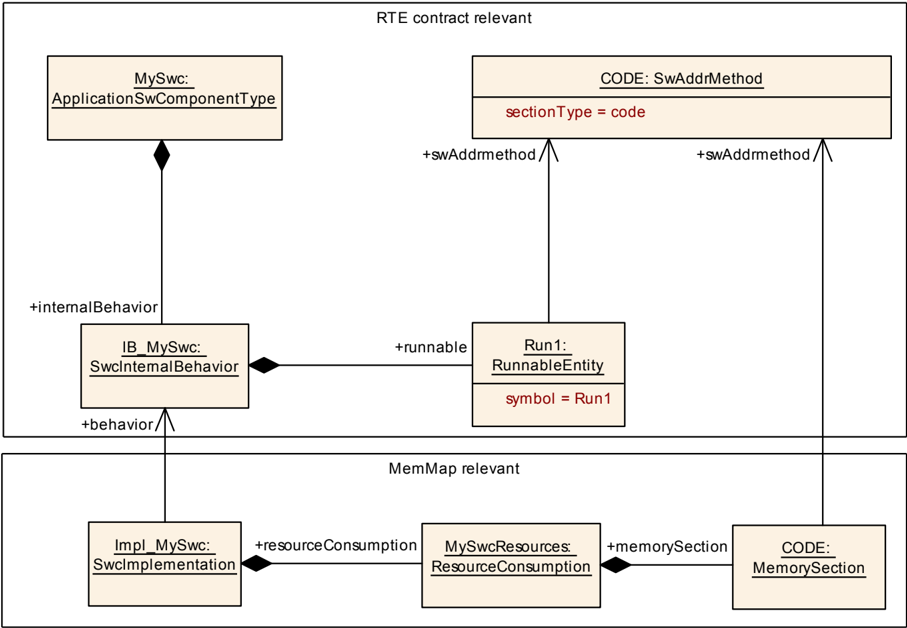

根据 **SWS RTE**（[\[8\]](#ref-8)），软件组件应用头文件中的 **Runnable** 实体原型被输出为：

**示例 7.9**

应用头文件 `Rte_MySwc.h` 中的 **Runnable** 实体原型，依据 SWS_Rte_7194

```C
1 #define MySwc_START_SEC_CODE
2 #include "MySwc_MemMap.h"
3
4 void MySwc_Run1(void);
5
6 #define MySwc_STOP_SEC_CODE
7 #include "MySwc_MemMap.h"
```

**注意：**请注意，对于“MySwc_Run1”函数的定义以及软件组件中所有其他应定位到相同 [**MemorySection**](#1114-memorysection) 的函数，必须使用相同的内存分配关键字。

与 [**ApplicationSwComponentType**](#111-applicationswcomponenttype) “MySwc” 相关联的 [**SwcImplementation**](#1122-swcimplementation) “Impl_MySwc” 定义了它使用名为 CODE 的 [**MemorySection**](#1114-memorysection)。[**MemorySection**](#1114-memorysection) “CODE” 引用 [**SwAddrMethod**](#1119-swaddrmethod) “CODE”。这表明模块特定的（抽象）内存段 CODE 与由 [**SwAddrMethod**](#1119-swaddrmethod) “CODE” 定义的共同寻址策略相结合。

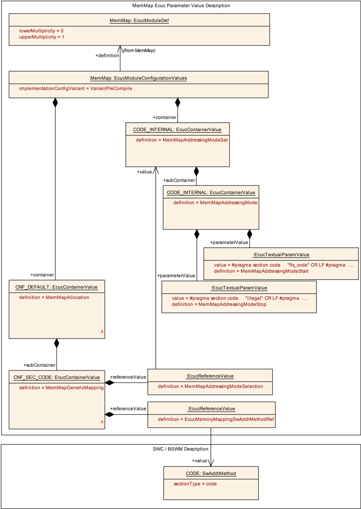

借助 [**MemMapGenericMapping**](#925-memmapgenericmapping) “CNF_SEC_CODE”，内存映射被配置为：所有引用 [**SwAddrMethod**](#1119-swaddrmethod) “CODE” 的模块特定（抽象）内存段都使用 [**MemMapAddressingModeSet**](#922-memmapaddressingmodeset) “CODE_INTERNAL”。[**MemMapAddressingModeSet**](#922-memmapaddressingmodeset) “CODE_INTERNAL” 通过使用相关的内存分配关键字，定义了开始和停止将代码映射到特定链接器段所需的适当语句。

借助内存分配头文件中这些信息，可以为软件组件生成如下内容：

**示例 7.10**

头文件 `MySwc_MemMap.h`，依据 [6.2.1](#621-对使用内存映射头文件的-bsw-模块和软件组件的实现要求) 节

```C
1
2 #ifdef MySwc_START_SEC_CODE
3 #pragma section_code "fls_code"
4 #pragma ...
5 #undef MySwc_START_SEC_CODE
6
7 #ifdef MySwc_STOP_SEC_CODE
8 #pragma section_code "illegal"
9 #undef MySwc_STOP_SEC_CODE
```

#### 6.3.2. 快速变量段

下面的示例展示 [**ApplicationSwComponentType**](#111-applicationswcomponenttype) “MySwc”，其 [**SwcInternalBehavior**](#1123-swcinternalbehavior) 中包含两个 [**VariableDataPrototype**](#1126-variabledataprototype) “FooBar” 和“EngSpd”。

[**VariableDataPrototype**](#1126-variabledataprototype) “FooBar” 引用一个 [**ImplementationDataType**](#1112-implementationdatatype)，该类型与定义 baseTypeSize = 8 的 [**SwBaseType**](#1120-swbasetype) 相关联。这表示实现“FooBar”的数据具有 8 位的变量大小。

[**VariableDataPrototype**](#1126-variabledataprototype) “EngSpd” 引用一个 [**ImplementationDataType**](#1112-implementationdatatype)，该类型与定义 baseTypeSize = 16 的 [**SwBaseType**](#1120-swbasetype) 相关联。这表示实现“EngSpd”的数据具有 16 位的变量大小。

两个 [**VariableDataPrototype**](#1126-variabledataprototype) 都引用 [**SwAddrMethod**](#1119-swaddrmethod) “VAR_FAST_INIT”，后者的 sectionType 属性被设置为“var”，且 memoryAllocationKeywordPolicy 被设置为 addrMethodShortNameAndAlignment。

这表示实现相关 [**VariableDataPrototype**](#1126-variabledataprototype) 的变量必须按其大小排序到不同的 [**MemorySection**](#1114-memorysection) 中。

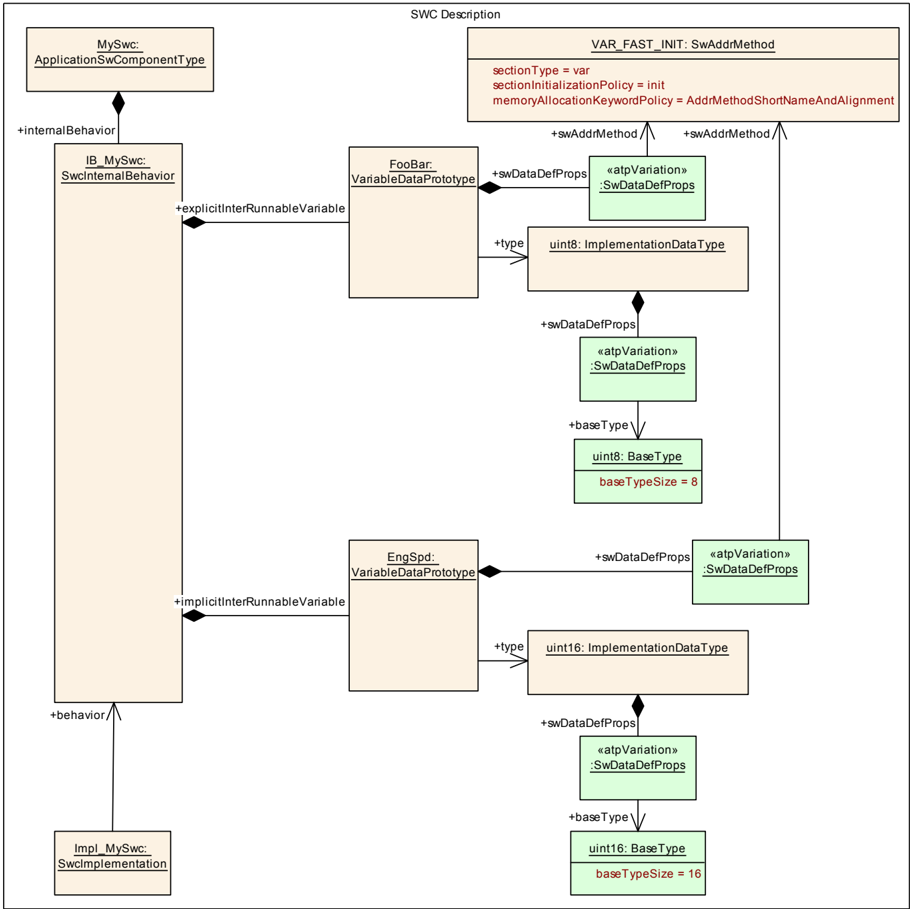

**注意：**请注意，在本示例中两个 [**VariableDataPrototype**](#1126-variabledataprototype) 都必须由 **RTE** 实现。**RTE** 同样必须提供定义所用 [**MemorySection**](#1114-memorysection) 的 **BSW** 模块描述。此外，**RTE** 可能分配额外的缓冲区，例如用于实现隐式通信行为。在本示例中，**RTE** 使用四个不同的 [**MemorySection**](#1114-memorysection) “VAR_FAST_INIT_8”、“VAR_FAST_INIT_16”、“VAR_FAST_INIT_TASK_BUF_8” 和“VAR_FAST_INIT_TASK_BUF_16”来按大小排序变量并分配额外的缓冲区。

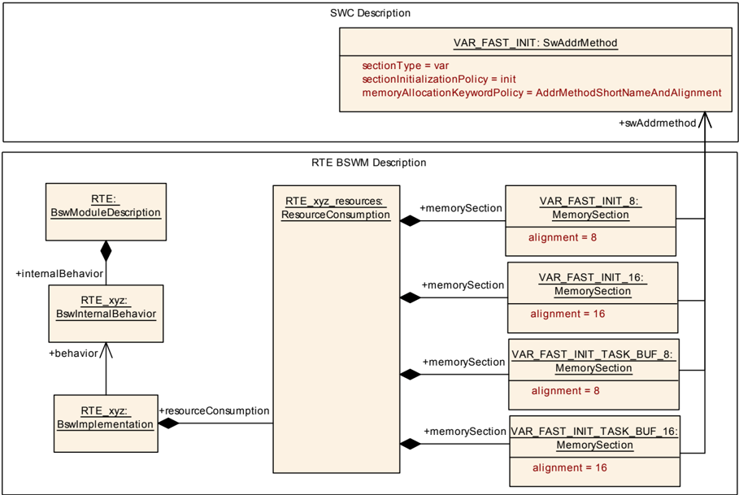

所有这些 [**MemorySection**](#1114-memorysection) 都与 [**SwAddrMethod**](#1119-swaddrmethod) “VAR_FAST_INIT” 相关联。这表明模块特定的（抽象）内存段“VAR_FAST_INIT_8”、“VAR_FAST_INIT_16”、“VAR_FAST_INIT_TASK_BUF_8”和“VAR_FAST_INIT_TASK_BUF_16”与由 [**SwAddrMethod**](#1119-swaddrmethod) “VAR_FAST_INIT” 定义的共同寻址策略相结合。

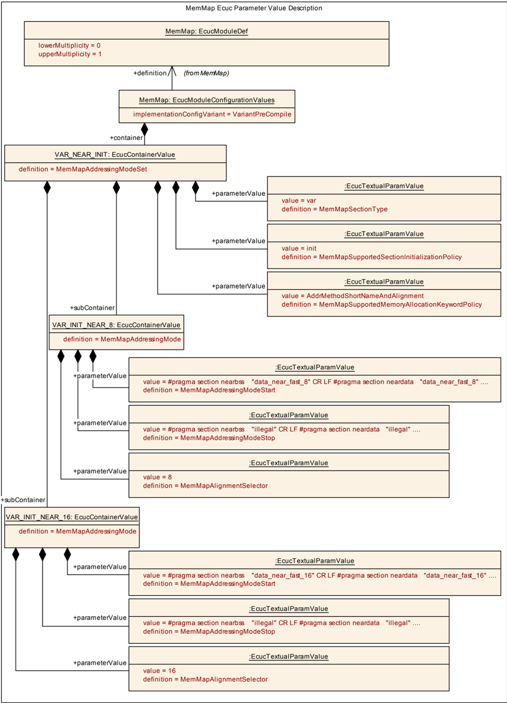

内存映射的 **ECU** 配置定义了 [**MemMapAddressingModeSet**](#922-memmapaddressingmodeset) “VAR_NEAR_INIT”。它支持 sectionType = var、sectionInitializationPolicy = “INIT” 和 memoryAllocationKeywordPolicy = addrMethodShortNameAndAlignment。在本示例中，针对对齐方式 8 和 16（**MemMapAlignmentSelector** = 8 和 **MemMapAlignmentSelector** = 16）展示了 [**MemMapAddressingMode**](#923-memmapaddressingmode)。

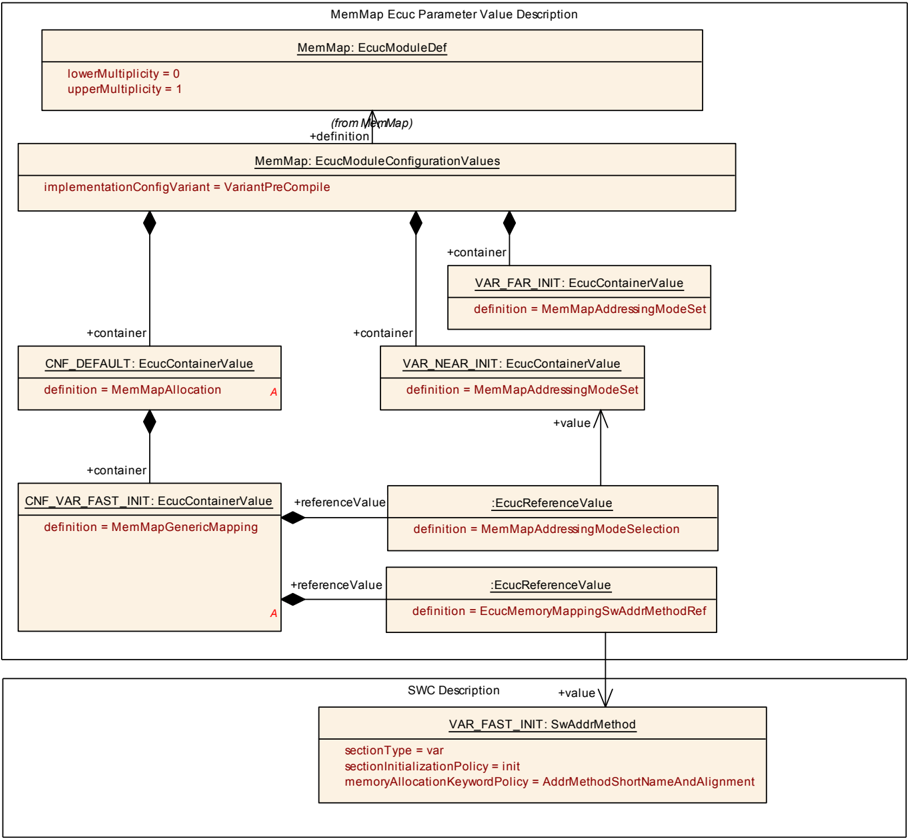

借助 [**MemMapGenericMapping**](#925-memmapgenericmapping) “CNF_VAR_FAST_INIT”，内存映射被配置为：所有引用 [**SwAddrMethod**](#1119-swaddrmethod) “VAR_FAST_INIT” 的模块特定（抽象）内存段都使用 [**MemMapAddressingModeSet**](#922-memmapaddressingmodeset) “VAR_NEAR_INIT”。[**MemMapAddressingModeSet**](#922-memmapaddressingmodeset) “VAR_NEAR_INIT” 通过使用相关的内存分配关键字，定义了开始和停止将具有不同对齐方式（在本示例中为 8 和 16）的变量映射到特定链接器段所需的适当语句。

借助内存分配头文件中这些信息，可以为 **BSW** 生成如下内容：

**示例 7.11**

内存映射头文件 `Rte_MemMap.h`

```C
1 #ifdef RTE_START_SEC_VAR_FAST_INIT_8
2 #pragma section nearbss "data_near_fast_8"
3 #pragma section neardata "data_near_fast_8"
4 ....
5 #pragma ...
6 #undef RTE_START_SEC_VAR_FAST_INIT_8
7
8 #ifdef RTE_STOP_SEC_VAR_FAST_INIT_8
9 #pragma section_code "illegal"
10 #undef RTE_STOP_SEC_VAR_FAST_INIT_8
11
12 #ifdef RTE_START_SEC_VAR_FAST_INIT_16
13 #pragma section nearbss "data_near_fast_16"
14 #pragma section neardata "data_near_fast_16"
15 ....
16 #pragma ...
17 #undef RTE_START_SEC_VAR_FAST_INIT_16
18
19 #ifdef RTE_STOP_SEC_VAR_FAST_INIT_16
20 #pragma section_code "illegal"
21 #undef RTE_STOP_SEC_VAR_FAST_INIT_16
22
23 #ifdef RTE_START_SEC_VAR_FAST_INIT_TASK_BUF_8
24 #pragma section nearbss "data_near_fast_8"
25 #pragma section neardata "data_near_fast_8"
26 ....
27 #pragma ...
28 #undef RTE_START_SEC_VAR_FAST_INIT_TASK_BUF_8
29
30 #ifdef RTE_STOP_SEC_VAR_FAST_INIT_TASK_BUF_8
31 #pragma section_code "illegal"
32 #undef RTE_STOP_SEC_VAR_FAST_INIT_TASK_BUF_8
33
34 #ifdef RTE_START_SEC_VAR_FAST_INIT_TASK_BUF_16
35 #pragma section nearbss "data_near_fast_16"
36 #pragma section neardata "data_near_fast_16"
37 ....
38 #pragma ...
39 #undef RTE_START_SEC_VAR_FAST_INIT_TASK_BUF_16
40
41 #ifdef RTE_STOP_SEC_VAR_FAST_INIT_TASK_BUF_16
42 #pragma section_code "illegal"
43 #undef RTE_STOP_SEC_VAR_FAST_INIT_TASK_BUF_16
```

#### 6.3.3. ICC2 集群中的代码段

下面的基础软件模块描述将导致内存映射头文件中支持内存分配关键字：

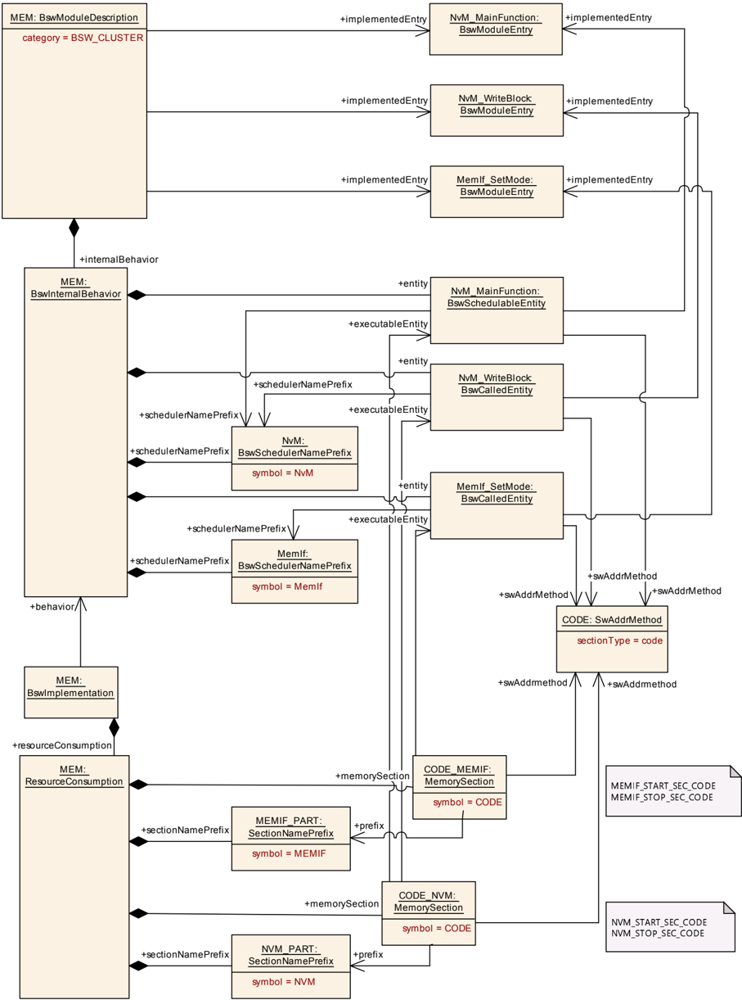

**示例 7.12**

内存映射头文件

```C
1 #ifdef NVM_START_SEC_CODE
2 ...
3 #ifdef NVM_STOP_SEC_CODE
4 ...
5 #ifdef MEMIF_START_SEC_CODE
6 ...
7 #ifdef MEMIF_STOP_SEC_CODE
```

#### 6.3.4. 回调段

下面的基础软件模块描述将导致内存映射头文件中支持内存分配关键字：

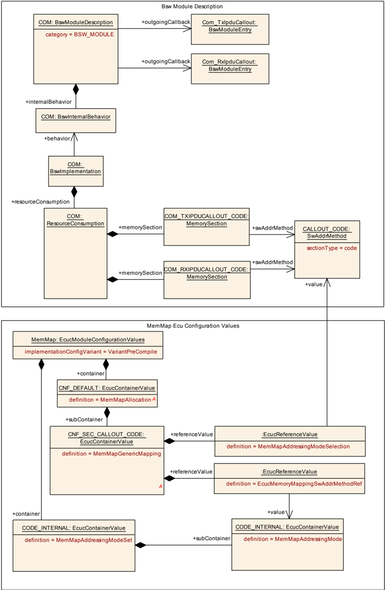

**示例 7.13**

包含 **CALLOUT_CODE** 示例的内存映射头文件。这些示例依据 `SEC_CALLOUT_CODE_<CN>` 构建，其中 `<CN>` 派生自图 7.8 中定义的 BswModuleEntry.ShortName。

```C
1 #ifdef COM_START_SEC_CALLOUT_CODE_COM_TXIPDUCALLOUT
2 ...
3 #ifdef COM_STOP_SEC_CALLOUT_CODE_COM_TXIPDUCALLOUT
4 ...
5 #ifdef COM_START_SEC_CALLOUT_CODE_COM_RXIPDUCALLOUT
6 ...
7 #ifdef COM_STOP_SEC_CALLOUT_CODE_COM_RXIPDUCALLOUT
```

尽管如此，两个内存段的实现是相同的，因为两者都引用相同的 [**SwAddrMethod**](#1119-swaddrmethod)，并且 **MemMap** 模块是使用 [**MemMapGenericMapping**](#925-memmapgenericmapping) 配置的。

#### 6.3.5. 可分配内存部分

下面的示例展示一个 **Adc** 驱动程序，其内部被拆分为接口部分和内核部分。通常，内核部分被分配到对处理中断的微控制器核心具有高性能的存储器中。相反，接口部分通常被分配到对使用 **Adc** 模块的所有微控制器核心都具有较好平均性能的存储器中。所展示的配置将导致在 `Adc_MemMap.h` 头文件中支持以下内存分配关键字：

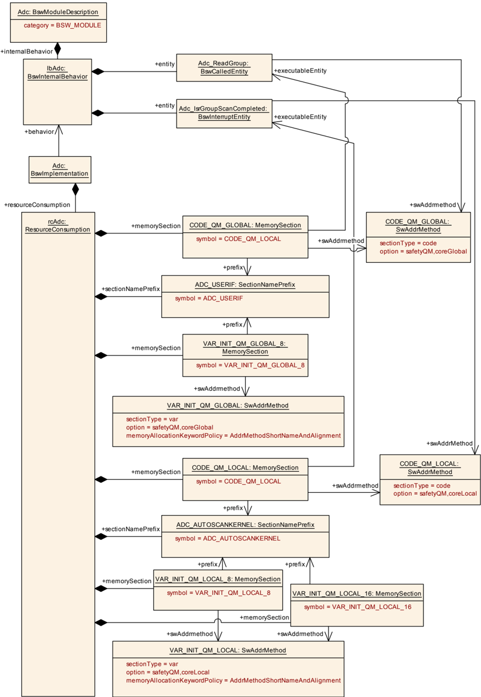

**示例 7.14**

`Adc_MemMap.h` 头文件

```C
1 #ifdef ADC_USERIF_START_SEC_CODE_QM_GLOBAL
2 ...
3 #ifdef ADC_USERIF_STOP_SEC_CODE_QM_GLOBAL
4 ...
5 #ifdef ADC_USERIF_START_SEC_VAR_INIT_QM_GLOBAL_8
6 ...
7 #ifdef ADC_USERIF_STOP_SEC_VAR_INIT_QM_GLOBAL_8
8 ...
9 #ifdef ADC_AUTOSCANKERNEL_START_SEC_CODE_QM_LOCAL
10 ...
11 #ifdef ADC_AUTOSCANKERNEL_STOP_SEC_CODE_QM_LOCAL
12 ...
13 #ifdef ADC_AUTOSCANKERNEL_START_SEC_VAR_INIT_QM_LOCAL_8
14 ...
15 #ifdef ADC_AUTOSCANKERNEL_STOP_SEC_VAR_INIT_QM_LOCAL_8
16 ...
17 #ifdef ADC_AUTOSCANKERNEL_START_SEC_VAR_INIT_QM_LOCAL_16
18 ...
19 #ifdef ADC_AUTOSCANKERNEL_STOP_SEC_VAR_INIT_QM_LOCAL_16
```

尽管如此，两个内存段的实现是相同的，因为两者都引用相同的 [**SwAddrMethod**](#1119-swaddrmethod)，并且 **MemMap** 模块是使用 [**MemMapGenericMapping**](#925-memmapgenericmapping) 配置的。

## 7. API规范

不适用。

## 8. 时序图

不适用。

## 9. 配置规范

### 9.1. 如何阅读本章

详情请参阅 **SWS_BSWGeneral**（[\[2\]](#ref-2)）第 10.1 章「配置规范简介」（**Introduction to configuration specification**）。

### 9.2. 容器与配置参数

以下各节汇总所有配置参数。各参数的详细含义见第 6 章。

#### 9.2.1. MemMap

| SWS 条目 | [ECUC_MemMap_00001] |
|---|---|
| 模块名称 | MemMap |
| 描述 | 内存映射模块的配置。 |
| Post-Build 变体支持 | false |
| 支持的配置变体 | VARIANT-PRE-COMPILE |

| 容器名称 | 多重性 | 作用域/依赖 |
|---|---|---|
| MemMapAddressingModeSet | 0..* | 定义一组可应用于某个 **SwAddrMethod** 的寻址模式。 |
| MemMapAllocation | 0..* | 定义 **BSW** 模块或软件组件的哪个 **MemorySection** 使用哪个 **MemMapAddressingModeSet** 实现。这既可以针对一组引用相同 **SwAddrMethod** 的 **MemorySection** 指定（**MemMapGenericMapping**），也可以针对各个 **MemorySection** 指定（**MemMapSectionSpecificMapping**）。如果对同一个 **MemorySection** 两者都已定义，则 **MemMapSectionSpecificMapping** 优先于 **MemMapGenericMapping**。 |

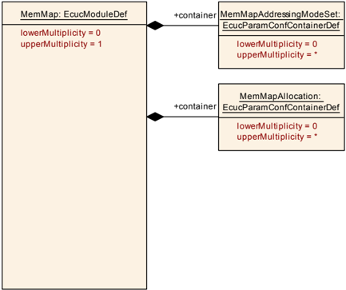

#### 9.2.2. MemMapAddressingModeSet

| SWS 条目 | [ECUC_MemMap_00002] |
|---|---|
| 容器名称 | MemMapAddressingModeSet |
| 父容器 | MemMap |
| 描述 | 定义一组可应用于某个 **SwAddrMethod** 的寻址模式。 |
| 配置参数 | 见下方参数表 |

| SWS 条目 | [ECUC_MemMap_00009] |
|---|---|
| 参数名称 | MemMapSupportedAddressingMethodOption |
| 父容器 | MemMapAddressingModeSet |
| 描述 | 这约束了该寻址模式集对 **SwAddrMethod** 的 **Generic Mapping** 的使用。通过 **MemMapGenericMapping** 映射到该 **MemMapAddressingModeSet** 的 **swAddrMethod** 的 option 属性应等于所配置的 **MemMapSupportedAddressingMethodOption** 之一。 |
| 多重性 | 0..* |
| 类型 | EcucStringParamDef |
| 默认值 | - |
| 正则表达式 | `[a-zA-Z]([a-zA-Z0-9]\|_[a-zA-Z0-9])*_?` |
| Post-Build 变体多重性 | false |
| Post-Build 变体值 | false |
| 多重性配置类 | Pre-compile time：X（All Variants）；Link time：-；Post-build time：- |
| 值配置类 | Pre-compile time：X（All Variants）；Link time：-；Post-build time：- |
| 作用域/依赖 | scope: ECU |

| SWS 条目 | [ECUC_MemMap_00017] |
|---|---|
| 参数名称 | MemMapSupportedMemoryAllocationKeywordPolicy |
| 父容器 | MemMapAddressingModeSet |
| 描述 | 这约束了该寻址模式集对 **SwAddrMethod** 的 **Generic Mapping** 的使用。通过 **MemMapGenericMapping** 映射到该 **MemMapAddressingModeSet** 的 **swAddrMethod** 的 **MemoryAllocationKeywordPolicy** 属性应等于所配置的 **MemMapSupportedMemoryAllocationKeywordPolicy** 之一。 |
| 多重性 | 0..* |
| 类型 | EcucEnumerationParamDef |
| 取值范围 | MEMMAP_ALLOCATION_KEYWORD_POLICY_ADDR_METHOD_SHORT_NAME：内存分配关键字由 **SwAddrMethod** 的 shortName 构成。如果该属性在 **SwAddrMethod** 中不存在，则这是默认值。 |
| 取值范围 | MEMMAP_ALLOCATION_KEYWORD_POLICY_ADDR_METHOD_SHORT_NAME_AND_ALIGNMENT：内存分配关键字由 **SwAddrMethod** 的 shortName 与 **MemorySection** 的 alignment 属性构成。这要求按对齐方式分离内存中的对象，且不适用于 **RunnableEntity** 和 **Bsw** 可调度实体。 |
| Post-Build 变体多重性 | false |
| Post-Build 变体值 | false |
| 多重性配置类 | Pre-compile time：X（All Variants）；Link time：-；Post-build time：- |
| 值配置类 | Pre-compile time：X（All Variants）；Link time：-；Post-build time：- |
| 作用域/依赖 | scope: ECU |

| SWS 条目 | [ECUC_MemMap_00008] |
|---|---|
| 参数名称 | MemMapSupportedSectionInitializationPolicy |
| 父容器 | MemMapAddressingModeSet |
| 描述 | 这约束了该寻址模式集对 **SwAddrMethod** 的 **Generic Mapping** 的使用。通过 **MemMapGenericMapping** 映射到该 **MemMapAddressingModeSet** 的 **swAddrMethod** 的 sectionIntializationPolicy 属性值应等于所配置的 **MemMapSupportedSectionIntializationPolicy** 之一。请注意 **SectionInitializationPolicyType** 描述了 **MemorySection** 的预期初始化。**AUTOSAR** 方法学中标准化了以下取值（见 6.2.1 节）：• INIT • CLEARED • POWER-ON-CLEARED<br>**注意：**取值 **NO-INIT** 和 **POWER-ON-INIT** 仍然受支持，但已弃用，并将在接下来的某个版本中移除。**注意：**这些取值的定义方式与 **XML** 模式中枚举类型的表示类似，以确保向后兼容。 |
| 多重性 | 0..* |
| 类型 | EcucStringParamDef |
| 默认值 | - |
| 正则表达式 | - |
| Post-Build 变体多重性 | false |
| Post-Build 变体值 | false |
| 多重性配置类 | Pre-compile time：X（All Variants）；Link time：-；Post-build time：- |
| 值配置类 | Pre-compile time：X（All Variants）；Link time：-；Post-build time：- |
| 作用域/依赖 | scope: ECU |

| SWS 条目 | [ECUC_MemMap_00007] |
|---|---|
| 参数名称 | MemMapSupportedSectionType |
| 父容器 | MemMapAddressingModeSet |
| 描述 | 这约束了该寻址模式集对 **SwAddrMethod** 的 **Generic Mapping** 的使用。通过 **MemMapGenericMapping** 或 **MemMapSectionSpecificMapping** 映射到该 **MemMapAddressingModeSet** 的 **swAddrMethod** 的 sectionType 属性应等于所配置的 **MemMapSupportedSectionType** 之一。 |
| 多重性 | 0..* |
| 类型 | EcucEnumerationParamDef |
| 取值范围 | MEMMAP_SECTION_TYPE_CAL_PRM：用于 **ECU** 功能的可标定常量。 |
| 取值范围 | MEMMAP_SECTION_TYPE_CODE：用于将代码映射到应用块、引导块、外部闪存等。 |
| 取值范围 | MEMMAP_SECTION_TYPE_CONFIG_DATA：具有表明其位于模块配置的一个段中的属性的常量。 |
| 取值范围 | MEMMAP_SECTION_TYPE_CONST：用于全局或静态常量。 |
| 取值范围 | MEMMAP_SECTION_TYPE_EXCLUDE_FROM_FLASH：存在于 **ECU** 中但未写入二进制文件的值。无需上载即可访问 **ECU** 数据。除上载外，仪表工具绝不会触及该 **ECU**。这些是下载可执行文件时不会被覆写的内存区域。 |
| 取值范围 | MEMMAP_SECTION_TYPE_VAR：用于全局或静态变量。预期初始化由 sectionInitializationPolicy 属性规定。 |
| Post-Build 变体多重性 | false |
| Post-Build 变体值 | false |
| 多重性配置类 | Pre-compile time：X（All Variants）；Link time：-；Post-build time：- |
| 值配置类 | Pre-compile time：X（All Variants）；Link time：-；Post-build time：- |
| 作用域/依赖 | scope: ECU |

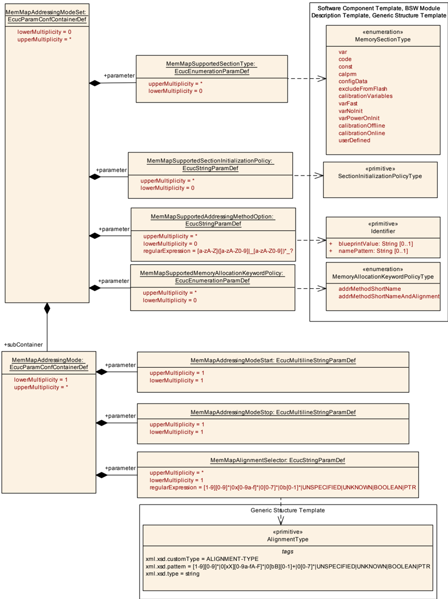

| 容器名称 | 多重性 | 作用域/依赖 |
|---|---|---|
| MemMapAddressingMode | 1..* | 定义一种寻址模式，其中包含一组实现段开始和停止的 #pragma 语句。 |

#### 9.2.3. MemMapAddressingMode

| SWS 条目 | [ECUC_MemMap_00003] |
|---|---|
| 容器名称 | MemMapAddressingMode |
| 父容器 | MemMapAddressingModeSet |
| 描述 | 定义一种寻址模式，其中包含一组实现段开始和停止的 #pragma 语句。 |
| 配置参数 | 见下方参数表 |

| SWS 条目 | [ECUC_MemMap_00004] |
|---|---|
| 参数名称 | MemMapAddressingModeStart |
| 父容器 | MemMapAddressingMode |
| 描述 | 定义一组实现段开始的 #pragma 语句。 |
| 多重性 | 1 |
| 类型 | EcucMultilineStringParamDef |
| 默认值 | - |
| 正则表达式 | - |
| Post-Build 变体值 | false |
| 值配置类 | Pre-compile time：X（All Variants）；Link time：-；Post-build time：- |
| 作用域/依赖 | scope: local |

| SWS 条目 | [ECUC_MemMap_00005] |
|---|---|
| 参数名称 | MemMapAddressingModeStop |
| 父容器 | MemMapAddressingMode |
| 描述 | 定义一组实现段开始的 #pragma 语句。 |
| 多重性 | 1 |
| 类型 | EcucMultilineStringParamDef |
| 默认值 | - |
| 正则表达式 | - |
| Post-Build 变体值 | false |
| 值配置类 | Pre-compile time：X（All Variants）；Link time：-；Post-build time：- |
| 作用域/依赖 | scope: local |

| SWS 条目 | [ECUC_MemMap_00006] |
|---|---|
| 参数名称 | MemMapAlignmentSelector |
| 父容器 | MemMapAddressingMode |
| 描述 | 定义 **MemMapAddressingMode** 所适用的对齐方式。所使用的对齐方式由 **MemorySection** 的 alignment 属性定义。如果 **MemMapAlignmentSelector** 与 **MemorySection** 的 alignment 属性相符，则应使用相关 **MemMapAddressingMode** 的 #pragma 集合来实现段的开始和停止。请注意，同一个 **MemMapAddressingMode** 可以适用于若干种对齐方式，例如“8”位和“UNSPECIFIED”。 |
| 多重性 | 1..* |
| 类型 | EcucStringParamDef |
| 默认值 | - |
| 正则表达式 | `[1-9][0-9]*\|0x[0-9a-f]*\|0[0-7]*\|0b[0-1]*\|UNSPECIFIED\|UNKNOWN\|BOOLEAN\|PTR` |
| Post-Build 变体多重性 | false |
| Post-Build 变体值 | false |
| 多重性配置类 | Pre-compile time：X（All Variants）；Link time：-；Post-build time：- |
| 值配置类 | Pre-compile time：X（All Variants）；Link time：-；Post-build time：- |
| 作用域/依赖 | scope: local |

无包含的容器。

#### 9.2.4. MemMapAllocation

| SWS 条目 | [ECUC_MemMap_00010] |
|---|---|
| 容器名称 | MemMapAllocation |
| 父容器 | MemMap |
| 描述 | 定义 **BSW** 模块或软件组件的哪个 **MemorySection** 使用哪个 **MemMapAddressingModeSet** 实现。这既可以针对一组引用相同 **SwAddrMethod** 的 **MemorySection** 指定（**MemMapGenericMapping**），也可以针对各个 **MemorySection** 指定（**MemMapSectionSpecificMapping**）。如果对同一个 **MemorySection** 两者都已定义，则 **MemMapSectionSpecificMapping** 优先于 **MemMapGenericMapping**。 |
| 配置参数 | 见下方参数表 |

| 容器名称 | 多重性 | 作用域/依赖 |
|---|---|---|
| MemMapGenericMapping | 0..* | 定义哪个 **SwAddrMethod** 使用哪个 **MemMapAddressingModeSet** 实现。用于实现 **MemorySelector** 关键字的 pragma 取自 **MemMapAddressingModeSet** 针对各个对齐方式的 **MemMapAddressingModeStart** 和 **MemMapAddressingModeStop** 参数。要使该映射有效，需要匹配的 **MemMapSupportedSectionType**、**MemMapSupportedSectionInitializationPolicy** 和 **MemMapSupportedAddressingMethodOption**。仅当没有 **MemMapSectionSpecificMapping** 凌驾其上时，**MemMapGenericMapping** 才适用。 |
| MemMapMappingSelector | 0..* | 该容器保存一个可供 **MemMapGenericMapping** 复用的段条件。 |
| MemMapSectionSpecificMapping | 0..* | 定义 **BSW** 模块或软件组件的哪个 **MemorySection** 使用哪个 **MemMapAddressingModeSet** 实现。用于实现 **MemorySelector** 关键字的 pragma 取自 **MemMapAddressingModeSet** 针对 **MemorySection** 特定对齐方式的 **MemMapAddressingModeStart** 和 **MemMapAddressingModeStop** 参数。**MemMapSectionSpecificMapping** 优先于 **MemMapGenericMapping** 所定义的映射。 |

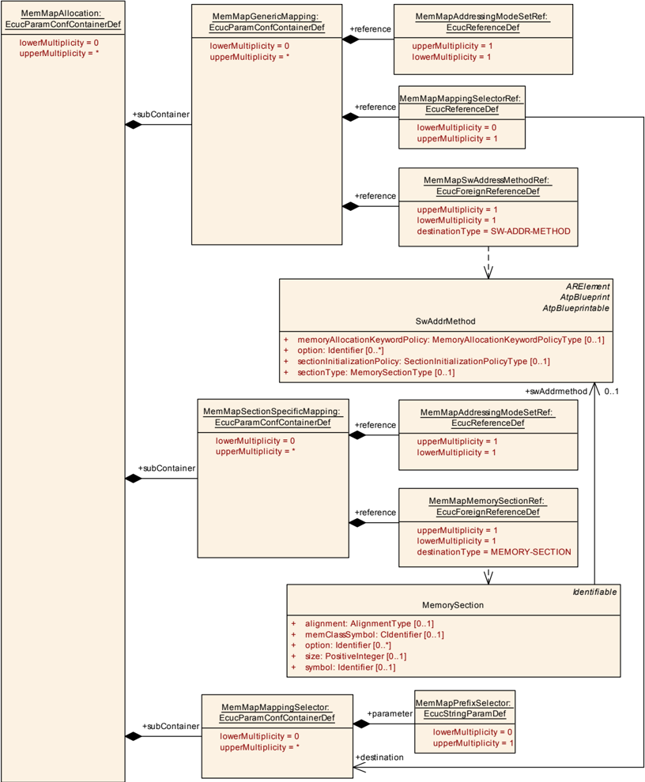

#### 9.2.5. MemMapGenericMapping

| SWS 条目 | [ECUC_MemMap_00011] |
|---|---|
| 容器名称 | MemMapGenericMapping |
| 父容器 | MemMapAllocation |
| 描述 | 定义哪个 **SwAddrMethod** 使用哪个 **MemMapAddressingModeSet** 实现。用于实现 **MemorySelector** 关键字的 pragma 取自 **MemMapAddressingModeSet** 针对各个对齐方式的 **MemMapAddressingModeStart** 和 **MemMapAddressingModeStop** 参数。要使该映射有效，需要匹配的 **MemMapSupportedSectionType**、**MemMapSupportedSectionInitializationPolicy** 和 **MemMapSupportedAddressingMethodOption**。仅当没有 **MemMapSectionSpecificMapping** 凌驾其上时，**MemMapGenericMapping** 才适用。 |
| 配置参数 | 见下方参数表 |

| SWS 条目 | [ECUC_MemMap_00012] |
|---|---|
| 参数名称 | MemMapAddressingModeSetRef |
| 父容器 | MemMapGenericMapping |
| 描述 | 对适用于 **MemMapGenericMapping** 的 **MemMapAddressingModeSet** 的引用。 |
| 多重性 | 1 |
| 类型 | Reference to MemMapAddressingModeSet |
| Post-Build 变体值 | false |
| 值配置类 | Pre-compile time：X（All Variants）；Link time：-；Post-build time：- |
| 作用域/依赖 | scope: ECU |

| SWS 条目 | [ECUC_MemMap_00023] |
|---|---|
| 参数名称 | MemMapMappingSelectorRef |
| 父容器 | MemMapGenericMapping |
| 描述 | 对 **MemMapPrefixSelector** 的引用。拥有它的 **MemMapGenericMapping** 仅对 **MemMapMappingSelector** 匹配的那些存储器有效。 |
| 多重性 | 0..1 |
| 类型 | Reference to MemMapMappingSelector |
| Post-Build 变体值 | false |
| 值配置类 | Pre-compile time：X（All Variants）；Link time：-；Post-build time：- |
| 作用域/依赖 | scope: ECU |

| SWS 条目 | [ECUC_MemMap_00013] |
|---|---|
| 参数名称 | MemMapSwAddressMethodRef |
| 父容器 | MemMapGenericMapping |
| 描述 | 对适用于 **MemMapGenericMapping** 的 **SwAddrMethod** 的引用。 |
| 多重性 | 1 |
| 类型 | Foreign reference to SW-ADDR-METHOD |
| Post-Build 变体值 | false |
| 值配置类 | Pre-compile time：X（All Variants）；Link time：-；Post-build time：- |
| 作用域/依赖 | scope: ECU |

无包含的容器。

#### 9.2.6. MemMapSectionSpecificMapping

| SWS 条目 | [ECUC_MemMap_00014] |
|---|---|
| 容器名称 | MemMapSectionSpecificMapping |
| 父容器 | MemMapAllocation |
| 描述 | 定义 **BSW** 模块或软件组件的哪个 **MemorySection** 使用哪个 **MemMapAddressingModeSet** 实现。用于实现 **MemorySelector** 关键字的 pragma 取自 **MemMapAddressingModeSet** 针对 **MemorySection** 特定对齐方式的 **MemMapAddressingModeStart** 和 **MemMapAddressingModeStop** 参数。**MemMapSectionSpecificMapping** 优先于 **MemMapGenericMapping** 所定义的映射。 |
| 配置参数 | 见下方参数表 |

| SWS 条目 | [ECUC_MemMap_00015] |
|---|---|
| 参数名称 | MemMapAddressingModeSetRef |
| 父容器 | MemMapSectionSpecificMapping |
| 描述 | 对适用于 **MemMapSectionSpecificMapping** 的 **MemMapAddressingModeSet** 的引用。 |
| 多重性 | 1 |
| 类型 | Reference to MemMapAddressingModeSet |
| Post-Build 变体值 | false |
| 值配置类 | Pre-compile time：X（All Variants）；Link time：-；Post-build time：- |
| 作用域/依赖 | scope: ECU |

| SWS 条目 | [ECUC_MemMap_00016] |
|---|---|
| 参数名称 | MemMapMemorySectionRef |
| 父容器 | MemMapSectionSpecificMapping |
| 描述 | 对适用于 **MemMapSectionSpecificMapping** 的 **MemorySection** 的引用。 |
| 多重性 | 1 |
| 类型 | Foreign reference to MEMORY-SECTION |
| Post-Build 变体值 | false |
| 值配置类 | Pre-compile time：X（All Variants）；Link time：-；Post-build time：- |
| 作用域/依赖 | scope: ECU |

无包含的容器。

#### 9.2.7. MemMapMappingSelector

| SWS 条目 | [ECUC_MemMap_00021] |
|---|---|
| 容器名称 | MemMapMappingSelector |
| 父容器 | MemMapAllocation |
| 描述 | 该容器保存一个可供 **MemMapGenericMapping** 复用的段条件。 |
| 配置参数 | 见下方参数表 |

| SWS 条目 | [ECUC_MemMap_00022] |
|---|---|
| 参数名称 | MemMapPrefixSelector |
| 父容器 | MemMapMappingSelector |
| 描述 | 参数 **MemMapPrefixSelector** 定义一个正则表达式，应应用于内存分配关键字的 `<PREFIX>` 部分。使用该选择器的映射仅对内存分配关键字的 `<PREFIX>` 部分与该正则表达式匹配的存储器有效。**注意：**这特别用于将 **MemMapAddressingModeSet** 的使用限制在 **BSW** 模块或软件组件的子集，或者 **BSW** 模块或软件组件内部可分配内存部分的子集。 |
| 多重性 | 0..1 |
| 类型 | EcucStringParamDef |
| 默认值 | - |
| 正则表达式 | - |
| Post-Build 变体值 | false |
| 值配置类 | Pre-compile time：X（All Variants）；Link time：-；Post-build time：- |
| 作用域/依赖 | scope: ECU |

无包含的容器。

### 9.3. 发布信息

详情请参阅 **SWS_BSWGeneral**（[\[2\]](#ref-2)）第 10.3 章「发布信息」（**Published Information**）。

## 10. 分析

本章不包含需求，只给出在不同编译器中所用关键字及其语法的概览。该分析对于方法和关键字的正确且完整的规范是必需的，并且基于文档 [\[9\]](#ref-9)、[\[10\]](#ref-10)、[\[11\]](#ref-11)、[\[12\]](#ref-12) 和 [\[13\]](#ref-13)。

### 10.1. 变量的内存分配

用于开始/停止变量内存段的编译器分析：

表11.1：变量的内存分配（**Memory allocation of variables**）

| 编译器 | 所需语法 |
|---|---|
| Cosmic, S12X | 已初始化变量：<br>`#pragma section {name}`<br>`#pragma section {}`<br>未初始化变量：<br>`#pragma section {[name]}`<br>`#pragma section []` |
| Metrowerks, S12X | `#pragma DATA_SEG (<Modif> <Name> \| "DEFAULT")`<br>`<Modif>`：可以使用以下字符串中的若干个：<br>SHORT、__SHORT_SEG、DIRECT、__DIRECT_SEG、NEAR、__NEAR_SEG、FAR、__FAR_SEG、DPAGE、__DPAGE_SEG、RPAGE、__RPAGE_SEG |
| Tasking, ST10 | `#pragma class mem=name`<br>`#pragma combine mem=ctype`<br>`#pragma align mem=atype`<br>`#pragma noclear`<br>`#pragma default_attributes`<br>`#pragma clear`<br>atype 是以下对齐类型之一：<br>B 字节对齐<br>W 字对齐<br>P 页对齐<br>S 段对齐<br>C PEC 可寻址<br>I IRAM 可寻址<br>ctype 是以下组合类型之一：<br>L 私有（'Local'）<br>P 公共<br>C 通用<br>G 全局<br>S Sysstack<br>U Usrstack<br>A address 绝对段 AT 常量地址（十进制、八进制或十六进制数） |
| Tasking, TC1796 | `#pragma pack 0 / 2`<br>结构体的打包。应在类型声明处可见<br>`#pragma section type "string"`<br>`#pragma noclear`<br>`#pragma clear`<br>`#pragma for_extern_data_use_memory`<br>`#pragma for_initialized_data_use_memory`<br>`#pragma for_uninitialized_data_use_memory` |
| GreenHills, V850 | `#pragma for_uninitialized_data_use_memory`<br>`#pragma align (n)`<br>`#pragma alignvar (n)`<br>`#pragma ghs section sect="name"`<br>`#pragma ghs section sect =default`<br>段关键字：<br>data、sdata、tdata、zdata、bss、sbss、zbss |
| ADS, ST30 | `#pragma arm section [sort_type[[=]"name"]] [,sort_type="name"]*`<br>sort_type="rwdata, zidata<br>通过关键字进行对齐控制：<br>__packed、__align() |
| DIABDATA, MPC5554 | `#pragma section class_name [init_name] [uninit_name] [address_mode] [access]`<br>`#pragma section class_name`<br>Pragma 应在声明之前使用。<br>变量的 class_name：<br>BSS、DATA、SDATA |

### 10.2. 常量变量的内存分配

用于开始/停止常量变量内存段的编译器分析：

表11.2：常量变量的内存分配（**Memory allocation of constant variables**）

| 编译器 | 所需语法 |
|---|---|
| Cosmic, S12X | 已初始化变量：<br>`#pragma section const {name}`<br>`#pragma section const {}` |
| Metrowerks, S12X | `#pragma CONST_SEG (<Modif> <Name> \| "DEFAULT")`<br>`<Modif>`：可以使用以下字符串中的若干个：<br>PPAGE、__PPAGE_SEG、GPAGE、__GPAGE_SEG<br>Pragma 应在定义和声明中使用。 |
| Tasking, ST10 | `#pragma class mem=name`<br>`#pragma align mem=atype`<br>`#pragma combine mem=ctype`<br>`#pragma default_attributes`<br>atype 是以下对齐类型之一：<br>B 字节对齐<br>W 字对齐<br>P 页对齐<br>S 段对齐<br>C PEC 可寻址<br>I IRAM 可寻址<br>ctype 是以下组合类型之一：<br>L 私有（'Local'）<br>P 公共<br>C 通用<br>G 全局<br>S Sysstack<br>U Usrstack<br>A address 绝对段 AT 常量地址（十进制、八进制或十六进制数） |
| Tasking, TC1796 | `#pragma pack 0 / 2`<br>结构体的打包。应在类型声明处可见<br>`#pragma section type "string"`<br>`#pragma for_constant_data_use_memory` |
| GreenHills, V850 | `#pragma ghs section sect="name"`<br>`#pragma ghs section sect =default`<br>段关键字：<br>rodata、rozdata、rosdata |
| ADS, ST30 | `#pragma arm section [sort_type[[=]"name"]] [,sort_type="name"]*`<br>sort_type="rodata<br>通过关键字进行对齐控制：<br>__packed、__align() |
| DIABDATA, MPC5554 | `#pragma section class_name [init_name] [uninit_name] [address_mode] [access]`<br>`#pragma section class_name`<br>Pragma 应在声明之前使用。<br>常量变量的 class_name：<br>CONST、SCONST、STRING |

### 10.3. 代码的内存分配

用于开始/停止代码内存段的编译器分析：

表11.3：代码的内存分配（**Memory allocation of code**）

| 编译器 | 所需语法 |
|---|---|
| Cosmic, S12X | 已初始化变量：<br>`#pragma section ( name )`<br>`#pragma section ()` |
| Metrowerks, S12X | `#pragma CODE_SEG (<Modif> <Name> \| "DEFAULT")`<br>`<Modif>`：可以使用以下字符串中的若干个：<br>DIRECT、__DIRECT_SEG、NEAR、__NEAR_SEG、CODE、__CODE_SEG、FAR、__FAR_SEG、PPAGE、__PPAGE_SEG、PIC、__PIC_SEG |
| Tasking, ST10 | `#pragma class mem=name`<br>`#pragma combine mem=ctype`<br>`#pragma default_attributes`<br>ctype 是以下组合类型之一：<br>L 私有（'Local'）<br>P 公共<br>C 通用<br>G 全局<br>S Sysstack<br>U Usrstack |
| Tasking, TC1796 | `#pragma section code "string"`<br>`#pragma section code_init`<br>`#pragma section const_init`<br>`#pragma section vector_init`<br>`#pragma section data_overlay`<br>`#pragma section type[=]"name"`<br>`#pragma section all` |
| GreenHills, V850 | `#pragma ghs section sect="name"`<br>`#pragma ghs section sect =default`<br>段关键字：<br>text |
| ADS, ST30 | `#pragma arm section [sort_type[[=]"name"]] [,sort_type="name"]*`<br>sort_type="code |
| DIABDATA, MPC5554 | `#pragma section class_name [init_name] [uninit_name] [address_mode] [access]`<br>`#pragma section class_name`<br>Pragma 应在声明之前使用。<br>代码的 class_name：<br>CODE |

## 11. 引用的元类

### 11.1. ApplicationSwComponentType

| 属性 | 值 |
| --- | --- |
| 类 | `ApplicationSwComponentType` |
| 包 | `M2::AUTOSARTemplates::SWComponentTemplate::Components` |
| 说明 | `ApplicationSwComponentType` 用于表示应用软件。标签: atp.recommendedPackage=SwComponentTypes |
| 基类 | `ARElement`, `ARObject`, `AtomicSwComponentType`, `AtpBlueprint`, `AtpBlueprintable`, `AtpClassifier`, `AtpType`, `CollectableElement`, `Identifiable`, `MultilanguageReferrable`, `PackageableElement`, `Referrable`, `SwComponentType` |
| 聚合自 | `ARPackage.element` |

### 11.2. AtomicSwComponentType

| 属性 | 值 |
| --- | --- |
| 类 | `AtomicSwComponentType`（抽象） |
| 包 | `M2::AUTOSARTemplates::SWComponentTemplate::Components` |
| 说明 | 原子软件组件之"原子性"体现在它不能被进一步分解并分布到多个 **ECU** 上。 |
| 基类 | `ARElement`, `ARObject`, `AtpBlueprint`, `AtpBlueprintable`, `AtpClassifier`, `AtpType`, `CollectableElement`, `Identifiable`, `MultilanguageReferrable`, `PackageableElement`, `Referrable`, `SwComponentType` |
| 子类 | `ApplicationSwComponentType`, `ComplexDeviceDriverSwComponentType`, `EcuAbstractionSwComponentType`, `NvBlockSwComponentType`, `SensorActuatorSwComponentType`, `ServiceProxySwComponentType`, `ServiceSwComponentType` |
| 聚合自 | `ARPackage.element` |
| 属性 | `internalBehavior` |
| 类型 | `SwcInternalBehavior` |
| 多重性 | `0..1` |
| 描述 | `AtomicSwComponentType` 所拥有的 `SwcInternalBehavior` 可以位于不同的物理文件中，因此该聚合是 <<atpSplitable>> 的。构造型: atpSplitable; atpVariation 标签: atp.Splitkey=internalBehavior.shortName, internalBehavior.variationPoint.shortLabel vh.latestBindingTime=preCompileTime |
| 属性 | `symbolProps` |
| 类型 | `SymbolProps` |
| 多重性 | `0..1` |
| 描述 | 表示该 `AtomicSwComponentType` 的 `SymbolProps`。构造型: atpSplitable 标签: atp.Splitkey=symbolProps.shortName |

### 11.3. BaseTypeDirectDefinition

| 属性 | 值 |
| --- | --- |
| 类 | `BaseTypeDirectDefinition` |
| 包 | `M2::MSR::AsamHdo::BaseTypes` |
| 说明 | 该基础类型是直接定义的（与派生的基础类型相对）。 |
| 基类 | `ARObject`, `BaseTypeDefinition` |
| 聚合自 | `BaseType.baseTypeDefinition` |
| 属性 | `baseTypeEncoding` |
| 类型 | `BaseTypeEncodingString` |
| 多重性 | `0..1` |
| 描述 | 规定当前 `BaseType` 的对象如何被编码，例如在 **ECU** 内、在报文序列中。标签: xml.sequenceOffset=90 |
| 属性 | `baseTypeSize` |
| 类型 | `PositiveInteger` |
| 多重性 | `0..1` |
| 描述 | 描述该容器中所规定数据类型的长度（以位为单位）。标签: xml.sequenceOffset=70 |
| 属性 | `byteOrder` |
| 类型 | `ByteOrderEnum` |
| 多重性 | `0..1` |
| 描述 | 该属性规定基础类型的字节序。标签: xml.sequenceOffset=110 |
| 属性 | `memAlignment` |
| 类型 | `PositiveInteger` |
| 多重性 | `0..1` |
| 描述 | 该属性描述内存对象的对齐方式（以位为单位）。例如 "8" 表示所讨论的对象按字节对齐，而 "32" 表示按 4 字节对齐。如果该值设置为 "0"，其含义应解释为"未规定"。标签: xml.sequenceOffset=100 |
| 属性 | `nativeDeclaration` |
| 类型 | `NativeDeclarationString` |
| 多重性 | `0..1` |
| 描述 | 该属性描述此类基础类型在原生编程语言（主要是 C 编程语言）中的声明。代码生成器随后可以利用它把必要的声明包含进头文件。例如：shortName 为 "MyUnsignedInt"、nativeDeclaration 为 "unsigned short" 的 `BaseType` 会生成 typedef unsigned short MyUnsignedInt;。如果未定义该属性，**RTE** 将不会把引用它的 `ImplementationDataType` 生成为 typedef。如果给定了 nativeDeclaration 类型，它应满足 `basetypeEncoding` 和 `baseTypeSize` 所给出的特征。这是为了保证软件组件、**RTE**、**COM** 和 **MCM** 系统对其进行一致的处理和解释所必需的。标签: xml.sequenceOffset=120 |

### 11.4. BswImplementation

| 属性 | 值 |
| --- | --- |
| 类 | `BswImplementation` |
| 包 | `M2::AUTOSARTemplates::BswModuleTemplate::BswImplementation` |
| 说明 | 除通用规范（`BswModuleDescription` 和 `BswBehavior`）之外，还包含实现相关的信息。可以有多个不同的 `BswImplementation` 引用同一个 `BswBehavior`。标签: atp.recommendedPackage=BswImplementations |
| 基类 | `ARElement`, `ARObject`, `CollectableElement`, `Identifiable`, `Implementation`, `MultilanguageReferrable`, `PackageableElement`, `Referrable` |
| 聚合自 | `ARPackage.element` |
| 属性 | `arReleaseVersion` |
| 类型 | `RevisionLabelString` |
| 多重性 | `0..1` |
| 描述 | 该实现所基于的 **AUTOSAR** 发行版的版本。版本号包含由 **AUTOSAR** 定义的三个级别（major、minor、revision）。 |
| 属性 | `behavior` |
| 类型 | `BswInternalBehavior` |
| 多重性 | `0..1` |
| 描述 | 该实现的行为。该关系被建模为关联，原因在于：• 它遵循 **SWCT** 的模式；• 由于 `ARElement` 不可拆分，而我们希望稍后再提供实现，因此 `BswImplementation` 并不聚合在 `BswBehavior` 中。 |
| 属性 | `preconfiguredConfiguration` |
| 类型 | `EcucModuleConfigurationValues` |
| 多重性 | `*` |
| 描述 | 对该 `BswImplementation` 的一组预配置（即固定）配置值的引用。如果该 `BswImplementation` 表示由多个模块组成的集群，则可以引用多个 `EcucModuleConfigurationValues` 元素（每个模块至多一个）；否则至多可以引用一个这样的元素。标签: xml.roleWrapperElement=true |
| 属性 | `recommendedConfiguration` |
| 类型 | `EcucModuleConfigurationValues` |
| 多重性 | `*` |
| 描述 | 对该模块或模块集群的一组或多组推荐配置值的引用。 |
| 属性 | `vendorApiInfix` |
| 类型 | `Identifier` |
| 多重性 | `0..1` |
| 描述 | 对于可在单个 **ECU** 上多次实例化的驱动模块，**SRS_BSW_00347** 要求文件名、**API**、已发布参数和内存分配关键字的名称都加上 vendorId 和一个供应商特定名称进行扩展。该参数用于规定该供应商特定名称。实现特定的 **API** 名称整体按如下方式生成：<模块名>_<vendorId>_<vendorApiInfix>_<SWS 中的 API 名>。例如，假设实现者的 vendorId 为 123，且实现者选择了 "v11r456" 作为 vendorApiInfix，则 SWS 中定义的 API 名 Can_Write 会转换为 Can_123_v11r456_Write。对于上限多重性 > 1 的所有模块，该属性是必需的；对于上限多重性 = 1 的模块，不应使用该属性。另见 **SWS_BSW_00102**。 |
| 属性 | `vendorSpecificModuleDef` |
| 类型 | `EcucModuleDef` |
| 多重性 | `*` |
| 描述 | 引用：• 当该 `BswImplementation` 表示单个模块时，其所使用的供应商特定 `EcucModuleDef`；• 当其表示模块集群时，其所使用的多个 `EcucModuleDef`；• 当其表示库时，其所使用的一个或零个 `EcucModuleDef`。标签: xml.roleWrapperElement=true |

### 11.5. BswModuleDescription

| 属性 | 值 |
| --- | --- |
| 类 | `BswModuleDescription` |
| 包 | `M2::AUTOSARTemplates::BswModuleTemplate::BswOverview` |
| 说明 | 描述单个 **BSW** 模块或 **BSW** 集群的根元素。当它描述一个 **BSW** 模块时，该元素的短名等于该 **BSW** 模块的名称。标签: atp.recommendedPackage=BswModuleDescriptions |
| 基类 | `ARElement`, `ARObject`, `AtpBlueprint`, `AtpBlueprintable`, `AtpClassifier`, `AtpFeature`, `AtpStructureElement`, `CollectableElement`, `Identifiable`, `MultilanguageReferrable`, `PackageableElement`, `Referrable` |
| 聚合自 | `ARPackage.element`, `AtpClassifier.atpFeature` |
| 属性 | `bswModuleDependency` |
| 类型 | `BswModuleDependency` |
| 多重性 | `*` |
| 描述 | 描述对另一个 **BSW** 模块的依赖。构造型: atpSplitable; atpVariation 标签: atp.Splitkey=bswModuleDependency.shortName, bswModuleDependency.variationPoint.shortLabel vh.latestBindingTime=preCompileTime xml.sequenceOffset=20 |
| 属性 | `bswModuleDocumentation` |
| 类型 | `SwComponentDocumentation` |
| 多重性 | `0..1` |
| 描述 | 为该 **BSW** 模块附加一份文档。构造型: atpSplitable; atpVariation 标签: atp.Splitkey=bswModuleDocumentation, bswModuleDocumentation.variationPoint.shortLabel vh.latestBindingTime=preCompileTime xml.sequenceOffset=6 |
| 属性 | `expectedEntry` |
| 类型 | `BswModuleEntry` |
| 多重性 | `*` |
| 描述 | 指示该模块所需的一个入口。替代原先的 outgoingCallback / requiredEntry。构造型: atpSplitable; atpVariation 标签: atp.Splitkey=expectedEntry.bswModuleEntry, expectedEntry.variationPoint.shortLabel vh.latestBindingTime=preCompileTime |
| 属性 | `implementedEntry` |
| 类型 | `BswModuleEntry` |
| 多重性 | `*` |
| 描述 | 规定由本模块提供、可被其他模块调用的一个入口。其中包括 "main" 函数、中断例程和回调。替代原先的 providedEntry / expectedCallback。构造型: atpSplitable; atpVariation 标签: atp.Splitkey=implementedEntry.bswModuleEntry, implementedEntry.variationPoint.shortLabel vh.latestBindingTime=preCompileTime |
| 属性 | `internalBehavior` |
| 类型 | `BswInternalBehavior` |
| 多重性 | `*` |
| 描述 | 与某个 `BswModuleDescription` 相关联的各 `BswInternalBehavior` 可以分布在多个物理文件中，因此该聚合是 <<atpSplitable>> 的。构造型: atpSplitable 标签: atp.Splitkey=internalBehavior.shortName xml.sequenceOffset=65 |
| 属性 | `moduleId` |
| 类型 | `PositiveInteger` |
| 多重性 | `0..1` |
| 描述 | 指由 **AUTOSAR** 标准定义的 **BSW** 模块标识符。对于非标准化模块，可以选择性地选用一个专有标识符。 |
| 属性 | `providedClientServerEntry` |
| 类型 | `BswModuleClientServerEntry` |
| 多重性 | `*` |
| 描述 | 规定本模块提供一个客户端-服务器入口，可从另一个分区或核调用。该入口在本语境中局部声明，并将通过 **BSW** 调度器的配置连接到另一个或同一个模块的 `requiredClientServerEntry`。构造型: atpSplitable; atpVariation 标签: atp.Splitkey=providedClientServerEntry.shortName, providedClientServerEntry.variationPoint.shortLabel vh.latestBindingTime=preCompileTime xml.sequenceOffset=45 |
| 属性 | `providedData` |
| 类型 | `VariableDataPrototype` |
| 多重性 | `*` |
| 描述 | 规定本模块提供的一个数据原型，以便从另一个分区或核读取。该 `providedData` 在本语境中局部声明，并将通过 **BSW** 调度器的配置连接到另一个或同一个模块的 `requiredData`。构造型: atpSplitable; atpVariation 标签: atp.Splitkey=providedData.shortName, providedData.variationPoint.shortLabel vh.latestBindingTime=preCompileTime xml.sequenceOffset=55 |
| 属性 | `providedModeGroup` |
| 类型 | `ModeDeclarationGroupPrototype` |
| 多重性 | `*` |
| 描述 | 由本模块或集群拥有并提供的一组模式。它可以通过 **BswScheduler** 的配置连接到其他模块或集群的 `requiredModeGroup`；也可以与由相关联的 `ServiceSwComponentType`、`EcuAbstractionSwComponentType` 或 `ComplexDeviceDriverSwComponentType` 经端口提供的模式同步。构造型: atpSplitable; atpVariation 标签: atp.Splitkey=providedModeGroup.shortName, providedModeGroup.variationPoint.shortLabel vh.latestBindingTime=preCompileTime xml.sequenceOffset=25 |
| 属性 | `releasedTrigger` |
| 类型 | `Trigger` |
| 多重性 | `*` |
| 描述 | 由本模块或集群释放的一个触发器。它可以通过 **BswScheduler** 的配置连接到其他模块或集群的 `requiredTrigger`；也可以与由相关联的 `ServiceSwComponentType`、`EcuAbstractionSwComponentType` 或 `ComplexDeviceDriverSwComponentType` 经端口提供的触发器同步。构造型: atpSplitable; atpVariation 标签: atp.Splitkey=releasedTrigger.shortName, releasedTrigger.variationPoint.shortLabel vh.latestBindingTime=preCompileTime xml.sequenceOffset=35 |
| 属性 | `requiredClientServerEntry` |
| 类型 | `BswModuleClientServerEntry` |
| 多重性 | `*` |
| 描述 | 规定本模块需要一个可以在另一个分区或核上实现的客户端-服务器入口。该入口在本语境中局部声明，并将通过 **BSW** 调度器的配置连接到另一个或同一个模块的 `providedClientServerEntry`。构造型: atpSplitable; atpVariation 标签: atp.Splitkey=requiredClientServerEntry.shortName, requiredClientServerEntry.variationPoint.shortLabel vh.latestBindingTime=preCompileTime xml.sequenceOffset=50 |
| 属性 | `requiredData` |
| 类型 | `VariableDataPrototype` |
| 多重性 | `*` |
| 描述 | 规定本模块所需的一个数据原型，以便由另一个分区或核提供。该 `requiredData` 在本语境中局部声明，并将通过 **BswScheduler** 的配置连接到另一个或同一个模块的 `providedData`。构造型: atpSplitable; atpVariation 标签: atp.Splitkey=requiredData.shortName, requiredData.variationPoint.shortLabel vh.latestBindingTime=preCompileTime xml.sequenceOffset=60 |
| 属性 | `requiredModeGroup` |
| 类型 | `ModeDeclarationGroupPrototype` |
| 多重性 | `*` |
| 描述 | 规定本模块或集群依赖于某个模式组。该 `requiredModeGroup` 在本语境中是局部的，并将通过 **BswScheduler** 的配置连接到另一个模块或集群的 `providedModeGroup`。构造型: atpSplitable; atpVariation 标签: atp.Splitkey=requiredModeGroup.shortName, requiredModeGroup.variationPoint.shortLabel vh.latestBindingTime=preCompileTime |
| 属性 | `requiredTrigger` |
| 类型 | `Trigger` |
| 多重性 | `*` |
| 描述 | 规定本模块或集群对某个外部触发器做出反应。该 `requiredTrigger` 在本语境中局部声明，并将通过 **BswScheduler** 的配置连接到另一个模块或集群的 `providedTrigger`。构造型: atpSplitable; atpVariation 标签: atp.Splitkey=requiredTrigger.shortName, requiredTrigger.variationPoint.shortLabel vh.latestBindingTime=preCompileTime xml.sequenceOffset=40 |

### 11.6. DependencyOnArtifact

| 属性 | 值 |
| --- | --- |
| 类 | `DependencyOnArtifact` |
| 包 | `M2::AUTOSARTemplates::CommonStructure::Implementation` |
| 说明 | 对另一个制品（例如库）之存在性的依赖。 |
| 基类 | `ARObject`, `Identifiable`, `MultilanguageReferrable`, `Referrable` |
| 聚合自 | `Implementation.generatedArtifact`, `Implementation.requiredArtifact`, `Implementation.requiredGeneratorTool` |
| 属性 | `artifactDescriptor` |
| 类型 | `AutosarEngineeringObject` |
| 多重性 | `0..1` |
| 描述 | 所规定的制品必须存在。 |
| 属性 | `usage` |
| 类型 | `DependencyUsageEnum` |
| 多重性 | `*` |
| 描述 | 规定该依赖是为哪些过程步骤所需的。 |

### 11.7. EcucModuleConfigurationValues

| 属性 | 值 |
| --- | --- |
| 类 | `EcucModuleConfigurationValues` |
| 包 | `M2::AUTOSARTemplates::ECUCDescriptionTemplate` |
| 说明 | 单个模块配置的头。模块既可以是 **BSW** 模块，也可以是 **RTE** 和 **ECU** 基础设施。作为 **BSW** 模块描述的一部分，`EcucModuleConfigurationValues` 元素有两种不同的角色：recommendedConfiguration 包含 **BSW** 模块供应商推荐的参数值；preconfiguredConfiguration 包含由实现固定、不能更改的参数值。当创建基础 `EcucModuleConfigurationValues`（作为基础 **ECU** 配置的一部分）以用初始值填充参数时，会使用这两个 `EcucModuleConfigurationValues`。标签: atp.recommendedPackage=EcucModuleConfigurationValuess |
| 基类 | `ARElement`, `ARObject`, `CollectableElement`, `Identifiable`, `MultilanguageReferrable`, `PackageableElement`, `Referrable` |
| 聚合自 | `ARPackage.element` |
| 属性 | `container` |
| 类型 | `EcucContainerValue` |
| 多重性 | `*` |
| 描述 | 聚合属于该模块配置的所有容器。atpVariation: **RS_ECUC_00078** 构造型: atpSplitable; atpVariation 标签: atp.Splitkey=container.shortName, container.variationPoint.shortLabel vh.latestBindingTime=postBuild xml.sequenceOffset=10 |
| 属性 | `definition` |
| 类型 | `EcucModuleDef` |
| 多重性 | `0..1` |
| 描述 | 对该 `EcucModuleConfigurationValues` 元素之定义的引用。典型情况下，这是一个供应商特定的模块配置。标签: xml.sequenceOffset=-10 |
| 属性 | `ecucDefEdition` |
| 类型 | `RevisionLabelString` |
| 多重性 | `0..1` |
| 描述 | 这是该组值所遵循 / 所基于的 ModuleDef ECUC 参数定义的版本信息。对于 ModuleDef ECUC 参数的定义，应使用 AdminData 来表达语义变化。定义与值之间版本标签的兼容性规则由模块供应商决定。 |
| 属性 | `implementationConfigVariant` |
| 类型 | `EcucConfigurationVariantEnum` |
| 多重性 | `0..1` |
| 描述 | 规定该 `EcucModuleConfigurationValues` 元素所提供的交付物种类。如果该元素不是在特定角色（例如 preconfiguredConfiguration 或 recommendedConfiguration）中使用，则其值应为 VariantPreCompile、VariantLinkTime、VariantPostBuild 之一。 |
| 属性 | `moduleDescription` |
| 类型 | `BswImplementation` |
| 多重性 | `0..1` |
| 描述 | 引用该 `EcucModuleConfigurationValues` 元素所配置的 **BSW** 模块描述。该引用是可选的，因为 `EcucModuleConfigurationValues` 元素也用于配置 **ECU** 基础设施（内存映射）或应用 **SWC**。但如果 `EcucModuleConfigurationValues` 用于配置模块，则为了获取模块特定的"公共"已发布信息，该引用是必需的。 |
| 属性 | `postBuildVariantUsed` |
| 类型 | `Boolean` |
| 多重性 | `0..1` |
| 描述 | 指示某个模块实现是否具有或计划具有（即在链接或 post-build 时引入）新的 post-build 变体点。**TRUE** 表示是，**FALSE** 表示否。如果未定义该属性，则应假定 **FALSE** 语义。 |

### 11.8. EcucValueCollection

| 属性 | 值 |
| --- | --- |
| 类 | `EcucValueCollection` |
| 包 | `M2::AUTOSARTemplates::ECUCDescriptionTemplate` |
| 说明 | 这表示 **ECU** 配置描述的锚点。标签: atp.recommendedPackage=EcucValueCollections |
| 基类 | `ARElement`, `ARObject`, `CollectableElement`, `Identifiable`, `MultilanguageReferrable`, `PackageableElement`, `Referrable` |
| 聚合自 | `ARPackage.element` |
| 属性 | `ecuValue` |
| 类型 | `EcucModuleConfigurationValues` |
| 多重性 | `*` |
| 描述 | 对存在于该 **ECU** 上的各个软件模块配置的引用。atpVariation: **RS_ECUC_00079** 构造型: atpSplitable; atpVariation 标签: atp.Splitkey=ecuValue.ecucModuleConfigurationValues, ecuValue.variationPoint.shortLabel vh.latestBindingTime=preCompileTime |
| 属性 | `ecuExtract` |
| 类型 | `System` |
| 多重性 | `0..1` |
| 描述 | 表示与为该 **ECU** 配置描述所配置的 **ECU** 相关的系统配置提取。 |

### 11.9. EngineeringObject

| 属性 | 值 |
| --- | --- |
| 类 | `EngineeringObject`（抽象） |
| 包 | `M2::AUTOSARTemplates::GenericStructure::GeneralTemplateClasses::EngineeringObject` |
| 说明 | 该类规定一个工程对象（engineering object）。此类对象通常由文件制品表示。工程对象的属性使得可以通过查询 **ASAM** 目录（catalog）文件找到该制品。工程对象由 domain+category+shortLabel+revisionLabel 唯一标识。 |
| 基类 | `ARObject` |
| 子类 | `AutosarEngineeringObject`, `BuildEngineeringObject`, `Graphic` |
| 属性 | `category` |
| 类型 | `NameToken` |
| 多重性 | `1` |
| 描述 | 表示工程对象在开发生命周期中的角色。类别例如：• SWSRC 表示源代码 • SWOBJ 表示目标代码 • SWHDR 表示 C 头文件。其他角色需要经由方法论定义。标签: xml.sequenceOffset=20 |
| 属性 | `domain` |
| 类型 | `NameToken` |
| 多重性 | `0..1` |
| 描述 | 表示存储该工程对象的域。这允许指示仓库中保存工程对象的不同分区。域可以按公司划分，也可以按汽车领域划分。细节需由方法论定义。该属性是可选的，以支持默认域。标签: xml.sequenceOffset=40 |
| 属性 | `revisionLabel` |
| 类型 | `RevisionLabelString` |
| 多重性 | `*` |
| 描述 | 这是表示工程对象特定版本的修订标签。标签: xml.sequenceOffset=30 |
| 属性 | `shortLabel` |
| 类型 | `NameToken` |
| 多重性 | `1` |
| 描述 | 这是工程对象的短名。注意，它被建模为 NameToken 而非 Identifier，因为在 ASAM-CC 中它也是 NameToken。标签: xml.sequenceOffset=10 |

### 11.10. Identifiable

| 属性 | 值 |
| --- | --- |
| 类 | `Identifiable`（抽象） |
| 包 | `M2::AUTOSARTemplates::GenericStructure::GeneralTemplateClasses::Identifiable` |
| 说明 | 该类的实例可以通过其标识符（在命名空间边界内）被引用。此外，Identifiable 是对 **AUTOSAR** 描述之整体结构有重大贡献的对象。特别地，Identifiable 可以包含 Identifiable。 |
| 基类 | `ARObject`, `MultilanguageReferrable`, `Referrable` |
| 子类 | `ARPackage`, `AbstractDoIpLogicAddressProps`, `AbstractEvent`, `AbstractImplementationDataTypeElement`, `AbstractSecurityEventFilter`, `AbstractSecurityIdsmInstanceFilter`, `AbstractServiceInstance`, `AppOsTaskProxyToEcuTaskProxyMapping`, `ApplicationEndpoint`, `ApplicationError`, `ApplicationPartitionToEcuPartitionMapping`, `AppliedStandard`, `AsynchronousServerCallResultPoint`, `AtpBlueprint`, `AtpBlueprintable`, `AtpClassifier`, `AtpFeature`, `AutosarOperationArgumentInstance`, `AutosarVariableInstance`, `BinaryManifestAddressableObject`, `BinaryManifestItemDefinition`, `BinaryManifestResource`, `BinaryManifestResourceDefinition`, `BlockState`, `BswInternalTriggeringPoint`, `BswModuleDependency`, `BuildActionEntity`, `BuildActionEnvironment`, `CanTpAddress`, `CanTpChannel`, `CanTpNode`, `Chapter`, `ClassContentConditional`, `ClientIdDefinition`, `ClientServerOperation`, `Code`, `CollectableElement`, `ComManagementMapping`, `CommConnectorPort`, `CommunicationConnector`, `CommunicationController`, `Compiler`, `ConsistencyNeeds`, `ConsumedEventGroup`, `CouplingElementAbstractDetails`, `CouplingPort`, `CouplingPortAbstractShaper`, `CouplingPortStructuralElement`, `CpSoftwareClusterResource`, `CpSoftwareClusterResourceToApplicationPartitionMapping`, `CpSoftwareClusterToApplicationPartitionMapping`, `CpSoftwareClusterToEcuInstanceMapping`, `CpSoftwareClusterToResourceMapping`, `CryptoServiceMapping`, `DataPrototypeGroup`, `DataTransformation`, `DdsCpDomain`, `DdsCpPartition`, `DdsCpQosProfile`, `DdsCpTopic`, `DependencyOnArtifact`, `DiagEventDebounceAlgorithm`, `DiagnosticAuthTransmitCertificateEvaluation`, `DiagnosticConnectedIndicator`, `DiagnosticDataElement`, `DiagnosticDebounceAlgorithmProps`, `DiagnosticFunctionInhibitSource`, `DiagnosticParameterElement`, `DiagnosticRoutineSubfunction`, `DltApplication`, `DltArgument`, `DltLogChannel`, `DltMessage`, `DoIpInterface`, `DoIpLogicAddress`, `DoIpRoutingActivation`, `ECUMapping`, `EOCExecutableEntityRefAbstract`, `EcuPartition`, `EcucContainerValue`, `EcucDefinitionElement`, `EcucDestinationUriDef`, `EcucEnumerationLiteralDef`, `EcucQuery`, `EcucValidationCondition`, `EndToEndProtection`, `EthernetWakeupSleepOnDatalineConfig`, `EventHandler`, `ExclusiveArea`, `ExecutableEntity`, `ExecutionTime`, `FMAttributeDef`, `FMFeatureMapAssertion`, `FMFeatureMapCondition`, `FMFeatureMapElement`, `FMFeatureRelation`, `FMFeatureRestriction`, `FMFeatureSelection`, `FlatInstanceDescriptor`, `FlexrayArTpNode`, `FlexrayTpConnectionControl`, `FlexrayTpNode`, `FlexrayTpPduPool`, `FrameTriggering`, `GeneralParameter`, `GlobalTimeGateway`, `GlobalTimeMaster`, `GlobalTimeSlave`, `HeapUsage`, `HwAttributeDef`, `HwAttributeLiteralDef`, `HwPin`, `HwPinGroup`, `IEEE1722TpAcfBus`, `IEEE1722TpAcfBusPart`, `IPSecRule`, `IPv6ExtHeaderFilterList`, `ISignalToIPduMapping`, `ISignalTriggering`, `IdentCaption`, `ImpositionTime`, `InternalTriggeringPoint`, `J1939SharedAddressCluster`, `J1939TpNode`, `Keyword`, `LifeCycleState`, `LinScheduleTable`, `LinTpNode`, `Linker`, `MacMulticastGroup`, `MacSecKayParticipant`, `McDataInstance`, `MemorySection`, `ModeDeclaration`, `ModeDeclarationMapping`, `ModeSwitchPoint`, `NetworkEndpoint`, `NmCluster`, `NmEcu`, `NmNode`, `NvBlockDescriptor`, `PackageableElement`, `ParameterAccess`, `PduActivationRoutingGroup`, `PduToFrameMapping`, `PduTriggering`, `PerInstanceMemory`, `PhysicalChannel`, `PortElementToCommunicationResourceMapping`, `PortGroup`, `PortInterfaceMapping`, `PossibleErrorReaction`, `ResourceConsumption`, `RootSwCompositionPrototype`, `RptComponent`, `RptContainer`, `RptExecutableEntity`, `RptExecutableEntityEvent`, `RptExecutionContext`, `RptProfile`, `RptServicePoint`, `RteEventInCompositionSeparation`, `RteEventInCompositionToOsTaskProxyMapping`, `RteEventInSystemSeparation`, `RteEventInSystemToOsTaskProxyMapping`, `RunnableEntityGroup`, `SdgAttribute`, `SdgClass`, `SecureCommunicationAuthenticationProps`, `SecureCommunicationFreshnessProps`, `SecurityEventContextProps`, `ServerCallPoint`, `ServiceNeeds`, `SignalServiceTranslationElementProps`, `SignalServiceTranslationEventProps`, `SignalServiceTranslationProps`, `SocketAddress`, `SomeipTpChannel`, `SpecElementReference`, `StackUsage`, `StaticSocketConnection`, `StructuredReq`, `SwGenericAxisParamType`, `SwServiceArg`, `SwcServiceDependency`, `SwcToApplicationPartitionMapping`, `SwcToEcuMapping`, `SwcToImplMapping`, `SwitchAsynchronousTrafficShaperGroupEntry`, `SwitchFlowMeteringEntry`, `SwitchStreamFilterActionDestPortModification`, `SwitchStreamFilterEntry`, `SwitchStreamFilterRule`, `SwitchStreamGateEntry`, `SwitchStreamIdentification`, `SystemMapping`, `SystemSignalGroupToCommunicationResourceMapping`, `SystemSignalToCommunicationResourceMapping`, `TDCpSoftwareClusterMapping`, `TDCpSoftwareClusterResourceMapping`, `TcpOptionFilterList`, `TimingClock`, `TimingClockSyncAccuracy`, `TimingCondition`, `TimingConstraint`, `TimingDescription`, `TimingExtensionResource`, `TimingModeInstance`, `TlsCryptoCipherSuite`, `TlsCryptoCipherSuiteProps`, `Topic1`, `TpAddress`, `TraceableTable`, `TraceableText` |
| 属性 | `adminData` |
| 类型 | `AdminData` |
| 多重性 | `0..1` |
| 描述 | 表示该可标识对象的管理数据（administrative data）。构造型: atpSplitable 标签: atp.Splitkey=adminData xml.sequenceOffset=-40 |
| 属性 | `annotation` |
| 类型 | `Annotation` |
| 多重性 | `*` |
| 描述 | 在定义模型元素（例如 **ECU** 配置参数值）时提供附注的可能性。这些附注不是文档，而仅是设计注记。标签: xml.sequenceOffset=-25 |
| 属性 | `category` |
| 类型 | `CategoryString` |
| 多重性 | `0..1` |
| 描述 | category 是一个细化 `Identifiable` 语义的关键字。它影响属性的预期存在性以及约束的适用性。标签: xml.sequenceOffset=-50 |
| 属性 | `desc` |
| 类型 | `MultiLanguageOverviewParagraph` |
| 多重性 | `0..1` |
| 描述 | 表示对所讨论对象之内容的一般性简短（一个段落）描述。它只是一个段落！`desc` 旨在被汇入概览表。该属性帮助人类读者识别所讨论的对象。更详尽的文档（特别是对象如何被构建或使用）应放入 "introduction"。标签: xml.sequenceOffset=-60 |
| 属性 | `introduction` |
| 类型 | `DocumentationBlock` |
| 多重性 | `0..1` |
| 描述 | 表示关于所讨论对象如何被构建或使用的更多信息，因此它是一个 DocumentationBlock。 |
| 属性 | `uuid` |
| 类型 | `String` |
| 多重性 | `0..1` |
| 描述 | 该属性的用途是为元类的实例提供一个全局唯一的标识符。该属性的值应是带有标识符类型前缀的全局唯一字符串。例如，要包含由 The Open Group 定义的 DCE UUID，该 UUID 应以 "DCE:" 为前缀。该属性的值可用于支持不同 **AUTOSAR** 模型的合并。UUID（Universally Unique Identifier）的形式取自 The Open Group（原 Open Software Foundation）定义的标准。该标准被广泛使用，包括被 Microsoft 用于 **COM**（GUID）、被多个公司用于基于 **CORBA** 的 DCE。生成这些 128 位 ID 的方法已在标准中发布，其有效性和唯一性在实践中没有争议。如果省略 id 命名空间，则假定 DCE。示例为 "DCE:2fac1234-31f8-11b4-a222-08002b34c003"。uuid 属性对 **AUTOSAR** 模型没有语义含义，也不要求 **AUTOSAR** 工具管理其时间戳。标签: xml.attribute=true |

### 11.11. Implementation

| 属性 | 值 |
| --- | --- |
| 类 | `Implementation`（抽象） |
| 包 | `M2::AUTOSARTemplates::CommonStructure::Implementation` |
| 说明 | 对单个软件组件或模块之实现的描述。 |
| 基类 | `ARElement`, `ARObject`, `CollectableElement`, `Identifiable`, `MultilanguageReferrable`, `PackageableElement`, `Referrable` |
| 子类 | `BswImplementation`, `SwcImplementation` |
| 聚合自 | `ARPackage.element` |
| 属性 | `buildActionManifest` |
| 类型 | `BuildActionManifest` |
| 多重性 | `0..1` |
| 描述 | 一个清单（manifest），规定随该实现交付的软件预期的构建动作。构造型: atpSplitable; atpVariation 标签: atp.Splitkey=buildActionManifest.buildActionManifest, buildActionManifest.variationPoint.shortLabel vh.latestBindingTime=codeGenerationTime |
| 属性 | `codeDescriptor` |
| 类型 | `Code` |
| 多重性 | `*` |
| 描述 | 规定所提供的实现代码。 |
| 属性 | `compiler` |
| 类型 | `Compiler` |
| 多重性 | `*` |
| 描述 | 规定该实现针对哪个编译器发布。 |
| 属性 | `generatedArtifact` |
| 类型 | `DependencyOnArtifact` |
| 多重性 | `*` |
| 描述 | 关联到一个在该 `Implementation` 集成期间由相关生成器工具生成的制品。注意这是可选信息，因为提供该信息不一定总是在单个模块或组件的职责范围内。构造型: atpSplitable; atpVariation 标签: atp.Splitkey=generatedArtifact.shortName, generatedArtifact.variationPoint.shortLabel vh.latestBindingTime=preCompileTime |
| 属性 | `hwElement` |
| 类型 | `HwElement` |
| 多重性 | `*` |
| 描述 | 该实现所需的硬件元素（例如处理器）。 |
| 属性 | `linker` |
| 类型 | `Linker` |
| 多重性 | `*` |
| 描述 | 规定该实现针对哪个链接器发布。 |
| 属性 | `mcSupport` |
| 类型 | `McSupportData` |
| 多重性 | `0..1` |
| 描述 | 属于该实现的测量与标定支持数据。该聚合是 <<atpSplitable>> 的，因为对于已存在的 **BSW** 实现模型，该描述会在流程的稍后阶段（即代码生成时）被加入。构造型: atpSplitable 标签: atp.Splitkey=mcSupport |
| 属性 | `programmingLanguage` |
| 类型 | `ProgramminglanguageEnum` |
| 多重性 | `0..1` |
| 描述 | 创建该实现所用的编程语言。 |
| 属性 | `requiredArtifact` |
| 类型 | `DependencyOnArtifact` |
| 多重性 | `*` |
| 描述 | 规定该 `Implementation` 依赖于另一个制品（例如库）的存在。`DependencyOnArtifact` 的该聚合受可变性约束，目的是支持实现中的可变性。实现中不同的算法可能引起不同的依赖，例如所用库的数量。构造型: atpSplitable; atpVariation 标签: atp.Splitkey=requiredArtifact.shortName, requiredArtifact.variationPoint.shortLabel vh.latestBindingTime=preCompileTime |
| 属性 | `requiredGeneratorTool` |
| 类型 | `DependencyOnArtifact` |
| 多重性 | `*` |
| 描述 | 把该 `Implementation` 与一个生成器工具相关联，以便在集成期间生成附加制品。构造型: atpSplitable; atpVariation 标签: atp.Splitkey=requiredGeneratorTool.shortName, requiredGeneratorTool.variationPoint.shortLabel vh.latestBindingTime=preCompileTime |
| 属性 | `resourceConsumption` |
| 类型 | `ResourceConsumption` |
| 多重性 | `0..1` |
| 描述 | 每个实现的所有静态和动态资源都描述在 `ResourceConsumption` 类中。构造型: atpSplitable 标签: atp.Splitkey=resourceConsumption.shortName |
| 属性 | `swcBswMapping` |
| 类型 | `SwcBswMapping` |
| 多重性 | `0..1` |
| 描述 | 允许把 **SWC** 与 **BSW** 行为之间的映射附加到一个实现描述上（对于 **AUTOSAR** 服务、**ECU** 抽象和复杂驱动组件）。该引用必须设置在 Swc- 还是 Bsw-Implementation 上、还是两者都设置，由方法论决定。 |
| 属性 | `swVersion` |
| 类型 | `RevisionLabelString` |
| 多重性 | `0..1` |
| 描述 | 该实现的软件版本。版本号包含三个级别（如 major、minor、patch），其值是供应商特定的。 |
| 属性 | `usedCodeGenerator` |
| 类型 | `String` |
| 多重性 | `0..1` |
| 描述 | 可选：所使用的代码生成器。 |
| 属性 | `vendorId` |
| 类型 | `PositiveInteger` |
| 多重性 | `0..1` |
| 描述 | 依据 **AUTOSAR** 供应商列表的该实现的供应商 ID。 |

### 11.12. ImplementationDataType

| 属性 | 值 |
| --- | --- |
| 类 | `ImplementationDataType` |
| 包 | `M2::AUTOSARTemplates::CommonStructure::ImplementationDataTypes` |
| 说明 | 描述实现层级上一个可复用的数据类型。它通常对应 C 代码中的一个 typedef。标签: atp.recommendedPackage=ImplementationDataTypes |
| 基类 | `ARElement`, `ARObject`, `AbstractImplementationDataType`, `AtpBlueprint`, `AtpBlueprintable`, `AtpClassifier`, `AtpType`, `AutosarDataType`, `CollectableElement`, `Identifiable`, `MultilanguageReferrable`, `PackageableElement`, `Referrable` |
| 聚合自 | `ARPackage.element` |
| 属性 | `dynamicArraySizeProfile` |
| 类型 | `String` |
| 多重性 | `0..1` |
| 描述 | 规定当该数据类型为可变长度数组时，该数组将遵循的配置文件。 |
| 属性 | `isStructWithOptionalElement` |
| 类型 | `Boolean` |
| 多重性 | `0..1` |
| 描述 | 该属性仅在属性 category 设置为 STRUCTURE 时有效。若设置为 true，该属性指示该 `ImplementationDataType` 的创建意图是把结构中的至少一个元素定义为可选。 |
| 属性 | `subElement`（有序） |
| 类型 | `ImplementationDataTypeElement` |
| 多重性 | `*` |
| 描述 | 规定数组、struct 或 union 数据类型的一个元素。`ImplementationDataTypeElement` 的聚合受可变性约束，目的是支持表示结构的 `ImplementationDataType` 内元素的条件存在。构造型: atpSplitable; atpVariation 标签: atp.Splitkey=subElement.shortName, subElement.variationPoint.shortLabel vh.latestBindingTime=preCompileTime |
| 属性 | `symbolProps` |
| 类型 | `SymbolProps` |
| 多重性 | `0..1` |
| 描述 | 表示该 `ImplementationDataType` 的 `SymbolProps`。构造型: atpSplitable 标签: atp.Splitkey=symbolProps.shortName |
| 属性 | `typeEmitter` |
| 类型 | `NameToken` |
| 多重性 | `0..1` |
| 描述 | 该属性用于控制 **AUTOSAR** 工具链中的哪一部分应触发数据类型定义。 |

### 11.13. MemoryAllocationKeywordPolicyType

| 属性 | 值 |
| --- | --- |
| 类 | `MemoryAllocationKeywordPolicyType` |
| 包 | `M2::MSR::DataDictionary::AuxillaryObjects` |
| 说明 | 用于指定内存分配关键字（Memory Allocation Keyword）名称模式的枚举。 |
| 聚合自 | `SwAddrMethod.memoryAllocationKeywordPolicy` |
| 字面值 | 描述 |
| --- | --- |
| `addrMethodShortName` | 所引用的各 `MemorySection` 的 shortName，以及代码中所属的内存分配关键字，均以 `SwAddrMethod` 的 shortName 构成。当该属性不存在时，此值为默认值。标签: atp.EnumerationLiteralIndex=0 |
| `addrMethodShortNameAndAlignment` | 所引用的各 `MemorySection` 的 shortName，以及代码中所属的内存分配关键字，均以 `SwAddrMethod` 的 shortName 加上一个可变的对齐后缀构成。其中，对齐后缀需要与相关 `MemorySection` 的 alignment 属性保持一致。标签: atp.EnumerationLiteralIndex=1 |

### 11.14. MemorySection

| 属性 | 值 |
| --- | --- |
| 类 | `MemorySection` |
| 包 | `M2::AUTOSARTemplates::CommonStructure::ResourceConsumption::MemorySectionUsage` |
| 说明 | 提供 Implementation 中用于代码或数据的抽象内存段的描述。它应当由实际在其代码中分配内存的模块或组件的 Implementation Description 来声明。这意味着，对于由 **RTE** 分配的数据原型，**RTE** 生成的 Implementation Description 应当包含相应的 `MemorySection`。属性 "symbol"（若 symbol 缺失则为 "shortName"）定义代码中所使用的模块或组件特定的段名。更多细节请参阅文档《Specification of Memory Mapping》。通常，段名按照以下模式构成：<SwAddrMethod shortName>[_<further specialization nominator>][_<alignment>]，其中 • [<SwAddrMethod shortName>] 是被引用 `SwAddrMethod` 的 shortName • [_<further specialization nominator>] 是一个可选的中缀，用于在同一个 Implementation Description 中出于不同目的存在多个 `MemorySection` 且引用相同或同名 `SwAddrMethod` 的情况下指示其特化 • [_<alignment>] 是 alignment 属性的值，仅在被引用 `SwAddrMethod` 的 memoryAllocationKeywordPolicy 值被设置为 addrMethodShortNameAndAlignment 的情况下才适用 |
| 基类 | `ARObject`, `Identifiable`, `MultilanguageReferrable`, `Referrable` |
| 聚合自 | `ResourceConsumption.memorySection` |
| 属性 | `alignment` |
| 类型 | `AlignmentType` |
| 多重性 | `0..1` |
| 描述 | 该属性描述该内存段中对象的典型对齐方式。 |
| 属性 | `executableEntity` |
| 类型 | `ExecutableEntity` |
| 多重性 | `*` |
| 描述 | 对位于该段中的各 `ExecutableEntity` 的引用。这使得即使关联的 `SwAddrMethod` 相同，也可以将不同的 `ExecutableEntity` 定位到不同的段中。这仅适用于代码段。 |
| 属性 | `option` |
| 类型 | `Identifier` |
| 多重性 | `*` |
| 描述 | 服务（在 **AUTOSAR** 中为 `BswModuleEntry`）的实现方式使其依据后期设定的条件，要么解析为一个内联（inline）函数，要么解析为一个标准函数。以下两个值是标准化的（仅用于代码段，且二者互斥）：• INLINE - 代码段以关键字 "inline" 声明。• LOCAL_INLINE - 代码段以关键字 "static inline" 声明。在这两种情况下（INLINE 和 LOCAL_INLINE），内联展开均取决于编译器。视情况而定，代码段要么对应于内存中的一个实际段，要么被放入调用者的段中。 |
| 属性 | `prefix` |
| 类型 | `SectionNamePrefix` |
| 多重性 | `0..1` |
| 描述 | 用于在代码中设置内存段命名空间的前缀。prefix 元素的存在会取代默认前缀的规则（例如 `BswModuleDescription` 的 shortName）。这使得用户可以在一个模块、集群或 **SWC** 的范围内为内存段定义多个命名空间。 |
| 属性 | `size` |
| 类型 | `PositiveInteger` |
| 多重性 | `0..1` |
| 描述 | 该段的大小（以字节为单位）。 |
| 属性 | `swAddrmethod` |
| 类型 | `SwAddrMethod` |
| 多重性 | `0..1` |
| 描述 | 该关联表明，该模块特定的（抽象）内存段是一个整体 `SwAddrMethod` 的一部分，由共享共同寻址策略的上游声明（例如标定参数、数据元素原型、代码实体）所引用。构建支持的 **ECU** 配置可以对这一信息加以利用。该关联应当始终由在其代码中分配内存的模块或组件的 Implementation 描述来声明。这意味着，对于由 **RTE** 分配的数据原型，软件组件仅声明其数据原型到 `SwAddrMethod` 的分组，而 **RTE** 生成的 Implementation Description 才实际建立该关联。 |
| 属性 | `symbol` |
| 类型 | `Identifier` |
| 多重性 | `0..1` |
| 描述 | 按主描述中所说明的那样定义段名。通过在代码生成中使用该属性（而非 shortName），可以定义多个具有相同名称但使用不同 `SectionNamePrefix` 的不同 `MemorySection`，例如 symbol = CODE。 |

### 11.15. MemorySectionType

| 属性 | 值 |
| --- | --- |
| 类 | `MemorySectionType` |
| 包 | `M2::MSR::DataDictionary::AuxillaryObjects` |
| 说明 | 用于指定可通过 **AUTOSAR** 内存映射分配到公共内存类中的数据的本质属性的枚举。 |
| 聚合自 | `SwAddrMethod.sectionType` |
| 字面值 | 描述 |
| --- | --- |
| `calibrationVariables` | 此内存段保留给由 MCD 系统在测量会话期间计算但不存在于 **ECU** 内存中的“虚拟变量”。标签: atp.EnumerationLiteralIndex=2 |
| `calprm` | 用于 **ECU** 功能的可标定常量。标签: atp.EnumerationLiteralIndex=3 |
| `code` | 用于将代码映射到应用块、引导块、外部闪存等。标签: atp.EnumerationLiteralIndex=4 |
| `configData` | 具有表明其位于模块配置的一个段中的属性的常量。标签: atp.EnumerationLiteralIndex=5 |
| `const` | 用于全局或静态常量。标签: atp.EnumerationLiteralIndex=6 |
| `excludeFromFlash` | 此内存段保留给用于计算所谓依赖参数之值的 MCD 系统的“虚拟参数”。不是同时为“虚拟参数”的依赖参数被分配在 **ECU** 内存中。而虚拟参数则不分配在 **ECU** 内存中。虚拟参数存在于 **ECU** Hex 文件中，目的是在离线标定会话期间被考虑（用于计算依赖参数的值）。标签: atp.EnumerationLiteralIndex=7 |
| `var` | 用于全局或静态变量。预期初始化由 sectionInitializationPolicy 属性规定。标签: atp.EnumerationLiteralIndex=9 |

### 11.16. Referrable

| 属性 | 值 |
| --- | --- |
| 类 | `Referrable`（抽象） |
| 包 | `M2::AUTOSARTemplates::GenericStructure::GeneralTemplateClasses::Identifiable` |
| 说明 | 该类的实例可以通过其标识符被引用（同时遵守命名空间边界）。 |
| 基类 | `ARObject` |
| 子类 | `AtpDefinition`, `BswDistinguishedPartition`, `BswModuleCallPoint`, `BswModuleClientServerEntry`, `BswVariableAccess`, `CouplingPortTrafficClassAssignment`, `DiagnosticEnvModeElement`, `EthernetPriorityRegeneration`, `ExclusiveAreaNestingOrder`, `HwDescriptionEntity`, `ImplementationProps`, `LinSlaveConfigIdent`, `ModeTransition`, `MultilanguageReferrable`, `PncMappingIdent`, `SingleLanguageReferrable`, `SoConIPduIdentifier`, `SocketConnectionBundle`, `TimeSyncServerConfiguration`, `TpConnectionIdent` |
| 属性 | `shortName` |
| 类型 | `Identifier` |
| 多重性 | `1` |
| 描述 | 为该对象规定一个起标识作用的 shortName。它需要在其上下文中唯一，主要面向人类，但更面向技术引用。构造型: atpIdentityContributor 标签: xml.enforceMinMultiplicity=true xml.sequenceOffset=-100 |
| 属性 | `shortNameFragment` |
| 类型 | `ShortNameFragment` |
| 多重性 | `*` |
| 描述 | 规定 `Referrable.shortName` 如何由若干个 shortNameFragment 组成。标签: xml.sequenceOffset=-90 |

### 11.17. RunnableEntity

| 属性 | 值 |
| --- | --- |
| 类 | `RunnableEntity` |
| 包 | `M2::AUTOSARTemplates::SWComponentTemplate::SwcInternalBehavior` |
| 说明 | `RunnableEntity` 表示由 `AtomicSwComponentType` 所提供的、在 **RTE** 控制之下执行的最小代码片段。例如，建立 `RunnableEntity` 是为了响应数据接收或服务端上的操作调用。 |
| 基类 | `ARObject`, `AtpClassifier`, `AtpFeature`, `AtpStructureElement`, `ExecutableEntity`, `Identifiable`, `MultilanguageReferrable`, `Referrable` |
| 聚合自 | `AtpClassifier.atpFeature`, `SwcInternalBehavior.runnable` |
| 属性 | `argument`（有序） |
| 类型 | `RunnableEntityArgument` |
| 多重性 | `*` |
| 描述 | 表示 `RunnableEntity` 某个参数的形式化定义。 |
| 属性 | `asynchronousServerCallResultPoint` |
| 类型 | `AsynchronousServerCallResultPoint` |
| 多重性 | `*` |
| 描述 | 服务端调用结果点允许一个 runnable 获取异步服务端调用的结果。`AsynchronousServerCallResultPoint` 的聚合受变体（variability）约束，目的是支持客户端/服务端 `PortPrototype` 的条件存在以及实现中服务端调用结果点的变体存在。构造型: atpSplitable; atpVariation 标签: atp.Splitkey=asynchronousServerCallResultPoint.shortName, asynchronousServerCallResultPoint.variationPoint.shortLabel vh.latestBindingTime=preCompileTime |
| 属性 | `canBeInvokedConcurrently` |
| 类型 | `Boolean` |
| 多重性 | `0..1` |
| 描述 | 如果该属性的值被设置为 "true"，则外层 `RunnableEntity` 可以被并发调用（即使对于相应 `AtomicSwComponentType` 的单个实例也是如此）。这意味着 `RunnableEntity` 的实现负责处理这种形式的并发。 |
| 属性 | `dataReadAccess` |
| 类型 | `VariableAccess` |
| 多重性 | `*` |
| 描述 | `RunnableEntity` 对发送者/接收者 `PortPrototype` 的 dataElement 或 nv 数据 `PortPrototype` 的 nv 数据拥有隐式读访问。`dataReadAccess` 的聚合受变体（variability）约束，目的是支持发送者/接收者端口的条件存在或实现中 dataReadAccess 的变体存在。构造型: atpSplitable; atpVariation 标签: atp.Splitkey=dataReadAccess.shortName, dataReadAccess.variationPoint.shortLabel vh.latestBindingTime=preCompileTime |
| 属性 | `dataReceivePointByArgument` |
| 类型 | `VariableAccess` |
| 多重性 | `*` |
| 描述 | `RunnableEntity` 对发送者/接收者 `PortPrototype` 的 dataElement 或 nv 数据 `PortPrototype` 的 nv 数据拥有显式读访问。结果通过函数签名中的参数传回应用。`dataReceivePointByArgument` 的聚合受变体（variability）约束，目的是支持发送者/接收者 `PortPrototype` 的条件存在或实现中数据接收点的变体存在。构造型: atpSplitable; atpVariation 标签: atp.Splitkey=dataReceivePointByArgument.shortName, dataReceivePointByArgument.variationPoint.shortLabel vh.latestBindingTime=preCompileTime |
| 属性 | `dataReceivePointByValue` |
| 类型 | `VariableAccess` |
| 多重性 | `*` |
| 描述 | `RunnableEntity` 对发送者/接收者 `PortPrototype` 的 dataElement 或 nv 数据 `PortPrototype` 的 nv 数据拥有显式读访问。结果通过返回值传回应用。`dataReceivePointByValue` 的聚合受变体（variability）约束，目的是支持发送者/接收者端口的条件存在或实现中数据接收点的变体存在。构造型: atpSplitable; atpVariation 标签: atp.Splitkey=dataReceivePointByValue.shortName, dataReceivePointByValue.variationPoint.shortLabel vh.latestBindingTime=preCompileTime |
| 属性 | `dataSendPoint` |
| 类型 | `VariableAccess` |
| 多重性 | `*` |
| 描述 | `RunnableEntity` 对发送者/接收者 `PortPrototype` 的 dataElement 或 nv 数据 `PortPrototype` 的 nv 数据拥有显式写访问。`dataSendPoint` 的聚合受变体（variability）约束，目的是支持发送者/接收者 `PortPrototype` 的条件存在或实现中数据发送点的变体存在。构造型: atpSplitable; atpVariation 标签: atp.Splitkey=dataSendPoint.shortName, dataSendPoint.variationPoint.shortLabel vh.latestBindingTime=preCompileTime |
| 属性 | `dataWriteAccess` |
| 类型 | `VariableAccess` |
| 多重性 | `*` |
| 描述 | `RunnableEntity` 对发送者/接收者 `PortPrototype` 的 dataElement 或 nv 数据 `PortPrototype` 的 nv 数据拥有隐式写访问。`dataWriteAccess` 的聚合受变体（variability）约束，目的是支持发送者/接收者端口的条件存在或实现中 dataWriteAccess 的变体存在。构造型: atpSplitable; atpVariation 标签: atp.Splitkey=dataWriteAccess.shortName, dataWriteAccess.variationPoint.shortLabel vh.latestBindingTime=preCompileTime |
| 属性 | `externalTriggeringPoint` |
| 类型 | `ExternalTriggeringPoint` |
| 多重性 | `*` |
| 描述 | `ExternalTriggeringPoint` 的聚合受变体（variability）约束，目的是支持触发端口的条件存在或实现中外层触发点的变体存在。构造型: atpSplitable; atpVariation 标签: atp.Splitkey=externalTriggeringPoint.ident.shortName, externalTriggeringPoint.variationPoint.shortLabel vh.latestBindingTime=preCompileTime |
| 属性 | `internalTriggeringPoint` |
| 类型 | `InternalTriggeringPoint` |
| 多重性 | `*` |
| 描述 | `InternalTriggeringPoint` 的聚合受变体（variability）约束，目的是支持实现中内部触发点的变体存在。构造型: atpSplitable; atpVariation 标签: atp.Splitkey=internalTriggeringPoint.shortName, internalTriggeringPoint.variationPoint.shortLabel vh.latestBindingTime=preCompileTime |
| 属性 | `modeAccessPoint` |
| 类型 | `ModeAccessPoint` |
| 多重性 | `*` |
| 描述 | 该 runnable 拥有一个模式访问点。`ModeAccessPoint` 的聚合受变体（variability）约束，目的是支持模式端口的条件存在或实现中模式访问点的变体存在。构造型: atpSplitable; atpVariation 标签: atp.Splitkey=modeAccessPoint.ident.shortName, modeAccessPoint.variationPoint.shortLabel vh.latestBindingTime=preCompileTime |
| 属性 | `modeSwitchPoint` |
| 类型 | `ModeSwitchPoint` |
| 多重性 | `*` |
| 描述 | 该 runnable 拥有一个模式切换点。`ModeSwitchPoint` 的聚合受变体（variability）约束，目的是支持模式端口的条件存在或实现中模式切换点的变体存在。构造型: atpSplitable; atpVariation 标签: atp.Splitkey=modeSwitchPoint.shortName, modeSwitchPoint.variationPoint.shortLabel vh.latestBindingTime=preCompileTime |
| 属性 | `parameterAccess` |
| 类型 | `ParameterAccess` |
| 多重性 | `*` |
| 描述 | `ParameterAccess` 的存在意味着某个 `RunnableEntity` 需要对一个 `ParameterDataPrototype` 的只读访问，该原型既可以是本地的，也可以位于某个 `PortPrototype` 之内。`ParameterAccess` 的聚合受变体（variability）约束，目的是支持参数端口和组件本地参数的条件存在，以及实现中 `ParameterAccess`（点）的变体存在。构造型: atpSplitable; atpVariation 标签: atp.Splitkey=parameterAccess.shortName, parameterAccess.variationPoint.shortLabel vh.latestBindingTime=preCompileTime |
| 属性 | `readLocalVariable` |
| 类型 | `VariableAccess` |
| 多重性 | `*` |
| 描述 | `readLocalVariable` 的存在意味着某个 `RunnableEntity` 需要对以 implicitInterRunnableVariable 或 explicitInterRunnableVariable 角色的 `VariableDataPrototype` 的读访问。`readLocalVariable` 的聚合受变体（variability）约束，目的是支持 implicitInterRunnableVariable 和 explicitInterRunnableVariable 的条件存在，或实现中 readLocalVariable（点）的变体存在。构造型: atpSplitable; atpVariation 标签: atp.Splitkey=readLocalVariable.shortName, readLocalVariable.variationPoint.shortLabel vh.latestBindingTime=preCompileTime |
| 属性 | `serverCallPoint` |
| 类型 | `ServerCallPoint` |
| 多重性 | `*` |
| 描述 | 该 `RunnableEntity` 拥有一个 `ServerCallPoint`。`ServerCallPoint` 的聚合受变体（variability）约束，目的是支持客户端/服务端 `PortPrototype` 的条件存在或实现中服务端调用点的变体存在。构造型: atpSplitable; atpVariation 标签: atp.Splitkey=serverCallPoint.shortName, serverCallPoint.variationPoint.shortLabel vh.latestBindingTime=preCompileTime |
| 属性 | `symbol` |
| 类型 | `CIdentifier` |
| 多重性 | `0..1` |
| 描述 | 描述该 `RunnableEntity` 入口点的符号。它被视为 `RunnableEntity` 的 **API**，并在 **RTE** 合同阶段需要。 |
| 属性 | `waitPoint` |
| 类型 | `WaitPoint` |
| 多重性 | `*` |
| 描述 | 与该 `RunnableEntity` 相关联的 `WaitPoint`。 |
| 属性 | `writtenLocalVariable` |
| 类型 | `VariableAccess` |
| 多重性 | `*` |
| 描述 | `writtenLocalVariable` 的存在意味着某个 `RunnableEntity` 需要对以 implicitInterRunnableVariable 或 explicitInterRunnableVariable 角色的 `VariableDataPrototype` 的写访问。`writtenLocalVariable` 的聚合受变体（variability）约束，目的是支持 implicitInterRunnableVariable 和 explicitInterRunnableVariable 的条件存在，或实现中 writtenLocalVariable（点）的变体存在。构造型: atpSplitable; atpVariation 标签: atp.Splitkey=writtenLocalVariable.shortName, writtenLocalVariable.variationPoint.shortLabel vh.latestBindingTime=preCompileTime |

### 11.18. SectionNamePrefix

| 属性 | 值 |
| --- | --- |
| 类 | `SectionNamePrefix` |
| 包 | `M2::AUTOSARTemplates::CommonStructure::ResourceConsumption::MemorySectionUsage` |
| 说明 | 一个供所生成代码工件使用的前缀，用于在使用它的模块或 **SWC** 的源代码中定义内存段名。 |
| 基类 | `ARObject`, `ImplementationProps`, `Referrable` |
| 聚合自 | `ResourceConsumption.sectionNamePrefix` |
| 属性 | `implementedIn` |
| 类型 | `DependencyOnArtifact` |
| 多重性 | `0..1` |
| 描述 | 可选的引用，允许指示包含带有该前缀内存段预处理实现的代码工件（头文件）。该链接的使用优先于使用默认名称（由 `BswModuleDescription` 的 shortName 派生）的内存映射头文件。 |

### 11.19. SwAddrMethod

| 属性 | 值 |
| --- | --- |
| 类 | `SwAddrMethod` |
| 包 | `M2::MSR::DataDictionary::AuxillaryObjects` |
| 说明 | 用于为数据或代码对象指派公共的寻址方法，例如公共内存段。这些对象实际上可以位于不同的模块或组件中。标签: atp.recommendedPackage=SwAddrMethods |
| 基类 | `ARElement`, `ARObject`, `AtpBlueprint`, `AtpBlueprintable`, `CollectableElement`, `Identifiable`, `MultilanguageReferrable`, `PackageableElement`, `Referrable` |
| 聚合自 | `ARPackage.element` |
| 属性 | `memoryAllocationKeywordPolicy` |
| 类型 | `MemoryAllocationKeywordPolicyType` |
| 多重性 | `0..1` |
| 描述 | 用于指定内存分配关键字（Memory Allocation Keyword）名称模式的枚举。 |
| 属性 | `option` |
| 类型 | `Identifier` |
| 多重性 | `*` |
| 描述 | 该属性引入了为相关对象将被放入的 `MemorySection` 规定更多预期属性的能力。这些属性被视为待选择的。预期的选项在列表中给出。在内存映射配置中，该选项列表用于确定合适的 MemMapAddressingModeSet。 |
| 属性 | `sectionInitializationPolicy` |
| 类型 | `SectionInitializationPolicyType` |
| 多重性 | `0..1` |
| 描述 | 规定变量的预期初始化（包括实现 `VariableDataPrototype` 的那些变量）。因此，这是对 **BSW** 模块（尤其是 **RTE**）初始化代码，以及初始化内存段（引用该 `SwAddrMethod` 的各 `AutosarDataPrototype` 随后被映射到该段）的启动代码的一个实现约束。如果该属性未定义，则其语义与属性值 "INIT" 相同。 |
| 属性 | `sectionType` |
| 类型 | `MemorySectionType` |
| 多重性 | `0..1` |
| 描述 | 定义可与该寻址方法相关联的内存段的类型。 |

### 11.20. SwBaseType

| 属性 | 值 |
| --- | --- |
| 类 | `SwBaseType` |
| 包 | `M2::MSR::AsamHdo::BaseTypes` |
| 说明 | 该元类表示 **ECU** 软件中使用的一个基础类型。标签: atp.recommendedPackage=BaseTypes |
| 基类 | `ARElement`, `ARObject`, `AtpBlueprint`, `AtpBlueprintable`, `BaseType`, `CollectableElement`, `Identifiable`, `MultilanguageReferrable`, `PackageableElement`, `Referrable` |
| 聚合自 | `ARPackage.element` |

### 11.21. SwComponentType

| 属性 | 值 |
| --- | --- |
| 类 | `SwComponentType`（抽象） |
| 包 | `M2::AUTOSARTemplates::SWComponentTemplate::Components` |
| 说明 | **AUTOSAR** 软件组件的基类。 |
| 基类 | `ARElement`, `ARObject`, `AtpBlueprint`, `AtpBlueprintable`, `AtpClassifier`, `AtpType`, `CollectableElement`, `Identifiable`, `MultilanguageReferrable`, `PackageableElement`, `Referrable` |
| 子类 | `AtomicSwComponentType`, `CompositionSwComponentType`, `ParameterSwComponentType` |
| 聚合自 | `ARPackage.element` |
| 属性 | `consistencyNeeds` |
| 类型 | `ConsistencyNeeds` |
| 多重性 | `*` |
| 描述 | 表示外层 `SwComponentType` 所拥有的各 `ConsistencyNeeds` 的集合。构造型: atpSplitable; atpVariation 标签: atp.Splitkey=consistencyNeeds.shortName, consistencyNeeds.variationPoint.shortLabel vh.latestBindingTime=preCompileTime |
| 属性 | `port` |
| 类型 | `PortPrototype` |
| 多重性 | `*` |
| 描述 | 该 `SwComponentType` 借以通信的各 `PortPrototype`。`PortPrototype` 的聚合受变体（variability）约束，目的是支持 `PortPrototype` 的条件存在。构造型: atpSplitable; atpVariation 标签: atp.Splitkey=port.shortName, port.variationPoint.shortLabel vh.latestBindingTime=preCompileTime |
| 属性 | `portGroup` |
| 类型 | `PortGroup` |
| 多重性 | `*` |
| 描述 | 属于该组件的一个端口组。构造型: atpSplitable; atpVariation 标签: atp.Splitkey=portGroup.shortName, portGroup.variationPoint.shortLabel vh.latestBindingTime=preCompileTime |
| 属性 | `swcMappingConstraint` |
| 类型 | `SwComponentMappingConstraints` |
| 多重性 | `*` |
| 描述 | 对适用于该 `SwComponentType` 的各约束的引用。 |
| 属性 | `swComponentDocumentation` |
| 类型 | `SwComponentDocumentation` |
| 多重性 | `0..1` |
| 描述 | 这为该 `SwComponentType` 添加一份文档。构造型: atpSplitable; atpVariation 标签: atp.Splitkey=swComponentDocumentation, swComponentDocumentation.variationPoint.shortLabel vh.latestBindingTime=preCompileTime xml.sequenceOffset=-10 |
| 属性 | `unitGroup` |
| 类型 | `UnitGroup` |
| 多重性 | `*` |
| 描述 | 这允许规定在引用 `SwComponentType` 的上下文中哪些 UnitGroup 是有关的。 |

### 11.22. SwcImplementation

| 属性 | 值 |
| --- | --- |
| 类 | `SwcImplementation` |
| 包 | `M2::AUTOSARTemplates::SWComponentTemplate::SwcImplementation` |
| 说明 | 该元类表示通用 `Implementation` 元类在应用软件使用方面的特化。标签: atp.recommendedPackage=SwcImplementations |
| 基类 | `ARElement`, `ARObject`, `CollectableElement`, `Identifiable`, `Implementation`, `MultilanguageReferrable`, `PackageableElement`, `Referrable` |
| 聚合自 | `ARPackage.element` |
| 属性 | `behavior` |
| 类型 | `SwcInternalBehavior` |
| 多重性 | `0..1` |
| 描述 | 由该 Implementation 所实现的内部行为。 |
| 属性 | `perInstanceMemorySize` |
| 类型 | `PerInstanceMemorySize` |
| 多重性 | `*` |
| 描述 | 允许为该实现定义每实例内存的大小。`PerInstanceMemorySize` 的聚合受变体（variability）约束，目的是支持软件组件实现中的变体。典型情况是实现中的不同算法需要不同数量的内存对象，即 `PerInstanceMemory`。构造型: atpSplitable; atpVariation 标签: atp.Splitkey=perInstanceMemorySize, perInstanceMemorySize.variationPoint.shortLabel vh.latestBindingTime=preCompileTime |
| 属性 | `requiredRTEVendor` |
| 类型 | `String` |
| 多重性 | `0..1` |
| 描述 | 标识特定的 **RTE** 供应商。该信息在将应用代码与 **RTE** 集成（特别是链接）时可能很重要。其语义是：（如果该关联存在）相应的代码是为适配由该特定供应商提供的 vendor-mode **RTE** 而创建的。尝试将该代码与另一个以 vendor 模式生成的 **RTE** 集成通常是不可能的。 |

### 11.23. SwcInternalBehavior

| 属性 | 值 |
| --- | --- |
| 类 | `SwcInternalBehavior` |
| 包 | `M2::AUTOSARTemplates::SWComponentTemplate::SwcInternalBehavior` |
| 说明 | `AtomicSwComponentType` 的 `SwcInternalBehavior` 描述软件组件在与 **RTE** 相关方面的内容，即各 `RunnableEntity` 及其响应的各 `RTEEvent`。 |
| 基类 | `ARObject`, `AtpClassifier`, `AtpFeature`, `AtpStructureElement`, `Identifiable`, `InternalBehavior`, `MultilanguageReferrable`, `Referrable` |
| 聚合自 | `AtomicSwComponentType.internalBehavior`, `AtpClassifier.atpFeature` |
| 属性 | `arTypedPerInstanceMemory` |
| 类型 | `VariableDataPrototype` |
| 多重性 | `*` |
| 描述 | 定义一个 **AUTOSAR** 类型的内存块，**SW-C** 的每个实例都需要有该内存块可用。这通常仅在 supportsMultipleInstantiation 被设置为 "true"，或组件经由永久块定义 **NVRAM** 访问时才有意义。`arTypedPerInstanceMemory` 的聚合受变体（variability）约束，目的是支持软件组件实现中的变体。典型情况是实现中的不同算法需要不同数量的内存对象。构造型: atpSplitable; atpVariation 标签: atp.Splitkey=arTypedPerInstanceMemory.shortName, arTypedPerInstanceMemory.variationPoint.shortLabel vh.latestBindingTime=preCompileTime |
| 属性 | `event` |
| 类型 | `RTEEvent` |
| 多重性 | `*` |
| 描述 | 这是为特定 `SwcInternalBehavior` 规定的一个 `RTEEvent`。`RTEEvent` 的聚合受变体（variability）约束，目的是支持 **RTE** 事件的条件存在。注意：**RTE** 事件的数量可能因使用 DataReceivedEvent 的 `PortPrototype` 的条件存在或算法的不同调度需求而变化。构造型: atpSplitable; atpVariation 标签: atp.Splitkey=event.shortName, event.variationPoint.shortLabel vh.latestBindingTime=preCompileTime |
| 属性 | `exclusiveAreaPolicy` |
| 类型 | `SwcExclusiveAreaPolicy` |
| 多重性 | `*` |
| 描述 | 有关如何生成与 ExclusiveArea 相关的各 **API** 的选项。当没有为某个 ExclusiveArea 指定 `SwcExclusiveAreaPolicy` 时，适用默认值。构造型: atpSplitable; atpVariation 标签: atp.Splitkey=exclusiveAreaPolicy, exclusiveAreaPolicy.variationPoint.shortLabel vh.latestBindingTime=preCompileTime |
| 属性 | `explicitInterRunnableVariable` |
| 类型 | `VariableDataPrototype` |
| 多重性 | `*` |
| 描述 | 实现状态消息语义，用于在同一个组件的各 runnable 之间建立通信。`explicitInterRunnableVariable` 的聚合受变体（variability）约束，目的是支持软件组件实现中的变体。典型情况是实现中的不同算法需要不同数量的内存对象。构造型: atpSplitable; atpVariation 标签: atp.Splitkey=explicitInterRunnableVariable.shortName, explicitInterRunnableVariable.variationPoint.shortLabel vh.latestBindingTime=preCompileTime |
| 属性 | `implicitInterRunnableVariable` |
| 类型 | `VariableDataPrototype` |
| 多重性 | `*` |
| 描述 | 实现状态消息语义，用于在同一个组件的各 runnable 之间建立通信。`implicitInterRunnableVariable` 的聚合受变体（variability）约束，目的是支持软件组件实现中的变体。典型情况是实现中的不同算法需要不同数量的内存对象。构造型: atpSplitable; atpVariation 标签: atp.Splitkey=implicitInterRunnableVariable.shortName, implicitInterRunnableVariable.variationPoint.shortLabel vh.latestBindingTime=preCompileTime |
| 属性 | `includedDataTypeSet` |
| 类型 | `IncludedDataTypeSet` |
| 多重性 | `*` |
| 描述 | 软件组件为其实现所使用的 includedDataTypeSet。构造型: atpSplitable 标签: atp.Splitkey=includedDataTypeSet |
| 属性 | `includedModeDeclarationGroupSet` |
| 类型 | `IncludedModeDeclarationGroupSet` |
| 多重性 | `*` |
| 描述 | 该聚合表示被包含的各模式声明组。构造型: atpSplitable 标签: atp.Splitkey=includedModeDeclarationGroupSet |
| 属性 | `instantiationDataDefProps` |
| 类型 | `InstantiationDataDefProps` |
| 多重性 | `*` |
| 描述 | 其用途是在给定 `SwComponentType` 的上下文中，可以修改单个实例化的某些数据定义属性。`InstantiationDataDefProps` 的聚合受变体（variability）约束，目的是支持 `PortPrototype` 以及诸如 "perInstanceParameter" 或 "arTypedPerInstanceMemory" 之类的组件本地内存的条件存在。构造型: atpSplitable; atpVariation 标签: atp.Splitkey=instantiationDataDefProps, instantiationDataDefProps.variationPoint.shortLabel vh.latestBindingTime=preCompileTime |
| 属性 | `perInstanceMemory` |
| 类型 | `PerInstanceMemory` |
| 多重性 | `*` |
| 描述 | 定义该软件组件所需的每实例内存对象。`PerInstanceMemory` 的聚合受变体（variability）约束，目的是支持软件组件实现中的变体。典型情况是实现中的不同算法需要不同数量的内存对象。构造型: atpSplitable; atpVariation 标签: atp.Splitkey=perInstanceMemory.shortName, perInstanceMemory.variationPoint.shortLabel vh.latestBindingTime=preCompileTime |
| 属性 | `perInstanceParameter` |
| 类型 | `ParameterDataPrototype` |
| 多重性 | `*` |
| 描述 | 定义软件组件的每个实例都需要可用的一个或多个参数或特性值。这通常仅在 supportsMultipleInstantiation 被设置为 "true" 时才有意义。`perInstanceParameter` 的聚合受变体（variability）约束，目的是支持软件组件实现中的变体。典型情况是实现中的不同算法需要不同数量的内存对象。构造型: atpSplitable; atpVariation 标签: atp.Splitkey=perInstanceParameter.shortName, perInstanceParameter.variationPoint.shortLabel vh.latestBindingTime=preCompileTime |
| 属性 | `portAPIOption` |
| 类型 | `PortAPIOption` |
| 多重性 | `*` |
| 描述 | 有关生成从 runnable 到 **RTE** 以及反向的端口相关调用签名的选项。`PortPrototype` 的聚合受变体（variability）约束，目的是支持端口的条件存在。构造型: atpSplitable; atpVariation 标签: atp.Splitkey=portAPIOption, portAPIOption.variationPoint.shortLabel vh.latestBindingTime=preCompileTime |
| 属性 | `runnable` |
| 类型 | `RunnableEntity` |
| 多重性 | `*` |
| 描述 | 这是为特定 `SwcInternalBehavior` 规定的一个 `RunnableEntity`。`RunnableEntity` 的聚合受变体（variability）约束，目的是支持 `RunnableEntity` 的条件存在。注意：`RunnableEntity` 的数量可能因使用 DataReceivedEvent 的 `PortPrototype` 的条件存在或算法的不同调度需求而变化。构造型: atpSplitable; atpVariation 标签: atp.Splitkey=runnable.shortName, runnable.variationPoint.shortLabel vh.latestBindingTime=preCompileTime |
| 属性 | `serviceDependency` |
| 类型 | `SwcServiceDependency` |
| 多重性 | `*` |
| 描述 | 定义特定条目对 **AUTOSAR** Service 的需求。`SwcServiceDependency` 的聚合受变体（variability）约束，目的是支持端口的条件存在以及 `ServiceNeeds` 的条件存在。由 `SwcInternalBehavior` 所拥有的 `SwcServiceDependency` 可以位于不同的物理文件中，以支持 `SwcServiceDependency` 可能在后续开发步骤中甚至由不同专家领域（例如 OBD 专家处理 OBD 相关的 Service Needs）的工具提供。因此该聚合是 <<atpSplitable>> 的。构造型: atpSplitable; atpVariation 标签: atp.Splitkey=serviceDependency.shortName, serviceDependency.variationPoint.shortLabel vh.latestBindingTime=preCompileTime |
| 属性 | `sharedParameter` |
| 类型 | `ParameterDataPrototype` |
| 多重性 | `*` |
| 描述 | 定义在同一个 `SwComponentType` 的各 `SwComponentPrototype` 之间共享的一个或多个参数或特性值。`sharedParameter` 的聚合受变体（variability）约束，目的是支持软件组件实现中的变体。典型情况是实现中的不同算法需要不同数量的内存对象。构造型: atpSplitable; atpVariation 标签: atp.Splitkey=sharedParameter.shortName, sharedParameter.variationPoint.shortLabel vh.latestBindingTime=preCompileTime |
| 属性 | `supportsMultipleInstantiation` |
| 类型 | `Boolean` |
| 多重性 | `0..1` |
| 描述 | 指示相应的软件组件能否在一个 **ECU** 上被多重实例化。在这种情况下，该属性将产生编程语言层面上的适当组件 **API**（带或不带实例句柄）。 |
| 属性 | `variationPointProxy` |
| 类型 | `VariationPointProxy` |
| 多重性 | `*` |
| 描述 | C/C++ 实现中变体点的代理。构造型: atpSplitable 标签: atp.Splitkey=variationPointProxy.shortName |

### 11.24. SwcToImplMapping

| 属性 | 值 |
| --- | --- |
| 类 | `SwcToImplMapping` |
| 包 | `M2::AUTOSARTemplates::SystemTemplate::SWmapping` |
| 说明 | 将 **AtomicSwComponentType** 的实例映射到特定的 **Implementation**。 |
| 基类 | `ARObject`, `Identifiable`, `MultilanguageReferrable`, `Referrable` |
| 聚合自 | `SystemMapping.swImplMapping` |
| 属性 | `component` |
| 类型 | `SwComponentPrototype` |
| 多重性 | `*` |
| 描述 | 对正在映射到所指定 **Implementation** 的软件组件实例的引用。所指向的 **SwComponentPrototype** 需要是与被引用的 **Implementation** 所实现的 **AtomicSwComponentType** 相同类型。InstanceRef implemented by: ComponentInSystem |
| 属性 | `componentImplementation` |
| 类型 | `SwcImplementation` |
| 多重性 | `0..1` |
| 描述 | 对特定 **Implementation** 描述的引用。由所指定的软件组件实例所使用的 **Implementation**。这允许对因将原子软件组件的实例映射到 **ECU** 而产生的资源消耗作出更精确的估算。 |

### 11.25. SystemMapping

| 属性 | 值 |
| --- | --- |
| 类 | `SystemMapping` |
| 包 | `M2::AUTOSARTemplates::SystemTemplate` |
| 说明 | 系统映射聚合所有映射方面（**SW** 组件到 **ECU** 的映射、数据元素到信号的映射以及映射约束）。 |
| 基类 | `ARObject`, `Identifiable`, `MultilanguageReferrable`, `Referrable` |
| 聚合自 | `System.mapping` |
| 属性 | `applicationPartitionToEcuPartitionMapping` |
| 类型 | `ApplicationPartitionToEcuPartitionMapping` |
| 多重性 | `*` |
| 描述 | `ApplicationPartition` 到 `EcuPartition` 的映射。构造型: atpSplitable; atpVariation 标签: atp.Splitkey=applicationPartitionToEcuPartitionMapping.shortName, applicationPartitionToEcuPartitionMapping.variationPoint.shortLabel vh.latestBindingTime=postBuild |
| 属性 | `appOsTaskProxyToEcuTaskProxyMapping` |
| 类型 | `AppOsTaskProxyToEcuTaskProxyMapping` |
| 多重性 | `*` |
| 描述 | 将在 `SwComponent` 上下文中创建的 `OsTaskProxy` 映射到在 `Ecu` 上下文中创建的 `OsTaskProxy`。 |
| 属性 | `comManagementMapping` |
| 类型 | `ComManagementMapping` |
| 多重性 | `*` |
| 描述 | 模式管理 `PortGroup` 与通信信道之间的映射。构造型: atpSplitable; atpVariation 标签: atp.Splitkey=comManagementMapping.shortName, comManagementMapping.variationPoint.shortLabel vh.latestBindingTime=systemDesignTime |
| 属性 | `cryptoServiceMapping` |
| 类型 | `CryptoServiceMapping` |
| 多重性 | `*` |
| 描述 | 该聚合表示外层 `SystemMapping` 上下文中各加密服务映射的集合。构造型: atpSplitable; atpVariation 标签: atp.Splitkey=cryptoServiceMapping.shortName, cryptoServiceMapping.variationPoint.shortLabel vh.latestBindingTime=postBuild |
| 属性 | `dataMapping` |
| 类型 | `DataMapping` |
| 多重性 | `*` |
| 描述 | 所定义的各数据映射。构造型: atpSplitable; atpVariation 标签: atp.Splitkey=dataMapping, dataMapping.variationPoint.shortLabel vh.latestBindingTime=postBuild |
| 属性 | `ddsISignalToTopicMapping` |
| 类型 | `DdsCpISignalToDdsTopicMapping` |
| 多重性 | `*` |
| 描述 | 各 DdsISignalToDdsTopicMapping 的集合。构造型: atpSplitable; atpVariation 标签: atp.Splitkey=ddsISignalToTopicMapping, ddsISignalToTopicMapping.variationPoint.shortLabel atp.Status=candidate vh.latestBindingTime=postBuild |
| 属性 | `ecuResourceMapping` |
| 类型 | `ECUMapping` |
| 多重性 | `*` |
| 描述 | 将硬件相关的拓扑元素映射到它们在 **ECU** Resource Template 中的对应定义。atpVariation: **ECU** Resource 类型可能是可变的。构造型: atpSplitable; atpVariation 标签: atp.Splitkey=ecuResourceMapping.shortName, ecuResourceMapping.variationPoint.shortLabel vh.latestBindingTime=systemDesignTime |
| 属性 | `j1939ControllerApplicationToJ1939NmNodeMapping` |
| 类型 | `J1939ControllerApplicationToJ1939NmNodeMapping` |
| 多重性 | `*` |
| 描述 | 将 `J1939ControllerApplication` 映射到 `J1939NmNode`。 |
| 属性 | `mappingConstraint` |
| 类型 | `MappingConstraint` |
| 多重性 | `*` |
| 描述 | 限制 **SW** 组件到 **ECU** 映射自由度的各约束。构造型: atpSplitable; atpVariation 标签: atp.Splitkey=mappingConstraint, mappingConstraint.variationPoint.shortLabel vh.latestBindingTime=systemDesignTime |
| 属性 | `pncMapping` |
| 类型 | `PncMapping` |
| 多重性 | `*` |
| 描述 | 虚拟功能集群（Virtual Function Cluster）与部分网络集群（Partial Network Cluster）之间的映射。构造型: atpSplitable; atpVariation 标签: atp.Splitkey=pncMapping, pncMapping.variationPoint.shortLabel vh.latestBindingTime=systemDesignTime |
| 属性 | `portElementToComResourceMapping` |
| 类型 | `PortElementToCommunicationResourceMapping` |
| 多重性 | `*` |
| 描述 | 将一个通信资源映射到 CP 软件集群。构造型: atpSplitable; atpVariation 标签: atp.Splitkey=portElementToComResourceMapping.shortName, portElementToComResourceMapping.variationPoint.shortLabel vh.latestBindingTime=postBuild |
| 属性 | `resourceEstimation` |
| 类型 | `EcuResourceEstimation` |
| 多重性 | `*` |
| 描述 | 针对该映射集合的资源估计，每个 **ECU** 实例零个或一个。atpVariation: 所使用的各 **ECU** 是可变的。构造型: atpSplitable; atpVariation 标签: atp.Splitkey=resourceEstimation, resourceEstimation.variationPoint.shortLabel vh.latestBindingTime=systemDesignTime |
| 属性 | `resourceToApplicationPartitionMapping` |
| 类型 | `CpSoftwareClusterResourceToApplicationPartitionMapping` |
| 多重性 | `*` |
| 描述 | 将一个软件集群资源映射到一个 `ApplicationPartition` 以限制其使用。构造型: atpSplitable; atpVariation 标签: atp.Splitkey=resourceToApplicationPartitionMapping.shortName, resourceToApplicationPartitionMapping.variationPoint.shortLabel |
| 属性 | `rteEventSeparation` |
| 类型 | `RteEventInSystemSeparation` |
| 多重性 | `*` |
| 描述 | 在 System 上下文中限制 `RteEvent` 到 **OsTask** 映射自由度的分离约束。 |
| 属性 | `rteEventToOsTaskProxyMapping` |
| 类型 | `RteEventInSystemToOsTaskProxyMapping` |
| 多重性 | `*` |
| 描述 | 在 System 上下文中强制将 `RteEvent` 映射到特定 **OsTask** 的约束。 |
| 属性 | `signalPathConstraint` |
| 类型 | `SignalPathConstraint` |
| 多重性 | `*` |
| 描述 | 限制数据元素到信号映射自由度的各约束。构造型: atpSplitable; atpVariation 标签: atp.Splitkey=signalPathConstraint, signalPathConstraint.variationPoint.shortLabel vh.latestBindingTime=systemDesignTime |
| 属性 | `softwareClusterToApplicationPartitionMapping` |
| 类型 | `CpSoftwareClusterToApplicationPartitionMapping` |
| 多重性 | `*` |
| 描述 | `ApplicationPartition` 到 `CpSoftwareCluster` 的映射。构造型: atpSplitable; atpVariation 标签: atp.Splitkey=softwareClusterToApplicationPartitionMapping.shortName, softwareClusterToApplicationPartitionMapping.variationPoint.shortLabel vh.latestBindingTime=systemDesignTime |
| 属性 | `softwareClusterToResourceMapping` |
| 类型 | `CpSoftwareClusterToResourceMapping` |
| 多重性 | `*` |
| 描述 | 将一个服务资源映射到 CP 软件集群。构造型: atpSplitable; atpVariation 标签: atp.Splitkey=softwareClusterToResourceMapping.shortName, softwareClusterToResourceMapping.variationPoint.shortLabel vh.latestBindingTime=preCompileTime |
| 属性 | `swClusterMapping` |
| 类型 | `CpSoftwareClusterToEcuInstanceMapping` |
| 多重性 | `*` |
| 描述 | **SW** 集群到 **ECU** 的各映射。构造型: atpSplitable; atpVariation 标签: atp.Splitkey=swClusterMapping.shortName, swClusterMapping.variationPoint.shortLabel vh.latestBindingTime=systemDesignTime |
| 属性 | `swcToApplicationPartitionMapping` |
| 类型 | `SwcToApplicationPartitionMapping` |
| 多重性 | `*` |
| 描述 | 允许在相应 `EcuInstance` 尚未知或未定义的时间点，将给定的 `SwComponentPrototype` 映射到一个形式化定义的分区。构造型: atpSplitable; atpVariation 标签: atp.Splitkey=swcToApplicationPartitionMapping.shortName, swcToApplicationPartitionMapping.variationPoint.shortLabel vh.latestBindingTime=postBuild |
| 属性 | `swImplMapping` |
| 类型 | `SwcToImplMapping` |
| 多重性 | `*` |
| 描述 | 原子软件组件实例到各 Implementation 的映射。atpVariation: 派生的，因为 `SwcToEcuMapping` 是可变的。构造型: atpSplitable; atpVariation 标签: atp.Splitkey=swImplMapping.shortName, swImplMapping.variationPoint.shortLabel vh.latestBindingTime=preCompileTime |
| 属性 | `swMapping` |
| 类型 | `SwcToEcuMapping` |
| 多重性 | `*` |
| 描述 | **SW** 组件到 **ECU** 的各映射。atpVariation: **SWC** 应当被映射到其他 **ECU**。构造型: atpSplitable; atpVariation 标签: atp.Splitkey=swMapping.shortName, swMapping.variationPoint.shortLabel vh.latestBindingTime=preCompileTime |
| 属性 | `systemSignalGroupToComResourceMapping` |
| 类型 | `SystemSignalGroupToCommunicationResourceMapping` |
| 多重性 | `*` |
| 描述 | 将一个通信资源映射到一个 `SystemSignalGroup`。构造型: atpSplitable; atpVariation 标签: atp.Splitkey=systemSignalGroupToComResourceMapping.shortName, systemSignalGroupToComResourceMapping.variationPoint.shortLabel vh.latestBindingTime=systemDesignTime |
| 属性 | `systemSignalToComResourceMapping` |
| 类型 | `SystemSignalToCommunicationResourceMapping` |
| 多重性 | `*` |
| 描述 | 将一个通信资源映射到一个 `SystemSignal`。构造型: atpSplitable; atpVariation 标签: atp.Splitkey=systemSignalToComResourceMapping.shortName, systemSignalToComResourceMapping.variationPoint.shortLabel vh.latestBindingTime=systemDesignTime |

### 11.26. VariableDataPrototype

| 属性 | 值 |
| --- | --- |
| 类 | `VariableDataPrototype` |
| 包 | `M2::AUTOSARTemplates::SWComponentTemplate::Datatype::DataPrototypes` |
| 说明 | `VariableDataPrototype` 表示一个形式化的通用信息片段，它对于应用软件层而言通常是可变（mutable）的。`VariableDataPrototype` 用于各种上下文中，具体的上下文为本来通用的 `VariableDataPrototype` 赋予特定的语义。 |
| 基类 | `ARObject`, `AtpFeature`, `AtpPrototype`, `AutosarDataPrototype`, `DataPrototype`, `Identifiable`, `MultilanguageReferrable`, `Referrable` |
| 聚合自 | `ApplicationInterface.indication`, `AtpClassifier.atpFeature`, `BswInternalBehavior.arTypedPerInstanceMemory`, `BswModuleDescription.providedData`, `BswModuleDescription.requiredData`, `BulkNvDataDescriptor.bulkNvBlock`, `InternalBehavior.staticMemory`, `NvBlockDescriptor.ramBlock`, `NvDataInterface.nvData`, `SenderReceiverInterface.dataElement`, `ServiceInterface.event`, `SwcInternalBehavior.arTypedPerInstanceMemory`, `SwcInternalBehavior.explicitInterRunnableVariable`, `SwcInternalBehavior.implicitInterRunnableVariable` |
| 属性 | `initValue` |
| 类型 | `ValueSpecification` |
| 多重性 | `0..1` |
| 描述 | 规定 `VariableDataPrototype` 的初始值。 |

## B. AUTOSAR 可追溯项变更历史

请注意，本章中的列表还包括在后续版本中已从规范中移除的规范条目。这些规范条目不会作为超链接出现在文档中。

### B.1. 根据 AUTOSAR 发布版本 R23-11 的本数字化文档可追溯项历史

#### B.1.1. R23-11 中新增的规范项

```
[SWS_MemMap_00060] [SWS_MemMap_00061] [SWS_MemMap_00062] [SWS_MemMap_00063]
[SWS_MemMap_00064] [SWS_MemMap_00070] [SWS_MemMap_00071] [SWS_MemMap_00072]
[SWS_MemMap_00073] [SWS_MemMap_00080] [SWS_MemMap_00081] [SWS_MemMap_00082]
[SWS_MemMap_00083]
```

#### B.1.2. R23-11 中变更的规范项

```
[SWS_MemMap_00038] [SWS_MemMap_00039]
```

#### B.1.3. R23-11 中删除的规范项

无
