## 已知限制

* 在多内核（**MultiCore**）上下文中，**ECU**管理器模块的接口必须被指定为可重入的（**reentrant**）。

## 1. 简介和功能概述

ECU管理器模块（**ECU Manager**）是管理**ECU**状态的基础软件模块。具体来说，ECU管理器模块负责：

* 初始化和去初始化**OS**、**SchM**和**BswM**以及一些基础软件驱动模块。
* 将**ECU**配置为**SLEEP**和**SHUTDOWN**状态。
* 管理**ECU**上的所有唤醒事件（**wakeup events**）。

**ECU**管理器模块提供唤醒验证协议（**Wakeup validation protocol**），以区分真实（**real**）和不稳定（**erratic**）唤醒事件。

此外，**ECU**管理模块还负责：

* 提供部分或快速启动（**Partial or fast startup**）机制。也就是说**ECU**以有限的功能启动，接着由应用程序确定，并一步步继续完成启动过程。
* 提供交错启动（**Interleaved startup**）机制。ECU以最低限度地启动，然后启动**RTE**以实现**SW-C**能尽快地执行功能。接着ECU继续启动其他的**BSW**和**SW-C**，从而将**BSW**和应用程序功能能够交错运行。
* 分拆**RUN**状态到多个运行子状态（**operational states**）。**ECU**管理模块将一系列**SLEEP**状态的概念细化为多个**RUN**状态。从经典的**RUN**（完全运行）状态到最深的**SLEEP**（处理器停止）状态，转换为多个连续运行子状态。
* 支持多核**ECU**：启动、关机、睡眠和唤醒能在**ECU**的所有内核上进行协调。

灵活的**ECU**管理采用以下模块提供的通用模式管理工具：

* **RTE**和**BSW**调度器模块[2]现在合并为一个模块：该模块支持可自由配置的**BSW**和应用程序模式及其模式切换工具。
* **BSW**模式管理器模块[3]：该模块实施可配置的规则和操作列表，以评估切换**ECU**模式的条件并实施必要的操作。

因此，通过灵活的**ECU**管理，大多数**ECU**状态已经不在**ECU**管理器模块中实现。通常来说，当通用模式管理工具在以下情况下不可用时，**ECU**管理器模块会接管控制：

* 早期启动阶段（**Early STARTUP phases**）
* 后期关闭阶段（**Late SHUTDOWN phases**）
* 设施被调度程序锁定的睡眠阶段。

在**ECU**管理器模块的**UP**阶段，**BSW**模式管理器负责进一步的操作。然而，**ECU**管理器模块会对来自**SW-C**的**RUN**和**POST_RUN**请求进行仲裁，并通知**BswM**有关的模式状态。

如果进行了相应的配置，灵活的**ECU**管理模块可以向后兼容以前的ECU管理模块的版本。有关兼容性配置的更多信息，可参阅模式管理指南（**Guide to Mode Management**）[4]。

## 2. 定义和缩略语

本章定义对**ECU**管理器具有特殊意义的术语以及相关模块的缩写。

### 2.1. 定义

**Callback**
> 参见术语表[5]。

**Callout**
> **Callout**是指系统设计人员使用代码替换的一种Stub函数。通常在配置时，为**ECU**管理器模块提供一些附件功能。**Callout**分为两类。一类是作为硬件抽象层向**ECU**管理器模块提供强制性的功能或服务。另一个类是提供一些可选功能。

**Integration Code**
> 参见术语表[5]。

**Mode**
> 模式（**Mode**）是指在车辆中运行过程中各种状态机的某组特定的状态。它不只和**ECU**管理器模块相关。同时并与特定实体、应用程序或整个车辆相关。

**Passive Wakeup**
> 被动唤醒（**Passive Wakeup**）是指由连接的总线（**Attached bus**）引起的一种唤醒。它不属于由定时器或传感器活动等内部事件引起的唤醒。

**Phase**
> 阶段（**Phase**）是指和ECU管理器的动作及事件相关的逻辑或时间组合，例如：**STARTUP**、**UP**、**SHUTDOWN**、**SLEEP**等。阶段可以由通常称为序列的子阶段组成。

**Shutdown Target**
> **ECU**必须在进入睡眠状态、关闭电源或复位之前被关闭。 因此**SLEEP**、**OFF**和**RESET**是有效的关机目标（**Shutdown Target**）。通过选择关机目标，应用程序可以在下次关闭后，将其对**ECU**行为的愿望传达给**ECU**管理器模块。

**State**
> 状态（**State**）存在于它们各自的**BSW**组件内部，对应用程序是不可见。所以它们只被**BSW**的内部状态机使用。**ECU**管理器模块的状态，负责构建阶段（**Phase**）并处理相关模式（**Mode**）。

**Wakeup Event**
> 唤醒事件（**Wakeup Event**）是指导致唤醒的物理事件。例如：**CAN**消息或**IO**输入的跳变都可以是唤醒事件。

**Wakeup Reason**
> 唤醒原因（**Wakeup Reason**）是指作为上次唤醒的实际原因的唤醒事件。

**Wakeup Source**
> 处理唤醒事件的外围设备或**ECU**组件称为唤醒源（**Wakeup Source**）。

### 2.2. 缩略语

**BswM**
> 基础软件模式管理器（**Basic Software Mode Manager**）

**Dem**
> 诊断事件管理器（**Diagnostic Event Manager**）

**Det**
> 默认错误跟踪器（**Default Error Tracer**）

**EcuM**
> ECU 管理器（**ECU Manager**）

**Gpt**
> 通用定时器（**General Purpose Timer**）

**Icu**
> 输入捕获单元（**Input Capture Unit**）

**ISR**
> 中断服务例程（**Interrupt Service Routine**）

**Mcu**
> 微控制器单元（**Microcontroller Unit**）

**NVRAM**
> 非易失性随机访问存储器（**Non-volatile random access memory**）

**Os**
> 操作系统（**Operating System**）

**Rte**
> 运行时环境（**Runtime Environment**）

**VFB**
> 虚拟功能总线（**Virtual Function Bus**）

## 3. 相关文档

### 3.1. 输入文件和相关标准与规范

[1] List of Basic Software Modules
> AUTOSAR_TR_BSWModuleList

[2] Specification of RTE Software
> AUTOSAR_SWS_RTE

[3] Specification of Basic Software Mode Manager
> AUTOSAR_SWS_BSWModeManager

[4] Guide to Mode Management
> AUTOSAR_EXP_ModeManagementGuide

[5] Glossary
> AUTOSAR_TR_Glossary

[6] General Specification of Basic Software Modules
> AUTOSAR_SWS_BSWGeneral

[7] Virtual Functional Bus
> AUTOSAR_EXP_VFB

[8] General Requirements on Basic Software Modules
> AUTOSAR_SRS_BSWGeneral

[9] Requirements on Mode Management
> AUTOSAR_SRS_ModeManagement

[10] Specification of MCU Driver
> AUTOSAR_SWS_MCUDriver

[11] Specification of CAN Transceiver Driver
> AUTOSAR_SWS_CANTransceiverDriver

### 3.2. 相关规范

AUTOSAR提供了基础软件模块的通用规范（参见相关文档[6]），它也适用于**ECU**状态管理器。因此，规范[6]应被视为**ECU**状态管理器的附加和必需规范。

## 4. 约束和假设

### 4.1. 限制

**ECU**不能总是关闭，即：零功耗（**zero power consumption**）。
**理由**：关机目标**OFF**只能通过**ECU**特殊硬件来达到。例如：电源保持电路（**a power hold circuit**）。如果此硬件不存在，则AUTOSAR规范建议改为发出复位（**reset**）指令。 但是其他默认行为被允许的。

### 4.2. 汽车域的适用性

**ECU**管理器模块适用于所有汽车域。

## 5. 对其他模块的依赖

以下部分概述了与其他模块的重要关系。它们还包含这些模块必须满足的一些要求才能与**ECU**管理器模块正确协作。如果将数据指针传递给**BSW**模块，则地址需要指向内存空间共享部分中的位置。

### 5.1. SPAL 模块

#### 5.1.1. MCU 驱动

**MCU**驱动是**ECU**管理器模块初始化的第一个基础软件模块。 但是当**MCU_Init**返回时，**MCU**模块和**MCU**驱动程序模块不一定已经完全初始化，可能需要额外的**MCU**模块特定步骤来完成初始化。**ECU**管理器模块提供了两个**Callout**，可以放置相关附加代码。有关详细信息，可参阅**StartPreOS**序列中的活动。

#### 5.1.2. 驱动程序依赖和初始化顺序

**BSW**驱动程序可能相互依赖。一个典型的例子是看门狗驱动，它需要**SPI**驱动来访问外部看门狗。这意味着一方面，驱动程序可能是堆叠的，与**ECU**管理器模块无关。另一方面，一些被调用模块必须在调用模块的初始化之前已被初始化。

系统设计者需负责在配置时，在**EcuMDriverInitListZero**、**EcuMDriverInitListOne**、**EcuMDriverRestartList**和**EcuMDriverInitListBswM**中定义初始化顺序。

### 5.2. 具有唤醒功能的外设

唤醒源必须由驱动程序处理和封装。

这些驱动程序必须遵循**AUTOSAR** **ECU**管理器模块中提出的协议和要求，以确保无缝集成到**AUTOSAR**的基础软件中。

基本上协议如下：

驱动程序必须调用[**EcuM_SetWakeupEvent**](#7411-ecum_setwakeupevent)来通知**ECU**管理器模块，已检测到待定的唤醒事件。驱动程序不仅需要在**ECU**在睡眠阶段，等待唤醒事件时调用[**EcuM_SetWakeupEvent**](#7411-ecum_setwakeupevent)，同时在驱动程序初始化阶段以及**EcuM_MainFunction**运行的正常操作期间，也是同样需要调用[**EcuM_SetWakeupEvent**](#7411-ecum_setwakeupevent)。

驱动程序必须提供一个显式函数来使唤醒源进入睡眠状态。此功能应将唤醒源置于节能（**energy saving**），进入惰性操作模式，并重新启用唤醒通知机制。

如果唤醒源能够产生虚假事件<sup>1</sup>，则以下模块必须为唤醒事件提供验证调用，或者调用**ECU**管理器模块的验证函数。 

* 驱动程序
* 使用驱动程序的软件堆栈
* 另一个合适的 BSW 模块

如果不需要验证，则此需求不适用于相应的唤醒源。

> 1 虚假唤醒事件可能由**EMV**尖峰、唤醒线上的弹跳效应等引起。

### 5.3. 操作系统

**ECU**管理器模块负责启动和关闭**AUTOSAR**操作系统。**ECU**管理器模块会定义了在操作系统启动之前如何处理控制以及在操作系统关闭之后如何处理控制的协议。

### 5.4. BSW 调度程序

**ECU**管理器模块负责初始化**BSW**调度程序。同时**ECU**管理器模块会提供**EcuM_MainFunction**，此接口函数会被定期调度，用于评估唤醒请求并且更新闹钟。

### 5.5. BSW 模式管理器

**ECU**状态通过**AUTOSAR**模式来实现，**BSW**模式管理器负责监控**ECU**中的变化，并酌情影响**ECU**状态机的相应变化。

* 有关**AUTOSAR**模式管理的讨论，请参阅虚拟功能总线规范（**Specification of the Virtual Function Bus**）[7]，
* 有关**ECU**状态机实现细节的指南，以及如何通过配置**BSW**模式管理器以实现**ECU**的状态机，请参阅模式管理指南（**Guide to Mode Management**）[4]，

**BSW**模式管理器只能在模式管理运行后才能管理**ECU**的状态机。也就是说，在**SchM**被初始化之后，直到**SchM**被去初始化或者停止。**ECU**管理器模块会在 
**BSW**模式管理器不工作后接管**ECU**的控制。

**ECU**管理器模块在**ECU**启动后立刻进行控制，并在初始化**SchM**和**BswM**后将控制权委托给**BSW**模式管理器。

**BswM**会将**ECU**的控制权交还给**ECU**管理器模块，以达到锁定操作系统并处理唤醒事件。

**BswM**也会在操作系统关闭停止前，将控制权立刻交还给**ECU**管理器。

在验证唤醒源时，**ECU**管理器模块通过模式切换请求向**BswM**指示唤醒源状态更改。

### 5.6. 软件组件

ECU 管理器模块需处理以下**ECU**范围的属性：

* 关机目标（**Shutdown targets**）。

在AUTOSAR规范中，假定**SW-C**通过**AUTOSAR**的端口来设置这些关机目标的属性，通常通过**SW-C**的某些**ECU**的特定部件。**ECU**管理器不会阻止**SW-C**覆盖**SW-C**所做的设置。这些策略必须在更高级别来定义。

以下措施可能有助于解决此问题：

* **SW-C**模板可能会包含某个字段来表示**SW-C**是否设置关机目标。
* 生成工具可能只允许有一个**SW-C**访问关机目标的配置。

### 5.7. 文件结构

#### 5.7.1. 代码文件结构

本规范并未完整地定义代码文件结构。

**ECU**管理器模块的实现需提供一个单一的**EcuM_Callout_Stubs.c**文件，其中包含此实现中所实现的**Callout**函数的存根（**stub**）。

有关可能实现的**Callout**函数列表，另请参阅章节[7.5 Callout函数](#75-callout函数)中的**Callout**函数定义。

**EcuM_Callout_Stubs.c**文件是可以手动编辑，还是仅由其他生成的文件组合而成，取决于具体实现。

#### 5.7.2. 头文件结构

关于**ECU**管理器模块对其他模块的依赖，另请参阅**API**规范章节中有关期望接口（**Expected Interfaces**）的说明。

## 6. 功能规格

新的AUTOSAR标准中已经引入了新的、更灵活的**ECU**状态管理方法。然而，这种灵活性（**flexibility**）是以责任（**responsibility**）为代价的。所以并没有标准的**ECU**模式或状态。**ECU**的集成商必须决定需要哪些状态并对其进行配置。

当使用**ECU**模式处理时，标准状态**RUN**和**POST_RUN**由**RUN**请求协议（**RUN Request Protocol**）经仲裁后，传播到**BswM**模块。系统设计人员在通过**BswM actions**设置**EcuM**模式时，必须确保各个状态的先决条件已被满足。请注意**BSW**和**SW-C**都不能依赖某些**ECU**模式或者状态，尽管以前版本的**BSW**在很大程度上不依赖它们。

本文档仅指定保留在**ECU**管理器模块中的功能。有关**ECU**状态管理的完整图景，可参阅其他相关模块的规范，如：**RTE**和**BSW**调度器模块[2]和**BSW**模式管理器模块[3]。有关**ECU**状态和相关**BSW**模块之间交互的一些示例用例，可参阅模式管理指南[4]。

ECU管理器模块采用与过去相同的方式来管理唤醒源（**wakeup sources**）的状态。 设置/清除/验证唤醒事件的**API**接口保持不变，但显着区别是这些API采用回调的方式。

唤醒源处理不仅发生在唤醒期间，而且持续地与所有其他**EcuM**活动并行进行。这个功能现在通过模式请求（**mode requests**）与ECU管理的其余部分完全解耦。

### 6.1. ECU管理模块的阶段

以前版本的ECU管理模块规范已经区分了ECU状态和ECU模式。

**ECU**模式是一种持续时间较长的操作**ECU**活动，这些活动对应用程序可见并为它们提供方向，例如：启动（**starting up**）、关闭（**shutting down**）、休眠（**going to sleep**）和唤醒（**waking up**）。

**ECU**管理器状态通常是**ECU**管理器模块操作的连续序列，通过等待直到外部条件满足而终止。例如：**Startup1**包含操作系统启动之前的所有**BSW**初始化，并在操作系统将控制权返回给**ECU**管理器模块时终止。

对于当前的灵活的ECU管理器（**Flexible ECU Manager**），状态、模式和阶段的定义可参考定义和首字母缩略词（**Definitions and Acronyms**）章节中。

在这里**ECU**状态机在**BSW**模式管理器模块的控制下作为通用模式实现。这就产生了一个术语问题。因为旧的ECU状态（**State**）现在变成了通过**RTE_Mode**端口接口可见的模式（**Mode**），而旧的ECU模式（**Mode**）变成了阶段（**Phase**）。由于通过**VFB**定义并在**RTE**中使用的模式（**Mode**）仅在**UP**阶段可用，即ECU管理器处于被动状态，所以有必要将术语从模式（**Mode**）更改为阶段（**Phase**）。

图 7.1 显示了灵活的ECU管理器模块各阶段的概览。

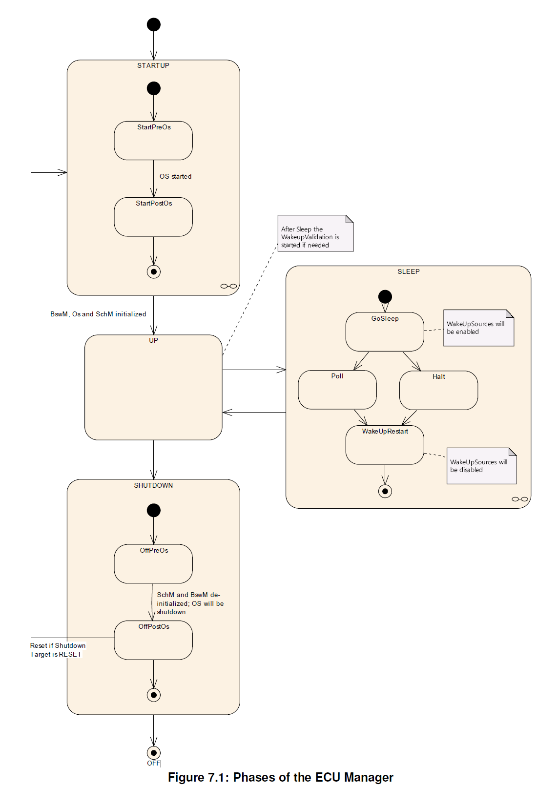

**STARTUP**阶段一直需持续到模式管理设施（Mode Management Facilities）正常运行。基本上**STARTUP**阶段包括启动模式管理所需的最少活动：初始化低级驱动程序、启动操作系统和初始化**BSW**调度程序和**BSW**模式管理器模块。类似地**SHUTDOWN**阶段与**STARTUP**阶段相反，是模式管理被去初始化（**de-initialized**）的阶段。

**UP**阶段由所有未突出显示的状态组成。在该阶段**ECU**按照**integrator**定义的状态机要求，从一个状态转换到另一个状态，从一个模式转换到另一个模式。

在使用ECU模式处理（**ECU Mode Handling**）的情况下，**UP**阶段包含默认模式。这些模式之间的转换是通过**ECU**状态管理器模块和**BSW**模式管理器模块之间的合作完成的。

**注意:**
**UP**阶段包含一些以前的睡眠状态。从**OS**调度程序被锁定以防止其他任务在睡眠中运行的点，到使**ECU**进入睡眠状态的**MCU**模式已经退出的点。此时，模式管理设施不运行，ECU 管理器模块提供了唤醒处理的支持。

#### 6.1.1. STARTUP阶段

**STARTUP**阶段的目的是将基础软件模块初始化到通用模式管理设施（**Generic Mode Management facilities**）可操作的点。 有关初始化的更多详细信息，可参见第**6.3**章。

#### 6.1.2. UP阶段

本质上，**UP**阶段开始于**BSW**调度程序启动并调用了**BswM_Init**函数。此时内存管理（**memory management**）尚未初始化，没有通信堆栈（**communication stacks**），没有 **SW-C** 支持（**RTE**）并且**SW-C**尚未启动。处理以特定的模式启动（在**STARTUP**之后配置的下一个模式），并具有相应的可运行项，如：BSW主程序（**BSW MainFunctions**），并继续作为模式更改的任意组合，导致**BswM**执行操作，同时触发和禁用相应的可运行项。

然而从**ECU**管理器模块的角度来看，ECU是已启动的。接着**BSW**模式管理器模块启动模式仲裁和所有进一步的**BSW**的初始化，启动**RTE**和隐式的启动**SW-C**成为在BswM的操作列表中被执行的代码，或由依赖模式的调度驱动，有效地在**integrator**的控制下。

接着初始化**NvM**模块并调用**NvM_Readall**，使其也成为集成代码的一部分。这也意味着**integrator**需负责在**NvM_ReadAll**结束时，触发**Com**、**DEM**和**FIM**的初始化。当**NvM_ReadAll**完成时，**NvM**将通知**BswM**。

**注意：**
**RTE**可以在**NvM**和**COM**被初始化之后启动。同时通信堆栈无需在**COM**模块被初始化之前被完全初始化（**fully initialized**）。

这些更改将初始化**BSW**模块，并以任意顺序启动**SW-C**，直到**ECU**达到满负荷，并且这些更改也将继续决定**ECU**的功能。最终模式开关停止**SW-C**，并对BSW进行去初始化，以便在**ECU**达到可以关闭电源的状态时，**UP**阶段结束。

因此就**ECU**管理器模块而言，**BSW**和**SW-C**会一直运行，直到它们准备好，让**ECU**关闭或进入睡眠状态。

有关如何设计模式驱动的**ECU**管理以及相应地配置**BSW**模式管理器的指导，可参阅模式管理指南[4]。

#### 6.1.3. SHUTDOWN阶段

**SHUTDOWN**阶段处理基础软件模块的受控关闭，最终导致选定的关机目标：关闭（**OFF**）或者复位（**RESET**)。

#### 6.1.4. SLEEP阶段

**ECU**在**SLEEP**阶段保持节能状态。通常不执行任何代码，但依旧会提供供电。如果进行了相应配置，则**ECU**在此状态下是可被唤醒的。**ECU**管理器模块提供了一组可配置的（硬件）睡眠模式，这些模式通常是在功耗和重启**ECU**所需时间之间进行权衡。

**ECU**管理器模块唤醒**ECU**，以响应预期或非预期的唤醒事件。由于非预期的唤醒事件需要被忽略，**ECU**管理器模块提供了一个协议来验证唤醒事件。该协议指定了处理唤醒源的驱动程序和**ECU**管理器之间的协作过程（可参见第**6.6.4**节）。

#### 6.1.5. OFF阶段

下电时，**ECU**的状态为**OFF**状态。在此状态下**ECU**可能是可以被唤醒的，但仅适用于具有集成电源控制的唤醒源。在任何情况下，**ECU**都必须是可启动的。例如：通过复位事件（**reset event**）。

### 6.2. ECU管理器的结构描述

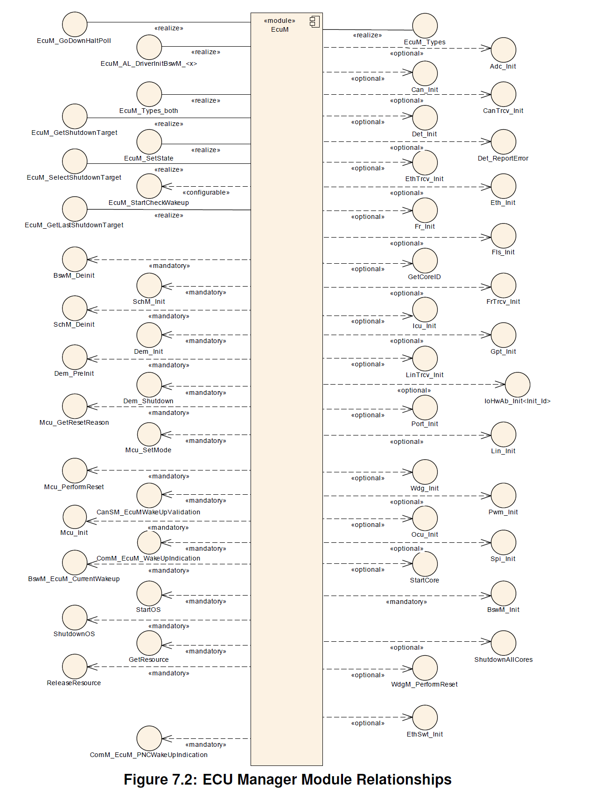

图7.2说明了ECU 管理器模块与其他基础软件模块接口的关系。在大多数情况下，**ECU**管理器模块只负责初始化。 然而有些模块与ECU管理器模块具有功能关联，这将在以下段落中进行详细解释。

#### 6.2.1. 标准化AUTOSAR软件模块

一些基础软件的驱动程序模块会在被**ECU**管理器模块唤醒时被初始化（**initialized**）、关闭（**shut down**）和重新初始化（**re-initialized**）。

操作系统也需经过**ECU**管理器模块进行初始化和关闭。在操作系统初始化之后，**ECU**管理器模块在将控制权交给**BswM**之前，一些额外的初始化步骤需被执行。在操作系统关闭之前，**BswM**将执行控制权交还给**ECU**管理器模块。详细信息可参考章节6.3启动（**STARTUP**）和 6.4 关闭（**SHUTDOWN**）。

#### 6.2.2. 软件组件

软件组件（**SW-Components**）包含了**AUTOSAR ECU**的应用程序代码。**SW-C**通过使用**AUTOSAR**的端口与**ECU**管理器模块进行交互。

### 6.3. STARTUP阶段

有关**STARTUP**阶段的概述说明，可参见章节**6.1.1**。

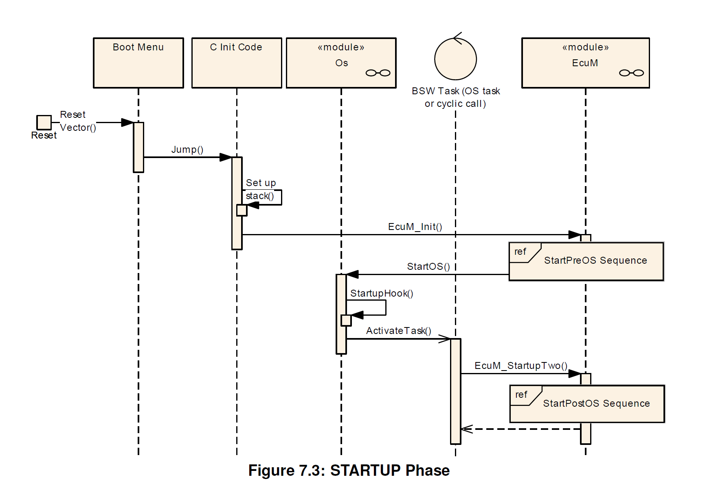

图**7.3**显示了**ECU**的启动行为。当[**EcuM_Init**](#7322-ecum_init)被调用后，**ECU**管理器模块开始控制**ECU**启动过程。通过调用**StartOS**，**ECU**管理器模块暂时放弃控制。为了重新获得控制权，**Integrator**需要实现一个自启动的操作系统任务（**OS task**），并调用[**EcuM_StartupTwo**](#7323-ecum_startuptwo)作为此任务（**Task**）的第一个操作。

#### 6.3.1. EcuM_Init之前的活动

**ECU**管理器模块在调用[**EcuM_Init**](#7322-ecum_init)之前，假定**MCU**的最小化的初始化过程已经完成。也就是说堆栈已被设置，并且代码已经可以被执行，同时C语言中所有变量的初始化也已经被执行。

#### 6.3.2. StartPreOS 序列中的活动

下列**StartPreOS Sequence**的表格，显示了在**StartPreOS**序列中的所有活动，以及它们在[**EcuM_Init**](#7322-ecum_init)中应被执行的顺序。

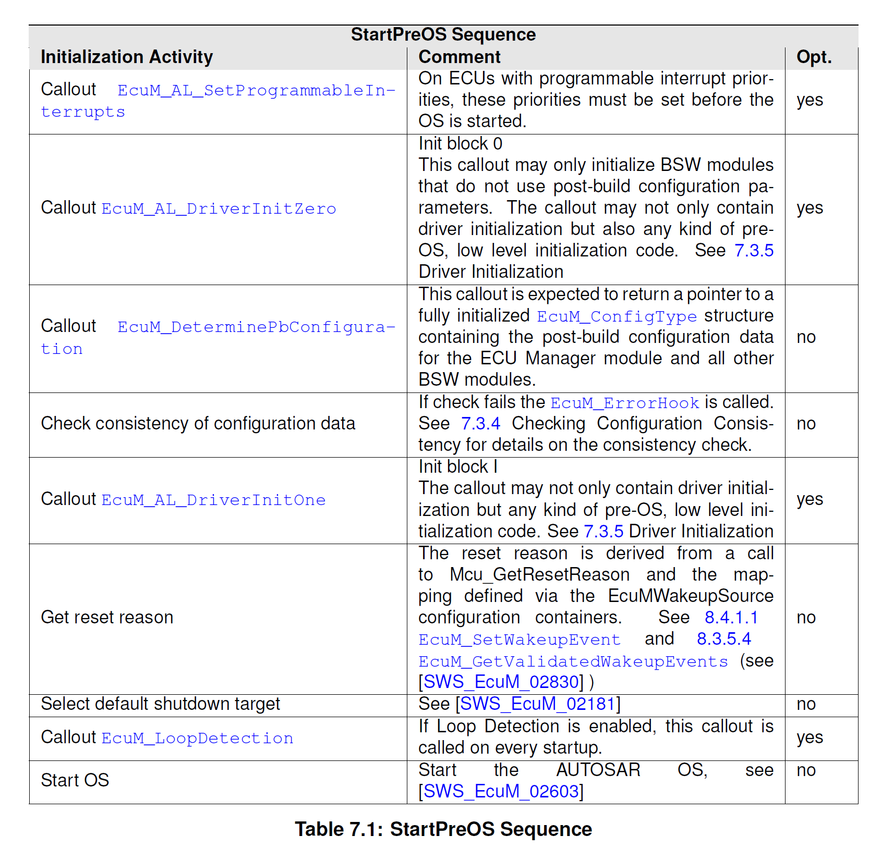

**注意：**

可选列（Opt.），所有可选的活动都可以通过配置来被激活或关闭。

**ECU**管理器模块需记住复位原因转换产生的唤醒源，可参见**StartPreOS Sequence**表格。同时唤醒源必须由**EcuM_MainFunction**进行验证，可参见章节**6.6.4**的 **WakeupValidation**序列中的活动。

当功能通过[**EcuM_Init**](#7322-ecum_init)被激活时，**ECU**管理器模块会执行**StartPreOS**序列中的操作，详情可参见**StartPreOS Sequence**表格）。

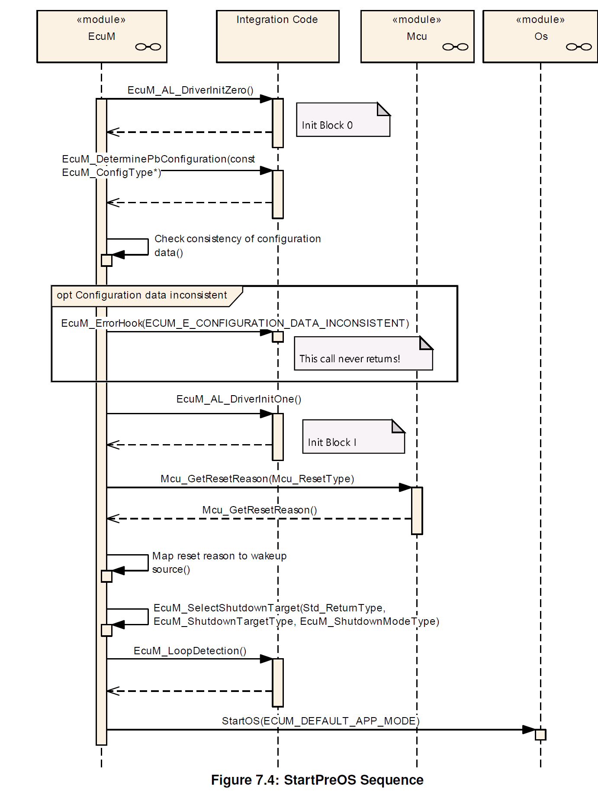

**StartPreOS**序列旨在让**ECU**为初始化**OS**做好准备，所以执行时间应尽可能短。驱动程序应尽可能在**UP**阶段初始化，并且Callout函数也应保持简短。在此序列期间，中断不应被使用。如果必须使用中断，则**StartPreOS**序列中只允许使用I类（**category I**）的中断。

驱动程序和硬件抽象模块的初始化不是由**ECU**管理器来严格定义的。但**ECU**管理器提供了两个Callout函数[**EcuM_AL_DriverInitZero**](#7522-ecum_al_driverinitzero)和[**EcuM_AL_DriverInitOne**](#7524-ecum_al_driverinitone)来定义初始化块 **0**和**1**。这些初始化块包含了与**StartPreOS**序列相关的初始化活动。

**MCU_Init**并不提供完整的**MCU**的初始化。此外与硬件相关的步骤必须被执行，并且必须在系统设计时被定义。这些步骤应该在[**EcuM_AL_DriverInitZero**](#7522-ecum_al_driverinitzero)或者[**EcuM_AL_DriverInitOne**](#7524-ecum_al_driverinitone)两个Callout函数中进行。详细信息可在MCU驱动程序规范[10]中找到。

**ECU**管理器模块需使用配置的默认关机目标（通过**EcuMDefaultShutdownTarget**配置）来调用[**EcuM_GetValidatedWakeupEvents**](#7354-ecum_getvalidatedwakeupevents)接口。具体内容可参阅章节**6.7**关机目标（**Shutdown Targets**）的内容。

**StartPreOS**序列需为启动操作系统，初始化所需的所有基础软件模块。

#### 6.3.3. StartPostOS序列中的活动

当功能通过[**EcuM_StartupTwo**](#7323-ecum_startuptwo)被激活时，**ECU**管理器模块需执行**StartPostOS**序列中的操作，具体内容可参见表7.2。

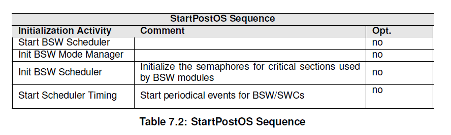

**注意：**

可选列（Opt.），所有可选的活动都可以通过配置来被激活或关闭。

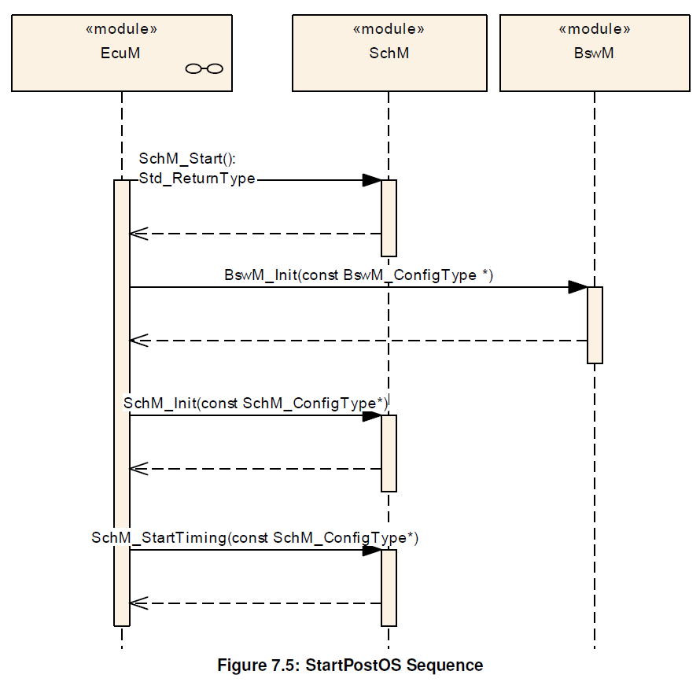

#### 6.3.4. 配置一致性检查

###### 6.3.4.1. ECU管理器中配置一致性检查的必要性

在一个**AUTOSAR** **ECU**中，多个配置参数会在不同的时间被设置并放入**ECU**。预编译（**Pre-compile**）参数会被设置、插入到生成的源代码中并编译为目标代码。当源代码编译完成后，链接时（**Link-time**）参数会被设置、编译，并与先前配置的目标代码链接成一个映像放入**ECU**。最后，后构建（**Post-build**）参数会在不同的时间被设置、编译、链接并放入**ECU**。所有这些参数必须相互匹配，才能获得一个稳定的**ECU**。

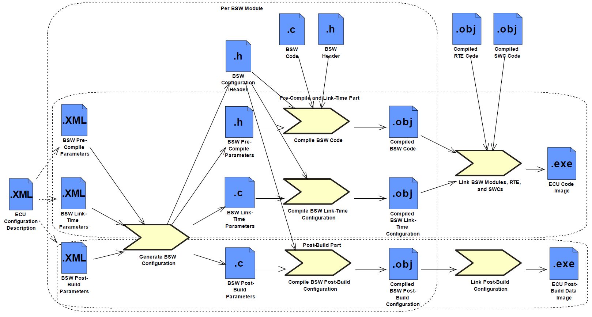

配置工具可以自行检查配置阶段参数的一致性。编译器可能会在编译时检测出参数错误，链接器可能会在链接时发现其他错误。遗憾的是，发现后构建参数中的配置错误非常困难。这只能通过检查以下两项是否完全一致来实现：

* 编译代码时所使用的预编译和链接时参数设置
* 配置和编译后构建参数时所使用的预编译和链接时参数设置

这只能在运行时完成。

**ECU**管理器模块在初始化第一个**BSW**模块之前会执行一次一致性检查，以避免将多个检查分散到不同的**BSW**模块中。

**ECU**管理器模块不仅需检查其自身的参数一致性，还需在初始化第一个**BSW**模块之前检查所有后构建可配置（**post-build configurable**）**BSW**模块的参数一致性。

这也意味着：

**ECU**管理器配置工具必须对所有**BSW**模块的所有预编译和链接时配置参数计算一个哈希（**hash**）值，并将该值存储在链接时的**ECUM_CONFIGCONSISTENCY_HASH**配置参数中（参见**EcuMConfigConsistencyHash**）。需要哈希值的原因有两个：首先，预编译和链接时参数在运行时是不可访问的；其次，该检查在运行时必须非常高效，比较数百个参数会给**ECU**启动过程带来不可接受的延迟。

**ECU**管理器模块配置工具必须继而将计算出的**ECUM_CONFIGCONSISTENCY_HASH**值放入[**EcuM_ConfigType**](#721-ecum_configtype)结构体中包含所有后构建配置参数根节点的字段中。

**ECU**管理器模块需在[**EcuM_Init**](#7322-ecum_init)中检查[**EcuM_ConfigType**](#721-ecum_configtype)结构体中的该字段是否等于**ECUM_CONFIGCONSISTENCY_HASH**的值。

通过在配置时计算哈希值并在运行时进行比较，**EcuM**代码可以非常高效，并且不依赖于特定的哈希计算算法。这允许使用复杂的哈希计算算法，例如：密码学强度高的哈希函数。

**注意：** 同一个哈希算法也可用于生成[**EcuM_ConfigType**](#721-ecum_configtype)结构体中后构建配置标识符的值。此时，哈希算法作用于后构建参数，而不是预编译和链接时参数。

用于对所有**BSW**模块的所有预编译和链接时配置参数计算哈希值的哈希计算算法，无论配置参数在**XML**文件中的顺序如何，对于同一组配置数据都应始终产生相同的哈希值。

###### 6.3.4.2. 哈希计算算法示例

**注意：** 本章不是规范性内容，它描述了一种可能的哈希值计算方法。

对配置参数的值进行简单的**CRC**校验并不是一个好的哈希算法，它只能检测全局的变化，例如：某个参数从1变为2；但如果另一个参数从2变为1，**CRC**值可能保持不变。

此外，哈希算法中不仅要考虑配置参数的值，还必须考虑参数的名称。一种可能的方法是构建一个文本文件，其中包含配置参数和容器的名称，使用分隔符（例如：冒号）将它们与值分隔开，并将每个参数作为一行放入文本文件中。

如果存在多个相同类型的容器，则可以在每个容器名称后附加一个编号，例如："\_0"、"\_1"等等。

为了使哈希值与参数写入文本文件的顺序无关，必须对文件中的行按字典序进行排序。

最后，可以在文本文件上运行密码学强度高的哈希函数（例如：**MD5**）来生成哈希值。对于稍微变化的输入文件，这些哈希函数会产生完全不同的哈希值。

#### 6.3.5. 驱动程序初始化

驱动程序在初始化过程中的位置很大程度上取决于其实现和目标硬件设计。

驱动程序可以在**STARTUP**阶段的初始化块0（**Init Block 0**）或初始化块1（**Init Block 1**）Callout函数中，被**ECU**管理器模块初始化，或者在**WakeupRestart Sequence**的 [**EcuM_AL_DriverRestart**](#7548-ecum_al_driverrestart)的Callout函数中重新被初始化。驱动程序也可以在**UP**阶段，由**BswM**初始化或重新初始化。

本章节适用于那些**AUTOSAR**基础软件的驱动程序，不包括**SchM**和**BswM**，它们的初始化和重新初始化都是由**ECU**管理器模块处理，而不是**BswM**模块处理的。

**ECU**管理器模块的配置需指定**init block 0**和**init block 1**内的初始化调用顺序。具体参见**EcuMDriverInitListZero**和**EcuMDriverInitListOne**。

**ECU**管理器模块需使用从驱动程序的**EcuMModuleService**配置容器中派生的参数，来调用每个驱动程序的初始化（**init**）函数。

对于**WakeupRestart**期间的重新初始化，integrator需使用**EcuMDriverRestartList**，将重新启动块（**restart block**）集成到[**EcuM_AL_DriverRestart**](#7548-ecum_al_driverrestart)的集成代码中。

**EcuMDriverRestartList**接口可能包含用作唤醒源的驱动程序。[**EcuM_AL_DriverRestart**](#7548-ecum_al_driverrestart)需重新启动这些驱动程序唤醒检测（**wakeup detected**）回调函数的触发机制。可参阅章节[6.5.5](#655-wakeuprestart序列中的活动)的**WakeupRestart**序列中的活动。

**ECU**管理器模块需按照与**init block 0**和**init block 1**的组合列表相同的顺序初始化**EcuMDriverRestartList**中的驱动程序。通常**EcuMDriverRestartList**只会包含**init block 0**和**init block 1**驱动程序组合列表的子集。

表7.3显示了**init block 0**和**init block 1**的一种可能和推荐的活动序列。根据硬件和软件配置，可以添加或移除相关的基础软件模块，当然也可以使用其他活动序列。

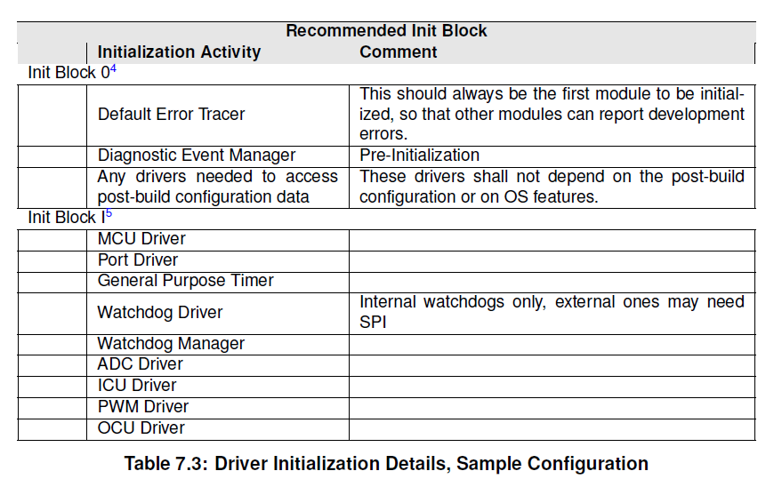

#### 6.3.6. BSW 初始化

其余的**BSW**模块由**BSW**模式管理器初始化，通过使用配置的（**EcuMDriverInitListBswM**）初始化函数列表，创建的**ECU**管理器的配置函数（**EcuMDriverInitCalloutName**）。

**ECU**管理器模块的配置应指定**BSW**初始化函数中的初始化调用顺序（可参见：**EcuMDriverInitListBswM**）。

### 6.4. SHUTDOWN阶段

有关**SHUTDOWN**阶段的概念，请参阅章节[6.1.3 **SHUTDOWN** 阶段](#613-shutdown阶段)。通过使用关机目标**RESET**或**OFF**调用[**EcuM_GoDownHaltPoll**](#7321-ecum_godownhaltpoll)来启动**SHUTDOWN**阶段。

如果在关机阶段发生唤醒事件时，ECU管理器模块应完成关机并在此后立即重新启动。

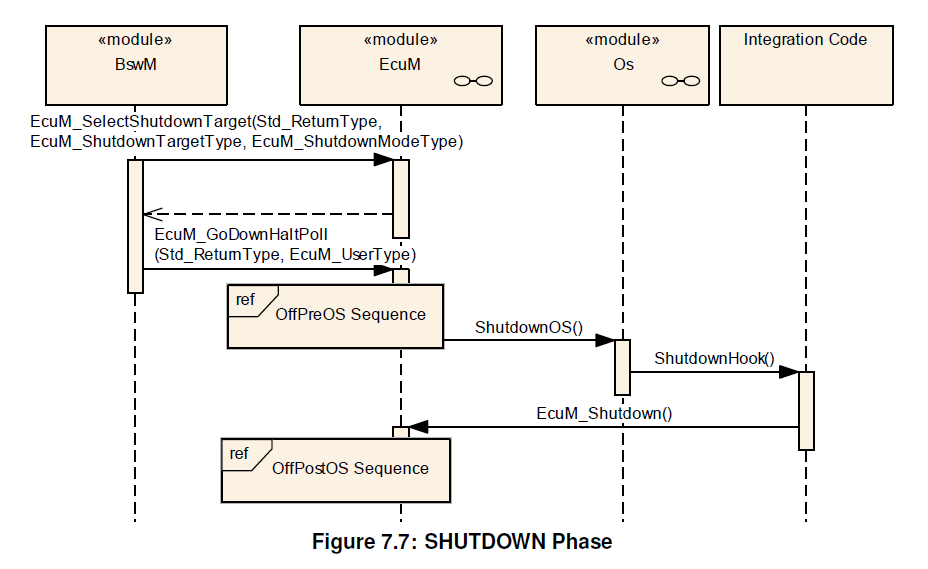

#### 6.4.1. OffPreOS序列中的活动

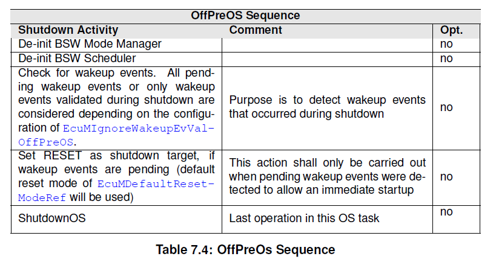

在**OffPreOS**序列期间，如果配置参数**EcuMIgnoreWakeupEvValOffPreOS**设置为**true**，只需考虑那些不需要验证的唤醒事件，所有其他的唤醒事件可以忽略。如果配置参数**EcuMIgnoreWakeupEvValOffPreOS**设置为**false**时，不需要验证的唤醒事件和需要验证的待定唤醒事件都需被考虑到。

**注意：**

因为在**OffPreOS**序列期间，**SchM**已经去初始化，周期性执行的函数将不再执行，所以不再可能验证唤醒源。在**OffPreOS**期间中，唤醒事件是否需要被考虑，取决于**EcuMIgnoreWakeupEvValOffPreOS**的配置。

作为**OffPreOS**期间的最后一项活动，**ECU**管理器模块需调用**ShutdownOS**函数。操作系统会在关机结束时，调用关机钩子（hook）函数。关闭钩子函数会调用[**EcuM_Shutdown**](#7324-ecum_shutdown)来结束关机过程。 [**EcuM_Shutdown**](#7324-ecum_shutdown)不应返回，而是直接关闭ECU或发起复位动作。

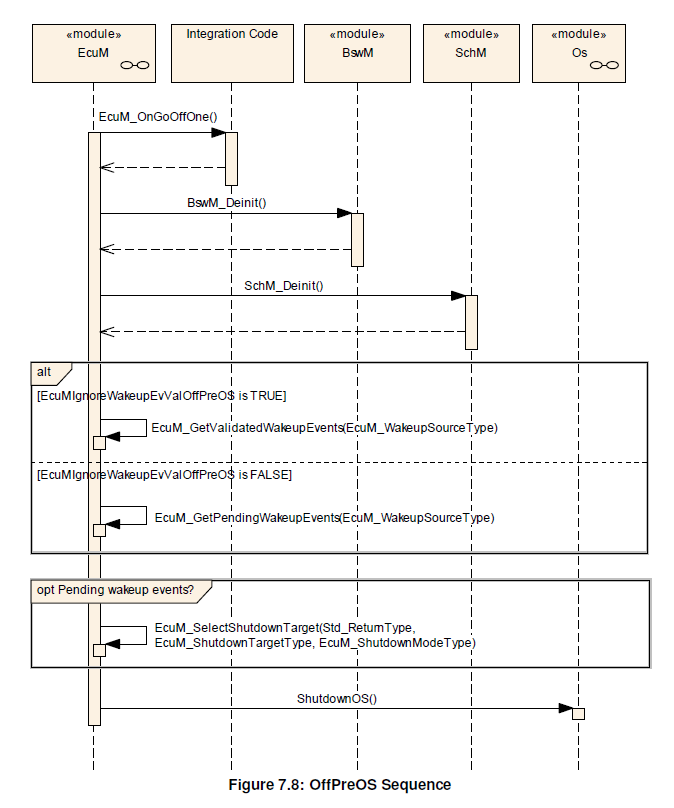

#### 6.4.2. OffPostOS序列中的活动

**OffPostOS**序列执行了在操作系统关闭后，达到关机目标的最后步骤。由[**EcuM_Shutdown**](#7324-ecum_shutdown)函数发起此序列。关机目标可以是**ECUM_SHUTDOWN_TARGET_RESET**或**ECUM_SHUTDOWN_TARGET_OFF**，具体的复位方式由复位模式决定。有关详细信息，可参阅章节[6.7关机目标](#67-关机目标)

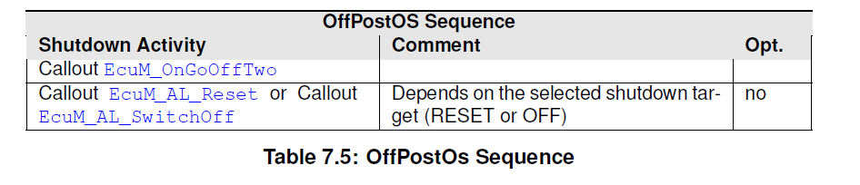

当关机目标为**RESET**时，**ECU**管理器模块需调用[**EcuM_AL_Reset**](#7534-ecum_al_reset)的Callout函数。当关机目标为**OFF**时，**ECU**管理器模块需调用[**EcuM_AL_SwitchOff**](#7533-ecum_al_switchoff)的**Callout**函数。

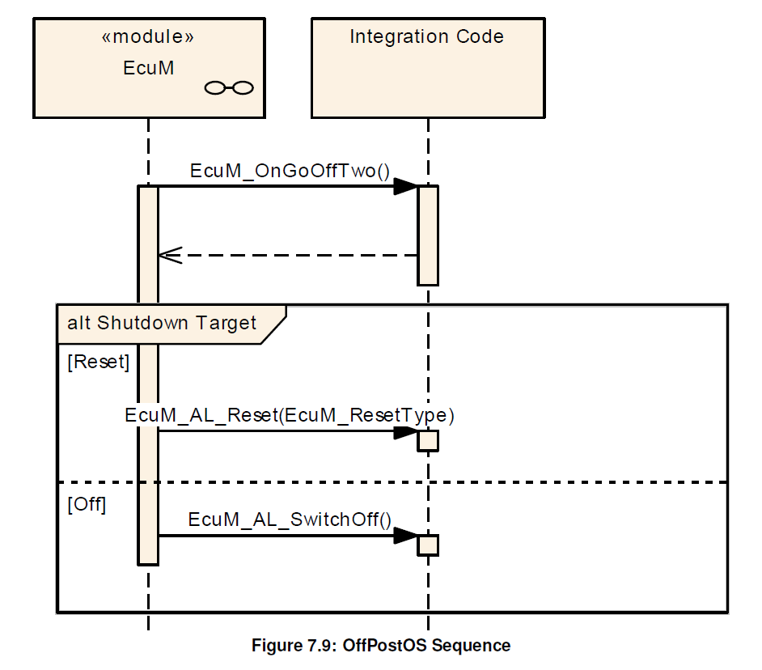

### 6.5. SLEEP阶段

有关**SLEEP**阶段的概述，可参阅章节[6.1.4 SLEEP阶段](#614-sleep阶段)。可以通过**SLEEP**作为关机目标，调用[**EcuM_GoDownHaltPoll**](#7321-ecum_godownhaltpoll)函数来启动**SLEEP**阶段。

使用**SLEEP**作为关机目标的[**EcuM_GoDownHaltPoll**](#7321-ecum_godownhaltpoll)函数会启动两种控制流。具体哪种控制流取决于**EcuMSleepModeSuspend**参数所配置的睡眠模式。它们在实现睡眠的机制上的结构是不同。但是它们在准备睡眠和从睡眠恢复过程的顺序却是相同的。

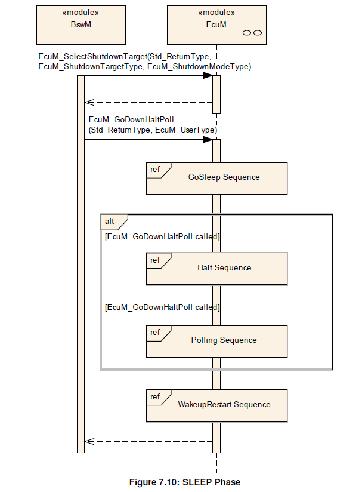

同时存在另一个模块，可能是**BswM**，虽然它也可能是另一个**SW-C**。这个模块必须确保在调用[**EcuM_GoDownHaltPoll**](#7321-ecum_godownhaltpoll)之前，以及选择了适当的**ECUM_STATE_SLEEP**的关机目标。

#### 6.5.1. GoSleep序列中的活动

在**GoSleep**的序列中，**ECU**管理器模块需为即将到来的睡眠阶段进行相关的硬件配置，同时为下一个唤醒事件设置**ECU**。

**ECU**管理器模块为了接着的睡眠模式，需进行唤醒源的配置。**ECU**管理器模块会通过在[**EcuM_EnableWakeupSources**](#7541-ecum_enablewakeupsources)的Callout函数中，依次为每个在**EcuMWakeupSourceMask**中配置的唤醒源执行相关的设置工作。

与**SHUTDOWN**阶段相比，**ECU**管理器模块在进入**SLEEP**阶段时，不应关闭操作系统。睡眠模式，即**EcuM**的**SLEEP**阶段和**MCU**模式的组合，对操作系统来说应该是透明的。

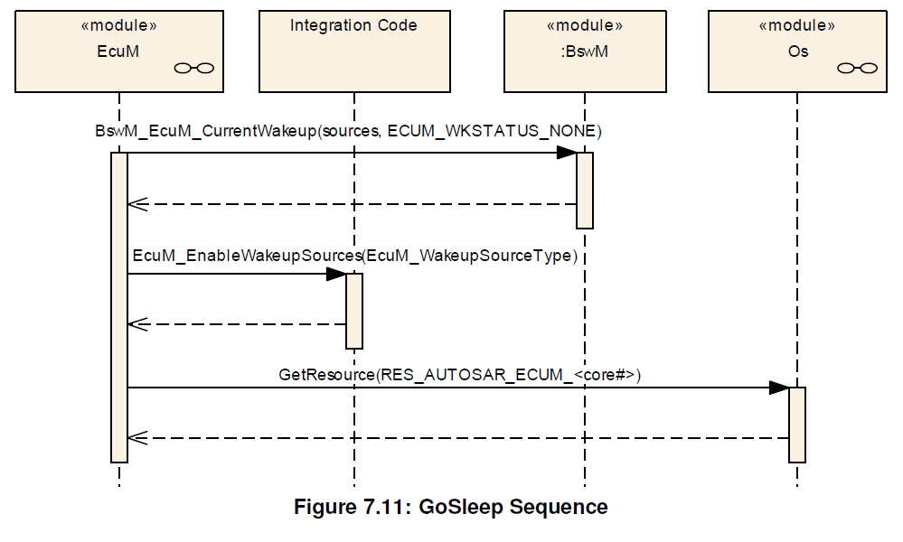

当在多核的**ECU**上运行时，**EcuM**需要为每个内核保留一个专用资源（**RES_AUTOSAR_ECUM**）。该资源会在进入休眠（**Go Sleep**）期间分配。

#### 6.5.2. 停止序列中的活动

**ECU**管理器模块需在停止微控制器的睡眠模式下执行停止序列（**Halt Sequence**）。在这睡眠模式下，**ECU**管理器模块不执行任何代码。

**ECU**管理器模块应在停止微控制器之前，调用[**EcuM_GenerateRamHash**](#7542-ecum_generateramhash)的Callout函数。然后当处理器从停止状态返回后，调用[**EcuM_CheckRamHash**](#7546-ecum_checkramhash)的Callout函数。

如果存在多核的情况，且存在从属（**Slave**）的**EcuM**，则此检查动作仅只需在主（**Master**）的**EcuM**上执行。 主**EcuM**从其范围内的所有数据中生成散列。从属**EcuM**的私有数据不在此范围内。

**逻辑依据：**

当**ECU**长时间处于睡眠模式时，**RAM**内存可能会损坏。 因此需检查**RAM**存储器的完整性，以防意外行为的发生。系统设计者可以选择适当的校验和算法来执行检查。

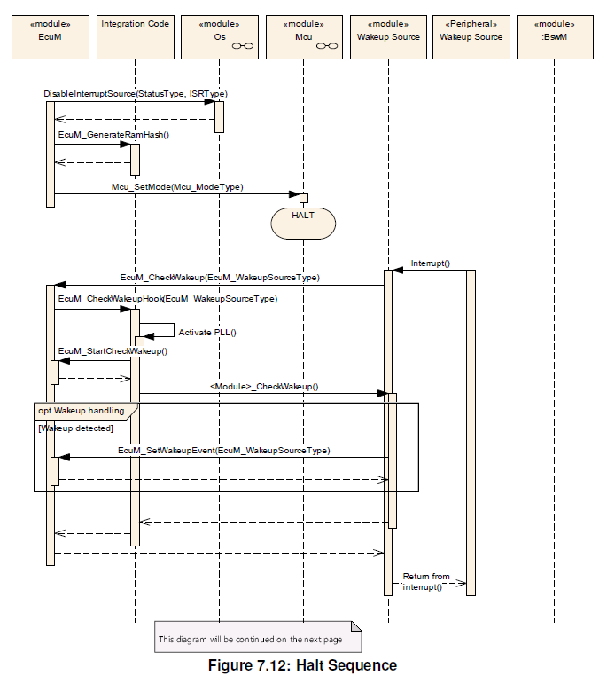

**ECU**管理器模块应调用[**EcuM_GenerateRamHash**](#7542-ecum_generateramhash)，系统设计人员可以在此Callout函数中进行**RAM**完整性地检查。

#### 6.5.3. 轮询序列中的活动

睡眠模式下的轮询序列（**Poll Sequence**）可用于检查唤醒源。在轮询序列中，**EcuMWakeupSourcePolling**设置为**True**，**EcuM**需在一个阻塞循环中（**blocking loop**），调用[**EcuM_SleepActivity**](#7543-ecum_sleepactivity)和[**EcuM_CheckWakeupHook**](#7545-ecum_checkwakeuphook)函数，直到有待定（**pending**）或者已验证（**validated**）的唤醒事件被报告。

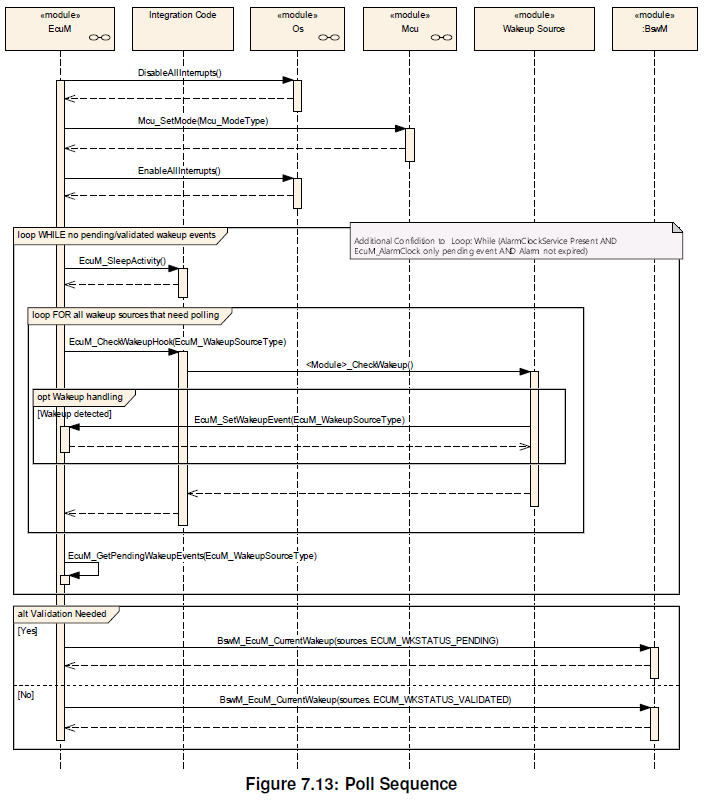

#### 6.5.4. 离开停止或轮询

如果当**ECU**处于停止（**Halt**）或轮询（**Poll**）状态时，发生唤醒事件。

* 唤醒硬线发生翻转变化（**toggling a wakeup line**）
* CAN总线上有通讯信号（**communication on a CAN bus**）等
  
则**ECU**管理器模块需重新获得控制权，并通过执行唤醒重启序列（**WakeupRestart sequence**）退出睡眠阶段。

可以调用**ISR**来处理唤醒事件，但这取决于硬件和驱动程序的实现。具体可参考章节[6.5.5WakeupRestart序列中的活动](#655-wakeuprestart序列中的活动)

如果**ECU**处于**Halt**或者**Poll**时，发生了不规则事件（**Irregular Events**）

* 硬件复位（**hardware reset**）
* 电源循环（**power cycle**）
  
则**ECU**管理器模块需在**STARTUP**阶段，重新启动**ECU**。

#### 6.5.5. WakeupRestart序列中的活动

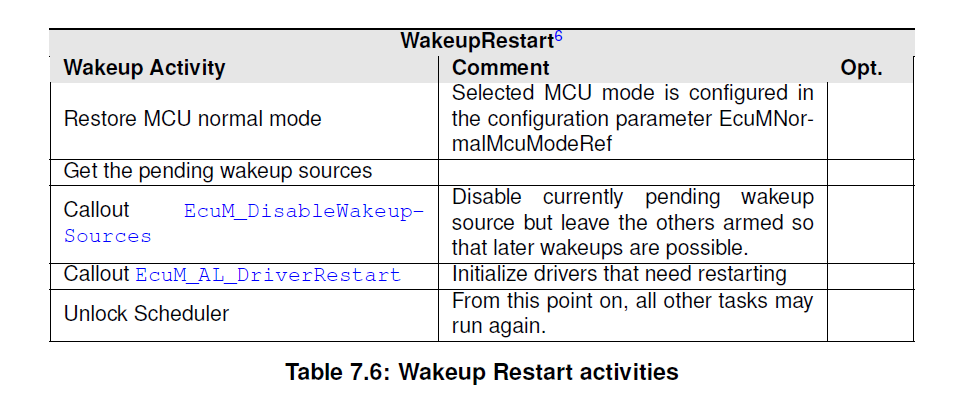

**ECU**管理器模块需调用用于重新初始化驱动程序的[**EcuM_AL_DriverRestart**](#7548-ecum_al_driverrestart)的Callout函数。其中具有唤醒源的驱动程序通常需要重新初始化。有关驱动程序初始化的更多详细信息，可参考章节[6.3.5驱动程序初始化](#635-驱动程序初始化)。

在重新初始化（**re-initialization**）期间，驱动程序必须检查其一个分配的唤醒源是否是先前被唤醒的原因。如果该测试为真，驱动程序必须调用唤醒被检测到（**wakeup detected**）的回调函数。例如：参见**CAN** 收发器驱动程序规范[11]。而后者必须再调用[**EcuM_SetWakeupEvent**](#7411-ecum_setwakeupevent)函数。

驱动程序的实现应该只调用一次唤醒回调。此后它不应再次调用唤醒回调，直到它被显式函数调用重新使能（**re-armed**）。所以驱动程序必须被重新使能后，才能再次触发回调。

如果在**WakeupRestart**序列完成时，**ECU**管理器模块具有候选唤醒源的列表，则**ECU**管理器模块应在**EcuM_MainFunction**中验证这些候选唤醒源。可参阅章节[6.6.4 WakeupValidation序列中的活动](#664-wakeupvalidation序列中的活动)

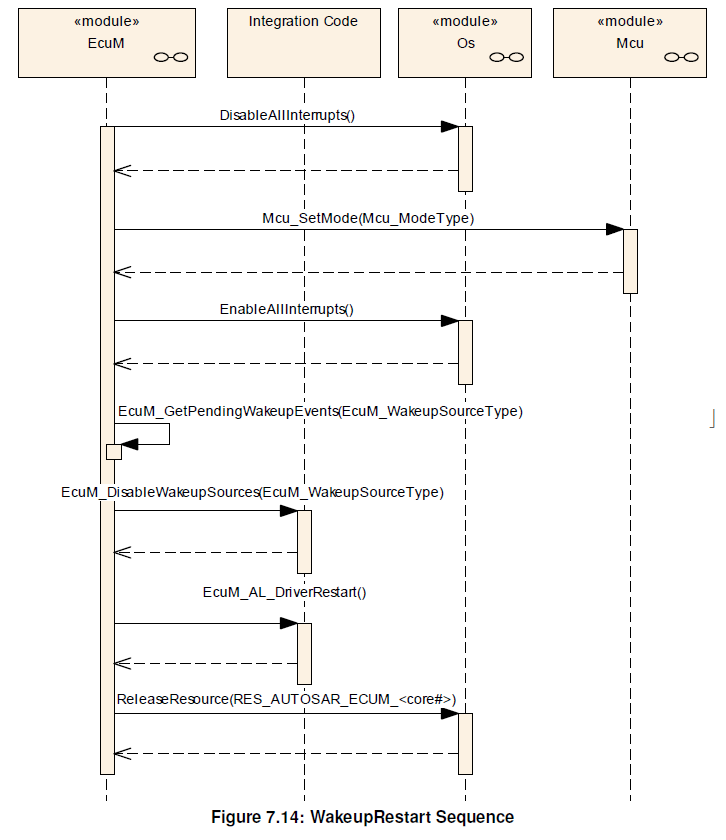

如果报告了**WakeupEvent**，**EcuM**需退出睡眠模式。如果所有**WakeupSource**的**CheckWakeupTimer**都已超时，则**EcuM**需转换到**GoSleep**状态，并再次开始让**EcuM**进入睡眠状态（暂停或轮询）。

**注意：**

当**EcuM**由异步**WakeupSource**恢复运行（**resume**）时，**EcuM**必须执行**WakeRestart**序列，以重新启动主功能，以便建立与使用的硬件（例如：**SPI**）的异步通信。

如果在信号唤醒后，并且相应的**CheckWakeupTimer**也已经超时，没有任何唤醒事件被设置，则**EcuM**需报告运行时错误[**ECUM_E_WAKEUP_TIMEOUT**](#6132-运行时错误)。

### 6.6. UP阶段

在**UP**阶段，**EcuM_MainFunction**会被定期执行。它主要具有三个功能：

* 检查唤醒源是否被唤醒，并在必要时启动唤醒验证。可参阅章节[6.6.4 WakeupValidation序列中的活动](#664-wakeupvalidation序列中的活动)
* 更新闹钟定时器（**Alarm Clock timer**）
* 仲裁**RUN**和**POST_RUN**的请求和释放。

#### 6.6.1. 闹钟处理

请参阅章节[6.8.2 节 UP阶段的EcuM 时钟时间](#682-ecum时钟时间)，了解更多实现的细节。

当闹钟服务存在时（可参见参数**EcuMAlarmClockPresent**），**EcuM_MainFunction**需更新闹钟定时器。

#### 6.6.2. 唤醒源状态处理

唤醒源不仅需在唤醒期间处理，而且与所有其他**EcuM**活动并行处理。相关功能在**EcuM_MainFunction**中运行，通过模式请求（**mode requests**）与**ECU**管理的其余部分完全分离。

唤醒源可以处于以下状态：

| 状态      | 描述                         |
| --------- | ---------------------------- |
| NONE      | 唤醒事件未被检测到或已被清除 |
| PENDING   | 检测到唤醒事件但尚未验证     |
| VALIDATED | 检测到唤醒事件并成功验证     |
| EXPIRED   | 检测到唤醒事件但验证失败     |

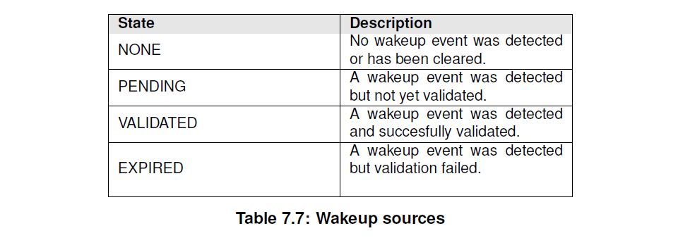

下图说明了唤醒源状态和引起状态变化的条件函数之间的关系。此处仅显示两个超级状态**Disabled**和**Validation**以进行说明和更好地理解。

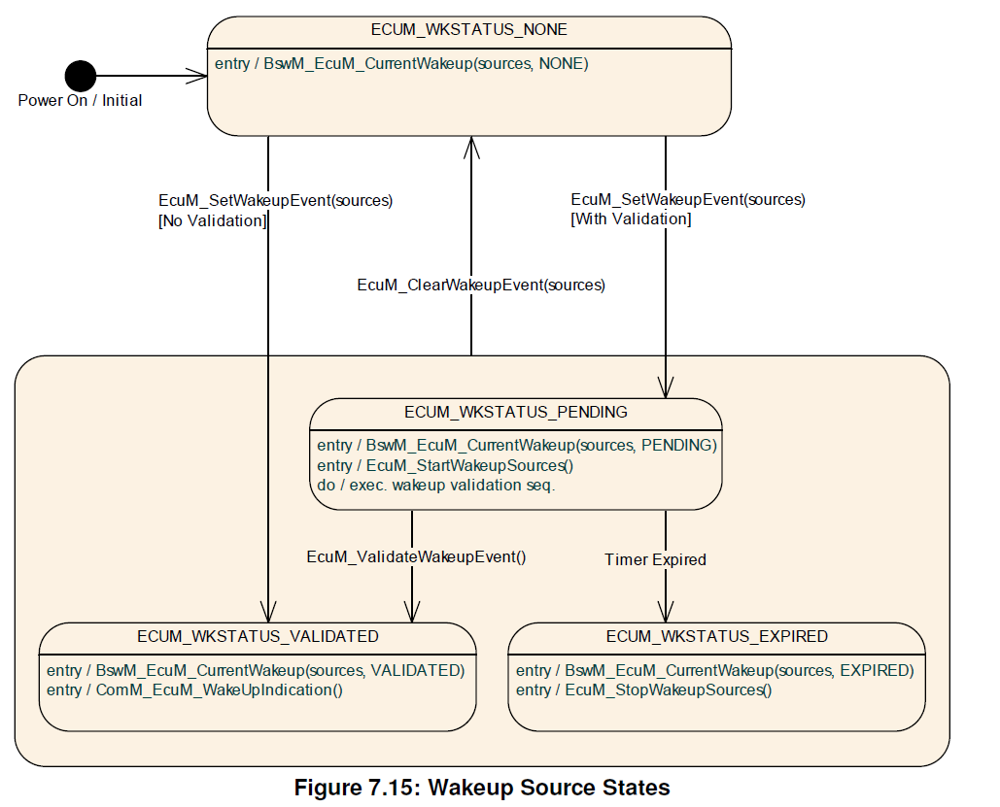

当**ECU**管理器动作导致唤醒源的状态改变时，**ECU**管理器模块应向**BswM**发出模式请求（**mode request**），以将唤醒源的模式更改为新的唤醒源状态。对于这些唤醒源状态的通信，主要使用 [**EcuM_WakeupStatusType**](#724-ecum_wakeupstatustype)类型。

当**ECU**管理器模块处于**UP**阶段时，唤醒事件通常不会触发状态更改，但是它们会触发停止（**Halt**）和轮询（**Poll**）子阶段的结束。接着**ECU**管理器模块自动执行**WakeupRestart** 序列后，并随后返回到**UP**阶段。此行为需由集成商（**integrator**）在**BswM**中配置规则，以便**ECU**对唤醒事件做出正确反应。因为此反应完全取决于当前**ECU**的状态。

如果唤醒源有效，则**BswM**将**ECU**返回到运行（**RUN**）状态。如果所有唤醒事件都返回到**NONE**或**EXPIRED**，则**BswM**再次为基础软件模块准备**SLEEP**或**OFF**并调用[**EcuM_GoDownHaltPoll**](#7321-ecum_godownhaltpoll)。

**总结：**

每个未决事件（**pending event**）都被独立验证（如果已配置），**EcuM**将结果作为模式请求发布到**BswM**，这反过来可以触发**EcuM**中的状态更改。

#### 6.6.3. 唤醒状态的内部表示

**EcuM**管理器模块提供以下接口来确定这些唤醒源的状态：

* [EcuM_GetPendingWakeupEvents](#7352-ecum_getpendingwakeupevents)
* [EcuM_GetValidatedWakeupEvents](#7354-ecum_getvalidatedwakeupevents)
* [EcuM_GetExpiredWakeupEvents](#7355-ecum_getexpiredwakeupevents)

并通过以下接口操作唤醒源的状态:

* [EcuM_ClearWakeupEvent](#7353-ecum_clearwakeupevent)
* [EcuM_SetWakeupEvent](#7411-ecum_setwakeupevent)
* [EcuM_ValidateWakeupEvent](#7412-ecum_validatewakeupevent)
* [EcuM_CheckWakeup](#7351-ecum_checkwakeup)
* [EcuM_DisableWakeupSources](#7547-ecum_disablewakeupsources)
* [EcuM_EnableWakeupSources](#7541-ecum_enablewakeupsources)
* [EcuM_StartWakeupSources](#7551-ecum_startwakeupsources)
* [EcuM_StopWakeupSources](#7553-ecum_stopwakeupsources)

**ECU**管理器模块可以管理多达**32**个唤醒源。唤醒源的状态通常在上面提到的**EcuM**接口，通过[**EcuM_WakeupSourceType**](#723-ecum_wakeupsourcetype)位掩码表示，其中各个唤醒源对应于固定位位置。有**5**个预定义位的位置，其余的可以通过配置分配。更多详细信息，可参阅[**EcuM_WakeupSourceType**](#723-ecum_wakeupsourcetype)的定义。

一方面，**ECU**管理器模块管理每个唤醒源的模式。另一方面，**ECU**管理器模块通过预先假定存在的内部变量（**internal variables**），即[**EcuM_WakeupSourceType**](#723-ecum_wakeupsourcetype)的实例，来跟踪哪些唤醒源处于特定状态，特别是**NONE**（即已清除）、**PENDING**、**VALIDATED**和**EXPIRED**。ECU管理器模块在各自的接口定义中使用这些内部变量来定义接口的语义。因此，这些内部变量是否真的被执行是次要的，它们主要用于解释接口的语义。

#### 6.6.4. WakeupValidation序列中的活动

由于唤醒事件可能会无意中产生，例如：**CAN**线路上的**EMV**尖峰，所以有必要在**ECU**恢复完全运行之前验证这些唤醒事件。

所有唤醒源的验证机制都是相同的。当唤醒事件发生时，**ECU**从**SLEEP**状态唤醒，并在**MCU**驱动程序的**MCU_SetMode**服务中恢复执行。当**WakeupRestart**序列完成时，**ECU**管理器模块将有一个待验证的唤醒事件列表。接着**ECU**管理器模块释放**BSW**调度器和所有**BSW MainFunctions**。最值得注意的是，在这种情况下**EcuM Main Function**可以恢复处理。

**实现提示：**

由于**SchM**将在**StartPostOS**和**WakeupRestart**序列的末尾运行，所以**EcuM_MainFunction**可能会在验证此唤醒源时，与其相关的软件栈（**Stack**）还未被初始化。集成商（**integrator**）应配置适当的模式以指示软件栈不可用，并且相应地禁用**EcuM_MainFunction**（详情可参见文档[2]）。

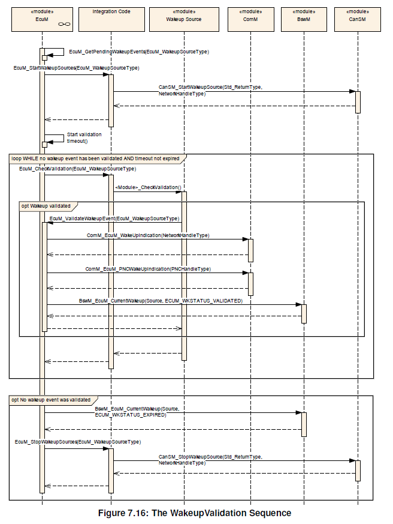

**ECU**管理器模块仅需在配置为需要验证的唤醒源上调用唤醒验证。如果未配置验证协议（请参阅**EcuMValidationTimeout**），则对[**EcuM_SetWakeupEvent**](#7411-ecum_setwakeupevent)的调用也暗示着对[**EcuM_ValidateWakeupEvent**](#7412-ecum_validatewakeupevent)的调用。

**ECU**管理器模块需为每个待验证、待定的唤醒事件启动验证超时。超时需特定于事件，请参阅**EcuMValidationTimeout**。

**实现提示：**

代码实现中如果只提供一个定时器其实也是足够的。当报告新的唤醒事件时，该定时器会被延长到最长的超时时间。

当待定唤醒事件的验证超时后，**EcuM_MainFunction**需设置内部到期唤醒事件变量中事件集合的相关bit位。请参见章节[6.6.3 唤醒状态的内部表示](#663-唤醒状态的内部表示)。同时**EcuM_MainFunction**需调用**BswM_EcuM_Current_Wakeup**，并使用[**EcuM_WakeupSourceType**](#723-ecum_wakeupsourcetype)位掩码参数，将对应于唤醒事件集的位和状态值参数设置为**ECUM_WKSTATUS_EXPIRED**。

**BswM**需配置为通过**EcuM**的模式切换请求（**mode switch requests**）来监视唤醒验证，EcuM负责验证唤醒源或等待计时器的超时。如果最后一次验证，没有通过验证的情况下超时，则**BswM**需认为唤醒验证失败。如果有任意一个待定唤醒源被验证通过，那么整个验证需视为已通过。

待定的唤醒事件通过调用[**EcuM_ValidateWakeupEvent**](#7412-ecum_validatewakeupevent)进行验证。此调用必须放置在驱动程序中，或者驱动程序顶部的消费堆栈中，如处理程序（**the handler**）。放置它的最佳位置取决于硬件和软件设计。更多内容请参见章节[6.6.4.4 唤醒源的驱动程序的需求](#6644-唤醒源的驱动程序的需求)。

###### 6.6.4.1. 通信通道的唤醒

如果在通信通道上发生唤醒，相应的总线收发器驱动程序必须通过调用[**EcuM_SetWakeupEvent**](#7411-ecum_setwakeupevent)函数来通知**ECU**管理器模块。此通知的要求可参考章节[5.2节具有唤醒功能的外设](#52-具有唤醒功能的外设)中更多的描述。

**ECU**管理器模块也需要按照[唤醒源和ECU管理器的交互](#6642-唤醒源和ecu管理器的交互)章节中定义，在[**EcuM_SetWakeupEvent**](#7411-ecum_setwakeupevent)函数被调用时，执行唤醒验证协议（**Wakeup Validation Protocol**）。详细内容可参见章节[6.6.4.2 唤醒源和ECU管理器的交互](#6642-唤醒源和ecu管理器的交互)。

###### 6.6.4.2. 唤醒源和ECU管理器的交互

**ECU**管理器模块应以相同的方式处理所有唤醒源。当唤醒事件发生时，相应的驱动程序需将唤醒事件通知**ECU**管理器模块。通知的方式可能包括：

* 当退出暂停或轮询序列后。在这种情况下**ECU**管理器模块需调用[**EcuM_AL_DriverRestart**](#7548-ecum_al_driverrestart)来重新初始化相关驱动程序，从而它有机会可以扫描相关的硬件。例如：待定的唤醒中断。
* 如果唤醒源真的处于睡眠模式下，则驱动程序可以通过轮询或等待中断的方式，自主的扫描唤醒事件。

如果唤醒事件需要验证，则**ECU**管理器模块需调用验证协议（**validation protocol**）。如果唤醒事件不需要验证，则**ECU**管理器模块需发出模式切换请求，将事件的模式设置为**ECUM_WKSTATUS_VALIDATED**。

如果唤醒事件被验证（无论是立即或通过唤醒验证协议），**ECU**管理器模块应通过调用[**EcuM_GetValidatedWakeupEvents**](#7354-ecum_getvalidatedwakeupevents)告知此唤醒事件是当前**ECU**唤醒的来源。

###### 6.6.4.3. 唤醒验证超时

**ECU**管理器模块可以选择提供单个的唤醒验证超时定时器，或者为每个唤醒源提供一个定时器。

**ECU**管理器模块需在[**EcuM_SetWakeupEvent**](#7411-ecum_setwakeupevent)函数被调用时，启动唤醒验证超时计时器。而[**EcuM_ValidateWakeupEvent**](#7412-ecum_validatewakeupevent)函数需停止唤醒验证超时计时器的计时。

如果接着由于相同的唤醒源被触发，[**EcuM_SetWakeupEvent**](#7411-ecum_setwakeupevent)被再次调用时，**ECU**管理器模块无需重启（**restart**）唤醒验证超时计时器。

如果只使用单个的计时器，则建议采用以下方法。如果在一唤醒周期内，当[EcuM_SetWakeupEvent](#7411-ecum_setwakeupevent)因为一个尚未触发的唤醒源被调用时，则**ECU**管理器模块需为该唤醒源延长唤醒验证超时计时器。

唤醒超时的时间设定可以通过参数**EcuMValidationTimeout**进行配置定义。

###### 6.6.4.4. 唤醒源的驱动程序的需求

驱动程序在检测到唤醒事件时，必须调用[**EcuM_SetWakeupEvent**](#7411-ecum_setwakeupevent)一次。在调用时使用配置参数**EcuMWakeupSourceId**来作为[**EcuM_WakeupSourceType**](#723-ecum_wakeupsourcetype)的参数，来标识指定的唤醒源。

**ECU**管理器模块需检测在驱动程序初始化之前发生的唤醒，包括：停止（**Halt**）、轮询（**Poll**）或关闭（**Off**）。

驱动程序需提供一个**API**实现**SLEEP**状态下唤醒源的配置，启用或禁用唤醒源，以及使相关外设进入睡眠状态。此需求仅适用于硬件具有提供这些功能能力的情况。

同时，驱动程序需在其初始化函数中，启用回调函数的调用。

**EcuMWakeupSource**分区分配（**partition assignment**）需能被所引用的模块配置所识别。

**注意：**

唤醒源唤醒验证的调用以及唤醒的Callout函数（启动/启用/禁用），应在分配给唤醒源的内核上执行。或者以其他方式，在某个内核的执行上下文中，仅应处理那些分配给该内核分区的唤醒源。

#### 6.6.5. 唤醒验证的需求

如果唤醒源需要验证，这可以由基本软件的一个适当模块完成。它可能是驱动程序、接口、处理程序或管理器。

通过调用[**EcuM_ValidateWakeupEvent**](#7412-ecum_validatewakeupevent)函数来完成验证。

如果**EcuM**无法确定**MCU**驱动返回的复位原因，则**EcuM**为默认唤醒源**ECUM_WKSOURCE_RESET**设置一个唤醒事件。

#### 6.6.6. 唤醒源和复位原因

**ECU**管理器模块**API**仅提供一种类型[**EcuM_WakeupSourceType**](#723-ecum_wakeupsourcetype)，它可以用来描述**ECU**启动或唤醒的所有原因。

**ECU**管理器模块永远不会为以下唤醒源调用验证：

* **ECUM_WKSOURCE_POWER**
* **ECUM_WKSOURCE_RESET**
* **ECUM_WKSOURCE_INTERNAL_RESET**
* **ECUM_WKSOURCE_INTERNAL_WDG**
* **ECUM_WKSOURCE_EXTERNAL_WDG**

#### 6.6.7. 具有集成功率控制的唤醒源

**SLEEP**可以通过控制**MCU**电源的系统芯片来实现。典型的例子是带有集成电源的**CAN**收发器，可根据应用请求关闭电源，并在**CAN**活动时打开电源。结果是，对于此类硬件上的**ECU**管理器模块，**SLEEP**看起来就像关闭。这种区别是相当哲学的，并不具有实际意义。

实际影响是**CAN**上的被动唤醒看起来就像**ECU**上电复位一样。因此**ECU**将在唤醒事件后继续执行**STARTUP**序列。尽管如此，唤醒验证是必需的，系统设计人员必须考虑以下主题：

* **CAN**收发器在某个驱动程序初始化程序块期间初始化（默认情况下在**BswM**控制下）。这是配置或生成的代码，即受系统设计者控制的代码。
* **CAN**收发器驱动程序需提供API函数来确定，是否由于CAN收发器而被动唤醒，而启动了**ECU**。系统设计人员有责任通过调用[**EcuM_StartCheckWakeup**](#7544-ecum_startcheckwakeup)检查潜在唤醒源，防止**ECU**关闭。并检查**CAN**收发器的唤醒原因，并使用[**EcuM_SetWakeupEvent**](#7411-ecum_setwakeupevent)和**EcuM_ClearWakeupEvents**函数，将此信息传递给**ECU**管理器模块。

这些原理可以应用于所有具有集成功率控制的唤醒源。**CAN**收发器仅作为示例。

### 6.7. 关机目标

关机目标（**Shutdown Targets**）是对无执行代码的ECU状态的描述性术语。它们被称为关机目标的原因，是它们是离开**UP**阶段时，状态机将驱动到的目标状态。

关机目标包括以下状态：

* 关机（**Off**）
* 睡眠（**Sleep**）
* 复位（**Reset**）

**注意：**

可以确定关机目标的时间不一定是关闭的开始。由于**BswM**现在控制着大多数**ECU**资源，所以它将确定应该设置关机目标的时间点，并通过直接或间接地方式设置它。因此BswM必须确保在调用[**EcuM_GoDownHaltPoll**](#7321-ecum_godownhaltpoll)之前，将关机目标的默认值更改为**ECUM_STATE_SLEEP**。

在以前版本的**ECU**管理器模块中，因为在**ECU**中实现的睡眠模式取决于**ECU**的能力，所以睡眠目标需被特殊处理。这些睡眠模式取决于硬件，通常在时钟设置或硬件提供的其他低功耗特性方面有所不同。这些不同的功能可以通过**MCU**驱动程序，作为所谓的**MCU**模式访问（可参见文档[10]）。

同时还有多种复位执行的方式，这些方式通过不同的模块控制或触发：

* 通过调用**Mcu_PerformReset**函数
* 通过调用**WdgM_PerformReset**函数
* 通过**DIO**或者**SPI**切换**I/O**引脚的方式

**ECU**管理器模块提供了一种工具来管理这些复位方式（**reset modalities**），方法是跟踪以前复位的时间和原因。不同的复位方式（**reset modalities**）将被视为不同的复位模式（**reset modes**），使用与睡眠相同的模式设施。

#### 6.7.1. Sleep

在**SLEEP**阶段，任何唤醒事件都不应该被错过。如果在**Go Sleep**序列中发生了唤醒事件，则不应进入**Halt**或者**Poll**序列。

**ECU**管理器模块可以定义一组可配置的睡眠模式（具体请参阅**EcuMSleepMode**），其中每个模式本身都是关机目标。**ECU**管理器模块需允许将**MCU**睡眠模式映射到**ECU**的睡眠模式，并允许将它们作为关机目标来处理。以Sleep作为关机目标，需将使所有的内核（**cores**）都进入睡眠状态。

#### 6.7.2. Reset

**ECU**管理器模块需定义一组可配置的复位模式（具体可参见：**EcuMResetMode**和[**EcuM_ResetType**](#725-ecum_resettype)），其中每种模式本身都是一个关机目标。该集合将至少包含以下几个目标：

* **ECUM_RESET_MCU**: 通过调用**MCU_PerformReset**
* **ECUM_RESET_WDG**: 通过调用**WdgM_PerformReset**
* **ECUM_RESET_IO**: 通过**DIO**/**SPI**切换**I/O**引脚的方式

**ECU**管理器模块需允许为复位目标定义别名（参见：**EcuM180_Conf**）。

**ECU**管理器模块需定义一组可配置的复位原因（参见：**EcuMShutdownCause**和**EcuM_ShutdownCauseType**）。该集合应至少包含以下目标：

* **ECUM_CAUSE_ECU_STATE**：**ECU**状态机进入关机状态
* **ECUM_CAUSE_WDGM**：**WdgM**检测到故障
* **ECUM_CAUSE_DCM**: **DCM**请求关闭
  
以及重置的时间。

**ECU**管理器模块应为**BSW**模块和**SW-C**提供设施已完成以下功能：

* 记录关机原因
* 获取一组最近的关机原因

### 6.8. 闹钟

**ECU**管理器模块可以提供可选的持久化地时钟服务。此服务即使在睡眠期间，也能保持活动（**active**）状态。 因此，它能保证**ECU**在未来的某个时间被唤醒（假设硬件没有任何故障），并为长期活动提供时钟服务，支持可以小时、天、甚至年为单位地时间区间。

通常该服务将通过**ECU**中的定时器来实现，该定时器可以触发唤醒。但是，在某些情况下，外部设备也可以使用常规中断线来定期唤醒**ECU**。无论使用何种机制，服务都会私下使用一个唤醒源。

**ECU**管理器模块维护一个主闹钟，其值决定了**ECU**将被唤醒的时间。此外**ECU**管理器管理一个内部时钟，即**EcuM**时钟，用于与主闹钟进行比较。

**注意：**

闹钟唤醒机制仅与**SLEEP**阶段相关。**SW-C**和**BSW**模块可以在**UP**阶段（并且仅在**UP**阶段）设置和检索闹钟设定值，但是最终在**SLEEP**阶段被使用。

与其他计时/唤醒机制相比，可以使用通用**ECU**管理器模块设施来实现，闹钟服务在计时器到期之前并不会启动**WakeupRestart**序列。当时钟时间已超过警报时间，**ECU**模块检测到计时器已触发唤醒事件时，它会增加其计时器，接着返回睡眠状态。

当闹钟服务存在时（参见：**EcuMAlarmClockPresent**），**EcuM**管理器模块需维护一个**EcuM**时钟，其时间应为电池连接后的秒数。

**EcuM**时钟应在**UP**和**SLEEP**阶段跟踪时间。在硬件允许的情况下，**ECU**时钟时间不应由于**ECU**的复位而被重置。

系统应该有且只有一个唤醒源分配给了**EcuM**时钟（详见参见：**EcuMAlarmWakeupSource**）。

#### 6.8.1. 闹钟和用户

**SW-C**和**BSW**模块可以各自维护一个用户闹钟（**user alarm clock**）。每个用户闹钟（请参阅：**EcuMAlarmClock**）都与一个**EcuMAlarmClockUser**相关联，该**EcuMAlarmClockUser**用来标识相应的**SW-C**或**BSW**模块。

每个**EcuM**用户最多拥有一个用户闹钟。**EcuM**用户不得设置其他用户的闹钟值。

**ECU**管理器模块需始终将主闹钟值设置为最早的用户闹钟值。这也意味着，当**EcuM**用户发起中止其用户闹钟时，此用户闹钟会决定当前主闹钟值值，**ECU**管理器模块需将主闹钟值设置为下一个最早的用户闹钟值。

只有授权的**EcuM**用户才能设置**EcuM**时钟时间（请参阅：**EcuMSetClockAllowedUsers**）。

**逻辑依据：**

通常**EcuM**用户不允许设置**EcuM**时钟时间。**EcuM**时钟时间可以被设置为任意时间，以允许测试需要数天才能到期的闹钟。

#### 6.8.2. EcuM时钟时间

如果底层硬件机制是基于**Tick**方式的，**EcuM**需相应地校正时间。

###### 6.8.2.1. **UP**阶段的**EcuM**时钟时间

**EcuM_MainFunction**在**UP**阶段需累加**EcuM**时钟数。它使用标准的操作系统机制（闹钟/计数器）来推导它的时间。但必须注意计数器和**EcuM**时间的粒度不同，**EcuM**时间是以秒为单位。

###### 6.8.2.2. **SLEEP**阶段的**EcuM**时钟时间

根据选择的睡眠模式（参数：**EcuMSleepModeSuspend** ），有两种方法可以在睡眠期间累加**EcuM**时钟数。

在停止序列中（请参阅: 6.5.2 停止序列中的活动），**GPT**驱动程序必须放在**GPT_MODE_SLEEP**中，以便只配置那些时间基数所需的计时器通道。它还需要**GPT**使用**Gpt_EnableWakeup API**来启用基于定时器的唤醒通道。最好将**Gpt_StartTimer API**设置为**1**秒。但如果无法设置此数值，则**EcuM**将需要更频繁地唤醒，以积累多个定时器唤醒，只有在时间累计**1**秒后，时钟才能增加**1**。

在轮询序列中（请参阅: 6.5.3 轮询序列中的活动），**EcuM**的时钟可以在[**EcuM_SleepActivity**](#7543-ecum_sleepactivity)函数被调用期间，使用[**EcuM_SetClock**](#7366-ecum_setclock)函数定期更新。假设时间概念仍然可用。只有在时间累计**1**秒后，时钟才能增加**1**。

在睡眠期间，累加**EcuM**时钟数的两种情况下，**ECU**管理器模块必须评估主闹钟是否已超时。如果是这样，**BswM**将发起完全启动（**full startup**）或者再次将**ECU**设置为睡眠状态。

离开睡眠状态时，**ECU**管理器模块将中止任何活动的用户闹钟和主闹钟。这意味着时钟触发的和其他事件引起的唤醒，都将导致清除所有闹钟。

在**StartPreOS**序列、**WakeupRestart**序列和**OffPreOS**序列中，用户闹钟和主闹钟需被取消。

### 6.9. MultiCore

本章节介绍了**BSW**模块在不同分区上（**partition**）的分布。分区（**partition**）可以被看作是映射在一个内核（**core**）上的独立部分。所以每个核（无论是单核架构还是多核架构）都至少包含一个，但也可以包含任意多个分区。但是任何分区都不能跨越一个以上的内核。

**BSW**模块可以分布在不同的分区上，所以可以分布在不同的内核上。如**BswM**这类的一些**BSW**模块需包含在每个分区中。如**OS**或**EcuM**这类的一些其他模块需包含在每个内核的一个分区中。具体示例请参考下图。

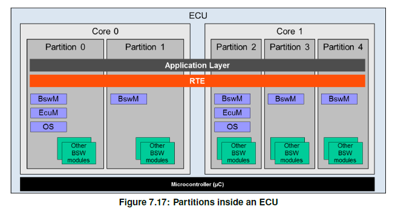

在多核架构中，**EcuM**必须以某种方式分布，即：每个核存在一个实例。

一个用来引导加载程序（boot loader）指定的主内核通过[**EcuM_Init**](#7322-ecum_init)启动主**EcuM**（**master EcuM**）。 主**EcuM**负责启动一些驱动程序，确定**Post Build**配置，接着启动其他的内核及其所附属**EcuM**（**Satellite EcuMs**）。

每个**EcuM**现在启动内核的本地操作系统和内核的本地**BswM**（在每个分区中驻留一个**BswM**）。

如果在**ECU**的每个内核上执行相同的**EcuM**映像，则**ECU**管理器的行为必须在不同内核上有所不同。这可以由**ECU**管理器通过测试，确认它是在主内核还是从内核上，并采取适当的行动来完成。

**ECU**管理器模块在多核**ECU**上支持与传统**ECU**上相同的阶段（即：**STARTUP**、**UP**、**SHUTDOWN**和**SLEEP**）。

如果使用安全机制，**ECU**管理器模块必须以完全信任级别运行。

本章节使用了前面的**ECU**管理器术语来表示各种**ECU**状态，特别是**Run** / **PostRun**。通过灵活的**ECU**管理，系统集成商可以决定**ECU**的状态名称和语义。但是必须坚持确保去初始化阶段的方法。 所以这里使用的名称是不规范的。

#### 6.9.1. 主内核

主内核（**Master Core**）具体是哪个内核？它是由引导加载程序（**boot loader**）决定。主内核的**EcuM**作为第一个**BSW**模块启动，并执行初始化操作。接着才是通过其他**EcuM**模块，启动剩下的其他内核。

当所有内核都启动完成时，主内核会与每个附属**EcuM**（**Satellite EcuM**）一起初始化自身内核的本地**OS**和**BswM**模块。

#### 6.9.2. 从内核

在每个从内核（**Slave core**）上，必须运行一个附属的**EcuM**。如果一个内核包含了多个分区，每个内核也只需要一个**EcuM**即可。

#### 6.9.3. 主从内核信号处理

本节描述了**BSW**内核通信的一般机制。它以**RTE**中描述和指定的**SchM**的一般知识为前提。

###### 6.9.3.1. BSW级别

操作系统提供了一种基本机制，用于同步主从内核上的操作系统启动。调度程序管理器（**Scheduler Manager**）为**BSW**模块跨分区边界（**Partition Boundaries**）的通信提供了基本机制。每个内核有一个**BSW**模式管理器负责启动和停止**RTE**。

关于解决方案的更完整的描述，以及在不同的方案之间进行选择时的注意事项及讨论，可参阅模式管理指南（**Guide to Mode Management**）[23]。

**译者注：** 此处编号按原文翻译。模式管理指南在本文档输入文档列表中的实际编号为[4]（原文编号[23]应为标准笔误）。

###### 6.9.3.2. 关机同步示例

在调用**ShutdownAllCores**之前，**主ECU管理器模块**需完成以下步骤：

1. 启动所有**从ECU管理器模块**的关机请求，
2. 必须等到所有模块都去初始化它们负责的**BSW**模块并成功关机动作。

**主ECU管理器模块**设置了一个可以被所有**从模块**读取的关机标志。**EcuM**为每个已配置的**从内核**激活随后的任务。**从模块**在其主程序中读取标志信息，并在请求时进行关机操作。任务（**Task**）的名称为**EcuM_SlaveCore\<X\>_Task**，其中**X**是一个数字。该任务需要由集成商（**integrator**）配置。由于主内核使用了一个**EcuMFlexPartionRef**，所以需要激活的任务数可以通过将**EcuMPartitionRef**的实例数减一进行计算。

**示例：**

首先配置了三个**EcuMPartitionRef**实例，然后在调用[**EcuM_GoDownHaltPoll**](#7321-ecum_godownhaltpoll)期间，将启动**EcuM_SlaveCore1_Task**和**EcuM_SlaveCore2_Task**。从模块在主程序（**main routine**）内读取的标志并在请求时关闭。

操作系统扩展了**OSEK SetEvent**的跨内核功能。一个内核上的任务（**Task**）可以等待另一个内核上的事件集（**Event Set**）。图7-18说明了如何应用在调用**ShutdownAllCores**之前的内核同步的问题（其中去初始化的详细信息被省略）。**Set/WaitEvent**函数接受一个位掩码（**bitmask**），该位掩码可用于指示各个从内核上的关闭就绪状态。来自**从ECU管理器模块**的每个**SetEvent**调用都将停止**主ECU管理器模块**的等待。所以**主ECU管理器模块**必须跟踪各个从内核的状态并设置等待，直到所有内核都注册已就绪。

如果调用者已经获取了资源（**resource**）或自旋锁（**spinlock**），则可以用**GetEvent**循环替换**WaitEvent**函数。

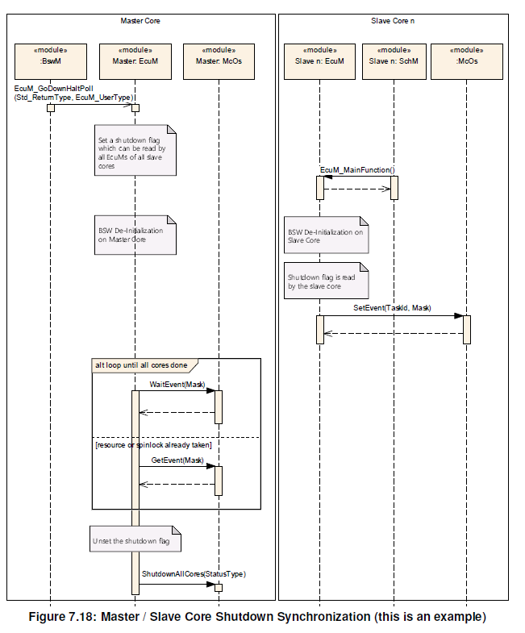

**注意：**

图7-18是主内核上的逻辑控制流示例。**[EcuM_GoDownHaltPoll](#7321-ecum_godownhaltpoll) API**需要EcuM在每个内核上都提供。**从内核**上此函数的行为是需要特定实现的。

**集成说明：**

如果主从核之间的同步是通过**SetEvent/WaitEvent**的方式实现的，那么[**EcuM_GoDownHaltPoll**](#7321-ecum_godownhaltpoll)将被BswM模块在其主函数任务的上下文中调用（模式仲裁需延迟处理）。这还需要主函数任务（**the main function task**）必须是扩展任务（**extended task**）。

#### 6.9.4. UP阶段

从硬件的角度来看，唤醒中断可能发生在所有内核上。整个**ECU**会被唤醒，接着在此内核上运行的**EcuM**处理唤醒事件。所以**EcuM_MainFunction**需在所有**EcuM**实例中运行。**ECU**管理器模块的每个实例都应处理其负责内核的唤醒事件。

与单核情况一样，**BswM**模块负责控制**ECU**资源，确定本地内核可以断电或停止，以及在移交控制给内核的**EcuM**之前，对相关的应用程序和**BSW**进行去初始化操作。

#### 6.9.5. STARTUP阶段

**ECU**管理器模块的功能在所有内核上几乎相同。也就是说对于单核情况，**ECU**管理器模块为**Startup**阶段执行指定的步骤。最重要的就是启动操作系统（**Starting the OS**），初始化SchM（**Initializing the SchM**）并启动本地内核的BswM模块。

主EcuM在调用**InitBlock 1**以及执行重置（**Reset**）/唤醒（**Wakeup**）内务后，会激活所有从内核。从内核在被激活后，开始执行它的启动例程，在其内核上调用[**EcuM_Init**](#7322-ecum_init)。

如果**EcuMEcucCoreDefinitionRef**未配置，则初始化调用只会在主核上执行。

**注意：**

如果您需要在多个内核上初始化一个模块，您必须将此模块添加到每个内核的特定的初始化列表中。同时也必须意识到，在这种情况下，可能存在从不同的内核并行调用**init**函数的情况，所以**init**函数需被定义为不可重入的。

在每个**EcuM**在其内核上调用**StartOs**后，操作系统会在运行内核单独启动挂钩（**core-individual startup hook**）之前同步内核，并在开始运行每个内核上的第一个任务（**Task**）之前再次同步一下内核。

**StartPostOS**会在每个内核上都执行，并且在每个内核上初始化**SchM**。所有内核上的本地**BswM**模块都会由每个**EcuM**初始化。接着每个分区（**Partition**）上的每个**BswM**会启动该内核上的**RTE**。

**ECU**管理器模块需在每个内核上启动**SchM**和**OS**。同时**ECU**管理器模块也需为主内核和所有从内核上的所有内核本地的**BswM**模块调用**BswM_Init**函数。

###### 6.9.5.1. 主内核STARTUP

* 主内核**StartPreOS**序列

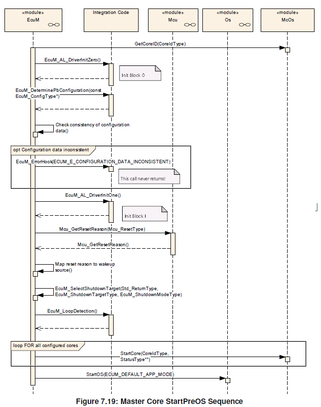

* 主内核**StartPostOS**序列

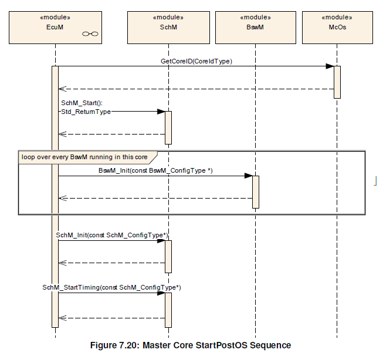

###### 6.9.5.2. 从内核STARTUP

**EcuM**的[**EcuM_AL_DriverInitZero**](#7522-ecum_al_driverinitzero)和[**EcuM_AL_DriverInitOne**](#7524-ecum_al_driverinitone)函数需由每个内核上的[**EcuM_Init**](#7322-ecum_init)函数调用。这些**Callout**函数的实现需确保只有那些在当前活动内核上运行的**MCAL**模块被初始化。

* 从内核**StartPreOS**序列

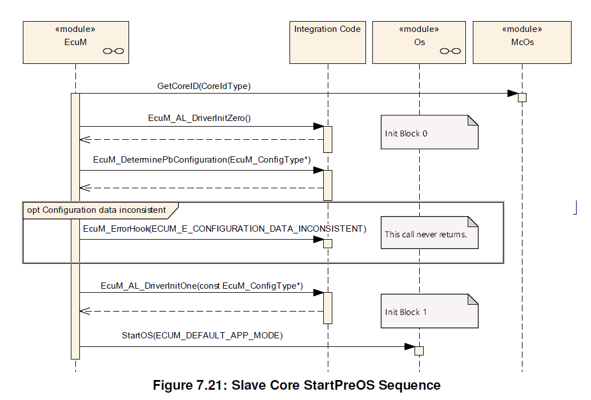

* 从内核**StartPostOS**序列

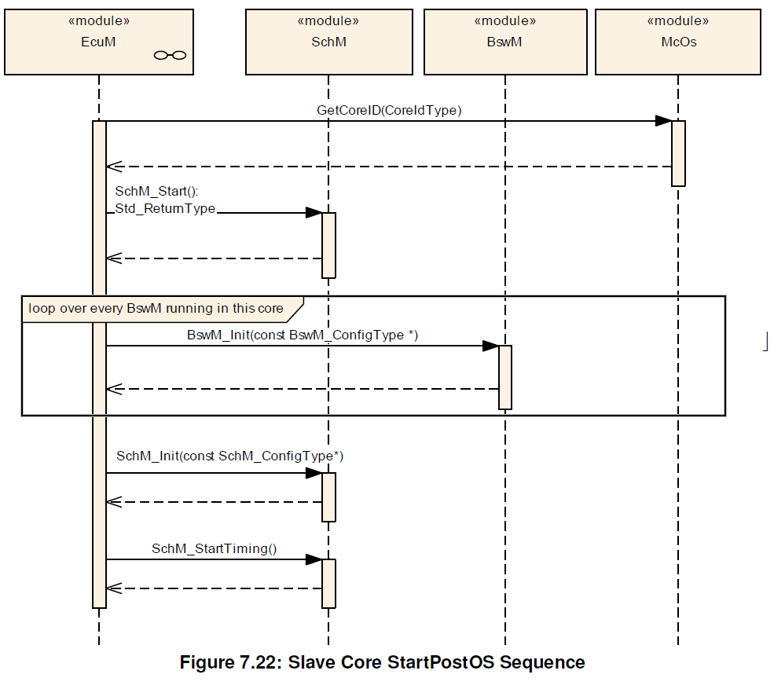

#### 6.9.6. SHUTDOWN阶段

当前独立单个内核的关闭是不支持的（即:**ECU**的部分继续运行时）。所有内核必须同时被关闭。

当ECU需被关闭时，**主ECU管理器模块**调用**ShutdownAllCores**，而不是以某种方式在各个内核上调用**ShutdownOS**。**ShutdownAllCores**会停止所有内核上的操作系统，并且停止所有内核运行。

由于主内核可以在所有从内核完成处理之前发出**ShutdownAllCores**，所以在进入**SHUTDOWN**之前必须对这些内核进行同步。

分布在所有分区上的**BswM**确定**ECU**应该被关闭，并与**ECU**中的每个**BswM**进行同步。所有**BswM**模块会对所有分区上的**BSW**、**SW-C**和**CDD**进行去初始化，并向其他**BswM**发送适当的信号以指示它们已准备好关机。

对于**ECU**的关闭，**BswM**（位于主**EcuM**的同一分区中）最终在主内核上调用**GoOff**，该主内核会将该请求分发给所有从内核。**主ECU管理器模块**会对**BswM**和**SchM**进行去初始化。从内核上的**EcuM**会负责去初始化它们的**SchM**和**BswM**，并检查在关机期间没有发生任何唤醒事件，接着发送一个信号以指示本内核已为**ShutdownOS**做好准备。具体请参阅章节[6.9.3主从内核信号处理](#693-主从内核信号处理)

主EcuM等待来自每个从内核EcuM的信号，然后像以往一样在主内核上启动关闭流程。**主EcuM**调用**ShutdownAllCores**，并且使用全局关闭钩子（**Global shutdown hook**）最终实现**ECU**关机。

###### 6.9.6.1. 主内核SHUTDOWN

* 主内核**OffPreOS**序列

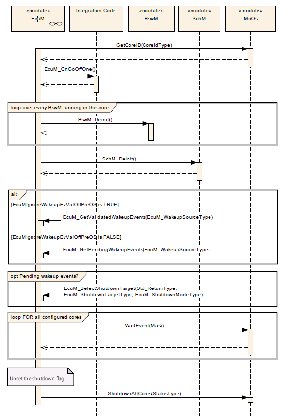

* 主内核**OffPostOS**序列

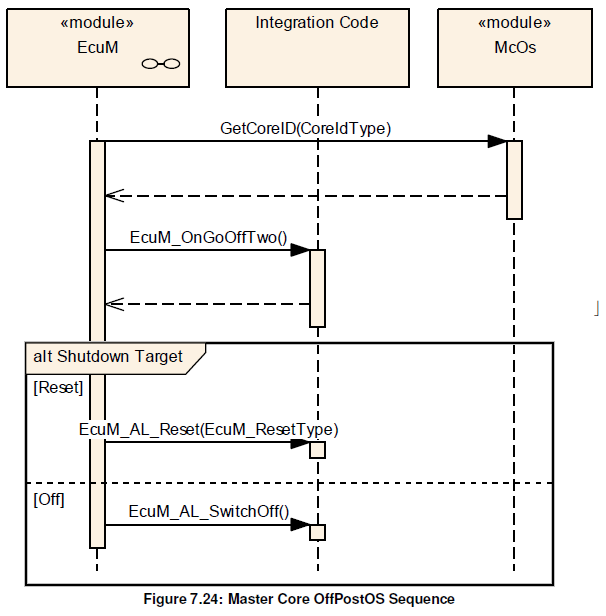

###### 6.9.6.2. 从内核SHUTDOWN

* 从内核**OffPreOS**序列

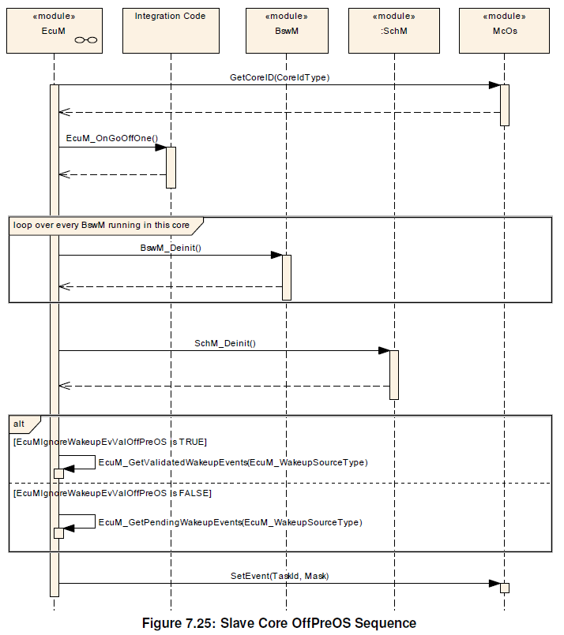

* 从内核**OffPostOS**序列

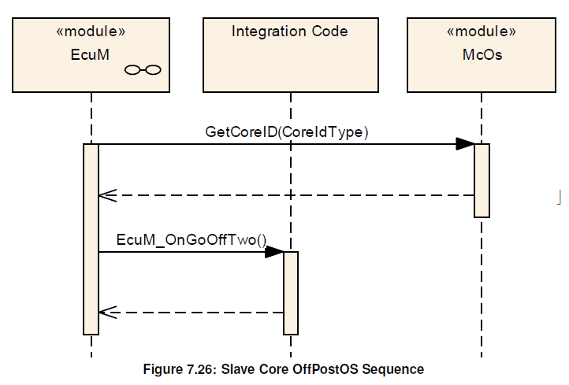

#### 6.9.7. SLEEP阶段

当请求的关机目标是睡眠（**Sleep**）时，所有内核需同时进入睡眠状态。**MCU**必须为每个内核发出停止（**Halt**）指令。因为对于**OS**中的内核来说，任务的时序（**Task Timing**）和优先级属于本地局部的（**local**），所以调度程序（**scheduler**）和**RTE**在停止后都不必同步。 因为主内核可以在所有从内核完成处理之前，发出**MCU**停止指令，所以在进入**GoHalt**之前，必须对所有从内核进行同步。

**BswM**需确定睡眠应该被启动，并将相应的**ECU**模式分配给每个内核。在从内核上的**BSW**、**SW-C**和**CDD**必须由其分区上本地的BswM负责通知，同时相应地去初始化，并向**BswM**发送相应的模式请求，以表明已准备就绪。

如果**ECU**进入睡眠状态，则停止（**Halt**）指令必须同步，以便在主内核计算校验和之前停止所有从内核。主内核上的**ECU**管理器模块使用与在**Go Off**时相同的同步内核信号机制。

类似，主内核上的**ECU**管理器模块必须在释放从内核停止状态（**Halt State**）之前验证计算的校验和值。

###### 6.9.7.1. 主内核SLEEP

* 主内核**GoSleep**序列

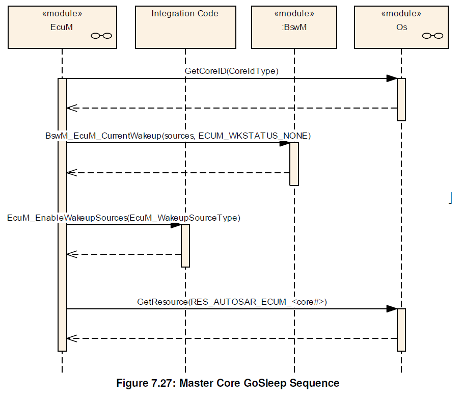

* 主内核**Halt**序列

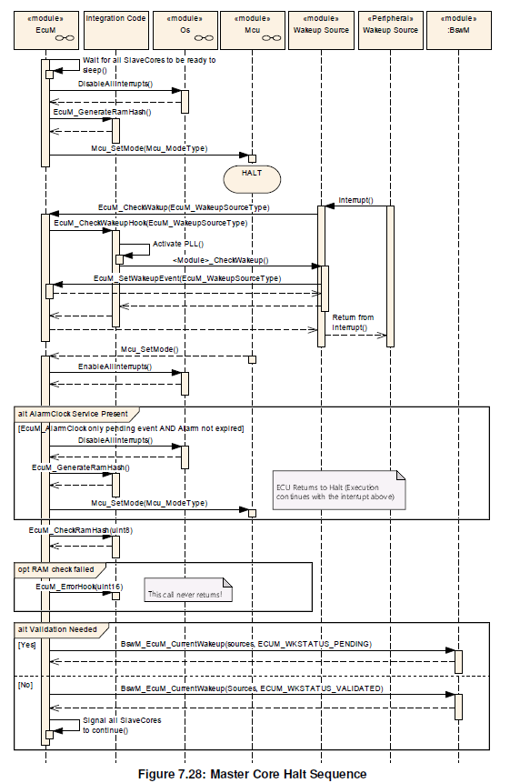

* 主内核**Poll**序列

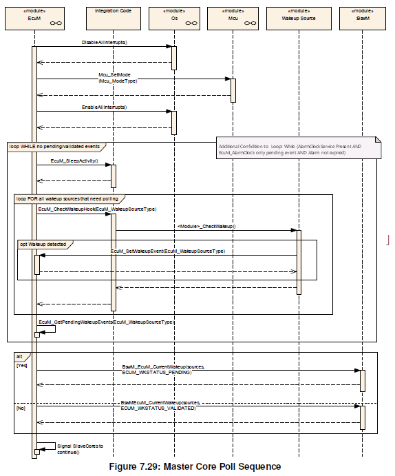

* 主内核**WakeupRestart**序列

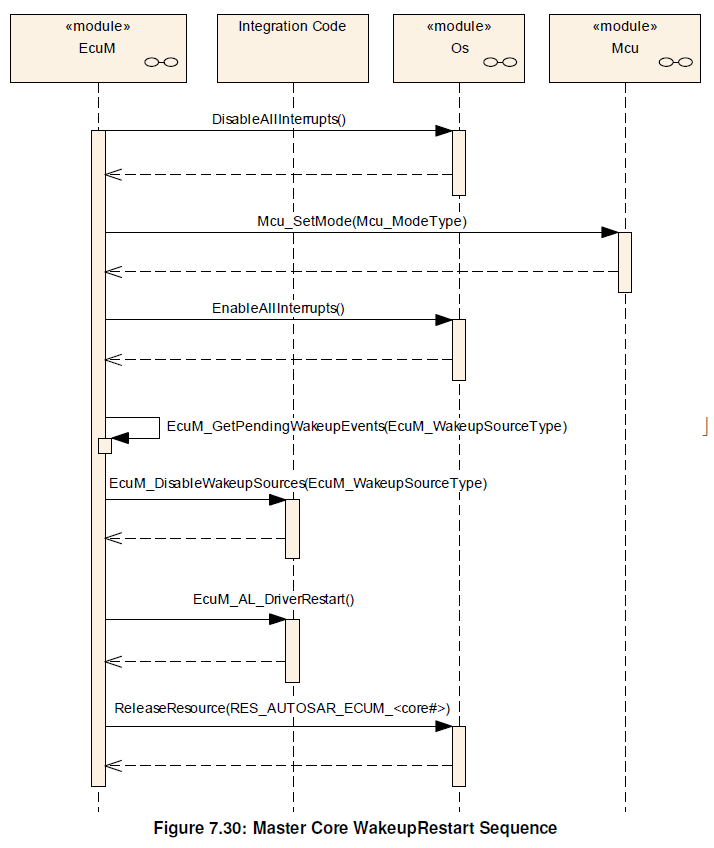

###### 6.9.7.2. 从内核SLEEP

* 从内核**GoSleep**序列

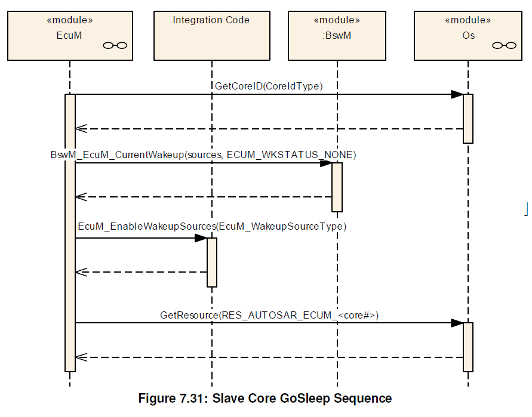

* 从内核**Halt**序列

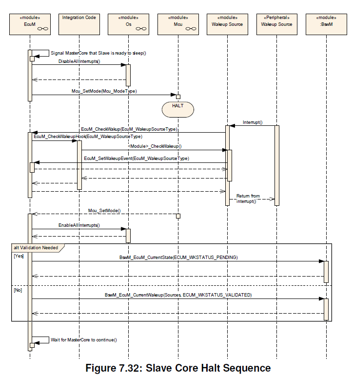

* 从内核**Poll**序列

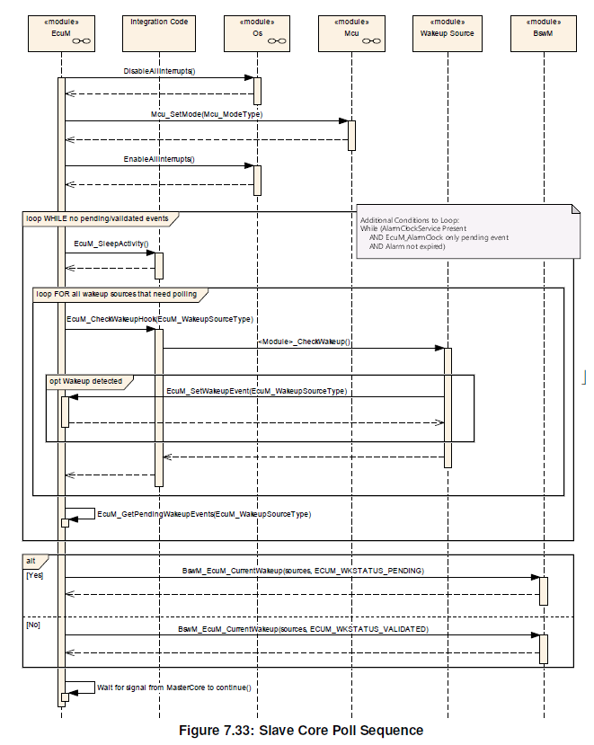

* 从内核**WakeupRestart**序列

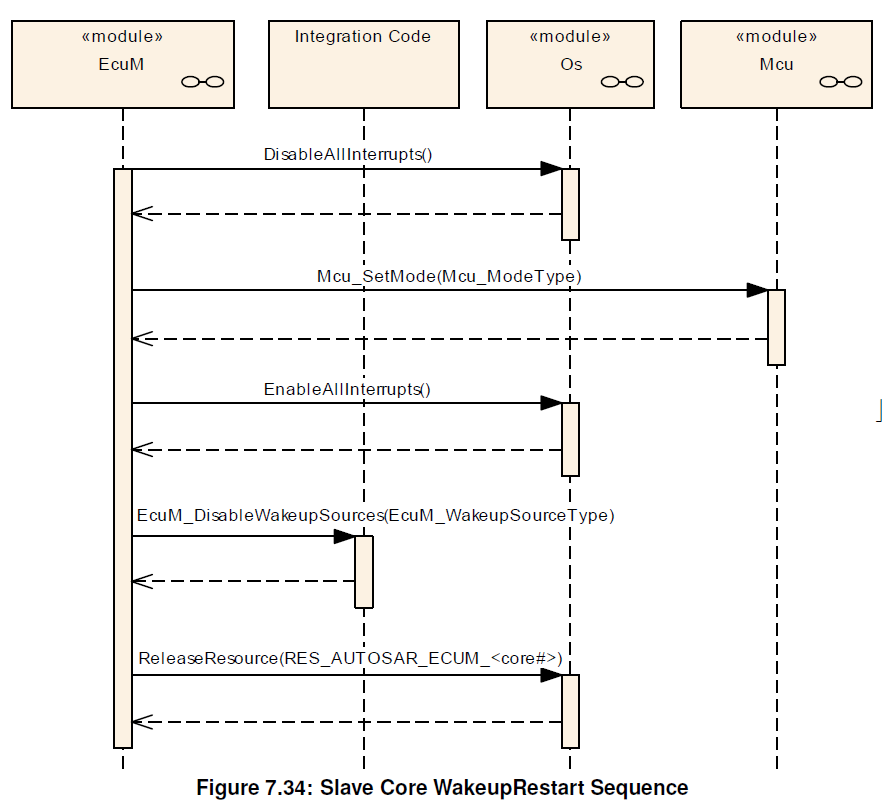

#### 6.9.8. 可运行实体和入口点

###### 6.9.8.1. 内部行为

**ECU Manager**模块的内部行为定义如下。此详细说明仅在本地**RTE**的配置时需要。

```
InternalBehavior EcuStateManager {
    // Runnable entities of the EcuStateManager
    RunnableEntity SelectShutdownTarget
        symbol "EcuM_SelectShutdownTarget"
        canbeInvokedConcurrently = TRUE
    RunnableEntity GetShutdownTarget=
        symbol "EcuM_GetShutdownTarget"
        canbeInvokedConcurrently = TRUE
    RunnableEntity GetLastShutdownTarget
        symbol "EcuM_GetLastShutdownTarget"
        canbeInvokedConcurrently = TRUE
    RunnableEntity SelectShutdownCause
        symbol "EcuM_SelectShutdownCause"
        canbeInvokedConcurrently = TRUE
    RunnableEntity GetShutdownCause
        symbol "EcuM_GetShutdownCause"
        canbeInvokedConcurrently = TRUE
    RunnableEntity SelectBootTarget
        symbol "EcuM_SelectBootTarget"
        canbeInvokedConcurrently = TRUE
    RunnableEntity GetBootTarget
        symbol "EcuM_GetBootTarget"
        canbeInvokedConcurrently = TRUE
    RunnableEntity SetRelWakeupAlarm
        symbol "EcuM_SetRelWakeupAlarm"
        canbeInvokedConcurrently = TRUE
    RunnableEntity SetAbsWakeupAlarm
        symbol "EcuM_SetAbsWakeupAlarm"
        canbeInvokedConcurrently = TRUE
    RunnableEntity AbortWakeupAlarm
        symbol "EcuM_AbortWakeupAlarm"
        canbeInvokedConcurrently = TRUE
    RunnableEntity GetCurrentTime
        symbol "EcuM_GetCurrentTime"
        canbeInvokedConcurrently = TRUE
    RunnableEntity GetWakeupTime
        symbol "EcuM_GetWakeupTime"
        canbeInvokedConcurrently = TRUE
    RunnableEntity SetClock
        symbol "EcuM_SetClock"
        canbeInvokedConcurrently = TRUE
    RunnableEntity RequestRUN
        symbol "EcuM_RequestRUN"
        canbeInvokedConcurrently = TRUE
    RunnableEntity ReleaseRUN
        symbol "EcuM_ReleaseRUN"
        canbeInvokedConcurrently = TRUE
    RunnableEntity RequestPOSTRUN
        symbol "EcuM_RequestPOST_RUN"
        canbeInvokedConcurrently = TRUE
    RunnableEntity ReleasePOSTRUN
        symbol "EcuM_ReleasePOST_RUN"
        canbeInvokedConcurrently = TRUE
    
    // Port present for each user. There are NU users
    SR000.RequestRUN -> RequestRUN
    SR000.ReleaseRUN -> ReleaseRUN
    SR000.RequestPOSTRUN -> RequestPOSTRUN
    SR000.ReleasePOSTRUN -> RequestPOSTRUN
    PortArgument {port=SR000, value.type=EcuM_UserType,
        value.value=EcuMUser[0].User }
    (...)
    SRnnn.RequestRUN -> RequestRUN
    SRnnn.ReleaseRUN -> ReleaseRUN
    SRnnn.RequestPOSTRUN -> RequestPOSTRUN
    SRnnn.ReleasePOSTRUN -> RequestPOSTRUN
    PortArgument {port=SRnnn, value.type=EcuM_UserType,
        value.value=EcuMUser[nnn].User }

    shutDownTarget.SelectShutdownTarget -> SelectShutdownTarget
    shutDownTarget.GetShutdownTarget -> GetShutdownTarget
    shutDownTarget.GetLastShutdownTarget -> GetLastShutdownTarget
    shutDownTarget.SelectShutdownCause -> SelectShutdownCause
    shutDownTarget.GetShutdownCause -> GetShutdownCause
    bootTarget.SelectBootTarget -> SelectBootTarget
    bootTarget.GetBootTarget -> GetBootTarget
    alarmClock.SetRelWakeupAlarm-> SetRelWakeupAlarm
    alarmClock.SetAbsWakeupAlarm -> SetAbsWakeupAlarm
    alarmClock.AbortWakeupAlarm -> AbortWakeupAlarm
    alarmClock.GetCurrentTime -> GetCurrentTime
    alarmClock.GetWakeupTime -> GetWakeupTime
    alarmClock.SetClock -> SetClock
};

```
### 6.10. EcuM模式处理

**ECU**状态管理器为**SW-C**提供接口以请求和释放**RUN**模式和可选的**POST_RUN**模式。

**EcuMFlex**对**SW-C**发出的请求和释放进行仲裁，并将结果传送给**BswM**。因为只有**BswM**可以决定何时可以转换到不同的模式，所以**EcuM**和**BswM**之间的合作是必需的。由于**EcuM**没有自己的状态机，**EcuM**依赖于**BswM**进行的状态转换，所以**EcuM**不请求状态。 此外**EcuM**将当前请求的仲裁通知**BswM**。当**RTE**执行完所有属于某个模式的**Runnable**时会通知**BswM**模块。

#### 6.10.1. ECU模式处理的架构组件

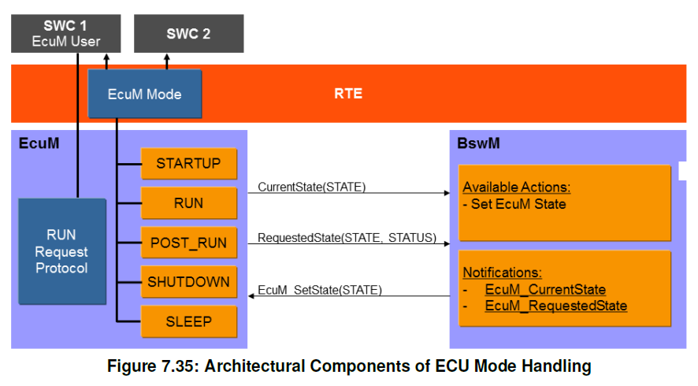

图7-35说明了**ECU**模式处理的架构组件。

当**EcuMModeHandling**配置为**true**时，**ECU**模式处理需被使能。

当**BswM**通过[**EcuM_SetState**](#7331-ecum_setstate)设置了**EcuM**的状态时，**EcuM**需向**RTE**通知相应的模式变化。

当最后一个**RUN**请求已被释放时，**ECU**状态管理器模块应使用**BswM_EcuM_RequestedState\(ECUM_STATE_RUN, ECUM_RUNSTATUS_RELEASED\)**接口通知**BswM**模块。

如果**SW-C**在**POST_RUN**期间需要运行活动（例如：关机准备等），它必须在释放**RUN**请求之前，请求**POST_RUN**。否则，不能保证此**SW-C**有机会运行其 **POST_RUN**的代码。**POST_RUN**状态为**SW-C**提供了**POST_RUN**阶段，允许**SW-C**保存重要数据或关闭相关外围设备。

当**ECU**状态管理器模块不处于**SW-C**请求的状态时，**ECU**状态管理器需使用**BswM_EcuM_RequestedState**接口通知**BswM**有关请求的状态。

当接收到第一个**RUN**或者**POST_RUN**请求时，**ECU**状态管理器模块需调用**BswM_EcuM_RequestedState\(ECUM_STATE_RUN, ECUM_RUNSTATUS_REQUESTED\)**接口通知**BswM**。

当最后一个**POST_RUN**请求也已经被释放时，**ECU**状态管理器模块需调用**BswM_EcuM_RequestedState\(ECUM_STATE_POST_RUN, ECUM_RUNSTATUS_RELEASED\)**接口通知**BswM**。

**提示：**

为防止**ECU Mode**的模式状态机实例滞后，以及**EcuM**和**RTE**状态不一致，**EcuM**可以使用确认反馈（**acknowledgement feedback**）来进行模式切换通知。

**注意：**

**EcuM**仅在**RUN**和**POST_RUN**切换时请求模式，**SLEEP**模式必须由**BswM**设置，因为**EcuM**没有关于何时可以进入此模式的信息。

| 状态     | 描述                                                                                                |
| -------- | --------------------------------------------------------------------------------------------------- |
| STARTUP  | 初始值。在调用**Rte_Start**时由**Rte**设置。                                                        |
| RUN      | 当所有需要的**BSW**模块被初始化，**BswM**就会切换到此模式。                                         |
| POST_RUN | 当没有**RUN**请求存在时，**EcuM**请求**POST_RUN**。                                                 |
| SLEEP    | 当没有**RUN**和**POST_RUN**请求存在，且关机目标设置为**SLEEP**时，**EcuM**请求**SLEEP**模式。       |
| SHUTDOWN | 当没有**RUN**和**POST_RUN**请求存在，且关机目标设置为**SHUTDOWN**时，**EcuM**请求**SHUTDOWN**模式。 |

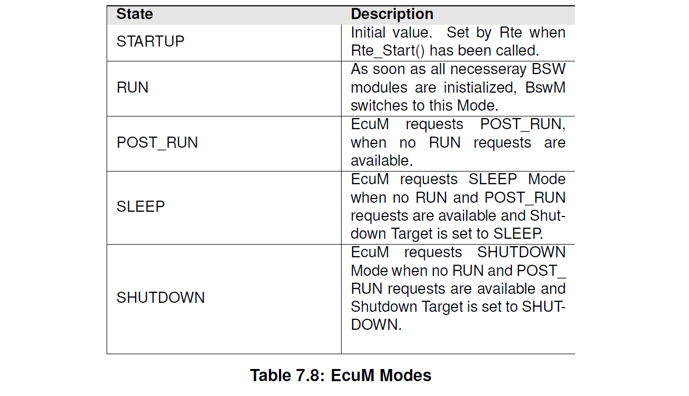

**EcuM**需通过调用接口**BswM_EcuM_CurrentState\([EcuM_StateType](#726-ecum_statetype) State\)**通知**BswM**当前状态。当**RTE**通过确认端口给出反馈时，**EcuM**将设置一个新的状态。

### 6.11. 高级主题

#### 6.11.1. 与引导加载程序相关

引导加载程序（**bootloader**）不是**AUTOSAR**的一部分。尽管如此应用程序仍需要一个接口来激活引导加载程序（**bootloader**）。 为此**ECU**状态管理器模块提供了两个函数：

* [**EcuM_SelectBootTarget**](#7371-ecum_selectboottarget) 
* [**EcuM_GetBootTarget**](#7372-ecum_getboottarget)

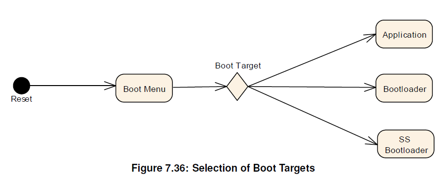

引导加载程序（**Bootloader**）、系统供应商的引导加载程序（**system supplier bootloader**）和应用程序（**application**）是三个独立的程序映像（**Image**），在许多情况下甚至可以单独刷新。从一个映像切换到另一个映像的唯一方法是通过重启（**reset**）。 引导菜单（**Boot menu**）将根据所选引导目标跳转到一个或其它的映像。

#### 6.11.2. 与复杂驱动相关

如果一个复杂驱动程序处理一个唤醒源，它必须遵循本文档中指定的处理唤醒事件的协议。

#### 6.11.3. 处理启动和关闭期间的错误

**ECU**管理器模块需忽略初始化期间发生的所有类型的错误。例如：初始化函数返回的值。

因为初始化是一个配置问题（参见：**EcuMDriverInitListZero**、**EcuMDriverInitListOne**和**EcuMDriverRestartList**），所以无法标准化。

**BSW**模块负责将其初始化期间发生的错误，直接报告给**DEM**模块或**DET**模块，如其 SWS 中所指定的那样。**ECU**管理器模块不报告错误。**BSW**模块还负责采取任何特殊措施来应对初始化期间发生的错误。

### 6.12. 错误处理

在表7.9第一列中定义的不可恢复错误情况下，**ECU**管理器模块应调用[**EcuM_ErrorHook**](#7511-ecum_errorhook)的**Callout**函数，并将参数值设置为相应的相关错误代码。

| 错误类型                           | 相关错误代码                           | 错误值     |
| ---------------------------------- | -------------------------------------- | ---------- |
| 唤醒期间的**RAM**检查失败          | ECUM_E_RAM_CHECK_FAILED                | 由实现分配 |
| **Postbuild**配置数据不一致        | ECUM_E_CONFIGURATION_DATA_INCONSISTENT | 由实现分配 |
| 用于报告操作系统调用问题的错误代码 | ECUM_E_OS_CALL_FAILED                  | 由实现分配 |

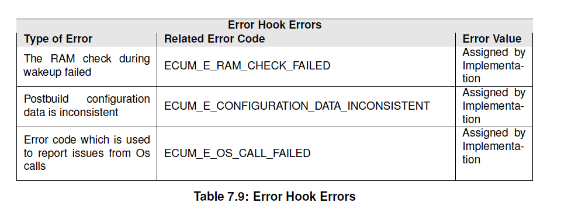

**EcuM**需假定[**EcuM_ErrorHook**](#7511-ecum_errorhook)不会返回（集成商的代码）。

如果需要**Dem**错误，集成商有责任定义处理它的策略（例如：由于**EcuM**不直接调用**Dem**，所以在重启恢复后设置**Dem**错误）。

如果**OS**函数调用返回错误代码（**E_OK**除外），则**EcuM**应调用[**EcuM_ErrorHook**](#7511-ecum_errorhook)，错误代码为**ECUM_E_OS_CALL_FAILED**。

### 6.13. 错误分类

文档[6]"基础软件模块通用规范"中的"错误处理"章节详细描述了基础软件的错误处理。其中尤其定义了一个由五种错误类型组成的分类方案，这些错误类型可能出现在**BSW**模块中。

基于此，以下各小节规定了**EcuM**模块中相应的特定错误。

此外，**EcuM**对错误还有一种额外的处理方式，可参见章节[6.12 错误处理](#612-错误处理)。

#### 6.13.1. 开发错误

**EcuM**模块中开发错误（**development errors**）的定义如下表所示：

| 错误类型 | 相关错误代码 | 错误值 |
| --- | --- | --- |
| 检测到同一用户的多个请求 | **ECUM_E_MULTIPLE_RUN_REQUESTS** | 由实现分配 |
| 调用了被配置禁用的函数 | **ECUM_E_SERVICE_DISABLED** | 由实现分配 |
| 在初始化之前调用了服务 | **ECUM_E_UNINIT** | 由实现分配 |
| 向**API**传递了未知的唤醒源作为参数 | **ECUM_E_UNKNOWN_WAKEUP_SOURCE** | 由实现分配 |
| 初始化失败 | **ECUM_E_INIT_FAILED** | 由实现分配 |
| 作为服务参数传递的状态超出范围（特定参数检查） | **ECUM_E_STATE_PAR_OUT_OF_RANGE** | 由实现分配 |
| 参数无效（未具体分类） | **ECUM_E_INVALID_PAR** | 由实现分配 |
| 传递了无效的指针作为参数 | **ECUM_E_PARAM_POINTER** | 由实现分配 |
| 未找到与所提供用户相匹配的前序请求 | **ECUM_E_MISMATCHED_RUN_RELEASE** | 由实现分配 |

#### 6.13.2. 运行时错误

| 错误类型 | 相关错误代码 | 错误值 |
| --- | --- | --- |
| 唤醒后，在给定的时间内未设置唤醒事件（参见**EcuMCheckWakeupTimeout**） | **ECUM_E_WAKEUP_TIMEOUT** | 由实现分配 |

#### 6.13.3. 瞬态故障

无瞬态故障（**transient faults**）。

#### 6.13.4. 产品错误

无产品错误（**production errors**）。

#### 6.13.5. 扩展产品错误

无扩展产品错误（**extended production errors**）。

## 7. API规范

### 7.1. 导入的类型

本章列出了ECU管理器模块从相应的AUTOSAR模块导入的所有类型。

**EcuM**模块的导入数据类型定义

| 模块 | 头文件 | 导入的类型 |
|---|---|---|
| Adc | Adc.h | Adc_ConfigType |
| BswM | BswM.h | BswM_ConfigType |
| Can | Can.h | Can_ConfigType |
| CanTrcv | CanTrcv.h | CanTrcv_ConfigType |
| ComStack_Types | ComStack_Types.h | NetworkHandleType |
| ComStack_Types | ComStack_Types.h | PNCHandleType |
| Dem | Dem.h | Dem_ConfigType |
| Det | Det.h | Det_ConfigType |
| Eth | Eth.h | Eth_ConfigType |
| EthSwt | EthSwt.h | EthSwt_ConfigType |
| EthTrcv | EthTrcv.h | EthTrcv_ConfigType |
| Fls | Fls.h | Fls_ConfigType |
| Fr | Fr.h | Fr_ConfigType |
| FrTrcv | FrTrcv.h | FrTrcv_ConfigType |
| Gpt | Gpt.h | Gpt_ConfigType |
| Icu | Icu.h | Icu_ConfigType |
| IoHwAb | IoHwAb.h | IoHwAb{Init_Id}_ConfigType |
| Lin | Lin.h | Lin_ConfigType |
| LinTrcv | LinTrcv.h | LinTrcv_ConfigType |
| McOs | Os.h | AppModeType |
| McOs | Os.h | CoreIdType |
| Mcu | Mcu.h | Mcu_ConfigType |
| Mcu | Mcu.h | Mcu_ModeType |
| Mcu | Mcu.h | Mcu_ResetType |
| Ocu | Ocu.h | Ocu_ConfigType |
| Os | Os.h | StatusType |
| Port | Port.h | Port_ConfigType |
| Pwm | Pwm.h | Pwm_ConfigType |
| SchM | Rte_PBcfg.h | SchM_ConfigType |
| Spi | Spi.h | Spi_ConfigType |
| Std | Std_Types.h | Std_ReturnType |
| Std | Std_Types.h | Std_VersionInfoType |
| Wdg | Wdg.h | Wdg_ConfigType |

**ECUM_E_EARLIER_ACTIVE**和**ECUM_E_PAST**应为**Std_ReturnType**类型，并表示以下值：


* **ECUM_E_EARLIER_ACTIVE** = 3
* **ECUM_E_PAST** = 4

### 7.2. 类型定义

#### 7.2.1. EcuM_ConfigType

结构类型。应向ECU状态管理器的初始化例程提供指向此类结构体的指针，用于配置。该结构体的内容取决于**EcuM**的后构建配置（**post-build configuration**）。可通过**EcuM.h**获得。

**EcuM_ConfigType**类型定义的结构体应保存ECU管理器模块的后构建配置参数，以及指向由ECU管理器模块初始化的所有模块的**ConfigType**结构体的指针。

ECU管理器模块配置工具必须针对构成ECU配置的给定基础软件模块集合，专门生成**EcuM_ConfigType**类型定义的结构体。该基础软件模块集合派生自相应的**EcuM**参数。

**EcuM_ConfigType**类型中定义的结构体应包含一个额外的后构建配置变体标识符（uint8/uint16/uint32，取决于计算该标识符的算法）。

另请参阅第7.3.4章"检查配置一致性"（Checking Configuration Consistency）。

**EcuM_ConfigType**类型定义的结构体应包含一个额外的哈希码，该哈希码与配置参数**EcuMConfigConsistencyHash**进行比对，用于检查配置数据的一致性。

另请参阅第7.3.4节"检查配置一致性"（Checking Configuration Consistency）。

对于每个给定的ECU配置，ECU管理器模块配置工具必须生成该结构体的一个实例，其中填充了ECU管理器模块的后构建配置参数，以及指向上述模块配置结构体实例的指针。这些指针派生自相应的**EcuM**参数。


#### 7.2.2. EcuM_RunStatusType

类型，派生自 uint8。范围为：

| 值 | 取值 | 描述 |
|---|---|---|
| ECUM_RUNSTATUS_UNKNOWN | 0 | 未知状态。初始值。 |
| ECUM_RUNSTATUS_REQUESTED | 1 | 向**EcuM**请求的状态。 |
| ECUM_RUNSTATUS_RELEASED | 2 | 从**EcuM**释放的状态。 |

该类型描述发送给**BswM**的运行请求协议（**Run Request Protocol**）的结果。可通过**EcuM.h**获得。

ECU管理器模块应按照**EcuM_RunStatusType**中所列的内容，向**BswM**通知运行请求协议的状态。

#### 7.2.3. EcuM_WakeupSourceType

类型，派生自 uint32。范围为：

| 值 | 取值 | 描述 |
|---|---|---|
| ECUM_WKSOURCE_POWER | 0x01 | 上电周期（**Power cycle**，位0）。 |
| ECUM_WKSOURCE_RESET（默认） | 0x02 | 硬件复位（位1）。如果**Mcu**驱动程序无法区分上电周期和复位原因，则此值应为默认唤醒源。 |
| ECUM_WKSOURCE_INTERNAL_RESET | 0x04 | µC内部复位（位2）。内部复位通常仅复位µC内核，而不复位外设或内存控制器。具体行为与硬件相关。该唤醒源也可能表示一个未处理的异常。 |
| ECUM_WKSOURCE_INTERNAL_WDG | 0x08 | 内部看门狗复位（位3）。 |
| ECUM_WKSOURCE_EXTERNAL_WDG | 0x10 | 外部看门狗复位（位4），前提是硬件支持该检测。 |


**EcuM_WakeupSourceType**定义了一个具有5个预定义位置的位域（**bitfield**，见上表）。该位域为每个唤醒源提供一个位。在**WAKEUP**中，所有位清零表示未知的唤醒源。在**STARTUP**中，所有位清零表示未知的重启或复位原因。在这种情况下，应假定**ECUM_WKSOURCE_RESET**。可通过**EcuM.h**获得。

对于预定义唤醒源之外的附加唤醒源，应通过配置将其逐一分配到位域的位置5到31。位分配应由配置工具完成。

**EcuMWakeupSource**容器中的**EcuMWakeupSourceId**字段应定义该唤醒源在**EcuM_WakeupSourceType**位域的所有实例中所对应的位置。

#### 7.2.4. EcuM_WakeupStatusType

类型，派生自 uint8。范围为：

| 值 | 取值 | 描述 |
|---|---|---|
| ECUM_WKSTATUS_NONE | 0 | 未检测到待定的唤醒事件。 |
| ECUM_WKSTATUS_PENDING | 1 | 已检测到唤醒事件，但尚未验证。 |
| ECUM_WKSTATUS_VALIDATED | 2 | 唤醒事件有效。 |
| ECUM_WKSTATUS_EXPIRED | 3 | 唤醒事件未被验证，因此已过期。 |

该类型描述唤醒源可能的状态。可通过**EcuM.h**获得。

**注**：此声明必须更改为一种模式（**mode**）。名称也必须更改。


#### 7.2.5. EcuM_ResetType

类型，派生自 uint8。范围为：

| 值 | 取值 | 描述 |
|---|---|---|
| ECUM_RESET_MCU | 0 | 通过**Mcu_PerformReset**进行微控制器复位。 |
| ECUM_RESET_WDG | 1 | 通过**WdgM_PerformReset**进行看门狗复位。 |
| ECUM_RESET_IO | 2 | 通过翻转一根I/O线进行复位。 |

该类型描述ECU状态管理器支持的复位机制。可以通过配置对其进行扩展。可通过**EcuM.h**获得。

#### 7.2.6. EcuM_StateType

类型，派生自 uint8。描述：ECU状态管理器的状态。可通过**EcuM.h**获得。

| 值 | 取值 | 描述 |
|---|---|---|
| ECUM_SUBSTATE_MASK | 0x0f | - |
| ECUM_STATE_STARTUP | 0x10 | - |
| ECUM_STATE_RUN | 0x32 | - |
| ECUM_STATE_POST_RUN | 0x33 | - |
| ECUM_STATE_SHUTDOWN | 0x40 | - |
| ECUM_STATE_SLEEP | 0x50 | - |

ECU管理器模块应定义**EcuM_StateType**中列出的所有状态。

### 7.3. 函数定义

#### 7.3.1. 通用

###### 7.3.1.1. EcuM_GetVersionInfo

**说明**: 返回此模块的版本信息。

```C
void EcuM_GetVersionInfo (
    Std_VersionInfoType* versioninfo
)
```

#### 7.3.2. 初始化和关机序列

###### 7.3.2.1. EcuM_GoDownHaltPoll

**说明**: 根据先前选择的关闭目标，指示**ECU**状态管理器模块进入睡眠、重启或关闭模式。

```C
Std_ReturnType EcuM_GoDownHaltPoll (
    EcuM_UserType UserID
)
```

###### 7.3.2.2. EcuM_Init

**说明**: 初始化**ECU**状态管理器并执行启动程序。该函数永远不会返回（它调用**StartOS**）。

```C
void EcuM_Init (
    void
)
```

###### 7.3.2.3. EcuM_StartupTwo

**说明**: 该函数实现了**STARTUP II**状态。

```C
void EcuM_StartupTwo (
    void
)
```

###### 7.3.2.4. EcuM_Shutdown

**说明**: 通常有关机挂钩（**shutdown hook**）调用，此函数接管执行控制并将执行**GO OFF II**活动。

```C
void EcuM_Shutdown (
    void
)
```

#### 7.3.3. 状态管理

###### 7.3.3.1. EcuM_SetState

**说明**: BswM 调用的函数，用于通知状态切换。

```C
void EcuM_SetState (
    EcuM_StateType state
)
```

###### 7.3.3.2. EcuM_RequestRUN

**说明**: 请求**RUN**状态。每个用户都可以在配置时向状态管理器发出请求。

```C
Std_ReturnType EcuM_RequestRUN (
    EcuM_UserType user
)
```

###### 7.3.3.3. EcuM_ReleaseRUN

**说明**: 释放先前通过调用[**EcuM_RequestRUN**](#7332-ecum_requestrun)完成的**RUN**请求。该服务旨在实现**AUTOSAR**端口。

```C
Std_ReturnType EcuM_ReleaseRUN (
    EcuM_UserType user
)
```

###### 7.3.3.4. EcuM_RequestPOST_RUN

**说明**: 发出对**POST_RUN**状态的请求。每个用户都可以在配置时向状态管理器发出请求。**RUN**和**POST_RUN**的请求必须独立跟踪（换句话说：两个独立变量）。 该服务旨在实现**AUTOSAR**端口。

```C
Std_ReturnType EcuM_RequestPOST_RUN (
    EcuM_UserType user
)
```

###### 7.3.3.5. EcuM_ReleasePOST_RUN

**说明**: 释放先前通过调用[**EcuM_RequestPOST_RUN**](#7334-ecum_requestpost_run)完成的**POST_RUN**请求。该服务旨在实现**AUTOSAR**端口。

```C
Std_ReturnType EcuM_ReleasePOST_RUN (
    EcuM_UserType user
)
```

#### 7.3.4. 关机管理

###### 7.3.4.1. EcuM_SelectShutdownTarget

**说明**: **EcuM_SelectShutdownTarget**选择关机目标。**EcuM_SelectShutdownTarget**是**ECU**管理器模块端口接口的一部分。

```C
Std_ReturnType EcuM_SelectShutdownTarget (
    EcuM_ShutdownTargetType shutdownTarget,
    EcuM_ShutdownModeType shutdownMode
)
```

###### 7.3.4.2. EcuM_GetShutdownTarget

**说明**: **EcuM_GetShutdownTarget**返回由[**EcuM_SelectShutdownTarget**](#7341-ecum_selectshutdowntarget)设置的当前选择的关闭目标。**EcuM_GetShutdownTarget**是**ECU**管理器模块端口接口的一部分。

```C
Std_ReturnType EcuM_GetShutdownTarget (
    EcuM_ShutdownTargetType* shutdownTarget,
    EcuM_ShutdownModeType* shutdownMode
)
```

###### 7.3.4.3. EcuM_GetLastShutdownTarget

**说明**: **EcuM_GetLastShutdownTarget**返回上一个关机进程的关机目标。**EcuM_GetLastShutdownTarget**是**ECU**管理器模块端口接口的一部分。

```C
Std_ReturnType EcuM_GetLastShutdownTarget (
    EcuM_ShutdownTargetType* shutdownTarget,
    EcuM_ShutdownModeType* shutdownMode
)
```

###### 7.3.4.4. EcuM_SelectShutdownCause

**说明**: EcuM_SelectShutdownCause选择关机的原因。**EcuM_SelectShutdownCause**是**ECU**管理器模块端口接口的一部分。

```C
Std_ReturnType EcuM_SelectShutdownCause (
    EcuM_ShutdownCauseType target
)
```

###### 7.3.4.5. EcuM_GetShutdownCause

**说明**: **EcuM_GetShutdownCause**返回由[**EcuM_SelectShutdownCause**](#7344-ecum_selectshutdowncause)设置的选定关机原因。**EcuM_GetShutdownCause**是**ECU**管理器模块端口接口的一部分。

```C
Std_ReturnType EcuM_GetShutdownCause (
    EcuM_ShutdownCauseType* shutdownCause
)
```

#### 7.3.5. 唤醒处理

###### 7.3.5.1. EcuM_CheckWakeup

**说明**: 可以调用此函数来检查给定的唤醒源 它将参数传递给集成函数[**EcuM_CheckWakeupHook**](#7545-ecum_checkwakeuphook)。唤醒源的**ISR**也可以调用它来设置**PLL**，并检查可能连接到同一中断的其他唤醒源。

```C
void EcuM_CheckWakeup (
    EcuM_WakeupSourceType wakeupSource
)
```

###### 7.3.5.2. EcuM_GetPendingWakeupEvents

**说明**: 获取挂起的唤醒事件。

```C
EcuM_WakeupSourceType EcuM_GetPendingWakeupEvents (
    void
)
```

###### 7.3.5.3. EcuM_ClearWakeupEvent

**说明**: 清除唤醒事件。

```C
void EcuM_ClearWakeupEvent (
    EcuM_WakeupSourceType sources
)
```

###### 7.3.5.4. EcuM_GetValidatedWakeupEvents

**说明**: 获取经过验证的唤醒事件。

```C
EcuM_WakeupSourceType EcuM_GetValidatedWakeupEvents (
    void
)
```

###### 7.3.5.5. EcuM_GetExpiredWakeupEvents

**说明**: 获取过期的唤醒事件。

```C
EcuM_WakeupSourceType EcuM_GetExpiredWakeupEvents (
    void
)
```

#### 7.3.6. 闹钟

###### 7.3.6.1. EcuM_SetRelWakeupAlarm

**说明**: **EcuM_SetRelWakeupAlarm**设置用户的唤醒警报相对于当前时间点。**EcuM_SetRelWakeupAlarm**是**ECU**管理器模块端口接口的一部分。

```C
Std_ReturnType EcuM_SetRelWakeupAlarm (
    EcuM_UserType user,
    EcuM_TimeType time
)
```

###### 7.3.6.2. EcuM_SetAbsWakeupAlarm

**说明**: **EcuM_SetAbsWakeupAlarm**将用户的唤醒警报设置为绝对时间点。**EcuM_SetAbsWakeupAlarm**是**ECU**管理器模块端口接口的一部分。

```C
Std_ReturnType EcuM_SetAbsWakeupAlarm (
    EcuM_UserType user,
    EcuM_TimeType time
)
```

###### 7.3.6.3. EcuM_AbortWakeupAlarm

**说明**: **EcuM_AbortWakeupAlarm**中止此用户先前设置的唤醒警报。**EcuM_AbortWakeupAlarm** 是**ECU**管理器模块端口接口的一部分。

```C
Std_ReturnType EcuM_AbortWakeupAlarm (
    EcuM_UserType user
)
```

###### 7.3.6.4. EcuM_GetCurrentTime

**说明**: **EcuM_GetCurrentTime**返回**EcuM**时钟的当前值（即电池连接后的时间）。**EcuM_GetCurrentTime**是**ECU**管理器模块端口接口的一部分。

```C
Std_ReturnType EcuM_GetCurrentTime (
    EcuM_TimeType* time
)
```

###### 7.3.6.5. EcuM_GetWakeupTime

**说明**: **EcuM_GetWakeupTime**返回主闹钟的当前值（所有用户闹钟的最小绝对时间）。**EcuM_GetWakeupTime**是**ECU**管理器模块端口接口的一部分。

```C
Std_ReturnType EcuM_GetWakeupTime (
    EcuM_TimeType* time
)
```

###### 7.3.6.6. EcuM_SetClock

**说明**: **EcuM_SetClock**将**EcuM**时钟时间设置为提供的值。该**API**可用于测试报警服务；可以测试需要几天才能过期的警报。**EcuM_SetClock**是**ECU**管理器模块端口接口的一部分。

```C
Std_ReturnType EcuM_SetClock (
    EcuM_UserType user,
    EcuM_TimeType time
)
```

#### 7.3.7. 杂项

###### 7.3.7.1. EcuM_SelectBootTarget

**说明**: **EcuM_SelectBootTarget**选择一个引导目标。**EcuM_SelectBootTarget**是**ECU**管理器模块端口接口的一部分。

```C
Std_ReturnType EcuM_SelectBootTarget (
    EcuM_BootTargetType target
)
```

###### 7.3.7.2. EcuM_GetBootTarget

**说明**: **EcuM_GetBootTarget**返回当前引导目标 - 请参阅[**EcuM_SelectBootTarget**](#7371-ecum_selectboottarget)。**EcuM_GetBootTarget**是**ECU**管理器模块端口接口的一部分。

```C
Std_ReturnType EcuM_GetBootTarget (
    EcuM_BootTargetType * target
)
```

### 7.4. Callback函数

#### 7.4.1. 唤醒源的Callback函数

###### 7.4.1.1. EcuM_SetWakeupEvent

**说明**: 设置唤醒事件。

```C
void EcuM_SetWakeupEvent (
    EcuM_WakeupSourceType sources
)
```

###### 7.4.1.2. EcuM_ValidateWakeupEvent

**说明**: 唤醒后**ECU**状态管理器将在**WAKEUP VALIDATION**状态/序列期间，停止进程以等待唤醒事件的验证。此**API**服务用于向**ECU**管理器模块指示源参数中指示的唤醒事件已被验证。

```C
void EcuM_ValidateWakeupEvent (
    EcuM_WakeupSourceType sources
)
```

### 7.5. Callout函数

#### 7.5.1. 通用Callout函数

###### 7.5.1.1. EcuM_ErrorHook

**说明**: 如果发生致命错误，**ECU**状态管理器将调用此错误Hook。在这种情况下，无法继续处理，必须停止**ECU**。集成商可以选择停止**ECU**的方式，即：重置（**reset**）、停止（**halt**）、重新启动（**restart**）、安全状态（**safe state**）等。

```C
void EcuM_ErrorHook (
    uint16 reason
)
```

#### 7.5.2. STARTUP的Callout函数

###### 7.5.2.1. EcuM_AL_SetProgrammableInterrupts

**说明**: 如果配置参数**EcuMSetProgrammableInterrupts**设置为**true**，则执行此Callout函数**EcuM_AL_SetProgrammableInterrupts**，在具有可编程中断的**ECU**上设置中断。

```C
void EcuM_AL_SetProgrammableInterrupts (
    void
)
```

###### 7.5.2.2. EcuM_AL_DriverInitZero

**说明**: 此**Callout**应提供驱动程序初始化和其他与硬件相关的启动活动，以加载**post-build**数据。 注意：这里只能使用预编译（**pre-compile**）和链接时（**link-time**）可配置模块。

```C
void EcuM_AL_DriverInitZero (
    void
)
```

###### 7.5.2.3. EcuM_DeterminePbConfiguration

**说明**: 此**Callout**应评估某些条件，如端口引脚（**port pin**）或**NVRAM**值，以确定应在启动过程的其余部分使用哪个**post-build**。 它应将此配置数据加载到所有**BSW**模块均可访问的内存中，并应返回指向**EcuM**构建后配置的指针，作为所有**BSW**模块**post-build**的基础。

```C
const EcuM_ConfigType* EcuM_DeterminePbConfiguration (
    void
)
```

###### 7.5.2.4. EcuM_AL_DriverInitOne

**说明**: 此**Callout**应在上电复位的情况下提供驱动程序初始化和其他与硬件相关的启动活动。

```C
void EcuM_AL_DriverInitOne (
    void
)
```

###### 7.5.2.5. EcuM_LoopDetection

**说明**: 如果配置参数**EcuMResetLoopDetection**设置为**true**，则每次启动时都会调用此**Callout**。

```C
void EcuM_LoopDetection (
    void
)
```

#### 7.5.3. SHUTDOWN阶段的Callout函数

###### 7.5.3.1. EcuM_OnGoOffOne

**说明**: 该调用允许系统设计者通知将要进入**GO OFF I**状态。

```C
void EcuM_OnGoOffOne (
    void
)
```

###### 7.5.3.2. EcuM_OnGoOffTwo

**说明**: 此调用允许系统设计人员通知即将进入**GO OFF II**状态。

```C
void EcuM_OnGoOffTwo (
    void
)
```

###### 7.5.3.3. EcuM_AL_SwitchOff

**说明**: 此**Callout**会执行闭**ECU**电源的代码。 如果**ECU**无法自行断电，则复位（**reset**）可能也是适当的反应。

```C
void EcuM_AL_SwitchOff (
    void
)
```

###### 7.5.3.4. EcuM_AL_Reset

**说明**: 此**Callout**会执行重置**ECU**的代码。

```C
void EcuM_AL_Reset (
    EcuM_ResetType reset
)
```

#### 7.5.4. SLEEP阶段的Callout函数

###### 7.5.4.1. EcuM_EnableWakeupSources

**说明**: **ECU**管理器模块调用**EcuM_EnableWakeupSource**以允许系统设计人员通知在**wakeupSource**位域中定义的唤醒源将进入**SLEEP**并相应地调整它们的源。

```C
void EcuM_EnableWakeupSources (
    EcuM_WakeupSourceType wakeupSource
)
```

###### 7.5.4.2. EcuM_GenerateRamHash

**说明**: 此**Callout**旨在提供RAM完整性测试，计算RAM的Hash值。

```C
void EcuM_GenerateRamHash (
    void
)
```

###### 7.5.4.3. EcuM_SleepActivity

**说明**: 在**reduced clock sleep**模式下**Callout**会被定期调用。允许在此调用中轮询唤醒源，并调用唤醒通知函数告知**ECU**状态管理器睡眠状态的结束。

```C
void EcuM_SleepActivity (
    void
)
```

###### 7.5.4.4. EcuM_StartCheckWakeup

**说明**: 此**API**由ECU固件调用，以启动相应**WakeupSource**的**CheckWakeupTimer**。如果**EcuMCheckWakeupTimeout > 0**，则启动唤醒源的 **CheckWakeupTimer**。如果**EcuMCheckWakeupTimeout <= 0**，则**EcuM**将忽略**API**调用。

```C
void EcuM_StartCheckWakeup (
    EcuM_WakeupSourceType WakeupSource
)
```

###### 7.5.4.5. EcuM_CheckWakeupHook

**说明**: EcuM调用此**Callout**来轮询唤醒源。

```C
void EcuM_CheckWakeupHook (
    EcuM_WakeupSourceType wakeupSource
)
```

###### 7.5.4.6. EcuM_CheckRamHash

**说明**: 此**Callout**旨在提供**RAM**完整性测试。此测试的目标是确保在长时间的**SLEEP**持续时间后，**RAM**内容仍然一致。检查不需要详尽，因为这会在唤醒期间消耗相当多的处理时间。设计良好的检查将快速执行并以足够的概率检测**RAM**完整性缺陷。本规范不对为特定**ECU**选择的算法做任何假设。必须仔细选择要检查的**RAM**区域。这取决于检查算法本身和任务结构。执行**RAM**检查的任务的堆栈内容，例如很可能无法检查。将哈希生成和检查在同一个任务中是一个很好的做法，并且该任务不是可抢占的，并且哈希生成和哈希检查之间只有很少的活动。**RAM**检查本身由系统设计人员提供。在应用多核且存在 Satellite-EcuM(s) 的情况下：此**API**将仅由**Master-EcuM**调用。

```C
uint8 EcuM_CheckRamHash (
    void
)
```

###### 7.5.4.7. EcuM_DisableWakeupSources

**说明**: **ECU**管理器模块通过调用**EcuM_DisableWakeupSources**来设置在**wakeupSource**位域中定义的唤醒源，实现禁止相应的唤醒源唤醒**ECU**。

```C
void EcuM_DisableWakeupSources (
    EcuM_WakeupSourceType wakeupSource
)
```

###### 7.5.4.8. EcuM_AL_DriverRestart

**说明**: 此**Callout**应在唤醒情况下，提供驱动程序初始化和其他与硬件相关的启动活动。

```C
void EcuM_AL_DriverRestart (
    void
)
```

#### 7.5.5. UP阶段的Callout函数

###### 7.5.5.1. EcuM_StartWakeupSources

**说明**: 此**Callout**将启动给定的唤醒源，以便它们准备好执行唤醒验证。

```C
void EcuM_StartWakeupSources (
    EcuM_WakeupSourceType wakeupSource
)
```

###### 7.5.5.2. EcuM_CheckValidation

**说明**: **EcuM**调用此**Callout**以验证唤醒源。如果检测到有效唤醒，则应通过[**EcuM_ValidateWakeupEvent**](#7412-ecum_validatewakeupevent)向**EcuM**报告。

```C
void EcuM_CheckValidation (
    EcuM_WakeupSourceType wakeupSource
)
```

###### 7.5.5.3. EcuM_StopWakeupSources

**说明**: 在唤醒验证不成功后，此**Callout**需停止给定的唤醒源。

```C
void EcuM_StopWakeupSources (
    EcuM_WakeupSourceType wakeupSource
)
```

### 7.6. 调度函数

#### 7.6.1. EcuM_MainFunction

**说明**: 此服务的目的是在操作系统启动并运行时执行**ECU**状态管理器的所有活动。

```C
void EcuM_MainFunction (
    void
)
```

### 7.7. 期望接口

本章列出需要从其他模块获取的所有接口。

本章定义履行**EcuM**模块核心功能所需的所有接口，即**EcuM**模块强制接口（**Mandatory Interfaces**）的定义。

| API 函数 | 头文件 | 描述 |
|---|---|---|
| BswM_Deinit | BswM.h | 反初始化**BSW**模式管理器（**BswM**）。 |
| BswM_EcuM_CurrentWakeup | BswM_EcuM.h | 由**EcuM**调用的函数，用于指示唤醒源的当前状态。 |
| BswM_Init | BswM.h | 初始化**BSW**模式管理器。 |
| CanSM_StartWakeupSource | CanSM.h | 当需要启动某个唤醒源时，**EcuM**应调用此函数。 |
| CanSM_StopWakeupSource | CanSM.h | 当需要停止某个唤醒源时，**EcuM**应调用此函数。 |
| ComM_EcuM_PNCWakeUpIndication | ComM_EcuM.h | 相应部分网络集群（**partial network cluster**）上的唤醒通知。 |
| ComM_EcuM_WakeUpIndication | ComM_EcuM.h | 相应通道上的唤醒通知。 |
| Dem_Init | Dem.h | 初始化或重新初始化本模块。 |
| Dem_PreInit | Dem.h | 初始化处理**BSW**模块所报告事件所需的内部状态。 |
| Dem_Shutdown | Dem.h | 关闭本模块。 |
| GetResource | Os.h | - |
| Mcu_GetResetReason | Mcu.h | 若硬件支持，该服务从硬件读取复位类型。 |
| Mcu_Init | Mcu.h | 该服务初始化**MCU**驱动程序。 |
| Mcu_PerformReset | Mcu.h | 该服务执行微控制器复位。 |
| Mcu_SetMode | Mcu.h | 该服务激活**MCU**电源模式。 |
| ReleaseResource | Os.h | - |
| SchM_Deinit | Rte_Main.h | SchM_Deinit用于终结其被调用的那颗核上RTE的基础软件调度器部分。该服务释放在该核上由基础软件调度器部分所分配的所有系统资源。 |


| API 函数 | 头文件 | 描述 |
|---|---|---|
| SchM_Init | Rte_Main.h | SchM_Init用于为其被调用的那颗核上RTE的基础软件调度器部分分配并初始化系统资源。 |
| ShutdownOS | Os.h | - |
| StartOS | Os.h | - |

#### 7.7.1. 可选接口

本章定义履行**EcuM**模块可选功能所需的所有接口，即**EcuM**模块可选接口（**Optional Interfaces**）的定义。

| API 函数 | 头文件 | 描述 |
|---|---|---|
| Adc_Init | Adc.h | 初始化**ADC**硬件单元和驱动程序。 |
| Can_Init | Can.h | 该函数初始化本模块。 |
| CanTrcv_Init | CanTrcv.h | 初始化**CanTrcv**模块。 |
| Det_Init | Det.h | 初始化默认错误跟踪器（**Default Error Tracer**）的服务。 |
| Det_ReportError | Det.h | 报告开发错误的服务。 |
| Eth_Init | Eth.h | 初始化以太网驱动程序。 |
| EthSwt_Init | EthSwt.h | 初始化以太网交换机驱动程序。 |
| EthTrcv_Init | EthTrcv.h | 初始化以太网收发器驱动程序。 |
| Fls_Init | Fls.h | 初始化**Flash**驱动程序。 |
| Fr_Init | Fr.h | 初始化**Fr**。 |
| FrTrcv_Init | FrTrcv.h | 该服务初始化**FrTrcv**。 |
| GetCoreID | Os.h | 该函数返回唯一的核标识符。 |
| Gpt_Init | Gpt.h | 初始化**GPT**驱动程序。 |
| Icu_Init | Icu.h | 该函数初始化驱动程序。 |
| IoHwAb_Init<Init_Id> | IoHwAb.h | 初始化整个**I/O**硬件抽象软件，或作为**I/O**硬件抽象的一部分。 |
| Lin_Init | Lin.h | 初始化**LIN**模块。 |
| LinTrcv_Init | LinTrcv.h | 初始化**LIN**收发器驱动程序模块。 |
| Ocu_Init | Ocu.h | **OCU**初始化服务。 |
| Port_Init | Port.h | 初始化**Port**驱动程序模块。 |
| Pwm_Init | Pwm.h | **PWM**初始化服务。 |
| ShutdownAllCores | Os.h | 该服务执行后，所有**AUTOSAR**核上的操作系统都将被关闭。允许在**TASK**级别和**ISR**级别调用，也允许由操作系统内部调用。该函数永远不会返回。该函数将强制其他核进入关机状态。 |
| Spi_Init | Spi.h | **SPI**初始化服务。 |


| API 函数 | 头文件 | 描述 |
|---|---|---|
| StartCore | Os.h | 不支持在StartOS()之后调用此函数。该函数启动由参数CoreID指定的核。OUT参数允许调用者检查操作是否成功。如果通过此函数启动了一个核，则应在该核上调用StartOS。 |
| Wdg_Init | Wdg.h | 初始化本模块。 |
| WdgM_PerformReset | WdgM.h | 指示看门狗管理器（**Watchdog Manager**）产生看门狗复位。 |

#### 7.7.2. 可配置接口

##### 7.7.2.1. STARTUP阶段的回调函数

**EcuM_AL_DriverInitBswM_\<x\>**回调函数的定义：

**说明**: 此回调函数应提供由**BSW**模式管理器调用的**BSW**模块初始化。服务ID [十六进制]：0x28。本服务为同步调用，不可重入。输入参数：无；输入输出参数：无；输出参数：无；返回值：无。可通过**EcuM.h**获得。

```C
void EcuM_AL_DriverInitBswM_<x> ( void )
```

**EcuM_AL_DriverInitBswM_\<x\>**回调函数在初始化期间由**BSW**模式管理器调用。**ECU**管理器模块的配置工具必须根据**EcuMDriverInitListBswM**配置容器中定义的模块序列，生成**EcuM_AL_DriverInitBswM_\<x\>**回调函数的默认实现。

应为每个已配置的**EcuMDriverInitListBswM**生成**EcuM_AL_DriverInitBswM_\<x\>**。所生成函数的名称应为**EcuM_AL_DriverInitBswM_\<x\>**，其中**\<x\>**代表**EcuMDriverInitListBswM**容器的短名称（**short name**）。


### 7.8. 端口接口规范

本章规定通过**VFB**访问**ECU**管理器模块所需的端口接口（**port interface**）和端口（**port**）。

#### 7.8.1. EcuM_ShutdownTarget端口接口

##### 7.8.1.1. 总体方法

**EcuM_ShutdownTarget**客户端-服务器接口允许**SW-C**选择一个关机目标（**shutdown target**），该目标将在下一次关机阶段中被遵守。但请注意，**ECU**管理器模块并不提供允许**SW-C**发起关机的端口接口。

##### 7.8.1.2. 服务接口

客户端-服务器接口**EcuM_ShutdownTarget**的定义：

| 属性 | 值 |
| --- | --- |
| 名称 | EcuM_ShutdownTarget |
| 注释 | **SW-C**可以通过此接口选择关机目标 |
| IsService | true |
| 变体 | - |
| 可能的错误 | E_OK：操作成功<br>E_NOT_OK：操作失败 |

**操作** GetLastShutdownTarget

| 属性 | 值 |
| --- | --- |
| 注释 | 返回上一次关机的关机目标 |
| 映射到的API | [EcuM_GetLastShutdownTarget](#7343-ecum_getlastshutdowntarget) |
| 变体 | - |
| 可能的错误 | E_OK、E_NOT_OK |

| 参数 | 类型 | 方向 | 描述 |
| --- | --- | --- | --- |
| shutdownTarget | EcuM_ShutdownTargetType | OUT | 上一次关机的关机目标 |
| shutdownMode | EcuM_ShutdownModeType | OUT | 关机的睡眠模式（若目标为ECUM_SHUTDOWN_TARGET_SLEEP）或复位机制（若目标为ECUM_SHUTDOWN_TARGET_RESET） |


**操作** GetShutdownCause

| 属性 | 值 |
| --- | --- |
| 注释 | 返回由操作SelectShutdownCause设置的选定关机原因 |
| 映射到的API | [EcuM_GetShutdownCause](#7345-ecum_getshutdowncause) |
| 变体 | - |
| 可能的错误 | E_OK、E_NOT_OK |

| 参数 | 类型 | 方向 | 描述 |
| --- | --- | --- | --- |
| shutdownCause | EcuM_ShutdownCauseType | OUT | 下一次关机的选定原因 |

**操作** GetShutdownTarget

| 属性 | 值 |
| --- | --- |
| 注释 | 返回由操作SelectShutdownTarget设置的、为下一次关机当前选定的关机目标 |
| 映射到的API | [EcuM_GetShutdownTarget](#7342-ecum_getshutdowntarget) |
| 变体 | - |
| 可能的错误 | E_OK、E_NOT_OK |

| 参数 | 类型 | 方向 | 描述 |
| --- | --- | --- | --- |
| shutdownTarget | EcuM_ShutdownTargetType | OUT | 下一次关机的关机目标 |
| shutdownMode | EcuM_ShutdownModeType | OUT | 关机的睡眠模式（若目标为ECUM_SHUTDOWN_TARGET_SLEEP）或复位机制（若目标为ECUM_SHUTDOWN_TARGET_RESET） |

**操作** SelectShutdownCause

| 属性 | 值 |
| --- | --- |
| 注释 | - |
| 映射到的API | [EcuM_SelectShutdownCause](#7344-ecum_selectshutdowncause) |
| 变体 | - |
| 可能的错误 | E_OK、E_NOT_OK |

| 参数 | 类型 | 方向 | 描述 |
| --- | --- | --- | --- |
| shutdownCause | EcuM_ShutdownCauseType | IN | 选定的关机原因 |

**操作** SelectShutdownTarget

| 属性 | 值 |
| --- | --- |
| 注释 | **SW-C**选择与下一次关机目标相对应的原因 |
| 映射到的API | [EcuM_SelectShutdownTarget](#7341-ecum_selectshutdowntarget) |
| 变体 | - |
| 可能的错误 | E_OK、E_NOT_OK |


| 参数 | 类型 | 方向 | 描述 |
| --- | --- | --- | --- |
| shutdownTarget | EcuM_ShutdownTargetType | IN | 选定的关机原因 |
| shutdownMode | EcuM_ShutdownModeType | IN | 由配置定义的睡眠模式（若shutdownTarget为ECUM_SHUTDOWN_TARGET_SLEEP）或复位机制（若shutdownTarget为ECUM_SHUTDOWN_TARGET_RESET）的标识符 |

**shutdownMode**参数应确定与**SelectShutdownTarget**、**GetShutdownTarget**和**GetLastShutdownTarget**相关的特定睡眠或复位模式。仅当**shutdownTarget**参数等于ECUM_SHUTDOWN_TARGET_SLEEP或ECUM_SHUTDOWN_TARGET_RESET时，**ECU**管理器模块才应使用**shutdownMode**参数，否则应忽略该参数。

#### 7.8.2. EcuM_BootTarget端口接口

##### 7.8.2.1. 总体方法

想要选择启动目标（**boot target**）的**SW-C**必须请求客户端-服务器接口**EcuM_BootTarget**。

##### 7.8.2.2. 服务接口

客户端-服务器接口**EcuM_BootTarget**的定义：

| 属性 | 值 |
| --- | --- |
| 名称 | EcuM_BootTarget |
| 注释 | 想要选择启动目标的**SW-C**必须使用客户端-服务器接口EcuM_BootTarget |
| IsService | true |
| 变体 | - |
| 可能的错误 | E_OK：操作成功<br>E_NOT_OK：操作失败 |


**操作** GetBootTarget

| 属性 | 值 |
| --- | --- |
| 注释 | 返回当前的启动目标 |
| 映射到的API | [EcuM_GetBootTarget](#7372-ecum_getboottarget) |
| 变体 | - |
| 可能的错误 | E_OK |

| 参数 | 类型 | 方向 | 描述 |
| --- | --- | --- | --- |
| target | EcuM_BootTargetType | OUT | 当前选定的启动目标 |

**操作** SelectBootTarget

| 属性 | 值 |
| --- | --- |
| 注释 | 选择一个启动目标 |
| 映射到的API | [EcuM_SelectBootTarget](#7371-ecum_selectboottarget) |
| 变体 | - |
| 可能的错误 | E_OK、E_NOT_OK |

| 参数 | 类型 | 方向 | 描述 |
| --- | --- | --- | --- |
| target | EcuM_BootTargetType | IN | 选定的启动目标 |

#### 7.8.3. EcuM_AlarmClock端口接口

##### 7.8.3.1. 总体方法

想要使用闹钟（**alarm clock**）的**SW-C**必须请求客户端-服务器接口**EcuM_AlarmClock**。**EcuM_AlarmClock**接口使用端口定义的参数值（**port-defined argument values**）来标识管理其闹钟的用户。关于端口定义的参数值的描述，请参见RTE规范[2]。

##### 7.8.3.2. 服务接口

客户端-服务器接口**EcuM_AlarmClock**的定义：

| 属性 | 值 |
| --- | --- |
| 名称 | EcuM_AlarmClock |
| 注释 | 想要使用闹钟的**SW-C**必须使用客户端-服务器接口EcuM_AlarmClock |
| IsService | true |
| 变体 | {ecuc(EcuM/EcuMFlexGeneral/EcuMAlarmClockPresent)} == True |
| 可能的错误 | E_OK：操作成功<br>E_NOT_OK：操作失败<br>ECUM_E_EARLIER_ACTIVE：已设置了一个更早的闹钟<br>ECUM_E_PAST：所期望的时间点已经过去<br>ECUM_E_NOT_ACTIVE：未找到处于活动状态的闹钟 |


**操作** AbortWakeupAlarm

| 属性 | 值 |
| --- | --- |
| 注释 | 中止此用户先前设置的唤醒闹钟 |
| 映射到的API | [EcuM_AbortWakeupAlarm](#7363-ecum_abortwakeupalarm) |
| 变体 | - |
| 可能的错误 | E_OK、E_NOT_OK、ECUM_E_NOT_ACTIVE |

**操作** SetAbsWakeupAlarm

| 属性 | 值 |
| --- | --- |
| 注释 | 将用户的唤醒闹钟设置为一个绝对时间点 |
| 映射到的API | [EcuM_SetAbsWakeupAlarm](#7362-ecum_setabswakeupalarm) |
| 变体 | - |
| 可能的错误 | E_OK、E_NOT_OK、ECUM_E_EARLIER_ACTIVE、ECUM_E_PAST |

| 参数 | 类型 | 方向 | 描述 |
| --- | --- | --- | --- |
| time | EcuM_TimeType | IN | 以秒为单位的绝对时间。注意，绝对闹钟需要用到当前时间的知识 |

**操作** SetClock

| 属性 | 值 |
| --- | --- |
| 注释 | 将**EcuM**时钟时间设置为提供的值 |
| 映射到的API | [EcuM_SetClock](#7366-ecum_setclock) |
| 变体 | - |
| 可能的错误 | E_OK、E_NOT_OK |

| 参数 | 类型 | 方向 | 描述 |
| --- | --- | --- | --- |
| time | EcuM_TimeType | IN | 自电池连接起以秒为单位的绝对时间 |

**操作** SetRelWakeupAlarm

| 属性 | 值 |
| --- | --- |
| 注释 | 相对于当前时间点设置用户的唤醒闹钟 |
| 映射到的API | [EcuM_SetRelWakeupAlarm](#7361-ecum_setrelwakeupalarm) |
| 变体 | - |
| 可能的错误 | E_OK、E_NOT_OK、ECUM_E_EARLIER_ACTIVE |


| 参数 | 类型 | 方向 | 描述 |
| --- | --- | --- | --- |
| time | EcuM_TimeType | IN | 从现在起以秒为单位的相对时间 |

#### 7.8.4. EcuM_Time端口接口

##### 7.8.4.1. 总体方法

想要使用**ECU**管理器时间功能的**SW-C**必须请求客户端-服务器接口**EcuM_Time**。

##### 7.8.4.2. 数据类型

**EcuM_Time**服务没有任何特定的数据类型。

##### 7.8.4.3. 服务接口

客户端-服务器接口**EcuM_Time**的定义：

| 属性 | 值 |
| --- | --- |
| 名称 | EcuM_Time |
| 注释 | - |
| IsService | true |
| 变体 | - |
| 可能的错误 | E_OK：操作成功<br>E_NOT_OK：操作失败 |

**操作** GetCurrentTime

| 属性 | 值 |
| --- | --- |
| 注释 | 返回**EcuM**时钟的当前值（即自电池连接起以秒计的时间） |
| 映射到的API | [EcuM_GetCurrentTime](#7364-ecum_getcurrenttime) |
| 变体 | - |
| 可能的错误 | E_OK、E_NOT_OK |

| 参数 | 类型 | 方向 | 描述 |
| --- | --- | --- | --- |
| time | EcuM_TimeType | OUT | 自电池连接起以秒为单位的绝对时间 |


**操作** GetWakeupTime

| 属性 | 值 |
| --- | --- |
| 注释 | 返回主闹钟（**master alarm clock**）的当前值（所有用户闹钟中的最小绝对时间） |
| 映射到的API | [EcuM_GetWakeupTime](#7365-ecum_getwakeuptime) |
| 变体 | - |
| 可能的错误 | E_OK、E_NOT_OK |

| 参数 | 类型 | 方向 | 描述 |
| --- | --- | --- | --- |
| time | EcuM_TimeType | OUT | 下一次唤醒的以秒为单位的绝对时间。0xFFFFFFFF表示没有处于活动状态的闹钟 |

#### 7.8.5. EcuM_StateRequest端口接口

当容器**EcuMModeHandling**（参见10.2.1）可用时，**ECU**状态管理器模块应为以下功能提供系统服务（**System Services**）：

- 请求**RUN**
- 释放**RUN**
- 请求**POST_RUN**
- 释放**POST_RUN**

##### 7.8.5.1. 总体方法

需要保持**ECU**存活（**keep alive**）或需要在**ECU**关闭之前执行任何操作的**SW-C**应要求（**require**）客户端-服务器接口（**client-server interface**）**EcuM_StateRequest**。该接口使用端口定义的参数值（**port-defined argument values**）来标识请求模式的用户。端口定义的参数值的说明参见RTE规范[2]。

##### 7.8.5.2. 数据类型

此接口不需要数据类型。


##### 7.8.5.3. 服务接口

ClientServerInterface **EcuM_StateRequest**的定义：

| 名称 | EcuM_StateRequest |
|---|---|
| 注释（Comment） | 用于请求特定**ECU**状态的接口 |
| IsService | true |
| 变体（Variation） | - |
| 可能的错误（Possible Errors） | 0：操作成功 |
| 可能的错误（Possible Errors） | 1：操作失败 |

该接口包含以下操作：

| 操作（Operation） | 注释（Comment） | 映射到的API（Mapped to API） | 变体（Variation） | 可能的错误（Possible Errors） |
|---|---|---|---|---|
| ReleasePOSTRUN | - | [EcuM_ReleasePOST_RUN](#7335-ecum_releasepost_run) | - | E_OK，E_NOT_OK |
| ReleaseRUN | - | [EcuM_ReleaseRUN](#7333-ecum_releaserun) | - | E_OK，E_NOT_OK |
| RequestPOSTRUN | - | [EcuM_RequestPOST_RUN](#7334-ecum_requestpost_run) | - | E_OK，E_NOT_OK |
| RequestRUN | - | [EcuM_RequestRUN](#7332-ecum_requestrun) | - | E_OK，E_NOT_OK |


#### 7.8.6. EcuM_CurrentMode端口接口

##### 7.8.6.1. 总体方法

**ECU**状态管理器模块的模式端口应声明以下模式：

- STARTUP
- RUN
- POST_RUN
- SLEEP
- SHUTDOWN

此定义是应用需要知道的**ECU**模式（**ECU Modes**）的简化视图。它不以任何方式限制或约束应用模式（**application modes**）的定义方式。应用模式完全由应用自身处理。

当模式切换发生时，应通过**RTE**模式端口将模式切换通知给**SW-C**。

本规范假定端口名称为currentMode，并使用**RTE**的直接**API**（**direct API**）。在这些条件下，通过调用以下函数来通知模式切换：

```C
Rte_StatusType Rte_Switch_currentMode_currentMode(
    Rte_ModeType_EcuM_Mode mode)
```

其中mode是要通知的新模式。其取值范围由前述需求规定。返回值应被忽略。

希望获得模式切换通知的**SW-C**应要求模式切换接口（**mode switch interface**）**EcuM_CurrentMode**。

##### 7.8.6.2. 数据类型

模式声明组（**ModeDeclarationGroup**）**EcuM_Mode**表示将通知给**SW-C**的**ECU**状态管理器模块的模式。

```C
ModeDeclarationGroup EcuM_Mode {

{ STARTUP, RUN, POST_RUN, SLEEP, SHUTDOWN }

initialMode = STARTUP

};
```

ModeDeclarationGroup **EcuM_Mode**的定义：

| 名称（Name） | EcuM_Mode |
|---|---|
| 种类（Kind） | ModeDeclarationGroup |
| 类别（Category） | ALPHABETIC_ORDER |
| 初始模式（Initial mode） | STARTUP |
| 转换时的值（On transition value） | - |
| 模式（Modes） | POST_RUN：- |
| 模式（Modes） | RUN：- |
| 模式（Modes） | SHUTDOWN：- |
| 模式（Modes） | SLEEP：- |
| 模式（Modes） | STARTUP：- |
| 描述（Description） | - |


##### 7.8.6.3. 服务接口

ModeSwitchInterface **EcuM_CurrentMode**的定义：

| 名称（Name） | EcuM_CurrentMode |
|---|---|
| 注释（Comment） | 用于读取当前**ECU**模式的接口 |
| IsService | true |
| 变体（Variation） | - |
| 模式组（ModeGroup） | currentMode（EcuM_Mode） |

#### 7.8.7. ECU管理器服务的定义

本节为**ECU**管理器模块服务（**Service**）的定义提供指导。请注意，这些定义只能在**ECU**配置期间完成（因为**ECU**管理器模块的某些配置参数决定了**ECU**管理器模块服务所提供端口的数量）。另请注意，**SW-C**的实现不依赖于这些定义。

在**AUTOSAR**系统中，**RTE**之上和之下都存在端口。**ECU**管理器模块服务描述定义了提供给**RTE**的端口，并且使用该服务的每个**SW-C**的描述都必须包含从**RTE**请求这些**ECU**管理器模块端口的"服务端口"（**service ports**）。

**EcuM**提供以下端口：

**EcuM模块提供的端口ShutdownTarget_{UserName}的定义**：

| 名称（Name） | ShutdownTarget_{UserName} |
|---|---|
| 种类（Kind） | 提供端口（ProvidedPort） |
| 接口（Interface） | EcuM_ShutdownTarget |
| 描述（Description） | 为**SW-C**提供选择新关机目标（**shutdown target**）和查询当前关机目标的接口。 |
| 变体（Variation） | UserName = {ecuc(EcuM/EcuMConfiguration/EcuMFlexConfiguration/EcuMFlexUserConfig/EcuMFlexUser.SHORT-NAME)} |


**EcuM模块提供的端口BootTarget_{UserName}的定义**：

| 名称（Name） | BootTarget_{UserName} |
|---|---|
| 种类（Kind） | 提供端口（ProvidedPort） |
| 接口（Interface） | EcuM_BootTarget |
| 描述（Description） | 为**SW-C**提供选择新引导目标（**boot target**）和查询当前引导目标的接口。 |
| 变体（Variation） | UserName = {ecuc(EcuM/EcuMConfiguration/EcuMFlexConfiguration/EcuMFlexUserConfig/EcuMFlexUser.SHORT-NAME)} |

**EcuM模块提供的端口AlarmClock_{UserName}的定义**：

| 名称（Name） | AlarmClock_{UserName} |
|---|---|
| 种类（Kind） | 提供端口（ProvidedPort） |
| 接口（Interface） | EcuM_AlarmClock |
| 描述（Description） | 向**SW-C**提供一个闹钟（**alarm clock**）。EcuM_AlarmClock端口使用端口定义的参数值来标识管理其闹钟的用户。 |
| 端口定义的参数值（Port Defined Argument Value(s)）— 类型（Type） | EcuM_UserType |
| 端口定义的参数值（Port Defined Argument Value(s)）— 值（Value） | {ecuc(EcuM/EcuMConfiguration/EcuMFlexConfiguration/EcuMFlexUserConfig/EcuMFlexUser.value)} |
| 变体（Variation） | {ecuc(EcuM/EcuMFlexGeneral/EcuMAlarmClockPresent)} == true；UserName = {ecuc(EcuM/EcuMConfiguration/EcuMFlexConfiguration/EcuMAlarmClock.SHORT-NAME)} |

**EcuM模块提供的端口time的定义**：

| 名称（Name） | time |
|---|---|
| 种类（Kind） | 提供端口（ProvidedPort） |
| 接口（Interface） | EcuM_Time |
| 描述（Description） | 向**SWC**提供**EcuM**的时间服务。 |
| 变体（Variation） | - |

**EcuM模块提供的端口StateRequest_{UserName}的定义**：

| 名称（Name） | StateRequest_{UserName} |
|---|---|
| 种类（Kind） | 提供端口（ProvidedPort） |
| 接口（Interface） | EcuM_StateRequest |
| 描述（Description） | 为**SW-C**提供请求**ECU**状态（**ECU state**）变更的接口。该端口使用端口定义的参数值来标识用户。 |
| 端口定义的参数值（Port Defined Argument Value(s)）— 类型（Type） | EcuM_UserType |
| 端口定义的参数值（Port Defined Argument Value(s)）— 值（Value） | {ecuc(EcuM/EcuMConfiguration/EcuMFlexConfiguration/EcuMFlexUserConfig/EcuMFlexUser.value)} |
| 变体（Variation） | UserName = {ecuc(EcuM/EcuMConfiguration/EcuMFlexConfiguration/EcuMFlexUserConfig/EcuMFlexUser.SHORT-NAME)} |


**EcuM模块提供的端口currentMode的定义**：

| 名称（Name） | currentMode |
|---|---|
| 种类（Kind） | 提供端口（ProvidedPort） |
| 接口（Interface） | EcuM_CurrentMode |
| 描述（Description） | - |
| 变体（Variation） | - |

**EcuM**提供以下类型：

**ImplementationDataType EcuM_UserType的定义**：

| 名称（Name） | EcuM_UserType |
|---|---|
| 种类（Kind） | Type |
| 派生自（Derived from） | uint8 |
| 描述（Description） | 每个用户的唯一值。 |
| 变体（Variation） | - |
| 提供途径（Available via） | Rte_EcuM_Type.h |

**ImplementationDataType EcuM_TimeType的定义**：

| 名称（Name） | EcuM_TimeType |
|---|---|
| 种类（Kind） | Type |
| 派生自（Derived from） | uint32 |
| 描述（Description） | 此数据类型表示**ECU**管理器模块的时间。 |
| 变体（Variation） | - |
| 提供途径（Available via） | Rte_EcuM_Type.h |

**ImplementationDataType EcuM_BootTargetType的定义**：

| 名称（Name） | EcuM_BootTargetType |
|---|---|
| 种类（Kind） | Type |
| 派生自（Derived from） | uint8 |
| 取值范围（Range） | ECUM_BOOT_TARGET_APP：0 — **ECU**将引导进入应用（**application**） |
| 取值范围（Range） | ECUM_BOOT_TARGET_OEM_BOOTLOADER：1 — **ECU**将引导进入**OEM**引导加载程序（**bootloader**） |
| 取值范围（Range） | ECUM_BOOT_TARGET_SYS_BOOTLOADER：2 — **ECU**将引导进入系统供应商（**system supplier**）引导加载程序 |
| 描述（Description） | 此类型表示**ECU**管理器模块可配置的引导目标。默认引导目标为ECUM_BOOT_TARGET_OEM_BOOTLOADER。 |
| 变体（Variation） | - |
| 提供途径（Available via） | Rte_EcuM_Type.h |


**ImplementationDataType EcuM_ShutdownCauseType的定义**：

| 名称（Name） | EcuM_ShutdownCauseType |
|---|---|
| 种类（Kind） | Type |
| 派生自（Derived from） | uint8 |
| 取值范围（Range） | ECUM_CAUSE_UNKNOWN：0 — 未设置任何原因。 |
| 取值范围（Range） | ECUM_CAUSE_ECU_STATE：1 — **ECU**状态机进入了用于关机的状态 |
| 取值范围（Range） | ECUM_CAUSE_WDGM：2 — 看门狗管理器（**Watchdog Manager**）检测到故障 |
| 取值范围（Range） | ECUM_CAUSE_DCM：3 — 诊断通信管理器（**Diagnostic Communication Manager**）由于服务请求而请求关机 |
| 描述（Description） | 此类型描述**ECU**状态管理器执行关机（**shutdown**）的原因。可以通过配置对其进行扩展。 |
| 变体（Variation） | - |
| 提供途径（Available via） | Rte_EcuM_Type.h |

**ImplementationDataType EcuM_ShutdownModeType的定义**：

| 名称（Name） | EcuM_ShutdownModeType |
|---|---|
| 种类（Kind） | Type |
| 派生自（Derived from） | uint16 |
| 取值范围（Range） | {ecuc(EcuM/EcuMConfiguration/EcuMFlexConfiguration/EcuMResetMode.SHORT-NAME)}：{256 + ecuc(EcuM/EcuMConfiguration/EcuMFlexConfiguration/EcuMResetMode.EcuMResetModeId)} — 配置的复位模式（**Reset Modes**） |
| 取值范围（Range） | {ecuc(EcuM/EcuMConfiguration/EcuMCommonConfiguration/EcuMSleepMode.SHORT-NAME)}：{ecuc(EcuM/EcuMConfiguration/EcuMCommonConfiguration/EcuMSleepMode.EcuMSleepModeId)} — 配置的睡眠模式（**Sleep Modes**） |
| 描述（Description） | 此数据类型表示**ECU**管理器模块的模式。 |
| 变体（Variation） | - |
| 提供途径（Available via） | Rte_EcuM_Type.h |

**ImplementationDataType EcuM_ShutdownTargetType的定义**：

| 名称（Name） | EcuM_ShutdownTargetType |
|---|---|
| 种类（Kind） | Type |
| 派生自（Derived from） | uint8 |
| 取值范围（Range） | ECUM_SHUTDOWN_TARGET_SLEEP：0x0 — |
| 取值范围（Range） | ECUM_SHUTDOWN_TARGET_RESET：0x1 — |
| 取值范围（Range） | ECUM_SHUTDOWN_TARGET_OFF：0x2 — |
| 描述（Description） | - |
| 变体（Variation） | - |
| 提供途径（Available via） | Rte_EcuM_Type.h |


在多核（**MultiCore**）**ECU**的情况下，**EcuM**的**AUTOSAR**服务（标准化**AUTOSAR**接口）可以在一个或多个核上提供。

尽管**EcuM**服务接口在每个核上都可用（详细信息参见7.9节多核），**EcuC**允许将所提供的端口绑定到特定分区（**partition**）上的接口，从而绑定到特定的核（参见**ECU**配置规范[5]），并且只有该端口对**VFB**可见。在多核的情况下，应将其绑定到主核（**master core**）。**ECU**上需要访问**EcuM**服务的**SW-C**和**CDD**可以通过**RTE**生成的**IOC**访问主核。

在多核**ECU**的情况下，其他**BSW**模块使用的**EcuM** C-API接口（标准化接口）应在**EcuM**运行所在的每个分区中提供。

其他**BSW**模块用于与**EcuM**通信的C-API接口由每个**EcuM**实例提供，因为每个**EcuM**实例都可以执行一些独立的操作。如果**BSW**模块想使用**EcuM**但位于不包含自身**EcuM**实例的分区中，这些模块可以使用**SchM**函数跨越分区边界。


## 8. 时序图

### 8.1. 状态序列

展示 ECU 管理器模块在各种状态下行为的时序图包含在规格正文的流程中。以下列表列出本规范中出现的所有时序图。

* 图 7.3 —— STARTUP 阶段
* 图 7.4 —— StartPreOS 序列
* 图 7.5 —— StartPostOS 序列
* 图 7.7 —— SHUTDOWN 阶段
* 图 7.8 —— OffPreOS 序列
* 图 7.9 —— OffPostOS 序列
* 图 7.10 —— SLEEP 阶段
* 图 7.11 —— GoSleep 序列
* 图 7.12 —— Halt 序列
* 图 7.13 —— Poll 序列
* 图 7.14 —— WakeupRestart 序列
* 图 7.16 —— WakeupValidation 序列

### 8.2. 唤醒序列

唤醒序列展示多个模块如何协作使 ECU 进入睡眠状态，从而在唤醒事件发生时能够唤醒并启动 ECU。

#### 8.2.1. GPT 唤醒序列

通用定时器（**GPT**）是可能的唤醒源之一。通常在 ECU 进入睡眠前启动 GPT，硬件定时器在到期时产生中断。该中断唤醒微控制器，并执行 GPT 模块中的中断处理程序。它通知 ECU 状态管理器模块发生了 GPT 唤醒。为了区分引起唤醒的不同 GPT 通道，集成者可以为每个 GPT 通道分配不同的唤醒源标识符。图 9.1 展示了相应的调用序列。


图 9.1：GPT 中断唤醒

如果 GPT 硬件能够锁存定时器溢出，也可以如图 9.2 所示通过轮询 GPT 来检测唤醒。

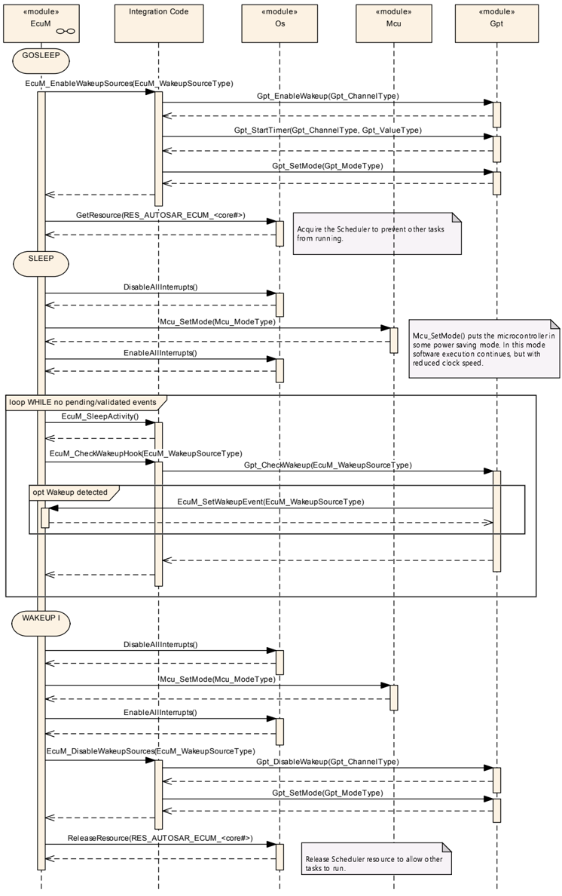

图 9.2：GPT 轮询唤醒

#### 8.2.2. ICU 唤醒序列

输入捕获单元（**ICU**）是另一种唤醒源。与 GPT 不同，ICU 驱动本身并不是唤醒源，它只是处理唤醒中断的模块。因此，只有唤醒源的驱动程序才能判断自己是否该为此次唤醒负责。这就使得 [EcuM_CheckWakeupHook](#7545-ecum_checkwakeuphook) 有必要去询问真正的唤醒源模块。为了知道该询问哪个模块，ICU 必须把唤醒源标识符传递给 [EcuM_CheckWakeup](#7351-ecum_checkwakeup)。对于共享中断，集成代码可能需要在 [EcuM_CheckWakeupHook](#7545-ecum_checkwakeuphook) 中检查多个唤醒源。为此，ICU 必须把可能引起该中断的所有唤醒源的标识符都传递给 [EcuM_CheckWakeup](#7351-ecum_checkwakeup)。注意，[EcuM_WakeupSourceType](#723-ecum_wakeupsourcetype)（见 7.2.3 节 [EcuM_WakeupSourceType](#723-ecum_wakeupsourcetype)）为每个唤醒源包含一个位，因此一次调用可以传递多个唤醒源。图 9.3 展示了由此产生的调用序列。由于 ICU 只负责处理唤醒中断，对 ICU 进行轮询并无意义；若要轮询，必须如图 38 所示直接检查唤醒源。


图 9.3：ICU 中断唤醒

#### 8.2.3. CAN 唤醒序列

在 CAN 上，收发器或通信控制器都可以通过中断或轮询检测唤醒。唤醒源标识符应在收发器与控制器之间共享，因为 ECU 状态管理器模块只需要知道是哪个网络被唤醒，并将其传递给通信管理器模块。

在中断或共享中断的情况下，无法确定是哪个具体的唤醒源（CAN 控制器、CAN 收发器、LIN 控制器等）检测到了唤醒。因此集成者必须把 [EcuM_CheckWakeup](#7351-ecum_checkwakeup)(wakeupSource) 所导出的 wakeupSource —— 它可以代表一个共享中断或仅代表一个中断通道 —— 分配给传递给 CanIf_CheckWakeup(WakeupSource) 的具体唤醒源。所以这里 [EcuM_CheckWakeup](#7351-ecum_checkwakeup)() 的参数 wakeupSource 可能与 CanIf_CheckWakeup 的 WakeupSource 不同，也可能相同，取决于硬件拓扑以及 [EcuM_CheckWakeupHook](#7545-ecum_checkwakeuphook) 集成代码的实现。

在 CanIf_CheckWakeup(WakeupSource) 期间，CAN 接口模块（CanIf）会检查是否有设备（CAN 通信控制器或收发器）配置为 "WakeupSource" 的值。如果有，则通过相应的设备驱动模块检查该设备是否发生唤醒。若设备检测到唤醒，设备驱动通过 [EcuM_SetWakeupEvent](#7411-ecum_setwakeupevent)(sources) 通知 EcuM。参数 "sources" 被设置为该设备上配置的值，即调用 CanIf_CheckWakeup() 时所用的值。

多个设备可能配置了相同的唤醒源值。但如果设备连接到不同的总线介质且可被唤醒，则应将它们配置为不同的唤醒源。

以下 CAN 唤醒序列部分是可选的，因为"集成代码"没有规格规定。例如在 [EcuM_CheckWakeup](#7351-ecum_checkwakeup)() 期间是否调用 CanIf 检查唤醒源，属于实现特定。


图 9.4：CAN 收发器中断唤醒

图 9.4 展示了 CAN 收发器经中断的唤醒。该中断通常按 8.2.2 节所述由 ICU 驱动处理。

CAN 控制器的中断唤醒与 GPT 唤醒类似：中断处理程序与 CheckWakeup 功能都封装在 CAN 驱动模块内，如图 9.5 所示。

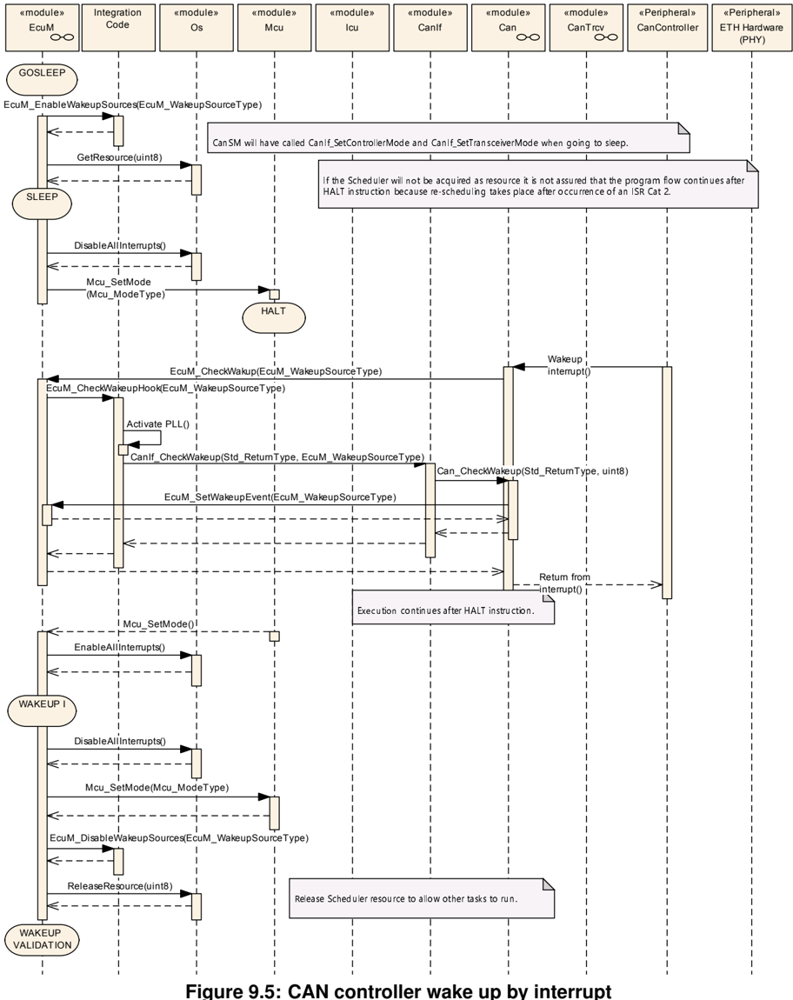

图 9.5：CAN 控制器中断唤醒

CAN 收发器和控制器都可以轮询唤醒。ECU 状态管理器模块会定期检查 CAN 接口模块，后者根据传递给 CAN 接口模块的唤醒源参数，向 CAN 驱动模块或 CAN 收发器驱动模块询问，如图 9.6 所示。


图 9.6：CAN 控制器或收发器轮询唤醒

在通过中断或轮询检测到来自 CAN 收发器或控制器的唤醒事件之后，可以对唤醒事件进行验证。

这通过在 [EcuM_StartWakeupSources](#7551-ecum_startwakeupsources) 中打开相应的 CAN 收发器和控制器来完成。需要哪些 EcuM_StartWakeupSource 集成代码中的函数调用，取决于所使用的 CAN 收发器和控制器。图 9.7 中以 CAN 状态管理器模块给出的、启动和停止唤醒源所需的函数调用为例。

注意：尽管控制器和收发器已被打开，CAN 接口模块（CanIf）不会向任何上层模块转发 CAN 报文。

只有当 CanIf 的相应 PDU 通道模式被设为 "Online" 时，它才会转发 CAN 报文。

CanIf 识别到成功接收至少一条报文后，将其记录为一次成功的验证。验证期间，ECU 状态管理器模块会在集成代码 [EcuM_CheckValidation](#7552-ecum_checkvalidation) 中定期检查 CanIf。

验证成功后，ECU 状态管理器模块将通过通信管理器模块继续 CAN 网络的正常启动；否则，它将在 [EcuM_StopWakeupSources](#7553-ecum_stopwakeupsources) 中关闭 CAN 控制器和收发器并重新进入睡眠。

由此产生的序列如图 9.7 所示。


图 9.7：CAN 唤醒验证

#### 8.2.4. LIN 唤醒序列

图 9.8 展示了 LIN 收发器经中断的唤醒。该中断通常按 8.2.2 节所述由 ICU 驱动处理。

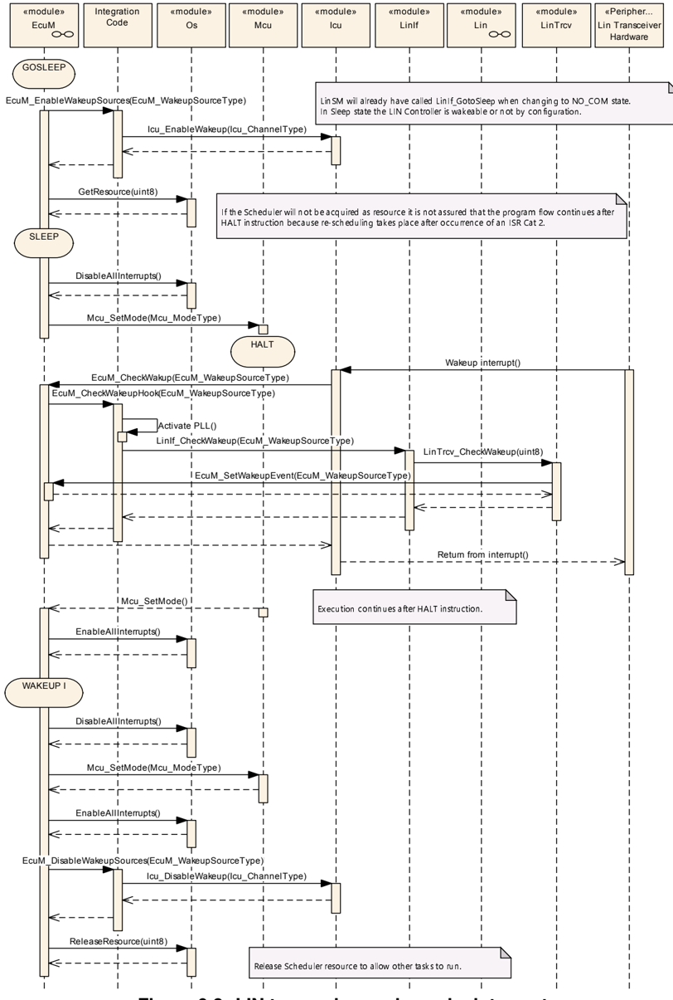

图 9.8：LIN 收发器中断唤醒

如图 9.9 所示，LIN 控制器的中断唤醒与 CAN 控制器的中断唤醒类似：两种情况下驱动模块都封装了中断处理程序。


图 9.9：LIN 控制器中断唤醒

LIN 收发器和控制器都可以轮询唤醒。ECU 状态管理器模块会定期检查 LIN 接口模块，后者根据情况向 LIN 驱动模块或 LIN 收发器驱动模块询问，如图 9.10 所示。

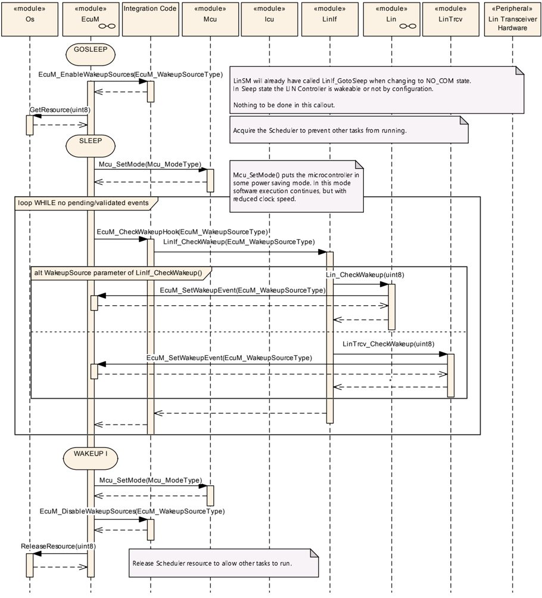

图 9.10：LIN 控制器或收发器轮询唤醒

注意：LIN 不需要唤醒验证。

#### 8.2.5. FlexRay 唤醒序列

对于 FlexRay，唤醒只能经由 FlexRay 收发器进行。FlexRay 集群的两个不同通道各有一个收发器。它们被视为属于同一网络，因此两个通道应只配置一个唤醒源标识符。图 9.11 展示了 FlexRay 收发器经中断的唤醒。该中断通常按 8.2.2 节所述由 ICU 驱动处理。

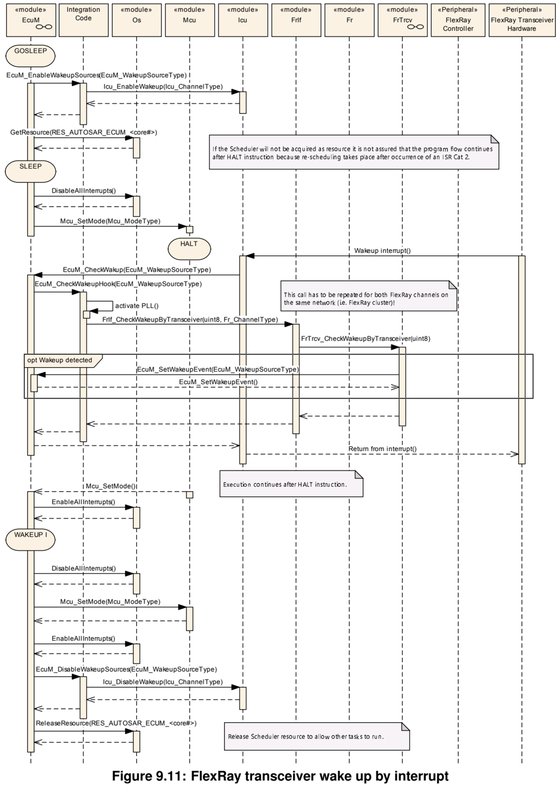

图 9.11：FlexRay 收发器中断唤醒

注意在 [EcuM_CheckWakeupHook](#7545-ecum_checkwakeuphook) 中需要分别调用 FrIf_WakeupByTransceiver 两次，每个 FlexRay 通道一次。


#### 8.2.6. 以太网唤醒序列

在采用符合 OA TC10 的以太网硬件的以太网交换网络中，所使用的以太网硬件（PHY）可以检测到唤醒。对于维护以太网交换机的主机 ECU，建议使用按需轮询来检查以太网硬件通知的唤醒，因为检查所有受影响的 EthSwtPort 可能耗时，无法在中断内完成检查。因此，中断只表示至少一个以太网交换机端口检测到了唤醒；在中断上下文中，受影响的 EthTrcv 被标记为在 EthTrcv_MainFunction 中异步检查。

每个 EthTrcv 应拥有自己的唤醒源，以区分唤醒到达了哪个 EthSwtPort。如果 EthSwtPort 例如被分配给相同的 PNC，唤醒源可以共享。

以下以太网唤醒序列部分是可选的，因为"集成代码"没有规格规定。例如在 [EcuM_CheckWakeupHook](#7545-ecum_checkwakeuphook) 期间是否调用 EthIf 检查唤醒源，属于实现特定。


图 9.13：主机 ECU（维护以太网交换机的 ECU）的被动唤醒（第 1 部分）


图 9.14：主机 ECU（维护以太网交换机的 ECU）的被动唤醒（第 2 部分）

单个以太网 ECU（不维护以太网交换机的 ECU）可以选择通过中断或轮询来检测唤醒。与主机 ECU 的区别在于，它不需要检查数量庞大的以太网交换机端口。


图 9.15：单个 ECU（不维护以太网交换机的 ECU）的被动唤醒（第 1 部分）


图 9.16：单个 ECU（不维护以太网交换机的 ECU）的被动唤醒（第 2 部分）

## 9. 配置规范

总体而言，本章定义配置参数及其到**容器**（container）的聚类组织。

第 9.1 章和第 9.2 章规定 ECU 管理器模块的结构（容器）与参数。

第 9.3 章规定 ECU 状态管理器模块的发布信息。

### 9.1. 通用容器与配置参数

以下各节汇总所有配置参数。各参数的详细含义见第 6 章和第 7 章。

以下容器包含对 BSW 模块初始化结构的多种引用。NULL 应是有效的引用，表示"无可用配置数据"，但仅当被初始化的 BSW 模块的实现支持时才如此。

#### 9.1.1. EcuM

| SWS 条目 |  |
|---|---|
| 模块名称 | EcuM |
| 描述 | EcuM（ECU 状态管理器）模块的配置。 |
| Post-Build 变体支持 | true |
| 支持的配置变体 | VARIANT-POST-BUILD, VARIANT-PRE-COMPILE |

| 容器名称 | 多重性 | 作用域/依赖 |
|---|---|---|
| EcuMConfiguration | 1 | 此容器包含 ECU 状态管理器的配置（参数）。 |
| EcuMFlexGeneral | 0..1 | 此容器保存 EcuMFlex 的通用、编译前配置参数。仅当实现了 EcuMFlex 时适用。 |
| EcuMGeneral | 1 | 此容器保存通用的编译前配置参数。 |

#### 9.1.2. EcuMGeneral

| SWS 条目 |  |
|---|---|
| 容器名称 | EcuMGeneral |
| 父容器 | EcuM |
| 描述 | 此容器保存通用的编译前配置参数。 |
| 配置参数 | 见下方参数表 |

| SWS 条目 |  |
|---|---|
| 参数名称 | EcuMDevErrorDetect |
| 父容器 | EcuMGeneral |
| 描述 | 开启或关闭开发错误检测与通知（true：启用检测与通知；false：禁用检测与通知）。 |
| 多重性 | 1 |
| 类型 | EcucBooleanParamDef |
| 默认值 | false |
| Post-Build 变体值 | false |
| 值配置类 | Pre-compile time：x；Link time：-；Post-build time：- |
| 作用域/依赖 | scope: local |

| SWS 条目 |  |
|---|---|
| 参数名称 | EcuMMainFunctionPeriod |
| 父容器 | EcuMGeneral |
| 描述 | 此参数定义 EcuM_MainFunction 的调度周期。单位：[s]。 |
| 多重性 | 1 |
| 类型 | EcucFloatParamDef |
| 范围 | ]0 .. INF[ |
| 默认值 | - |
| Post-Build 变体值 | false |
| 值配置类 | Pre-compile time：x；Link time：-；Post-build time：- |

| SWS 条目 |  |
|---|---|
| 参数名称 | EcuMVersionInfoApi |
| 父容器 | EcuMGeneral |
| 描述 | 开启或关闭版本信息 API。 |
| 多重性 | 1 |
| 类型 | EcucBooleanParamDef |
| 默认值 | false |
| Post-Build 变体值 | false |
| 值配置类 | Pre-compile time：x；Link time：-；Post-build time：- |
| 作用域/依赖 | scope: local |

#### 9.1.3. EcuMConfiguration

| SWS 条目 |  |
|---|---|
| 容器名称 | EcuMConfiguration |
| 父容器 | EcuM |
| 描述 | 此容器包含 ECU 状态管理器的配置（参数）。 |
| 配置参数 | 见下方参数表 |

| 容器名称 | 多重性 | 作用域/依赖 |
|---|---|---|
| EcuMCommonConfiguration | 1 | 此容器包含 ECU 状态管理器的通用配置（参数）。 |
| EcuMFlexConfiguration | 0..1 | 此容器包含 ECU 状态管理器的 EcuMFlex 配置（参数）。 |

#### 9.1.4. EcuMCommonConfiguration

| SWS 条目 |  |
|---|---|
| 容器名称 | EcuMCommonConfiguration |
| 父容器 | EcuMConfiguration |
| 描述 | 此容器包含 ECU 状态管理器的通用配置（参数）。 |
| 配置参数 | 见下方参数表 |

| SWS 条目 |  |
|---|---|
| 参数名称 | EcuMConfigConsistencyHash |
| 父容器 | EcuMCommonConfiguration |
| 描述 | 在编译前和链接时配置阶段，会对所有 BSW 模块的全部编译前与链接时参数生成一个哈希值。在 Post-Build 阶段，会对全部编译前与链接时参数生成哈希值（位于 EcucParamConfContainerDef 实例或子容器中、在 Post-Build 配置时引入的参数除外）。两个哈希值相互比较，用于检查整个配置的一致性。注意：在不使用 Post-Build 配置的系统中可以省略此参数。 |
| 多重性 | 0..1 |
| 类型 | EcucIntegerParamDef |
| 范围 | 0 .. 18446744073709551615 |
| 默认值 | - |
| Post-Build 变体多重性 | false |
| Post-Build 变体值 | false |
| 多重性配置类 | Pre-compile time：x；Link time：-；Post-build time：- |
| 值配置类 | Pre-compile time：x；Link time：-；Post-build time：- |
| 作用域/依赖 | scope: local |

| SWS 条目 |  |
|---|---|
| 参数名称 | EcuMIgnoreWakeupEvValOffPreOS |
| 父容器 | EcuMCommonConfiguration |
| 描述 | 定义 OffPreOS 中必须考虑的唤醒事件（true：仅考虑无需验证的唤醒事件；false：无需验证的唤醒事件与待决的唤醒事件都要考虑）。 |
| 多重性 | 1 |
| 类型 | EcucBooleanParamDef |
| 默认值 | false |
| Post-Build 变体值 | false |
| 值配置类 | Pre-compile time：x；Link time：-；Post-build time：- |
| 作用域/依赖 | scope: local |

| SWS 条目 |  |
|---|---|
| 参数名称 | EcuMDefaultAppMode |
| 父容器 | EcuMCommonConfiguration |
| 描述 | ECU 复位解除后加载的默认应用模式。 |
| 多重性 | 1 |
| 类型 | 对 OsAppMode 的符号名引用 |
| Post-Build 变体值 | true |
| 值配置类 | Pre-compile time：x；Link time：-；Post-build time：- |
| 作用域/依赖 | scope: local |

| SWS 条目 |  |
|---|---|
| 参数名称 | EcuMOSResource |
| 父容器 | EcuMCommonConfiguration |
| 描述 | 此参数是对一个 OS 资源的引用，用于使 ECU 进入睡眠模式。多核情况下每个内核应拥有自己的 OsResource。 |
| 多重性 | 1..* |
| 类型 | 对 OsResource 的引用 |
| Post-Build 变体多重性 | false |
| Post-Build 变体值 | false |
| 多重性配置类 | Pre-compile time：x；Link time：-；Post-build time：- |
| 值配置类 | Pre-compile time：x；Link time：-；Post-build time：- |
| 作用域/依赖 | scope: local |

| 容器名称 | 多重性 | 作用域/依赖 |
|---|---|---|
| EcuMDefaultShutdownTarget | 1 | 此容器描述 EcuM 应选择的默认关机目标。实际关机目标可被 EcuM_SelectShutdownTarget 服务覆盖。 |

#### 9.1.5. EcuMDefaultShutdownTarget

| SWS 条目 |  |
|---|---|
| 容器名称 | EcuMDefaultShutdownTarget |
| 父容器 | EcuMCommonConfiguration |
| 描述 | 此容器描述 EcuM 应选择的默认关机目标。实际关机目标可被 EcuM_SelectShutdownTarget 服务覆盖。 |
| 配置参数 | 见下方参数表 |

| SWS 条目 |  |
|---|---|
| 参数名称 | EcuMDefaultShutdownTarget |
| 父容器 | EcuMDefaultShutdownTarget |
| 描述 | 此参数描述 ECU 复位解除时所选择的默认关机目标的状态部分。若选择了 EcuMShutdownTargetSleep，则参数 EcuMDefaultSleepModeRef 选择具体的睡眠模式。 |
| 多重性 | 1 |
| 类型 | EcucEnumerationParamDef |
| 范围 | EcuMShutdownTargetOff；EcuMShutdownTargetReset；EcuMShutdownTargetSleep |
| Post-Build 变体值 | true |
| 值配置类 | Pre-compile time：x；Link time：-；Post-build time：- |

| SWS 条目 |  |
|---|---|
| 参数名称 | EcuMDefaultResetModeRef |
| 父容器 | EcuMDefaultShutdownTarget |
| 描述 | 若默认关机目标是复位，此参数选择默认复位模式。 |
| 多重性 | 0..1 |
| 类型 | 对 EcuMResetMode 的符号名引用 |
| Post-Build 变体多重性 | true |
| Post-Build 变体值 | true |
| 多重性配置类 | Pre-compile time：x；Link time：-；Post-build time：- |
| 值配置类 | Pre-compile time：x；Link time：-；Post-build time：- |
| 作用域/依赖 | scope: local |

| SWS 条目 |  |
|---|---|
| 参数名称 | EcuMDefaultSleepModeRef |
| 父容器 | EcuMDefaultShutdownTarget |
| 描述 | 若 EcuMDefaultShutdownTarget 为 EcuMShutdownTargetSleep，此参数选择默认睡眠模式；否则此参数可被忽略。 |
| 多重性 | 0..1 |
| 类型 | 对 EcuMSleepMode 的符号名引用 |
| Post-Build 变体多重性 | true |
| Post-Build 变体值 | true |
| 多重性配置类 | Pre-compile time：x；Link time：-；Post-build time：- |

#### 9.1.6. EcuMDriverInitListOne

| SWS 条目 |  |
|---|---|
| 容器名称 | EcuMDriverInitListOne |
| 父容器 | EcuMCommonConfiguration |
| 描述 | 初始化块 I 的容器。此容器保存待初始化模块的列表，列表中的每个模块按列表顺序被调用进行初始化。此列表中的所有模块都在 OS 启动之前初始化，因此不需要 OS 支持。 |
| Post-Build 变体多重性 | false |
| 多重性配置类 | Pre-compile time：x；Link time：-；Post-build time：- |
| 配置参数 | 见下方参数表 |

| 容器名称 | 多重性 |
|---|---|
| EcuMDriverInitItem | 1..* |

#### 9.1.7. EcuMDriverInitListZero

| SWS 条目 |  |
|---|---|
| 容器名称 | EcuMDriverInitListZero |
| 父容器 | EcuMCommonConfiguration |
| 描述 | 初始化块 0 的容器。此容器保存待初始化模块的列表，列表中的每个模块按列表顺序被调用进行初始化。 |
| 配置参数 | 见下方参数表 |

| 容器名称 | 多重性 |
|---|---|
| EcuMDriverInitItem | 1..* |

#### 9.1.8. EcuMDriverRestartList

| SWS 条目 |  |
|---|---|
| 容器名称 | EcuMDriverRestartList |
| 父容器 | EcuMCommonConfiguration |
| 描述 | 待初始化模块的列表。 |
| Post-Build 变体多重性 | false |
| 多重性配置类 | Pre-compile time：x；Link time：-；Post-build time：- |
| 配置参数 | 见下方参数表 |

| 容器名称 | 多重性 |
|---|---|
| EcuMDriverInitItem | 1..* |

#### 9.1.9. EcuMDriverInitItem

| SWS 条目 |  |
|---|---|
| 容器名称 | EcuMDriverInitItem |
| 父容器 | EcuMDriverInitListBswM, EcuMDriverInitListOne, EcuMDriverInitListZero, EcuMDriverRestartList |
| 描述 | 这些容器描述驱动初始化列表中的条目。属性：requiresIndex=true。 |
| Post-Build 变体多重性 | false |
| 多重性配置类 | Pre-compile time：x；Link time：-；Post-build time：- |
| 配置参数 | 见下方参数表 |

| SWS 条目 |  |
|---|---|
| 参数名称 | EcuMModuleParameter |
| 父容器 | EcuMDriverInitItem |
| 描述 | 函数原型及传递给该函数的参数的定义。 |
| 多重性 | 1 |
| 类型 | EcucEnumerationParamDef |

| SWS 条目 |  |
|---|---|
| 参数名称 | EcuMModuleService |
| 父容器 | EcuMDriverInitItem |
| 描述 | 为初始化该模块而调用的服务，例如 Init、PreInit、Start 等。若未定义，默认取 "Init"。 |
| 多重性 | 0..1 |
| 类型 | EcucStringParamDef |
| 默认值 | - |
| 正则表达式 | - |
| Post-Build 变体多重性 | false |
| Post-Build 变体值 | false |
| 多重性配置类 | Pre-compile time：x；Link time：-；Post-build time：- |
| 值配置类 | Pre-compile time：x；Link time：-；Post-build time：- |
| 作用域/依赖 | scope: local |

| SWS 条目 |  |
|---|---|
| 参数名称 | EcuMEcucCoreDefinitionRef |
| 父容器 | EcuMDriverInitItem |
| 描述 | 该引用表示 EcuM AUTOSAR 服务应在其上提供的内核。 |
| 多重性 | 0..1 |
| 类型 | 对 EcucCoreDefinition 的引用 |
| Post-Build 变体多重性 | false |
| Post-Build 变体值 | false |
| 多重性配置类 | Pre-compile time：x；Link time：-；Post-build time：- |
| 值配置类 | Pre-compile time：x；Link time：-；Post-build time：- |

| SWS 条目 |  |
|---|---|
| 参数名称 | EcuMModuleRef |
| 父容器 | EcuMDriverInitItem |
| 描述 | 对将由 EcuM 初始化的模块实例配置的外部引用。 |
| 多重性 | 1 |
| 类型 | 对 ECUC-MODULE-CONFIGURATION-VALUES 的外部引用 |
| Post-Build 变体值 | false |
| 值配置类 | Pre-compile time：x；Link time：-；Post-build time：- |
| 作用域/依赖 | scope: local |

无包含的容器。

#### 9.1.10. EcuMSleepMode

| SWS 条目 |  |
|---|---|
| 容器名称 | EcuMSleepMode |
| 父容器 | EcuMCommonConfiguration |
| 描述 | 这些容器描述已配置的睡眠模式。 |
| Post-Build 变体多重性 | false |
| 多重性配置类 | Pre-compile time：x；Link time：-；Post-build time：- |

| SWS 条目 |  |
|---|---|
| 参数名称 | EcuMSleepModeId |
| 父容器 | EcuMSleepMode |
| 描述 | 此 ID 在诸如 EcuM_SelectShutdownTarget 之类的服务中标识该睡眠模式。 |
| 多重性 | 1 |
| 类型 | EcucIntegerParamDef（为此参数生成符号名） |
| 范围 | 0 .. 255 |
| 默认值 | - |
| Post-Build 变体值 | false |
| 值配置类 | Pre-compile time：x；Link time：-；Post-build time：- |
| 作用域/依赖 | scope: ECU |

| SWS 条目 |  |
|---|---|
| 参数名称 | EcuMSleepModeSuspend |
| 父容器 | EcuMSleepMode |
| 描述 | 若 CPU 在该睡眠模式下被挂起、暂停或断电，则此标志置为 true；若 CPU 在该睡眠模式下继续运行，则必须置为 false。 |
| 多重性 | 1 |
| 类型 | EcucBooleanParamDef |
| 默认值 | - |
| Post-Build 变体值 | false |
| 值配置类 | Pre-compile time：x；Link time：-；Post-build time：- |
| 作用域/依赖 | scope: local |

| SWS 条目 |  |
|---|---|
| 参数名称 | EcuMSleepModeMcuModeRef |
| 父容器 | EcuMSleepMode |
| 描述 | 此参数是对该睡眠模式对应 MCU 模式的引用。 |
| 多重性 | 1 |
| 类型 | 对 McuModeSettingConf 的符号名引用 |
| Post-Build 变体值 | false |
| 值配置类 | Pre-compile time：x；Link time：-；Post-build time：- |
| 作用域/依赖 | scope: local |

| SWS 条目 |  |
|---|---|
| 参数名称 | EcuMWakeupSourceMask |
| 父容器 | EcuMSleepMode |
| 描述 | 这些参数是对该睡眠模式下应启用的唤醒源的引用。 |
| 多重性 | 1..* |
| 类型 | 对 EcuMWakeupSource 的符号名引用 |
| Post-Build 变体多重性 | false |
| Post-Build 变体值 | false |
| 多重性配置类 | Pre-compile time：x；Link time：-；Post-build time：- |
| 值配置类 | Pre-compile time：x；Link time：-；Post-build time：- |
| 作用域/依赖 | scope: local |

#### 9.1.11. EcuMWakeupSource

| SWS 条目 |  |
|---|---|
| 容器名称 | EcuMWakeupSource |
| 父容器 | EcuMCommonConfiguration |
| 描述 | 这些容器描述已配置的唤醒源。 |
| Post-Build 变体多重性 | true |
| 多重性配置类 | Pre-compile time：x；Link time：-；Post-build time：- |
| 配置参数 | 见下方参数表 |

| SWS 条目 |  |
|---|---|
| 参数名称 | EcuMCheckWakeupTimeout |
| 父容器 | EcuMWakeupSource |
| 描述 | 此参数是 EcuM 在唤醒源检查以异步方式完成（CheckWakeupTimer）时延迟 ECU 关机的时间的初始值。单位为秒。 |
| 多重性 | 0..1 |
| 类型 | EcucFloatParamDef |
| 范围 | [0 .. 10] |
| 默认值 | 0 |
| Post-Build 变体多重性 | false |
| Post-Build 变体值 | false |
| 多重性配置类 | Pre-compile time：x；Link time：-；Post-build time：- |
| 值配置类 | Pre-compile time：x；Link time：-；Post-build time：- |

| SWS 条目 |  |
|---|---|
| 参数名称 | EcuMValidationTimeout |
| 父容器 | EcuMWakeupSource |
| 描述 | 验证超时（ECU 状态管理器等待唤醒事件验证的时长）可以针对每个唤醒源独立定义。超时以秒为单位。若未实例化该超时，则没有验证流程，ECU 管理器不应验证该唤醒源。 |
| 多重性 | 0..1 |
| 类型 | EcucFloatParamDef |
| 范围 | [0 .. INF] |
| 默认值 | - |
| Post-Build 变体多重性 | false |
| Post-Build 变体值 | false |
| 多重性配置类 | Pre-compile time：x；Link time：-；Post-build time：- |
| 值配置类 | Pre-compile time：x；Link time：-；Post-build time：- |
| 作用域/依赖 | scope: local |

| SWS 条目 |  |
|---|---|
| 参数名称 | EcuMWakeupSourceId |
| 父容器 | EcuMWakeupSource |
| 描述 | 此参数定义该唤醒源的标识符。前五个位是 EcuM_WakeupSourceType 的保留值。 |
| 多重性 | 1 |
| 类型 | EcucIntegerParamDef（为此参数生成符号名） |
| 范围 | 5 .. 31 |
| 默认值 | - |

| SWS 条目 |  |
|---|---|
| 参数名称 | EcuMWakeupSourcePolling |
| 父容器 | EcuMWakeupSource |
| 描述 | 此参数描述该唤醒源是否需要轮询。 |
| 多重性 | 1 |
| 类型 | EcucBooleanParamDef |
| 默认值 | - |
| Post-Build 变体值 | false |
| 值配置类 | Pre-compile time：x；Link time：-；Post-build time：- |
| 作用域/依赖 | scope: local |

| SWS 条目 |  |
|---|---|
| 参数名称 | EcuMComMChannelRef |
| 父容器 | EcuMWakeupSource |
| 描述 | 此参数可引用通信管理器中定义的多个网络（通道）。无引用表示该唤醒源不是通信通道。 |
| 多重性 | 0..* |
| 类型 | 对 ComMChannel 的符号名引用 |
| Post-Build 变体多重性 | false |
| Post-Build 变体值 | false |
| 多重性配置类 | Pre-compile time：x；Link time：-；Post-build time：- |
| 值配置类 | Pre-compile time：x；Link time：-；Post-build time：- |
| 作用域/依赖 | scope: local |

| SWS 条目 |  |
|---|---|
| 参数名称 | EcuMComMPNCRef |
| 父容器 | EcuMWakeupSource |
| 描述 | 这是对通信管理器中定义的一个或多个 PNC 的引用。无引用表示该唤醒源未分配给部分网络。 |
| 多重性 | 0..* |
| 类型 | 对 ComMPnc 的符号名引用 |
| Post-Build 变体多重性 | true |
| Post-Build 变体值 | false |
| 多重性配置类 | Pre-compile time：x；Link time：-；Post-build time：- |

| SWS 条目 |  |
|---|---|
| 参数名称 | EcuMResetReasonRef |
| 父容器 | EcuMWakeupSource |
| 描述 | 此参数描述把 MCU 驱动检测到的复位原因映射到唤醒源。 |
| 多重性 | 0..* |
| 类型 | 对 McuResetReasonConf 的符号名引用 |
| Post-Build 变体多重性 | false |
| Post-Build 变体值 | false |
| 多重性配置类 | Pre-compile time：x；Link time：-；Post-build time：- |
| 值配置类 | Pre-compile time：x；Link time：-；Post-build time：- |
| 作用域/依赖 | scope: local |

无包含的容器。

### 9.2. EcuM-Flex 容器与配置参数

#### 9.2.1. EcuMFlexGeneral

| SWS 条目 |  |
|---|---|
| 容器名称 | EcuMFlexGeneral |
| 父容器 | EcuM |
| 描述 | 此容器保存 EcuMFlex 的通用、编译前配置参数。仅当实现了 EcuMFlex 时适用。 |
| Post-Build 变体多重性 | false |
| 多重性配置类 | Pre-compile time：x；Link time：-；Post-build time：- |
| 配置参数 | 见下方参数表 |

| SWS 条目 |  |
|---|---|
| 参数名称 | EcuMAlarmClockPresent |
| 父容器 | EcuMFlexGeneral |
| 描述 | 此标志指示可选的闹钟（AlarmClock）功能是否存在。 |
| 多重性 | 1 |
| 类型 | EcucBooleanParamDef |
| 默认值 | - |
| Post-Build 变体值 | false |
| 值配置类 | Pre-compile time：x；Link time：-；Post-build time：- |
| 作用域/依赖 | scope: local |

| SWS 条目 |  |
|---|---|
| 参数名称 | EcuMModeHandling |
| 父容器 | EcuMFlexGeneral |
| 描述 | 若为 false，则不执行运行请求协议（Run Request Protocol）。 |
| 多重性 | 0..1 |
| 类型 | EcucBooleanParamDef |
| 默认值 | - |
| Post-Build 变体多重性 | false |
| Post-Build 变体值 | false |
| 多重性配置类 | Pre-compile time：x；Link time：-；Post-build time：- |
| 值配置类 | Pre-compile time：x；Link time：-；Post-build time：- |
| 作用域/依赖 | scope: local |

| SWS 条目 |  |
|---|---|
| 参数名称 | EcuMResetLoopDetection |
| 父容器 | EcuMFlexGeneral |
| 描述 | 若为 false，则不执行复位循环检测。若此配置参数存在且设为 true，则在 EcuM 启动期间（StartPreOS 期间）会调用 callout "EcuM_LoopDetection"。 |
| 多重性 | 0..1 |
| 类型 | EcucBooleanParamDef |
| 默认值 | - |
| Post-Build 变体多重性 | false |
| Post-Build 变体值 | false |
| 多重性配置类 | Pre-compile time：x；Link time：-；Post-build time：- |
| 值配置类 | Pre-compile time：x；Link time：-；Post-build time：- |
| 作用域/依赖 | scope: local |

| SWS 条目 |  |
|---|---|
| 参数名称 | EcuMSetProgrammableInterrupts |
| 父容器 | EcuMFlexGeneral |
| 描述 | 若此配置参数存在且设为 true，则在 EcuM 启动期间（StartPreOS 期间）会调用 callout "EcuM_AL_SetProgrammableInterrupts"。 |
| 多重性 | 0..1 |
| 类型 | EcucBooleanParamDef |
| 默认值 | - |
| Post-Build 变体多重性 | false |
| Post-Build 变体值 | false |
| 多重性配置类 | Pre-compile time：x；Link time：-；Post-build time：- |

| SWS 条目 |  |
|---|---|
| 参数名称 | EcuMAlarmWakeupSource |
| 父容器 | EcuMFlexGeneral |
| 描述 | 此参数描述对 EcuM 闹钟所使用的 EcuMWakeupSource 的引用。 |
| 多重性 | 0..1 |
| 类型 | 对 EcuMWakeupSource 的符号名引用 |
| Post-Build 变体多重性 | false |
| Post-Build 变体值 | false |
| 多重性配置类 | Pre-compile time：x；Link time：-；Post-build time：- |
| 值配置类 | Pre-compile time：x；Link time：-；Post-build time：- |
| 作用域/依赖 | scope: local |

#### 9.2.2. EcuMFlexConfiguration

| SWS 条目 |  |
|---|---|
| 容器名称 | EcuMFlexConfiguration |
| 父容器 | EcuMConfiguration |
| 描述 | 此容器包含 ECU 状态管理器的 EcuMFlex 配置（参数）。 |
| 配置参数 | 见下方参数表 |

| SWS 条目 |  |
|---|---|
| 参数名称 | EcuMNormalMcuModeRef |
| 父容器 | EcuMFlexConfiguration |
| 描述 | 此参数是对睡眠后应恢复的正常 MCU 模式的引用。 |
| 多重性 | 1 |
| 类型 | 对 McuModeSettingConf 的符号名引用 |
| Post-Build 变体值 | false |
| 值配置类 | Pre-compile time：x；Link time：-；Post-build time：- |
| 作用域/依赖 | scope: local |

| SWS 条目 |  |
|---|---|
| 参数名称 | EcuMPartitionRef |
| 父容器 | EcuMFlexConfiguration |
| 描述 | 该引用表示 EcuM 应运行所在的分区。注意：在多核 ECU 上此引用是强制性的。 |
| 多重性 | 0..* |
| 类型 | 对 EcucPartition 的引用 |
| Post-Build 变体多重性 | false |
| Post-Build 变体值 | false |
| 多重性配置类 | Pre-compile time：x；Link time：-；Post-build time：- |
| 值配置类 | Pre-compile time：x；Link time：-；Post-build time：- |
| 作用域/依赖 | scope: local |

| 容器名称 | 多重性 | 作用域/依赖 |
|---|---|---|
| EcuMAlarmClock | 0..* | 这些容器描述已配置的闹钟。这些容器的名称允许为一个闹钟指定符号名。 |
| EcuMDriverInitListBswM | 0..* | 此容器保存将由 BswM 初始化的模块列表。 |
| EcuMFlexUserConfig | 1..256 | 这些容器描述引用使用 EcuMFlex 接口的软件组件或系统中其他适当实体所需的标识符。 |
| EcuMGoDownAllowedUsers | 0..1 | 此容器描述允许调用 EcuM_GoDown API 的用户的集合。 |
| EcuMResetMode | 1..256 | 这些容器描述已配置的复位模式。 |
| EcuMSetClockAllowedUsers | 0..1 | 此容器描述允许调用 EcuM_SetClock API 的用户的集合。 |
| EcuMShutdownCause | 1..256 | 这些容器描述已配置的关机或复位原因。 |

#### 9.2.3. EcuMAlarmClock

| SWS 条目 |  |
|---|---|
| 容器名称 | EcuMAlarmClock |
| 父容器 | EcuMFlexConfiguration |
| 描述 | 这些容器描述已配置的闹钟。这些容器的名称允许为一个闹钟指定符号名。 |
| Post-Build 变体多重性 | false |
| 多重性配置类 | Pre-compile time：x；Link time：-；Post-build time：- |
| 配置参数 | 见下方参数表 |

| SWS 条目 |  |
|---|---|
| 参数名称 | EcuMAlarmClockId |
| 父容器 | EcuMAlarmClock |
| 描述 | 此 ID 标识该闹钟。 |
| 多重性 | 1 |
| 类型 | EcucIntegerParamDef（为此参数生成符号名） |
| 范围 | 0 .. 255 |
| 默认值 | - |
| Post-Build 变体值 | false |
| 值配置类 | Pre-compile time：x；Link time：-；Post-build time：- |

| SWS 条目 |  |
|---|---|
| 参数名称 | EcuMAlarmClockTimeOut |
| 父容器 | EcuMAlarmClock |
| 描述 | 此参数允许为该闹钟定义一个超时。 |
| 多重性 | 1 |
| 类型 | EcucFloatParamDef |
| 范围 | [0 .. INF] |
| 默认值 | - |
| Post-Build 变体值 | false |
| 值配置类 | Pre-compile time：x；Link time：-；Post-build time：- |
| 作用域/依赖 | scope: local |

| SWS 条目 |  |
|---|---|
| 参数名称 | EcuMAlarmClockUser |
| 父容器 | EcuMAlarmClock |
| 描述 | 此参数允许把闹钟分配给一个用户。 |
| 多重性 | 1 |
| 类型 | 对 EcuMFlexUserConfig 的符号名引用 |
| Post-Build 变体值 | false |
| 值配置类 | Pre-compile time：x；Link time：-；Post-build time：- |
| 作用域/依赖 | scope: local |

无包含的容器。

#### 9.2.4. EcuMFlexUserConfig

| SWS 条目 |  |
|---|---|
| 容器名称 | EcuMFlexUserConfig |
| 父容器 | EcuMFlexConfiguration |
| 描述 | 这些容器描述引用使用 EcuMFlex 接口的软件组件或系统中其他适当实体所需的标识符。 |
| Post-Build 变体多重性 | false |
| 多重性配置类 | Pre-compile time：x；Link time：-；Post-build time：- |
| 配置参数 | 见下方参数表 |

| SWS 条目 |  |
|---|---|
| 参数名称 | EcuMFlexUser |
| 父容器 | EcuMFlexUserConfig |
| 描述 | 用于标识一个用户的参数。 |
| 多重性 | 1 |
| 类型 | EcucIntegerParamDef（为此参数生成符号名） |
| 范围 | 0 .. 255 |
| 默认值 | - |
| Post-Build 变体值 | false |
| 值配置类 | Pre-compile time：x；Link time：-；Post-build time：- |
| 作用域/依赖 | scope: local |

| SWS 条目 |  |
|---|---|
| 参数名称 | EcuMFlexEcucPartitionRef |
| 父容器 | EcuMFlexUserConfig |
| 描述 | 表示 EcuM 的用户在哪个 "EcucPartition" 中执行。 |
| 多重性 | 0..1 |
| 类型 | 对 EcucPartition 的引用 |
| Post-Build 变体多重性 | false |
| Post-Build 变体值 | false |
| 多重性配置类 | Pre-compile time：x；Link time：-；Post-build time：- |
| 值配置类 | Pre-compile time：x；Link time：-；Post-build time：- |
| 作用域/依赖 | scope: local |

#### 9.2.5. EcuMDriverInitListBswM

| SWS 条目 |  |
|---|---|
| 容器名称 | EcuMDriverInitListBswM |
| 父容器 | EcuMFlexConfiguration |
| 描述 | 此容器保存将由 BswM 初始化的模块列表。 |
| Post-Build 变体多重性 | false |
| 多重性配置类 | Pre-compile time：x；Link time：-；Post-build time：- |
| 配置参数 | 见下方参数表 |

| 容器名称 | 多重性 |
|---|---|
| EcuMDriverInitItem | 1..* |

#### 9.2.6. EcuMGoDownAllowedUsers

| SWS 条目 |  |
|---|---|
| 容器名称 | EcuMGoDownAllowedUsers |
| 父容器 | EcuMFlexConfiguration |
| 描述 | 此容器描述允许调用 EcuM_GoDown API 的用户的集合。 |
| 配置参数 | 见下方参数表 |

| SWS 条目 |  |
|---|---|
| 参数名称 | EcuMGoDownAllowedUserRef |
| 父容器 | EcuMGoDownAllowedUsers |
| 描述 | 这是对一个被允许的用户的引用。 |
| 多重性 | 1..* |
| 类型 | 对 EcuMFlexUserConfig 的符号名引用 |
| Post-Build 变体多重性 | false |
| Post-Build 变体值 | false |
| 多重性配置类 | Pre-compile time：x；Link time：-；Post-build time：- |
| 值配置类 | Pre-compile time：x；Link time：-；Post-build time：- |
| 作用域/依赖 | scope: local |

无包含的容器。

#### 9.2.7. EcuMResetMode

| SWS 条目 |  |
|---|---|
| 容器名称 | EcuMResetMode |
| 父容器 | EcuMFlexConfiguration |
| 描述 | 这些容器描述已配置的复位模式。这些容器的名称允许为不同的复位模式指定以下符号名之一：ECUM_RESET_MCU、ECUM_RESET_WDG、ECUM_RESET_IO。 |
| Post-Build 变体多重性 | false |
| 多重性配置类 | Pre-compile time：x；Link time：-；Post-build time：- |
| 配置参数 | 见下方参数表 |

| SWS 条目 |  |
|---|---|
| 参数名称 | EcuMResetModeId |
| 父容器 | EcuMResetMode |
| 描述 | 此 ID 在诸如 EcuM_SelectShutdownTarget 之类的服务中标识该复位模式。 |
| 多重性 | 1 |
| 类型 | EcucIntegerParamDef（为此参数生成符号名） |
| 范围 | 0 .. 255 |
| 默认值 | - |
| Post-Build 变体值 | false |
| 值配置类 | Pre-compile time：x；Link time：-；Post-build time：- |
| 作用域/依赖 | scope: local |

无包含的容器。

#### 9.2.8. EcuMShutdownCause

| SWS 条目 |  |
|---|---|
| 容器名称 | EcuMShutdownCause |
| 父容器 | EcuMFlexConfiguration |
| 描述 | 这些容器描述已配置的关机或复位原因。这些容器的名称允许为不同的关机原因指定以下符号名之一：ECUM_CAUSE_ECU_STATE（ECU 状态机进入关机状态）、ECUM_CAUSE_WDGM（WdgM 检测到故障）、ECUM_CAUSE_DCM（Dcm 请求关机），以及来自配置的值。 |
| Post-Build 变体多重性 | false |
| 多重性配置类 | Pre-compile time：x；Link time：-；Post-build time：- |
| 配置参数 | 见下方参数表 |

| SWS 条目 |  |
|---|---|
| 参数名称 | EcuMShutdownCauseId |
| 父容器 | EcuMShutdownCause |
| 描述 | 此 ID 标识该关机原因。 |
| 多重性 | 1 |
| 类型 | EcucIntegerParamDef（为此参数生成符号名） |
| 范围 | 0 .. 255 |
| 默认值 | - |
| Post-Build 变体值 | false |
| 值配置类 | Pre-compile time：x；Link time：-；Post-build time：- |

#### 9.2.9. EcuMSetClockAllowedUsers

| SWS 条目 |  |
|---|---|
| 容器名称 | EcuMSetClockAllowedUsers |
| 父容器 | EcuMFlexConfiguration |
| 描述 | 此容器描述允许调用 EcuM_SetClock API 的用户的集合。 |
| Post-Build 变体多重性 | false |
| 多重性配置类 | Pre-compile time：x；Link time：-；Post-build time：- |
| 配置参数 | 见下方参数表 |

| SWS 条目 |  |
|---|---|
| 参数名称 | EcuMSetClockAllowedUserRef |
| 父容器 | EcuMSetClockAllowedUsers |
| 描述 | 这些参数描述对允许调用 EcuM_SetClock API 的用户的引用。 |
| 多重性 | 1..* |
| 类型 | 对 EcuMFlexUserConfig 的符号名引用 |
| Post-Build 变体多重性 | false |
| Post-Build 变体值 | false |
| 多重性配置类 | Pre-compile time：x；Link time：-；Post-build time：- |
| 值配置类 | Pre-compile time：x；Link time：-；Post-build time：- |
| 作用域/依赖 | scope: local |

无包含的容器。

### 9.3. 发布信息

目前除 SWS BSW General 中规定的内容外，不存在其他发布信息。

## B. AUTOSAR 可追溯项变更历史

### B.1. 本文档的可追溯项历史（按AUTOSAR R21-11版本）

#### B.1.1. R21-11中新增的规范项

```
[SWS_EcuM_04148] [SWS_EcuM_04149] [SWS_EcuM_04150] [SWS_EcuM_04151] [SWS_EcuM_04152] [SWS_EcuM_91006] [SWS_EcuM_91007]
```

#### B.1.2. R21-11中变更的规范项

```
[SWS_EcuM_02337] [SWS_EcuM_02788] [SWS_EcuM_02810] [SWS_EcuM_02858] [SWS_EcuM_02867] [SWS_EcuM_02868] [SWS_EcuM_02904] [SWS_EcuM_02987] [SWS_EcuM_03011] [SWS_EcuM_03012] [SWS_EcuM_03020] [SWS_EcuM_03023] [SWS_EcuM_03024] [SWS_EcuM_03025] [SWS_EcuM_03026] [SWS_EcuM_04033] [SWS_EcuM_04091] [SWS_EcuM_04098] [SWS_EcuM_04105] [SWS_EcuM_04109] [SWS_EcuM_04117] [SWS_EcuM_04119] [SWS_EcuM_04123] [SWS_EcuM_04124] [SWS_EcuM_04131] [SWS_EcuM_04139] [SWS_EcuM_04144] [SWS_EcuM_91003]
```

#### B.1.3. R21-11中删除的规范项

```
[SWS_EcuM_02927] [SWS_EcuM_02929] [SWS_EcuM_03009] [SWS_EcuM_04080] [SWS_EcuM_04125]
```

### B.2. 本文档的可追溯项历史（按AUTOSAR R22-11版本）

#### B.2.1. R22-11中新增的规范项

无

#### B.2.2. R22-11中变更的规范项

```
[SWS_EcuM_02810] [SWS_EcuM_02811] [SWS_EcuM_02812] [SWS_EcuM_02813] [SWS_EcuM_02822] [SWS_EcuM_02824] [SWS_EcuM_02825] [SWS_EcuM_02826] [SWS_EcuM_02827] [SWS_EcuM_02828] [SWS_EcuM_02829] [SWS_EcuM_02830] [SWS_EcuM_02831] [SWS_EcuM_02835] [SWS_EcuM_02836] [SWS_EcuM_02837] [SWS_EcuM_02838] [SWS_EcuM_02858] [SWS_EcuM_02859] [SWS_EcuM_02904] [SWS_EcuM_02905] [SWS_EcuM_02906] [SWS_EcuM_02907] [SWS_EcuM_02916] [SWS_EcuM_02917] [SWS_EcuM_02918] [SWS_EcuM_02919] [SWS_EcuM_02920] [SWS_EcuM_02921] [SWS_EcuM_02922] [SWS_EcuM_02923] [SWS_EcuM_02924] [SWS_EcuM_02925] [SWS_EcuM_02926] [SWS_EcuM_02928] [SWS_EcuM_03011] [SWS_EcuM_03012] [SWS_EcuM_03017] [SWS_EcuM_04032] [SWS_EcuM_04038] [SWS_EcuM_04040] [SWS_EcuM_04041] [SWS_EcuM_04044] [SWS_EcuM_04045] [SWS_EcuM_04050] [SWS_EcuM_04051] [SWS_EcuM_04054] [SWS_EcuM_04057] [SWS_EcuM_04061] [SWS_EcuM_04062] [SWS_EcuM_04063] [SWS_EcuM_04064] [SWS_EcuM_04065] [SWS_EcuM_04085] [SWS_EcuM_04091] [SWS_EcuM_04096] [SWS_EcuM_04101] [SWS_EcuM_04102] [SWS_EcuM_04105] [SWS_EcuM_04107] [SWS_EcuM_04108] [SWS_EcuM_04109] [SWS_EcuM_04110] [SWS_EcuM_04111] [SWS_EcuM_04112] [SWS_EcuM_04113] [SWS_EcuM_04120] [SWS_EcuM_04122] [SWS_EcuM_04124] [SWS_EcuM_04127] [SWS_EcuM_04128] [SWS_EcuM_04129] [SWS_EcuM_04131] [SWS_EcuM_04135] [SWS_EcuM_04136] [SWS_EcuM_04137] [SWS_EcuM_91001] [SWS_EcuM_91002] [SWS_EcuM_91003] [SWS_EcuM_91004] [SWS_EcuM_91005] [SWS_EcuM_91006] [SWS_EcuM_91007] [SWS_EcuM_91008] [SWS_EcuM_NA_00000]
```

#### B.2.3. R22-11中删除的规范项

无

### B.3. 本文档的可追溯项历史（按AUTOSAR R23-11版本）

#### B.3.1. R23-11中新增的规范项

```
[SWS_EcuM_02934] [SWS_EcuM_04037]
```

#### B.3.2. R23-11中变更的规范项

```
[SWS_EcuM_02932] [SWS_EcuM_03021] [SWS_EcuM_04033]
```

#### B.3.3. R23-11中删除的规范项

无


<section id="wechat">

<h4>微信扫一扫，获取更多及时资讯</h4>


</section>

