## 1. 简介和功能概述

本文档包含 AUTOSAR 运行时环境（**RTE**，**Run-Time Environment**）和基础软件调度器（**Basic Software Scheduler**）的软件规范。基本上，**RTE** 与 **OS**、AUTOSAR **COM** 以及其他基础软件模块一起，构成了虚拟功能总线（**VFB**，**Virtual Functional Bus**）概念（参见[1]）的实现。**RTE** 实现 AUTOSAR 虚拟功能总线的接口，从而实现 AUTOSAR 软件组件（**software-component**）之间的通信。

本文档描述这些概念在 **RTE** 内部是如何实现的。此外，还规定了 **RTE** 的应用程序编程接口（**API**，**Application Programming Interface**）以及 **RTE** 与其他基础软件模块的交互。

基础软件调度器提供了集成基础软件模块的概念和服务。因此，基础软件调度器可以：

* 将基础软件模块的实现嵌入 AUTOSAR **OS** 的上下文中；
* 触发基础软件模块的主处理函数（**main processing functions**）；
* 为基础软件模块应用数据一致性机制（**data consistency mechanisms**）；
* 在基础软件模块之间传递模式（**mode**）。

### 1.1. 范围

本文档旨在成为 **RTE** 生成器工具开发人员或具体 **RTE** 实现开发人员的主要参考。对于与 **RTE** 交互的 AUTOSAR 软件组件和基础软件模块的开发人员而言，本文档同样是参考，因为它规定了 **RTE** 的应用程序编程接口，进而规定了访问 **RTE** 功能的机制。此外，与 **RTE** 密切相关的 AUTOSAR 工作组也应阅读本规范（参见第 5 章），因为它描述了 **RTE** 与这些模块的接口，以及 **RTE** 期望这些模块提供的行为/功能。

本文档的结构如下。在总体介绍之后，1.3 节至 1.6 节更详细地介绍了 **RTE** 的概念。**RTE** 是如何在整体 AUTOSAR 方法论（**AUTOSAR Methodology**）的上下文中生成的，见 6.1 节。6.2 节是本文档的核心部分，详细规定了 **RTE** 的功能。**RTE** 的 **API** 见 7.1 节。本文档所依赖的对 AUTOSAR 元模型（**meta-model**）的限制（**restriction**）见 4.1 节。

本文档的附录由六个部分组成：附录 A 明确列出了所有外部需求（**external requirement**），即所有并非针对 **RTE** 本身、而是规定了对环境和 **RTE** 生成器输入所做假设的需求。附录 B 列出了一些 **RTE** 代码可能违反的 MISRA-C 规则，以及可能发生这些违反的理由。附录 C 和附录 D 分别列出本文档引用的元类（**meta class**）和 ECUC 配置参数（**ECUC configuration parameter**）。附录 E 给出若干示例。附录 F 记录可追溯项（**traceable item**）的变更历史。

请注意，第 1 章以及附录 B 不包含任何需求，因此仅供参考。

6.2 节和 7.1 节可能对 **RTE** 生成器的开发人员最有用。1.3 节至 1.6 节、6.1 节和 7.1 节对 AUTOSAR 软件组件和基础软件模块的开发人员很重要。对于相关的 AUTOSAR 工作包而言，最重要的部分是 6.2 节、7.1 节以及附录 A。

本规范并不定义具体 **RTE** 或 **RTE** 生成器的实现细节。此外，ECU 生成和系统生成过程的各个方面（例如 **SW-C** 到 **ECU** 的映射，或可调度性分析）也不在本规范的范围之内。尽管如此，本规范仍规定了 **RTE** 生成器期望从这些配置阶段获得的输入。

### 1.2. 文档约定

SRS 中的需求以 `[SRS_Rte_<n>]` 的形式引用，其中 `<n>` 是需求标识符。

SWS 中的需求以 `[SWS_Rte_<nnnnn>]` 的形式标记在段落的起始处。需求的作用范围以半角括号标记。

对 **RTE** 输入的限制以 `[SWS_Rte_CONSTR_<XXXXX>]` 的形式标记。

技术术语使用等宽字体排版，例如 `Warp Core`。

AUTOSAR 元类（**Meta Class**）名称和特性（**Attribute**）使用等宽字体排版，例如 `ApplicationSwComponentType`。作为一般规则，AUTOSAR 元类名称和特性的复数形式是在单数形式后加 "s"，例如 `PortPrototype` 的复数为 `PortPrototypes`。这样一来，文档的术语就与 AUTOSAR XML Schema 中使用的术语相似。

AUTOSAR ECU 配置参数使用等宽字体排版，例如 `RteCodeVendorId`。作为一般规则，ECU 配置参数的复数形式是在单数形式后加 "s"，例如 `RteEventToTaskMapping` 的复数为 `RteEventToTaskMappings`。这样一来，文档的术语就与 AUTOSAR ECU 配置参数定义的 ARXML 文件相似。

**API** 函数调用同样使用等宽字体标记，例如 `Rte_EjectWarpCore`。

### 1.3. RTE 在 AUTOSAR 上下文中的位置

运行时环境（**RTE**）位于 AUTOSAR **ECU** 架构的核心。**RTE** 是 AUTOSAR 虚拟功能总线（**VFB**）接口在特定 **ECU** 上的实现。**RTE** 提供基础设施服务，使 AUTOSAR 软件组件之间的通信得以进行，同时它也是 AUTOSAR 软件组件访问基础软件模块（包括 **OS** 和通信服务）的手段。

**RTE** 既涵盖由于组件到 **ECU** 的不同映射而产生的系统基础设施的可变部分，也涵盖标准化的 **RTE** 服务。

原则上，**RTE** 可以在逻辑上划分为两个子部分，分别实现：

* 软件组件之间的通信；
* 软件组件的调度。

为了完整描述 **RTE** 的概念，还必须考虑基础软件调度器。基础软件调度器调度基础软件模块的可调度实体（**schedulable entity**）。在某些文档中，可调度实体也称为主处理函数（**main processing function**）。

由于同一个 **OS** 任务（**Task**）可能同时用于软件组件和基础软件模块的调度，**RTE** 的调度部分与基础软件调度器紧密耦合，无法清晰地分离。

**RTE** 和基础软件调度器是为每个 **ECU** 生成的<sup>1</sup>，以确保 **RTE** 和基础软件调度器对该 **ECU** 而言是最优的。

> 1 实现可以自由选择配置而不是生成 **RTE** 和基础软件调度器。本文档其余部分仅出于简洁的原因而使用"生成"一词，这些表述不应被解释为排除了完全配置、或部分生成加部分配置的 **RTE** 和基础软件调度器实现。

### 1.4. AUTOSAR 概念

本节介绍一些重要的 AUTOSAR 概念，以及它们在 **RTE** 上下文中是如何实现的。

#### 1.4.1. AUTOSAR 软件组件

在 AUTOSAR 中，"应用"软件在概念上位于 AUTOSAR **RTE** 之上，由与 **ECU** 和位置无关的"AUTOSAR 应用软件组件"（**AUTOSAR application software-component**）以及依赖 **ECU** 硬件、因而出于性能/效率原因不易迁移的"AUTOSAR 传感器/执行器组件"（**AUTOSAR sensor-actuator component**）组成。这意味着，在系统设计人员施加的约束之下，AUTOSAR 软件组件可以在系统配置期间部署到任何可用的 **ECU** 上。随后，**RTE** 负责确保组件之间能够通信，并确保无论组件部署在哪里，系统都能按预期继续运行。考虑到传感器/执行器软件组件，它们只能直接访问本地 **ECU** 抽象（**ECU abstraction**）。因此，对远程 **ECU** 抽象的访问应通过一个中间传感器/执行器软件组件来完成，该组件在远程 **ECU** 上广播信息。于是，将传感器/执行器软件组件移动到不同的 **ECU** 上，可能意味着也要将相连的设备（传感器/执行器）移动到同一个 **ECU** 上（假设需要高效的访问）。

AUTOSAR 软件组件由定义该组件接口的类型定义来定义。当组件部署到 **ECU** 上时，组件类型被实例化。一个组件类型可以在同一个 **ECU** 上被多次实例化，此时称该组件类型为"多重实例化的"（**multiple instantiated**）。**RTE** 支持每实例内存段（**per-instance memory section**），使每个组件实例都拥有私有状态。

**RTE** 既支持源代码可用的 AUTOSAR 软件组件（"源代码软件组件"，**source-code software-component**），也支持仅有目标代码可用的 AUTOSAR 软件组件（"目标代码软件组件"，**object-code software component**）。

AUTOSAR 软件组件与 **RTE** 相关的细节见 6.2.1.3 节。

#### 1.4.2. 基础软件模块

除了"AUTOSAR 软件组件"之外，AUTOSAR **ECU** 还包含基础软件模块。基础软件模块可以直接访问 **ECU** 抽象层以及其他基础软件模块，因此它们既不是与 **ECU** 无关的，也不是与位置无关的<sup>2</sup>。

"AUTOSAR 软件组件"不能直接访问基础软件模块，所有通信都经由 AUTOSAR 接口进行，因而处于 **RTE** 的控制之下。禁止直接访问这一要求适用于所有基础软件模块，包括操作系统和通信服务。

> 2 基础软件模块提供的功能不能在另一个 **ECU** 中重新部署。但是，某些基础软件模块的源代码可以在其他 **ECU** 上重用。

#### 1.4.3. 通信

AUTOSAR 软件组件的通信接口由若干端口（**port**）组成（端口由端口接口（**port-interface**）刻画）。AUTOSAR 软件组件可以通过其接口与其他 AUTOSAR 软件组件（无论该组件位于同一 **ECU** 还是不同 **ECU** 上）通信，也可以与具有端口和可运行实体、且位于同一 **ECU** 上的基础软件模块（即 `ServiceSwComponent`、`EcuAbstractionSwComponent` 和 `ComplexDeviceDriverSwComponent`）通信。这种通信只能通过组件的端口进行。端口可以按发送方-接收方（**sender-receiver**）或客户端-服务器（**client-server**）端口接口来分类。发送方-接收方接口提供消息传递设施，而客户端-服务器接口提供函数调用。

##### 1.4.3.1. 通信范式

**RTE** 为软件组件实例之间的通信提供了不同的范式：发送方-接收方（信号传递）、客户端-服务器（函数调用）、模式切换（**mode switch**）以及 `NvBlockSwComponentType` 交互。

每种通信范式都可以应用于分区内软件组件分布（包括同一分区内的任务内分布和任务间分布）、分区间软件组件分布以及 ECU 间软件组件分布。任务内通信发生在映射到同一 **OS** 任务的可运行实体之间；任务间通信发生在映射到同一分区不同任务的可运行实体之间，因而可能涉及上下文切换。分区间通信发生在映射到同一 **ECU** 不同分区的组件中的可运行实体之间，因此涉及上下文切换并跨越保护边界（内存保护、时间保护、核上的隔离）。ECU 间通信发生在映射到不同 **ECU** 的组件中的可运行实体之间，因此本质上是并发的，并且涉及可能不可靠的通信。

**RTE** 所支持的通信范式的细节见 6.2.3 节。

##### 1.4.3.2. 通信模式

**RTE** 为发送方-接收方通信支持两种模式：

* 显式（**Explicit**）——组件使用显式的 **RTE API** 调用来发送和接收数据元素。
* 隐式（**Implicit**）——**RTE** 在调用可运行实体之前自动读取一组指定的数据元素，并在可运行实体终止之后自动写入（另一组）指定的数据元素。

这里之所以使用"隐式"一词，是因为可运行实体并不主动发起数据的接收或发送。

隐式通信和显式通信在 6.2.3.1.5 节中有更详细的讨论。

##### 1.4.3.3. 静态通信

**RTE** 应仅支持静态通信（**static communication**）。

静态通信仅包括那些在生成 **RTE** 时所有通信的源和目的都已确定的通信连接。由于 AUTOSAR 的变体处理（**variant handling**）概念只支持从可能的连接器超集中选择连接器以定义特定变体，因此这也包括受变体性（**variability**）影响的连接。

由于会带来运行时和代码开销（从而限制 **RTE** 所适用的设备范围），不支持通信的动态重配置（**dynamic reconfiguration**）。

##### 1.4.3.4. 多重性

除了点到点通信（即 "1:1"）之外，**RTE** 还支持具有多个提供方或需求方的通信连接：

* 在使用发送方-接收方通信时，**RTE** 同时支持 "1:n"（单个发送方、多个接收方）和 "n:1"（多个发送方、单个接收方）通信，但限制是模式切换通知（**mode switch notification**）不允许多个发送方，参见元模型限制。
* 多个发送方或接收方的执行不由 **RTE** 协调。这意味着不同软件组件的动作是相互独立的，**RTE** 既不确保不同的发送方同时发送数据，也不确保所有接收方同时读取数据或接收事件。

* 在使用客户端-服务器通信时，**RTE** 支持 "n:1"（多个客户端、单个服务器）通信。**RTE** 不支持 "1:n"（单个客户端、多个服务器）的客户端-服务器通信。

无论使用 "1:1"、"n:1" 还是 "1:n" 通信，**RTE** 都负责实现通信连接，因此 AUTOSAR 软件组件对配置一无所知。这使得 AUTOSAR 软件组件可以在不作修改的情况下重新部署到不同的配置中。

#### 1.4.4. 并发

AUTOSAR 软件组件不能直接访问 **OS**，因此在 AUTOSAR 应用中没有"任务"（**task**）的概念。相反，AUTOSAR 中的并发活动围绕组件内、由 **RTE** 调用的可运行实体（`RunnableEntity`）展开。

AUTOSAR VFB 规范[1]将可运行实体定义为"可以由运行时环境启动的指令序列"。组件通常提供一个<sup>3</sup>或多个可运行实体，每个可运行实体恰好有一个入口点（**entry point**）。入口点定义了软件组件代码中提供可运行实体实现的符号。

**RTE** 负责调用可运行实体——AUTOSAR 软件组件不能（动态地）创建私有的控制线程。因此，AUTOSAR 应用内的所有活动都由 **RTE** 因 `RTEEvent` 而触发可运行实体所发起。

`RTEEvent` 涵盖 **RTE** 能够触发可运行实体执行的所有可能情形。`RTEEvent` 的不同类别在 7.1.7.5 节中定义。

**RTE** 支持任何具有 AUTOSAR 接口的组件中的可运行实体——这包括 AUTOSAR 软件组件和基础软件模块<sup>4</sup>。

可运行实体划分为多个类别，每个类别支持不同的设施。**RTE** 所支持的类别在 6.2.2.3 节中描述。

> 3 存在这样的用例：某个 **SW-C** 可能不包含任何 `RunnableEntity`。
>
> 4 **OS** 和 **COM** 是基础软件模块，但它们向 **RTE** 提供标准化接口，且没有 AUTOSAR 接口。因此 **OS** 和 **COM** 没有可运行实体。

### 1.5. RTE 生成器

**RTE** 生成器是一组工具中的一员<sup>5</sup>，这些工具基于 **ECU** 配置描述（**ECU Configuration Description**）中的信息，为某个 **ECU** 创建 AUTOSAR 虚拟功能总线的实现。**RTE** 生成器负责创建将 AUTOSAR 软件组件链接到 **OS** 的 AUTOSAR 软件组件 **API** 函数，并管理 AUTOSAR 软件组件之间以及 AUTOSAR 软件组件与基础软件模块之间的通信。

此外，**RTE** 生成器还为每个特定的基础软件模块实例创建基础软件调度器以及基础软件调度器的 **API** 函数。

**SW-C** 的 **RTE** 生成过程分为两个主要阶段：

* **RTE** 契约阶段（**RTE Contract phase**）——使用关于组件的有限信息集（主要是 AUTOSAR 接口定义）为某个组件类型创建应用头文件（**application header file**）。应用头文件定义了组件与 **RTE** 之间的"契约"。
* **RTE** 生成阶段（**RTE Generation phase**）——使用关于组件、组件到 **ECU** 的部署以及通信连接的所有相关信息来生成 **RTE**，并可选地生成 `Ioc` 配置。系统中每个 **ECU** 生成一个 **RTE**。

两阶段的开发模型确保：**RTE** 生成的应用头文件既可供源代码形式的 AUTOSAR 软件组件使用，也可供目标代码形式的 AUTOSAR 软件组件使用，两类组件都能访问 **RTE** 生成过程中创建的所有定义。

**RTE** 生成过程以及各阶段所需的输入在 6.1 节中有更详细的讨论。

> 5 **RTE** 生成器与其他工具（例如 **OS** 生成器和 **COM** 生成器）协同工作，以完整实现 AUTOSAR VFB。

### 1.6. 设计决策

本节详述既影响所采取总体方向、也影响本文档实际内容的决策。

1. 本文档的作用是规定 **RTE** 的行为，而不是 **RTE** 的实现。除非明确标记为 **RTE** 需求，否则实现细节不应被视为 **RTE** 软件规范的一部分。
2. 一个 AUTOSAR 系统由多个 **ECU** 组成，每个 **ECU** 都包含一个 **RTE**，这些 **RTE** 可能由不同的 **RTE** 生成器生成。因此，多个供应商的 **RTE** 如何互操作的规范被认为属于本文档的范围。
3. **RTE** 没有足够的信息来推导出可运行实体到 **OS** 任务的映射。因此决定要求将该映射作为 **RTE** 输入的一部分来规定。
4. 对 C++ 的支持是通过让 C 的 **RTE API** 对 C++ 组件可用，而不是规定一套完全独立的面向对象 **API** 来实现的。作出这一决定有两个原因：首先，C 和 C++ 使用同一接口可以降低学习曲线；其次，单一接口极大地简化了规范本身以及后续的任何实现。
5. 本规范不支持 Java。
6. AUTOSAR 元模型是一种表达力很强的系统定义语言，但出于实用性考虑，对元模型的使用施加了某些限制和约束。这些限制见 4.1 节。

## 2. 定义和缩略语

### 2.1. 定义

本文档中使用的所有技术术语（此处列出的除外）均可在 AUTOSAR 官方术语表[11]或软件组件模板规范[2]中找到。

**application mode manager**
> 应用模式管理器（**application mode manager**）是提供模式切换服务的 AUTOSAR 软件组件。应用模式管理器的模式不必标准化。

**ASCR runnable**
> 由至少一个 `AsynchronousServerCallReturnsEvent` 触发的可运行实体（**Runnable Entity**）。

**associated Local Software Cluster Communication Plug-In**
> 一种本地软件集群通信插件（**Local Software Cluster Communication Plug-In**），它被分配给某个通信图（**communication graph**）、`ExclusiveArea`、模式机实例（**mode machine instance**）或分布式共享模式队列（**distributed shared mode queue**），因而负责处理所有经由 **RTE API**、**SchM API** 或 **RTE** 内部代码的访问。

**associated Cross Software Cluster Communication Plug-In**
> 一种跨软件集群通信插件（**Cross Software Cluster Communication Plug-In**），它被分配给某个通信图、模式机实例，因而负责处理所有经由 **RTE API** 或 **RTE** 内部代码的访问。

**associated RTE Implementation Plug-In**
> 被分配给某个通信图、`ExclusiveArea`、模式机实例或分布式共享模式队列，因而负责处理所有经由 **RTE API**、**SchM API** 或 **RTE** 内部代码的访问的本地或跨软件集群通信插件。

**AutosarDataPrototype implementation**
> 由 **RTE** 分配、用于实现 `AutosarDataPrototype` 或其所属状态处理的非自动（**non automatic**）内存对象的定义与声明。

**BswSchedulableEntity activation**
> `BswSchedulableEntity` 的激活（**activation**）定义为包含该 `BswSchedulableEntity` 的任务/ISR2 的激活，并最终包括设置一个标志，该标志告知任务/ISR2 中的粘合代码（**glue code**）应执行哪个 `BswSchedulableEntity`。

**BswSchedulableEntity start**
> 通过在已启动的任务/ISR2 中调用实现该 `BswSchedulableEntity` 的 C 函数来启动（**start**）一个 `BswSchedulableEntity`。

**'C' typed PerInstanceMemory**
> 'C' 类型的 `PerInstanceMemory` 通过类 `PerInstanceMemory` 定义。该内存的类型通过 `typeDefinition` 特性中的 C typedef 定义。

**client**
> 客户端（**client**）定义为一个软件组件实例的一个 `RPortPrototype` 中的一个 `ClientServerOperation`。对于客户端的定义，`ServerCallPoint` 的数量以及 `RunnableEntity` 对该 `ServerCallPoint` 的访问均无关紧要。如果一个软件组件实例为同一 `PortInterface` 的 `ClientServerOperation` 的多个 `PortPrototype` 定义了 `ServerCallPoint`，则该实例可以作为多个客户端出现在同一服务器（**server**）面前。

**CodeGenerationTime variability**
> 使用绑定时间（**bindingTime**）最晚为 `CodeGenerationTime` 的 `VariationPoint` 或 `AttributeValueVariationPoint` 定义的变体性（**variability**）。

**coherency group**
> 一组隐式读访问（**implicit read access**）和隐式写访问（**implicit write access**），**RTE** 为其负责数据一致性。请注意，在本规范的上下文中，一致性的定义包括：不同 `VariableDataPrototype` 的读取数据值必须来自同一"年龄"，除非这些值被属于该一致性组的隐式写访问所修改；不同 `VariableDataPrototype` 的写入数据值，须在属于该一致性组的最后一个隐式写访问之后，才传送给不属于该一致性组的读取者。

**coherent implicit data access**
> 属于一致性组的隐式读访问或隐式写访问。因此，它被属于某个 `RteImplicitCommunication` 容器的 `RteVariableReadAccessRef` 或 `RteVariableWriteAccessRef` 引用，该容器的 `RteCoherentAccess` 参数被设置为 true。

**coherent implicit read access**
> 属于一致性组的隐式读访问。因此，它被属于某个 `RteImplicitCommunication` 容器的 `RteVariableReadAccessRef` 引用，该容器的 `RteCoherentAccess` 参数被设置为 true。

**coherent implicit write access**
> 属于一致性组的隐式写访问。因此，它被属于某个 `RteImplicitCommunication` 容器的 `RteVariableReadAccessRef` 或 `RteVariableWriteAccessRef` 引用，该容器的 `RteCoherentAccess` 参数被设置为 true。

**common mode machine instance**
> "公共模式机实例"（**common mode machine instance**）是由基础软件模块和 **SW-C** 共享的一种特殊"模式机实例"：如果软件组件端口中实例化的 `ModeDeclarationGroupPrototype` 与基础软件模块实例的 `providedModeGroup` `ModeDeclarationGroupPrototype` 同步（通过 `SwcBswMapping` 的 `synchronizedModeGroup`），则 **RTE** 生成器只创建一个模式机实例。相关的模式机实例称为公共模式机实例。

**Communication Graph**
> 相互连接的、指向 `PortPrototype` 中实例化的 `PortInterface` 元素的所有 `AbstractAccessPoint` 的总和；或相互连接的、`BswModuleEntity` 对 `BswModuleDescription` 中接口元素的所有访问的总和。

**Data Communication Graph**
> 相互连接的、对 `PortPrototype` 中实例化的 `VariableDataPrototype` 的所有 `VariableAccess` 的总和；或 `InternalBehavior` 中对 `VariableDataPrototype` 的所有 `VariableAccess` 的总和；或相互连接的、`BswModuleDescription` 中对 `VariableDataPrototype` 的所有 `BswVariableAccess` 的总和。

**Parameter Communication Graph**
> 相互连接的、对 `PortPrototype` 中实例化的 `ParameterDataPrototype` 的所有 `ParameterAccess` 的总和；或 `InternalBehavior` 中对 `ParameterDataPrototype` 的所有 `ParameterAccess` 的总和。

**Client Server Communication Graph**
> 相互连接的、对 `PortPrototype` 中实例化的操作（**operation**）的所有 `ServerCallPoint` 的总和，包括所属的服务器可运行实体（**server runnable**）。

**Trigger Communication Graph**
> 相互连接的、对 `PortPrototype` 中实例化的触发器的所有 `ExternalTriggeringPoint` 的总和，包括所属的被触发可运行实体（**triggered runnable**）。

**Mode Communication Graph**
> 相互连接的、对 `PortPrototype` 中实例化的 `ModeDeclarationGroupPrototype` 的所有 `ModeAccessPoint` 和 `ModeSwitchPoint` 的总和；或相互连接的、`BswModuleDescription` 中对 `ModeDeclarationGroupPrototype` 的所有 `managedModeGroup` 和 `accessedModeGroup` 的总和。

**copy semantic**
> 复制语义（**copy semantic**）是指，访问实体能够以非并发、不可抢占的方式从其执行上下文中读取或写入"复制的"数据。如果所有访问实体都位于同一抢占区域（**preemption area**）内，则可能不需要真正的物理数据复制。

**core local mode user group**
> 在模式用户属于不同分区、而这些分区又在不同微控制器核上被调度的情况下，整个模式机实例需要跨核分布。此时，某些限制只适用于在同一微控制器核上执行的模式用户之间。属于同一模式管理器、且其所属 `EcucPartition` 又属于引用同一 `EcucCoreDefinition` 的 `OsApplication` 的所有模式用户，构成同一个核本地模式用户组（**core local mode user group**）。

**data semantic**
> 当数据被分发时，关注的是最后接收到的值（**last-is-best semantics**）。因此，`SwDataDefProps` 的 `swImplPolicy` 属性中所给出的软件实现策略不应为 'queued'。

**event semantic**
> 当事件被分发时，关注的是所接收事件的完整历史，因此必须在接收方排队。所以，`SwDataDefProps` 的 `swImplPolicy` 属性中所给出的软件实现策略将取值为 'queued'（对应于带队列的事件分发）。

**execution-instance**
> `ExecutableEntity` 的执行实例（**execution-instance**）是该 `ExecutableEntity` 关于并发执行的一个实例或调用上下文，参见 6.2.3 节。

**hard error runnable**
> 由至少一个 `TransformerHardErrorEvent` 触发的可运行实体。

**implicit read access**
> 在 `VariableDataPrototype` 的 `dataReadAccess` 角色中聚合的 `VariableAccess`。

**implicit write access**
> 在 `VariableDataPrototype` 的 `dataWriteAccess` 角色中聚合的 `VariableAccess`。

**incoherent implicit data access**
> 不属于一致性组的隐式读访问或隐式写访问。因此，它没有被任何属于某个 `RteImplicitCommunication` 容器（其 `RteCoherentAccess` 参数被设置为 true）的 `RteVariableReadAccessRef` 或 `RteVariableWriteAccessRef` 引用。

**incoherent implicit read access**
> 不属于一致性组的隐式读访问。因此，它没有被任何属于某个 `RteImplicitCommunication` 容器（其 `RteCoherentAccess` 参数被设置为 true）的 `RteVariableReadAccessRef` 引用。

**incoherent implicit write access**
> 不属于一致性组的隐式写访问。因此，它没有被任何属于某个 `RteImplicitCommunication` 容器（其 `RteCoherentAccess` 参数被设置为 true）的 `RteVariableWriteAccessRef` 引用。

**inter-ECU communication**
> **ECU** 之间、通常使用 **COM** 的通信，在本文档中称为 ECU 间通信（**inter-ECU communication**）。

**inter-partition communication**
> 一个 **ECU** 内部但不同分区之间的通信（分区由不同的 **OS** 应用表示），在本文档中称为分区间通信（**inter-partition communication**）。它可能涉及使用 `IOC` 或可信函数调用（**trusted function call**）等 **OS** 机制。这些分区可以位于不同的核上，或使用 **ECU** 的不同内存段。

**intra-ECU communication**
> 一个 **ECU** 内部的通信在本文档中称为 ECU 内通信（**intra-ECU communication**）。它是分区间通信和分区内通信的超集。

**intra-partition communication**
> 一个 **ECU** 的一个分区内部的通信称为分区内通信（**intra-partition communication**）。在这种情况下，**RTE** 可以使用内部缓冲区和队列进行通信。

**invalidateable**
> 可无效化的（**invalidateable**）`VariableDataPrototype` 是带有 `invalidValue` 的 `VariableDataPrototype`。

**ISR body**
> 使用宏 `ISR` 定义的任务函数定义。

**ISR2**
> 类别 2 的中断服务例程。

**LinkTime variability**
> 使用绑定时间最晚为 `LinkTime` 的 `VariationPoint` 或 `AttributeValueVariationPoint` 定义的变体性。

**mode disabling**
> 当"模式禁用"（**mode disabling**）生效时，**RTE** 和基础软件调度器禁止激活依赖于模式禁用的 `ExecutableEntity`。"模式禁用"在模式禁用依赖所引用的模式期间、以及进入和离开该模式的转换期间生效。另见 6.2.4.1 节。

**mode disabling dependency**
> 启动 `RunnableEntity`（或 `BswSchedulableEntity`）的 `RTEEvent`（或 `BswEvent`）可以包含一个 `disabledMode`（或 `disabledInMode`）关联，该关联引用一个 `ModeDeclaration`。该关联在本文档中称为模式禁用依赖（**mode disabling dependency**）。

**mode disabling dependent ExecutableEntity**
> 由带有模式禁用依赖的 `RTEEvent`（或 `BswEvent`）触发的、依赖于模式禁用的 `RunnableEntity` 或 `BswSchedulableEntity`。当相应的模式禁用生效时，**RTE** 和基础软件调度器阻止该 `RTEEvent`/`BswEvent` 激活这些 `RunnableEntity` 或 `BswSchedulableEntity`。另见 6.2.4.1 节。

**mode machine instance**
> 模式机或 `ModeDeclarationGroup` 的实例由模式管理器（**mode manager**）的 `ModeDeclarationGroupPrototype` 定义。由于模式切换不是瞬时执行的，**RTE** 或基础软件调度器必须维护自己的状态。对于每个模式管理器的 `ModeDeclarationGroupPrototype`，**RTE** 或基础软件调度器拥有一个状态机。该状态机称为模式机实例（**mode machine instance**）。对于同一模式管理器的 `ModeDeclarationGroupPrototype` 的所有模式用户，**RTE** 和基础软件调度器使用同一个模式机实例。另见 6.2.4.2 节。

**mode manager**
> 进入和离开模式由模式管理器（**mode manager**）发起。模式管理器要么是一个提供由 `ModeSwitchInterface` 类型化的 `p-port` 的软件组件，要么是一个在其 `BswModuleDescription` 中于 `providedModeGroup` 角色里定义了 `ModeDeclarationGroupPrototype` 的 **BSW** 模块。另见 6.2.4.2 节。

**ModeSwitchAck ExecutableEntity**
> 由连接到模式管理器的 `ModeDeclarationGroupPrototype` 的 `ModeSwitchedAckEvent`（或 `BswModeSwitchedAckEvent`）触发的 `RunnableEntity` 或 `BswSchedulableEntity`。它称为 ModeSwitchAck ExecutableEntity。另见 6.2.4.1 节。

**mode switch notification**
> 模式管理器使用 `ModeSwitchInterface` 或 `providedModeGroup`/`requiredModeGroup` 的 `ModeDeclarationGroupPrototype`，向模式用户传送模式切换，这称为模式切换通知（**mode switch notification**）。

**mode switch port**
> 用于接收（或发送）模式切换通知的端口。为此，模式切换端口由 `ModeSwitchInterface` 类型化。

**mode user**
> 依赖于模式的 AUTOSAR **SW-C** 或 AUTOSAR 基础软件模块称为模式用户（**mode user**）。这种依赖可以通过 `SwcModeSwitchEvent`/`BswModeSwitchEvent`、针对提供的/需要的模式切换端口的 `ModeAccessPoint`，或针对 `providedModeGroup`/`requiredModeGroup` `ModeDeclarationGroupPrototype` 的 `accessedModeGroup` 产生。另见 6.2.4.1 节。

**NvBlockSwComponent**
> `NvBlockSwComponent` 是由 `NvBlockSwComponentType` 类型化的 `SwComponentPrototype`。

**on-entry ExecutableEntity**
> 由 `SwcModeSwitchEvent`（或 `BswModeSwitchEvent`）、且 `ModeActivationKind` 为 'entry' 触发、在进入模式时被触发的 `RunnableEntity` 或 `BswSchedulableEntity`。它称为 on-entry ExecutableEntity。另见 6.2.4.1 节。

**on-exit ExecutableEntity**
> 由 `SwcModeSwitchEvent`（或 `BswModeSwitchEvent`）、且 `ModeActivationKind` 为 'exit' 触发、在离开模式时被触发的 `RunnableEntity` 或 `BswSchedulableEntity`。它称为 on-exit ExecutableEntity。另见 6.2.4.1 节。

**on-transition ExecutableEntity**
> 由 `SwcModeSwitchEvent`（或 `BswModeSwitchEvent`）、且 `ModeActivationKind` 为 'transition' 触发、在两个指定模式之间的转换过程中被触发的 `RunnableEntity` 或 `BswSchedulableEntity`。它称为 on-transition ExecutableEntity。另见 6.2.4.1 节。

**post-build variability**
> 使用带有 `postBuildVariantCriterion` 的 `VariationPoint` 定义的变体性。

**pre-build variability**
> 使用绑定时间最晚为 `SystemDesignTime`、`CodeGenerationTime`、`PreCompileTime` 或 `LinkTime` 的 `VariationPoint` 或 `AttributeValueVariationPoint` 定义的变体性。

**PreCompileTime variability**
> 使用绑定时间最晚为 `PreCompileTime` 的 `VariationPoint` 或 `AttributeValueVariationPoint` 定义的变体性。

**preemption area**
> 抢占区域（**preemption area**）定义了一组协作式调度（**cooperatively**）的任务。因此，同一抢占区域内的任务只在专门的调度点（**schedule point**）相互抢占。在 `RunnableEntity` 执行期间不允许出现调度点。

**primitive data type**
> 原始数据类型（**primitive data type**）是由布尔、整数（最多 32 位）、浮点或不透明类型（**opaque type**，最多 32 位）实现的类型。

**RP enabler flag**
> 用于允许在运行时启用/禁用旁路（**bypass**）的布尔标志。

**RP event id**
> 被旁路事件的标识符；作为参数传递给 RP 服务函数（**RP service function**）。

**RP global buffer**
> 由 **RP** 读写的缓冲区。RP 全局缓冲区在概念上与保存变量数据原型（**variable data prototype**）值的 **RTE** 管理缓冲区分离。

**RP global measurement buffer**
> **RP** 用来在由 **RP** 生成的值替换之前，为后续测量目的保存原始变量数据原型值的缓冲区。

**RP runnable disabler flag**
> 用于允许有条件地执行 `RunnableEntity` 的布尔标志。当配置了条件执行时，如果该标志为 FALSE，则可运行实体被执行。

**RP service component**
> 提供 **RP** 服务的 AUTOSAR 或供应商特定的 **BSW** 模块，例如 'XCP on CAN' 或 'XCP on Ethernet'。

**RP service profile**
> 一种服务的定义，它组合了提供该服务的函数符号以及允许的 RP 服务点（**RP service point**）标识符范围。

**RP service function**
> 对由 **RP** 服务组件提供的函数的调用，在该调用中对数据进行采样和/或激励（**stimulate**）。

**RP service point**
> 一个位置，在该位置上调用由 **RP** 服务组件所提供的一个或多个 RP 服务函数。

**RP service point id**
> RP 服务点的整数标识符。

**RP service invocation wrapper**
> 由 **RTE** 创建的"包装"（**wrapper**）函数，负责调用 **RP** 服务函数。由此引入的间接性使事后构建工具（**post-build tool**）能够用任意功能替换对 **RTE** 生成函数的调用。

**RP stimulation enabler flag**
> 用于允许有条件地进行 **RP** 激励的布尔标志。

**RTE event identifier**
> 供 **RP** 用来标识与某个 RP 服务点相关联的 **RTE** 事件的整数标识符。

**Application Software Cluster**
> 主要包含软件组件、只包含选定 **BSW** 模块（例如服务模块、转换器等）的软件集群（**Software Cluster**）。

**Host Software Cluster**
> 包含 **BSW** 的主要部分、尤其是与微控制器相关的底层 **BSW** 模块（例如 **OS** 和 **MCAL**）的软件集群。

**RTE Implementation Plug-In**
> RTE 实现插件（**RTE Implementation Plug-In**）是整体 **RTE** 实现的一部分，但它不由 **RTE** 生成器提供，而来自额外的来源（例如插件生成器或手工实现的源代码）。

**RTE Implementation Plug-In Service**
> RTE 实现插件服务（**RTE Implementation Plug-In Service**）是 **RTE** 实现插件的单一入口点，为 **RTE** 实现底层服务，例如对特定缓冲区的访问。

**Local Software Cluster Communication Plug-In**
> 本地软件集群通信插件（**Local Software Cluster Communication Plug-In**）是一种 **RTE** 实现插件，负责处理软件集群内部的本地通信。如果相应的通信图存在 `DataMapping`，它还包括转换器处理（**Transformer handling**）。

**Cross Software Cluster Communication Plug-In**
> 跨软件集群通信插件（**Cross Software Cluster Communication Plug-In**）是一种 **RTE** 实现插件，负责处理与其他软件集群的通信。如果配置了 ECU 内转换（**intra ECU transformation**），它还包括转换器处理。

**RIPS**
> 缩写 **RIPS** 代表 RTE 实现插件服务（**RTE Implementation Plug-In Service**），相关的 **API** 中缀 `Rips` 即由此派生。

**RIPS FlatInstanceDescriptor**
> 将通信图分配给某个 **RTE** 实现插件的 `FlatInstanceDescriptor`。

**runnable activation**
> 可运行实体的激活（**runnable activation**）与导致该可运行实体执行的 `RTEEvent` 相关联。它定义为该 `RTEEvent` 所引用的事件。例如，对于定时事件（**timing event**），当定时器到期时，相应的可运行实体被激活；对于数据接收事件（**data received event**），当 **RTE** 接收到数据时，可运行实体被激活。

**runnable start**
> 通过在已启动的任务/ISR2 中调用实现该可运行实体的 C 函数来启动（**start**）一个可运行实体。

**server**
> 服务器（**server**）定义为作为 `OperationInvokedEvent` 目标的一个 `RunnableEntity`。调用串行化（**Call serialization**）在 `RunnableEntity` 激活时发生。

**server ExecutableEntity**
> 由 `OperationInvokedEvent` 或 `BswOperationInvokedEvent` 触发的服务器。在某些情况下，**RTE** 可以将客户端-服务器通信实现为简单的函数调用。

**server runnable**
> 由 `OperationInvokedEvent` 触发的服务器。它兼具可运行实体和函数调用的混合行为。在某些情况下，**RTE** 可以将客户端-服务器通信实现为简单的函数调用。

**SystemDesignTime variability**
> 使用绑定时间最晚为 `SystemDesignTime` 的 `VariationPoint` 或 `AttributeValueVariationPoint` 定义的变体性。

**Task body**
> 使用宏 `TASK` 定义的任务函数定义。

**trigger emitter**
> 触发器发射器（**trigger emitter**）具有释放（**release**）触发器的能力，这些触发器进而激活被触发的 `ExecutableEntity`。触发器发射器在元模型中由 `provideTrigger` 端口、`releasedTrigger` 角色中的 `Trigger`、`InternalTriggeringPoint` 以及 `BswInternalTriggeringPoint` 描述。

**trigger port**
> 由 `TriggerInterface` 类型化的 `PortPrototype`。

**trigger sink**
> 当某个特定的 `Trigger` 被触发时，触发器接收器（**trigger sink**）依赖于可运行实体或基础软件可调度实体的激活。触发器接收器拥有专用的 `requireTrigger` 端口和/或 `requiredTrigger` `Trigger`，用于与触发器源通信。

**trigger source**
> 触发器源（**trigger source**）管理特定的 `Trigger`，并在 `Trigger` 被触发时通知 **RTE** 或基础软件调度器。触发器源拥有专用的 `provideTrigger` 端口和/或 `releasedTrigger` `Trigger`，用于与触发器接收器通信。

**triggered BswSchedulableEntity**
> 至少由一个 `BswExternalTriggerOccurredEvent` 或 `BswInternalTriggerOccurredEvent` 触发的 `BswSchedulableEntity`。在特定情况下，触发器事件通信或基础软件可调度实体间触发由基础软件调度器实现为触发 `ExecutableEntity` 对受触发 `ExecutableEntity` 的直接或可信函数调用。

**triggered ExecutableEntity**
> 至少由一个 `ExternalTriggerOccurredEvent`/`BswExternalTriggerOccurredEvent` 或 `InternalTriggerOccurredEvent`/`BswInternalTriggerOccurredEvent` 触发的可运行实体或基础软件可调度实体。在特定情况下，触发器事件通信或可运行实体间触发由 **RTE** 或基础软件调度器实现为触发 `ExecutableEntity` 对受触发 `ExecutableEntity` 的直接或可信函数调用。

**triggered runnable**
> 至少由一个 `ExternalTriggerOccurredEvent` 或 `InternalTriggerOccurredEvent` 触发的可运行实体。在特定情况下，触发器事件通信或可运行实体间触发由 **RTE** 实现为触发可运行实体对受触发可运行实体的直接或可信函数调用。

**unconnected port**
> 未连接端口（**unconnected port**）是没有被任何 `AssemblySwConnector` 和/或 `DelegationSwConnector` 引用的 `RPortPrototype` 或 `PPortPrototype`，或者其端口接口中任何元素都没有 `DataMapping` 的端口。提示：`PRPortPrototype` 始终被视为已连接端口。

**direct function call**
> 直接函数调用（**direct function call**）是不通过纯 **RTE** 代码之外的任何其他手段执行的函数调用。通常，这是 **RTE API** 中的 C 函数调用（参见 7.1.6 节、6.2.3.1 节和 8.5.1.2 节）。

**trusted function call**
> 可信函数调用（**trusted function call**）是通过 **OS** 的 `CallTrustedFunction()` API 执行的函数调用。当跨越分区边界时，通常需要它来实现类似直接函数调用的行为。

### 2.2. 缩略语

本文档中使用的所有缩写（此处列出的除外）均可在 AUTOSAR 官方术语表[11]中找到。

## 3. 相关文档

### 3.1. 输入文件和相关标准与规范

[1] Virtual Functional Bus
> AUTOSAR_CP_EXP_VFB

[2] Software Component Template
> AUTOSAR_CP_TPS_SoftwareComponentTemplate

[3] Specification of Communication
> AUTOSAR_CP_SWS_COM

[4] Specification of Operating System
> AUTOSAR_CP_SWS_OS

[5] Specification of ECU Configuration
> AUTOSAR_CP_TPS_ECUConfiguration

[6] Methodology for Classic Platform
> AUTOSAR_CP_TR_Methodology

[7] Specification of ECU State Manager
> AUTOSAR_CP_SWS_ECUStateManager

[8] System Template
> AUTOSAR_CP_TPS_SystemTemplate

[9] Basic Software Module Description Template
> AUTOSAR_CP_TPS_BSWModuleDescriptionTemplate

[10] Generic Structure Template
> AUTOSAR_FO_TPS_GenericStructureTemplate

[11] Glossary
> AUTOSAR_FO_TR_Glossary

[12] General Requirements on Basic Software Modules
> AUTOSAR_CP_SRS_BSWGeneral

[13] Requirements on Runtime Environment
> AUTOSAR_CP_SRS_RTE

[14] Specification of Timing Extensions for Classic Platform
> AUTOSAR_CP_TPS_TimingExtensions

[15] Layered Software Architecture
> AUTOSAR_CP_EXP_LayeredSoftwareArchitecture

[16] Specification of ECU Resource Template
> AUTOSAR_CP_TPS_ECUResourceTemplate

[17] Specification of Large Data COM
> AUTOSAR_CP_SWS_LargeDataCOM

[18] Specification of I/O Hardware Abstraction
> AUTOSAR_CP_SWS_IOHardwareAbstraction

[19] Requirements on Operating System
> AUTOSAR_CP_SRS_OS

[20] Requirements on Communication
> AUTOSAR_CP_SRS_COM

[21] ASAM MCD-2 MC (ASAP2 / A2L)
> [http://www.asam.net](http://www.asam.net) ASAM_AE_MCD-2_MC_BS_V1-7-1.pdf

[22] Specification of NVRAM Manager
> AUTOSAR_CP_SWS_NVRAMManager

[23] Collection of blueprints for AUTOSAR M1 models
> AUTOSAR_FO_MOD_GeneralBlueprints

[24] Specification of COM Based Transformer
> AUTOSAR_CP_SWS_COMBasedTransformer

[25] Guide to BSW Distribution
> AUTOSAR_CP_EXP_BSWDistributionGuide

[26] Specification of Default Error Tracer
> AUTOSAR_CP_SWS_DefaultErrorTracer

[27] General Specification of Transformers
> AUTOSAR_CP_ASWS_TransformerGeneral

[28] Specification of Module E2E Transformer
> AUTOSAR_CP_SWS_E2ETransformer

[29] Guidelines for the use of the C language in critical systems
> ISBN 978-1-90640010-1 MISRA_C_2012.pdf

[30] Specification of Memory Mapping
> AUTOSAR_CP_SWS_MemoryMapping

[31] General Specification of Basic Software Modules
> AUTOSAR_CP_SWS_BSWGeneral

[32] Specification of Standard Types
> AUTOSAR_CP_SWS_StandardTypes

[33] Specification of Bit Handling Routines
> AUTOSAR_CP_SWS_BFXLibrary

[34] Specification of Software Cluster Connection module
> AUTOSAR_CP_SWS_SoftwareClusterConnection

[35] Collection of constraints on AUTOSAR M1 models
> AUTOSAR_FO_TR_AutosarModelConstraints

### 3.2. 相关规范

AUTOSAR 提供了基础软件模块的通用需求和通用规范（参见相关文档[12]和[31]），它们也适用于 **RTE** 和基础软件调度器，应被视为本文档的附加和必需规范。此外，本文档还涉及非 AUTOSAR 的标准 [21]（ASAM MCD-2 MC，用于测量与标定数据的交换）和 [29]（MISRA C 2012；**RTE** 代码可能违反的 MISRA-C 规则见附录 B）。

## 4. 约束和假设

### 4.1. 限制

本节列出本版 AUTOSAR **RTE** 规范文档所依赖的 AUTOSAR 元模型的所有限制。**RTE** 生成器应拒绝违反其中任何一项限制的配置。

#### 4.1.1. 关于 WaitPoint 的限制

1. 如果违反 `[constr_1091]`，即某个模型包含一个 `RunnableEntity`，其 `WaitPoint` 引用了 `[constr_1091]` 中未列出的 `RTEEvent` 类型，则 **RTE** 应报错。
    **理由**：对于 `OperationInvokedEvent`、`SwcModeSwitchEvent`、`TimingEvent`、`BackgroundEvent`、`DataReceiveErrorEvent`、`ExternalTriggerOccurredEvent`、`InternalTriggerOccurredEvent` 和 `DataWriteCompletedEvent`，允许激活 `RunnableEntity` 即已足够。

2. 如果同一内部行为（**internal behavior**）中的两个（或多个）不同 `RunnableEntity` 各自拥有引用同一 `DataReceivedEvent` 的 `WaitPoint`，且这些可运行实体被映射到不同的任务，则 **RTE** 生成器应拒绝该模型。
    **理由**：在同一软件组件中，这两个可运行实体会尝试从同一队列读取，只有先访问该队列的那个才能真正接收到数据。

3. 集成在应用软件集群（**Application Software Cluster**）中的软件组件不得定义任何 `WaitPoint`：应用软件集群的 **ECU Extract** 不得实例化任何定义了 `WaitPoint` 的 `AtomicSwComponentType`。

4. 在集群生成阶段（**Cluster Generation phase**），**RTE** 生成器应拒绝违反上述约束的模型。
    **理由**：应用软件集群中不应出现阻塞式 **API**。多个软件集群共享同一基础软件（包括操作系统），这要求软件集群具有"温和"的行为，以避免阻塞公共调度。

#### 4.1.2. 关于 RTEEvent 的限制

1. 如果一个 `RunnableEntity` 由多个 `OperationInvokedEvent` 触发，但违反了文档[2]中定义的 `[constr_2000]`（触发同一 `RunnableEntity` 的 `ClientServerOperation` 的兼容性）约束，则 **RTE** 生成器应拒绝这类配置。
    **理由**：`RunnableEntity` 的签名取决于与之相连的 `RTEEvent`。仅当所有被引用的 `ClientServerOperation` 都会产生相同的服务器可运行实体原型时，才支持多个 `OperationInvokedEvent`（参见 7.1.7.5.6 节）。

2. 一个可运行实体在其 `WaitPoint` 上只应由一个 `RTEEvent` 恢复。**RTE** 不支持一个可运行实体的 `WaitPoint` 连接多个 `RTEEvent`。
    **理由**：可运行实体的 `WaitPoint` 是由调用 **RTE API** 引起的。一个可运行实体在同一时刻只能调用一个 **RTE API**，因此它只能等待一个 `RTEEvent`。

3. 如果同一可运行实体的不同执行实例使用隐式数据访问，却被映射到不同的抢占区域，则 **RTE** 生成器应拒绝这类配置。
    **理由**：用于隐式通信的缓冲区在整个任务/ISR2 执行期间应保持一致。如果可以保证一个任务/ISR2 不会抢占另一个任务/ISR2，则从不同任务/ISR2 对同一复制缓冲区的直接访问是可能的。

4. 如果在同一 `SwcInternalBehavior` 中，两个（或多个）引用同一 `VariableDataPrototype`（且为事件语义）的不同 `DataReceivedEvent` 触发映射到不同任务的不同可运行实体，则 **RTE** 生成器应拒绝该模型。
    **理由**：在同一软件组件中，这两个可运行实体会尝试从同一队列读取，只有先访问该队列的那个才能真正接收到数据。

5. **RTE** 生成器应拒绝违反 `[constr_10073]` 的配置。

#### 4.1.3. 关于排队实现策略的限制

1. **RTE** 不支持对 `swImplPolicy` 特性未设置为 `queued` 的 `VariableDataPrototype` 进行带 `WaitPoint` 的接收。
    **理由**：未排队的实现策略意味着接收方不等待该 `VariableDataPrototype`。
    该限制还意味着拒绝这样的配置：某个 `DataReceivedEvent` 被 `WaitPoint` 引用，且引用了被 `NvDataInterface` 引用的 `VariableDataPrototype`。

2. 通过一个 `PPortPrototype` 引用同一个 `VariableDataPrototype` 的、处于 `dataSendPoint` 角色的所有 `VariableAccess`，在发送和确认接收方面被视为具有相同行为。引用处于 `dataSendPoint` 角色、且指向同一 `VariableDataPrototype` 的 `VariableAccess` 的所有 `DataSendCompletedEvent` 被视为等价。
    **理由**：`Rte_Send`/`Rte_Write` **API** 取决于端口名称和 `VariableDataPrototype` 名称，而不取决于 `VariableAccess`。对于 `VariableDataPrototype` 与端口的每种组合，只会为发送或确认接收生成并实现一个 **API**。

#### 4.1.4. 关于 ServerCallPoint 的限制

1. 通过一个 `RPortPrototype` 引用同一个 `ClientServerOperation` 的所有 `ServerCallPoint`，在调用服务方面被视为具有相同行为。**RTE** 生成器应拒绝违反这一点的配置。
    **理由**：`Rte_Call` **API** 取决于端口名称和操作名称，而不取决于 `ServerCallPoint`。对于操作与端口的每种组合，只会为调用服务生成并实现一个 **API**。例如，对于同一 `ClientServerOperation` 的不同 `ServerCallPoint`，不可能规定不同的超时值。也不允许为同一 `ClientServerOperation` 实例同时规定同步和异步服务器调用点。

2. 如果软件组件的多个需求端口由同一客户端/服务器接口分类，则该接口同一操作的所有调用必须要么全部同步，要么全部异步。在以下条件下适用此限制：

    * 为至少一个相应端口原型规定了使用间接 **API**（**indirect API**），和/或
    * 软件组件支持多重实例化，且 **RTE** 生成需在兼容模式（**compatibility mode**）下执行。
   
    **理由**：`Rte_Call` 的签名以及 `Rte_Result` 是否存在取决于调用的种类。

3. **RTE** 生成器应拒绝违反 `[constr_2006]` 的配置。
    **理由**：若每个 `AsynchronousServerCallPoint` 支持多个 `AsynchronousServerCallResultPoint`，则可能同时支持多个 `AsynchronousServerCallReturnsEvent` 以及针对同一 `AsynchronousServerCallPoint` 的多个 `WaitPoint`。

#### 4.1.5. 关于软件组件多重实例化的限制

1. 如果违反 `[constr_2024]`，即支持多重实例化的软件组件定义了 `enableTakeAddress = TRUE` 的 `PortAPIOption`，则 **RTE** 生成器应拒绝这类配置。
    **理由**：该特性的主要关注点是支持限于单实例的 AUTOSAR 服务配置。

#### 4.1.6. 关于可运行实体的限制

1. **RTE** 不支持共享同一条目点（**entry point**）的多个可运行实体。
    **理由**：可运行实体入口点的名称由 **SWC** 符号前缀与 `RunnableEntity` 的符号特性组合而成。这意味着，只要使用不同的 **SWC** 前缀，不同 **SWC** 中的两个可运行实体可以具有相同的符号特性。

2. 如果某个可运行实体的 `canBeInvokedConcurrently` 特性被设置为 true，且 `minimumStartInterval` 特性被设置为大于零，则 **RTE** 生成器应拒绝该配置。
    **理由**：如果某个可运行实体应当并发运行（即具有多个 `ExecutableEntity` 执行实例），这意味着该可运行实体启动之间的最小间隔为零。要拒绝的配置是不一致的。

3. 如果某个 `RunnableEntity` 对同一数据元素既定义了 `dataWriteAccess` 又定义了 `dataSendPoint`，则 **RTE** 生成器应拒绝该配置，除非这些数据访问受绑定时间晚于 `codeGenerationTime` 的变体性影响。
    **注意：** 如果这些访问受变体性影响，则只有最晚绑定时间为 `codeGenerationTime` 时才能检测到这种错误配置。在其他情况下，由用户负责确保运行期只有一个变体处于活动状态，即 `dataWriteAccess`（隐式发送）或 `dataSendPoint`（显式发送）二者之一，而不能两者同时生效。

#### 4.1.7. 关于依赖模式的可运行实体的限制

1. 操作不得被模式禁用依赖禁用。

    如果配置违反 `[constr_1523]`，**RTE** 应拒绝该配置；如果配置违反 `[constr_4098]`，**RTE** 同样应拒绝。
    **理由**：更可取的做法是：当服务器操作在某个模式下不受支持时，服务器以明确的应用错误作出响应。实现操作的禁用即使对内部客户端-服务器通信也需要大量的簿记工作，以防止唯一的请求-响应映射丢失。

2. 只有类别 1 的可运行实体可以由 `SwcModeSwitchEvent`、或由带有模式禁用依赖的 `RTEEvent` 触发。

    当类别 2 的可运行实体连接到 `SwcModeSwitchEvent` 以及带有模式禁用依赖的 `RTEEvent`/`BswEvent`，且模式机实例为同步时，**RTE** 生成器应拒绝这类配置。当 **RTE** 生成器被显式设置为非严格模式（**non strict mode**）时，该拒绝可以减少为一条警告。
    **理由**：上述可运行实体在不同模式之间的转换过程中被执行或终止。为使模式切换在有限时间内完成，这些可运行实体也必须在有限执行时间内执行完毕。

3. 在同步模式切换过程的情况下，同一核本地模式用户组的所有 on-entry `ExecutableEntity`、on-transition `ExecutableEntity` 和 on-exit `ExecutableEntity` 应被映射到同一任务。

    在同步模式切换过程的情况下，如果同一核本地模式用户组的 on-entry、on-transition 或 on-exit `ExecutableEntity` 被映射到不同的任务，则 **RTE** 生成器应拒绝这类配置。

    在异步模式切换过程的情况下，也可以将所有受影响的可运行实体映射到"无任务"。
    **理由**：该限制简化了同步模式切换语义的实现。

4. 为保证某个核本地模式用户组的所有模式禁用依赖 `ExecutableEntity` 在该转换的 on-exit `ExecutableEntity` 启动之前都已终止，模式禁用依赖 `ExecutableEntity` 应以更高或相等的优先级运行。

    如果某个核本地模式用户组的模式禁用依赖 `ExecutableEntity` 被映射到优先级低于包含该组的 on-entry `ExecutableEntity` 和 on-exit `ExecutableEntity` 的任务，且该组支持同步模式切换过程，则 **RTE** 生成器应拒绝这类配置。

5. 对于支持同步模式切换过程的同一模式机实例，如果某个任务的配置满足以下任一情况，则 **RTE** 生成器应拒绝该配置：

    * on-exit `ExecutableEntity` 映射在 on-entry `ExecutableEntity` 之后，或
    * on-transition `ExecutableEntity` 映射在 on-entry `ExecutableEntity` 之后，或
    * on-exit `ExecutableEntity` 映射在 on-transition `ExecutableEntity` 之后。
   
    **理由**：该限制简化了同步模式切换语义的实现。

6. 对于属于分布式共享模式队列（**distributed shared mode queue**）的模式机实例，如果某个 DSMQ 转换 **OsTask** 的配置满足以下任一情况，则 **RTE** 生成器应拒绝该配置：

    * on-exit `ExecutableEntity` 映射在 on-entry `ExecutableEntity` 之后，或
    * on-exit `ExecutableEntity` 映射在 on-transition `ExecutableEntity` 之后，或
    * on-exit `ExecutableEntity` 映射在 ModeSwitchAck `ExecutableEntity` 之后，或
    * on-transition `ExecutableEntity` 映射在 on-entry `ExecutableEntity` 之后，或
    * on-transition `ExecutableEntity` 映射在 ModeSwitchAck `ExecutableEntity` 之后，或
    * on-entry `ExecutableEntity` 映射在 ModeSwitchAck `ExecutableEntity` 之后。
   
    **理由**：该限制简化了与分布式共享模式队列相结合时同步模式切换语义的实现。

7. 对于支持异步模式切换过程的模式机实例，如果同一软件组件或基础软件模块的配置满足以下任一情况，则 **RTE** 生成器应拒绝该配置：

    * on-exit `ExecutableEntity` 映射在 on-entry `ExecutableEntity` 之后，或
    * on-transition `ExecutableEntity` 映射在 on-entry `ExecutableEntity` 之后，或
    * on-exit `ExecutableEntity` 映射在 on-transition `ExecutableEntity` 之后。
   
    **理由**：该限制简化了异步模式切换语义的实现。

8. 如果某个模式被用来触发一个进入或离开该模式的可运行实体，但该可运行实体对同一模式具有模式禁用依赖，则模式禁用依赖会抑制该可运行实体在转换时的激活（参见 6.2.4.4 节）。

    为防止此类误导性配置，强烈建议不要为使用同一模式的 on-entry `ExecutableEntity` 或 on-exit `ExecutableEntity` 配置模式禁用依赖。

9. 在模式机实例由 `Rte_Init` API 初始化的情况下，`initialMode` 的相关 on-entry 可运行实体必须在 `Rte_Init` API 的上下文中执行。为实现向 `initialMode` 的完整转换，要求所有 on-entry 可运行实体都被映射到 `RteInitializationRunnableBatch` 容器，否则部分 on-entry 可运行实体将不会在向 `initialMode` 的转换期间被调度。

    对于 `initialMode` 的 on-entry 可运行实体的完整映射：特定模式机实例中 `initialMode` 的所有 on-entry 可运行实体，应全部或全部不映射到 `RteInitializationRunnableBatch` 容器。

    **RTE** 生成器应拒绝违反上述约束的配置。

    另请注意对映射到 `RteInitializationRunnableBatch` 容器的适用性有所限制的另一条约束。

#### 4.1.8. 关于 SwcInternalBehavior 的限制

1. 如果 `ApplicationSwComponentType`、`ServiceSwComponentType`、`ComplexDeviceDriverSwComponentType`、`EcuAbstractionSwComponentType`、`SensorActuatorSwComponentType` 或 `ServiceProxySwComponentType` 不包含 `SwcInternalBehavior`，则 **RTE** 生成器应拒绝这类配置。

#### 4.1.9. 关于初始值的限制

1. 当外部配置开关 `strictInitialValuesCheck` 使能时，如果某个 `SwAddrMethod` 的 `sectionInitializationPolicy` 被设置为 `init`，但在发送方或接收方未规定任何 `initValue`，则 **RTE** 生成器应拒绝这类配置。
    **理由**：`initValue` 用于保证 **RTE** 不会传递未定义的值。

2. 当外部配置开关 `strictInitialValuesCheck` 使能时，如果某个 `SwAddrMethod` 的 `sectionInitializationPolicy` 被设置为 `init`，但未为可运行实体间变量（**inter runnable variable**）规定 `initValue`，则 **RTE** 生成器应拒绝这类配置。
    **理由**：`initValue` 用于保证 **RTE** 不会传递未定义的值。

3. 如果启用了初始值的严格检查，则当某个 `ParameterDataPrototype` 没有 `initValue` 时，**RTE** 生成器应拒绝该配置。
    **理由**：这样可以在 **RTE** 生成器完全不介入的情况下通过标定提供数值，同时在需要它的项目中仍可启用更严格的检查。

#### 4.1.10. 关于 PerInstanceMemory 的限制

1. 如果 'C' 类型的 `PerInstanceMemory` 的 `type` 特性与输入配置中所包含的某个 `ImplementationDataType` 的名称相同，则 **RTE** 生成器应拒绝这类配置。
    **理由**：这会导致同名的 C 类型定义。

#### 4.1.11. 关于未连接 r-port 的限制

1. 如果在 **RTE** 生成阶段已启用严格检查，则不得存在未连接的 r-port。此时 **RTE** 生成器应拒绝带未连接 r-port 的配置。
    **理由**：未连接的 r-port 被视为系统配置错误。

2. 如果某个以 `ParameterInterface` 类型化的 r-port 未连接，且未为该 `ParameterInterface` 的每个 `ParameterDataPrototype` 提供 `ParameterRequireComSpec` 的 `initValue`，则 **RTE** 生成器阶段应拒绝这类配置。

3. 如果在集群生成阶段已启用严格检查，则对于相关数据通信图未启用任何 **RTE** 实现插件支持的未连接 r-port，不得存在。此时 **RTE** 生成器应拒绝带未连接 r-port 的配置。

#### 4.1.12. 关于未连接的 requiredData、requiredModeGroup、requiredTrigger 和 requiredClientServerEntry 的限制

1. 如果已启用严格检查，则不得存在未连接的 `requiredData`、`requiredModeGroup`、`requiredTrigger` 或 `requiredClientServerEntry`。此时 **RTE** 生成器应拒绝带未连接 `requiredData`、`requiredModeGroup`、`requiredTrigger` 或 `requiredClientServerEntry` 的配置。

#### 4.1.13. 关于模式切换通知通信的限制

1. **RTE** 不支持连接到同一接收方的模式切换通知的多发送方（n:1 通信）连接。**RTE** 生成器应拒绝模式切换通知的多个发送方连接到同一接收方的配置。
    **理由**：没有已知的用例足以证明所需复杂度的合理性。

2. 对于在 **SW-C** 端口中使用的每个 `ModeDeclarationGroup`，**RTE** 需要到某个 `ImplementationDataType` 的唯一映射。

    如果不存在恰好一个引用 **SW-C** 端口的 `ModeDeclarationGroupPrototype` 中所用 `ModeDeclarationGroup` 的 `ModeRequestTypeMap`，则 **RTE** 应拒绝该配置。

3. **RTE** 生成器应拒绝违反 `[constr_1098]` 的配置。

#### 4.1.14. 关于测量与标定的限制

1. **RTE** 不支持对排队通信的测量。
    **理由**：目前尚不支持对排队通信的测量，原因如下：

    * 队列可能为空。此时测量什么？数据解释是不明确的。
    * 测量数据应取自队列中的哪个条目（第一个待处理条目、最后一个条目、中间某个条目、平均值、最小值还是最大值）？用户视角的需求可能各不相同，数据解释是不明确的。
    * 例如，与发送方-接收方的最佳值（**last-is-best**）方式相比，只能得到低效的解决方案，因为队列的实现需要在不同内存位置动态存储信息。因此总是需要额外的副本。

2. **RTE** 生成器应拒绝违反 `[constr_1092]`、即包含连接到 `ParameterSwComponentType` 的需求端口的配置。
    **理由**：`ParameterSwComponentType` 上的需求端口没有意义。`ParameterSwComponentType` 只需向其他 `SwComponentType` 提供标定参数。

#### 4.1.15. 关于 ExclusiveAreaImplMechanism 的限制

1. `WaitPoint` 的使用受 `ExclusiveAreaImplMechanism` 的限制。

    如果某个独占区（**exclusive area**）的 `ExclusiveAreaImplMechanism` 配置值为 `InterruptBlocking` 或 `OsResource`，则任何可运行实体都不得在该独占区内包含任何 `WaitPoint`。

    请注意，等待点既可以是建模（**modelling**）等待点，例如由使用阻塞式 **API**（如 `Rte_Receive`）而在 **SW-C** 描述中引起的 `WaitPoint`；也可以是实现等待点，例如为满足 **ECU** 配置的需求（如可运行实体到任务的映射）而由特定实现引起的等待点。

    **理由**：操作系统存在限制：在中断被禁用时不允许调用 `WaitEvent`。因此，如果独占区包含 `WaitPoint`，就不能使用 `InterruptBlocking` 实现机制。

    此外，操作系统还存在限制：在占用 **OS** 资源的情况下不能进入 **OS** 等待点。这意味着，如果独占区包含 `WaitPoint`，就不能使用 `OsResource` 实现机制。

#### 4.1.16. 关于 AtomicSwComponentType 的限制

1. 如果多个 `AtomicSwComponentType` 具有相同的组件类型符号（无论 `ARPackage` 层次如何），则 **RTE** 生成器应拒绝这类配置。
    **理由**：这是为应用头文件和组件数据结构生成唯一名称所必需的。

2. 如果某个 `SwComponentType` 的 `PortPrototype` 由不同 `PortInterface` 类型化、且这些接口具有相同短名但 `ApplicationError` 相互冲突，则 **RTE** 生成器应拒绝这类配置。如果同名的 `ApplicationError` 具有不同的 `errorCode`，则这些 `ApplicationError` 是冲突的。
    **理由**：这是为 `ApplicationError` 生成唯一符号名所必需的。

#### 4.1.17. 关于 NonqueuedReceiverComSpec 的 enableUpdate 特性的限制

1. **RTE** 生成器应拒绝违反 `[constr_1103]` 的配置，即某个 `VariableDataPrototype` 被 `enableUpdate` 特性使能的 `NonqueuedReceiverComSpec` 引用，同时该 `VariableDataPrototype` 被处于 `dataReadAccess` 角色的 `VariableAccess` 引用。
    **理由**：更新标志目前限于显式通信。

#### 4.1.18. 关于大型和动态数据类型的限制

1. 如果某个数据元素包含带 `subElement`、且 `arraySizeSemantics` 等于 `variableSize` 的 `ImplementationDataType`，且其解析为 `uint8[n]` 之外的类型，则 **RTE** 应拒绝该配置。
    **理由**：**COM** 将动态信号限制为 `ComSignalType` `UINT_8DYN`（参见需求 COM569）。**COM** 不支持将动态信号包含在信号组中。更多说明见 6.2.3.1.14 节。

2. 如果某个 `ImplementationDataType` 未定义 `dynamicArraySizeProfile`，且包含类别为 `ARRAY`、其自身又包含 `arraySizeSemantics` 被设置为 `variableSize` 的子元素的子元素，则 **RTE** 应拒绝该配置。

3. 如果映射到 `ComIPduType` 等于 TP 的 **COM** I-PDU 的数据元素的 `swImplPolicy` 不为 `queued`，且 `PortAPIOption` 的 `supportedFeatures` 未设置为 `supportsBufferLocking`，则 **RTE** 应拒绝这类配置。
    **理由**：否则 **COM** 可能返回 `COM_BUSY`。更多说明见 6.2.3.1.15 节。

4. 如果映射到 `LdComApiType` 等于 `LdCom_TP` 的 **LdCom** I-PDU 的数据元素的 `swImplPolicy` 不为 `queued`，且 `PortAPIOption` 的 `supportedFeatures` 未设置为 `supportsBufferLocking`，则 **RTE** 应拒绝这类配置。

5. 如果映射到 `ComIPduType` 等于 TP 的 **COM** I-PDU 的 `ClientServerOperation` 的 `PortAPIOption` 的 `supportedFeatures` 未设置为 `supportsBufferLocking`，则 **RTE** 应拒绝这类配置。

6. 如果映射到 `LdComApiType` 等于 `LdCom_TP` 的 **LdCom** I-PDU 的 `ClientServerOperation` 的 `PortAPIOption` 的 `supportedFeatures` 未设置为 `supportsBufferLocking`，则 **RTE** 应拒绝这类配置。

7. 如果包含 `subElement`（其 `arraySizeSemantics` 等于 `variableSize`）的 `ImplementationDataType` 的数据元素的 `swImplPolicy` 不为 `queued`，则 **RTE** 应拒绝该配置。
    **理由**：否则 **COM** 可能返回 `COM_BUSY`。更多说明见 6.2.3.1.15 节。

#### 4.1.19. 关于 REFERENCE 类型的限制

1. 如果配置违反 `[constr_1295]`，则 **RTE** 应拒绝该配置。
    **理由**：这可以防止通过被引用的内存（分区内作用域）在 `ApplicationSwComponentType` 和/或 `SensorActuatorSwComponentType` 之间滥用引用进行通信。例如，当相互通信的应用软件组件被映射到不同分区或 **ECU** 时，就可能发生这种误用。

#### 4.1.20. 关于 ModeDeclarationGroup 的类别和值特性的限制

1. 如果违反约束 `[constr_1298]`，**RTE** 生成器应拒绝该配置；如果违反约束 `[constr_1299]`，**RTE** 生成器应拒绝该配置；如果违反约束 `[constr_1181]`，**RTE** 生成器应拒绝该配置。
    **理由**：在类别为 `EXPLICIT_ORDER` 的情况下，为生成相应的定义需要 `onTransitionValue` 和 `value` 特性（参见 7.1.5.3 节和 7.2.4.2 节），因此需要唯一的编号。在 `ALPHABETIC_ORDER` 的情况下，这些值的定义没有意义，并且会造成与按字母顺序排序所产生编号不一致的风险。

#### 4.1.21. 关于 C/S 接口的限制

1. 如果 `PPortPrototype` 中定义了某个 `ClientServerOperation`，但没有任何 `RunnableEntity` 由引用该 `ClientServerOperation` 的 `OperationInvokedEvent` 触发，则 **RTE** 生成器应拒绝这类配置。
    **理由**：否则 C/S 接口中该操作的服务器可运行实体实现就不存在。

2. 在集群生成模式（**Cluster Generation Mode**）下，如果某个 `SynchronousServerCallPoint` 要求对服务器调用进行阻塞式串行化，则 **RTE** 生成器应拒绝这类配置。

    请注意，该限制并不阻止使用直接函数调用或可信函数调用的配置。
    **理由**：应用软件集群中不应出现阻塞式 **API**，以避免阻塞公共调度。另见 4.1.1 节第 3 条。

#### 4.1.22. 关于 S/R 特性的限制

1. 如果属于某个数据通信图的任何 `RPortPrototype` 上定义了 `NonqueuedReceiverComSpec`，且满足以下任一条件：

    * 特性 `aliveTimeout` 被设置为大于零的值，和/或
    * 特性 `handleNeverReceived` 被设置为 TRUE，和/或
    * 特性 `handleOutOfRange` 未被设置为 `none`，和/或
    * 特性 `handleDataStatus` 被设置为 TRUE，和/或
    * 特性 `enableUpdate` 被设置为 TRUE，

    则存在的 `CpSoftwareClusterCommunicationResource` 的 `comProps` 的 `sendIndication` 应被设置为 `anySendOperation`。

2. 如果违反上述约束，则 **RTE** 生成器应拒绝该配置。

### 4.2. 汽车域的适用性

本文档未对汽车域的适用性作出单独规定。

## 5. 对其他模块的依赖

作为 **RTE** 规范输入的主要文档是虚拟功能总线规范[1]和软件组件模板规范[2]。与 **RTE** 密切相关（或反之）的基础软件模块的规范同样具有首要重要性，尤其是通信模块[3]和操作系统[4]。**RTE** 生成器的主要输入（除其他内容之外）在 **ECU** 配置描述中规定，因此相应的规范[5]对 **RTE** 规范也很重要。此外，由于 **RTE** 生成过程是整体 AUTOSAR 方法论的重要组成部分，相应的文档[6]也被纳入考虑。

以下列表给出了与 **RTE** 规范密切相互依赖的规范：

* 虚拟功能总线规范[1]
* 软件组件模板规范[2]
* AUTOSAR **COM** 规范[3]
* AUTOSAR **OS** 规范[4]
* **ECU** 状态管理器和通信管理器规范[7]
* **ECU** 配置规范[5]
* 系统描述/生成规范[8]
* AUTOSAR 方法论[6]
* **BSW** 模块描述模板规范[9]
* AUTOSAR 通用结构模板[10]

## 6. 功能规格

本章规定 **RTE** 和基础软件调度器的功能行为。6.1 节描述 **RTE** 与基础软件调度器的生成过程，6.2 节是本文档的核心部分，详细规定 **RTE** 的功能，6.3 节描述 **RTE** 实现插件（**RTE Implementation Plug-In**）的功能。

### 6.1. RTE 生成过程

本章描述 **RTE** 和基础软件调度器的生成方法学。关于整体 AUTOSAR 方法学的详细描述，请参阅方法学文档[6]。

**RTE** 生成器在输入信息相同时，应产生相同的 **RTE API**、**RTE** 代码、**SchM API** 和 **SchM** 代码。

**RTE** 生成器以不同的角色多次参与 AUTOSAR 方法学。从技术上看，**RTE** 生成器可以实现为一个工具，通过选项在不同角色之间切换；也可以是一组彼此独立的工具。下文按 **RTE** 生成器所承担的角色（而非实际工具）来描述它的各项应用。

**RTE** 生成器在以下阶段中以不同的角色被使用：

* **RTE** 契约阶段
* 基础软件调度器契约阶段
* **PreBuild** 数据集契约阶段
* 基础软件调度器生成阶段
* **RTE** 生成阶段
* **PreBuild** 数据集生成阶段
* **PostBuild** 数据集生成阶段

#### 6.1.1. 用于软件组件的 RTE 生成器

图 3.1 展示了与应用 **SW-C** 相关的整体 AUTOSAR 方法学，以及 **RTE** 生成器在其中的位置。

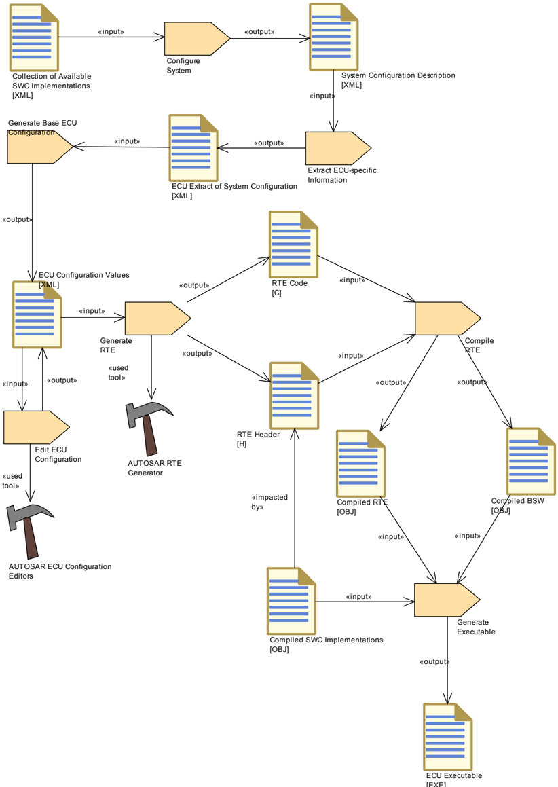

整个整车功能通过 `CompositionSwComponent`、`SwComponentPrototype` 和 `AtomicSwComponent` 来描述[2]。在 `CompositionSwComponent` 描述中也定义了软件组件端口之间的连接。这样一组相互连接、但尚未映射到实际 **ECU** 上的软件组件称为 **VFB** 视图。

在"配置系统"（**Configure System**）步骤中，所需的软件组件、可用的 **ECU** 以及系统约束（**System Constraint**）被解析为系统配置描述（**System Configuration Description**）。此时 `SwComponentPrototype` 以及与之关联的 `AtomicSwComponent` 被映射到可用的 **ECU** 上。

由于 **VFB** 视图中已经描述了 `AtomicSwComponent` 之间的通信关系，并且每个 `SwComponentPrototype` 和 `AtomicSwComponent` 到特定 **ECU** 的映射已经确定，因此可以生成通信矩阵（**communication matrix**）。在 `SwComponentType` 描述中（使用 AUTOSAR 软件组件模板[2]的格式），通过端口交换的数据以抽象方式定义。现在"系统配置生成器"需要定义系统信号（包括实际的信号长度以及传输这些信号的帧），以便通过网络传输应用数据。与系统信号对应的 **COM** 信号随后由"**RTE** 生成器"用来实际传输应用数据。

在下一步中，"系统配置描述"被拆分为每个单独 **ECU** 的描述。在生成 **ECU Extract** 的过程中，**VFB** 视图中 `CompositionSwComponent` 的层次结构也被展平，**ECU Extract** 中的 `SwComponentPrototype` 表示实际的实例。**ECU Extract** 只包含单独配置一个 **ECU** 所需的信息，并被送入每个 **ECU** 的 **ECU** 配置中。

**RTE** 是针对每个 **ECU** 实例单独配置和生成的。

"**ECU** 配置编辑器"（**ECU Configuration Editor**，另见 6.1.5 节）迭代地处理"**ECU** 配置值"，直到所有配置问题都得到解决。这里需要多个配置编辑器，每个编辑器专门负责 **ECU** 配置的特定部分。因此，一个编辑器可能配置 **COM** 栈（不是通信矩阵，而是各模块之间的交互），而另一个编辑器用于配置 **RTE**。

由于特定基础软件模块的配置并不完全独立于其他模块，因此需要多次将编辑器应用于"**ECU** 配置值"，以确保所有配置参数一致。

只有当配置问题全部解决之后，才会使用"**RTE** 生成器"生成实际的 **RTE** 代码（另见 6.1.6.2 节），该代码随后与其他基础软件模块以及软件组件代码一起被编译和链接。

"**RTE** 生成器"需要处理多种信息来源，因为 **RTE** 生成器所需的信息基于"**ECU** 配置值"，而这些值可能分布在多个文件中，并且本身又引用多个其他 AUTOSAR 描述。

**RTE** 生成器应支持读取单个文件以及存储在文件系统中的文件集。该工具应提供在文件系统中选择特定文件和文件集的机制。

AUTOSAR **XML** 描述可以分布在多个文件中。有些文件可能包含数据类型，另一些文件可能包含接口等。

在读取一组文件时，**RTE** 生成器工具应支持合并已被拆分并存储在多个部分模型中的 AUTOSAR 模型。要支持的 AUTOSAR 模型最小粒度由 `atpSplitable` 定义。模型的合并还包括引用的解析。**RTE** 生成器应能够以任意顺序读取子模型，没有顺序偏好。

**RTE** 生成器应支持 AUTOSAR **XML** 描述的解释和创建。这些描述应符合 XML 建议书 W3C XML 1.1 规范所定义的"格式良好"（**well-formed**）和"有效"（**valid**），无论是否使用文档对应的 AUTOSAR XML 模式。换句话说：即使工具不使用标准 XML 机制来验证 XML 描述，它也应确保 XML 描述能够成功地按照 AUTOSAR XML 模式进行验证。

如果 **RTE** 生成器希望按照 AUTOSAR 模式验证 AUTOSAR **XML** 描述，它应在其自身资源中提供必要的模式文件。**RTE** 生成器应使用 `xsi:schemaLocation` 中的 SYSTEM 标识符来识别合适的模式文件。

**RTE** 生成器应提供 **XML** 的序列化（**serialization**）。

**RTE** 生成器不应更改传递给它的模型内容。

**RTE** 生成器可以支持 AUTOSAR 扩展机制 `Sdg`（如果适用）。如果 **RTE** 生成器为实现其预期目的不需要这些附加信息，则应忽略不相关的扩展 `Sdg`。

**RTE** 生成器可以使用结构良好的错误消息。下面的列表收集了一些特别适用于日志文件的信息项，用于交换有关错误的信息：

* `ErrorCode` —— 消息文本的符号名
* `StandardErrorCode` —— 对 AUTOSAR 错误码的引用
* `ConstraintCode` —— 对 AUTOSAR 模板规范中所述语义约束的引用
* `Signature` —— 用于重复检查的消息签名
* `Timestamp` —— 消息的时间戳
* `ShortName` —— 允许引用特定错误消息的唯一标识

这也可用于在错误消息之间建立引用，例如用于筛查以及追溯到根本原因。

* `Desc` —— 人类可读的消息文本
* `Component` —— 此类信息项可以帮助用户在模型中定位问题
* `BaseUrl` —— 一个基础目录的 URL，可用作日志文件中文件引用的基础，通常即项目结构的根目录
* `ColumNumber` —— 错误位置所在的列
* `LineNumber` —— 错误位置所在的行号
* `LongName` —— 错误消息的标题
* `ObjectCategory` —— 例如所涉及的 `ApplicationPrimitveDataType` 的类别（例如 VALUE）
* `PrimaryErrorReference` —— 对根本原因的引用（如果适用）
* `ScopeEntryReference` —— 对作用域消息的引用（如果适用）
* `Object` —— 对引起错误的 AUTOSAR 元素的基于 `shortName` 的引用
* `ToolName` —— 报告错误的工具的名称
* `ToolVersion` —— 报告错误的工具的版本
* `IncidentUrl` —— 指向错误所在构件的 URL
* `Value` —— 导致问题的实际发现值

以上只是构建 AUTOSAR **ECU** 所需主要步骤、以及 **RTE** 参与该方法学的方式的粗略概述。关于 AUTOSAR 方法学的更详细描述，请参阅方法学文档[6]。接下来的各节将更详细地说明与 **RTE** 交互的步骤。

#### 6.1.2. 用于基础软件调度器的 RTE 生成器

图 3.2 展示了与基础软件调度器和 **RTE** 生成器交互相关的整体 AUTOSAR 方法学。

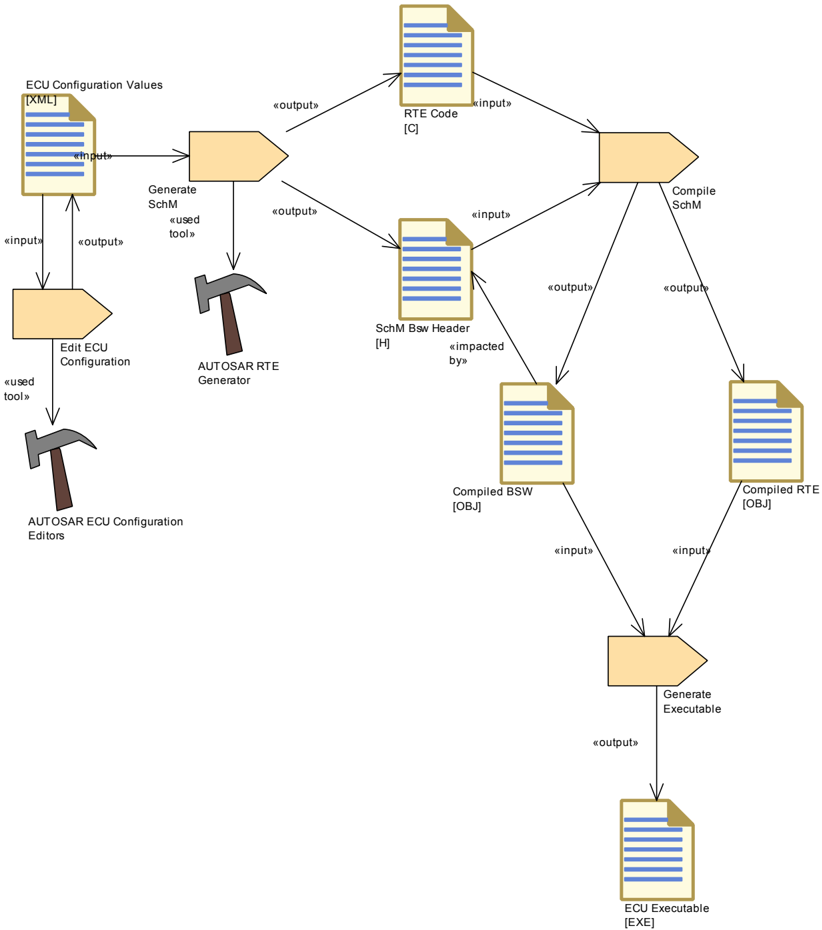

**ECU** 配置阶段是基础软件调度器配置的起点，在此阶段收集不同基础软件模块的所有需求。输入信息在各自基础软件模块的 **BSW** 模块描述[9]中提供。

基础软件调度器配置随后被生成到基础软件调度器代码中，并被编译、构建到 **ECU** 可执行文件中。

#### 6.1.3. 契约阶段

##### 6.1.3.1. RTE 契约阶段

为了能够使用 **RTE** 特定的 **API** 来支持 AUTOSAR 软件组件开发，"组件 **API**"（**Component API**，即应用头文件）由 **RTE** 生成器在所谓"**RTE** 契约阶段"（**RTE Contract Phase**，见图 3.3）中根据"软件组件内部行为描述"（**software-component Internal Behavior Description**，见图 3.1）生成。

在软件组件接口描述中（使用 AUTOSAR 软件组件模板），至少必须描述该软件组件的 AUTOSAR 接口，即带有端口及其接口的软件组件类型。在软件组件内部行为描述中还定义了可运行实体和 **RTE** 事件。根据这些信息，**RTE** 生成器可以生成特定的 **API** 来访问端口以及发送和接收数据。

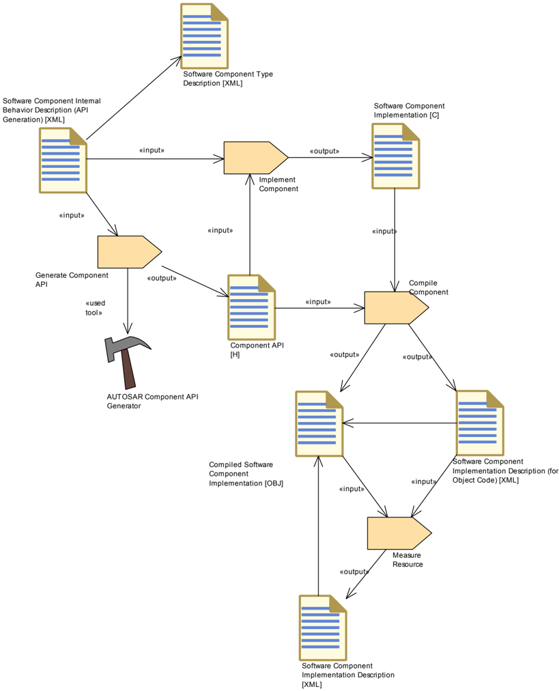

借助生成的"组件 **API**"（应用头文件），软件组件开发人员可以提供软件组件的源代码，而无需关心通信将来是本地进行还是使用某些网络。

必须考虑到 AUTOSAR 软件组件开发过程是迭代的，软件组件描述可能在开发过程中发生变化。这要求重新生成应用头文件，以反映软件组件描述中所做的更改。

当软件组件成功编译后，"组件实现描述生成"（**Component Implementation Description Generation**）工具会分析生成的目标文件，并用特定实现的信息增强软件组件描述。这包括 **ROM** 和 **RAM** 实际内存需求的信息，并写入 AUTOSAR 软件组件模板的"组件实现描述"（**Component Implementation Description**）部分。

请注意，在实现了 **PreCompileTime** 变体性的情况下，还需要 **PreBuild** 数据集契约阶段（6.1.4 节）才能编译该软件组件。

因此，一个软件组件交付时由以下部分组成：

* **SW** 组件类型描述（**SW-Component Type Description**）
* **SW** 组件内部行为描述
* 实际的 **SW** 组件实现和/或已编译的 **SW** 组件
* **SW** 组件实现描述

上述信息是需要的，以便在组装整个系统时为系统生成步骤提供足够的信息。

##### 6.1.3.2. 基础软件调度器契约阶段

为了能够使用基础软件调度器特定的 **API** 来支持基础软件模块开发，**RTE** 生成器在所谓"基础软件调度器契约阶段"（**Basic Software Scheduler Contract Phase**）中生成模块互连头文件（**Module Interlink Header**，见 7.2.3.2 节）和模块互连类型头文件（**Module Interlink Types Header**，见 7.2.3.1 节），其中包含与单个基础软件模块实例相关的基础软件调度器 **API** 的定义和声明。

所需的输入为：

* 基础软件模块描述，以及
* 基础软件模块内部行为，以及
* 基础软件模块实现

请注意，在实现了 **PreCompileTime** 变体性的情况下，还需要 **PreBuild** 数据集契约阶段（6.1.4 节）才能编译该基础软件模块。

#### 6.1.4. PreBuild 数据集契约阶段

在 **RTE** 的 **PreBuild** 数据集契约阶段（**PreBuild Data Set Contract Phase**）中生成条件值宏（**Condition Value Macro**，见 7.1.3.8.2.1 节），这些宏用于解析特定软件组件或基础软件模块所实现的 pre-build 变体性。

具体的值通过 `PredefinedVariant` 定义。这些 `PredefinedVariant` 元素包含 `SwSystemconst` 的 `SwSystemconstValue` 定义，这些值应在 **ECU** 配置期间解析变体性时被应用。

本阶段的输出是 **RTE** 配置头文件（**RTE Configuration Header File**，7.1.3.8 节）。该文件是使用 **PreCompileTime** 变体性编译特定软件组件变体所必需的。条件值宏用于通过预处理器语句实现 **PreCompileTime** 变体性，因此需要它们来运行 C 预处理器，以解析所实现的变体性。

#### 6.1.5. 编辑 RTE 的 ECU 配置

在 **ECU** 的配置过程中，**RTE** 也需要被配置。这分为几个必须迭代执行的步骤：**RTE** 的配置和其他模块的配置。

因此，首先"**RTE** 配置编辑器"（**RTE Configuration Editor**）需要收集建立可运行的 **RTE** 所需的全部信息。这种收集包括软件组件实例及其通信关系、可运行实体以及所涉及的 **RTE** 事件等信息。所有这些信息的主要来源是"**ECU** 配置值"，它可能提供对软件组件描述或系统配置描述等进一步描述的引用。

另一个输入源是时序扩展规范（**Specification of Timing Extensions**）[14]。该模板可用于规定可运行实体的执行顺序（参见"执行顺序约束"（**Execution order constraint**）一节）。"**RTE** 配置编辑器"可以利用这些信息来创建和检查 **RTE** 事件到 **OS** 任务的映射配置（参见 8.5.1 节）。

覆盖"**ECU** 配置值"不同部分的"**ECU** 配置编辑器"的使用，在没有不收敛的循环依赖的情况下，将收敛到稳定的配置，随后 **ECU** 配置过程结束。**ECU** 配置的详细描述可参见[5]。下一阶段是生成实际的 **RTE** 代码。

#### 6.1.6. 生成阶段

在 **ECU** 被完整配置之后，就可以执行实际 **RTE**（包括基础软件调度器部分）的生成。由于与其他基础软件模块之间的所有关系已经在 **ECU** 配置阶段解析完毕，因此所有模块的生成可以并行进行（见图 3.4）。

图 3.4 展示了 **RTE** 生成阶段。

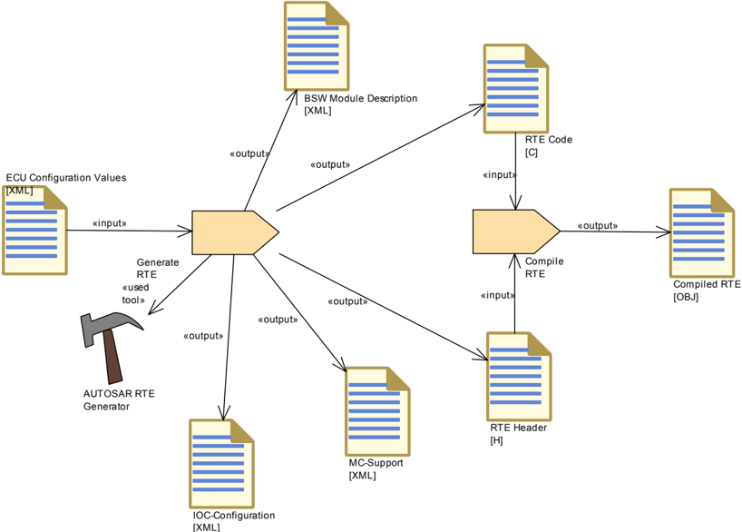

基础软件调度器是 **RTE** 的一部分，因此在图 3.4 中未单独显示。

##### 6.1.6.1. 基础软件调度器生成阶段

取决于 **ECU** 的复杂度以及不同软件供应商之间的协作模式，可能需要在不含软件组件的情况下单独集成基础软件。

因此，**RTE** 生成器必须支持生成不含软件组件相关 **RTE** 片段的基础软件调度器。基础软件调度器生成阶段仅适用于不包含任何类型软件组件的软件构建。

在这种情况下，**RTE** 生成器只生成基础软件模块的 **API** 和基础软件调度代码。当输入中包含软件组件相关信息时，这些信息将引发一个错误。

例如：

* 不会为 **ECU Extract** 中包含的软件组件生成应用头文件（**Application Header File**）。
* 不允许映射的 `RTEEvent`，且不会将可运行实体的调用生成到 **OS** 任务体中。但是，与基础软件调度器配置相关的所有 **OS** 任务体都会被生成。
* 不支持映射到 **RTE** 的模式机实例。

在基础软件调度器生成阶段，**RTE** 生成器应拒绝包含软件组件相关信息的输入配置。

处于基础软件调度器生成阶段的 **RTE** 生成器还负责生成有助于 **ECU** 软件后续构建、部署和标定的附加构件。

在基础软件调度器生成阶段，**RTE** 生成器应提供其 **BSW** 模块描述，以记录所生成的 **RTE**/**BSW** 调度器的特性。

关于 **BSW** 模块描述生成的细节见 6.1.6.4 节。

在基础软件调度器生成阶段，**RTE** 生成器应作为 **BSW** 模块描述的一部分提供 MC 支持（测量与标定，**Measurement and Calibration**）描述。

关于 MC 支持的细节见 6.2.9.4 节。

对于包含软件组件的软件构建，适用 **RTE** 生成阶段（6.1.6.2 节），在该阶段也会生成 **RTE** 的基础软件调度器部分。

##### 6.1.6.2. RTE 生成阶段

实际的 AUTOSAR 软件组件和基础软件模块代码将与 **RTE** 和基础软件调度器代码一起链接，以构建整个 **ECU** 软件。

请注意，在实现了 **PreCompileTime** 变体性的情况下，还需要 **PreBuild** 数据集生成阶段（见 6.1.7 节）才能编译 **ECU** 软件；此外，在实现了 post-build 变体性的情况下，需要 **PostBuild** 数据集生成阶段（见 6.1.8 节）才能链接完整的 **ECU** 软件。

处于生成阶段的 **RTE** 生成器还负责生成有助于 **ECU** 软件后续构建、部署和标定的附加构件。

在生成阶段，**RTE** 生成器应提供其 **BSW** 模块描述，以记录所生成 **RTE** 的特性。

关于 **BSW** 模块描述生成的细节见 6.1.6.4 节。

在生成阶段，**RTE** 生成器应作为 **BSW** 模块描述的一部分提供 MC 支持（测量与标定）描述。

关于 MC 支持的细节见 6.2.9.4 节。

如果使用了 `Ioc` 模块，则在生成阶段 **RTE** 生成器应提供 `Ioc` 模块[4]的配置。

**RTE** 生成 **IOC** 配置时使用实现特定的确定性生成方案。该生成方案可被实现方用来复用这些 **IOC** 配置（例如在使用配置开关 `strictConfigurationCheck` 时）。

如果使用了 **IOC** 模块，**RTE** 生成器在生成阶段应生成用于 **IOC** 配置的内部 `ImplementationDataType` 类型。

相应的 C 数据类型将被生成到 `Rte_Type.h` 中。**IOC** 将使用该 `Rte_Type.h` 头文件来获取 **IOC API** 所需的类型。

更换 **RTE** 生成器将需要重新生成 **IOC** 配置。

关于 `Ioc` 模块的细节见 6.2.3.4.1 节。

在生成阶段，**RTE** 生成器应忽略归类为 ICS 的 `XMLContent`。

类别为 ICS 的 `ARPackage` 描述实现一致性声明（**Implementation Conformance Statement**，更多细节参见 **TPS** **BSW** 模块描述[9]）。

##### 6.1.6.3. 集群生成阶段

实际的 AUTOSAR 软件组件和基础软件模块代码将与 **RTE** 和基础软件调度器代码一起链接，以构建整个 `CpSoftwareCluster`。

请注意，在实现了 **PreCompileTime** 变体性的情况下，还需要 **PreBuild** 数据集生成阶段（见 6.1.7 节）才能编译 `CpSoftwareCluster` 代码；此外，在实现了 post-build 变体性的情况下，需要 **PostBuild** 数据集生成阶段（见 6.1.8 节）才能链接 `CpSoftwareCluster` 代码。

处于集群生成阶段的 **RTE** 生成器还负责生成有助于 `CpSoftwareCluster` 后续构建、部署和标定的附加构件。

在集群生成阶段，**RTE** 生成器应提供其 **BSW** 模块描述，以记录所生成 **RTE** 的特性。

关于 **BSW** 模块描述生成的细节见 6.1.6.4 节。

在集群生成阶段，**RTE** 生成器应作为 **BSW** 模块描述的一部分提供 MC 支持（测量与标定）描述。

关于 MC 支持的细节见 6.2.9.4 节。

如果使用了 **IOC** 模块，则在集群生成阶段 **RTE** 生成器应提供 `Ioc` 模块[4]的配置。

**RTE** 生成 **IOC** 配置时使用实现特定的确定性生成方案。该生成方案可被实现方用来复用这些 **IOC** 配置（例如在使用配置开关 `strictConfigurationCheck` 时）。

如果使用了 **IOC** 模块，**RTE** 生成器在集群生成阶段应生成用于 **IOC** 配置的内部 `ImplementationDataType` 类型。

更换 **RTE** 生成器将需要重新生成 **IOC** 配置。

关于 **IOC** 模块的细节见 6.2.3.4.1 节。

##### 6.1.6.4. BSW 模块描述生成

**RTE** 生成器在生成阶段生成的 **BSW** 模块描述[9]描述了实际 **RTE** 代码的特性。以下规定明确了 **BSW** 模块描述中哪些元素必须由 **RTE** 生成器生成。

###### 6.1.6.4.1. Bsw 模块描述

在生成阶段，**RTE** 生成器应为所生成的 **RTE** 提供 **BSW** 模块描述的 `BswModuleDescription` 元素。

根据 AUTOSAR 通用结构模板[10]（"在包中标识 M1 元素"一章），**RTE** 的 `BswModuleDescription` 应提供在 `ARPackage` `AUTOSAR_Rte` 中。

在生成阶段，对于 **RTE** 提供的每个标准化接口（参见分层软件架构[15]），**RTE** 生成器应提供 `BswModuleEntry`，并在 `BswModuleDescription` 的 `implementedEntry` 角色中引用它。所提供的标准化接口是 `Rte` 生命周期 **API** 和 `SchM` 生命周期 **API**。

在生成阶段，对于 **RTE** 提供并由相应基础软件模块调用的每个回调 **API**，**RTE** 生成器应在 `BswModuleDescription` 的 `bswModuleDependency` 角色中提供 `BswModuleDependency`。从 `BswModuleDependency` 到 `BswModuleEntry` 的引用应位于 `calledEntry` 角色中。调用方基础软件模块由 `BswModuleDependency` 的 `targetModuleId` 特性指定。

对于 **RTE** 代码在其他基础软件模块中调用的所有 **API**，其依赖关系也按上述方式描述。

在生成阶段，对于 **RTE** 在另一个基础软件模块中调用的每个 **API**，**RTE** 生成器应在 `BswModuleDescription` 的 `bswModuleDependency` 角色中提供 `BswModuleDependency`。从 `BswModuleDependency` 到 `BswModuleEntry` 的引用应位于 `calledEntry` 角色中。被调用的基础软件模块由 `BswModuleDependency` 的 `targetModuleId` 特性指定。

如果所生成 **RTE** 的 **BSW** 模块描述依赖于其他基础软件模块 **BSW** 模块描述中的元素，则 **RTE** 生成器应按照 AUTOSAR 通用结构模板[10]中"在包中标识 M1 元素"的规则，使用到这些元素的完全限定路径名。

例如，钩子函数的描述

```C
void Rte_Dlt_Task_Activate(TaskType task)
```

对于 **Dlt** 而言，需要来自 **OS** 的 `ImplementationDataType` "TaskType"，以便在相关 `BswModuleEntry` 的描述中描述 `SwServiceArg` "task" 的数据类型。

在这种情况下，到 `ImplementationDataType` "TaskType" 的完全限定路径名应为：

```text
AUTOSAR_OS/ImplementationDataTypes/TaskType
```

关于该描述的完整示例如下：

```XML
<AR-PACKAGE>
  <SHORT-NAME>AUTOSAR_RTE</SHORT-NAME>
  <AR-PACKAGES>
    <AR-PACKAGE>
      <SHORT-NAME>BswModuleEntrys</SHORT-NAME>
      <ELEMENTS>
        <BSW-MODULE-ENTRY>
          <SHORT-NAME>Rte_Dlt_Task_Activate</SHORT-NAME>
          <ARGUMENTS>
            <SW-SERVICE-ARG>
              <SHORT-NAME>task</SHORT-NAME>
              <CATEGORY>TYPE_REFERENCE</CATEGORY>
              <SW-DATA-DEF-PROPS>
                <SW-DATA-DEF-PROPS-VARIANTS>
                  <SW-DATA-DEF-PROPS-CONDITIONAL>
                    <IMPLEMENTATION-DATA-TYPE-REF DEST="IMPLEMENTATIONDATA-TYPE">AUTOSAR_OS/ImplementationDataTypes/TaskType</IMPLEMENTATION-DATA-TYPE-REF>
                  </SW-DATA-DEF-PROPS-CONDITIONAL>
                </SW-DATA-DEF-PROPS-VARIANTS>
              </SW-DATA-DEF-PROPS>
            </SW-SERVICE-ARG>
          </ARGUMENTS>
        </BSW-MODULE-ENTRY>
      </ELEMENTS>
    </AR-PACKAGE>
  </AR-PACKAGES>
</AR-PACKAGE>
```

###### 6.1.6.4.2. Bsw 内部行为

在生成阶段，**RTE** 生成器应在所生成 **RTE** 的 **BSW** 模块描述的 `BswModuleDescription` 中提供 `BswInternalBehavior` 元素。

在生成阶段，对于实现生命周期 **API** 和 `SchM` 生命周期 **API** 的每个 C 函数，**RTE** 生成器应在 `BswInternalBehavior` 中提供 `BswCalledEntity` 元素。该 `BswCalledEntity` 应在 `implementedEntry` 角色中引用相应的 `BswModuleEntry`。

在生成阶段，对于 **RTE** 分配的每个变量内存对象，**RTE** 生成器应在 `BswInternalBehavior` 的 `staticMemory` 角色中提供 `VariableDataPrototype` 元素。

在生成阶段，对于 **RTE** 分配的每个常量内存对象，**RTE** 生成器应在 `BswInternalBehavior` 的 `constantMemory` 角色中提供 `ParameterDataPrototype` 元素。

###### 6.1.6.4.3. Bsw 实现

在生成阶段，**RTE** 生成器应提供 `BswImplementation` 元素，并在 `behavior` 角色中引用 **BSW** 模块描述的 `BswInternalBehavior`。

在生成阶段，**RTE** 生成器应根据实际的 **RTE** 实现在 `BswImplementation` 元素中提供 `programmingLanguage` 元素。

在生成阶段，**RTE** 生成器应根据 **RTE** **ECU** 配置中的输入信息，在 `BswImplementation` 元素中提供 `swVersion` 元素。

在生成阶段，**RTE** 生成器应根据 **RTE** 生成器所基于的 AUTOSAR 发行版本，在 `BswImplementation` 元素中提供 `arReleaseVersion` 元素。

在生成阶段，**RTE** 生成器应根据实际的 **RTE** 实现在 `BswImplementation` 元素中提供 `usedCodeGenerator` 元素。

在生成阶段，**RTE** 生成器应根据 **RTE** **ECU** 配置中的输入信息（`RteCodeVendorId`），在 `BswImplementation` 元素中提供 `vendorId` 元素。

`RteCodeVendorId` 规定 **RTE** 生成器实际用户的供应商 ID，而不是 **RTE** 供应商本身的 ID。

如果所生成的 **RTE** 代码与硬件相关（由于 **RTE** 生成器的供应商特定优化），则应在 `BswImplementation` 元素的 `hwElement` 角色中提供对 **ECU** 资源描述[16]中适用 `HwElement` 的引用。

在生成阶段，对于编译 **RTE** 代码所需的所有 C 文件和头文件，**RTE** 生成器应在 `BswImplementation` 的 `generatedArtifact` 角色中提供 `DependencyOnArtifact` 元素。这不包括其他基础软件模块或应用软件。

**注意**：该用例是对构建环境（自动或手动）的支持。

在此上下文中，各特性应按如下方式使用：

* `category` 应按通用结构模板[10]中的定义使用（例如 `SWSRC`、`SWOBJ`、`SWHDR`）
* `domain` 是可选的，可以自由选择
* `revisionLabel` 应包含 **RTE** 配置中的修订标签
* `shortLabel` 是构件的名称

关于 `DependencyOnArtifact` 描述的细节可参见通用结构模板[10]。

**BSW** 模块描述中还应导出的其他元素在后续规定中给出，例如 6.2.9.4 节。

##### 6.1.6.5. Com 与 LdCom 的使用

###### 6.1.6.5.1. Com 用户生成

文档[3]中阐述的 **Com** 用户（**Com user**）概念支持数量可变的回调，并使用 **Com** 用户特定的 **Com** 用户回调句柄 ID（**Com user callback handle Id**）。这些句柄 ID 标识通知属于哪个信号或信号组，并用于直接索引 **RTE** 的内部数据结构。由于通知的种类强烈依赖于所集成 **SW-C** 使用的特性以及 **RTE** 的实现策略，`ComUserModuleCnf` 容器下的配置参数并不打算由集成人员手工设置。因此，**RTE** 生成器有责任向 **Com** 模块表达其需求。为此，预定义的 `ComUserModuleCnf` 容器使得能够通过 **COM** 模块中的 `ComUserModule`、`ComUserModuleCnfRef` 引用静态地配置 **Com** 用户。

如果外部配置开关 `strictConfigurationCheck` 被设置为 false，则 **RTE** 生成器应根据其内部实现需求，在预定义的 `ComUserModuleCnf` 容器中提供以下内容：

* 带 `ComUserCbkHandleId`、`ComUserSystemTemplateSystemSignalRef` 和多个 `ComUserCallbackRef` 的 `ComUserSignal` 容器
* 以及：带 `ComUserCbkHandleId`、`ComUserSystemTemplateSignalGroupRef` 和多个 `ComUserCallbackRef` 的 `ComUserSignalGroup`
* 以及：带 `ComUserCallbackName` 和 `ComUserCallbackType` 的 `ComUserCallback`
* 以及：`ComUserHeaderInclude`

如果外部配置开关 `strictConfigurationCheck` 被设置为 true，且 **RTE** 生成器的输入包含引用了某个 `ComUserSignal` 的 **RTE** 配置，而所提供的 **Com** 配置中没有为该 `ComUserSignal` 定义 `ComUserCbkHandleId`，则 **RTE** 生成器应将该输入作为无效配置拒绝。

###### 6.1.6.5.2. LdCom 用户生成

与 **Com** 用户类似，文档[17]中阐述的 **LdCom** 用户概念支持数量可变的回调，并使用 **LdCom** 用户特定的 **LdCom** 用户回调句柄 ID（**LdCom user callback handle Id**）。这些句柄 ID 标识通知属于哪个 **LdCom** IPdu，并用于直接索引 **RTE** 的内部数据结构。与 **Com** 用户一样，`LdComUserModuleCnf` 容器也应由集成人员手工设置，以通过 **LdCom** 模块中的 `LdComUserModule`、`LdComUserModuleCnfRef` 引用静态配置 **LdCom** 用户。由于通知的种类强烈依赖于所集成 **SW-C** 使用的特性以及 **RTE** 的实现策略，因此 **RTE** 生成器有责任创建 `LdComUserModuleCnf` 容器下的配置参数。

如果外部配置开关 `strictConfigurationCheck` 被设置为 false，则 **RTE** 生成器应根据其内部实现需求，在预定义的 `LdComUserModuleCnf` 容器中提供以下内容：

* 带 `LdComUserCbkHandleId`、`LdComUserSystemTemplateSignalRef` 和多个 `LdComUserCallbackRef` 的 `LdComUserIPdu` 容器
* 以及：带 `LdComUserCallbackName` 和 `LdComUserCallbackType` 的 `LdComUserCallback`
* 以及：`LdComUserHeaderInclude`

如果外部配置开关 `strictConfigurationCheck` 被设置为 true，且 **RTE** 生成器的输入包含引用了某个 `LdComUserIPdu` 的 **RTE** 配置，而所提供的 **LdCom** 配置中没有为该 `LdComUserIPdu` 定义 `LdComUserCbkHandleId`，则 **RTE** 生成器应将该输入作为无效配置拒绝。

如果外部配置开关 `strictConfigurationCheck` 被设置为 true，则 **RTE** 生成器应拒绝违反 **LdCom** 规范[17]中相应约束（涉及回调句柄 ID、回调名称与 IPdu 的一致性）的配置。

#### 6.1.7. PreBuild 数据集生成阶段

在 **PreBuild** 数据集生成阶段（**PreBuild Data Set Generation Phase**）中生成条件值宏（见 7.1.3.8.2.1 节），这些宏用于解析软件组件、所生成 **RTE** 和基础软件调度器所实现的 pre-build 变体性。

具体的值通过 `EcucVariationResolver` 配置选择 `PredefinedVariant` 来定义。这些 `PredefinedVariant` 元素包含 `SwSystemconst` 的 `SwSystemconstValue` 定义，这些值应在 **ECU** 配置期间解析变体性时被应用。

条件值宏的值是相关 `VariationPoint` 的 `ConditionByFormula` 求值结果。这些 `ConditionByFormula` 在公式表达式中引用 `SwSystemconst`。支持所赋的 `SwSystemconstValue` 又包含引用 `SwSystemconst` 的公式表达式，因此输入可能是一棵由公式表达式与 `SwSystemconstValue` 组成的树；但叶子 `SwSystemconstValue` 必须是那些不依赖于其他 `SwSystemconst` 的值，以确保树的求值结果是一个唯一的数字。

**RTE** 生成器应验证解析后的 pre-build 变体，并检查其相对于元模型的完整性。任何元模型违反都应导致输入配置被拒绝。

本阶段的输出是 **RTE** 配置头文件（7.1.3.8 节）。该文件是使用 **PreCompileTime** 变体性编译包含软件组件代码和 **RTE** 代码的特定 **ECU** 软件变体所必需的。条件值宏用于通过预处理器语句实现 **PreCompileTime** 变体性，因此需要它们来运行 C 预处理器，以解析所实现的变体性。

#### 6.1.8. PostBuild 数据集生成阶段

在可选的 **PostBuild** 数据集生成阶段（**PostBuild Data Set Generation Phase**）中生成 `PredefinedVariant` 值，这些值用于解析软件组件和所生成 **RTE** 所实现的 post-build 变体性。

本阶段的输出是 **RTE** **PostBuild** 变体集（**RTE Post Build Variant Sets**，7.1.3.10 节）。该文件用于链接 **ECU** 软件，并在启动时、基础软件调度器初始化期间，在所生成的 **RTE** 代码中选择特定的 **PostBuild** 变体。

如果启用了 **DET**，则 **RTE** 应生成校验代码，在运行时（即初始化期间）校验解析后的 post-build 变体，并检查其相对于活动变体的完整性。如果检测到违反，**RTE** 应向 **DET** 报告一个开发错误。为执行该校验，**RTE** 初始化将获得指向 `EcucPostBuildVariants` 实例的指针，以便校验所选择的变体。

**RTE** 生成器应创建 **RTE** **PostBuild** 数据集配置（即 `Rte_PBcfg.c`），它表示 `PredefinedVariant` 定义的集合（通常针对每个子系统/或系统配置），提供并定义 **RTE** 的 post-build 变体。

请注意，`Rte_PBcfg.h` 是在 **RTE** 生成阶段生成的。为保留内存（使用默认值），同一时间可能还需要生成 `Rte_PBcfg.c`。

关于这些配置文件的更多细节见 7.1.3.10 节。

一个 **RTE** 变体可以由 `PredefinedVariant` 的集合组成。每个 `PredefinedVariant` 包含一组 `PostBuildVariantCriterionValue`，为特定的 `PostBuildVariantCriterion` 赋值，而后者又用于在运行时通过求值 `PostBuildVariantCondition` 来解析变体性。不同的 `PredefinedVariant` 可能为同一个 `PostBuildVariantCriterion` 赋予不同的值，从而为特定的 `PostBuildVariantCriterionValueSet` 造成冲突。如果这些赋值赋予相同的值，则允许存在不同的赋值。

**RTE** 生成器应拒绝这样的配置：对于同一个 `EcucPostBuildVariants`，不同的 `PredefinedVariant` 为同一个 `PostBuildVariantCriterion` 赋予了不同的值。

**RTE** 生成器应拒绝这样的配置：使用了多个 `ParameterDataPrototype` 的 post-build 变体实例，但没有在某个 `EcucPostBuildVariants` 中恰好选择一个实例。

更多信息见 6.2.9.3.7 节。

#### 6.1.9. RTE 配置与其他 BSW 模块的交互

所生成的 **RTE** 与 **Com**、**LdCom** 和 **Os** 等其他 AUTOSAR 基础软件模块紧密交互。不同 **BSW** 模块的配置值存储在 **ECU** 配置的各自结构中，但各 **BSW** 模块配置之间公共使用的值必须保持同步，这一点至关重要。AUTOSAR 并未提供各配置之间如何同步的标准化方式，其前提是：在生成 **BSW** 模块时，提供给各 **BSW** 模块的输入信息与其他（相关的）**BSW** 模块的输入信息是同步的。

AUTOSAR **BSW** 模块的代码生成方法学严重依赖于配置编辑器（**Configuration editor**）与配置生成器（**Configuration generator**）之间的逻辑区分。这些工具不一定要实现为两个独立的工具，只需要在方法学的某个步骤中能够区分工具所承担的不同角色即可。

对于 **RTE**，其前提是需要工具支持来解析 **Rte** 与其他 **BSW** 模块之间的交互，以便能够高效地配置 **Rte**。但本规范并未规定该支持应如何实现、以及在哪些工具中实现。

处于生成阶段的 **RTE** 生成器需要基于 **Rte** 自身的配置输入，获取其他 **BSW** 模块配置的信息（**Rte** 的配置中存在指向其他 **BSW** 模块配置值的引用）。如果在 **RTE** 生成阶段所提供的输入信息相对于 **Rte** 输入不一致，**RTE** 生成器必须将该输入视为无效配置。

在生成阶段，**RTE** 生成器应将 **Rte** 配置输入信息中的错误视为无效配置。

由于 **RTE** 生成器具有实现自由度，因此可以基于 **RTE** 配置需求来改正/更新其他 **BSW** 模块所提供的输入配置。但为了允许稳定的构建过程，也可以禁止这种更新行为。

如果外部配置开关 `strictConfigurationCheck` 被设置为 true，则 **Rte** 生成器不得创建或修改任何配置输入。

如果外部配置开关 `strictConfigurationCheck` 被设置为 false，则 **Rte** 生成器可以更新 **Rte** 和其他 **BSW** 模块的输入配置信息。

**示例 1**：如果 **Rte** 配置引用了一个未在所提供的 **Os** 配置中配置的 `OsTask`，**RTE** 生成器的行为将如下：

* 在严格检查生效的情况下（即 `strictConfigurationCheck` 为 true）：仅显示一条错误消息。
* 否则：可能的行为是显示一条警告消息，并修改 **Os** 配置以包含 **Rte** 配置所引用的 `OsTask`（当然，随后需要细化这个新 `OsTask` 的 **Os** 配置）。

**示例 2**：如果 **RTE** 配置引用了一个 `ComUserSignal`、需要为其生成通知回调，但所提供的 **Com** 配置中没有配置 `ComUserCbkHandleId`，则 **RTE** 生成器的预期行为如下：

* 在严格检查生效的情况下（即 `strictConfigurationCheck` 为 true）：报出一条错误消息。
* 在 `strictConfigurationCheck` 为 false 的情况下：报出一条警告消息。这应提示用户必须修改 **Com** 配置（见 6.1.6.5.1 节），使其包含 **RTE** 生成代码中为该 `ComUserSignal` 所使用的 `ComUserCbkHandleId`。请注意，这将要求集成人员用更新后的配置重新生成 **Com** 模块。

**示例 3**：如果 **RTE** 配置引用了一个 `LdComUserIPdu`、需要为其生成强制通知回调，但所提供的 **LdCom** 配置中没有配置带 `LdComUserCallbackName` 的 `LdComUserCallback`，则 **RTE** 生成器的预期行为如下：

* 在严格检查生效的情况下（即 `strictConfigurationCheck` 为 true）：报出一条错误消息。
* 在 `strictConfigurationCheck` 为 false 的情况下：报出一条警告消息。这应提示用户必须修改 **LdCom** 配置（见 6.1.6.5.2 节），使其包含 **RTE** 生成代码中为该 `LdComUserIPdu` 所使用的、带 `LdComUserCallbackName` 的 `LdComUserCallback`。请注意，这将要求集成人员用更新后的配置重新生成 **LdCom** 模块。

### 6.2. RTE 功能规格

#### 6.2.1. 架构概念

##### 6.2.1.1. 范围

本节介绍 AUTOSAR 软件组件的概念及其在 **RTE** 中的使用方式。

AUTOSAR 软件组件模板[2]定义了 AUTOSAR 上下文中的软件组件种类，如图 4.1 所示。抽象类 `SwComponentType` 不能被实例化，因此只能存在 `CompositionSwComponentType`、`ParameterSwComponentType`，或者抽象类 `AtomicSwComponentType` 的特化类 `ApplicationSwComponentType`、`ServiceProxySwComponentType`、`SensorActuatorSwComponentType`、`NvBlockSwComponentType`、`ServiceSwComponentType`、`ComplexDeviceDriverSwComponentType` 或 `EcuAbstractionSwComponentType`。

在下文中，术语 `AtomicSwComponentType` 用作上述所有非抽象派生元类的统称。

`SwComponentType` 定义 AUTOSAR 软件组件的类型，它与任何使用场景无关，可以在不同场景中潜在地被多次复用。在组合（**composition**）中，这些类型以特定角色出现，称为 `SwComponentPrototype`。原型（**prototype**）是类型在某个场景中的运用。在 AUTOSAR 中，任何 `SwComponentType` 都可以用作原型的类型。

图 4.1 展示了 AUTOSAR 软件组件的分类。

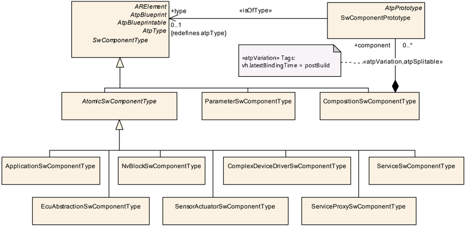

图 4.1 中所示的 AUTOSAR 软件组件在图 4.2 的架构图中位于 **RTE** 之上和之下。

在 **RTE** 之下还存在具有 AUTOSAR 接口的软件实体，即 AUTOSAR 服务（**AUTOSAR service**）、ECU 抽象（**ECU Abstraction**）和复杂设备驱动（**Complex Device Driver**）。对于这些软件，不仅要描述其 AUTOSAR 接口，其内部结构的信息也在 **BSW** 模块描述中可用。

图 4.2 展示了 AUTOSAR **ECU** 架构图。

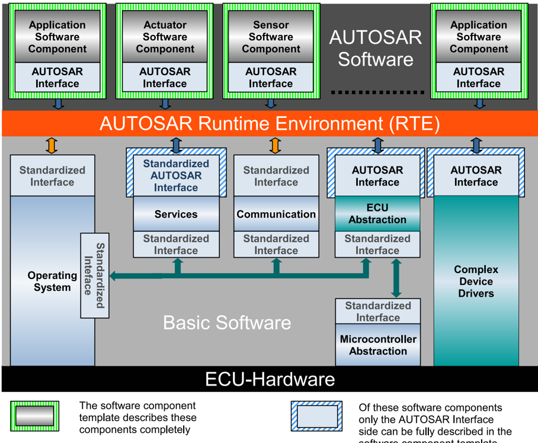

接下来几节将详细描述不同种类的 AUTOSAR 软件组件对 **RTE** 的影响。

##### 6.2.1.2. RTE 与数据类型

AUTOSAR 元模型定义了 `ApplicationDataType` 和 `ImplementationDataType`。`AutosarDataPrototype` 可以由 `ApplicationDataType` 或 `ImplementationDataType` 类型化。但 **RTE** 生成器只将 `ImplementationDataType` 实现为 C 数据类型，并用这些 C 数据类型来类型化与 `DataPrototype` 相关的 **RTE API**。因此，在输入配置中要求：用于类型化与 **RTE** 生成相关的 `DataPrototype` 的每个 `ApplicationDataType`，都必须通过 `DataTypeMap` 映射到某个 `ImplementationDataType`。对于特定软件组件或基础软件模块适用哪个 `DataTypeMap`，由其 `InternalBehavior` 引用的 `DataTypeMappingSet` 定义。

**RTE** 生成器应拒绝这样的输入配置：其中某个影响所生成 **RTE** 的 `AutosarDataPrototype` 由未映射到 `ImplementationDataType` 的 `ApplicationDataType` 类型化。

尽管如此，`ApplicationDataType` 所给属性的一个子集仍与 **RTE** 生成器相关，例如：

* 用于创建 `McSupportData`（测量与标定支持数据，见 6.2.9.4 节）信息；
* 在数据转换（**data conversion**）的情形下计算转换公式（见 6.2.3.5 节和 6.2.3.7 节）；
* 计算 **RTE** 代码所需、但以物理表示定义的数值表示（例如 `initialValue` 和 `invalidValue`）。

当 **RTE** 代码需要某个值、而该值以 `ApplicationValueSpecification` 提供时，如果存在适用的 `ConstantSpecificationMapping`，则 **RTE** 生成器应使用其 `implConstant` 所引用的 `ValueSpecification` 作为该值最终的数值表示，而不考虑任何 `compuMethod`。

当 **RTE** 代码需要某个值、而该值以 `ApplicationValueSpecification` 提供时，如果不存在适用的 `ConstantSpecificationMapping`，则 **RTE** 生成器应按照某个 `compuMethod` 所定义的转换来计算数值表示。该计算应支持类别 `VALUE`、`VAL_BLK`、`STRUCTURE`、`ARRAY` 和 `BOOLEAN`；对于类别 `VAL_BLK`、`STRUCTURE` 和 `ARRAY`，仅适用于原始叶子元素。如果未提供 `CompuMethod`，则该转换按类别为 `IDENTICAL` 的 `CompuMethod` 处理。

上述两条中，"适用的 `ConstantSpecificationMapping`" 是指由相关 `SwComponentType` 聚合、并在其 `applConstant` 中引用该 `ApplicationValueSpecification` 的那个映射。

##### 6.2.1.3. RTE 与 AUTOSAR 软件组件

AUTOSAR 软件组件的描述划分为以下几个部分：

* 层次结构（**hierarchical structure**）
* 端口与接口（**ports and interfaces**）
* 内部行为（**internal behavior**）
* 实现（**implementation**）

以下各节将分别讨论它们。

**RTE** 生成器应遵守通过 `SwDataDefProps` 定义的数据属性的优先级，如软件组件模板[2]所定义。

该规定意味着：

1. 定义在 `ApplicationDataType` 上的 `SwDataDefProps`，可以被
2. 定义在 `ImplementationDataType` 上的 `SwDataDefProps` 覆盖，后者又可以被
3. 定义在 `AutosarDataPrototype` 上的 `SwDataDefProps` 覆盖，后者又可以被
4. 定义在 `InstantiationDataDefProps` 上的 `SwDataDefProps` 覆盖，后者又可以被
5. 定义在 `AccessPoint` 或 `Argument` 上的 `SwDataDefProps` 覆盖，后者又可以被
6. 定义在 `FlatInstanceDescriptor` 上的 `SwDataDefProps` 覆盖，后者又可以被
7. 定义在 `McDataInstance` 上的 `SwDataDefProps` 覆盖。

定义在 `McDataInstance` 上的 `SwDataDefProps` 与 **RTE** 生成无关，而只与所生成 **RTE** 的文档有关。

尤其是 `swAddrMethod`、`swCalibrationAccess`、`swImplPolicy` 和 `dataConstr` 特性确实会影响所生成的 **RTE**。在下文中只提及特性名，其语义是指其中优先级最高的那一个。

###### 6.2.1.3.1. 软件组件的层次结构

在 AUTOSAR 中，E/E 系统的结构用 AUTOSAR 软件组件模板、尤其是组合机制来描述。这样的顶层组合（**Top Level Composition**）装配子系统并连接它们的端口。

当然，这样的组合会利用很多层次结构层级，其中组合实例化其他组合类型等等。但在某个较低的层次上，每个组合只由 `AtomicSwComponentType` 实例组成。而这些 `AtomicSwComponentType` 的实例，正是 **RTE** 要处理的对象。

###### 6.2.1.3.2. 端口、接口与连接

每个 AUTOSAR 软件组件（`SwComponentType`）都可以拥有端口（`PortPrototype`）。AUTOSAR 软件组件拥有提供端口（`PPortPrototype`）和/或需求端口（`RPortPrototype`），用于与其他 AUTOSAR 软件组件通信。`requiredInterface` 或 `providedInterface`（`PortInterface`）决定该端口是发送方/接收方端口还是客户端/服务器端口。特性 `isService` 用于 AUTOSAR 服务（见 6.2.1.5 节）。

图 4.3 展示了软件组件与端口。

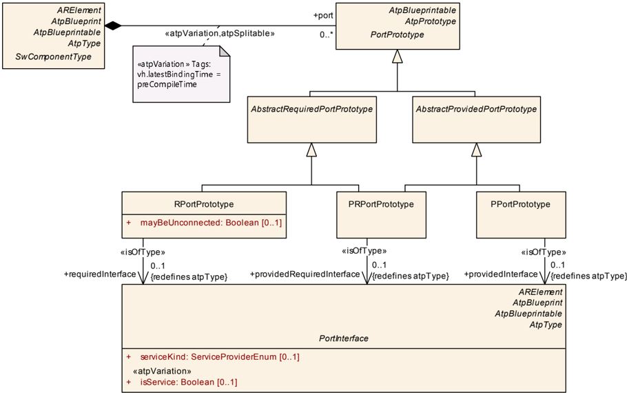

在由实例构建组合时，端口可以在组合内部连接，也可以暴露给组合外部。组合内部的连接使用 `AssemblySwConnector`，而将组合内部的端口连接到外部则使用 `DelegationSwConnector`。未连接的端口按相应需求处理（参见 4.1.11 节）。

下一步是将 **SW-C** 实例映射到 **ECU** 上并建立通信关系。由这一步推导出实际的通信，即此时已确定两个实例端口之间的连接是通过通信总线进行，还是在同一个 **ECU** 内部本地进行。

**RTE** 应实现 **ECU** 配置描述所规定的通信路径。

**RTE** 应实现 AUTOSAR 软件组件描述所给通信属性的语义。无论通信伙伴位于同一分区、同一 **ECU** 的另一分区还是远程 **ECU**，也无论该通信由 **RTE** 自身完成还是由 **RTE** 调用 **COM** 或 **IOC** 完成，所给通信机制的语义都不得改变。

例如，根据上述两条规定，**RTE** 不允许因为客户端和服务器被映射到同一个 **ECU** 而把异步客户端的语义改为同步。

###### 6.2.1.3.3. 内部行为

只有 `AtomicSwComponentType` 才会在 `SwcInternalBehavior` 描述中暴露其内部结构。可运行实体和所用 **RTE** 事件的定义在这里完成（见图 4.4）。

AUTOSAR 元模型强制每个 `AtomicSwComponentType` 至多有一个 `SwcInternalBehavior`。可运行实体（`RunnableEntity`，也简称 **Runnable**）是 AUTOSAR 软件组件以及那些实现 AUTOSAR 接口的基础软件模块所能提供的最小代码片段。它们由元类 `RunnableEntity` 表示，见图 4.5。

图 4.4 展示了软件组件内部行为。

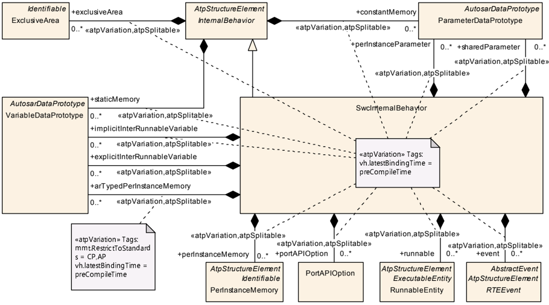

图 4.5 展示了软件组件可运行实体、等待点和 **RTE** 事件。

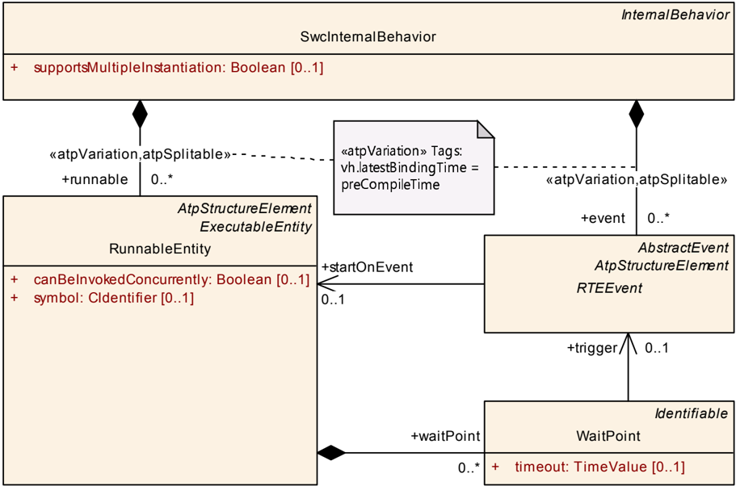

一般而言，软件组件由多个 `RunnableEntity` 组成，以实现服务器、接收方、反馈等功能。

**RTE** 应支持 AUTOSAR 软件组件中的多个 `RunnableEntity`。

`RunnableEntity` 在 **OS** 任务/ISR2 的上下文中执行，其执行由 `RTEEvent` 触发。6.2.2.3 节更详细地描述了 `RunnableEntity` 的概念，6.2.2.6 节讨论将 `RunnableEntity` 映射到 **OS** 任务的问题。`RTEEvent` 以及 `RTEEvent` 对 `RunnableEntity` 的激活在 6.2.2.4 节中讨论。

**RTE** 应按照所连接的 `RTEEvent` 触发 `RunnableEntity` 的执行。

**RTE** 生成器应拒绝这样的配置：某个能够启动 `RunnableEntity` 的 `RTEEvent` 实例既未映射到 `OsTask`/ISR2，也不具备直接或可信函数调用的条件。

**RTE** 生成器应拒绝这样的配置：某个 **SW-C** 的 `RunnableEntity` 被映射到不同核上各分区的任务或 ISR2。

**RTE** 应遵守一个 **OS** 任务/ISR2 内 `RunnableEntity` 的已配置执行顺序。

**RTE** 生成器应拒绝这样的配置：系统配置和/或 **ECU** 配置违反了 `VariableAccess` 的作用域（**scope**）。

对于映射到不同分区的 `SwComponentPrototype` 之间的每个连接，`VariableAccess` 的 `scope` 值不得设置为 `VariableAccessScopeEnum.communicationIntraPartition`。

图 4.6 展示了软件组件可运行实体与数据访问。

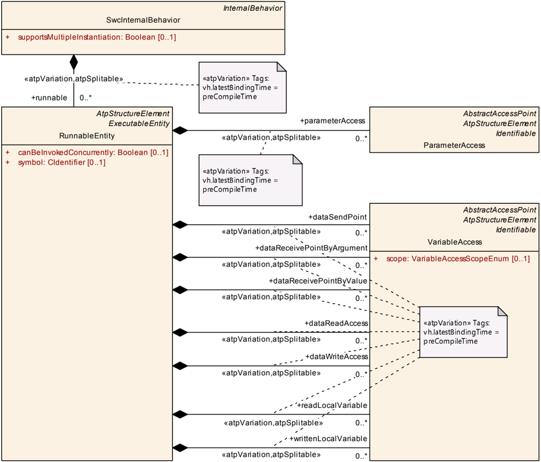

图 4.7 展示了软件组件可运行实体与服务器调用、触发器以及模式切换。

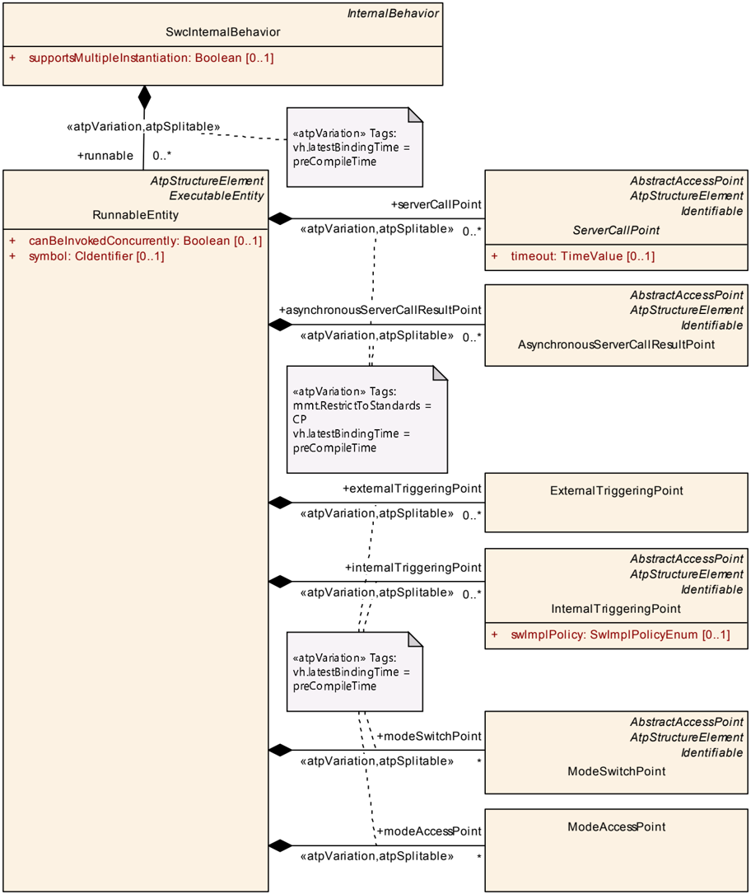

利用来自 `SwcInternalBehavior` 的信息，已经可以配置 AUTOSAR 软件组件在 **RTE** 和 **OS** 中设置的一部分。此外，AUTOSAR 软件组件的结构（端口、接口）和内部行为的信息（描述）对于 **RTE** 契约阶段而言已经足够。

不过，仍缺少一些细节信息，它们属于实现（**Implementation**）描述的内容。

###### 6.2.1.3.4. 实现

在实现描述中描述 AUTOSAR 软件组件的一个实际实现，包括内存消耗（见图 4.8）。

图 4.8 展示了软件组件资源消耗。

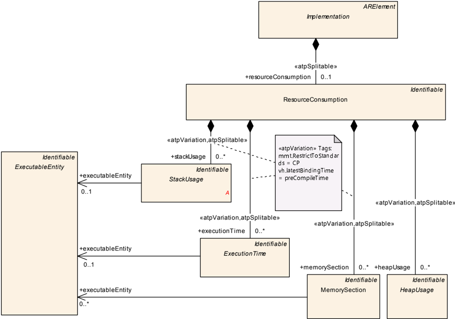

请注意，实现部分的信息至多只在 **RTE** 生成阶段才需要。

##### 6.2.1.4. 实例化

###### 6.2.1.4.1. 范围与背景

一般而言，术语实例化（**instantiation**）是指从模型或模板推导出具体实例的过程。但这一过程可以在不同的抽象层次上完成，因此一个层次的实例可以是下一层次的模型。

就 AUTOSAR 而言，可以区分四个建模层次，称为 M3 到 M0。

M3 层描述用于推导 M2 层 AUTOSAR 元模型的概念。M2 层的元模型定义了一种语言，以便能够描述 M1 层模型的特定属性，例如描述一个特定类型的 AUTOSAR 软件组件。例如，AUTOSAR 元模型的一部分称为软件组件模板（**Software Component Template**，简称 **SW-C-T**），在[2]中规定，并在 6.2.1.3 节中更详细地讨论。

在 M1 层，工程师将使用所定义的语言来设计组件、接口或组合，比如描述一个特定类型的 `LightManager`。其中，（原子）软件组件的描述如 6.2.1.3 节所述，也包含内部行为和实现部分。

这些描述是 **RTE** 生成器在所谓"契约阶段"（见 6.1.3.1 节）的输入。由这些信息将生成访问端口和接口的具体 **API**（以某种编程语言表示）。

软件组件通常由一组可运行实体组成。它们随后可以用编程语言具体地描述，这可以称为"实现"。如 6.2.1.3 节所示，该"实现"恰好对应一个实现描述以及一个内部行为描述。

M0 指某辆具体汽车上运行的具体实例。

从这些规定的组件类型派生的对象只能在特定的运行时环境（特定目标机）中执行。这些对象体现真实且正在运行的实现，因此应称为软件组件实例（建模层次 M0）。例如，在某个灯光控制 **ECU** 上，可能存在两个由同一个组件类型 `LightManager` 派生的组件实例，分别负责不同的灯光。制作实例意味着即使这些对象源自同一模型，也应能够区分它们。

针对上述较为叙述性的描述，**RTE** 作为运行时环境应使实例化过程成为可能。因此，本文档中的术语实例化是指推导并提供所有类型的所有出现实例的显式具体描述的过程。本节将讨论实例化过程中可能出现的问题，并相应地规定对 AUTOSAR 组件和 AUTOSAR **RTE** 的需求。

###### 6.2.1.4.2. 实例化的概念

尽管 AUTOSAR 软件组件的实例化原则上可以按系统粒度完成，但 **RTE** 生成器将其视角限制为按 **ECU** 定制（见 6.1.1 节）。

一般而言，存在两种不同的实例化方式：

* 单一实例化（**single instantiation**）——指从 AUTOSAR 软件组件描述中只派生一个对象或 AUTOSAR 软件组件实例的情形；
* 多重实例化（**multiple instantiation**）——指从 AUTOSAR 软件组件描述中派生多个对象或 AUTOSAR 软件组件实例的情形。

**RTE** 生成器应能够从单个 AUTOSAR 软件组件描述实例化出一个或多个 AUTOSAR 软件组件实例。

**RTE** 生成器应求值 AUTOSAR 软件组件描述的 `SwcInternalBehavior` 的 `supportsMultipleInstantiation` 特性。

**RTE** 生成器应拒绝这样的配置：需要多重实例化，但 AUTOSAR 软件组件描述的 `SwcInternalBehavior` 的 `supportsMultipleInstantiation` 特性被设置为 FALSE。

###### 6.2.1.4.3. 单一实例化

单一实例化是实例化中最简单的情形。

实例化只是意味着把特定 `RunnableEntity` 的代码及相应数据嵌入某个运行时上下文。一般通过 **OS** 任务的上下文实现（见示例 4.1）。

**示例 4.1**：从任务上下文中调用可运行实体 R1：

```C
TASK(Task1){
  ...
  R1();
  ...
}
```

由于软件组件的单一实例本身没有歧义，因此无需引入额外的概念。

###### 6.2.1.4.4. 多重实例化

从单个 AUTOSAR 软件组件（类型）实例化的多个对象应能够无歧义地被识别。

实现这一目标有两种基本方式：

* 通过（可运行实体的）代码复制（**code duplication**）；
* 通过（可重入可运行实体的）代码共享（**code sharing**）。

目前决定只关注代码共享，不支持代码复制。

**RTE** 只支持通过代码共享从单个 AUTOSAR 软件组件实例化多个对象，不支持代码复制。

如果代码是可重入的，多个实例可以共享同一份代码。对于多核控制器，核间共享代码的可能性取决于硬件。

示例 4.2 与示例 4.1 类似，但针对支持多重实例化的软件组件，其中两个实例的 R1 `RunnableEntity` 被映射到同一个任务。

**示例 4.2**：在同一个任务上下文中为两个实例调用可运行实体 R1：

```C
TASK(Task1){
  ...
  R1(instance1);
  R1(instance2);
  ...
}
```

不同的实例共享同一份 R1 代码。

**6.2.1.4.4.1 可重入代码**

一般而言，如果同一个代码实体被正在运行的不同执行线程（即任务或 ISR2）调用，就可能出现副作用。当被调用的代码实体通过静态变量继承了状态或内存、且这些静态变量对所有实例可见时尤其如此。那意味着所有实例都通过这些静态变量耦合在一起。

于是它们会相互影响。这一方面会导致数据一致性问题；另一方面——这一点更重要——它会给 AUTOSAR 引入一种新的通信机制，而这是被禁止的。AUTOSAR 软件组件只能通过端口通信。

为完整起见应指出：调用方代码实体也会继承其被调用方的可重入性问题。在递归调用的情形下尤其如此。

**6.2.1.4.4.2 无歧义的对象标识**

如果需要通过共享代码实现多重实例化，则实例化后的 AUTOSAR 软件组件对象应能够通过实例句柄（**instance handle**）无歧义地标识。

**6.2.1.4.4.3 多重实例化与 Per-instance memory**

AUTOSAR **SW-C** 可以定义只能由 **SW-C** 实例自身访问的内部内存。这一概念称为 `PerInstanceMemory`。该内存只能由这个特定实例的可运行实体访问。这反过来意味着，其他实例无法访问该内存。

`PerInstanceMemory` 的 **API** 原则在 7.1.2.5 节中说明。

`PerInstanceMemory` 的 **API** 在 7.1.6.15 节中规定。

##### 6.2.1.5. RTE 与 AUTOSAR 服务

根据 AUTOSAR 术语表[11]，"AUTOSAR 服务是基础软件的一个逻辑实体，提供可供各种 AUTOSAR 软件组件使用的通用功能。该功能通过标准化的 AUTOSAR 接口访问"。

因此，AUTOSAR 服务提供标准化的 AUTOSAR 接口：由标准化 `PortInterface` 类型化的端口。

在将 AUTOSAR 服务端口连接到 AUTOSAR 软件组件的端口时，**RTE** 将标准的 **RTE API** 调用映射到 **RTE** 输入（即 **XML**）中为 **BSW** 的 AUTOSAR 服务可运行实体所定义的符号。区分 AUTOSAR 服务 **ECU** 相关标识符的关键技术称为"端口定义的实参值"（**port-defined argument values**），在 6.2.3.2.4 节中描述。目前"端口定义的实参值"只支持客户端-服务器通信，无法用预定义符号来发送或接收数据。

**RTE** 不向基于 C 的 AUTOSAR 服务 **API** 传递实例句柄，因为后者只能单实例化。

如图 4.2 所示，**RTE** 与某些基础软件模块之间可以存在直接交互，即操作系统、AUTOSAR 通信和 **NVRAM** 管理器。

##### 6.2.1.6. RTE 与 ECU 抽象

ECU 抽象为 AUTOSAR 软件组件提供到物理值的接口。它抽象信号的物理来源（信号通往 **ECU** 硬件端口的路径），并就物理表现（如特定的电流或电压值）对信号进行归一化。

参见图 4.2 的 AUTOSAR **ECU** 架构。从架构上看，**ECU** 抽象是基础软件层的一部分，并向 AUTOSAR 软件组件提供 AUTOSAR 接口。

从 **RTE** 的视角看，连接的是普通的 AUTOSAR 端口。没有任何限制：AUTOSAR 虚拟功能总线（**VFB**）规定的所有通信范式——发送方-接收方机制和客户端-服务器机制——都应适用于这些端口、接口和连接。

但是，**ECU** 抽象的端口只应连接到特定 AUTOSAR 软件组件（即传感器或执行器软件组件）的端口。在这个意义上，它们与特定的 **ECU** 抽象紧密耦合。

此外，（**RTE**）不得把 **ECU** 抽象的 AUTOSAR 端口连接到位于远程 **ECU** 上任何 AUTOSAR 组件的 AUTOSAR 端口。

这意味着，例如来自 **ECU** 抽象的传感器相关信号总是由位于同一 **ECU** 上的 AUTOSAR 传感器组件接收。该 AUTOSAR 传感器组件随后处理接收到的信号，并将其提供给其他 AUTOSAR 组件，无论它们位于同一 **ECU** 还是任何远程 **ECU**。与执行器相关的信号同样如此，只是方向相反。

**RTE** 生成器应以与 AUTOSAR 软件组件已连接端口完全相同的方式，为 AUTOSAR 传感器/执行器软件组件与 **ECU** 抽象之间已连接的端口生成通信路径。

**RTE** 生成器应拒绝这样的配置：要求从某个 AUTOSAR 软件组件到位于远程 **ECU** 的 **ECU** 抽象建立通信路径。

关于 **ECU** 抽象的更多信息见相应规范文档[18]。

##### 6.2.1.7. RTE 与复杂设备驱动

复杂设备驱动具有 AUTOSAR 接口，因此 **RTE** 可以处理复杂设备驱动端口上的通信。允许复杂设备驱动拥有不受 **RTE** 控制、但仍可使用 **RTE API** 的代码实体（例如 ISR2、**BSW** 主处理函数）。

##### 6.2.1.8. 基础软件调度器与基础软件模块

###### 6.2.1.8.1. 基础软件模块的描述

基础软件模块的描述划分为以下几个部分：

* 接口
* 内部行为
* 实现

更多细节见文档[9]。

###### 6.2.1.8.2. 基础软件接口

基础软件模块的接口用基础软件模块入口（**Basic Software Module Entry**，`BswModuleEntry`）描述。对于基础软件调度器的功能而言，只有 `BswCallType` 为 `SCHEDULED` 的 `BswModuleEntry` 是相关的。不过出于优化的目的，可能需要分析完整的调用树，这就要求考虑所有 `BswModuleEntry`。

###### 6.2.1.8.3. 基础软件内部行为

基础软件内部行为（**Basic Software Internal Behavior**）规定了 **BSW** 模块或 **BSW** 集群相对于 **BSW** 调度器可见代码实体的行为。对基础软件调度器而言，主要相关的是基础软件可调度实体（**Basic Software Schedulable Entity**，`BswSchedulableEntity`）。它们是专为被基础软件调度器控制而设计的基础软件模块实体（**Basic Software Module Entity**）。基础软件可调度实体实现主处理函数。此外，所有基础软件可调度实体都可以使用独占区；而对于调用树分析，所有基础软件模块实体都是相关的。

基础软件调度器应支持 AUTOSAR 基础软件模块中的多个基础软件模块实体。

基础软件调度器应按照所连接的 `BswEvent` 触发 `BswSchedulableEntity` 和 `BswInterruptEntity` 的执行。

**RTE** 生成器应拒绝这样的配置：某个能够启动可调度实体的 `BswEvent` 既未映射到 `OsTask`/ISR2，也不具备直接或可信函数调用的条件。

**RTE** 生成器应拒绝这样的配置：某个 `BswInterruptEvent` 未通过 `RteBswEventToIsrMapping` 映射到 ISR2。

**RTE** 生成器应遵守一个 **OS** 任务/ISR2 内可调度实体的已配置执行顺序。

**RTE** 生成器应遵守一个 ISR2 内 `BswInterruptEntity` 的已配置执行顺序。

**RTE** 应支持同一个 **OS** 任务/ISR2 内可运行实体与可调度实体以任意可配置顺序组成的执行序列。

**RTE** 应支持同一个 ISR2 内 `BswInterruptEntity` 以任意可配置顺序组成的执行序列。

###### 6.2.1.8.4. 基础软件实现

实现定义基础软件模块实现的更多细节。`vendorApiInfix` 特性尤为重要，它为同一个基础软件模块的多个实例定义命名空间扩展。此外，`codeDescriptor` 的类别规定基础软件模块以源代码还是目标代码交付。

###### 6.2.1.8.5. 基础软件模块的多个实例

与软件组件的多重实例化概念不同（软件组件的所有实例使用同一份组件代码），基础软件模块的多重实例化是通过为每个实例在不同的命名空间中创建各自的代码来实现的。特性 `vendorApiInfix` 允许定义全局符号所需的名称扩展。

###### 6.2.1.8.6. AUTOSAR 服务 / ECU 抽象 / 复杂设备驱动

AUTOSAR 服务、**ECU** 抽象和复杂设备驱动是 AUTOSAR 软件组件与基础软件模块的混合体。这些种类的模块既可以使用 AUTOSAR 接口经由 **RTE** 通信，也可以使用 C **API** 直接访问其他基础软件模块。由于 AUTOSAR 元模型的结构，'C' 实现的某些实体必须被描述两次：一方面用软件组件模板[2]，另一方面用 **BSW** 模块描述模板[9]。此外，软件组件基于端口的通信与基础软件模块之间无端口的通信这一二元性，在某些情况下要求两种原则之间的协调与同步。关于哪些元素彼此对应的信息由所谓的 `SwcBswMapping` 提供。

**6.2.1.8.6.1 RunnableEntity / BswModuleEntity 映射**

映射到基础软件模块实体的可运行实体必须被视为一个公共实体。这意味着它描述了一个既可以利用可运行实体的特性、又可以利用基础软件模块实体特性的实体。例如，它支持在同一个 C 函数中使用基于端口的 **API** 以及基础软件调度器 **API**。

**6.2.1.8.6.2 同步的 ModeDeclarationGroupPrototype**

两个同步的 `ModeDeclarationGroupPrototype` 会产生一个公共模式机实例的实现。因此，调用相应的 `Rte_Switch` **API** 与调用 `SchM_Switch` **API** 具有相同的效果。出于优化目的，`Rte_Switch` **API** 可以直接引用 `SchM_Switch` **API**。

**6.2.1.8.6.3 同步的触发器**

两个同步的 `Trigger` 表现得像一个公共的 `Trigger`。因此，调用相应的 `Rte_Trigger` **API** 与调用 `SchM_Trigger` **API** 具有相同的效果。出于优化目的，`Rte_Trigger` **API** 可以直接引用 `SchM_Trigger` **API**。

#### 6.2.2. RTE 与基础软件调度器的实现相关方面

##### 6.2.2.1. 范围

本节描述 AUTOSAR **RTE** 和基础软件调度器的一些具体实现相关方面，主要涉及：

* 逻辑概念（例如可运行实体、**BSW** 可调度实体）到技术架构（即 AUTOSAR **OS**）的映射；
* （基础软件中）挂起中断与 AUTOSAR 软件组件通知之间的解耦；
* 由 **RTE** 解决的数据一致性问题。

因此，本节还将涉及 AUTOSAR **RTE** 和基础软件调度器与 AUTOSAR 基础软件中两个具有标准化接口的模块之间的交互（见图 4.9）：

* AUTOSAR 操作系统模块[19][4]；
* AUTOSAR **COM** 模块[20][3]。

图 4.9 展示了基础软件模块一节的范围。

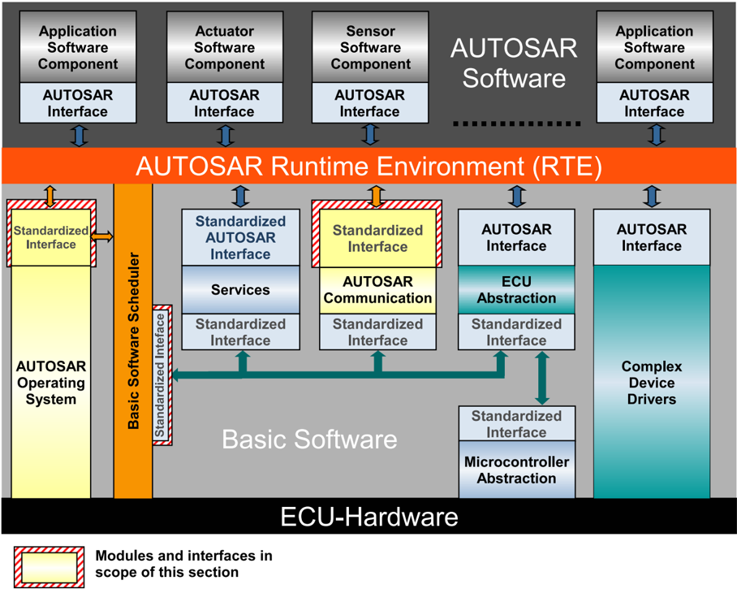

拥有标准化接口首先意味着：这些模块不提供、也不请求位于 **RTE** 之上的 AUTOSAR 软件组件的服务。它们没有端口，因此无法与上述 AUTOSAR 软件组件连接。AUTOSAR **OS** 和 AUTOSAR **COM** 对这些软件组件而言是完全不可见的。

其次，**RTE** 使用 AUTOSAR **OS** 和 AUTOSAR **COM** 来实现 AUTOSAR 软件组件所请求的功能。**RTE** 使用 AUTOSAR **COM** 模块跨 **ECU** 边界传递信号，但这一机制对发送方和接收方 AUTOSAR 软件组件都是隐藏的。AUTOSAR **OS** 模块被用于两个主要目的：第一，**OS** 被 **RTE** 用来跨核和分区边界传递信号；第二，**RTE** 使用 AUTOSAR **OS** 模块来正确调度单个 **Runnable**，即由 **RTE** 生成器生成任务/ISR2 体，其中包含对相应 **Runnable** 的调用。

在这个意义上，**RTE** 也应使用可用的手段把中断转换为任务上下文中的通知，或保证数据一致性。

按照这一视角，第三，**RTE** 并不是 AUTOSAR **OS** 和 AUTOSAR **COM** 的通用抽象层。它是为特定 **ECU** 生成的，向 AUTOSAR 软件组件提供与 **VFB** 相同的接口。它使用基础软件的模块（包括 AUTOSAR **OS** 和 AUTOSAR **COM** 的特定实现）来实现 **VFB** 的功能。

基础软件调度器为所有层的所有模块提供集成基础软件模块的服务。因此，基础软件调度器提供以下功能：

* 将基础软件模块的实现嵌入 AUTOSAR **OS** 的上下文中；
* 触发基础软件模块的 `BswSchedulableEntity`；
* 为基础软件模块应用数据一致性机制。

集成人员的任务是在项目特定的上下文中，运用（AUTOSAR **OS**）给定的手段，以良好定义且高效的方式装配 **BSW** 模块。

这也意味着 **BSW** 调度器只使用 AUTOSAR **OS**，它完全不是 AUTOSAR **OS** 调度器的竞争者。

**RTE** 应只使用 AUTOSAR **OS**、AUTOSAR **COM**、AUTOSAR 大数据高效通信（**Efficient COM for Large Data**）、AUTOSAR 转换器（**Transformer**）和 AUTOSAR **NVRAM** 管理器，来向 AUTOSAR 组件提供 **RTE** 功能。

基础软件调度器应只使用 AUTOSAR **OS** 来向基础软件模块提供基础软件调度器功能。

**RTE** 生成器应为包含 `RunnableEntity` 的那些任务构造任务体。

集群生成阶段的 **RTE** 生成器应拒绝这样的配置：可运行实体经由其相应 `RTEEvent` 的映射要求扩展任务（**extended task**）。

**RTE** 生成器应为类别 2 且包含 `RunnableEntity` 的那些 ISR 构造 ISR 体。

**RTE** 生成器应为包含基础软件可调度实体的那些任务构造任务体。

**RTE** 生成器应为类别 2 且包含基础软件可调度实体的那些 ISR 构造 ISR 体。

构造任务/ISR2 体所需的信息必须由 **ECU** 配置描述给出。可运行实体到任务/ISR2 的映射由 **ECU** 配置描述作为输入给出。**RTE** 生成器不决定 `RunnableEntity` 到任务/ISR2 的映射。

**RTE** 生成器应按如下内存映射（**Memory Mapping**）包裹每个任务体的定义：

```C
#define OS_START_SEC_<sadm>
#include "Os_MemMap.h"

<task body definition>

#define OS_STOP_SEC_<sadm>
#include "Os_MemMap.h"
```

其中 `<sadm>` 是 `OsTask` 的 `OsMemoryMappingCodeLocationRef` 所引用的 `SwAddrMethod` 的 `shortName`。

**RTE** 生成器应按如下内存映射包裹每个 ISR2 体的定义：

```C
#define OS_START_SEC_<sadm>
#include "Os_MemMap.h"

<ISR2 body definition>

#define OS_STOP_SEC_<sadm>
#include "Os_MemMap.h"
```

其中 `<sadm>` 是 `OsIsr` 的 `OsMemoryMappingCodeLocationRef` 所引用的 `SwAddrMethod` 的 `shortName`。

**RTE** 应按如下内存映射包裹可选的 **OS** 回调 `ReceiverPullCB` 函数的每个定义：

```C
#define OS_START_SEC_<sadm>
#include "Os_MemMap.h"

<ReceiverPullCB definition>

#define OS_STOP_SEC_<sadm>
#include "Os_MemMap.h"
```

其中 `<sadm>` 是接收方 `OsApplication` 的 `OsMemoryMappingCodeLocationRef` 所引用的 `SwAddrMethod` 的 `shortName`。

**RTE** 生成器应按如下内存映射包裹每个 `TrustedFunction` 体的定义：

```C
#define OS_START_SEC_<sadm>
#include "Os_MemMap.h"

<TrustedFunction body definition>

#define OS_STOP_SEC_<sadm>
#include "Os_MemMap.h"
```

其中 `<sadm>` 是所属 `OsApplication` 的 `OsMemoryMappingCodeLocationRef` 所引用的 `SwAddrMethod` 的 `shortName`。

**RTE** 生成器应按如下内存映射包裹可选的 `OsAlarmCallback` 函数的每个定义：

```C
#define OS_START_SEC_<sadm>
#include "Os_MemMap.h"

<OsAlarmCallback definition>

#define OS_STOP_SEC_<sadm>
#include "Os_MemMap.h"
```

其中 `<sadm>` 是 `OsAlarmCallback` 的 `OsMemoryMappingCodeLocationRef` 所引用的 `SwAddrMethod` 的 `shortName`。

**注意：** 上述四条内存映射规定是内存分配关键字包裹通用规定（见 7.1.1 节）的例外。

如果某个 `OsApplication`、`OsIsr`（ISR2）或 `OsTask` 未引用 `SwAddrMethod`（通过各自的 `OsMemoryMappingCodeLocationRef`），则 **RTE** 应拒绝该配置。

**RTE** 生成器应拒绝这样的配置：缺少关于 `BswEvent` 到 **OS** 任务的映射、以及（触发可运行实体的）`RTEEvent` 到 **OS** 任务/ISR2 的映射的输入信息。

**注意：** 并非在所有情况下事件都必须映射到 `OsTask`/ISR2。例如，将通过直接或可信函数调用执行的可运行实体不需要 `OsTask`/ISR2 映射。

**RTE** 生成器应拒绝这样的配置：缺少关于任务或 ISR2 体构造的输入信息。

存在这样的用例（例如在不同分区上一组具有既定调用顺序的任务）：当前任务终止时，需要显式激活另一个任务。

通过配置 `RteOsTaskChain`，可以为这类情况配置预期的任务链行为。

如果某个 `OsTask` 被 `RtePredecessorOsTaskRef` 引用，则 **RTE** 应在该任务体中任务终止的位置，发出对 `RteSuccessorOsTaskRef` 所给 `OsTask` 的 `ChainTask` 调用。

当 **RTE** 因被某个 `RTEEvent`（例如 `DataReceivedEvent`）触发而需要激活某个 `OsTask`，且该 `OsTask` 被 `RtePredecessorOsTaskRef` 或 `RteSuccessorOsTaskRef` 引用、但并非任务链中最初的那个前驱 `OsTask` 时，**RTE** 应改为激活该 `OsTask` 最终的 `RtePredecessorOsTaskRef`，而不是它通常应当激活的那个 `OsTask`。

**注意：** 任务链中某个 `OsTask` 的最终前驱任务可以这样找到：从该 `OsTask` 被某个 `RteOsTaskChain` 容器引用之处开始，沿着所有 `RtePredecessorOsTaskRef` 追溯，直到任务链的 `RtePredecessorOsTaskRef` 引用了一个未被任何 `RteSuccessorOsTaskRef` 引用的 `OsTask`。最后一个 `RteOsTaskChain` 容器中被引用为 `RtePredecessorOsTaskRef` 的 `OsTask` 即最终前驱任务。

**示例 4.3**：考虑一个 `RteOsTaskChain` 配置，其中 Task1 链接到 Task2，Task2 又链接到 Task3。在该场景中，如果 Task2 因某个 `DataReceivedEvent` 需要被 **RTE** 激活，则 **RTE** 必须激活 Task1 而不是 Task2，因为 Task1 是最终前驱任务。

图 4.10 展示了任务链接顺序的示意。

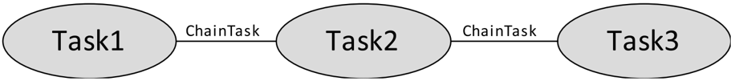

```C
...
Rte_Write_myPort_myData(uint8 data)
{
  /.../
  ActivateTask(Task1);
}
...
TASK(Task1)
{
  /.../
  ChainTask(Task2);
}
...
TASK(Task2)
{
  /.../
  ChainTask(Task3);
}
...
TASK(Task3)
{
  /.../
  TerminateTask();
}
...
```

一个 `OsTask` 至多属于一个任务链。因此，一个 `OsTask` 至多被一个 `RtePredecessorOsTaskRef` 引用，且至多被一个 `RteSuccessorOsTaskRef` 引用。

`RteOsTaskChain` 的配置不得定义循环链。

**注意：** 例如，T1 链接到 T2、而 T2 又链接回 T1 的配置是不允许的。

##### 6.2.2.2. OS

本节描述 **RTE** + 基础软件调度器与 AUTOSAR **OS** 之间的交互。该交互通过 **OS** 的标准化接口（即 AUTOSAR **OS API**）实现，见图 4.9。

**OS** 由 **ECU** 配置静态配置。但可以允许 **RTE** 生成器创建运行环境所需的任务和其他 **OS** 对象（见 6.1.9 节）。`RunnableEntity` 和 **BSW** 可调度实体到 **OS** 任务/ISR2 的映射不是 **RTE** 生成器的职责。该映射必须在此之前、在 **RTE** 配置阶段的一个配置步骤中完成。**RTE** 生成器负责生成包含 `RunnableEntity` 和 **BSW** 可调度实体调用的 **OS** 任务体或 ISR2 体。`RunnableEntity` 和 **BSW** 可调度实体本身与 **OS** 无关，不允许使用 **OS** 服务调用。**RTE** 和基础软件调度器必须通过标准化的 **RTE API** 或基础软件调度器 **API** 来封装这类调用。

###### 6.2.2.2.1. OS 对象

**任务（Tasks）**

* **RTE** 生成器必须创建任务体，其中包含 `RunnableEntity` 和 `BswSchedulableEntity` 的调用。注意，术语"任务体"（**task body**）在这里指一段代码，而术语"任务"（**task**）指 **OS** 的一个配置对象。
* **RTE** 和基础软件调度器控制任务的激活/恢复：或者直接调用 `SetEvent()`、`ActivateTask()` 等 **OS** 服务，或者间接地通过初始化 **OS** 告警或启动调度表来实现基于时间的可运行实体激活。当任务终止时，所生成的任务体还包含 `TerminateTask()` 或 `ChainTask()` 的调用。
* **RTE** 生成器不创建任务。`RunnableEntity` 和 `BswSchedulableEntity` 到任务的映射是 **RTE** 生成器的输入，因此属于 **RTE** 配置的一部分。
* **RTE** 配置器必须在 **OS** 配置中分配所需的任务。

**ISR2**

* **RTE** 生成器必须创建 ISR2 体，其中包含 `RunnableEntity` 和 `BswSchedulableEntity` 的调用。注意，术语"ISR2 体"指一段代码，而术语"ISR2"指 **OS** 的一个配置对象。
* **RTE** 生成器不创建 ISR。`RunnableEntity` 和 `BswSchedulableEntity` 到 ISR2 的映射是 **RTE** 生成器的输入，因此属于 **RTE** 配置的一部分。

**OS 应用（OS applications）**

* AUTOSAR **OS** 在 R4.0 中引入了称为 **OS** 应用间通信（**Inter-OS-Application Communication**，IOC）的新特性。**IOC** 由 **OS** 根据（部分由 **RTE** 生成的）配置生成。相应的对象（OS-Application）由 **OS** 生成，并被 **RTE** 用于可运行实体到任务/ISR2 的映射。

**事件（Events）**

* **RTE** 和基础软件调度器可以使用 **OS** 事件来实现抽象的 `RTEEvent` 和 `BswEvent`。
* 因此，**RTE** 和基础软件调度器可以调用 **OS** 服务函数 `SetEvent()`、`WaitEvent()`、`GetEvent()` 和 `ClearEvent()`。
* 所使用的 **OS** 事件是 **RTE** 生成器输入信息的一部分。
* **RTE** 配置器必须在 **OS** 配置中分配所需的事件。

**资源（Resources）**

* **RTE** 和基础软件调度器可以使用 **OS** 资源（标准资源或内部资源），例如用于实现数据一致性机制。
* **RTE** 和基础软件调度器可以调用 **OS** 服务 `GetResource()` 和 `ReleaseResource()`。
* 所使用的资源是 **RTE** 生成器输入信息的一部分。
* **RTE** 配置器必须在 **OS** 配置中分配所需的资源（所有类型的资源）。

**中断处理（Interrupt Processing）**

* 获得一致性数据访问的另一种机制是禁用/使能中断。AUTOSAR **OS** 提供了不同的服务函数来处理中断的使能/禁用。**RTE** 可以使用这些函数，且不得为同一目的使用依赖于编译器/处理器的函数。

**告警（Alarms）**

* **RTE** 可以使用告警对异步客户端/服务器调用进行超时监控。**RTE** 负责超时处理。
* **RTE** 和基础软件调度器可以设置周期性告警，用于周期性触发 `RunnableEntity` 和 `BswSchedulableEntity`（可运行实体经由 `RTEEvent` `TimingEvent` 激活，或 `BswSchedulableEntity` 经由 `BswEvent` `BswTimingEvent` 激活）。
* 因此，**RTE** 和基础软件调度器可以调用 **OS** 服务函数 `GetAlarmBase()`、`GetAlarm()`、`SetRelAlarm()`、`SetAbsAlarm()` 和 `CancelAlarm()`。
* 所使用的告警是 **RTE** 生成器输入信息的一部分。
* **RTE** 配置器必须在 **OS** 配置中分配所需的告警。

**调度表（Schedule Tables）**

* **RTE** 和基础软件调度器可以设置调度表，用于周期性任务激活（例如可运行实体经由 `RTEEvent` `TimingEvent` 激活）。
* 所使用的调度表是 **RTE** 生成器输入信息的一部分。
* **RTE** 配置器必须在 **OS** 配置中分配所需的调度表。

**OS 公共特性（Common OS features）**

根据 **OS** 的全局调度策略，**RTE** 可以对所需的数据一致性机制作出决策。例如，在一个所有任务都为非抢占的 **ECU** 中——因而整个 **ECU** 的全局调度策略也是非抢占的——**RTE** 可以就数据一致性机制对所生成的代码进行优化。

**钩子函数（Hook functions）**

AUTOSAR **OS** 规范定义了钩子函数，但 **RTE SWS** 并未标准化这些 **OS** 钩子函数的任何用法。

###### 6.2.2.2.2. 基础软件可调度实体

`BswSchedulableEntity` 是专为被 **BSW** 调度器控制而设计的基础软件模块实体，实现主处理函数。基础软件调度器的配置允许将 `BswSchedulableEntity` 映射到两种任务（基本任务和扩展任务）以及类别 2 的中断。

未映射到 `RunnableEntity` 的 `BswSchedulableEntity` 不允许进入等待状态，因此这类 `BswSchedulableEntity` 相当于类别 1 的 `RunnableEntity`。映射到 `RunnableEntity` 的 `BswSchedulableEntity` 可以通过使用 **RTE API** 进入等待状态，这类 `BswSchedulableEntity` 必须按所映射 `RunnableEntity` 的类别对待。`BswSchedulableEntity` 到 `RunnableEntity` 的映射通常用于 AUTOSAR 服务、**ECU** 抽象和复杂设备驱动，见 6.2.1.8.6 节。

###### 6.2.2.2.3. 可运行实体

本节描述 `RunnableEntity`、它们的类别以及其任务/ISR2 映射相关方面。实现 `RunnableEntity` 的函数原型在 7.1.7 节中描述。

可运行实体是 **SW-C** 的可调度部分。可运行实体要么被映射到任务/ISR2，要么在其他 **Rte API** 的上下文中通过直接或可信函数调用被激活，例如通过直接函数调用调用的服务器可运行实体。

该映射必须在 **ECU** 配置描述中描述。这一配置（或其中与 **RTE** 相关的部分）是 **RTE** 生成器的输入。

所有 `RunnableEntity` 都由 **RTE** 因某个 `RTEEvent` 而激活。可能的激活事件在元模型中通过 `RTEEvent` 描述（见 6.2.2.2.4 节）。

如果没有 `RTEEvent` 在 `startOnEvent` 角色中指定某个特定的 `RunnableEntity`，则该 `RunnableEntity` 永远不会被 **RTE** 激活。请注意，`RunnableEntity` 可以按 6.2.2.2.2 节所述映射到 `BswSchedulableEntity`，这可能导致由 **BSW** 调度器激活。

`RunnableEntity` 的类别在[2]中描述。但软件组件模板只基于 `RunnableEntity` 的直接属性来描述类别，例如若 `RunnableEntity` 拥有 `WaitPoint`，它就被视为类别 2。而在集成了已配置 **RTE** 的系统中，可能出现直接调用等场景，允许一个可运行实体在另一个可运行实体的上下文中运行。此时，不仅该可运行实体所附着的 `WaitPoint` 有意义，被直接调用的可运行实体的 `WaitPoint` 也有意义。还可能存在其他情形：虽然没有 `WaitPoint`，但 **Rte** 仍需要使用 `WaitEvent()`，例如跨核边界实现 `SynchronousServerCallPoint`，或者激活优先级低于客户端任务的服务器任务。

`RunnableEntity` 和 `BswSchedulableEntity` 被 `ExecutableEntity` 泛化。

###### 6.2.2.2.4. RTE 事件

元模型描述了以下 **RTE** 事件：

表 4.1：`RTEEvent` 的缩写

| 缩写 | 名称 |
| --- | --- |
| T | `TimingEvent` |
| BG | `BackgroundEvent` |
| DR | `DataReceivedEvent`（仅 S/R 通信） |
| DRE | `DataReceiveErrorEvent`（仅 S/R 通信） |
| DSC | `DataSendCompletedEvent`（仅显式 S/R 通信） |
| DWC | `DataWriteCompletedEvent`（仅隐式 S/R 通信） |
| OI | `OperationInvokedEvent`（仅 C/S 通信） |
| ASCR | `AsynchronousServerCallReturnsEvent`（仅 C/S 通信） |
| MS | `SwcModeSwitchEvent` |
| MSA | `ModeSwitchedAckEvent` |
| MME | `SwcModeManagerErrorEvent` |
| ETO | `ExternalTriggerOccurredEvent` |
| ITO | `InternalTriggerOccurredEvent` |
| I | `InitEvent` |
| THE | `TransformerHardErrorEvent` |
| TEE | `OsTaskExecutionEvent` |

按照元模型，每种 **RTE** 事件都可以：

* ACT——激活一个 `RunnableEntity`；或
* WUP——在 `RunnableEntity` 的 `WaitPoint` 处唤醒它。

元模型不限制 `WaitPoint` 可以引用哪些种类的 `RTEEvent`。其结果是，将需要 **RTE API** 函数来为每种 `RTEEvent` 建立 `WaitPoint`。

尽管如此，在某些情况下，实现通用元模型的所有可能组合似乎并无意义，例如建立一个应由周期性 `TimingEvent` 解析的 `WaitPoint`。因此 **RTE SWS** 定义了一些限制，这些限制同样在 4.1 节中描述。

元模型还允许同一个 `RunnableEntity` 由多个 `RTEEvent` 触发。关于 **RTE** 的当前处理方式与限制见 6.2.2.7 节。

表 4.2：`RunnableEntity` 的激活取决于 `RTEEvent` 的种类

| | T | BG | DR | DRE | DSC | DWC | OI | ASCR |
| --- | --- | --- | --- | --- | --- | --- | --- | --- |
| ACT | x | x | x | x | x | x | x | |
| WUP | | x | | x | | | | x |

| | MS | MSA | MME | ETO | ITO | I | THE | TEE |
| --- | --- | --- | --- | --- | --- | --- | --- | --- |
| ACT | x | x | x | x | x | x | x | x |
| WUP | | x | | | | | | |

表 4.2 表明，每种 `RTEEvent` 都可能激活 `RunnableEntity`。对于 `RunnableEntity` 的激活，被激活的 `RunnableEntity` 中不需要显式的 **RTE API**。**RTE** 自身负责根据 **SW-C** 描述中的配置激活 `RunnableEntity`。

如果 `RunnableEntity` 包含 `WaitPoint`，则它可以由所指派的 `RTEEvent` 解析。进入 `WaitPoint` 需要显式调用某个 **RTE API** 函数。**RTE**（与 **OS** 一起）必须在该 **RTE API** 内部实现 `WaitPoint`。

下面的列表给出了为建立 `WaitPoint` 所需调用的 **RTE API** 函数：

* `DataReceivedEvent`：`Rte_Receive()`
* `DataSendCompletedEvent`：`Rte_Feedback()`
* `ModeSwitchedAckEvent`：`Rte_SwitchAck()`
* `AsynchronousServerCallReturnsEvent`：`Rte_Result()`

当某个 `DataReceivedEvent` 引用了一个 `RunnableEntity` 和一个需求的 `VariableDataPrototype`，且没有 `WaitPoint` 引用该 `DataReceivedEvent` 时，该 `RunnableEntity` 应在数据被接收时激活。

该规定只影响可运行实体何时被激活——根据相应规定（显式/隐式数据读取），仍应生成一个 **API** 调用，以实际读取数据。

###### 6.2.2.2.5. BswEvent

元模型描述了以下 `BswEvent`。

图 4.11 展示了 `BswEvent` 的不同种类。

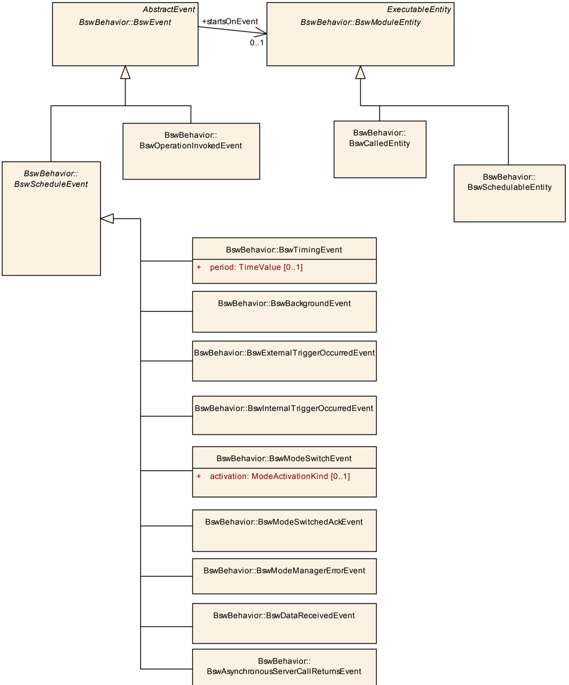

与 `RTEEvent` 类似，每种 `BswEvent` 都可以激活基础软件可调度实体。对于 `BswSchedulableEntity` 的激活，被激活的 `BswSchedulableEntity` 中不需要显式的基础软件调度器 **API**。基础软件调度器自身负责根据基础软件模块描述中的配置激活 `BswSchedulableEntity`。与 `RTEEvent` 不同的是，任何 `BswEvent` 都不支持 `WaitPoint`。更多细节见文档[9]。

###### 6.2.2.2.6. 可运行实体与基础软件可调度实体到任务的映射（资料性）

**RTE** 生成器的主要需求之一是"任务/ISR2 体的构造"。必要的输入信息（例如 `RunnableEntity` 和 `BswSchedulableEntity` 到任务/ISR2 的映射）必须由 **ECU** 配置描述提供。

**ECU** 配置描述（或其摘录）是 **RTE** 生成器的输入（见图 3.4）。本文档的目的之一也是定义必要的输入信息。因此，下面的场景可以帮助为 **ECU** 配置模板以及 **RTE** 生成器自身推导需求。

**注意：** 这些场景并未覆盖所有可能的组合。

**RTE** 配置器会使用其他 **BSW** 模块 **ECU** 配置的一部分，例如 `RunnableEntity` 到 `OsTask` 的映射。在这个配置过程中，**RTE** 配置器期望得到所生成 **RTE** 和基础软件调度器中使用的 **OS** 对象（如任务、事件、告警等）。

为了便于理解，一些图使用以下约定：

图 4.12 展示了元素描述的图例。

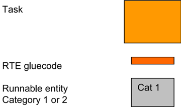

**注意：** 以下示例只展示 `RunnableEntity`。但考虑到 6.2.2.2.3 节定义的 `BswSchedulableEntity` 类别划分，这些场景同样适用于 `BswSchedulableEntity`。

**注意：** 本节描述的实现仅为示例，仅供参考。这些示例不得被视为对实现的规范。其意图是作为某一种可能实现的示例，而不是对唯一允许实现的规范。

**6.2.2.2.6.1 可运行实体到任务的映射场景**

讨论 `RunnableEntity` 到任务的可能映射场景时，必须考虑 `RunnableEntity` 在数据访问和终止方面的不同特性：

* 在 `dataReadAccess` 或 `dataWriteAccess` 角色中使用 `VariableAccess`（隐式读和隐式发送）的 `RunnableEntity` 必须终止。
* 类别 1 的 `RunnableEntity` 既可以映射到基本任务，也可以映射到扩展任务（见下一小节）。
* 使用至少一个 `WaitPoint` 的 `RunnableEntity` 属于类别 2。
* 包含 `WaitPoint` 的类别 2 `RunnableEntity` 通常被映射到扩展任务。
* 包含 `SynchronousServerCallPoint` 的 `RunnableEntity` 一般必须映射到扩展任务。
* 如果不需要超时监控、且服务器可运行实体位于同一分区，则包含 `SynchronousServerCallPoint` 的 `RunnableEntity` 可以映射到基本任务。
* 如果服务器可运行实体被直接调用、且其自身为类别 1，则包含 `SynchronousServerCallPoint` 的 `RunnableEntity` 可以映射到基本任务。

请注意，特定 **RTE** 实现所支持的可运行实体到任务映射场景可能受到限制。

**6.2.2.2.6.1.1 场景 1**

**可运行实体类别 1A："runnable1"**

* 端口：仅有 S/R，`VariableAccess` 位于 `dataReadAccess` 或 `dataWriteAccess` 角色
* `RTEEvent`：`TimingEvent`
* 未规定可运行实体序列
* 无 `dataSendPoint` 角色的 `VariableAccess`
* 无 `WaitPoint`

"runnable1" 到任务的可能映射：

**基本任务（Basic Task）**

如果只有一种此类 `RunnableEntity` 被映射到一个任务（任务只包含一个可运行实体），或者多个具有相同激活周期的 `RunnableEntity` 被映射到同一任务，则可以使用基本任务。此时需要任务内 `RunnableEntity` 的执行顺序。如果 `RunnableEntity` 的激活周期不同，**RTE** 必须提供粘合代码以保证每个 `RunnableEntity` 的正确调用周期。

**ECU** 配置模板必须提供映射到同一任务的 `RunnableEntity` 的序列，见 `RtePositionInTask`。

图 4.13 展示了 `RunnableEntity` 映射到基本任务的可能性。当且仅当规定了顺序时，才能将多个 `RunnableEntity` 映射到一个基本任务中。

图 4.13：类别 1 `RunnableEntity` 到基本任务的映射

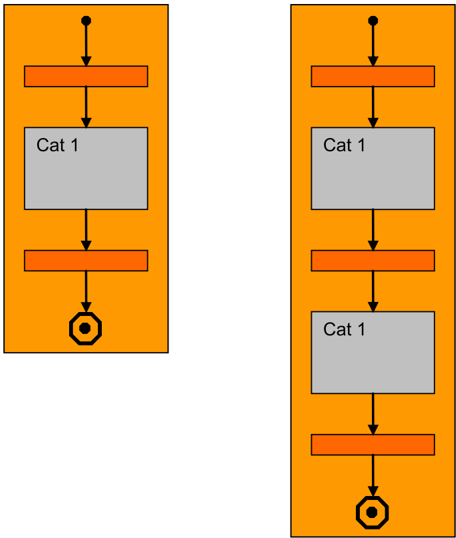

**扩展任务（Extended Task）**

如果多个 `RunnableEntity` 被映射到同一个任务、且不满足特殊条件（相同激活周期），则使用扩展任务。

如果使用扩展任务，不同 `RunnableEntity` 的入口点可以通过求值不同的 **OS** 事件来区分。在上述场景中，不同的激活周期可以由不同的 **OS** 告警提供。相应的 **OS** 事件必须在任务体内部处理。因此，**RTE** 生成器需要知道每个任务所关联的 **OS** 事件数量及其名称。

**ECU** 配置必须提供指派给 `RTEEvent`（触发映射到扩展任务的可运行实体）的 **OS** 事件，见 `RteUsedOsEventRef`。

图 4.14 展示了多个类别 1 `RunnableEntity` 映射到扩展任务的可能性。注意：该任务不终止。

图 4.14：类别 1 `RunnableEntity` 到扩展任务的映射

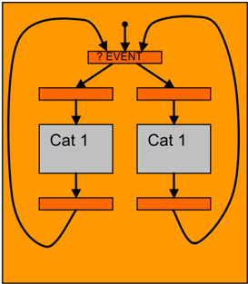

对于基本任务和扩展任务，**ECU** 配置都必须提供任务的名称，见 `OsTask`。

**ECU** 配置必须提供任务类型（**BASIC** 或 **EXTENDED**），可由与该任务关联的 **OS** 事件的存在与否确定，见 `OsTask`。

**6.2.2.2.6.1.2 场景 2**

**可运行实体类别 1B："runnable2"**

* 端口：S/R，`VariableAccess` 位于 `dataSendPoint` 角色。
* `RTEEvent`：`TimingEvent`
* 无 `WaitPoint`

"runnable2" 到任务的可能映射。下图展示了不同的映射：

* 一个类别 1B 可运行实体
* 多个类别 1B 可运行实体映射到同一基本任务并规定顺序
* 多个类别 1B 可运行实体映射到一个扩展任务

在进入可运行实体之前、退出之后实现 `dataReadAccess` 和 `dataWriteAccess` 角色 `VariableAccess` 的粘合代码不是必需的。

图 4.15：不使用 `dataReadAccess`/`dataWriteAccess` 角色 `VariableAccess` 的类别 1 `RunnableEntity` 的映射

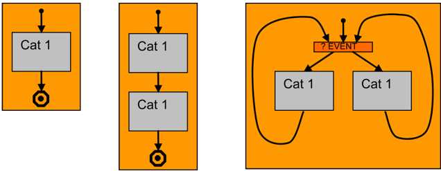

**6.2.2.2.6.1.3 场景 3**

**可运行实体类别 1A："runnable3"**

* 端口：S/R，`VariableAccess` 位于 `dataReadAccess` 或 `dataWriteAccess` 角色
* `RTEEvent`：可运行实体由 `DataReceivedEvent` 激活
* 无 `dataSendPoint` 角色的 `VariableAccess`
* 无 `WaitPoint`

场景 3 与场景 1 没有区别，只是激活 `RunnableEntity` 的 `RTEEvent` 不同。

**6.2.2.2.6.1.4 场景 4**

**可运行实体类别 2："runnable4"**

* 端口：S/R，`VariableAccess` 位于 `dataReceivePointByValue` 或 `dataReceivePointByArgument` 角色，并带 `WaitPoint`（阻塞式读取）
* `RTEEvent`：`WaitPoint` 引用一个 `DataReceivedEvent`

该可运行实体由任意 `RTEEvent` 激活（例如 `TimingEvent`）。当 `RunnableEntity` 进入 `WaitPoint` 且 `DataReceivedEvent` 发生时，`RunnableEntity` 恢复执行。

该可运行实体必须映射到扩展任务。通常每个类别 2 可运行实体都应映射到自己的任务。尽管不禁止把多个类别 2 `RunnableEntity` 映射到同一任务，但 **RTE** 生成器可能对此加以限制。把多个类别 2 `RunnableEntity` 映射到同一任务可能导致很大的延迟，例如某个 `WaitPoint` 已由到达的 `RTEEvent` 解析，但任务仍在另一个 `WaitPoint` 等待。

图 4.16：类别 2 `RunnableEntity` 到扩展任务的映射

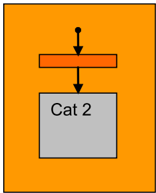

**6.2.2.2.6.1.5 场景 5**

存在两个 `RunnableEntity`，实现同步 C/S 通信的客户端（类别 2）和服务器，且 `ServerCallPoint` 的 `timeout` 特性为 0。

在单核上，同步调用服务器有两种方式：

* 对于分区内 C/S 通信使用简单函数调用，前提是服务器可运行实体的 `canBeInvokedConcurrently` 特性已设置、且服务器可运行实体为类别 1。此时服务器可运行实体在与调用它的客户端可运行实体相同的任务上下文（相同栈）中执行。客户端可运行实体可以映射到基本任务。
* 服务器可运行实体映射到自己的任务。如果 `canBeInvokedConcurrently` 特性未设置为 true，则服务器可运行实体必须映射到一个任务。

如果同步服务器调用的实现不使用 **OS** 事件，则客户端可运行实体可以映射到基本任务，而服务器可运行实体的任务必须具有比客户端可运行实体任务更高的优先级。此外，客户端可运行实体所映射的任务必须是可抢占的。这必须由 **RTE** 生成器检查。服务器可运行实体的激活可以通过基本任务的 `ActivateTask()` 或扩展任务的 `SetEvent()` 完成。两种情况下，被激活任务的优先级都必须高于客户端可运行实体的任务，以强制进行任务切换（这是必需的，因为服务器调用是同步的）。

**6.2.2.2.6.1.6 场景 6**

存在两个 `RunnableEntity`，实现同步 C/S 通信的客户端（类别 2）和服务器，且 `ServerCallPoint` 的 `timeout` 特性大于 0。

同样有两种同步调用服务器的方式：

* 对于分区内 C/S 通信使用简单函数调用，前提是服务器可运行实体的 `canBeInvokedConcurrently` 特性已设置、且服务器为类别 1。此时服务器可运行实体在与调用它的客户端可运行实体相同的任务上下文（相同栈）中执行，并且不执行超时监控。这种情况下客户端可运行实体可以映射到基本任务。
* 服务器可运行实体映射到自己的任务。如果 `canBeInvokedConcurrently` 特性未设置为 true，则服务器可运行实体必须映射到一个任务。

如果超时监控的实现使用 **OS** 事件，则服务器可运行实体的任务必须具有比客户端可运行实体任务更低的优先级，且客户端可运行实体必须映射到扩展任务。此外，两个任务都必须是可抢占的<sup>1</sup>。这必须由 **RTE** 生成器检查。超时的发生随后通过一个 **OS** 事件通知给客户端可运行实体。为了让客户端可运行实体立即对超时作出反应，必须在超时发生时能够切换回客户端任务。

> 1 严格来说，对于客户端可运行实体所映射的任务，这一限制并非必需。如果使用 **OS** 事件实现超时监控和服务器完成通知，**RTE API** 的实现通常使用 **OS** 服务 `WaitEvent`，它是一个重新调度的位置。

**6.2.2.2.6.1.7 场景 7**

**可运行实体类别 2："runnable7"**

* 端口：仅有 C/S，带 `AsynchronousServerCallPoint` 和 `WaitPoint`
* `RTEEvent`：`AsynchronousServerCallReturnsEvent`（仅 C/S 通信）

"runnable7"（收集异步服务器调用结果的客户端可运行实体）的映射场景与场景 4 类似。

**6.2.2.2.6.1.8 场景 8**

**可运行实体类别 1："runnable8"**

* 端口：仅有触发端口，连接到一个定义了 `triggertDirectImplementation` 的同步 `Trigger` 的触发源
* 无 `dataSendPoint` 角色的 `VariableAccess`
* `RTEEvent`：可运行实体由 `ExternalTriggerOccurredEvent` 激活
* 无 `WaitPoint`

**6.2.2.2.6.1.9 场景 9**

**可运行实体类别 1："runnable9"**

* `RTEEvent`：可运行实体由 `TimingEvent` 激活
* 无 `WaitPoint`

"runnable8" 和 "runnable9" 的映射场景与场景 1 中基本任务的情形类似，只是用 ISR2 取代任务。

###### 6.2.2.2.7. 可运行实体执行时间的监控

本节描述如何监控 `RunnableEntity` 的执行时间。

**RTE** 不直接支持 `RunnableEntity` 执行时间的监控，但可以使用 AUTOSAR **OS** 对 `OsTask` 执行时间的监控来达到这一目的。

如果需要某个 `RunnableEntity` 的执行时间监控，一种可行的解决方案是将该 `RunnableEntity` 单独映射到一个 `OsTask`，并配置 **OS** 监控该 `OsTask` 的执行时间。

这种解决方案可能导致一些原本因如下原因应映射到同一 `OsTask` 的 `RunnableEntity` 被分派到不同的 `OsTask`：

* 对 `RunnableEntity` 执行顺序的需求，和/或
* 对激活 `RunnableEntity` 的 `RTEEvent` 求值顺序的需求，以及
* `RunnableEntity` 之间不得抢占的约束

为了在为监控目的把 `RunnableEntity` 单独映射到多个 `OsTask` 时，仍保持对 `RunnableEntity` 执行顺序、`RTEEvent` 求值顺序以及 `RunnableEntity` 间非抢占的控制，一种可行的解决方案是：把对 `RunnableEntity` C 函数的调用替换为对被监控 `RunnableEntity` 所映射 `OsTask` 的激活。

图 4.17 展示了为监控目的而进行的任务间激活与可运行实体到单独任务的映射。

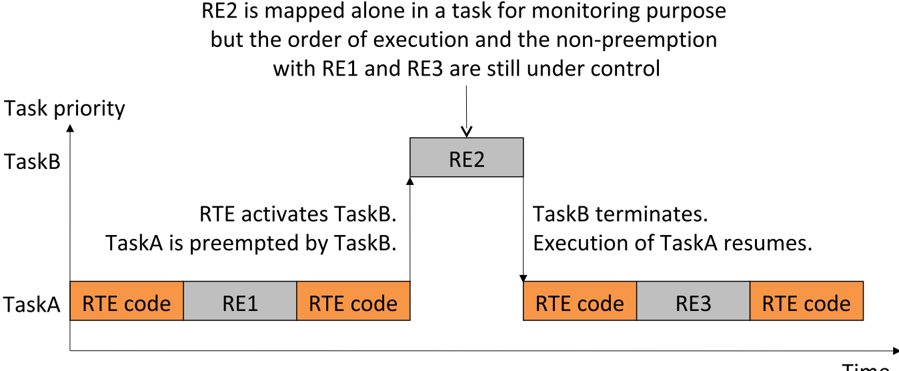

**RTE** 的这种行为可以通过 `RteEventToTaskMapping` 的 `RteVirtuallyMappedToTaskRef` 特性来配置。`RteVirtuallyMappedToTaskRef` 引用控制 `RunnableEntity` 执行顺序和/或 `RTEEvent` 求值顺序的那个 `OsTask`。`RteMappedToTaskRef` 引用为监控目的而将 `RunnableEntity` 单独映射到的 `OsTask`。

**RTE** 生成器应遵守 **RTE** 配置中已配置的可运行实体到任务的虚拟映射（`RteVirtuallyMappedToTaskRef`）。

当然，这种解决方案要求在 **OS** 中很好地配置任务优先级和调度属性，以便被监控 `RunnableEntity` 所映射的 `OsTask` 能够立即抢占。一种可行的解决方案是：

* `RunnableEntity` 所映射 `OsTask` 的优先级高于它被虚拟映射到的 `OsTask` 的优先级，并且
* 该虚拟映射目标 `OsTask` 采用完全抢占式调度，或者
* **RTE** 在激活 `RunnableEntity` 所映射的 `OsTask` 之后立即调用 **OS** 服务 `Schedule()`

**示例 1：不使用 OsEvent**

**示例描述：**

`RunnableEntity` RE1 由 `TimingEvent` 100ms T1 激活。

`RunnableEntity` RE2 由 `TimingEvent` 100ms T2 激活。

`RunnableEntity` RE3 由 `TimingEvent` 100ms T3 激活。

可运行实体的执行顺序应为 R1、R2、R3。

RE2 应被监控。

**可行的 RTE 配置：**

RE1/T1 映射到 `OsTask` TaskA，`RtePositionInTask` 等于 1。

RE2/T2 映射到 `OsTask` TaskB，但虚拟映射到 TaskA，`RtePositionInTask` 等于 2。

RE3/T3 映射到 `OsTask` TaskA，`RtePositionInTask` 等于 3。

**可行的 RTE 实现：**

**RTE** 启动周期为 100ms 的周期性 `OsAlarm`。

该 `OsAlarm` 被配置为激活 TaskA。

为 TaskA 配置非抢占调度。

TaskB 优先级 = TaskA 优先级 + 1

```C
void TaskA(void)
{
  RE1();
  ActivateTask(TaskB);
  Schedule();
  RE3();
  TerminateTask();
}

void TaskB(void)
{
  RE2();
  TerminateTask();
}
```

**示例 2：使用 OsEvent**

**示例描述：**

`RunnableEntity` RE1 由 `DataReceivedEvent` DR1 激活。`RunnableEntity` RE2 由 `DataReceivedEvent` DR2 激活。`RunnableEntity` RE3 由 `DataReceivedEvent` DR3 激活。

`RTEEvent` 的求值顺序应为 DR1、DR2、DR3。

所有可运行实体都应被监控。

**可行的 RTE 配置：**

RE1 映射到 `OsTask` TaskB，但虚拟映射到 TaskA，引用 **OsEvent** EvtA，`RtePositionInTask` 等于 1。

RE2 映射到 `OsTask` TaskC，但虚拟映射到 TaskA，引用 **OsEvent** EvtB，`RtePositionInTask` 等于 2。

RE3 映射到 `OsTask` TaskD，但虚拟映射到 TaskA，引用 **OsEvent** EvtC，`RtePositionInTask` 等于 3。

**可行的 RTE 实现：**

**RTE** 根据 **COM** 的回调置位 EvtA、EvtB 和 EvtC。

为 TaskA 配置完全抢占式调度。

TaskB 优先级 = TaskC 优先级 = TaskD 优先级 = TaskA 优先级 + 1

```C
void TaskA(void)
{
  EventMaskType Event;

  while(1)
  {
    WaitEvent(EvtA | EvtB | EvtC);
    GetEvent(TaskA, &Event);
    if (Event & EvtA)
    {
      ClearEvent(EvtA);
      ActivateTask(TaskB);
    }
    else if (Event & EvtB)
    {
      ClearEvent(EvtB);
      ActivateTask(TaskC);
    }
    else if (Event & EvtC)
    {
      ClearEvent(EvtC);
      ActivateTask(TaskD);
    }
  }
}

void TaskB(void)
{
  RE1();
  TerminateTask();
}

void TaskC(void)
{
  RE2();
  TerminateTask();
}

void TaskD(void)
{
  RE3();
  TerminateTask();
}
```

也可以将 **RTE** 配置为对一组可运行实体的监控，即对可运行实体执行时间之和的监控。

**示例 3：对一组可运行实体的监控**

**示例描述：**

`RunnableEntity` RE1 由 `TimingEvent` 100ms T1 激活。`RunnableEntity` RE2 由 `TimingEvent` 100ms T2 激活。`RunnableEntity` RE3 由 `TimingEvent` 100ms T3 激活。`RunnableEntity` RE4 由 `DataReceivedEvent` DR1 激活。`RunnableEntity` RE5 由 `DataReceivedEvent` DR2 激活。

`RunnableEntity` RE6 由 `DataReceivedEvent` DR3 激活。

`RunnableEntity` RE7 由 `DataReceivedEvent` DR4 激活。

`DataReceivedEvent` DR2、DR3 和 DR4 引用同一个 `dataElement`。`RTEEvent` 的求值顺序应为 T1、T2、T3、DR1、DR2、DR3、DR4。

RE2 和 RE3 应作为一组被监控。

RE6 和 RE7 应作为一组被监控。

**可行的 RTE 配置：**

RE1 映射到 `OsTask` TaskA，引用 **OsEvent** EvtA，`RtePositionInTask` 等于 1。

RE2 映射到 `OsTask` TaskB，但虚拟映射到 TaskA，引用 **OsEvent** EvtA，`RtePositionInTask` 等于 2。

RE3 映射到 `OsTask` TaskB，但虚拟映射到 TaskA，引用 **OsEvent** EvtA，`RtePositionInTask` 等于 3。

RE4 映射到 `OsTask` TaskA，引用 **OsEvent** EvtB，`RtePositionInTask` 等于 4。

RE5 映射到 `OsTask` TaskA，引用 **OsEvent** EvtC，`RtePositionInTask` 等于 5。

RE6 映射到 `OsTask` TaskC，但虚拟映射到 TaskA，引用 **OsEvent** EvtC，`RtePositionInTask` 等于 6。

RE7 映射到 `OsTask` TaskC，但虚拟映射到 TaskA，引用 **OsEvent** EvtC，`RtePositionInTask` 等于 7。

**可行的 RTE 实现：**

**RTE** 启动周期为 100ms 的周期性 `OsAlarm`。

该 `OsAlarm` 被配置为置位 EvtA。

**RTE** 根据 **COM** 的回调置位 EvtB 和 EvtC。

为 TaskA 配置完全抢占式调度。

TaskB 优先级 = TaskC 优先级 = TaskA 优先级 + 1

```C
void TaskA(void)
{
  EventMaskType Event;

  while(1)
  {
    WaitEvent(EvtA | EvtB | EvtC);
    GetEvent(TaskA, &Event);
    if (Event & EvtA)
    {
      ClearEvent(EvtA);
      RE1();
      ActivateTask(TaskB);
    }
    else if (Event & EvtB)
    {
      ClearEvent(EvtB);
      RE4();
    }
    else if (Event & EvtC)
    {
      ClearEvent(EvtC);
      RE5();
      ActivateTask(TaskC);
    }
  }
}

void TaskB(void)
{
  RE2();
  RE3();
  TerminateTask();
}

void TaskC(void)
{
  RE6();
  RE7();
  TerminateTask();
}
```

###### 6.2.2.2.8. TimingEvent 激活的可运行实体

`TimingEvent`/`BswTimingEvent` 是一种周期性出现的 `RTEEvent`/`BswEvent`，用于在 `RunnableEntity` 或 `BswSchedulableEntity` 中执行周期性活动。

**RTE** 应按照组件实例的 `TimingEvent` 的有效周期时间，周期性地激活由该 `TimingEvent` 触发的 `RunnableEntity`。

如果未为组件实例的 `TimingEvent` 定义 `InstantiationRTEEventProps`，**RTE** 生成器应根据该 `TimingEvent` 的 `period` 特性确定其有效周期时间。

如果为组件实例的 `TimingEvent` 定义了 `InstantiationRTEEventProps`，**RTE** 生成器应根据 `InstantiationRTEEventProps` 的 `period` 特性确定其有效周期时间。

请注意，组件实例由 `RteSwComponentInstance` 的 `RteSoftwareComponentInstanceRef` 引用 `SwComponentPrototype` 来定义，见图 8.2。

**RTE** 生成器应按以下优先级规则确定 `BswTimingEvent` 的有效周期时间（优先级从高到低）：

1. `RteBswEventRef` 所引用 `BswTimingEvent` 关联的 `RteBswEventPeriod` 的 `Value` 特性；
2. `period` 特性的 `Value`。

如果某个 `ExternalTriggerOccurredEvent` 或 `BswExternalTriggerOccurredEvent` 被映射到一个 ISR2、而所连接的触发源中不存在 `BswTriggerDirectImplementation`，则 **RTE** 生成器应拒绝该配置。

如果 `ExecutableEntity` 的 `TimingEvent` 或 `BswTimingEvent` 被映射到一个 ISR2（通过 `RteEventToIsrMapping`），则 **RTE** 应激活该 `ExecutableEntity`。

**RTE** 生成器应拒绝这样的配置：某个 `TimingEvent` 或 `BswTimingEvent` 被映射到一个 ISR2，而事件映射所引用的 `OsIsr` 要么不存在 `OsIsrPeriod`，要么周期值不是 `OsIsrPeriod` 值的整数倍。

**RTE** 生成器应拒绝这样的配置：某个 `TimingEvent` 或 `BswTimingEvent` 被映射到一个 `OsTask`、该 `OsTask` 存在 `OsTaskPeriod`、而周期值不是 `OsTaskPeriod` 值的整数倍。

**RTE** 生成器应拒绝这样的配置：某个 `TimingEvent` 或 `BswTimingEvent` 被映射到一个 `OsTask`、该 `OsTask` 不存在 `OsTaskPeriod`、且 `strictConfigurationCheck` 被设置为 true。

###### 6.2.2.2.9. TimingEvent 激活的可运行实体的同步

本节描述如何实现 `TimingEvent` 激活的 `RunnableEntity` 之间的同步。

必须区分以下情形：

* `RunnableEntity` 被映射到同一个 `OsTask`；
* `RunnableEntity` 被映射到同一 `OsApplication` 中不同的 `OsTask`；
* `RunnableEntity` 被映射到同一核上不同 `OsApplication` 中不同的 `OsTask`；
* `RunnableEntity` 被映射到同一微控制器不同核上、不同 `OsApplication` 中不同的 `OsTask`；
* `RunnableEntity` 被映射到同一 **ECU** 内不同微控制器上、不同 `OsApplication` 中不同的 `OsTask`；
* `RunnableEntity` 被映射到不同 **ECU** 内不同微控制器上、不同 `OsApplication` 中不同的 `OsTask`。

由于 `OsAlarm` 和 `OsScheduleTableExpiryPoint` 被用来实现 `TimingEvent`，针对不同情形存在以下几种可行的同步方案：

* 使用同一个 `OsAlarm` 或 `OsScheduleTableExpiryPoint` 来实现所有 `TimingEvent`；
* 在基于同一 `OsCounter` 的不同 `OsScheduleTable` 中使用不同的 `OsAlarm` 或 `OsScheduleTableExpiryPoint`，并以绝对启动偏移启动它们，以控制它们之间的同步；
* 在基于不同 `OsCounter`、但周期与最大值相同的、显式同步的 `OsScheduleTable` 中使用不同的 `OsScheduleTableExpiryPoint`。

用于实现 `TimingEvent` 的 `OsAlarm` 或 `OsScheduleTableExpiryPoint` 的选择，可以在 **RTE** 中通过 `RteEventToTaskMapping` 的 `RteUsedOsAlarmRef` 或 `RteUsedOsSchTblExpiryPointRef` 进行配置。

**RTE** 生成器应遵守为实现 `TimingEvent` 而配置的 `OsAlarm`（`RteUsedOsAlarmRef`）和 `OsScheduleTableExpiryPoint`（`RteUsedOsSchTblExpiryPointRef`）。

`OsAlarm` 和 `OsScheduleTable` 绝对启动偏移的选择，可以在 **RTE** 中通过 `RteUsedOsActivation` 的 `RteExpectedActivationOffset` 进行配置。

**RTE** 生成器在启动用于实现 `TimingEvent` 的 `OsAlarm` 和 `OsScheduleTable` 时，应遵守已配置的绝对启动偏移（`RteExpectedActivationOffset`）。

**RTE**/基础软件调度器不负责显式同步 `OsScheduleTable` 的同步/去同步，只负责启动显式同步的 `OsScheduleTable`。在这种情况下无需配置 `RteExpectedActivationOffset`。

###### 6.2.2.2.10. BackgroundEvent 激活的可运行实体与基础软件可调度实体

`BackgroundEvent` 是一种周期性出现的 `RTEEvent`/`BswEvent`，用于在 `RunnableEntity` 或 `BswSchedulableEntity` 中执行后台活动。它与 `TimingEvent` 类似，但没有固定的时间周期，且通常只以最低优先级被激活。

**RTE** 生成器可以通过两种基本方式实现 `BackgroundEvent` 的触发：或者由一个真实的后台 **OS** 任务完成后台激活；或者像 `TimingEvent` 一样，按由 **ECU** 集成人员定义的固定周期激活 `BackgroundEvent`。当 `BackgroundEvent` 被用于多个分区时，可能需要第二种方式来克服单个真实后台 **OS** 任务的局限。

如果后台激活由一个真实的后台 **OS** 任务完成，则该 **OS** 任务必须具有所在 **CPU** 核上最低的优先级。如果所采用的实现中 **OS** 任务会终止（基本任务），则后台 **OS** 任务在其终止后应立即被重新激活，例如通过 **OS** 的 `ChainTask` 调用。

###### 6.2.2.2.11. InitEvent 激活的可运行实体

`InitEvent` 用于在 **RTE** 启动时激活以初始化为目的的 `RunnableEntity`。

**RTE** 应在 `Rte_Start` 执行时激活由 `InitEvent` 触发的 `RunnableEntity` 一次。

以初始化为目的的 `RunnableEntity` 激活基本上有两种实现方式：`InitEvent` 映射到一个 `OsTask`，或映射到一个 `RteInitializationRunnableBatch`。

映射到 `OsTask` 的情况下，`RunnableEntity` 在相关任务变为活动时被调度一次。此时 `RtePositionInTask` 决定 `RunnableEntity` 在整个任务中被调度的顺序。例如，如果 `InitEvent` 映射在某个 `TimingEvent` 之后，而该 `TimingEvent` 在 `OsTask` 变为活动时已经触发，则初始化可运行实体会在周期性可运行实体之后被调用。因此，确保正确且符合预期的顺序是 **ECU** 集成人员的责任。

在 `InitEvent` 被映射到 `RteInitializationRunnableBatch` 的情况下，`RunnableEntity` 在调用相应的 `Rte_Init` 函数时被调度。此时 `RtePositionInTask` 决定 `RunnableEntity` 在同一个 `Rte_Init` 函数中被调度的顺序。

周期性 `RTEEvent` 的触发随 `Rte_Start` 中时序部分的调用而释放。

###### 6.2.2.2.12. OsTaskExecutionEvent 激活的可运行实体

`OsTaskExecutionEvent`/`BswOsTaskExecutionEvent` 是因某个 **OS** 任务的激活而被激活的 `RTEEvent`/`BswEvent`。由 `OsTaskExecutionEvent`/`BswOsTaskExecutionEvent` 触发的 `ExecutableEntity`，只要该 `OsTaskExecutionEvent` 所映射的 **OS** 任务正在运行并到达该 `ExecutableEntity` 的位置，就会被激活。与 **VFB** 跟踪（例如 `Rte_Task_Dispatch`）相反，由 `OsTaskExecutionEvent` 触发的 `RunnableEntity` 可以访问 AUTOSAR 接口。此外，`RtePositionInTask` 和 `RteBswPositionInTask` 允许它位于由其他 `RTEEvent`/`BswEvent` 映射的 `ExecutableEntity` 之间的任意位置。

**例如：**

1. 'RunA'，由 `SwcModeSwitchEvent` 触发，`RtePositionInTask` = 10
2. 'RunB'，由 `OsTaskExecutionEvent` 触发，`RtePositionInTask` = 15
3. 'RunC'，由 `SwcModeSwitchEvent` 触发，`RtePositionInTask` = 20
4. 'RunD'，由 `SwcModeSwitchEvent` 触发，`RtePositionInTask` = 25
5. 'RunE'，由 `OsTaskExecutionEvent` 触发，`RtePositionInTask` = 30

此外，`OsTaskExecutionEvent` 可以像其他 `RTEEvent` 一样与模式禁用依赖组合使用。

当 `OsTaskExecutionEvent` 所映射的 **OS** 任务正在运行并到达该 `RunnableEntity` 的位置时，**RTE** 应激活由该 `OsTaskExecutionEvent` 触发的 `RunnableEntity`。

当 `BswOsTaskExecutionEvent` 所映射的 **OS** 任务正在运行并到达该 `BswSchedulableEntity` 的位置时，**RTE** 应激活由该 `BswOsTaskExecutionEvent` 触发的 `BswSchedulableEntity`。

###### 6.2.2.3. `ExecutableEntity` 的激活与启动

本节用状态机（图 4.18）定义 `ExecutableEntity` 执行实例的激活。

图 4.18：`ExecutableEntity` 执行实例的通用状态机

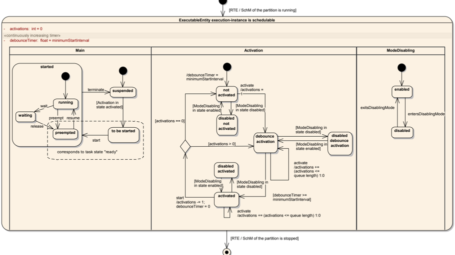

`ExecutableEntity` 执行实例是 `ExecutableEntity`（`RunnableEntity` 或 `BswSchedulableEntity`）关于并发执行的一个执行实例。

对于 `canBeInvokedConcurrently` = false 的 `RunnableEntity`，或其 `implementedEntry` 角色所引用 `BswModuleEntry` 的 `isReentrant` 特性为 false 的 `BswSchedulableEntity`，只有一个执行实例。对于 `canBeInvokedConcurrently` = true 的 `RunnableEntity`，或 `isReentrant` 特性为 true 的 `BswSchedulableEntity`，则存在明确定义数量的执行实例。

例如，对于以直接函数调用方式执行的服务器可运行实体，每个 `ServerCallPoint` 恰好对应一个 `ExecutableEntity` 执行实例。

可运行实体激活的主要原则是：

* `RunnableEntity` 由 `RTEEvent` 激活；
* `BswSchedulableEntity` 由 `BswEvent` 激活；
* 只有服务器可运行实体（由 `OperationInvokedEvent` 激活的 `RunnableEntity`）被排队。所有其他 `ExecutableEntity` 都不排队。

如果 `RunnableEntity` 因多个 `swImplPolicy` = `queued` 的 `dataElement` 的多个 `DataReceivedEvent` 而被激活，则由该 `RunnableEntity` 负责将所有排队数据出队。

* `minimumStartInterval` 将延迟 `RunnableEntity` 和 `BswSchedulableEntity` 的激活，以防止 `RunnableEntity` 或 `BswSchedulableEntity` 在 `minimumStartInterval` 内被启动多次。

每个 `ExecutableEntity` 执行实例都有自己的状态机。完整状态机见图 4.18。

关于图 4.18 的说明：去抖计时器 `debounceTimer` 是一个递增计时器，它是 `ExecutableEntity` 执行实例的局部变量。激活计数器 `activations` 是用于统计待处理激活数的局部整数。可运行实体去抖计时器和激活计数器与整个状态机一样，只是规定行为的概念，而非实现的规定。

只有当 **RTE** 实现对服务器可运行实体调用的串行化时，才对服务器可运行实体统计待处理激活。在其他所有情况下，**RTE** 不排队激活，`ExecutableEntity` 执行实例激活的状态机简化为图 4.19。

图 4.19：不排队执行实例（非服务器可运行实体）的状态机

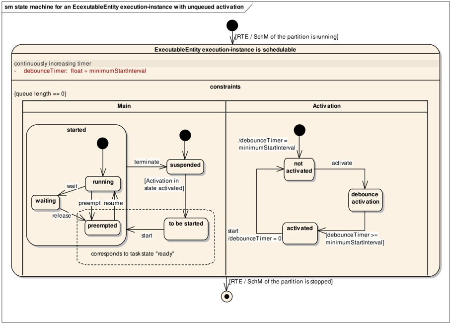

如果 **RTE** 按 6.2.2.3.1 节所述以直接或可信函数调用实现 `ExecutableEntity` 执行实例，则简化状态机见图 4.22。

`ExecutableEntity` 执行实例的状态机与包含该执行实例的任务的状态机并不相同，但二者存在依赖关系。例如，只有当相应任务处于"运行"状态时，`ExecutableEntity` 执行实例才能处于"运行"状态。

表 4.3 详细描述了所有 `ExecutableEntity` 执行实例状态。`ExecutableEntity` 执行实例状态机分为两个线程：主状态（**Main states**）描述 `ExecutableEntity` 执行实例的真实状态以及挂起与运行之间的转换；辅助的激活状态（**Activation states**）描述由 `RTEEvent` 或 `BswEvent` 引起的待处理激活的状态。

**RTE** 应按表 4.3 和表 4.4 定义的状态与转换，实现 `ExecutableEntity` 执行实例的状态机。

表 4.3：为每个 `ExecutableEntity` 执行实例定义的状态

| `ExecutableEntity` 执行实例状态 | 描述 |
| --- | --- |
| `ExecutableEntity` 执行实例可调度 | 该超级状态描述状态机的生存期。只有当运行该 `ExecutableEntity` 执行实例的 **RTE** 或 **SchM** 在相应分区中启动之后，该状态机才是活动的。 |
| `ExecutableEntity` 执行实例主状态 | `ExecutableEntity` 执行实例主状态 |
| suspended（挂起） | `ExecutableEntity` 执行实例未启动，也没有启动该执行实例的待处理请求。 |
| to be started（待启动） | `ExecutableEntity` 执行实例已激活但尚未启动。进入"待启动"状态通常意味着启动该 `ExecutableEntity` 执行实例的任务/ISR2 被激活。当任务/ISR2 已在运行时，`ExecutableEntity` 执行实例保持在"待启动"状态，直到任务/ISR2 的粘合代码实际调用实现该 `ExecutableEntity` 的函数。 |
| running（运行） | 实现 `ExecutableEntity` 代码的函数正在执行。包含该 `ExecutableEntity` 执行实例的任务/ISR2 正在运行。 |
| waiting（等待） | 包含该 `ExecutableEntity` 执行实例的任务正在 `ExecutableEntity` 内部的某个 `WaitPoint` 处等待。 |
| preempted（被抢占） | 包含该 `ExecutableEntity` 执行实例的任务/ISR2 被抢占，暂停执行实现该 `ExecutableEntity` 的函数。 |
| started（已启动） | "started"是 `ExecutableEntity` 执行实例启动与终止之间"running"、"waiting"和"preempted"的超级状态。 |
| `ExecutableEntity` 执行实例激活状态 | `ExecutableEntity` 执行实例激活状态 |
| not activated（未激活） | 没有 `RTEEvent`/`BswEvent` 要求激活该 `ExecutableEntity` 执行实例。 |
| debounce activation（去抖激活） | 与该 `ExecutableEntity` 执行实例存在 `startOnEvent` 关系的一个或多个 `RTEEvent` 已发生，但去抖计时器尚未超过 `minimumStartInterval`。当去抖计时器达到 `minimumStartInterval` 时，激活状态将自动前进到"已激活"。 |
| activated（已激活） | 与该 `ExecutableEntity` 存在 `startOnEvent` 关系的一个或多个 `RTEEvent` 或 `BswEvent` 已发生，且去抖计时器已超过 `minimumStartInterval`。在"已激活"状态活动期间，`ExecutableEntity` 执行实例的主状态自动从 suspended 前进到"待启动"状态。对于 **RTE** 实现服务器调用串行化的服务器可运行实体，激活计数器统计激活次数。当 `ExecutableEntity` 执行实例启动时，激活计数器递减。如果仍有待处理激活，激活状态转为"去抖激活"，否则转为"未激活"。 |

**注意：** 对于任务而言，等价的状态机不区分"被抢占"和"待启动"，二者被合并为"就绪"（**ready**）。

表 4.4：为每个 `ExecutableEntity` 执行实例定义的转换

| `ExecutableEntity` 执行实例转换 | 事件与动作描述 |
| --- | --- |
| 初始转换到"`ExecutableEntity` 执行实例可调度" | 运行该 `ExecutableEntity` 执行实例的 **RTE** 或 **SchM** 正在相应分区中启动。 |
| 从"`ExecutableEntity` 执行实例可调度"终止 | 运行该 `ExecutableEntity` 执行实例的 **RTE** 或 **SchM** 在相应分区中被停止。 |
| 到 `ExecutableEntity` 执行实例主状态的转换 | 到 `ExecutableEntity` 执行实例主状态的转换 |
| 初始转换到 suspended | suspended 状态是 `ExecutableEntity` 执行实例主状态的初始状态。 |
| 从 started 到 suspended | `ExecutableEntity` 执行实例已运行至完成。 |
| 从 suspended 到"待启动" | 该转换在激活状态为"已激活"时自动执行。 |
| 从"待启动"到 running | 实现 `ExecutableEntity` 的函数在该执行实例的上下文中被调用。 |
| 从 preempted 到 running | 被抢占执行 `ExecutableEntity` 执行实例的任务从"被抢占"变为"运行"。 |
| 从 running 到 waiting | 可运行实体进入一个 `WaitPoint`。 |
| 从 waiting 到 preempted | 包含正在 `WaitPoint` 等待的可运行实体的任务从"等待"变为"被抢占"。 |
| 从 running 到 preempted | 包含该 `ExecutableEntity` 执行实例的任务被抢占，暂停执行实现该 `ExecutableEntity` 的函数。 |
| 到 `ExecutableEntity` 执行实例激活状态的转换 | 到 `ExecutableEntity` 执行实例激活状态的转换 |
| 初始转换到"未激活" | "未激活"状态是 `ExecutableEntity` 执行实例激活状态的初始状态。去抖计时器被设置为 `minimumStartInterval` 的值，以避免 `ExecutableEntity` 执行实例首次激活被延迟。 |
| 从"已激活"到"未激活" | 实现 `ExecutableEntity` 的函数在该执行实例的上下文中被调用，且没有其他待处理激活。去抖计时器复位为 0。 |
| 从"未激活"到"去抖激活" | `RTEEvent` 或 `BswEvent` 的发生要求激活该 `ExecutableEntity` 执行实例。局部激活计数器被置为 1。如果未配置 `minimumStartInterval`，或去抖计时器已超过 `minimumStartInterval`，则省略"去抖激活"状态，转换直接进入"已激活"状态。 |
| 从"已激活"到"去抖激活" | 实现 `ExecutableEntity` 的函数在该执行实例的上下文中被调用（启动），且另一个激活待处理（仅适用于服务器可运行实体）。激活计数器递减，去抖计时器复位为 0。如果未配置 `minimumStartInterval`，则省略"去抖激活"状态，转换直接回到"已激活"状态。 |
| 从"去抖激活"到"去抖激活" | 如果 **RTE** 为某个服务器可运行实体实现服务器调用串行化，且该服务器可运行实体发生了一个 `OperationInvokedEvent`。激活计数器递增（至多到队列长度）。 |
| 从"去抖激活"到"已激活" | 去抖计时器到期，去抖计时器 > `minimumStartInterval`。 |
| 从"已激活"到"已激活" | 如果 **RTE** 为某个服务器可运行实体实现服务器调用串行化，且该服务器可运行实体发生了一个 `OperationInvokedEvent`。激活计数器递增（至多到队列长度）。 |

`ExecutableEntity` 执行实例的激活应按照上述状态机所描述的方式运行。

状态机的图形模型见图 4.18。

图 4.20 和图 4.21 中的示例展示了 `ExecutableEntity` 执行实例在有或没有 `minimumStartInterval` 时的不同时序情形。`minimumStartInterval` 可以通过在该区间内汇集更多起激活作用的 `RTEEvent`/`BswEvent` 来减少激活次数。不会丢失任何激活，激活只是被延迟并合并，以保持 `minimumStartInterval`。图中展示了 `ExecutableEntity` 执行实例主状态中的 started 状态和激活状态中的"已激活"状态。每个尖脉冲表示一次 `RTEEvent` 或 `BswEvent` 的发生。

图 4.20：不带 `minimumStartInterval` 的 `ExecutableEntity` 执行实例激活

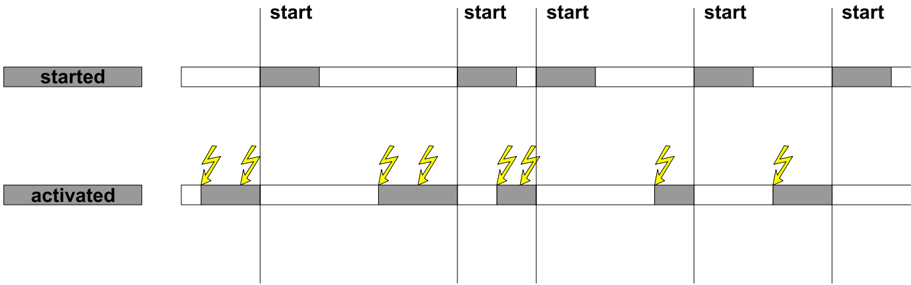

图 4.20 展示了不带 `minimumStartInterval` 的 `ExecutableEntity` 执行实例激活。该执行实例只能被激活一次（对服务器可运行实体不适用）。激活不排队。当该执行实例仍处于 started 状态时，就可以再次被激活（见图 4.18）。

通过配置 `RteEventToTaskMapping`，这种激活甚至可以用于立即重启该 `ExecutableEntity`，早于任务中随后映射的其他 `ExecutableEntity` 启动。

当 `RteImmediateRestart`/`RteBswImmediateRestart` 参数为 TRUE 时，如果该 `ExecutableEntity` 在已处于 started 状态时又被该 `RTEEvent`/`BswEvent` 激活，则 **RTE** 应在其终止后立即重启该 `ExecutableEntity`。

这可用于把一个长时间持续的计算拆分为若干较小的片段，以降低协作式环境中任务的最大阻塞时间。通常在每次迭代之间需要放置一个调度点，且迭代次数可能取决于 **ECU** 的运行条件。此外，在计算链中，长时间持续的计算应在后续 `ExecutableEntity` 被调用之前完成。

**示例 4.4**：可运行实体代码示例：

```C
LongLastingRunnable()
{
  /* the very long calculation */
  if(!finished)
  {
    /* further call is required to complete the calculation*/
    Rte_IrTrigger_LongLastingCalculation_ProceedCalculation();
  }
}
```

因此，只要计算未完成，执行长时间计算的 `ExecutableEntity` 就会发出一个触发。该触发再次激活该 `ExecutableEntity`。`ExecutableEntity` 的第一次激活可能由另一个 `RTEEvent`/`BswEvent` 触发。

图 4.21：带 `minimumStartInterval` 的 `ExecutableEntity` 激活

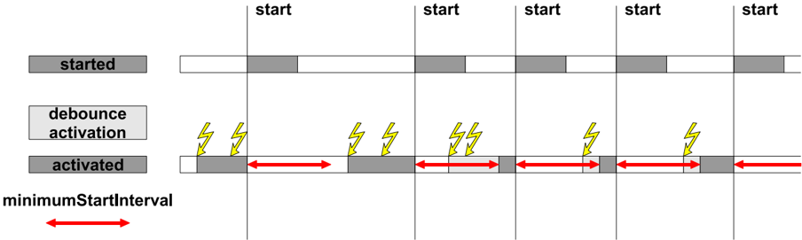

图 4.21 展示了带 `minimumStartInterval` 的 `ExecutableEntity` 激活（这里无需区分执行实例，只有一个）。图中红色箭头表示 `ExecutableEntity` 每次启动之后的 `minimumStartInterval`。该 `minimumStartInterval` 内发生的 `RTEEvent` 或 `BswEvent` 导致进入"去抖激活"状态。当 `minimumStartInterval` 结束时，"去抖激活"状态变为"已激活"状态。

当一个数据接收事件在可运行实体仍在运行时激活它，数据可能已经在可运行实体当前执行期间被出队。尽管如此，该可运行实体仍会再次启动。因此，由数据接收事件激活的可运行实体可能发现接收队列为空。

###### 6.2.2.3.1. 通过直接函数调用激活

在许多情况下，如果 `canBeInvokedConcurrently` 允许，**RTE** 可以通过直接或可信函数调用来实现 `ExecutableEntity` 执行实例。在这些情况下，`ExecutableEntity` 执行实例的激活和启动合并为一个事件。"待启动"、"去抖激活"和"已激活"状态被立即穿过。

显然，此时不可能有去抖激活（见元模型限制，4.1.6 节）。

每个调用点、触发点、模式切换点等各有一个 `ExecutableEntity` 执行实例。状态图简化为图 4.22。

图 4.22：以直接或可信函数调用实现的 `ExecutableEntity` 执行实例的状态机

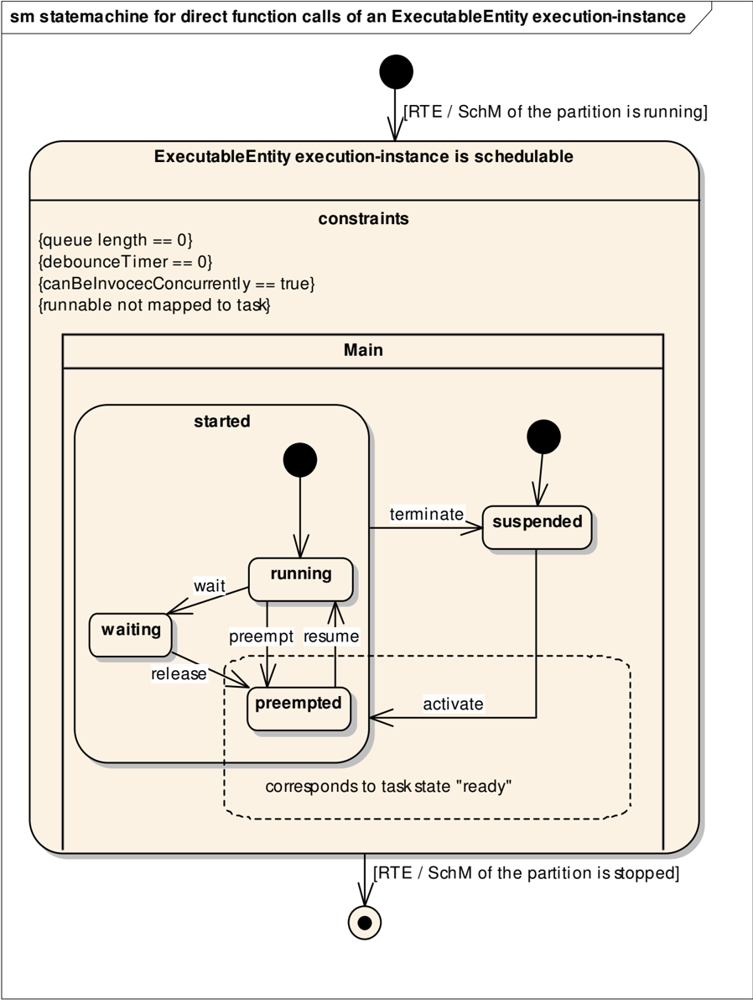

受触发 `ExecutableEntity` 至少由一个 `ExternalTriggerOccurredEvent` 或 `InternalTriggerOccurredEvent` 激活。在某些情况下，**RTE** 生成器把触发事件通信或可运行实体间触发实现为触发 `ExecutableEntity` 对受触发 `ExecutableEntity` 的直接或可信函数调用。

on-entry `ExecutableEntity`、on-transition `ExecutableEntity`、on-exit `ExecutableEntity` 或 ModeSwitchAck `ExecutableEntity` 可能在 `Rte_Switch` **API** 的上下文中执行（当实现异步模式切换过程时）。

服务器可运行实体只由 `OperationInvokedEvent` 激活，在客户端-服务器通信中实现服务器。在某些情况下，**RTE** 把客户端-服务器通信实现为客户端对服务器的直接或可信函数调用。

关于直接函数调用的 **RTE** 生成，**RTE** 在如何实现直接函数调用方面仍受限制。例如，它并不总能把服务器调用优化为纯宏式函数，如下例所示：

**示例 4.5**

```C
/* Rte_SWC.h Application Header File */
#define Rte_Call_port_operation(in arg0, in arg1, out arg2) sServerFunction(arg0, arg1, arg2)
```

尽管示例 4.5 所示的代码是理想且最优的解决方案，但 **RTE** 必须考虑如下事项：

* 激活原因（**Activation Reasons**）
* 独占区（**Exclusive Areas**）
* 模式禁用依赖（**Mode Disabling Dependencies**）
* 服务器和客户端位于不同分区（需要使用 `CallTrustedFunction()`）

以客户端-服务器上下文中的激活原因（6.2.2.3.3 节）为例。**RTE** 的职责是识别是哪个事件导致服务器被调用，以及是否有必要生成比示例 4.5 更多的 C 代码。因此，应用头文件中的 **API** `Rte_Call_<api_extension>` 仍必须映射到 `Rte.c` 文件中 **RTE** 生成的函数 `Rte_Call_<cts>_<api_extension>`，以处理这些额外复杂度。下面是直接函数调用与激活原因相结合的示例 4.6：

**示例 4.6**

```C
/* Application Header File: */
#define Rte_Call_cPort_cOp(T argin0, T argin1, T_ argOut2) Rte_Call_cSwc_cPort_cOp(argin0, argin1, argOut2)

/* Rte.c */
Std_ReturnType Rte_Call_cSwc_cPort_cOp(T argin0, T argin1, T_ argOut2)
{
  VAR(Std_ReturnType, AUTOMATIC) rtn = RTE_E_OK;

  activator |= Rte_ActivatingEvent_sServerFunction_1;
  rtn= sServerFunction(argin0, argin1, argOut2, activator);
  activator &= ~Rte_ActivatingEvent_sServerFunction_1;
}
```

###### 6.2.2.3.2. `RunnableEntity` 和 `BswSchedulableEntity` 的激活偏移

为了允许优化（平滑 **CPU** 负载、把不同周期的 `RunnableEntity` 和 `BswSchedulableEntity` 映射到同一任务以避免数据共享等），**RTE** 必须处理来自任务共享参考点的激活偏移信息，且仅针对时间触发的 `RunnableEntity` 和 `BswSchedulableEntity`。任务的最大周期可以自动计算为所有可运行实体周期与偏移的最大公约数（**GCD**）。假定可运行实体的最坏情况执行时间小于该 GCD。如果最坏情况执行时间大于 GCD，则行为未定义。

**RTE** 应遵守映射到同一个 **OS** 任务内的 `RunnableEntity` 的已配置激活偏移。

基础软件调度器应遵守映射到同一个 **OS** 任务内的 `BswSchedulableEntity` 的已配置激活偏移。

最坏情况执行时间应小于 GCD：在激活偏移上下文中，`RunnableEntity` 或 `BswSchedulableEntity` 的最坏情况执行时间应小于该上下文中所有 `BswSchedulableEntity` 和 `RunnableEntity` 周期与偏移的 GCD。

**注意：** 以下示例只展示 `RunnableEntity`。但它同样适用于 `BswSchedulableEntity`，或 `RunnableEntity` 与 `BswSchedulableEntity` 的混合。

**示例 1：**

本示例描述映射到一个任务、且每个可运行实体都定义了激活偏移的 3 个可运行实体。

表 4.5：可运行实体的时序

| 可运行实体 | 周期 | 激活偏移 |
| --- | --- | --- |
| R1 | 100ms | 20ms |
| R2 | 100ms | 60ms |
| R3 | 100ms | 100ms |

可运行实体 R1、R2 和 R3 被映射到任务 T1，任务周期 20ms，即所有可运行实体周期与激活偏移的 GCD。

图 4.23：可运行实体激活偏移示例

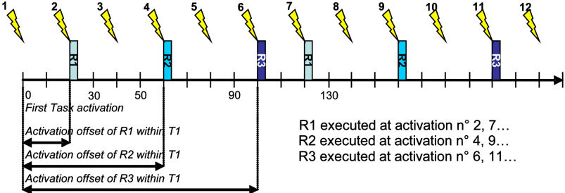

**示例 2：**

本示例描述映射到一个任务、且每个可运行实体都定义了激活偏移和任务内位置的的 4 个可运行实体。

表 4.6：带任务内位置的可运行实体时序

| 可运行实体 | 周期 | 任务内位置 | 激活偏移 |
| --- | --- | --- | --- |
| R1 | 50ms | 1 | 0ms |
| R2 | 100ms | 2 | 0ms |
| R3 | 100ms | 3 | 70ms |
| R4 | 50ms | 4 | 20ms |

可运行实体 R1、R2、R3 和 R4 被映射到任务 T1，任务周期 10ms，即所有可运行实体周期与激活偏移的 GCD。

图 4.24：带任务内位置的可运行实体激活偏移示例

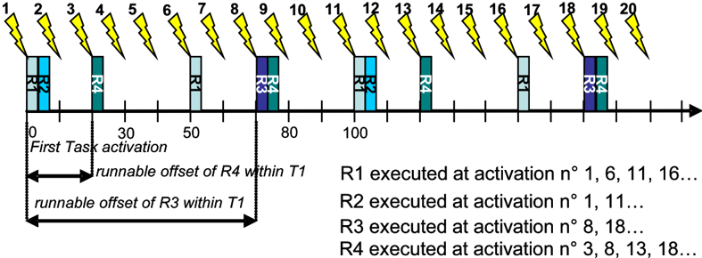

###### 6.2.2.3.3. 提供激活用的 RTE 事件

可以由多个 **RTE** 事件定义一个可运行实体的激活。但当 **RTE** 调用该可运行实体时，应能够查询是哪个 **RTE** 事件实际触发了本次可运行实体的执行。

**契约阶段：**

如果可运行实体定义了至少一个 `activationReason`，则启用"提供激活事件"特性。

如果启用"提供激活事件"特性，则处于契约阶段的 **RTE** 生成器应按相应原型规定生成可运行实体的签名。

如果启用"提供激活事件"特性，则处于契约阶段的 **RTE** 生成器应生成类型 `Rte_ActivatingEvent_<name>`（激活向量），其中 `<name>` 是描述该可运行实体入口点的符号，用于存储激活位。根据该可运行实体的 `ExecutableEntityActivationReason` `bitPosition` 的最大值，该类型应为 `uint8`、`uint16` 或 `uint32`，使 `bitPosition` 的最大值能放入该数据类型。

请注意，如果 `ExecutableEntityActivationReason` 的 `bitPosition` 值高于 31，则视为无效配置（参见软件组件模板[2]中的 `[constr_1226]`）。

如果启用"提供激活 **RTE** 事件"特性，则处于契约阶段的 **RTE** 生成器应为一个可执行实体的每个 `ExecutableEntityActivationReason` 生成一个定义，以提供 `Rte_ActivatingEvent_<name>` 数据类型中的特定位位置：

```C
#define Rte_ActivatingEvent_<name>_<activation> xxU
```

xx 的值由位位置定义，xx = 2^bitPosition。

示例：可运行实体符号 = "greek"，聚合了 3 个 `ExecutableEntityActivationReason`，它们由 4 个 **RTE** 事件引用：

* `RTEEvent`："alpha"，符号：aleph
* `RTEEvent`："beta"，符号：beth
* `RTEEvent`："gamma"，符号：gimel
* `RTEEvent`："delta"，符号：gimel

这将产生一个 `uint8` 类型的 `Rte_ActivatingEvent_<name>`：`typedef uint8 Rte_ActivatingEvent_greek`，以及 3 个定义：

* `#define Rte_ActivatingEvent_greek_aleph 01U`
* `#define Rte_ActivatingEvent_greek_beth 02U`
* `#define Rte_ActivatingEvent_greek_gimel 04U`

**生成阶段：**

如果启用"提供激活 **RTE** 事件"特性，则 **RTE** 应在该可运行实体所映射 **OS** 任务的上下文中，把定义了 `activationReasonRepresentation` 引用的起激活作用的 **RTE** 事件，收集到激活向量中相应的位位置上。

如果启用"提供激活 **RTE** 事件"特性，则 **RTE** 应在该可运行实体"启动"时，把所收集的起激活作用的 **RTE** 事件（激活向量）提供给该可运行实体 **API**。激活向量应在提供之后立即复位。

由于可运行实体的激活与执行（启动）之间可能存在时间差，后续激活会被累加，并在该可运行实体启动时一并提供。

在可运行实体执行期间发生的激活将被收集，用于该可运行实体的下一次启动。

###### 6.2.2.4. `ExecutableEntity` 的周期性执行

在 `ExecutableEntity` 的激活与启动之间通常存在直接的因果关系：要么该 `ExecutableEntity` 由起激活作用的 **RTE API** 或基础软件调度器 **API**（例如 `SchM_Trigger` 或 `Rte_Switch`）中的直接函数调用执行；要么起激活作用的 **RTE API** 或基础软件调度器 **API** 激活一个任务，由该任务执行该 `ExecutableEntity`。`TimingEvent` 和 `BackgroundEvent` 是特例，它们的激活不是由 **RTE API** 或基础软件调度器 **API** 提供的，而是由 **OS** 提供的。

有些情况下不希望激活与执行之间存在这种直接因果关系。原因可能是为了更好地控制系统动态行为（例如在明确定义的时点执行 `ExecutableEntity`），或者仅仅是为了减少资源消耗（例如在突发情形下减少任务激活次数）。为此，通过把 `ExecutableEntity` 的激活与其执行完全分离来放松这种因果关系。也就是说，`ExecutableEntity` 的激活只传递"它必须被执行"这一信息，而执行上下文（即 `OsTask`）在期望的时刻在别处被触发。

本节聚焦于 `ExecutableEntity` 的周期性执行。因此，执行上下文的触发在 **RTE** 或基础软件调度器之外通过 **OS** 完成。表示 `ExecutableEntity` 执行上下文的 `OsTask` 在这种情况下具有已配置的 `OsTaskPeriod`。

**RTE** 应执行这样的 `RunnableEntity`：它被某个 `RTEEvent` 引用、该 `RTEEvent` 被映射到一个配置了 `OsTaskPeriod` 的 `OsTask`；当该任务执行时、且该 `RunnableEntity` 已被该 `RTEEvent` 激活（见下一条）。

基础软件调度器应执行这样的 `BswModuleEntity`：它被某个 `BswEvent` 引用、该 `BswEvent` 被映射到一个配置了 `OsTaskPeriod` 的 `OsTask`；当该任务执行时、且该 `BswModuleEntity` 已被该 `BswEvent` 激活（见下一条）。

如果某个 `OsTask` 拥有 `OsTaskPeriod`，则基础软件调度器/**RTE** 应假定该 `OsTask` 按 `OsTaskPeriod` 定义的周期执行，并且不得为该 `OsTask` 执行额外的任务激活。

下面两个示例演示这些规定的含义。第一个非常基础，聚焦于 `TimingEvent`；第二个展示 `ExternalTriggerOccurredEvent` 的情形。

**示例 1：**

一个周期为 0.02（20ms）、启动可运行实体 RunnA 的 `TimingEvent` 被映射到 `OsTaskPeriod` 设为 0.01（10ms）的 `OsTask` Task10ms。上述规定适用并强制 **RTE** 实现一个分频器，把该 `OsTask` 的 10ms 缩减到 `TimingEvent` 所要求的 20ms。代码（为可读性而非 **CPU** 资源优化）大致如下：

```C
uint8 RunnA_Task10ms_prescaler = 0;

TASK(Task10ms)
{
  if (RunnA_Task10ms_prescaler == 0)
  {
    RunnA();
    RunnA_Task10ms_prescaler = 2;
  }
  RunnA_Task10ms_prescaler--;
}
```

**示例 2：**

一个启动可运行实体 RunnB 的 `ExternalTriggerOccurredEvent` 被映射到 `OsTaskPeriod` 设为 0.01（10ms）的 `OsTask` Task10ms。同样适用上述规定，尤其是最后一条。代码（未包含防止激活队列溢出等防御性代码）大致如下：

```C
uint8 RunnA_Task10ms_activation_count = 0;

Std_ReturnType Rte_Trigger_myTriggerComponent_myTriggerPort_myTrigger( void)
{
  RunnA_Task10ms_activation_count++;
  /* 该规定禁止在这里激活 Task10ms */
  return RTE_E_OK;
}

TASK(Task10ms)
{
  /* RTE 必须检查 RunnA 是否有激活，因为 Task10ms 的执行独立于 RunnA 可能的激活 */
  if (RunnA_Task10ms_activation_count != 0)
  {
    RunnA_Task10ms_activation_count--;
    RunnA();
  }
}
```

###### 6.2.2.5. 中断解耦与通知

###### 6.2.2.5.1. 通知的基本原则

存在若干 **BSW** 模块，其功能不是由 AUTOSAR 软件组件直接激活、触发或调用的，而是由其他情形引起的，例如数字输入端口电平变化、复杂驱动动作、**CAN** 信号接收等。在大多数情况下，中断是这些情形的结果。关于中断的定义见 **VFB**[1]。

这些 **BSW** 功能中的一部分会制造必须让 AUTOSAR **SW-C** 参与的情形，并由一个中断来指示。为了把这些情形告知 AUTOSAR 软件组件，AUTOSAR 软件组件中的可运行实体通过通知（**notification**）被激活。因此，基础软件中发生的中断必须被转换为 AUTOSAR 软件组件的通知。这样的转换最迟必须在 **RTE** 层进行！哪个中断连接到哪个通知，要么在系统配置/生成期间决定，要么作为复杂设备驱动或微控制器抽象层设计的一部分决定。

这意味着 AUTOSAR **SW-C** 中的可运行实体必须被激活，或扩展任务中处于"等待"状态的类别 2 可运行实体必须重新置为"就绪"。此外，可能还需要传递一些事件特定的数据。

有两种不同的机制来实现这些通知，取决于 **BSW** 接口的种类：

1. 带标准化接口（**Standardized interface**）的 **BSW**。用于 **COM** 和 **OS**。带标准化接口的基础软件模块不能创建 `RTEEvent`，因此必须选择另一种机制："回调"（**callback**）。在 C/C++ 环境中，典型的回调实现是一个函数调用。
2. 带 AUTOSAR 接口（**AUTOSAR interface**）的 **BSW**：用于所有其他 **BSW** 模块。

带 AUTOSAR 接口的基础软件模块，其接口在 AUTOSAR **BSW** 描述 **XML** 文件中规定，其中包含符合 AUTOSAR 规范的信号规格。这些 **BSW** 模块可以使用诸如 `Rte_Send` 的 **RTE API** 调用（见 7.1.6.5 节）。`RTEEvent` 可以与这些 **RTE API** 调用相连，从而实现 AUTOSAR **SW-C** 的激活。

请注意，AUTOSAR 软件组件只能通过 AUTOSAR 接口向另一个 AUTOSAR 软件组件或 **BSW** 模块发送通知。

###### 6.2.2.5.2. 中断

如 **VFB** 规范[1]所述，AUTOSAR 概念不允许 AUTOSAR 软件组件在中断上下文中运行。只有微控制器抽象层、复杂设备驱动和 **OS** 允许直接与中断交互并实现中断服务例程。这保证了硬件无关性和确定性。

如果允许 AUTOSAR 软件组件在中断上下文中运行，一个 AUTOSAR 软件组件可能长时间阻塞整个系统调度，时间长到不可接受。但主要原因是：AUTOSAR 软件组件应与底层硬件无关，以保证 **ECU** 之间的可交换性。如果中断的时序影响被限制在该 **ECU** 的基础软件内，则 **ECU** 的调度更可预测、也更可测试。

此外，不允许 AUTOSAR 软件组件显式阻塞中断来作为保证数据一致性的手段。它们必须为此使用 **RTE** 函数，见 6.2.2.6 节。

###### 6.2.2.5.3. 在 RTE 层解耦中断

AUTOSAR **SW-C** 中的可运行实体可以作为中断的结果而运行，但不在中断上下文中运行——即不在中断服务例程内！在中断服务例程与 AUTOSAR **SW-C** 激活之间必须始终有一个解耦实例。AUTOSAR **SW-C** 的可运行实体只在任务的上下文中执行。

解耦实例最迟位于 **RTE** 中。对 **RTE** 而言，有若干实现中断解耦的选项。哪个选项最佳取决于 **RTE** 的配置与实现，因此这里只给出示例。

**示例 1：**

情形：

* 一个中断例程调用一个 **RTE** 回调函数

意图：

* 启动一个可运行实体

**RTE** 的工作：

* **RTE** 通过 `ActivateTask()` 这一 **OS** 服务调用启动一个包含可运行实体激活代码的任务。
* 也可能存在其他更复杂的解决方案，例如包含该可运行实体的任务被周期性激活的情形。

**示例 2：**

情形：

* 一个中断例程调用一个 **RTE** 回调函数

意图：

* 使一个可运行实体从等待点唤醒

**RTE** 的工作：

* **RTE** 置位一个 **OS** 事件

上述示例描述的场景不仅适用于 **RTE** 回调函数，也适用于其他 **RTE API** 函数。

###### 6.2.2.5.4. RTE 与中断类别

由于类别 1 中断不受 **OS** 控制，**RTE** 完全无法影响它们的执行行为。因此不允许任何类别 1 中断触达 **RTE**。类别 2 中断则不同。

如果某个 `SwcBswRunnableMapping` 将一个 `BswInterruptEntity` 与一个 `RunnableEntity` 关联，且该 `BswInterruptEntity` 的 `interruptCategory` 特性等于 cat1，则 **RTE** 生成器应拒绝该配置。

类别 1 中断不得访问 **RTE**。

大多数 **OS** 服务也可以从类别 2 中断服务例程中调用（见[4]）。与任务的主要区别在于：ISR 不能进入等待状态，并且总是由外部源激活（从不由 **Rte** 激活）。此外，ISR 的优先级总是高于任务。因此，**Rte** 应允许在某些情况下运行 `ExecutableEntity`。ISR2 的激活不在 **Rte** 的范围之内。

如果 `ExecutableEntity` 的 `ExternalTriggerOccurredEvent` 或 `BswExternalTriggerOccurredEvent` 被映射到一个 ISR2（通过 `RteEventToIsrMapping`），则 **RTE** 应激活该 `ExecutableEntity`。

**RTE** 生成器应拒绝这样的配置：某个触发类别 2 `ExecutableEntity` 的事件被映射到一个 ISR2。

**注意：** 类别 2 的 `ExecutableEntity` 需要等待点，而 ISR2 不允许进入等待状态。关于 `ExecutableEntity` 基于时间的激活请参见 6.2.2.2.8 节。

本节所在的功能行为涉及以下配置定义（**ECU** 配置参数的完整清单亦汇集于第 8 章）：

容器 `RteEventToTaskMapping`（父容器：`RteSwComponentInstance`）：基于起激活作用的 `RTEEvent`，把一个 `RunnableEntity` 实例映射到一个 `OsTask`。当 `RunnableEntity` 通过直接或可信函数调用执行时，仍会规定该 `RteEventToTaskMapping`，但不包含 `RteMappedToTask` 元素。`RtePositionInTask` 参数用于为同一 **RTE API** 触发的事件提供排序。

| 参数 | 属性 | 值 |
| --- | --- | --- |
| `RteActivationOffset` | 描述 | 以秒为单位的激活偏移 |
| | 多重性 | 0..1 |
| | 类型 | `EcucFloatParamDef` |
| | 取值范围 | [0 .. INF] |
| | 默认值 | - |
| | Post-Build 变体多重性 / 值 | false / false |
| | 多重性配置类 | Pre-compile time = X；Link time = -；Post-build time = - |
| | 值配置类 | Pre-compile time = X；Link time = -；Post-build time = - |
| | 作用域/依赖 | scope: local |

| 参数 | 属性 | 值 |
| --- | --- | --- |
| `RteImmediateRestart` | 描述 | 当 `RteImmediateRestart` 设置为 true 时，如果该 `RunnableEntity` 在已处于启动状态时又被此 `RTEEvent` 激活，则应在终止后立即重启。当所映射的 `RTEEvent` 引用的 `RunnableEntity` 的 `minimumStartInterval` 特性 > 0 时，该参数不得设置为 true。 |
| | 多重性 | 1 |
| | 类型 | `EcucBooleanParamDef` |
| | 默认值 | false |
| | Post-Build 变体值 | false |
| | 值配置类 | Pre-compile time = X（所有变体）；Link time = -；Post-build time = - |
| | 作用域/依赖 | scope: local |

| 参数 | 属性 | 值 |
| --- | --- | --- |
| `RteOsSchedulePoint` | 描述 | 在 `ExecutableEntity` 执行之后通过显式调用 **OS** 的 Schedule 服务引入一个调度点。如果中间的 `ExecutableEntity` 执行被跳过，**RTE** 生成器可以把多个连续的 OS schedule 调用优化为一次调用。该参数缺省解释为 "NONE"。如果任务是可抢占的、而该参数的值不是 "NONE"（或参数缺省），则视为无效配置。 |
| | 多重性 | 0..1 |
| | 类型 | `EcucEnumerationParamDef` |
| | 取值范围 | `CONDITIONAL`：应在该 `ExecutableEntity` 执行结束时引入一个调度点；如果多个调度点之间没有任何 `ExecutableEntity` 执行，则该调度点可以跳过。`NONE`：不应在该 `ExecutableEntity` 执行结束时引入调度点。`UNCONDITIONAL`：应始终在该 `ExecutableEntity` 执行结束时引入一个调度点。 |
| | Post-Build 变体多重性 / 值 | false / false |
| | 多重性配置类 | Pre-compile time = X（所有变体）；Link time = -；Post-build time = - |
| | 值配置类 | Pre-compile time = X（所有变体）；Link time = -；Post-build time = - |
| | 作用域/依赖 | scope: local |

| 参数 | 属性 | 值 |
| --- | --- | --- |
| `RtePositionInTask` | 描述 | 映射到一个 `OsTask` 的每个 `RunnableEntity` 在任务执行中都有一个特定位置。对周期性激活而言，这是执行顺序；对事件驱动激活而言，这是求值顺序，即决定实际执行哪个 `RunnableEntity`。在直接或可信函数调用的情形下，该参数用于在同一个 **RTE API** 调用多个 `ExecutableEntity` 时提供事件排序。 |
| | 多重性 | 0..1 |
| | 类型 | `EcucIntegerParamDef` |
| | 取值范围 | 0 .. 65535 |
| | 默认值 | - |
| | Post-Build 变体多重性 / 值 | false / false |
| | 多重性配置类 | Pre-compile time = X（所有变体）；Link time = -；Post-build time = - |
| | 值配置类 | Pre-compile time = X（所有变体）；Link time = -；Post-build time = - |
| | 作用域/依赖 | scope: local |

| 参数 | 属性 | 值 |
| --- | --- | --- |
| `RteServerNumberOfRequestProcessing` | 描述 | 规定一次 **OS** 任务执行内可以处理的最大排队请求数。 |
| | 多重性 | 0..1 |
| | 类型 | `EcucIntegerParamDef` |
| | 取值范围 | 1 .. 65535 |
| | 默认值 | - |
| | Post-Build 变体多重性 / 值 | false / false |
| | 多重性配置类 | Pre-compile time = X；Link time = -；Post-build time = - |
| | 值配置类 | Pre-compile time = X；Link time = -；Post-build time = - |
| | 作用域/依赖 | scope: local |

| 参数 | 属性 | 值 |
| --- | --- | --- |
| `RteServerQueueLength` | 描述 | 规定服务器调用串行化所用队列的长度。该值覆盖在 `ServerComSpec` 中规定的 `queueLength`。 |
| | 多重性 | 0..1 |
| | 类型 | `EcucIntegerParamDef` |
| | 取值范围 | 1 .. 65535 |
| | 默认值 | - |
| | Post-Build 变体多重性 / 值 | false / false |
| | 多重性配置类 | Pre-compile time = X；Link time = -；Post-build time = - |
| | 值配置类 | Pre-compile time = X；Link time = -；Post-build time = - |
| | 作用域/依赖 | scope: local |

| 参数 | 属性 | 值 |
| --- | --- | --- |
| `RteEventPredecessorSyncPointRef` | 描述 | 当多个 `RteEvent` 由同一事件源触发、但被映射到不同核上不同分区的任务时，需要 `RteEventPredecessorSyncPointRef` 来提供跨核同步。所有引用它的 `RteEvent` 都必须到达该同步点，之后所有相关任务中的执行才继续。使用 `RteEventPredecessorSyncPointRef` 时，由所映射 `RteEvent` 激活的 `RunnableEntity` 在同步点通过之后执行。 |
| | 多重性 | 0..1 |
| | 类型 | 对 `RteSyncPoint` 的引用 |
| | Post-Build 变体多重性 / 值 | false / false |
| | 多重性配置类 | Pre-compile time = X（所有变体）；Link time = -；Post-build time = - |
| | 值配置类 | Pre-compile time = X（所有变体）；Link time = -；Post-build time = - |
| | 作用域/依赖 | scope: local |

| 参数 | 属性 | 值 |
| --- | --- | --- |
| `RteEventRef` | 描述 | 对被映射 `RunnableEntity` 所指向 `RTEEvent` 的描述的引用。这允许基于起激活作用的 `RTEEvent` 进行细粒度的 `RunnableEntity` 映射。 |
| | 多重性 | 1..* |
| | 类型 | 对 RTE-EVENT 的外部引用 |
| | Post-Build 变体值 | false |
| | 值配置类 | Pre-compile time = X（所有变体）；Link time = -；Post-build time = - |
| | 作用域/依赖 | scope: local |

| 参数 | 属性 | 值 |
| --- | --- | --- |
| `RteEventSuccessorSyncPointRef` | 描述 | 当多个 `RteEvent` 由同一事件源触发、但被映射到不同核上不同分区的任务时，需要 `RteEventSuccessorSyncPointRef` 来提供跨核同步。所有引用它的 `RteEvent` 都必须到达该同步点，之后所有相关任务中的执行才继续。使用 `RteEventSuccessorSyncPointRef` 时，由所映射 `RteEvent` 激活的 `RunnableEntity` 在进入同步点之前执行。 |
| | 多重性 | 0..1 |
| | 类型 | 对 `RteSyncPoint` 的引用 |
| | Post-Build 变体多重性 / 值 | false / false |
| | 多重性配置类 | Pre-compile time = X（所有变体）；Link time = -；Post-build time = - |
| | 值配置类 | Pre-compile time = X（所有变体）；Link time = -；Post-build time = - |
| | 作用域/依赖 | scope: local |

| 参数 | 属性 | 值 |
| --- | --- | --- |
| `RteMappedToTaskRef` | 描述 | 对 `RteEventRef` 所激活 `RunnableEntity` 映射到的 `OsTask` 的引用。如果没有指定对 `OsTask` 的引用，则该 `RunnableEntity` 应通过直接或可信函数调用执行。某个 `RunnableEntity` 未指定对 `OsTask` 的引用，并不必然意味着每个 **RTE** 生成器都必须支持把它实现为直接或可信函数调用。每个 **RTE** 生成器都必须支持的直接或可信函数调用用例的标准集合在本规范中作为需求明确列出。为了进一步优化，**RTE** 供应商可以自由支持本规范未明确要求的额外直接或可信函数调用实现场景。 |
| | 多重性 | 0..1 |
| | 类型 | 对 `OsTask` 的引用 |
| | Post-Build 变体多重性 / 值 | false / false |
| | 多重性配置类 | Pre-compile time = X（所有变体）；Link time = -；Post-build time = - |
| | 值配置类 | Pre-compile time = X（所有变体）；Link time = -；Post-build time = - |
| | 作用域/依赖 | scope: local |

| 参数 | 属性 | 值 |
| --- | --- | --- |
| `RteRipsFillRoutineRef` | 描述 | 对由某个 **RTE** 实现插件实现的缓冲区填充例程的引用。该例程在 `ExecutableEntity` 启动之前被直接调用。特性：requiresIndex=true |
| | 多重性 | 0..* |
| | 类型 | 对目标 URI `RteRipsUriDefSet/RteRipsPluginFillFlushRoutine` 的引用 |
| | Post-Build 变体多重性 / 值 | false / false |
| | 多重性配置类 | Pre-compile time = X；Link time = -；Post-build time = - |
| | 值配置类 | Pre-compile time = X；Link time = -；Post-build time = - |
| | 作用域/依赖 | scope: local |

| 参数 | 属性 | 值 |
| --- | --- | --- |
| `RteRipsFlushRoutineRef` | 描述 | 对由某个 **RTE** 实现插件实现的缓冲区清空例程的引用。该例程在 `ExecutableEntity` 终止之后被直接调用。特性：requiresIndex=true |
| | 多重性 | 0..* |
| | 类型 | 对目标 URI `RteRipsUriDefSet/RteRipsPluginFillFlushRoutine` 的引用 |
| | Post-Build 变体多重性 / 值 | false / false |
| | 多重性配置类 | Pre-compile time = X；Link time = -；Post-build time = - |
| | 值配置类 | Pre-compile time = X；Link time = -；Post-build time = - |
| | 作用域/依赖 | scope: local |

| 参数 | 属性 | 值 |
| --- | --- | --- |
| `RteRipsInvocationHandlerRef` | 描述 | 对由某个 **RTE** 实现插件实现的缓冲区填充例程的引用。该例程在 `ExecutableEntity` 启动之前被直接调用。 |
| | 多重性 | 0..1 |
| | 类型 | 对目标 URI `RteRipsUriDefSet/RteRipsInvocationHandler` 的引用 |
| | Post-Build 变体多重性 / 值 | false / false |
| | 多重性配置类 | Pre-compile time = X；Link time = -；Post-build time = - |
| | 值配置类 | Pre-compile time = X；Link time = -；Post-build time = - |
| | 作用域/依赖 | scope: local |

| 参数 | 属性 | 值 |
| --- | --- | --- |
| `RteUsedInitFnc` | 描述 | 该 `RunnableEntity` 在初始化期间于 `Rte_Init_<Init Container>` 函数的上下文中执行。 |
| | 多重性 | 0..1 |
| | 类型 | 对 `RteInitializationRunnableBatch` 的引用 |
| | Post-Build 变体多重性 / 值 | false / false |
| | 多重性配置类 | Pre-compile time = X（所有变体）；Link time = -；Post-build time = - |
| | 值配置类 | Pre-compile time = X（所有变体）；Link time = -；Post-build time = - |
| | 作用域/依赖 | scope: local |

| 参数 | 属性 | 值 |
| --- | --- | --- |
| `RteUsedOsAlarmRef` | 描述 | 如果使用某个 `OsAlarm` 来激活该 `RteEvent` 所映射的 `OsTask`，则应在此引用它。 |
| | 多重性 | 0..1 |
| | 类型 | 对 `OsAlarm` 的引用 |
| | Post-Build 变体多重性 / 值 | false / false |
| | 多重性配置类 | Pre-compile time = X（所有变体）；Link time = -；Post-build time = - |
| | 值配置类 | Pre-compile time = X（所有变体）；Link time = -；Post-build time = - |
| | 作用域/依赖 | scope: local |

| 参数 | 属性 | 值 |
| --- | --- | --- |
| `RteUsedOsEventRef` | 描述 | 如果使用某个 `OsEvent` 来激活该 `RteEvent` 所映射的 `OsTask`，则应在此引用它。 |
| | 多重性 | 0..1 |
| | 类型 | 对 `OsEvent` 的引用 |
| | Post-Build 变体多重性 / 值 | false / false |
| | 多重性配置类 | Pre-compile time = X（所有变体）；Link time = -；Post-build time = - |
| | 值配置类 | Pre-compile time = X（所有变体）；Link time = -；Post-build time = - |
| | 作用域/依赖 | scope: local |

| 参数 | 属性 | 值 |
| --- | --- | --- |
| `RteUsedOsSchTblExpiryPointRef` | 描述 | 如果使用某个 `OsScheduleTableExpiryPoint` 来激活该 `RteEvent` 所映射的 `OsTask`，则应在此引用它。 |
| | 多重性 | 0..1 |
| | 类型 | 对 `OsScheduleTableExpiryPoint` 的引用 |
| | Post-Build 变体多重性 / 值 | false / false |
| | 多重性配置类 | Pre-compile time = X（所有变体）；Link time = -；Post-build time = - |
| | 值配置类 | Pre-compile time = X（所有变体）；Link time = -；Post-build time = - |
| | 作用域/依赖 | scope: local |

| 参数 | 属性 | 值 |
| --- | --- | --- |
| `RteVirtuallyMappedToTaskRef` | 描述 | 对某个 `OsTask` 的可选引用，该 `RteEvent` 的激活应在该 `OsTask` 中求值。可运行实体的实际执行应发生在 `RteMappedToTaskRef` 所引用的 `OsTask` 中。 |
| | 多重性 | 0..1 |
| | 类型 | 对 `OsTask` 的引用 |
| | Post-Build 变体多重性 / 值 | false / false |
| | 多重性配置类 | Pre-compile time = X；Link time = -；Post-build time = - |
| | 值配置类 | Pre-compile time = X；Link time = -；Post-build time = - |
| | 作用域/依赖 | scope: local |

容器 `RteEventToIsrMapping`（父容器：`RteSwComponentInstance`）：基于起激活作用的 `ExternalTriggerOccurredEvent` 或 `TimingEvent`，把一个 `RunnableEntity` 映射到一个 `OsIsr`。无包含容器。

| 参数 | 属性 | 值 |
| --- | --- | --- |
| `RtePositionInIsr` | 描述 | 映射到一个 `OsIsr` 的每个 `RunnableEntity` 在 ISR2 执行中都有一个特定位置。对事件驱动激活而言，这是求值顺序，即决定实际执行哪个 `RunnableEntity`。 |
| | 多重性 | 1 |
| | 类型 | `EcucIntegerParamDef` |
| | 取值范围 | 0 .. 65535 |
| | 默认值 | - |
| | Post-Build 变体值 | false |
| | 值配置类 | Pre-compile time = X（所有变体）；Link time = -；Post-build time = - |
| | 作用域/依赖 | scope: local |

| 参数 | 属性 | 值 |
| --- | --- | --- |
| `RteIsrEventRef` | 描述 | 对被映射 `RunnableEntity` 所指向 `ExternalTriggerOccurredEvent` 或 `TimingEvent` 的描述的引用。这允许基于起激活作用的 `RTEEvent` 进行细粒度的 `RunnableEntity` 映射。 |
| | 多重性 | 1 |
| | 类型 | 对 RTE-EVENT 的外部引用 |
| | Post-Build 变体值 | false |
| | 值配置类 | Pre-compile time = X（所有变体）；Link time = -；Post-build time = - |
| | 作用域/依赖 | scope: local |

| 参数 | 属性 | 值 |
| --- | --- | --- |
| `RteMappedToIsrRef` | 描述 | 对 `RteEventRef` 所激活 `RunnableEntity` 映射到的 `OsISR` 的引用。 |
| | 多重性 | 1 |
| | 类型 | 对 `OsIsr` 的引用 |
| | Post-Build 变体值 | false |
| | 值配置类 | Pre-compile time = X（所有变体）；Link time = -；Post-build time = - |
| | 作用域/依赖 | scope: local |

| 参数 | 属性 | 值 |
| --- | --- | --- |
| `RteRipsFillRoutineRef` | 描述 | 对由某个 **RTE** 实现插件实现的缓冲区填充例程的引用。该例程在 `ExecutableEntity` 启动之前被直接调用。特性：requiresIndex=true |
| | 多重性 | 0..* |
| | 类型 | 对目标 URI `RteRipsUriDefSet/RteRipsPluginFillFlushRoutine` 的引用 |
| | Post-Build 变体多重性 / 值 | false / false |
| | 多重性配置类 | Pre-compile time = X；Link time = -；Post-build time = - |
| | 值配置类 | Pre-compile time = X；Link time = -；Post-build time = - |
| | 作用域/依赖 | scope: local |

| 参数 | 属性 | 值 |
| --- | --- | --- |
| `RteRipsFlushRoutineRef` | 描述 | 对由某个 **RTE** 实现插件实现的缓冲区清空例程的引用。该例程在 `ExecutableEntity` 终止之后被直接调用。特性：requiresIndex=true |
| | 多重性 | 0..* |
| | 类型 | 对目标 URI `RteRipsUriDefSet/RteRipsPluginFillFlushRoutine` 的引用 |
| | Post-Build 变体多重性 / 值 | false / false |
| | 多重性配置类 | Pre-compile time = X；Link time = -；Post-build time = - |
| | 值配置类 | Pre-compile time = X；Link time = -；Post-build time = - |
| | 作用域/依赖 | scope: local |

###### 6.2.2.5.5. RTE、基础软件调度器与 BswExecutionContext

**RTE** 和基础软件调度器在某些特殊情况下支持通过直接或可信函数调用调用受触发的 `ExecutableEntity`。尽管如此，必须防止这样的情况：来自某个特定执行上下文的 `ExecutableEntity` 调用一个需要更高权限执行上下文的受触发 `ExecutableEntity`。

文档[9]中的约束 `[constr_4086]` 描述了依据 `BswExecutionContext`、通过直接或可信函数调用调用 `ExecutableEntity` 的可能情形。

这适用于通过 `SchM_Trigger`、`SchM_ActMain` 或 `Rte_Trigger` **API** 对受触发 `ExecutableEntity` 的调用，也适用于通过 `SchM_Switch` 或 `Rte_Switch` **API** 对 on-entry `ExecutableEntity`、on-transition `ExecutableEntity`、on-exit `ExecutableEntity` 或 ModeSwitchAck `ExecutableEntity` 的调用。

**6.2.2.5.5.1 COM 的中断解耦**

**COM** 回调用于把某件与任何 **RTE** 动作无关的事情告知 **RTE**。这通常由中断驱动，例如当从另一个 **ECU** 接收到一个数据项、或一次 S/R 传输完成时。**RTE** 的职责例如是从该中断创建 `RTEEvent`。

**RTE** 应提供回调函数，允许 **COM** 向 **RTE** 报告 **COM** 事件。

**RTE** 应支持通过 **COM** 回调激活可运行实体。

**RTE** 应支持类别 2 可运行实体因 **COM** 回调而从等待点唤醒。

**RTE** 回调 **API** 见 7.1.9 节。

###### 6.2.2.6. 数据一致性

**6.2.2.6.1 概述**

对共享数据内存的并发访问可能导致数据不一致。一般来说，当多个访问同一数据内存的代码实体运行在不同上下文中时，必须考虑这一点——换句话说，在设计采用并行（多核）或并发（单核）代码执行方式的系统时。更一般地说：只要发生任务上下文切换、且数据在任务或 ISR2 之间共享，数据一致性就是一个问题。

AUTOSAR 系统使用的操作系统符合 AUTOSAR-OS 规范（由 OSEK-OS 规范派生）。AUTOSAR OS 规范定义了基于优先级的调度，以支持事件驱动系统。这意味着更高优先级的任务或 ISR2 能够中断（抢占）较低优先级的任务。

图 4.25 中的"丢失更新"示例说明了并发"读-改-写"访问的问题。

图 4.25：丢失更新示例

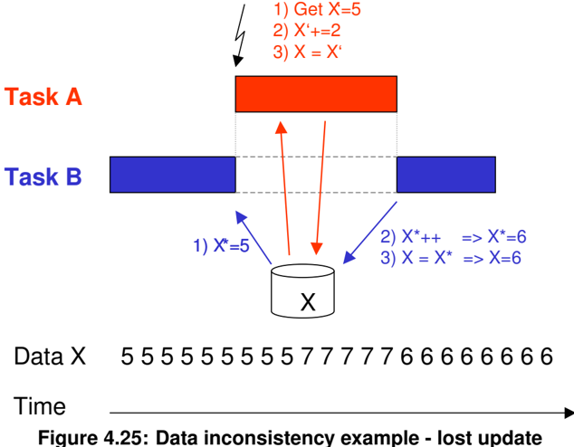

存在两个任务。任务 A 的优先级高于任务 B。A 将公共访问的计数器 X 加 2，B 将 X 加 1。因此两个任务中都存在读（步骤 1）- 改（步骤 2）- 写（步骤 3）的序列。如果访问不是原子的（完整完成且不被中断的读-改-写访问），则可能发生：

1. 假设 X=5。
2. B 对 X 进行读（步骤 1）访问，把值 5 存入中间存储（例如栈或 **CPU** 寄存器）。
3. B 无法继续，因为它被 A 抢占。
4. A 执行其读（步骤 1）- 改（步骤 2）- 写（步骤 3）序列，即 A 读取 X 的当前值 5，加 2，并写入 X 的新值 7（X=5+2）。
5. A 再次被挂起。
6. B 从被抢占处继续：执行它的改（步骤 2）和写（步骤 3）。也就是说，它从自己的内部存储取出值 5，加 1 得 6，并把 6 写入 X（X=5+1）。
7. B 再次被挂起。

两个任务 A 和 B 都完成后，正确结果应是 X=8，但任务 A 对 X 的更新丢失了。

**6.2.2.6.2 通信模式**

在 AUTOSAR 系统中，**RTE** 必须确保大量通信不被数据一致性问题破坏。**RTE** 生成器在需要时必须采用合适的手段。

可以区分以下通信机制：

* 一个原子 AUTOSAR **SW-C** 内部的通信：同一个原子 AUTOSAR **SW-C** 中运行在不同任务/ISR2 上下文的可运行实体之间的通信，它们通过公共访问的数据进行通信。如果需要 **RTE** 支持数据一致性，必须仅使用"独占区"（**ExclusiveArea**）或"可运行实体间变量"（**InterRunnableVariable**）概念来规定。
* AUTOSAR **SW-C** 之间的分区内通信：

不同 AUTOSAR **SW-C** 的可运行实体之间使用隐式或显式数据交换的发送方/接收方（S/R）通信，可以由 **RTE** 通过公共访问的 **RAM** 内存区域实现。客户端/服务器（C/S）通信中的数据一致性可以归结为与 S/R 通信相同的概念。必须避免数据访问冲突。**RTE** 负责保证数据一致性。

* 分区间通信

**RTE** 必须保证数据一致性。提供给 **RTE** 的分区间通信的不同可能性在 6.2.3.4 节中讨论。

* AUTOSAR **SW-C** 与带 AUTOSAR 接口的 **BSW** 模块之间的 ECU 内通信：

这是上述两种情况的特例。

* ECU 间通信

**COM** 必须为不同 **ECU** 的 **COM** 模块之间完整路径上的 **ECU** 间通信保证数据一致性。每个 **ECU** 上的 **RTE** 必须保证：在它调用 **COM** 发送/接收调用、提供或接收由应用经由 **RTE API** 调用并发访问的数据项时，不会发生数据不一致——尤其是在使用队列时，因为队列由 **RTE** 而非 **COM** 提供。

**RTE** 必须保证经由 AUTOSAR 接口的通信的数据一致性。

**6.2.2.6.3 概念**

在 AUTOSAR **SW-C** 模板[2]"一个组件内可运行实体之间的交互"一章中，引入了以下概念：

1. 独占区（见下文 6.2.2.6.5 节）；
2. 可运行实体间变量（见下文 6.2.2.6.6 节）。

它们允许用户（**SW** 设计人员）指定 **RTE** 应在何处为 AUTOSAR **SW-C** 内部通信和执行环境保证数据一致性。后续各节将更详细地讨论。

此外，基础软件模块也可以使用独占区来保护对模块内部数据的访问，见[9]。基础软件模块的独占区由基础软件调度器处理。

AUTOSAR **SW-C** 模板规范[2]还指出，AUTOSAR **SW-C** 可以定义 `PerInstanceMemory` 或 `arTypedPerInstanceMemory`，允许为 **SW-C** 预留静态（永久）的全局 **RAM** 需求。对于可运行实体如何访问这些内存没有任何规定。**RTE** 只提供对这块内存的引用（见 7.1.6 节），但不为其保证数据一致性。

AUTOSAR **SW-C** 的实现者必须自行确保：运行在不同任务/ISR2 上下文中的可运行实体对预留为 `PerInstanceMemory` 的 **RAM** 的访问不会导致数据不一致。另一方面，这为内存的使用提供了更多自由。

**6.2.2.6.4 保证数据一致性的机制**

独占区和可运行实体间变量只在 AUTOSAR **SW-C** 内部通信的语境下提及。但其背后的数据一致性机制也可以应用于 AUTOSAR **SW-C** 之间、或 AUTOSAR **SW-C** 与 **BSW** 模块之间的通信——即 **RTE** 必须保证数据一致性的所有地方。

这里列出的数据一致性保证机制源自 AUTOSAR **SW-C** 模板以及进一步的讨论。可能还有更多机制（分区间通信涉及的机制见 6.2.3.4 节）。

**RTE** 有责任在需要时应用这些机制。如何应用这些机制的细节留给 **RTE** 供应商。

机制：

**· 顺序调度策略**

* 可运行实体的激活代码被顺序地放置在一个任务/ISR2 中，因此它们之间不可能相互干扰，因为一个可运行实体只有在另一个终止之后才被激活。数据一致性得到保证。

**· 中断阻塞策略**

如果需要在很短的时间内避免冲突，中断阻塞可能是合适的手段。这可以通过禁用/挂起所有中断、仅 **OS** 中断、或（如果硬件支持）仅某些中断级别来实现。一般而言，必须谨慎使用这一机制，因为它可能影响更高优先级任务中的软件以及整个系统的时序。

**· 使用 OS 资源**

使用 **OS** 资源。与中断阻塞策略相比的优点是阻塞的更高优先级软件部分更少；缺点是由于机制更复杂，实现可能消耗更多资源（代码、运行时间）。这种机制的适用性可能因 **OS**/核的数量和/或可用资源的数量而异。

**· 任务阻塞策略**

禁止任务间相互抢占。例如可以通过给受影响的任务指派相同优先级、给受影响的任务指派相同的内部 **OS** 资源、或把任务配置为非抢占来实现。该机制在多分区系统中可能不合适。

**· 复制策略**

思想：**RTE** 创建数据项的副本，使不同任务/ISR2 上下文中的并发访问不会冲突，因为其中一些访问被重定向到副本。

工作方式：

**—应用于读冲突：**

为所有优先级低于写者的读者提供一个读副本。

**示例：**

存在可运行实体 R1、R2，数据项 X 和副本数据项 X*。当 R1 运行在比 R2 更高优先级的任务上下文中、R1 是唯一写 X 的实体、而 R2 读 X 时，可以在激活 R2 之前把数据项 X 复制到变量 X*，并把写访问从 X 重定向到 X*（或把 R2 的读访问从 X 重定向到 X*），从而保证数据一致性。

**—应用于写冲突：**

如果存在一个或多个优先级高于发送方的数据项接收方，则为发送方提供一个写副本。

**示例：**

存在可运行实体 R1、R2，数据项 X 和副本数据项 X*。当 R1（运行在比 R2 更低优先级的任务上下文中）写 X、而 R2 读 X 时，可以在激活 R1 之前把数据项 X 复制到数据项 X*，并把 R1 的写访问从 X 重定向到 X*（或把 R2 的读访问从 X 重定向到 X*），从而保证数据一致性。

如果满足以下一个或多个条件，使用这种复制机制可能有意义：

* 该复制机制适用于只有一个实例执行数据写访问的情形。
* R2 多次访问 X。
* 多个可运行实体 R2 对 X 有读（相应地写）访问。
* 节省运行时间比节省代码和 **RAM** 更重要。
* 持有副本所需的额外 **RAM** 是可接受的。

还需考虑的进一步问题：

* 以源代码交付的 AUTOSAR **SW-C** 与以目标代码交付的 AUTOSAR **SW-C** 可能需要以不同方式处理。源代码的重定向机制可以非常高效地使用 C/C++ 宏，而目标代码的 AUTOSAR **SW-C** 很可能被迫使用引用。

请注意，复制策略用于保证隐式发送方-接收方通信（`dataReadAccess` 或 `dataWriteAccess` 角色的 `VariableAccess`）以及使用隐式行为可运行实体间变量的 AUTOSAR **SW-C** 内部通信的数据一致性。

当为应用软件集群生成 **RTE** 时，它不得调用以下任何数据一致性 **API**：`SuspendAllInterrupts`、`ResumeAllInterrupts`、`DisableAllInterrupts`、`EnableAllInterrupts`。

**理由**：由于这些 **API** 不受 **Os High Proxy** 模块支持，因此不能在应用软件集群内调用。

**6.2.2.6.5 独占区**

独占区概念更像一种工作模型，而不是一种具体的实现方法，尽管 AUTOSAR **SW-C** 模板规范[2]列出了具体可行的机制。

独占区概念的关注点是通过阻塞潜在的并发访问来获得数据一致性。独占区实现临界区（**critical section**）。

独占区与 `RunnableEntity` 关联。当 `RunnableEntity` 在独占区内运行时，**RTE** 被强制保证数据一致性。`RunnableEntity` 可以完整地运行在一个或多个独占区内，也可以在执行期间一次或多次进入一个或多个独占区。

* 如果 AUTOSAR **SW-C** 请求 **RTE** 使用独占区概念为其内部使用的数据（部分或全部）保证数据一致性，**SW** 设计人员可以使用 **API** 调用 `Rte_Enter()`（见 7.1.6.30 节）和 `Rte_Exit()`（见 7.1.6.31 节）来指定希望由 **RTE** 施加保护的位置。

`Rte_Enter()` 定义包含数据访问的代码序列的开始，`Rte_Exit()` 定义其结束，**RTE** 必须为这段代码序列保证数据一致性。

* 如果 **SW** 设计人员希望对完整的 `RunnableEntity` 施加互斥，可以在 AUTOSAR **SW-C** 描述中使用 `runsInside` 角色中的独占区来指定。

原则上，独占区概念既可以处理对单个数据项的访问，也可以处理由一组指令实现对多个数据项的访问。一个可运行实体完整地运行在某个独占区内、而另一个可运行实体只是临时进入同一独占区，也没有关系。**RTE** 必须保证数据一致性。

**RTE** 必须为由标记了同一独占区的可运行实体所访问的数据项的任意访问保证数据一致性。

**RTE** 必须提供一个 **API**，使 **SW-C** 能够进入和离开独占区。

如果访问同一独占区的可运行实体被指派为在不同任务/ISR2 上下文中执行，**RTE** 可以采用合适的机制（例如任务/ISR2 阻塞）来保证公共独占区内数据访问的数据一致性。不过，可以设置一些特殊属性来要求数据一致性机制，此时 **RTE** 生成器被迫采用所选的机制。

基础软件调度器为基础软件模块提供独占区。基础软件模块必须使用 **API** 调用 `SchM_Enter()`（见 7.2.5.1 节）和 `SchM_Exit()`（见 7.2.5.2 节）来指定必须由基础软件调度器施加保护的位置。

基础软件调度器必须为由标记了同一独占区的 `BswModuleEntity` 所访问的数据项的任意访问保证数据一致性。

基础软件调度器必须提供一个 **API**，使基础软件模块能够进入和离开独占区。

不支持非 `BswSchedulableEntity` 的 `BswModuleEntity` 使用 `runsInside` 角色中的独占区。这是不可能的，因为这类实体可能被其他基础软件模块直接调用，因此基础软件调度器无法自动进入和退出独占区。

**RTE** 生成器应拒绝这样的配置：某个非 `BswSchedulableEntity` 的 `BswModuleEntity` 使用 `runsInside` 角色中的独占区。

**6.2.2.6.5.1 数据一致性机制的指派**

应用于某个独占区的数据一致性机制可能是域、**ECU** 乃至项目特定的。由 **RTE**/基础软件调度器采用哪种机制的决定在 **ECU** 集成期间做出，即设置独占区配置参数 `RteExclusiveAreaImplMechanism`。该参数是 **RTE** 生成器的输入。

如 6.2.2.6.4 节所述，实现独占区的机制可能多于本规范提到的这些。因此 **RTE** 实现可以通过供应商特定解决方案额外提供其他机制，这允许进一步优化。

目前必须支持配置参数 `RteExclusiveAreaImplMechanism` 的以下取值：

* `ALL_INTERRUPT_BLOCKING`

该值要求使能和禁用所有中断，基于中断阻塞策略。

* `OS_INTERRUPT_BLOCKING`

该值要求使能和禁用 **OS** 中断，基于中断阻塞策略。

* `OS_RESOURCE`

该值要求应用"使用 **OS** 资源"机制。

* `OS_SPINLOCK`

该值用于协调不同核上任务/ISR2 对共享资源的并发访问。

* `NONE`

**RTE** 生成器不应用任何数据一致性机制。数据一致性由 **RTE** 实现控制范围之外的方法保证。

* `RTE_PLUGIN`

该值要求应用 **RTE** 实现插件机制。

上述策略/机制已在 6.2.2.6.4 节中一般性地描述。

如果某个独占区的配置参数 `RteExclusiveAreaImplMechanism` 设置为 `ALL_INTERRUPT_BLOCKING`，则当可能发生数据不一致时，**RTE** 生成器应使用中断阻塞机制（阻塞所有中断）来保证数据一致性。

当为应用软件集群生成 **RTE** 时，如果配置参数 `RteExclusiveAreaImplMechanism` 设置为 `ALL_INTERRUPT_BLOCKING`，则 **RTE** 应报错。

如果某个独占区的配置参数 `RteExclusiveAreaImplMechanism` 设置为 `OS_INTERRUPT_BLOCKING`，则当可能发生数据不一致时，**RTE** 生成器应使用中断阻塞机制（仅阻塞 **OS** 中断）来保证数据一致性。

如果某个独占区的配置参数 `RteExclusiveAreaImplMechanism` 设置为 `OS_RESOURCE`，则当可能发生数据不一致时，**RTE** 生成器应使用 **OS** 资源来保证数据一致性。

上述规定带有"当可能发生数据不一致时"的限制，因为如果不可能发生潜在的数据不一致，应用数据一致性机制毫无意义。例如，当 **ECU** 集成人员通过定义合适的可运行实体到任务映射、使"顺序调度策略"（见 6.2.2.6.4 节）已经解决了该问题时，这就是相关的。

如果某个独占区的配置参数 `RteExclusiveAreaImplMechanism` 设置为 `OS_SPINLOCK`，则当可能发生数据不一致时，**RTE** 生成器应使用 **OS** 自旋锁来保证数据一致性。

如果某个独占区的配置参数 `RteExclusiveAreaImplMechanism` 设置为 `NONE`，则 **RTE** 生成器应为所有必需的 **API** 创建功能为空的实现。

**注意：** 通过 **RTE** 实现插件机制实现独占区（`RteExclusiveAreaImplMechanism` 设置为 `RTE_PLUGIN`）在 6.3.3.5 节中描述。

**注意：** 配置参数 `RteExclusiveAreaImplMechanism` 可以针对每个 **SWC** 实例规定，因此每个 **API** 的实现可能不同。"功能为空"的描述意味着没有锁定/解锁独占区的代码，但可以存在其他代码，例如 **VFB** 跟踪。如果所有 **SWC** 实例的实现相同（例如都为空），**RTE** 生成器可以在 **RTE API** 映射中提供类函数宏，以进一步优化所生成的 **API**。当实现不同时无法进行这种优化，因为 **API** 映射是按类型生成的。

在 **SWC** 代码中，不允许在独占区内使用 `WaitPoint`：**RTE** 生成器可能使用 OSEK 服务来实现独占区，而例如在已占用 OSEK 资源时不允许等待 **OS** 事件。对于 `RunnableEntity` 进入独占区的情形，**RTE** 生成器无法检查 `WaitPoint` 是否位于独占区内。因此，确保不在独占区内使用 `WaitPoint` 是 **SWC** 代码编写者的责任。但对于在独占区内运行的 `RunnableEntity`，**RTE** 生成器能够进行如下检查。

**RTE** 生成器应拒绝这样的配置：某个使用 `runsInside` 角色中独占区的 `RunnableEntity` 被施加了 `WaitPoint`。

**6.2.2.6.6 可运行实体间变量**

原子 **SW 组件**（`NvBlockComponent` 除外）可以预留可运行实体间变量，由该原子 **SW 组件** 的可运行实体访问（另见 6.2.3.3.1 节）。可以进行读和写访问。每个 AUTOSAR **SW-C** 实例都有单独的一组这样的变量。

同样，**RTE** 必须保证数据一致性。合适的手段取决于在 **ECU** 配置期间做出的可运行实体布置决策。

**RTE** 必须为使用同一可运行实体间变量的一个 AUTOSAR 软件组件实例的可运行实体之间的通信保证数据一致性。

下面讨论两类可运行实体间变量：

1. 隐式行为的可运行实体间变量（`implicitInterRunnableVariable`）；
2. 显式行为的可运行实体间变量（`explicitInterRunnableVariable`）。

**6.2.2.6.6.1 隐式行为的可运行实体间变量**

在 **SW-C** 通信需求非常高、实时约束很多的应用中（例如动力总成域），使用复制机制获得数据一致性可能是个好选择，因为在 `RunnableEntity` 执行期间不存在并发访问阻塞代码形式的数据一致性开销，也不存在执行期间的运行时开销——与数据项访问次数无关。

代价是 `RunnableEntity` 前导和后尾代码的额外开销，与其他解决方案相比通常很小。此外还需要为副本提供额外的 **RAM**。

当使用隐式行为的可运行实体间变量时，要求 **RTE** 使用复制操作的语义使数据对可运行实体可用，但不一定要求为每个 `RunnableEntity` 使用唯一的副本。

隐式行为可运行实体间变量的关注点是通过把第二次、第三次……访问重定向到数据项副本来避免并发访问。

**RTE** 应通过使用一个或多个副本、并把访问重定向到副本，来保证隐式行为可运行实体间变量的数据一致性，即避免对 `implicitInterRunnableVariable` 所规定数据项的并发访问。

与发送方/接收方通信相比：

* 与 `dataReadAccess` 和 `dataWriteAccess` 角色的 `VariableAccess` 一样，可运行实体的输入数据在可运行实体执行期间是稳定的，也就是说，在可运行实体执行期间对 `implicitInterRunnableVariable` 的多次读访问总是返回同一个数据项值。
* 与 `dataReadAccess` 和 `dataWriteAccess` 角色的 `VariableAccess` 一样，可运行实体的输出数据在可运行实体执行终止之前不会被转发给其他可运行实体，也就是说，在可运行实体执行期间对 `implicitInterRunnableVariable` 的写访问对其他可运行实体不可见。

这种行为要求可运行实体的执行会终止。

在 `RunnableEntity` 执行期间对 `implicitInterRunnableVariable` 的多次读访问的值，只应因该 `RunnableEntity` 内部对该 `implicitInterRunnableVariable` 的写访问而改变。

在 `RunnableEntity` 执行期间对 `implicitInterRunnableVariable` 的多次写访问，应只导致该 `implicitInterRunnableVariable` 的内容对其他 `RunnableEntity` 更新一次，即以最后写入的值更新。

在 `RunnableEntity` 执行期间完成的 `implicitInterRunnableVariable` 更新，应在该 `RunnableEntity` 执行终止后对其他 `RunnableEntity` 可用。

如果某个 `RunnableEntity` 对某个 `implicitInterRunnableVariable` 既有读访问又有写访问，则写访问的结果应对同一可运行实体内的后续读访问立即可见。

`implicitInterRunnableVariable` 的使用允许用于所有类别的可运行实体。对类别 2 的可运行实体，只有在其执行时间有限时行为才得到保证。永远运行的类别 2 可运行实体的数据不会被更新。

`implicitInterRunnableVariable` 的 **API** 见 7.1.6.24 节和 7.1.6.26 节。

关于该机制如何工作的更多细节见 6.2.2.6.4 节的"复制策略"。

**6.2.2.6.6.2 显式行为的可运行实体间变量**

在许多应用中，节省 **RAM** 比节省运行时间更重要。也有一些应用要求无延迟地访问最新的数据项值，甚至在一次可运行实体执行期间访问多次。

如果 **RTE** 通过在数据一致性受到威胁时阻塞对信号缓冲区的第二/第三/……并发访问来支持数据一致性，这两个需求都可以满足。（如果软件运行在 16 位机器上、在存在 16 位数据总线的情况下访问一个 16 位值，**RTE** 很可能无事可做。）

显式行为可运行实体间变量的关注点是通过阻塞潜在的并发访问来获得数据一致性。

其背后的机制与独占区概念相同（见 6.2.2.6.5 节）。但尽管独占区也能处理单数据项访问，其 **API** 的设计是让 **RTE** 对访问多个数据项的一组指令施加数据一致性手段。因此，若使用独占区来保护对一个公共数据项的访问，每次都需要在前后配对两个 **RTE API** 调用。这非常不便，而且如果忘记配对调用可能导致错误。

解决方案是支持显式行为的可运行实体间变量。

**RTE** 应通过阻塞对 `explicitInterRunnableVariable` 所规定数据项的并发访问，保证显式行为可运行实体间变量的数据一致性。

**RTE** 生成器不能自行决定应用隐式还是显式行为。行为必须在 AUTOSAR **SW-C** 设计时已知，因为对于隐式行为的可运行实体间变量，AUTOSAR **SW-C** 设计人员可能依赖"多次读访问总是返回同一数据项值"这一事实。

**RTE** 应为隐式行为可运行实体间变量和显式行为可运行实体间变量提供不同的 **API**。

显式行为可运行实体间变量的 **API** 见 7.1.6.28 节和 7.1.6.29 节。

##### 6.2.2.7. 可运行实体与基础软件可调度实体的多重触发

**并发激活**

AUTOSAR **SW-C** 模板规范[2]指出：如果可运行实体（下文称"可运行实体"）的 `canBeInvokedConcurrently` 特性被设置，则它可能被并发地多次调用。此时，确保可运行实体被多次并行激活时数据不被破坏是 AUTOSAR **SW-C** 设计人员的责任。

如果某个 **SW-C** 有多个实例，它们拥有各自不同的可运行实体。在下文中，两个使用同一 `SwcInternalBehavior` 描述中同一 `RunnableEntity` 描述、但以两个不同 **SW-C** 实例实例化的可运行实体，被视为两个不同的可运行实体。这种并发在 **SW-C** 之间始终是允许的，即使这些可运行实体的 `canBeInvokedConcurrently` 特性为 false。

如果关联特性 `canBeInvokedConcurrently` 设置为 TRUE，则 **RTE** 应支持同一个可运行实体实例的并发激活，包括在多个任务/ISR2 中的并发激活。如果该特性未设置（或设置为 FALSE），则禁止该可运行实体的并发激活。

基础软件模块描述模板[9]通过特性 `isReentrant` 规定 `BswModuleEntity` 的可能并发激活。

如果 `implementedEntry` 角色中所引用 `BswModuleEntry` 的 `isReentrant` 特性（或可选 `BswModuleClientServerEntry` 的 `isReentrant` 特性，见 **TPS BSWMDT**）设置为 true，则基础软件调度器应支持同一个 `BswModuleEntity` 实例的并发激活，包括在多个任务/ISR2 中的并发激活。如果该特性设置为 false，则禁止该 `BswModuleEntity` 的并发激活。

同一个 `ExecutableEntity` 实例的并发激活会产生多个 `ExecutableEntity` 执行实例，每个激活上下文一个。

**由多个 RTEEvent 和 BswEvent 激活**

尽管如此，`canBeInvokedConcurrently` 未设置为 true 的可运行实体，仍可能由多个 `RTEEvent` 激活，前提是激活配置保证并发激活绝不可能发生、且保持 `minimumStartInterval` 条件。这包括在不同任务中的激活。在这种情况下，该可运行实体仍被视为只有一个 `ExecutableEntity` 执行实例。一个标准用例是在不同模式下激活同一个可运行实体实例。

**RTE** 应支持由多个 `RTEEvent` 激活同一个可运行实体实例。

`RTEEvent` 触发可运行实体激活，并可以提供 0..多个角色参数（见 7.1.7.3 节）。角色参数在可运行实体签名中不可见，由 `OperationInvokedEvent` 触发的除外。除 `OperationInvokedEvent` 之外，所有角色参数都可以由用户通过隐式或显式接收 **API** 访问。

**RTE** 应支持由不同种类的 `RTEEvent` 激活同一个可运行实体实例。

**RTE** 不支持由 `OperationInvokedEvent` 触发的可运行实体再被任何其他 `RTEEvent` 触发（该操作的其他兼容 `OperationInvokedEvent` 除外）。该限制在附录 4.1.2 节中说明。

与 `RunnableEntity` 上述配置类似的配置也可用于 `BswSchedulableEntity`。因此，即使是 `implementedEntry` 角色中所引用 `BswModuleEntry` 的 `isReentrant` 特性为 false 的 `BswSchedulableEntity`，也可以由多个 `BswEvent` 激活。

基础软件调度器应支持由多个 `BswEvent` 激活同一个 `BswSchedulableEntity` 实例。

基础软件调度器应支持由不同种类的 `BswEvent` 激活同一个 `BswSchedulableEntity` 实例。

##### 6.2.2.8. 参数与数据元素的实现

###### 6.2.2.8.1. 概述

**SWC** 通过端口与其他 **SWC** 通信。端口由 `PortInterface` 刻画，`PortInterface` 有若干种类。本节聚焦于 `ParameterInterface`、`SenderReceiverInterface` 和 `NvDataInterface`。这三种 `PortInterface` 聚合了一些特定的接口元素。例如，`ParameterInterface` 聚合 0..* 个 `ParameterDataPrototype`。

###### 6.2.2.8.2. 兼容性规则

需求端口只能连接到兼容的提供端口。兼容性规则在 AUTOSAR 软件组件模板[2]中说明。兼容性主要取决于附加在接口元素上的 `swImplPolicy` 特性。表 4.7 给出了兼容性规则的概览。

表 4.7：`ParameterDataPrototype` 与 `VariableDataPrototype` 兼容性概览（结合表 4.8 的图例）

| 提供端口接口 | 提供端口元素 | swImplPolicy | 需求：Prm/PDP/fixed | 需求：Prm/PDP/const | 需求：Prm/PDP/standard | 需求：S/R/VDP/standard | 需求：S/R/VDP/queued | 需求：NvD/VDP/standard |
| --- | --- | --- | --- | --- | --- | --- | --- | --- |
| Prm | PDP | fixed | yes | yes | yes | yes | no | yes |
| Prm | PDP | const | no | yes | yes | yes | no | yes |
| Prm | PDP | standard | no | no | yes | yes | no | yes |
| S/R | VDP | standard | no | no | no | yes | no | yes |
| S/R | VDP | queued | no | no | no | no | yes | no |
| NvD | VDP | standard | no | no | no | yes | no | yes |

表 4.8：表 4.7 的图例——接口元素：PDP = `ParameterDataPrototype`，VDP = `VariableDataPrototype`；端口接口：Prm = `ParameterInterface`，S/R = `SenderReceiverInterface`，NvD = `NvDataInterface`。

例如，期望 fixed 参数（即由宏 `#define` 产生）的需求端口只能连接到提供 fixed 参数的端口。这是因为该固定数据可能用在诸如 `#IF` 之类的编译指令中，而这种情况下只有宏 `#define`（固定数据）能够参与编译。另一方面，这个被提供的 fixed 参数几乎可以连接到所有需求端口，排队的发送方/接收方接口除外。

**RTE** 不必检查端口之间的兼容性，因为该任务在 **VFB** 层完成。但它应按照附加在接口元素上的 `swImplPolicy` 特性，提供正确的接口元素实现和 **API**。

###### 6.2.2.8.3. 接口元素的实现

接口元素的实现取决于 `swImplPolicy` 特性。`swCalibrationAccess` 特性决定接口元素可以如何被（例如外部标定工具）访问。表 4.9 定义了受支持的 `swImplPolicy` 与 `swCalibrationAccess` 特性设置组合，并给出 **RTE** 相应的实现。

表 4.9：依据 `swImplPolicy` 的数据实现

| swImplPolicy | notAccessible | readOnly | readWrite | 实现 |
| --- | --- | --- | --- | --- |
| fixed | yes | 不支持 | 不支持 | 宏定义或 C const 声明（取决于 **RTE** 优化） |
| const | yes | yes | 不支持 | C const 声明 |
| standard | yes | yes | yes | 标准实现，即 **RAM** 中 `VariableDataPrototype` 的变量，或 **ROM** 中的标定参数<sup>3</sup> |
| queued | yes | 不支持 | 不支持 | **FIFO** 队列 |
| measurement Point | 不支持 | yes | 不支持 | 变量 |

> 3 如果需要软件支持的数据仿真，标定参数必须分配在 **RAM** 中，见 6.2.2.9.3.5 节。

###### 6.2.2.8.4. VariableDataPrototype 的初始化

原则上，任何 `VariableDataPrototype` 是否需要初始化由定义该 `VariableDataPrototype` 的软件组件描述规定。该信息基本上由 `initValue` 的存在与否以及相关 `SwAddrMethod` 的 `sectionInitializationPolicy` 定义。如 8.12 节所述，此外 **RTE** 的集成人员还可以调整初始化策略，使其行为与启动代码相匹配。

以下情况中，实现 `VariableDataPrototype` 的变量应被初始化：定义了 `initValue`，且未为该 `VariableDataPrototype` 定义 `SwAddrMethod`。

以下情况中，实现 `VariableDataPrototype` 的变量应被初始化：定义了 `initValue`，且为该 `VariableDataPrototype` 定义了 `SwAddrMethod`，并且相关 `SwAddrMethod` 的 `sectionInitializationPolicy` 所对应的 `RteInitializationStrategy` 未配置为 `RTE_INITIALIZATION_STRATEGY_NONE`。

###### 6.2.2.8.5. 可选元素的初始化

对于某个给定 `AutosarDataType` 中可选元素的存在，需要在定义初始值时特别考虑。

**6.2.2.8.5.1 ApplicationDataType**

当为某个由 `ApplicationRecordDataType` 类型化的 `DataPrototype` 提供初始值、且至少一个 `ApplicationRecordElement` 的 `isOptional` 特性为 TRUE 时，没有手段关联到该 `DataPrototype` 的 `availabilityBitfield`（因为 `availabilityBitfield` 是在 `ImplementationDataType` 层引入的）。

每个 `ApplicationRecordElement`（包括 `isOptional` 为 TRUE 的那些）可以用 `ApplicationValueSpecification` 或 `NotAvailableValueSpecification` 初始化。使用 `NotAvailableValueSpecification` 定义了该记录元素在初始化时即被视为不可用。不可用的记录元素同样会用默认模式初始化（见 **TPS SWCT**）。`ApplicationValueSpecification` 与 `NotAvailableValueSpecification` 的这种替代使用用于推导 `availabilityBitfield` 的初始值。

如果为某个由 `ApplicationRecordDataType` 类型化的 `DataPrototype` 提供初始值、且至少一个 `ApplicationRecordElement` 的 `isOptional` 特性为 TRUE，则相应 `availabilityBitfield` 的初始值应从 `ApplicationValueSpecification` 和 `NotAvailableValueSpecification` 的存在情况推导：

* 如果某个 `ApplicationRecordElement` 用 `ApplicationValueSpecification` 初始化，则 `availabilityBitfield` 中相应的位应置为 TRUE（可用）；
* 如果某个 `ApplicationRecordElement` 用 `NotAvailableValueSpecification` 初始化，则 `availabilityBitfield` 中相应的位应置为 FALSE（不可用）。

**6.2.2.8.5.2 ImplementationDataType**

当为某个由类别为 `STRUCTURE`、且 `isStructWithOptionalElement` 设置为 TRUE 的 `ImplementationDataType` 类型化的 `DataPrototype` 提供初始值时，[2]在 **TPS SWCT** 中定义了初始化策略。这导致为所有结构成员显式定义初始值，包括其中定义的 `availabilityBitfield`。

如果为某个由类别为 `STRUCTURE`、且 `isStructWithOptionalElement` 设置为 TRUE 的 `ImplementationDataType` 类型化的 `DataPrototype` 提供初始值，则 `availabilityBitfield` 的初始值应取自 `shortName` 为 "availabilityBitfield" 的 `ImplementationDataTypeElement` 的初始值。

###### 6.2.2.8.6. 初始值计算

原则上，元模型定义了两种基于规则的值规格：

* `ApplicationRuleBasedValueSpecification`
* `NumericalRuleBasedValueSpecification`

`ApplicationRuleBasedValueSpecification` 以物理表示定义值，而 `NumericalRuleBasedValueSpecification` 以数值表示定义值（见文档[2]"数据描述"一节）。但二者都使用 `RuleBasedValueSpecification` 基于一条规则及该规则的参数来定义一组值。

尤其是在大数组的情形下需要大量初始值。但许多数组用相同的值初始化，或至少到末尾都用相同的值填充。对于这类用例，可以使用类别为 `FILL_UNTIL_END` 的 `RuleBasedValueSpecification`，避免创建和维护冗余的 `ValueSpecification`。

**RTE** 生成器应支持为由 `ApplicationArrayDataType` 类型化的 `DataPrototype` 使用 `ApplicationRuleBasedValueSpecification`。

**RTE** 生成器应支持为由类别 `ARRAY` 的 `ImplementationDataType` 类型化的 `DataPrototype`、以及映射到类别 `ARRAY` 的 `ImplementationDataType` 的复合原始数据类型使用 `NumericalRuleBasedValueSpecification`。

**RTE** 生成器应支持规则为 `FILL_UNTIL_END` 的 `RuleBasedValueSpecification`。

**RTE** 生成器应支持规则为 `FILL_UNTIL_MAX_SIZE` 的 `RuleBasedValueSpecification`。

当适用规则为 `FILL_UNTIL_END` 或 `FILL_UNTIL_MAX_SIZE` 的 `RuleBasedValueSpecification` 时，**RTE** 应按照该 `RuleBasedValueSpecification` 的 `arguments` 所定义的值初始化数组的元素。其中参数的顺序对应数组元素的顺序，即第一个参数对应数组的第一个元素，第二个参数对应数组的第二个元素，依此类推。

AUTOSAR 只对规则 `FILL_UNTIL_END` 和 `FILL_UNTIL_MAX_SIZE` 定义了标准化的 `RuleBasedValueSpecification` 行为。**RTE** 供应商可以自由添加额外的、非标准化的规则（见 **TPS SWCT**）。

如果规则设置为 `FILL_UNTIL_END`、且参数数量小于其适用数组的元素数量，则 **RTE** 生成器应把最后一个 `RuleBasedValueSpecification` 参数的值应用到数组的所有后续元素，直至数组的最后一个元素。

如果规则设置为 `FILL_UNTIL_MAX_SIZE`、且参数数量小于其适用数组的元素数量，则 **RTE** 生成器应把最后一个 `RuleBasedValueSpecification` 参数的值应用到数组后续的若干元素，直至数组的前 `maxSizeToFill` 个元素被填满。

如果参数数量超过其适用数组的元素数量，则 **RTE** 生成器应忽略超出数组最后一个元素的参数。

##### 6.2.2.9. 测量与标定

###### 6.2.2.9.1. 概述

标定是调整 **ECU** 软件，使其完成任务所需的物理过程控制，或使其适配特定项目需求或环境的过程。为此需要两种不同的机制，必须加以区分：

1. 测量（**Measurement**）

测量 **ECU** 内部正在发生什么，例如通过监控通信数据（ECU 间、分区间、分区内、**SWC** 内）。有多种方式可以把监控数据从 **ECU** 取出，交给外部可视化与解释工具。

2. 标定（**Calibration**）

基于测量数据，通过修改参数来改变 **ECU** 行为，例如运行期软件开关、原始或复合数据类型的过程控制数据、插值曲线或插值场。下文对这类参数使用术语标定参数（**calibration parameter**）。

在 AUTOSAR 中，标定参数用 `ParameterDataPrototype` 类实例化，该类聚合一个 `SwDataDefProps`，其特性为 `swCalibrationAccess` = `readWrite` 且 `swImplPolicy` = `standard`。

尽管如此，也支持实例化聚合 `SwDataDefProps`（特性 `swCalibrationAccess` = `readWrite`、`swImplPolicy` = `standard`）的 `VariableDataPrototype`。但此时这种 `VariableDataPrototype` 的实现按 `swCalibrationAccess` = `readOnly` 对待，**RTE** 生成器不必实现进一步的措施（例如"软件支持的数据仿真"，6.2.2.9.3.5 节）。

可能为某个 `VariableDataPrototype` 及其引用的 `AutosarDataType` 规定不同的 `SwDataDefProps` 设置。此时应应用 **SWC-T** 中规定的规则，另见 6.2.1.3 节的规定。

`SwDataDefProps` 还包含更多信息，说明外部标定工具应如何解释和呈现测量值或特性。这些信息是生成 ASAM2（即 A2L）文件所必需的。随后 **A2L** 文件被 **ECU** 外部的测量与标定工具使用，使这些工具知道例如如何解释从 **ECU** 收到的原始数据以及如何获取它们。

###### 6.2.2.9.1.1. 标定参数的定义

标定参数既可以在 AUTOSAR **SW** 中定义，也可以在基础软件中定义。在 AUTOSAR 架构中有两种定义标定参数的可能性。选择哪一种不是本 **RTE** 规范的关注点。

1. **RTE** 提供标定参数访问：如果标定参数通过 `ParameterSwComponentType` 规定。可以定义 `ParameterSwComponentType`，以便（通过端口）向其他软件组件提供 `ParameterDataPrototype`。
2. 对 **RTE** 不可见的标定参数访问

由于基础软件不允许采用代码共享的多重实例化，而软件组件也并非总是需要多重实例化，这些软件可以定义自己的标定参数分配方法。但这些标定参数仍应在相应的基础软件模块描述或软件组件描述中描述。如果使用了软件支持的数据仿真，那么处理仿真细节和与外部标定工具数据交换的整个软件和工具链（例如处理这些细节的基础软件，即 **XCP** 驱动）就必须同时处理多种仿真方法：**RTE** 使用的那一种，以及每个使用本地标定参数的基础软件或 **SWC** 各自采用的那些。

###### 6.2.2.9.1.2. 在线标定与离线标定

测量与标定的执行方式因公司、领域和项目而异。但仍可区分两种基本情形，它们对理解很重要：

1. 离线标定（**Offline calibration**）

在 **ECU** 运行时测量，在 **ECU** 断电时修改标定数据。过程可能如下：

* (a) 用当前程序文件烧写 **ECU**；
* (b) 在目标（真实或仿真的）环境中上电 **ECU**；
* (c) 测量运行中的 **ECU** 行为——通过外部工具记录或监控；
* (d) 关闭 **ECU**；
* (e) 修改标定参数并创建新的可烧写程序文件（hex 文件），例如执行一次新的 **SW make run**；
* (f) 回到 (a)。

只要还存在修改标定参数的需求、或闪存还能承受，就循环执行。

2. 在线标定（**Online calibration**）

并行地进行测量与标定。

在这种情况下，原则上上述"离线标定"中提到的所有步骤都必须并行执行。因此引入了其他机制，避免在修改 **ECU** 参数时烧写 **ECU**。**ECU** 临时使用修改后的数据工作，标定过程结束后得到的是一套更新后的标定数据。下一步可以把这批新数据合并到现有程序文件中，或作为一次新 **SW make run** 的输入。两种情况下，输出都是一个用于烧写 **ECU** 的新程序文件。

过程可能如下：

* (a) 用当前程序文件烧写 **ECU**；
* (b) 在目标环境中上电 **ECU**；
* (c) 测量运行中的 **ECU** 行为并临时修改标定参数。把更新后的标定参数集合保存起来（不保存在 **ECU** 上，而是保存在标定工具的计算机上）。步骤 c) 中的动作可以迭代进行；
* (d) 关闭 **ECU**；
* (e) 创建包含新标定参数的新的可烧写程序文件（hex 文件）。

过程结束。

###### 6.2.2.9.2. 测量

**6.2.2.9.2.1 可测量的对象**

AUTOSAR **SW-C** 模板规范[2]说明了测量模式可以应用于哪些 AUTOSAR 原型。

**RTE** 为以下对象提供测量支持：

1. 端口之间的通信。可测量的有：
   * `SenderReceiverInterface` 中、用在（`SwComponentPrototype` 的）`PortPrototype` 中、用于捕获发送方-接收方通信的 `VariableDataPrototype`（`SwComponentPrototype` 之间或内部）；
   * `NvDataInterface` 中、用在（`SwComponentPrototype` 的）`PortPrototype` 中、用于捕获非易失数据通信的 `VariableDataPrototype`（`SwComponentPrototype` 之间或内部）；
   * `ClientServerInterface` 中 `ClientServerOperation` 的 `ArgumentDataPrototype`，用于捕获 `SwComponentPrototype` 之间的客户端-服务器通信。
2. AUTOSAR **SW-C** 内部的通信。可测量的有 `implicitInterRunnableVariable`、`explicitInterRunnableVariable` 或 `arTypedPerInstanceMemory`。
3. AUTOSAR `NvBlockSwComponent` 内部的数据结构。可测量的有 `NvBlockSwComponent` 的 `NvBlock` 的 `ramBlock` 和 `romBlock`。
4. AUTOSAR 基础软件模块内部的通信。可测量的有以 `arTypedPerInstanceMemory` 角色定义的 `VariableDataPrototype`。

此外，AUTOSAR **SW-C** 和基础软件模块可以定义不由 **RTE** 实例化的可测量对象。它们由 `staticMemory` 角色中的 `VariableDataPrototype` 描述。因此这类可测量对象不会出现在 **RTE** 生成的 `McSupportData` 中（见 6.2.2.9.4 节）。

**6.2.2.9.2.2 RTE 对测量的支持**

如何把测量数据从 **ECU** 中读出不是 **RTE** 规范的关注点。但必须这样规定 **RTE** 的结构和行为：在 **ECU** 程序执行期间，**RTE** 能够提供测量值。

为了避免同步开销，应能够以与 **RTE** 代码执行异步的方式读出测量数据。为此，测量数据必须是稳定的。其后果是，这可能会禁止对多个相互独立、但时间上先后发生的 AUTOSAR 通信直接复用 **RAM** 位置（例如用同一个 **RAM** 单元存放同一周期触发任务中位置 3 和 7 的可运行实体之间的 uint8 发送方-接收方通信数据，之后又把同一 **RAM** 单元用于同一任务中位置 9 和 14 的可运行实体之间的通信）。因此，使用可测量元素可能导致所生成 **RTE** 代码的优化减少、**RAM** 需求增加。

在某些情况下，**RTE** 会把同一通信数据存放在不同的 **RAM** 位置，例如实现隐式发送方-接收方通信或隐式行为可运行实体间变量时。在这些情况下，只需让其中一个存储的内容可从外部访问即可。

请注意：当 **Rte** 使用 **IOC** 实现分区间数据通信时，测量支持可能是供应商特定的，因为 **IOC** 并未为 **IOC** 通道的测量提供标准化支持。但另一方面，除了 **IOC** 中所需的缓冲区之外，再在 **Rte** 中创建独立的测量缓冲区，由于额外的 **RAM** 需求，也并非在任何情况下都值得。

应由 **RTE** 支持测量的信息在所应用的 `SwDataDefProps` 中定义：

特性 `swCalibrationAccess` 的值 `readOnly` 或 `readWrite` 定义应支持测量；`swCalibrationAccess` 的任何其他值在测量方面被忽略。

请注意，对 `swImplPolicy` = `measurementPoint` 的 `VariableDataPrototype`，为其提供内存位置的支持没有附加条件。在允许 **MCD** 系统访问这样的 `VariableDataPrototype` 的情况下，即使输入配置中没有消费该数据的软件组件，**RTE** 也不得进行会阻碍这种测量的优化。

包含测量值的内存位置按照 6.2.2.8.4 节的初始化规定进行初始化。

**RTE** 生成器应拒绝这样的输入配置：某个 `RunnableEntity` 对 `swImplPolicy` 设置为 `measurementPoint` 的 `VariableDataPrototype` 定义了读访问（`readLocalVariable`、`dataReadAccess`、`dataReceivePointByValue` 或 `dataReceivePointByArgument` 角色的 `VariableAccess`）。

对于发送方-接收方以及客户端-服务器通信，连接端口使用相同或兼容的接口来规定。因此在 1:1 通信的提供侧和需求侧，通常会对同一或兼容的 `VariableDataPrototype` 提出两次测量需求；在 1:N 或 M:1 通信中则会提出多次。在这种情况下，为一个 `VariableDataPrototype` 提供多个测量值毫无意义，并且会过度增加 **ECU** 资源需求。应当只提供一个测量值。

**发送方-接收方通信**

如果 `SwComponentPrototype` 的发送方-接收方端口接口中所用 `VariableDataPrototype` 的 `swCalibrationAccess` 设置为 `readOnly` 或 `readWrite`，则 **RTE** 生成器必须提供一个引用，指向内存中可以访问该通信相应 `VariableDataPrototype` 实例特定数据实际内容的位置。

为避免同一通信出现多个测量值（注意，受影响的 `VariableDataPrototype` 可能规定在相同或兼容的端口接口中）：

对于 1:1 和 1:N 发送方-接收方通信，如果在提供端口和需求端口都要求测量，则 **RTE** 应提供取自发送方的测量值。

对于 N:1 的 ECU 内发送方-接收方通信，如果在提供端口和需求端口都要求测量，则 **RTE** 应提供取自接收方的测量值。

**注意：** 排队通信的支持见下文。

对于与 ECU 间发送方-接收方通信接收数据关联、且有测量需求的 `VariableDataPrototype`，即使多个接收端口都要求测量，**RTE** 也应只提供一个包含实际接收数据的测量存储引用。

对于与分区间发送方-接收方通信接收数据关联、且有测量需求的 `VariableDataPrototype`，即使同一分区中多个接收端口都要求测量，**RTE** 也应每分区只提供一个包含实际接收数据的测量存储引用。

**客户端-服务器通信**

如果 `SwComponentPrototype` 的客户端-服务器端口接口中所用 `ArgumentDataPrototype` 的 `swCalibrationAccess` 设置为 `readOnly`，则 **RTE** 生成器必须提供一个引用，指向内存中可以读取该通信实例特定实参数据实际内容的位置。

为避免同一通信出现多个测量值（注意，受影响的 `ArgumentDataPrototype` 可能规定在相同或兼容的端口接口中）：

对于 ECU 内客户端-服务器通信，如果提供端口和需求端口都要求对某个 `ArgumentDataPrototype` 进行测量，则 **RTE** 应提供取自客户端的测量值。

对于 ECU 间客户端-服务器通信、且客户端与 **RTE** 位于同一 **ECU**，**RTE** 应提供取自客户端的测量值。

对于 ECU 间客户端-服务器通信、且服务器与 **RTE** 位于同一 **ECU**，如果该服务器上没有同一 **ECU** 的客户端连接，则 **RTE** 应提供取自服务器的测量值。

对于分区间客户端-服务器通信、且服务器与 **RTE** 位于同一 **ECU**，如果该服务器上没有同一分区的客户端连接，则 **RTE** 应提供取自服务器的测量值。

**注意：** 当对客户端-服务器调用施加测量时，可能会产生额外的复制代码，使该调用无法再进行零开销的直接服务器调用。

**模式切换通信**

如果 `SwComponentPrototype` 的模式切换端口接口中所用 `ModeDeclarationGroupPrototype` 的 `swCalibrationAccess` 设置为 `readOnly`，则 **RTE** 生成器必须提供三个引用，指向内存中可以访问相关模式机实例的当前模式（**current mode**）、前一模式（**previous mode**）和下一模式（**next mode**）的位置。

受影响的 `ModeDeclarationGroupPrototype` 可能用于具有相同或兼容端口接口的不同端口。为避免同一通信出现多个测量值：

对于 1:1 和 1:N 模式切换通信，如果在提供端口和需求端口都要求测量，则 **RTE** 应提供取自模式管理器一侧的测量值。

**可运行实体间变量**

如果 `implicitInterRunnableVariable` 或 `explicitInterRunnableVariable` 角色中 `VariableDataPrototype` 的 `swCalibrationAccess` 设置为 `readOnly` 或 `readWrite`，则 **RTE** 生成器必须提供一个引用，指向内存中可以访问该 AUTOSAR **SWC** 特定实例化下可运行实体间变量实际内容的位置。

**PerInstanceMemory**

如果 `arTypedPerInstanceMemory` 角色中 `VariableDataPrototype` 的 `swCalibrationAccess` 设置为 `readOnly` 或 `readWrite`，则 **RTE** 生成器必须提供一个引用，指向内存中可以访问该 AUTOSAR **SWC** 特定实例化下 `arTypedPerInstanceMemory` 实际内容的位置。

如果 `arTypedPerInstanceMemory` 角色中 `VariableDataPrototype` 的 `swCalibrationAccess` 设置为 `readOnly` 或 `readWrite`，则 **RTE** 生成器必须恰好提供一个引用，指向内存中可以访问该基础软件模块特定实例化下 `arTypedPerInstanceMemory` 实际内容的位置。

**Nv RAM Block**

如果 `NvBlockSwComponentType` 的 `NvBlockDescriptor` 中 `ramBlock` 角色 `VariableDataPrototype` 的 `swCalibrationAccess` 设置为 `readOnly` 或 `readWrite`，则 **RTE** 生成器必须提供一个引用，指向内存中可以访问该 AUTOSAR `NvBlockSwComponentType` 特定实例化下 Nv **RAM Block** 实际内容的位置。

**非易失数据通信**

如果 `SwComponentPrototype` 的非易失数据端口的 `NvDataInterface` 中所用 `VariableDataPrototype` 的 `swCalibrationAccess` 设置为 `readOnly` 或 `readWrite`，则 **RTE** 生成器必须提供一个引用，指向内存中可以访问该通信相应 `VariableDataPrototype` 实例特定数据实际内容的位置。

为避免同一通信出现多个测量值（注意，受影响的 `VariableDataPrototype` 可能规定在相同或兼容的端口接口中）：

对于 1:1 和 1:N 非易失数据通信，如果在提供端口、任一需求端口或 `ramBlock` 中要求测量，则 **RTE** 应提供取自 `ramBlock` 的测量值。

**未连接端口或兼容接口**

如 7.1.2.7 节所述，**RTE** 支持对未连接端的处理。

对未连接的发送方-接收方提供端口提供测量支持是有意义的，因为端口可能就是为了监控目的而特意添加的。

对未连接的发送方-接收方需求端口提供测量支持是有意义的，因为测量规定在软件组件的类型层上，因此与软件组件的具体使用无关。对未连接的发送方-接收方需求端口，测量应返回初始值。

对未连接的客户端-服务器提供端口提供支持没有意义，因为服务器无法被调用，也就没有数据可传递。

对未连接的客户端-服务器需求端口提供支持是有意义的，因为测量规定在软件组件的类型层上，因此与软件组件的具体使用无关。对未连接的客户端-服务器需求端口，测量应返回实际提供和返回的值。

对于发送方-接收方通信，**RTE** 生成器应遵守未连接提供端口中包含的测量需求。

对于发送方-接收方通信，**RTE** 生成器应遵守未连接需求端口中包含的测量需求，并返回初始值。

对于发送方-接收方通信，**RTE** 生成器应忽略由跨软件集群通信插件处理的某数据通信图中那些 `VariableDataPrototype` 的测量需求。

对于发送方-接收方通信，**RTE** 生成器应忽略由本地软件集群通信插件和跨软件集群通信插件共同处理的某数据通信图中那些 `VariableDataPrototype` 的测量需求。

对于客户端-服务器通信，**RTE** 生成器应忽略未连接提供端口中包含的测量需求。

对于客户端-服务器通信，**RTE** 生成器应忽略由跨软件集群通信插件处理的某客户端-服务器通信图中那些 `ArgumentDataPrototype` 的测量需求。

对于客户端-服务器通信，**RTE** 生成器应忽略由本地软件集群通信插件和跨软件集群通信插件共同处理的某客户端-服务器通信图中那些 `ArgumentDataPrototype` 的测量需求。

对于客户端-服务器通信，**RTE** 生成器应遵守未连接需求端口中包含的测量需求。其行为应类似于需求端口已连接、但服务器不响应的情形。

对于客户端-服务器通信，**RTE** 生成器应忽略对排队客户端-服务器通信的测量请求。

当由于上述排队规定而无法进行客户端-服务器通信的测量时，`McSupportData` 需要反映这一点（见 6.2.2.9.4.3 节）。

原则上，上述同样的考虑也适用于发送方-接收方通信中未被使用的 `VariableDataPrototype`，此时连接的端口接口兼容但不相同。对客户端-服务器通信而言这不是问题，因为按照客户端-服务器接口的兼容性规则，兼容的客户端-服务器接口中所有 `ClientServerOperation` 都必须同时存在于提供端口和需求端口（见 AUTOSAR **SW-C** 模板[2]）。

对于发送方-接收方通信，当提供端口与需求端口接口不相同（但兼容）时，**RTE** 生成器应遵守已连接端口中那些 `VariableDataPrototype` 的测量需求，即使提供端口中的某个 `VariableDataPrototype` 在需求端口中没有指派的 `VariableDataPrototype`。

**测量总开关**

对于完全不需要测量、而其中包含的 AUTOSAR **SW-C** 却带有要求测量的 `SwDataDefProps` 的项目，为了节省 **ECU** 资源，应可以关闭对测量的支持。这不得影响对标定的支持（见 6.2.2.9.3 节）。

**RTE** 生成器应具有为所生成 **RTE** 代码关闭测量支持的选项。该选项应一次性影响完整的 **RTE** 代码。

也可能存在这样的项目：需要监控 **ECU** 内部行为，但不需要标定。

**RTE** 对测量的支持的启用，应独立于 **RTE** 对标定的支持的启用。

**排队通信**

尚不支持对排队通信的测量。原因如下：

* 队列可能为空。那要测量什么？
* 从用户视角看，应从哪个队列条目取数据可能各不相同。
* 只能有相当低效的解决方案，因为队列的实现需要在不同的内存位置动态存储信息。因此总是需要额外的副本。

**RTE** 生成器应拒绝这样的配置：为排队的发送方-接收方通信配置了测量。

###### 6.2.2.9.3. 标定

**RTE** 和基础软件调度器必须支持标定参数的分配，以及使用它们的软件对它们的访问。如后文所述，对于某些标定方法，**RTE** 和基础软件调度器本身也必须包含支持软件（见 6.2.2.9.3.5 节）。但一般而言，**RTE** 和基础软件调度器不负责标定数据值的交换、以及它们在 **ECU** 与外部标定工具之间的传输。

以下各节只提及 **RTE**，但这应理解为：对标定的支持是同样影响 **RTE** 中基础软件调度器部分的功能。在基础软件调度器生成阶段（见 6.1.6.1 节），这一功能甚至可以在没有任何其他软件组件相关 **RTE** 功能的情况下提供。

在 AUTOSAR 中，标定参数（AUTOSAR **SW-C** 模板规范[2]称之为 `ParameterSwComponentType`）用 `ParameterDataPrototype` 实例化，该原型聚合一个 `SwDataDefProps`，其特性为 `swCalibrationAccess` = `readWrite` 且 `swImplPolicy` = `standard`。本章适用于这种 `ParameterSwComponentType`。对于这些特性的其他组合，参见 6.2.2.8 节。

**6.2.2.9.3.1 标定参数**

标定参数可以在 `ParameterSwComponentType`、AUTOSAR **SW-C**、`NvBlockSwComponentType` 和基础软件模块中定义。

1. `ParameterSwComponentType` 没有内部行为，但包含 `ParameterDataPrototype`，用于提供被多个 AUTOSAR **SW-C** 公共使用的标定参数。一个或多个使用方 **SW-C** 被实例化到不同 **ECU** 上的用例，通过在受影响的 **ECU** 上也实例化该 `ParameterSwComponentType` 来支持。当然，位于一个 **ECU** 上的多个 AUTOSAR **SW-C** 也可以公共访问 `ParameterSwComponentType` 的标定参数。一个 AUTOSAR **SW-C** 的多个实例也可以共享 `ParameterSwComponentType` 的相同标定参数。
2. 在 AUTOSAR **SW-C** 中定义的标定参数只能在 **SW-C** 内部使用，对其他 **SW-C** 不可见。实例专属的标定参数与可被 AUTOSAR **SW-C** 所有实例访问的公共标定参数都是可能的。
3. 对 `NvBlockSwComponentType` 而言，支持为定义 `romBlock` 的 `ParameterDataPrototype` 提供标定访问。这些值不能被 AUTOSAR **SW-C** 直接访问，而是用于通过 `InitBlockCallbackFunction` 提供 **NVRAM Block** 的默认值。
4. 在基础软件模块中定义的标定参数只能在定义它的基础软件模块内部使用，对其他基础软件模块不可见。与 AUTOSAR **SW-C** 不同，基础软件模块只能定义实例专属的标定参数。

多个 AUTOSAR **SW-C**（以及 AUTOSAR **SW-C** 的多个实例）应能够共享在 `ParameterSwComponentType` 中定义的相同标定参数。

所生成 **RTE** 应按照 p-port 中引用该 `ParameterDataPrototype` 的 `ParameterProvideComSpec` 的 `ValueSpecification`，初始化实现 `ParameterSwComponentType` 的 p-port 中 `ParameterDataPrototype` 的内存对象：

* 如果存在这样的 `ParameterProvideComSpec`，且
* 如果没有 `CalibrationParameterValue` 引用与该 `ParameterDataPrototype` 关联的 `FlatInstanceDescriptor`。

这也适用于 `swImplPolicy` = `fixed`、且相关 `ParameterDataPrototype` 实现为不直接分配内存对象的预处理宏定义的情形。

如果定义了相应的 `CalibrationParameterValue`，则所生成 **RTE** 应按照该 `CalibrationParameterValue` 的 `implInitValue` 角色中的 `ValueSpecification`，初始化实现 `ParameterSwComponentType` 的 p-port 中 `ParameterDataPrototype` 的内存对象，该 `CalibrationParameterValue` 引用与该 `ParameterDataPrototype` 关联的 `FlatInstanceDescriptor`。

**注意：** 按上述两条进行的初始化先于在组件类型上下文中定义、并在相应组件类型初始化规定中使用的初始化值。这使得可以为标定参数实例提供初始值，以便：

* 为标定过程预定义起始值；
* 利用标定过程的结果；
* 从以往项目获取标定参数值。

如果 `SwcInternalBehavior` 在 `perInstanceParameter` 角色中聚合了一个 `ParameterDataPrototype`，则 **RTE** 应支持访问该 AUTOSAR **SW-C** 实例专属的标定参数。

如果 `SwcInternalBehavior` 在 `sharedParameter` 角色中聚合了一个 `ParameterDataPrototype`，则 **RTE** 应创建对该共享标定参数的公共访问。

如果 `BswInternalBehavior` 在 `perInstanceParameter` 角色中聚合了一个 `ParameterDataPrototype`，则基础软件调度器应支持访问该基础软件模块实例专属的标定参数。

所生成 **RTE** 和基础软件调度器应初始化实现 `perInstanceParameter` 或 `sharedParameter` 角色 `ParameterDataPrototype` 的内存对象：

* 如果它在 `initValue` 角色中有 `ValueSpecification`，则按该 `ValueSpecification` 初始化；且
* 如果没有 `CalibrationParameterValue` 引用与该 `ParameterDataPrototype` 关联的 `FlatInstanceDescriptor`。

这也适用于 `swImplPolicy` = `fixed`、且相关 `ParameterDataPrototype` 实现为不直接分配内存对象的预处理宏定义的情形。

如果定义了相应的 `CalibrationParameterValue`，则所生成 **RTE** 和基础软件调度器应按照该 `CalibrationParameterValue` 的 `implInitValue` 角色中的 `ValueSpecification`，初始化实现 `perInstanceParameter` 或 `sharedParameter` 角色 `ParameterDataPrototype` 的内存对象，该 `CalibrationParameterValue` 引用与该 `ParameterDataPrototype` 关联的 `FlatInstanceDescriptor`。

哪些标定参数需要标定、哪些被视为稳定，可能是项目特定甚至项目阶段特定的。因此应能在 `ParameterSwComponentType` 和 AUTOSAR **SW-C** 粒度上选择 **RTE** 为哪些标定参数支持标定。为此存在 **RTE EcuC** 配置参数 `RteCalibrationSupportEnabled`。

如果某个 r-port 包含一个 `ParameterDataPrototype`，以下规定给出该端口未连接时的行为。

对于未连接的参数 r-port，**RTE** 应按照该 r-port 的 `ParameterRequireComSpec` 中引用该 `ParameterDataPrototype` 的 `initValue` 设置该 r-port 的 `ParameterDataPrototype` 的值。

如果端口未连接，**RTE** 期望一个初始值（见 4.1.11 节）。

**`romBlock` 角色中的 ParameterDataPrototype**

如果 `romBlock` 角色中 `ParameterDataPrototype` 的 `swCalibrationAccess` 设置为 `readWrite`，则 **RTE** 生成器必须提供一个引用，指向内存中可以访问 `romBlock` 实际内容的位置。

所生成 **RTE** 应初始化 `romBlock` 角色中的任何 `ParameterDataPrototype`：

* 如果它在 `initValue` 角色中有 `ValueSpecification`，则按该 `ValueSpecification` 初始化；且
* 如果没有 `CalibrationParameterValue` 引用与该 `ParameterDataPrototype` 关联的 `FlatInstanceDescriptor`。

如果定义了相应的 `CalibrationParameterValue`，则所生成 **RTE** 应按照该 `CalibrationParameterValue` 的 `implInitValue` 角色中的 `ValueSpecification`，初始化实现 `romBlock` 角色 `ParameterDataPrototype` 的内存对象，该 `CalibrationParameterValue` 引用与该 `ParameterDataPrototype` 关联的 `FlatInstanceDescriptor`。

用作 `romBlock` 的 `ParameterDataPrototype` 按相应实例化规定实例化。

**标定支持的配置**

对每个 `ParameterSwComponentType`，应可配置是否为其所含 `ParameterDataPrototype` 启用 **RTE** 标定支持。见 **RTE EcuC** 配置参数 `RteCalibrationSupportEnabled`。

对每个 AUTOSAR **SW-C**，应可配置是否为其所含 `ParameterDataPrototype` 启用 **RTE** 标定支持。见 **RTE EcuC** 配置参数 `RteCalibrationSupportEnabled`。

**RTE** 标定支持指的是按 6.2.2.9.3.5 节"软件支持的数据仿真"的规定创建软件。

`ParameterSwComponentType` 上的需求端口没有意义。`ParameterSwComponentType` 只需向其他组件类型提供标定参数。因此 **RTE** 生成器应拒绝包含附着在 `ParameterSwComponentType` 上的需求端口的配置（见 4.1.14 节）。

**6.2.2.9.3.1.1 标定参数的分离**

有时需要把一个 `ParameterSwComponentType` 或 AUTOSAR **SW-C** 的大量标定参数中的一个或多个，放置到与该 `ParameterSwComponentType` 或 AUTOSAR **SW-C** 其他参数不同的内存位置。这可能是出于安全原因（把正常运行与内存中标定数据的监控分开），或者是为了能够在诊断会话中修改标定数据（此时标定参数位于 **NVRAM** 中）。

**RTE** 生成器应支持依据 `ParameterDataPrototype` 特性 `swAddrMethod`，把标定参数从 `ParameterSwComponentType`、AUTOSAR **SW-C** 和基础软件模块中分离出来。

**6.2.2.9.3.2 对离线标定的支持**

如 6.2.2.9.1 节所述，使用离线标定过程时，测量与向 **ECU** 软件提供新标定参数是解耦的。在测量阶段收集信息，用于确定标定参数最好设置为哪些值。随后把新的标定参数集带入 **ECU**，例如通过引导加载程序。

**RTE** 生成器应具有为所生成 **RTE** 代码关闭所有数据仿真支持的选项。该选项应一次性影响完整的 **RTE** 代码。

术语数据仿真与 6.2.2.9.3.3 节描述的机制有关。

从 **RTE** 的视角看，此时的情形与使用无软件支持的数据仿真（见 6.2.2.9.3.4 节）时相同：

**RTE** 只负责按 7.1.6 节的规定通过 **RTE API** 提供对标定参数的访问。`ParameterDataPrototype` 内容的交换对 **ECU** 程序流程不可见，因此对 **RTE** 也不可见。

当不需要数据仿真支持时，对于来自单一实例化 AUTOSAR **SW-C** 或基础软件模块的访问，对存放在 **FLASH** 中的标定参数的标定参数访问可以直接读内存完成，不需要任何间接。尽管如此，本规范的目标不是要求直接访问，因为这触及实现。采用其他访问方式是否更高效或具有其他显著优势，可能取决于 **ECU** 硬件甚至项目。

**6.2.2.9.3.3 对在线标定的支持：数据仿真**

为了允许在线标定，必须能够以对应用不可见的方式提供替代标定参数。其背后的机制在此描述。我们称之为数据仿真（**data emulation**）。

下面描述几种标定方法：

1. 无软件支持的数据仿真；
2. 若干种软件支持的数据仿真方法。

使用术语数据仿真是因为：对使用标定数据的 **ECU** 软件而言，标定参数的变更被"仿真"出来。这一变更对 **ECU** 中的用户软件不可见。

当需要软件支持时，**RTE** 深度参与，必须创建标定方法特定的软件。不同的标定方法意味着基础软件中不同的支持，而这通常是 **ECU** 集成人员特定的。因此，在同一个 **RTE** 构建中同时支持多种软件支持的数据仿真方法没有意义。但有意义的是：**RTE** 同时对某些 AUTOSAR **SW-C** / `ParameterSwComponentType` / 基础软件模块支持直接访问（见 6.2.2.9.3.4 节），而对其余的 AUTOSAR **SW-C** / `ParameterSwComponentType` / 基础软件模块支持某一种软件支持的数据仿真方法（见 6.2.2.9.3.5 节）。

**RTE** 应一次只支持一种软件支持的数据仿真方法。

**6.2.2.9.3.4 无软件支持的数据仿真（直接访问）**

对于"在线标定"（见 6.2.2.9.1 节），为 **ECU** 附加由控制逻辑和内存组成的硬件，用于存放修改后的标定参数。在 **ECU** 执行期间，引入的控制逻辑把内存访问重定向到新引入的内存，其内容由外部工具修改而不干扰正常的 **ECU** 程序流程。一些微控制器包含支持这一点的特性，许多较小的微控制器则没有。因此该方法高度依赖硬件。

为支持这些情形，**RTE** 不必提供例如 6.2.2.9.3.5 节所述的引用表。`ParameterDataPrototype` 内容的交换对程序流程和 **RTE** 都不可见。

**RTE** 生成器应具有为所生成 **RTE** 代码关闭软件支持的数据仿真的选项。该选项应一次性影响完整的 **RTE** 代码。

**6.2.2.9.3.5 软件支持的数据仿真**

在需要"在线标定"（见 6.2.2.9.1 节）时，很多时候无法实现不借助特殊软件结构的数据仿真。存在多种方法，它们的共同后果是需要额外的 **ECU** 资源，如 **RAM**、**ROM/FLASH** 和运行时间。

软件支持的数据仿真可以以不同方式实现。在标定过程中，这些方法通常都把修改后的标定数据值保存在 **RAM** 中。修改由 **ECU** 外部工具控制，并由位于 AUTOSAR 基础软件或复杂驱动中的 **ECU** 内部软件支持。

如果标定过程未激活，则被访问的标定数据来源于 **ROM/FLASH**，特殊情况下来源于 **NVRAM**（见后文）。

由于要支持多重实例化，必须分配同一个 `ParameterDataPrototype` 的多个实例。由于 **RTE** 是 AUTOSAR **ECU** 中唯一能够处理不同实例的软件，对这些标定参数的访问只能由 **RTE** 处理。因此 **RTE** 必须提供标定的软件支持数据仿真所需的额外软件结构。

然而 **RTE** 不知道一次标定会话中要标定 **ECU** 的哪些功能。为了昂贵的 **RAM** 能够在一次或多次在线标定会话（见 6.2.2.9.1 节）中复用于标定不同的 **ECU** 功能，在下文描述的单指针和双指针方法中，**RTE** 只需在运行时提供对 `ParameterDataPrototype` 的访问，同时允许其他软件（一个 **BSW** 模块或复杂驱动）把访问重定向到替代标定参数值（例如位于 **RAM** 中），且对应用不可见。

**RTE** 既不是为 `ParameterDataPrototype` 提供替代值的主体，在指针方法中也不是执行到替代值重定向的主体。

**RTE** 支持以下软件支持的数据仿真方法：

* 单指针标定参数访问，下文称"单指针方法"；
* 双指针标定参数访问，下文称"双指针方法"；
* 初始化 **RAM** 参数，下文称"initRAM 参数方法"。

请注意，数据仿真方法的支持既适用于为软件组件提供的标定参数，也适用于为基础软件模块提供的标定参数。

**ParameterElementGroup**

为了在单指针方法和双指针方法中节省 **RAM/ROM/FLASH** 资源，`ParameterDataPrototype` 按组分配。标定引用表的一个条目引用一组 `ParameterDataPrototype` 的起始。为了便于理解下文，这个组称为 `ParameterElementGroup`（它不是 AUTOSAR **SW-C** 模板规范[2]中的术语）。一个 `ParameterElementGroup` 可以包含一个或多个 `ParameterDataPrototype`。

如果启用了软件支持的数据仿真，**RTE** 生成器应把 `ParameterSwComponentType` 一个实例中标记了相同 `swAddrMethod` 特性的所有 `ParameterDataPrototype` 连续分配（顺序见参数 `RteComponentTypeParameterGroup`）。它们共同构成一个单独的 `ParameterElementGroup`。

如果启用了软件支持的数据仿真，**RTE** 应保证一个 AUTOSAR **SWC** 实例中标记了相同 `swAddrMethod` 特性的所有非共享 `ParameterDataPrototype` 被连续分配（顺序见参数 `RteComponentTypeParameterGroup`）。它们共同构成一个单独的 `ParameterElementGroup`。

如果启用了软件支持的数据仿真，**RTE** 应保证一个 AUTOSAR **SWC** 类型中标记了相同 `swAddrMethod` 特性的所有共享 `ParameterDataPrototype` 被连续分配（顺序见参数 `RteComponentTypeParameterGroup`）。它们共同构成一个单独的 `ParameterElementGroup`。

不可能通过多个端口访问 `ParameterSwComponentType` 内部的同一个标定参数。这是由以下用例的需求决定的：`ParameterSwComponentType` 应能够包含由一个 `ParameterDataPrototype` 派生的多个标定参数，而该原型包含在一个应用于 `ParameterSwComponentType` 多个端口的接口中。如果只用 `ParameterDataPrototype` 名称作为 `ParameterElementGroup` 元素的名称，会导致名称冲突，因为必须创建多个同名元素。所以把端口原型与 `ParameterDataPrototype` 名称拼接起来作为 `ParameterElementGroup` 成员的名称。

该用例不适用于 AUTOSAR **SW-C** 内部标定参数，因为它们无法通过 AUTOSAR 端口访问。

由 `ParameterSwComponentType` 派生的 `ParameterElementGroup` 的元素名称应为 `<port>_<element>`，其中 `<port>` 是所提供 AUTOSAR 端口原型的短名，`<element>` 是对该 `PPort` 进行类型化的 `ParameterInterface` 中 `ParameterDataPrototype` 的短名。

**6.2.2.9.3.5.1 单指针方法**

**RAM** 中有一张标定引用表，含有一个或多个 `ParameterElementGroup` 的引用。对标定参数的访问经由该引用表间接执行。

标定过程期间的动作（例如标定参数值交换）不是本规范的关注点。不过为便于理解给出一个示例。

单指针方法下标定参数交换的示例：

1. 用修改后的标定参数值填充一个 **RAM** 缓冲区，覆盖完整的 `ParameterElementGroup`；
2. 修改标定引用表中相应的条目，使其重定向到新的 `ParameterElementGroup`。

此后标定参数访问返回修改后的值。

图 4.26 展示了该方法。

图 4.26：单指针方法上下文中的 ParameterElementGroup

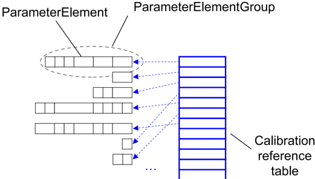

如果启用了单指针方法的软件支持数据仿真，**RTE** 生成器应在 **RAM** 中创建一张表，含对 `ParameterElementGroup` 的引用。该表的类型是 void 指针数组。

这种方法把标定引用表实现为数组的原因之一，是让 **ECU** 内部引用的分配对外部工具可追溯。另一个原因是允许基础软件（相应地复杂驱动）仿真其他标定参数，这也要求标定引用表的标准化。

如果启用了单指针方法的软件支持数据仿真，则标定引用表的名称（标签）应为 `<RteParameterRefTab>`。

位于 **NVRAM** 中的标定参数按同样方式处理（另见 6.2.2.9.3.6 节）。

如果启用了单指针或双指针方法的软件支持数据仿真、且某标定参数（相应地某 `ParameterElementGroup`）位于 **NVRAM** 中，则相应的标定引用表条目应引用作为 **NVRAM RAM** 缓冲区工作的 `PerInstanceMemory`。

**6.2.2.9.3.5.2 双指针方法**

**ROM**（相应地 **Flash**）中有一张标定引用表，含有一个或多个 `ParameterElementGroup` 的引用。对标定参数的访问通过双重间接访问执行。系统启动时，基准引用最初被填充为对标定引用表的引用。

标定过程期间的动作（例如标定参数值交换）不是本规范的关注点。不过为便于理解给出一个示例。

双指针方法下标定参数交换的示例：

1. 把标定引用表复制到 **RAM**；
2. 用修改后的标定参数值填充一个 **RAM** 缓冲区，覆盖完整的 `ParameterElementGroup`；
3. 修改 **RAM** 中引用表副本的相应条目，使其重定向到新的 `ParameterElementGroup`；
4. 改变基准引用的内容，使其引用 **RAM** 中的标定引用表副本。

此后标定参数访问返回修改后的值。

图 4.27：双指针方法上下文中的 ParameterElementGroup

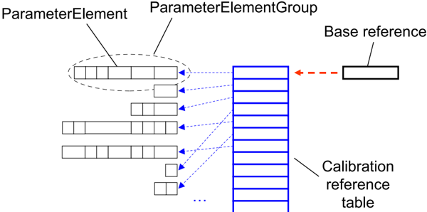

图 4.27 展示了该方法。

为了允许基础软件（相应地复杂驱动）仿真其他标定参数，需要对基准引用进行标准化。

如果启用了双指针方法的软件支持数据仿真，则标定基准引用的名称（标签）应为 `<RteParameterBase>`。该标签和基准引用的类型应被导出并提供给同一 **ECU** 上的其他软件。

位于 **NVRAM** 中的标定参数按同样方式处理（另见 6.2.2.9.3.6 节）。

关于用单指针或双指针方法处理位于 **NVRAM** 中的标定参数，见 6.2.2.9.3.5.1 节的规定。一般信息见 6.2.2.9.3.6 节。

**6.2.2.9.3.5.3 InitRam 参数方法**

对每个 `ParameterDataPrototype` 实例，**RTE** 生成器在 **RAM** 中创建一个标定参数，并在 **ROM/FLASH** 中创建相应的值。在 **RTE** 启动期间，**ROM/FLASH** 中的标定参数值被复制到 **RAM**。对标定参数的访问通过直接访问 **RAM** 执行，没有任何间接。

标定过程期间的动作（例如标定参数值交换）不是本规范的关注点。不过为便于理解给出一个示例：

一种实现只需在运行时交换单元格的内容。

如果启用了 initRam 参数方法的软件支持数据仿真，则对于启用了标定支持的 `ParameterDataPrototype`，**RTE** 生成器应创建保证以下两点的代码：

1. 标定参数分配在 **ROM/Flash** 中；
2. 它们的副本分配在 **RAM** 中，最迟在 **RTE** 启动期间可用。

图 4.28：initRam 参数方法的布置

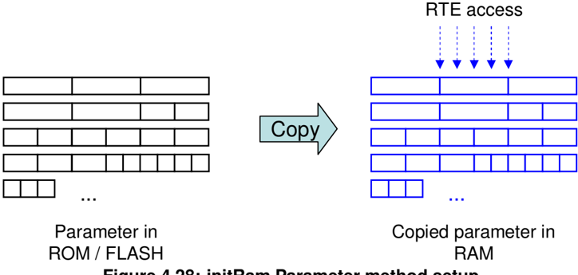

图 4.28 展示了该方法。

一个特例是访问实例化在 **NVRAM** 中的 `ParameterDataPrototype`（另见 6.2.2.9.3.6 节）。此时不需要额外的 **RAM** 副本，因为已经存在一个包含该标定参数值的 **RAM** 位置。

如果启用了 initRam 参数方法的软件支持数据仿真，则对于定义为位于 **NVRAM** 中的标定参数，**RTE** 生成器应创建对作为 **RAM** 缓冲区工作的 `PerInstanceMemory` 的直接访问。

**6.2.2.9.3.5.4 指针方法的 ParameterElementGroup 布置**

对于单指针或双指针方法的软件支持数据仿真，**RTE** 必须保证对 `ParameterElementGroup` 每个成员的访问，无论交付形式是源代码还是目标代码，也无论该成员是原始数据类型还是复合数据类型。为此选择了为一个 `ParameterElementGroup` 创建一个记录类型。

一个 `ParameterElementGroup` 应实现为一个记录类型。

`ParameterElementGroup` 中 `ParameterDataPrototype` 的排列顺序可以按照配置参数 `RteComponentTypeParameterGroup` 进行。`ParameterElementGroup` 中 `ParameterDataPrototype` 的这一顺序以及引用表中 `ParameterElementGroup` 的顺序，将由 **RTE** 生成器通过 `McSwEmulationMethodSupport` 记录，见 6.2.2.9.4.4 节。

**6.2.2.9.3.5.5 指针方法的进一步定义**

如 6.2.2.9.3.1.1 节和 `ParameterElementGroup` 分配各条所述，依据特性 `swAddrMethod` 的值，标定参数应分离到不同的内存位置。

如果启用了单指针或双指针方法的软件支持数据仿真，则 **RTE** 应为所有附加了相同 `swAddrMethod` 特性值的 `ParameterDataPrototype` 创建一个单独的实例专属 `ParameterElementGroup`。没有附加 `swAddrMethod` 特性的 `ParameterDataPrototype` 也应分组在一起。

为了外部工具的可追溯性，`ParameterElementGroup` 中 `ParameterDataPrototype` 的顺序以及引用表中 `ParameterElementGroup` 的顺序，将由 **RTE** 生成器通过 `McSwEmulationMethodSupport` 记录，见 6.2.2.9.4.4 节和 8.6.2 节。

**6.2.2.9.3.5.6 标定参数访问**

标定参数由 `ParameterDataPrototype` 派生。**RTE** 必须通过单独的 **API** 调用提供对每个标定参数的访问。

**API** 在 7.1.6 节中规定。

如果启用了软件支持的数据仿真且为单指针或双指针方法，**RTE** 生成器应导出标定引用表的标签。

如果启用了软件支持的数据仿真且为双指针方法，**RTE** 生成器应导出标定基准引用的标签和类型。

如果启用了单指针方法的软件支持数据仿真，对于位于启用了标定的 `ParameterElementGroup` 中的 `ParameterDataPrototype`，**RTE** 生成器应创建经由标定引用表进行单重间接访问的 **API** 调用。

如果启用了双指针方法的软件支持数据仿真，对于位于启用了标定的 `ParameterElementGroup` 中的 `ParameterDataPrototype`，**RTE** 生成器应创建经由标定基准引用和标定引用表进行双重间接访问的 **API** 调用。

如果启用了双指针方法的软件支持数据仿真，则标定基准引用应位于 **RAM** 中。

**6.2.2.9.3.5.7 标定参数分配**

由于只有 **RTE** 知道 **ECU** 上存在哪些 AUTOSAR **SW-C**、`ParameterSwComponentType` 和基础软件模块的实例，**RTE** 必须分配标定参数并为它们保留内存。这一方法也覆盖多重实例化目标代码集成的需要。因此实例化 `ParameterDataPrototype` 的内存既不由 `ParameterSwComponentType` 提供，也不由 AUTOSAR **SW-C** 提供。

尽管如此，AUTOSAR **SW-C** 和基础软件模块可以定义不由 **RTE** 实例化的标定参数。它们由 `constantMemory` 角色中的 `ParameterDataPrototype` 描述。此外，**RTE** 无法为这类标定参数实现任何数据仿真软件支持。因此这类标定参数不会出现在 **RTE** 生成的 `McSupportData` 中（见 6.2.2.9.4 节）。

**RTE** 应为标定参数分配内存。

一个 `ParameterDataPrototype` 可以定义为实例专属，也可以在一个 AUTOSAR **SW-C** 或 `ParameterSwComponentType` 的所有实例间共享。**RTE** 生成器的输入包含 **RTE** 应用于标定参数的值。

为了支持在线和离线标定（见 6.2.2.9.1 节），必须提供所有实例的所有参数值。背景：

* 对于在线标定，通常最初可以对标定参数应用相同的默认值，差异随后由后链接工具处理。**ECU** 的初始启动不受影响。这允许例如由 AUTOSAR **SW-C** 或 `ParameterSwComponentType` 供应商为一个 `ParameterDataPrototype` 的所有实例使用一个默认值。
* 另一方面，为一个 `ParameterDataPrototype` 的不同实例应用各自的默认值，对在线标定也常常是必需的，以便让车辆初始就能运行。这需要额外的配置工作，例如由集成人员完成。
* 基于新 **SW** 构建（包括新 **RTE** 构建和编译过程）的离线标定，要求所有实例的所有标定参数值对 **RTE** 可用。

**共享的 ParameterDataPrototype**

对于对共享 `ParameterDataPrototype` 的访问，**RTE API** 应返回同一个值，与该标定参数指派给哪个实例无关。

共享 `ParameterDataPrototype` 的标定参数应只存储在一个内存位置中。

上述两条用于保证：修改共享 `ParameterDataPrototype` 时只需修改一个物理内存位置。否则可能导致不可预见的混乱。对于存储在 **NVRAM** 中的标定参数，多个位置是可能的，但那里一个共享 `ParameterDataPrototype` 同样只允许有一个逻辑数据。

**实例专属的 ParameterDataPrototype**

对于对实例专属 `ParameterDataPrototype` 的访问，**RTE API** 应为该 `ParameterDataPrototype` 的每个实例返回单独的标定参数值。

对于实例专属 `ParameterDataPrototype`，该 `ParameterDataPrototype` 每个实例的标定参数值应存储在单独的内存位置中。

**swAddrMethod 的使用**

`SwDataDefProps` 包含可选特性 `swAddrMethod`。它包含关于测量数据存储（相应地标定参数）应分配在哪个内存段中的元信息。需要这一抽象是为了支持在不用项目中复用未修改的 AUTOSAR **SW-C** / `ParameterSwComponentType`，同时允许把测量数据存储（相应地标定参数）分配到不同的段中。

段的使用通常取决于硬件资源的可用性。在一个项目中微控制器的内部 **RAM** 可能比另一个项目少，因此要求大部分测量数据必须放到外部 **RAM**。在另一个项目中，某种寻址方式（例如变址寻址）对大部分测量数据可能更高效——但不是对全部。或者某些标定参数的访问频率低于其他参数，依据项目特定的 **FLASH** 可用性，可以放到访问速度较慢的 **FLASH** 中，其余放到访问速度较快的 **FLASH** 中。

用于存储测量值的内存段，应是测量定义的 `SwDataDefProps` 中所含 `swAddrMethod` 关联的内存段。

由于是测量数据，这显然必须在 **RAM** 中。

用于存储标定参数的内存段，应是标定参数定义的 `SwDataDefProps` 中所含 `swAddrMethod` 关联的内存段。

**6.2.2.9.3.6 NVRAM 中的标定参数**

标定参数也可以位于 **NVRAM** 中。一个用例是可以经由诊断服务修改标定参数，而不需要专门的标定工具。

为了允许访问 **NVRAM** 标定参数，必须定义带有静态分配 **RAM** 缓冲区（以标定参数 **PIM** 内存的形式）的 **NVRAM**，或 `NvBlockSwComponentType` 的 `ramBlock` 为 **MCD** 系统定义 `readWrite` 访问。另见 6.2.2.2.8 节与 6.2.2.9.2.2 节中的相应规定。

**注意：** 由于在多核环境中 **NVRAM** 管理器可能无法跨核边界访问 `PerInstanceMemory`，多核控制器对 **NVRAM** 中标定参数的支持受到限制。另见 6.2.2.10.1 节中的注意。

**6.2.2.9.3.7 多个标定参数实例**

在复杂系统中会出现这种情形：由于功能上的副作用，标定参数值可能取决于车辆的配置。困难在于这些依赖关系通常在软件组件设计之后才被发现，且不应改变软件组件设计。此外，整个 **ECU** 软件必须支持所有车辆变体，因此具体车辆变体的识别与选择需要在事后构建（**post build**）阶段完成。

**RTE** 生成器应为根软件组合中指向同一 `ParameterDataPrototype` 实例的每个 `FlatInstanceDescriptor` 提供一个单独的内存位置。

为此，这些 `FlatInstanceDescriptor` 需要具有不同的 `postBuildVariantCondition`（如 `[constr_3114]` 所述）。其后果是：在一个特定的 post-build 变体中，按上述规定创建的内存位置中至多一个可以是活动的。相应的 **RTE API**（访问参数的 `Rte_CData` 和 `Rte_Prm`）需要访问该值。

对于对某个 `ParameterDataPrototype` 的访问，**RTE API** 应返回属于当前所选 post-build 变体的那个内存位置的值。

为了确保 `Rte_CData` 和 `Rte_Prm` 依赖 post-build 变体性的功能正确，必须保证：当 **RTE** 生成器创建 **RTE PostBuild** 数据集时（见 6.1.8 节），在一个特定的 post-build 变体中恰好选择一个 `FlatInstanceDescriptor`。

post-build 变体性的绑定在调用 `SchM_Init` 时按传入的 post-build 数据集完成，如 6.2.2.7.2 节和 7.1.3.10 节所述。

请注意，关于 `CalibrationParameterValue` 初始化的上述规定同样适用于该场景，因此由多个 `FlatInstanceDescriptor` 导致的不同内存位置可以获得不同的初始值。

下面的示例说明 post-build 变体 `FlatInstanceDescriptor` 与多重实例化结合的用法。原始 **ARXML** 列于附录 E.5 中。

在给定的配置中，定义了一个 `ParameterSwComponentType` 'PSWC'，带一个由 `ParameterInterface` 'EP' 类型化的 `PPortPrototype` 'EP'。根软件组合定义了两个 `SwComponentPrototype` 'SWC_PA' 和 'SWC_PB'。

`ApplicationSwComponentType` 'ASWC' 定义了 `RPortPrototype` 'EP'、一个 `perInstanceParameter` 'PIP' 和一个 `sharedParameter` 'SP'。根软件组合定义了两个 `SwComponentPrototype` 'SWC_A' 和 'SWC_B'，因此组件类型 ASWC 存在两个组件实例。'SWC_PA' 的 `PPortPrototype` 'EP' 连接到 'SWC_A' 的 `RPortPrototype` 'EP'，'SWC_PB' 的 `PPortPrototype` 'EP' 连接到 'SWC_B' 的 `RPortPrototype` 'EP'（图 4.29 中未显示）。

图 4.29：组件模型示例

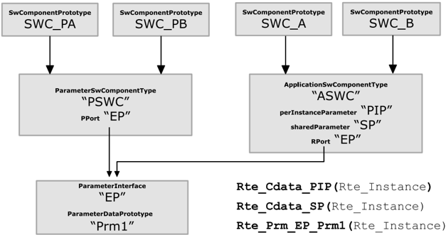

当不采用"每个 `ParameterDataPrototype` 多个 `FlatInstanceDescriptor`"特性时，将得到以下内存位置和 **Rte API** 访问：

图 4.30：组件模型得到的内存位置

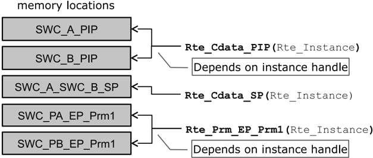

请注意，得到的内存位置名称并未标准化，但所用模式应说明它们对应输入模型中的哪些信息。现假设 Flat Map 中有如下配置：

```text
'SWC_A_PIP_Z0'    {取决于 PostBuildVariantCriterion 'Z' = 0}
'SWC_A_PIP_Z1'    {取决于 PostBuildVariantCriterion 'Z' = 1}
'SWC_B_PIP'
'SWC_A_SWC_B_SP_Z0' {取决于 PostBuildVariantCriterion 'Z' = 0}
'SWC_A_SWC_B_SP_Z1' {取决于 PostBuildVariantCriterion 'Z' = 1}
'SWC_PA_EP_Prm1_Z0' {取决于 PostBuildVariantCriterion 'Z' = 0}
'SWC_PA_EP_Prm1_Z1' {取决于 PostBuildVariantCriterion 'Z' = 1}
'SWC_PB_EP_Prm1'
```

图 4.31：组件模型得到的内存位置（含变体）

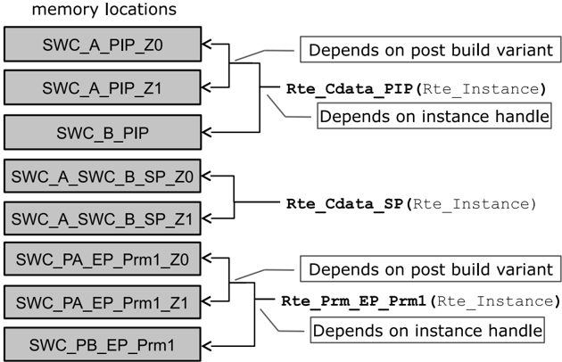

实现这一机制有多种可能。但它与 6.2.2.9.3.5 节"软件支持的数据仿真"的相关规定存在交叉依赖。

一种可能是创建一个参数值数组，其中每个不同的 Post Build 变体对应一个数组元素。相关 **RTE API** 中该参数值数组使用的索引由 **RTE** post-build 配置中所选变体决定，并索引到活动的数组元素。这种方法更容易把多个标定数据实例与"软件支持的数据仿真"特性结合，因为 `ParameterElementGroup` 的数量不变。

另一种方法是为应用于标定参数的每种相同的 `postBuildVariantCondition` 组合创建一个基准指针。相关标定参数被分组到一个结构体中，并为每种 `postBuildVariantCondition` 组合创建一个该结构体的实例。基准指针按 **RTE** post-build 配置中所选变体初始化，指向活动的结构体实例。

###### 6.2.2.9.4. McSupportData 的生成

**RTE** 生成器支持为软件组件以及基础软件定义、分配和访问测量与标定数据。但对测量与标定工具的具体支持既不是 **RTE** 生成器也不是 AUTOSAR 的关注点。那需要生成一个"A2L"文件（如[21]所规定）——它是该领域的标准，但不在 AUTOSAR 的关注范围内。

不过 **RTE** 生成器应支持一种称为 `McSupportData` 的中间交换格式，它在 **ECU** 软件与测量标定工具所需的最终"A2L"文件之间架起桥梁。关于 `McSupportData` 格式及相关方法学的细节在基础软件模块描述模板文档[9]中描述。

本节汇集对 **RTE** 生成器的需求：`McSupportData` 元素中应提供哪些元素。

**6.2.2.9.4.1 McSupportData 的导出**

图 4.32 展示了 `McSupportData` 元素的结构。`McSupportData` 元素及其子内容是 `Implementation` 元素的一部分。对 **RTE** 而言，这是由 **RTE** 生成器在生成阶段生成/更新的 `BswImplementation` 元素（见 6.1.6.2 节）。

在生成阶段，**RTE** 生成器应创建 `McSupportData` 元素，作为所生成 **RTE** 的 `BswImplementation` 描述的一部分。

图 4.32：McSupportData 元素概览

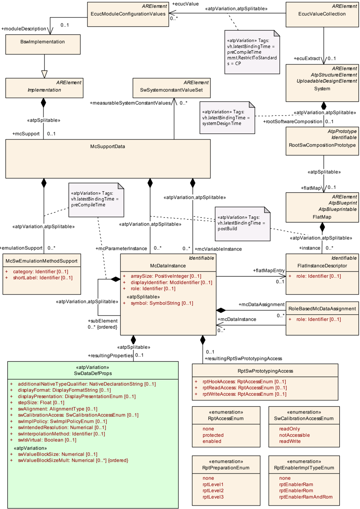

各个可测量和可标定的数据用元素 `McDataInstance` 描述。它由 `McSupportData` 在 `mcVariableInstance` 角色（用于测量）或 `mcParameterInstance` 角色（用于标定）中聚合。

**FlatMap 的使用**

FlatMap 是系统描述 **ECU Extract** 的一部分，包含 `FlatInstanceDescriptor` 元素的集合。FlatMap 的细节在系统模板规范[8]中描述。

特别地，如 6.2.2.9.3.7 节所述，FlatMap 可能为同一 `ParameterDataPrototype` 包含多个参数实例。

**McDataInstance 的公共特性**

元素 `McDataInstance` 规定 `McSupportData` 的一个元素。以下规定给出应以统一方式填充的公共特性。

**RTE** 生成器应使用 `FlatInstanceDescriptor` 的 `shortName` 作为 `McDataInstance` 的 `shortName`。

**RTE** 生成器应使用引用相应 `FlatInstanceDescriptor` 的 `AliasNameAssignment.shortLabel` 作为 `McDataInstance` 的 `displayIdentifier`。

如果输入元素（例如 `ApplicationDataType` 或 `ImplementationDataType`）规定了类别，则该类别值应复制到 `McDataInstance` 元素。

如果输入元素（例如 `ApplicationDataType` 或 `ImplementationDataType`）规定了一个数组，则 `McDataInstance` 的 `arraySize` 特性应设置为数组的大小。

如果输入元素（例如 `ApplicationDataType` 或 `ImplementationDataType`）规定了一个记录，则 `McDataInstance` 应把记录元素的各部分聚合为类型为 `McDataInstance` 的 `subElement`。

`McSupportData` 元素及其子结构应是自包含的：即为了以后生成最终的"A2L"文件，无需交付 **ECU** 的全部上游描述（包括 **ECU Extract**、软件组件描述、基础软件模块描述、**ECU** 配置值描述、Flat Map 等）。这意味着 **RTE** 生成器必须把所需信息从上游描述复制到 `McSupportData` 元素中。

在生成阶段，**RTE** 生成器应为每个 `McDataInstance` 导出有效的 `SwDataDefProps`（包括所有被引用和聚合的子元素，例如 `CompuMethod` 或 `SwRecordLayout`），放入 `resultingProperties` 角色，其前提是已解析软件组件模板[2]"数据定义的特性"一章中定义的优先级规则。由于 `ImplementationDataType` 特性 `compuMethod` 和 `dataConstraint` 具有 C 和 AI 的细化性质，在 `McDataInstance` 的有效 `SwDataDefProps` 中不考虑它们。

如果某个 `ParameterDataPrototype` 与一个 `ParameterAccess` 关联，则应导出相应的 `SwDataDefProps` 及其子结构。

对于引用可测量或可标定数据原型、或可测量 `ModeDeclarationGroupPrototype` 的每个 `flatMapEntry`，应在 `McSupportData` 中生成 `McDataInstance`。其中有效的 `SwDataDefProps` 应按 **SWCT** 定义的优先级规则取自该数据原型。

**RTE** 生成器应为被某个 `FlatInstanceDescriptor` 引用的每个可测量或可标定的 `DataPrototype`/`ModeDeclarationGroupPrototype`，在 `McSupportData` 中创建 `McDataInstance` 元素。

解释：在端口已连接的情况下，可能出现 `PPortPrototype` 的 `DataInterface` 中的 `DataPrototype` 与 `RPortPrototype` 的 `DataInterface` 中的 `DataPrototype` 都被 `FlatInstanceDescriptor` 引用的情形。此时预期得到两个 `McDataInstance`，以便 **MCD** 系统能够用两个不同的名称（并且可能用两种不同的标度，通常是偏移量和分辨率）访问该值。

对于复合数据，`FlatInstanceDescriptor` 可以指向一个或多个 `ApplicationCompositeElementDataPrototype`，以便为每个记录或数组元素定义单独的名称。甚至可能存在这样的情况：为"整个"由 `ApplicationCompositeDataType` 类型化的 `DataPrototype` 存在一个 `FlatInstanceDescriptor`，同时为该 `DataPrototype` 的 `ApplicationCompositeElementDataPrototype` 存在额外的 `FlatInstanceDescriptor`。

此时，由于"整个" `DataPrototype` 的 `FlatInstanceDescriptor`，存在一个作为 `McSupportData` 子节点的 `McDataInstance`；并且对指向"整个" `DataPrototype` 类型中每个 `ApplicationCompositeElementDataPrototype` 的每个 `FlatInstanceDescriptor`，各存在一个额外的作为 `McSupportData` 子节点的 `McDataInstance`。

如果输入元素由 `ApplicationDataType` 类型化，则 `McDataInstance` 的 `subElement` 结构由该 `ApplicationDataType` 决定。这意味着：

* 对 `ApplicationRecordDataType`，`subElement` 的数量和 `shortName` 由 `ApplicationRecordElement` 决定（应用下述记录元素规定）；
* 对 `ApplicationArrayDataType`，`subElement` 的数量由 `ApplicationArrayElement` 决定（应用下述数组元素规定）；
* 对 `ApplicationPrimitiveDataType`（包括复合原始类型），不适用 `subElement`。

如果输入元素（例如 `ApplicationDataType` 或 `ImplementationDataType`）规定了一个数组，则 `McDataInstance` 应为每个数组元素聚合 `subElements`。`McDataInstance.subElements.symbol` 应以 C 记法表示数组下标（例如 `[0]`、`[4]`）。

如果输入元素（例如 `ApplicationDataType` 或 `ImplementationDataType`）规定了一个记录、且该记录元素没有定义 `FlatInstanceDescriptor`，则 `McDataInstance.subElement` 的 `shortName` 应从相应的 `ApplicationRecordElement` 复制；如果没有 `ApplicationDataType` 对该 `DataPrototype` 类型化，则从 `ImplementationDataTypeElement` 复制。`McDataInstance.subElement.symbol` 设置为相应 `ImplementationDataTypeElement` 的 `shortName`。

`symbol` 特性的一般处理：从根元素开始、沿 `McDataInstance` 层级串联所有 `symbol` 字符串，应表示 `McDataInstance` 树中所有层级在编程语言中的完整组合符号。串联时，类别为 `STRUCTURE` 的 `McDataInstance` 的 `subElement` 用点分隔。

**RTE** 生成器应在代表被分组数据的每个 `McDataInstance` 的 `symbol` 特性中，记录 **RTE** 在复合数据类型内部对测量与标定数据的 **RTE** 内部分组。

这意味着 **RTE** 生成器必须在相关 `McDataInstance` 的 `symbol` 特性中记录为 **RTE** 内部目的而插入的结构。例如，如果 **Rte** 把一组可测量对象放入一个 **Rte** 内部结构（此处称为 `RteInternalBuffer`），则第一个可测量子元素的 `McDataInstance.symbol` 携带关于该内部结构元素的信息，例如 `McDataInstance.shortName`："MyMeasurable"，`McDataInstance.symbol`："RteInternalBuffer.measurable1"。

**6.2.2.9.4.2 测量信息的导出**

**发送方-接收方通信**

如果 `SwComponentPrototype` 的发送方-接收方端口接口中所用 `VariableDataPrototype` 的 `swCalibrationAccess` 设置为 `readOnly` 或 `readWrite`、且 `RteMeasurementSupport` 设置为 true，则 **RTE** 生成器应创建一个 `McDataInstance` 元素，其：

* `symbol` 设置为用于分配的 C 符号名（另见 6.2.2.9.2.2 节的相应规定）；
* `flatMapEntry` 引用该 `VariableDataPrototype` 相应的 `FlatInstanceDescriptor` 元素。

**客户端-服务器通信**

如果 `SwComponentPrototype` 的客户端-服务器端口接口中所用 `ArgumentDataPrototype` 的 `swCalibrationAccess` 设置为 `readOnly`、且 `RteMeasurementSupport` 设置为 true，则 **RTE** 生成器应创建一个 `McDataInstance` 元素，其：

* `symbol` 设置为用于分配的 C 符号名（另见 6.2.2.9.2.2 节的相应规定）；
* `flatMapEntry` 引用该 `ArgumentDataPrototype` 相应的 `FlatInstanceDescriptor` 元素。

如果由于 6.2.2.9.2.2 节的排队规定而忽略客户端-服务器通信的测量，则 `McSupportData` 中相应的 `McDataInstance` 的 `resultingProperties` 的 `swCalibrationAccess` 应设置为 `notAccessible`。

**模式切换通信**

如果 `SwComponentPrototype` 的模式切换端口接口中所用 `ModeDeclarationGroupPrototype` 的 `swCalibrationAccess` 设置为 `readOnly`、且 `RteMeasurementSupport` 设置为 true，则 **RTE** 生成器应创建三个 `McDataInstance` 元素，其：

* `symbol` 设置为用于分配的 C 符号名（另见 6.2.2.9.2.2 节的相应规定）；
* `flatMapEntry` 引用该 `ModeDeclarationGroupPrototype` 相应的 `FlatInstanceDescriptor` 元素。

其中与下列之一对应的 `McDataInstance` 元素：

* 当前模式必须引用 `role` 特性设置为 `CURRENT_MODE` 的 `FlatInstanceDescriptor`；
* 前一模式必须引用 `role` 特性设置为 `PREVIOUS_MODE` 的 `FlatInstanceDescriptor`；
* 下一模式必须引用 `role` 特性设置为 `NEXT_MODE` 的 `FlatInstanceDescriptor`。

请注意，如果 `FlatInstanceDescriptor` 处定义了 `CompuMethod`，则与 `ModeDeclarationGroupPrototype` 对应的 `McDataInstance` 元素的 `resultingProperties` 可能关联一个 `CompuMethod`。该 `CompuMethod` 可以规定所测模式的字面量显示。

**可运行实体间变量**

如果 `implicitInterRunnableVariable` 或 `explicitInterRunnableVariable` 角色中 `VariableDataPrototype` 的 `swCalibrationAccess` 设置为 `readOnly` 或 `readWrite`、且 `RteMeasurementSupport` 设置为 true，则 **RTE** 生成器应创建一个 `McDataInstance` 元素，其：

* `symbol` 设置为用于分配的 C 符号名（另见 6.2.2.9.2.2 节的相应规定）；
* `flatMapEntry` 引用该 `VariableDataPrototype` 相应的 `FlatInstanceDescriptor` 元素。

**PerInstanceMemory**

如果 `arTypedPerInstanceMemory` 角色中 `VariableDataPrototype` 的 `swCalibrationAccess` 设置为 `readOnly` 或 `readWrite`、且 `RteMeasurementSupport` 设置为 true，则 **RTE** 生成器应创建一个 `McDataInstance` 元素，其：

* `symbol` 设置为用于分配的 C 符号名（另见 6.2.2.9.2.2 节的相应规定）；
* `flatMapEntry` 引用该 `VariableDataPrototype` 相应的 `FlatInstanceDescriptor` 元素。

**Nv RAM Block**

如果 `NvBlockSwComponentType` 的 `NvBlockDescriptor` 中 `ramBlock` 角色 `VariableDataPrototype` 的 `swCalibrationAccess` 设置为 `readOnly` 或 `readWrite`、且 `RteMeasurementSupport` 设置为 true，则 **RTE** 生成器应创建一个 `McDataInstance` 元素，其：

* `symbol` 设置为用于分配的 C 符号名（另见 6.2.2.9.2.2 节的相应规定）；
* `flatMapEntry` 引用该 `NvBlockSwComponentType` 相应的 `FlatInstanceDescriptor` 元素。

**非易失数据通信**

如果 `SwComponentPrototype` 的非易失数据端口的 `NvDataInterface` 中所用 `VariableDataPrototype` 的 `swCalibrationAccess` 设置为 `readOnly` 或 `readWrite`、且 `RteMeasurementSupport` 设置为 true，则 **RTE** 生成器应创建一个 `McDataInstance` 元素，其：

* `symbol` 设置为用于分配的 C 符号名（另见 6.2.2.9.2.2 节的相应规定）；
* `flatMapEntry` 引用该 `VariableDataPrototype` 相应的 `FlatInstanceDescriptor` 元素。

**6.2.2.9.4.3 标定信息的导出**

标定既可以由 **RTE** 使用 6.2.2.9.3.5 节的预定义标定机制主动支持，也可以对 **RTE** 透明。两种情况下，**RTE** 生成器都必须在生成阶段提供可标定数据的位置和属性，以支持测量与标定工具的搭建。

**ParameterSwComponentType 的 ParameterDataPrototype**

对于引用 `ParameterSwComponentType` 的某个 `PortPrototype` 中 `ParameterDataPrototype` 实例、且 `swCalibrationAccess` 设置为 `readOnly` 或 `readWrite` 的每个 `FlatInstanceDescriptor`，应在 `McSupportData` 中创建一个 `mcParameterInstance` 角色的条目，其属性为：

* `symbol` 设置为用于分配的 C 符号名；
* `flatMapEntry` 引用该 `ParameterDataPrototype` 相应的 `FlatInstanceDescriptor` 元素。

**共享的 ParameterDataPrototype**

对于引用某个原子组件类型 `SwcInternalBehavior` 在 `sharedParameter` 角色中聚合的 `ParameterDataPrototype` 实例、且 `swCalibrationAccess` 设置为 `readOnly` 或 `readWrite` 的每个 `FlatInstanceDescriptor`，应在 `McSupportData` 中创建一个 `mcParameterInstance` 角色的条目，其属性为：

* `symbol` 设置为用于分配的 C 符号名；
* `flatMapEntry` 引用该 `ParameterDataPrototype` 相应的 `FlatInstanceDescriptor` 元素。

**实例专属的 ParameterDataPrototype**

对于引用某个原子组件类型 `SwcInternalBehavior` 在 `perInstanceParameter` 角色中聚合的 `ParameterDataPrototype` 实例、且 `swCalibrationAccess` 设置为 `readOnly` 或 `readWrite` 的每个 `FlatInstanceDescriptor`，应在 `McSupportData` 中创建一个 `mcParameterInstance` 角色的条目，其属性为：

* `symbol` 设置为用于分配的 C 符号名；
* `flatMapEntry` 引用该 `ParameterDataPrototype` 相应的 `FlatInstanceDescriptor` 元素。

对于 `BswModuleDescription` 的 `BswInternalBehavior` 在 `perInstanceParameter` 角色中聚合的、`swCalibrationAccess` 设置为 `readOnly` 或 `readWrite` 的每个 `ParameterDataPrototype`，应在 `McSupportData` 中创建一个 `mcParameterInstance` 角色的条目，其属性为：

* `symbol` 设置为用于分配的 C 符号名；
* `flatMapEntry` 引用该 `ParameterDataPrototype` 相应的 `FlatInstanceDescriptor` 元素。

**RAM Block 的默认值**

如果 `romBlock` 角色中 `ParameterDataPrototype` 的 `swCalibrationAccess` 设置为 `readOnly` 或 `readWrite`，则应在 `McSupportData` 中创建一个 `mcParameterInstance` 角色的条目，其属性为：

* `symbol` 设置为用于分配的 C 符号名（见 6.2.2.9.3.1 节的相应规定）；
* `flatMapEntry` 引用该 `ParameterDataPrototype` 相应的 `FlatInstanceDescriptor` 元素。

**6.2.2.9.4.4 标定方法的导出**

**RTE** 提供多种软件仿真方法，可在 **RTE** 的 **ECU** 配置中选择（见 8.2 节）。

某次 **RTE** 生成使用了哪种软件仿真方法，应记录在 `McSupportData` 中，以便测量与标定工具能够支持 **RTE** 的软件仿真方法。此外，**RTE** 供应商也可以添加自定义的软件仿真方法，这同样需要记录。`McSwEmulationMethodSupport` 的结构见图 4.33。

图 4.33：McSwEmulationMethodSupport 元素的结构

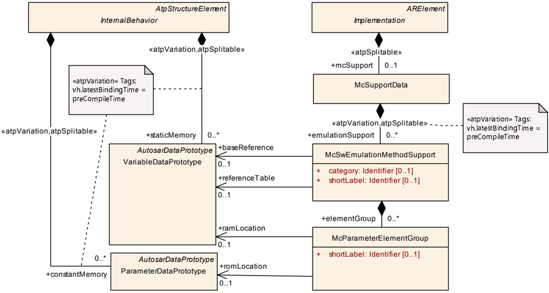

在生成阶段，**RTE** 生成器应创建 `McSwEmulationMethodSupport` 元素，作为所生成 **RTE** 的 `McSupportData` 描述的一部分。

在生成阶段，**RTE** 生成器应依据所实现的软件仿真方法、基于 **ECU** 配置参数 `RteCalibrationSupport`，设置 `McSwEmulationMethodSupport` 元素的 `category` 特性值：

* `NONE`
* `SINGLE_POINTERED`
* `DOUBLE_POINTERED`
* `INITIALIZED_RAM`
* 自定义类别名：供应商特定的软件仿真方法

对所生成结构的描述使用基础软件模块描述模板[9]中已有的机制。

**ParameterElementGroup 的描述**

为了描述 `ParameterElementGroup`，创建一个代表该组结构的 `ImplementationDataType`。

对每个生成的 `ParameterElementGroup`，应创建一个 `ImplementationDataType`。所包含的 `ParameterDataPrototype` 以 `subElement` 角色聚合为 `ImplementationDataTypeElement`。

子元素的顺序可以用 `RteComponentTypeParameterGroup` 设置。

在示例图 4.34 中，这些 `ImplementationDataType` 称为 `RteMcSupportGroupType1` 和 `RteMcSupportGroupType2`。

**InitRam 参数方法的 McSupport 描述**

为了描述 InitRam 参数方法，先规定分配在 **RAM** 和 **ROM** 中的具体 `ParameterElementGroup`，然后规定这些组的集合与对应关系。

如果 **RTE** 生成器被配置为支持 `INITIALIZED_RAM` 方法，则生成阶段的 **RTE** 生成器应为每个 `ParameterElementGroup` 生成一个 `constantMemory` 角色的 `ParameterDataPrototype`，放入 **RTE** 基础软件模块描述的 `InternalBehavior`。该 `ParameterDataPrototype` 应在 `type` 角色中引用相应的 `ImplementationDataType`。

如果 **RTE** 生成器被配置为支持 `INITIALIZED_RAM` 方法，则生成阶段的 **RTE** 生成器应为每个 `ParameterElementGroup` 生成一个 `staticMemory` 角色的 `VariableDataPrototype`，放入 **RTE** 基础软件模块描述的 `InternalBehavior`。该 `VariableDataPrototype` 应在 `type` 角色中引用相应的 `ImplementationDataType`。

如果 **RTE** 生成器被配置为支持 `INITIALIZED_RAM` 方法，则生成阶段的 **RTE** 生成器应为每个 `ParameterElementGroup` 生成一个 `elementGroup` 角色的 `McParameterElementGroup`，放入 `McSwEmulationMethodSupport` 元素中：

* 该 `McParameterElementGroup` 应在 `romLocation` 角色中引用相应的 `ParameterDataPrototype`；
* 该 `McParameterElementGroup` 应在 `ramLocation` 角色中引用相应的 `VariableDataPrototype`。

**单指针方法的 McSupport 描述**

为了描述单指针方法，先规定分配在 **ROM** 中的具体 `ParameterElementGroup`；然后规定一个数组数据类型，其元素数量（void 指针）与 `ParameterElementGroup` 的数量相同；然后在 **RAM** 中规定该数组的实例，并从 `McSwEmulationMethodSupport` 引用它；每个数组元素的实际值规定为对各 `ParameterElementGroup` 原型的引用。

如果 **RTE** 生成器被配置为支持 `SINGLE_POINTERED` 方法，则生成阶段的 **RTE** 生成器应为每个 `ParameterElementGroup` 生成一个 `constantMemory` 角色的 `ParameterDataPrototype`，放入 **RTE** 基础软件模块描述的 `InternalBehavior`。该 `ParameterDataPrototype` 应在 `type` 角色中引用相应的 `ImplementationDataType`。

如果 **RTE** 生成器被配置为支持 `SINGLE_POINTERED` 方法，则生成阶段的 **RTE** 生成器应生成一个 `ImplementationDataType`，其在 `subElement` 角色中有一个 `ImplementationDataTypeElement`：

* 该 `ImplementationDataTypeElement` 的 `arraySize` 特性应设置为相应各 `ParameterElementGroup` 的数量；
* 该 `ImplementationDataTypeElement` 应有一个 `SwDataDefProps` 元素，在 `implementationDataType` 角色中引用一个代表 void 指针的 `ImplementationDataType`。

如果 **RTE** 生成器被配置为支持 `SINGLE_POINTERED` 方法，则生成阶段的 **RTE** 生成器应生成一个 `staticMemory` 角色的 `VariableDataPrototype`，放入 **RTE** 基础软件模块描述的 `InternalBehavior`。该 `VariableDataPrototype` 应在 `type` 角色中引用该数组 `ImplementationDataType`。

如果 **RTE** 生成器被配置为支持 `SINGLE_POINTERED` 方法，则生成阶段的 **RTE** 生成器应生成从 `McSwEmulationMethodSupport` 元素到该 `VariableDataPrototype` 的引用，放入 `referenceTable` 角色。

如果 **RTE** 生成器被配置为支持 `SINGLE_POINTERED` 方法，则生成阶段的 **RTE** 生成器应生成一个 `ArrayValueSpecification` 作为该数组的 `initValue`，并为每个 `ParameterElementGroup` 在该 `ArrayValueSpecification` 中生成一个 `ReferenceValueSpecification` 元素，定义对各 `ParameterElementGroup` 原型的引用。

**双指针方法的 McSupport 描述**

双指针方法的描述与单指针方法非常相似，但对 **RAM** 和 **ROM** 的分配不同，并且额外分配一个指针参数。先规定分配在 **ROM** 中的具体 `ParameterElementGroup`；然后规定一个数组数据类型，其元素数量（void 指针）与 `ParameterElementGroup` 的数量相同；然后在 **ROM** 中规定该数组的实例，并从 `McSwEmulationMethodSupport` 引用它；每个数组元素的实际值规定为对各 `ParameterElementGroup` 原型的引用；然后创建基准指针的类型，并在 **RAM** 中分配一个实例。该引用被初始化为指向 **ROM** 中的数组。

如果 **RTE** 生成器被配置为支持 `DOUBLE_POINTERED` 方法，则生成阶段的 **RTE** 生成器应为每个 `ParameterElementGroup` 生成一个 `constantMemory` 角色的 `ParameterDataPrototype`，放入 **RTE** 基础软件模块描述的 `InternalBehavior`。该 `ParameterDataPrototype` 应在 `type` 角色中引用相应的 `ImplementationDataType`。

在示例图 4.34 中，这些 `ParameterDataPrototype` 称为 `RteMcSupportParamGroup1` 和 `RteMcSupportParamGroup2`。

如果 **RTE** 生成器被配置为支持 `DOUBLE_POINTERED` 方法，则生成阶段的 **RTE** 生成器应生成一个 `ImplementationDataType`，其在 `subElement` 角色中有一个 `ImplementationDataTypeElement`：

* 该 `ImplementationDataTypeElement` 应为类别 `ARRAY`，其 `arraySize` 特性设置为相应各 `ParameterElementGroup` 的数量；
* 该 `ImplementationDataTypeElement` 应有一个 `SwDataDefProps` 元素，在 `implementationDataType` 角色中引用一个代表 void 指针的 `ImplementationDataType`。

在示例图 4.34 中，该 `ImplementationDataType` 称为 `RteMcSupportPointerTableType`。

如果 **RTE** 生成器被配置为支持 `DOUBLE_POINTERED` 方法，则生成阶段的 **RTE** 生成器应生成一个 `constantMemory` 角色的 `ParameterDataPrototype`，放入 **RTE** 基础软件模块描述的 `InternalBehavior`。该 `ParameterDataPrototype` 应在 `type` 角色中引用该指针表 `ImplementationDataType`。

在示例图 4.34 中，该 `ParameterDataPrototype` 称为 `RteMcSupportPointerTable`。

如果 **RTE** 生成器被配置为支持 `DOUBLE_POINTERED` 方法，则生成阶段的 **RTE** 生成器应生成从 `McSwEmulationMethodSupport` 元素到该 `ParameterDataPrototype` 的引用，放入 `referenceTable` 角色。

如果 **RTE** 生成器被配置为支持 `DOUBLE_POINTERED` 方法，则生成阶段的 **RTE** 生成器应生成一个 `ArrayValueSpecification` 作为该数组的 `initValue`，并为每个 `ParameterElementGroup` 在该 `ArrayValueSpecification` 中生成一个 `ReferenceValueSpecification` 元素，定义对各 `ParameterElementGroup` 原型的引用。

在示例图 4.34 中，该 `ArrayValueSpecification` 称为 `RteMcSupportPointerTableInit`。各 `ReferenceValueSpecification` 称为 `RteMcSupportParamGroup1Ref` 和 `RteMcSupportParamGroup2Ref`。

如果 **RTE** 生成器被配置为支持 `DOUBLE_POINTERED` 方法，则生成阶段的 **RTE** 生成器应生成一个 `ImplementationDataType`，其唯一的 `ImplementationDataTypeElement` 是对上述数组类型的引用。

在示例图 4.34 中，该 `ImplementationDataType` 称为 `RteMcSupportBasePointerType`。

如果 **RTE** 生成器被配置为支持 `DOUBLE_POINTERED` 方法，则生成阶段的 **RTE** 生成器应生成一个 `staticMemory` 角色的 `VariableDataPrototype`，放入 **RTE** 基础软件模块描述的 `InternalBehavior`。该 `VariableDataPrototype` 应在 `type` 角色中引用该基准指针 `ImplementationDataType`。

在示例图 4.34 中，该 `VariableDataPrototype` 称为 `RteMcSupportBasePointer`。

如果 **RTE** 生成器被配置为支持 `DOUBLE_POINTERED` 方法，则生成阶段的 **RTE** 生成器应生成一个 `ReferenceValueSpecification`，引用该 **ROM** 中的数组，作为该基准指针的 `initValue`。

在示例图 4.34 中，该 `ReferenceValueSpecification` 称为 `RteMcSupportBasePointerInit`。

图 4.34：双指针方法结构的示例

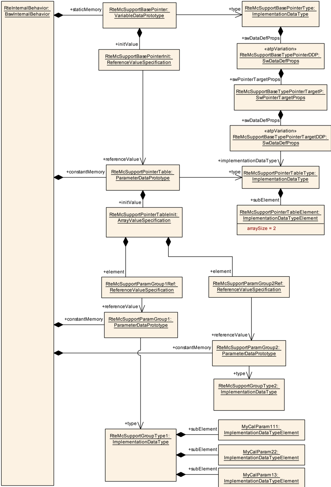

**6.2.2.9.4.5 变体处理的导出**

**RTE** 生成器应提供关于系统常数值的信息。这些值是输入信息的一部分，需要被收集并复制到一个专门的构件中，与 `McSupportData` 一起交付。

生成阶段的 **RTE** 生成器应创建类型为 `SwSystemconstantValueSet` 的元素，并为输入信息中找到的、其所引用 `SwSystemconst` 的 `swCalibrationAccess` 设置为 `readOnly` 的所有系统常数值（类型 `SwSystemconstValue`）创建副本。

当某个 `SwSystemconstValue` 受变体性影响、且该变体性可以在 **RTE** 生成阶段解析时：

如果 `swCalibrationAccess` 设置为 `readOnly` 的某个 `SwSystemconst` 所指派的 `SwSystemconstValue` 受变体性影响、且最晚绑定时为 `SystemDesignTime` 或 `CodeGenerationTime`，则 `SwSystemconstantValueSet` 中相应的 `SwSystemconstValue` 副本应包含解析后的值。

如果 `swCalibrationAccess` 设置为 `readOnly` 的某个 `SwSystemconst` 所指派的 `SwSystemconstValue` 受变体性影响、且最晚绑定时为 `PreCompileTime`，则 `SwSystemconstantValueSet` 中相应的 `SwSystemconstValue` 副本应带有一个 `AttributeValueVariationPoint`。该 `AttributeValueVariationPoint` 的 PreBuild 条件应对应于输入 `SwSystemconstValue` 条件的 PreBuild 条件。

生成阶段的 **RTE** 生成器应创建从 `McSupportData` 元素到 `SwSystemconstantValueSet` 元素的引用。

当 **RTE** 生成器对某个 **MCD** 系统可访问的元素实现变体性时，相关的存在条件也必须记录在 `McSupportData` 结构中。

如果 `McSupportData` 中的某个元素对应输入配置中受变体性影响、且最晚绑定时为 `PreCompileTime` 或 `PostBuild` 的元素，则 **RTE** 生成器应为该元素添加一个 `VariationPoint`。该 `VariationPoint` 的 PreBuild 和 PostBuild 条件应对应于输入元素条件的 PreBuild 和 PostBuild 条件。

##### 6.2.2.10. 对 NVRAM 数据的访问

###### 6.2.2.10.1. 概述

AUTOSAR **SW-C** 有多种方法可以访问存储在 **NVRAM** 中的数据。

* "标定数据"——标定数据可以存储在 **NVRAM** 中，但在 **ECU** 的"正常"执行期间不被修改。标定数据通常直接从其内存位置读取，但在需要优化访问时间时（例如插值表）也可以从 **RAM** 缓冲区读取。它们在 6.2.2.9 节中描述。
* "对 NVRAM 块的访问"——该方法使用 `PerInstanceMemory` 作为 NVRAM 块的 **RAM Block**。这种方法高效，但使用受限。

**NVRAM** 管理器[22]是一个 **BSW** 模块，为 **SW-C** 提供在运行时访问 NVRAM 块的服务。NVM 块数据不被直接访问，而是通过一个 **RAM Block** 访问，该 **RAM Block** 可以是由 **RTE** 实例化的 `PerInstanceMemory`，也可以是 **SW-C** 内部缓冲区。使用这种方法时，**RTE** 不提供任何数据一致性机制（即 **SW-C** 与 **NVM** 的不同可运行实体可以并发访问 **RAM Block**，而不受 **RTE** 保护）。

**注意：** 该机制允许高效地使用 **NVRAM** 数据，但要求数 **SW-C** 设计人员注意：来自不同任务上下文的访问访问同一 `PerInstanceMemory` 不会导致数据不一致。"对 NVRAM 块的访问"不应在多核环境中使用。在 AUTOSAR 4.0 版本中，不能期望 **NVRAM** 管理器能够访问另一个核的 `PerInstanceMemory`。AUTOSAR 并不要求存在共享内存段。只有对 `arTypedPerInstanceMemory`，才有 `SwDataDefProps` 项可以把 `PerInstanceMemory` 指派给共享内存段。

* "通过 `NvBlockSwComponentType` 访问 NVRAM 数据"——数据通过连接到 `NvBlockSwComponentType` 的 `NvDataInterface` 访问。这种访问在 **VFB** 层建模，必要时由 **RTE** 保护免受并发访问。本节将进一步描述。

请注意，本文档中使用的术语 **NVRAM Block**、NV Block、**RAM Block**、**ROM Block** 和 **RAM mirror** 在 **NVRAM** 管理器规范[22]中定义。

如果 **RTE** 必须访问 **NvM API**，则应包含 `NvM.h` 文件。

###### 6.2.2.10.2. NvBlockSwComponentType 的使用

NvBlock `SwComponentPrototype` 的代码由 **RTE** 生成器实现。`NvBlockSwComponentType` 提供用于访问和管理存储在 **NVRAM** 中数据的端口接口。

图 4.35：与 NvBlockSwComponentType 的连接

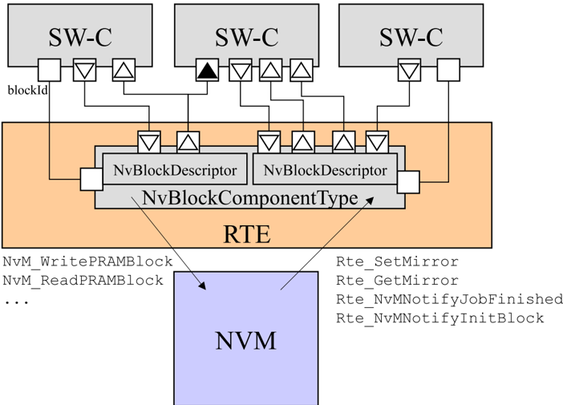

图 4.35 展示了 `NvBlockSwComponentType` 的用法。根据用例，**SW-C** 可以以不同方式连接到 `NvBlockSwComponentType`：例如仅通过由 `SenderReceiverInterface`/`NvDataInterface` 类型化的端口，或通过由 `SenderReceiverInterface`/`NvDataInterface` 与 `ClientServerInterface` 类型化的端口。由 `SenderReceiverInterface`/`NvDataInterface` 类型化的端口用于提供对 NV 数据的访问，由 `ClientServerInterface` 类型化的端口用于 NV 数据的管理。由 **SW-C** 管理 NV 数据有助于在特定时点把 **RAM Block** 的数据复制到 NV 块或反向复制（**SW-C** 是客户端）。此外 **SW-C** 可以从 **NVM** 获取通知（**SW-C** 是服务器）。

以下各节给出使用 `NvBlockSwComponentType` 的规定。

多个 AUTOSAR **SW-C**（以及一个 AUTOSAR **SW-C** 的多个实例）应能够读取同一个 `NvBlockSwComponentType` 的相同 `VariableDataPrototype`。

图 4.36：NvBlockSwComponentType 与 NvBlockDescriptor

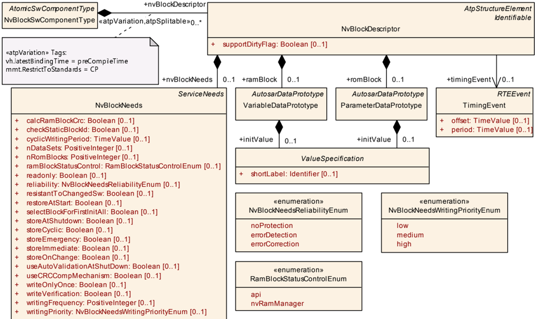

一个 `NvBlockSwComponentType` 包含多个 `NvBlockDescriptor`。这些 `NvBlockDescriptor` 中的每一个都恰好关联到一个 **NVRAM Block**。

一个 `NvBlockDescriptor` 包含一个充当该 **NVRAM Block** 之 **RAM Block** 的 `VariableDataPrototype`，以及可选的一个充当该 **NVRAM Block** 默认 **ROM** 值的 `ParameterDataPrototype`。

**RTE** 生成器应拒绝这样的配置：`NvBlockSwComponentType` 的某个 `NvBlockDescriptor` 包含的 `romBlock`，其数据类型与 `ramBlock` 的类型不兼容。

**RTE** 应为 `NvBlockDescriptor` 实例的 `ramBlock` `VariableDataPrototype` 分配内存。

如果满足 6.2.2.8.4 节的一般初始化条件，则为 `ramBlock` 分配的变量应被初始化。初始化应在 `Rte_Start` 期间依据已配置的 `RteInitializationStrategy` 施加。

**注意：** 当块被配置为由 `NvM_ReadAll` 读取时，初始化可能擦除 **NVM** 读出的值。这些块不应有 `initValue`。

对于每个带 `romBlock` `ParameterDataPrototype` 的 `NvBlockDescriptor`，**RTE** 应分配一个默认值常量块。

为 `romBlock` 分配的常量应初始化为 `initValue` 的值（如果它们有 `initValue`）。

图 4.37：NvBlockDataMapping

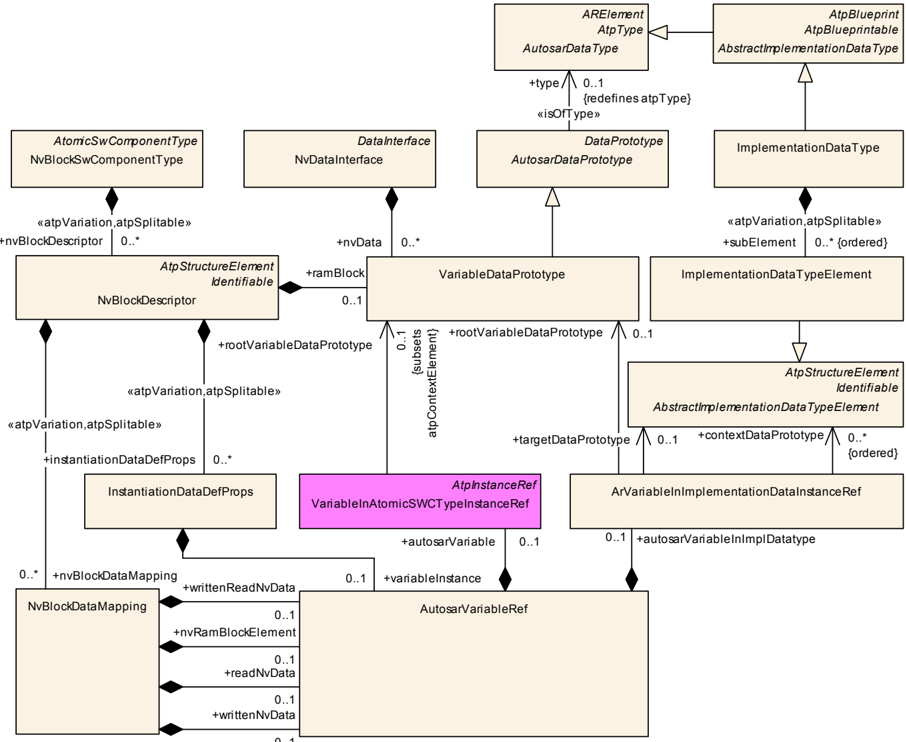

对于存储在某个 `NvBlockDescriptor` 的 **NVRAM Block** 中的每个元素，应有一个 `NvBlockDataMapping`，把用于读写访问的端口的 `VariableDataPrototype` 与定义该元素在 `ramBlock` 中位置的 `VariableDataPrototype` 关联起来。其中各 `VariableDataPrototype` 的 `ImplementationDataType` 必须兼容。

**RTE** 生成器应拒绝任何违反 `[constr_1395]`、`[constr_1403]` 和 `[constr_1404]` 的配置。

**RTE** 生成器应拒绝违反 `[constr_2013]` 或 `[constr_1285]` 的配置。

**注意：** 这是为了保证 `romBlock` 中的默认值在结构上与 `ramBlock` 中的数据匹配，从而在相关 NvBlock 的回调 `Rte_NvMNotifyInitBlock` 被调用时可以把默认值复制到 `ramBlock`。

`NvBlockSwComponentType` 可用于减少 **ECU** 上所需的 **NVRAM Block** 数量：

* 同一个块可以用于存储不同的标志或其他小数据元素；
* 同一个数据元素可以被不同 **SW-C** 或一个 **SW-C** 的不同实例使用。

当必须保证一个 **ECU** 的两个 **SW-C** 使用相同的 **NVRAM** 数据时，它还可以简化流程和算法。

**注意：** 该特性可能增加 **ECU** 的 **RAM** 使用，因为它强制 **NVRAM** 管理器实例化一个额外的 **RAM** 缓冲区，称为 **RAM mirror**。但当相同的数据元素必须在 **SW-C** 之间共享时，它减少了 **RTE** 需要实例化的 **RAM Block** 数量，从而可以降低 **ECU** 的整体 **RAM** 使用。

**RTE** 生成器应拒绝这样的配置：某个 `NvDataInterface` 引用的 `VariableDataPrototype` 具有 `queued` 的 `swImplPolicy`。

与 `NvBlockSwComponentType` 之 **RAM Block** 相关的 NvMBlockDescriptor 应使用 NvmBlockUseSyncMechanism：与 `NvBlockSwComponentType` 的 `NvBlockDescriptor` 关联的 **NVRAM Block** 应配置为启用 `NvMBlockUseSyncMechanism` 特性，并把 `NvMWriteRamBlockToNvCallback` 和 `NvMReadRamBlockFromNvCallback` 参数设置为该 `NvBlockDescriptor` 的 `Rte_GetMirror` 和 `Rte_SetMirror` **API**。

一个 `NvBlockSwComponentType` 可以有未连接的 p-port 或 r-port（见 6.2.1.3.2 节的相应处理）。

带未连接 r-port 的 `NvBlockSwComponentType` 应表现得像该未连接 r-port 的 `VariableDataPrototype` 没有接收到更新数据一样。

###### 6.2.2.10.3. NvBlockSwComponentType 的接口

**6.2.2.10.3.1 对 NVRAM 数据的访问**

`NvBlockSwComponentType` 提供带 `NvDataInterface` 数据发送方-接收方语义的 `PPortPrototype` 和 `RPortPrototype`，用于读取 **NVRAM** 数据的值或写入新值。

与 `SenderReceiverInterface` 一样，这些 `NvDataInterface` 中的每一个都可以提供对多个 `VariableDataPrototype` 的访问。

访问这些 `VariableDataPrototype` 使用的 `Rte_Read`、`Rte_IRead`、`Rte_DRead`、`Rte_Write`、`Rte_IWrite`、`Rte_IWriteRef` **API** 与 `SenderReceiverInterface` 相同。

由于使用隐式 **API** `Rte_IRead` 和 `Rte_IWriteRef`，可以避免多重缓冲，即应用 **SW-C** 的 `RunnableEntity` 或 **BSW** 模块（例如 **DCM**）的 `ExecutableEntity` 可以直接访问 **RAM Block** 上的 `VariableDataPrototype`。为保证这一行为，必须满足以下前提条件之一：

* **RAM Block** 上的 `VariableDataPrototype` 只被 `dataReadAccess` 访问；
* **RAM Block** 上的 `VariableDataPrototype` 被 `dataReadAccess` 和 `dataWriteAccess` 访问，且写访问之间、或写与读访问之间没有相互抢占，包括 `Rte_SetMirror` 和 `Rte_GetMirror` 造成的抢占；
* 未应用需要数据转换的 `PortInterfaceMapping`。

关于一致性需求的更多内容见 6.2.3.1.5.1 节。

**RTE** 生成器应拒绝这样的配置：某个由 `NvDataInterface` 类型化的 r-port 未连接，且没有为该 `NvDataInterface` 的每个 `VariableDataPrototype` 提供带 `initValue` 的 `NvRequireComSpec`。如果该 r-port 属于某个 `NvBlockSwComponentType`，则本规定不适用。

上述规定用于避免出现没有定义 `initValue` 的未连接 r-port。请注意，对 `NvBlockSwComponent` 而言，没有初始值的未连接 r-port 不是错误，因为初始值定义在 `NvBlockDescriptor` 的 `ramBlock` 中（另见 `ramBlock` 初始化与未连接 r-port 行为的相应规定）。

**RTE** 应按照该 r-port 的 `NvRequireComSpec` 中引用该 `VariableDataPrototype` 的 `initValue` 初始化该 r-port 的 `VariableDataPrototype`。

为了按某种时序方案把 **NVRAM Block** 的更新 NV 数据写入 NV 内存，**RTE** 提供称为"脏标志机制"（**dirty flag mechanism**）的功能。当原子组件类型使用由 `NvDataInterface` 类型化的 `PortPrototype` 调用 **RTE** 的写 **API** 时，该机制直接与 **NvM** 模块交互。脏标志机制的行为取决于相关 `NvBlockDescriptor` 的写入策略。

如果 `NvBlockNeeds.storeCyclic` 特性设置为 true，则为某个 `NvBlockDescriptor` 启用周期写入策略。

如果 `NvBlockDescriptor.writingStrategy.role` 特性设置为 `storeAtShutdown` 或 `NvBlockNeeds.storeAtShutdown` 设置为 true，则为某个 `NvBlockDescriptor` 启用关机写入策略。

如果 `NvBlockDescriptor.writingStrategy.role` 特性设置为 `storeImmediate` 或 `NvBlockNeeds.storeImmediate` 设置为 true，则为某个 `NvBlockDescriptor` 启用立即写入策略。

如果 `NvBlockDescriptor.modeSwitchEventTriggeredActivity` 特性设置为 true，则为某个 `NvBlockDescriptor` 启用模式切换写入策略。

如果 `NvBlockNeeds.storeOnChange` 特性设置为 true，则为某个 `NvBlockDescriptor` 启用变化时写入策略。

如果使用带 `NvDataInterface` 的 `PortPrototype` 的原子组件类型调用显式 **API** `Rte_Write`，且 `NvBlockDescriptor.supportDirtyFlag` 特性设置为 true、且关机写入策略（`storeAtShutDown`）已启用，则 **RTE** 应通过调用 **NvM** 模块的 `NvM_SetRamBlockStatus` 函数（`BlockChanged` 参数设置为 true）把相关 **RAM Block** 标记为 CHANGED。**RTE** 应在 `Rte_Write` 函数所访问的数据写回 **RAM Block** 之后调用 `NvM_SetRamBlockStatus` 函数。

如果使用带 `NvDataInterface` 的 `PortPrototype` 的原子组件类型调用隐式 **API** `Rte_IWrite`/`Rte_IWriteRef`，且 `NvBlockDescriptor.supportDirtyFlag` 特性设置为 true、且关机写入策略（`storeAtShutDown`）已启用，则 **RTE** 应通过调用 **NvM** 模块的 `NvM_SetRamBlockStatus` 函数（`BlockChanged` 参数设置为 true）把相关 **RAM Block** 标记为 CHANGED。**RTE** 应在 `Rte_IWrite`/`Rte_IWriteRef` 函数所访问的数据从抢占区缓冲区写回 **RAM Block** 之后调用 `NvM_SetRamBlockStatus` 函数。

如果使用带 `NvDataInterface` 的 `PortPrototype` 的原子组件类型调用显式 **API** `Rte_Write`，且该特性设置为 true、且周期写入策略（`storeCyclic`）已启用，则 **RTE** 应在 `Rte_Write` 函数所访问的数据写回 **RAM Block** 之后，在某个周期性活动的下一个周期中调用 **NvM** 模块的 `NvM_WritePRAMBlock` 函数，把相关 **RAM Block** 写入 NV 内存。该周期性活动应在某个 `NvBlockDescriptor` 的 `RunnableEntity` 上下文中实现（见下文 NvBlock 可运行实体的实现规定），周期为 `NvBlockDescriptor.timingEvent.period` 特性定义的周期。

如果使用带 `NvDataInterface` 的 `PortPrototype` 的原子组件类型调用隐式 **API** `Rte_IWrite`/`Rte_IWriteRef`，且 `NvBlockDescriptor.supportDirtyFlag` 特性设置为 true、且周期写入策略（`storeCyclic`）已启用，则 **RTE** 应在 `Rte_IWrite`/`Rte_IWriteRef` 函数所访问的数据从抢占区缓冲区写回 **RAM Block** 之后，在某个周期性活动的周期中调用 **NvM** 模块的 `NvM_WritePRAMBlock` 函数，把相关 **RAM Block** 写入 NV 内存。该周期性活动应在某个 `NvBlockDescriptor` 的 `RunnableEntity` 上下文中实现（见下文），周期为 `NvBlockDescriptor.timingEvent.period` 特性定义的周期。

如果使用带 `NvDataInterface` 的 `PortPrototype` 的原子组件类型调用显式 **API** `Rte_Write`，且 `NvBlockDescriptor.supportDirtyFlag` 特性设置为 true、且立即写入策略（`storeImmediate`）已启用，则 **RTE** 应通过调用 **NvM** 模块的 `NvM_WritePRAMBlock` 函数把相关 **RAM Block** 写入 NV 内存。`NvM_WritePRAMBlock` 函数应在某个 `NvBlockDescriptor` 的 `RunnableEntity` 上下文中调用（见下文），时机是在 `Rte_Write` 函数所访问的数据写回 **RAM Block** 之后。

如果使用带 `NvDataInterface` 的 `PortPrototype` 的原子组件类型调用隐式 **API** `Rte_IWrite`/`Rte_IWriteRef`，且 `NvBlockDescriptor.supportDirtyFlag` 特性设置为 true、且立即写入策略（`storeImmediate`）已启用，则 **RTE** 应通过调用 **NvM** 模块的 `NvM_WritePRAMBlock` 函数把相关 **RAM Block** 写入 NV 内存。`NvM_WritePRAMBlock` 函数应在某个 `NvBlockDescriptor` 的 `RunnableEntity` 上下文中调用（见下文），时机是在 `Rte_IWrite`/`Rte_IWriteRef` 函数所访问的数据从抢占区缓冲区写回 **RAM Block** 之后。

当使用带 `NvDataInterface` 的 `PortPrototype` 的原子组件类型调用隐式 **API** `Rte_IWrite`/`Rte_IWriteRef`、且 `NvBlockDescriptor.supportDirtyFlag` 特性设置为 true、且变化时写入策略（`storeOnChange`）已启用时，如果通过 `Rte_IWrite`/`Rte_IWriteRef` **API** 写入的值与相关 **RAM Block** 中当前存储的值不同，则 **RTE** 应通过调用 **NvM** 模块的 `NvM_WritePRAMBlock` 函数把相关 **RAM Block** 写入 NV 内存。`NvM_WritePRAMBlock` 函数应在某个 `NvBlockDescriptor` 的 `RunnableEntity` 上下文中调用（见下文），时机是在 `Rte_IWrite`/`Rte_IWriteRef` 函数所访问的数据从抢占区缓冲区写回 **RAM Block** 之后。

当使用带 `NvDataInterface` 的 `PortPrototype` 的原子组件类型调用显式 **API** `Rte_Write`、且 `NvBlockDescriptor.supportDirtyFlag` 特性设置为 true、且变化时写入策略（`storeOnChange`）已启用时，如果通过 `Rte_Write` **API** 写入的值与相关 **RAM Block** 中当前存储的值不同，则 **RTE** 应通过调用 **NvM** 模块的 `NvM_WritePRAMBlock` 函数把相关 **RAM Block** 写入 NV 内存。`NvM_WritePRAMBlock` 函数应在某个 `NvBlockDescriptor` 的 `RunnableEntity` 上下文中调用（见下文），时机是在 `Rte_Write` 函数所访问的数据写回 **RAM Block** 之后。

**注意：** 从 **NVM** 模块接收的通知（例如 `NvMNotifyJobFinished`）不会由脏标志机制转发给 **SW-C**。如果某个 **SW-C** 需要获知 **NvM** 作业结果，可以使用标准化的 **NvM** 客户端-服务器接口（见 6.2.2.10.3.3 节）。

**6.2.2.10.3.2 对 Bulk NvData 的访问**

`NvBlockSwComponentType` 提供带 `NvDataInterface` 数据发送方-接收方语义的 `PPortPrototype`，用于读取 Bulk NvData 的值。

与 `SenderReceiverInterface` 一样，这些 `NvDataInterface` 中的每一个都可以提供对多个 `VariableDataPrototype` 的访问。

访问这些 `VariableDataPrototype` 使用的 `Rte_Read`、`Rte_IRead` 或 `Rte_DRead` **API** 与 `SenderReceiverInterface` 相同。

由于使用隐式 **API** `Rte_IRead`，可以直接访问 flash 块。

**RTE** 应为每个 `BulkNvDataDescriptor` 在 **BndM** 模块中创建一个 `BndMBlockDescriptor`。相应的 `BlockId` 值应用于 **BndM API** 函数的调用。

**RTE** 对 `BulkNvDataDescriptor` 的每次读访问应使用 `BndM_GetBlockPtr` **API** 获取到该 `ImplementationDataPrototype` 的基准指针。

**6.2.2.10.3.3 NVM 接口**

`NvBlockSwComponentType` 还可以拥有用于 NV 数据管理、并由从 **NVRAM** 管理器[22]标准化接口派生的客户端-服务器接口类型化的端口。注意这些端口应始终具有 `isService` 特性为 FALSE 的 `PortInterface`。这些接口的蓝图定义见文档 MOD_GeneralBlueprints[23] 的 `ARPackage` `AUTOSAR/NvBlockSoftwareComponentType/ClientServerInterfaces_Blueprint`。

标准化的 **NvM** 客户端-服务器接口的组成如下：

* `NvMService`

该接口用于向 **NVM** 发送命令。`NvBlockSwComponentType` 提供一个服务器端口，供该 `NvBlockSwComponentType` 的 **SW-C** 用户使用。

* `NvMNotifyJobFinished`

该接口由 **NVM** 用于通知作业结束。`NvBlockSwComponentType` 提供一个供 **NVM** 使用的服务器端口，以及供连接到该 `NvBlockSwComponentType` **SW-C** 用户使用的客户端端口。

* `NvMNotifyInitBlock`

该接口由 **NVM** 用于请求用户提供 **RAM Block** 中的默认值。`NvBlockSwComponentType` 提供一个供 **NVM** 使用的服务器端口，以及供连接到该 `NvBlockSwComponentType` **SW-C** 用户使用的客户端端口。

* `NvMAdmin`

该接口用于向 **NVM** 下达一些管理操作。`NvBlockSwComponentType` 提供一个服务器端口，供该 `NvBlockSwComponentType` 的 **SW-C** 用户使用。

对拥有 **NvM** 服务端口的 `NvBlockSwComponentType` 的实现，**RTE** 必须调用 **NvM** 的 **API**。为了访问 **NvM API**，必须包含 `NvM.h` 文件（见 6.2.2.10.1 节）。

**注意：** 未对 **NVM** 接口添加任何限制。但 **NVM** 的某些操作可能需要 `NvBlockSwComponentType` 的不同用户之间协作。例如，`ReadBlock` 操作会覆盖 **RAM Block**，这可能影响多个 **SW-C**。

图 4.38：NvBlockSwComponentType 的 SwcInternalBehavior

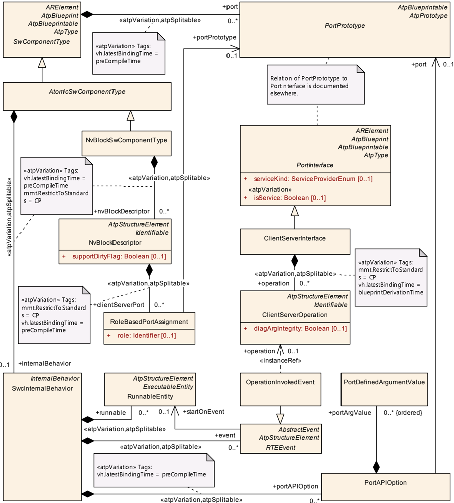

图 4.39：NVM 通知

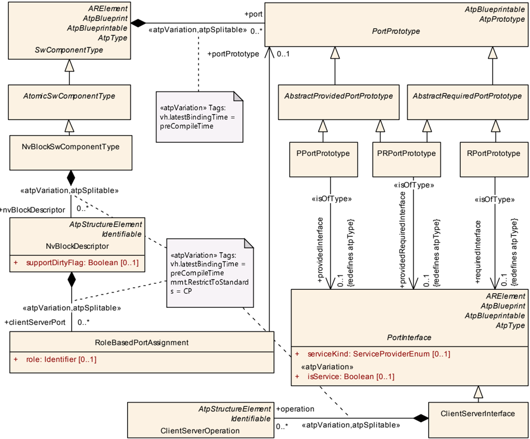

从 **SW-C** 侧收到的请求由 `NvBlockSwComponentType` 的可运行实体使用 `RoleBasedPortAssignment` 所指示的 **NVM** C **API** 转发给 **NVM** 模块，见图 4.38。

从 **NVM** 收到的通知被转发给所有连接到该 `NvBlockSwComponentType` 通知接口、且具有相应类型 `RoleBasedPortAssignment` 的 **SW-C**，见图 4.39。

**RTE** 生成器应为 `NvBlockSwComponentType` 的每个已连接服务器端口实现可运行实体。

用作连接到 **SW-C** 的服务器的 `NvBlockSwComponentType` 可运行实体，应通过调用相关联的 **NVM API** 把请求转发给 **NVM**。

**RTE** 所调用 **NvM API** `NvM_WriteBlock` 和 `NvM_SetRAMBlockStatus` 的返回值应被忽略。

由 `NvBlockSwComponentType` 的 `OperationInvokedEvent` 触发的 `RunnableEntity` 的 `symbol` 特性，应被 **RTE** 生成器用来标识要调用的 **NvM API** 函数（参见软件组件模板[2]中的 `[constr_1234]`）。

`NvBlockSwComponentType` 可以定义 `PortDefinedArgumentValue`，以便在该 `NvBlockSwComponentType` 定义了用于调用 **NvM** 服务的服务器端口时提供 `BlockId` 值。直到 R4.2 这都是提供 `BlockId` 值的唯一可能。但这些值不再是强制的，已被 `RteNvRamAllocation` 的配置取代，见下述两条。

**RTE** 生成器应根据通过 `RteNvRamAllocation` 的 `RteNvmBlockRef` 映射到相应 `NvBlockDescriptor` 的参数，确定调用 **NvM API** 函数所需的适当 `BlockId` 值。

请注意：一次调用与某个特定 `NvBlockDescriptor` 的关系可以通过以下方式确定：

* `NvBlockDescriptor.timingEvent`，用于周期性调用；
* `NvBlockDescriptor.clientServerPort`，其 `role` 特性值为 `NvMService` 或 `NvMAdmin`。此时，引用这类 `PPortPrototype` 中某个操作的所有 `OperationInvokedEvent` 都属于该 `NvBlockDescriptor`；
* 通过 `NvBlockDataMapping` 映射到 `NvBlockDescriptor.ramBlock` 的、位于 `AbstractProvidedPortPrototype` 中的 `VariableDataPrototype` 实例。此时，引用这些 `VariableDataPrototype` 实例的所有 `DataReceivedEvent` 都属于该 `NvBlockDescriptor`；
* `NvBlockDescriptor.modeSwitchEventTriggeredActivity`，用于基于模式切换的调用。

当按上述规定确定 `BlockId` 值时，**RTE** 生成器应忽略应用于 `NvBlockSwComponentType` 的 `PPortPrototype` 的带 `PortDefinedArgumentValue` 的 `PortAPIOption`。

除了通过 **NvM** 服务端口把 **SW-C** 侧的请求转发给 **NVM** 模块之外，`NvBlockSwComponentType` 还支持 6.2.2.10.3.1 节所述的脏标志机制。为了实现脏标志机制的行为，**RTE** 为每个 `NvBlockDescriptor` 实现 `RunnableEntity`，这些实体可由 `RTEEvent` 触发。根据写入策略的不同，将使用不同种类的 `RTEEvent` 来触发这些 `RunnableEntity`。

`NvBlockSwComponentType` 的配置（即为触发 `NvBlockDescriptor` 的 `RunnableEntity` 而定义 `RTEEvent`，以及 `RTEEvent` 到任务的映射）通常不是 **SW-C** 开发人员的职责。因此 **SW-C** 开发人员可以在 `SwcServiceDependency` 的 `serviceNeeds` 中提供所需的写入策略，使用特性 `storeAtShutdown`、`storeCyclic`、`cyclicWritingPeriod`、`storeEmergency`、`storeImmediate` 和 `storeOnChange`（更多细节见软件组件模板[2]）。

**RTE** 生成器应为 `NvBlockSwComponentType` 的每个 `supportDirtyFlag` 特性设置为 true 的 `NvBlockDescriptor` 实现 `RunnableEntity`。

如果周期写入策略已启用（见周期写入策略规定），则某个 `NvBlockDescriptor` 的 `RunnableEntity` 应由一个 `TimingEvent` 激活。

如果关机、立即或变化时写入策略已启用（见相应写入策略规定），则某个 `NvBlockDescriptor` 的 `RunnableEntity` 应由一个 `DataReceivedEvent` 激活。

如果模式切换写入策略已启用（见模式切换写入策略规定），则某个 `NvBlockDescriptor` 的 `RunnableEntity` 应由一个 `SwcModeSwitchEvent` 激活。

对于需要组合多种写入策略的 `NvBlockDescriptor`（见周期、关机、立即写入策略规定），该 `NvBlockDescriptor` 的 `RunnableEntity` 应按每种写入策略分别由一个 `TimingEvent` 或 `DataReceivedEvent` 激活，遵循上述两条的规定。

如果没有为负责激活 `NvBlockDescriptor` 之 `RunnableEntity` 的 `DataReceivedEvent` 或 `SwcModeSwitchEvent` 定义 `RteEventToTaskMapping`（见上述激活规定），则相应的活动应在发出这些 `DataReceivedEvent` 或 `SwcModeSwitchEvent` 的 **RTE** 代码中处理。对显式通信，这应在相关的 `Rte_Write` 函数中完成；对隐式通信，在处理抢占缓冲区的任务体中完成。对使用异步模式切换过程的 `SwcModeSwitchEvent`，这应在相关的 `Rte_Switch` 函数中完成。

**注意：** 对 `SwcModeSwitchEvent` 而言，直接调用要求异步模式切换。

###### 6.2.2.10.4. 数据一致性

`NvBlockSwComponentType` 中包含的 `VariableDataPrototype` 在 **SW-C** 读取值或写入新值时被访问。在 **NVM** 为相关块处理读或写请求时，它也会访问该原型。

**NVM** 不直接访问 `VariableDataPrototype`，而应使用 7.1.9.3 节规定的 `Rte_GetMirror` 和 `Rte_SetMirror` **API**。

**RTE** 必须用 6.2.2.6 节定义的任何数据一致性机制保证这些 `VariableDataPrototype` 的数据一致性。根据用户的输入，使用隐式 **API** 的高效调度应允许低资源（**OS** 资源、**RAM** 和代码）的实现。

### 6.3. RTE 实现插件

#### 6.3.1. 简介

对标准的 **RTE** 生成器而言，确定系统动态的可能性非常有限（任务优先级、内部 `OsResource` 等）。真实的 **ECU** 软件会有更多约束，例如只在特定系统状态下运行的任务、跟随其他任务执行的任务（即任务链）。缺乏这些知识时，**RTE** 一方面会对内部变量使用超出必要的保护，另一方面进行超出必要的数据缓冲。这将导致高于必要的 **CPU** 资源消耗。AUTOSAR 对隐式访问数据的缓冲提供了一些想法和需求，但大多把优化留给 **RTE** 供应商。对 **RTE** 供应商而言，缓冲优化是实现 **RTE** 生成器时最具挑战性的工作之一。而且它同样不具备关于系统动态的全部知识，也不了解优化目标（AUTOSAR 只提供 `MEMORY` 和 `RUNTIME` 优化开关）。**RTE** 实现插件的思想是：把保护和缓冲优化的工作从 **RTE** 供应商转移到某个领域专用工具，后者对优化目标和系统动态有更详细的了解。

随着软件集群（**Software Cluster**）被引入 AUTOSAR 经典平台，跨集群通信也通过 **RTE** 实现插件来实现。

**RTE** 与领域专用工具之间的接口主要是 C 代码接口。下文中，这种带 **RTE** 扩展 C 代码的领域专用工具称为 **RTE** 实现插件。这些 **RTE** 实现插件可以以两种特化形式存在，刻画不同的通信范围：

* 本地软件集群通信插件；
* 跨软件集群通信插件。

#### 6.3.1.1. AUTOSAR 架构中的 RTE 实现插件

从 AUTOSAR 软件分层架构的角度看，**RTE** 实现插件是 **RTE** 的一部分。也就是说，由 **RTE** 生成器提供的"核心" **RTE** 加上 **RTE** 实现插件共同实现整体 **RTE**。尽管如此，"核心" **RTE** 与 **RTE** 实现插件之间的接口是标准化的，以便 **RTE** 生成器与 **RTE** 实现插件可以由不同供应商提供。

图 7.1：经由 RTE 实现插件的隐式通信示例

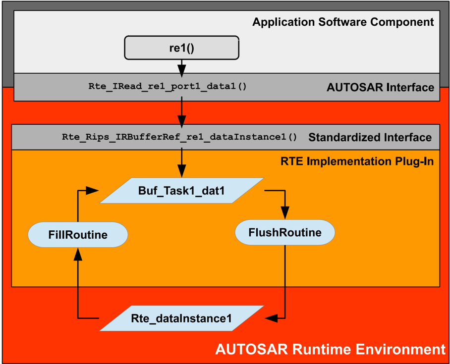

图 7.1 展示了经由 **RTE** 实现插件实现隐式通信的原理。基于软件组件描述，**RTE** 提供 `Rte_IRead` **API**。该 `Rte_IRead` **API** 使用 **RTE** 实现插件的 `Rte_Rips_IRBufferRef` **API** 获取隐式通信缓冲区 `Buf_Task1_dat1` 的地址。**RTE** 实现插件提供填充与清空例程以及隐式通信缓冲区实例。经由接口约定，它同样知道与该数据通信图相关的全局副本 `Rte_dataInstance1`。这支持为填充与清空例程创建相应的复制代码。

也可以规定某个 **RTE** 实现插件只负责处理它所处理的某个通信图中的一部分通信。据此，**RTE** 生成器必须实现该插件不负责的图元素。**RTE** 实现插件必须通过配置参数 `RteRipsPluginCommunicationTypeSupport` 告知 **RTE** 它们负责图的哪些元素。

##### 6.3.1.2. 多个 RTE 实现插件处理一个通信图

一个通信图可能由至多两个具有不同通信范围的 **RTE** 实现插件处理。例如，这使得一个通信图可以由一个本地软件集群通信插件实现优化的隐式缓冲或符合 **LET** 的缓冲，同时由一个跨软件集群通信插件实现与其他软件集群的通信。尽管如此，经由 **RIPS** `FlatInstanceDescriptor` 的关联必须以一致的方式完成。该一致性限制由以下约束定义：

`FlatInstanceDescriptor` 的 `rtePluginProps` 的 `associatedRtePlugin` 应只引用 `RteRipsPluginCommunicationScope` 参数值设置为 `RTE_RIPS_LOCAL_SW_CLUSTER_COM` 或被省略的 `RteRipsPluginProps` `EcucContainerValue`。

`FlatInstanceDescriptor` 的 `rtePluginProps` 的 `associatedCrossSwClusterComRtePlugin` 应只引用 `RteRipsPluginCommunicationScope` 参数值设置为 `RTE_RIPS_CROSS_SW_CLUSTER_COM` 的 `RteRipsPluginProps` `EcucContainerValue`。

请注意，对于特定类型的通信，其使用可能被限制为只指派一个本地软件集群通信插件或一个跨软件集群通信插件；对其他类型的通信，可能支持同时指派一个本地软件集群通信插件和一个跨软件集群通信插件。这些细节在 **RTE** 实现插件支持的相应章节中定义。

一个通信图由至多一个本地软件集群通信插件和至多一个跨软件集群通信插件处理。但两个 **RTE** 实现插件可以一起启用。

**理由**：若允许任意数量的 **RTE** 实现插件，**RTE** 与 **RTE** 实现插件之间的交互将无法规定。

**FlatInstanceDescriptor** 只应在集群生成阶段被关联到跨软件集群通信插件。

**理由**：非集群的 **ECU** 软件不支持跨软件集群通信插件。

#### 6.3.2. RTE 实现插件与 RTE 之间的接口

##### 6.3.2.1. 文件结构

以下小节描述 **RTE** 实现插件专属文件的内容，以及对 **RTE** 标准化头文件的附加需求。

所示文件结构是生成阶段或集群生成阶段相关的结构。**RTE** 实现插件对 **RTE** 契约阶段或基础软件调度器契约阶段没有任何影响。

通用编码规则要求每个 C 符号定义恰好有一个声明，且该声明对定义本身以及该 C 符号的使用者都可见。此外，文件结构只代表一种想法和某种最佳实践。**RTE** 与 **RTE** 实现插件都可以按自身需要调整该结构。但二者之间接口的实质必须保持，即：

* 一个领域（**RTE** 或 **RTE** 实现插件）的哪个文件向另一个领域导出哪个声明或定义；以及
* 哪些文件（或更确切地说其内容）必须预期同时出现在其他文件中（重复声明、重复包含保护生效等的风险）。

此处的"导出"意味着：被导出的定义或声明应在该包含导出头文件的文件中可见。至于该头文件自身执行这些声明或定义，还是由它包含的另一个头文件执行，并不重要。

图 7.2：RTE 实现插件面向 RTE 的包含结构

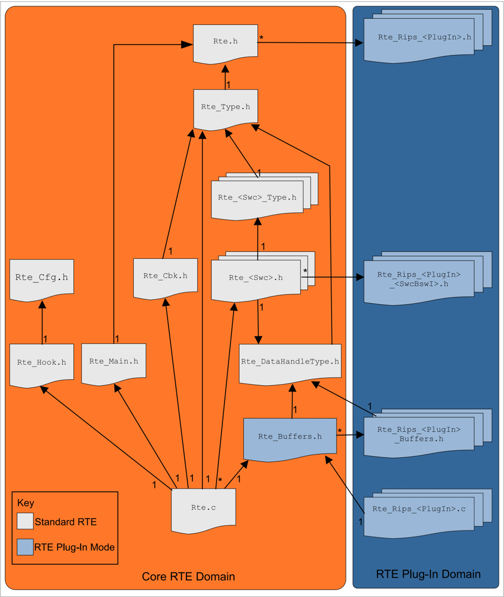

###### 6.3.2.1.1. RTE 全局缓冲区声明文件

**RTE** 全局缓冲区声明文件使 **RTE** 实例化的所有数据全局副本对 **RTE** 实现插件服务和 **RTE** 实现插件 C 代码可见。由于 **RTE** 实现插件只知道与相关 **RIPS** `FlatInstanceDescriptor` 对应的名称，当最终的全局副本名称与之不同时，可能需要相应的映射。因此 **RTE** 必须把从 **RIPS** `FlatInstanceDescriptor` 域派生的名称映射到 **RTE** 实现的真实 C 名称。一个同时含普通声明和带映射声明的 **RTE** 全局缓冲区声明文件示例见示例 7.1。

**示例 7.1**

```C
#ifndef RTE_BUFFERS_H
#define RTE_BUFFERS_H

#include "Rte_DataHandleType.h"
#include "Rte_Rips_myPlugin1_Buffers.h"
#include "Rte_Rips_myPlugin2_Buffers.h"

extern uint32 Rte_someInternalNameForData;

#define Rte_Rips_GlobalCopy_myMappedData Rte_someInternalNameForData

#endif /* RTE_BUFFERS_H */
```

**RTE** 全局缓冲区声明文件的名称应为 `Rte_Buffers.h`。

启用 **RTE** 实现插件模式时，**RTE** 生成器应创建 **RTE** 全局缓冲区声明文件。

**RTE** 全局缓冲区声明文件应包含 **RTE** 数据句柄类型头文件。

**RTE** 全局缓冲区声明文件应包含所有参与 **RTE** 实现插件的全部 **RIPS** 缓冲区声明文件。

**RTE** 全局缓冲区声明文件应导出 **RTE** 实例化的、其数据通信图已关联某个 **RTE** 实现插件的所有隐式通信全局副本的声明。

请注意：**RTE** 内部队列的数据结构被视为各 **RTE** 实现特定。由于不存在缓冲排队通信的用例，因此无需让 **RTE** 实现插件代码访问它们。

对关联到某个 **RTE** 实现插件、由 **RTE** 实现的数据通信图的每个全局副本，当其 C 符号与相应 **RIPS** `FlatInstanceDescriptor` 加前缀 `Rte_Rips_GlobalCopy_` 的 `shortName` 不同时，**RTE** 全局缓冲区声明文件应导出一条映射：从加前缀 `Rte_Rips_GlobalCopy_` 的 **RIPS** `FlatInstanceDescriptor` 的 `shortName` 到该全局副本的相应 C 符号。

对关联到某个 **RTE** 实现插件的参数通信图的每个参数实例，当其 C 符号（由 **RTE** 决定）与相应 **RIPS** `FlatInstanceDescriptor` 加前缀 `Rte_Rips_PrmInst_` 的 `shortName` 不同时，**RTE** 全局缓冲区声明文件应导出一条映射：从加前缀 `Rte_Rips_PrmInst_` 的 **RIPS** `FlatInstanceDescriptor` 的 `shortName` 到该参数实例的相应 C 符号。

**示例 7.2**

```C
#ifndef RTE_BUFFERS_H
#define RTE_BUFFERS_H

extern uint32 Rte_someInternalNameForData;
extern uint16 Rte_someInternalNameForParameter;

/*对应全局副本映射规定*/
#define Rte_Rips_GlobalCopy_myMappedData Rte_someInternalNameForData
/*对应参数实例映射规定*/
#define Rte_Rips_PrmInst_myParameter Rte_someInternalNameForParameter

#endif /* RTE_BUFFERS_H */
```

**RTE** 的实现方式应保证：上述两条映射规定所产生的映射对 AUTOSAR **RTE** 代码（特别是 `Rte.c`）没有任何影响，因为它们可能在那里引起非预期的替换。特别地，这意味着它们不得改变全局副本的 C 符号。

**注意：** 只要 **RTE** 代码不使用任何以 `Rte_Rips_GlobalCopy_` 或 `Rte_Rips_PrmInst_` 开头的符号，上述规定即可简单实现。

###### 6.3.2.1.2. RIPS 缓冲区声明文件

**RIPS** 缓冲区声明文件使 **RTE** 实现插件实例化的所有数据全局副本对 **RTE** 可见。

**RIPS** 缓冲区声明文件的名称应为 `Rte_Rips_<PlugIn>_Buffers.h`，其中 `<PlugIn>` 是容器 `RteRipsPluginProps` 定义的相关 **RTE** 实现插件的名称。

**RTE** 实现插件应创建 **RIPS** 缓冲区声明文件。

**注意：** 每个参与的 **RTE** 实现插件创建一个单独的 **RIPS** 缓冲区声明文件。

**RIPS** 缓冲区声明文件应包含 **RTE** 数据句柄类型头文件（`Rte_DataHandleType.h`）。

**RIPS** 缓冲区声明文件应导出该 **RTE** 实现插件所处理 **RIPS** 相关数据的隐式通信缓冲区的声明。

**RIPS** 缓冲区声明文件应导出该 **RTE** 实现插件所处理 **RIPS** 相关数据的隐式通信缓冲区的类型定义。

###### 6.3.2.1.3. RTE 实现插件头文件

**RTE** 实现插件头文件的名称应为 `Rte_Rips_<PlugIn>.h`，其中 `<PlugIn>` 是容器 `RteRipsPluginProps` 定义的相关 **RTE** 实现插件的名称。

**RTE** 实现插件应创建 **RTE** 实现插件头文件。

**注意：** 每个参与的 **RTE** 实现插件创建一个单独的 **RTE** 实现插件头文件。

**RTE** 实现插件头文件应导出用作 `runsInside` 的独占区相关的 `Rte_Rips_Enter` 和 `Rte_Rips_Exit` 服务。

**RTE** 实现插件头文件应导出与模式机实例和分布式共享模式队列相关的 `Rte_Rips_EnterModeQueue` 和 `Rte_Rips_ExitModeQueue` 服务。

**RTE** 实现插件头文件应导出该 **RTE** 实现插件生命周期 **API** 的声明。

请注意：**RTE** 实现插件的生命周期 **API** 在 6.3.2.4.15 节中定义。

**RTE** 实现插件头文件应导出该 **RTE** 实现插件的 `Rte_Rips_FillFlushRoutine` 的声明。

**RTE** 实现插件头文件应导出该 **RTE** 实现插件的 `Rte_Rips_InvocationHandler` 的声明。

**RTE** 实现插件头文件应导出该 **RTE** 实现插件的 `Rte_Rips_DataIsUpdated_EventActivation` 的声明。

**RTE** 应在需要其中所含定义和声明之处包含 **RTE** 实现插件头文件。

**注意：** 由于与生命周期 **API** 的关系，合理的包含位置可能是 `Rte.h` 文件，如图 7.2 所示。

###### 6.3.2.1.4. RIPS SWC-BSW 实例头文件

**RIPS SWC-BSW** 实例头文件应命名为 `Rte_Rips_<PlugIn>_<SwcBswI>.h`，其中 `<PlugIn>` 是容器 `RteRipsPluginProps` 定义的相关 **RTE** 实现插件的名称，`<SwcBswI>` 是按相应命名规定得到的 **SWC-BSW** 实例名。

对满足以下条件之一的每个软件组件或 **BSW** 模块，**RTE** 实现插件都应为其生成 **RIPS SWC-BSW** 实例头文件：

* 有一个启用了 **RTE** 实现插件支持、并映射到该 **RTE** 实现插件的独占区（见 6.3.3.5 节），或
* 有一个对启用了 **RTE** 实现插件支持、并映射到该 **RTE** 实现插件的数据通信图的访问，或
* 有一个对启用了 **RTE** 实现插件支持、并映射到该 **RTE** 实现插件的参数通信图的访问，

或：

* 有一个对启用了 **RTE** 实现插件支持、并映射到该 **RTE** 实现插件的模式机实例的访问，或
* 有一个对启用了 **RTE** 实现插件支持、并映射到该 **RTE** 实现插件的、属于分布式共享模式队列的模式机实例的访问，或
* 有一个对启用了 **RTE** 实现插件支持、并映射到该 **RTE** 实现插件的触发通信图的访问，或
* 有一个对启用了 **RTE** 实现插件支持、并映射到该 **RTE** 实现插件的客户端-服务器通信图的访问。

**注意：** 跨集群 **RIPS API** 通过其 `EcucPartition` 映射进行消歧。这可能导致多个 **RIPS SWC-BSW** 实例头文件声明同一个函数，进而引发 MISRA 违规或编译器告警。

此时，只要这些声明最终仍能通过包含 **RIPS SWC-BSW** 实例头文件而可用，跨软件集群通信插件可以在一个单独的头文件中声明分区特定的 **RIPS API**。

**RIPS SWC-BSW** 实例头文件应包含 **RTE** 全局缓冲区声明文件。

**RIPS SWC-BSW** 实例头文件应导出该 **RTE** 实现插件为该组件实例/基础软件模块实例所处理的以下各项的定义：

* 用于带 `canEnter` 关联的独占区的 `Rte_Rips_Enter`/`Rte_Rips_Exit` 服务；
* 用于显式访问保护的 `Rte_Rips_StartRead`、`Rte_Rips_StopRead`、`Rte_Rips_StartWrite` 和 `Rte_Rips_StopWrite` 服务；
* 用于显式数据访问的 `Rte_Rips_Read`、`Rte_Rips_Write`、`Rte_Rips_DRead`、`Rte_Rips_Feedback` 和 `Rte_Rips_DataIsUpdated` 服务；
* 用于隐式访问的 `Rte_Rips_IRead`、`Rte_Rips_IWrite`、`Rte_Rips_IRBufferRef`、`Rte_Rips_IWBufferRef` 和 `Rte_Rips_Feedback` 服务；
* 用于客户端和触发源的 `Rte_Rips_Invoke` 和 `Rte_Rips_ReturnResult`；
* 用于标定参数访问的 `Rte_Rips_Prm`；
* 用于跨集群模式通信的 `Rte_Rips_Switch`；
* 用于跨集群触发通信的 `Rte_Rips_Trigger`。

###### 6.3.2.1.5. RTE 实现插件实现文件

**RTE** 实现插件应以避免与 AUTOSAR 基础软件模块和软件组件文件名冲突的方式命名其 **RTE** 实现插件实现文件。

请注意 **RTE** 实现插件的文件结构并未被严格标准化。不过，当 **RTE** 实现插件只需要一个源文件时，有一条推荐命名。当然，给定名称模式也可以扩展到多于一个文件，例如每个 **ASIL** 等级一个源文件。

如果 **RTE** 实现插件使用单一源文件，则 **RTE** 实现插件实现文件的名称宜为 `Rte_Rips_<PlugIn>.c`，其中 `<PlugIn>` 是容器 `RteRipsPluginProps` 定义的相关 **RTE** 实现插件的名称。

**RTE** 实现插件应创建 **RTE** 实现插件实现文件。

**注意：** 每个参与的 **RTE** 实现插件创建单独的一组 **RTE** 实现插件实现文件。

**RTE** 实现插件实现文件应包含 **RTE** 全局缓冲区声明文件。

**RTE** 实现插件实现文件应包含 **RTE** 实现插件头文件。

**RTE** 实现插件实现文件应包含该 **RIPS** 插件所处理 **RIPS** 相关数据的隐式通信缓冲区的定义。

**RIPS** 实现文件应包含该 **RIPS** 插件所处理 **RIPS** 相关数据的隐式通信缓冲区的定义、填充与清空可运行实体的实现，以及该插件的 **RIPS** 实现可能需要的所有其他消耗内存的 C 对象。

###### 6.3.2.1.6. RTE 头文件

本小节描述启用 **RTE** 实现插件模式时对 **RTE** 头文件的附加需求。

**RTE** 头文件（`Rte.h`）应包含所有参与 **RTE** 实现插件的 **RTE** 实现插件头文件。

###### 6.3.2.1.7. 应用头文件

本小节描述启用 **RTE** 实现插件模式时对 **RTE** 应用头文件的附加需求。

如果存在的话，某个软件组件的应用头文件应包含适用于该组件实例的所有 **RTE** 实现插件的 **RIPS SWC-BSW** 实例头文件（见 6.3.2.1.4 节）。

###### 6.3.2.1.8. 模块互连头文件

本小节描述启用 **RTE** 实现插件模式时对基础软件调度器模块互连头文件的附加需求。

如果存在的话，某个 **BSW** 模块的模块互连头文件应包含适用于该基础软件模块实例的所有 **RTE** 实现插件的 **RIPS SWC-BSW** 实例头文件（见 6.3.2.1.4 节）。

###### 6.3.2.1.9. RTE 数据句柄类型头文件

本小节描述启用 **RTE** 实现插件模式时对 **RTE** 数据句柄类型头文件的附加需求。

当 **RTE** 实现某些 **RIPS** 相关数据通信图或参数通信图的全局副本时，**RTE** 数据句柄类型头文件应为每个全局副本包含一个包装类型定义：

```C
typedef <type of global copy> Rte_Rips_GlobalCopy_<CGI>_Type;
```

其中 `<CGI>` 是由引用该通信图的 **RIPS** `FlatInstanceDescriptor` 的 `shortName` 定义的通信图实例的名称。

当 **RTE** 实现某些 **RIPS** 相关参数通信图的参数实例时，**RTE** 数据句柄类型头文件应为每个参数实例包含一个包装类型定义：

```C
typedef <type of parameter instance> Rte_Rips_PrmInst_<CGI>_Type;
```

其中 `<CGI>` 是由引用该通信图的 **RIPS** `FlatInstanceDescriptor` 的 `shortName` 定义的通信图实例的名称。

该包装类型供采用类型无关缓冲策略的 **RTE** 实现插件使用。此时，缓冲决策由时序行为以及读者与写者之间的干扰驱动，例如基于 **LET** 的缓冲。在这种情况下，**RTE** 实现插件可以省去从 AUTOSAR 模型收集类型的工作。

**RTE** 数据句柄类型头文件（`Rte_DataHandleType.h`）应包含 **RTE** 类型头文件，无论是否直接需要。

##### 6.3.2.2. API 原则

###### 6.3.2.2.1. API 命名模式

**RTE** 实现插件服务按照以下原则定义。

面向软件组件或基础软件模块的 **RTE API** 在 AUTOSAR 元模型中定义（例如对某个组件类型的某个端口的某个特定数据元素提供显式写访问）。与此相对，面向 **RTE** 实现插件的接口一方面严格面向用例（相应地基于实例）。面向用例意味着：对同一用例（例如开始对一个独占区的保护），无论它存在于软件组件还是基础软件模块中，都定义并提供同一种 **RTE** 实现插件服务供 **RTE** 代码使用。

基于实例意味着：**RTE** 实现插件服务的名称反映了由特定 **RTE** 实现插件实现的、对 **ECU** 软件中特定实体的特定活动，例如确定为特定软件组件实例的特定 `RunnableEntity` 从内存何处读取某个通信图的数据值。

除生命周期 **API** 外，任何 **RTE** 实现插件服务都按照以下命名方案定义：

```text
Rte_Rips_<PlugIn>_<useCase>_[<SwcBswI>][Partition] [_<ExE>]_<elementInstance>
```

`<PlugIn>` 是容器 `RteRipsPluginProps` 定义的相关 **RTE** 实现插件的名称。

`<useCase>` 是标示 **RTE** 实现插件服务用途的名称部分，取以下之一：

`IRead`、`IWrite`、`IRBufferRef`、`IWBufferRef`、`StartRead`、`StopRead`、`StartWrite`、`StopWrite`、`Read`、`DRead`、`Write`、`Enter`、`Exit`、`EnterModeQueue`、`ExitModeQueue`、`Switch`、`DequeueModeSwitch`、`Trigger`、`Invoke`、`ReturnResult`、`Prm`。

更多细节见 6.3.2.4 节。

`<SwcBswI>`（**SWC-BSW** 实例名）或者是（**ECU Extract** 的根软件组合中的）`SwComponentPrototype` 的 `shortName`，或者是按相应命名规定得到的 **BSW** 模块实例名。

**注意：** 在一些 **RTE** 实现插件服务中名称部分 `<SwcBswI>` 是强制的；在另一些中它可替代性地与 `<Partition>` 一起使用。

`<Partition>` 是访问方软件组件的（**ECU Extract** 根软件组合中的）`SwComponentPrototype` 所映射到的 `EcucPartition` 的 `shortName`，或使用该 **RTE** 代码所属的 `EcucPartition` 的 `shortName`。

**BSW** 模块实例名 `<bsnp>[_<vi>_<ai>]` 的构成：`<bsnp>` 是按相应规定得到的 **BSW** 调度器名称前缀，`<vi>` 是访问方 **BSW** 模块的 `vendorId`，`<ai>` 是访问方 **BSW** 模块的 `vendorApiInfix`。

`<ExE>` 是访问某个元素实例的 `ExecutableEntity` 的 `shortName`。仅当 **RTE** 提供区分不同 `ExecutableEntity` 访问的能力时，名称部分 `<ExE>` 才存在。

`<elementInstance>` 标识提供访问的目标元素。由于特定用例通常与特定元素绑定，将使用以下元素实例名称部分：

* `<CGI>` 是由引用该通信图的 **RIPS** `FlatInstanceDescriptor` 的 `shortName` 定义的通信图实例名称；
* `<ExclusiveArea>` 是该独占区的 `shortName`；
* `<MMI>` 是 `RteModeMachineInstanceConfig` 或 `RteBswModeMachineInstanceConfig` 容器的 `shortName`；
* `<DSMQ>` 是 `RteDistributedSharedModeQueue` 或 `RteBswModeMachineInstanceConfig` 容器的 `shortName`；
* `<DE>` 是 `DataReceivedEvent` 的 `shortName`。

###### 6.3.2.2.2. 对 RTE 实现插件服务的基本需求

**RTE** 实现插件服务用于 **RTE** 的 C 实现中。这里的一个重要事实是：**RTE API** 可以实现为 C 函数或类函数宏（见 7.1.2.6.3 节）。在类函数宏的情况下，**RTE** 实现很可能使用逗号表达式来返回错误码或读取返回值。这要求 **RTE** 实现插件服务能够在这样的逗号表达式中使用。

**RTE** 实现插件应实现每个 **RTE** 实现插件服务，使其可以在逗号表达式中使用。

###### 6.3.2.2.3. 对 RTE 实现的基本需求

**6.3.2.2.3.1 宏 API 实现**

作为类函数宏的 **API** 实现可能有奇怪的副作用。一个特例是 **API** 的嵌套调用，例如把 `Rte_DRead` 作为 `Rte_Write` 的参数。用户自然期望 `Rte_DRead` 的代码在进入 `Rte_Write` **API** 之前执行。但由于宏只是文本替换，技术上并非如此。相反，`Rte_DRead` 会在 `Rte_Write` 内部使用该参数的位置执行。这可能导致各种效果，例如（**RTE** 或 **RTE** 实现插件的）保护代码的非预期嵌套，或 `Rte_DRead` 的多次执行且结果不同。必须避免这种情况。

**RTE** 实现其代码的方式应能抵御不期望的嵌套，即把作为宏参数传入的代码嵌套进由 **RTE** 实现插件服务调用（例如 `Rte_Rips_StartRead`、`Rte_Rips_StopRead`、`Rte_Rips_StartWrite` 和 `Rte_Rips_StopWrite`）保护的临界区。

**注意：** 这可以通过使用真函数、内联函数，或通过在临界区外把宏实参赋给一个临时变量来实现。

##### 6.3.2.3. API 数据类型

**RTE** 实现插件应根据适用于该全局副本或参数实例的 `ImplementationDataType` 确定 `<return>` 类型。

请注意，`<return>` 只适用于原始类型，例如 `uint8`、`float`。

**RTE** 实现插件应按全局副本包装类型规定确定适用于全局副本的 `<rips_return_ref>` 类型。其中 `<rips_return_ref>` 类型是指向全局副本类型的指针（即 `foo *`，`foo` 为全局副本的类型）。

此外，**RTE** 实现插件服务可以使用标准类型或 **RTE** 特定类型，例如 `Std_TransformerError`。它们不受 **RTE** 实现插件使用的影响。

##### 6.3.2.4. API 参考

###### 6.3.2.4.1. 隐式缓冲区值访问

**6.3.2.4.1.1 Rte_Rips_IRead**

| 服务名 | `Rte_Rips_<PlugIn>_IRead_<SwcBswI>_<ExE>_<CGI>` |
| --- | --- |
| 语法 | `<return> Rte_Rips_<PlugIn>_IRead_<SwcBswI>_<ExE>_<CGI> ( void )` |
| 服务 ID [hex] | 0xE0 |
| 同步/异步 | 同步 |
| 可重入性 | 可重入 |
| 输入参数 | 无 |
| 输入输出参数 | 无 |
| 输出参数 | 无 |
| 返回值 | `<return>`：返回隐式读取的原始数据的值 |
| 描述 | `Rte_Rips_IRead` 返回隐式读取的原始数据的值 |
| 可用头文件 | `Rte_Rips_<PlugIn>_<SwcBswI>.h` |

请注意，`Rte_Rips_IRead` 服务只适用于本地软件集群通信插件，因为跨软件集群通信插件不实现隐式通信缓冲。

如果满足以下条件，关联的本地软件集群通信插件应为 `RunnableEntity` 在 `dataReadAccess` 角色中的每个 `VariableAccess`、以及 `readLocalVariable` 角色中指向某个 `implicitInterRunnableVariable` 的每个 `VariableAccess` 提供 `Rte_Rips_IRead` 服务：

* 相关数据通信图已启用本地软件集群通信插件支持；且
* 该数据实例由原始数据类型类型化；且
* 按 6.3.3.4 节的状态分类，该数据实例是无状态数据元素；且
* 对关联的本地软件集群通信插件，`RtePluginSupportsIReadIWrite` 为 true。

如果满足与上条相同的条件，**RTE** 应调用 `Rte_Rips_IRead` 服务来隐式读取数据。

**6.3.2.4.1.2 Rte_Rips_IWrite**

| 服务名 | `Rte_Rips_<PlugIn>_IWrite_<SwcBswI>_<ExE>_<CGI>` |
| --- | --- |
| 语法 | `void Rte_Rips_<PlugIn>_IWrite_<SwcBswI>_<ExE>_<CGI> ( IN data )` |
| 服务 ID [hex] | 0xE1 |
| 同步/异步 | 同步 |
| 可重入性 | 可重入 |
| 输入参数 | `data`：要写入的原始数据 |
| 输入输出参数 | 无 |
| 输出参数 | 无 |
| 返回值 | 无 |
| 描述 | `Rte_Rips_IWrite` 写入隐式写入的原始数据的值 |
| 可用头文件 | `Rte_Rips_<PlugIn>_<SwcBswI>.h` |

请注意，`Rte_Rips_IWrite` 服务只适用于本地软件集群通信插件，因为跨软件集群通信插件不实现隐式通信缓冲。

如果满足以下条件，关联的本地软件集群通信插件应为 `RunnableEntity` 在 `dataWriteAccess` 角色中的每个 `VariableAccess`、以及 `writtenLocalVariable` 角色中指向某个 `implicitInterRunnableVariable` 的每个 `VariableAccess` 提供 `Rte_Rips_IWrite` 服务：

* 相关数据通信图已启用本地软件集群通信插件支持；且
* 该数据实例由原始数据类型类型化；且
* 按 6.3.3.4 节的状态分类，该数据实例是无状态数据元素；且
* 对关联的 **RTE** 实现插件，`RtePluginSupportsIReadIWrite` 为 true。

如果满足与上条相同的条件，**RTE** 应调用 `Rte_Rips_IWrite` 服务来隐式写入数据。

###### 6.3.2.4.2. 隐式缓冲区地址访问

**6.3.2.4.2.1 Rte_Rips_IRBufferRef**

| 服务名 | `Rte_Rips_<PlugIn>_IRBufferRef_<SwcBswI>_<ExE>_<CGI>` |
| --- | --- |
| 语法 | `<rips_return_ref> Rte_Rips_<PlugIn>_IRBufferRef_<SwcBswI>_<ExE>_<CGI> ( void )` |
| 服务 ID [hex] | 0xE2 |
| 同步/异步 | 同步 |
| 可重入性 | 可重入 |
| 输入参数 | 无 |
| 输入输出参数 | 无 |
| 输出参数 | 无 |
| 返回值 | `<rips_return_ref>`：指向内存中可读取数据值及可选状态的地址的引用 |
| 描述 | `Rte_Rips_IRBufferRef` 返回指向内存中可读取数据值与状态的位置的指针。当 **SWC** 以源代码交付且不可多重实例化时，该宏不保证在编译期解析为一个引用，也可能解析为函数或表达式 |
| 可用头文件 | `Rte_Rips_<PlugIn>_<SwcBswI>.h` |

请注意，`Rte_Rips_IRBufferRef` 服务只适用于本地软件集群通信插件，因为跨软件集群通信插件不实现隐式通信缓冲。

如果相关数据通信图已启用本地软件集群通信插件支持，则关联的本地软件集群通信插件应为 `RunnableEntity` 在 `dataReadAccess` 角色中的每个 `VariableAccess`、以及 `readLocalVariable` 角色中指向某个 `implicitInterRunnableVariable` 的每个 `VariableAccess` 提供 `Rte_Rips_IRBufferRef` 服务。

**RTE** 应调用 `Rte_Rips_IRBufferRef` 服务以获取内存地址，从中可以读取隐式读取数据实例的值和/或状态。其中 `Rte_Rips_IRBufferRef` 只应在不适用 `Rte_Rips_IRead` 时使用（见上文 `Rte_Rips_IRead` 的调用规定）。

如果隐式数据访问需要经由数据句柄区或可运行实体间变量句柄区中的数据句柄实现，则 **RTE** 应用 `Rte_Rips_IRBufferRef` 初始化组件数据结构中用于隐式只读访问的相关数据句柄（另见 6.3.3.4 节）。

请注意：当 `RunnableEntity` 访问 `RPortPrototype` 或 `PRPortPrototype` 中的数据元素，或该 `RunnableEntity` 对某个 `implicitInterRunnableVariable` 拥有独占读访问时，需要只读隐式访问。

**6.3.2.4.2.2 Rte_Rips_IWBufferRef**

| 服务名 | `Rte_Rips_<PlugIn>_IWBufferRef_<SwcBswI>_<ExE>_<CGI>` |
| --- | --- |
| 语法 | `<rips_return_ref> Rte_Rips_<PlugIn>_IWBufferRef_<SwcBswI>_<ExE>_<CGI> ( void )` |
| 服务 ID [hex] | 0xE3 |
| 同步/异步 | 同步 |
| 可重入性 | 可重入 |
| 输入参数 | 无 |
| 输入输出参数 | 无 |
| 输出参数 | 无 |
| 返回值 | `<rips_return_ref>`：指向内存中可写入数据值及可选状态的地址的引用 |
| 描述 | `Rte_Rips_IWBufferRef` 返回指向隐式写入数据元素的指针。当 **SWC** 以源代码交付且不可多重实例化时，该宏不保证在编译期解析为一个引用，也可能解析为函数或表达式 |
| 可用头文件 | `Rte_Rips_<PlugIn>_<SwcBswI>.h` |

请注意，`Rte_Rips_IWBufferRef` 服务只适用于本地软件集群通信插件，因为跨软件集群通信插件不实现隐式通信缓冲。

如果相关数据通信图已启用本地软件集群通信插件支持，则关联的本地软件集群通信插件应为 `RunnableEntity` 在 `dataWriteAccess` 角色中的每个 `VariableAccess`、以及 `writtenLocalVariable` 角色中指向某个 `implicitInterRunnableVariable` 的每个 `VariableAccess` 提供 `Rte_Rips_IWBufferRef` 服务。

**RTE** 应调用 `Rte_Rips_IWBufferRef` 服务以获取内存地址，向其写入隐式写入数据实例的值和/或状态。其中 `Rte_Rips_IWBufferRef` 只应在不适用 `Rte_Rips_IWrite` 时使用（见上文 `Rte_Rips_IWrite` 的调用规定）。

如果隐式数据访问需要经由数据句柄区或可运行实体间变量句柄区中的数据句柄实现，则 **RTE** 应用 `Rte_Rips_IWBufferRef` 初始化组件数据结构中用于隐式写或隐式读写访问的相关数据句柄（另见 6.3.3.4 节）。

请注意：当 `RunnableEntity` 访问 `PRPortPrototype` 中的数据元素，或该 `RunnableEntity` 对某个 `implicitInterRunnableVariable` 拥有读和写访问时，需要读写隐式访问。对读写隐式访问同样适用 `Rte_Rips_IWBufferRef` 服务。

###### 6.3.2.4.3. 隐式通信缓冲区的填充与清空例程

**6.3.2.4.3.1 Rte_Rips_FillFlushRoutine**

| 服务名 | `<name of the Fill-Flush-Routine>` |
| --- | --- |
| 语法 | `void <name of the Fill-Flush-Routine> ( void )` |
| 服务 ID [hex] | 0xEF |
| 同步/异步 | 同步 |
| 可重入性 | 有条件可重入 |
| 输入参数 | 无 |
| 输入输出参数 | 无 |
| 输出参数 | 无 |
| 返回值 | 无 |
| 描述 | 为隐式通信执行缓冲区填充与清空操作 |
| 可用头文件 | `Rte_Rips_<PlugIn>.h` |

请注意，`Rte_Rips_FillFlushRoutine` 服务只适用于本地软件集群通信插件，因为跨软件集群通信插件不实现隐式通信缓冲。

关联的本地软件集群通信插件应为每个已配置的 `RteRipsPluginFillFlushRoutineFnc` 提供 `Rte_Rips_FillFlushRoutine` 服务。

关于 **RTE** 对 `Rte_Rips_FillFlushRoutine` 使用的更多细节见 6.3.3.4.7.1 节。

###### 6.3.2.4.4. 显式访问保护

**6.3.2.4.4.1 Rte_Rips_StartRead**

| 服务名 | `Rte_Rips_<PlugIn>_StartRead_<SwcBswI>[_<ExE>]_<CGI>` |
| --- | --- |
| 语法 | `void Rte_Rips_<PlugIn>_StartRead_<SwcBswI>[_<ExE>]_<CGI> ( void )` |
| 服务 ID [hex] | 0xE4 |
| 同步/异步 | 同步 |
| 可重入性 | 可重入 |
| 输入参数 | 无 |
| 输入输出参数 | 无 |
| 输出参数 | 无 |
| 返回值 | 无 |
| 描述 | `Rte_Rips_StartRead` 开始显式读访问的保护 |
| 可用头文件 | `Rte_Rips_<PlugIn>_<SwcBswI>.h` |

请注意，`Rte_Rips_StartRead` 服务只适用于本地软件集群通信插件，因为跨软件集群通信插件不为 **RTE** 代码实现访问保护。

如果满足以下条件，关联的本地软件集群通信插件应提供 `Rte_Rips_StartRead` 服务：对于 `AbstractRequiredPortPrototype` 中存在 `RunnableEntity` 在 `dataReceivePointByArgument` 或 `dataReceivePointByValue` 角色 `VariableAccess` 的每个 `VariableDataPrototype` 实例，以及 `readLocalVariable` 角色中指向某个 `explicitInterRunnableVariable` 的每个 `VariableAccess`，且：

* 相关数据通信图已启用本地软件集群通信插件支持；且
* 对关联的本地软件集群通信插件，`RteRipsGlobalCopyInstantiationPolicy` 设置为 `RTE_RIPS_INSTANTIATION_BY_RTE`。

**注意：** 在保护 `explicitInterRunnableVariable` 的情形下存在名称部分 `[_<ExE>]`。

如果满足以下条件，关联的本地软件集群通信插件应为 `BswModuleEntity` 在 `dataReceivePoint` 角色中的每个 `BswVariableAccess` 提供 `Rte_Rips_StartRead` 服务：

* 相关数据通信图已启用本地软件集群通信插件支持；且
* 对关联的本地软件集群通信插件，`RteRipsGlobalCopyInstantiationPolicy` 设置为 `RTE_RIPS_INSTANTIATION_BY_RTE`。

如果相关数据通信图已启用本地软件集群通信插件支持，则 **RTE** 应在该位置调用 `Rte_Rips_StartRead`，以替代 **RTE** 常规的 AUTOSAR 获取访问保护动作，例如 `SuspendOsInterrupts()` 或 `GetResource()`。

**6.3.2.4.4.2 Rte_Rips_StopRead**

| 服务名 | `Rte_Rips_<PlugIn>_StopRead_<SwcBswI>[_<ExE>]_<CGI>` |
| --- | --- |
| 语法 | `void Rte_Rips_<PlugIn>_StopRead_<SwcBswI>[_<ExE>]_<CGI> ( void )` |
| 服务 ID [hex] | 0xE5 |
| 同步/异步 | 同步 |
| 可重入性 | 可重入 |
| 输入参数 | 无 |
| 输入输出参数 | 无 |
| 输出参数 | 无 |
| 返回值 | 无 |
| 描述 | `Rte_Rips_StopRead` 结束显式读访问的保护 |
| 可用头文件 | `Rte_Rips_<PlugIn>_<SwcBswI>.h` |

请注意，`Rte_Rips_StopRead` 服务只适用于本地软件集群通信插件，因为跨软件集群通信插件不为 **RTE** 代码实现访问保护。

如果满足以下条件，关联的本地软件集群通信插件应提供 `Rte_Rips_StopRead` 服务：对于 `AbstractRequiredPortPrototype` 中存在 `RunnableEntity` 在 `dataReceivePointByArgument` 或 `dataReceivePointByValue` 角色 `VariableAccess` 的每个 `VariableDataPrototype` 实例，以及 `readLocalVariable` 角色中指向某个 `explicitInterRunnableVariable` 的每个 `VariableAccess`，且：

* 相关数据通信图已启用本地软件集群通信插件支持；且
* 对关联的本地软件集群通信插件，`RteRipsGlobalCopyInstantiationPolicy` 设置为 `RTE_RIPS_INSTANTIATION_BY_RTE`。

**注意：** 在保护 `explicitInterRunnableVariable` 的情形下存在名称部分 `[_<ExE>]`。

如果满足以下条件，关联的本地软件集群通信插件应为 `BswModuleEntity` 在 `dataSendPoint` 角色中的每个 `BswVariableAccess` 提供 `Rte_Rips_StopRead` 服务：

* 相关数据通信图已启用本地软件集群通信插件支持；且
* 对关联的本地软件集群通信插件，`RteRipsGlobalCopyInstantiationPolicy` 设置为 `RTE_RIPS_INSTANTIATION_BY_RTE`。

如果相关数据通信图已启用本地软件集群通信插件支持，则 **RTE** 应在该位置调用 `Rte_Rips_StopRead`，以替代 **RTE** 常规的 AUTOSAR 释放访问保护动作，例如 `ResumeOsInterrupts()` 或 `ReleaseResource()`。

**6.3.2.4.4.3 Rte_Rips_StartWrite**

| 服务名 | `Rte_Rips_<PlugIn>_StartWrite_<SwcBswI>[_<ExE>]_<CGI>` |
| --- | --- |
| 语法 | `void Rte_Rips_<PlugIn>_StartWrite_<SwcBswI>[_<ExE>]_<CGI> ( void )` |
| 服务 ID [hex] | 0xE6 |
| 同步/异步 | 同步 |
| 可重入性 | 可重入 |
| 输入参数 | 无 |
| 输入输出参数 | 无 |
| 输出参数 | 无 |
| 返回值 | 无 |
| 描述 | `Rte_Rips_StartWrite` 开始显式写访问的保护 |
| 可用头文件 | `Rte_Rips_<PlugIn>_<SwcBswI>.h` |

请注意，`Rte_Rips_StartWrite` 服务只适用于本地软件集群通信插件，因为跨软件集群通信插件不为 **RTE** 代码实现访问保护。

如果满足以下条件，关联的本地软件集群通信插件应提供 `Rte_Rips_StartWrite` 服务：对于 `AbstractProvidedPortPrototype` 中存在 `RunnableEntity` 在 `dataSendPoint` 角色 `VariableAccess` 的每个 `VariableDataPrototype` 实例，以及 `writtenLocalVariable` 角色中指向某个 `explicitInterRunnableVariable` 的每个 `VariableAccess`，且：

* 相关数据通信图已启用本地软件集群通信插件支持；且
* 对关联的本地软件集群通信插件，`RteRipsGlobalCopyInstantiationPolicy` 设置为 `RTE_RIPS_INSTANTIATION_BY_RTE`。

**注意：** 在保护 `explicitInterRunnableVariable` 的情形下存在名称部分 `[_<ExE>]`。

如果满足以下条件，关联的本地软件集群通信插件应为 `BswModuleEntity` 在 `dataSendPoint` 角色中的每个 `BswVariableAccess` 提供 `Rte_Rips_StartWrite` 服务：

* 相关数据通信图已启用本地软件集群通信插件支持；且
* 对关联的本地软件集群通信插件，`RteRipsGlobalCopyInstantiationPolicy` 设置为 `RTE_RIPS_INSTANTIATION_BY_RTE`。

如果相关数据通信图已启用本地软件集群通信插件支持，则 **RTE** 应在该位置调用 `Rte_Rips_StartWrite`，以替代 **RTE** 常规的 AUTOSAR 获取访问保护动作，例如 `SuspendOsInterrupts()` 或 `GetResource()`。

**6.3.2.4.4.4 Rte_Rips_StopWrite**

| 服务名 | `Rte_Rips_<PlugIn>_StopWrite_<SwcBswI>[_<ExE>]_<CGI>` |
| --- | --- |
| 语法 | `void Rte_Rips_<PlugIn>_StopWrite_<SwcBswI>[_<ExE>]_<CGI> ( void )` |
| 服务 ID [hex] | 0xE7 |
| 同步/异步 | 同步 |
| 可重入性 | 可重入 |
| 输入参数 | 无 |
| 输入输出参数 | 无 |
| 输出参数 | 无 |
| 返回值 | 无 |
| 描述 | `Rte_Rips_StopWrite` 结束显式写访问的保护 |
| 可用头文件 | `Rte_Rips_<PlugIn>_<SwcBswI>.h` |

请注意，`Rte_Rips_StopWrite` 服务只适用于本地软件集群通信插件，因为跨软件集群通信插件不为 **RTE** 代码实现访问保护。

如果满足以下条件，关联的本地软件集群通信插件应提供 `Rte_Rips_StopWrite` 服务：对于 `AbstractProvidedPortPrototype` 中存在 `RunnableEntity` 在 `dataSendPoint` 角色 `VariableAccess` 的每个 `VariableDataPrototype` 实例，以及 `writtenLocalVariable` 角色中指向某个 `explicitInterRunnableVariable` 的每个 `VariableAccess`，且：

* 相关数据通信图已启用本地软件集群通信插件支持；且
* 对关联的本地软件集群通信插件，`RteRipsGlobalCopyInstantiationPolicy` 设置为 `RTE_RIPS_INSTANTIATION_BY_RTE`。

**注意：** 在保护 `explicitInterRunnableVariable` 的情形下存在名称部分 `[_<ExE>]`。

如果满足以下条件，关联的本地软件集群通信插件应为 `BswModuleEntity` 在 `dataSendPoint` 角色中的每个 `BswVariableAccess` 提供 `Rte_Rips_StopWrite` 服务：

* 相关数据通信图已启用本地软件集群通信插件支持；且
* 对关联的本地软件集群通信插件，`RteRipsGlobalCopyInstantiationPolicy` 设置为 `RTE_RIPS_INSTANTIATION_BY_RTE`。

如果相关数据通信图已启用关联的本地软件集群通信插件支持，则 **RTE** 应在该位置调用 `Rte_Rips_StopWrite`，以替代 **RTE** 常规的 AUTOSAR 释放访问保护动作，例如 `ResumeOsInterrupts()` 或 `ReleaseResource()`。

###### 6.3.2.4.5. 显式数据访问服务

**6.3.2.4.5.1 Rte_Rips_Read**

| 服务名 | `Rte_Rips_<PlugIn>_Read_[<SwcBswI>][Partition][_<ExE>]_<CGI>` |
| --- | --- |
| 语法 | `Std_ReturnType Rte_Rips_<PlugIn>_Read_[<SwcBswI>][Partition][_<ExE>]_<CGI> ( OUT <data>, [Std_TransformerError transformerError] )` |
| 服务 ID [hex] | 0xEA |
| 同步/异步 | 同步 |
| 可重入性 | 可重入 |
| 输入参数 | 无 |
| 输入输出参数 | 无 |
| 输出参数 | `<data>`：OUT 参数 `<data>` 传回接收到的数据。`transformerError`：OUT 参数 `transformerError` 包含在转换器链执行期间发生的转换器错误 |
| 返回值 | `Std_ReturnType`：用于指示通信错误 |
| 描述 | `Rte_Rips_Read` 对一个发送方-接收方通信数据元素执行"显式"读取 |
| 可用头文件 | `Rte_Rips_<PlugIn>_<SwcBswI>.h` |

请注意，`Rte_Rips_Read` 服务既适用于本地软件集群通信插件，也适用于跨软件集群通信插件。名称部分 `[_<ExE>]` 仅在保护 `explicitInterRunnableVariable` 时存在。

当相关 `VariableDataPrototype` 解析为原始实现数据类型时，可以使用 `Rte_Rips_DRead` 服务作为替代。

如果满足以下条件，关联的本地软件集群通信插件应提供 `Rte_Rips_Read` 服务：对于 `AbstractRequiredPortPrototype` 中存在 `RunnableEntity` 在 `dataReceivePointByArgument` 或 `dataReceivePointByValue` 角色 `VariableAccess` 的每个 `VariableDataPrototype` 实例，以及 `readLocalVariable` 角色中指向某个 `explicitInterRunnableVariable` 的每个 `VariableAccess`，且：

* 相关数据通信图已启用本地软件集群通信插件支持；且
* 对关联的本地软件集群通信插件，`RteRipsGlobalCopyInstantiationPolicy` 设置为 `RTE_RIPS_INSTANTIATION_BY_PLUGIN`；

或：

* 按 6.3.3.4 节（数据转换）配置了数据转换。

如果满足以下条件，关联的本地软件集群通信插件应为 `BswModuleEntity` 在 `dataReceivePoint` 角色中的每个 `BswVariableAccess` 提供 `Rte_Rips_Read` 服务：

* 相关数据通信图已启用本地软件集群通信插件支持；且
* 对关联的本地软件集群通信插件，`RteRipsGlobalCopyInstantiationPolicy` 设置为 `RTE_RIPS_INSTANTIATION_BY_PLUGIN`。

如果满足以下条件，关联的跨软件集群通信插件应提供 `Rte_Rips_Read` 服务：对于 `AbstractRequiredPortPrototype` 中存在 `RunnableEntity` 在 `dataReceivePointByArgument` 角色 `VariableAccess` 的每个 `VariableDataPrototype` 实例，且：

* 相关数据通信图已启用跨软件集群通信插件支持；且
* 该数据元素采用"事件"语义（`swImplPolicy` = `queued`）。

在上述本地插件存在条件成立时，相关 `Rte_Rips_Read` 服务存在可选名称部分 `[<SwcBswI>]`。

如果满足以下条件，关联的跨软件集群通信插件应为每个映射有软件组件的分区提供一次 `Rte_Rips_Read` 服务：该软件组件在某个 `AbstractRequiredPortPrototype` 中存在 `RunnableEntity` 在 `dataReceivePointByArgument`、`dataReceivePointByValue` 或 `dataReadAccess` 角色 `VariableAccess` 的 `VariableDataPrototype` 实例，且：

* 相关数据通信图已启用跨软件集群通信插件支持；且
* 该数据元素采用"最后为最佳"语义（`swImplPolicy` = `standard`）。

如果满足以下条件，关联的跨软件集群通信插件应为每个映射有软件组件的分区提供一次 `Rte_Rips_Read` 服务：该软件组件在某个 `AbstractProvidedPortPrototype` 中存在 `RunnableEntity` 在 `dataWriteAccess` 角色 `VariableAccess` 的 `VariableDataPrototype` 实例。

请注意，跨软件集群通信适用时必须有这一条，以满足抢占区缓冲区初始化的规定（见 6.2.3.1.5 节）。

在上述两条跨集群存在条件成立时，相关 `Rte_Rips_Read` 服务存在可选名称部分 `[Partition]`。

`Rte_Rips_Read` 服务的可选 OUT 参数 `transformerError` 应按 6.3.3.4 节的相应规定生成。

返回值用于指示 **RTE** 实现插件在执行 `Rte_Rips_Read` 服务调用期间检测到的错误，或通信系统检测到的错误：

* `RTE_E_OK` —— 数据读取成功。
* `RTE_E_HARD_TRANSFORMER_ERROR` —— 转换器链中某个转换器的返回值表示硬转换器错误。
* `RTE_E_SOFT_TRANSFORMER_ERROR` —— 转换器链中至少一个转换器的返回值是软错误，且转换器链中未发生硬错误。
* `RTE_E_NO_DATA` ——（显式非阻塞读）未接收到任何事件，且读取尝试时未发生其他错误。
* `RTE_E_LOST_DATA` —— 表示由于接收队列溢出而丢失了一些到达的数据。这不是参数中所返回数据的错误。该覆盖性错误可与任何其他错误组合。
* `RTE_E_UNCONNECTED` —— 表示接收方端口未连接。

在调用 `Rte_Rips_Read` 期间出现多个故障时，最终返回值应按以下优先级规则推导（优先级从高到低）：

1. `RTE_E_UNCONNECTED`
2. `RTE_E_HARD_TRANSFORMER_ERROR`
3. `RTE_E_SOFT_TRANSFORMER_ERROR`
4. `RTE_E_NO_DATA`

如果满足以下条件，**RTE** 应在该位置调用 `Rte_Rips_Read` 或 `Rte_Rips_DRead`，以替代 **RTE** 对数据的常规读访问：

* 相关数据通信图已启用本地软件集群通信插件支持；且
* 对关联的本地软件集群通信插件，`RteRipsGlobalCopyInstantiationPolicy` 设置为 `RTE_RIPS_INSTANTIATION_BY_PLUGIN`。

如果满足以下条件，**RTE** 应在该位置调用 `Rte_Rips_Read` 或 `Rte_Rips_DRead`，以替代 **RTE** 对已转换数据的常规访问：

* 相关数据通信图已启用本地软件集群通信插件支持；且
* 按 6.3.3.4 节（数据转换）配置了数据转换。

如果相关数据通信图已启用跨软件集群通信插件支持，则 **RTE** 应在该位置调用 `Rte_Rips_Read`，以替代 **RTE** 对数据的常规读访问。

对显式通信（排队或最后为最佳），预期在 `Rte_Receive` 或 `Rte_Read` **API** 的上下文中使用。

对隐式通信，预期在以下上下文中使用：**RTE** 在 **OS** 任务中填充抢占区缓冲区之处，即对相关数据通信图有隐式访问的 `RunnableEntity` 所映射的任务。

对带状态的数据元素，`Rte_Rips_Read` 的返回值用于确定该数据元素的状态。

并且应使用与该 **OS** 任务所属分区相关的 `Rte_Rips_Read`。

**RTE** 应按以下顺序调用为同一相关数据通信图（同时启用了本地软件集群通信插件与跨软件集群通信插件）所创建的 `Rte_Rips_Read` 服务：

* 先调用按本地软件集群通信插件创建的 `Rte_Rips_Read` 服务，然后
* 调用按跨软件集群通信插件创建的 `Rte_Rips_Read` 服务。

**6.3.2.4.5.2 Rte_Rips_Write**

| 服务名 | `Rte_Rips_<PlugIn>_Write_[<SwcBswI>][Partition][_<ExE>]_<CGI>` |
| --- | --- |
| 语法 | `Std_ReturnType Rte_Rips_<PlugIn>_Write_[<SwcBswI>][Partition][_<ExE>]_<CGI> ( IN <data>, [Std_TransformerError transformerError] )` |
| 服务 ID [hex] | 0xEB |
| 同步/异步 | 同步 |
| 可重入性 | 可重入 |
| 输入参数 | `<data>`：IN 参数 `<data>` 传递要发送的数据 |
| 输入输出参数 | 无 |
| 输出参数 | `transformerError`：OUT 参数 `transformerError` 包含在转换器链执行期间发生的转换器错误 |
| 返回值 | `Std_ReturnType`：用于指示通信错误 |
| 描述 | `Rte_Rips_Write` 对一个发送方-接收方通信数据元素执行"显式"写入 |
| 可用头文件 | `Rte_Rips_<PlugIn>_<SwcBswI>.h` |

请注意，`Rte_Rips_Write` 服务中的名称部分 `[_<ExE>]` 仅在保护 `explicitInterRunnableVariable` 时存在。

如果满足以下条件，关联的本地软件集群通信插件应提供 `Rte_Rips_Write` 服务：对于 `AbstractProvidedPortPrototype` 中存在 `RunnableEntity` 在 `dataSendPoint` 角色 `VariableAccess` 的每个 `VariableDataPrototype` 实例，以及 `writtenLocalVariable` 角色中指向某个 `explicitInterRunnableVariable` 的每个 `VariableAccess`，且：

* 相关数据通信图已启用本地软件集群通信插件支持；且
* 对关联的本地软件集群通信插件，`RteRipsGlobalCopyInstantiationPolicy` 设置为 `RTE_RIPS_INSTANTIATION_BY_PLUGIN`；

或：

* 按 6.3.3.4 节（数据转换）配置了数据转换。

如果满足以下条件，关联的本地软件集群通信插件应为 `BswModuleEntity` 在 `dataSendPoint` 角色中的每个 `BswVariableAccess` 提供 `Rte_Rips_Write` 服务：

* 相关数据通信图已启用本地软件集群通信插件支持；且
* 对关联的本地软件集群通信插件，`RteRipsGlobalCopyInstantiationPolicy` 设置为 `RTE_RIPS_INSTANTIATION_BY_PLUGIN`。

如果满足以下条件，关联的跨软件集群通信插件应提供 `Rte_Rips_Write` 服务：对于 `AbstractProvidedPortPrototype` 中存在 `RunnableEntity` 在 `dataSendPoint` 角色 `VariableAccess` 的每个 `VariableDataPrototype` 实例，且：

* 相关数据通信图已启用跨软件集群通信插件支持；且
* 该数据元素采用"事件"语义（`swImplPolicy` = `queued`）。

在上述存在条件成立时，相关 `Rte_Rips_Write` 服务存在可选名称部分 `[<SwcBswI>]`。

如果满足以下条件，关联的跨软件集群通信插件应为每个映射有软件组件的分区提供一次 `Rte_Rips_Write` 服务：该软件组件在某个 `AbstractProvidedPortPrototype` 中存在 `RunnableEntity` 在 `dataSendPoint` 或 `dataWriteAccess` 角色 `VariableAccess` 的 `VariableDataPrototype` 实例，且：

* 相关数据通信图已启用跨软件集群通信插件支持；且
* 该数据元素采用"最后为最佳"语义（`swImplPolicy` = `standard`）。

在该存在条件成立时，相关 `Rte_Rips_Write` 服务存在可选名称部分 `[Partition]`。

`Rte_Rips_Write` 服务的可选 OUT 参数 `transformerError` 应按 6.3.3.4 节的相应规定生成。

返回值用于指示 **RTE** 实现插件在执行 `Rte_Rips_Write` 服务调用期间检测到的错误，或通信系统检测到的错误：

* `RTE_E_OK` —— 数据写入成功。
* `RTE_E_HARD_TRANSFORMER_ERROR` —— 转换器链中某个转换器的返回值表示硬转换器错误。
* `RTE_E_SOFT_TRANSFORMER_ERROR` —— 转换器链中至少一个转换器的返回值是软错误，且转换器链中未发生硬错误。
* `RTE_E_LIMIT` —— 由于队列已满，某个 **ECU** 本地接收方丢弃了一个"事件"（仅限 ECU 内通信）。

在调用 `Rte_Rips_Write` 期间出现多个故障时，最终返回值应按以下优先级规则推导（优先级从高到低）：

1. `RTE_E_LIMIT`
2. `RTE_E_HARD_TRANSFORMER_ERROR`
3. `RTE_E_SOFT_TRANSFORMER_ERROR`

如果满足以下条件，**RTE** 应在该位置调用 `Rte_Rips_Write`，以替代 **RTE** 对数据的常规写访问：

* 相关数据通信图已启用本地软件集群通信插件支持；且
* 对关联的本地软件集群通信插件，`RteRipsGlobalCopyInstantiationPolicy` 设置为 `RTE_RIPS_INSTANTIATION_BY_PLUGIN`。

如果满足以下条件，**RTE** 应在该位置调用 `Rte_Rips_Write`，以替代 **RTE** 对数据转换器的常规访问：

* 相关数据通信图已启用本地软件集群通信插件支持；且
* 按 6.3.3.4 节（数据转换）配置了数据转换。

如果相关数据通信图已启用跨软件集群通信插件支持，则 **RTE** 应在该位置调用 `Rte_Rips_Write`，以替代 **RTE** 对数据的常规读访问。

对显式通信（排队或最后为最佳），预期在 `Rte_Send` 或 `Rte_Write` **API** 的上下文中使用。

对隐式通信，预期在以下上下文中使用：**RTE** 在 **OS** 任务中清空抢占区缓冲区之处，即对相关数据通信图有隐式访问的 `RunnableEntity` 所映射的任务。

并且应使用与该 **OS** 任务所属分区相关的 `Rte_Rips_Write`。

**RTE** 应按以下顺序调用为同一相关数据通信图（同时启用了本地软件集群通信插件与跨软件集群通信插件）所创建的 `Rte_Rips_Write` 服务：

* 先调用按本地软件集群通信插件创建的 `Rte_Rips_Write` 服务，然后
* 调用按跨软件集群通信插件创建的 `Rte_Rips_Write` 服务。

**6.3.2.4.5.3 Rte_Rips_DRead**

| 服务名 | `Rte_Rips_<PlugIn>_DRead_<SwcBswI>[Partition][_<ExE>]_<CGI>` |
| --- | --- |
| 语法 | `<return> Rte_Rips_<PlugIn>_DRead_<SwcBswI>[Partition][_<ExE>]_<CGI> ( void )` |
| 服务 ID [hex] | 0xFF |
| 同步/异步 | 同步 |
| 可重入性 | 可重入 |
| 输入参数 | 无 |
| 输入输出参数 | 无 |
| 输出参数 | 无 |
| 返回值 | `<return>`：返回值提供对该 `VariableDataPrototype` 数据值的访问。`<return>` 值定义的细节见 7.1.2.6.6 节 |
| 描述 | `Rte_Rips_DRead` 对一个由原始数据类型类型化的发送方-接收方通信数据元素执行"显式"读取 |
| 可用头文件 | `Rte_Rips_<PlugIn>_<SwcBswI>.h` |

请注意，只有当相关 `VariableDataPrototype` 解析为原始实现数据类型时才提供 `Rte_Rips_DRead` 服务。否则适用 `Rte_Rips_Read` 的存在条件。名称部分 `[_<ExE>]` 仅在保护 `explicitInterRunnableVariable` 时存在。

如果满足以下条件，关联的本地软件集群通信插件应提供 `Rte_Rips_DRead` 服务：对于 `AbstractRequiredPortPrototype` 中存在 `RunnableEntity` 在 `dataReceivePointByValue` 角色 `VariableAccess` 的每个 `VariableDataPrototype` 实例，以及 `readLocalVariable` 角色中指向某个 `explicitInterRunnableVariable` 的每个 `VariableAccess`，且：

* 相关数据通信图已启用本地软件集群通信插件支持；且
* 相关 `VariableDataPrototype` 解析为原始实现数据类型；且
* 对关联的本地软件集群通信插件，`RteRipsGlobalCopyInstantiationPolicy` 设置为 `RTE_RIPS_INSTANTIATION_BY_PLUGIN`；

或：

* 按 6.3.3.4 节（数据转换）配置了数据转换。

如果满足以下条件，关联的跨软件集群通信插件应为每个映射有软件组件的分区提供一次 `Rte_Rips_DRead` 服务：该软件组件在某个 `AbstractRequiredPortPrototype` 中存在 `VariableDataPrototype` 实例，其中：

* 存在 `RunnableEntity` 在 `dataReceivePointByValue` 角色的 `VariableAccess`；且
* 相关数据通信图已启用跨软件集群通信插件支持；且
* 相关 `VariableDataPrototype` 解析为原始实现数据类型。

在该存在条件成立时，相关 `Rte_Rips_DRead` 服务存在可选名称部分 `[Partition]`。

###### 6.3.2.4.6. 互斥区域保护

**6.3.2.4.6.1 Rte_Rips_Enter**

| 服务名 | `Rte_Rips_<PlugIn>_Enter_<SwcBswI>[_<Event>/_<ExE>]_<ExclusiveArea>` |
| --- | --- |
| 语法 | `void Rte_Rips_<PlugIn>_Enter_<SwcBswI>[_<Event>/_<ExE>]_<ExclusiveArea> ( void )` |
| 服务 ID [hex] | 0xE8 |
| 同步/异步 | 同步 |
| 可重入性 | 可重入 |
| 输入参数 | 无 |
| 输入输出参数 | 无 |
| 输出参数 | 无 |
| 返回值 | 无 |
| 描述 | `Rte_Rips_Enter` 开始对一个互斥区域（**ExclusiveArea**）的保护 |
| 可用头文件 | `Rte_Rips_<PlugIn>_<SwcBswI>.h` 或 `Rte_Rips_<PlugIn>.h` |

请注意，`Rte_Rips_Enter` 服务仅适用于本地软件集群通信插件。

如果满足以下条件，关联的本地软件集群通信插件应为以下所有情形提供 `Rte_Rips_Enter` 服务：

* 对于每个通过 `startOnEvent` 关联到 `RunnableEntity` 的 `RTEEvent`，该 `RunnableEntity` 带有名称部分 `<SwcBswI>`、`<Event>` 和 `<ExclusiveArea>` 的 `runsInside` 关联；
* 对于每个通过 `startsOnEvent` 关联到 `BswModuleEntity` 的 `BswEvent`，该 `BswModuleEntity` 带有名称部分 `<SwcBswI>`、`<Event>` 和 `<ExclusiveArea>` 的 `runsInside` 关联；
* 对于带有 `canEnter` 关联的每个 `ExecutableEntity`，如果该互斥区域的 `SwcExclusiveAreaPolicy`/`BswExclusiveAreaPolicy` 的 `apiPrinciple` 设置为 `perExecutable`，名称部分为 `<SwcBswI>`、`<ExE>` 和 `<ExclusiveArea>`；
* 对于被某个 `canEnter` 关联引用的每个互斥区域，如果该互斥区域的 `SwcExclusiveAreaPolicy`/`BswExclusiveAreaPolicy` 的 `apiPrinciple` 设置为 `common`，名称部分为 `<SwcBswI>` 和 `<ExclusiveArea>`；

且相关互斥区域已启用本地软件集群通信插件支持。

**RTE**应在常规互斥区域实现机制所处的位置调用 `Rte_Rips_Enter` 并替代该机制，前提是相关互斥区域已启用本地软件集群通信插件支持。更多细节请参见 7.3.5 节。

**6.3.2.4.6.2 Rte_Rips_Exit**

| 服务名 | `Rte_Rips_<PlugIn>_Exit_<SwcBswI>[_<Event>/_<ExE>]_<ExclusiveArea>` |
| --- | --- |
| 语法 | `void Rte_Rips_<PlugIn>_Exit_<SwcBswI>[_<Event>/_<ExE>]_<ExclusiveArea> ( void )` |
| 服务 ID [hex] | 0xE9 |
| 同步/异步 | 同步 |
| 可重入性 | 可重入 |
| 输入参数 | 无 |
| 输入输出参数 | 无 |
| 输出参数 | 无 |
| 返回值 | 无 |
| 描述 | `Rte_Rips_Exit` 结束对一个互斥区域（**ExclusiveArea**）的保护 |
| 可用头文件 | `Rte_Rips_<PlugIn>_<SwcBswI>.h` 或 `Rte_Rips_<PlugIn>.h` |

请注意，`Rte_Rips_Exit` 服务仅适用于本地软件集群通信插件。

如果满足以下条件，关联的本地软件集群通信插件应为以下所有情形提供 `Rte_Rips_Exit` 服务：

* 对于每个通过 `startOnEvent` 关联到 `RunnableEntity` 的 `RTEEvent`，该 `RunnableEntity` 带有名称部分 `<SwcBswI>`、`<Event>` 和 `<ExclusiveArea>` 的 `runsInside` 关联；
* 对于每个通过 `startsOnEvent` 关联到 `BswModuleEntity` 的 `BswEvent`，该 `BswModuleEntity` 带有名称部分 `<SwcBswI>`、`<Event>` 和 `<ExclusiveArea>` 的 `runsInside` 关联；
* 对于带有 `canEnter` 关联的每个 `ExecutableEntity`，如果该互斥区域的 `SwcExclusiveAreaPolicy`/`BswExclusiveAreaPolicy` 的 `apiPrinciple` 设置为 `perExecutable`，名称部分为 `<SwcBswI>`、`<ExE>` 和 `<ExclusiveArea>`；
* 对于被某个 `canEnter` 关联引用的每个互斥区域，如果该互斥区域的 `SwcExclusiveAreaPolicy`/`BswExclusiveAreaPolicy` 的 `apiPrinciple` 设置为 `common`，名称部分为 `<SwcBswI>` 和 `<ExclusiveArea>`；

且相关互斥区域已启用本地软件集群通信插件支持。

**RTE**应在常规互斥区域实现机制所处的位置调用 `Rte_Rips_Exit` 并替代该机制，前提是相关互斥区域已启用本地软件集群通信插件支持。更多细节请参见 7.3.5 节。

###### 6.3.2.4.7. 模式队列保护函数

**6.3.2.4.7.1 Rte_Rips_EnterModeQueue**

| 服务名 | `Rte_Rips_<PlugIn>_EnterModeQueue_<MMI/DSMQ>` |
| --- | --- |
| 语法 | `void Rte_Rips_<PlugIn>_EnterModeQueue_<MMI/DSMQ> ( void )` |
| 服务 ID [hex] | 0xF4 |
| 同步/异步 | 同步 |
| 可重入性 | 可重入 |
| 输入参数 | 无 |
| 输入输出参数 | 无 |
| 输出参数 | 无 |
| 返回值 | 无 |
| 描述 | `Rte_Rips_EnterModeQueue` 开始对一个模式机器实例（**mode machine instance**）或分布式共享模式队列（**distributed shared mode queue**）中的入队、出队和读取操作的保护 |
| 可用头文件 | `Rte_Rips_<PlugIn>.h` |

如果相关模式机器实例或分布式共享模式队列已启用本地软件集群通信插件支持，则关联的本地软件集群通信插件应提供 `Rte_Rips_EnterModeQueue` 服务。

**RTE**应在常规 **AUTOSAR** 模式队列获取访问保护动作（例如 `SuspendOsInterrupts()` 或 `GetResource()`）所处的位置调用 `Rte_Rips_EnterModeQueue` 并替代该动作，前提是相关模式机器实例或分布式共享模式队列已启用本地软件集群通信插件支持。

**6.3.2.4.7.2 Rte_Rips_ExitModeQueue**

| 服务名 | `Rte_Rips_<PlugIn>_ExitModeQueue_<MMI/DSMQ>` |
| --- | --- |
| 语法 | `void Rte_Rips_<PlugIn>_ExitModeQueue_<MMI/DSMQ> ( void )` |
| 服务 ID [hex] | 0xF5 |
| 同步/异步 | 同步 |
| 可重入性 | 可重入 |
| 输入参数 | 无 |
| 输入输出参数 | 无 |
| 输出参数 | 无 |
| 返回值 | 无 |
| 描述 | `Rte_Rips_ExitModeQueue` 结束对一个模式机器实例或分布式共享模式队列中的入队、出队和读取操作的保护 |
| 可用头文件 | `Rte_Rips_<PlugIn>.h` |

如果相关模式机器实例或分布式共享模式队列已启用本地软件集群通信插件支持，则关联的本地软件集群通信插件应提供 `Rte_Rips_ExitModeQueue` 服务。

**RTE**应在常规 **AUTOSAR** 模式队列释放访问保护动作（例如 `ResumeOsInterrupts()` 或 `ReleaseResource()`）所处的位置调用 `Rte_Rips_ExitModeQueue` 并替代该动作，前提是相关模式机器实例或分布式共享模式队列已启用本地软件集群通信插件支持。

###### 6.3.2.4.8. 跨软件集群模式通信函数

**6.3.2.4.8.1 Rte_Rips_SwitchNotificationStatusType**

| 名称 | `Rte_Rips_SwitchNotificationStatusType` |
| --- | --- |
| 类别 | 类型（**Type**） |
| 派生自 | `uint8` |
| 范围 | `RTE_SWITCH_NOTIFICATION_SKIP` | 0x00 | 模式切换通知无法出队 |
| 范围 | `RTE_SWITCH_NOTIFICATION_ENQUEUED_FIRST` | 0x01 | 模式切换通知被入队到一个空模式队列 |
| 范围 | `RTE_SWITCH_NOTIFICATION_ENQUEUED_NOT_FIRST` | 0x02 | 模式切换通知被入队到一个非空模式队列 |
| 范围 | `RTE_SWITCH_NOTIFICATION_ENQUEUE_FAILED` | 0x03 | 向非空模式队列的入队操作失败 |
| 范围 | `RTE_SWITCH_NOTIFICATION_DEQUEUED_LAST` | 0x04 | 最后一个模式切换通知已从模式队列出队 |
| 范围 | `RTE_SWITCH_NOTIFICATION_DEQUEUED_NOT_LAST` | 0x05 | 模式切换通知已从模式队列出队，队列中还有进一步的模式切换通知 |
| 描述 | 对模式队列的入队和出队操作的状态 |
| 可用头文件 | `Rte_Type.h` |

**6.3.2.4.8.2 Rte_Rips_Switch**

| 服务名 | `Rte_Rips_<PlugIn>_Switch_<BswSwcI>_<MMI>` |
| --- | --- |
| 语法 | `void Rte_Rips_<PlugIn>_Switch_<BswSwcI>_<MMI> ( Rte_Rips_SwitchNotificationStatusType switchNotificationStatus, uint32 previousmode, uint32 nextmode )` |
| 服务 ID [hex] | 0xB0 |
| 同步/异步 | 同步 |
| 可重入性 | 可重入 |
| 输入参数 | `switchNotificationStatus`：入队操作的状态。`previousmode`：被离开模式的 `ModeDeclaration` 的值。`nextmode`：被进入模式的 `ModeDeclaration` 的值 |
| 输入输出参数 | 无 |
| 输出参数 | 无 |
| 返回值 | 无 |
| 描述 | `Rte_Rips_StartModeSwitch` 向 **RTE** 实现插件通知模式队列中的一次入队操作 |
| 可用头文件 | `Rte_Rips_<PlugIn>.h` |

被指派给模式通信图（**Mode Communication Graph**）的跨软件集群通信插件——该模式切换端口为其他软件集群提供——应提供 `Rte_Rips_Switch` 服务。

**6.3.2.4.8.3 Rte_Rips_DequeueModeSwitch**

| 服务名 | `Rte_Rips_<PlugIn>_DequeueModeSwitch_<MMI>_<OsTask>` |
| --- | --- |
| 语法 | `Rte_Rips_SwitchNotificationStatusType Rte_Rips_<PlugIn>_DequeueModeSwitch_<MMI>_<OsTask> ( void )` |
| 服务 ID [hex] | 0xB1 |
| 同步/异步 | 同步 |
| 可重入性 | 可重入 |
| 输入参数 | 无 |
| 输入输出参数 | 无 |
| 输出参数 | 无 |
| 返回值 | `Rte_Rips_SwitchNotificationStatusType`：返回值用于指示模式队列中出队操作的状态 |
| 描述 | `Rte_Rips_DequeueModeSwitch` 在最后一个 on-entry `ExecutableEntity` 终止之后被调用时，从模式队列中出队一个模式切换通知 |
| 可用头文件 | `Rte_Buffers.h` |

如果为某个模式通信图（其中模式被提供给其他软件集群）启用了跨软件集群通信插件支持，则应用软件集群中的 **RTE** 应为每个模式切换任务提供 `Rte_Rips_DequeueModeSwitch` 函数。

###### 6.3.2.4.9. 分布式共享模式队列调度同步函数

**6.3.2.4.9.1 Rte_DsmqStatusType**

| 名称 | `Rte_DsmqStatusType` |
| --- | --- |
| 类别 | 类型（**Type**） |
| 派生自 | `uint8` |
| 范围 | `RTE_DSMQ_ENQUEUED_FIRST` | 0x01 | 模式切换通知被入队到一个空的分布式共享模式队列 |
| 范围 | `RTE_DSMQ_ENQUEUED_NOT_FIRST` | 0x02 | 模式切换通知被入队到一个非空分布式共享模式队列 |
| 范围 | `RTE_DSMQ_ENQUEUE_FAILED` | 0x03 | 向非空分布式共享模式队列的入队操作失败 |
| 范围 | `RTE_DSMQ_DEQUEUED_LAST` | 0x04 | 最后一个模式切换通知已从分布式共享模式队列出队 |
| 范围 | `RTE_DSMQ_DEQUEUED_NOT_LAST` | 0x05 | 模式切换通知已从分布式共享模式队列出队，队列中还有进一步的模式切换通知 |
| 描述 | 对分布式共享模式队列的入队操作的状态 |
| 可用头文件 | `Rte_Type.h` |

**RTE**应在 `Rte_Type.h` 文件中定义 `Rte_DsmqStatusType` 及其所属的字面量。

**6.3.2.4.9.2 Rte_Rips_DsmqSwitch**

| 服务名 | `Rte_Rips_<PlugIn>_DsmqSwitch_<BswSwcI>_<MMI>` |
| --- | --- |
| 语法 | `void Rte_Rips_<PlugIn>_DsmqSwitch_<BswSwcI>_<MMI> ( Rte_DsmqStatusType dsmqstatus, uint32 previousmode, uint32 nextmode )` |
| 服务 ID [hex] | 0xF6 |
| 同步/异步 | 同步 |
| 可重入性 | 可重入 |
| 输入参数 | `dsmqstatus`：入队操作的状态。`previousmode`：被离开模式的 `ModeDeclaration` 的值。`nextmode`：被进入模式的 `ModeDeclaration` 的值 |
| 输入输出参数 | 无 |
| 输出参数 | 无 |
| 返回值 | 无 |
| 描述 | `Rte_Rips_DsmqSwitch` 向 **RTE** 实现插件通知分布式共享模式队列中的一次入队操作 |
| 可用头文件 | `Rte_Rips_<PlugIn>.h` |

被指派给该分布式共享模式队列的本地软件集群通信插件，应为属于该分布式共享模式队列的每个模式机器实例提供 `Rte_Rips_DsmqSwitch` 服务。

**6.3.2.4.9.3 Rte_Rips_DsmqTransitionStart**

| 服务名 | `Rte_Rips_<PlugIn>_DsmqTransitionStart_<BswSwcI>_<MMI>` |
| --- | --- |
| 语法 | `void Rte_Rips_<PlugIn>_DsmqTransitionStart_<BswSwcI>_<MMI> ( uint32 previousmode, uint32 nextmode )` |
| 服务 ID [hex] | 0xF7 |
| 同步/异步 | 同步 |
| 可重入性 | 可重入 |
| 输入参数 | `previousmode`：被离开模式的 `ModeDeclaration` 的值。`nextmode`：被进入模式的 `ModeDeclaration` 的值 |
| 输入输出参数 | 无 |
| 输出参数 | 无 |
| 返回值 | 无 |
| 描述 | `Rte_Rips_DsmqTransitionStart` 向 **RTE** 实现插件通知 DSMQ 转换 **OsTask** 中一次特定模式转换的开始 |
| 可用头文件 | `Rte_Rips_<PlugIn>.h` |

被指派给该分布式共享模式队列的本地软件集群通信插件，应为属于该分布式共享模式队列的每个模式机器实例提供 `Rte_Rips_DsmqTransitionStart` 服务。

**6.3.2.4.9.4 Rte_Rips_DsmqTransitionSync**

| 服务名 | `Rte_Rips_<PlugIn>_DsmqTransitionSync_<DsmqOsTask>` |
| --- | --- |
| 语法 | `boolean Rte_Rips_<PlugIn>_DsmqTransitionSync_<DsmqOsTask> ( void )` |
| 服务 ID [hex] | 0xF8 |
| 同步/异步 | 同步 |
| 可重入性 | 可重入 |
| 输入参数 | 无 |
| 输入输出参数 | 无 |
| 输出参数 | 无 |
| 返回值 | `boolean`：返回值用于释放分布式共享模式队列上的出队操作 |
| 描述 | `DsmqTransitionSync` （在必要时）同步 DSMQ 转换 **OsTask** 中模式转换的结束，并为最后一个 DSMQ 转换 **OsTask** 释放分布式共享模式队列上的出队操作 |
| 可用头文件 | `Rte_Rips_<PlugIn>.h` |

被指派给该分布式共享模式队列的本地软件集群通信插件，应为属于该分布式共享模式队列的每个 DSMQ 转换 **OsTask** 提供 `Rte_Rips_DsmqTransitionSync` 服务。

**6.3.2.4.9.5 Rte_Rips_DsmqTransitionEnd**

| 服务名 | `Rte_Rips_<PlugIn>_DsmqTransitionEnd_<BswSwcI>_<MMI>` |
| --- | --- |
| 语法 | `void Rte_Rips_<PlugIn>_DsmqTransitionEnd_<BswSwcI>_<MMI> ( Rte_DsmqStatusType dsmqstatus, uint32 previousmode, uint32 nextmode )` |
| 服务 ID [hex] | 0xF9 |
| 同步/异步 | 同步 |
| 可重入性 | 可重入 |
| 输入参数 | `dsmqstatus`：入队操作的状态。`previousmode`：被离开模式的 `ModeDeclaration` 的值。`nextmode`：被进入模式的 `ModeDeclaration` 的值 |
| 输入输出参数 | 无 |
| 输出参数 | 无 |
| 返回值 | 无 |
| 描述 | `Rte_Rips_DsmqTransitionEnd` 向 **RTE** 实现插件通知 DSMQ 转换 **OsTask** 中一次特定模式转换的结束 |
| 可用头文件 | `Rte_Rips_<PlugIn>.h` |

被指派给该分布式共享模式队列的本地软件集群通信插件，应为属于该分布式共享模式队列的每个模式机器实例提供 `Rte_Rips_DsmqTransitionEnd` 服务。

###### 6.3.2.4.10. 服务器函数调用

**6.3.2.4.10.1 Rte_Rips_Invoke**

| 服务名 | `Rte_Rips_<PlugIn>_Invoke_<SwcBswI>_<CGI>` |
| --- | --- |
| 语法 | `Std_ReturnType Rte_Rips_<PlugIn>_Invoke_<SwcBswI>_<CGI> ( [IN&#124;IN/OUT&#124;OUT] <data_1>, [IN&#124;IN/OUT&#124;OUT] ..., [IN&#124;IN/OUT&#124;OUT] <data_n>, [Std_TransformerError transformerError] )` |
| 服务 ID [hex] | 0xEC |
| 同步/异步 | 同步 |
| 可重入性 | 可重入 |
| 输入参数 | `<data_1>`：`Rte_Rips_Invoke` API 按照 **SWS_Rte_01102** 包含零个或多个 IN、IN/OUT 和 OUT 参数，对于触发器（**trigger**）则没有参数 |
| 输入输出参数 | `...`：同上，按照 **SWS_Rte_01102** 包含零个或多个 IN、IN/OUT 和 OUT 参数，对于触发器则没有参数 |
| 输出参数 | `<data_n>`：同上，按照 **SWS_Rte_01102** 包含零个或多个 IN、IN/OUT 和 OUT 参数，对于触发器则没有参数。`transformerError`：OUT 参数 `transformerError` 包含在转换器链执行期间发生的转换器错误 |
| 返回值 | `Std_ReturnType`：用于指示通信错误 |
| 描述 | `Rte_Rips_Invoke` 为客户端或触发源执行转换器调用或跨软件集群调用 |
| 可用头文件 | `Rte_Rips_<PlugIn>_<SwcBswI>.h` |

如果满足以下条件，关联的 **RTE** 实现插件应为**原子软件组件**（**Atomic Software Component**）的 `AbstractRequiredPortPrototype` 中的每个 `ClientServerOperation` 实例提供 `Rte_Rips_Invoke` 服务：

* 存在针对相关 `ClientServerOperation` 的 `ServerCallPoint`；且
* 相关客户端-服务器通信图已启用 **RTE** 实现插件支持。

如果满足以下条件，关联的 **RTE** 实现插件应为**原子软件组件**的 `AbstractProvidedPortPrototype` 中的每个触发器实例提供 `Rte_Rips_Invoke` 服务：

* 相关触发器通信图已启用软件集群本地通信支持；

且：

* 按照 **SWS_Rte_08794** 或 **SWS_Rte_08105** 配置了转换。

`Rte_Rips_Invoke` 服务的可选 OUT 参数 `transformerError` 应按照 **SWS_Rte_08566** 生成。

返回值用于指示 **RTE** 实现插件在执行 `Rte_Rips_Invoke` 服务调用期间检测到的错误或通信系统检测到的错误：

* `RTE_E_OK` — API 调用成功完成，且被调用的服务器未返回错误。
* `RTE_E_TRANSFORMER_LIMIT` — **RTE** 实现插件无法分配转换数据所需的缓冲区。
* `RTE_E_HARD_TRANSFORMER_ERROR` — 转换器链中某个转换器的返回值表示硬转换器错误（**hard transformer error**）。
* `RTE_E_SOFT_TRANSFORMER_ERROR` — 转换器链中至少有一个转换器的返回值是软错误（**soft error**），且转换器链中未发生硬错误。
* `RTE_E_COM_STOPPED` — **RTE** 实现插件无法执行该操作，因为通信服务当前不可用。
* `RTE_E_COM_BUSY` — **RTE** 实现插件无法执行该操作，因为由于当前正在进行的传输，发送被拒绝。传输不会取消，并将在不重新调用的情况下完成。
* `RTE_E_TIMEOUT` — 在指定的超时时间内无法获得服务器的结果，但 API 调用中没有发生其他错误。IN/OUT 和 OUT 参数的缓冲区不得被修改。
* 应用错误（**Application Errors**）——只有当上述基础设施错误或指示均未发生时，才返回服务器的错误代码。

**RTE**应在常规转换器调用所处的位置调用 `Rte_Rips_Invoke` 并替代该调用，前提是相关客户端-服务器通信图或触发器通信图已启用 **RTE** 实现插件支持。

**6.3.2.4.10.2 Rte_Rips_ReturnResult**

| 服务名 | `Rte_Rips_<PlugIn>_ReturnResult_<SwcBswI>_<CGI>` |
| --- | --- |
| 语法 | `Std_ReturnType Rte_Rips_<PlugIn>_ReturnResult_<SwcBswI>_<CGI> ( [IN/OUT&#124;OUT] <param_1>, [IN/OUT&#124;OUT] <param_n>, [Std_TransformerError transformerError] )` |
| 服务 ID [hex] | 0xED |
| 同步/异步 | 同步 |
| 可重入性 | 可重入 |
| 输入参数 | 无 |
| 输入输出参数 | `<param_1>`：`Rte_Rips_ReturnResult` API 按照 **SWS_Rte_01111** 包含零个或多个 IN/OUT 和 OUT 参数 |
| 输出参数 | `<param_n>`：同上，按照 **SWS_Rte_01111** 包含零个或多个 IN/OUT 和 OUT 参数。`transformerError`：OUT 参数 `transformerError` 包含在转换器链执行期间发生的转换器错误 |
| 返回值 | `Std_ReturnType`：用于指示通信错误 |
| 描述 | `Rte_Rips_ReturnResult` 为客户端获取已执行的转换器调用或跨软件集群调用的服务器结果 |
| 可用头文件 | `Rte_Rips_<PlugIn>_<SwcBswI>.h` |

如果满足以下条件，关联的 **RTE** 实现插件应为**原子软件组件**的 `AbstractRequiredPortPrototype` 中的每个 `ClientServerOperation` 实例提供 `Rte_Rips_ReturnResult` 服务：

* 存在针对相关 `ClientServerOperation` 的 `AsynchronousServerCallResultPoint`；且
* 相关客户端-服务器通信图已启用 **RTE** 实现插件支持。

`Rte_Rips_ReturnResult` 服务的可选 OUT 参数 `transformerError` 应按照 **SWS_Rte_08567** 生成。

返回值用于指示 **RTE** 实现插件在执行 `Rte_Rips_ReturnResult` 服务调用期间检测到的错误或通信系统检测到的错误：

* `RTE_E_OK` — API 调用成功完成，且被调用的服务器未返回错误。
* `RTE_E_TRANSFORMER_LIMIT` — **RTE** 实现插件无法分配转换数据所需的缓冲区。
* `RTE_E_HARD_TRANSFORMER_ERROR` — 转换器链中某个转换器的返回值表示硬转换器错误。
* `RTE_E_SOFT_TRANSFORMER_ERROR` — 转换器链中至少有一个转换器的返回值是软错误，且转换器链中未发生硬错误。
* `RTE_E_COM_STOPPED` — **RTE** 实现插件无法执行该操作，因为通信服务当前不可用。
* `RTE_E_COM_BUSY` — **RTE** 实现插件无法执行该操作，因为由于当前正在进行的接收，结果查询被拒绝。无法进行结果查询。
* `RTE_E_NO_DATA` —（非阻塞读取）无法获得服务器的结果，但 API 调用中没有发生其他错误，或自 `Rte_Start` 以来服务器未被调用。
* `RTE_E_TIMEOUT` — 在指定的超时时间内无法获得服务器的结果，但 API 调用中没有发生其他错误。IN/OUT 和 OUT 参数的缓冲区不得被修改。
* 应用错误——只有当上述基础设施错误或指示均未发生时，才返回服务器的错误代码。

**RTE**应在常规转换器调用（用于转换服务器结果）所处的位置调用 `Rte_Rips_ReturnResult` 并替代该调用，前提是相关客户端-服务器通信图已启用 **RTE** 实现插件支持。

**6.3.2.4.10.3 Rte_Rips_InvocationHandler**

| 服务名 | `<name of the Invocation Handler>` |
| --- | --- |
| 语法 | `void <name of the Invocation Handler> ( void )` |
| 服务 ID [hex] | 0xEE |
| 同步/异步 | 同步 |
| 可重入性 | 条件可重入（**Conditional Reentrant**） |
| 输入参数 | 无 |
| 输入输出参数 | 无 |
| 输出参数 | 无 |
| 返回值 | 无 |
| 描述 | 通过转换器执行服务器可运行实体、硬错误可运行实体、ASCR 可运行实体和被触发可运行实体的调用 |
| 可用头文件 | `Rte_Rips_<PlugIn>.h` |

关联的 **RTE** 实现插件应为每个已配置的 `RteRipsInvocationHandlerFnc` 提供 `Rte_Rips_InvocationHandler` 服务。

关于 **RTE** 对 `Rte_Rips_InvocationHandler` 使用的更多细节在 7.3.11.2 节中描述。
###### 6.3.2.4.11. 变换器的信号通知

当跨 ECU 转换由 RTE 代码实现时，预期由 RTE 在所需的通信服务回调中实现相应代码，这些回调将由 Com 或 LdCom 模块调用。

然而，当使用 RTE 实现插件来实现转换时，转换处理预期在 RTE 实现插件的代码中执行。为了在跨 ECU 通信图上完整地实现转换，RTE 仍应提供 Com 和 LdCom 模块所需的回调，但行为本身的实际实现将由 RTE 实现插件处理。

为此，应在生成的回调中的适当时机调用插件，并在 RTE 回调与插件之间传递任何相关的参数或返回值。后续小节概述了插件应提供的函数，以及 RTE 应在哪些 Com/LdCom 回调中调用这些函数，从而使插件能够实现跨 ECU 转换。

**6.3.2.4.11.1 Rte_Rips_NotifyRxAck**

| 服务名 | `Rte_Rips_<PlugIn>_NotifyRxAck_<CGI>` |
| --- | --- |
| 语法 | `void Rte_Rips_<PlugIn>_NotifyRxAck_<CGI> ( void )` |
| 服务 ID [hex] | 0xFA |
| 同步/异步 | 同步 |
| 可重入性 | 不可重入 |
| 输入参数 | 无 |
| 输入输出参数 | 无 |
| 输出参数 | 无 |
| 返回值 | 无 |
| 描述 | `Rte_Rips_NotifyRxAck` 通知 RTE 实现插件：需要转换的数据通信图所使用的信号已准备好接收。 |
| 可用头文件 | `Rte_Rips_<PlugIn>.h` |

如果满足以下条件，关联的本地软件集群通信插件应为下列实例提供 `Rte_Rips_NotifyRxAck` 服务：

* 原子软件组件的 AbstractRequiredPortPrototype 中的 dataElement 实例；
* 原子软件组件的 PortPrototype 中的 operation 实例；
* 原子软件组件的 AbstractRequiredPortPrototype 中的 trigger 实例；
* 相关通信图的 RTE 实现插件支持已启用；

且

* 已根据 **SWS_Rte_08794** 配置了转换。

对于满足以下条件的各通信图，RTE 生成器应分别在 `Rte_COMCbk` 回调中调用所有 `Rte_Rips_NotifyRxAck` 服务：

* 已配置 Rx 信号；

且

* 相关通信图的 RTE 实现插件支持已启用；

且

* 已根据 **SWS_Rte_08794** 配置了转换。

请注意，当应用 N:1 C/S 通信且各客户端位于同一 ECU 上时，会存在 N 个指向同一 ClientServerOperation 或 SystemSignal 的经过 RIPS 化的 FlatInstanceDescriptor。这将导致 RTE 在同一回调的上下文中多次调用 NotifyRxAck。

```c
/* Rte.c */
#include "Rte_Rips_myPlugin.h"

void Rte_ComCbk_myComSignal_SS1()
{
    Rte_Rips_NotifyRxAck_CGI_1() /* Plug-in Hugo for Swc1 with clientId=1 for Operation X */
    Rte_Rips_NotifyRxAck_CGI_3() /* Plug-in Hugo for Swc3 with clientId=5 for Operation X */
    Rte_Rips_NotifyRxAck_CGI_2() /* Plug-in Hugo for Swc2 with clientId=10 for Operation X */
}
```

由于插件可以依赖这样一个事实：所有 `Rte_Rips_NotifyRxAck` API 都将由 RTE 调用，因此建议将 C/S 通信的处理保留在一个 NotifyRxAck API 中，而将其余的留空。

```c
/* Rte_Rips_myPlugin.h */
#define Rte_Rips_NotifyRxAck_CGI_1() ((void)0)
#define Rte_Rips_NotifyRxAck_CGI_2() ((void)0)
void Rte_Rips_NotifyRxAck_CGI_3();
```

```c
/* Rte_Rips_myPlugin.c */
...
#include "Rte_Rips_myPlugin.h"

...

void Rte_Rips_NotifyRxAck_CGI_3()
{
    /* Handling of C/S Communication */
}
```

**6.3.2.4.11.2 Rte_Rips_NotifyRxTOut**

| 服务名 | `Rte_Rips_<PlugIn>_NotifyRxTOut_<CGI>` |
| --- | --- |
| 语法 | `void Rte_Rips_<PlugIn>_NotifyRxTOut_<CGI> ( void )` |
| 服务 ID [hex] | 0xFB |
| 同步/异步 | 同步 |
| 可重入性 | 不可重入 |
| 输入参数 | 无 |
| 输入输出参数 | 无 |
| 输出参数 | 无 |
| 返回值 | 无 |
| 描述 | `Rte_Rips_NotifyRxTOut` 通知 RTE 实现插件：需要转换的数据通信图所使用的信号的存活超时（aliveTimeout）已到期。 |
| 可用头文件 | `Rte_Rips_<PlugIn>.h` |

如果满足以下条件，关联的本地软件集群通信插件应为下列实例提供 `Rte_Rips_NotifyRxTOut` 服务：

* 原子软件组件的 AbstractRequiredPortPrototype 中的 dataElement 实例；
* 原子软件组件的 PortPrototype 中的 operation 实例；
* 原子软件组件的 AbstractRequiredPortPrototype 中的 trigger 实例；
* 相关通信图的 RTE 实现插件支持已启用；

且

* 已根据 **SWS_Rte_08794** 配置了转换。

对于满足以下条件的各通信图，RTE 生成器应分别在 `Rte_COMCbkRxTOut` 回调中调用所有 `Rte_Rips_NotifyRxTOut` 服务：

* 已配置 Rx 信号；

且

* 相关通信图的 RTE 实现插件支持已启用；

且

* 已根据 **SWS_Rte_08794** 配置了转换。

**6.3.2.4.11.3 Rte_Rips_NotifyTxAck**

| 服务名 | `Rte_Rips_<PlugIn>_NotifyTxAck_<CGI>` |
| --- | --- |
| 语法 | `void Rte_Rips_<PlugIn>_NotifyTxAck_<CGI> ( void )` |
| 服务 ID [hex] | 0xFC |
| 同步/异步 | 同步 |
| 可重入性 | 不可重入 |
| 输入参数 | 无 |
| 输入输出参数 | 无 |
| 输出参数 | 无 |
| 返回值 | 无 |
| 描述 | `Rte_Rips_NotifyTxAck` 通知 RTE 实现插件：需要转换的数据通信图所使用的信号已被移交给 PDU 路由器。 |
| 可用头文件 | `Rte_Rips_<PlugIn>.h` |

如果满足以下条件，关联的本地软件集群通信插件应为下列实例提供 `Rte_Rips_NotifyTxAck` 服务：

* 原子软件组件的 AbstractProvidedPortPrototype 中的 dataElement 实例；
* 原子软件组件的 PortPrototype 中的 operation 实例；
* 原子软件组件的 AbstractProvidedPortPrototype 中的 trigger 实例；
* 相关通信图的 RTE 实现插件支持已启用；

且

* 已根据 **SWS_Rte_08794** 配置了转换。

对于满足以下条件的各通信图，RTE 生成器应分别在 `Rte_COMCbkTAck` 回调中调用所有 `Rte_Rips_NotifyTxAck` 服务：

* 已配置 Tx 信号；

且

* 相关通信图的 RTE 实现插件支持已启用；

且

* 已根据 **SWS_Rte_08794** 配置了转换。

**6.3.2.4.11.4 Rte_Rips_NotifyTxErr**

| 服务名 | `Rte_Rips_<PlugIn>_NotifyTxErr_<CGI>` |
| --- | --- |
| 语法 | `void Rte_Rips_<PlugIn>_NotifyTxErr_<CGI> ( void )` |
| 服务 ID [hex] | 0xFD |
| 同步/异步 | 同步 |
| 可重入性 | 不可重入 |
| 输入参数 | 无 |
| 输入输出参数 | 无 |
| 输出参数 | 无 |
| 返回值 | 无 |
| 描述 | `Rte_Rips_NotifyTxErr` 通知 RTE 实现插件：需要转换的数据通信图所使用的信号在被移交给 PDU 路由器时发生了错误。 |
| 可用头文件 | `Rte_Rips_<PlugIn>.h` |

如果满足以下条件，关联的本地软件集群通信插件应为下列实例提供 `Rte_Rips_NotifyTxErr` 服务：

* 原子软件组件的 AbstractProvidedPortPrototype 中的 dataElement 实例；
* 原子软件组件的 PortPrototype 中的 operation 实例；
* 原子软件组件的 AbstractProvidedPortPrototype 中的 trigger 实例；
* 相关通信图的 RTE 实现插件支持已启用；

且

* 已根据 **SWS_Rte_08794** 配置了转换。

对于满足以下条件的各通信图，RTE 生成器应分别在 `Rte_COMCbkTErr` 回调中调用所有 `Rte_Rips_NotifyTxErr` 服务：

* 已配置 Tx 信号；

且

* 相关通信图的 RTE 实现插件支持已启用；

且

* 已根据 **SWS_Rte_08794** 配置了转换。

**6.3.2.4.11.5 Rte_Rips_NotifyTxTOut**

| 服务名 | `Rte_Rips_<PlugIn>_NotifyTxTOut_<CGI>` |
| --- | --- |
| 语法 | `void Rte_Rips_<PlugIn>_NotifyTxTOut_<CGI> ( void )` |
| 服务 ID [hex] | 0xFE |
| 同步/异步 | 同步 |
| 可重入性 | 不可重入 |
| 输入参数 | 无 |
| 输入输出参数 | 无 |
| 输出参数 | 无 |
| 返回值 | 无 |
| 描述 | `Rte_Rips_NotifyTxTOut` 通知 **RTE** 实现插件：对于用于需要转换的数据通信图的信号，发送该信号的发送确认请求（Transmission Acknowledgement Request）已超时 |
| 可用头文件 | `Rte_Rips_<PlugIn>.h` |

如果满足以下条件，关联的本地软件集群通信插件应为下列每个实例提供 `Rte_Rips_NotifyTxTOut` 服务：

* 某原子软件组件的 `AbstractProvidedPortPrototype` 中的 `dataElement` 实例；
* 某原子软件组件的 `PortPrototype` 中的 `operation` 实例；
* 某原子软件组件的 `AbstractProvidedPortPrototype` 中的 `trigger` 实例；
* 相关通信图已启用 **RTE** 实现插件支持。

且

* 按 **SWS_Rte_08794** 的规定配置了转换。

对于满足以下条件的通信图，**RTE** 生成器应分别在 `Rte_COMCbkTxTOut` 回调中调用所有 `Rte_Rips_NotifyTxTOut` 服务：

* 已配置 Tx 信号。

且

* 相关通信图已启用 **RTE** 实现插件支持。

且

* 按 **SWS_Rte_08794** 的规定配置了转换。

**6.3.2.4.11.6 Rte_Rips_NotifyRxIndication**

| 服务名 | `Rte_Rips_<PlugIn>_NotifyRxIndication_<CGI>` |
| --- | --- |
| 语法 | `void Rte_Rips_<PlugIn>_NotifyRxIndication_<CGI> ( const PduInfoType * PduInfoPtr )` |
| 服务 ID [hex] | 0xTBD |
| 同步/异步 | 同步 |
| 可重入性 | 对同一 sn 不可重入，其余情况可重入 |
| 输入参数 | `PduInfoPtr`：包含所接收 PDU 的长度（`SduLength`）、指向包含该 PDU 的缓冲区的指针（`SduDataPtr`）以及与该 PDU 相关的 `MetaData` |
| 输入输出参数 | 无 |
| 输出参数 | 无 |
| 返回值 | 无 |
| 描述 | `Rte_Rips_NotifyRxIndication` 通知 **RTE** 实现插件：用于需要转换的数据通信图的 LdCom 信号已可被接收。该函数被设计为 `LdCom_IF` 的 `Rte_LdComCbkRxIndication` 回调的插件代理。有关该回调功能的更多细节，请参见 **SWS_LDCOM_00032** |
| 可用头文件 | `Rte_Rips_<PlugIn>.h` |

如果满足以下条件，关联的本地软件集群通信插件应为下列每个实例提供 `Rte_Rips_NotifyRxIndication` 服务：

* 某原子软件组件的 `AbstractProvidedPortPrototype` 中的 `dataElement` 实例；
* 某原子软件组件的 `PortPrototype` 中的 `operation` 实例；
* 某原子软件组件的 `AbstractProvidedPortPrototype` 中的 `trigger` 实例；
* 相关通信图已启用 **RTE** 实现插件支持。

且

* 按 **SWS_Rte_08794** 的规定配置了转换。

且

* 通信图引用了一个 `LdComApiType`，其 `LdComApiType` 参数被设置为 `LDCOM_IF`（**SWS_LDCOM_00055**）。

对于满足以下条件的通信图，**RTE** 应在 `Rte_LdComCbkRxIndication` 回调中调用所有 `Rte_Rips_NotifyRxIndication` 服务：

* 通信图引用了一个 `LdComIPdu`，其 `LdComIPduDirection` 参数被设置为 `LDCOM_RECEIVE`（**SWS_LDCOM_00055**）。

且

* 相关通信图已启用 **RTE** 实现插件支持。

且

* 按 **SWS_Rte_08794** 的规定配置了转换。

当 `Rte_LdComCbkRxIndication` 回调中存在对 `Rte_Rips_<Plugin>_NotifyRxIndication` **API** 的调用时，**RTE** 应将外层回调函数上下文中的以下输入参数透传为对 `Rte_Rips_<Plugin>_NotifyRxIndication` 调用的参数：

* `PduInfoPtr`。

传递给 `Rte_Rips_<Plugin>_NotifyRxIndication` 的变量应与传递给 `Rte_LdComCbkRxIndication` 回调的参数保持不变。

**6.3.2.4.11.7 Rte_Rips_NotifyTriggerTransmit**

| 服务名 | `Rte_Rips_<PlugIn>_NotifyTriggerTransmit_<CGI>` |
| --- | --- |
| 语法 | `Std_ReturnType Rte_Rips_<PlugIn>_NotifyTriggerTransmit_<CGI> ( PduInfoType * PduInfoPtr )` |
| 服务 ID [hex] | 0xTBD |
| 同步/异步 | 同步 |
| 可重入性 | 对同一 sn 不可重入，其余情况可重入 |
| 输入参数 | 无 |
| 输入输出参数 | `PduInfoPtr`：包含指向 SDU 数据应复制到的缓冲区的指针（`SduDataPtr`）以及 `SduLengh` 中给出的可用缓冲区大小。返回时，服务将在 `SduLength` 中指示已复制的 SDU 数据的长度 |
| 输出参数 | 无 |
| 返回值 | `Std_ReturnType`：`E_OK`：SDU 已被复制，且 `SduLength` 指示已复制的字节数。`E_NOT_OK`：未复制任何 SDU 数据。不得使用 `PduInfoPtr`，因为它可能包含 `NULL` 指针或指向无效数据 |
| 描述 | `Rte_Rips_NotifyTriggerTransmit` 通知 **RTE** 实现插件：用于需要转换的数据通信图的 LdCom 信号已触发将可用数据复制到 `SduDataPtr`。该函数被设计为 `LdCom_IF` 的 `Rte_LdComCbkTriggerTransmit` 回调的插件代理。有关该回调功能的更多细节，请参见 **SWS_LDCOM_00033** |
| 可用头文件 | `Rte_Rips_<PlugIn>.h` |

如果满足以下条件，关联的本地软件集群通信插件应为下列每个实例提供 `Rte_Rips_NotifyTriggerTransmit` 服务：

* 某原子软件组件的 `AbstractProvidedPortPrototype` 中的 `dataElement` 实例；
* 某原子软件组件的 `PortPrototype` 中的 `operation` 实例；
* 某原子软件组件的 `AbstractProvidedPortPrototype` 中的 `trigger` 实例；
* 相关通信图已启用 **RTE** 实现插件支持。

且

* 按 **SWS_Rte_08794** 的规定配置了转换。

且

* 通信图引用了一个 `LdComApiType`，其中配置了 `LdComTxTriggerTransmit`（**SWS_LDCOM_00047**）。

对于满足以下条件的通信图，**RTE** 应在 `Rte_LdComCbkTriggerTransmit` 回调中调用所有 `Rte_Rips_NotifyTriggerTransmit` 服务：

* 通信图引用了一个 `LdComIPdu`，其中配置了 `LdComTxTriggerTransmit`（**SWS_LDCOM_00047**）。

且

* 相关通信图已启用 **RTE** 实现插件支持。

且

* 按 **SWS_Rte_08794** 的规定配置了转换。

当 `Rte_LdComCbkTriggerTransmit` 回调中存在对 `Rte_Rips_<Plugin>_NotifyTriggerTransmit` **API** 的调用时，**RTE** 应将外层回调函数上下文中的以下输入输出参数透传为对 `Rte_Rips_<Plugin>_NotifyTriggerTransmit` 调用的参数：

* `PduInfoPtr`。

传递给 `Rte_Rips_<Plugin>_NotifyTriggerTransmit` 的变量应与传递给 `Rte_LdComCbkTriggerTransmit` 回调的参数保持不变。

当 `Rte_LdComCbkTriggerTransmit` 回调中存在对 `Rte_Rips_<Plugin>_NotifyTriggerTransmit` **API** 的调用时，**RTE** 应确保将 `Rte_Rips_<Plugin>_NotifyTriggerTransmit` 调用的返回值原样作为 `Rte_LdComCbkTriggerTransmit` 回调的返回值返回。

**6.3.2.4.11.8 Rte_Rips_NotifyTxConfirmation**

| 服务名 | `Rte_Rips_<PlugIn>_NotifyTxConfirmation_<CGI>` |
| --- | --- |
| 语法 | `void Rte_Rips_<PlugIn>_NotifyTxConfirmation_<CGI> ( Std_ReturnType result )` |
| 服务 ID [hex] | 0xTBD |
| 同步/异步 | 同步 |
| 可重入性 | 对同一 sn 不可重入，其余情况可重入 |
| 输入参数 | `result`：`E_OK`：PDU 已被发送。`E_NOT_OK`：PDU 发送失败 |
| 输入输出参数 | 无 |
| 输出参数 | 无 |
| 返回值 | 无 |
| 描述 | `Rte_Rips_NotifyTxConfirmation` 用于向 **RTE** 实现插件提供用于需要转换的数据通信图的相关 LdCom 信号的发送确认或发送失败通知。该函数被设计为 `LdCom_IF` 的 `Rte_LdComCbkTxConfirmation` 回调的插件代理。有关该回调功能的更多细节，请参见 **SWS_LDCOM_00056** |
| 可用头文件 | `Rte_Rips_<PlugIn>.h` |

如果满足以下条件，关联的本地软件集群通信插件应为下列每个实例提供 `Rte_Rips_NotifyTxConfirmation` 服务：

* 某原子软件组件的 `AbstractProvidedPortPrototype` 中的 `dataElement` 实例；
* 某原子软件组件的 `PortPrototype` 中的 `operation` 实例；
* 某原子软件组件的 `AbstractProvidedPortPrototype` 中的 `trigger` 实例；
* 相关通信图已启用 **RTE** 实现插件支持。

且

* 按 **SWS_Rte_08794** 的规定配置了转换。

且

* 通信图引用了一个 `LdComApiType`，其 `LdComApiType` 参数被设置为 `LDCOM_IF`（**SWS_LDCOM_00054**）。

对于满足以下条件的通信图，**RTE** 应在 `Rte_LdComCbkTxConfirmation` 回调中调用所有 `Rte_Rips_NotifyTxConfirmation` 服务：

* 通信图引用了一个 `LdComIPdu`，其 `LdComIPduDirection` 参数被设置为 `LDCOM_SEND`（**SWS_LDCOM_00054**）。

且

* 相关通信图已启用 **RTE** 实现插件支持。

且

* 按 **SWS_Rte_08794** 的规定配置了转换。

当 `Rte_LdComCbkTxConfirmation` 回调中存在对 `Rte_Rips_<Plugin>_NotifyTxConfirmation` **API** 的调用时，**RTE** 应将外层回调函数上下文中的以下输入参数透传为对 `Rte_Rips_<Plugin>_NotifyTxConfirmation` 调用的参数：

* `result`。

传递给 `Rte_Rips_<Plugin>_NotifyTxConfirmation` 的变量应与传递给 `Rte_LdComCbkTxConfirmation` 回调的参数保持不变。

**6.3.2.4.11.9 Rte_Rips_NotifyCopyRxData**

| 服务名 | `Rte_Rips_<PlugIn>_NotifyCopyRxData_<CGI>` |
| --- | --- |
| 语法 | `BufReq_ReturnType Rte_Rips_<PlugIn>_NotifyCopyRxData_<CGI> ( const PduInfoType * info, PduLengthType * bufferSizePtr )` |
| 服务 ID [hex] | 0xTBD |
| 同步/异步 | 同步 |
| 可重入性 | 对同一 sn 不可重入，其余情况可重入 |
| 输入参数 | `info`：提供源缓冲区（`SduDataPtr`）以及要复制的字节数（`SduLength`）。`SduLength` 为 0 可用于查询上层模块当前可用的缓冲区量。此时 `SduDataPtr` 可以为 `NULL_PTR` |
| 输入输出参数 | 无 |
| 输出参数 | `bufferSizePtr`：数据复制后可用的接收缓冲区 |
| 返回值 | `BufReq_ReturnType`：`BUFREQ_OK`：数据已成功复制。`BUFREQ_E_NOT_OK`：由于发生错误，数据未被复制 |
| 描述 | `Rte_Rips_NotifyCopyRxData` 向 **RTE** 实现插件提供从用于需要转换的数据通信图的 LdCom 信号接收到的 I-PDU 段数据。该函数被设计为 `LdCom_TP` 的 `Rte_LdComCbkCopyRxData` 回调的插件代理。有关该回调功能的更多细节，请参见 **SWS_LDCOM_00030** |
| 可用头文件 | `Rte_Rips_<PlugIn>.h` |

如果满足以下条件，关联的本地软件集群通信插件应为下列每个实例提供 `Rte_Rips_NotifyCopyRxData` 服务：

* 某原子软件组件的 `AbstractRequiredPortPrototype` 中的 `dataElement` 实例；
* 某原子软件组件的 `PortPrototype` 中的 `operation` 实例；
* 某原子软件组件的 `AbstractRequiredPortPrototype` 中的 `trigger` 实例；
* 相关通信图已启用 **RTE** 实现插件支持。

且

* 按 **SWS_Rte_08794** 的规定配置了转换。

且

* 通信图引用了一个 `LdComApiType`，其 `LdComApiType` 参数被设置为 `LDCOM_TP`（**SWS_LDCOM_00049**）。

对于满足以下条件的通信图，**RTE** 应在 `Rte_LdComCbkCopyRxData` 回调中调用所有 `Rte_Rips_NotifyCopyRxData` 服务：

* 通信图引用了一个 `LdComIPdu`，其 `LdComIPduDirection` 参数被设置为 `LDCOM_RECEIVE`（**SWS_LDCOM_00049**）。

且

* 相关通信图已启用 **RTE** 实现插件支持。

且

* 按 **SWS_Rte_08794** 的规定配置了转换。

当 `Rte_LdComCbkCopyRxData` 回调中存在对 `Rte_Rips_<Plugin>_NotifyCopyRxData` **API** 的调用时，**RTE** 应将外层回调函数上下文中的以下输入参数透传为对 `Rte_Rips_<Plugin>_NotifyCopyRxData` 调用的参数：

* `info`。

传递给 `Rte_Rips_<Plugin>_NotifyCopyRxData` 的变量应与传递给 `Rte_LdComCbkCopyRxData` 回调的参数保持不变。

当 `Rte_LdComCbkCopyRxData` 回调中存在对 `Rte_Rips_<Plugin>_NotifyCopyRxData` **API** 的调用时，**RTE** 应将外层回调函数上下文中的以下输出参数透传为对 `Rte_Rips_<Plugin>_NotifyCopyRxData` 调用的参数：

* `bufferSizePtr`。

当 `Rte_LdComCbkCopyRxData` 回调中存在对 `Rte_Rips_<Plugin>_NotifyCopyRxData` **API** 的调用时，**RTE** 应确保将 `Rte_Rips_<Plugin>_NotifyCopyRxData` 调用的返回值原样作为 `Rte_LdComCbkCopyRxData` 回调的返回值返回。

**6.3.2.4.11.10 Rte_Rips_NotifyCopyTxData**

| 服务名 | `Rte_Rips_<PlugIn>_NotifyCopyTxData_<CGI>` |
| --- | --- |
| 语法 | `BufReq_ReturnType Rte_Rips_<PlugIn>_NotifyCopyTxData_<CGI> ( const PduInfoType * info, const RetryInfoType * retry, PduLengthType * availableDataPtr )` |
| 服务 ID [hex] | 0xTBD |
| 同步/异步 | 同步 |
| 可重入性 | 对同一 sn 不可重入，其余情况可重入 |
| 输入参数 | `info`：提供目标缓冲区（`SduDataPtr`）以及要复制的字节数（`SduLength`）。如果没有足够的发送数据，上层模块不会复制任何数据并返回 `BUFREQ_E_BUSY`，下层模块可以重试该调用。`SduLength` 为 0 可用于指示 `retry` 参数中的状态变化，或查询上层模块当前可用的数据量。此时 `SduDataPtr` 可以为 `NULL_PTR`。`retry`：**RTE** 实现插件不会处理该参数 |
| 输入输出参数 | 无 |
| 输出参数 | `availableDataPtr`：指示上层模块 Tx 缓冲区中剩余的可用字节数。支持动态有效载荷长度的传输协议模块（例如 `FrIsoTp`）可以使用 `availableDataPtr` 来确定后续 CF 的大小 |
| 返回值 | `BufReq_ReturnType`：`BUFREQ_OK`：数据已按要求完整复制到发送缓冲区。`BUFREQ_E_BUSY`：由于所需的 Tx 数据量尚不可用，请求无法被满足。下层模块可以稍后重试此调用。未复制任何数据。`BUFREQ_E_NOT_OK`：数据未被复制，请求失败 |
| 描述 | `Rte_Rips_NotifyCopyTxData` 从 **RTE** 实现插件请求用于需要转换的数据通信图的 LdCom 信号的 I-PDU 段发送数据。该函数被设计为 `LdCom_TP` 的 `Rte_LdComCbkCopyTxData` 回调的插件代理。有关该回调功能的更多细节，请参见 **SWS_LDCOM_00027** |
| 可用头文件 | `Rte_Rips_<PlugIn>.h` |

如果满足以下条件，关联的本地软件集群通信插件应为下列每个实例提供 `Rte_Rips_NotifyCopyTxData` 服务：

* 某原子软件组件的 `AbstractProvidedPortPrototype` 中的 `dataElement` 实例；
* 某原子软件组件的 `PortPrototype` 中的 `operation` 实例；
* 某原子软件组件的 `AbstractProvidedPortPrototype` 中的 `trigger` 实例；
* 相关通信图已启用 **RTE** 实现插件支持。

且

* 按 **SWS_Rte_08794** 的规定配置了转换。

且

* 通信图引用了一个 `LdComApiType`，其 `LdComApiType` 参数被设置为 `LDCOM_TP`（**SWS_LDCOM_00048**）。

对于满足以下条件的通信图，**RTE** 应在 `Rte_LdComCbkCopyTxData` 回调中调用所有 `Rte_Rips_NotifyCopyTxData` 服务：

* 通信图引用了一个 `LdComIPdu`，其 `LdComIPduDirection` 参数被设置为 `LDCOM_SEND`（**SWS_LDCOM_00048**）。

且

* 相关通信图已启用 **RTE** 实现插件支持。

且

* 按 **SWS_Rte_08794** 的规定配置了转换。

当 `Rte_LdComCbkCopyTxData` 回调中存在对 `Rte_Rips_<Plugin>_NotifyCopyTxData` **API** 的调用时，**RTE** 应将外层回调函数上下文中的以下输入参数透传为对 `Rte_Rips_<Plugin>_NotifyCopyTxData` 调用的参数：

* `info`；
* `retry`。

传递给 `Rte_Rips_<Plugin>_NotifyCopyTxData` 的变量应与传递给 `Rte_LdComCbkCopyTxData` 回调的参数保持不变。

当 `Rte_LdComCbkCopyTxData` 回调中存在对 `Rte_Rips_<Plugin>_NotifyCopyTxData` **API** 的调用时，**RTE** 应将外层回调函数上下文中的以下输出参数透传为对 `Rte_Rips_<Plugin>_NotifyCopyTxData` 调用的参数：

* `availableDataPtr`。

当 `Rte_LdComCbkCopyTxData` 回调中存在对 `Rte_Rips_<Plugin>_NotifyCopyTxData` **API** 的调用时，**RTE** 应确保将 `Rte_Rips_<Plugin>_NotifyCopyTxData` 调用的返回值原样作为 `Rte_LdComCbkCopyTxData` 回调的返回值返回。

**6.3.2.4.11.11 Rte_Rips_NotifyStartOfReception**

| 服务名 | `Rte_Rips_<PlugIn>_NotifyStartOfReception_<CGI>` |
| --- | --- |
| 语法 | `BufReq_ReturnType Rte_Rips_<PlugIn>_NotifyStartOfReception_<CGI> ( const PduInfoType * info, PduLengthType TpSduLength, PduLengthType * bufferSizePtr )` |
| 服务 ID [hex] | 0xTBD |
| 同步/异步 | 同步 |
| 可重入性 | 对同一 sn 不可重入，其余情况可重入 |
| 输入参数 | `info`：指向 `PduInfoType` 结构体的指针，该结构体包含传输协议 I-PDU 接收的首帧或单帧的有效载荷数据（不含协议信息）和有效载荷长度，以及与该 PDU 相关的 `MetaData`。如果首帧/单帧数据和 `MetaData` 均不可用，该参数被设置为 `NULL_PTR`。`TpSduLength`：要接收的 N-SDU 的总长度 |
| 输入输出参数 | 无 |
| 输出参数 | `bufferSizePtr`：接收模块中可用的接收缓冲区。该参数将用于在传输协议模块中计算块大小（BS） |
| 返回值 | `BufReq_ReturnType`：`BUFREQ_OK`：连接已被接受。`bufferSizePtr` 指示可用的接收缓冲区；接收继续进行。如果没有所请求大小的缓冲区可用，则应通过 `bufferSizePtr` 指示接收缓冲区大小为 0。`BUFREQ_E_NOT_OK`：连接已被拒绝；接收中止。`bufferSizePtr` 保持不变。`BUFREQ_E_OVFL`：无法提供所需长度的缓冲区；接收中止。`bufferSizePtr` 保持不变 |
| 描述 | 将调用 `Rte_Rips_NotifyStartOfReception` 来通知 **RTE** 实现插件：用于需要转换的数据通信图的 LdCom 信号已开始接收 N-SDU。该函数被设计为 `LdCom_TP` 的 `Rte_LdComCbkStartOfReception` 回调的插件代理。有关该回调功能的更多细节，请参见 **SWS_LDCOM_00029** |
| 可用头文件 | `Rte_Rips_<PlugIn>.h` |

如果满足以下条件，关联的本地软件集群通信插件应为下列每个实例提供 `Rte_Rips_NotifyStartOfReception` 服务：

* 某原子软件组件的 `AbstractProvidedPortPrototype` 中的 `dataElement` 实例；
* 某原子软件组件的 `PortPrototype` 中的 `operation` 实例；
* 某原子软件组件的 `AbstractProvidedPortPrototype` 中的 `trigger` 实例；
* 相关通信图已启用 **RTE** 实现插件支持。

且

* 按 **SWS_Rte_08794** 的规定配置了转换。

且

* 通信图引用了一个 `LdComApiType`，其 `LdComApiType` 参数被设置为 `LDCOM_TP`（**SWS_LDCOM_00049**）。

对于满足以下条件的通信图，**RTE** 应在 `Rte_LdComCbkStartOfReception` 回调中调用所有 `Rte_Rips_NotifyStartOfReception` 服务：

* 通信图引用了一个 `LdComIPdu`，其 `LdComIPduDirection` 参数被设置为 `LDCOM_RECEIVE`（**SWS_LDCOM_00049**）。

且

* 相关通信图已启用 **RTE** 实现插件支持。

且

* 按 **SWS_Rte_08794** 的规定配置了转换。

当 `Rte_LdComCbkStartOfReception` 回调中存在对 `Rte_Rips_<Plugin>_NotifyStartOfReception` **API** 的调用时，**RTE** 应将外层回调函数上下文中的以下输入参数透传为对 `Rte_Rips_<Plugin>_NotifyStartOfReception` 调用的参数：

* `info`；
* `TpSduLength`。

传递给 `Rte_Rips_<Plugin>_NotifyStartOfReception` 的变量应与传递给 `Rte_LdComCbkStartOfReception` 回调的参数保持不变。

当 `Rte_LdComCbkStartOfReception` 回调中存在对 `Rte_Rips_<Plugin>_NotifyStartOfReception` **API** 的调用时，**RTE** 应将外层回调函数上下文中的以下输出参数透传为对 `Rte_Rips_<Plugin>_NotifyStartOfReception` 调用的参数：

* `bufferSizePtr`。

当 `Rte_LdComCbkStartOfReception` 回调中存在对 `Rte_Rips_<Plugin>_NotifyStartOfReception` **API** 的调用时，**RTE** 应确保将 `Rte_Rips_<Plugin>_NotifyStartOfReception` 调用的返回值原样作为 `Rte_LdComCbkStartOfReception` 回调的返回值返回。

**6.3.2.4.11.12 Rte_Rips_NotifyTpRxIndication**

| 服务名 | `Rte_Rips_<PlugIn>_NotifyTpRxIndication_<CGI>` |
| --- | --- |
| 语法 | `void Rte_Rips_<PlugIn>_NotifyTpRxIndication_<CGI> ( Std_ReturnType result )` |
| 服务 ID [hex] | 0xTBD |
| 同步/异步 | 同步 |
| 可重入性 | 对同一 sn 不可重入，其余情况可重入 |
| 输入参数 | `result`：接收结果 |
| 输入输出参数 | 无 |
| 输出参数 | 无 |
| 返回值 | 无 |
| 描述 | 当通过传输协议（TP）接收到用于需要转换的数据通信图的 LdCom 信号的 I-PDU 时，将调用 `Rte_Rips_NotifyTpRxIndication` 来通知 **RTE** 实现插件，其中 `result` 指示发送是否成功。该函数被设计为 `LdCom_TP` 的 `Rte_LdComCbkTpRxIndication` 回调的插件代理。有关该回调功能的更多细节，请参见 **SWS_LDCOM_00031** |
| 可用头文件 | `Rte_Rips_<PlugIn>.h` |

如果满足以下条件，关联的本地软件集群通信插件应为下列每个实例提供 `Rte_Rips_NotifyTpRxIndication` 服务：

* 某原子软件组件的 `AbstractRequiredPortPrototype` 中的 `dataElement` 实例；
* 某原子软件组件的 `PortPrototype` 中的 `operation` 实例；
* 某原子软件组件的 `AbstractRequiredPortPrototype` 中的 `trigger` 实例；
* 相关通信图已启用 **RTE** 实现插件支持。

且

* 按 **SWS_Rte_08794** 的规定配置了转换。

且

* 通信图引用了一个 `LdComApiType`，其 `LdComApiType` 参数被设置为 `LDCOM_TP`（**SWS_LDCOM_00049**）。

对于满足以下条件的通信图，**RTE** 应在 `Rte_LdComCbkTpRxIndication` 回调中调用所有 `Rte_Rips_NotifyTpRxIndication` 服务：

* 通信图引用了一个 `LdComIPdu`，其 `LdComIPduDirection` 参数被设置为 `LDCOM_RECEIVE`（**SWS_LDCOM_00049**）。

且

* 相关通信图已启用 **RTE** 实现插件支持。

且

* 按 **SWS_Rte_08794** 的规定配置了转换。

当 `Rte_LdComCbkTpRxIndication` 回调中存在对 `Rte_Rips_<Plugin>_NotifyTpRxIndication` **API** 的调用时，**RTE** 应将外层回调函数上下文中的以下输入参数透传为对 `Rte_Rips_<Plugin>_NotifyTpRxIndication` 调用的参数：

* `result`。

传递给 `Rte_Rips_<Plugin>_NotifyTpRxIndication` 的变量应与传递给 `Rte_LdComCbkTpRxIndication` 回调的参数保持不变。

**6.3.2.4.11.13 Rte_Rips_NotifyTpTxConfirmation**

| 服务名 | `Rte_Rips_<PlugIn>_NotifyTpTxConfirmation_<CGI>` |
| --- | --- |
| 语法 | `void Rte_Rips_<PlugIn>_NotifyTpTxConfirmation_<CGI> ( Std_ReturnType result )` |
| 服务 ID [hex] | 0xTBD |
| 同步/异步 | 同步 |
| 可重入性 | 对同一 sn 不可重入，其余情况可重入 |
| 输入参数 | `result`：`E_OK`：发送成功。`E_NOT_OK`：发送未成功 |
| 输入输出参数 | 无 |
| 输出参数 | 无 |
| 返回值 | 无 |
| 描述 | 将调用 `Rte_Rips_NotifyTpTxConfirmation` 来通知 **RTE** 实现插件：用于需要转换的数据通信图的 LdCom 信号的信号已通过 TP-API 发送。所提供的 `result` 参数指示发送是否成功。该函数被设计为 `LdCom_TP` 的 `Rte_LdComCbkTpTxConfirmation` 回调的插件代理。有关该回调功能的更多细节，请参见 **SWS_LDCOM_00056** |
| 可用头文件 | `Rte_Rips_<PlugIn>.h` |

如果满足以下条件，关联的本地软件集群通信插件应为下列每个实例提供 `Rte_Rips_NotifyTpTxConfirmation` 服务：

* 某原子软件组件的 `AbstractProvidedPortPrototype` 中的 `dataElement` 实例；
* 某原子软件组件的 `PortPrototype` 中的 `operation` 实例；
* 某原子软件组件的 `AbstractProvidedPortPrototype` 中的 `trigger` 实例；
* 相关通信图已启用 **RTE** 实现插件支持。

且

* 按 **SWS_Rte_08794** 的规定配置了转换。

且

* 通信图引用了一个 `LdComApiType`，其 `LdComApiType` 参数被设置为 `LDCOM_TP`（**SWS_LDCOM_00048**）。

对于满足以下条件的通信图，**RTE** 应在 `Rte_LdComCbkTpTxConfirmation` 回调中调用所有 `Rte_Rips_NotifyTpTxConfirmation` 服务：

* 通信图引用了一个 `LdComIPdu`，其 `LdComIPduDirection` 参数被设置为 `LDCOM_SEND`（**SWS_LDCOM_00048**）。

且

* 相关通信图已启用 **RTE** 实现插件支持。

且

* 按 **SWS_Rte_08794** 的规定配置了转换。

当 `Rte_LdComCbkTpTxConfirmation` 回调中存在对 `Rte_Rips_<Plugin>_NotifyTpTxConfirmation` **API** 的调用时，**RTE** 应将外层回调函数上下文中的以下输入参数透传为对 `Rte_Rips_<Plugin>_NotifyTpTxConfirmation` 调用的参数：

* `result`。

传递给 `Rte_Rips_<Plugin>_NotifyTpTxConfirmation` 的变量应与传递给 `Rte_LdComCbkTpTxConfirmation` 回调的参数保持不变。

###### 6.3.2.4.12. 跨软件集群触发器通信函数

**6.3.2.4.12.1 Rte_Rips_Trigger**

| 服务名 | `Rte_Rips_<PlugIn>_Trigger_<BswSwcI>_<MMI>` |
| --- | --- |
| 语法 | `void Rte_Rips_<PlugIn>_Trigger_<BswSwcI>_<MMI> ( void )` |
| 服务 ID [hex] | 0xB2 |
| 同步/异步 | 同步 |
| 可重入性 | 可重入 |
| 输入参数 | 无 |
| 输入输出参数 | 无 |
| 输出参数 | 无 |
| 返回值 | 无 |
| 描述 | Rte_Rips_Trigger 就一个已引发的触发器向 RTE 实现插件发出通知。 |
| 可用头文件 | `Rte_Rips_<PlugIn>.h` |

对于触发器端口向其他软件集群提供的触发器通信图，分配给该通信图的跨软件集群通信插件应提供 Rte_Rips_Trigger 服务。

###### 6.3.2.4.13. 数据和事件通知

**6.3.2.4.13.1 Rte_Rips_Feedback**

| 服务名 | `Rte_Rips_<PlugIn>_Feedback_[<SwcBswI>][Partition]_<CGI>` |
| --- | --- |
| 语法 | `Std_ReturnType Rte_Rips_<PlugIn>_Feedback_[<SwcBswI>][Partition]_<CGI> ( void )` |
| 服务 ID [hex] | 0xB6 |
| 同步/异步 | 同步 |
| 可重入性 | 可重入 |
| 输入参数 | 无 |
| 输入输出参数 | 无 |
| 输出参数 | 无 |
| 返回值 | `Std_ReturnType`：返回值用于传递错误通知。 |
| 描述 | Rte_Rips_Feedback API 为显式和隐式发送者-接收者通信提供对确认通知的访问，并向软件集群中的发送者传递错误通知。 |
| 可用头文件 | `Rte_Rips_<PlugIn>_<SwcBswI>.h` |

对于 AbstractProvidedPortPrototype 中存在以 dataSendPoint 角色的 RunnableEntity 的 VariableAccess 的每个 VariableDataPrototype 实例，关联的跨软件集群通信插件应提供 Rte_Rips_Feedback 服务，如果：

* 已为相应的数据通信图启用跨软件集群通信插件支持；

且

* 通过在 SenderComSpec 中存在 TransmissionAcknowledgementRequest，为所提供的 VariableDataPrototype 启用了确认；

且

* 显式排队通信适用于该 VariableDataPrototype。

在这种情况下，名称部分 `[<SwcBswI>]` 存在。

对于每个映射有软件组件的分区，关联的跨软件集群通信插件应提供一次 Rte_Rips_Feedback 服务，其中该软件组件在 AbstractProvidedPortPrototype 中存在以 dataSendPoint 角色的 RunnableEntity 的 VariableAccess 的 VariableDataPrototype 实例，如果：

* 已为相应的数据通信图启用跨软件集群通信插件支持；

且

* 通过在 SenderComSpec 中存在 TransmissionAcknowledgementRequest，为所提供的 VariableDataPrototype 启用了确认；

且

* 显式非排队通信适用于该 VariableDataPrototype。

在这种情况下，名称部分 `[Partition]` 存在。

对于每个映射有软件组件的分区，关联的跨软件集群通信插件应提供一次 Rte_Rips_Feedback 服务，其中该软件组件在 AbstractProvidedPortPrototype 中存在以 dataWriteAccess 角色的 RunnableEntity 的 VariableAccess 的 VariableDataPrototype 实例，如果：

* 已为相应的数据通信图启用跨软件集群通信插件支持；

且

* 通过在 SenderComSpec 中存在 TransmissionAcknowledgementRequest，为所提供的 VariableDataPrototype 启用了确认。

在这种情况下，名称部分 `[Partition]` 存在。

如果已为相应的数据通信图启用跨软件集群通信插件支持，则 RTE 应在相应位置调用 Rte_Rips_Feedback，以代替 RTE 用于显式发送者-接收者通信的常规确认通知 API。

如果已为相应的数据通信图启用跨软件集群通信插件支持，则 RTE 应调用 Rte_Rips_Feedback 来确定隐式发送者-接收者通信的确认通知状态，其调用位置位于相应数据被写入全局副本之处。

返回值用于指示在 Rte_Rips_Feedback 服务调用执行期间 RTE 实现插件检测到的错误，或通信系统检测到的错误。

* `RTE_E_NO_DATA` - 调用 Rte_Rips_Feedback 服务时未从 COM 接收到任何确认或错误通知（非阻塞调用）。该错误码仅适用于由本地软件集群通信插件进行变换器处理的情况；

* `RTE_E_COM_STOPPED` - 在以下情形之一返回：

  * 在最后一次传输被拒绝的情况下返回 `RTE_E_COM_STOPPED`（在调用 Rte_Rips_Write 服务时）。该错误码仅适用于由本地软件集群通信插件进行变换器处理的情况；
  * 在收到任何超时通知之前收到来自 COM 的错误通知的情况下返回 `RTE_E_COM_STOPPED`。该错误码仅适用于由本地软件集群通信插件进行变换器处理的情况；

* `RTE_E_TIMEOUT` - 在收到任何错误通知之前收到来自 COM、IOC 或跨软件集群通信插件的超时通知；
* `RTE_E_TRANSMIT_ACK` - 在通过变换器进行 ECU 间通信的情况下，收到了来自 COM 的传输确认；或者在跨集群通信的情况下，即使发生了队列溢出也返回该值；
* `RTE_E_UNCONNECTED` - 在发送者端口未连接到另一个软件集群的情况下返回。该错误码仅适用于跨集群通信的情况；
* `RTE_E_HARD_TRANSFORMER_ERROR` - 变换器链中某个变换器的返回值表示硬变换器错误。该错误码仅适用于由本地软件集群通信插件进行变换器处理的情况；
* `RTE_E_SOFT_TRANSFORMER_ERROR` - 变换器链中至少一个变换器的返回值为软错误，且变换器链中未发生硬错误。该错误码仅适用于由本地软件集群通信插件进行变换器处理的情况。

`RTE_E_NO_DATA`、`RTE_E_TRANSMIT_ACK` 和 `RTE_E_UNCONNECTED` 返回值不被视为错误，而是表明该 API 调用运行正常。

在任何写入数据的尝试之前，Rte_Rips_Feedback 服务的初始返回值应为 `RTE_E_TRANSMIT_ACK`。

在一次 Rte_Rips_Feedback 调用中发生多个故障的情况下，应根据以下优先级规则（优先级最高者在前）得出最终返回值：

* (1) `RTE_E_UNCONNECTED`；
* (2) `RTE_E_TIMEOUT`；
* (3) `RTE_E_HARD_TRANSFORMER_ERROR`；
* (4) `RTE_E_COM_STOPPED`；
* (5) `RTE_E_NO_DATA`；
* (6) `RTE_E_SOFT_TRANSFORMER_ERROR`；
* (7) `RTE_E_TRANSMIT_ACK`。

**6.3.2.4.13.2 Rte_Rips_DataIsUpdated**

| 服务名 | `Rte_Rips_<PlugIn>_DataIsUpdated_<SwcBswI>_<CGI>` |
| --- | --- |
| 语法 | `boolean Rte_Rips_<PlugIn>_DataIsUpdated_<SwcBswI>_<CGI> ( void )` |
| 服务 ID [hex] | 0xB4 |
| 同步/异步 | 同步 |
| 可重入性 | 可重入 |
| 输入参数 | 无 |
| 输入输出参数 | 无 |
| 输出参数 | 无 |
| 返回值 | `boolean`：返回值用于指示数据是否已更新。 |
| 描述 | Rte_Rips_DataIsUpdated API 为显式接收者提供对更新标志的访问。 |
| 可用头文件 | `Rte_Rips_<PlugIn>_<SwcBswI>.h` |

对于 AbstractRequiredPortPrototype 中存在以 dataReceivePointByValue 或 dataReceivePointByArgument 角色的 RunnableEntity 的 VariableAccess 的每个 VariableDataPrototype，关联的跨软件集群通信插件应提供 Rte_Rips_DataIsUpdated 服务，如果：

* 已为相应的数据通信图启用跨软件集群通信插件支持；

且

* 在该 VariableDataPrototype 的 NonqueuedReceiverComSpec 中已启用 enableUpdate 属性。

如果已为相应的数据通信图启用跨软件集群通信插件支持，则 RTE 应在相应位置调用 Rte_Rips_DataIsUpdated，以代替 RTE 用于访问显式接收者更新标志的常规 API。

Rte_Rips_DataIsUpdated 的返回值用于指示 RTE 实现插件检测到的数据状态或通信系统检测到的数据状态。

* `TRUE` - 自上次调用相应的 Rte_Rips_Read 或 Rte_Rips_DRead 以来，数据元素已更新；
* `FALSE` - 自上次调用相应的 Rte_Rips_Read 或 Rte_Rips_DRead 以来，数据元素未更新。

**6.3.2.4.13.3 Rte_Rips_DataIsUpdated_EventActivation**

| 服务名 | `Rte_Rips_<PlugIn>_DataIsUpdatedEventActivation_<SwcBswI>_<DR>_<CGI>` |
| --- | --- |
| 语法 | `boolean Rte_Rips_<PlugIn>_DataIsUpdatedEventActivation_<SwcBswI>_<DR>_<CGI> ( void )` |
| 服务 ID [hex] | 0xB5 |
| 同步/异步 | 同步 |
| 可重入性 | 可重入 |
| 输入参数 | 无 |
| 输入输出参数 | 无 |
| 输出参数 | 无 |
| 返回值 | `boolean`：返回值用于指示是否应激活 Runnable。 |
| 描述 | Rte_Rips_DataIsUpdated_EventActivation API 指示 RTE 在相关 VariableDataPrototype 已被更新时激活由 DataReceivedEvent 触发的 Runnable Entity。 |
| 可用头文件 | `Rte_Rips_<PlugIn>.h` |

数据通信图所关联的跨软件集群通信插件应以 dataReadAccess、dataReceivePointByValue 或 dataReceivePointByArgument 角色访问 VariableDataPrototype 的每个 RunnableEntity 提供 Rte_Rips_DataIsUpdated_EventActivation 服务，如果：

* 已为相应的数据通信图启用跨软件集群通信插件支持；

且

* 访问 VariableDataPrototype 的 RunnableEntity 由 DataReceivedEvent 触发。

如果已为相应的数据通信图启用跨软件集群通信插件支持，则 RTE 生成器应调用 Rte_Rips_DataIsUpdated_EventActivation 服务并评估其返回值（参见 **SWS_Rte_72000**、**SWS_Rte_72001**），以确定是否应触发相关的 DataReceivedEvent。

另请注意 **SWS_Rte_82001** 中对 DataReceivedEvent 的特定映射。

Rte_Rips_DataIsUpdated_EventActivation 的返回值用于指示 RTE 实现插件检测到的数据状态或通信系统检测到的数据状态。

* `TRUE` - 自上次调用相应的 Rte_Rips_DataIsUpdated_EventActivation 以来，数据元素已更新；
* `FALSE` - 自上次调用相应的 Rte_Rips_DataIsUpdated_EventActivation 以来，数据元素未更新。

###### 6.3.2.4.14. 外部参数访问

**6.3.2.4.14.1 Rte_Rips_Prm**

| 服务名 | `Rte_Rips_<PlugIn>_Prm_<CGI>` |
| --- | --- |
| 语法 | `<return> Rte_Rips_<PlugIn>_Prm_<CGI> ( void )` |
| 服务 ID [hex] | 0x100 |
| 同步/异步 | 同步 |
| 可重入性 | 可重入 |
| 输入参数 | 无 |
| 输入输出参数 | 无 |
| 输出参数 | 无 |
| 返回值 | `<return>`：对于基本数据类型，Rte_Rips_Prm API 返回参数值。对于复合数据类型，Rte_Rips_Prm API 返回对常量参数的引用（在 C 语言中为指针）。 |
| 描述 | Rte_Rips_Prm API 提供对由另一个软件集群提供的参数的访问。 |
| 可用头文件 | `Rte_Rips_<PlugIn>_<SwcBswI>.h` |

如果已为相应的参数通信图启用跨软件集群通信插件支持，则关联的跨软件集群通信插件应为 Ecu Extract 的 rootSoftwareComposition 的 CompositionSwComponentType 中 RPortPrototype 内的每个参数实例提供 Rte_Rips_Prm 服务。

如果已启用跨软件集群通信插件支持，则 RTE 生成器应在相应位置调用所有 Rte_Rips_Prm 服务，以代替 RTE 对相应参数通信图的参数的常规访问。

###### 6.3.2.4.15. RTE 实现插件生命周期 API

RTE 实现插件可能与 RTE 一样需要初始化。因此，会存在初始化/去初始化与启动/停止 API，RTE 必须调用它们。由于 RTE 的生命周期 API 会在每个核上被调用，RTE 实现插件的生命周期 API 也将如此。

RTE 实现插件应始终提供生命周期 API `Rte_Rips_SchM_Init`、`Rte_Rips_Rte_Start`、`Rte_Rips_Rte_Stop` 和 `Rte_Rips_SchM_Deinit`。

RTE 应按照 `RteRipsPluginConfigurationRef` 的索引所给定的顺序，调用所有参与的 RTE 实现插件的生命周期 API。

**6.3.2.4.15.1 Rte_Rips_SchM_Init**

| 服务名 | `Rte_Rips_<PlugIn>_SchM_Init` |
| --- | --- |
| 语法 | `void Rte_Rips_<PlugIn>_SchM_Init ( void )` |
| 服务 ID [hex] | 0xF0 |
| 同步/异步 | 同步 |
| 可重入性 | 不可重入 |
| 输入参数 | 无 |
| 输入输出参数 | 无 |
| 输出参数 | 无 |
| 返回值 | 无 |
| 描述 | `Rte_Rips_SchM_Init` 初始化与 SchM 相关操作有关的那些 RTE 实现插件部分 |
| 可用头文件 | `Rte_Rips_<PlugIn>.h` |

RTE 应在 `SchM_Init` 中调用所有参与的 RTE 实现插件的初始化函数 `Rte_Rips_SchM_Init`。

**6.3.2.4.15.2 Rte_Rips_Rte_Start**

| 服务名 | `Rte_Rips_<PlugIn>_Rte_Start` |
| --- | --- |
| 语法 | `void Rte_Rips_<PlugIn>_Rte_Start ( void )` |
| 服务 ID [hex] | 0xF1 |
| 同步/异步 | 同步 |
| 可重入性 | 不可重入 |
| 输入参数 | 无 |
| 输入输出参数 | 无 |
| 输出参数 | 无 |
| 返回值 | 无 |
| 描述 | `Rte_Rips_Rte_Start` 初始化与 RTE 相关操作有关的那些 RTE 实现插件部分 |
| 可用头文件 | `Rte_Rips_<PlugIn>.h` |

RTE 应在 `Rte_Start` 中调用所有参与的 RTE 实现插件的初始化函数 `Rte_Rips_Rte_Start`，调用时机为变量初始化完成之后、任何可运行实体（**RunnableEntity**）执行之前（例如入口处的可执行实体（**ExecutableEntity**））。

**6.3.2.4.15.3 Rte_Rips_Rte_Stop**

| 服务名 | `Rte_Rips_<PlugIn>_Rte_Stop` |
| --- | --- |
| 语法 | `void Rte_Rips_<PlugIn>_Rte_Stop ( void )` |
| 服务 ID [hex] | 0xF2 |
| 同步/异步 | 同步 |
| 可重入性 | 不可重入 |
| 输入参数 | 无 |
| 输入输出参数 | 无 |
| 输出参数 | 无 |
| 返回值 | 无 |
| 描述 | `Rte_Rips_Rte_Stop` 去初始化与 RTE 相关操作有关的那些 RTE 实现插件部分 |
| 可用头文件 | `Rte_Rips_<PlugIn>.h` |

RTE 应在 `Rte_Stop` 中调用所有参与的 RTE 实现插件的停止函数 `Rte_Rips_Rte_Stop`。

**6.3.2.4.15.4 Rte_Rips_SchM_Deinit**

| 服务名 | `Rte_Rips_SchM_Deinit` |
| --- | --- |
| 语法 | `void Rte_Rips_SchM_Deinit ( void )` |
| 服务 ID [hex] | 0xF3 |
| 同步/异步 | 同步 |
| 可重入性 | 不可重入 |
| 输入参数 | 无 |
| 输入输出参数 | 无 |
| 输出参数 | 无 |
| 返回值 | 无 |
| 描述 | `Rte_Rips_SchM_Deinit` 去初始化与 SchM 相关操作有关的那些 RTE 实现插件部分 |
| 可用头文件 | `Rte_Rips_<PlugIn>.h` |

RTE 应在 `SchM_Deinit` 中调用所有参与的 RTE 实现插件的去初始化函数 `Rte_Rips_SchM_Deinit`。

#### 6.3.3. RTE 实现插件功能规格

##### 6.3.3.1. 原子软件组件类型的特化

AUTOSAR 元模型定义了若干 **AtomicSwComponentType** 的特化，用以指示此类软件组件在 AUTOSAR 分层软件架构中的架构含义，例如 **ApplicationSwComponentType** 或 **EcuAbstractionSwComponentType**。在 **RTE 实现插件**的上下文中，除 **NvBlockSwComponentType** 之外的所有 **AtomicSwComponentType** 特化在基于端口的通信保护方面需要完全相同的支持，因此在后续章节中将它们统称为**原子软件组件**。

##### 6.3.3.2. 与 VFB 跟踪的交互

打开与关闭某些保护机制的 **RTE 实现插件**服务必须始终在尽可能靠近受保护代码的位置被调用，以保持较低的加锁时间。这尤其意味着 **VFB 跟踪**（VFB Tracing）钩子应包裹相关的 RIPS 钩子，而不是相反。

RTE 应在比相关 VFB 跟踪钩子更靠近"待保护"代码的位置调用 RTE 实现插件保护宏。

请注意，**SWS_Rte_80078** 特别适用于 `Rte_Rips_StartRead`、`Rte_Rips_StopRead`、`Rte_Rips_StartWrite` 和 `Rte_Rips_StopWrite` 服务。

例7.3：

```C
uint64 Rte_DRead_myComponent_myRPort1_myExplicitLargePrimitveData(void)
{
    uint64 rtn;
    Rte_DReadHook_myComponent_myRPort1_myExplicitLargePrimitveData_Start();
    Rte_Rips_myPlugin_StartRead_myComponent_myLargePrimitveData1();
    rtn = Rte_Rips_GlobalCopy_myLargePrimitveData1.value;
    Rte_Rips_myPlugin_StopRead_myComponent_myLargePrimitveData1();
    Rte_DReadHook_myComponent_myRPort1_myExplicitLargePrimitveData_Return();
    return rtn;
}
```

##### 6.3.3.3. RTE 实现插件的验证策略

###### 6.3.3.3.1. 分级验证策略

###### 6.3.3.3.2. 对互斥区域的验证影响

当采取非常有针对性的措施来保护特定**互斥区域**（ExclusiveArea）时，借助 **RTE 实现插件**来实现互斥区域可以优化 ECU 软件。此外，使用 RTE 实现插件也更容易确保互斥区域实现与 RTE API 中所应用保护措施之间的一致性。

然而，这种优化无法克服 A.15 中所述的一般性限制，尤其是因为当前 RTE 实现插件的能力尚不包含阻塞式 API。此外，仍然需要软件组件或基础软件模块的实现以一致的方式处理互斥区域 API。以下需求与约束仍然适用：

* **SWS_Rte_07524**；
* **SWS_Rte_07005**；
* **SWS_Rte_02741**；
* **SWS_Rte_02740**；
* **SWS_Rte_02744**；
* **SWS_Rte_CONSTR_09028**；
* **SWS_Rte_CONSTR_09029**；
* **SWS_Rte_CONSTR_09046**；
* **SWS_Rte_CONSTR_09047**。

###### 6.3.3.3.3. 对事件到任务映射的验证影响

一般而言，RTE 生成器支持何种直接函数调用或受信函数调用是 RTE 生成器自身的属性。但使用 RTE 实现插件的一个重要用例，是在复杂场景下进行资源优化的调度以及数据一致性机制的实现。因此，如果 RTE 生成器除已标准化的场景之外（参见 **SWS_Rte_06798**、**SWS_Rte_07409**、**SWS_Rte_07173**、**SWS_Rte_07214**、**SWS_Rte_07224** 和 **SWS_Rte_07554**），还能在更多场景中支持经由直接函数调用或受信函数调用的可执行实体（**ExecutableEntity**）激活，将是有益的。

当全局启用 RTE 实现插件支持（`RteRipsSupport = true`）时，RTE 和基础软件调度器应支持针对以下情形经由直接函数调用和受信函数调用激活可执行实体：

* `DataReceivedEvent`；
* `DataReceiveErrorEvent`；
* `DataWriteCompletedEvent`；
* `DataSendCompletedEvent`；
* 客户端使用 `SynchronousServerCallPoint` 和 `AsynchronousServerCallPoint` 的 `OperationInvokedEvent`；
* 服务器端的 `OperationInvokedEvent` 未映射到 `OsTask` 的 `AsynchronousServerCallReturnsEvent`。

**RTE 实现插件范围内对直接函数调用与受信函数调用配置的限制**

如果 RTE 生成器仅在启用 RTE 实现插件支持时才支持 **SWS_Rte_80029** 中所列的经由直接函数调用或受信函数调用的可执行实体激活，则输入配置需满足以下条件：

* 待激活的可执行实体所访问的所有**通信图**（Communication Graph）、互斥区域和模式机实例均已分配给 RTE 实现插件；

且：

* 待激活的可执行实体不会反过来激活映射到 `OsTask` 的 `RTEEvent` 或 `BswEvent`。

请注意：`OsTask` 的激活仍是 RTE 的职责。**SWS_Rte_CONSTR_80011** 应确保 RTE 生成器不会被迫在一种仅会出现在 RTE 实现插件特定配置中的上下文里实现与 OS 交互的代码。

在使用 RTE 实现插件时，RTE 生成器不再能够验证整体场景。这意味着 RTE 生成器只能验证在 `OsTask` 中所配置位置处的可执行实体激活、或经由直接函数调用或受信函数调用的激活能否得到 RTE 生成器的支持。但它无法最终判定所使用的 RTE 实现插件能否在由此产生的调用上下文中支持所请求的功能（例如隐式通信）。

而关于数据一致性机制或互斥区域实现能否实现这一具体验证，则是所使用的 RTE 实现插件的任务。

RTE 实现插件工具应验证所请求的功能能否通过给定的事件到任务映射加以实现。

当全局启用 RTE 实现插件支持（`RteRipsSupport`）且待激活的可执行实体所访问的所有通信图、互斥区域和模式机实例均已分配给 RTE 实现插件时，RTE 生成器应将其对输入配置在事件到任务映射及由此产生的调用树方面所施加的验证，限制在与 RTE 代码生成相关的方面。

例如：

根据 **SWS_Rte_07007**，RTE 生成器会拒绝那些具有隐式访问的 `RunnableEntity` 可能被并发调用的配置。在配置此类组件时，将要求 RTE 生成器创建一种依赖于 `RunnableEntity` 当前调用上下文的隐式缓冲，而这在 4.3.1.5.1 章中并未被预见。

而当根据 **SWS_Rte_80030** 应用 RTE 实现插件时，RTE 生成器的验证范围缩减至 RTE 的范围，即仅确保 `RunnableEntity` 的触发能够由 RTE 生成器实现。至于隐式缓冲策略能否应对动态的边界条件（例如潜在的并发调用），则应由处理该具有隐式访问的 `RunnableEntity` 所访问的特定数据通信图的 RTE 实现插件来检查。

###### 6.3.3.3.4. 对通信多重性的验证影响

当一个跨软件集群通信插件和一个本地软件集群通信插件被分配给某个数据通信图时，该本地软件集群通信插件可以利用**复杂驱动**（Complex Driver）来访问该跨软件集群通信插件。参见 7.3.4.7 节。

当全局启用 RTE 实现插件支持（`RteRipsSupport`）且某个通信图已分配给某个 RTE 实现插件时，RTE 生成器应将其对输入配置在通信多重性方面所施加的验证，限制在与 RTE 代码生成相关的方面。

当一个数据通信图包含来自某个跨软件集群通信插件与另一来源（无论是集群本地写入者、集群本地插件还是跨 ECU 连接）的扇入接收时，当读取方软件组件（SW-C）调用 `Rte_Read` 或 `Rte_IRead` API 时，RTE 无法确定应返回哪个数据。这是因为 RTE 代码无法得知哪个数据先被接收，因此没有信息来判断应返回哪个数据以实现 last-is-best 语义。

图 7.3：含扇入与跨 ECU 通信的数据通信图

在 7.3 所示的情形中，由于跨集群通信采用轮询方式而跨 ECU 通信采用回调方式，RTE 无法实现 last-is-best 通信。因此 RTE 无法得知哪个值是最新的。

图 7.4：含扇入与本地提供者的数据通信图

在 7.4 中，RTE 同样无法实现 last-is-best，因为跨集群通信的轮询特性意味着任何生成的 RTE API 都无法知道来自另一个集群的值是在本地提供者的值之前还是之后提供的。

图 7.5：含扇入、本地 RIPS 与本地提供者的数据通信图

在 7.5 中，当确定如何基于 last-is-best 语义填充缓冲区时，RTE 有三个可选的候选值：本地提供者的值、本地 RIPS 插件的值或跨集群 RIPS 插件的值。同样，RTE 无法得知哪个值最后到达，因此无法实现这种通信模式。

**含扇入与跨 ECU 通信的数据通信图**

如果某个数据通信图仅由某个跨软件集群通信插件处理、或由某个本地软件集群通信插件和某个跨软件集群通信插件共同处理，其中某个 `AbstractRequiredPortPrototype` 内存在 `VariableDataPrototype` 实例，该实例存在某个 `RunnableEntity` 在 `dataReceivePointByArgument`、`dataReceivePointByValue` 或 `dataReadAccess` 角色下的 `VariableAccess`，且：

* 该数据元素适用"last-is-best"语义（`swImplPolicy = standard`）；

则不得在该数据通信图上配置跨 ECU 通信。

**含扇入与本地提供者的数据通信图**

如果某个数据通信图仅由某个跨软件集群通信插件处理、或由某个本地软件集群通信插件和某个跨软件集群通信插件共同处理，其中某个 `AbstractRequiredPortPrototype` 内存在 `VariableDataPrototype` 实例，该实例存在某个 `RunnableEntity` 在 `dataReceivePointByArgument`、`dataReceivePointByValue` 或 `dataReadAccess` 角色下的 `VariableAccess`，且：

* 该数据元素适用"last-is-best"语义（`swImplPolicy = standard`）；

则该数据通信图不得包含 `PPortPrototype`。

##### 6.3.3.4. 数据通信

###### 6.3.3.4.1. 为通信图启用 RTE 实现插件支持

根据文档 [8]，数据通信图通过 FlatInstanceDescriptor 被分配给某个 RTE 实现插件，该 FlatInstanceDescriptor 一方面指向某个 `VariableDataPrototype` 实例，另一方面经由 `FlatInstanceDescriptor.rtePluginProps.associatedRtePlugin` 或 `FlatInstanceDescriptor.rtePluginProps.associatedCrossSwClusterComRtePlugin` 指向容器 `RteRipsPluginProps`。

如果某个带 `rtePluginProps` 的 FlatInstanceDescriptor 引用了某数据通信图，则 RTE 生成器应为该数据通信图启用 RTE 实现插件支持。

如果某个带 `rtePluginProps.associatedRtePlugin` 的 FlatInstanceDescriptor 引用了某数据通信图，则 RTE 生成器应为该数据通信图启用本地软件集群通信插件支持。

以下要求适用于处于下列情形之一的数据通信图：

* 经由某个带 `rtePluginProps` 的 FlatInstanceDescriptor 的引用，在该图上启用了 RIPS；
* 在该图上启用了本地软件集群通信插件支持。

如果相关联的 `rtePluginProps` 包含设置为 `INTRA_PARTITION` 的 `RteRipsPluginCommunicationType`，则该图上的任何分区内（intra-Partition）通信都必须由相关插件处理，而非由 RTE 处理。如果不存在设置为 `INTRA_PARTITION` 的 `RteRipsPluginCommunicationType`，则 RTE 必须为该图实现分区内通信。

如果相关联的 `rtePluginProps` 包含设置为 `INTER_PARTITION` 的 `RteRipsPluginCommunicationType`，则该图上的任何分区间（inter-Partition）通信都必须由相关插件处理，而非由 RTE 处理。如果不存在设置为 `INTER_PARTITION` 的 `RteRipsPluginCommunicationType`，则 RTE 必须为该图实现分区间通信。

如果相关联的 `rtePluginProps` 包含设置为 `INTER_ECU` 的 `RteRipsPluginCommunicationType`，则该图上的任何跨 ECU 通信都必须由相关插件处理，而非由 RTE 处理。如果不存在设置为 `INTER_ECU` 的 `RteRipsPluginCommunicationType`，则 RTE 必须为该图实现跨 ECU 通信。

请注意，无论相关联的 `RteRipsPluginCommunicationType` 设置如何，跨软件集群通信插件都不应实现跨 ECU 通信。图上的跨 ECU 通信应由 RTE 或本地插件基于相关 `RteRipsPluginCommunicationType` 参数的配置来处理（见要求 **SWS_Rte_83002**）。

如果某个带 `rtePluginProps.associatedCrossSwClusterComRtePlugin` 的 FlatInstanceDescriptor 引用了某数据通信图，则 RTE 生成器应为该数据通信图启用跨软件集群通信插件支持。

在本文后续部分，这些特定的 FlatInstanceDescriptor 被称为 RIPS FlatInstanceDescriptor。

EcucPartition 对于数据通信方面的跨软件集群通信插件是强制性的：当某个数据通信图由跨软件集群通信插件处理时，参与该通信的所有软件组件实例都应被分配到某个 `EcucPartition`。

理由：与 S/R 通信相关的跨软件集群通信插件 API 在技术上需要一个带有 `EcucPartition.shortName` 的命名空间，而这一命名空间对于支持软件集群整体的分区方法同样是必需的。

数据通信图至多由一个本地软件集群通信插件和一个跨软件集群通信插件处理：某个数据通信图至多由一个本地软件集群通信插件和至多一个跨软件集群通信插件处理。但也可能两个 RTE 实现插件同时被启用。

理由：在存在任意数量 RTE 实现插件的情况下，RTE 与各 RTE 实现插件之间的交互将是不确定的。

相关的 RTE 实现插件应为相关数据通信图实现所需的隐式通信缓冲和数据保护。

RTE 生成器应将 RIPS FlatInstanceDescriptor 视为常规的 AUTOSAR FlatInstanceDescriptor，独立于其在 RTE 实现插件支持方面的特殊含义。

除与 RTE 实现插件相关的特殊含义之外，RIPS FlatInstanceDescriptor 保留其 AUTOSAR 含义。这特别意味着 RIPS FlatInstanceDescriptor 也可能如 4.2.9.4 节所述在 McSupportData 中产生条目。其预期附带效果是：用于 RTE 实现插件的全局唯一名称可与 MCD 工具中可见的名称保持一致。

图 7.8 与图 7.9 给出了数据通信图的示例。

###### 6.3.3.4.2. 数据通信图的 RIPS FlatInstanceDescriptor 详细信息

由于数据通信图（在基于端口的通信情形下）通常由多个 `PortPrototype`、`PortInterface` 中的 `DataPrototype` 以及 `AssemblySwConnector` 组合而成，理论上这样一个 RIPS FlatInstanceDescriptor 可以指向数据通信图中的不同位置。为协调 RTE 生成器与 RTE 实现插件工具之间的接口，**SWS_Rte_CONSTR_80002** 规定了针对 RTE 实现插件创建 RIPS FlatInstanceDescriptor 的方式。

RTE 实现插件的有效实例引用目标：某数据通信图的 RIPS FlatInstanceDescriptor 应按 **SWS_Rte_07716** 引用数据实例。

**SWS_Rte_07716**

| 数据通信图涉及跨软件集群通信 | 数据通信图涉及 NvBlockSwComponent | 转换 | 通信多重性 | RIPS FlatInstanceDescriptor |
|---|---|---|---|---|
| 否 | 否 | 否 | 1:n | `AbstractProvidedPortPrototype` 中的 `VariableDataPrototype` 实例 |
| 是 | 否 | 否 | 1:n | 提供 `CpSoftwareCluster`：原子软件组件处 `AbstractProvidedPortPrototype` 中的 `VariableDataPrototype` 实例。需求 `CpSoftwareCluster`：Ecu Extract 的 `rootSoftwareComposition` 的 `CompositionSwComponentType` 处 `RPortPrototype` 中的 `VariableDataPrototype` 实例。 |
| 是/否 | 否 | 否 | n:1 | 提供 `CpSoftwareCluster`：Ecu Extract 的 `rootSoftwareComposition` 的 `CompositionSwComponentType` 处 `PPortPrototype` 中的 `VariableDataPrototype` 实例。需求 `CpSoftwareCluster` 或仅集群本地通信：原子软件组件处 `AbstractRequiredPortPrototype` 中的 `VariableDataPrototype` 实例。 |
| 否/是 | 否 | 否 | n:m（其中 n > 1 且 m > 1） | 任一 `PRPortPrototype` 中的 `VariableDataPrototype` 实例 |
| 否 | 否 | 是 | 1:n | `AbstractProvidedPortPrototype` 中的 `VariableDataPrototype` 实例，以及 `RPortPrototype` 中 `VariableDataPrototype` 实例的每种不同表示各一个 |
| 是 | 否 | 是 | 1:n | `AbstractProvidedPortPrototype` 中的 `VariableDataPrototype` 实例，以及 `RPortPrototype` 中 `VariableDataPrototype` 实例的每种不同表示各一个，以及 Ecu Extract 的 `rootSoftwareComposition` 的 `CompositionSwComponentType` 处 `PPortPrototype` 中 `VariableDataPrototype` 实例的每种不同表示各一个。 |
| 否 | 否 | 是 | n:1 | `AbstractRequiredPortPrototype` 中的 `VariableDataPrototype` 实例，以及 `PPortPrototype` 中 `VariableDataPrototype` 实例的每种不同表示各一个 |
| 是 | 否 | 是 | n:1 | 提供 `CpSoftwareCluster`：Ecu Extract 的 `rootSoftwareComposition` 的 `CompositionSwComponentType` 处 `PPortPrototype` 中 `VariableDataPrototype` 实例的每种不同表示各一个。需求 `CpSoftwareCluster`：`AbstractRequiredPortPrototype` 中的 `VariableDataPrototype` 实例。提供方处于集群本地且在需求 `CpSoftwareCluster` 中具有不同表示：另外，对具有不同表示的 `PPortPrototype` 中的每个 `VariableDataPrototype` 实例各一个。 |
| 否 | 是 | 是 | n:m（其中 n ≥ 1 且 m ≥ 1） | `NvBlockSwComponent` 处 `AbstractProvidedPortPrototype` 中的 `VariableDataPrototype` 实例，以及 `PortPrototype` 中 `VariableDataPrototype` 实例的每种不同表示各一个 |

表 7.1：RIPS FlatInstanceDescriptor 的引用目标

图 7.6：涉及跨集群通信的 1:N 数据通信图

图 7.7：涉及跨集群通信的 N:1 数据通信图

在存在转换的情形下，需要多个 RIPS FlatInstanceDescriptor 来为数据和/或数据状态的各个不同表示定义接口命名空间。然而，这些不同的表示不可能由不同的 RTE 实现插件处理。

数据通信图至多由一个本地软件集群通信插件处理：在某数据通信图被多个 RIPS FlatInstanceDescriptor 引用的情形下，所有这些 RIPS FlatInstanceDescriptor 都应经由 `FlatInstanceDescriptor.rtePluginProps.associatedRtePlugin` 引用同一个 `RteRipsPluginProps` 容器。

图 7.8：带转换的数据通信图

图 7.8 展示了一个带数据转换的数据通信图示例。此处应假定，在两个不同的 `SenderReceiverInterface` 中给出的 `dataElement` 数据由描述不同分辨率的 `ApplicationDataType` 定义类型（图中未显示）。

RIPS FlatInstanceDescriptor `dataVers1` 将数据通信图中与原子软件组件 `SWCA`、`SWCB` 和 `SWCC` 的端口相关的蓝色部分分配给该 RTE 实现插件。RIPS FlatInstanceDescriptor `dataVers2` 将数据通信图中针对原子软件组件 `SWCD` 和 `SWCE`、具有 data 转换后表示的绿色部分分配给该 RTE 实现插件。

按 **SWS_Rte_CONSTR_80003** 的要求，数据通信图的这两个部分被分配给同一个 RTE 实现插件 `myPlugIn`。

该 RIPS FlatInstanceDescriptor 按 **SWS_Rte_CONSTR_80002** 的要求引用各目标。

请注意，RIPS FlatInstanceDescriptor `dataVers2` 适用于原子软件组件中基于 `SenderReceiverInterface` `DataVers2` 的 `dataElement` data 访问该数据通信图的所有端口。

关于转换的更多细节见 7.3.4.4 节。

###### 6.3.3.4.3. 涉及 NvBlockSwComponent 的数据通信图

在非易失数据的特殊情形下，RIPS FlatInstanceDescriptor 将引用 `NvBlockSwComponent` 的 `AbstractProvidedPortPrototype`。由于保护和缓冲始终必须考虑完整的数据通信图，而此情形下的数据通信图不仅包含从 `ramBlock` 中的数据元素到消费方软件组件的方向，还包含从生产方软件组件到 `ramBlock` 中数据元素的方向，因此这一个 RIPS FlatInstanceDescriptor 也会影响后一连接。

RTE 生成器和 RTE 实现插件应将以下各者视为属于同一个数据通信图：与 `NvBlockSwComponent` 的 `PortPrototype` 中那些 `VariableDataPrototype` 实例相连接的原子软件组件的 `PortPrototype` 中的所有 `VariableDataPrototype` 实例——这些 `NvBlockSwComponent` 中的 `VariableDataPrototype` 实例又通过同一个 `NvBlockDataMapping` 映射到 `ramBlock` 的某个元素；此外，被映射的 `ramBlock` 元素也属于该数据通信图。

RTE 生成器可以利用 **SWS_NvM_00347** 所述的事实，即 `NvBlockSwComponent` 内的所有 `ramBlock` 访问都在 `ExecutableEntity` `NvM_MainFunction` 的调用上下文中进行。

图 7.9：涉及 NvBlockSwComponent 的数据通信图

图 7.9 展示了涉及 NvBlockSwComponent 的数据通信图示例。其中，RIPS FlatInstanceDescriptor `MyNvData1` 引用了 `NvBlockSwComponent` `myNvBlockSwc` 的 p-port `ppNvDat1`。这也为从原子软件组件 `myComponent` 的 p-port `ppNvDat1` 到该 `NvBlockSwComponent` 的 r-port `rpNvDat1` 的部分数据通信图启用了 RTE 实现插件。该 FlatInstanceDescriptor 的 `shortName` 定义了这个未被显式标记的数据通信图的 RTE 实现插件服务名称。

由于 `ramBlock` 的结构特性，不同的数据通信图可能在同一个 `ramBlock` 内相互重叠。这类配置存在有效的用例，因为可能需要经由一个端口写入（以及可选地读取）整个 `ramBlock` 或其较大的子结构，而各个单独的数据元素则通过不同的 p-port 提供。

RTE 生成器应支持数据通信图在 `ramBlock` 中的重叠。

图 7.10：数据通信图在 ramBlock 中的重叠

图 7.10 展示了数据通信图在 `ramBlock` 中重叠的示例。在该示例中，数据通信图 `AllNvData` 由原子软件组件 `myComponent` 经由 p-port `ppNvAllData` 写入。此外，数据通信图 `AllNvData` 与作为 `ramBlock` 子元素的数据通信图 `MyNvData1` 和 `MyNvData2` 相重叠。

###### 6.3.3.4.4. 使用 RTE 实现插件处理通信状态与转换

一般来说，端口接口（`PortInterface`）的兼容性以及端口接口映射规则不受使用 **RTE** 实现插件的影响。但由此带来的后果是，除了缓冲或访问保护之外，**RTE** 还必须对数据执行一些操作，即数据的在线转换、范围检查，以及状态的计算与更新。

尽管这些基本上是 **RTE** 的内部操作，与 **RTE** 实现插件没有任何关系，**RTE** 仍然需要知道可以在何时、何地（就内存地址而言）执行这些操作。请记住，**RTE** 并不知道各个数据的缓冲决策，因此例如也不知道应操作该数据的全局副本还是本地副本。因此，**RTE** 与 **RTE** 实现插件之间需要就此达成一致。首先需要注意的重要一点是：在这个意义上，数据的状态计算被视为与在线转换同等对待，尽管它并不影响数据本身的值。

例如，当数据通信图中的软件组件在 `ReceiverComSpec` 属性上请求不同的设置，从而导致各软件组件的状态值不同时，就会发生这样的状态转换。

如果数据通信图内各 `PortPrototype` 中的不同 `VariableDataPrototype` 实例之间，各原子软件组件的数据值可能不同，或者如 **SWS_Rte_07714** 所定义、数据所属的状态在各原子软件组件之间可能不同，**RTE** 生成器就应处理这些实例之间的转换。

**SWS_Rte_07714**：提供端口与需求端口之间的状态转换

表 7.2：提供端口与需求端口之间的状态转换

| PRPortPrototype (1) | PPortPrototype (2) | RPortPrototype (3) | 状态转换 |
|---|---|---|---|
| 无 | 无 | 无 | 否 |
| 无 | 无 | 接收者状态 | 否 |
| 无 | 发送者状态 | 无 | 否 |
| 无 | 发送者状态 | 接收者状态 | 是（1,2 -> 3） |
| 发送者状态 | 无 | 无 | 否 |
| 发送者状态 | 无 | 接收者状态 | 是（1,2 -> 3） |
| 发送者状态 | 发送者状态 | 无 | 否 |
| 发送者状态 | 发送者状态 | 接收者状态 | 是（1,2 -> 3） |
| 接收者状态 | 无 | 无 | 否 |
| 接收者状态 | 无 | 接收者状态 | 否 |
| 接收者状态 | 发送者状态 | 无 | 是（2 -> 1,3） |
| 接收者状态 | 发送者状态 | 接收者状态 | 是（2 -> 1,3） |
| 发送者状态 + 接收者状态 | 无 | 无 | 否 |
| 发送者状态 + 接收者状态 | 无 | 接收者状态 | 否 |
| 发送者状态 + 接收者状态 | 发送者状态 | 无 | 是（2 -> 1,3） |
| 发送者状态 + 接收者状态 | 发送者状态 | 接收者状态 | 是（2 -> 1,3） |

发送者状态和接收者状态的存在与否取决于数据通信图中通信特性的配置。通信特性的启用由 `SenderComSpec`、`ReceiverComSpec` 和 `InvalidationPolicy` 控制。

如果满足以下条件，**RTE** 生成器和 **RTE** 实现插件即认为需要发送者状态：

* `InvalidationPolicy` 的 `handleInvalid` 未设置为 `dontInvalidate`；且/或
* `SenderComSpec` 的 `handleOutOfRange` 未设置为 `none`；且/或
* 定义了 `SenderComSpec` 的 `transmissionAcknowledge`。

如果满足以下条件，**RTE** 生成器和 **RTE** 实现插件即认为需要接收者状态：

* `InvalidationPolicy` 的 `handleInvalid` 未设置为 `dontInvalidate`；且/或
* `ReceiverComSpec` 的 `handleOutOfRange` 未设置为 `none`

且/或：

* `NonqueuedReceiverComSpec` 的 `aliveTimeout` 被设置为大于零的值

且/或：

* `NonqueuedReceiverComSpec` 的 `handleNeverReceived` 被设置为 `TRUE`；且/或
* `NonqueuedReceiverComSpec` 的 `enableUpdate` 被设置为 `TRUE`；且/或
* `NonqueuedReceiverComSpec` 的 `handleDataStatus` 被设置为 `TRUE`。

此外，通信特性的启用还可能影响读取方软件组件可访问的数据值。由于该值可能与写入的值不同，因此无论何种情况，以下通信属性的设置都要求在发送者与接收者之间进行转换。

如果满足以下条件，**RTE** 生成器和 **RTE** 实现插件即认为发送者与接收者之间需要转换：

* `NonqueuedReceiverComSpec` 的 `handleTimeoutType` 未设置为 `none`

且/或：

* `InvalidationPolicy` 的 `handleInvalid` 既未设置为 `dontInvalidate` 也未设置为 `keep`。

当多个 `AbstractProvidedPortPrototype` 连接在同一个数据通信图中时，由于通信属性不同，发送者状态可能各不相同。

如果各 `SenderComSpec` 的 `transmissionAcknowledge.timeout` 取值并非设置得完全相同，**RTE** 生成器和 **RTE** 实现插件即认为存在不同的发送者状态。

最后同样重要的是，当多个 `AbstractRequiredPortPrototype` 连接在同一个数据通信图中时，由于通信属性不同，接收者状态或接收到的数据值也可能各不相同。

如果满足以下条件，**RTE** 生成器和 **RTE** 实现插件应考虑不同的接收者状态或不同的接收数据值：

* `NonqueuedReceiverComSpec` 的 `handleTimeoutType` 并非对所有 `AbstractRequiredPortPrototype` 都相等

且/或：

* `NonqueuedReceiverComSpec` 的 `handleTimeoutType` 被设置为 `replaceByTimeoutSubstitutionValue`，且 `timeoutSubstitutionValue` 并非对所有 `AbstractRequiredPortPrototype` 都相等

且/或：

* `InvalidationPolicy` 的 `handleInvalid` 并非对所有 `AbstractRequiredPortPrototype` 都相等

且/或：

* `InvalidationPolicy` 的 `handleInvalid` 被设置为 `replace`，且 `initValue` 并非对所有 `AbstractRequiredPortPrototype` 都相等

且/或：

* `InvalidationPolicy` 的 `handleInvalid` 被设置为 `externalReplacement`，且 `replaceWith` 指向提供替换值的不同数据实例

且/或：

* `ReceiverComSpec` 的 `handleOutOfRange` 并非对所有 `AbstractRequiredPortPrototype` 都相等

且/或：

* `ReceiverComSpec` 的 `handleOutOfRange` 被设置为 `default`，且 `initValue` 并非对所有 `AbstractRequiredPortPrototype` 都相等

且/或：

* `ReceiverComSpec` 的 `handleOutOfRange` 被设置为 `invalid`，且 `invalidValue` 并非对所有 `AbstractRequiredPortPrototype` 都相等

且/或：

* `ReceiverComSpec` 的 `handleOutOfRange` 被设置为 `externalReplacement`，且 `replaceWith` 指向提供替换值的不同数据实例。

如果一个数据通信图由某个 **RTE** 实现插件处理，那么在线数据转换将始终在数据的生产期间而非消费期间完成。这意味着该数据的每种表示都将有一个单独的本地或全局副本（另见 **SWS_Rte_80034**）。这可能会损失一些优化潜力，但由于通常每种表示本来都是可测量的，因此风险非常有限。

不同表示的典型例子是不同的分辨率或不同的状态位集合。另一方面，`TEXTTABLE` 的纯名称映射并不代表一种不同的表示。但请注意，这并不意味着 **RIPS** `FlatInstanceDescriptor` 出现在 `RPortPrototype` 上的唯一原因是存在不同的表示。在数据通信图中，数据生产者与消费者之间的"转换"也可能只是一次复制。

这意味着，要么 **RTE** 为每种表示提供一个单独的数据实例（见 **SWS_Rte_80040**），要么在 `RteRipsGlobalCopyInstantiationPolicy` 被设置为 `RTE_RIPS_INSTANTIATION_BY_PLUGIN` 的情况下，由 **RTE** 实现插件负责完成这一点。

**RTE** 应拒绝这样的配置：未按照 **SWS_Rte_80040** 为每个所需的表示提供 **RIPS** `FlatInstanceDescriptor`。

**注意：** 反过来说，配置中可能包含 **RTE** 并不需要、但 **RTE** 必须接受的 **RIPS** `FlatInstanceDescriptor`。

由于在线转换应在生产者一侧完成，显然对于显式生产者而言，这意味着在显式写 **API** 内完成。对于隐式生产者，这一点则不那么明显。这样的转换可以在本地副本的整个生命周期内完成，包括清空操作。然而，由于 **RTE** 不知道缓冲决策，因此无法确定某些数据是否真的会存在专门的清空操作。所以，转换必须在生产者可运行实体终止后直接进行。

**对于显式通信，这意味着：**

对于显式生产者，**RTE** 生成器应将由 **RTE** 实现插件处理的数据通信图所需的转换或状态更新代码放入显式写 **API** 中。转换代码应操作被写数据的所有表示的全局副本。

同时操作其他全局副本也意味着：要么经由 `Rte_Rips_StartWrite`/`Rte_Rips_StopWrite` 保护它们的写访问，要么对该数据的所有表示都使用 **RTE** 实现插件的写 **API** `Rte_Rips_Write`。

在经由 **RTE** 实现插件以 `RTE_RIPS_INSTANTIATION_BY_RTE` 方式处理、且需要状态或数据转换的数据通信图的显式写访问中，**RTE** 应使用所有表示的显式访问保护宏来保护其计算值或状态的写操作，就像生产者可执行实体对所有表示都有显式写访问一样。

在经由 **RTE** 实现插件以 `RTE_RIPS_INSTANTIATION_BY_PLUGIN` 方式处理、且需要状态或数据转换的数据通信图的显式写访问中，**RTE** 应使用所有表示的显式写服务来实现其计算值或状态的写操作，就像生产者可执行实体对所有表示都有显式写访问一样。

即使生产可运行实体只建模了单个访问点，**RTE** 实现插件也应为数据通信图中的每种表示提供显式访问保护服务或显式写服务的集合。

**对于隐式通信，这意味着：**

对于隐式生产者，**RTE** 生成器应将由 **RTE** 实现插件处理的特定数据通信图所需的转换或状态更新代码，直接放在隐式生产者可运行实体调用之后。其中，在转换或状态更新代码之前执行该可运行实体的 **VFB** 追踪钩子是可接受的。

与隐式情形一样，**RTE** 生成器仍然不知道其他表示是否被缓冲。它需要一个明确的接口来访问原始生产者写入数据的位置以及消费者读取转换后数据的位置。请注意，未转换的数据将由 `Rte_Rips_IWrite`/`Rte_Rips_IWBufferRef` **API** 或清空例程写入，具体取决于缓冲策略。**RTE** 转换和状态计算代码所使用的 `Rte_Rips_IWBufferRef` 和 `Rte_Rips_IRBufferRef` 服务将使用一个单独的名称空间。这既避免了名称冲突，也支持 **RTE** 所用 `Rte_Rips_IWBufferRef` 和 `Rte_Rips_IRBufferRef` 服务的源代码实现，即使软件组件以目标代码形式交付。

**RTE** 转换和状态计算代码所使用的 `Rte_Rips_IWBufferRef` 和 `Rte_Rips_IRBufferRef` 服务的名称空间，是通过在 `<SwcBswI>` 和 `<ExE>` 名称部分前加 `RteCnv` 前缀来创建的。

在对由 **RTE** 实现插件处理的、带数据或状态转换的数据通信图进行隐式写访问时，**RTE** 应使用不带 `RteCnv` 前缀的 `Rte_Rips_IWrite` 和不带 `RteCnv` 前缀的 `Rte_Rips_IWBufferRef` 来实现可运行实体的 `dataWriteAccess`，并使用带 `RteCnv` 前缀的隐式 `Rte_Rips_IWBufferRef` 服务（针对与生产者表示不同的所有表示）写入其计算值或状态。如有需要，未转换的值应仅经由带 `RteCnv` 前缀的 `Rte_Rips_IRBufferRef` 获取。

即使生产可运行实体只建模了单个访问点，**RTE** 实现插件也应为具有 `dataWriteAccess` 的可运行实体，提供数据通信图中每种表示的隐式访问服务集合 `Rte_Rips_IWrite`/`Rte_Rips_IWBufferRef`、`Rte_Rips_IRBufferRef`。其中应提供以下 **RTE** 实现插件服务集合：

* 对于所访问 `PPortPrototype` 中的数据表示：
  * 不带 `RteCnv` 前缀的 `Rte_Rips_IWrite`（若因数据类型而适用）；
  * 不带 `RteCnv` 前缀的 `Rte_Rips_IWBufferRef`；
  * 带 `RteCnv` 前缀的 `Rte_Rips_IRBufferRef`。
* 对于连接到所访问 `PPortPrototype` 的每个待转换数据表示：一个带 `RteCnv` 前缀的 `Rte_Rips_IWBufferRef`。

作为说明，请参见示例 7.11。

###### 6.3.3.4.5. 全局副本的实例化

**RTE** 实现插件接口假定 **RTE** 实现了一个保存通信数据实际值的变量，读取者和写入者可以对该变量进行读写。在与 **RTE** 实现插件相关的各节中，该变量被称为全局副本（global copy）。此外，隐式通信概念还需要额外的缓冲区来保证特定访问可运行实体的数据稳定性，这些缓冲区被称为隐式通信缓冲区（implicit communication buffers）。

如 6.3.3.4.2 节所述，一个或多个 **RIPS** `FlatInstanceDescriptor` 可以指向一个数据通信图以启用 **RTE** 实现插件支持。由此，**RIPS** `FlatInstanceDescriptor` 的数量决定了数据可能的不同表示的数量。此外，**RIPS** `FlatInstanceDescriptor` 的 `shortName` 定义了这样的全局副本以及所属 **RTE** 实现插件服务的名称空间。

如果关联的本地软件集群通信插件已将 `RteRipsGlobalCopyInstantiationPolicy` 设置为 `RTE_RIPS_INSTANTIATION_BY_RTE`，则 **RTE** 应为每个引用该数据通信图的 **RIPS** `FlatInstanceDescriptor` 提供一个独立的全局副本。

请注意，**RTE** 生成器仍然可以自由决定全局副本的命名，以及将若干全局副本分组到 **RTE** 特定的结构中。在这种情况下，需求 **SWS_Rte_80006** 保证了可通过定义的名称进行访问。

全局副本的类型定义复用了已有的数据句柄（data handle）概念（见数据句柄一节）。这便于将隐式缓冲封装进 **RTE** 实现插件，因为句柄的类型已经与全局副本相匹配。这支持连同所属状态值一起方便地填充和清空数据，也避免了为访问数据状态而增加额外的 **RTE** 实现插件服务。

当 **RTE** 为具有任意隐式访问的数据通信图提供一个独立的全局副本时，它应使用 **SWS_Rte_07715** 所规定的数据类型。

**SWS_Rte_07715**：全局副本的数据类型

表 7.3：全局副本的数据类型

| 发送者状态 | 接收者状态 | 全局副本的类型 |
|---|---|---|
| 否 | 否 | 无状态的数据元素 |
| 是 | 否 | 带状态的数据元素 |
| 否 | 是 | 带状态的数据元素 |
| 是 | 是 | 带扩展状态的数据元素 |

**注意：** **SWS_Rte_80041** 保证了具有隐式访问的数据通信图的数据类型定义良好，但对仅有显式访问的数据通信图，数据类型保持开放。

为支持单个 **ECU** 中多个优化域的共存，某些数据通信图可以被分配给特定的、专门化的本地软件集群通信插件。这些 **RTE** 实现插件甚至可以接管实例化相关数据通信图全局副本的职责。

如果关联的 **RTE** 实现插件已将 `RteRipsGlobalCopyInstantiationPolicy` 设置为 `RTE_RIPS_INSTANTIATION_BY_PLUGIN`，则关联的本地软件集群通信插件应为该数据通信图实例化所需的全局副本。

请注意，在 **SWS_Rte_70043** 的情形下，关联的本地软件集群通信插件在全局副本的命名和分组方面拥有自由。它甚至可以实现针对同一数据通信图使用多个全局副本的策略。

与本地软件集群通信插件不同，跨软件集群通信插件将创建一个可被其他软件集群访问、也可访问其他软件集群的通信缓冲区。如果只有一个跨软件集群通信插件被关联到某个数据通信图，则 **RTE** 不会生成其全局副本，即使是出于测量目的也是如此。

如果满足以下条件，关联的本地软件集群通信插件应为数据通信图初始化全局副本：

* 定义了 `initValue`；且
* 以下之一成立：
  * 未为该 `VariableDataPrototype` 定义 `SwAddrMethod`；或
  * 为该 `VariableDataPrototype` 定义了 `SwAddrMethod`，且相关 `SwAddrMethod` 的 `sectionInitializationPolicy` 未设置为 `CLEARED` 或 `POWER-ON-CLEARED`。

**注意：** 关于初值的计算，**RTE** 实现插件必须支持元模型提供的各种初值表达方式，特别是：

* `NumericalValueSpecification`
* `ApplicationValueSpecification`
* `NumericalRuleBasedValueSpecification`
* `ApplicationRuleBasedValueSpecification`
* `CompositeValueSpecification`
* `ConstantReference`
* `TextValueSpecification`

**RTE** 实现插件应支持适用于软件组件的各类 `ValueSpecification`。

`ValueSpecification` 定义于文档 [2]。

###### 6.3.3.4.6. 显式通信与 RTE 实现插件

对经由 **RTE** 实现插件处理显式通信的支持，基本上取决于全局副本是由 **RTE** 实现插件提供还是由 **RTE** 提供：前一种情况下 **RTE** 仅经由 **RTE** 实现插件服务转发显式访问；后一种情况下 **RTE** 必须使用 **RTE** 实现插件服务来保护可能非原子的访问。

**6.3.3.4.6.1. 由 RTE 提供全局副本**

在全局副本由 **RTE** 提供的情况下，**RTE** 实现插件唯一关心的就是保护的种类。为此，针对读访问和写访问提供了一对 **RTE** 实现插件服务，用于打开保护块，另有对应的服务用于关闭保护块。其余部分与不使用 **RTE** 实现插件的 **RTE** 代码一样。**RTE** 实现插件只需要知道是否存在相应的中断场景，以及在该给定平台上数据类型是否原子。需要特别注意的是数据状态的处理，因为即使纯数据本身是原子的，状态处理也可能引起保护需求。因此 **RTE** 实现插件必须检查是否存在发送者状态或接收者状态。反过来，**RTE** 必须确保完整的缓冲区操作发生在单个保护块之下。

对于所实现算法会因抢占或并发执行而受损的数据通信图访问，**RTE** 应使用起保护作用的 **RTE** 实现插件服务 `Rte_Rips_StartRead`、`Rte_Rips_StopRead`、`Rte_Rips_StartWrite` 和 `Rte_Rips_StopWrite`。该使用应与配置中实际存在的抢占场景无关。

**注意：** **SWS_Rte_80043** 适用于非排队和排队通信。

**RTE** 实现插件会知道可能的抢占情形，并提供适当的保护宏实现。

对于对数据通信图的任何显式访问，关联的 **RTE** 实现插件都应提供具有适当保护功能的 **RTE** 实现插件保护服务 `Rte_Rips_StartRead`、`Rte_Rips_StopRead`、`Rte_Rips_StartWrite` 和 `Rte_Rips_StopWrite`。为此，**RTE** 实现插件应考虑访问是否由于下列附加条件而是非原子的：

* 数据的大小；
* 发送者状态或接收者状态的存在；
* 对数据通信图的访问期间因所配置调度引起的潜在抢占；
* 排队通信的使用。

请注意，关联的 **RTE** 实现插件必须提供这些起保护作用的 **RTE** 实现插件服务，而不论是否真的需要保护。在不需要保护的情况下，**RTE** 实现插件服务可以为空。另见相应的存在条件 **SWS_Rte_70019**、**SWS_Rte_70020**、**SWS_Rte_70021**、**SWS_Rte_70022**、**SWS_Rte_70023**、**SWS_Rte_70024**、**SWS_Rte_70025**、**SWS_Rte_70026**。

保护块可以嵌套，例如当可运行实体在某个独占区内执行的同时使用显式通信时。因此建议普遍使用支持嵌套的保护块实现。至少在可能发生嵌套之处必须使用此类实现，而这需要事先分析。一方面，相关的是由访问数据通信图的可执行实体 (1) 直接使用的那些独占区。此外，相关的是由所有经由直接函数调用或可信函数调用、带数据通信图访问而调用可执行实体 (1) 的可执行实体所使用的那些独占区。

**RTE** 实现插件实现起保护作用的 **RTE** 实现插件服务 `Rte_Rips_StartRead`、`Rte_Rips_StopRead`、`Rte_Rips_StartWrite` 和 `Rte_Rips_StopWrite` 的方式应保证：在调用图中可能出现与独占区嵌套时，这些服务支持这种潜在的嵌套。

**6.3.3.4.6.1.1. 非排队读写的简单示例**

下面的示例代码展示了数据未分配任何状态、软件组件不支持多重实例化并以源代码形式交付时的基本实现。此外，64 位访问在底层平台上不是原子的，以演示一个保护场景。与其他示例不同的是，`Rte_DRead` 没有实现为宏，以便展示另一种实现风格。

**示例 7.4**

在 **RTE** 生成器实现显式 **API** 的情况下，`Rte_myComponent.h` 的代码示例：

```C
extern uint64 Rte_myExplicitSimpleData;

#define Rte_Write_myPPort1_myExplicitSimpleData(data) ( \
Rte_WriteHook_myComponent_myPPort1_myExplicitSimpleData_Start(data), \
SuspendOSInterrupts(), \
(Rte_myExplicitSimpleData = data), \
ResumeOSInterrupts(), \
Rte_WriteHook_myComponent_myPPort1_myExplicitSimpleData_Return(data), \
RTE_E_OK)

#define Rte_Read_myRPort1_myExplicitSimpleData(data) ( \
Rte_ReadHook_myComponent_myRPort1_myExplicitSimpleData_Start(data), \
SuspendOSInterrupts(), \
((*(data)) = Rte_myExplicitSimpleData), \
ResumeOSInterrupts(), \
Rte_ReadHook_myComponent_myRPort1_myExplicitSimpleData_Return(data), \
RTE_E_OK)

extern uint64 Rte_DRead_myComponent_myRPort1_myExplicitSimpleData(void);

#define Rte_DRead_myRPort1_myExplicitSimpleData() ( Rte_DRead_myComponent_myRPort1_myExplicitSimpleData())
```

在 **RTE** 生成器实现显式 **API** 的情况下，`Rte.c` 的代码示例：

```C
#include "Rte_myComponent.h"

uint64 Rte_myExplicitSimpleData;

uint64 Rte_DRead_myComponent_myRPort1_myExplicitSimpleData(void)
{
  uint64 rtn;

  Rte_DReadHook_myComponent_myRPort1_myExplicitSimpleData_Start();
  SuspendOSInterrupts();
  rtn = Rte_myExplicitSimpleData;
  ResumeOSInterrupts();
  Rte_DReadHook_myComponent_myRPort1_myExplicitSimpleData_Return();
  return rtn;
}
```

下面的示例 7.5 展示了经由 **RTE** 实现插件实现显式 **API** 的等效实现。

**示例 7.5**

在 **RTE** 生成器将实现重定向到某个 **RTE** 实现插件来实现该场景的情况下，`Rte_DataHandleType.h` 的代码示例：

```C
/* 由于该通信图只有显式访问，SWS_Rte_80041 不适用 */
```

在 **RTE** 生成器将实现重定向到某个 **RTE** 实现插件来实现显式 **API** 的情况下，`Rte_myComponent.h` 的代码示例：

```C
#include "Rte_Rips_myPlugin_myComponent.h"

extern uint64 Rte_myExplicitSimpleData;

#define Rte_Write_myPPort1_myExplicitSimpleData(data) ( \
Rte_WriteHook_myComponent_myPPort1_myExplicitSimpleData_Start(data), \
Rte_Rips_myPlugin_StartWrite_myComponent_myGlobalData1(), \
(Rte_myExplicitSimpleData = data), \
Rte_Rips_myPlugin_StopWrite_myComponent_myGlobalData1(), \
Rte_WriteHook_myComponent_myPPort1_myExplicitSimpleData_Return(data), \
RTE_E_OK)

#define Rte_Read_myRPort1_myExplicitSimpleData(data) ( \
Rte_ReadHook_myComponent_myRPort1_myExplicitSimpleData_Start(data), \
Rte_Rips_myPlugin_StartRead_myComponent_myGlobalData1(), \
((*(data)) = Rte_myExplicitSimpleData), \
Rte_Rips_myPlugin_StopRead_myComponent_myGlobalData1(), \
Rte_ReadHook_myComponent_myRPort1_myExplicitSimpleData_Return(data), \
RTE_E_OK)

extern uint64 Rte_DRead_myComponent_myRPort1_myExplicitSimpleData(void);

#define Rte_DRead_myRPort1_myExplicitSimpleData() ( Rte_DRead_myComponent_myRPort1_myExplicitSimpleData())
```

在 **RTE** 生成器将实现重定向到某个 **RTE** 实现插件来实现显式 **API** 的情况下，`Rte.c` 的代码示例：

```C
#include "Rte_myComponent.h"

uint64 Rte_myExplicitSimpleData;

uint64 Rte_DRead_myComponent_myRPort1_myExplicitSimpleData(void)
{
  uint64 rtn;

  Rte_DReadHook_myComponent_myRPort1_myExplicitSimpleData_Start();
  Rte_Rips_myPlugin_StartRead_myComponent_myGlobalData1();
  rtn = Rte_myExplicitSimpleData;
  Rte_Rips_myPlugin_StopRead_myComponent_myGlobalData1();
  Rte_DReadHook_myComponent_myRPort1_myExplicitSimpleData_Return();

  return rtn;
}
```

在 **RTE** 实现插件被关联到该数据通信图的情况下，`Rte_Buffers.h` 的代码示例：

```C
/* 由于该通信图只有显式访问，SWS_Rte_80041 和 SWS_Rte_80005 不适用 */
```

在 **RTE** 实现插件被关联到该数据通信图的情况下，`Rte_Rips_myPlugin_myComponent.h` 的代码示例：

```C
#include "Rte_Buffers.h"

#define Rte_Rips_myPlugin_StartWrite_myComponent_myGlobalData1() \
SuspendOSInterrupts()

#define Rte_Rips_myPlugin_StopWrite_myComponent_myGlobalData1() \
ResumeOSInterrupts()

#define Rte_Rips_myPlugin_StartRead_myComponent_myGlobalData1() \
SuspendOSInterrupts()

#define Rte_Rips_myPlugin_StopRead_myComponent_myGlobalData1() \
ResumeOSInterrupts()
```

**6.3.3.4.6.1.2. 排队读写的简单示例**

示例 7.6 展示了数据未分配任何状态、软件组件不支持多重实例化时的基本实现。**RTE** 使用自己的标准队列实现，但这些队列未受保护。

**示例 7.6**

在 **RTE** 生成器实现显式 **API** 的情况下，`Rte_myComponent.h` 的代码示例：

```C
extern Std_ReturnType Rte_Write_myComponent_myPPort1_myExplicitSimpleData(uint32 data);

#define Rte_Write_myPPort1_myExplicitSimpleData(data) ( Rte_Write_myComponent_myPPort1_myExplicitSimpleData(data))

extern Std_ReturnType Rte_Read_myComponent_myRPort1_myExplicitSimpleData(uint32 * data);

#define Rte_Read_myRPort1_myExplicitSimpleData(data) ( Rte_Read_myComponent_myRPort1_myExplicitSimpleData(data))
```

在 **RTE** 生成器实现显式 **API** 的情况下，`Rte.c` 的代码示例：

```C
#include "Rte_myComponent.h"

Rte_QueueType_uint32 Rte_Queue_myExplicitSimpleData;

Std_ReturnType Rte_Write_myComponent_myPPort1_myExplicitSimpleData(uint32 data)
{
  Std_ReturnType rtn;

  Rte_WriteHook_myComponent_myPPort1_myExplicitSimpleData_Start(data);
  SuspendOSInterrupts();
  rtn = Rte_EnqueueUInt32(&Rte_Queue_myExplicitSimpleData, data);
  ResumeOSInterrupts();
  Rte_WriteHook_myComponent_myPPort1_myExplicitSimpleData_Return(data);
  return rtn;
}

Std_ReturnType Rte_Read_myComponent_myRPort1_myExplicitSimpleData(uint32 * data)
{
  Std_ReturnType rtn;

  Rte_ReadHook_myComponent_myRPort1_myExplicitSimpleData_Start(data);
  SuspendOSInterrupts();
  rtn = Rte_DequeueUInt32(&Rte_Queue_myExplicitSimpleData, data);
  ResumeOSInterrupts();
  Rte_ReadHook_myComponent_myRPort1_myExplicitSimpleData_Return(data);
  return rtn;
}
```

下面的示例 7.7 展示了经由 **RTE** 实现插件实现显式 **API** 的等效实现。

**示例 7.7**

在 **RTE** 生成器将实现重定向到某个 **RTE** 实现插件来实现显式 **API** 的情况下，`Rte_myComponent.h` 的代码示例：

```C
extern Std_ReturnType Rte_Write_myComponent_myPPort1_myExplicitSimpleData(uint32 data);

#define Rte_Write_myPPort1_myExplicitSimpleData(data) ( Rte_Write_myComponent_myPPort1_myExplicitSimpleData(data))

extern Std_ReturnType Rte_Read_myComponent_myRPort1_myExplicitSimpleData(uint32 * data);

#define Rte_Read_myRPort1_myExplicitSimpleData(data) ( Rte_Read_myComponent_myRPort1_myExplicitSimpleData(data))
```

在 **RTE** 实现插件被关联到该数据通信图的情况下，`Rte_Rips_myPlugin_myComponent.h` 的代码示例：

```C
#include "Rte_Buffers.h"

#define Rte_Rips_myPlugin_StartWrite_myComponent_myGlobalData1() SuspendOSInterrupts()

#define Rte_Rips_myPlugin_StopWrite_myComponent_myGlobalData1() ResumeOSInterrupts()

#define Rte_Rips_myPlugin_StartRead_myComponent_myGlobalData1() SuspendOSInterrupts()

#define Rte_Rips_myPlugin_StopRead_myComponent_myGlobalData1() ResumeOSInterrupts()
```

在 **RTE** 生成器将实现重定向到某个 **RTE** 实现插件来实现显式 **API** 的情况下，`Rte.c` 的代码示例：

```C
#include "Rte_myComponent.h"

Rte_QueueType_uint32 Rte_Queue_myExplicitSimpleData;

Std_ReturnType Rte_Write_myComponent_myPPort1_myExplicitSimpleData(uint32 data)
{
  Std_ReturnType rtn;

  Rte_WriteHook_myComponent_myPPort1_myExplicitSimpleData_Start(data);
  Rte_Rips_myPlugin_StartWrite_myComponent_myGlobalData1();
  rtn = Rte_EnqueueUInt32(&Rte_Queue_myExplicitSimpleData, data);
  Rte_Rips_myPlugin_StopWrite_myComponent_myGlobalData1();
  Rte_WriteHook_myComponent_myPPort1_myExplicitSimpleData_Return(data);
  return rtn;
}

Std_ReturnType Rte_Read_myComponent_myRPort1_myExplicitSimpleData(uint32 * data)
{
  Std_ReturnType rtn;

  Rte_ReadHook_myComponent_myRPort1_myExplicitSimpleData_Start(data);
  Rte_Rips_myPlugin_StartRead_myComponent_myGlobalData1();
  rtn = Rte_DequeueUInt32(&Rte_Queue_myExplicitSimpleData, data);
  Rte_Rips_myPlugin_StopRead_myComponent_myGlobalData1();
  Rte_ReadHook_myComponent_myRPort1_myExplicitSimpleData_Return(data);
  return rtn;
}
```

在 **RTE** 实现插件被关联到该数据通信图的情况下，`Rte_Buffers.h` 的代码示例：

```C
/* 空，因为通信是排队的 */
```

**6.3.3.4.6.2. 由 RTE 实现插件提供全局副本**

在全局副本由 **RTE** 实现插件提供的情况下，**RTE** 实现插件必须提供读写 **RTE** 实现插件服务 `Rte_Rips_Read`、`Rte_Rips_DRead` 和 `Rte_Rips_Write`。这些访问服务以受保护的方式实现对 **RTE** 实现插件所提供全局副本的纯数据访问。这里假定，在 **ECU** 内通信场景中数据访问总是成功的。在 `Rte_Rips_Read`、`Rte_Rips_DRead` 和 `Rte_Rips_Write` 服务用于变换器访问的情况下，可能出现相应的错误码（见 6.3.3.11.1 节）。

此外，关于存在性和使用的要求已在 6.3.2.4.5 节中说明。

全局副本的创建在 6.3.3.4.5 节中描述。

对于对数据通信图的任何显式访问，**RTE** 都应使用数据访问 **RTE** 实现插件服务 `Rte_Rips_Read`、`Rte_Rips_DRead` 和 `Rte_Rips_Write`。

**RTE** 实现插件会知道可能的抢占情形，并提供适当的保护实现。

对于对数据通信图的任何访问，关联的实现插件都应提供具有适当保护功能的数据访问 **RTE** 实现插件服务 `Rte_Rips_Read` 和 `Rte_Rips_Write`。为此，**RTE** 实现插件应考虑访问是否因数据的大小以及发送者状态或接收者状态的存在而是非原子的，以及所配置的调度是否会在对数据通信图的访问期间引起潜在抢占。

在排队通信的情况下，**RTE** 实现插件还应负责实现队列。

在数据通信图中 `swImplPolicy` 被设置为 `queued` 的情况下，关联的实现插件应实现排队。排队行为在 4.3.1.10.2 节中描述。

图 7.11 说明了 **RTE** 如何使用 `Rte_Rips_Read` 和 `Rte_Rips_Write` 服务访问由跨软件集群通信插件实现的队列。此外，跨软件集群通信插件还管理来自其他软件集群（无 **RTE**）的访问。

图 7.11：跨软件集群通信插件的排队通信示例

保护块可以嵌套，例如当可运行实体在某个独占区内执行的同时使用显式通信时。因此建议普遍使用支持嵌套的保护块实现。至少在可能发生嵌套之处必须使用此类实现，而这需要事先分析。一方面，相关的是由访问数据通信图的可执行实体 (1) 直接使用的那些独占区。此外，相关的是由所有经由直接函数调用或可信函数调用、带数据通信图访问而调用可执行实体 (1) 的可执行实体所使用的那些独占区。

**RTE** 实现插件实现起保护作用的 **RTE** 实现插件服务 `Rte_Rips_Read` 和 `Rte_Rips_Write` 的方式应保证：在调用图中可能出现与独占区嵌套时，这些服务支持这种潜在的嵌套。

###### 6.3.3.4.7. 隐式通信与 RTE 实现插件

通常，隐式访问 **API** 直接指向某个内存地址或直接在其上工作（任务缓冲区或全局副本）。因此，目标是提供一种可能性，让本地软件集群通信插件定义该内存地址。这意味着缓冲区同步（即填充和清空）也必须由本地软件集群通信插件完成。为此，它需要一种能在可运行实体调用上下文（可能是任务体，但也可能是调用者的 `Rte_Call`、`Rte_Trigger` 或 `Rte_Switch` **API**）中的期望位置插入相应代码的途径。反过来，**RTE** 必须对由关联本地软件集群通信插件处理的数据通信图禁用其相应的模型检查（例如在某个中断场景下是否允许隐式通信）以及缓冲区创建。

对于以源代码形式交付的软件组件，并非所有隐式访问宏都严格必须在内存地址上工作，但对于 `Rte_IWrite` 或 `Rte_IRead`，可能存在更优化的实现。为了使这样的实现成为可能，对于不因源代码交付而需要兼容模式的软件组件，**RTE** 不应提供组件数据结构——反正在这种情况下 **RTE** 本来也不应提供组件数据结构，以降低 **ROM** 消耗。

相应 **RTE** 实现插件服务的使用在 6.3.2.4.2 和 6.3.2.4.1 节中描述。

只有当特定软件组件因以目标代码交付而需要兼容模式，或该特定软件组件支持多重实例化时，**RTE** 才应将数据句柄区和可运行实体间变量句柄区用于隐式通信。

如果数据通信图被分配给某个本地软件集群通信插件，**RTE** 生成器应禁止为该数据通信图创建隐式缓冲区及相应的填充和清空例程。

如果任何与 `RteImplicitCommunication` 缓冲相关的需求（`RteCoherentAccess` 或 `RteImmediateBufferUpdate`）影响到被关联到某个本地软件集群通信插件的数据通信图，**RTE** 应拒绝该配置。

这涉及 4.3.1.5 节。

在将跨软件集群通信插件分配给使用隐式访问的数据通信图的情况下，**RTE** 利用 `Rte_Rips_Read` 和 `Rte_Rips_Write` 服务从其他软件集群获取数据或向其他软件集群传递数据。请注意 **SWS_Rte_80148** 和 **SWS_Rte_80150**。

在将跨软件集群通信插件和本地软件集群通信插件同时分配给使用隐式访问的数据通信图的情况下，**RTE** 无法处理来自跨软件集群通信插件的读写，因为它既不知道本地软件集群通信插件何时真正填充或清空数据，也无法影响这些填充和清空例程的实现。

如果需要来自其他软件集群的数据，本地软件集群通信插件应在其本应从全局副本读取时调用跨软件集群通信插件的 `Rte_Rips_Read` 服务。

如果数据被提供给其他软件集群，本地软件集群通信插件应在其写入全局副本时调用跨软件集群通信插件的 `Rte_Rips_Write` 服务。

**注意：** 由于 **SWS_Rte_70136** 和 **SWS_Rte_70137**，本地软件集群通信插件在调用 `Rte_Rips_Read` 和 `Rte_Rips_Write` 的时间点上拥有自由。该时间点取决于待实现的缓冲策略。例如，这可以符合经典的隐式通信行为，也可以符合逻辑执行时间（LET）。

本地软件集群通信插件可以自由地使用复杂设备驱动（Complex Driver）的手段来实现 **SWS_Rte_70136** 和 **SWS_Rte_70137**。图 7.12 说明了这一点。

图 7.12：经由 RTE 实现插件的隐式通信示例

当然，这种方式可能改变 **RTE** 所看到的通信多重性。另见 6.3.3.3.4 节。

**6.3.3.4.7.1. 填充与清空例程**

尽管如此，**RTE** 仍需要在可执行实体调用序列中的正确位置调用缓冲区填充例程（Buffer Fill Routine）和缓冲区清空例程（Buffer Flush Routine）。通常，关联的本地软件集群通信插件可以自由地在同一个公共函数中实现这两个功能。因此这些函数被称为 `Rte_Rips_FillFlushRoutine`。关于某个 `Rte_Rips_FillFlushRoutine` 应在可执行实体之前还是之后调用的信息，通过在相关 `RteEventToTaskMapping`/`RteBswEventToTaskMapping` 上配置的 `RteRipsFillRoutineRef` 和 `RteRipsFlushRoutineRef` 给出。

**RTE** 应调用经由拥有相应 `RteEventToTaskMapping`/`RteBswEventToTaskMapping` 的 `RteRipsFillRoutineRef` 配置的 `Rte_Rips_FillFlushRoutine`，其激活条件与所映射 `RTEEvent`/`BswEvent` 的激活条件完全相同，调用时机为：在将被激活的可执行实体被调用之前，且在经由 `RteEventPredecessorSyncPointRef`/`RteBswEventPredecessorSyncPointRef` 给出的已配置 `RteSyncPoint` 被通过之后。

**RTE** 应调用经由拥有相应 `RteEventToTaskMapping`/`RteBswEventToTaskMapping` 的 `RteRipsFlushRoutineRef` 配置的 `Rte_Rips_FillFlushRoutine`，其激活条件与所映射 `RTEEvent`/`BswEvent` 的激活条件完全相同，调用时机为在将被激活的可执行实体被调用之后。此时，该 `Rte_Rips_FillFlushRoutine` 在已配置的 `RteOsSchedulePoint` 之后运行，但在经由 `RteEventSuccessorSyncPointRef`/`RteBswEventSuccessorSyncPointRef` 给出的已配置 `RteSyncPoint` 被进入之前运行。

当 `RteRipsModeDisablingHandling` 被设置为 `RTE_RIPS_IGNORE_MODE_DISABLINGS` 时，**RTE** 应调用已配置的 `Rte_Rips_FillFlushRoutine`，而不考虑当前激活的模式禁用依赖。

当 `RteRipsModeDisablingHandling` 被设置为 `RTE_RIPS_CONSIDER_MODE_DISABLINGS` 时，只有在拥有相应 `RteEventToTaskMapping`/`RteBswEventToTaskMapping` 所映射的 `RTEEvent`/`BswEvent` 当前未被模式禁用依赖禁用时，**RTE** 才应调用已配置的 `Rte_Rips_FillFlushRoutine`。

**注意：** `Rte_Rips_FillFlushRoutine` 的配置适用于任何类型的 `RTEEvent` 或 `BswEvent`，无论被激活的可执行实体是否访问由任何 **RTE** 实现插件处理的任何数据通信图，也无论 `RteEventToTaskMapping` 或 `RteBswEventToTaskMapping` 被映射到 `OsTask`、`RteInitializationRunnableBatch` 还是根本未映射到任何 `OsTask`。这使本地软件集群通信插件能够在任何激活情形下，在调用图的任意层级应用其 `Rte_Rips_FillFlushRoutine`。

如果 `RteRipsOsSchedulePoint` 配置参数被设置为 `UNCONDITIONAL`，**RTE** 生成器应在 `Rte_Rips_FillFlushRoutine` 执行之后创建对 **OS** API `Schedule` 的无条件调用。在生成的代码中，只有当该 `Rte_Rips_FillFlushRoutine` 本身已被执行（调用）时，才应执行对 **OS** API `Schedule` 的调用。

**注意：** 根据 **SWS_Rte_80084** 的调度点可用于在抢占式任务中、在隐式通信缓冲区被写回全局副本之后触发 **OS** 的调度器。因此，在此类调度点之后进入运行状态的任务中所执行的可运行实体可能已经能看到最新写入的值。但这取决于其填充例程的放置位置。

相反，经由 `RteOsSchedulePoint` 放置在 `RteEventToTaskMapping` 上的调度点总是在 `RteRipsOsSchedulePoint` 执行之前执行，因此在隐式通信缓冲区被写回全局副本之前执行！

**6.3.3.4.7.2. 不带组件数据结构的隐式通信简单示例**

示例 7.8 展示了以下情形下的基本实现：数据为基本类型，数据通信图既不需要发送者状态也不需要接收者状态，软件组件不支持多重实例化并以源代码形式交付。

**示例 7.8**

在 **RTE** 生成器实现隐式通信的情况下，`Rte_DataHandleType.h` 的代码示例：

```C
typedef struct
{
  uint32 value;
} Rte_DE_uint32;

typedef struct
{
  Rte_DE_uint32 myImplicitSimpleData;
} Rte_PerTaskBuffers_TASK_COOP_10MS_Type;

typedef struct
{
  Rte_DE_uint32 myImplicitSimpleData;
} Rte_PerTaskBuffers_TASK_PREEMPT_1MS_Type;
```

在 **RTE** 生成器实现隐式通信的情况下，`Rte_myComponent.h` 的代码示例：

```C
#include "Rte_DataHandleType.h"

/* TASK_COOP_10MS 的任务缓冲区 */
extern Rte_PerTaskBuffers_TASK_COOP_10MS_Type Rte_PerTaskBuffers_TASK_COOP_10MS;

/* TASK_PREEMPT_1MS 的任务缓冲区 */
extern Rte_PerTaskBuffers_TASK_PREEMPT_1MS_Type Rte_PerTaskBuffers_TASK_PREEMPT_1MS;

#define Rte_IWrite_myProducerRunnable1_myPPort1_myImplicitSimpleData(data) ( \
Rte_PerTaskBuffers_TASK_COOP_10MS.myImplicitSimpleData.value = (data) )

#define Rte_IWriteRef_myProducerRunnable1_myPPort1_myImplicitSimpleData() ( \
&Rte_PerTaskBuffers_TASK_COOP_10MS.myImplicitSimpleData.value )

#define Rte_IRead_myConsumerRunnable_myRPort1_myImplicitSimpleData() ( \
Rte_PerTaskBuffers_TASK_PREEMPT_1MS.myImplicitSimpleData.value )
```

在 **RTE** 生成器实现隐式通信的情况下，`Rte.c` 的代码示例：

```C
#include "Rte_myComponent.h"

Rte_DE_uint32 Rte_myImplicitSimpleData;

/* TASK_COOP_10MS 的任务缓冲区 */
Rte_PerTaskBuffers_TASK_COOP_10MS_Type Rte_PerTaskBuffers_TASK_COOP_10MS;

/* TASK_PREEMPT_1MS 的任务缓冲区 */
Rte_PerTaskBuffers_TASK_PREEMPT_1MS_Type Rte_PerTaskBuffers_TASK_PREEMPT_1MS;

TASK(TASK_COOP_10MS)
{
  Rte_Runnable_myComponent_myProducerRunnable1_Start();
  myProducerRunnable1();
  Rte_Runnable_myComponent_myProducerRunnable1_Return();
  Rte_myImplicitSimpleData = Rte_PerTaskBuffers_TASK_COOP_10MS.myImplicitSimpleData;
}

TASK(TASK_PREEMPT_1MS)
{
  Rte_PerTaskBuffers_TASK_PREEMPT_1MS.myImplicitSimpleData = Rte_myImplicitSimpleData;
  Rte_Runnable_myComponent_myConsumerRunnable_Start();
  myConsumerRunnable();
  Rte_Runnable_myComponent_myConsumerRunnable_Return();
}
```

在接下来的示例中，数据通信图由名为 `myPlugin` 的 **RTE** 实现插件处理，该插件将 `RtePluginSupportsIReadIWrite` 设置为 `true`，具有 `RteRipsPluginFillFlushRoutineFncSymbol` 设置为 `Rips_Flush_Runnable1` 的清空例程，以及 `RteRipsPluginFillFlushRoutineFncSymbol` 设置为 `Rips_Fill_Runnable1` 的填充例程。

**示例 7.9**

在 **RTE** 实现插件实现隐式通信的情况下，`Rte_DataHandleType.h` 的代码示例：

```C
typedef struct
{
  uint32 value;
} Rte_DE_uint32;

/* 根据 SWS_Rte_80079 的包装类型 */
typedef Rte_DE_uint32 Rte_Rips_GlobalCopy_myGlobalData2_Type;
```

在 **RTE** 实现插件实现隐式通信的情况下，`Rte_myComponent.h` 的代码示例：

```C
#include "Rte_DataHandleType.h"
#include "Rte_Rips_myPlugin_myComponent.h"

#define Rte_IWrite_myProducerRunnable1_myPPort1_myImplicitSimpleData(data) ( \
Rte_Rips_myPlugin_IWrite_myComponent_myProducerRunnable1_myGlobalData2(data) )

#define Rte_IWriteRef_myProducerRunnable1_myPPort1_myImplicitSimpleData() ( \
&Rte_Rips_myPlugin_IWBufferRef_myComponent_myProducerRunnable1_myGlobalData2()->value)

#define Rte_IRead_myConsumerRunnable_myRPort1_myImplicitSimpleData() ( \
Rte_Rips_myPlugin_IRead_myComponent_myConsumerRunnable_myGlobalData2() )
```

在 **RTE** 实现插件实现隐式通信的情况下，`Rte.c` 的代码示例：

```C
#include "Rte_myComponent.h"
#include "Rte.h" /* 它将包含 Rte_Rips_myPlugin.h */

Rte_DE_uint32 Rte_myGlobalData2;

TASK(TASK_COOP_10MS)
{
  Rte_Runnable_myComponent_myProducerRunnable1_Start();
  myProducerRunnable1();
  Rte_Runnable_myComponent_myProducerRunnable1_Return();
  Rips_Flush_Runnable1();
}

TASK(TASK_PREEMPT_1MS)
{
  Rips_Fill_Runnable1();
  Rte_Runnable_myComponent_myConsumerRunnable_Start();
  myConsumerRunnable();
  Rte_Runnable_myComponent_myConsumerRunnable_Return();
}
```

在 **RTE** 实现插件实现隐式通信的情况下，`Rte_Buffers.h` 的代码示例：

```C
#include "Rte_DataHandleType.h"
#include "Rte_Rips_myPlugin_Buffers.h"

extern Rte_DE_uint32 Rte_myGlobalData2;

/* 以下根据 SWS_Rte_80006 的映射可以省略，前提是 RTE 生成器将变量命名为 Rte_Rips_GlobalCopy_myGlobalData2 */
#define Rte_Rips_GlobalCopy_myGlobalData2 Rte_myGlobalData2
```

在 **RTE** 实现插件实现隐式通信的情况下，`Rte_Rips_myPlugin_myComponent.h` 的代码示例：

```C
#include "Rte_Buffers.h"

#define Rte_Rips_myPlugin_IWrite_myComponent_myProducerRunnable1_myGlobalData2(data) \
(Rte_PerTaskBuffers_TASK_COOP_10MS.myGlobalData2.value = data)

#define Rte_Rips_myPlugin_IWBufferRef_myComponent_myProducerRunnable1_myGlobalData2() \
(&Rte_PerTaskBuffers_TASK_COOP_10MS.myGlobalData2)

#define Rte_Rips_myPlugin_IRead_myComponent_myConsumerRunnable_myGlobalData2() \
(Rte_PerTaskBuffers_TASK_PREEMPT_1MS.myGlobalData2.value)
```

在 **RTE** 实现插件实现隐式通信的情况下，`Rte_Rips_myPlugin_Buffers.h` 的代码示例：

```C
#include "Rte_DataHandleType.h"

/* TASK_COOP_10MS 的任务缓冲区类型 */
typedef struct
{
  Rte_DE_uint32 myGlobalData2;
} Rte_PerTaskBuffers_TASK_COOP_10MS_Type;

/* 服务器可运行实体的任务缓冲区类型 */
typedef struct
{
  Rte_DE_uint32 myGlobalData2;
} Rte_PerTaskBuffers_TASK_PREEMPT_1MS_Type;

/* TASK_COOP_10MS 的任务缓冲区 */
extern Rte_PerTaskBuffers_TASK_COOP_10MS_Type Rte_PerTaskBuffers_TASK_COOP_10MS;

/* TASK_PREEMPT_1MS 的任务缓冲区 */
extern Rte_PerTaskBuffers_TASK_PREEMPT_1MS_Type Rte_PerTaskBuffers_TASK_PREEMPT_1MS;
```

在 **RTE** 实现插件实现隐式通信的情况下，`Rte_Rips_myPlugin.c` 的代码示例：

```C
#include "Rte_Buffers.h"

/* TASK_COOP_10MS 的任务缓冲区 */
Rte_PerTaskBuffers_TASK_COOP_10MS_Type Rte_PerTaskBuffers_TASK_COOP_10MS;

/* TASK_PREEMPT_1MS 的任务缓冲区 */
Rte_PerTaskBuffers_TASK_PREEMPT_1MS_Type Rte_PerTaskBuffers_TASK_PREEMPT_1MS;

void Rips_Flush_Runnable1(void)
{
  Rte_Rips_GlobalCopy_myGlobalData2 = Rte_PerTaskBuffers_TASK_COOP_10MS.myGlobalData2;
}

void Rips_Fill_Runnable1(void)
{
  Rte_PerTaskBuffers_TASK_PREEMPT_1MS.myGlobalData2 = Rte_Rips_GlobalCopy_myGlobalData2;
}
```

**6.3.3.4.7.3. 带转换的目标代码软件组件示例**

示例 7.10 展示了以下情形下的基本实现：数据为基本类型，通信图既不需要发送者状态也不需要接收者状态，但发送方和接收方的分辨率不同；软件组件不支持多重实例化，但以目标代码形式交付。除了是以目标代码交付的软件组件并展示转换之外，该示例与示例 7.8 完全相同。

**示例 7.10**

在 **RTE** 生成器实现隐式通信的情况下，`Rte_DataHandleType.h` 的代码示例：

```C
typedef struct
{
  uint16 value;
} Rte_DE_uint16;

typedef struct
{
  uint32 value;
} Rte_DE_uint32;

typedef struct
{
  Rte_DE_uint32 myImplicitSimpleData;
} Rte_PerTaskBuffers_TASK_COOP_10MS_Type;

typedef struct
{
  Rte_DE_uint16 myImplicitSimpleData2;
} Rte_PerTaskBuffers_TASK_PREEMPT_1MS_Type;
```

在 **RTE** 生成器实现隐式通信的情况下，`Rte_myComponent.h`（已编译进软件组件）的代码示例：

```C
#include "Rte_DataHandleType.h"

typedef struct
{
  Rte_DE_uint16 * myConsumerRunnable_myRPort1_myImplicitSimpleData2;
  Rte_DE_uint32 * myProducerRunnable1_myPPort1_myImplicitSimpleData;
} Rte_CDS_myComponent;

extern const Rte_CDS_myComponent * Rte_Inst_myComponent;

#define Rte_IWrite_myProducerRunnable1_myPPort1_myImplicitSimpleData(data) ( \
Rte_Inst_myComponent->myProducerRunnable1_myPPort1_myImplicitSimpleData->value = (data) )

#define Rte_IWriteRef_myProducerRunnable1_myPPort1_myImplicitSimpleData() ( \
&Rte_Inst_myComponent->myProducerRunnable1_myPPort1_myImplicitSimpleData->value )

#define Rte_IRead_myConsumerRunnable_myRPort1_myImplicitSimpleData2() ( \
Rte_Inst_myComponent->myConsumerRunnable_myRPort1_myImplicitSimpleData2->value )
```

在 **RTE** 生成器实现隐式通信的情况下，`Rte.c` 的代码示例：

```C
#include "Rte_myComponent.h"

Rte_DE_uint32 Rte_myImplicitSimpleData;

/* TASK_COOP_10MS 的任务缓冲区 */
Rte_PerTaskBuffers_TASK_COOP_10MS_Type Rte_PerTaskBuffers_TASK_COOP_10MS;

/* TASK_PREEMPT_1MS 的任务缓冲区 */
Rte_PerTaskBuffers_TASK_PREEMPT_1MS_Type Rte_PerTaskBuffers_TASK_PREEMPT_1MS;

const Rte_CDS_myComponent Rte_Inst_myComponent = {
  &Rte_PerTaskBuffers_TASK_PREEMPT_1MS.myImplicitSimpleData2,
  &Rte_PerTaskBuffers_TASK_COOP_10MS.myImplicitSimpleData };

TASK(TASK_COOP_10MS)
{
  Rte_Runnable_myComponent_myProducerRunnable1_Start();
  myProducerRunnable1();
  Rte_Runnable_myComponent_myProducerRunnable1_Return();
  Rte_myImplicitSimpleData = Rte_PerTaskBuffers_TASK_COOP_10MS.myImplicitSimpleData;
}

TASK(TASK_PREEMPT_1MS)
{
  Rte_PerTaskBuffers_TASK_PREEMPT_1MS.myImplicitSimpleData2 = Rte_myImplicitSimpleData/2;
  Rte_Runnable_myComponent_myConsumerRunnable_Start();
  myConsumerRunnable();
  Rte_Runnable_myComponent_myConsumerRunnable_Return();
}
```

在接下来的示例中，数据通信图由某个 **RTE** 实现插件处理。由于存在数据转换，需要配置两个 **RIPS** `FlatInstanceDescriptor`：第一个名为 `myGlobalData2` 的 **RIPS** `FlatInstanceDescriptor` 指向 `myPPort1` 的 `myImplicitSimpleData`；第二个名为 `myGlobalData1` 的 **RIPS** `FlatInstanceDescriptor` 指向软件组件 `myComponent` 的 `RPortPrototype` `myRPort1` 的数据元素 `myImplicitSimpleData2`。

此外，还有一个 `RteRipsPluginFillFlushRoutineFncSymbol` = `Rips_Flush_Runnable1` 的清空例程，配置在可运行实体 `myProducerRunnable1` 的 `RteEventToTaskMapping` 上。

此外，还有一个 `RteRipsPluginFillFlushRoutineFncSymbol` = `Rips_Fill_Runnable1` 的填充例程，配置在可运行实体 `myConsumerRunnable` 的 `RteEventToTaskMapping` 上。

**示例 7.11**

在 **RTE** 实现插件实现隐式通信的情况下，`Rte_DataHandleType.h` 的代码示例：

```C
typedef struct
{
  uint16 value;
} Rte_DE_uint16;

typedef struct
{
  uint32 value;
} Rte_DE_uint32;

/* 根据 SWS_Rte_80079 的包装类型 */
typedef Rte_DE_uint16 Rte_Rips_GlobalCopy_myGlobalData1_Type;
typedef Rte_DE_uint32 Rte_Rips_GlobalCopy_myGlobalData2_Type;

/* 不再需要定义 RTE 任务缓冲区 */
```

在 **RTE** 实现插件实现隐式通信的情况下，来自契约阶段（contract phase）的 `Rte_myComponent.h`（已编译进软件组件）的代码示例。请注意，契约阶段不受 **RTE** 实现插件应用的影响。

```C
#include "Rte_DataHandleType.h"

typedef struct
{
  Rte_DE_uint16 * myConsumerRunnable_myRPort1_myImplicitSimpleData2;
  Rte_DE_uint32 * myProducerRunnable1_myPPort1_myImplicitSimpleData;
} Rte_CDS_myComponent;

extern const Rte_CDS_myComponent * Rte_Inst_myComponent;

#define Rte_IWrite_myProducerRunnable1_myPPort1_myImplicitSimpleData(data) ( \
Rte_Inst_myComponent->myProducerRunnable1_myPPort1_myImplicitSimpleData->value = (data) )

#define Rte_IWriteRef_myProducerRunnable1_myPPort1_myImplicitSimpleData() ( \
&Rte_Inst_myComponent->myProducerRunnable1_myPPort1_myImplicitSimpleData->value )

#define Rte_IRead_myConsumerRunnable_myRPort1_myImplicitSimpleData2() ( \
Rte_Inst_myComponent->myConsumerRunnable_myRPort1_myImplicitSimpleData2->value )
```

在 **RTE** 实现插件实现隐式通信的情况下，`Rte.c` 的代码示例：

```C
#include "Rte_myComponent.h"
#include "Rte.h"

/* SWS_Rte_80006 通过对 RTE 变量的恰当命名得以实现 */
Rte_DE_uint16 Rte_Rips_GlobalCopy_myGlobalData1;
Rte_DE_uint32 Rte_Rips_GlobalCopy_myGlobalData2;

const Rte_CDS_myComponent Rte_Inst_myComponent =
{
  Rte_Rips_myPlugin_IRBufferRef_myComponent_myConsumerRunnable_myGlobalData1(),
  Rte_Rips_myPlugin_IWBufferRef_myComponent_myProducerRunnable1_myGlobalData2()
};

TASK(TASK_COOP_10MS)
{
  Rte_Runnable_myComponent_myProducerRunnable1_Start();
  myProducerRunnable1();
  (Rte_Rips_myPlugin_IWBufferRef_RteCnvmyComponent_RteCnvmyProducerRunnable1_myGlobalData1()->value) =
  (Rte_Rips_myPlugin_IRBufferRef_RteCnvmyComponent_RteCnvmyProducerRunnable1_myGlobalData2()->value)/2;
  Rte_Runnable_myComponent_myProducerRunnable1_Return();
  Rips_Flush_Runnable1();
}

TASK(TASK_PREEMPT_1MS)
{
  Rips_Fill_Runnable1();
  Rte_Runnable_myComponent_myConsumerRunnable_Start();
  myConsumerRunnable();
  Rte_Runnable_myComponent_myConsumerRunnable_Return();
}
```

###### 6.3.3.4.8. 可运行实体间变量与 RTE 实现插件

除了可运行实体间变量（InterRunnableVariable）由软件组件内部使用并使用自己的一组 **API**（即 `Rte_IrvIRead`、`Rte_IrvIWrite` 和 `Rte_IrvIWriteRef`）这一事实之外，与常规数据实例相比，其实现代码以及对保护和缓冲的需求没有任何差异。因此，不应将其与常规的软件组件间隐式通信区别对待。也就是说，可运行实体间变量同样会被某个 **RIPS** `FlatInstanceDescriptor` 引用，其访问 **API** 也会像常规隐式访问一样经由相同的 **RTE** 实现插件服务进行路由。

由于隐式通信和显式通信的需求已经覆盖了可运行实体间变量，因此没有针对它们的特定需求。例如 **SWS_Rte_70015**、**SWS_Rte_70016**、**SWS_Rte_70017**、**SWS_Rte_70018**、**SWS_Rte_70019**、**SWS_Rte_70021**、**SWS_Rte_70023**、**SWS_Rte_70025**、**SWS_Rte_70050**、**SWS_Rte_70056**。

###### 6.3.3.4.9. RTE 实现插件与 NvBlockSwComponent

当数据通信图涉及 `NvBlockSwComponent` 时（另见 6.3.3.4.3 节），数据还会通过 **RTE** 为该 `NvBlock` 提供的以下回调函数被额外访问：

* `Rte_GetMirror`（读取）；
* `Rte_SetMirror`（写入）；
* `Rte_NvMNotifyInitBlock`（写入）。

对该数据的访问应被视为类似"显式"的访问。因此使用类似的保护服务和访问服务。此外，对 `NvBlock` 的访问可以看作多个数据通信图的叠加：第一个数据通信图由 `NvBlockSwComponent` 端口中的 `VariableDataPrototype` 实例描述，另一个数据通信图则是整个 `ramBlock` 的数据通信图。

请注意，需要为所有这些数据通信图分别提供 **RIPS** `FlatInstanceDescriptor`。

此外，并不要求叠加在同一个 `NvBlock` 中的所有数据通信图都关联到同一个 **RTE** 实现插件，甚至不要求它们都由某个 **RTE** 实现插件处理。

如果满足以下条件，关联的 **RTE** 实现插件应为每个涉及 `NvBlockSwComponent` 的数据通信图提供一组 `Rte_Rips_StartRead` 和 `Rte_Rips_StopRead` 服务：

* 相关数据通信图已启用 **RTE** 实现插件支持；且
* 关联 **RTE** 实现插件的 `RteRipsGlobalCopyInstantiationPolicy` 被设置为 `RTE_RIPS_INSTANTIATION_BY_RTE`。

其中：

* `<SwcBswI>` 是 `NvBlockSwComponent` 的 `SwComponentPrototype` 名称；
* `<ExE>` 是回调 `GetMirror` 的名称；
* `<CGI>` 是依据 **SWS_Rte_70038** 的通信图实例（Communication Graph Instance）名称。

如果满足以下条件，关联的 **RTE** 实现插件应为每个涉及 `NvBlockSwComponent` 的数据通信图提供一组 `Rte_Rips_StartWrite` 和 `Rte_Rips_StopWrite` 服务：

* 相关数据通信图已启用 **RTE** 实现插件支持；且
* 关联 **RTE** 实现插件的 `RteRipsGlobalCopyInstantiationPolicy` 被设置为 `RTE_RIPS_INSTANTIATION_BY_RTE`。

其中：

* `<SwcBswI>` 是 `NvBlockSwComponent` 的 `SwComponentPrototype` 名称；
* `<ExE>` 是回调 `SetMirror` 和 `NvMNotifyInitBlock` 的名称；
* `<CGI>` 是依据 **SWS_Rte_70038** 的通信图实例名称。

如果满足以下条件，关联的 **RTE** 实现插件应为每个涉及 `NvBlockSwComponent` 的数据通信图提供 `Rte_Rips_Read` 服务：

* 相关数据通信图已启用 **RTE** 实现插件支持；且
* 关联 **RTE** 实现插件的 `RteRipsGlobalCopyInstantiationPolicy` 被设置为 `RTE_RIPS_INSTANTIATION_BY_PLUGIN`。

其中：

* `<SwcBswI>` 是 `NvBlockSwComponent` 的 `SwComponentPrototype` 名称；
* `<ExE>` 是回调 `GetMirror` 的名称；
* `<CGI>` 是依据 **SWS_Rte_70038** 的通信图实例名称。

如果满足以下条件，关联的 **RTE** 实现插件应为每个涉及 `NvBlockSwComponent` 的数据通信图提供一组 `Rte_Rips_Write` 服务：

* 相关数据通信图已启用 **RTE** 实现插件支持；且
* 关联 **RTE** 实现插件的 `RteRipsGlobalCopyInstantiationPolicy` 被设置为 `RTE_RIPS_INSTANTIATION_BY_PLUGIN`。

其中：

* `<SwcBswI>` 是 `NvBlockSwComponent` 的 `SwComponentPrototype` 名称；
* `<ExE>` 是回调 `SetMirror` 和 `NvMNotifyInitBlock` 的名称；
* `<CGI>` 是依据 **SWS_Rte_70038** 的通信图实例名称。

例如，对于映射到 `NvBlockSwComponent` `myNvBlockSwc` 中某个 `NvBlock` 的单个数据 `myNvData`，关联的 **RTE** 实现插件（当其 `RteRipsGlobalCopyInstantiationPolicy` 被设置为 `RTE_RIPS_INSTANTIATION_BY_RTE` 时）提供以下服务集合：

* `Rte_Rips_myPlugin_StartRead_myNvBlockSwc_GetMirror_myNvData`
* `Rte_Rips_myPlugin_StopRead_myNvBlockSwc_GetMirror_myNvData`
* `Rte_Rips_myPlugin_StartWrite_myNvBlockSwc_SetMirror_myNvData`
* `Rte_Rips_myPlugin_StopWrite_myNvBlockSwc_SetMirror_myNvData`
* `Rte_Rips_myPlugin_StartWrite_myNvBlockSwc_NvMNotifyInitBlock_myNvData`
* `Rte_Rips_myPlugin_StopWrite_myNvBlockSwc_NvMNotifyInitBlock_myNvData`

在全局副本由 **RTE** 提供且数据通信图叠加在 `NvBlockSwComponent` 的 `ramBlock` 中的情况下，需要定义针对不同数据通信图的 `Rte_Rips_StartRead` 和 `Rte_Rips_StopRead` 服务的调用顺序。

**RTE** 生成器应按以下顺序调用针对叠加的数据通信图的 `Rte_Rips_StartRead` 和 `Rte_Rips_StopRead` 服务：

1. 包含其他数据通信图的数据通信图的 `Rte_Rips_StartRead`/`Rte_Rips_StartWrite` 服务，应在被包含数据通信图的 `Rte_Rips_StartRead`/`Rte_Rips_StartWrite` 服务之前调用。
2. 包含其他数据通信图的数据通信图的 `Rte_Rips_StopRead`/`Rte_Rips_StopWrite` 服务，应在被包含数据通信图的 `Rte_Rips_StopRead`/`Rte_Rips_StopWrite` 服务之后调用。

这些调用应放置在属于 `NvBlockSwComponent` 之 `ramBlock` 的以下回调函数中：

* `Rte_GetMirror`
* `Rte_SetMirror`
* `Rte_NvMNotifyInitBlock`

在全局副本由 **RTE** 实现插件提供的情况下，对已被其他数据通信图包含的数据通信图调用 `Rte_Rips_Read` 和 `Rte_Rips_Write` 服务是没有意义的。

在数据通信图叠加的情况下，**RTE** 生成器只应在属于 `NvBlockSwComponent` 之 `ramBlock` 的回调函数中，为未被其他数据通信图包含的数据通信图调用 `Rte_Rips_Read`、`Rte_Rips_DRead` 和 `Rte_Rips_Write` 服务：

* `Rte_GetMirror`
* `Rte_SetMirror`
* `Rte_NvMNotifyInitBlock`

**6.3.3.4.9.1. 具有复杂调用树和 NV 数据的源代码软件组件示例**

示例 7.12 展示了隐式通信的一个更复杂的情形，即：

* 软件组件以源代码形式交付，且
* 软件组件不支持多重实例化，且
* 写数据的可运行实体有条件地执行（例如由于 `SwcModeSwitchEvent`），且
* 读数据的可运行实体作为直接函数调用服务器执行，且
* 写者和读者在相互中断的任务中被调用，且
* 数据是 `NvBlockSwComponent` 的 `RamBlock` 的一部分，且
* `NonqueuedReceiverComSpec` 将 `handleNeverReceived` 设置为 `TRUE`，`NonqueuedSenderComSpec` 未设置任何要求数据元素状态的选项，且
* 数据是一个数组。

**示例 7.12**

在 **RTE** 生成器实现隐式通信的情况下，`Rte_Type.h` 的代码示例：

```C
typedef uint32 myArrayType[4];
```

在 **RTE** 生成器实现隐式通信的情况下，`Rte_DataHandleType.h` 的代码示例：

```C
typedef struct
{
  myArrayType value;
  Std_ReturnType status;
} Rte_DES_myArrayType;

typedef struct
{
  myArrayType value;
} Rte_DE_myArrayType;

/* NV 块类型 */
typedef struct
{
  myArrayType myBlockElement1;
} myNvBlockType;

/* TASK_COOP_10MS 的任务缓冲区类型 */
typedef struct
{
  Rte_DE_myArrayType myArrayData;
} Rte_PerTaskBuffers_TASK_COOP_10MS_Type;

/* 服务器可运行实体的任务缓冲区类型 */
typedef struct
{
  Rte_DES_myArrayType myArrayData;
} Rte_PerTaskBuffers_myComponent_myServerRPort_myOperation_Type;
```

在 **RTE** 生成器实现隐式通信的情况下，`Rte_myComponent.h` 的代码示例：

```C
#include "Rte_DataHandleType.h"

/* TASK_COOP_10MS 的任务缓冲区 */
extern Rte_PerTaskBuffers_TASK_COOP_10MS_Type Rte_PerTaskBuffers_TASK_COOP_10MS;

/* TASK_PREEMPT_1MS 的任务缓冲区 */
extern Rte_PerTaskBuffers_TASK_PREEMPT_1MS_Type Rte_PerTaskBuffers_TASK_PREEMPT_1MS;

#define Rte_IWriteRef_myProducerRunnable2_myPPort2_myArrayData() ( \
(uint32 *)&Rte_PerTaskBuffers_TASK_COOP_10MS.myArrayData.value )

#define Rte_IWrite_myProducerRunnable2_myPPort2_myArrayData(data) ( \
Rte_MemCopy(&Rte_PerTaskBuffers_TASK_COOP_10MS.myArrayData.value, \
data, \
sizeof data); )

#define Rte_IRead_myServerRunnable_myRPort2_myArrayData() ( \
(const uint32 *) &Rte_PerTaskBuffers_myComponent_myServerRPort_myOperation.myArrayData.value )

#define Rte_IStatus_myServerRunnable_myRPort2_myArrayData() ( \
Rte_PerTaskBuffers_myComponent_myServerRPort_myOperation.myArrayData.status )

#define Rte_Call_myServerRPort_myOperation() \
( Rte_Call_myComponent_myServerRPort_myOperation() )
```

在 **RTE** 生成器实现隐式通信的情况下，`Rte.c` 的代码示例：

```C
#include "Rte_myComponent.h"
#include "Rte.h"

Rte_DES_myArrayType Rte_myArrayData = {{0,1,255,4294967295}, RTE_E_NEVER_RECEIVED};

/* RomBlock */
const myNvBlockType Rte_RomBlock = {{0,1,255,4294967295}};

/* TASK_COOP_10MS 的任务缓冲区 */
Rte_PerTaskBuffers_TASK_COOP_10MS_Type Rte_PerTaskBuffers_TASK_COOP_10MS;

/* 服务器可运行实体的任务缓冲区 */
Rte_PerTaskBuffers_myComponent_myServerRPort_myOperation_Type \
Rte_PerTaskBuffers_myComponent_myServerRPort_myOperation;

Std_ReturnType Rte_Call_myComponent_myServerRPort_myOperation(void)
{
  Std_ReturnType rtn;
  Rte_CallHook_myComponent_myServerRPort_myOperation_Start();
  SuspendOsInterrupts();
  Rte_MemCopy(&Rte_PerTaskBuffers_myComponent_myServerRPort_myOperation.myArrayData,
  &Rte_myArrayData,
  sizeof Rte_myArrayData);
  ResumeOsInterrupts();
  Rte_Runnable_myComponent_myServerRunnable_Start();
  myServerRunnable();
  Rte_Runnable_myComponent_myServerRunnable_Return();
  rtn = RTE_E_OK;
  Rte_CallHook_myComponent_myServerRPort_myOperation_Return();
  return rtn;
}

Std_ReturnType Rte_GetMirror_myNvBlockSwc_myNvBlockDescriptor(void * NvmBuffer)
{
  SuspendOSInterrupts();
  Rte_MemCopy(&((myNvBlockType *)NvmBuffer)->myBlockElement1,
  &Rte_myArrayData.value,
  sizeof Rte_myArrayData.value);
  ResumeOSInterrupts();
  return RTE_E_OK;
}

Std_ReturnType Rte_NvMNotifyInitBlock_myNvBlockSwc_myNvBlockDescriptor(void)
{
  SuspendOSInterrupts();
  Rte_MemCopy(&Rte_myArrayData.value,
  &Rte_RomBlock->myBlockElement1,
  sizeof Rte_myArrayData.value);
  ResumeOSInterrupts();
  return RTE_E_OK;
}

TASK(TASK_COOP_10MS)
{
  Std_ReturnType ret;
  if (...myProducerRunnable2 的执行条件...)
  {
    Rte_Runnable_myComponent_myProducerRunnable2_Start();
    myProducerRunnable2();
    Rte_Runnable_myComponent_myProducerRunnable2_Return();
  }
  ... 一些无关的可运行实体 ...
  if (...myProducerRunnable2 的执行条件...)
  {
    SuspendOsInterrupts();
    Rte_MemCopy(&Rte_myArrayData.value,
    &Rte_PerTaskBuffers_TASK_COOP_10MS.myArrayData.value,
    sizeof Rte_myArrayData.value);
    Rte_myArrayData.status &= (Std_ReturnType)(~RTE_E_NEVER_RECEIVED);
    ResumeOsInterrupts();
  }
}

TASK(TASK_PREEMPT_1MS)
{
  Rte_Runnable_myComponent_myClientRunnable_Start();
  myClientRunnable(); // 将执行 Rte_Call_myServerRPort_myOperation()
  Rte_Runnable_myComponent_myClientRunnable_Return();
}
```

示例 7.13 展示了经由 **RTE** 实现插件实现该场景的等效实现。在此情形下，在激活可运行实体 `myProducerRunnable2` 的 `RTEEvent` 的 `RteEventToTaskMapping` 上，还存在一个作为 `RteRipsFlushRoutineRef` 的 `Rte_Rips_FillFlushRoutine`。该 `Rte_Rips_FillFlushRoutine` 的 `RteRipsPluginFillFlushRoutineFncSymbol` 被设置为 `Rips_Flush_Runnable2`。

此外，在激活可运行实体 `myServerRunnable` 的 `RTEEvent` 的 `RteEventToTaskMapping` 上，还存在一个作为 `RteRipsFillRoutineRef` 的 `Rte_Rips_FillFlushRoutine`。

最后，`NvBlockSwComponent` `myNvBlockSwc` 的 `NvBlockDescriptor` `myNvBlockDescriptor` 的 **RAM** 块由一个名为 `myRamBlock` 的 **RIPS** `FlatInstanceDescriptor` 引用，该描述符引用 **RTE** 实现插件 `myPlugin`。

**示例 7.13**

在 **RTE** 生成器将实现重定向到某个 **RTE** 实现插件来实现该场景的情况下，`Rte_Type.h` 的代码示例：

```C
typedef uint32 myArrayType[4];
```

在 **RTE** 生成器将实现重定向到某个 **RTE** 实现插件来实现该场景的情况下，`Rte_DataHandleType.h` 的代码示例：

```C
typedef struct
{
  myArrayType value;
} Rte_DE_myArrayType;

typedef struct
{
  myArrayType value;
  Std_ReturnType status;
} Rte_DES_myArrayType;

/* NV 块类型 */
typedef struct
{
  myArrayType myBlockElement1;
} myNvBlockType;

/* 根据 SWS_Rte_80079 的包装类型 */
typedef Rte_DE_myArrayType Rte_Rips_GlobalCopy_myGlobalData3_Type;
typedef Rte_DES_myArrayType Rte_Rips_GlobalCopy_myGlobalData4_Type;
```

在 **RTE** 生成器将实现重定向到某个 **RTE** 实现插件来实现该场景的情况下，`Rte_myComponent.h` 的代码示例：

```C
#include "Rte_DataHandleType.h"
#include "Rte_Rips_myPlugin_myComponent.h"

#define Rte_IWriteRef_myProducerRunnable2_myPPort2_myArrayData() ( \
Rte_Rips_myPlugin_IWBufferRef_myComponent_myProducerRunnable2_myGlobalData3() )

#define Rte_IWrite_myProducerRunnable2_myPPort2_myArrayData(data) ( \
Rte_MemCopy( \
Rte_Rips_myPlugin_IWBufferRef_myComponent_myProducerRunnable2_myGlobalData3(), \
data, \
sizeof data); )

#define Rte_IRead_myServerRunnable_myRPort2_myArrayData() ( \
(const uint32 *) &Rte_Rips_myPlugin_IRBufferRef_myComponent_myServerRunnable_myGlobalData4()->value )

#define Rte_IStatus_myServerRunnable_myRPort2_myArrayData() ( \
Rte_Rips_myPlugin_IRBufferRef_myComponent_myServerRunnable_myGlobalData4()->status )

#define Rte_Call_myServerRPort_myOperation() \
(Rte_Call_myComponent_myServerRPort_myOperation() )
```

在 **RTE** 生成器将实现重定向到某个 **RTE** 实现插件来实现该场景的情况下，`Rte.h` 的代码示例：

```C
#include "Rte_Rips_myPlugin.h"
```

在 **RTE** 生成器将实现重定向到某个 **RTE** 实现插件来实现该场景的情况下，`Rte.c` 的代码示例：

```C
#include "Rte.h"
#include "Rte_Buffers.h"
#include "Rte_myComponent.h"

Rte_DES_myArrayType Rte_myGlobalData4 = {{0,1,255,4294967295}, RTE_E_NEVER_RECEIVED};
Rte_DE_myArrayType Rte_myGlobalData3 = {0,1,255,4294967295};

/* RomBlock */
const myNvBlockType Rte_RomBlock = {{0,1,255,4294967295}};

Std_ReturnType Rte_Call_myComponent_myServerRPort_myOperation(void)
{
  Std_ReturnType rtn;
  Rte_CallHook_myComponent_myServerRPort_myOperation_Start();
  Rips_Fill_Runnable2();
  Rte_Runnable_myComponent_myServerRunnable_Start();
  myServerRunnable();
  Rte_Runnable_myComponent_myServerRunnable_Return();
  rtn = RTE_E_OK;
  Rte_CallHook_myComponent_myServerRPort_myOperation_Return();
  return rtn;
}

Std_ReturnType Rte_GetMirror_myNvBlockSwc_myNvBlockDescriptor(void * NvmBuffer)
{
  /* 开始保护整个 ramBlock */
  Rte_Rips_myPlugin_StartRead_myNvBlockSwc_GetMirror_myRamBlock();
  /* 开始保护单个数据元素 */
  Rte_Rips_myPlugin_StartRead_myNvBlockSwc_GetMirror_myGlobalData3();
  Rte_MemCopy(&((myNvBlockType *)NvmBuffer)->myBlockElement1,
  &Rte_myGlobalData3, sizeof Rte_myGlobalData3);
  /* 停止保护单个数据元素 */
  Rte_Rips_myPlugin_StopRead_myNvBlockSwc_GetMirror_myGlobalData3();
  /* 停止保护整个 ramBlock */
  Rte_Rips_myPlugin_StopRead_myNvBlockSwc_GetMirror_myRamBlock();
  return RTE_E_OK;
}

Std_ReturnType Rte_NvMNotifyInitBlock_myNvBlockSwc_myNvBlockDescriptor(void)
{
  /* 开始保护整个 ramBlock */
  Rte_Rips_myPlugin_StartWrite_myNvBlockSwc_GetMirror_myRamBlock();
  /* 开始保护单个数据元素 */
  Rte_Rips_myPlugin_StartWrite_myNvBlockSwc_GetMirror_myGlobalData3();

  Rte_MemCopy(&Rte_myGlobalData3,
  &Rte_RomBlock->myBlockElement1,
  sizeof Rte_myGlobalData3);

  /* 停止保护单个数据元素 */
  Rte_Rips_myPlugin_StopWrite_myNvBlockSwc_GetMirror_myGlobalData3();
  /* 开始保护单个数据元素 */
  Rte_Rips_myPlugin_StartWrite_myNvBlockSwc_GetMirror_myGlobalData4();

  Rte_MemCopy(&Rte_myGlobalData4.value,
  &Rte_RomBlock->myBlockElement1,
  sizeof Rte_myGlobalData4.value);

  /* 停止保护单个数据元素 */
  Rte_Rips_myPlugin_StopWrite_myNvBlockSwc_GetMirror_myGlobalData4();
  /* 停止保护整个 ramBlock */
  Rte_Rips_myPlugin_StopWrite_myNvBlockSwc_GetMirror_myRamBlock();
  return RTE_E_OK;
}

TASK(TASK_COOP_10MS)
{
  Std_ReturnType ret;
  if (...myProducerRunnable2 的执行条件...)
  {
    Rte_Runnable_myComponent_myProducerRunnable2_Start();
    myProducerRunnable2();
    Rte_MemCopy(
    Rte_Rips_myPlugin_IWBufferRef_myComponent_myProducerRunnable2_myGlobalData4(),
    Rte_Rips_myPlugin_IWBufferRef_myComponent_myProducerRunnable2_myGlobalData3(),
    sizeof Rte_myGlobalData4.value);
    Rte_Rips_myPlugin_IWBufferRef_myComponent_myProducerRunnable2_myGlobalData4()->status
    &= (Std_ReturnType)(~RTE_E_NEVER_RECEIVED);
    Rte_Runnable_myComponent_myProducerRunnable2_Return();
    Rips_Flush_Runnable2();
  }
  ... 一些无关的可运行实体 ...
  /* 任务末尾的 RTE 特定缓冲区处理被禁止 */
}

TASK(TASK_PREEMPT_1MS)
{
  Rte_Runnable_myComponent_myClientRunnable_Start();
  myClientRunnable(); // 将执行 Rte_Call_myServerRPort_myOperation()
  Rte_Runnable_myComponent_myClientRunnable_Return();
}
```

在 **RTE** 生成器将实现重定向到某个 **RTE** 实现插件来实现该场景的情况下，`Rte_Buffers.h` 的代码示例：

```C
#include "Rte_DataHandleType.h"
#include "Rte_Rips_myPlugin_Buffers.h"

/* 以下根据 SWS_Rte_80006 的映射可以省略，前提是 RTE 生成器将变量命名为 Rte_Rips_GlobalCopy_myGlobalData4 */
extern Rte_DES_myArrayType Rte_myGlobalData4;

#define Rte_Rips_GlobalCopy_myGlobalData4 Rte_myGlobalData4

/* 以下根据 SWS_Rte_80006 的映射可以省略，前提是 RTE 生成器将变量命名为 Rte_Rips_GlobalCopy_myGlobalData3 */
extern Rte_DE_myArrayType Rte_myGlobalData3;

#define Rte_Rips_GlobalCopy_myGlobalData3 Rte_myGlobalData3
```

在 **RTE** 生成器将实现重定向到某个 **RTE** 实现插件来实现该场景的情况下，`Rte_Rips_myPlugin_myComponent.h` 的代码示例：

```C
#include "Rte_Buffers.h"

#define Rte_Rips_myPlugin_IWBufferRef_myComponent_myProducerRunnable2_myGlobalData3() \
&Rte_PerTaskBuffers_TASK_COOP_10MS.myGlobalData3

#define Rte_Rips_myPlugin_IWBufferRef_myComponent_myProducerRunnable2_myGlobalData4() \
&Rte_PerTaskBuffers_TASK_COOP_10MS.myGlobalData4

#define Rte_Rips_myPlugin_IRBufferRef_myComponent_myServerRunnable_myGlobalData4() \
&Rte_PerTaskBuffers_myComponent_myServerRPort_myOperation.myGlobalData4
```

在 **RTE** 生成器将实现重定向到某个 **RTE** 实现插件来实现该场景的情况下，`Rte_Rips_myPlugin_Buffers.h` 的代码示例：

```C
#include "Rte_DataHandleType.h"

/* TASK_COOP_10MS 的任务缓冲区类型 */
typedef struct
{
  Rte_DE_myArrayType myGlobalData4;
  Rte_DES_myArrayType myGlobalData3;
} Rte_PerTaskBuffers_TASK_COOP_10MS_Type;

/* 服务器可运行实体的任务缓冲区类型 */
typedef struct
{
  Rte_DES_myArrayType myGlobalData3;
} Rte_PerTaskBuffers_myComponent_myServerRPort_myOperation_Type;

/* TASK_COOP_10MS 的任务缓冲区 */
extern Rte_PerTaskBuffers_TASK_COOP_10MS_Type Rte_PerTaskBuffers_TASK_COOP_10MS;
/* 服务器可运行实体的任务缓冲区 */
extern Rte_PerTaskBuffers_myComponent_myServerRPort_myOperation_Type \
Rte_PerTaskBuffers_myComponent_myServerRPort_myOperation;
```

在 **RTE** 生成器将实现重定向到某个 **RTE** 实现插件来实现该场景的情况下，`Rte_Rips_myPlugin.h` 的代码示例：

```C
#define Rte_Rips_myPlugin_FillEnter_Rips_Fill_Runnable2() \
SuspendOSInterrupts()
#define Rte_Rips_myPlugin_FillExit_Rips_Fill_Runnable2() \
ResumeOSInterrupts()
#define Rte_Rips_myPlugin_FlushEnter_Rips_Flush_Runnable2() \
SuspendOSInterrupts()
#define Rte_Rips_myPlugin_FlushExit_Rips_Flush_Runnable2() \
ResumeOSInterrupts()
#define Rte_Rips_myPlugin_StartReadCallback_NvM_myRamBlock() \
SuspendOSInterrupts()
#define Rte_Rips_myPlugin_StopReadCallback_NvM_myRamBlock() \
ResumeOSInterrupts()
#define Rte_Rips_myPlugin_StartWriteCallback_NvM_myRamBlock() \
SuspendOSInterrupts()
#define Rte_Rips_myPlugin_StopWriteCallback_NvM_myRamBlock() \
ResumeOSInterrupts()
```

在 **RTE** 生成器将实现重定向到某个 **RTE** 实现插件来实现该场景的情况下，`Rte_Rips_myPlugin.c` 的代码示例：

```C
#include "Rte_Buffers.h"

/* TASK_COOP_10MS 的任务缓冲区 */
Rte_PerTaskBuffers_TASK_COOP_10MS_Type Rte_PerTaskBuffers_TASK_COOP_10MS;

/* 服务器可运行实体的任务缓冲区 */
Rte_PerTaskBuffers_myComponent_myServerRPort_myOperation_Type \
Rte_PerTaskBuffers_myComponent_myServerRPort_myOperation;

void Rips_Flush_Runnable2(void)
{
  Rte_MemCopy(&Rte_Rips_GlobalCopy_myGlobalData3,
  &Rte_PerTaskBuffers_TASK_COOP_10MS.myGlobalData3,
  sizeof Rte_Rips_GlobalCopy_myGlobalData3);
  Rte_MemCopy(&Rte_Rips_GlobalCopy_myGlobalData4,
  &Rte_PerTaskBuffers_TASK_COOP_10MS.myGlobalData4,
  sizeof Rte_Rips_GlobalCopy_myGlobalData4);
}

void Rips_Fill_Runnable2(void)
{
  Rte_MemCopy(&Rte_PerTaskBuffers_myComponent_myServerRPort_myOperation.myGlobalData3,
  &Rte_Rips_GlobalCopy_myGlobalData3,
  sizeof Rte_Rips_GlobalCopy_myGlobalData3);
}
```

##### 6.3.3.5. 互斥区域

###### 6.3.3.5.1. 互斥区域与 RTE 实现插件

针对互斥区域，RTE 已经提供了为任一给定互斥区域配置应使用哪种保护机制的可能性。所设想的机制在 **4.2.6.5.1 节**中描述。然而，AUTOSAR 标准化配置并未对所采用的机制（例如某种特定的自旋锁）作出详细规定，也未定义有保证的优化（例如在最高优先级调用上下文、或在整个 ECU 上独占执行的调用上下文中省略阻塞操作）。此外，在复杂的动态架构（如多核/众核系统）中，以细粒度方式——通常借助工具——选择合适的阻塞机制是有益的，既可以避免不必要的加锁与解锁活动，也可以避免对未受相关互斥区域影响的核心造成不必要的阻塞。

为克服这一局限，RTE 实现插件必须选择一种合适的实现方式，而 RTE 则必须暂停其相关的模型验收检查。由于并非每个互斥区域都需要超出 RTE 内部机制的处理方式，因此可以将各个互斥区域单独指派给某个特定的 RTE 实现插件。

就互斥区域而言，源代码集成与目标代码集成的软件组件之间没有差别，区别仅在于：对于源代码集成的软件组件，RTE 可以自由地直接在应用头文件中实现 Rte_Enter 与 Rte_Exit API。因此本章的论述同时适用于源代码集成和目标代码集成的软件组件。

互斥区域有两类：一类可以在 ExecutableEntity 内部被显式进入和退出（canEnter 角色），另一类保护完整的 ExecutableEntity（runsInside 角色）。相关示例在各自的小节中给出。

当调用 RTE 实现插件服务以进入或退出某个互斥区域时，RTE 生成器必须根据该互斥区域按以下哪种方式处理，来尊重 Rte_Rips_Enter 与 Rte_Rips_Exit 服务的粒度：

* runsInside
* canEnter

且：在第二种情况下，相应的 apiPrinciple 是否被设置为

* perExecutable

或：

* common。

如果某个 ExecutableEntity 定义了 canEnter 关联，则 RTE 生成器应在相应的 Rte_Enter 与 Rte_Exit API 内部调用对应的 Rte_Rips_Enter 与 Rte_Rips_Exit 服务。

如果某个 ExecutableEntity 定义了 runsInside 关联，则 RTE 应在因某个特定 RTEEvent 或 BswEvent 的激活而调用相应 RunnableEntity 或 BswModuleEntity 的位置调用对应的 Rte_Rips_Enter 与 Rte_Rips_Exit 服务。

请注意：如果相关事件已被映射为直接函数调用或受信任函数调用，则上述调用可能位于另一个 RTE API 内部。如果事件被映射到某个任务，则该调用位于相应任务体内部。

###### 6.3.3.5.2. 为互斥区域启用 RTE 实现插件支持

如果相应的 RteExclusiveAreaImplMechanism 被设置为 RTE_PLUGIN，则 RTE 生成器应为相关互斥区域启用 RTE 实现插件支持。

RteExclusiveAreaImplementation 中的 RTE_PLUGIN 要求配置 RTE 实现插件：将枚举字面量 RTE_PLUGIN 用于参数 RteExclusiveAreaImplMechanism 时，要求在所属容器 RteExclusiveAreaImplementation 中配置引用 RteExclusiveAreaResponsibleRipsPluginRef。

RteBswExclusiveAreaImpl 中的 RTE_PLUGIN 要求配置 RTE 实现插件：将枚举字面量 RTE_PLUGIN 用于参数 RteExclusiveAreaImplMechanism 时，要求在所属容器 RteBswExclusiveAreaImpl 中配置引用 RteBswExclusiveAreaResponsibleRipsPluginRef。

请注意，互斥区域没有通信方面的属性，并且不能在软件集群之间共享。因此，互斥区域只能由本地软件集群通信插件处理。

RteBswExclusiveAreaResponsibleRipsPluginRef 仅适用于本地软件集群通信插件：引用 RteBswExclusiveAreaResponsibleRipsPluginRef 应只引用本地软件集群通信插件。

###### 6.3.3.5.3. canEnter 角色中的互斥区域

软件组件或基础软件模块可以显式进入和退出的互斥区域，通过 ExecutableEntity 属性 canEnter 引用。相应的 RTE 与 SchM API 仅在名称上不同，内容并无差别。因此示例只展示 RTE 形式。文件 Rte_myComponent.h 中的内容代表源代码集成的软件组件与基础软件模块的版本；Rte.c 中的实现代表目标代码集成的软件组件与基础软件模块的版本。这样做只是为了展示不同的实现形式。

下面的示例 7.14 展示了 RTE 生成器使用 OS_INTERRUPT_BLOCKING 时对互斥区域的一种实现。

**示例 7.14**

RTE 生成器实现互斥区域时 Rte_myComponent.h 的代码示例：

```c
#define Rte_Enter_myExclusiveArea1() ( \
  (Rte_EnterHook_myComponent_myExclusiveArea1_Start()), \
  SuspendOSInterrupts(), \
  (Rte_EnterHook_myComponent_myExclusiveArea1_Return()) )

#define Rte_Exit_myExclusiveArea1() ( \
  (Rte_ExitHook_myComponent_myExclusiveArea1_Start()), \
  ResumeOSInterrupts(), \
  (Rte_ExitHook_myComponent_myExclusiveArea1_Return()) )
```

RTE 生成器实现互斥区域时 Rte.c 的代码示例：

```c
#include "Rte_myComponent.h"

void Rte_Enter_myComponent_myExclusiveArea1(void)
{
  Rte_EnterHook_myComponent_myExclusiveArea1_Start();
  SuspendOSInterrupts();
  Rte_EnterHook_myComponent_myExclusiveArea1_Return();
}

void Rte_Exit_myComponent_myExclusiveArea1(void)
{
  Rte_ExitHook_myComponent_myExclusiveArea1_Start();
  ResumeOSInterrupts();
  Rte_ExitHook_myComponent_myExclusiveArea1_Return();
}
```

下面的示例 7.15 展示了通过 RTE 实现插件对互斥区域的等价实现。

**示例 7.15**

RTE 生成器将互斥区域的实现重定向到某个 RTE 实现插件时 Rte_myComponent.h 的代码示例：

```c
#include "Rte_Rips_myPlugin_myComponent.h"

#define Rte_Enter_myExclusiveArea1() ( \
  (Rte_EnterHook_myComponent_myExclusiveArea1_Start()), \
  Rte_Rips_myPlugin_Enter_myComponent_myExclusiveArea1(), \
  (Rte_EnterHook_myComponent_myExclusiveArea1_Return()) )

#define Rte_Exit_myExclusiveArea1() ( \
  (Rte_ExitHook_myComponent_myExclusiveArea1_Start()), \
  Rte_Rips_myPlugin_Exit_myComponent_myExclusiveArea1(), \
  (Rte_ExitHook_myComponent_myExclusiveArea1_Return()) )
```

RTE 生成器将互斥区域的实现重定向到某个 RTE 实现插件时 Rte.c 的代码示例：

```c
#include "Rte_myComponent.h"

void Rte_Enter_myComponent_myExclusiveArea1(void)
{
  Rte_EnterHook_myComponent_myExclusiveArea1_Start();
  Rte_Rips_myPlugin_Enter_myComponent_myExclusiveArea1();
  Rte_EnterHook_myComponent_myExclusiveArea1_Return();
}

void Rte_Exit_myComponent_myExclusiveArea1(void)
{
  Rte_ExitHook_myComponent_myExclusiveArea1_Start();
  Rte_Rips_myPlugin_Exit_myComponent_myExclusiveArea1();
  Rte_ExitHook_myComponent_myExclusiveArea1_Return();
}
```

插件选择 OS 中断挂起方式实现互斥区域时 Rte_Rips_myPlugin_myComponent.h 的代码示例：

```c
#define Rte_Rips_myPlugin_Enter_myComponent_myExclusiveArea1() SuspendOSInterrupts()
#define Rte_Rips_myPlugin_Exit_myComponent_myExclusiveArea1() ResumeOSInterrupts()
```

###### 6.3.3.5.4. runsInside 角色中的互斥区域

包围软件组件或基础软件模块的完整 ExecutableEntity 的互斥区域，通过 ExecutableEntity 属性 runsInside 引用。这类互斥区域不会导致生成 API，而是导致在 ExecutableEntity 启动之前和终止之后执行保护性动作。

下面的示例 7.16 展示了整个 RunnableEntity 均为 runsInside、且 RTE 生成器使用 OS_INTERRUPT_BLOCKING 时对互斥区域的一种实现。

**示例 7.16**

RTE 生成器实现互斥区域时 Rte.c 的代码示例：

```c
#include "Rte.h"

TASK(TASK_COOP_10MS)
{
  SuspendOSInterrupts();
  Rte_Runnable_myComponent_EvMyRunnable10ms_Start();
  myRunnable();
  Rte_Runnable_myComponent_EvMyRunnable10ms_Return();
  ResumeOSInterrupts();
}
```

下面的示例 7.17 展示了通过 RTE 实现插件对互斥区域的等价实现。

**示例 7.17**

RTE 生成器将互斥区域的实现重定向到某个 RTE 实现插件时 Rte.c 的代码示例：

```c
#include "Rte.h"
#include "Rte_Rips_myPlugin_myComponent.h"

TASK(TASK_COOP_10MS)
{
  Rte_Runnable_myComponent_EvMyRunnable10ms_Start();
  Rte_Rips_myPlugin_Enter_myComponent_EvMyRunnable10ms_myExclusiveArea();
  myRunnable();
  Rte_Rips_myPlugin_Exit_myComponent_EvMyRunnable10ms_myExclusiveArea();
  Rte_Runnable_myComponent_EvMyRunnable10ms_Return();
}
```

插件选择 OS 中断挂起方式实现互斥区域时 Rte_Rips_myPlugin_myComponent.h 的代码示例：

```c
#define Rte_Rips_myPlugin_Enter_myComponent_EvMyRunnable10ms_myExclusiveArea() \
  SuspendOSInterrupts()

#define Rte_Rips_myPlugin_Exit_myComponent_EvMyRunnable10ms_myExclusiveArea() \
  ResumeOSInterrupts()
```

##### 6.3.3.6. 模式

###### 6.3.3.6.1. 模式与本地软件集群通信插件

在没有本地软件集群通信插件的情况下，模式队列的保护是 RTE 生成器的职责。由于对模式机器实例和分布式共享模式队列的要求包括通过 Rte_Mode API 对一组模式值（当前模式、前一模式、下一模式）进行排队并一致地读取，其实现很可能需要某种保护机制。

但如果使用了本地软件集群通信插件，则出于以下两个基本原因，需要能够控制所采用的保护机制：

* 所采用的保护机制应符合针对通信图所采用的保护机制的总体策略；
* 如果本地软件集群通信插件被用于支持 RTE 生成器无法通过其自身实现来处理的调度配置，则相应地也应将模式队列的保护移交由本地软件集群通信插件负责。

不过，这些保护所采用的支持模式有别于为数据通信定义的模式。造成这一差异的原因有二：

一个 ECU 通常使用大量的数据通信，从而导致通信 API 的调用频率很高。相反，模式机器实例的数量要少得多，而且模式切换的频率也不那么高。但另一方面，模式机器实例和分布式共享模式队列的实现并非纯粹由访问它们的 ExecutableEntity 驱动。此外，应用模式禁用（mode disabling）以及在转换结束时出队模式切换通知的要求，会导致在 OsTask 上下文中访问模式队列。

因此，RTE 实现插件服务 Rte_Rips_EnterModeQueue 与 Rte_Rips_ExitModeQueue 的设计类似于互斥区域，但没有针对调用上下文的特定命名空间。

###### 6.3.3.6.2. 模式与跨软件集群通信插件

如果需要将某个模式切换通知传递给另一个软件集群，则实现跨越软件集群边界的传送功能是跨软件集群通信插件的职责。

在软件集群接收模式切换通知的情况下，常规的 Rte_Switch API 就足以向 RTE 通告正在进行的模式切换。与完全在应用软件集群内部处理的模式切换相比，唯一的差别在于：模式切换任务的任务激活由宿主软件集群在后台进行协调。

在软件集群提供（发出）模式切换通知的情况下，跨集群通信一方面需要被告知新入队的模式切换通知。为此，Rte_Switch API 会调用跨软件集群通信插件相应的 Rte_Rips_Switch 服务。当模式切换开始后，它会在所有接收方软件集群上执行，并且必须在这些软件集群上被完整处理之后，才能出队下一个模式切换。为此，软件集群连接通过 Rte_Rips_DequeueModeSwitch 服务通知 RTE。

###### 6.3.3.6.3. 为模式机器实例启用 RTE 实现插件支持

如果相应的 RteModeMachineInstanceConfig 或 RteBswModeMachineInstanceConfig 容器包含引用 RteModeMachineInstanceResponsibleRipsPluginRef，则 RTE 生成器应为该模式机器实例启用本地软件集群通信插件支持。

RteModeMachineInstanceResponsibleRipsPluginRef 仅适用于本地软件集群通信插件：引用 RteModeMachineInstanceResponsibleRipsPluginRef 应只引用本地软件集群通信插件。

如果对于一个模式通信图，某个 FlatInstanceDescriptor 引用了该模式通信图，且 rtePluginProps.associatedCrossSwClusterComRtePlugin 引用了该跨软件集群通信插件的 RteRipsPluginProps 容器，则 RTE 生成器应为该模式机器实例启用跨软件集群通信插件支持。

RTE 实现插件的模式组实例引用 I：如果配置中包含该模式通信图的模式管理器，则该模式通信图的 RIPS FlatInstanceDescriptor 应引用 AbstractProvidedPortPrototype 中的 modeGroup 实例。

RTE 实现插件的有效模式组实例引用 II：如果配置中仅包含该模式通信图的模式使用者，则该模式通信图的 RIPS FlatInstanceDescriptor 应引用 Ecu Extract 的 rootSoftwareComposition 处 CompositionSwComponentType 上 RPortPrototype 中的 modeGroup 实例。

请注意，上述两条约束针对的是跨软件集群通信插件按文档 [34] 所述提供"代理"模式管理器之前的配置。

RTE 实现插件的有效模式组实例引用 III：仅当 rtePluginProps.associatedCrossSwClusterComRtePlugin 引用了某个跨软件集群通信插件时，针对某个 modeGroup 的 RIPS FlatInstanceDescriptor 才适用。

###### 6.3.3.6.4. 模式通信的跨软件集群通信插件支持

**6.3.3.6.4.1 Rte_Rips_Switch 指示**

如果针对某个模式通信图启用了跨软件集群通信插件支持，则 RTE 应在该模式机器实例相关模式管理器的 Rte_Switch API 中调用 Rte_Rips_Switch 服务。

此时，参数按以下要求设置：

如果 Rte_Switch API 入队到空的模式队列中，则 RTE 应将相关模式机器实例的当前模式作为参数 previousmode、所请求的模式作为参数 nextmode、RTE_SWITCH_NOTIFCATION_ENQUEUED_FIRST 作为参数 switchNotificationStatus 传递给 Rte_Rips_Switch 服务。

如果 Rte_Switch API 入队到非空的模式队列中，则 RTE 应将所请求的模式作为参数 nextmode、RTE_SWTICH_NOTIFICATION_ENQUEUED_NOT_FIRST 作为参数 switchNotificationStatus 传递给 Rte_Rips_Switch 服务。

如果 Rte_Switch API 无法入队到模式队列中，则 RTE 应将所请求的模式作为参数 nextmode、RTE_SWTICH_NOTIFICATION_ENQUEUE_FAILED 作为参数 switchNotificationStatus 传递给 Rte_Rips_Switch 服务。

请注意：在前两种情况下，该模式机器实例的模式转换可能正在进行中。因此参数 previousmode 不可靠，因为它可能在 Rte_Rips_Switch 服务执行期间的任意时刻发生变化。因此，在模式切换已在进行的情况下，参数 previousmode 的取值取决于具体实现，RTE 实现插件不会对其求值。

**6.3.3.6.4.2 Rte_Rips_DequeueModeSwitch 指示**

借助 Rte_Rips_DequeueModeSwitch 服务，RTE 可以在模式切换在所有软件集群上都已完成的时间点，从模式队列中出队下一个模式切换。如果提供模式的应用软件集群使用多个模式切换任务（例如在多核或多模式切换配置中），跨软件集群通信插件会为每个模式切换任务调用一次 Rte_Rips_DequeueModeSwitch。由 RTE 自行决定在其中的哪次调用中执行真正的出队操作。请注意，Rte_Rips_DequeueModeSwitch 服务仅适用于应用软件集群。在宿主软件集群中，RTE 在真实 OS 任务之上实现模式切换——应用软件集群中模式切换的执行正是由这些 OS 任务调度的。因此，不可能出现宿主软件集群的模式切换已完成而另一软件集群中的模式切换尚未完成的情况。

如果在一个向其他软件集群提供模式的应用软件集群中，针对某个模式通信图启用了跨软件集群通信插件支持，则该应用软件集群中的跨软件集群通信插件应在最后一个 on-entry ExecutableEntity 终止之后，在与任何模式切换任务在抢占与优先级方面行为完全一致的上下文中调用 Rte_Rips_DequeueModeSwitch 服务。

当 Rte_Rips_DequeueModeSwitch 被调用，且满足以下条件时，RTE 应出队下一个模式：

* 最后一个 on-entry ExecutableEntity 已终止；若未配置 on-entry ExecutableEntity，则此条件立即满足；
* 最后一个 on-transition ExecutableEntity 已终止；若未配置 on-transition ExecutableEntity，则此条件立即满足；
* 最后一个 on-exit ExecutableEntity 已终止；若未配置 on-exit ExecutableEntity，则立即出队。

如果由于 on-entry、on-transition 或 on-exit ExecutableEntity 的执行仍处于未完成状态，导致 Rte_Rips_DequeueModeSwitch 无法执行出队操作，则该函数应返回 RTE_SWITCH_NOTIFCATION_SKIP。

如果 Rte_Rips_DequeueModeSwitch 执行了从模式队列的出队操作且队列中不再有任何模式，则该函数应返回 RTE_SWITCH_NOTIFCATION_DEQUEUED_LAST。

如果 Rte_Rips_DequeueModeSwitch 执行了从模式队列的出队操作且队列中仍有其他模式，则该函数应返回 RTE_SWITCH_NOTIFCATION_DEQUEUED_NOT_LAST。

###### 6.3.3.6.5. 为分布式共享模式队列启用 RTE 实现插件支持

如果相应的 RteDistributedSharedModeQueue 容器包含引用 RteDSMQResponsibleRipsPluginRef，则 RTE 生成器应为该分布式共享模式队列启用 RTE 实现插件支持。

当某个模式机器实例属于某个分布式共享模式队列时，参与其中的各模式机器实例不能与 RTE 实现插件相关联。由于分布式共享模式队列要求对所有模式机器实例采用统一的队列处理方式，因此需要为所有模式机器实例提供一致的保护机制。所以无法将各模式机器实例单独指派给不同的 RTE 实现插件。

属于分布式共享模式队列的模式机器实例不允许配置为单独的 RTE 实现插件支持：当某个模式机器实例属于某个分布式共享模式队列时，不应配置引用 RteModeMachineInstanceResponsibleRipsPluginRef。

不过，当某个模式机器实例属于一个已指派给某 RTE 实现插件的分布式共享模式队列时，对该模式机器实例的所有需要保护的访问都通过该 RTE 实现插件来实现保护。

###### 6.3.3.6.6. 分布式共享模式队列的 RTE 实现插件支持

针对分布式共享模式队列的 RTE 实现插件支持，其目的在于连接作为 RTE 实现插件一部分实现的外部任务协调器功能。这使得模式切换期间的任务调度能够以明确定义的方式收尾（ramp-down）与启动（ramp-up）。此外，这样的 RTE 实现插件还可以主动管理周期调度中用于处理模式切换的空档。例如，这可以通过获取 OsResource 所引起的优先级天花板机制来实现。

属于某个分布式共享模式队列的模式机器实例的每一次模式切换都会引发以下四类通知：

1. Rte_Rips_DsmqSwitch 指示某个模式切换通知已被入队或被丢弃。
2. Rte_Rips_DsmqTransitionStart 指示每个（非链式）DSMQ 转换 OsTask 的开始。
3. Rte_Rips_DsmqTransitionSync 指示 DSMQ 转换 OsTask 已针对本次模式切换执行完其映射的 on-entry ExecutableEntity、on-transition ExecutableEntity 与 on-exit ExecutableEntity。
4. Rte_Rips_DsmqTransitionEnd 指示上一次模式切换已成功完成，以及（如适用）下一次模式切换的入队。

**6.3.3.6.6.1 DSMQ 转换 OsTask 激活**

为了确保任意模式切换对 RTE 实现插件的通知调用次数保持恒定，适用以下要求：

当新的模式转换开始时，无论当前正在切换的模式机器实例的任何 on-entry ExecutableEntity、on-transition ExecutableEntity 或 on-exit ExecutableEntity 是否映射到某个 OsTask，RTE 都应始终激活所有非链式 DSMQ 转换 OsTask。

**6.3.3.6.6.2 Rte_Rips_DsmqSwitch 指示**

如果针对某个分布式共享模式队列启用了 RTE 实现插件支持，则 RTE 应在该模式机器实例相关模式管理器的 Rte_Switch API 中调用 Rte_Rips_DsmqSwitch 服务。

此时，参数按以下要求设置：

如果 Rte_Switch API 入队到空的分布式共享模式队列中，则 RTE 应将相关模式机器实例的当前模式作为参数 previousmode、所请求的模式作为参数 nextmode、RTE_DSMQ_ENQUEUED_FIRST 作为参数 dsmqstatus 传递给 Rte_Rips_DsmqSwitch 服务。

如果 Rte_Switch API 入队到非空的分布式共享模式队列中，则 RTE 应将所请求的模式作为参数 nextmode、RTE_DSMQ_ENQUEUED_NOT_FIRST 作为参数 dsmqstatus 传递给 Rte_Rips_DsmqSwitch 服务。

如果 Rte_Switch API 无法入队到分布式共享模式队列中，则 RTE 应将所请求的模式作为参数 nextmode、RTE_DSMQ_ENQUEUE_FAILED 作为参数 dsmqstatus 传递给 Rte_Rips_DsmqSwitch 服务。

请注意：在后两种情况下，该模式机器实例的模式转换可能正在进行中。因此参数 previousmode 不可靠，因为它可能在 Rte_Rips_DsmqSwitch 服务执行期间的任意时刻发生变化。因此，参数 previousmode 的取值取决于具体实现，RTE 实现插件不会对其求值。

**6.3.3.6.6.3 Rte_Rips_DsmqTransitionStart 指示**

RTE 应在与待执行模式切换相关的模式机器实例上、在参与该分布式共享模式队列的每个 DSMQ 转换 OsTask 中调用 Rte_Rips_DsmqTransitionStart 服务：

* 在 RTE 于本次 OsTask 执行中检查完待执行的模式转换之后；
* 在调用该任务中的任何 ExecutableEntity 之前；
* 在对该任务的隐式缓冲区进行任何操作之前。

RTE 应将模式切换所来自的模式作为参数 previousmode 传递给 Rte_Rips_DsmqTransitionStart 服务。

RTE 应将模式切换所要切换到的模式作为参数 nextmode 传递给 Rte_Rips_DsmqTransitionStart 服务。

据此，RTE 可以假定：在参与该分布式共享模式队列的所有"非链式"DSMQ 转换 OsTask 都已调用 Rte_Rips_DsmqTransitionStart 服务之前，Rte_Rips_DsmqTransitionStart 服务不会返回。

RTE 实现插件应保持在 Rte_Rips_DsmqTransitionStart 服务中不返回，直到所有"非链式"DSMQ 转换 OsTask 的 Rte_Rips_DsmqTransitionStart 服务均已被进入。

**6.3.3.6.6.4 Rte_Rips_DsmqTransitionSync 指示**

RTE 应在 DSMQ 转换 OsTask 中于以下时机调用 Rte_Rips_DsmqTransitionSync 服务：

* 在该任务中的所有 on-exit ExecutableEntity、on-transition ExecutableEntity 与 on-entry ExecutableEntity 终止之后；
* 在对该任务的隐式缓冲区进行任何操作之后；
* 在对分布式共享模式队列进行任何操作（例如出队下一个转换）之前。

由此，Rte_Rips_DsmqTransitionSync 服务兼具两项功能：一方面，它是并发执行的各 DSMQ 转换 OsTask 之间的同步点；另一方面，其返回值控制何时以及在哪个 OsTask 中对分布式共享模式队列执行出队操作。

RTE 实现插件应恰好对其中一个 Rte_Rips_DsmqTransitionSync 服务返回 TRUE，对其余所有服务（如果存在）返回 FALSE。

请注意：Rte_Rips_DsmqTransitionSync 服务的返回值是在运行时决定的，并且在不同模式切换之间可以变化。

RTE 应仅在 Rte_Rips_DsmqTransitionSync 服务返回 TRUE 的那些 DSMQ 转换 OsTask 中对分布式共享模式队列执行出队操作。

**6.3.3.6.6.5 Rte_Rips_DsmqTransitionEnd 指示**

RTE 应在执行出队操作（参见 **SWS_Rte_80119**）的那个 DSMQ 转换 OsTask 中调用 Rte_Rips_DsmqTransitionEnd 服务，其时机为：分布式共享模式队列已被操作且新模式已对模式使用者可见之后，但在执行 ModeSwitchAck ExecutableEntity 之前。

RTE 应将当前模式切换的出队操作与当前模式切换的 Rte_Rips_DsmqTransitionEnd 服务返回之间的时间视为一个临界区。在该临界区期间发生的对此分布式共享模式队列的入队操作，应在离开临界区时执行。

注：由于分布式共享模式队列由一对 Rte_Rips_EnterModeQueue 与 Rte_Rips_ExitModeQueue 服务保护，上述要求意味着如下顺序：

1. 调用 Rte_Rips_EnterModeQueue
2. 操作分布式共享模式队列（设置新的当前模式，出队下一个模式转换）
3. 调用 Rte_Rips_DsmqTransitionEnd
4. 调用 Rte_Rips_ExitModeQueue。

此时，参数按以下要求设置：

如果该分布式共享模式队列因此次模式切换而被清空，则 RTE 应将 RTE_DSMQ_DEQUEUED_LAST 作为参数 dsmqstatus、模式切换所来自的模式作为参数 previousmode、模式切换所要切换到的模式作为参数 nextmode 传递给刚刚完成切换的模式机器实例的 Rte_Rips_DsmqTransitionEnd 服务。

如果该分布式共享模式队列未因此次模式切换而被清空，则 RTE 应将 RTE_DSMQ_DEQUEUED_NOT_LAST 作为参数 dsmqstatus、下一次模式切换所来自的模式作为参数 previousmode、下一次模式切换所要切换到的模式作为参数 nextmode 传递给下一个待切换模式机器实例的 Rte_Rips_DsmqTransitionEnd 服务。

如果该分布式共享模式队列未因此次模式切换而被清空，则 RTE 应在 Rte_Rips_DsmqTransitionEnd 服务返回之后再激活参与该分布式共享模式队列的非链式 DSMQ 转换 OsTask。

##### 6.3.3.7. 参数

###### 6.3.3.7.1. 为参数通信图启用 RTE 实现插件支持

根据文档 [8]，一个参数通信图（**Parameter Communication Graph**）通过一个 `FlatInstanceDescriptor` 被指派给某个 **RTE** 实现插件：该 `FlatInstanceDescriptor` 一方面指向某个 `ParameterDataPrototype` 的实例，另一方面经由 `FlatInstanceDescriptor.rtePluginProps.associatedCrossSwClusterComRtePlugin` 指向容器 `RteRipsPluginProps`。

请注意，参数通信图仅支持用于跨集群通信的 **RTE** 实现插件！

如果某个带有 `rtePluginProps.associatedCrossSwClusterComRtePlugin` 的 `FlatInstanceDescriptor` 引用了某个参数通信图，则 **RTE** 生成器应为该参数通信图启用针对跨集群通信的 **RTE** 实现插件支持。

**注意：**

此时该 `FlatInstanceDescriptor` 的目标就是该参数。

在本文档中，这类特定的 `FlatInstanceDescriptor` 被称为 **RIPS** `FlatInstanceDescriptor`。

**一个参数通信图由至多一个 RTE 实现插件处理**：一个参数通信图至多应被一个 **RIPS** `FlatInstanceDescriptor` 引用。

**RTE 实现插件的有效参数实例引用 I**：如果该参数通信图包含 `PPortPrototype`，则该参数通信图的 **RIPS** `FlatInstanceDescriptor` 应引用 `ParameterSwComponentType` 的 `PPortPrototype` 中的参数实例。

**RTE 实现插件的有效参数实例引用 II**：如果该参数通信图不包含任何 `PPortPrototype`，则该参数通信图的 **RIPS** `FlatInstanceDescriptor` 应引用 **ECU** Extract 的 `rootSoftwareComposition` 的 `CompositionSwComponentType` 中 `RPortPrototype` 内的参数实例。

**RTE 实现插件的有效参数实例引用 III**：该参数通信图的 **RIPS** `FlatInstanceDescriptor` 应只使用 `FlatInstanceDescriptor.rtePluginProps.associatedCrossSwClusterComRtePlugin` 引用来指派 `RteRipsPluginProps` 容器。

如果该参数通信图包含 `PPortPrototype`，则所关联的 **RTE** 实现插件应为相关参数通信图实现如下功能：让其他软件集群能够访问该参数实例。

如果该参数通信图不包含任何 `PPortPrototype`，则所关联的 **RTE** 实现插件应为相关参数通信图实现对另一软件集群的参数实例的访问。

**RTE** 生成器应把参数通信图的 **RIPS** `FlatInstanceDescriptor` 视为普通的 AUTOSAR `FlatInstanceDescriptor`，而不考虑它们对 **RTE** 实现插件支持的特殊意义。

除了与 **RTE** 实现插件相关的特殊意义之外，**RIPS** `FlatInstanceDescriptor` 保留其 AUTOSAR 含义。这尤其意味着，**RIPS** `FlatInstanceDescriptor` 同样可以像 4.2.9.4 节所描述的那样在 `McSupportData` 中产生条目。这带来一个预期的副作用：**RTE** 实现插件所使用的全局唯一名称可以与 **MCD** 工具中可见的名称保持一致。更多信息见 7.3.12.2 节。

###### 6.3.3.7.2. 参数的实例化

**RTE** 实现插件接口假定：**RTE** 对每个包含 `PPortPrototype` 的参数通信图恰好实现一个保存该参数取值的常量变量。该常量变量称为参数实例（**parameter instance**）。

如果某个包含 `PPortPrototype` 的参数通信图被指派给了某个 **RTE** 实现插件，则 **RTE** 应为该参数通信图恰好提供一个参数实例。

请注意，**RTE** 生成器仍然可以自由决定参数实例的命名，以及把参数实例分组到 **RTE** 特定的结构中。在这种情况下，**SWS_Rte_80131** 确保可以通过一个定义好的名称访问该参数实例。

**RTE** 在为某个参数通信图提供参数实例时，应使用适用于 `PPortPrototype` 中该参数的 `ImplementationDataType`。

##### 6.3.3.8. 兼容模式

###### 6.3.3.8.1. 源代码软件组件与目标代码软件组件的检测

AUTOSAR 提供了描述软件组件交付内容的手段，也描述了源代码交付与目标代码交付这两种情形下的不同行为。但其中缺少一条规则：如何从组件描述中检测出交付的类型。**SWS_Rte_80045** 应确保 **RTE** 生成器与 **RTE** 实现插件在此方面行为一致。

如果相应的 `SwcImplementation` 至少提及一个 category 被设置为 `SWSRC` 的 `codeDescriptor.artifactDescriptor`，且没有任何 category 被设置为 `SWOBJ`，则 **RTE** 生成器与 **RTE** 实现插件应判定该软件组件为源代码交付。

注：在所有其他情况下，该软件组件均以目标代码交付。

###### 6.3.3.8.2. 兼容模式与 RTE 实现插件

**RTE** 对 **RTE** 实现插件服务的使用对软件组件是透明的。当 **RTE** 必须支持兼容模式（**Compatibility Mode**）时（例如由于某个以目标代码交付的软件组件），**RTE** 实现插件服务要么只通过真正的 **RTE API** C 函数使用，要么只通过组件数据结构使用。

因此，应用 **RTE** 实现插件不会影响契约阶段（**contract phase**）。

尽管如此，**RTE** 实现插件必须考虑组件数据结构中句柄初始化时对 `Rte_Rips_IRBufferRef` 和 `Rte_Rips_IWBufferRef` 服务的使用。

如果某个原子软件组件因目标代码集成而需要兼容模式（见 **SWS_Rte_80045**），或者该软件组件支持多实例化，则所关联的 **RTE** 实现插件应为该原子软件组件的每个实例实现全部 `Rte_Rips_IRBufferRef` 和 `Rte_Rips_IWBufferRef` 服务，使这些服务可以用作静态初始化器。

##### 6.3.3.9. 客户端-服务器通信

###### 6.3.3.9.1. 为客户端-服务器通信启用 RTE 实现插件支持

对于客户端-服务器通信，启用 **RTE** 实现插件支持的方式如下：

如果某个带有 `rtePluginProps` 的 `FlatInstanceDescriptor` 引用了某个客户端-服务器通信图（**Client Server Communication Graph**），则 **RTE** 生成器应为该客户端-服务器通信图启用 **RTE** 实现插件支持。

请注意：此时该 `FlatInstanceDescriptor` 的目标是 `ClientServerOperation`。

与数据通信图不同，客户端-服务器通信图只支持以下二者之一：用于转换器处理的本地软件集群通信插件，或用于与其他软件集群通信的跨软件集群通信插件。

**一个客户端-服务器通信图由至多一个 RTE 实现插件处理**：如果某个客户端-服务器通信图被多个 **RIPS** `FlatInstanceDescriptor` 引用，则所有这些 **RIPS** `FlatInstanceDescriptor` 应经由 `FlatInstanceDescriptor.rtePluginProps.associatedRtePlugin` 引用同一个 `RteRipsPluginProps` 容器。

**RTE 实现插件的有效操作实例引用 I**：如果配置对该客户端-服务器通信图只包含服务器（Server）、或者既包含客户端又包含服务器，则该客户端-服务器通信图的 **RIPS** `FlatInstanceDescriptor` 应引用 `AbstractProvidedPortPrototype` 中的 `ClientServerOperation` 实例。

**RTE 实现插件的有效操作实例引用 II**：如果配置对该客户端-服务器通信图只包含客户端（Client），则该客户端-服务器通信图的 **RIPS** `FlatInstanceDescriptor` 应引用 `RPortPrototype` 中的 `ClientServerOperation` 实例。

**跨软件集群通信插件仅支持异步客户端-服务器通信 I**：引用了跨软件集群通信插件的客户端-服务器通信图的 **RIPS** `FlatInstanceDescriptor`，仅当所有客户端都经由 `AsynchronousServerCallPoint` 异步调用服务器时才适用。

**跨软件集群通信插件仅支持异步客户端-服务器通信 II**：如果某个客户端-服务器通信图的 **RIPS** `FlatInstanceDescriptor` 所引用的某个给定 `ClientServerOperation` 上同时存在同步和异步的 `ServerCallPoint`，则该配置无效。

##### 6.3.3.10. 触发器通信

###### 6.3.3.10.1. 为触发器启用 RTE 实现插件支持

当触发器通信使用数据转换时，启用 **RTE** 实现插件支持的方式如下：

如果某个带有 `rtePluginProps` 的 `FlatInstanceDescriptor` 引用了某个触发器通信图（**Trigger Communication Graph**），则 **RTE** 生成器应为该触发器通信图启用 **RTE** 实现插件支持。

请注意：此时该 `FlatInstanceDescriptor` 的目标是该触发器（**trigger**）。

如果某个带有 `rtePluginProps.associatedRtePlugin` 的 `FlatInstanceDescriptor` 引用了某个触发器通信图，则 **RTE** 生成器应为该触发器通信图启用针对软件集群本地通信的 **RTE** 实现插件支持。

如果某个带有 `rtePluginProps.associatedCrossSwClusterComRtePlugin` 的 `FlatInstanceDescriptor` 引用了某个触发器通信图，则 **RTE** 生成器应为该触发器通信图启用针对跨集群通信的 **RTE** 实现插件支持。

与数据通信图不同，触发器通信图只支持以下二者之一：用于转换器处理的本地软件集群通信插件，或用于与其他软件集群通信的跨软件集群通信插件。

**一个触发器通信图由至多一个 RTE 实现插件处理**：如果某个触发器通信图被多个 **RIPS** `FlatInstanceDescriptor` 引用，则所有这些 **RIPS** `FlatInstanceDescriptor` 应经由 `FlatInstanceDescriptor.rtePluginProps.associatedRtePlugin` 引用同一个 `RteRipsPluginProps` 容器。

**RTE 实现插件的有效触发器实例引用 I**：如果配置对该触发器通信图只包含触发器源（trigger source）、或者包含触发器汇（trigger sink）和触发器源，则该触发器通信图的 **RIPS** `FlatInstanceDescriptor` 应引用 `AbstractProvidedPortPrototype` 中的触发器实例。

**RTE 实现插件的有效触发器实例引用 II**：如果配置对该触发器通信图只包含触发器汇，则该触发器通信图的 **RIPS** `FlatInstanceDescriptor` 应引用 `RPortPrototype` 中的触发器实例。

**RTE 实现插件的有效触发器实例引用 III**：该触发器通信图的 **RIPS** `FlatInstanceDescriptor` 仅在以下情况下才适用：

* 该触发器通信按照 **SWS_Rte_08794** 配置了一个转换器（跨 **ECU**）；

或：

* 该触发器通信跨软件集群发生。

###### 6.3.3.10.2. 触发器与跨软件集群通信插件

当某个触发器需要被传递到另一个软件集群时，实现跨越软件集群边界之功能是跨软件集群通信插件的职责。

当触发器被软件集群接收时，常规的 `Rte_Trigger` **API** 就足以把已触发的触发器告知 **RTE**。与完全在应用软件集群内部本地处理的触发器相比，唯一的区别在于：执行被触发可执行实体（**ExecutableEntity**）的任务，其任务激活由宿主软件集群在后台进行协调。

当触发器由软件集群提供时，跨集群通信一方面需要被告知新触发的触发器。为此，`Rte_Trigger` **API** 会调用跨软件集群通信插件的相应 `Rte_Rips_Trigger` 服务。

对于由应用软件集群提供的任何触发器，宿主软件集群也会被告知已触发的触发器。这使宿主软件集群能够激活执行被触发可执行实体的所有任务。当触发器需要排队时，该队列在宿主软件集群的 **RTE** 中配置并实现。

**6.3.3.10.2.1 Rte_Rips_Trigger 指示**

如果某个触发器通信图启用了跨软件集群通信插件支持，则 **RTE** 应在相关触发器源的 `Rte_Trigger` **API** 中调用 `Rte_Rips_Trigger` 服务。

**触发器队列仅在宿主软件集群中受支持**：对于在软件集群之间传递的触发器，按照 **SWS_Rte_07087** 配置的触发器队列仅在宿主软件集群中受支持。

请注意，在 **SWS_Rte_CONSTR_80029** 的上下文中，宿主软件集群既可能需要（require）该触发器，也可能提供该触发器。

##### 6.3.3.11. 转换器

###### 6.3.3.11.1. 数据通信图的 DataTransformation 处理

如果以下条件对某个数据通信图（**Data Communication Graph**）成立，则 **RTE** 生成器应禁止对该数据通信图调用转换器，并禁止创建相应的转换器缓冲区：

* 该图启用了软件集群本地通信支持；

且：

* 按照 **SWS_Rte_08794** 或 **SWS_Rte_08105** 配置了一次转换。

此时，调用相应转换器的职责由 **RTE** 转移到 **RTE** 实现插件，由后者按正确顺序调用相应的转换器。尽管如此，把这一功能剥离到 **RTE** 实现插件中，可以支持依赖精确调度场景的精细缓冲区复用优化，以及在特定调用上下文中对转换器调用的明确传递。

由此，**RTE** 实现插件服务 `Rte_Rips_Read`、`Rte_Rips_DRead` 和 `Rte_Rips_Write` 在相关的 `Rte_Read`、`Rte_DRead` 和 `Rte_Write` **API** 的上下文中被调用。

被指派给某个数据通信图的 **RTE** 实现插件应以功能正确的方式调用转换器。这包括对 `transformerError` 和返回值的处理。

关于转换器调用之功能行为的细节见 4.10.1 节。对 `transformerError` 和返回值的处理在 7.2.4.5 节中描述。

###### 6.3.3.11.2. 客户端-服务器通信图与触发器通信图的处理

如果以下条件对某个客户端-服务器通信图或触发器通信图成立，则 **RTE** 生成器应禁止对该图调用转换器，并禁止创建相应的转换器缓冲区：

* 该图启用了软件集群本地通信支持；

且：

* 按照 **SWS_Rte_08794** 或 **SWS_Rte_08105** 配置了一次转换。

在客户端/触发器源一侧，**RTE** 在相应 **RTE API**（`Rte_Call` 或 `Rte_Trigger`）的上下文中调用相应的 `Rte_Rips_Invoke` 服务。在存在 `AsynchronousServerCallPoint` 和 `AsynchronousServerCallResultPoint` 的情况下，**RTE** 从 `Rte_Result` **API** 调用 `Rte_Rips_ReturnResult` 服务。在存在 `SynchronousServerCallPoint` 的情况下，**RTE** 可能从 `Rte_Call` **API** 调用 `Rte_Rips_ReturnResult` 服务。

在客户端一侧，**RTE** 实现插件代替 **RTE** 调用 **ASCR** 可运行实体（**ASCR runnable**）。

在服务器一侧，**RTE** 实现插件代替 **RTE** 调用服务器可运行实体（**server runnable**）或硬错误可运行实体（**hard error runnable**）。

在触发器汇一侧，**RTE** 实现插件代替 **RTE** 调用被触发可运行实体（**triggered runnable**）。

为了支持这样一个用例——这些服务器可运行实体、硬错误可运行实体、**ASCR** 可运行实体和被触发可运行实体反过来又会调用一个完全不由任何 **RTE** 实现插件处理的 **RTE API**——这些 `RunnableEntity` 的调用必须发生在一个定义良好且可预测的调用上下文中。

因此，相应的 `OperationInvokedEvent`、`AsynchronousServerCallReturnsEvent` 和 `TransformerHardErrorEvent` 仍然通过 `RteEventToTaskMapping` 映射到某个 `OsTask`，或者映射为直接函数调用或可信函数调用（**direct or trusted function call**）。但除此之外，这些 `RteEventToTaskMapping` 应定义一个 `RteRipsInvocationHandlerRef`。

**存在转换器时强制的 Rte_Rips_InvocationHandler**：如果由某个 **RTE** 实现插件调用的服务器可运行实体、硬错误可运行实体、**ASCR** 可运行实体或被触发可运行实体要处理转换器，则相应的 `RteEventToTaskMapping` 应定义一个 `RteRipsInvocationHandlerRef`。

如果相关的客户端-服务器通信图或触发器通信图被指派给了某个 **RTE** 实现插件，则 **RTE** 生成器应禁止调用服务器可运行实体、硬错误可运行实体、**ASCR** 可运行实体和被触发可运行实体。

**RTE** 生成器应在任务中被配置的位置调用所配置的 `Rte_Rips_InvocationHandler`，或者经由直接函数调用或可信函数调用进行调用。该调用应是无条件的。

被指派给某个客户端-服务器通信图或触发器通信图的 **RTE** 实现插件，应在为属于该服务器可运行实体和被触发可运行实体的 `RteRipsInvocationHandlerRef` 所配置的 `Rte_Rips_InvocationHandler` 的上下文中，调用该服务器可运行实体或被触发可运行实体。

被指派给某个客户端-服务器通信图的 **RTE** 实现插件，应在为属于该硬错误可运行实体的 `RteRipsInvocationHandlerRef` 所配置的 `Rte_Rips_InvocationHandler` 的上下文中，调用该硬错误可运行实体。

被指派给某个客户端-服务器通信图的 **RTE** 实现插件，应在为属于该 **ASCR** 可运行实体的 `RteRipsInvocationHandlerRef` 所配置的 `Rte_Rips_InvocationHandler` 的上下文中，调用该 **ASCR** 可运行实体。

此时，调用相应转换器的职责由 **RTE** 转移到 **RTE** 实现插件，由后者按正确顺序调用相应的转换器。尽管如此，把这一功能剥离到 **RTE** 实现插件中，可以支持依赖精确调度场景的精细缓冲区复用优化，以及在特定调用上下文中对转换器调用的明确传递。

被指派给某个客户端-服务器通信图或触发器通信图的 **RTE** 实现插件应以功能正确的方式调用转换器。

关于转换器调用之功能行为的细节见 4.10.1 节。

被指派给某个客户端-服务器通信图或触发器通信图的 **RTE** 实现插件应以足够的尺寸创建相应的转换器缓冲区。

关于转换器缓冲区处理的细节见 4.10.3 节。

##### 6.3.3.12. 测量

一般而言，**RTE** 实现插件的使用不会从根本上改变 4.2.9.2 节所描述的支持测量（**Measurement**）的通用功能。

###### 6.3.3.12.1. 数据通信图上的测量

唯一的影响出现在 **RTE** 实现插件按照 7.3.4.5 节所描述的方式实例化全局副本时。在这种情况下，**RTE** 生成器无法在 `McSupportData` 中为所描述的 `McDataInstance` 提供 `McDataInstance.symbol`。

对于属于已关联某个 **RTE** 实现插件的数据通信图的 `McDataInstance`，当该 **RTE** 实现插件的 `RteRipsGlobalCopyInstantiationPolicy` 被设置为 `RTE_RIPS_INSTANTIATION_BY_PLUGIN` 时，**RTE** 生成器应禁止导出这些 `McDataInstance` 的 `McDataInstance.symbol` 特性。

此时，提供符号信息是所关联 **RTE** 实现插件的职责。

在以下情况下，所关联的 **RTE** 实现插件应在 **RTE** 生成器提供的 `McSupportData` 中补充 `McDataInstance.symbol` 信息：

* 对该数据通信图，`swCalibrationAccess` 被设置为 `readOnly` 或 `readWrite`；

且：

* `RteRipsGlobalCopyInstantiationPolicy` 被设置为 `RTE_RIPS_INSTANTIATION_BY_PLUGIN`。

请注意：为了实现 **SWS_Rte_70086**，**RTE** 实现插件工具可以使用 `McDataInstance.flatMapEntry` 对相应 **RIPS** `FlatInstanceDescriptor` 的引用，来识别与某个数据通信图相关的 `McDataInstance`。

###### 6.3.3.12.2. 参数通信图上的测量

另一种影响出现在如下情形：如 7.3.7.2 节所描述的参数实例无法由 **RTE** 生成器提供，因为该参数由另一个软件集群提供。在这种情况下，**RTE** 生成器无法在 `McSupportData` 中为所描述的 `McDataInstance` 提供 `McDataInstance.symbol`。

对于属于已关联某个 **RTE** 实现插件的参数通信图的 `McDataInstance`，如果该参数通信图不包含任何 `PPortPrototype`，则 **RTE** 生成器应禁止导出这些 `McDataInstance` 的 `McDataInstance.symbol` 特性。

此时，提供符号信息是另一软件集群所关联 **RTE** 实现插件的职责。

##### 6.3.3.13. 分区间通信

一般而言，**RTE** 实现插件可以应用于跨越分区边界的通信图。这意味着 **RTE** 实现插件的实现会在不同的核上执行，或者需要能够支持不同的 **ASIL** 等级。

尽管如此，目前并未标准化对这些不同分区的显式生命周期处理的支持。因此，作为前提条件，影响同一个 **RTE** 实现插件的所有分区必须具有相同的生命周期。

**各分区应具有相同的生命周期**：影响同一个 **RTE** 实现插件的所有分区应具有相同的生命周期。

**RTE** 应支持这样的通信图的实现：其分区间通信由某个 **RTE** 实现插件处理。

请注意：**SWS_Rte_80077** 既包括多个核之间的分区间通信，也包括用于隔离不同 **ASIL** 等级的分区间通信。

由此，检查自己是否能够处理相应配置是 **RTE** 实现插件自身的职责。

**RTE** 实现插件应拒绝其无法实现的配置。

##### 6.3.3.14. 旁路支持

当把 **RTE** 实现插件与旁路支持（**Bypass Support**，见 4.9 节）结合使用时，适用以下原则和限制。

###### 6.3.3.14.1. 组件包装器方法

组件包装器方法（**Component wrapper method**）不受 **RTE** 实现插件使用的影响。

###### 6.3.3.14.2. 直接缓冲区访问方法

当使用直接缓冲区访问方法（**Direct buffer access method**）时，如果 **RTE** 实现插件实现了某个数据通信图中的隐式通信，则 **RTE** 生成器无法描述这些缓冲区。

当选择直接缓冲区访问方法时，**RTE** 实现插件应按照 **SWS_Rte_07836** 的定义为隐式通信缓冲区生成 `McSupportData`。

###### 6.3.3.14.3. 扩展缓冲区访问方法

当选择扩展缓冲区访问方法（**Extended buffer access method**，见 4.9.4 节）时，职责由 **RTE** 与 **RTE** 实现插件分担。对于大于 `rptLevel1` 的 `rptPreparationLevel`，由于所需的 **RP** 使能标志，**RTE** 的实现与 **RTE** 实现插件的实现都会受到大量交叉依赖的困扰。

因此，这些配置目前没有以标准化的方式得到支持。

**对 rptPreparationLevel 的 RTE 实现插件支持的限制**：具有大于 `rptLevel1` 的 `rptPreparationLevel` 的数据通信图不应被指派给某个 **RTE** 实现插件。

除隐式通信外，旁路支持由 **RTE** 生成器按照 4.9.4 节中的定义实现：

表 7.4：API 类别与实现职责对照表

| API 类别 | rptLevel1 |
| --- | --- |
| 显式 S/R | RTE |
| 隐式 S/R | RTE 实现插件 |
| C/S | RTE |
| 模式触发器（Mode Trigger） | RTE |
| 显式 IRV | 无 |
| 隐式 IRV | RTE 实现插件 |

如果配置了扩展缓冲区访问方法，并且为该数据通信图选择了 `rptLevel1`，则 **RTE** 实现插件应实现针对隐式通信的旁路支持。

实现细节在 4.9.4.3.3 节中规定。

##### 6.3.3.15. RTEEvent 和 BswEvent 的激活

基本上，**RTE** 实现插件的使用不会取代 **RTE** 内部的 `RTEEvent` 和 `BswEvent` 触发机制。但 4.2.3 章在 **RTE** 于某个 `OsTask` 中确切地激活一列 `ExecutableEntity` 的时机上仍留有一些自由度。而为了与 **RTE** 实现插件交互，需要一些附加定义来保持特定的执行顺序。当具有相同激活条件的 `ExecutableEntity` 的 `RTEEvent` 和 `BswEvent` 被映射到同一个 `OsTask` 时，应防止非预期的乱序执行。例如，这种相同的激活条件可以是：

* 连接到同一触发器源的一组 `ExternalTriggerOccurredEvent`；

* 具有相同激活（**activation**）、相同模式（**mode**）并连接到同一模式管理器的一组 `SwcModeSwitchEvent`。

为便于说明，假设以下设置：

* 位置 1，`Run1`，条件 A；
* 位置 2，`Run2`，条件 A；
* 位置 3，`Run3`，条件 B；
* 位置 4，`Run4`，条件 B；
* 位置 5，`Run5`，条件 A。

如果该 `OsTask` 还映射了具有其他激活条件的 `RTEEvent` 和 `BswEvent`，那么当其他激活条件发生时，该 `OsTask` 可能已经在运行了。

现在假设该 `OsTask` 因条件 A 而启动，并且就在执行序列已经越过 `Run3` 之后条件 B 得到满足。在这种情况下，`Run4` 可能会在 `Run3` 之前执行。但为了稳定的干扰计算以及 `Rte_Rips_FillFlushRoutine` 服务的确定性调度，必须避免这种情况。

**RTE** 应保持映射到同一个 `OsTask` 的 `ExecutableEntity` 的执行顺序，使其在共同激活条件发生之后对所有种类的 `RTEEvent` 和 `BswEvent` 都成立。其中，执行顺序由 `RtePositionInTask` 和 `RteBswPositionInTask` 参数值给定。

当某个客户端-服务器通信图关联到某个跨软件集群通信插件时，**RTE** 应支持把 `AsynchronousServerCallReturnsEvent` 和 `OperationInvokedEvent` 映射到周期激活的 `OsTask`。在这种情况下，跨软件集群通信插件经由 `Rte_Rips_InvocationHandler` 调用相应的 `RunnableEntity`，但跨软件集群通信插件可以得到保证：相关的调用处理函数会被周期性地调用。

当某个数据通信图关联到某个跨软件集群通信插件时，**RTE** 应支持把 `DataReceivedEvent` 映射到周期激活的 `OsTask`。在这种情况下，**RTE** 应使用相关的 `Rte_Rips_DataIsUpdated_EventActivation` 服务来检查相应 `DataReceivedEvent` 的激活。

#### 7.1. RTE 参考

##### 7.1.1. 范围

本章从 AUTOSAR 应用和基础软件的视角介绍 **RTE** API——无论是 AUTOSAR 软件组件还是基础软件，同一 API 适用于所有软件。

7.1.2 节介绍 API 的基本原则，包括命名约定和支持的编程语言。7.1.3 节描述 **RTE** 所使用的头文件以及 **RTE** 生成器所创建的文件。API 所使用的数据类型在 7.1.5 节中描述；7.1.6 节和 7.1.7 节给出 **RTE** API 本身的参考，包括可运行实体（**runnable entity**）的定义。7.1.11 节定义在 VFB 跟踪期间可以监控的事件。

###### 7.1.1.1. 编程语言

**RTE** 需支持以 C 和 C++ 编程语言编写的组件以及遗留（**legacy**）软件模块。多种语言能够使用同一个生成的 **RTE**，是降低 **RTE** 生成复杂性、从而缩小出错范围的重要一步。

**RTE** 应以 C 语言生成。

**RTE** 的所有代码，无论是否生成，均应符合 MISRA C 标准 [29]。在技术上合理的例外情形下，允许违反 MISRA。除 MISRA 规则 #5.1 至 #5.5 以及指令 #1.1 之外，此类违规均应被清晰地识别并形成文档。已声明的 MISRA 违规定义于附录 B。在实际使用场景中，**RTE** 会生成名称超过 MISRA C 标准所支持最大长度（规则 #5.1 至 #5.5 以及指令 #1.1）的 C 标识符（函数、类型、变量等）。用户应对 **RTE** 进行配置，指明其工具链所支持的 C 标识符最大长度，以确保这些 MISRA 违规不会引发问题。

如果配置了 `RteToolChainSignificantCharacters` 上限，**RTE** 生成器应提供如下 C **RTE** 标识符的清单：在仅考虑前 `RteToolChainSignificantCharacters` 个字符时名称不唯一的标识符。

7.1.6 节中给出的 **RTE** API 以 C 语言描述。对于以 C++ 编写的 AUTOSAR 软件组件，只要所有 API 函数和数据结构实例均以 C 链接（**C linkage**）导入，也可以直接访问该 API。

对于以 C++ 编写的组件，**RTE** 生成器应确保所有导入的 **RTE** 符号均以 C 链接声明。

对于 C 和 C++ 组件的 **RTE** API，符号的导入发生在应用头文件（application header file，见 7.1.3.3 节）内。

###### 7.1.1.2. 生成器原则

**7.1.1.2.1 操作模式**

目标码组件（**object-code component**）针对在 **RTE** 生成的第一个“RTE 契约”（**RTE Contract**）阶段所创建的应用头文件进行编译，随后与在第二个“RTE 生成”（**RTE Generation**）阶段所创建的 **RTE** 进行链接。为确保目标码组件与 **RTE** 代码兼容，**RTE** 生成器支持兼容模式（**compatibility mode**），该模式为组件数据结构（**component data structure**）使用定义完善的数据结构和类型。此外，**RTE** 生成器还可以支持一种供应商操作模式（**vendor operating mode**），该模式去除了不同供应商的 **RTE** 生成器之间的兼容性，但允许使用实现专属、因而可能更高效的数据结构和类型。

所有 **RTE** 操作模式在 SW-C 层面均应源码兼容。

需求 **SWS_Rte_01195** 确保只要源码可用，SW-C 就可以在任何操作模式下使用。反之则不然——例如，在“RTE 契约”阶段之后编译的目标码 SW-C 必须与由处于相同操作模式的 **RTE** 生成器所创建的 **RTE** 相链接。如果在“RTE 契约”阶段使用了供应商模式，那么“RTE 生成”阶段就必须使用来自同一供应商的 **RTE** 生成器（或与“RTE 契约”阶段所用 **RTE** 生成器的供应商模式特性兼容的生成器）。

**7.1.1.2.1.1 兼容模式**

兼容模式要么作为 **RTE** 生成器的默认操作模式启用，要么针对以目标码形式交付的 SW-C（即目标码 SW-C）专门启用；它通过使用定义完善的“标准化”数据结构，保证即使是不同供应商的 **RTE** 生成器之间也能兼容。兼容模式下生成的 **RTE** 所使用的数据结构定义于 7.1.4 节。

对兼容模式的支持是强制性的，因此可以保证所有 **RTE** 生成器都会实现该模式。

兼容模式应为默认操作模式，并应受到所有 **RTE** 生成器（无论是用于“RTE 契约”阶段还是“RTE 生成”阶段）的支持。

对于以目标码交付的所有 SWC，**RTE** 生成器应启用兼容模式。

注：某个 SW-C 是以源码还是目标码交付，可以从相应 SW-C 实现的 `codeDescriptor` 中确定。

兼容模式使用具有标准化名称的自定义（生成）函数，以及在“RTE 契约”阶段定义、编译目标码组件时使用的数据结构。

针对以兼容模式生成的“RTE 契约”阶段应用头文件进行编译的 SW-C（即目标码 SW-C），应与以兼容模式生成的 **RTE** 兼容。

使用定义完善的数据结构会给 **RTE** 实现带来严格约束，从而限制了 **RTE** 供应商对目标码组件方案进行优化的自由；但其优点是可以使用来自不同供应商的 **RTE** 生成器来编译二进制组件并生成 **RTE**。

注意，即使 **RTE** 生成器运行在兼容模式下，用于源码组件的数据结构也未作定义，从而允许应用供应商专属的优化。

**7.1.1.2.1.2 供应商模式**

供应商模式是一种可选的操作模式，其中在“RTE 契约”阶段定义并在“RTE 生成”阶段使用的数据结构是实现专属的，而非“标准化”的。

**RTE** 生成器可以选择支持供应商模式。

**RTE** 生成器在供应商模式下定义和声明的数据结构是实现专属的，因此本文档不对其加以描述。这种省略是有意为之，它允许为目标码组件实现供应商专属的优化。这也意味着，不同供应商的 **RTE** 生成器在供应商模式下运行时大概率互不兼容。

除非显式请求“供应商模式”，否则应假定 AUTOSAR 软件组件运行于“兼容”模式。

供应商模式为目标码组件提供了实现更高效方案的潜力，但代价是要求目标码组件（在“RTE 契约”阶段之后编译）与生成的 **RTE** 之间高度内聚。不过，这并不像初看起来那样受限，因为这种紧耦合也体现在 AUTOSAR 方法论的许多其他方面，其中最突出的就是要求在编译目标码组件和 **RTE** 时使用相同的编译器（及兼容的选项）。

**7.1.1.2.2 优化模式**

实际的 **RTE** 代码是基于输入信息为每个 ECU 单独生成的。为允许在 **RTE** 生成期间进行优化，可以指定两种总体优化方向之一：内存（**MEMORY**）占用或执行运行时间（**RUNTIME**）。

**RTE** 生成器应根据所提供的输入信息 `RteOptimizationMode`，针对内存占用或执行运行时间对生成的 **RTE** 代码进行优化。

**7.1.1.2.3 构建支持**

生成的 **RTE** 代码必须遵守若干规则，才能在构建过程中与其他 AUTOSAR 软件集成。

**RTE** 分配的所有内存¹都应使用内存映射规范 [30] 所定义的内存分配关键字（**Memory Allocation Keyword**）加以包装。**RTE** 对该定义进行了扩展，使用 `RTE_<SCOPE>` 作为 `<PREFIX>`，其中 `<SCOPE>` 在 **SWS_Rte_07421**、**SWS_Rte_07422**、**SWS_Rte_07423**、**SWS_Rte_07424** 和 **SWS_Rte_04615** 中规定。

注 1：此处“内存”是指所生成 **RTE** 中之后将占用 ECU 内存空间并与 **RTE** 直接关联的所有元素，包括代码、静态数据、参数等。

由于 AUTOSAR 元模型的结构，输入配置中可能包含若干个最终只对应一个内存对象的 `DataPrototype`。在这种情况下，需要定义规则来确定使用哪个 `SwAddrMethod` 来分配内存并决定其初始化。为此，**SWS_Rte_07590** 和 **SWS_Rte_07591** 定义了 `SwAddrMethod` 的优先级规则。

为确保 **RTE** 所实例化的变量和代码得到恰当的分配，**RTE** 代码采用文档 [30] 所描述的内存映射机制。下列需求遵循文档 [30] 中“对使用内存映射头文件的 BSW 模块和软件组件的实现的要求”一节的原则。不过，由输入配置中的 `DataPrototype` 所产生的常量和变量的基本粒度取决于所用数据类型的属性以及所应用的 `SwAddrMethod`。

对于组件数据结构（CDS）实例，内存分配关键字的 `<SCOPE>` 应设置为其所属 `AtomicSwComponentType` 的 shortName。

对于 `AutosarDataPrototype` 实现，内存分配关键字的 `<SCOPE>` 应设置为其所属 `AtomicSwComponentType` 的 shortName。

对于模式机实例实现，内存分配关键字的 `<SCOPE>` 应设置为其所属 `AtomicSwComponentType` 的 shortName。

对于实现为函数的 **RTE** API，内存分配关键字的 `<SCOPE>` 应设置为其所属 `AtomicSwComponentType` 的 shortName。

对于 **RTE** 回调实现，内存分配关键字的 `<SCOPE>` 应按照 **SWS_Rte_07710** 设置，其中 `<Partition>` 为 `EcucPartition` 的 shortName。

| 回调函数 | SCOPE |
| --- | --- |
| `Rte_COMCbkTAck` | `EcucPartition` 的 shortName |
| `Rte_COMCbkTErr` | `EcucPartition` 的 shortName |
| `Rte_COMCbkInv` | `EcucPartition` 的 shortName |
| `Rte_COMCbkRxTOut` | `EcucPartition` 的 shortName |
| `Rte_COMCbkTxTOut` | `EcucPartition` 的 shortName |
| `Rte_COMCbk` | `EcucPartition` 的 shortName |
| `Rte_LdComCbkRxIndication` | `EcucPartition` 的 shortName |
| `Rte_LdComCbkStartOfReception` | `EcucPartition` 的 shortName |
| `Rte_LdComCbkCopyRxData` | `EcucPartition` 的 shortName |
| `Rte_LdComCbkTpRxIndication` | `EcucPartition` 的 shortName |
| `Rte_LdComCbkCopyTxData` | `EcucPartition` 的 shortName |
| `Rte_LdComCbkTpTxConfirmation` | `EcucPartition` 的 shortName |
| `Rte_LdComCbkTriggerTransmit` | `EcucPartition` 的 shortName |
| `Rte_LdComCbkTxConfirmation` | `EcucPartition` 的 shortName |
| `Rte_SetMirror` | `EcucPartition` 的 shortName |
| `Rte_GetMirror` | `EcucPartition` 的 shortName |
| `Rte_NvMNotifyJobFinished` | `EcucPartition` 的 shortName |
| `Rte_NvMNotifyInitBlock` | `EcucPartition` 的 shortName |

表 5.1：**RTE** 回调实现的内存分配关键字之 `<SCOPE>`

内存分配关键字的 `<NAME>` 部分（见内存映射规范 [30]）应遵循以下模式：`<SEGMENT>[_<ALIGNMENT>]`。

对于 `AutosarDataPrototype` 实现，如果定义了前导 `SwAddrMethod` 且 **SWS_Rte_07592** 不适用，则内存分配关键字的 `<SEGMENT>` 中缀应设置为该前导 `SwAddrMethod` 的 shortName。

对于实现为函数的 **RTE** API，内存分配关键字的 `<SEGMENT>` 中缀应设置为 `CODE`。

对于 **RTE** 回调实现，内存分配关键字的 `<SEGMENT>` 中缀应设置为 `CALLOUT_CODE`。

如果前导 `SwAddrMethod` 的 `memoryAllocationKeywordPolicy` 设置为 `addrMethodShortName`，则 `AutosarDataPrototype` 实现和 `PerInstanceMemory` 实现所使用的内存分配关键字的带前导下划线的 `<ALIGNMENT>` 后缀应予省略。

如果前导 `SwAddrMethod` 的 `memoryAllocationKeywordPolicy` 设置为 `addrMethodShortNameAndAlignment`，则 `AutosarDataPrototype` 实现和 `PerInstanceMemory` 实现所使用的内存分配关键字的带前导下划线的 `<ALIGNMENT>` 后缀应设置为 **SWS_Rte_07049**、**SWS_Rte_07050**、**SWS_Rte_07051**、**SWS_Rte_07052** 和 **SWS_Rte_07053** 所定义的最终对齐值。

`PerInstanceMemory` 的对齐应设置为 `UNSPECIFIED`。

`AutosarDataPrototype` 的前导 `swAlignment` 属性（见 **SWS_Rte_07196**）所定义的对齐，优先于 **SWS_Rte_07050**、**SWS_Rte_07051**、**SWS_Rte_07052** 和 **SWS_Rte_07053** 所定义的、与该 `AutosarDataPrototype` 相关的 `ImplementationDataType` 所定义的对齐。

与原始实现数据类型（**Primitive Implementation Data Type**）或数组实现数据类型（**Array Implementation Data Type**）相关的 `AutosarDataPrototype` 的对齐，应设置为所引用 `SwBaseType` 的 `baseTypeSize`。

注：需求 **SWS_Rte_07050** 使用“大小（size）”而非“对齐（alignment）”，因为通过适当的内存映射配置（例如使用恰当的对齐 `#pragma`，或完全不使用而交由编译器决定）来确保满足相应大小对象的平台特定对齐要求，被认为是集成者的职责。

与结构实现数据类型（**Structure Implementation Data Type**）或联合实现数据类型（**Union Implementation Data Type**）相关的 `AutosarDataPrototype` 的对齐，应设置为各元素所用 `SwBaseType` 中最大的 `baseTypeSize`。

注：根据 **SWS_Rte_07051**，结构体和联合体按照结构中最大原始元素的大小进行对齐。某些目标架构（例如 TriCore）的（嵌入式）应用二进制接口（(E)ABI）会根据结构体/联合体的大小，对聚合类型（例如结构体和联合体）施加额外的对齐要求。**SWS_Rte_07051** 未将这些附加约束纳入考虑。

与重定义实现数据类型（**Redefinition Implementation Data Type**）相关的 `AutosarDataPrototype` 的对齐，应根据被重定义的 `ImplementationDataType` 确定。

与指针实现数据类型（**Pointer Implementation Data Type**）相关的 `AutosarDataPrototype` 的对齐，应设置为 `PTR`。

由数组实现数据类型、结构实现数据类型或联合实现数据类型类型化、且其元素全部由指针实现数据类型类型化的 `AutosarDataPrototype` 的对齐，应设置为 `PTR`。

注：如果 **RTE** 生成器不实现与 `VariableDataPrototype` 和 `ParameterDataPrototype` 相关的内存对象（例如由于经由 IOC 通信），则所分配的 `SwAddrMethod` 可能对生成的 **RTE** 代码没有影响。

如果 **RTE** 生成器需要为每个 `AutosarDataPrototype` 提供多个非自动内存对象（例如由于分区），则允许 **RTE** 生成器为辅助内存对象自行选择 `<SEGMENT>` 中缀。

注：对于由 **RTE** 分配、实现未分配 `SwAddrMethod` 的 `AutosarDataPrototype` 的内存对象的定义和声明，允许 **RTE** 生成器自行选择 `<SEGMENT>` 中缀，但仍必须遵守 **SWS_Rte_05088**。

`PPortPrototype` 中 `AutosarDataPrototype` 的 `SwAddrMethod` 优先于 `RPortPrototype` 和 `PRPortPrototype` 中该 `AutosarDataPrototype` 所分配的 `SwAddrMethod`。

`PRPortPrototype` 中 `AutosarDataPrototype` 的 `SwAddrMethod` 优先于 `RPortPrototype` 中该 `AutosarDataPrototype` 所分配的 `SwAddrMethod`。

`ramBlock` 的 `SwAddrMethod` 始终具有比 `PortPrototype` 中 `VariableDataPrototype` 所分配的 `SwAddrMethod` 更高的优先级。

**RTE** 生成器应在生成的基础软件模块描述（见 **SWS_Rte_05086**）中提供 **SWS_Rte_05088** 所用内存段及其属性的信息。该信息应提供于基础软件模块描述 [9] 的 `MemorySection` 元素中。

**RTE** 生成器应使用生成的基础软件模块描述（见 **SWS_Rte_05086**）提供有关 **RTE** 生成期间所产生的生成工件（**generated artifact**）的信息。该信息应提供于基础软件模块描述 [9] 的 `BswImplementation::generatedArtifact` 元素中。

**7.1.1.2.4 软件组件命名空间**

RTE 概念要求与某个软件组件相关的对象和定义生成在一个全局命名空间中。然而，在这个全局命名空间中，标签必须唯一，例如以支持 C 链接定位器（**C Linker Locater**）的正确链接。为确保标签唯一，与特定软件组件相关的此类对象和定义通常以组件类型符号（**component type symbol**）作为前缀或中缀。

当多个供应商的 `AtomicSwComponentType` 集成到同一 ECU 中时，如果相同的组件类型名称被偶然使用两次，就可能发生名称冲突。为便于化解名称冲突，**RTE** 支持用 `SymbolProps.symbol` 属性取代 `AtomicSwComponentType` 的 shortName。

本文档将与某个 `AtomicSwComponentType` 相关的最终名称称为组件类型符号（**component type symbol**）。

如果定义了 `symbol` 属性，组件类型符号应为该 `AtomicSwComponentType` 的 `SymbolProps.symbol` 属性的值。

如果未为该 `AtomicSwComponentType` 定义 `symbol` 属性，组件类型符号应为该 `AtomicSwComponentType` 的 shortName。

###### 7.1.1.3. 生成器外部配置开关

在某些用例中，需要在不更改 **RTE** 配置描述的情况下影响 **RTE** 生成器的行为。为支持此类用例，本节汇总了外部配置开关（**external configuration switch**）。

注：未规定这些开关在实际的 **RTE** 生成器实现中应如何实现。

**未连接 R-Port 检查**

**RTE** 生成器应支持外部配置开关 `strictUnconnectedRPortCheck`；该开关启用后，将强制 **RTE** 生成器把属性 `mayBeUnconnected` 未设置或设置为 `FALSE` 的未连接 R-Port 视为错误。

**缺失输入配置检查**

**RTE** 生成器应支持外部配置开关 `strictConfigurationCheck`；该开关启用后，将强制 **RTE** 生成器把缺失的输入配置信息视为错误。如果未提供外部配置开关 `strictConfigurationCheck`，其值应视为 `true`。

有关这些用例的详细信息，请参见 6.1.7 节。

**缺失初始化值**

**RTE** 生成器应支持外部配置开关 `strictInitialValuesCheck`。该开关启用后，将强制 **RTE** 生成器根据 **SWS_Rte_07642** 和 **SWS_Rte_07681** 中定义的约束检查初始化值。未满足的约束应被 **RTE** 生成器视为错误。

##### 7.1.2. API 原则

**RTE** 应针对每个 ECU 进行配置和/或生成。

该过程的一部分是针对 ECU 上的每个 AUTOSAR 软件组件对 **RTE** API 进行定制（即配置或生成）。为每个 AUTOSAR 软件组件定制 API 实现——无论是全新生成还是配置库代码——都可以提高运行时效率并减少内存开销。

**RTE** API 的设计遵循以下核心原则：

* API 应当是正交的（**orthogonal**）——完成一项任务应当只有一种方式；
* API 应与编译器无关；
* API 应支持源码可用的组件，也应支持仅有目标码可用的组件；
* API 应支持共享代码的 AUTOSAR 软件组件的多实例化（**multiple instantiation**）。

软件组件可以使用两种形式的 **RTE** API：直接 API（**direct API**）和间接 API（**indirect API**）。直接 API 的设计着眼于高效调用，并包含一种 API 映射（**API mapping**），**RTE** 生成器可以利用它来优化组件的 API，例如允许直接调用生成的 API 函数，甚至完全省略生成的 **RTE**。间接 API 无法借助 API 映射进行优化，但其优点是用于访问 API 的句柄可以存储在内存中，并通过迭代器进行访问，从而将同一 API 应用于多个端口。

如果 **RTE** 由于某个 `AutosarDataType` 在输入中被使用（“使用”一词的含义见 **SWS_Rte_08802**）而发出 `<suffix>`，则该后缀：

* 在 `ImplementationDataType` 归结为 `baseTypeEncoding` 设置为 `NONE` 且 `baseTypeSize` <= 16 的 `SwBaseType` 时，应设置为 “U”；
* 在 `ImplementationDataType` 归结为 `baseTypeEncoding` 设置为 `NONE` 且 16 < `baseTypeSize` <= 32 的 `SwBaseType` 时，应设置为 “UL”；
* 在 `ImplementationDataType` 归结为 `baseTypeEncoding` 设置为 `NONE` 且 `baseTypeSize` > 32 的 `SwBaseType` 时，应设置为 “ULL”；
* 在 `ImplementationDataType` 归结为 `baseTypeEncoding` 设置为 `2C` 且 16 < `baseTypeSize` <= 32 的 `SwBaseType` 时，应设置为 “L”；
* 在 `ImplementationDataType` 归结为 `baseTypeEncoding` 设置为 `2C` 且 `baseTypeSize` > 32 的 `SwBaseType` 时，应设置为 “LL”；
* 在 `ImplementationDataType` 归结为 `baseTypeEncoding` 设置为 `IEEE754` 且 `baseTypeSize` <= 32 的 `SwBaseType` 时，应设置为 “F”；
* 在 `ImplementationDataType` 未定义，或归结为下列 `SwBaseType` 之一时，应留空：
  * `baseTypeEncoding` 设置为 `BOOLEAN` 的 `SwBaseType`；
  * 或 `baseTypeEncoding` 设置为 `IEEE754` 且 `baseTypeSize` > 32 的 `SwBaseType`；
  * 或 `baseTypeEncoding` 设置为 `2C` 且 `baseTypeSize` <= 16 的 `SwBaseType`。

###### 7.1.2.1. RTE 命名空间

全局命名空间中可见的所有 **RTE** 符号（例如函数名、全局变量等）都需使用 “Rte” 前缀。

**RTE** 生成器创建的所有外部可见符号均应使用前缀 `Rte_`。

该规则不适用于以下符号：

* 表示 AUTOSAR 数据类型的类型名（在 **SWS_Rte_07104**、**SWS_Rte_07109**、**SWS_Rte_07110**、**SWS_Rte_07111**、**SWS_Rte_07148** 中规定）；
* 实现数据类型的枚举字面量（在 **SWS_Rte_03810** 中规定）；
* `ApplicationDataType` 的范围限值（在 **SWS_Rte_05052** 中规定）。

该规则应适用于 **RTE** 内部类型，以避免与其他模块和 SWC 发生名称冲突。

为保持对 **RTE** 命名空间的控制，在全局命名空间中使用 `Rte_` 前缀创建符号的权利保留给 **RTE** 生成器。

生成的 **RTE** 需与以多种源语言编写的组件协同工作，因此不应使用语言特定的特性（例如 C++ 命名空间）来确保符号名称的唯一性。

###### 7.1.2.2. 直接 API

直接调用形式是 7.1.6 节中呈现 **RTE** API 所采用的形式。**RTE** 直接 API 映射的设计使其可被优化：当 **RTE** 生成器能够确定某个组件恰好只有一个实例映射到某个 ECU 时，实例句柄（**instance handle**）可以被省略（因而不产生任何运行时开销）。

AUTOSAR 软件组件类型的所有可运行实体都会被传入相同的实例句柄类型（作为第一个形式参数），因此可以使用该组件应用头文件中相同的类型定义。

直接 API 还可以通过 API 映射针对源码组件做进一步优化。

直接 API 通常实现为宏，由 **RTE** 生成器根据配置加以修改。这一技术对 API 在程序中的使用方式施加了某些限制，例如在 C 语言中无法取得宏的地址，因此直接 API 函数不能放入函数表或数组中。如果软件组件的实现需要为端口 API 派生指向某个对象的指针，可以使用 `PortAPIOption` 的 `enableTakeAddress`。例如，在 AUTOSAR 服务的实现中，该特性可用于建立一个常量函数指针表，按 ID 存储回调函数的配置。此外，间接 API 还提供对 API 地址以及端口迭代的支持。

如果某个 `PortPrototype` 被 `enableTakeAddress = TRUE` 的 `PortAPIOption` 引用，则 **RTE** 生成器应为与该端口相关的 API 提供真正的原生 C 函数（而非类函数预处理宏）。

对于支持多实例化的软件组件，不支持 `PortAPIOption` 的 `enableTakeAddress = TRUE`。

###### 7.1.2.3. 间接 API

间接 API 是一种可选的 API 调用形式，它通过端口句柄（**port handle**）的间接方式调用 **RTE** API 函数，而非直接调用。这种形式效率较低（间接无法被优化掉），但支持另一种可能更便利的编程风格。例如，使用间接 API 时，**RTE** 会提供由具有相同接口和提供/需求方向的端口句柄组成的数组，通过遍历该数组即可对多个端口调用相同的 **RTE** API。

直接和间接两种 API 调用形式是等价的，最终调用的都是同一个生成的 **RTE** 函数。

是否生成间接 API 可以通过 `indirectAPI` 属性针对每个软件组件以及该软件组件的每个端口原型分别指定。

端口句柄的语义在“RTE 契约”和“RTE 生成”两个阶段必须相同，因为端口句柄访问的是 **RTE** 的标准化数据结构。

如果间接 API 对某个 SW-C 存在，则可以在同一 SW-C 内混用间接 API 和直接 API。

间接 API 在调用 **RTE** API 时使用端口句柄。端口句柄的类型由类型化该端口的端口接口决定，这意味着如果组件声明了多个由同一端口接口类型化的端口，端口句柄将指向一个端口数据结构数组，同一 API 会被应用于每个元素。

端口句柄类型定义于 7.1.4.2.5 节。

###### 7.1.2.3.1. 访问端口句柄

AUTOSAR SW-C 需要先使用实例句柄获取端口句柄，然后才能使用间接 API。7.1.4.2 节中实例句柄的定义包含了组件数据结构的“端口 API（**Port API**）”部分，无论目标码组件还是源码组件，都可以使用这些条目来访问端口句柄。

API `Rte_Ports` 和 `Rte_NPorts` 提供给定接口的端口数据句柄。示例 5.1 展示了如何在循环中使用间接 API，将同一操作应用于组件中的多个端口。

**示例 5.1**

端口句柄指向一个数组，可以在循环中使用该数组将同一操作应用于每个端口。下面的示例向每个接收者发送相同的数据：

```c
void TT1(Rte_Instance instance)
{
    Rte_PortHandle_interface1_P my_array;
    my_array = Rte_Ports_interface1_P(instance);
    uint8 s;
    for (s = 0u; s < Rte_NPorts_interface1_P(instance); s++) {
        my_array[s].Send_a(23);
    }
}
```

注意，如果 `csInterface1` 是带有操作 `op` 的客户端/服务器接口，示例 5.1 所勾勒的机制只有在所有客户端同步调用 `op` 或所有客户端异步调用 `op` 时才有效，因为 `Rte_Call` 的签名以及 `Rte_Result` 是否存在取决于调用的种类（见限制 **SWS_Rte_03605**）。

###### 7.1.2.4. dataReadAccess 和 dataWriteAccess 角色中的 VariableAccess

**RTE** 需支持具有隐式语义的数据访问。所需语义受两个约束：

* 对于 dataReadAccess 角色中的 `VariableAccess`，可运行实体所访问的数据在该可运行实体的生命周期内不得改变；
* 对于 dataWriteAccess 角色中的 `VariableAccess`，可运行实体写入的数据只有在该可运行实体终止之后才对其他可运行实体可见。

生成的 **RTE** 通过数据副本满足这两个要求，这些副本是生成 **RTE** 时基于已知的任务和可运行实体映射创建的。

**示例 5.2**

考虑端口 `p` 的数据元素 `a`，可运行实体 `re1` 以 dataReadAccess 角色的 `VariableAccess` 访问它，可运行实体 `re2` 以 dataWriteAccess 角色的 `VariableAccess` 访问它。此外，假设 `re1` 和 `re2` 被映射到不同的任务，并且 `re1` 的执行可以抢占 `re2`。

在本例中，**RTE** 将创建两个不同的副本来容纳 `a`，以防止 `re2` 的更新“破坏”`re1` 所访问的值，因为后者在 `re1` 的生命周期内必须保持不变。

**RTE** API 包含三个 API 调用，用于支持软件组件在 dataReadAccess 和 dataWriteAccess 角色中的 `VariableAccess`：`Rte_IRead`（见 7.1.6.18 节）、`Rte_IWrite` 和 `Rte_IWriteRef`（见 7.1.6.20 和 7.1.6.21 节）。API 调用 `Rte_IRead` 和 `Rte_IWrite` 分别访问读取和写入的数据副本。API 调用 `Rte_IWriteRef` 返回指向数据副本的引用，从而使可运行实体能够直接写入数据。这对结构实现数据类型和数组实现数据类型尤其有用。为读取和写入使用 API 调用，使得可以在不影响软件组件代码的情况下，根据任务和可运行实体映射修改其定义。

**示例 5.3**

考虑组件 `c` 中端口 `p` 的数据元素 `a`，其被声明为由可运行实体 `re1` 和 `re2` 以 dataWriteAccess 角色的 `VariableAccess` 访问。此时组件 `c` 的 **RTE** API 将包含四个用于写入该数据元素的 API 函数：

```c
void Rte_IWrite_re1_p_a(Rte_Instance instance, <type> val);
void Rte_IWrite_re2_p_a(Rte_Instance instance, <type> val);
<type> Rte_IWriteRef_re1_p_a(Rte_Instance instance);
<type> Rte_IWriteRef_re2_p_a(Rte_Instance instance);
```

`re1` 和 `re2` 按需使用这些 API 调用。API 的定义取决于数据副本定义的位置。如果 `re1` 和 `re2` 被映射到同一任务，则二者可以访问同一个副本；而如果 `re1` 和 `re2` 被映射到不同的（可抢占的）任务，**RTE** 将确保每个 API 访问不同的副本。

`Rte_IRead` 和 `Rte_IWrite` 使用组件数据结构（见 7.1.4.2 节）中定义的“数据句柄（**data handle**）”。

###### 7.1.2.5. 每实例内存

**RTE** 需支持每实例内存（**Per Instance Memory**）。

组件的实例句柄标识组件的特定实例，因此在通过 `Rte_Pim` API 访问每实例内存时需要使用它。

`Rte_Pim` API 不要求 **RTE** 为每实例内存的访问应用数据一致性机制。应用需自行负责所访问数据的一致性。这一设计决策允许在需要时实现高效（零开销）的访问。如果某个组件拥有多个需要并发访问同一每实例内存的可运行实体，可以使用独占区（**exclusive area**）来确保数据一致性——或者通过显式的 `Rte_Enter` 和 `Rte_Exit` API 调用，或者通过声明可运行实体隐式地运行在独占区内。

因此，每实例内存由特定的软件组件实例独占地使用，需要（静态地）声明和分配。

通常有两种不同种类的每实例内存可用，其区别在于类型化机制。'C' 类型化的 `PerInstanceMemory` 由某个 'C' typedef 的描述进行类型化，而 `arTypedPerInstanceMemory`（**AUTOSAR Typed Per Instance Memory**）则通过 `AutosarDataType` 进行类型化。不过，两种每实例内存都通过 `Rte_Pim` API 访问。

生成的 **RTE** 应按照特定 `arTypedPerInstanceMemory` 关联的 `ImplementationDataType` 声明该 `arTypedPerInstanceMemory`。

注：相关的 AUTOSAR 数据类型将在 **RTE** 类型头文件（RTE Types Header File，见 7.1.3.6 节）中生成。

生成的 **RTE** 应按照特定 `PerInstanceMemory` 的 `type` 属性声明 'C' 类型化的 `PerInstanceMemory`。

此外，`type` 属性需要在相应的软件组件头文件中定义。因此，`PerInstanceMemory` 的 `typeDefinition` 属性以纯文本字符串的形式包含其定义。假定该文本是有效的 'C' 语法，因为它将被原样包含在应用头文件中。

生成的 **RTE** 应将特定 `PerInstanceMemory` 的 `typeDefinition` 属性文本字符串解释为 'C' 定义，从而定义 'C' 类型化的 `PerInstanceMemory` 的类型。该类型应根据 `PerInstanceMemory` 的 `type` 属性命名。

'C' 类型化的 `PerInstanceMemory` 的类型应在 **RTE** 类型头文件中定义为：

```c
typedef <typedefinition> Rte_PimType_<cts>_<type>;
```

其中 `<typedefinition>` 是 `PerInstanceMemory` 的 `typeDefinition` 属性的内容，`<type>` 是 `PerInstanceMemory` 的 `type` 属性中定义的类型名，`<cts>` 是该 `PerInstanceMemory` 所属 `AtomicSwComponentType` 的组件类型符号。

'C' 类型化的 `PerInstanceMemory` 的类型应在应用头文件中定义为：

```c
typedef Rte_PimType_<cts>_<type> <type>;
```

其中 `<cts>` 是该 `PerInstanceMemory` 所属 `AtomicSwComponentType` 的组件类型符号，`<type>` 是 `PerInstanceMemory` 的 `type` 属性中定义的类型名。

**RTE** 生成器对于定义了相同 `type` 和 `typeDefinition` 属性组合的同一软件组件类型的所有 'C' 类型化的 `PerInstanceMemory`，应只为这些 'C' 类型化的 `PerInstanceMemory`（见 **SWS_Rte_07133** 和 **SWS_Rte_03782**）生成一次类型定义。

注：这应支持软件组件类型定义多个使用相同 'C' 类型的 `PerInstanceMemory`。

对于在同一个软件组件类型中定义了 `type` 属性相同但 `typeDefinition` 属性不同的 'C' 类型化 `PerInstanceMemory` 的配置，**RTE** 生成器应予以拒绝（违反 **SWS_Rte_CONSTR_2007**）。

注：这会因 'C' 类型的重定义不兼容而导致编译器错误。

生成的 **RTE** 应实例化（或分配）已声明的 `PerInstanceMemory`。

生成的 **RTE** 应在满足以下条件时按照 `initValue` 属性初始化已声明的 `PerInstanceMemory`：

* 定义了 `initValue`；

且：

* 未为该 `PerInstanceMemory` 定义 `SwAddrMethod`。

如果满足以下条件，实现 `PerInstanceMemory` 的变量应由 **RTE** 初始化：

* 定义了 `initValue`；

且：

* 为该 `PerInstanceMemory` 定义了 `SwAddrMethod`；

且：

* 相关 `SwAddrMethod` 的 `sectionInitializationPolicy` 所对应的 `RteInitializationStrategy` 未配置为 `RTE_INITIALIZATION_STRATEGY_NONE`。

生成的 **RTE** 应实例化（或分配）已声明的 `arTypedPerInstanceMemory`。

生成的 **RTE** 应在 **SWS_Rte_07046** 中的通用初始化条件得到满足时，按照定义该 `arTypedPerInstanceMemory` 的 `VariableDataPrototype` 的 `ValueSpecification` 初始化已声明的 `arTypedPerInstanceMemory`。

如果 `PerInstanceMemory` 或 `arTypedPerInstanceMemory` 被用作 NvRam 管理器的永久 RAM 块（**permanent RAM Block**），则实例化的 `PerInstanceMemory` 或 `arTypedPerInstanceMemory` 的名称应取自输入信息 `RteNvmRamBlockLocationSymbol`。否则 **RTE** 生成器可以自由选择任意名称。

注意，在因 **SWS_Rte_07182** 或 **SWS_Rte_07184** 而未对 `PerInstanceMemory` 进行初始化的情况下，为该 `PerInstanceMemory` 分配的内存不是由生成的 **RTE** 初始化的，而是由相应的软件组件实例初始化的。

如果角色为 perInstanceParameter 的 `ParameterDataPrototype` 被用作 NVRam 管理器的 ROM 块，则实例化的 `ParameterDataPrototype` 的名称应取自输入信息 `RteNvmRomBlockLocationSymbol`。否则 **RTE** 生成器可以自由选择任意名称。

**示例 5.4**

以下软件组件描述：

```xml
<AR-PACKAGE>
  <SHORT-NAME>SWC</SHORT-NAME>
  <ELEMENTS>
    <APPLICATION-SW-COMPONENT-TYPE>
      <SHORT-NAME>TheSwc</SHORT-NAME>
      <INTERNAL-BEHAVIORS>
        <SWC-INTERNAL-BEHAVIOR>
          <SHORT-NAME>TheSwcInternalBehavior</SHORT-NAME>
          <PER-INSTANCE-MEMORYS>
            <PER-INSTANCE-MEMORY>
              <SHORT-NAME>MyPIM</SHORT-NAME>
              <TYPE>MyMemType</TYPE>
              <TYPE-DEFINITION>struct {uint16 val1; uint8 * val2;}</TYPE-DEFINITION>
            </PER-INSTANCE-MEMORY>
          </PER-INSTANCE-MEMORYS>
        </SWC-INTERNAL-BEHAVIOR>
      </INTERNAL-BEHAVIORS>
    </APPLICATION-SW-COMPONENT-TYPE>
  </ELEMENTS>
</AR-PACKAGE>
```

例如将产生以下代码。

**在 RTE 类型头文件中：**

```c
/* typedef to ensure unique typename */
/* according to the attributes */
/* 'type' and 'typeDefinition' */
typedef struct{
  uint16 val1;
  uint8 * val2;
} Rte_PimType_TheSwc_MyMemType;
```

**在相应的应用头文件中：**

```c
/* typedef visible within the scope */
/* of the component according to the attributes */
/* 'type' and 'typeDefinition' */
typedef Rte_PimType_TheSwc_MyMemType MyMemType;
```

**在 Rte.c 中：**

```c
/* declare and instantiate mem1 */
/* "mem1" name may be taken from RteNvmRamBlockLocationSymbol */
Rte_PimType_TheSwc_MyMemType mem1;
```

注意，用于定义 `PerInstanceMemory` 的名称可以在 **RTE** 之外使用。一个用例是支持定义 NvRam 管理器的永久块与软件组件之间的链接。`RteNvmRamBlockLocationSymbol` 中的名称用于配置 NvRam 管理器存储和读取永久块内容的位置。详细描述请参见 AUTOSAR 软件组件模板 [2]。

###### 7.1.2.6. API 映射

**RTE** API 由宏和生成的 API 函数实现，它们由 **RTE** 生成器在“RTE 生成”阶段创建（或配置，取决于实现）。通常为每条通信的每个“端（**end**）”创建一个定制的宏或函数，不过 **RTE** 生成器可以省略或合并定制函数，以改善运行时效率或内存开销。

API 映射应实现在应用头文件中。

**RTE** 生成器需提供从 **RTE** API 名称到生成函数的映射。API 映射提供了一层间接，这是支持二进制组件和多个组件实例所必需的。需要这种间接的原因有两个。首先，某些信息在组件创建时可能未知，例如组件的实例名称，但它们对于确保生成函数名称的唯一性是必需的。其次，生成的 API 函数名称应当唯一（以便 ECU 镜像能够正确链接），而为确保这一点所采取的步骤可能使名称变得不“用户友好”。因此，API 映射的主要理由是提供所需的抽象，使组件无需关心上述问题。

对 API 映射的要求取决于 **RTE** 生成器所处的阶段。API 映射的要求仅对运行在兼容模式下的 **RTE** 生成器具有约束力。

**7.1.2.6.1 “RTE 契约”阶段**

在“RTE 契约”阶段，API 映射需完成从源 API 调用（如 7.1.6 节所定义）到软件组件提供的可运行实体、或 **RTE** 生成器所创建的 API 函数实现的转换。

针对“RTE 契约”阶段头文件编译时，可多实例化的软件组件需使用一种通用 API 映射，该映射使用实例句柄访问组件数据结构中定义的函数表。

如果软件组件 `supportsMultipleInstantiation`，“RTE 契约”阶段的 API 映射应使用实例句柄经由组件数据结构中生成的函数表间接访问生成的 **RTE** 函数。

**示例 5.5**

对于带有单参数操作 `a` 的需求（require）客户端-服务器端口 `p1`，API 映射的一般形式为：

```c
#define Rte_Call_p1_a(instance,v) ((instance)->p1.Call_a(v))
```

其中 `s` 为实例句柄。

如果需要实现变体存在性，**RTE** 生成器应按照 **SWS_Rte_07701** 将变体存在 API 的每个 API 映射和 API 函数定义包装为：

```c
#if (<condition> [|| <condition>])

<API Mapping>

#endif
```

其中 `condition` 是与 **RTE** API 的条件存在性相关的 `VariationPoint` 的条件值宏（见 **SWS_Rte_07701**），`<API Mapping>` 是按照不变 API 映射的代码（另见 **SWS_Rte_01274**、**SWS_Rte_03707**、**SWS_Rte_03837**、**SWS_Rte_01156**）。

注：在显式通信的情况下，元模型中任何存在的访问点都可能产生相关 API，从而为预处理器形成一个“或”条件。

**示例 5.6**

对于组件 `c1` 的带有单参数操作 `a` 的需求客户端-服务器端口 `p1`，其中 `c1` 所定义的可运行实体 `run1` 中的 `ServerCallPoint` 是可变的，条件 API 映射的一般形式为：

```c
#if (Rte_VPCon_c1_run1_p1_a==TRUE)

#define Rte_Call_p1_a(instance,v) ((instance)->p1.Call_a(v))

#endif
```

如果软件组件不支持 `supportsMultipleInstantiation`，“RTE 契约”阶段的 API 映射应直接访问生成的 **RTE** 函数。

在兼容模式或“RTE 契约”阶段，`Rte_PBCon` 的 API 映射应直接访问生成的 **RTE** 函数。

直接访问时，生成函数的名称按照以下规则构成：

为意图由软件组件调用的 API 调用 `Rte_<name>_<api_extension>` 生成的函数应为 `Rte_<name>_<cts>_<api_extension>`，其中 `<name>` 是 API 根（例如 `Receive`），`<cts>` 是该 `AtomicSwComponentType` 的组件类型符号，`<api_extension>` 是依赖于 `<name>` 的 API 扩展（例如 `<re>_<p>_<o>`）。

在兼容模式下，以下 API 调用应实现为宏：

* `Rte_Pim`；
* `Rte_IrvIRead`；
* `Rte_IrvIWrite`；
* `Rte_IrvIWriteRef`。

为这些 API 调用生成的宏应映射到组件数据结构的相关字段。

对于 **SWS_Rte_01156** 中未提及、且不受 `enableTakeAddress` 约束的 API，需求 **SWS_Rte_03707** 意味着在契约阶段必须为单实例化的 SWC 生成函数。同样，对于多实例化的 SWC，契约阶段也必须生成函数，因为组件数据结构（CDS）中的相关字段被省略，因而宏无法用于 API 映射。在兼容模式和 **RTE** 阶段，由于 CDS 的约束，同样的限制也适用。

注意，**SWS_Rte_03837** 中描述的规则既不适用于生命周期 API，也不适用于回调 API，还不适用于实现为宏的 API（见 **SWS_Rte_01156**）。

在兼容模式下，基于 `enableTakeAddress` 属性的状态（见 **SWS_Rte_07100**），以下 API 调用应实现为宏（直接映射到组件数据结构的相关字段）或 C 函数（可以使用组件数据结构的字段）：

* `Rte_IRead`；
* `Rte_IReadRef`；
* `Rte_IWrite`；
* `Rte_IWriteRef`；
* `Rte_IStatus`；
* `Rte_IFeedback`；
* `Rte_IInvalidate`。

注：对于 **SWS_Rte_01156** 和 **SWS_Rte_06831**，当这些 API 实现为宏时，应用头文件中的 API 映射直接使用组件数据结构的相关字段。而 `enableTakeAddress` 属性仅适用于单实例化的 SWC，因此所生成函数的函数体可以在需要时直接访问相关数据，而无需经由组件数据结构间接访问。

作为 API 映射目标（在“RTE 契约”阶段创建）的函数由 **RTE** 生成器在第二个“RTE 生成”阶段创建。

生成函数（或可运行实体）应采用与 API 映射相同的参数，并按相同顺序排列。

**示例 5.7**

对于组件类型 `c1`（禁止多实例化）的带有单参数操作 `a` 的需求客户端-服务器端口 `p1`，将生成如下映射：

```c
#define Rte_Call_p1_a Rte_Call_c1_p1_a
```

**7.1.2.6.2 “RTE 生成”阶段**

对“RTE 生成”阶段所创建的 API 映射应采用的形式没有要求。这是因为在该阶段定义的应用头文件由源码组件使用，因此生成的 **RTE** 与源码组件之间的兼容性是自动达成的。

**RTE** 生成器需生成目标码组件以及多实例化源码组件所需的组件数据结构实例。

如果禁止软件组件的多实例化，则为“RTE 契约”阶段规定的 API 映射（见 7.1.2.6.1 节）定义了生成函数的名称。如果可以进行多实例化，则不存在定义生成函数名称的相应要求，因为对生成函数的所有访问都经由包含定义完善条目的组件数据结构进行（见 7.1.4.2.5 节）。

**7.1.2.6.3 函数省略**

利用“RTE 生成”阶段的 API 映射，**RTE** 生成器可以省略生成的 **RTE** 函数的使用。

如果 API 映射省略了某个 **RTE** 函数，“RTE 生成”阶段的 API 映射机制应确保调用组件仍然收到“返回值”，从而无需对 AUTOSAR 软件组件做任何更改。

在 C 语言中，可以使用逗号表达式²来实现 API 调用的省略。

注 2：这与 MISRA 规则 12.3“不应使用逗号运算符”相悖。然而，逗号表达式是有效、合法的 C 语言，而且没有逗号表达式就无法实现省略，因此必须放宽该规则。

**示例 5.8**

作为示例，考虑以下组件代码：

```c
Std_ReturnType s;
s = Rte_Send_p1_a(instance,23);
```

进一步假设通信属性的规定使得发送者-接收者通信可以作为一个直接赋值来执行，因此无需生成 **RTE** API 调用。然而，组件源码不可修改，并且期望收到 `Std_ReturnType` 类型的返回值。此时“RTE 生成”阶段的 API 映射可以改写为：

```c
#define Rte_Send_p1_a(s,a) (<var> = (a), RTE_E_OK)
```

其中 `<var>` 是 **RTE** 为发送者和接收者之间所建缓存的实现专属名称。

**7.1.2.6.4 API 命名约定**

AUTOSAR 软件组件通过端口与其他组件（包括基础软件）通信，因此构成 **RTE** API 的名称由 API 调用的功能（例如 `Call`、`Send`）——它定义了 API 根名称——与 API 所作用的访问点组合而成。

对于任何经由端口操作的 API，其访问点都包含端口名称。

`SenderReceiverInterface` 可以支持多个数据项，`ClientServerInterface` 可以支持多个操作，客户端可以通过需求端口调用其中任何一个。因此 **RTE** API 需要一种机制来指示要访问端口上的哪个数据项/操作，这是通过在 API 的访问点中包含数据项/操作名称来实现的。

如上所述，**RTE** API 映射负责将 **RTE** API 名称映射到正确的生成 **RTE** 函数。API 映射使 **RTE** 生成器能够进行针对性的优化，同时免去了实现那些把通用 API 调用路由到生成的 **RTE** 中特定函数的路由函数的需要。

对于 C 和 C++，**RTE** API 名称会向全局作用域引入符号，因此这些名称需以 `Rte_` 为前缀（见 **SWS_Rte_01171**）。

**7.1.2.6.5 API 参数**

所有 API 参数分为两类：严格只读的参数（“In”参数）和其值可能被 API 函数修改的参数（“In/Out”和“Out”参数）。

这些参数的类型取自类型化该端口的接口中的数据元素原型（**data element prototype**）或操作原型（**operation prototype**），API 正是为该端口生成的。

在下文中，需求 **SWS_Rte_06806** 反映了 [31] 所定义的标准。其余要求旨在确保不同 **RTE** 实现之间的一致性。下述关于默认实参传递策略的规则可能被更具体的要求覆盖，例如 `serverArgumentImplPolicy`。

所有输出和双向参数（即既是输入又是输出）应使用 `foo *`，其中 `foo` 为指针的类型。

**“In”参数**

所有为原始实现数据类型的输入参数应按值传递。

所有为结构实现数据类型或联合实现数据类型的输入参数应按引用传递。

所有为数组实现数据类型的输入参数应作为数组表达式传递（即指向数组基类型的指针）。

请注意，如果输入参数被定义为 IN 的 `ArgumentDataPrototype`，则在未设置 `serverArgumentImplPolicy` 的情况下适用需求 **SWS_Rte_05107**；否则适用 **SWS_Rte_07024** 或 **SWS_Rte_07027**。

所有为类别 `DATA_REFERENCE` 数据类型的输入参数应作为指向 `SwPointerTargetProps` 所指定数据类型的指针传递。

所有按引用传递（见 **SWS_Rte_01018**）或作为数组表达式传递（见 **SWS_Rte_05107**）的输入参数应声明为指向 const 的指针（`const foo *`，其中 `foo` 为指针的类型）。

**“Out”参数**

所有为原始实现数据类型的输出参数应按引用传递。

所有为结构实现数据类型或联合实现数据类型的输出参数应按引用传递。

所有为数组实现数据类型的输出参数应作为数组表达式传递（即指向数组基类型的指针）。

请注意，如果输出参数被定义为 OUT 的 `ArgumentDataPrototype`，则在未设置 `serverArgumentImplPolicy` 的情况下适用需求 **SWS_Rte_05108**；否则适用 **SWS_Rte_07024** 或 **SWS_Rte_07027**。

所有为指针实现数据类型的输出参数应作为指向该指针实现数据类型的指针传递。

**“In/Out”参数**

所有为原始实现数据类型、结构实现数据类型或联合实现数据类型的双向参数（即既是输入又是输出）应按引用传递。

所有为数组实现数据类型的双向参数（即既是输入又是输出）应作为数组表达式传递（即指向数组基类型的指针）。

请注意，如果双向参数被定义为 IN/OUT 的 `ArgumentDataPrototype`，则在未设置 `serverArgumentImplPolicy` 的情况下适用需求 **SWS_Rte_05109**；否则适用 **SWS_Rte_07024** 或 **SWS_Rte_07027**。

所有相关 `DataPrototype` 由重定义实现数据类型类型化或映射到重定义实现数据类型的输入、输出和双向参数，应按照该重定义实现数据类型所重定义的数据类型的种类处理。

为了指示各个 API 参数的方向，本 API 参考章节中 API 签名的描述使用方向限定符 “IN”、“OUT” 和 “INOUT”。这些方向限定符不属于实际 API 原型的一部分。特别地，用户不能期望应用程序可以使用这些方向限定符。

**示例 5.9**

这将是为示例 5.5（由某个 `ImplementationDataType` 类型化的二维数组的示例）生成的 `Rte_Write` API：

```c
Std_ReturnType Rte_Write_<p>_<o>(const uint8 *data)
```

它可以在 SWC 代码中使用：

```c
status = Rte_Write_<p>_<o> (&array[0][0]);
```

**7.1.2.6.6 返回值**

**RTE** API 中有一个子集通过返回值而非使用 OUT 参数来返回数据。在 API 章节中，这些 API 签名定义了 `<return>` 值。除以下规则外，某些 API 还可能额外规定 const 限定符。

**RTE** 生成器应根据 API 为之提供访问的 `DataPrototype` 所适用的 `ImplementationDataType` 确定 `<return>` 类型。

如果指针不用于修改其寻址的对象，**RTE** API 的指针返回值应借助 `const foo *`（其中 `foo` 为指针的类型）声明为指向 const 的指针。

需求 **SWS_Rte_08300** 适用于例如 **RTE** API `Rte_Prm`、`Rte_CData`、`Rte_IrvRead`、`Rte_IrvIRead` 中 API 授予对复合数据（数组、结构体、联合体）访问的情形。

请注意，C 数据类型的实现规定于 7.1.3.4 节“**RTE** 类型头文件”。

如果 `DataPrototype` 与原始实现数据类型关联，**RTE** API 应返回 API 为之提供访问的 `DataPrototype` 的值。类型名应等于该 `ImplementationDataType` 的 shortName。

**示例 5.10**

考虑某个 **RTE** API 调用返回一个原始类型的值，如示例 5.2 中为单实例化 SW-C 所定义的那样。该 API 的签名为：

```c
MyUint8 Rte_IRead_<re>_<p>_<o>(void);
```

如果 `DataPrototype` 与结构实现数据类型或联合实现数据类型关联，**RTE** API 应返回指向保存 API 所提供的 `DataPrototype` 值的变量的指针。类型名应等于该 `ImplementationDataType` 的 shortName。

**示例 5.11**

考虑某个 **RTE** API 调用返回一个结构体，例如示例 5.6 中为单实例化 SW-C 定义的结构体。该 API 的签名为：

```c
const RecA * Rte_IRead_<re>_<p>_<o>(void);
```

请注意，该示例并未遵循 API 映射的原则。

如果 `DataPrototype` 与数组实现数据类型关联，**RTE** API 应返回一个数组表达式（即指向数组基类型的指针），指向保存 API 为之提供访问的 `DataPrototype` 值的变量。如果叶子 `ImplementationDataTypeElement` 由 `SwBaseType` 类型化，数组类型名应等于该 `SwBaseType` 的 `nativeDeclaration` 属性。如果叶子 `ImplementationDataTypeElement` 由某个 `ImplementationDataType` 类型化，类型名应等于该 `ImplementationDataType` 的 shortName。如果叶子 `ImplementationDataTypeElement` 的类别为 `STRUCTURE` 或 `UNION`，类型名应等于该 `ImplementationDataTypeElement` 的 shortName。

**示例 5.12**

考虑某个 **RTE** API 调用返回一个数组，例如图 5.4 中为单实例化 SW-C 定义的数组。该 API 的签名为：

```c
const unsigned char * Rte_IRead_<re>_<p>_<o>(void);
```

请注意，该示例并未遵循 API 映射的原则。

**示例 5.13**

考虑某个 **RTE** API 调用返回一个数组，例如图 5.5 中为单实例化 SW-C 定义的数组。该 API 的签名为：

```c
const uint8 * Rte_IRead_<re>_<p>_<o>(void);
```

请注意，该示例并未遵循 API 映射的原则。

如果 `DataPrototype` 与指针实现数据类型关联，**RTE** API 应返回 API 为之提供访问的 `DataPrototype` 的值。类型名应等于该 `ImplementationDataType` 的 shortName。请注意，此处的值是一个指针。

如果 `DataPrototype` 与重定义实现数据类型关联，**RTE** 生成器应根据所引用的 `ImplementationDataType`，按照 **SWS_Rte_07070**、**SWS_Rte_07071**、**SWS_Rte_07072**、**SWS_Rte_07073**、**SWS_Rte_07074** 所述确定 API 返回值的行为。不过，除数组实现数据类型外，类型名应等于该 `ImplementationDataType` 的 shortName。

请注意，重定义实现数据类型可能再次重定义另一个重定义实现数据类型。

**7.1.2.6.7 返回引用**

**RTE** API 中有一个子集通过返回指向可访问数据所在内存位置的引用，而非使用 IN/OUT 参数。在 API 章节中，这些 API 签名定义了 `<return reference>` 值。

`<return reference>` 应为 `foo *`，其中 `foo` 为指针的类型（见 **SWS_Rte_07076**）。

**RTE** 生成器应根据 API 为之提供访问的 `DataPrototype` 所适用的 `ImplementationDataType` 确定 `<return reference>` 类型。

请注意，C 数据类型的实现规定于 7.1.3.4 节“**RTE** 类型头文件”。

如果 `DataPrototype` 与原始实现数据类型关联，**RTE** API 应返回指向保存 API 为之提供访问的 `DataPrototype` 值的数据的变量的指针。类型名应等于该 `ImplementationDataType` 的 shortName。

**示例 5.14**

考虑某个 **RTE** API 调用返回指向一个原始类型值的引用，如示例 5.2 中为单实例化 SW-C 所定义的那样。该 API 的签名为：

```c
MyUint8 * Rte_IWriteRef_<re>_<p>_<o>(void);
```

如果 `DataPrototype` 与结构实现数据类型或联合实现数据类型关联，**RTE** API 应返回指向保存 API 为之提供访问的 `DataPrototype` 值的变量的指针。类型名应等于该 `ImplementationDataType` 的 shortName。

**示例 5.15**

考虑某个 **RTE** API 调用返回指向一个结构体的引用，如示例 5.6 中为单实例化 SW-C 所定义的那样。该 API 的签名为：

```c
RecA * Rte_IWriteRef_<re>_<p>_<o>(void);
```

如果 `DataPrototype` 与数组实现数据类型关联，**RTE** API 应返回一个数组表达式（即指向数组基类型的指针），指向保存 API 为之提供访问的 `DataPrototype` 值的变量。如果叶子 `ImplementationDataTypeElement` 由 `SwBaseType` 类型化，数组类型名应等于该 `SwBaseType` 的 `nativeDeclaration` 属性。如果叶子 `ImplementationDataTypeElement` 由某个 `ImplementationDataType` 类型化，类型名应等于该 `ImplementationDataType` 的 shortName。

**示例 5.16**

考虑某个 **RTE** API 调用返回指向一个数组的引用，如示例 5.4 中为单实例化 SW-C 所定义的那样。该 API 的签名为：

```c
unsigned char * Rte_IWriteRef_<re>_<p>_<o>(void);
```

**示例 5.17**

考虑某个 **RTE** API 调用返回指向一个数组的引用，如示例 5.5 中为单实例化 SW-C 所定义的那样。该 API 的签名为：

```c
uint8 * Rte_IWriteRef_<re>_<p>_<o>(void);
```

如果 `DataPrototype` 与指针实现数据类型关联，**RTE** API 应返回指向保存 API 为之提供访问的 `DataPrototype` 值的变量的指针。类型名应等于该 `ImplementationDataType` 的 shortName。请注意，此处的值又是一个指针。

如果 `DataPrototype` 与重定义实现数据类型关联，**RTE** 生成器应根据所引用的 `ImplementationDataType`，按照 **SWS_Rte_07077**、**SWS_Rte_07078**、**SWS_Rte_07079**、**SWS_Rte_07080**、**SWS_Rte_07081** 所述确定 API 返回值的行为。不过，除数组实现数据类型外，类型名应等于该 `ImplementationDataType` 的 shortName。

请注意，重定义实现数据类型可能再次重定义另一个重定义实现数据类型。

**7.1.2.6.8 错误处理**

在 **RTE** 中，错误和状态信息用数据类型 `Std_ReturnType` 定义，见 7.1.5.1 节。

可以区分基础设施错误和应用错误。基础设施错误由资源故障或无效的输入参数引起，通常发生在数据元素通信路径上的基础软件或硬件中。应用错误由 SW-C 或 AUTOSAR 服务报告。**RTE** 具备处理以下方式转发的应用错误的能力：

* 在客户端-服务器通信中通过返回值转发；

* 或在具有数据语义（**data semantics**）的发送者-接收者通信中通过信号失效（**signal invalidation**）转发。

在 **RTE** API 调用期间检测到的错误通过该 API 的返回值通知调用者。

错误状态（包括“无错误”）只应作为 **RTE** API 的返回值传递给 AUTOSAR SW-C。

需求 **SWS_Rte_01034** 确保无论 API 是阻塞的还是非阻塞的，错误都在数据提供给调用者的同时被收集，从而确保两个条目被一致地访问。

某些 **RTE** API 调用相对于底层通信机制异步运行。在这种情况下，API 的返回值仅指示该 API 调用期间检测到的错误。API 终止之后检测到的错误通过另一种机制返回（见 **SWS_Rte_01111**）。**RTE** 还提供一个用于直接访问虚拟共享内存的“隐式”API。该 API 不返回任何错误，底层通信是解耦的。作为替代，提供一个 API 用于获取相应数据元素的当前状态。

**7.1.2.6.9 成功反馈**

**RTE** 支持向 AUTOSAR 软件组件通知传输尝试的结果。

`Rte_Feedback` API（见 **SWS_Rte_01083**）或 `Rte_IFeedback` API（见 **SWS_Rte_07367**）可以配置为以阻塞或非阻塞 API 的形式、或通过激活可运行实体来返回传输结果。

###### 7.1.2.7. 未连接的端口

**RTE** 应处理未连接的需求端口和提供端口。

需求端口作为错误处理的方式在需求 **SWS_Rte_05099** 中描述。

**RTE** 应将 `PRPortPrototype` 视为始终已连接。

注：**SWS_Rte_06030** 是 **TPS_SWCT_01573** 的结果。这是因为 `PRPortPrototype` 在逻辑上是需求与提供语义的叠加，因此 `PRPortPrototype` 不需要以 `SwConnector` 或信号映射的形式进一步显式定义连接。

对于未连接的端口，**RTE** 事件处理和 API 调用被规定为表现得如同端口已连接但远程通信点未采取任何行动一样。

如果启用了严格处理（见 **SWS_Rte_05099**），**RTE** 生成器会将未连接的需求端口视为无效配置（见 **SWS_Rte_03019**）。

###### 7.1.2.7.1. 数据元素

**7.1.2.7.1.1 显式通信**

对于由 `SenderReceiverInterface` 或 `NvDataInterface` 类型化的未连接需求端口，`Rte_Read` API 应返回 `RTE_E_UNCONNECTED` 代码，并提供 `initValue`，如同一个发送者已连接但未发送任何内容一样。

对于由 `SenderReceiverInterface` 或 `NvDataInterface` 类型化的未连接需求端口，`Rte_DRead` API 应返回 `initValue`，如同一个发送者已连接但未发送任何内容一样。

需求 **SWS_Rte_01330** 和 **SWS_Rte_07663** 适用于具有“数据（data）”语义、因而具有“最后者优先（last is best）”语义的元素。这意味着将返回初始值。

对于由 `SenderReceiverInterface` 类型化的未连接需求端口，阻塞或非阻塞的 `Rte_Receive` API 应立即返回 `RTE_E_UNCONNECTED`。

阻塞和非阻塞的 `Rte_Read`、`Rte_DRead` 与 `Rte_Receive` API 调用是否存在，由 SW-C 描述中 dataReceivePointByValue 或 dataReceivePointByArgument 角色的 `VariableAccess`、`DataReceivedEvent` 和 `WaitPoint` 的存在与否控制（见 **SWS_Rte_01288**、**SWS_Rte_01289** 和 **SWS_Rte_01290**）。

对于未连接提供端口的 `VariableDataPrototype`，阻塞或非阻塞的 `Rte_Feedback` API 应立即返回 `RTE_E_UNCONNECTED`。

对于启用了确认（**acknowledgement**）的 `VariableDataPrototype`，阻塞和非阻塞的 `Rte_Feedback` API 是否存在，由 SW-C 描述中 dataSendPoint 角色的 `VariableAccess`、`DataSendCompletedEvent` 和 `WaitPoint` 的存在与否控制（见 **SWS_Rte_01283**、**SWS_Rte_01284** 和 **SWS_Rte_01285**）。

对于由 `SenderReceiverInterface` 或 `NvDataInterface` 类型化的未连接提供端口，`Rte_Send` 或 `Rte_Write` API 应丢弃输入参数并返回 `RTE_E_OK`。

`Rte_Send` 或 `Rte_Write` 是否存在，由 SW-C 描述中 dataSendPoint 角色的 `VariableAccess` 的存在与否控制（见 **SWS_Rte_01280** 和 **SWS_Rte_01281**）。

对于由 `SenderReceiverInterface` 类型化的未连接提供端口，`Rte_Invalidate` API 应返回 `RTE_E_OK`。

`Rte_Invalidate` 是否存在，由 SW-C 描述中 dataSendPoint 角色的 `VariableAccess` 的存在与否控制，前提是相关 `VariableDataPrototype` 被关联的 `InvalidationPolicy` 标记为可失效（**invalidatable**）。`InvalidationPolicy` 的 `handleInvalid` 属性必须设置为 `keep`、`replace` 或 `externalReplacement`，才能为该数据元素启用失效支持（见 **SWS_Rte_01282**）。

**7.1.2.7.1.2 隐式通信**

对于未连接提供端口的 `VariableDataPrototype`，`Rte_IFeedback` API 应立即返回 `RTE_E_UNCONNECTED`。

对于启用了确认的 `VariableDataPrototype`，`Rte_IFeedback` API 是否存在，由 SW-C 描述中 dataWriteAccess 角色的 `VariableAccess` 和 `DataWriteCompletedEvent` 的存在与否控制（见 **SWS_Rte_07646**、**SWS_Rte_07647**）。

对于由 `SenderReceiverInterface` 或 `NvDataInterface` 类型化的未连接需求端口，`Rte_IRead` API 应返回初始值。

`Rte_IRead` 是否存在，由 SW-C 描述中 dataReadAccess 角色的 `VariableAccess` 的存在与否控制（见 **SWS_Rte_01301**）。

对于由 `SenderReceiverInterface` 或 `NvDataInterface` 类型化的未连接提供端口，`Rte_IWrite` API 应丢弃写入的数据。

`Rte_IWrite` 是否存在，由 SW-C 描述中 dataWriteAccess 角色的 `VariableAccess` 的存在与否控制（见 **SWS_Rte_01302**）。

对于由 `SenderReceiverInterface` 类型化的未连接提供端口，`Rte_IInvalidate` API 应不执行任何操作。

`Rte_IInvalidate` 是否存在，由 SW-C 描述中 dataWriteAccess 角色的 `VariableAccess` 的存在与否控制，前提是相关 `VariableDataPrototype` 被关联的 `InvalidationPolicy` 标记为可失效。`InvalidationPolicy` 的 `handleInvalid` 属性必须设置为 `keep`、`replace` 或 `externalReplacement`，才能为该数据元素启用失效支持（见 **SWS_Rte_03801**）。

对于由 `SenderReceiverInterface` 类型化的未连接需求端口，`Rte_IStatus` API 应返回 `RTE_E_UNCONNECTED`。

`Rte_IStatus` 是否存在，由 SW-C 描述中 dataReadAccess 角色的 `VariableAccess` 的存在与否控制，前提是该 `VariableDataPrototype` 具有数据元素过时通知或数据元素失效（见 **SWS_Rte_02600**）。

###### 7.1.2.7.2. 模式切换端口

对于模式用户（**mode user**）而言，未连接的模式切换端口表现得如同它连接到一个从不发送模式切换通知的模式管理器（**mode manager**）一样。

对于模式用户的未连接模式切换端口，`Rte_Mode` API 应返回初始状态。

对于模式用户的未连接模式切换端口，就其模式而言，对初始模式的模式禁用依赖（**mode disabling dependency**）应永久处于活动状态，而对所有其他模式的模式禁用依赖应处于非活动状态。

对于模式用户的未连接模式切换端口，就其模式而言，**RTE** 将只为进入初始模式生成 `SwcModeSwitchEvent`，该事件在启动后直接发生。

对于模式管理器的未连接模式切换端口，`Rte_Switch` API 应丢弃输入参数并返回 `RTE_E_OK`。

对于模式管理器的未连接模式切换端口，阻塞或非阻塞的 `Rte_SwitchAck` API 应立即返回 `RTE_E_UNCONNECTED`。

只有当组合层面不存在任何连接、该提供模式切换端口不存在 `ModeAccessPoint`、且没有 `synchronizedModeGroup` 引用该提供模式切换端口时，模式管理器的提供模式切换端口才应被视为未连接。

###### 7.1.2.7.3. 客户端-服务器

对于由 `ClientServerInterface` 类型化的未连接异步需求端口，`Rte_Result` API 应立即返回 `RTE_E_UNCONNECTED`。

对于由 `ClientServerInterface` 类型化的未连接需求端口，`Rte_Call` API 应立即返回 `RTE_E_UNCONNECTED`。

如果客户端/服务器通信是跨 ECU 的，则对于每个 `ClientServerOperation`，`DataMappings` 元素应包含至少一个指向 COM 信号的映射，或至少被一个 LdCom I-PDU 引用；否则该 `ClientServerOperation` 应按其属于未连接端口的情况处理。

###### 7.1.2.7.4. 外部触发

对于未连接的 `RPortPrototype`，关联的 `ExternalTriggerOccurredEvent` 永远不会被触发（即其表现得如同远程通信伙伴从不触发该事件一样）。

对于由 `TriggerInterface` 类型化的未连接 `PPortPrototype`，`Rte_Trigger` API 应丢弃触发请求并返回 `RTE_E_OK`。

###### 7.1.2.8. 非同一端口接口

只要两个端口由兼容但不必然相同的接口表征，就允许连接这两个端口。关于两个接口是否兼容的完整定义，请参见软件组件模板 [2]。

如果违反 **SWS_Rte_CONSTR_1036** 和 **SWS_Rte_CONSTR_1069**，即两个已连接的端口由不兼容的接口连接，**RTE** 生成器应报告错误。

判断两个接口是否兼容时的一个重要问题是：表征需求端口的接口可能是表征提供端口的接口的严格子集。这意味着可能存在提供的数据元素或操作在需求端口中没有对应的元素。可以将其想象为两个端口之间（组装连接器）的一条多股导线，其中每一股代表两个数据元素或操作之间的连接，而“提供”端的某些股在“需求”端没有连接到任何东西。

为便于本节叙述，将“未连接元素（**unconnected element**）”定义为：出现在提供接口中、但在特定 R-Port 的接口中没有对应数据元素或操作的数据元素或操作。

对于提供接口中的每个数据元素或操作，每个具有“未连接元素”的已连接需求方都必须按其未连接处理。

注意，需求 **SWS_Rte_01369** 意味着在 1:n 的发送者-接收者情形下，`Rte_Write` 调用可能只传输到部分而非全部接收者。

极端情况是所有已连接需求方都具有“未连接元素”：

对于提供接口中的某个数据元素或操作，如果它在每个已连接的 R-Port 中都是未连接元素，则生成的 `Rte_Send`、`Rte_Write`、`Rte_IWrite` 或 `Rte_IWriteRef` API 必须表现得如同端口未连接一样。

此情况下的要求行为见 7.1.2.7 节。

###### 7.1.2.9. 返回类型 Std_ReturnType

许多 API 使用 `Std_ReturnType` 类型的返回值来指示通信错误。此类错误可能因为端口未连接、CAN 总线不工作、OS 无法接受更多任务激活等而发生。然而，也存在一些集成场景，其中根本不会发生错误。例如，触发源发出触发的频率低于触发接收器（**trigger sink**）能够消费的频率，或者发送者-接收者通信是没有转换器的纯分区内通信。ECU 中的许多组件是为特定系统设计的，因此可以假定某种集成场景并省略对 **RTE** API 返回的错误代码的求值。这样，这些组件可以通过省略状态求值来降低 CPU 资源消耗，同时 **RTE** 也不必计算状态。

**RTE** 通常无法检查这种优化在给定的 SWC 集成中是否有效，因为它并不完全了解例如触发或写入 API 的调用频率等信息。确保 SWC 的假设得到满足是 SWC 集成者的职责。但 **RTE** 提供了省略 `Std_ReturnType`、改为生成返回类型为 `void` 的 API 的技术可能。这通过属性 `returnValueProvision` 实现，该属性可设置为 `noReturnValueProvided`。如果未设置或设置为 `returnValueProvided`，则使用返回类型 `Std_ReturnType` 的标准行为。请注意，`returnValueProvision` 仅对产生返回类型为 `Std_ReturnType` 的 API 的 `AccessPoint` 有意义。还要注意，以获取通信状态为目的的 API（例如 `Rte_Feedback` 或 `Rte_IStatus`）不受 `returnValueProvision` 任何设置的影响，因为请求状态的同时又忽略它是没有意义的。

##### 7.1.3. RTE 模块

图 5.1 定义了各头文件之间的关系，以及实现 AUTOSAR 软件组件的模块和一般的非组件代码如何包含这些文件。

图 5.1：RTE 头文件之间的关系

RTE 生成器的输出既可以包含生成的代码，也可以针对"库（library）"代码包含配置，这些库代码可能以目标代码或源代码的形式提供。配置的代码和生成的代码都会引用在 RTE 头文件中定义的标准定义。

RTE 头文件、应用头文件、生命周期头文件与 AUTOSAR 软件组件之间的关系如图 5.1 所示。

一般而言，一个 RTE 可以划分为多个文件。划分方式取决于 RTE 供应商的软件设计和生成策略。尽管如此，仍应能够清晰地识别出哪些代码和头文件属于 RTE 模块。

RTE 中除 `Rte.h` 和 `Rte.c` 之外的每个文件都应以 `Rte_` 为前缀命名。

###### 7.1.3.1. RTE 头文件

RTE 头文件定义了 RTE 中无需针对每个 ECU 进行生成或配置的固定元素。

对于 C/C++ 的 AUTOSAR 软件组件，RTE 头文件的名称应为 `Rte.h`。

通常，RTE 头文件的内容对于任何特定实现都是固定的，因此它不由 RTE 生成器创建。不过，并不禁止针对每个生成的 RTE 进行定制。

RTE 头文件应包含文件 `Std_Types.h`。

文件 `Std_Types.h` 是标准的 AUTOSAR 文件 [32]，它定义了基本数据类型，包括无符号整数和有符号整数的平台特定定义。

RTE 头文件应包含文件 `ComStack_Types.h`。

COM 栈类型（除标准类型之外）是 RTE 实现的核心元素。与标准类型一样，它们不是由 RTE 定义的，而是由提供给 RTE 的一个头文件定义的。

RTE 头文件的内容不限于本文档中定义的标准化元素——它还可以包含特定实现特有的定义。

###### 7.1.3.2. 生命周期头文件

RTE 生成器应通过生命周期头文件提供 RTE 和 SchM 生命周期 API 的声明（见 5.8 节和 6.7 节）。

对于 C/C++ 的 AUTOSAR 软件组件，生命周期头文件的名称应为 `Rte_Main.h`。

生命周期头文件应包含 RTE 头文件。

###### 7.1.3.3. 应用头文件

应用头文件是 RTE API 定义的核心。应用头文件定义了 RTE API 以及 SW-C 使用 RTE 实现所需的任何相关数据结构。但应用头文件不允许在内存中创建对象。

RTE 生成器应为输入中定义的每个软件组件类型（`ParameterSwComponentType` 和 `NvBlockSwComponentType` 除外）创建一个应用头文件。

应用头文件不得包含在内存中创建对象的代码。

RTE 生成分为两个阶段：初始的"RTE 契约（RTE Contract）"阶段和第二个"RTE 生成（RTE Generation）"阶段（见 2.3 节）。目标代码组件在 RTE 生成的第一阶段之后编译，因此应用头文件应符合 5.4.1 节和 5.5.2 节中定义的定义形式。相反，源代码组件在 RTE 生成的第二阶段之后编译，因此 RTE 生成器会基于组件实例化和部署方面的知识生成优化的应用头文件。

**7.1.3.3.1 文件名**

AUTOSAR 软件组件的应用头文件名称应为 `Rte_[Byps_]<name>.h`。`<name>` 是组件类型符号（见 **SWS_Rte_06714**、**SWS_Rte_06715**）。`[Byps_]` 是一个可选的中缀，当为相关软件组件类型启用了旁路支持（bypass support）的组件包装方法时使用。

**示例 5.18**

输入 XML 中的以下声明：

```xml
<APPLICATION-SW-COMPONENT-TYPE>
  <SHORT-NAME>Source</SHORT-NAME>
</APPLICATION-SW-COMPONENT-TYPE>
```

当针对该 `AtomicSwComponentType` 禁用了旁路支持的组件包装方法、且未定义 `SymbolProps.symbol` 时，应生成应用头文件 `Rte_Source.h`。

**7.1.3.3.2 作用域**

RTE 支持应用头文件作用域的两种方式：基于 SW-C 的方式和基于可运行实体（runnable）的方式。

1. 应用头文件始终只提供一个原子 SWC 特定的 API，见 **SWS_Rte_01004**。
2. 使用 **SWS_Rte_02751** 中描述的机制，应用头文件的作用域可以进一步缩小到一个可运行实体。

许多 RTE API 是特定于可运行实体的。生成的 API 的使用限制定义在 5.6 节中每个 API 小节的"存在性（Existence）"部分。为防止因误用不被某可运行实体支持的 API 而导致运行时错误，建议使用基于可运行实体的应用头文件方式。

组件的应用头文件应只包含与该组件相关的信息。

如果在包含应用头文件时，针对短名为 `<rn>` 的可运行实体定义了预编译器符号 `RTE_RUNNABLEAPI_<rn>`，则应用头文件不得声明可运行实体 `rn` 无权使用的 API。

例如，要将 SW-C `mySwc` 的应用头文件限制为可运行实体 `myRunnable` 的 API，可以使用以下序列：

```c
#define RTE_RUNNABLEAPI_myRunnable
#include <Rte_mySwc.h>

// runnable source code
```

请注意，该机制不支持将应用头文件限制为两个或更多可运行实体 API 的并集。换言之，如果使用基于可运行实体的方式，应将各可运行实体保存在单独的源文件中。

要求 **SWS_Rte_01004** 和 **SWS_Rte_02751** 意味着编译期检查会确保使用应用头文件的组件（或可运行实体）只访问其被配置使用的生成数据结构和函数。任何其他访问（例如访问定制数据结构或 RTE API 中未定义的字段）都会因编译器错误而失败。

应用头文件中所含 RTE API 的定义可以在"RTE 生成"阶段期间、当软件组件到 ECU 的映射和通信矩阵已知时进行优化。因此，不得在同一个源模块中包含多个应用头文件，以避免这些文件所含 RTE API 定义之间的冲突。

代码清单 5.1 阐述了为可运行实体入口点进行声明的代码结构，该可运行实体为组件 `c1` 中的 `ServerPort` 提供实现。RTE 生成器负责创建用于执行服务器的 API 和任务，入口点的符号名从可运行实体的 `symbol` 属性中提取。该示例表明入口点函数的第一个参数是软件组件的实例句柄 **SWS_Rte_01016**。

```c
#include <Rte_c1.h>

void runnable_entry(Rte_Instance instance)
{
  /* ... server code ... */
}
```

代码清单 5.1：服务器可运行实体骨架

代码清单 5.1 包含了由 RTE 生成器创建的组件特定的应用头文件 `Rte_c1.h`。RTE 生成器还会创建支撑数据结构以及可运行实体所映射到的任务体。

当实现服务器操作的可运行实体由于经由通信服务收到的客户端请求、或直接经由任务间通信的请求而被触发时，RTE 还负责防止冲突的并发访问。

**7.1.3.3.3 文件内容**

不得在同一个模块中包含多个应用头文件（**SWS_Rte_01004**），因此文件内容应包含强制执行该要求的机制。

应用头文件应在任何其他定义之前包含以下机制：

```c
#ifdef RTE_APPLICATION_HEADER_FILE
#error Multiple application header files included.
#endif /* RTE_APPLICATION_HEADER_FILE */
#define RTE_APPLICATION_HEADER_FILE
```

应用头文件应包含应用类型头文件。

应用类型头文件的名称定义在 5.3.6 节中。

应用头文件应包含 RTE 数据句柄类型头文件。

应用头文件应对 C 和 C++ 源代码均有效。

要求 **SWS_Rte_01005** 通过以下方式满足：在使用 C++ 编译器时，确保应用头文件中的所有定义都以 C 链接（C linkage）方式定义。

应用头文件中的所有定义都应冠以以下片段：

```c
#ifdef __cplusplus
extern "C" {
#endif /* __cplusplus */
```

应用头文件中的所有定义都应以以下片段结尾：

```c
#ifdef __cplusplus
} /* extern "C" */
#endif /* __cplusplus */
```

RTE 应在每个软件组件的应用头文件中，将 **SWS_Rte_03622**、**SWS_Rte_03624** 和 **SWS_Rte_03626** 的 API 生成为宏。

**7.1.3.3.3.1 实例句柄**

RTE 使用实例句柄来标识同一组件类型的不同实例。实例句柄类型的定义 **SWS_Rte_01148** 对每个组件类型是唯一的，因此应包含在应用头文件中。

应用头文件应定义该组件的实例句柄类型。

组件的所有可运行实体都被传递相同的实例句柄类型（作为第一个形式参数 **SWS_Rte_01016**），因此可以使用来自组件应用头文件的相同类型定义。

示例 5.23 阐述了实例句柄的定义。

**7.1.3.3.3.2 可运行实体原型**

应用头文件还包括每个可运行实体入口点的原型（**SWS_Rte_01132**）以及 API 映射（**SWS_Rte_01274**）。

**7.1.3.3.3.3 初始值**

应用头文件应定义由 `ImplementationDataType` 或类别为 `VALUE` 的 `ApplicationDataType` 定类型的、发送方-接收方或非易失数据端口的非排队（nonqueued）`VariableDataPrototype` 的初始值：

```c
#define Rte_InitValue_<Port>_<DEPType> <initValue><suffix>
```

其中 `<Port>` 是 `PortPrototype` 的 shortName，`<DEPType>` 是 `VariableDataPrototype` 的 shortName，`<initValue>` 是分别在 `NonqueuedReceiverComSpec` 或 `NonqueuedSenderComSpec` 中指定的初始值。`<suffix>` 应根据 **SWS_Rte_03619** 设置。

请注意，所定义的初始值可能会发生变化，因为对于 COM 配置，该值可能在 ECU 配置期间、甚至在 post-build 阶段被更改。

**7.1.3.3.3.4 每实例内存**

应用头文件应包含第 5.2.5 章（**SWS_Rte_07133**）中定义的每实例内存（PerInstanceMemory）的类型定义。

**7.1.3.3.3.5 RTE 组件接口**

应用头文件定义了组件与 RTE 之间的"接口"。该接口由组件的 RTE API 和可运行实体的原型组成。RTE API 的定义要求同时定义相关数据结构和 API 调用。

支持该 API 所需的数据结构定义在应用头文件（CDS）（见 5.3.3 章）、应用类型头文件（见 5.3.6 章）、RTE 类型头文件（见 5.3.1 章）以及 RTE 数据句柄类型头文件（见 5.3.5 章）中。

数据结构类型在头文件中声明，而实例则在生成的 RTE 中定义。目标代码软件组件所需的数据结构定义在第 5.5.2 章和第 5.4.2 章中。

RTE 生成器被要求（**SWS_Rte_01004**）将应用头文件的内容限制为仅与该组件类型相关的信息。该要求包括 API 映射的定义。API 映射在第 5.2.6 章中描述。

要求 **SWS_Rte_01004** 和 **SWS_Rte_01006** 确保调用无效 API 的尝试会作为编译期错误被拒绝。

**7.1.3.3.3.6 应用错误**

客户端-服务器概念支持应用特定的错误码。应用错误（Application Error）的符号名定义在应用头文件中，以避免映射到同一 ECU 上的多个 `AtomicSwComponentType` 之间的定义冲突。见 **SWS_Rte_02575** 和 **SWS_Rte_02576**。

###### 7.1.3.4. RTE 类型头文件

RTE 类型头文件包含从 `ImplementationDataType` 派生的 RTE 特定类型声明，这些 `ImplementationDataType` 由 RTE 生成器输入中的 AUTOSAR 元模型类定义创建。可用的元模型类由 AUTOSAR 软件组件模板定义，包括用于定义原始值、结构体、数组和指针的类。

RTE 类型头文件中声明的类型旨在既用于 RTE 内部数据缓冲的实现，也用于 RTE API。

RTE 生成器应创建 RTE 类型头文件，其中包括与输入配置中定义的 `ImplementationDataType` 相对应的类型声明以及 RTE 实现类型。

RTE 数据类型头文件应在"RTE 契约"和"RTE 生成"阶段输出。

**7.1.3.4.1 文件内容**

RTE 类型头文件应针对所有 AUTOSAR 数据类型包含相应的类型声明、结构体定义和联合体定义——按照 **SWS_Rte_07104**、**SWS_Rte_07110**、**SWS_Rte_06706**、**SWS_Rte_06707**、**SWS_Rte_06708**、**SWS_Rte_07111**、**SWS_Rte_07114**、**SWS_Rte_06812**、**SWS_Rte_07144**、**SWS_Rte_06813**、**SWS_Rte_07109** 和 **SWS_Rte_07148**，取决于属性 `typeEmitter` 和 `nativeDeclaration` 的值，而与生成的 RTE 是否使用它们无关。

属性 `typeEmitter` 控制 AUTOSAR 工具链的哪个部分应提供数据类型定义。出于历史兼容性原因，如果 `ImplementationDataType` 未定义 `typeEmitter`，则应由 RTE 生成器生成相应的数据类型。

如果属性 `typeEmitter` 的值未定义，则 RTE 生成器应生成相应的数据类型定义。

如果属性 `typeEmitter` 的值设置为 "RTE"，则 RTE 生成器应生成相应的数据类型定义。

如果属性 `typeEmitter` 未定义或未设置为 "RTE"、且该 `ImplementationDataType` 引用了一个未定义 `nativeDeclaration` 的 `SwBaseType`，则 RTE 生成器应拒绝该配置。

若满足以下任一条件，RTE 生成器不得生成相应的数据类型定义：

* 属性 `typeEmitter` 的值被设置为 "RTE" 以外的任何值；或
* 属性 `typeEmitter` 的值以 ".h" 结尾；或
* 其实现数据类型符号以 "Rte_" 或 "SchM_" 开头。

如果属性 `typeEmitter` 的值以 ".h" 结尾，则 RTE 生成器应包含在 `typeEmitter` 中定义的头文件。

要求 **SWS_Rte_06712** 和 **SWS_Rte_04632** 确保了那些供 AUTOSAR 软件组件和/或 RTE 内部使用、但其定义不由 RTE 提供的 `ImplementationDataType` 的可用性。

尽管如此，对于 `typeEmitter` 被设置为 "RTE" 以外任何值的 `ImplementationDataType`，无论该 `ImplementationDataType` 是否引用 `SwBaseType`、以及这些 `SwBaseType` 是否定义了 `nativeDeclaration`，RTE 类型头文件都不包含属于它的任何数据类型。

RTE 的类型生成大致分为以下几类：

* RTE 实现特定的内部类型。这些类型不会被建模，因此无法覆盖其类型生成器（type emitter）。RTE 必须决定其定义最合适的位置。如果用户重定义了与某个内部 RTE 类型同名的建模类型，可能会导致名称冲突。示例包括服务器队列类型、模式机实例类型等。
* 来自 RTE 规范的类型，这些类型可能被建模也可能不被建模，但由于规范的要求，RTE 必须在需要时生成它们。这些类型常用于 RTE 接口中，因此可能存在于模型中。存在于模型中不会改变 RTE 的行为，RTE 必须生成它们，并且无论 `typeEmitter` 设置如何，它们都不应存在于任何非 RTE 头文件中，因为在其他模块中生成这些类型会导致名称冲突。例如，参见 `Rte_Cs_TransactionHandleType`（**SWS_Rte_08732**）或 `Rte_Instance`（**SWS_Rte_01150**）。
* RTE 需要使用、但由于其 `typeEmitter` 参数的值而不负责生成的建模类型（例如 AUTOSAR 平台类型）。在这种情况下，RTE 应包含另一个头文件以访问该类型的定义（见 **SWS_Rte_04632**）。
* RTE 必须生成（由于 `typeEmitter` 参数的设置）但内部不使用的建模类型（例如由应用组件指定的类型，见 5.3.4.2–5.3.4.10 节）。

请注意，前两类数据类型预期以 "Rte_" 或 "SchM_" 为前缀，而后两类预期不带 "Rte_" 或 "SchM_" 前缀（见 **SWS_Rte_06712**）。

**SWS_Rte_CONSTR_09097**（ImplementationDataType 需要相同的 TypeEmitter）：对于所有被 **SWS_Rte_02648** 覆盖的 `ImplementationDataType`，当其定义会产生相同的实现数据类型符号时（见 **SWS_Rte_06716**、**SWS_Rte_06717**），其 `typeEmitter` 属性的值应相同。在此上下文中，`typeEmitter` 值 "RTE" 应视为与未定义 `typeEmitter` 相同（见 **SWS_Rte_06709** 和 **SWS_Rte_06710**）。

RTE 应拒绝违反 **SWS_Rte_CONSTR_09097** 的配置。

理由：如果 RTE 包含多个带有同一数据类型类型定义的头文件，这将导致类型重声明。

如果在多个具有相同实现数据类型符号（见 **SWS_Rte_06716**）的数据类型定义中，一些满足 **SWS_Rte_04632** 的条件、而另一些满足 **SWS_Rte_06709** 或 **SWS_Rte_06710** 的条件，则 **SWS_Rte_04632** 优先于 **SWS_Rte_06709** 和 **SWS_Rte_06710**。

理由：如果某个头文件中已经存在类型定义，则 RTE 只需包含该头文件，而不为该数据类型生成自己的类型定义，以避免类型重声明。

RTE 生成器应为跨 ECU 客户端-服务器通信的事务句柄生成类型 `Rte_Cs_TransactionHandleType`，作为一个结构体：

```c
typedef struct {
  uint16 clientId;
  uint16 sequenceCounter;
} Rte_Cs_TransactionHandleType;
```

其中 `clientId` 和 `sequenceCounter` 包含 **SWS_Rte_02649** 中规定的客户端标识符和序列计数器。

类型头文件可能需要 BSW 类型（来自文件 `Std_Types.h`）或来自实现特定的 RTE 头文件的类型来声明类型。然而，由于 RTE 头文件已经包含了文件 `Std_Types.h`，因此类型头文件只需直接包含 RTE 头文件。

RTE 类型头文件应包含 RTE 头文件。

**7.1.3.4.2 实现数据类型的分类**

类型模型 `ImplementationDataType` 能够表达以下几种数据类型：

* 原始实现数据类型（Primitive Implementation Data Type）；
* 数组实现数据类型（Array Implementation Data Type）；
* 结构体实现数据类型（Structure Implementation Data Type）；
* 联合体实现数据类型（Union Implementation Data Type）；
* 重定义实现数据类型（Redefinition Implementation Data Type）；
* 指针实现数据类型（Pointer Implementation Data Type）。

原始实现数据类型的分类特征是：其 `SwDataDefProps` 在 `baseType` 角色中直接引用一个 `SwBaseType`。其 `category` 属性设置为 `VALUE`。

数组实现数据类型的分类特征是：它为数组的每个维度定义 `ImplementationDataTypeElement`。`swArraySize` 指定该维度的数组元素数量。数组实现数据类型的 `category` 属性设置为 `ARRAY`。

结构体实现数据类型的分类特征是：它拥有 `ImplementationDataTypeElement`。该 `ImplementationDataType` 的 `category` 属性设置为 `STRUCTURE`。每个 `ImplementationDataTypeElement` 自身又可以是所列类型之一。

联合体实现数据类型的分类特征是：它拥有 `ImplementationDataTypeElement`。该 `ImplementationDataType` 的 `category` 属性设置为 `UNION`。每个 `ImplementationDataTypeElement` 自身又可以是所列类型之一。

重定义实现数据类型的分类特征是：它引用其他 `ImplementationDataType`。引用方 `ImplementationDataType` 的 `category` 属性必须设置为 `TYPE_REFERENCE`。

指针实现数据类型的分类特征是：其 `SwDataDefProps` 具有 `swPointerTargetProps` 属性。`swPointerTargetProps` 角色中的 `swDataDefProps` 指定指针所指向的目标。该 `ImplementationDataType` 的 `category` 属性必须设置为 `DATA_REFERENCE`。

**7.1.3.4.3 原始实现数据类型**

对于所引用的 `BaseType` 具有 `nativeDeclaration` 属性的所有原始实现数据类型，RTE 类型头文件声明相应的 C 类型。

对于每个具有 `nativeDeclaration` 属性的原始实现数据类型，RTE 类型头文件应包含相应的类型声明：

```c
typedef <nativeDeclaration> <name>;
```

其中 `<nativeDeclaration>` 是所引用 `BaseType` 的 `nativeDeclaration` 属性，`<name>` 是原始实现数据类型的实现数据类型符号。

图 5.2：原始实现数据类型

注：对于所引用的 `BaseType` 没有 `nativeDeclaration` 属性的所有原始实现数据类型，不会产生类型声明。这是为了防止预定义的标准类型（Standard Types）和平台类型（Platform Types）被重声明。

图 5.3：从 Platform_Types.h 包含的原始实现数据类型

如果定义了多个具有相同 shortName、且所引用 `BaseType` 的 `nativeDeclaration` 属性相同的原始实现数据类型，则 RTE 类型头文件只应按 **SWS_Rte_07104** 包含一次相应的类型声明。

注：这避免了由于 ECU 提取（ECU extract）中对等价原始实现数据类型的多次描述而导致的 C 类型重声明。

**7.1.3.4.4 数组实现数据类型**

除了上一节定义的原始数据类型之外，RTE 生成器还需要声明复合数据类型：数组和记录（record）。

一个数组定义需要以下信息：

* 数组类型；
* 维度数量；
* 每个维度的元素数量。

对于每个叶 `ImplementationDataTypeElement` 由 `BaseType` 定类型、且相应 `arrayImplPolicy` 未定义或设置为 `payloadAsArray` 的数组实现数据类型，RTE 类型头文件应包含相应的类型声明：

```c
typedef <nativeDeclaration> <name>[<size 1>]{[<size 2>]...[<size n>]};
```

其中 `<nativeDeclaration>` 是所引用 `BaseType` 的 `nativeDeclaration` 属性，`<name>` 是数组实现数据类型的实现数据类型符号，`[<size x>]` 是该数组的 `ImplementationDataTypeElement` 的 `arraySize`。

对于由该数组的一个 `ImplementationDataTypeElement` 定义的每个数组维度，定义一个数组维度定义 `[<size x>]`。数组维度定义 `[<size 1>]`、`[<size 2>]`……`[<size n>]` 从根 `ImplementationDataTypeElement` 到叶 `ImplementationDataTypeElement` 排序。

对于每个叶 `ImplementationDataTypeElement` 由 `BaseType` 定类型、且相应 `arrayImplPolicy` 设置为 `payloadAsPointerToArray` 的数组实现数据类型，RTE 类型头文件应包含相应的类型声明：

```c
typedef <nativeDeclaration> *<name>;
```

其中 `<nativeDeclaration>` 是所引用 `BaseType` 的 `nativeDeclaration` 属性，`<name>` 是数组实现数据类型的实现数据类型符号。

对于每个叶 `ImplementationDataTypeElement` 由 `ImplementationDataType` 定类型、且相应 `arrayImplPolicy` 未定义或设置为 `payloadAsArray` 的数组实现数据类型，RTE 类型头文件应包含相应的类型声明：

```c
typedef <type> <name>[<size 1>]{[<size 2>]...[<size n>]};
```

其中 `<type>` 是所引用 `ImplementationDataType` 的 shortName，`<name>` 是数组实现数据类型的实现数据类型符号，`[<size x>]` 是该数组的 `ImplementationDataTypeElement` 的 `arraySize`。对于由该数组的一个 `ImplementationDataTypeElement` 定义的每个数组维度，定义一个数组维度定义 `[<size x>]`。

数组维度定义 `[<size 1>]`、`[<size 2>]`……`[<size n>]` 从根到叶 `ImplementationDataTypeElement` 排序。

对于每个叶 `ImplementationDataTypeElement` 由 `ImplementationDataType` 定类型、且相应 `arrayImplPolicy` 设置为 `payloadAsPointerToArray` 的数组实现数据类型，RTE 类型头文件应包含相应的类型声明：

```c
typedef <type> *<name>;
```

其中 `<type>` 是所引用 `ImplementationDataType` 的 shortName，`<name>` 是数组实现数据类型的实现数据类型符号。

对于每个最后一个 `ImplementationDataTypeElement` 的类别为 `STRUCTURE` 的数组实现数据类型，RTE 类型头文件应包含相应的类型声明：

```c
typedef struct { <elements> } <name>;
```

其中 `<elements>` 是记录元素规格（record element specification），`<name>` 是该数组实现数据类型的实现数据类型元素 shortName。

对于由一个 `ImplementationDataTypeElement` 定义的每个记录元素，定义一个记录元素规格 `<elements>`。记录元素规格按照输入配置中相关 `ImplementationDataTypeElement` 的顺序排序。

相邻的记录元素用分号分隔。

记录元素规格的定义见 5.3.4.5 节。

对于每个最后一个 `ImplementationDataTypeElement` 的类别为 `STRUCTURE` 的数组实现数据类型，RTE 类型头文件应包含相应的类型声明：

```c
typedef <type> <name>[<size 1>]{[<size 2>]...[<size n>]};
```

其中 `<type>` 是实现数据类型元素 shortName，`<name>` 是数组实现数据类型的实现数据类型符号，`[<size x>]` 是该数组的 `ImplementationDataTypeElement` 的 `arraySize`。

对于由该数组的一个 `ImplementationDataTypeElement` 定义的每个数组维度，定义一个数组维度定义 `[<size x>]`。

数组维度定义 `[<size 1>]`、`[<size 2>]`……`[<size n>]` 从根到属于该数组定义的最后一个 `ImplementationDataTypeElement` 排序。

对于每个最后一个 `ImplementationDataTypeElement` 的类别为 `UNION` 的数组实现数据类型，RTE 类型头文件应包含相应的类型声明：

```c
typedef union { <elements> } <name>;
```

其中 `<elements>` 是联合体元素规格，`<name>` 是该数组实现数据类型的实现数据类型元素 shortName。

对于由一个 `ImplementationDataTypeElement` 定义的每个联合体元素，定义一个联合体元素规格 `<elements>`。联合体元素规格按照输入配置中相关 `ImplementationDataTypeElement` 的顺序排序。

相邻的联合体元素用分号分隔。

联合体元素规格的定义见 5.3.4.6 节。

对于每个最后一个 `ImplementationDataTypeElement` 的类别为 `UNION` 的数组实现数据类型，RTE 类型头文件应包含相应的类型声明：

```c
typedef <type> <name>[<size 1>]{[<size 2>]...[<size n>]};
```

其中 `<type>` 是实现数据类型元素 shortName，`<name>` 是数组实现数据类型的实现数据类型符号，`[<size x>]` 是该数组的 `ImplementationDataTypeElement` 的 `arraySize`。对于由该数组的一个 `ImplementationDataTypeElement` 定义的每个数组维度，定义一个数组维度定义 `[<size x>]`。

数组维度定义 `[<size 1>]`、`[<size 2>]`……`[<size n>]` 从根到属于该数组定义的最后一个 `ImplementationDataTypeElement` 排序。

对于每个最后一个 `ImplementationDataTypeElement` 的类别为 `DATA_REFERENCE` 的数组实现数据类型，RTE 类型头文件应包含相应的类型声明：

```c
typedef <tqlA> <addtqlA> <type> *<tqlB> <addtqlB> <name>[<size 1>]{[<size 2>]...[<size n>]};
```

其中 `<name>` 是数组实现数据类型的实现数据类型符号，`[<size x>]` 是该数组的 `ImplementationDataTypeElement` 的 `arraySize`。对于由该数组的一个 `ImplementationDataTypeElement` 定义的每个数组维度，定义一个数组维度定义 `[<size x>]`。数组维度定义 `[<size 1>]`、`[<size 2>]`……`[<size n>]` 从根到属于该数组定义的最后一个 `ImplementationDataTypeElement` 排序。

`<tqlA>` 和 `<tqlB>` 的定义见 **SWS_Rte_07149** 和 **SWS_Rte_07166**。

`<addtqlA>` 和 `<addtqlB>` 的定义见 **SWS_Rte_07036** 和 **SWS_Rte_07037**。

如果定义了多个具有相同 `ImplementationDataType` shortName、且所引用 `BaseType` 的 `nativeDeclaration` 属性相同的数组实现数据类型，则 RTE 类型头文件只应按 **SWS_Rte_07110** 包含一次相应的类型声明。

如果定义了多个具有相同 `ImplementationDataType` shortName、且所引用 `ImplementationDataType` 的 shortName 也相同的数组实现数据类型，则 RTE 类型头文件只应按 **SWS_Rte_07111** 包含一次相应的类型声明。

注：这避免了由于 ECU 提取中对等价数组实现数据类型的多次描述而导致的 C 类型重声明。

图 5.4：由 BaseType 定类型的单维数组示例

图 5.5：由 ImplementationDataType 定类型的二维数组示例

ANSI C 不允许类型声明具有零个元素，因此我们要求"元素数量"为正整数。

**SWS_Rte_CONSTR_09042**（数组实现数据类型至少需要一个元素）：定义数组实现数据类型某一维度中元素数量的 `arraySize`，对于每个维度而言应为 ≥ 1 的整数。

**7.1.3.4.5 结构体实现数据类型**

对于每个结构体实现数据类型，RTE 类型头文件应包含相应的结构体声明：

```c
struct Rte_struct_<name> { <elements> };
```

其中 `<elements>` 是记录元素规格，`<name>` 是结构体实现数据类型的实现数据类型符号。

对于由一个 `ImplementationDataTypeElement` 定义的每个记录元素，定义一个记录元素规格 `<elements>`。记录元素规格按照输入配置中相关 `ImplementationDataTypeElement` 的顺序排序。相邻的记录元素用分号分隔。

对于每个结构体实现数据类型，RTE 类型头文件应包含相应的类型声明：

```c
typedef struct Rte_struct_<name> <name>;
```

其中 `<name>` 是结构体实现数据类型的实现数据类型符号。

附录 F.4 中以 ARXML 和"C"代码的形式列出了一个示例。

**7.1.3.4.6 联合体实现数据类型**

对于每个联合体实现数据类型，RTE 类型头文件应包含相应的联合体声明：

```c
union Rte_union_<name> { <elements> };
```

其中 `<elements>` 是联合体元素规格，`<name>` 是联合体实现数据类型的实现数据类型符号。

对于由一个 `ImplementationDataTypeElement` 定义的每个联合体元素，定义一个联合体元素规格 `<elements>`。联合体元素规格按照输入配置中相关 `ImplementationDataTypeElement` 的顺序排序。相邻的联合体元素用分号分隔。

对于每个联合体实现数据类型，RTE 类型头文件应包含相应的类型声明：

```c
typedef union Rte_union_<name> <name>;
```

其中 `<name>` 是联合体实现数据类型的实现数据类型符号。

如果 `ImplementationDataTypeElement` 的 `category` 属性设置为 `VALUE`、且它引用一个 `BaseType`，则记录和联合体元素规格 `<elements>` 应生成为：

```c
<nativeDeclaration> <name>;
```

各字段的含义与 **SWS_Rte_07104** 中相同。

如果 `ImplementationDataTypeElement` 的 `category` 属性设置为 `TYPE_REFERENCE`、且它引用一个 `ImplementationDataType`，则记录和联合体元素规格 `<elements>` 应生成为：

```c
<type> <name>;
```

其中 `<type>` 是所引用 `ImplementationDataType` 的实现数据类型符号，`<name>` 是该 `ImplementationDataTypeElement` 的 shortName。

如果 `ImplementationDataTypeElement` 的 `category` 属性设置为 `ARRAY`、其叶 `ImplementationDataTypeElement` 的 `category` 属性设置为 `VALUE`、由 `BaseType` 定类型，且相应 `arrayImplPolicy` 未定义或设置为 `payloadAsArray`，则记录和联合体元素规格 `<elements>` 应生成为：

```c
<nativeDeclaration> <name>[<size 1>]{[<size 2>]...[<size n>]};
```

各字段的含义和顺序与 **SWS_Rte_07110** 中相同。

如果 `ImplementationDataTypeElement` 的 `category` 属性设置为 `ARRAY`、其叶 `ImplementationDataTypeElement` 的 `category` 属性设置为 `VALUE`、由 `BaseType` 定类型，且相应 `arrayImplPolicy` 设置为 `payloadAsPointerToArray`，则记录和联合体元素规格 `<elements>` 应生成为：

```c
<nativeDeclaration> *<name>;
```

各字段的含义和顺序与 **SWS_Rte_07110** 中相同。

如果 `ImplementationDataTypeElement` 的 `category` 属性设置为 `ARRAY`、其叶 `ImplementationDataTypeElement` 的 `category` 属性设置为 `TYPE_REFERENCE`、由 `ImplementationDataType` 定类型，且相应 `arrayImplPolicy` 未定义或设置为 `payloadAsArray`，则记录和联合体元素规格 `<elements>` 应生成为：

```c
<type> <name>[<size 1>]{[<size 2>]...[<size n>]};
```

各字段的含义和顺序与 **SWS_Rte_07111** 中相同。

如果 `ImplementationDataTypeElement` 的 `category` 属性设置为 `ARRAY`、其叶 `ImplementationDataTypeElement` 的 `category` 属性设置为 `TYPE_REFERENCE`、由 `ImplementationDataType` 定类型，且相应 `arrayImplPolicy` 设置为 `payloadAsPointerToArray`，则记录和联合体元素规格 `<elements>` 应生成为：

```c
<type> *<name>;
```

各字段的含义和顺序与 **SWS_Rte_07111** 中相同。

如果 `ImplementationDataTypeElement` 的 `category` 属性设置为 `STRUCTURE`，则记录和联合体元素规格 `<elements>` 应生成为：

```c
struct { <elements> } <name>;
```

各字段的含义和顺序与 **SWS_Rte_07114** 中相同。相邻元素用分号分隔。

如果 `ImplementationDataTypeElement` 的 `category` 属性设置为 `UNION`，则记录和联合体元素规格 `<elements>` 应生成为：

```c
union { <elements> } <name>;
```

各字段的含义和顺序与 **SWS_Rte_07144** 中相同。相邻元素用分号分隔。

如果 `ImplementationDataTypeElement` 的 `category` 属性设置为 `DATA_REFERENCE`，则指针元素规格 `<elements>` 应生成为：

```c
<tqlA> <addtqlA> <type> *<tqlB> <addtqlB> <name>;
```

其中 `<name>` 是该 `ImplementationDataTypeElement` 的 shortName。

`<tqlA>` 和 `<tqlB>` 的定义见 **SWS_Rte_07149** 和 **SWS_Rte_07166**。

`<addtqlA>` 和 `<addtqlB>` 的定义见 **SWS_Rte_07036** 和 **SWS_Rte_07037**。

`<type>` 的定义见 **SWS_Rte_07162**、**SWS_Rte_07163**。

图 5.6：结构体类型示例

图 5.7：嵌套结构体类型示例

图 5.8：联合体类型示例

如果定义了多个具有相同 `ImplementationDataType` shortName 的结构体实现数据类型或联合体实现数据类型，则 RTE 类型头文件只应按 **SWS_Rte_07114** 或 **SWS_Rte_07144** 包含一次相应的类型声明。

注：这避免了由于 ECU 提取中对等价结构体实现数据类型和联合体实现数据类型的多次描述而导致的 C 类型重声明。

ANSI C 不允许结构体具有零个元素，因此我们要求一个记录至少包含一个元素。

**SWS_Rte_CONSTR_09043**（结构体实现数据类型至少需要一个元素）：结构体应至少包含一个由 `ImplementationDataTypeElement` 定义的元素。

联合体数据类型描述了一种结构化叠加（structural overlay）。因此，只定义联合体的一个子元素是不合理的，并且指示存在错误。

**7.1.3.4.7 实现数据类型的重定义**

对于每个由 `ImplementationDataType` 定类型的重定义实现数据类型，RTE 类型头文件应包含相应的类型声明：

```c
typedef <type> <name>;
```

其中 `<type>` 是所引用 `ImplementationDataType` 的实现数据类型符号，`<name>` 是该原始实现数据类型的实现数据类型符号。

图 5.9：实现数据类型重定义示例

如果定义了多个具有相同 shortName、且引用具有相同 shortName 的兼容 `ImplementationDataType` 的重定义实现数据类型，则 RTE 类型头文件只应按 **SWS_Rte_07109** 包含一次相应的类型声明。

注：这避免了由于 ECU 提取中对等价重定义实现数据类型的多次描述而导致的 C 类型重声明。

**7.1.3.4.8 指针实现数据类型**

对于每个指针实现数据类型，RTE 类型头文件应包含相应的类型声明：

```c
typedef <tqlA> <addtqlA> <type> *<tqlB> <addtqlB> <name>;
```

其中 `<name>` 是指针实现数据类型的实现数据类型符号。

指针实现数据类型（**SWS_Rte_07148**）或指针元素规格（**SWS_Rte_07146**）的 `<tqlA>`（类型限定符 A）在 `swPointerTargetProps` 的 `swImplPolicy` 设置为 `const` 时应设置为 `const`，对于 `swImplPolicy` 的所有其他值则应省略。

指针实现数据类型（**SWS_Rte_07148**）或指针元素规格（**SWS_Rte_07146**）的 `<tqlB>`（类型限定符 B）在该 `ImplementationDataType` 或 `ImplementationDataTypeElement` 的 `SwDataDefProps` 的 `swImplPolicy` 设置为 `const` 时应设置为 `const`，对于 `swImplPolicy` 的所有其他值则应省略。

指针实现数据类型（**SWS_Rte_07148**）或指针元素规格（**SWS_Rte_07146**）的 `<addtqlA>`（附加类型限定符 A）应设置为 `swPointerTargetProps` 的 `additionalNativeTypeQualifier` 属性的内容（如果该属性存在）；如果不存在这样的 `additionalNativeTypeQualifier` 属性，则应省略。

指针实现数据类型（**SWS_Rte_07148**）或指针元素规格（**SWS_Rte_07146**）的 `<addtqlB>`（附加类型限定符 B）应设置为该 `ImplementationDataType` 或 `ImplementationDataTypeElement` 的 `SwDataDefProps` 的 `additionalNativeTypeQualifier` 属性的内容；如果不存在这样的 `additionalNativeTypeQualifier` 属性，则应省略。

当指针实现数据类型（**SWS_Rte_07148**）或指针元素规格（**SWS_Rte_07146**）的 `targetCategory` 设置为 `VALUE` 时，`<type>` 应设置为所引用 `BaseType` 的 `nativeDeclaration` 属性。

当指针实现数据类型（**SWS_Rte_07148**）或指针元素规格（**SWS_Rte_07146**）的 `targetCategory` 设置为 `TYPE_REFERENCE` 时，`<type>` 应为所引用 `ImplementationDataType` 的实现数据类型符号。

如果定义了多个具有相同 shortName、且会产生相同 C 指针类型声明的指针实现数据类型，则 RTE 类型头文件只应按 **SWS_Rte_07148** 包含一次相应的类型声明。

注：这避免了由于 ECU 提取中对等价指针实现数据类型的多次描述而导致的 C 类型重声明。

图 5.10：指针实现数据类型示例

**7.1.3.4.9 带变体点的实现数据类型**

如果需要实现变体性（variability），RTE 生成器应将结构体实现数据类型和联合体实现数据类型中受变体性影响的 `ImplementationDataTypeElement` 相关的每段代码用以下方式包裹（见 **SWS_Rte_07703**）：

```c
#if (<condition>)

<elements>

#endif
```

其中 `<condition>` 是按照 **SWS_Rte_07703** 的该 `VariationPoint` 的条件值宏，`<elements>` 是按照不变（invariant）`ImplementationDataTypeElement` 的代码（另见 **SWS_Rte_07115**、**SWS_Rte_07116**、**SWS_Rte_07117**、**SWS_Rte_07118**、**SWS_Rte_07119**、**SWS_Rte_07145**、**SWS_Rte_07146**）。

如果需要实现变体性，则对于每个受变体性影响的 `arraySize`，RTE 生成器应按照 **SWS_Rte_07703** 用相应的属性值宏来实现数组实现数据类型的 `<size x>`。

**7.1.3.4.10 数据类型的命名**

实现数据类型符号定义如下：

如果没有为某个 `ImplementationDataType` 定义 `symbol` 属性，则实现数据类型符号应为该 `ImplementationDataType` 的 shortName。

**示例 5.19**

示例 5.2 中的原始实现数据类型产生以下类型定义：

```c
/* RTE Types Header File */
typedef unsigned char MyUint8;
```

如果定义了 `symbol` 属性，则实现数据类型符号应为该 `ImplementationDataType` 的 `SymbolProps.symbol` 属性的值。

如果 RTE 类型头文件包含一个生成的 C 数据类型，其实现数据类型符号与该 `ImplementationDataType` 的 shortName 不同，则使用该类型的每个软件组件的应用类型头文件应包含一个定义，将该实现数据类型符号重定义为该 `ImplementationDataType` 的 shortName。

图 5.11：带 SymbolProps 的原始实现数据类型

**示例 5.20**

如果输入配置包含两个同名但定义不同的 `ImplementationDataType`，可以使用 `SymbolProps` 来避免名称冲突。示例 5.11 中的原始实现数据类型产生以下定义：

```c
/* RTE Types Header File */
typedef unsigned char MyUint8OfVendorNil;
```

使用该组件的应用类型头文件包含到原始名称的重映射：

```c
/* Application Types Header File */
#define MyUint8 MyUint8OfVendorNil;
```

如果多个 `ImplementationDataType` 产生相同的实现数据类型符号、但其定义不会产生相同的类型声明，则 RTE 生成器应拒绝该配置。

注：这将由于 C 类型的兼容性重定义而导致编译器错误。

如果同一软件组件使用的多个 `ImplementationDataType` 具有相同的 shortName、但会映射到不同的实现数据类型符号，则 RTE 生成器应拒绝该配置。

注：这将由于从 `ImplementationDataType.shortName` 到实现数据类型符号的映射的兼容性重定义而导致编译器错误。

**7.1.3.4.11 C/C++**

以下要求适用于为 C 和 C++ 生成的 RTE。

RTE 类型头文件的名称应为 `Rte_Type.h`。

在 RTE 类型头文件中，每个数据类型都应使用 `typedef` 声明。

尽管 C 只提供弱类型检查，在声明新数据类型时仍应使用 `typedef` 而非 `#define`，因为这样可以在编译之前使用其他静态分析工具在 C 代码上叠加强类型检查，从而在模块编译之前就检测出类型错误。

###### 7.1.3.5. RTE 数据句柄类型头文件

RTE 数据句柄类型头文件包含组件数据结构（见 5.4.2 节）所需的数据句柄（Data Handle）类型声明。RTE 数据句柄类型头文件的代码不允许在内存中创建对象。

RTE 生成器应创建 RTE 数据句柄类型头文件，包括以下类型声明：无状态数据元素（**SWS_Rte_01363**、**SWS_Rte_01364**、**SWS_Rte_02607**）、带状态数据元素（**SWS_Rte_01365**、**SWS_Rte_01366**、**SWS_Rte_03734**、**SWS_Rte_02666**、**SWS_Rte_02589**、**SWS_Rte_02590**）以及带扩展状态的数据元素（**SWS_Rte_06817**、**SWS_Rte_06818**、**SWS_Rte_06819**、**SWS_Rte_06820**、**SWS_Rte_06821**、**SWS_Rte_06822**、**SWS_Rte_06823**、**SWS_Rte_06824**、**SWS_Rte_06825**、**SWS_Rte_06826**）。

RTE 数据句柄类型头文件不得包含在内存中创建对象的代码。

RTE 数据句柄类型头文件应作为"RTE 契约"和"RTE 生成"阶段的输出。

**7.1.3.5.1 文件名**

RTE 数据句柄类型头文件的名称应为 `Rte_DataHandleType.h`。

**7.1.3.5.2 文件内容**

RTE 数据句柄类型头文件包含无状态数据元素和带状态数据元素的类型声明（见 5.4.2 节）。

RTE 数据句柄类型头文件应包含以下防止多重包含的机制：

```c
#ifndef RTE_DATA_HANDLE_TYPE_H
#define RTE_DATA_HANDLE_TYPE_H

/* File contents */

#endif /* RTE_DATA_HANDLE_TYPE_H */
```

###### 7.1.3.6. 应用类型头文件

应用类型头文件为枚举字面量和范围值提供组件本地的命名空间。应用类型头文件不允许在内存中创建对象。

应用类型头文件在"RTE 契约"和"RTE 生成"阶段的输出应完全相同。

RTE 生成器应为输入中定义的每个软件组件类型（`ParameterSwComponentType` 和 `NvBlockSwComponentType` 除外）创建一个应用类型头文件。

应用类型头文件不得包含在内存中创建对象的代码。

**7.1.3.6.1 文件名**

应用类型头文件的名称应由组件类型符号（见 **SWS_Rte_06714**、**SWS_Rte_06715**）加上前缀 `Rte_[Byps_]` 并追加 `_Type.h` 构成。`[Byps_]` 是一个可选的中缀，当为相关软件组件类型启用了旁路支持的组件包装方法时使用。

**示例 5.21**

输入 XML 中的以下声明：

```xml
<APPLICATION-SW-COMPONENT-TYPE>
  <SHORT-NAME>Source</SHORT-NAME>
</APPLICATION-SW-COMPONENT-TYPE>
```

在禁用了旁路支持的组件包装方法时，应生成应用类型头文件 `Rte_Source_Type.h`。

**7.1.3.6.2 作用域**

应用类型头文件应对 C 和 C++ 源代码均有效。

要求 **SWS_Rte_07124** 通过以下方式满足：在使用 C++ 编译器时，确保应用类型头文件中的所有定义都以 C 链接方式定义。

应用类型头文件中的所有定义都应冠以以下片段：

```c
#ifdef __cplusplus
extern "C" {
#endif /* __cplusplus */
```

应用类型头文件中的所有定义都应以以下片段结尾：

```c
#ifdef __cplusplus
} /* extern "C" */
#endif /* __cplusplus */
```

应用类型头文件应防止多重包含：

```c
#ifndef RTE_<SWC>_TYPE_H
#define RTE_<SWC>_TYPE_H
...
/*
 * Contents of file
 */
...
#endif /* !RTE_<SWC>_TYPE_H */
```

其中 `<SWC>` 是组件类型符号（见 **SWS_Rte_06714**、**SWS_Rte_06715**）。

注：名称不应用额外的大写转换。

**7.1.3.6.3 文件内容**

与应用头文件不同，应用类型头文件支持在同一个模块中包含多个应用类型头文件。例如，当某个 BSW 模块使用多个 AUTOSAR 服务时，这是必要的。

应用类型头文件应包含 RTE 类型头文件。

RTE 类型头文件的名称定义在 5.3.4 节中。

**7.1.3.6.4 RTE 模式**

应用类型头文件应包含按第 5.5.3 章定义的 `ModeDeclaration` 的标识符以及 `ModeDeclarationGroup` 的类型定义。

**7.1.3.6.5 枚举数据类型**

应用类型头文件应包含按第 5.5.4 章定义的枚举常量。

**7.1.3.6.6 范围数据类型**

应用类型头文件应包含按第 5.5.5 章定义的范围（Range）常量的定义。

**7.1.3.6.7 实现数据类型符号**

应用类型头文件可以包含将实现数据类型符号重定义为 `ImplementationDataType` 的 shortName 的定义，以便向软件组件实现提供预期的类型名称。见 5.3.4.10 节。

**7.1.3.6.8 用于在结构体中访问可选成员可用性信息的宏**

AUTOSAR 支持将结构体实现数据类型的元素定义为可选的。在元模型中，这些 `ImplementationDataTypeElement` 的 `isOptional` 属性被设置为 True。这些成员在运行时可能存在，也可能不存在。

带可选成员的结构体实现数据类型必须满足特殊的结构要求（详见 [2]）。可用性信息存储在一个特殊的 `ImplementationDataTypeElement` 中，其 shortName 为 `availabilityBitfield`，它是一个 `uint8` 类型的定长数组。

软件组件需要获得支持，以评估和设置可选成员的可用性信息。

对于 `ImplementationDataType` 中 `isOptional` 属性被设置为 true 的每个 `ImplementationDataTypeElement`，应生成一个访问可用性信息的宏。该宏应在使用该类型的每个软件组件的应用类型头文件中按如下方式生成：

```c
#define Rte_IsAvailable_<i>_<e>(data) (((data)->availabilityBitfield[<pos/8>]) & (1<<(<pos mod 8>)) != 0)
```

其中：

* `<i>` 是 `ImplementationDataType` 的 shortName；
* `<e>` 是 `ImplementationDataTypeElement` 的 shortName；
* `<pos>` 是该可选 `ImplementationDataTypeElement` 在该 `ImplementationDataType` 内所有可选 `ImplementationDataTypeElement` 中的位置，从 pos = 0 开始。

对于 `ImplementationDataType` 中 `isOptional` 属性被设置为 true 的每个 `ImplementationDataTypeElement`，应生成一个设置可用性信息的宏。该宏应在使用该类型的每个软件组件的应用类型头文件中按如下方式生成：

```c
#define Rte_SetAvailable_<i>_<e>(data, available) \
  ( \
    (data)->availabilityBitfield[<pos/8>] = ((available) ? \
      (data)->availabilityBitfield[<pos/8>] | (1<<(<pos mod 8>)) : \
      (data)->availabilityBitfield[<pos/8>] & ~(1<<(<pos mod 8>)) ) \
  )
```

其中：

* `<i>` 是 `ImplementationDataType` 的 shortName；
* `<e>` 是 `ImplementationDataTypeElement` 的 shortName；
* `<pos>` 是该可选 `ImplementationDataTypeElement` 在该 `ImplementationDataType` 内所有可选 `ImplementationDataTypeElement` 中的位置，从 pos = 0 开始。

注：非可选的 `ImplementationDataTypeElement` 不计算在内，因为它们不需要 `availabilityBitfield` 中的位。因此，`availabilityBitfield` 中的位位置由可选 `ImplementationDataTypeElement` 的顺序决定。

示例：

* 第 1 个可选 `ImplementationDataTypeElement`（pos=0）：`(availabilityBitfield[0] & 0x01) != 0`；
* 第 8 个可选 `ImplementationDataTypeElement`（pos=7）：`(availabilityBitfield[0] & 0x08) != 0`；
* 第 9 个可选 `ImplementationDataTypeElement`（pos=8）：`(availabilityBitfield[1] & 0x01) != 0`。

###### 7.1.3.7. VFB 跟踪头文件

VFB 跟踪头文件定义了所配置的 VFB 跟踪（VFB Trace）事件。

VFB 跟踪头文件应仅由相应的 VFB 跟踪客户端在 RTE 生成阶段（RTE Generation Phase）或基础软件调度器生成阶段（Basic Software Scheduler Generation Phase）创建。

VFB 跟踪头文件由生成的 RTE 包含，也可以由相应的 VFB 跟踪客户端包含。该头文件包含所配置函数的声明（在函数实现的情况下）或定义（在内联或宏实现的情况下），以确保 RTE 的调用与用户的定义之间的一致性。

**7.1.3.7.1 C/C++**

以下要求适用于为 C 和 C++ 生成的 RTE。

VFB 跟踪头文件的名称应为 `Rte_Hook[_<client>].h`，其中 `<client>` 是相应 `RteVfbTraceClient` 容器的 shortName。对于不带客户端前缀的客户端，不存在相应的 `RteVfbTraceClient` 容器，此时文件名的可选部分将被省略。

**7.1.3.7.2 文件内容**

VFB 跟踪头文件应是自包含的。即它应包含编译所定义或声明的数据、代码和类型所需的所有头文件。

请注意，上述要求尤其可能导致包含 `Os.h`、RTE 类型头文件或 RTE 配置头文件。

对于每个跟踪事件钩子（hook）函数，VFB 跟踪客户端应在 VFB 跟踪头文件中定义其实现（在内联函数或宏的情况下）或声明该跟踪事件钩子函数（在 C 函数的情况下）。对于空的宏实现，应使用到 `((void)(0))` 的映射，以便可以在逗号分隔的列表中使用。

跟踪事件钩子函数定义在 5.11.5 节中。

**示例 5.22**

考虑针对 SW-C `c` 的一个实例、写入 `SwcCsType` 类型原始数据的 API 调用 `Rte_Write_p1_a`。在跟踪客户端为 `tcd` 的情况下，如果启用，这将导致 RTE 生成器创建两个跟踪事件钩子函数：

`Rte_tcd_WriteHook_c_p1_a_Start` 和 `Rte_tcd_WriteHook_c_p1_a_Return`

跟踪客户端 `tcd` 现在必须为这些钩子函数提供声明或定义。它可以在 `Rte_Hook_tcd.h` 中输出：

```c
extern void Rte_tcd_WriteHook_c_p1_a_Start(SwcCsType data); // tcd chose a function implementation of this hook
#define Rte_tcd_WriteHook_c_p1_a_Return(data) ((void)(0)) // tcd chose not being interested in this hook
```

###### 7.1.3.8. RTE 配置头文件

RTE 配置头文件包含影响生成的 RTE 行为的用户定义。

RTE 配置头文件由 RTE 生成器生成。

**7.1.3.8.1 C/C++**

以下要求适用于为 C 和 C++ 生成的 RTE。

RTE 配置头文件的名称应为 `Rte_Cfg.h`。

**7.1.3.8.2 文件内容**

RTE 配置头文件应包含文件 `Std_Types.h`。

**7.1.3.8.2.1 条件值宏**

条件值宏在 PreBuild 数据集契约阶段（PreBuild Data Set Contract Phase）和 PreBuild 数据集生成阶段（PreBuild Data Set Generation Phase）中生成。为此，必须按照 **SWS_Rte_06500** 所述的方式，从输入配置的 pre-build 变体性中选择一个特定的变体。

如果求值后的 `BooleanValueVariationPoint` 或 `ConditionByFormula` 结果为真，则条件值宏的 `<value>` 应编码为 `TRUE`；如果这些结果为假，则该值应编码为 `FALSE`。

对于每个 `bindingTime = PreCompileTime` 的 `VariationPointProxy`，RTE 配置头文件应在 RTE PreBuild 数据集契约阶段和 RTE PreBuild 数据集生成阶段包含一个条件值宏的定义：

```c
#define Rte_SysCon_<cts>_<name> <value><suffix>
```

其中 `<cts>` 是 `AtomicSwComponentType` 的组件类型符号，`<name>` 是 `VariationPointProxy` 的 shortName，`<value>` 是 `AttributeValueVariationPoint` 或 `ConditionByFormula` 的求值结果，`<suffix>` 应根据 **SWS_Rte_03619** 设置。

该要求使得可以通过预处理器获得 `SwSystemconst` 的值，以解决软件组件中的 pre-build 变体性。这可用于：

* 读取赋给某个 `SwSystemconst` 的值的实际值；
* 读取依赖于某个 `SwSystemconst` 的属性（例如数组大小）的设置；
* 检查某个条件性存在的对象是否存在，例如实现特定功能的代码片段。

请注意，`Rte_SysCon` 宏保存的是求值后的 `AttributeValueVariationPoint` 或 `ConditionByFormula` 的内部值。因此，对于使用 `compuMethod` 的 `SwSystemconst`，RTE 不执行值转换。见 **TPS_GST_00262**。

对于每个 `bindingTime = PreCompileTime` 的 `VariationPointProxy`，RTE 应用头文件应包含一个定义：

```c
#define Rte_SysCon_<name> Rte_SysCon_<cts>_<name>
```

其中 `<cts>` 是 `AtomicSwComponentType` 的组件类型符号，`<name>` 是 `VariationPointProxy` 的 shortName。

对于每个受变体性影响、且遵循 **SWS_Rte_07701** 中 component port 或 entity port 形式的 RTE API，RTE 配置头文件应包含一个条件值的定义：

```c
#define Rte_VPCon_<cts>_<re>[_<resl>]_<p>_<o>[_<psl>] <value>
```

其中 `<cts>` 是 `AtomicSwComponentType` 的组件类型符号，`<re>` 是 `RunnableEntity` 的短名，`<resl>` 是包含对 `PortInterface` 元素的引用元素（例如 `VariableAccess`）的 `RunnableEntity` 的 `VariationPoint` 的 shortLabel，`<p>` 是 `PortPrototype` 的名称，`<o>` 是 `PortInterface` 元素的短名，`<psl>` 是被 `VariableAccess` 引用的 `PortPrototype` 的 `VariationPoint` 的 shortLabel。

如果拥有该 `VariableAccess` 的 `RunnableEntity` 上没有 `VariationPoint`，则省略带前导下划线的 `<resl>`（`[_<resl>]`）。

如果被 `VariableAccess` 引用的 `PortPrototype` 上没有 `VariationPoint`，则省略带前导下划线的 `<psl>`（`[_<psl>]`）。

`<value>` 是定义 **SWS_Rte_07701** 中 RTE API 变体存在性的 `VariationPoint` 的 `ConditionByFormula` 的求值结果。

对于每个 `bindingTime = PreCompileTime` 的 `VariationPointProxy`，RTE 配置头文件应在 RTE PreBuild 数据集契约阶段和 RTE PreBuild 数据集生成阶段包含一个条件值宏的定义：

```c
#define SchM_SysCon_<bsnp>[_<vi>_<ai>]_<ki>_<name> <value><suffix>
```

其中 `<bsnp>` 是按照 **SWS_Rte_07593** 和 **SWS_Rte_07594** 的 BSW 调度器名称前缀（BSW Scheduler Name Prefix），`<vi>` 是 BSW 模块的 `vendorId`，`<ai>` 是 BSW 模块的 `vendorApiInfix`，`<ki>` 是按照 **SWS_Rte_07702** 的种类中缀（kind infix），`<name>` 是 **SWS_Rte_07702** 中受变体性影响、定义基础软件调度器 API 名称中缀的元素的短名，`<value>` 是 `AttributeValueVariationPoint` 或 `ConditionByFormula` 的求值结果，`<suffix>` 根据 **SWS_Rte_03619** 设置。

方括号中的子部分 `[_<vi>_<ai>]` 在该基础软件模块未定义 `vendorApiInfix` 时省略（见 **SWS_Rte_07528**）。

该要求使得可以通过预处理器获得 `SwSystemconst` 的值，以解决 BSW 模块中的 pre-build 变体性。这可用于：

* 读取赋给某个 `SwSystemconst` 的值的实际值；
* 读取依赖于某个 `SwSystemconst` 的属性（例如数组大小）的设置；
* 检查某个条件性存在的对象是否存在，例如实现特定功能的代码片段。

对于每个受变体性影响、且遵循 **SWS_Rte_07701** 中 component internal 形式的 RTE API，RTE 配置头文件应包含一个条件值的定义：

```c
#define Rte_VPCon_<cts>_<ki>_<name>_<sl> <value>
```

其中 `<cts>` 是 `AtomicSwComponentType` 的组件类型符号，`<ki>` 是按照 **SWS_Rte_07701** 的种类中缀，`<name>` 是 **SWS_Rte_07701** 中受变体性影响、定义 API 名称中缀的元素的短名，`<sl>` 是定义 API 名称中缀的元素的 `VariationPoint` 的 shortLabel。`<value>` 是定义 **SWS_Rte_07701** 中 RTE API 变体存在性的 `VariationPoint` 的 `ConditionByFormula` 的求值结果。

对于每个受变体性影响、需要实现变体性、且遵循 **SWS_Rte_07701** 中 entity internal 形式的 RTE API，RTE 配置头文件应包含一个条件值的定义：

```c
#define Rte_VPCon_<cts>_<re>[_<resl>]_<ki>_<name>_<sl> <value>
```

其中 `<cts>` 是 `AtomicSwComponentType` 的组件类型符号，`<re>` 是 `RunnableEntity` 的短名，`<resl>` 是包含对 `PortInterface` 元素的引用元素（例如 `VariableAccess`）的 `RunnableEntity` 的 `VariationPoint` 的 shortLabel，`<ki>` 是按照 **SWS_Rte_07701** 的种类中缀，`<name>` 是 **SWS_Rte_07701** 中受变体性影响、定义 API 名称中缀的元素的短名，`<sl>` 是定义 API 名称中缀的元素的 `VariationPoint` 的 shortLabel。

如果在拥有对 `PortInterface` 元素的引用元素（例如 `VariableAccess`）的 `RunnableEntity` 上没有 `VariationPoint`，则省略带前导下划线的 `<resl>`（`[_<resl>]`）。

`<value>` 是定义 **SWS_Rte_07701** 中 RTE API 变体存在性的 `VariationPoint` 的 `ConditionByFormula` 的求值结果。

对于每个受变体性影响、且需要实现变体性的 `PortPrototype`，RTE 配置头文件应包含一个条件值的定义：

```c
#define Rte_VPCon_<cts>_<p>_<psl> <value>
```

其中 `<cts>` 是 `AtomicSwComponentType` 的组件类型符号，`<p>` 是 `PortPrototype` 的短名，`<psl>` 是 `PortPrototype` 的 `VariationPoint` 的 shortLabel，`<value>` 是定义 **SWS_Rte_07701** 中 `PortPrototype` 变体存在性的 `VariationPoint` 的 `ConditionByFormula` 的求值结果。

对于每个受变体性影响、且需要实现变体性的 `RunnableEntity`，RTE 配置头文件应包含一个条件值的定义：

```c
#define Rte_VPCon_<cts>_<re>[_<resl>]_<sl> <value>
```

其中 `<cts>` 是 `AtomicSwComponentType` 的组件类型符号，`<re>` 是 `RunnableEntity` 的短名，`<resl>` 是包含对 `PortInterface` 元素的引用元素（例如 `VariableAccess`）的 `RunnableEntity` 的 `VariationPoint` 的 shortLabel，`<sl>` 是引用该 `RunnableEntity` 的 `RTEEvent` 的 `VariationPoint` 的 shortLabel，`<value>` 是定义 **SWS_Rte_07706** 中 `RunnableEntity` 变体存在性的 `VariationPoint` 的 `ConditionByFormula` 的求值结果。

对于每个受变体性影响的 `arraySize`，RTE 配置头文件应包含一个属性值的定义：

```c
#define Rte_VPVal_<t>_<e 1>[_<e 2> ... _<e n>] <value>
```

其中 `<t>` 是 `ImplementationDataType` 的 shortName，`[<e x>]` 是该数组各 `ImplementationDataTypeElement` 的 shortName（带前导下划线），从根到 `arraySize` 受变体性影响的那个数组的 `ImplementationDataTypeElement` 排序，`<value>` 是该 `arraySize` 的 `AttributeValueVariationPoint` 的求值结果。

对于每个受变体性影响的数组的 `ImplementationDataTypeElement`，RTE 配置头文件应包含一个条件值的定义：

```c
#define Rte_VPCon_<t>_<e 1>[_<e 2> ... _<e n>] <value>
```

其中 `<t>` 是 `ImplementationDataType` 的 shortName，`[<e x>]` 是该数组各 `ImplementationDataTypeElement` 的 shortName（带前导下划线），从根到受变体性影响的那个数组的 `ImplementationDataTypeElement` 排序，`<value>` 是定义该数组的 `ImplementationDataTypeElement` 条件性存在的 `VariationPoint` 的 `ConditionByFormula` 的求值结果。

对于每个由 `ApplicationPrimitiveDataType` 引用、且 `upperLimit` 受 PreCompileTime 变体性影响的 `DataConstr`，RTE 配置头文件应包含一个属性值宏的定义：

```c
#define Rte_VPVal_<cts>_<prefix><t>_UpperLimit <upperValue><suffix>
```

其中 `<cts>` 是 `AtomicSwComponentType` 的组件类型符号，`<t>` 是 `ApplicationPrimitiveDataType` 的 shortName，`<prefix>` 是引用该 `DataConstr` 所属 `AutosarDataType` 的 `IncludedDataTypeSet` 所定义的 `literalPrefix` 可选属性，`<upperValue>` 是所引用 `DataConstr` 的 `upperLimit` 值（已应用相应的 `CompuMethod`，见 **SWS_Rte_07038**）。宏定义中的值应始终反映闭区间，无论 `DataConstr` 指定的区间类型如何。`<suffix>` 应根据 **SWS_Rte_03619** 设置。

对于每个由 `ApplicationPrimitiveDataType` 引用、且 `lowerLimit` 受 PreCompileTime 变体性影响的 `DataConstr`，RTE 配置头文件应包含一个属性值宏的定义：

```c
#define Rte_VPVal_<cts>_<prefix><t>_LowerLimit <lowerValue><suffix>
```

其中 `<cts>` 是 `AtomicSwComponentType` 的组件类型符号，`<t>` 是 `ApplicationPrimitiveDataType` 的 shortName，`<prefix>` 是引用该 `DataConstr` 所属 `AutosarDataType` 的 `IncludedDataTypeSet` 所定义的 `literalPrefix` 可选属性，`<lowerValue>` 是所引用 `DataConstr` 的 `lowerLimit` 值（已应用相应的 `CompuMethod`，见 **SWS_Rte_07038**）。宏定义中的值应始终反映闭区间，无论 `DataConstr` 指定的区间类型如何。`<suffix>` 应根据 **SWS_Rte_03619** 设置。

对于每个受变体性影响、且遵循 **SWS_Rte_07702** 中 module internal 形式的基础软件调度器 API，RTE 配置头文件应包含一个条件值的定义：

```c
#define SchM_VPCon_<bsnp>[_<vi>_<ai>]_<ki>_<name>_<sl> <value>
```

其中 `<bsnp>` 是按照 **SWS_Rte_07593** 和 **SWS_Rte_07594** 的 BSW 调度器名称前缀，`<vi>` 是 BSW 模块的 `vendorId`，`<ai>` 是 BSW 模块的 `vendorApiInfix`，`<ki>` 是按照 **SWS_Rte_07702** 的种类中缀，`<name>` 是 **SWS_Rte_07702** 中受变体性影响、定义基础软件调度器 API 名称中缀的元素的短名，`<sl>` 是定义 API 名称中缀的元素的 `VariationPoint` 的 shortLabel。`<value>` 是定义 **SWS_Rte_07702** 中基础软件调度器 API 变体存在性的 `VariationPoint` 的 `ConditionByFormula` 的求值结果。

方括号中的子部分 `[_<vi>_<ai>]` 在该基础软件模块未定义 `vendorApiInfix` 时省略。见 **SWS_Rte_07528**。

对于每个受变体性影响、需要实现变体性、且遵循 **SWS_Rte_07702** 中 module external 和 entity internal 形式的基础软件调度器 API，RTE 配置头文件应包含一个条件值的定义：

```c
#define SchM_VPCon_<bsnp>[_<vi>_<ai>]_<ki>_<entity>[_<esl>]_<name>[_<sl>] <value>
```

其中 `<bsnp>` 是按照 **SWS_Rte_07593** 和 **SWS_Rte_07594** 的 BSW 调度器名称前缀，`<vi>` 是 BSW 模块的 `vendorId`，`<ai>` 是 BSW 模块的 `vendorApiInfix`，`<ki>` 是按照 **SWS_Rte_07702** 的种类中缀，`entity` 是 `BswModuleEntity` 的 shortName，`<esl>` 是包含受变体性影响内容的 `BswModuleEntity` 的 `VariationPoint` 的 shortLabel，`<name>` 是 **SWS_Rte_07702** 中受变体性影响、定义基础软件调度器 API 名称中缀的元素/被引用元素的 shortName，`<sl>` 是定义 API 名称中缀的元素的 `VariationPoint` 的 shortLabel。`<value>` 是定义 **SWS_Rte_07702** 中基础软件调度器 API 变体存在性的 `VariationPoint` 的 `ConditionByFormula` 的求值结果。

方括号中的子部分 `[_<vi>_<ai>]` 在该基础软件模块未定义 `vendorApiInfix` 时省略。见 **SWS_Rte_07528**。

如果在 **SWS_Rte_07702** 中引用受变体性影响内容的 `BswModuleEntity` 上没有 `VariationPoint`，则省略带前导下划线的 `<esl>`（`[_<esl>]`）。

如果 **SWS_Rte_07702** 中定义基础软件调度器 API 名称中缀的元素上没有 `VariationPoint`，则省略带前导下划线的 `<sl>`（`[_<sl>]`）。

对于每个受变体性影响、且需要实现变体性的 `BswSchedulableEntity`，RTE 配置头文件应包含一个条件值的定义：

```c
#define SchM_VPCon_<bsnp>[_<vi>_<ai>]_<entry>_<esl> <value>
```

其中 `<bsnp>` 是按照 **SWS_Rte_07593** 和 **SWS_Rte_07594** 的 BSW 调度器名称前缀，`<vi>` 是 BSW 模块的 `vendorId`，`<ai>` 是 BSW 模块的 `vendorApiInfix`，`<entry>` 是所实现入口点（`implementedEntry`）的 shortName，`<esl>` 是 `BswModuleEntity` 的 `VariationPoint` 的 shortLabel，`<value>` 是定义 **SWS_Rte_07705** 中 `BswSchedulableEntity` 变体存在性的 `VariationPoint` 的 `ConditionByFormula` 的求值结果。

方括号中的子部分 `[_<vi>_<ai>]` 在该基础软件模块未定义 `vendorApiInfix` 时省略。见 **SWS_Rte_07528**。

关于条件值宏用法的示例见 5.6 节。

###### 7.1.3.9. 生成的 RTE

图 5.1 定义了生成头文件与标准化头文件之间的关系。由于在生成 RTE 时应用头文件会与 RTE 一起新建，因此无需标准化 C 模块 `Rte.c` 与各头文件之间的关系。这意味着 `Rte.c` 包含哪些头文件的细节可以作为实现细节处理。

**7.1.3.9.1 头文件的使用**

在兼容模式（compatibility mode）下，生成的 RTE 模块应包含 `Os.h`。

在兼容模式下，生成的 RTE 模块应包含 `Com.h`。

在兼容模式下，生成的 RTE 模块应包含 `Rte.h`。

在兼容模式下，生成的 RTE 模块应包含各 VFB 跟踪头文件。

除组件入口点的声明（见 **SWS_Rte_07194**）之外，RTE 应使用 AUTOSAR 内存映射机制（见 [30]）将其内存对象映射到 RTE 自身命名空间中的文件中。

生成的 RTE 模块应执行模块间检查（Inter Module Checks）以避免集成不兼容的文件。所导入的被包含文件应通过预处理指令进行检查。

应验证以下版本号：

* `<MODULENAME>_AR_RELEASE_MAJOR_VERSION`；
* `<MODULENAME>_AR_RELEASE_MINOR_VERSION`。

其中 `<MODULENAME>` 是提供被生成的 RTE 模块所包含的头文件的其他（外部）模块的模块短名。

如果这些值与期望值不一致，应报告错误。

图 5.12 提供了生成的 RTE 如何使用 RTE 头文件和生成头文件的示例。

图 5.12：生成的 RTE 使用头文件的示例

在图 5.12 的示例中，生成的 RTE C 模块需要访问为每个 AUTOSAR 软件组件创建的数据结构，因此包含每个应用头文件。在该示例中，生成的 RTE 还包含 RTE 头文件和生命周期头文件，以获得对 RTE 相关定义和生命周期相关定义的访问。

注：将不同软件组件的应用头文件包含到 RTE C 模块中，需要应用头文件提供支持，以避免软件组件的某些本地定义产生名称冲突。如果 RTE C 模块不包含任何应用头文件，某些类型定义（例如组件数据结构）可能必须生成两次。

注：软件模块至多包含一个应用头文件的要求仅适用于实际实现软件组件的模块，因此不适用于生成的 RTE。

**7.1.3.9.2 C/C++**

以下要求适用于为 C 和 C++ 生成的 RTE。

注：要求 **SWS_Rte_02712**、**SWS_Rte_02713** 和 **SWS_Rte_02740** 中提到的 `<PartitionName>` 是这些模块的实现特定标识符。它们不必与为多核 OS 配置的 `CoreId` 标识符相同。关于 ECU 执行逻辑到分区的分配以及分区到核的分配的讨论，请参见 4.3.4 节。

包含由一个 ECU 的所有核共享的生成 RTE 代码的 C 模块的名称应为 `Rte.c`。

在多核 ECU 上，仅当 RTE 用于支持共享内存的单镜像（single image）系统时，RTE 才应在 `Rte.c` 模块中使用全局和静态变量。在这种情况下，RTE 应保证该内存的一致性，例如通过使用 OS 机制。

在多分区 ECU 上，应存在名为 `Rte_Partition_<PartitionName>` 的额外代码和头文件，用于 RTE 的核特定代码部分，其中 `<PartitionName>` 是容器 `EcucPartition` 的 shortName。

不同的 `Rte_Partition_<PartitionName>` 文件之间不得存在符号重定义。

这些要求确保所有 RTE 模块都可以链接到一个镜像中。在多核 ECU 上，RTE 可以链接到一个镜像中，也可以分布在多个单独的镜像中（每个核一个镜像）。

包含来自目标代码库或源代码库的配置代码的 RTE 可以使用额外的模块。此外，由于组件本地命名空间的封装，可能还需要将部分生成的 RTE 代码封装在组件特定的文件中，以避免 RTE 实现中的名称冲突。

允许 RTE 生成器在 `Rte.c` 和 `Rte_Partition_<PartitionName>` 之外，将生成的 RTE 模块再划分为多个文件。

**7.1.3.9.3 文件内容**

就其本质而言，生成的 RTE 的内容在很大程度上是供应商特定的。因此，只能定义那些对"外部世界"可见的公共方面，例如生成的 API 的名称，以及适用于任何运行模式的组件数据结构的定义。

**7.1.3.9.3.1 组件数据结构**

组件数据结构（5.4.2 节）是一种按组件的数据类型，用于定义生成的 RTE 所需的实例特定信息。

生成的 RTE 应为 ECU 上为其生成 RTE 的每个软件组件实例包含相应组件数据结构的一个实例。

由 RTE 生成器实例化的组件数据结构的名称应为 `Rte_Instance_<name>`，其中 `<name>` 是自动生成的名称，其创建方式应确保所有实例数据结构名称都是唯一的。

**SWS_Rte_03712** 中提到的软件组件实例名称从不对生成的 RTE 的用户可见。因此无需规定该唯一名称所采用的确切形式。强制要求 `Rte_Instance_` 前缀是为了确保不发生名称冲突，并确保这些结构在 map 文件、调试器等中易于识别。

`Rte_Instance_` 前缀并不意味着该组件数据结构实例与 5.5.2 节所述的实例句柄类型 `Rte_Instance` 相同；强制要求该前缀是为了确保不发生名称冲突，并确保这些结构在 map 文件、调试器等中易于识别。

**7.1.3.9.3.2 生成的 API**

RTE 模块应定义在 AUTOSAR 软件组件进行 RTE API 调用时将被调用的生成函数。

生成函数的语义未定义（因为这些显然会随其所实现的 RTE API 调用而变化），实现细节也未定义（这些是供应商特定的）。但是，生成函数的名称定义在 5.2.6.1 节中。

生成函数的签名与相应 RTE API 调用的签名相同，但实例句柄可以省略，因为生成函数适用于特定的软件组件实例。

**7.1.3.9.3.3 回调**

除了 RTE API 的生成函数之外，RTE 模块还包括在信号事件（接收、发送确认等）发生时由 COM 调用的回调。

RTE 模块应为相关信号定义 COM 回调。

所需的回调定义在 5.9 节中。

RTE 生成器应生成一个单独的头文件，其中包含回调函数的原型。

在 C/C++ 环境中，包含回调原型的头文件的名称应为 `Rte_Cbk.h`。

**SWS_Rte_03796** 涉及 5.9 节中定义的回调。

生成的 RTE 模块应包含 `Rte_Cbk.h`。

`Rte_Cbk.h` 应包含 RTE 类型头文件 `Rte_Type.h`。

**7.1.3.9.3.4 任务体**

仅在兼容模式下，RTE 模块才为 RTE 生成器创建的任务定义任务体。

在兼容模式（**SWS_Rte_01257**）下，RTE 模块应定义由 RTE 生成器创建的所有任务体。

请注意，在供应商模式（vendor mode）下，假定可以获得对 OS 的更多了解，因此上述要求不适用，从而可以应用特定的优化，例如在单独的模块中创建每个任务。

**7.1.3.9.3.5 生命周期 API**

RTE 模块应定义 RTE 生命周期 API。

RTE 生命周期 API 定义在 5.8 节中。

**7.1.3.9.4 可重入性**

由生成的 RTE 代码调用的、可能被并发执行的所有代码都必须是可重入的。如果生成的代码不受并发执行的影响（例如，通过数据一致性机制进行保护，以确保对临界区的访问按调用串行化），则可以不满足此可重入性要求。

###### 7.1.3.10. RTE Post-Build 变体集

RTE 生成器应在 `Rte_PBcfg.h` 文件中生成预定义 post-build 变体数据结构的 `SchM_ConfigType` 类型声明。该头文件必须被其他 RTE 模块用来解决其运行时变体性。

RTE 生成器必须生成一个 `Rte_PBcfg.c` 文件，其中包含一个或多个 RTE post-build 变体的声明和初始化。在运行时这些变体中只能有一个处于活动状态。

在带 post-build 变体的 RTE 中，将存在一个活动的 `EcucPostBuildVariants`。应将指向该结构的指针传递给 `SchM_Init`。另请注意，容器 `PredefinedVariant` 只是一种元模型构造，用于允许设计者创建赋给某个判据（criterion）的值的经验证集合。RTE 生成器的实现者可以自行决定，通过对 `PostBuildVariantCriterionValue` 使用不同级别的间接寻由来针对大小和/或性能优化变体配置。例如，为了实现最少的间接寻由，可以将判据值放在 `SchM_ConfigType` 这一级。如果使用 post-build 可加载（loadable），则可能希望通过在两个或更多预定义变体之间重用保持不变的变体集来减少内存存储。

以下小节提供的 `SchM_ConfigType` 声明和实例化示例仅用于演示目的，不隐含任何要求。

**7.1.3.10.1 示例 1：Rte_PBcfg.h 的文件内容**

`Rte_PBcfg.h` 文件中包含 `SchM_ConfigType` 类型的平面数据结构示例，该类型可以包含唯一 `PostBuildVariantCriterion` 成员的列表。这种方式直接强制只能存在一个判据赋值。成员名称例如可以遵循下面定义的模板，其中 `<sn>` 是 `PostBuildVariantCriterion` 的 shortName。

```c
struct SchM_ConfigType {
  /* The PostBuildVariantCriterion shortname */
  int VarCri_<sn>;
  .
  .
  .
};
```

**7.1.3.10.2 示例 2：Rte_PBcfg.h 的文件内容**

下面展示了一个额外间接寻由级别的示例，从而允许重用变体集，以优化例如多个预定义变体的内存存储。在这种情况下，RTE 生成器可以重用一些 `PostBuildVariantCriterionValueSet` 以减少 ECU 的内存资源消耗。RTE 生成器可以在 `Rte_PBcfg.h` 文件中，为每个不同的唯一 `PostBuildVariantCriterionValueSet` 集合声明一个结构体类型，其中包含 `PostBuildVariantCriterion` 作为成员。这意味着，如果定义了两个 `PredefinedVariant`、每个都引用一个命名的 `PostBuildVariantCriterionValueSet`、且这些 `PostBuildVariantCriterionValueSet` 中的 `PostBuildVariantCriterion` 列表相同，那么只为这两个命名的 `PostBuildVariantCriterionValueSet` 定义一个类型。该类型的名称例如可以遵循以下模式，其中 `<id>` 是该类型的唯一标识符（例如计数器）。

```c
struct Rte_VarSet_<id>_t {
  /* The PostBuildVariantCriterion shortname */
  int VarCri_<sn>;
  .
  .
  .
};
```

现在，`SchM_ConfigType` 类型可以声明为指向这些变体集的指针。该结构体的成员名称例如可以遵循以下模板，其中 `<id>` 是唯一标识符。

```c
struct SchM_ConfigType {
  /* The PostBuildVariantCriterion shortname */
  Rte_VarSet_<id>_t* VarSet_<id>_Ptr;
  .
  .
  .
};
```

**7.1.3.10.3 示例：Rte_PBcfg.c 的文件内容**

与示例 1 的头文件相关联，RTE 生成器可以在 `Rte_PBcfg.c` 文件中声明并可选地初始化一个名为 `Rte_VarCfg` 的 `SchM_ConfigType` 类型的默认变体配置。

例如（初始化器为判据值）：

```c
const struct SchM_ConfigType Rte_VarCfg = {1,2,3,4,5};
```

同样，对于示例 2 的头文件，RTE 生成器可以在 `Rte_PBcfg.c` 文件中声明并初始化所有可能的 `PostBuildVariantCriterionValueSet`，以及使用对这些变体集的引用的 `EcucPostBuildVariants`。

例如：

```c
const struct Rte_VarSet_1_t Rte_VarSet_1a = {1,2,3};
const struct Rte_VarSet_1_t Rte_VarSet_1b = {1,4,1};
const struct Rte_VarSet_2_t Rte_VarSet_2 = {2,5,7,3,2};
.
.
.
const struct SchM_ConfigType Rte_VarCfg_1 =
  {&Rte_VarSet_1a,&Rte_VarSet_2};
const struct SchM_ConfigType Rte_VarCfg_2 =
  {&Rte_VarSet_1b,&Rte_VarSet_2};
.
.
.
```

当调用 `SchM_Init` 时，将传递一个指向活动的 `SchM_ConfigType` 的指针，该指针应被赋给名为 `Rte_VarCfgPtr`、类型为 `SchM_ConfigType*` 的变量。该指针应用于确定实际使用的 `PostBuildVariantCriterion` 的值，并在启用 DET 时用于变体验证。

**示例 1：评估判据的伪代码**

```c
switch(Rte_VarCfg->VarCri_1)
{
  case 1:
    /* DO SOMETHING */
    break;
  case 2:
    /* DO SOMETHING ELSE */
}
```

**示例 2：评估判据的伪代码**

```c
switch(Rte_VarCfgPtr->VarSet_1_Ptr->VarCri_1)
{
  case 1:
    /* DO SOMETHING */
    break;
  case 2:
    /* DO SOMETHING ELSE */
}
```

除了扁平化之外，可以应用的另一种优化策略是为频繁使用的变体判据值采用双缓冲（double buffering）。然后可以在条件中使用额外的缓冲区来优化 RTE 的性能，例如：

```c
BufferedVarCri_1 = Rte_VarCfgPtr->VarSet_1->VarCri_1;
```

##### 7.1.4. RTE 数据结构

目标代码（**object-code**）软件组件在"RTE 契约"（**RTE Contract**）阶段创建的应用头文件基础上进行编译，但在"RTE 生成"（**RTE Generation**）阶段创建的 **RTE**（和应用头文件）基础上进行链接。当以兼容模式（**compatibility mode**）生成时，**RTE** 必须能够支持针对以兼容模式创建的应用头文件编译的目标代码组件，即使该应用头文件是由另一个 **RTE** 生成器创建的。因此，有必要为兼容模式定义数据结构和命名约定，以确保目标代码与生成的 **RTE** 兼容。以供应商模式（**vendor mode**）生成的 **RTE** 只需支持针对由兼容的 **RTE** 生成器（通常意味着同一供应商提供的 **RTE** 生成器）以供应商模式创建的应用头文件编译的那些目标代码组件。

使用标准化数据结构会对 **RTE** 实现施加严格的约束，从而限制 **RTE** 供应商优化目标代码组件解决方案的自由，但其优点是可以使用来自不同供应商的 **RTE** 生成器来编译目标代码软件组件并生成 **RTE**。供应商模式不受此类限制。如果同一个以供应商模式运行的 **RTE** 生成器在两个阶段中都用于某个目标代码组件，则可以使用供应商特定的优化。

请注意，除了为在兼容模式下支持目标代码软件组件所需的数据结构之外，"RTE 生成"阶段使用的数据结构不作定义。这允许在生成的 **RTE** 中使用供应商特定的 **API** 映射和数据结构，而不损失可移植性。

以下定义仅适用于以兼容模式运行的 **RTE** 生成器。在此模式下，即使对禁止多重实例化的（目标代码）软件组件，也必须定义实例句柄和组件数据结构，以确保兼容性。

###### 7.1.4.1. 实例句柄

**RTE** 需要支持目标代码组件，以及映射到某个 **ECU** 上的同一 AUTOSAR 软件组件的多个实例。为了将内存开销降到最低，**ECU** 上一个组件的所有实例共享代码，因此 **RTE** 和组件实例都需要一种区分不同实例的手段。

对目标代码组件和多重实例两者的支持都需要一层间接机制，以便在组件执行操作时调用正确的生成 **RTE** 定制函数。该间接机制由实例句柄与 7.1.2.6 节中定义的 **API** 映射共同提供。

组件实例句柄应标识组件的特定实例。

实例句柄在组件中的可运行实体被 **RTE** 激活时，作为实现该可运行实体的函数的第一个参数传递给它。随后可运行实体又把实例句柄作为每次直接 **RTE API** 调用的第一个参数传回给 **RTE**，使 **RTE** 能够识别发起调用的正确组件实例。这一方案使同一 **ECU** 上组件的多个实例能够共享代码。

实例句柄的间接机制使组件内使用的 **RTE API** 调用名称既在组件范围内唯一，又独立于组件的实例名称。因此，目标代码 AUTOSAR 软件组件可以在实例名称确定之前的最终"RTE 生成"阶段之前完成编译。

对于 **RTE** C/C++ **API**，任何能够在支持多重实例化（**supportsMultipleInstantiation**）的组件的不同实例上进行操作的调用，都应将实例句柄作为第一个形式参数。

如果组件不支持多重实例化，则在 **RTE** C/C++ **API** 和 **RTE** 钩子（**Hook**）函数的签名中应省略实例句柄参数。

如果组件不支持多重实例化，则实例句柄不会作为参数传递给 **API** 调用和可运行实体。为了支持对组件数据结构的访问，需指定 **CDS** 的名称。

如果软件组件不支持多重实例化，则组件数据实例的名称应为 `Rte_Inst_<cts>`，其中 `<cts>` 是 `AtomicSwComponentType` 的组件类型符号（**component type symbol**）。

实例句柄的数据类型在 7.1.5.2 节中定义。

**示例 5.23**

```c
/* --------------------------------------
 * Application header file
 * -------------------------------------- */

/* ComponentDataStructure declaration
 * [SWS_Rte_02310],[SWS_Rte_03733] */
struct Rte_CDS_c
{
    Rte_DE_uint8* re1_p_a;
    Rte_DES_uint8* re2_p_a;
    ...
};

/* [SWS_Rte_02311] */
typedef struct Rte_CDS_c Rte_CDS_c;

/* Instance handle type
 * [SWS_Rte_01007], [SWS_Rte_01148],[SWS_Rte_01150],[SWS_Rte_06810] */
typedef const Rte_CDS_c * Rte_Instance;

/* Instance handle declaration for swc without multiple instantiation
 * [SWS_Rte_03793] */
#define RTE_START_SEC_CONST_UNSPECIFIED
#include "Rte_MemMap.h"
extern const Rte_CDS_c * Rte_Inst_c;
#define RTE_STOP_SEC_CONST_UNSPECIFIED
#include "Rte_MemMap.h"

/* Api */
#define Rte_IWrite_re1_p_a(v)   ((Rte_Inst_c)->re1_p_a->value = (v))
#define Rte_IRead_re2_p_a()     ((Rte_Inst_c)->re2_p_a->value)
#define Rte_IStatus_re2_p_a()   ((Rte_Inst_c)->re2_p_a->status)

/* -----------------------------------
 * Rte.c file
 * ----------------------------------- */

/* ComponentDataStructure definition
 * [SWS_Rte_03711],[SWS_Rte_03712],[SWS_Rte_03715] */
const Rte_CDS_c Rte_Instance_c1 =
{
    ...
};

/* Instance handle definition for swc without multiple instantiation
 * [SWS_Rte_03793] */
#define RTE_START_SEC_CONST_UNSPECIFIED
#include "Rte_MemMap.h"
const Rte_CDS_c * Rte_Inst_c = &Rte_Instance_c1;
#define RTE_STOP_SEC_CONST_UNSPECIFIED
#include "Rte_MemMap.h"
```

###### 7.1.4.2. 组件数据结构

不同的组件实例共享许多共同特征——尤其是对共享代码的支持。然而，每个实例都需要调用不同的 **RTE API** 函数，因此使用实例句柄来访问定义了所有实例特定数据的组件数据结构。

在兼容模式下运行时，必须定义组件数据结构，以确保两个 **RTE** 阶段之间的兼容性——例如，"聪明的"编译器和链接器可能会将类型信息编码到指针类型中以确保类型安全。此外，结构定义不能为空，因为这在 ANSI C 中是一个错误。

应用头文件应包含组件数据结构的结构声明，如下所示：

```c
struct Rte_[Byps_]CDS_<cts> { <component data sections> };
```

其中 `<cts>` 是 `AtomicSwComponentType` 的组件类型符号。`[Byps_]` 是一个可选的中缀，当为相关软件组件类型启用了旁路支持（**bypass support**）的组件包装器方法（**component wrapper method**）时使用。

应用头文件应包含组件数据结构类型的类型声明，如下所示：

```c
typedef struct Rte_[Byps_]CDS_<cts> Rte_[Byps_]CDS_<cts>;
```

其中 `<cts>` 是 `AtomicSwComponentType` 的组件类型符号。`[Byps_]` 是一个可选的中缀，当为相关软件组件类型启用了旁路支持的组件包装器方法时使用。

组件数据结构的成员包括函数指针。重要的是，这些成员不得在运行时被修改，因此组件数据结构必须放置在只读内存中。

组件数据结构的所有实例都应定义为 'const'（即放置在只读内存中）。

组件数据结构的元素被划分为若干节（**section**），每一节定义一个逻辑上相关的部分。组件数据结构中定义的节有：

* 数据句柄节（**Data Handles section**）；
* 每实例内存句柄节（**Per-instance Memory Handles section**）；
* 可运行实体间变量句柄节（**Inter Runnable Variable Handles section**）；
* 标定参数句柄节（**Calibration Parameter Handles section**）；
* 互斥区域 API 节（**Exclusive-area API section**）；
* 端口 API 节（**Port API section**）；
* 可运行实体间变量 API 节（**Inter Runnable Variable API section**）；
* 可运行实体间触发 API 节（**Inter Runnable Triggering API section**）；
* 实例 ID 节（**Instance Id section**）；
* RAM 块数据已更新句柄节（**RAM Block Data Updated Handles section**）；
* 供应商特定节（**Vendor specific section**）。

除非另有说明，节内的条目应按字母顺序（ASCII / ISO 8859-1 代码升序）排序。

排序依次应用于每一节。

请注意，节内每个条目的名称没有关联的前缀；前缀作用于组件数据结构整体，因此每个成员无需再带相同的前缀。

ANSI C 不允许空的结构定义，而 **RTE** 的运行又需要实例句柄。因此，如果没有任何 **API** 调用，则为 **RTE** 定义一个单一的哑条目（**dummy entry**）。

如果组件数据结构的所有节都为空，则组件数据结构应包含一个名为 `Rte_Dummy` 的 `uint8`。

组件数据结构的所有数据句柄（即数据句柄本身、每实例内存句柄、可运行实体间变量句柄和 RAM 块数据已更新句柄）都应以 `foo *` 的形式定义，其中 `foo` 是指针的类型。

**理由**：许多数据句柄用于写访问，无论如何都必须是 `foo *`。而用于读访问的数据句柄也可能包含状态，在这种情况下它们同样必须是 `foo *`。判断何时使用 `const foo *`、何时不用的逻辑很复杂，而误用（即对只读句柄进行写访问）的风险很低，因为那就相当于 **RTE** 误用它自己的数据结构，这种情况不太可能发生。

**7.1.4.2.1 数据句柄节**

数据句柄节用于支持 `Rte_IRead` 和 `Rte_IWrite` 调用（见 7.1.2.4 节）。

在兼容模式下，当且仅当软件组件支持多重实例化或以目标代码形式交付时，数据句柄节才应存在。

数据句柄应命名为 `<re>_<p>_<o>`，其中 `<re>` 是读取（或写入）该数据项的 `RunnableEntity` 的短名称，`<p>` 是端口名称，`<o>` 是数据元素。

对于 `PRPortPrototype`，`RunnableEntity` 可以对同一端口/数据元素既读又写，而 `PPortPrototype` 和 `RPortPrototype` 天然是单向的（提供端口只能写，需求端口只能读）。请注意，对于可运行实体对 `PRPortPrototype` 中数据的读和写访问，只存在一个数据句柄。

当且仅当可运行实体通过 `PRPortPrototype` 具有写访问权限，且针对该数据元素启用了确认（**acknowledgement**）时，数据句柄才应是指向带扩展状态的数据元素的指针。

当且仅当满足以下条件之一时，数据句柄应是指向带状态的数据元素的指针：

* 可运行实体具有读访问权限（通过 `RPortPrototype` 或 `PRPortPrototype`）；
且：
* 针对该数据元素激活了以下情形之一：数据元素过时通知（**data element outdated notification**）、数据元素失效（**data element invalidation**）、数据元素从未接收状态（**data element never received status**）、数据元素范围检查（**data element range check**）或 `handleDataStatus`；
或：
* 可运行实体通过 `PPortPrototype` 具有写访问权限，且针对该数据元素启用了确认。

否则，数据句柄的数据类型应是指向无状态数据元素的指针。

这些术语的定义见下文。

如果需实现变体性，则 **RTE** 生成器应将组件数据结构中变体存在的 `Rte_IRead` 或 `Rte_IWrite` **API** 的每个数据句柄节条目包裹起来：

```c
#if (<condition>)

<Data Handles Section Entry>

#endif
```

其中 `condition` 是与该 `Rte_IRead` 或 `Rte_IWrite` **API** 的变体存在性相关的变体点（**VariationPoint**）的条件值宏（见 **SWS_Rte_06515**），`Data Handles Section Entry` 是按照不变式数据句柄节条目得到的代码（另见 **SWS_Rte_03733**、**SWS_Rte_02608**、**SWS_Rte_02588**）。

**7.1.4.2.1.1 无状态数据元素**

"无状态数据元素"（**data element without status**）的数据类型应命名为 `Rte_DE_<dt>`，其中 `<dt>` 是该数据元素的 `ImplementationDataType` 名称。

无状态数据元素应是一个只包含名为 `value` 的单一成员的结构。

无状态数据元素的 `value` 成员应具有与对应数据元素相同的数据类型。

请注意，**SWS_Rte_01364** 和 **SWS_Rte_02607** 共同意味着：创建一个数据类型为 `Rte_DE_<dt>` 的变量会分配足够的内存来存储数据副本。

**7.1.4.2.1.2 带状态的数据元素**

"带状态的数据元素"（**data element with status**）的数据类型应命名为 `Rte_DES_<dt>`，其中 `<dt>` 是该数据元素的 `ImplementationDataType` 名称。

带状态的数据元素应是一个恰好包含两个成员的结构。

每个带状态的数据元素的第一个成员应命名为 'value'。

带状态的数据元素的 `value` 成员应具有对应数据元素的类型。

每个带状态的数据元素的第二个成员应命名为 'status'。

带状态的数据元素的 `status` 成员应为 `Std_ReturnType` 类型。

在读访问的情况下，带状态的数据元素的 `status` 成员应包含与 `value` 成员对应的错误状态。

在写访问的情况下，带状态的数据元素的 `status` 成员应包含与 `value` 成员对应的发送状态。

**7.1.4.2.1.3 带扩展状态的数据元素**

带扩展状态的数据元素（仅适用于 `PRPortPrototype`）的数据类型应命名为 `Rte_DEX_<dt>`，其中 `<dt>` 是该数据元素的 `ImplementationDataType` 名称。

带扩展状态的数据元素应是一个恰好包含三个成员的结构。

每个带扩展状态的数据元素的第一个成员应命名为 'value'。

带扩展状态的数据元素的 `value` 成员应具有对应数据元素的类型。

每个带扩展状态的数据元素的第二个成员应命名为 'status'。

带扩展状态的数据元素的 `status` 成员应为 `Std_ReturnType` 类型。

每个带扩展状态的数据元素的第三个成员应命名为 'feedback'。

带扩展状态的数据元素的 `feedback` 成员应为 `Std_ReturnType` 类型。

在读访问的情况下，带扩展状态的数据元素的 `status` 成员应包含与 `value` 成员对应的错误状态。

在写访问的情况下，带扩展状态的数据元素的 `feedback` 成员应包含与 `value` 成员对应的发送状态。

**7.1.4.2.1.4 用法**

每个所需的带状态数据元素、每个无状态数据元素以及每个带扩展状态的数据元素的定义都会输出到 **RTE** 数据句柄类型头文件中（见 7.1.3.5 节）。

**示例 5.24**

考虑组件 `c` 中端口 `p` 的一个 `uint8` 数据元素 `a`，可运行实体 `re1` 和 `re2` 通过处于 `dataWriteAccess` 角色的 `VariableAccess` 访问它，可运行实体 `re2` 还通过处于 `dataReadAccess` 角色的 `VariableAccess` 访问它。为该 `dataElement` 定义了数据元素过时（**data element outdated**）。

**RTE** 数据句柄类型头文件中所需的数据类型为：

```c
typedef struct {
    uint8 value;
} Rte_DE_uint8;

typedef struct {
    uint8 value;
    Std_ReturnType status;
} Rte_DES_uint8;
```

另外考虑组件 `c` 中一个作为 `PRPortPrototype` 的端口 `pr` 上的 `uint16` 数据元素 `d`，可运行实体 `re3` 通过处于 `dataWriteAccess` 角色和 `dataReadAccess` 角色的 `VariableAccess` 访问它。为该 `dataElement` 定义了数据元素过时，并且另外请求了确认（**transmissionAcknowledge**）。

**RTE** 数据句柄类型头文件中所需的数据类型为：

```c
typedef struct {
    uint16 value;
    Std_ReturnType status;
    Std_ReturnType feedback;
} Rte_DEX_uint16;
```

组件 `c` 的组件数据结构还应包含：

```c
Rte_DE_uint8* re1_p_a;
Rte_DES_uint8* re2_p_a;
Rte_DEX_uint16* re3_pr_d;
```

以目标代码交付或被多重实例化的软件组件需要 `Rte_IRead`、`Rte_IWrite`、`Rte_IStatus` 和 `Rte_IFeedback` 的"通用"定义，这些定义使用数据句柄访问在生成的 **RTE** 内创建的数据副本。例如：

```c
#define Rte_IWrite_re1_p_a(instance,v)   ((instance)->re1_p_a->value = (v))
#define Rte_IWrite_re2_p_a(instance,v)   ((instance)->re2_p_a->value = (v))
#define Rte_IRead_re2_p_a(instance,v)    ((instance)->re2_p_a->value)
#define Rte_IStatus_re2_p_a(instance)    ((instance)->re2_p_a->status)
#define Rte_IWrite_re3_pr_d(instance,v)  ((instance)->re3_pr_d->value = (v))
#define Rte_IRead_re3_pr_d(instance)     ((instance)->re3_pr_d->value)
#define Rte_IStatus_re3_pr_d(instance)   ((instance)->re3_pr_d->status)
#define Rte_IFeedback_re3_pr_d(instance) ((instance)->re3_pr_d->feedback)
```

由于任何对不正确类型的赋值企图都会被编译器检测到，因此 `Rte_IRead`、`Rte_IWrite`、`Rte_IStatus` 和 `Rte_IFeedback` 的定义是类型安全的。

对于不使用多重实例化的源代码组件，`Rte_IRead`、`Rte_IWrite`、`Rte_IStatus` 和 `Rte_IFeedback` 的定义可以保持如上，或者可以应用供应商特定的优化而不损失可移植性。

在生成的 **RTE** 内创建的组件数据结构实例中赋给数据句柄的值，取决于任务和可运行实体的映射，见 7.1.2.4 节。

**7.1.4.2.2 每实例内存句柄节**

每实例内存句柄节（**Per-instance Memory Handles Section**）用于访问实例特定的内存（节）。

**CDS** 应为每个 `PerInstanceMemory` 包含一个句柄。该句柄成员应命名为 `Pim_<name>`，其中 `<name>` 是每实例内存的名称。

每实例内存句柄是有类型的：

每个每实例内存句柄的数据类型应是一个指针，指向在应用头文件中定义的该每实例内存的类型。

**RTE** 通过 `Rte_Pim` **API** 支持对每实例内存的访问。

如果需实现变体性，则 **RTE** 生成器应将组件数据结构中变体存在的 `PerInstanceMemory` 或 `arTypedPerInstanceMemory` 的每个每实例内存句柄节条目包裹起来：

```c
#if (<condition>)

<Per-instance Memory Handles Section Entry>

#endif
```

其中 `condition` 是与该 `Rte_Pim` **API** 的变体存在性相关的变体点条件值宏（见 **SWS_Rte_06518**），`Per-instance Memory Handles Section Entry` 是按照不变式每实例内存句柄节条目得到的代码（另见 **SWS_Rte_02301**、**SWS_Rte_02302**）。

**示例 5.25**

结合规范项 **SWS_Rte_02301**、**SWS_Rte_02302** 和 **SWS_Rte_07133**，示例 5.4 可以扩展——就软件组件头文件而言：

```c
struct Rte_CDS_c {
    ...
    /* per-instance memory handle section */
    Rte_PimType_c_MyMemType *Pim_mem;

    ...
};

typedef struct Rte_CDS_c Rte_CDS_c;

#define Rte_Pim_mem(instance) ((instance)->Pim_mem)
```

以及在 `Rte.c` 中：

```c
Rte_PimType_c_MyMemType mem1;

const Rte_CDS_c Rte_Instance_c1 = {
    ...
    /* per-instance memory handle section
     * Rte_PimType_c_MyMemType Pim_mem */
    &mem1
    ...
};
```

如果软件组件既不支持多重实例化也不需要兼容模式，则每实例内存句柄节应为空。

**7.1.4.2.3 可运行实体间变量句柄节**

每个可运行实体都可能需要对其访问的可运行实体间变量进行单独处理。显式访问可运行实体间变量所需的间接机制在 7.1.4.2.7 节中描述。组件数据结构中的可运行实体间变量句柄节包含指向可运行实体间变量（影子）内存的指针，这些变量可以通过隐式 **API** 宏直接访问。可运行实体间变量句柄节不包含仅以显式 **API** 访问的可运行实体间变量的内存指针。

对于每个可运行实体以及该可运行实体隐式访问的每个可运行实体间变量，组件数据结构中应恰好存在一个可运行实体间句柄成员，且该可运行实体间变量句柄应指向该可运行实体针对该可运行实体间变量的（影子）内存。

组件数据结构中每个可运行实体间变量句柄成员的名称应为 `Irv_<re>_<o>`，其中 `<o>` 是 `InterRunnableVariable` 的短名称，`<re>` 是 `RunnableEntity` 的短名称。

每个可运行实体间变量句柄成员的数据类型应是一个指针，指向该可运行实体间变量的类型。

如果需实现变体性，则 **RTE** 生成器应将组件数据结构中变体存在的 `Rte_IrvRead` 或 `Rte_IrvWrite` 的每个可运行实体间变量句柄节条目包裹起来：

```c
#if (<condition> [|| <condition>])

<Inter Runnable Variable Handles Section Entry>

#endif
```

其中 `condition` 是与访问同一可运行实体间变量的 `Rte_IrvRead` 或 `Rte_IrvWrite` **API** 的变体存在性相关的变体点条件值宏（见 **SWS_Rte_06519**），`Inter Runnable Variable Handles Section Entry` 是按照不变式可运行实体间变量句柄节条目得到的代码（另见 **SWS_Rte_02636**、**SWS_Rte_01350**、**SWS_Rte_01351**）。

如果软件组件既不支持多重实例化也不需要兼容模式，则可运行实体间变量句柄节应为空。

**7.1.4.2.4 互斥区域 API 节**

互斥区域 API 节包含由 **SW-C** 使用 **RTE API** 显式访问的互斥区域（**exclusive area**）。节中的每个条目都是一个函数指针，指向为该 **SW-C** 实例生成的相关 **RTE API** 函数。

如果 `ExclusiveArea` 对应的 `SwcExclusiveAreaPolicy.apiPrinciple` 设置为 "common"，则互斥区域 API 节中每个条目的名称应为 `<root>_<name>`，其中 `<root>` 为 `Entry` 或 `Exit`，`<name>` 是 `ExclusiveArea` 的短名称。

如果 `ExclusiveArea` 对应的 `SwcExclusiveAreaPolicy.apiPrinciple` 设置为 "perExecutable"，则互斥区域 API 节中每个条目的名称应为 `<root>_<re>_<name>`，其中 `<root>` 为 `Entry` 或 `Exit`，`<re>` 是具有 `canEnter` 关联的 `RunnableEntity` 的短名称，`<name>` 是 `ExclusiveArea` 的短名称。

互斥区域 API 节中每个条目的数据类型应是一个函数指针，指向为该 **SW-C** 生成的 **RTE API** 函数。

如果需实现变体性，则 **RTE** 生成器应按照 **SWS_Rte_07701** 将互斥区域 API 节中变体存在的 `Rte_Enter` 和 `Rte_Exit` 的每个定义包裹起来：

```c
#if (<condition>)

<Exclusive-area API section entry>

#endif
```

其中 `condition` 是与 `Rte_Enter` 和 `Rte_Exit` **API** 的变体存在性相关的变体点条件值宏（见 **SWS_Rte_06518**），`Exclusive-area API section entry` 是按照不变式互斥区域节条目得到的代码（另见 **SWS_Rte_03739**、**SWS_Rte_03740**）。

互斥区域 API 节中的条目应按字母顺序（ASCII / ISO 8859-1 代码升序）排序。

请注意，每个被访问的互斥区域需要两个函数指针；一个用于 `Entry` 函数，一个用于 `Exit` 函数。

如果软件组件既不支持多重实例化也不需要兼容模式，则互斥区域 API 节应为空。

**7.1.4.2.5 端口 API 节**

端口 API 节由组件数据结构类型中的零个或多个函数引用组成，这些引用定义了软件组件（实例）可调用的所有访问端口的 **API** 函数。

端口访问的函数表条目应按端口名称分组为端口数据结构（**port data structure**）。

组件数据结构的端口 API 节中的每个条目都是一个"端口数据结构"。

组件数据结构中每个端口数据结构的名称应为 `<p>`，其中 `<p>` 是端口的短名称。

仅当 **SWS_Rte_07704** 中列出的至少一个 **API** 存在，且组件支持多重实例化、组件需要兼容模式、或端口 `p` 的 `indirectAPI` 属性设置为 'true' 时，组件数据结构才应为端口 `p` 包含一个端口数据结构。

如果需实现变体性，则 **RTE** 生成器应将变体存在的 `PortPrototype` 的每个端口数据结构包裹起来：

```c
#if (<condition>)

<port data structure>

#endif
```

其中 `condition` 是与该 `PortPrototype` 的变体存在性相关的变体点条件值宏（见 **SWS_Rte_06520**），`port data structure` 是按照不变式端口数据结构得到的代码（另见 **SWS_Rte_02617**、**SWS_Rte_03799**）。

端口数据结构的数据类型名称应为 `struct Rte_PDS_<cts>_<i>_<P/R/PR>`，

其中 `<cts>` 是 `AtomicSwComponentType` 的组件类型符号，

`<i>` 是端口接口名称，

'P'、'R' 或 'PR' 分别是表示提供端口、需求端口或提供-需求端口的字面量。

**SWS_Rte_CONSTR_09080：软件组件内 `PortInterface` 短名称的唯一性**——如果软件组件支持多重实例化、组件需要兼容模式、或者至少一个需求端口或提供端口的 `indirectAPI` 属性设置为 'true'，则 `PortInterface` 的短名称在软件组件内对于每组 `PPortPrototype` 或 `RPortPrototype` 必须唯一。

这是生成可区分的端口数据结构数据类型所必需的。

**RTE** 生成器应拒绝违反 **SWS_Rte_CONSTR_09080** 的配置。

端口数据结构类型应在应用头文件中定义。

为对端口进行类型化的每个端口接口定义一个端口数据结构类型。因此，由同一端口接口类型化的不同端口共享相同的端口数据结构类型。

当且仅当组件支持多重实例化、组件需要兼容模式、或存在至少一个将 `indirectAPI` 属性设置为 'true' 的需求、提供或提供-需求端口时，应用头文件才应包含针对接口 `i` 和端口类型 `R`、`P`、`PR` 的端口数据结构类型定义。

如果需实现变体性，且所有需求 `PortPrototype` 或所有提供 `PortPrototype` 都是变体的，则 **RTE** 生成器应将与变体存在的 `PortPrototype` 相关的每个端口数据结构类型包裹起来：

```c
#if (<condition> [|| <condition>])

<port data structure type>

#endif
```

其中 `condition` 是与需要该端口数据结构类型的 `PortPrototype` 的变体存在性相关的各变体点条件值宏（见 **SWS_Rte_06520**），`port data structure type` 是按照不变式端口数据结构类型得到的代码（另见 **SWS_Rte_03731**、**SWS_Rte_07138**、**SWS_Rte_03730**、**SWS_Rte_02620**）。

注：如果任何不变式 `PortPrototype` 需要该端口数据结构类型，则它应无条件定义。

**RTE** 应支持 **SWS_Rte_07704** 中所列端口访问函数的间接 **API**。

端口数据结构应针对 **SWS_Rte_07704** 中引用的与该端口关联的每个 **API** 函数包含一个函数表条目。纯 **API** 宏（如 `Rte_IRead` 和其他隐式 **API** 函数）没有函数表条目。

**SWS_Rte_07704**

表 5.2：端口 API 节中引用的 API 函数表。

| API 函数 | 引用 |
|------------------------|----------------------------------|
| `Rte_Send_<p>_<o>` | **SWS_Rte_01072** |
| `Rte_Write_<p>_<o>` | **SWS_Rte_01071** |
| `Rte_Switch_<p>_<o>` | **SWS_Rte_02631** |
| `Rte_Invalidate_<p>_<o>` | **SWS_Rte_01206** |
| `Rte_Feedback_<p>_<o>` | **SWS_Rte_01083** |
| `Rte_SwitchAck_<p>_<o>` | **SWS_Rte_02725** |
| `Rte_Read_<p>_<o>` | **SWS_Rte_01091** |
| `Rte_DRead_<p>_<o>` | **SWS_Rte_07394** |
| `Rte_Receive_<p>_<o>` | **SWS_Rte_01092** |
| `Rte_Call_<p>_<o>` | **SWS_Rte_01102** |
| `Rte_Result_<p>_<o>` | **SWS_Rte_01111** |
| `Rte_Prm_<p>_<o>` | **SWS_Rte_03928** |
| `Rte_Mode_<p>_<o>` | **SWS_Rte_02628**、**SWS_Rte_08500** |
| `Rte_Trigger_<p>_<o>` | **SWS_Rte_07200** |
| `Rte_IsUpdated_<p>_<o>` | **SWS_Rte_07390** |

只有至少被一个端口需要的 **API** 函数才应被包含在端口数据结构中。

如果端口数据结构中存在某个函数表条目，则对于使用该端口数据结构类型的所有端口，都应实现相应的函数。与 AUTOSAR 配置不需要的端口相关的 **API** 函数，其行为应与未连接端口的相应函数一样。

由于例如发送确认需求的差异，**API** 可能只需用于软件组件实例的部分端口。**SWS_Rte_02621** 对于间接 **API** 概念是必需的，它允许对端口进行迭代。

端口数据结构中每个函数表条目的名称应为 `<name>_<o>`，其中 `<name>` 是 **API** 根名称（例如 `Call`、`Write`），`<o>` 是数据元素或操作名称。

**SWS_Rte_01055** 未在函数表条目名称中包含端口名称，因为在使用端口句柄时端口是隐式的。

端口数据结构中每个函数表条目的数据类型应是一个函数指针，指向生成的 **RTE** 函数。

生成函数的签名（即函数指针类型的定义）与相应 **RTE API** 调用的签名相同（见 7.1.6 节），唯一区别是省略了实例句柄。

**示例 5.26**

本示例展示 AUTOSAR **SW-C** `c` 中接口类型 `i2` 的提供端口的端口数据结构。

`i2` 是一个 `SenderReceiverInterface`，其中包含一个 `uint8` 类型、数据语义为 `s` 的数据元素原型。

如果 `c` 的接口 `i2` 的某个提供端口定义了发送确认，且 `i2` 未与数据元素失效一起使用，则应用头文件将包含类似这样的端口数据结构类型：

```c
struct Rte_PDS_c_i2_P {
    Std_ReturnType (*Feedback_a)(uint8);
    Std_ReturnType (*Write_a)(uint8);
}
```

如果 AUTOSAR **SW-C** `c` 的提供端口 `p1` 的接口为 `i2`，则生成的应用头文件将包含以下宏，以提供直接 **API** 函数 `Rte_Feedback_p1_a` 和 `Rte_Write_p1_a`：

```c
/* direct API */
#define Rte_Feedback_p1_a(inst,data) ((inst)->p1.Feedback_a)(data)
#define Rte_Write_p1_a(inst,data)    ((inst)->p1.Write_a)(data)
```

组件数据结构内的端口数据结构应先按端口数据结构类型名称排序，再按端口的短名称排序。

**SWS_Rte_03731** 和 **SWS_Rte_02618** 共同保证组件数据结构内的所有端口数据结构按其接口类型和需求/提供方向分组。

**示例 5.27**

本示例展示组件数据结构内端口数据结构的分组。

具有接口 `i2` 的三个提供端口 `p1`、`p2` 和 `p3` 的 AUTOSAR **SW-C** `c` 的应用头文件将包含类似这样的端口数据结构块：

```c
struct Rte_CDS_c {
    ...
    struct Rte_PDS_c_i1_R z;

    /* port data structures
     * for provide ports of interface i2 */
    struct Rte_PDS_c_i2_P p1;
    struct Rte_PDS_c_i2_P p2;
    struct Rte_PDS_c_i2_P p3;

    /* further port data structures */
    struct Rte_PDS_c_i2_R c;
    ...
}

typedef struct Rte_CDS_c Rte_CDS_c;
```

如果 `inst` 是指向组件数据结构的指针，且 `ph` 由以下方式定义：

```c
struct Rte_PDS_c_i2_P *ph = &(inst->p1);
```

则 `ph` 指向实例句柄 `inst` 的端口数据结构 `p1`。由于接口 `i2` 的三个提供端口数据结构 `p1`、`p2` 和 `p3` 在组件数据结构中顺序排列，`ph` 也可以被解释为端口数据结构的数组。例如，`ph[2]` 等于 `inst->p3`。

在下文中，`ph` 将被称为端口句柄（**port handle**）。

**RTE** 应为每个端口数据结构创建端口句柄类型，方式是对指向相应端口数据结构的指针使用 `typedef`。

端口句柄类型名称应为 `Rte_PortHandle_<i>_<P/R/PR>`，其中 `<i>` 是端口接口名称，'P'、'R' 或 'PR' 分别是表示提供端口、需求端口或提供-需求端口的字面量。

如果需实现变体性，且所有需求 `PortPrototype` 或所有提供 `PortPrototype` 都是变体的，则 **RTE** 生成器应将与变体存在的 `PortPrototype` 相关的每个端口句柄类型包裹起来：

```c
#if (<condition> [|| <condition>])

<port handle type>

#endif
```

其中 `condition` 是与需要该端口句柄类型的 `PortPrototype` 的变体存在性相关的各变体点条件值宏（见 **SWS_Rte_06520**），`port handle type` 是按照不变式端口句柄类型得到的代码（另见 **SWS_Rte_01343**、**SWS_Rte_01342**）。

端口句柄类型应写入应用头文件中。

**RTE** 通过宏 `Rte_Ports`（见 7.1.6.1 节）提供用于访问同一接口类型和提供/接收方向的端口数据结构数组的端口句柄，并通过宏 `Rte_NPorts`（见 7.1.6.1 节）提供对相似端口数量的访问。

**示例 5.28**

对于示例 5.26 中 AUTOSAR **SW-C** `c` 的提供端口接口 `i2`，应用头文件中将定义以下端口句柄类型：

```c
typedef struct Rte_PDS_c_i2_P *Rte_PortHandle_i2_P;
```

在生成的应用头文件中，用于访问间接 **API** 端口句柄的宏可能如下所示：

```c
/* indirect (port oriented) API */
#define Rte_Ports_i2_P(inst)  &((inst)->p1)
#define Rte_NPorts_i2_P(inst) 3
```

因此，上一示例 5.27 中的端口句柄 `ph` 可由用户定义为：

```c
Rte_PortHandle_i2_P ph = Rte_Ports_i2_P(inst);
```

要将 '49' 写入从 `p1` 到 `p3` 的所有端口，可以在软件组件内按如下方式使用间接 **API**：

```c
uint8 p;
Rte_PortHandle_i2_P ph = Rte_Ports_i2_P(inst);
for(p=0;p<Rte_NPorts_i_P(inst);p++) {
    ph[p].Write_a(49);
}
```

软件组件也可能希望建立自己的端口句柄数组，以迭代遍历比具有相同接口和方向的所有端口更小的子集。`Rte_Port` 可用于选取某个特定端口的端口句柄，见 7.1.6.3 节。

**7.1.4.2.6 标定参数句柄节**

**RTE** 需要支持通过 `Rte_CData`（见 7.1.6.16 节）访问由每实例 `ParameterDataPrototype` 派生的标定参数（见 4.2.9.3 节）。

每个标定参数句柄的名称应为 `CData_<name>`，其中 `<name>` 是 `ParameterDataPrototype` 的名称。

每个标定参数句柄的类型应是一个函数指针，指向生成的 **RTE** 函数。

请注意，对 `ParameterSwComponentType` 内 `ParameterDataPrototype` 的访问不会在该节中产生任何句柄，因为生成的 `Rte_Prm`（见 7.1.6.17 节）**API** 或者被直接访问（单一实例化），或者通过端口 API 节中的句柄访问（多重实例化）。同样，对共享 `ParameterDataPrototype` 的访问也不会在标定参数句柄节中产生任何句柄，因为按定义不存在每实例数据。

如果软件组件既不支持多重实例化也不需要兼容模式，则标定参数句柄节应为空。

**7.1.4.2.7 可运行实体间变量 API 节**

可运行实体间变量 API 节由组件数据结构类型中的零个或多个函数表条目组成，这些条目定义了软件组件（实例）访问可运行实体间变量的所有显式 **API** 函数。隐式访问可运行实体间变量的 **API** 没有任何函数表条目，因为隐式 **API** 使用宏直接访问可运行实体间变量或其影子内存，见 7.1.4.2.3 节。

由于只有当软件组件支持多重实例化时才需要该节的条目来访问显式 `InterRunnableVariable` **API**，因此对于不支持多重实例化的软件组件，应省略该节。

如果组件支持多重实例化，则组件数据结构内每个函数表条目的成员名称应为 `<name>_<re>_<o>`，其中 `<name>` 是 **API** 根名称（例如 `IrvRead`），`<re>` 是 `RunnableEntity` 的短名称，`<o>` 是处于可运行实体间变量角色的 `VariableDataPrototype` 的短名称。

每个函数表条目的数据类型应是一个函数指针，指向生成的 **RTE** 函数。

生成函数的签名（即函数指针类型的定义）与相应 **RTE API** 调用的签名相同（见 7.1.6 节），唯一区别是省略了实例句柄。

如果组件支持多重实例化或需要兼容模式，则可运行实体间变量 API 节应包含指向 **SWS_Rte_07711** 所列 **API** 函数的指针。

**SWS_Rte_07711**

表 5.3：可运行实体间变量 API 节中引用的 API 函数表。

| API 函数 | 引用 |
|-----------------------|-----------------|
| `Rte_IrvRead_<re>_<o>` | **SWS_Rte_03560** |
| `Rte_IrvWrite_<re>_<o>` | **SWS_Rte_03565** |

如果需实现变体性，则 **RTE** 生成器应将组件数据结构中变体存在的 `Rte_IrvRead` 或 `Rte_IrvWrite` **API** 的每个可运行实体间变量 API 节条目包裹起来：

```c
#if (<condition>)

<Inter Runnable Variable API Section Entry>

#endif
```

其中 `condition` 是与该 `Rte_IrvRead` 或 `Rte_IrvWrite` **API** 的变体存在性相关的变体点条件值宏（见 **SWS_Rte_06519**），`Inter Runnable Variable API Section Entry` 是按照不变式可运行实体间变量 API 节条目得到的代码（另见 **SWS_Rte_03725**、**SWS_Rte_03752**、**SWS_Rte_02623**）。

如果软件组件既不支持多重实例化也不需要兼容模式，则可运行实体间变量 API 节应为空。

**7.1.4.2.8 可运行实体间触发 API 节**

可运行实体间触发 API 节包含可运行实体间触发 **API** 句柄。节中的每个条目都是一个函数指针，指向为该 **SW-C** 实例生成的相关 **RTE API** 函数。

每个可运行实体间触发句柄的名称应为 `Rte_IrTrigger_<re>_<name>`，其中 `<re>` 是使用该 **API** 的 `RunnableEntity` 的短名称，`<name>` 是 `InternalTriggeringPoint` 的短名称。

每个可运行实体间触发句柄条目的数据类型应是一个函数指针，指向生成的 **RTE API** 函数。

可运行实体间触发 **API** 在 7.1.6.35 节中定义。

如果需实现变体性，则 **RTE** 生成器应将组件数据结构中变体存在的 `Rte_IrTrigger` **API** 的每个可运行实体间触发句柄条目包裹起来：

```c
#if (<condition>)

<Inter Runnable Triggering API Section Entry>

#endif
```

其中 `condition` 是与该 `Rte_IrTrigger` **API** 的变体存在性相关的变体点条件值宏（见 **SWS_Rte_06519**），`Inter Runnable Triggering API Section Entry` 是按照不变式可运行实体间触发 API 节条目得到的代码（另见 **SWS_Rte_03725**、**SWS_Rte_03752**、**SWS_Rte_02623**）。

可运行实体间触发句柄节中的条目应按字母顺序（ASCII / ISO 8859-1 代码升序）排序。

如果软件组件既不支持多重实例化也不需要兼容模式，则可运行实体间触发 API 节应为空。

**7.1.4.2.9 实例 ID 节**

如果软件组件类型支持多重实例化，则 **RTE** 生成器应在组件数据结构的实例 ID 节中添加一个名为 `Instance_Id`、类型为 `uint8` 的元素。

对于支持多重实例化的软件组件类型的每个原型，**RTE** 生成器应按照软件组件原型的数量（N）以及软件组件原型名称的字母顺序（ASCII / ISO 8859-1 代码升序），将元素 `Instance_Id` 的值设置为 0 到 N-1。

示例：某软件组件类型存在两个名为 A 和 B 的原型（实例）：

* 实例 A 的 `Instance_Id` 取值为 0；
* 实例 B 的 `Instance_Id` 取值为 1。

注：可运行实体的实现不应使用 `Instance_Id`。创建 `Instance_Id` 是为了在支持多重实例化的软件组件上支持旁路（**bypass**）的实现。

如果软件组件不支持多重实例化，则实例 ID 节应为空。

**7.1.4.2.10 RAM 块数据已更新句柄节**

RAM 块数据已更新句柄节用于在使用 `NvBlockSwComponentType` 时（见 4.2.10.2 节）表达隐式写入的 NV 数据的更新。为此，每个 RAM 块已更新句柄访问一个单独的"脏标志"（**dirty flag**）。

**CDS** 应为每个在 `NvDataPort` 角色中定义了 `RoleBasedPortAssignment` 的 `SwcServiceDependency` 包含一个句柄。该句柄成员应命名为 `DF_<name>`，其中 `<name>` 是 `SwcServiceDependency` 的名称。

除了端口级的"脏标志"之外，**RTE** 还支持数据元素级的"脏标志"。

**CDS** 应为每个在 `NvDataElement` 角色中定义了 `RoleBasedDataAssignment` 的 `SwcServiceDependency` 包含一个句柄。该句柄成员应命名为 `DF_<name>`，其中 `<name>` 是 `SwcServiceDependency` 的名称。

每个 RAM 块数据已更新句柄的数据类型应是指向 `boolean` 的指针。

**RTE** 通过调用 `Rte_IWrite` 和 `Rte_IWriteRef` **API** 来支持对隐式通信脏标志的访问。

对属于由 `SwcServiceDependency` 在 `NvDataPort` 角色中引用的 `PPortPrototype`/`PRPortPrototype` 的数据调用任何 `Rte_IWrite` 或 `Rte_IWriteRef` **API** 时，应将由 RAM 块已更新句柄寻址的相关脏标志置为 `TRUE`。

对属于由 `SwcServiceDependency` 在 `NvDataElement` 角色中引用的 `RoleBasedDataAssignment` 的数据调用任何 `Rte_IWrite` 或 `Rte_IWriteRef` **API** 时，应将由 RAM 块已更新句柄寻址的相关脏标志置为 `TRUE`。

对于属于由 `SwcServiceDependency` 在 `NvDataPort` 角色中引用的 `PPortPrototype`/`PRPortPrototype` 的 `VariableDataPrototype`，**RTE** 应在通知 **NvM** 之后，将由 RAM 块已更新句柄寻址的相关脏标志置为 `FALSE`。

对于属于由 `SwcServiceDependency` 在 `NvDataElement` 角色中引用的 `RoleBasedDataAssignment` 的 `VariableDataPrototype`，**RTE** 应在通知 **NvM** 之后，将由 RAM 块已更新句柄寻址的相关脏标志置为 `FALSE`。

通过调用 `NvM_SetRamBlockStatus`（**SWS_Rte_08081**）或直接通过 `NvM_WriteBlock`（**SWS_Rte_08085**）将状态变化通知 **NvM**。对二者中任一的调用都由对脏标志的检查来守护。

如果需实现变体性，则 **RTE** 生成器应将与变体存在的、由 `SwcServiceDependency` 在 `NvDataPort` 角色中引用的 `PPortPrototype`/`PRPortPrototype` 相关的每个 RAM 块数据已更新句柄节条目包裹起来。

如果需实现变体性，则 **RTE** 生成器还应将与变体存在的、由 `SwcServiceDependency` 在 `NvDataElement` 角色中引用的 `RoleBasedDataAssignment` 所指的 `VariableDataPrototype` 相关的每个 RAM 块数据已更新句柄节条目包裹起来。

```c
#if (<condition>)

<RAM Block Data Updated Handles Section Entry>

#endif
```

其中 `condition` 是与 `Rte_IWrite` 和 `Rte_IWriteRef` **API** 的变体存在性相关的各变体点条件值宏（见 **SWS_Rte_06518**）；各条件值宏用逻辑或（`||`）运算符连接，以确保只要任一相关 **API** 存在句柄即可用；`RAM Block Data Updated Handles Section Entry` 是按照不变式 RAM 块数据已更新句柄节条目得到的代码，其中的条件值宏用逻辑或（`||`）运算符连接（另见 **SWS_Rte_08092**、**SWS_Rte_08093**）。

如果软件组件既不支持多重实例化也不需要兼容模式，则 RAM 块数据已更新句柄节应为空。

**7.1.4.2.11 供应商特定节**

供应商特定节用于包含需要为每个实例支持的任何供应商特定数据。按定义，该节的内容不在本章的范围之内，仅供负责"RTE 生成"阶段的 **RTE** 生成器使用。

如果软件组件既不支持多重实例化也不需要兼容模式，则供应商特定节应为空。

##### 7.1.5. API 数据类型

除了访问 **RTE** 服务的 **API** 函数之外，**API** 还包含 **RTE** 特定的数据类型。

###### 7.1.5.1. Std_ReturnType

规范 [32] 定义了标准的 **API** 返回类型 `Std_ReturnType`。`Std_ReturnType` 定义了 **API** 函数返回的"状态"和"错误值"。它被定义为 `uint8` 类型。值 '0' 保留给"未发生错误"。

图 5.13：`Std_ReturnType` 的位布局。

图 5.13 展示了 `Std_ReturnType` 的总体布局。

`Std_ReturnType` 的两个最高有效位是保留的标志位：

* `Std_ReturnType` 的最高有效位（位 7）是"立即基础设施错误标志"（**Immediate Infrastructure Error Flag**），其取值为：
  * '1'：错误码指示立即基础设施错误；
  * '0'：错误码不指示立即基础设施错误。
* `Std_ReturnType` 的第二最高有效位（位 6）是叠加错误标志（**Overlayed Error Flag**）。该标志的使用取决于上下文，将在表 5.5 中说明。

为了避免在代码中显式访问位编号，**RTE** 提供了以下三个宏，使应用能够检查 **API** 的返回值：

对于基础设施错误，该宏是一个布尔表达式，当对应位被置位时为真：

```c
#define Rte_IsInfrastructureError(status) ((status & 128U) != 0)
```

对于叠加错误，该宏是一个布尔表达式，当对应位被置位时为真：

```c
#define Rte_HasOverlayedError(status) ((status & 64U) != 0)
```

对于只读取不带可能叠加错误的应用错误码，以下宏返回错误码的低 6 位：

```c
#define Rte_ApplicationError(status) (status & 63U)
```

**7.1.5.1.1 基础设施错误**

基础设施错误分为两组：

* "立即基础设施错误"（**Immediate Infrastructure Errors**）可与当前可用的数据集相关联。这些立即基础设施错误是互斥的。一次 **API** 调用只能向 **SW-C** 通知这些错误中的一个。

立即基础设施错误应覆盖任何应用层错误。

立即基础设施错误码在接收方用于那些导致既没有接收到应用数据也没有应用错误的错误。

立即基础设施错误通过 `Std_ReturnType` 中的立即基础设施错误标志被置位来指示。

* "叠加错误"（**Overlayed Errors**）与在接收当前可用数据集之后发生的通信事件相关联，例如数据元素过时通知，或由于队列溢出导致的数据元素丢失。

叠加错误标志应使用 `Std_ReturnType` 类型中叠加错误标志的唯一一位来报告。

叠加错误可以与其他任何应用错误码或基础设施错误码组合。

**7.1.5.1.2 应用错误**

**RTE** 应支持具有以下格式定义的应用错误：应用错误编码在 `Std_ReturnType` 的最低有效 6 位中，且立即基础设施错误标志置为 '0'。应用错误码不使用叠加错误标志。

这使得应用错误的取值范围如下：

表 5.4：应用错误值范围

| 范围 | 最小值 | 最大值 |
|--------------------|-----------------|-----------------|
| 应用错误 | 1 | 63 |

在客户端-服务器通信中，服务器可以返回应用错误范围内的任何值。客户端随后将收到以下之一：

* 立即基础设施错误，指示通信未成功；或
* 服务器的返回码；或
* 服务器的返回码可能会在 **RTE** 的未来版本中被叠加错误标志所叠加。在本版本中，没有为客户端-服务器通信定义叠加错误。

客户端可以过滤返回值，例如使用以下代码：

```c
Std_ReturnType status;

status = Rte_Call_<p>_<o>(<instance>, <parameters>);

if (Rte_HasOverlayedError(status)) {
    /* handle overlayed error flag
     * in this release of the RTE, the flag is reserved
     * but not used for client server communication */
}

if(Rte_IsInfrastructureError(status)) {
    /* handle infrastructure error */
} else {
    /* handle application error with error code status */
    status = Rte_ApplicationError(status);
}
```

**7.1.5.1.3 预定义错误代码**

对于客户端-服务器通信，应用错误值按客户端-服务器接口定义，并应随接口配置一起传递给 **RTE**。

定义了以下标准错误和状态标识符：

**SWS_Rte_07712**

| 符号名 | 值 | 备注 |
|-----------------|---------|-----------------|
| `RTE_E_OK` | 0 | **SWS_Rte_01058** |

表 5.5：RTE 错误和状态值。

标准应用错误值：

| 符号名 | 值 | 备注 |
|----------------------------------------------------|---------|-----------------------------------------------------------------------|
| `RTE_E_INVALID` | 1 | **SWS_Rte_02594** |
| 由相应的 AUTOSAR 服务定义 | 1 | 由 AUTOSAR 服务返回，表示一般性应用错误。 |

立即基础设施错误代码：

| 符号名 | 值 | 备注 |
|------------------------------------------------------------|---------|------------------------|
| `RTE_E_COM_STOPPED` | 128 | **SWS_Rte_01060** |
| `RTE_E_TIMEOUT` | 129 | **SWS_Rte_01064** |
| `RTE_E_LIMIT` | 130 | **SWS_Rte_01317** |
| `RTE_E_NO_DATA` | 131 | **SWS_Rte_01061** |
| `RTE_E_TRANSMIT_ACK` | 132 | **SWS_Rte_01065** |
| `RTE_E_NEVER_RECEIVED` | 133 | **SWS_Rte_07384** |
| `RTE_E_UNCONNECTED` | 134 | **SWS_Rte_07655** |
| `RTE_E_IN_EXCLUSIVE_AREA` | 135 | **SWS_Rte_02739** |
| `RTE_E_SEG_FAULT` | 136 | **SWS_Rte_02757** |
| `RTE_E_OUT_OF_RANGE` | 137 | **SWS_Rte_08065** |
| `RTE_E_SERIALIZATION_ERROR`、`RTE_E_HARD_TRANSFORMER_ERROR` | 138 | **SWS_Rte_08725** |
| `RTE_E_SERIALIZATION_LIMIT`、`RTE_E_TRANSFORMER_LIMIT` | 139 | **SWS_Rte_08726** |
| `RTE_E_SOFT_TRANSFORMER_ERROR` | 140 | **SWS_Rte_08551** |
| `RTE_E_COM_BUSY` | 141 | **SWS_Rte_01389** |
| `RTE_E_RAM_UNCHANGED` | 142 | **SWS_Rte_04582** |

叠加错误（这些错误不涉及随 **API** 返回的数据。它们可以与其他应用错误或立即基础设施错误叠加。）：

| 符号名 | 值 | 备注 |
|------------------------|-----|-----------------|
| `RTE_E_LOST_DATA` | 64 | **SWS_Rte_02571** |
| `RTE_E_MAX_AGE_EXCEEDED` | 64 | **SWS_Rte_02702** |

出于兼容性考虑，`Std_ReturnType` 的底层类型被定义为 `uint8`——这避免了当底层类型是枚举类型时，不同供应商的 **RTE** 假定不同大小的问题。因此，使用 `#define` 来声明错误值：

```c
typedef uint8 Std_ReturnType;

#define RTE_E_OK 0U
```

**SWS_Rte_07712** 中定义的标准错误（包括 `RTE_E_OK`）应在 **RTE** 头文件（**RTE Header File**）中定义。

除 `RTE_E_INVALID` 之外的应用错误标识符应在应用头文件中定义。

应用错误应具有按以下方式定义的符号名：

```c
#define RTE_E_<interface>_<error> <error value>U
```

其中 `<interface>`（`PortInterface`）和 `<error>`（`ApplicationError`）是来自配置的接口名称和错误名称。（不对名称应用额外的大写转换。）

一个 `Std_ReturnType` 值可以直接与上述预定义错误标识符进行（相等性）比较。

对于具有相同 `<interface>` 名称、`<error>` 名称和 `<error value>` 的应用错误，**RTE** 生成器只应生成一次符号名。

**7.1.5.1.3.1 无错误**

**7.1.5.1.3.1.1 RTE_E_OK**

* 符号名：`RTE_E_OK`
* 值：0
* 注释：未发生错误。

**7.1.5.1.3.2 标准应用错误值**

**7.1.5.1.3.2.1 RTE_E_INVALID**

* 符号名：`RTE_E_INVALID`
* 值：1
* 注释：在具有数据语义（**data semantics**）的发送方-接收方通信中，由接收方的信号失效（**signal invalidation**）指示的一般性应用错误。

**7.1.5.1.3.2.2 RTE_E_RAM_UNCHANGED**

* 符号名：`RTE_E_RAM_UNCHANGED`
* 值：142
* 注释：指示 NVM RAM 块未被改变（这不是错误）。

**7.1.5.1.3.3 直接基础设施错误代码**

**7.1.5.1.3.3.1 RTE_E_COM_STOPPED**

* 符号名：`RTE_E_COM_STOPPED`
* 值：128
* 注释：在应用程序等待发送确认期间，某个 IPDU 组被禁用。没有可用的值。这不被视为故障，因为 IPDU 组是被有意关闭的。

其语义如下：

* 客户端的 OUT 缓冲区不被修改；
* 显式读 **API** 读取最后一个已知值（或初始值）；
* 针对该 `VariableDataPrototype` 的 `DataReceivedEvent` 上具有 `startOnEvent` 的可运行实体不被触发；
* 用于隐式读访问的缓冲区将保持先前的值。

**7.1.5.1.3.3.2 RTE_E_TIMEOUT**

* 符号名：`RTE_E_TIMEOUT`
* 值：129
* 注释：阻塞式 **API** 调用因本地超时到期而返回，而非因预期的结果返回。OUT 缓冲区不被修改。将其解释为错误取决于应用程序。

**7.1.5.1.3.3.3 RTE_E_LIMIT**

* 符号名：`RTE_E_LIMIT`
* 值：130
* 注释：超出了 **RTE** 的内部限制。请求无法被处理。OUT 缓冲区不被修改。

**7.1.5.1.3.3.4 RTE_E_NO_DATA**

* 符号名：`RTE_E_NO_DATA`
* 值：131
* 注释：显式读 **API** 调用未返回任何数据。（这不是错误。）

**7.1.5.1.3.3.5 RTE_E_TRANSMIT_ACK**

* 符号名：`RTE_E_TRANSMIT_ACK`
* 值：132
* 注释：已接收到发送确认。

**7.1.5.1.3.3.6 RTE_E_NEVER_RECEIVED**

* 符号名：`RTE_E_NEVER_RECEIVED`
* 值：133
* 注释：自系统启动以来，对应的非排队（**unqueued**）数据元素未接收到任何数据。

**7.1.5.1.3.3.7 RTE_E_UNCONNECTED**

* 符号名：`RTE_E_UNCONNECTED`
* 值：134
* 注释：用于通信的端口未连接。

**7.1.5.1.3.3.8 RTE_E_IN_EXCLUSIVE_AREA**

* 符号名：`RTE_E_IN_EXCLUSIVE_AREA`
* 值：135
* 注释：该错误由阻塞式 **API** 返回，指示可运行实体无法进入等待状态。例如，这可能是因为当前任务调用栈中的某个 `ExecutableEntity` 已进入某个 `ExclusiveArea`。

**7.1.5.1.3.3.9 RTE_E_SEG_FAULT**

* 符号名：`RTE_E_SEG_FAULT`
* 值：136
* 注释：如果参数包含对调用方分区无法访问的内存的直接或间接引用，**RTE API** 可以返回该错误。

**7.1.5.1.3.3.10 RTE_E_OUT_OF_RANGE**

* 符号名：`RTE_E_OUT_OF_RANGE`
* 值：137
* 注释：接收到的数据超出范围。

**7.1.5.1.3.3.11 RTE_E_SERIALIZATION_ERROR、RTE_E_HARD_TRANSFORMER_ERROR**

* 符号名：`RTE_E_SERIALIZATION_ERROR`、`RTE_E_HARD_TRANSFORMER_ERROR`
* 值：138
* 注释：转换（**transformation**）期间发生错误。

**7.1.5.1.3.3.12 RTE_E_SERIALIZATION_LIMIT、RTE_E_TRANSFORMER_LIMIT**

* 符号名：`RTE_E_SERIALIZATION_LIMIT`、`RTE_E_TRANSFORMER_LIMIT`
* 值：139
* 注释：无法为转换操作创建缓冲区。

**7.1.5.1.3.3.13 RTE_E_SOFT_TRANSFORMER_ERROR**

* 符号名：`RTE_E_SOFT_TRANSFORMER_ERROR`
* 值：140
* 注释：转换期间发生错误，应通知 **SWC**，但仍产生有效数据作为输出（类似于警告）。

**7.1.5.1.3.3.14 RTE_E_COM_BUSY**

* 符号名：`RTE_E_COM_BUSY`
* 值：141
* 注释：由于同一信号的另一次发送/接收正在进行，无法执行该次发送/接收。

**7.1.5.1.3.4 叠加错误**

这些错误不涉及随 **API** 返回的数据。它们可以与其他应用错误或立即基础设施错误叠加。

**7.1.5.1.3.4.1 RTE_E_LOST_DATA**

* 符号名：`RTE_E_LOST_DATA`
* 值：64
* 注释：用于读取具有事件语义（**event semantics**）的接收数据的 **API** 调用指示，由于接收队列溢出，部分传入数据已丢失。

**7.1.5.1.3.4.2 RTE_E_MAX_AGE_EXCEEDED**

* 符号名：`RTE_E_MAX_AGE_EXCEEDED`
* 值：64
* 注释：用于读取具有数据语义（**data semantics**）的接收数据的 **API** 调用指示，可用数据已超过 `aliveTimeout` 限制。COM 信号过时回调将导致该错误。

###### 7.1.5.2. Rte_Instance

`Rte_Instance` 数据类型定义了用于从组件数据结构访问实例特定信息的句柄。

实例句柄的底层数据类型应是指向组件数据结构（**Component Data Structure**）的指针。

组件数据结构（见 7.1.4.2 节）对于组件类型是唯一定义的，因此实例句柄的数据类型对每个组件类型自动是唯一的。

实例句柄类型在应用头文件中定义（**SWS_Rte_01007**）。

为了避免 **SW-C** 代码中出现冗长复杂的类型名称，以下需求对实例句柄数据类型的名称作了固定规定。

实例句柄类型的名称应使用 `typedef` 定义为 `Rte_[Byps_]Instance`。`[Byps_]` 是一个可选的中缀，当为相关软件组件类型启用了旁路支持的组件包装器方法时使用。

实例句柄的 `typedef` 应使用 `const foo *`，其中 `foo` 是指针的类型。

示例 5.23 展示了实例句柄 `typedef` 的定义。

###### 7.1.5.3. RTE 模式

对于 **SW-C** 端口中使用的每个类别为 "ALPHABETIC_ORDER" 的 `ModeDeclarationGroup`，应用类型头文件应包含如下定义：

```c
#ifndef RTE_TRANSITION_<prefix><ModeDeclarationGroup>
#define RTE_TRANSITION_<prefix><ModeDeclarationGroup> <n>U
#endif
```

其中 `<ModeDeclarationGroup>` 是 `ModeDeclarationGroup` 的短名称，

`<prefix>` 是引用该 `ModeDeclarationGroup` 的 `IncludedModeDeclarationGroupSet` 定义的可选前缀属性，

`<n>` 是组内声明的模式数量。（不对名称应用额外的大写转换。）

对于 **SW-C** 端口中使用的每个类别为 "EXPLICIT_ORDER" 的 `ModeDeclarationGroup`，应用类型头文件应包含如下定义：

```c
#ifndef RTE_TRANSITION_<prefix><ModeDeclarationGroup>
#define RTE_TRANSITION_<prefix><ModeDeclarationGroup> \
    <onTransitionValue>U
#endif
```

其中 `<ModeDeclarationGroup>` 是 `ModeDeclarationGroup` 的短名称，

`<prefix>` 是引用该 `ModeDeclarationGroup` 的 `IncludedModeDeclarationGroupSet` 定义的可选前缀属性，

`<onTransitionValue>` 是 `ModeDeclarationGroup` 的 `onTransitionValue`。

对于 **SW-C** 端口中使用的、名称相同但 `ModeDeclaration` 不同的两个 `ModeDeclarationGroup`，**RTE** 生成器应拒绝这样的配置。

**SWS_Rte_07640** 的理由是防止某些条件导致 **SWS_Rte_02659** 生成冲突的类型或宏定义。

对于 **SW-C** 端口中使用的、类别为 "ALPHABETIC_ORDER" 的 `ModeDeclarationGroup` 的每个模式，应用类型头文件应包含如下定义：

```c
#ifndef RTE_MODE_<prefix><ModeDeclarationGroup>_<ModeDeclaration>
#define RTE_MODE_<prefix><ModeDeclarationGroup>_<ModeDeclaration> \
    <index>U
#endif
```

其中 `<ModeDeclarationGroup>` 是 `ModeDeclarationGroup` 的短名称，

`<prefix>` 是引用该 `ModeDeclarationGroup` 的 `IncludedModeDeclarationGroupSet` 定义的可选前缀属性，

`<ModeDeclaration>` 是某个 `ModeDeclaration` 的短名称，

`<index>` 是该 `ModeDeclaration` 的短名称在 `ModeDeclarationGroup` 内按字母顺序（ASCII / ISO 8859-1 代码升序）排序中的索引。最低索引应为 '0'，因此分配值的范围为 0..<n-1>，其中 `<n>` 是组内声明的模式数量。（不对名称应用额外的大写转换。）

对于 **SW-C** 端口中使用的、类别为 "EXPLICIT_ORDER" 的 `ModeDeclarationGroup` 的每个模式，应用类型头文件应包含如下定义：

```c
#ifndef RTE_MODE_<prefix><ModeDeclarationGroup>_<ModeDeclaration>
#define RTE_MODE_<prefix><ModeDeclarationGroup>_<ModeDeclaration> \
    <value>U
#endif
```

其中 `<ModeDeclarationGroup>` 是 `ModeDeclarationGroup` 的短名称，

`<prefix>` 是引用该 `ModeDeclarationGroup` 的 `IncludedModeDeclarationGroupSet` 定义的可选前缀属性，

`<ModeDeclaration>` 是某个 `ModeDeclaration` 的短名称，

`<value>` 是在该 `ModeDeclaration` 处指定的值。

###### 7.1.5.4. 枚举数据类型

枚举（**enumeration**）并不是一种普通的基本 `ImplementationDataType`。相反，可以使用一个整数范围作为结构化描述。整数到枚举中"标签"的映射实际上是在 **SWC** 模板中通过 `SwDataDefProps` 的语义类 `CompuMethod` 建模的 [2]。枚举数据类型被建模为 `ImplementationDataType`，其 `SwDataDefProps` 引用一个仅包含点范围（即 `CompuScale` 的下限和上限相同）`CompuScale` 的 `CompuMethod`。

应用类型头文件应包含该软件组件使用的每个 `ImplementationDataType`/`ApplicationDataType`（关于"使用"一词的含义见 **SWS_Rte_08802**）的所有常量的定义。

这包括软件组件直接引用的 `ImplementationDataType` 的 `ImplementationDataTypeElement` 所引用的 `CompuMethod` 的常量，以及通过类别为 `TYPE_REFERENCE` 的 `ImplementationDataType`/`ImplementationDataTypeElement` 间接引用的 `ImplementationDataType` 的 `CompuMethod` 的常量。

无论 `AutosarDataType` 是被用于 `SwComponentType` 端口的 `PortInterface` 中的 `DataPrototype` 引用、被 `SwComponentType` 的 `InternalBehavior` 中定义的 `DataPrototype` 引用，还是仅被 `IncludedDataTypeSet` 引用，**SWS_Rte_03809** 均适用。

该需求确保 `AutosarDataType` 常量可用于 AUTOSAR 软件组件的内部使用，例如枚举常量。

这些常量的名称基于 [TPS_SWCT_01569] 中定义的 `CompuScale` 符号名称。

对于按照 **SWS_Rte_03809** 被类别为 "TEXTTABLE"、"SCALE_LINEAR_AND_TEXTTABLE"、"SCALE_RATIONAL_AND_TEXTTABLE" 或 "BITFIELD_TEXTTABLE" 的 `ImplementationDataType` 或 `ApplicationPrimitiveDataType` 引用的、位于 `CompuMethod` 的 `compuInternalToPhys` 容器中的每个具有点范围的 `CompuScale`，应用类型头文件应包含如下定义：

```c
#ifndef <prefix><EnumLiteral>
#define <prefix><EnumLiteral> <value><suffix>
#endif /* <prefix><EnumLiteral> */
```

其中枚举字面量 `<EnumLiteral>` 的名称按以下规则派生：

```c
if (attribute symbol of CompuScale is available and not empty) {
    <EnumLiteral> := C identifier specified in symbol attribute of CompuScale
} else {
    if (string specified in the VT element of the CompuConst of the CompuScale
        is a valid C identifier) {
        <EnumLiteral> := string specified in the VT element of the CompuConst
                         of the CompuScale
    } else {
        if (attribute shortLabel of CompuScale is available and not empty) {
            <EnumLiteral> := string specified in shortLabel attribute
                             of CompuScale
        }
    }
}
```

`<prefix>` 是引用使用该 `CompuMethod` 的 `AutosarDataType` 的 `IncludedDataTypeSet` 定义的可选 `literalPrefix` 属性。`<value>` 是表示该 `CompuScale` 点范围的值。`<suffix>` 应按照 **SWS_Rte_03619** 设置。

请注意，`IncludedDataTypeSet.literalPrefix` 仅适用于被该 `IncludedDataTypeSet` 显式引用的 `AutosarDataType`，不会自动传播到通过 `DataTypeMap` 关联的其他 `AutosarDataType`。如果所有关联的标签都要带前缀，则 `ApplicationDataType` 和映射的 `ImplementationDataType` 都必须被显式引用。

**SWS_Rte_03810** 意味着 **RTE** 只在显式要求时才为枚举常量的名称添加前缀。这对于处理由基础软件模块提供的枚举常量是必要的，因为这些模块都使用自己的前缀约定。此类枚举常量名称在整个 AUTOSAR 系统中必须唯一。

如果同一个 `ImplementationDataType` 或 `ApplicationPrimitiveDataType` 通过具有不同 `literalPrefix` 属性的不同 `IncludedDataTypeSet` 被引用，则必须针对每个不同的 `literalPrefix` 各提供一次 **SWS_Rte_03810** 所规定的定义。

如果 **RTE** 生成器的输入包含一个类别为 "TEXTTABLE"、"SCALE_LINEAR_AND_TEXTTABLE"、"SCALE_RATIONAL_AND_TEXTTABLE" 或 "BITFIELD_TEXTTABLE" 的 `CompuMethod`，其中含有一个具有点范围的 `CompuScale`，且

* 该 `CompuScale` 的 `symbol` 特性既不可用也不非空；
* 在该 `CompuScale` 的 `CompuConst` 的 VT 元素中指定的字符串不是有效的 C 标识符；
* 该 `CompuScale` 的 `shortLabel` 特性既不可用也不非空；

则 **RTE** 生成器应将该输入作为无效配置拒绝。

如果同一个软件组件类型使用的 `ImplementationDataType` 和 `ApplicationPrimitiveDataType` 引用了两个或更多类别为 "TEXTTABLE"、"SCALE_LINEAR_AND_TEXTTABLE"、"SCALE_RATIONAL_AND_TEXTTABLE" 或 "BITFIELD_TEXTTABLE" 的 `CompuMethod`，且这些 `CompuMethod` 都包含具有不同点范围但 `CompuScale` 符号名称相同的 `CompuScale`，则 **RTE** 应将该配置作为无效配置拒绝。唯一的例外是：这些 `ImplementationDataType` 和 `ApplicationPrimitiveDataType` 的使用定义了互不相同的 `<literalPrefix>`。

**RTE** 生成器应拒绝违反 `[constr_1434]` 的配置。

这拒绝了以下配置：某个 `ImplementationDataType` 或 `ApplicationPrimitiveDataType` 引用一个类别为 "TEXTTABLE"、"SCALE_LINEAR_AND_TEXTTABLE"、"SCALE_RATIONAL_AND_TEXTTABLE" 或 "BITFIELD_TEXTTABLE" 的 `CompuMethod`，且该 `CompuMethod` 包含具有相同 `CompuScale` 值符号名称的 `CompuScale`。

请注意，在类别为 "TEXTTABLE"、"SCALE_LINEAR_AND_TEXTTABLE"、"SCALE_RATIONAL_AND_TEXTTABLE" 或 "BITFIELD_TEXTTABLE" 的 `CompuMethod` 内部还可能存在具有非点范围的额外 `CompuScale`，但 **RTE** 生成器不会为这些 `CompuScale` 生成枚举字面量。

**RTE** 生成器不支持对应用软件中使用的 `DataPrototype` 使用 C 枚举（enum）。

**RTE** 生成器应拒绝违反 `[constr_1244]` 的配置，即 `AtomicSwComponentType` 中使用的某个 `DataPrototype` 将 `swDataDefProps.additionalNativeTypeQualifier` 属性设置为 `enum` 的情况。

**SWS_Rte_08802**：就 `AutosarDataType` 而言"使用"一词的含义——如果一个 `AutosarDataType` 满足以下任一条件，则它被"使用"：

* 它被 `SwcInternalBehavior` 中的 `DataPrototype` 引用；或
* 它被 `SwcInternalBehavior` 中的 `VariationPointProxy` 引用；或
* 它被 `PortPrototype` 所引用的 `PortInterface` 中的 `DataPrototype` 引用；或
* 它被 `SwcInternalBehavior` 中的 `IncludedDataTypeSet` 引用；或
* 它是映射到某个 `ApplicationDataType`（即通过 `DataTypeMappingSet`）的 `ImplementationDataType`，而该 `ApplicationDataType` 以上述方式之一被使用；或
* 它是以上述方式之一被使用的复杂 `ImplementationDataType` 的 `ImplementationDataTypeElement`；或
* 它被作为以上述方式之一使用的、类别为 `TYPE_REFERENCE` 的 `ImplementationDataType` 或 `ImplementationDataTypeElement` 的目标类型引用；或
* 它是一个 `ApplicationDataType`，被引用为以上述方式之一使用的复杂 `ApplicationDataType` 的某个子元素的类型。

###### 7.1.5.5. 范围数据类型

对于 `ApplicationPrimitiveDataType`，可以通过引用给出 `lowerLimit` 和 `upperLimit` 的数据约束（**dataConstr**）来指定一个范围（**Range**）。为了让软件组件能够访问这些值，应为这些值生成两个定义。

如果该 `ApplicationPrimitiveDataType` 未通过不同的 `IncludedDataTypeSet` 被引用，则应用类型头文件应针对该软件组件使用的每个 `ApplicationPrimitiveDataType` 包含其所有 `lowerLimit` 和 `upperLimit` 常量的定义，每个 `ApplicationPrimitiveDataType` 一次。

当同一个 `ImplementationDataType` 或 `ApplicationPrimitiveDataType` 通过不同的 `IncludedDataTypeSet` 被引用时，应用类型头文件应针对每个不同的 `literalPrefix` 与 `ApplicationPrimitiveDataType` 的组合，包含该软件组件使用的每个 `ApplicationPrimitiveDataType` 的所有 `lowerLimit` 和 `upperLimit` 常量的定义。

引用 `DataConstr` 的 `ApplicationPrimitiveDataType` 的 `lowerLimit` 和 `upperLimit` 常量应由 **RTE** 生成器在应用类型头文件中生成，如下所示：

```c
#define <prefix><DataType>_LowerLimit <lowerValue><suffix>
#define <prefix><DataType>_UpperLimit <upperValue><suffix>
```

其中 `<DataType>` 是该软件组件使用的 `ApplicationPrimitiveDataType` 的名称。

`<prefix>` 是引用 `DataConstr` 所属的 `AutosarDataType` 的 `IncludedDataTypeSet` 定义的可选 `literalPrefix` 属性。

`<lowerValue>` 和 `<upperValue>` 是该 `ApplicationPrimitiveDataType` 所引用的 `dataConstr` 的 `lowerLimit` 和 `upperLimit` 值，并已应用相应的 `CompuMethod`（见 **SWS_Rte_07038**）。无论 `dataConstr` 指定的区间类型如何，宏定义中的值应始终反映闭区间。

`<suffix>` 应按照 **SWS_Rte_03619** 设置。

请注意，**SWS_Rte_07196** 不适用于 **SWS_Rte_05052**。此外，使用某个 `ApplicationPrimitiveDataType` 的 `DataPrototype` 可能引用额外的 `dataConstr`（见 **SWS_Rte_07196**）。在这种情况下，按照 **SWS_Rte_05052** 生成的 `upperLimit` 和 `lowerLimit` 定义并不反映该 `DataPrototype` 实际适用的范围。对于 `DataPrototype` 特定的数据约束不会生成任何宏。

请注意，前缀的定义方式可以是：带有 `literalPrefix` 属性的 `IncludedDataTypeSet` 引用 `ApplicationDataType`，或者引用 `ImplementationDataType`。

**理由**：以 `ApplicationPrimitiveDataType`（而不是相应的 `ImplementationDataType`）作为生成限值的基础，是因为定义在 `ImplementationDataType` 上的限值可能比 `ApplicationPrimitiveDataType` 的限值更宽（参见 AUTOSAR **SW-C** 模板 [2] 的"Single Values 的数据类型"小节）。

对于规定了 `invalidValue` 的 AUTOSAR 数据类型，应用类型头文件应包含如下定义：

```c
#define InvalidValue_<prefix><DataType> <invalidValue><suffix>
```

其中

`<prefix>` 是引用该 `AutosarDataType` 的 `IncludedDataTypeSet` 定义的可选 `literalPrefix` 属性，

`<DataType>` 是数据类型的短名称，

`<invalidValue>` 是为该数据类型定义为 `invalidValue` 的值，

`<suffix>` 应按照 **SWS_Rte_03619** 设置。

当同一个 `ImplementationDataType` 或 `ApplicationPrimitiveDataType` 通过不同的 `IncludedDataTypeSet` 被引用时，应用类型头文件应针对每个不同的 `literalPrefix` 与 `ApplicationPrimitiveDataType` 的组合，包含该软件组件使用的所有 `invalidValue` 常量的定义。

###### 7.1.5.6. 带位域转换的数据类型

与类别为 "BITFIELD_TEXTTABLE" 的 `CompuMethod` 关联的 `AutosarDataType` 支持在单个标量变量内拼接一个值集合。由此，单个位可以获得独立的（布尔）含义，或者一组位被用来承载一个枚举。请注意，这些数据类型不是映射到 C 位域（**bit field**），而是映射到标量（例如 `uint8`）。因此，**RTE** 生成器提供了一组关于"位掩码"（**Bit Mask**）、"位起始位置"（**Bit Start Position**）和"位数"（**Number of Bits**）的定义，以支持对此类数据类型使用 AUTOSAR 位处理例程（**Bit Handling Routines**）[33]。对于对一组位（该集合可能只包含 1 位）的某些操作，AUTOSAR 位域库要求单个连续的位域，即 `CompuScale.mask` 特性值中所有置 1 的位是相邻的，例如 `0b00010000` 或 `0b00111100`。

对于按照 **SWS_Rte_03809** 被类别为 "BITFIELD_TEXTTABLE" 的 `ImplementationDataType` 或 `ApplicationPrimitiveDataType` 引用的、位于 `CompuMethod` 的 `compuInternalToPhys` 容器中的每个 `CompuScale`，针对每个唯一的 `CompuScale.shortLabel`/`CompuScale.mask` 值对，应用类型头文件应包含位域掩码（**bit field mask**）的定义：

```c
#ifndef <prefix><BflMaskLabel>_BflMask
#define <prefix><BflMaskLabel>_BflMask <mask>U
#endif /* <prefix><BflMaskLabel>_BflMask */
```

其中

`<BflMaskLabel>` 是 `CompuScale.shortLabel` 特性的值，

`<mask>` 是 `mask` 特性的值，

`<prefix>` 是引用使用该 `CompuMethod` 的 `AutosarDataType` 的 `IncludedDataTypeSet` 定义的可选 `literalPrefix` 属性。

对于按照 **SWS_Rte_03809** 被类别为 "BITFIELD_TEXTTABLE" 的 `ImplementationDataType` 或 `ApplicationPrimitiveDataType` 引用的、位于 `CompuMethod` 的 `compuInternalToPhys` 容器中的每个具有单个连续位域的 `CompuScale`，针对每个唯一的 `CompuScale.shortLabel`/`CompuScale.mask` 值对，应用类型头文件应包含位起始位置（**bit start position**）的定义：

```c
#ifndef <prefix><BflStartPnLabel>_BflPn
#define <prefix><BflStartPnLabel>_BflPn <BflStartPnNumber>U
#endif /* <prefix><BflStartPnLabel>_BflPn */
```

其中

`<BitStartPnLabel>` 是 `CompuScale.shortLabel` 特性的值，

`<BflStartPnNumber>` 是 `CompuScale.mask` 特性值中第一个置 1 的位的编号。位计数从 0（LSB）开始，到 n（MSB）。

`<prefix>` 是引用使用该 `CompuMethod` 的 `AutosarDataType` 的 `IncludedDataTypeSet` 定义的可选 `literalPrefix` 属性。

对于按照 **SWS_Rte_03809** 被类别为 "BITFIELD_TEXTTABLE" 的 `ImplementationDataType` 或 `ApplicationPrimitiveDataType` 引用的、位于 `CompuMethod` 的 `compuInternalToPhys` 容器中的每个具有单个连续位域的 `CompuScale`，针对每个唯一的 `CompuScale.shortLabel`/`CompuScale.mask` 值对，应用类型头文件应包含位域长度（**bit field length**）的定义：

```c
#ifndef <prefix><BflLengthLabel>_BflLn
#define <prefix><BflLengthLabel>_BflLn <BflLength>U
#endif /* <prefix><BflLengthLabel>_BflLn */
```

其中

`<BflLengthLabel>` 是 `shortLabel` 特性的值，

`<BflLength>` 是 `CompuScale.mask` 特性值中置 1 的连续位的数量，

`<prefix>` 是引用使用该 `CompuMethod` 的 `AutosarDataType` 的 `IncludedDataTypeSet` 定义的可选 `literalPrefix` 属性。

请注意 F.3 节中的示例。

需求 **SWS_Rte_07410**、**SWS_Rte_07411** 和 **SWS_Rte_07412** 仅适用于定义了 `shortLabel` 特性的 `CompuScale`。

##### 7.1.6. API 参考

本节中描述的函数按照 C 和 C++ **AUTOSAR** 软件组件访问 **API** 所使用的 **RTE API** 映射名进行组织。**API** 映射使 **AUTOSAR** 软件组件的编程者无需了解 **RTE** 生成器为确保所生成的 **API** 函数具有唯一名称而采取的各个步骤。

作为 **API** 调用第一个参数的实例句柄在本节中被标记为可选参数。如果某个 **AUTOSAR** 软件组件支持多重实例化，则应传递实例句柄 **SWS_Rte_01013**。

请注意，**SWS_Rte_03806** 要求：如果 **AUTOSAR** 软件组件不支持多重实例化，则实例句柄参数不应存在。

###### 7.1.6.1. Rte_Ports

目的：提供由间接 **API** 访问的、具有给定接口类型和给定提供/需求用法（provide/require usage）的端口数组。

签名：

```
Rte_PortHandle_<i>_<R/P/PR> Rte_[Byps_]Ports_<i>_<R/P/PR>( [IN Rte_Instance <instance>])
```

其中 `<i>` 为端口接口名，'P'、'R' 或 'PR' 为字面量，分别指示提供端口、需求端口或提供-需求端口。`[Byps_]` 是可选的中缀，当为相关软件组件类型启用了用于旁路支持（bypass support）的组件包装方法时使用。

存在性：

* 当某个端口在至少一个 PreCompileTime 变体中 `indirectAPI` 特性被设置为 true 时，应为该端口的每种接口类型和用法各创建一个 `Rte_Ports` **API**。

请注意，`Rte_Ports` **API** 的使用不限于软件组件的特定可运行实体。不过，针对特定可运行实体的 **RTE API** 使用约束同样适用于端口数据结构中的相应元素。

描述：

`Rte_Ports` **API** 为面向端口的 **API** 提供对端口数组的访问。

`Rte_Ports` **API** 应返回一个端口数组，其中仅包含已生成间接 **API** 的那些端口；如果该端口接口的端口数据结构不存在，则应返回 `NULL_PTR`。

返回值：相应接口类型和用法的端口数据结构数组。

注：

端口数据结构的存在条件在 **SWS_Rte_03799** 中规定。

###### 7.1.6.2. Rte_NPorts

目的：提供可通过间接 **API** 访问的、具有给定接口类型和提供/需求用法的端口数量。

签名：

```
uint8 Rte_[Byps_]NPorts_<i>_<R/P/PR>( [IN Rte_Instance <instance>])
```

其中 `<i>` 为端口接口名，'P'、'R' 或 'PR' 为字面量，分别指示提供端口、需求端口或提供-需求端口。`[Byps_]` 是可选的中缀，当为相关软件组件类型启用了用于旁路支持的组件包装方法时使用。

存在性：

* 当某个端口在至少一个 PreCompileTime 变体中 `indirectAPI` 特性被设置为 true 时，应为该端口的每种接口类型和用法各创建一个 `Rte_NPorts` **API**。

描述：

`Rte_NPorts` **API** 支持面向端口的 **API** 对端口数组的访问。

`Rte_NPorts` 应返回已生成间接 **API** 的、给定接口和提供/需求用法的端口数量；如果该端口接口的端口数据结构不存在，则返回 0。

返回值：相应接口类型和用法的端口数据结构的数量。

注：

端口数据结构的存在条件在 **SWS_Rte_03799** 中规定。

###### 7.1.6.3. Rte_Port

目的：提供对特定软件组件实例的单个端口的端口数据结构的访问。这允许软件组件提取由相同接口表征的端口子组，以便对该子组进行迭代。

签名：

```
Rte_PortHandle_<i>_<R/P/PR> Rte_[Byps_]Port_<p>([IN Rte_Instance <instance>])
```

其中 `<i>` 为端口接口名，`<p>` 为端口名。`[Byps_]` 是可选的中缀，当为相关软件组件类型启用了用于旁路支持的组件包装方法时使用。

存在性：

* 对于 `indirectAPI` 特性被设置为 true 的 **AUTOSAR SW-C** 的每个端口，应创建一个 `Rte_Port` **API**。

请注意，`Rte_Port` **API** 的使用不限于软件组件的特定可运行实体。不过，针对特定可运行实体的 **RTE API** 使用约束同样适用于端口数据结构中的相应元素。

描述：

`Rte_Port` **API** 提供指向单个端口数据结构的指针，以支持间接 **API**。

返回值：指向相应端口的端口数据结构的指针。

注：无。

###### 7.1.6.4. Rte_Write

目的：发起对具有 'data' 语义（`swImplPolicy` 不等于 `queued`）的数据元素的'显式'发送方-接收方传输。

签名：

如果相关 `dataSendPoint` 的 `returnValueProvision` 未设置为 `noReturnValueProvided`：

```
Std_ReturnType Rte_[Byps_]Write_<p>_<o>([IN Rte_Instance <instance>], IN <data>, [IN Std_TransformerForwardCode forwardedCode], [IN uint8* metaDataPtr], [OUT Std_TransformerError transformerError])
```

如果相关 `dataSendPoint` 的 `returnValueProvision` 设置为 `noReturnValueProvided`：

```
void Rte_[Byps_]Write_<p>_<o>([IN Rte_Instance <instance>], IN <data>, [IN Std_TransformerForwardCode forwardedCode], [IN uint8* metaDataPtr], [OUT Std_TransformerError transformerError])
```

其中 `<p>` 为端口名，`<o>` 为对该端口进行分类的发送方-接收方接口中的 `VariableDataPrototype`。`[Byps_]` 是可选的中缀，当为相关软件组件类型启用了用于旁路支持的组件包装方法时使用。

存在性：

* 在 `dataSendPoint` 角色中存在针对具有 'data' 语义的提供 `VariableDataPrototype` 的 `VariableAccess`，应导致为该提供的 `VariableDataPrototype` 生成一个 `Rte_Write` **API**。

* `Rte_Write` **API** 只能由包含 `dataSendPoint` 角色中相应 `VariableAccess` 的可运行实体使用。

* 如果端口 `<p>` 的 `PortPrototype` 被某个 `errorHandling` 特性设置为 `transformerErrorHandling` 的 `PortAPIOption` 引用，则应生成该 **API** 的可选 **OUT** 参数 `transformerError`。

描述：

`Rte_Write` **API** 调用发起一次发送方-接收方通信，其中传输发生在进行 **API** 调用的时刻（参见显式传输）。

`Rte_Write` **API** 调用包含 **IN** 参数 `<data>`，用于传递要写入的数据元素。

**IN** 参数 `<data>` 按照 `ImplementationDataType` 以值或引用方式传递，如 5.2.6.5 节所述。

如果 **IN** 参数 `<data>` 以引用方式传递，则该指针必须保持有效，直至 **API** 调用返回。

可选 **IN** 参数 `metaDataPtr` 包含指向元数据字节数组的指针，该数组将被转发给 **COM** 或 **LdCom**。参见 **SWS_Rte_03620**。

可选 **IN** 参数 `forwardedCode` 包含应转发给 **E2E** 转换器的转换器代码。参见 **SWS_Rte_04572**。

**OUT** 参数 `transformerError` 包含在转换器链执行期间发生的转换器错误。参见 4.10.5 章。

**RTE** 生成器应考虑所连接需求端口的类型，它可能不仅是变量，还可能是 **NV** 数据。表 4.7 给出了兼容性规则的概览。

返回值：在相关 `dataSendPoint` 的 `returnValueProvision` 设置为 `noReturnValueProvided` 的情况下为无。否则，返回值用于指示 **RTE** 在执行 `Rte_Write` 期间检测到的错误。

* `RTE_E_OK` - 数据成功传递给通信服务。

* `RTE_E_COM_STOPPED` - **RTE** 无法执行该操作，因为通信服务当前不可用（仅限 **ECU** 间通信）。在以下情况 **RTE** 应返回 `RTE_E_COM_STOPPED`：
    * 就 **COM** 而言，相应的服务返回 `COM_SERVICE_NOT_AVAILABLE`；
    * 就 **LdCom** 而言，相应的 `LdCom_Transmit` 返回 `E_NOT_OK`。

* `RTE_E_SEG_FAULT` - 在传递给 **RTE API** 的参数中检测到段违规（segmentation violation），如 **SWS_Rte_02752** 和 **SWS_Rte_02753** 所要求。不执行任何传输。

* `RTE_E_COM_BUSY` - 由于当前正在进行的传输，传输被拒绝。不执行传输。

    注：可在当前正在进行的请求结束后重试 **API** 调用。

* `RTE_E_HARD_TRANSFORMER_ERROR` - 转换器链中某个转换器的返回值表示发生了硬转换器错误。

* `RTE_E_SOFT_TRANSFORMER_ERROR` - 转换器链中至少有一个转换器的返回值为软错误，且转换器链中未发生硬错误。

注：`Rte_Write` 调用用于传输 'data'（`swImplPolicy` 非 `queued`）。

在 **ECU** 间通信的情况下，`Rte_Write` 应引起立即的传输请求。

请注意，取决于配置，传输请求可能不会导致实际的传输，例如传输可能被限速（基于时间的过滤），因而依赖于 **API** 调用之外的其他因素。

在 **ECU** 间通信的情况下，`Rte_Write` **API** 应在信号已被传递给通信服务进行传输时返回。

取决于通信服务器，在 **API** 调用返回的时刻，传输可能已或尚未被接收方确认。

在 **ECU** 内通信的情况下，`Rte_Write` **API** 调用应在将数据复制到 **RTE** 本地内存或使用 **IOC** 缓冲区之后返回。

如果使能了传输确认，**RTE** 应在传输被确认或发生传输错误时通知组件。

如果由发送方-接收方接口类型化的提供端口连接了多个需求端口（即它有多个接收方），则 **RTE** 应确保对所有接收方的写入相互独立。

需求 **SWS_Rte_01082** 确保 **RTE** 在向某个接收方写入时检测到的错误（例如通信已停止）不会阻止该消息向其他组件的传输。

如果由发送方-接收方接口类型化的提供端口连接了多个需求端口（即它有多个接收方），则 **RTE** 只有在完全未发生任何错误时才应返回 `RTE_E_OK`。

如果在一次 `Rte_Write` 调用期间发生多个故障，则最终返回值应按照以下优先级规则（最高优先级在前）确定：

1. `RTE_E_SEG_FAULT`
2. `RTE_E_HARD_TRANSFORMER_ERROR`
3. `RTE_E_COM_STOPPED`
4. `RTE_E_SOFT_TRANSFORMER_ERROR`

###### 7.1.6.5. Rte_Send

目的：发起对具有 'event' 语义（`swImplPolicy` 等于 `queued`）的数据元素的'显式'发送方-接收方传输。

签名：

如果相关 `dataSendPoint` 的 `returnValueProvision` 未设置为 `noReturnValueProvided`：

```
Std_ReturnType Rte_[Byps_]Send_<p>_<o>([IN Rte_Instance <instance>], IN <data>, [IN Std_TransformerForwardCode forwardedCode], [IN uint8* metaDataPtr], [OUT Std_TransformerError transformerError])
```

如果相关 `dataSendPoint` 的 `returnValueProvision` 设置为 `noReturnValueProvided`：

```
void Rte_[Byps_]Send_<p>_<o>([IN Rte_Instance <instance>], IN <data>, [IN Std_TransformerForwardCode forwardedCode], [IN uint8* metaDataPtr], [OUT Std_TransformerError transformerError])
```

其中 `<p>` 为端口名，`<o>` 为对该端口进行分类的发送方-接收方接口中的 `VariableDataPrototype`。`[Byps_]` 是可选的中缀，当为相关软件组件类型启用了用于旁路支持的组件包装方法时使用。

存在性：

* 在 `dataSendPoint` 角色中存在针对具有 'event' 语义的提供 `VariableDataPrototype` 的 `VariableAccess`，应导致为该提供的 `VariableDataPrototype` 生成一个 `Rte_Send` **API**。

* `Rte_Send` **API** 只能由包含 `dataSendPoint` 角色中相应 `VariableAccess` 的可运行实体使用。

* 如果端口 `<p>` 的 `PortPrototype` 被某个 `errorHandling` 特性设置为 `transformerErrorHandling` 的 `PortAPIOption` 引用，则应生成该 **API** 的可选 **OUT** 参数 `transformerError`。

描述：

`Rte_Send` **API** 调用发起一次发送方-接收方通信，其中传输发生在进行 **API** 调用的时刻（参见显式传输）。

`Rte_Send` **API** 调用包含 **IN** 参数 `<data>`，用于传递要发送的数据元素。

**IN** 参数 `<data>` 按照 `ImplementationDataType` 以值或引用方式传递，如 5.2.6.5 节所述。

如果 **IN** 参数 `<data>` 以引用方式传递，则该指针必须保持有效，直至 **API** 调用返回。

可选 **IN** 参数 `metaDataPtr` 包含指向元数据字节数组的指针，该数组将被转发给 **COM** 或 **LdCom**。参见 **SWS_Rte_03620**。

可选 **IN** 参数 `forwardedCode` 包含应转发给 **E2E** 转换器的转换器代码。参见 **SWS_Rte_04572**。

**OUT** 参数 `transformerError` 包含在转换器链执行期间发生的转换器错误。参见 4.10.5 章。

**RTE** 生成器必须考虑所连接需求端口的类型，它可能不仅是变量，还可能是 **NV** 数据。表 4.7 给出了兼容性规则的概览。

返回值：在相关 `dataSendPoint` 的 `returnValueProvision` 设置为 `noReturnValueProvided` 的情况下为无。否则，返回值用于指示 **RTE** 在执行 `Rte_Send` 期间检测到的错误。

* `RTE_E_OK` - 数据成功传递给通信服务。

* `RTE_E_COM_STOPPED` - **RTE** 无法执行该操作，因为通信服务当前不可用（仅限 **ECU** 间通信）。在以下情况 **RTE** 应返回 `RTE_E_COM_STOPPED`：
    * 就 **COM** 而言，相应的服务返回 `COM_SERVICE_NOT_AVAILABLE`；
    * 就 **LdCom** 而言，相应的 `LdCom_Transmit` 返回 `E_NOT_OK`。

* `RTE_E_LIMIT` - 由于某个 **ECU** 本地接收方的队列已满，一个'事件'被丢弃（仅限 **ECU** 内通信）。

* `RTE_E_SEG_FAULT` - 在传递给 **RTE API** 的参数中检测到段违规，如 **SWS_Rte_02752** 和 **SWS_Rte_02753** 所要求。不执行任何传输。

* `RTE_E_HARD_TRANSFORMER_ERROR` - 转换器链中某个转换器的返回值表示发生了硬转换器错误。

* `RTE_E_SOFT_TRANSFORMER_ERROR` - 转换器链中至少有一个转换器的返回值为软错误，且转换器链中未发生硬错误。

注：`Rte_Send` 调用用于传输'事件'（`swImplPolicy` = `queued`）。

在 **ECU** 间通信的情况下，`Rte_Send` 应引起立即的传输请求。

请注意，取决于配置，传输请求可能不会导致实际的传输，例如传输可能被限速（基于时间的过滤），因而依赖于 **API** 调用之外的其他因素。

在 **ECU** 间通信的情况下，`Rte_Send` **API** 应在信号已被传递给通信服务进行传输时返回。

取决于通信服务器，在 **API** 调用返回的时刻，传输可能已或尚未被接收方确认。

在 **ECU** 内通信的情况下，`Rte_Send` **API** 调用应在尝试将数据放入 **IOC** 或 **RTE** 内部队列之后返回。

如果使能了传输确认，**RTE** 必须在传输被确认或发生传输错误时通知组件（**SWS_Rte_01080**）。

如果由发送方-接收方接口类型化的提供端口连接了多个需求端口（即它有多个接收方），则 **RTE** 应确保对所有接收方的写入相互独立（**SWS_Rte_01082**）。

需求 **SWS_Rte_01082** 确保 **RTE** 在向某个接收方写入时检测到的错误（例如某个组件的队列溢出）不会阻止该消息向其他组件的传输。

如果由发送方-接收方接口类型化的提供端口连接了多个需求端口（即它有多个接收方），则 **RTE** 只有在完全未发生任何错误时才应返回 `RTE_E_OK`（**SWS_Rte_08413**）。

如果在一次 `Rte_Send` 调用期间发生多个故障，则最终返回值应按照以下优先级规则（最高优先级在前）确定：

1. `RTE_E_SEG_FAULT`
2. `RTE_E_LIMIT`（仅限 **ECU** 内通信）
3. `RTE_E_HARD_TRANSFORMER_ERROR`
4. `RTE_E_COM_STOPPED`
5. `RTE_E_SOFT_TRANSFORMER_ERROR`

###### 7.1.6.6. Rte_Switch

目的：发起一次模式切换。`Rte_Switch` **API** 调用用于'显式'发送模式切换通知（mode switch notification）。

签名：

如果相关 `ModeSwitchPoint` 的 `returnValueProvision` 未设置为 `noReturnValueProvided`：

```
Std_ReturnType Rte_[Byps_]Switch_<p>_<o>([IN Rte_Instance <instance>], IN <mode>)
```

如果相关 `ModeSwitchPoint` 的 `returnValueProvision` 设置为 `noReturnValueProvided`：

```
void Rte_[Byps_]Switch_<p>_<o>([IN Rte_Instance <instance>], IN <mode>)
```

其中 `<p>` 为端口名，`<o>` 为对该端口进行分类的 `ModeSwitchInterface` 中的 `ModeDeclarationGroupPrototype`。`[Byps_]` 是可选的中缀，当为相关软件组件类型启用了用于旁路支持的组件包装方法时使用。

存在性：

* `ModeSwitchPoint` 的存在应导致生成一个 `Rte_Switch` **API**。

* `Rte_Switch` **API** 只能由包含相应 `ModeSwitchPoint` 的可运行实体使用。

描述：

`Rte_Switch` 为所有已连接的需求 `ModeDeclarationGroupPrototype` 触发一次模式切换。

`Rte_Switch` **API** 调用为下一个模式 `<mode>` 恰好包含一个 **IN** 参数。**IN** 参数 `<mode>` 按照 `ModeDeclarationGroup` 所映射的 `ImplementationDataType` 以值方式传递。类型名应等于该 `ImplementationDataType` 的 `shortName`。

返回值：在相关 `ModeSwitchPoint` 的 `returnValueProvision` 设置为 `noReturnValueProvided` 的情况下为无。否则，返回值用于指示 **RTE** 在执行 `Rte_Switch` 调用期间检测到的错误。

* `RTE_E_OK` - 数据成功传递给服务。

* `RTE_E_LIMIT` - 由于接收分区的队列已满，一次模式切换被丢弃。

注：`Rte_Switch` 仅限于 **ECU** 本地通信。

如果某个模式实例当前正处于一次转换（transition）中，则 `Rte_Switch` **API** 将尝试把该请求排队并返回（**SWS_Rte_02667**）。然而，如果该模式实例没有正在进行的转换，则会在 `Rte_Switch` **API** 返回之前执行该模式实例的模式禁用（mode disabling）以及 on-entry、on-transition 和 on-exit 可执行实体的激活（**SWS_Rte_02665**）。

请注意，当队列已满且正在进行一次模式转换时，模式切换可能被丢弃，参见 **SWS_Rte_02675**。

###### 7.1.6.7. Rte_Invalidate

目的：使'显式'发送方-接收方传输的数据元素无效。

签名：

如果相关 `dataSendPoint` 的 `returnValueProvision` 未设置为 `noReturnValueProvided`：

```
Std_ReturnType Rte_[Byps_]Invalidate_<p>_<o>( [IN Rte_Instance <instance>], [OUT Std_TransformerError transformerError])
```

如果相关 `dataSendPoint` 的 `returnValueProvision` 设置为 `noReturnValueProvided`：

```
void Rte_[Byps_]Invalidate_<p>_<o>( [IN Rte_Instance <instance>], [OUT Std_TransformerError transformerError])
```

其中 `<p>` 为端口名，`<o>` 为对该端口进行分类的发送方-接收方接口中的 `VariableDataPrototype`。`[Byps_]` 是可选的中缀，当为相关软件组件类型启用了用于旁路支持的组件包装方法时使用。

存在性：

* 应为 `dataSendPoint` 角色中引用了提供 `VariableDataPrototype` 的任何 `VariableAccess` 创建一个 `Rte_Invalidate` **API**，其中该 `VariableDataPrototype` 关联的 `InvalidationPolicy` 被设置为 `keep`、`replace` 或 `externalReplacement`。

* `Rte_Invalidate` **API** 只能由包含 `dataSendPoint` 角色中相应 `VariableAccess` 的可运行实体使用。

* 如果端口 `<p>` 的 `PortPrototype` 被某个 `errorHandling` 特性设置为 `transformerErrorHandling` 的 `PortAPIOption` 引用，则应生成该 **API** 的可选 **OUT** 参数 `transformerError`。

描述：

`Rte_Invalidate` **API** 将实例句柄作为输入参数。返回值用于向调用者指示 **API** 调用成功与否。

**OUT** 参数 `transformerError` 包含在转换器链执行期间发生的转换器错误。参见 4.10.5 章。

返回值：在相关 `dataSendPoint` 的 `returnValueProvision` 设置为 `noReturnValueProvided` 的情况下为无。否则，返回值用于指示'OK'状态或 **RTE** 在执行 `Rte_Invalidate` 调用期间检测到的错误。

* `RTE_E_OK` - 未发生错误。

* `RTE_E_COM_STOPPED` - **RTE** 无法执行该操作，因为通信服务当前不可用（仅限 **ECU** 间通信）。**RTE** 应在以下情况返回 `RTE_E_COM_STOPPED`：
    * 就 **COM** 而言，相应的服务返回 `COM_SERVICE_NOT_AVAILABLE`；
    * 就 **LdCom** 而言，相应的 `LdCom_Transmit` 返回 `E_NOT_OK`。

* `RTE_E_HARD_TRANSFORMER_ERROR` - 转换器链中某个转换器的返回值表示发生了硬转换器错误。

* `RTE_E_SOFT_TRANSFORMER_ERROR` - 转换器链中至少有一个转换器的返回值为软错误，且转换器链中未发生硬错误。

如果在一次 `Rte_Invalidate` 调用期间发生多个故障，则最终返回值应按照以下优先级规则（最高优先级在前）确定：(1) `RTE_E_HARD_TRANSFORMER_ERROR`；(2) `RTE_E_COM_STOPPED`；(3) `RTE_E_SOFT_TRANSFORMER_ERROR`。

**API** 名称包含一个由端口名和操作项名构成的标识符 `<p>_<o>`。命名约定的详细信息见 5.2.6.4 节。

注：

通信服务配置决定了信号接收方是接收'无效信号'（invalid signal）通知，还是被无效化的信号被静默替换为该信号的初始值。

###### 7.1.6.8. Rte_Feedback

目的：提供对显式发送方-接收方通信的确认（acknowledgement）通知的访问，并向发送方传递错误通知。

签名：

```
Std_ReturnType Rte_[Byps_]Feedback_<p>_<o>( [IN Rte_Instance <instance>])
```

其中 `<p>` 为端口名，`<o>` 为对该端口进行分类的发送方-接收方接口中的 `VariableDataPrototype`。`[Byps_]` 是可选的中缀，当为相关软件组件类型启用了用于旁路支持的组件包装方法时使用。

存在性：

* 通过在 `SenderComSpec` 中存在 `TransmissionAcknowledgementRequest`，可为提供的 `VariableDataPrototype` 使能确认。

* 如果已使能确认、且某个 `WaitPoint` 引用了 `DataSendCompletedEvent`，而该 `DataSendCompletedEvent` 又引用了最终引用该 `VariableDataPrototype` 的 `VariableAccess`，则应为提供的 `VariableDataPrototype` 生成阻塞式 `Rte_Feedback` **API**。

* 当相关 `VariableDataPrototype` 的传输正在进行时，阻塞式 `Rte_Feedback` **API** 应阻塞。

* 阻塞式 `Rte_Feedback` **API** 应在以下情况返回：
    * 发送方端口未连接；或
    * 调用的可运行实体运行在某个独占区中；或
    * 相关 `VariableDataPrototype` 没有正在进行的传输；或
    * 等待点超时发生时；或
    * 相关的 `DataSendCompletedEvent` 被触发时。

* 如果已使能确认、且 `dataSendPoint` 角色中的某个 `VariableAccess` 引用了该 `VariableDataPrototype`，但没有 `WaitPoint` 引用引用了最终引用该 `VariableDataPrototype` 的 `VariableAccess` 的 `DataSendCompletedEvent`，则应为提供的 `VariableDataPrototype` 生成非阻塞式 `Rte_Feedback` **API**。

请注意，非阻塞式 `Rte_Feedback` **API** 不需要 `DataSendCompletedEvent` 的存在。如果 `DataSendCompletedEvent` 存在，它可用于触发某个 `RunnableEntity` 的执行，在该 `RunnableEntity` 中可以调用非阻塞 `Rte_Feedback` **API** 函数。

* 阻塞式 `Rte_Feedback` **API** 只能由包含相应 `WaitPoint` 的可运行实体使用。

* 调用 `Rte_Feedback` 不得改变 `Rte_Feedback` 返回的状态。

`Rte_Feedback` **API** 的返回值仅在进行新的传输请求（`Rte_Send` 或 `Rte_Write`）时或收到来自 **COM** 的通知时才会改变。

在 `Rte_Send` 或 `Rte_Write` 传输请求之后，对于给定的 **Signal** 或 **SignalGroup**，只有来自 **COM** 的第一个通知应被纳入考虑（**SWS_Rte_07635**）。

需求 **SWS_Rte_07635** 在周期传输的情况下是必需的，因为周期传输可能导致具有不同状态的多次传输。

描述：

`Rte_Feedback` **API** 除实例句柄外不接受任何参数——返回值用于向调用者指示确认状态。

`Rte_Feedback` **API** 仅适用于显式发送方-接收方通信。

返回值：返回值用于指示传输的状态以及 **RTE** 检测到的错误。

* `RTE_E_NO_DATA` - 在调用 `Rte_Feedback` **API** 时（非阻塞调用）或在 `WaitPoint` 超时到期时（阻塞调用），未从 **COM** 收到任何确认或错误通知。

* `RTE_E_COM_STOPPED` - 在以下情况之一返回：
    * （仅限 **ECU** 间通信）上一次传输被拒绝（在调用 `Rte_Send` 或 `Rte_Write` **API** 时），返回码为 `RTE_E_COM_STOPPED`。
    * （仅限 **ECU** 间通信）在任何超时通知之前收到了来自 **COM** 的错误通知。

* `RTE_E_TIMEOUT` -（仅限 **ECU** 间和分区间通信）在任何错误通知之前收到了来自 **COM** 或 **IOC** 的超时通知。

* `RTE_E_TRANSMIT_ACK` - 在 **ECU** 间通信情况下，从 **COM** 收到了传输确认；或在 **ECU** 内通信情况下，即使发生了队列溢出也返回该值。

* `RTE_E_UNCONNECTED` - 指示发送方端口未连接（**SWS_Rte_01344**）。

* `RTE_E_IN_EXCLUSIVE_AREA` - 仅用于阻塞式 **API**。`RTE_E_IN_EXCLUSIVE_AREA` 指示可运行实体不能进入等待，因为该任务调用栈中的某个 `ExecutableEntity` 当前正处于某个独占区中，参见 **SWS_Rte_02739**。
    * 在配置正确的系统中不应发生此错误。可按照 **SWS_Rte_08318** 禁用该检查。

* `RTE_E_HARD_TRANSFORMER_ERROR` - 转换器链中某个转换器的返回值表示发生了硬转换器错误。

* `RTE_E_SOFT_TRANSFORMER_ERROR` - 转换器链中至少有一个转换器的返回值为软错误，且转换器链中未发生硬错误。

* 如果 `RteInExclusiveAreaCheckEnabled` 被设置为 false，**RTE** 生成器应省略 **SWS_Rte_02740** 所要求的检查和返回。

`RTE_E_NO_DATA`、`RTE_E_TRANSMIT_ACK` 和 `RTE_E_UNCONNECTED` 返回值不被视为错误，而是表明 **API** 调用正确运行。

在任何写入数据的尝试之前，`Rte_Feedback` **API** 的初始返回值应为 `RTE_E_TRANSMIT_ACK`。

如果在一次 `Rte_Feedback` 调用期间发生多个故障，则最终返回值应按照以下优先级规则（最高优先级在前）确定：(1) `RTE_E_UNCONNECTED`；(2) `RTE_E_IN_EXCLUSIVE_AREA`；(3) `RTE_E_TIMEOUT`；(4) `RTE_E_HARD_TRANSFORMER_ERROR`；(5) `RTE_E_COM_STOPPED`；(6) `RTE_E_NO_DATA`；(7) `RTE_E_SOFT_TRANSFORMER_ERROR`；(8) `RTE_E_TRANSMIT_ACK`。

如果同一端口/元素上有多个传输未完成，则无法确定哪一个先被确认。如果这一点重要，应将传输按调用串行化，即只有在前一次传输已被确认或已超时之后才发生下一次传输。

**COM** 并不总是提供传输确认（或错误和超时）通知（总线或 **PDU Router** 可能不支持对该 **PDU** 的传输确认，或者 **COM** 可能未被配置为执行传输期限监控）。

对于阻塞式 `Rte_Feedback`，`WaitPoint` 超时的值取决于 **COM** 层定义的超时。

###### 7.1.6.9. Rte_SwitchAck

目的：为模式管理器（mode manager）提供对模式切换完成确认和错误通知的访问。

签名：

```
Std_ReturnType Rte_[Byps_]SwitchAck_<p>_<o>( [IN Rte_Instance <instance>])
```

其中 `<p>` 为端口名，`<o>` 为对该端口进行分类的 `ModeSwitchInterface` 中的 `ModeDeclarationGroupPrototype`。`[Byps_]` 是可选的中缀，当为相关软件组件类型启用了用于旁路支持的组件包装方法时使用。

存在性：

* 通过在 `ModeSwitchSenderComSpec` 中存在 `ModeSwitchedAckRequest`，可为提供的 `ModeDeclarationGroupPrototype` 使能确认。

* 如果已使能确认、且某个 `WaitPoint` 引用了 `ModeSwitchedAckEvent`，而该 `ModeSwitchedAckEvent` 又引用了该 `ModeDeclarationGroupPrototype`，则应为提供的 `ModeDeclarationGroupPrototype` 生成阻塞式 `Rte_SwitchAck` **API**。

* 当相关模式机（mode machine）实例中的模式切换正在进行时，阻塞式 `Rte_SwitchAck` **API** 应阻塞。

* 阻塞式 `Rte_SwitchAck` **API** 应在以下情况返回：
    * 模式机实例表现为未连接；或
    * 调用的可运行实体运行在某个独占区中；或
    * 相关模式机实例中没有正在进行的模式切换；或
    * 等待点超时发生时；或
    * 相关的 `ModeSwitchedAckEvent` 被触发时。

* 如果已使能确认、但没有 `WaitPoint` 引用引用该 `ModeDeclarationGroupPrototype` 的 `ModeSwitchedAckEvent`，则应为提供的 `ModeDeclarationGroupPrototype` 生成非阻塞式 `Rte_SwitchAck` **API**。

请注意，非阻塞式 **API** 不需要 `ModeSwitchedAckEvent` 的存在。如果 `ModeSwitchedAckEvent` 存在，它可用于触发某个 `RunnableEntity` 的执行，在该 `RunnableEntity` 中可以调用非阻塞 **API** 函数。

* 阻塞式 `Rte_SwitchAck` **API** 只能由包含相应 `WaitPoint` 的可运行实体使用。

描述：

`Rte_SwitchAck` **API** 除实例句柄外不接受任何参数——返回值用于向调用者指示确认状态。

返回值：返回值用于指示模式切换的状态以及 **RTE** 检测到的错误。

* `RTE_E_NO_DATA` -（非阻塞读取）模式切换仍在进行中。

* `RTE_E_TIMEOUT` - 在模式转换完成之前已超过所配置的超时时间。

* `RTE_E_TRANSMIT_ACK` - 模式切换已完成（参见 **SWS_Rte_02587**）。

* `RTE_E_UNCONNECTED` - 指示模式提供端口未连接。

* `RTE_E_IN_EXCLUSIVE_AREA` - 仅用于阻塞式 **API**。`RTE_E_IN_EXCLUSIVE_AREA` 指示可运行实体不能进入等待，因为该任务调用栈中的某个 `ExecutableEntity` 当前正处于某个独占区中，参见 **SWS_Rte_02739**。
    * 在配置正确的系统中不应发生此错误。可按照 **SWS_Rte_08319** 禁用该检查。

* 如果 `RteInExclusiveAreaCheckEnabled` 被设置为 false，**RTE** 生成器应省略 **SWS_Rte_02741** 所要求的检查和返回。

`RTE_E_TRANSMIT_ACK` 返回值不被视为错误，而是表明 **API** 调用正确运行。

当发生 `RTE_E_NO_DATA` 时，组件可以随意再次调用 `Rte_SwitchAck`，从而重复尝试读取模式切换的状态。

在任何切换模式的尝试之前，`Rte_SwitchAck` **API** 的初始返回值应为 `RTE_E_TRANSMIT_ACK`。

如果在一次 `Rte_SwitchAck` 调用期间发生多个故障，则最终返回值应按照以下优先级规则（最高优先级在前）确定：(1) `RTE_E_UNCONNECTED`；(2) `RTE_E_IN_EXCLUSIVE_AREA`；(3) `RTE_E_TIMEOUT`；(4) `RTE_E_NO_DATA`；(5) `RTE_E_TRANSMIT_ACK`。

注：

如果同一模式机实例有多个模式切换未完成，则无法确定哪一个先被确认。如果这一点重要，应将切换串行化，即只有在前一次切换已被确认之后才发生下一次切换。队列长度应为 1。

###### 7.1.6.10. Rte_Read

目的：对具有 'data' 语义（`swImplPolicy` 不等于 `queued`）的发送方-接收方通信数据元素执行'显式'读取。出于兼容性考虑，端口也可以由 `ParameterInterface` 或 `NvDataInterface` 类型化。`Rte_Read` **API** 用于按参数（by argument）的显式读取。

签名：

如果相关 `dataReceivePointByArgument` 的 `returnValueProvision` 未设置为 `noReturnValueProvided`：

```
Std_ReturnType Rte_[Byps_]Read_<p>_<o>( [IN Rte_Instance <instance>], OUT <data>, [OUT Std_TransformerError transformerError], [OUT uint8* metaDataPtr])
```

如果相关 `dataReceivePointByArgument` 的 `returnValueProvision` 设置为 `noReturnValueProvided`：

```
void Rte_[Byps_]Read_<p>_<o>( [IN Rte_Instance <instance>], OUT <data>, [OUT Std_TransformerError transformerError], [OUT uint8* metaDataPtr])
```

其中 `<p>` 为端口名，`<o>` 为对该端口进行分类的发送方-接收方接口中的 `VariableDataPrototype`。`[Byps_]` 是可选的中缀，当为相关软件组件类型启用了用于旁路支持的组件包装方法时使用。

存在性：

* 如果 `dataReceivePointByArgument` 角色中的某个 `VariableAccess` 引用了具有 'data' 语义的需求 `VariableDataPrototype`，则应生成非阻塞式 `Rte_Read` **API**。

* `WaitPoint` 不能引用引用了具有 'data' 语义的需求 `VariableDataPrototype` 的 `DataReceivedEvent`；这样的配置应被视为无效（参见 **SWS_Rte_03018**）。因此不存在阻塞式 `Rte_Read` **API**。

* `Rte_Read` **API** 只能由包含 `dataReceivePointByArgument` 角色中相应 `VariableAccess` 的可运行实体使用。

* 引用可运行实体且被 `WaitPoint` 引用的 `DataReceivedEvent` 应为无效配置。

* **RTE** 生成器应考虑所连接提供端口的类型，它可能不仅是变量，还可能是 **Parameter**（fixed、const 或 standard）、标准发送方（即变量）或 **NV** 数据。表 4.7 给出了兼容性规则的概览。

* 如果端口 `<p>` 的 `PortPrototype` 被某个 `errorHandling` 特性设置为 `transformerErrorHandling` 的 `PortAPIOption` 引用，则应生成该 **API** 的可选 **OUT** 参数 `transformerError`。

可选 **OUT** 参数 `metaDataPtr` 包含指向元数据字节数组的指针，该数组将从 **COM** 或 **LdCom** 转发而来。参见 **SWS_Rte_03620**。

描述：

`Rte_Read` **API** 调用包含 **OUT** 参数 `<data>`，用于传回接收到的数据。

如果在任何数据接收发生之前调用了 `Rte_Read` **API**，则 4.3.1.3.1 节中概述的初始值返回规则适用于 `<data>` 参数。

指向 **OUT** 参数 `<data>` 的指针必须保持有效，直至 **API** 调用返回。

**OUT** 参数 `transformerError` 包含在转换器链执行期间发生的转换器错误。参见 4.10.5 章。

返回值：在相关 `dataReceivePointByArgument` 的 `returnValueProvision` 设置为 `noReturnValueProvided` 的情况下为无。否则，返回值用于指示 **RTE** 在执行 `Rte_Read` **API** 调用期间检测到的错误或通信系统检测到的错误。

* `RTE_E_OK` - 数据读取成功。

* `RTE_E_INVALID` - 数据元素无效。

* `RTE_E_MAX_AGE_EXCEEDED` - 数据元素已过时。该覆盖型错误（Overlayed Error）可与任何其他错误码组合。

* `RTE_E_NEVER_RECEIVED` - 自系统启动以来未接收到任何数据。

* `RTE_E_OUT_OF_RANGE` - 数据元素超出范围。

* `RTE_E_COM_BUSY` - 由于当前正在进行的接收，读取请求被拒绝。无法提供已接收的数据。

    注：可在当前正在进行的请求结束后重试 **API** 调用。

* `RTE_E_COM_STOPPED` - **RTE** 无法执行该操作，因为 **COM** 服务当前不可用（仅限 **ECU** 间通信）。**RTE** 应在相应的 **COM** 服务返回 `COM_SERVICE_NOT_AVAILABLE` 时返回 `RTE_E_COM_STOPPED`。在 **I-PDU** 已停止的情况下，最后已知的值（或初始值）将作为数据返回。

* `RTE_E_UNCONNECTED` - 指示接收方端口未连接（**SWS_Rte_01330**）。

* `RTE_E_HARD_TRANSFORMER_ERROR` - 转换器链中某个转换器的返回值表示发生了硬转换器错误。

* `RTE_E_SOFT_TRANSFORMER_ERROR` - 转换器链中至少有一个转换器的返回值为软错误，且转换器链中未发生硬错误。

如果在一次 `Rte_Read` 调用期间发生多个故障，则最终返回值应按照以下优先级规则（最高优先级在前）确定：

1. `RTE_E_UNCONNECTED`
2. `RTE_E_COM_STOPPED`
3. `RTE_E_NEVER_RECEIVED`
4. `RTE_E_COM_BUSY`
5. `RTE_E_HARD_TRANSFORMER_ERROR`
6. `RTE_E_INVALID`
7. `RTE_E_OUT_OF_RANGE`
8. `RTE_E_SOFT_TRANSFORMER_ERROR`

请注意，`RTE_E_MAX_AGE_EXCEEDED` 是一个覆盖型错误，可与任何其他错误组合。然而，在 `RTE_E_UNCONNECTED` 或 `RTE_E_COM_STOPPED` 的情况下，超时监控未激活，这反过来排除了 `RTE_E_MAX_AGE_EXCEEDED` 同时发生的可能性。

注：

**API** 名称包含一个标识符 `<p>_<o>`，它指示读取访问点名称，由端口名和操作项名构成。命名约定的详细信息见 5.2.6.4 节。

###### 7.1.6.11. Rte_DRead

目的：对具有 'data' 语义（`swImplPolicy` 不等于 `queued`）的发送方-接收方通信数据元素执行'显式'读取。出于兼容性考虑，端口也可以由 `ParameterInterface` 或 `NvDataInterface` 类型化。`Rte_DRead` **API** 用于按值（by value）的显式读取。

签名：

```
<return> Rte_[Byps_]DRead_<p>_<o>([IN Rte_Instance <instance>], [OUT uint8* metaDataPtr])
```

其中 `<p>` 为端口名，`<o>` 为对该端口进行分类的发送方-接收方接口中的 `VariableDataPrototype`。`[Byps_]` 是可选的中缀，当为相关软件组件类型启用了用于旁路支持的组件包装方法时使用。

存在性：

* 如果 `dataReceivePointByValue` 角色中的某个 `VariableAccess` 引用了具有 'data' 语义的需求 `VariableDataPrototype`，则应生成非阻塞式 `Rte_DRead` **API**。该要求仅适用于原始数据类型。

* `WaitPoint` 不能引用引用了具有 'data' 语义的需求 `VariableDataPrototype` 的 `DataReceivedEvent`。这样的配置必须被视为无效（参见 **SWS_Rte_03018**）。因此不存在阻塞式 `Rte_DRead` **API**。

* `Rte_DRead` **API** 只能由包含 `dataReceivePointByValue` 角色中相应 `VariableAccess` 的可运行实体使用。

* 引用可运行实体且被 `WaitPoint` 引用的 `DataReceivedEvent` 应为无效配置（**SWS_Rte_01313**）。

* 只有当端口 `<p>` 的相应 `PortPrototype` 被某个 `errorHandling` 特性未设置为 `transformerErrorHandling` 的 `PortAPIOption` 引用时，才可使用 `Rte_DRead` **API**。

* **RTE** 生成器应拒绝违反约束 **SWS_Rte_CONSTR_09096** 的配置。

* **RTE** 生成器应考虑所连接提供端口的类型，它可能不仅是变量，还可能是 **Parameter**（fixed、const 或 standard）、标准发送方（即变量）或 **NV** 数据。表 4.7 给出了兼容性规则的概览。

可选 **OUT** 参数 `metaDataPtr` 包含指向元数据字节数组的指针，该数组将从 **COM** 或 **LdCom** 转发而来。参见 **SWS_Rte_03620**。

描述：

`Rte_DRead` **API** 以返回值的形式返回接收到的数据。

返回值：

`Rte_DRead` 返回值提供对 `VariableDataPrototype` 数据值的访问。

`Rte_DRead` 的返回类型取决于该 `VariableDataPrototype` 的 `ImplementationDataType`。因此组件无需使用类型转换来访问 `VariableDataPrototype` 数据。

`<return>` 值定义的详细信息见 5.2.6.6 节。

请注意，`Rte_DRead` **API** 仅支持由原始实现数据类型（**Primitive Implementation Data Type**）、或由重新定义了原始实现数据类型的重定义实现数据类型（**Redefinition Implementation Data Type**）类型化的 `VariableDataPrototype`。

注：

**API** 名称包含一个标识符 `<p>_<o>`，它指示读取访问点名称，由端口名和操作项名构成。命名约定的详细信息见 5.2.6.4 节。

###### 7.1.6.12. Rte_Receive

目的：对具有 'event' 语义（`swImplPolicy` = `queued`）的发送方-接收方通信数据元素执行'显式'读取。

签名：

如果相关 `dataReceivePointByArgument` 的 `returnValueProvision` 未设置为 `noReturnValueProvided`：

```
Std_ReturnType Rte_[Byps_]Receive_<p>_<o>([IN Rte_Instance <instance>], OUT <data>, [OUT Std_TransformerError transformerError], [OUT uint8* metaDataPtr])
```

如果相关 `dataReceivePointByArgument` 的 `returnValueProvision` 设置为 `noReturnValueProvided`：

```
void Rte_[Byps_]Receive_<p>_<o>([IN Rte_Instance <instance>], OUT <data>, [OUT Std_TransformerError transformerError], [OUT uint8* metaDataPtr])
```

其中 `<p>` 为端口名，`<o>` 为对该端口进行分类的发送方-接收方接口中的数据元素。`[Byps_]` 是可选的中缀，当为相关软件组件类型启用了用于旁路支持的组件包装方法时使用。

存在性：

* 如果 `dataReceivePointByArgument` 角色中的某个 `VariableAccess` 引用了具有 'event' 语义的需求 `VariableDataPrototype`，则应生成非阻塞式 `Rte_Receive` **API**。

* **RTE** 生成器应拒绝具有 'event' 语义的 `VariableDataPrototype` 被 `dataReceivePointByValue` 角色中的 `VariableAccess` 引用的配置。

* 如果 `dataReceivePointByArgument` 角色中的某个 `VariableAccess` 引用了具有 'event' 语义的需求 `VariableDataPrototype`，而该 `VariableDataPrototype` 又被某个 `DataReceivedEvent` 引用、且该 `DataReceivedEvent` 被 `WaitPoint` 引用，则应生成阻塞式 `Rte_Receive` **API**。

* `Rte_Receive` **API** 只能由包含 `dataReceivePointByArgument` 角色中相应 `VariableAccess` 的可运行实体使用。

* 引用可运行实体且被 `WaitPoint` 引用的 `DataReceivedEvent` 必须被视为无效配置（**SWS_Rte_01313**）。

* 如果端口 `<p>` 的 `PortPrototype` 被某个 `errorHandling` 特性设置为 `transformerErrorHandling` 的 `PortAPIOption` 引用，则应生成该 **API** 的可选 **OUT** 参数 `transformerError`。

可选 **OUT** 参数 `metaDataPtr` 包含指向元数据字节数组的指针，该数组将从 **COM** 或 **LdCom** 转发而来。参见 **SWS_Rte_03620**。

描述：

`Rte_Receive` **API** 调用包含 **OUT** 参数 `<data>`，用于传回接收到的数据元素。

指向 **OUT** 参数的指针必须保持有效，直至 **API** 调用返回。

如果返回值为 `RTE_E_NO_DATA`、`RTE_E_TIMEOUT`、`RTE_E_UNCONNECTED` 或 `RTE_E_IN_EXCLUSIVE_AREA`，则 **OUT** 参数应保持不变。

**OUT** 参数 `transformerError` 包含在转换器链执行期间发生的转换器错误。参见 4.10.5 章。

返回值：在相关 `dataReceivePointByArgument` 的 `returnValueProvision` 设置为 `noReturnValueProvided` 的情况下为无。否则，返回值用于指示 **RTE** 在执行 `Rte_Receive` **API** 调用期间检测到的错误或通信系统检测到的错误。

* `RTE_E_OK` - 数据读取成功。

* `RTE_E_NO_DATA` -（显式非阻塞读取）在尝试读取时未接收到任何事件且未发生其他错误。

* `RTE_E_TIMEOUT` -（显式阻塞读取）在尝试读取时未接收到任何事件且未发生其他错误。

* `RTE_E_LOST_DATA` - 指示由于接收队列溢出，部分传入数据已丢失。这不是参数中返回的数据的错误。该覆盖型错误可与任何其他错误组合。

* `RTE_E_UNCONNECTED` - 指示接收方端口未连接（**SWS_Rte_01331**）。

    与 `RTE_E_NO_DATA` 不同，在这种情况下无需重试事件接收。

* `RTE_E_IN_EXCLUSIVE_AREA` - 仅用于阻塞式 **API**。`RTE_E_IN_EXCLUSIVE_AREA` 指示可运行实体不能进入等待，因为该任务调用栈中的某个 `ExecutableEntity` 当前正处于某个独占区中，参见 **SWS_Rte_02739**。
    * 在配置正确的系统中不应发生此错误。可按照 **SWS_Rte_08320** 禁用该检查。

* 如果 `RteInExclusiveAreaCheckEnabled` 被设置为 false，**RTE** 生成器应省略 **SWS_Rte_02743** 所要求的检查和返回。

* `RTE_E_HARD_TRANSFORMER_ERROR` - 转换器链中某个转换器的返回值表示发生了硬转换器错误。

* `RTE_E_SOFT_TRANSFORMER_ERROR` - 转换器链中至少有一个转换器的返回值为软错误，且转换器链中未发生硬错误。

`RTE_E_NO_DATA`、`RTE_E_TIMEOUT` 和 `RTE_E_UNCONNECTED` 返回值不被视为错误，而是表明 **API** 调用正确运行。

如果在一次 `Rte_Receive` 调用期间发生多个故障，则最终返回值应按照以下优先级规则（最高优先级在前）确定：

1. `RTE_E_UNCONNECTED`
2. `RTE_E_IN_EXCLUSIVE_AREA`
3. `RTE_E_TIMEOUT`
4. `RTE_E_HARD_TRANSFORMER_ERROR`
5. `RTE_E_SOFT_TRANSFORMER_ERROR`
6. `RTE_E_NO_DATA`

请注意，`RTE_E_LOST_DATA` 是一个覆盖型错误，可与任何其他错误组合。然而，在 `RTE_E_UNCONNECTED` 的情况下不可能丢失数据，这反过来排除了 `RTE_E_LOST_DATA` 同时发生的可能性。

注：

**API** 名称包含一个标识符 `<p>_<o>`，它指示读取访问点名称，由端口名和操作项名构成。命名约定的详细信息见 5.2.6.4 节。

###### 7.1.6.13. Rte_Call

目的：发起一次客户端-服务器通信。

签名：

如果相关 `ServerCallPoint` 的 `returnValueProvision` 未设置为 `noReturnValueProvided`：

```
Std_ReturnType Rte_[Byps_]Call_<p>_<o>([IN Rte_Instance <instance>], [IN|IN/OUT|OUT] <data_1>... [IN|IN/OUT|OUT] <data_n>, [OUT Std_TransformerError transformerError])
```

如果相关 `ServerCallPoint` 的 `returnValueProvision` 设置为 `noReturnValueProvided`：

```
void Rte_[Byps_]Call_<p>_<o>([IN Rte_Instance <instance>], [IN|IN/OUT|OUT] <data_1>... [IN|IN/OUT|OUT] <data_n>, [OUT Std_TransformerError transformerError])
```

其中 `<p>` 为端口名，`<o>` 为对该端口进行分类的客户端-服务器接口中的操作（operation）。`[Byps_]` 是可选的中缀，当为相关软件组件类型启用了用于旁路支持的组件包装方法时使用。

存在性：

* 如果 `SynchronousServerCallPoint` 引用了某个需求 `ClientServerOperation`，则应生成同步 `Rte_Call` **API**。

* 如果 `AsynchronousServerCallPoint` 引用了某个需求 `ClientServerOperation`，则应生成异步 `Rte_Call` **API**。

* 对于给定的 `ClientServerOperation`，同时包含同步和异步 `ServerCallPoint` 的配置是无效的（**SWS_Rte_03014**）。

* `Rte_Call` **API** 只能由包含相应 `ServerCallPoint` 的可运行实体使用。

* 如果端口 `<p>` 的 `PortPrototype` 被某个 `errorHandling` 特性设置为 `transformerErrorHandling` 的 `PortAPIOption` 引用，则应生成该 **API** 的可选 **OUT** 参数 `transformerError`。

描述：

用于发起客户端-服务器通信的客户端函数。`Rte_Call` **API** 既用于同步调用，也用于异步调用。

`Rte_Call` **API** 包含零个或多个 **IN**、**IN/OUT** 和 **OUT** 参数。

当 **IN/OUT** 参数为"原始实现数据类型"且调用为异步调用时，这些参数以值方式传递（**SWS_Rte_06639**）。

理由：在异步调用的情况下，**IN/OUT** 参数只是 **IN** 参数。

**IN**、**IN/OUT** 和 **OUT** 参数按照 `ImplementationDataType` 以值或引用方式传递，如 5.2.6.5 节所述。

所有以引用方式传递的参数的指针必须保持有效，直至 **API** 调用返回。

**OUT** 参数 `transformerError` 包含在转换器链执行期间发生的转换器错误。参见 4.10.5 章。

返回值：在相关 `ServerCallPoint` 的 `returnValueProvision` 设置为 `noReturnValueProvided` 的情况下为无。否则：

返回值应用于指示 **RTE** 在执行 `Rte_Call` 调用期间检测到的基础设施错误，并且对于同步通信，还应用于指示服务器执行期间的基础设施错误和应用错误。

* `RTE_E_OK` - **API** 调用成功完成。

    注：这意味着，当在服务器可运行实体调用时既未发生基础设施错误也未发生覆盖型错误、且被调用的服务器可运行实体返回的值等于 `E_OK` 时，返回 `RTE_E_OK`。

* `RTE_E_LIMIT` - 客户端在同一端口上对同一操作有多个未完成的异步客户端-服务器调用。应丢弃该服务器调用，返回参数的缓冲区不得被修改（另见 **SWS_Rte_02658**）。

* `RTE_E_TRANSFORMER_LIMIT` - **RTE** 无法分配转换数据所需的缓冲区。

* `RTE_E_HARD_TRANSFORMER_ERROR` - 转换器链中某个转换器的返回值表示发生了硬转换器错误。

* `RTE_E_SOFT_TRANSFORMER_ERROR` - 转换器链中至少有一个转换器的返回值为软错误，且转换器链中未发生硬错误。

* `RTE_E_COM_STOPPED` - **RTE** 无法执行该操作，因为通信服务当前不可用（仅限 **ECU** 间通信）。**RTE** 应在以下情况返回 `RTE_E_COM_STOPPED`：
    * 就 **COM** 而言，相应的服务返回 `COM_SERVICE_NOT_AVAILABLE`；
    * 就 **LdCom** 而言，相应的 `LdCom_Transmit` 返回 `E_NOT_OK`。

    返回参数的缓冲区不得被修改。

* `RTE_E_TIMEOUT` -（仅限同步的任务间和 **ECU** 间调用）在所配置的超时时间内未收到应答。返回参数的缓冲区不得被修改。

* `RTE_E_UNCONNECTED` - 指示客户端端口未连接（**SWS_Rte_01334**）。

* `RTE_E_IN_EXCLUSIVE_AREA` - 仅用于阻塞式 **API**。`RTE_E_IN_EXCLUSIVE_AREA` 指示可运行实体不能进入等待，因为该任务调用栈中的某个 `ExecutableEntity` 当前正处于某个独占区中，参见 **SWS_Rte_02739**。
    * 在配置正确的系统中不应发生此错误。可按照 **SWS_Rte_08321** 禁用该检查。

* 如果 `RteInExclusiveAreaCheckEnabled` 被设置为 false，**RTE** 生成器应省略 **SWS_Rte_02744** 所要求的检查和返回。

* `RTE_E_SEG_FAULT` - 在传递给 **RTE API** 的参数中检测到段违规，如 **SWS_Rte_02752** 和 **SWS_Rte_02753** 所要求。不执行任何传输。

* 服务器返回的应用错误（同步客户端-服务器）只有在上文列出的基础设施错误（`RTE_E_OK` 除外）均未发生时才应返回。

* `RTE_E_COM_BUSY` - 由于当前正在进行的传输，传输被拒绝。不执行传输。

* `RTE_E_TIMEOUT` - 如果按照 **SWS_Rte_02535** 该调用被忽略。

    注：可在当前正在进行的请求结束后重试 **API** 调用。

如果在一次 `Rte_Call` 调用期间发生多个故障，则最终返回值应按照以下优先级规则（最高优先级在前）确定：

1. `RTE_E_UNCONNECTED`
2. `RTE_E_IN_EXCLUSIVE_AREA`
3. `RTE_E_LIMIT`
4. `RTE_E_SEG_FAULT`
5. `RTE_E_TRANSFORMER_LIMIT`
6. `RTE_E_HARD_TRANSFORMER_ERROR`
7. `RTE_E_COM_STOPPED` / `RTE_E_COM_BUSY`
8. `RTE_E_TIMEOUT`
9. "应用错误"
10. `RTE_E_SOFT_TRANSFORMER_ERROR`

请注意，`RTE_E_OK` 返回值表示 `Rte_Call` **API** 调用成功完成。对于同步客户端-服务器调用，它还表示服务器成功处理了该请求。

如果满足以下任一条件，异步服务器调用被视为未完成（outstanding）：

1. 未发生超时、存在 `AsynchronousServerCallResultPoint`、且客户端尚未成功获取结果。
2. 未发生超时、不存在 `AsynchronousServerCallResultPoint`、且服务器尚未完成对客户端最后一个请求的处理。
3. **RTE** 在 **ECU** 间和分区间通信中检测到超时。
4. 在 **ECU** 内通信中检测到超时之后，服务器可运行实体已终止。

当发生 `RTE_E_TIMEOUT` 错误时，**RTE** 应丢弃对该请求的任何后续响应（参见 **SWS_Rte_02657**）。

注：

对于异步调用，应省略接口操作的 **OUT** 参数（**SWS_Rte_01109**）。

在异步通信的情况下：

* `Rte_Call` 仅包含 **IN** 和 **IN/OUT** 参数；
* `Rte_Result` 仅包含 **IN/OUT** 和 **OUT** 参数，用于收集服务器调用的结果；
* 在 `Rte_Call` 期间提供的 **IN/OUT** 参数可以与在 `Rte_Result` 期间传递的 **IN/OUT** 参数地址不同。

###### 7.1.6.14. Rte_Result

目的：获取异步客户端-服务器调用的结果。

签名：

如果相关 `AsynchronousServerCallResultPoint` 的 `returnValueProvision` 未设置为 `noReturnValueProvided`：

```
Std_ReturnType Rte_[Byps_]Result_<p>_<o>([IN Rte_Instance <instance>], [IN/OUT|OUT <param 1>]... [IN/OUT|OUT <param n>], [OUT Std_TransformerError transformerError])
```

如果相关 `AsynchronousServerCallResultPoint` 的 `returnValueProvision` 设置为 `noReturnValueProvided`：

```
void Rte_[Byps_]Result_<p>_<o>([IN Rte_Instance <instance>], [IN/OUT|OUT <param 1>]... [IN/OUT|OUT <param n>], [OUT Std_TransformerError transformerError])
```

其中 `<p>` 为端口名，`<o>` 为对该端口进行分类的客户端-服务器接口中的操作。`[Byps_]` 是可选的中缀，当为相关软件组件类型启用了用于旁路支持的组件包装方法时使用。

该签名可以包含零个或多个 **IN/OUT** 和 **OUT** 参数，取决于客户端-服务器接口中该操作的签名。

存在性：

* 如果为特定 `RunnableEntity` 存在 `AsynchronousServerCallResultPoint`，且该 `AsynchronousServerCallResultPoint` 引用了某个 `AsynchronousServerCallPoint`（按照 **SWS_Rte_01294**，该引用导致生成异步 `Rte_Call` **API**），但该 `RunnableEntity` 的任何 `WaitPoint` 都没有引用引用了该 `AsynchronousServerCallResultPoint` 的 `AsynchronousServerCallReturnsEvent`，则应生成非阻塞式 `Rte_Result` **API**。

请注意，非阻塞式 `Rte_Result` **API** 不需要 `AsynchronousServerCallReturnsEvent` 的存在。如果 `AsynchronousServerCallReturnsEvent` 存在，它可用于触发某个 `RunnableEntity` 的执行，在该 `RunnableEntity` 中可以调用非阻塞 `Rte_Result` **API** 函数。

* 如果为特定 `RunnableEntity` 存在 `AsynchronousServerCallResultPoint`，且该 `AsynchronousServerCallResultPoint` 引用了某个 `AsynchronousServerCallPoint`（按照 **SWS_Rte_01294**，该引用导致生成异步 `Rte_Call` **API**），并且该 `RunnableEntity` 的某个 `WaitPoint` 引用了引用该 `AsynchronousServerCallResultPoint` 的 `AsynchronousServerCallReturnsEvent`，则应生成阻塞式 `Rte_Result` **API**。

* 阻塞式 `Rte_Result` **API** 只能由包含相应 `WaitPoint` 的可运行实体使用。

* 如果 `AsynchronousServerCallReturnsEvent` 引用了某个 `RunnableEntity` 和某个需求 `ClientServerOperation`，则当该操作的结果可用时或 **RTE** 检测到超时时，应激活该 `RunnableEntity`（**SWS_Rte_01133**）。

需求 **SWS_Rte_01298** 仅影响可运行实体何时被激活——仍应按照需求 **SWS_Rte_01296** 创建一个 **API** 调用来实际读取应答。

* 引用可运行实体且被 `WaitPoint` 引用的 `AsynchronousServerCallReturnsEvent` 是无效的。

* 如果端口 `<p>` 的 `PortPrototype` 被某个 `errorHandling` 特性设置为 `transformerErrorHandling` 的 `PortAPIOption` 引用，则应生成该 **API** 的可选 **OUT** 参数 `transformerError`。

描述：

`Rte_Result` **API** 由客户端用于收集异步客户端-服务器通信的结果。

`Rte_Result` **API** 包含零个或多个 **IN/OUT** 和 **OUT** 参数，用于传回结果。

所有以引用方式传递的参数的指针必须保持有效，直至 **API** 调用返回。

**OUT** 参数 `transformerError` 包含在转换器链执行期间发生的转换器错误。参见 4.10.5 章。

返回值：在相关 `AsynchronousServerCallResultPoint` 的 `returnValueProvision` 设置为 `noReturnValueProvided` 的情况下为无。否则，返回值用于指示来自 `Rte_Result` 调用本身的错误或在 **API** 调用之前检测到的通信错误。

* `RTE_E_OK` - **API** 调用成功完成。

    注：这意味着，当在服务器可运行实体调用时既未发生基础设施错误也未发生覆盖型错误、且被调用的服务器可运行实体返回的值等于 `E_OK` 时，返回 `RTE_E_OK`。

* `RTE_E_TRANSFORMER_LIMIT` - **RTE** 无法分配转换数据所需的缓冲区。

* `RTE_E_HARD_TRANSFORMER_ERROR` - 转换器链中某个转换器的返回值表示发生了硬转换器错误。

* `RTE_E_SOFT_TRANSFORMER_ERROR` - 转换器链中至少有一个转换器的返回值为软错误，且转换器链中未发生硬错误。

* `RTE_E_NO_DATA` -（非阻塞读取）服务器的结果不可用，但 **API** 调用中未发生其他错误；或者自 `Rte_Start` 以来服务器尚未被调用。**IN/OUT** 和 **OUT** 参数的缓冲区不得被修改。

* `RTE_E_NO_DATA` -（非阻塞读取）前一次 `Rte_Call` 返回了 `RTE_E_SEG_FAULT`、`RTE_E_TRANSFORMER_LIMIT` 或 `RTE_E_HARD_TRANSFORMER_ERROR`。

* `RTE_E_TIMEOUT` - 在所指定的超时时间内服务器的结果不可用，但 **API** 调用中未发生其他错误。**IN/OUT** 和 **OUT** 参数的缓冲区不得被修改。

* `RTE_E_COM_STOPPED` - **RTE** 无法执行该操作，因为 **COM** 服务当前不可用（仅限 **ECU** 间通信）。**RTE** 应在相应的 **COM** 服务返回 `COM_SERVICE_NOT_AVAILABLE` 时返回 `RTE_E_COM_STOPPED`。服务器的结果尚未从通信服务成功获取。返回参数的缓冲区不得被修改。

* `RTE_E_UNCONNECTED` - 指示客户端端口未连接（**SWS_Rte_01333**）。

* `RTE_E_IN_EXCLUSIVE_AREA` - 仅用于阻塞式 **API**。`RTE_E_IN_EXCLUSIVE_AREA` 指示可运行实体不能进入等待，因为该任务调用栈中的某个 `ExecutableEntity` 当前正处于某个独占区中，参见 **SWS_Rte_02739**。
    * 在配置正确的系统中不应发生此错误。可按照 **SWS_Rte_08322** 禁用该检查。

* 如果 `RteInExclusiveAreaCheckEnabled` 被设置为 false，**RTE** 生成器应省略 **SWS_Rte_02745** 所要求的检查和返回。

* 如果等待是通过将服务器可运行实体映射到同一核上具有更高优先级的任务来解决的，`Rte_Result` 不应返回 `RTE_E_IN_EXCLUSIVE_AREA`。

* `RTE_E_SEG_FAULT` - 在传递给 **RTE API** 的参数中检测到段违规，如 **SWS_Rte_02752** 和 **SWS_Rte_02753** 所要求。不执行任何传输。

* `RTE_E_COM_BUSY` - 由于当前正在进行的接收，对结果的查询被拒绝。无法提供结果数据。

* `RTE_E_TIMEOUT` - 如果按照 **SWS_Rte_02535** 该调用被忽略。

    注：可在当前正在进行的请求结束后重试 **API** 调用。

* 应用错误（**Application Errors**）- 只有在上文列出的基础设施错误或指示均未发生时，才应返回服务器的错误码。

如果在一次 `Rte_Result` 调用期间发生多个故障，则最终返回值应按照以下优先级规则（最高优先级在前）确定：

1. `RTE_E_UNCONNECTED`
2. `RTE_E_IN_EXCLUSIVE_AREA`
3. `RTE_E_SEG_FAULT`
4. `RTE_E_COM_STOPPED` / `RTE_E_COM_BUSY` / `RTE_E_TIMEOUT`
5. `RTE_E_TRANSFORMER_LIMIT`
6. `RTE_E_HARD_TRANSFORMER_ERROR`
7. "应用错误"
8. `RTE_E_SOFT_TRANSFORMER_ERROR`

`RTE_E_NO_DATA`、`RTE_E_TIMEOUT` 和 `RTE_E_UNCONNECTED` 返回值不被视为错误，而是表明 **API** 调用正确运行。

当发生 `RTE_E_TIMEOUT` 错误时，**RTE** 必须丢弃对该请求的任何后续响应（参见 **SWS_Rte_02657**）。

当发生 `RTE_E_NO_DATA` 时，组件可以随意再次调用 `Rte_Result`，从而重复尝试读取服务器的结果。

注：

**API** 名称包含一个标识符 `<p>_<o>`，它指示读取访问点名称，由端口名和操作项名构成。命名约定的详细信息见 5.2.6.4 节。

如果存在未被 `WaitPoint` 引用的 `AsynchronousServerCallPoint`，则应生成非阻塞式 `Rte_Result` **API**。在这种情况下，在超时到期之前 `Rte_Result` 必须返回 `RTE_E_NO_DATA`，之后返回 `RTE_E_TIMEOUT`。

###### 7.1.6.15. Rte_Pim

目的：提供对软件组件定义的每实例内存（**per-instance memory**，节）的访问。

签名：

```
<type>/<return reference> Rte_[Byps_]Pim_<name>([IN Rte_Instance <instance>])
```

其中 `<name>` 为每实例内存的（短）名称。`[Byps_]` 是可选的中缀，当为相关软件组件类型启用了用于旁路支持的组件包装方法时使用。

存在性：

* 应为 **AUTOSAR** 软件组件（描述）中定义的每个 `PerInstanceMemory` 或 `arTypedPerInstanceMemory` 创建一个 `Rte_Pim` **API**。

描述：

`Rte_Pim` **API** 提供对在软件组件描述的某个 `SwcInternalBehavior` 上下文中定义的每实例内存（节）的访问。

返回值：该 **API** 返回指向每实例内存的类型化引用（在 C 中为类型化指针）。

注：

对于 'C' 类型化的 `PerInstanceMemory`，返回类型 `<type>` 的名称必须在 `PerInstanceMemory` 的 `type` 特性中定义。该类型本身使用 `PerInstanceMemory` 的 `typeDefinition` 特性定义。假定该特性包含一个表示有效 C 语法中的 C 类型定义（typedef）的字符串（参见 **SWS_Rte_02304** 和 **SWS_Rte_07133**）。对于 `arTypedPerInstanceMemory`，`<return reference>` 由关联的 `AutosarDataType` 定义（参见 **SWS_Rte_07161**）。`<return reference>` 定义的详细信息见 5.2.6.7 节。

###### 7.1.6.16. Rte_CData

目的：提供对 **AUTOSAR** 软件组件内部定义的标定参数的访问。`perInstanceParameter` 或 `sharedParameter` 角色中的 `ParameterDataPrototype` 用于定义软件组件内部标定参数。之所以称为"内部"，是因为该 `ParameterDataPrototype` 不能在软件组件之外复用。访问是只读的。可以为每个标定参数单独配置：它是被 **AUTOSAR** 软件组件的所有实例共享，还是每个实例都有与之关联的自己的数据值。

签名：

```
<return> Rte_[Byps_]CData_<name>([IN Rte_Instance <instance>])
```

其中 `<name>` 为标定参数名。`[Byps_]` 是可选的中缀，当为相关软件组件类型启用了用于旁路支持的组件包装方法时使用。

存在性：

* 如果 `ParameterAccess` 引用了 **AUTOSAR** 软件组件的 `SwcInternalBehavior` 中处于 `perInstanceParameter` 或 `sharedParameter` 角色的 `ParameterDataPrototype`，则应生成 `Rte_CData` **API**。

描述：

`Rte_CData` **API** 提供对软件组件内定义的标定参数的访问。软件组件实例的实际数据值可以在组件编译之后设置。

返回值：`Rte_CData` 返回值提供对处于 `perInstanceParameter` 或 `sharedParameter` 角色的 `ParameterDataPrototype` 数据值的访问。

`Rte_CData` 的返回类型取决于该 `ParameterDataPrototype` 的 `ImplementationDataType`，可以是值，也可以是指向可访问该值位置的指针。因此组件无需使用类型转换来访问 `ParameterDataPrototype` 数据。

`<return>` 值定义的详细信息见 5.2.6.6 节。

如果某个 `ParameterDataPrototype` 由某个 `SwcInternalBehavior` 以 `sharedParameter` 角色聚合，则相应 `Rte_CData` **API** 的返回值应提供对该 `AtomicSwComponentType` 所有实例共有的标定参数值的访问。

如果某个 `ParameterDataPrototype` 由某个 `SwcInternalBehavior` 以 `perInstanceParameter` 角色聚合，则相应 `Rte_CData` **API** 的返回值应提供对该 `AtomicSwComponentType` 实例特定的标定参数值的访问。

注：无。

###### 7.1.6.17. Rte_Prm

目的：提供对 **AUTOSAR** `ParameterSwComponentType` 定义的参数的访问。访问是只读的。

签名：

```
<return> Rte_[Byps_]Prm_<p>_<o>([IN Rte_Instance <instance>])
```

其中 `<p>` 为端口名，`<o>` 为对该端口进行分类的 `ParameterInterface` 中的 `ParameterDataPrototype` 名称。`[Byps_]` 是可选的中缀，当为相关软件组件类型启用了用于旁路支持的组件包装方法时使用。

存在性：

* 如果 `ParameterAccess` 引用了某个需求 `PortPrototype` 中的 `ParameterDataPrototype`，则应生成 `Rte_Prm` **API**。

描述：

`Rte_Prm` **API** 提供对 `ParameterSwComponentType` 内定义的参数的访问。

对于标准参数（`swImplPolicy` = `standard`），即标定参数，`ParameterSwComponentType` 实例的实际数据值可以在 `ParameterSwComponentType` 编译之后设置。

对于固定参数或常量参数，值在编译期间设置。

对于原始数据类型，`Rte_Prm` **API** 应返回参数值。对于复合数据类型，`Rte_Prm` **API** 应返回指向该参数的引用（在 C 中为指针），该引用应为 const。对于固定参数，只能是原始数据。

`Rte_Prm` 的返回类型由与该 `ParameterDataPrototype` 关联的 `ImplementationDataType` 规定。因此组件无需使用类型转换来访问标定参数。

`Rte_Prm` 返回值提供对 `ParameterDataPrototype` 数据值的访问。

`Rte_Prm` 的返回类型取决于该 `ParameterDataPrototype` 的 `ImplementationDataType`，可以是值，也可以是指向可访问该值位置的指针。因此组件无需使用类型转换来访问 `ParameterDataPrototype` 数据。

`<return>` 值定义的详细信息见 5.2.6.6 节。

注：

`Rte_Prm` **API** 不应在预编译指令（例如 `#if`）中使用。对于这种情况，编程者应使用专用于变体处理的 `Rte_SysCon` 定义。

###### 7.1.6.18. Rte_IRead

目的：提供对由 `dataReadAccess` 角色中的 `VariableAccess` 引用的 `VariableDataPrototype` 的读取访问。

签名：

```
<return> Rte_[Byps_]IRead_<re>_<p>_<o>( [IN Rte_Instance <instance>], [OUT uint8* metaDataPtr] )
```

其中 `<re>` 为 `RunnableEntity` 的短名，`<p>` 为端口名，`<o>` 为 `VariableDataPrototype` 短名。`[Byps_]` 是可选的中缀，当为相关软件组件类型启用了用于旁路支持的组件包装方法时使用。

存在性：

* 如果 `RunnableEntity` 拥有引用某个需求 `VariableDataPrototype` 的、处于 `dataReadAccess` 角色的 `VariableAccess`，则应为该 `VariableDataPrototype` 创建一个 `Rte_IRead` **API**。

* `Rte_IRead` **API** 只能由包含 `dataReadAccess` 角色中相应 `VariableAccess` 的可运行实体使用。

描述：

`Rte_IRead` **API** 提供对声明为由可运行实体使用处于 `dataReadAccess` 角色的 `VariableAccess` 访问的 `VariableDataPrototype` 的访问。由于该 **API** 也可用于 1A 类（category 1A）可运行实体的上下文中，实现必须确保执行时间有限且恒定。

该 **API** 不提供错误信息。如有需要，可以通过单独的 **API** 获取错误状态，参见 5.6.23。

数据值总是可以读取的。为了提供所需的一致性，该 **API** 提供对数据元素副本的访问，保证该副本在可运行实体实际执行期间不会改变。

**SW-C** 的隐式数据读取访问应始终返回已定义的数据。

**RTE** 应确保隐式读取访问不会交付未定义的数据项值。

如果由于当前正在进行的接收而无法进行读取访问，则应提供 `invalidValue` 作为该隐式读取访问的结果。

在第一次数据接收之前可能发生隐式读取访问的情况下，必须提供初始值作为该隐式读取访问的结果。

可选 **OUT** 参数 `metaDataPtr` 包含指向元数据字节数组的指针，该数组将从 **COM** 或 **LdCom** 转发而来。参见 **SWS_Rte_03620**。

返回值：

`Rte_IRead` 返回值提供对 `VariableDataPrototype` 数据值的访问。

`Rte_IRead` 的返回类型取决于该 `VariableDataPrototype` 的 `ImplementationDataType`，可以是值，也可以是指向可访问该值位置的指针。因此组件无需使用类型转换来访问 `VariableDataPrototype` 数据。

`<return>` 值定义的详细信息见 5.2.6.6 节。

注：无。

###### 7.1.6.19. Rte_IReadRef

目的：提供对由 `dataReadAccess` 角色中的 `VariableAccess` 引用的 `VariableDataPrototype` 的引用。

签名：

```
<return> Rte_[Byps_]IReadRef_<re>_<p>_<o>( [IN Rte_Instance <instance>], [OUT uint8* metaDataPtr] )
```

其中 `<re>` 为 `RunnableEntity` 的短名，`<p>` 为端口名，`<o>` 为 `VariableDataPrototype` 短名。`[Byps_]` 是可选的中缀，当为相关软件组件类型启用了用于旁路支持的组件包装方法时使用。

存在性：

* 如果 `RunnableEntity` 拥有引用某个需求 `VariableDataPrototype` 的、处于 `dataReadAccess` 角色的 `VariableAccess`，则应为该 `VariableDataPrototype` 创建一个 `Rte_IReadRef` **API**。

* `Rte_IReadRef` **API** 只能由包含 `dataReadAccess` 角色中相应 `VariableAccess` 的可运行实体使用。

描述：

`Rte_IReadRef` **API** 提供对声明为由可运行实体使用处于 `dataReadAccess` 角色的 `VariableAccess` 访问的 `VariableDataPrototype` 的访问。由于该 **API** 也可用于 1A 类可运行实体的上下文中，实现必须确保执行时间有限且恒定。

该 **API** 不提供错误信息。如有需要，可以通过单独的 **API** 获取错误状态，参见 5.6.23。

数据值总是可以读取的。为了提供所需的一致性，该 **API** 提供对数据元素副本的访问，保证该副本在可运行实体实际执行期间不会改变。

**SW-C** 的隐式数据读取访问应始终返回已定义的数据。

可选 **OUT** 参数 `metaDataPtr` 包含指向元数据字节数组的指针，该数组将从 **COM** 或 **LdCom** 转发而来。参见 **SWS_Rte_03620**。

返回值：

`Rte_IReadRef` 返回值提供对 `VariableDataPrototype` 数据值的访问。

`Rte_IReadRef` 的返回类型是指向可访问该值位置的指针。

注：无。

###### 7.1.6.20. Rte_IWrite

目的：提供对由 `dataWriteAccess` 角色中的 `VariableAccess` 引用的 `VariableDataPrototype` 的写入访问。

签名：

```
void Rte_[Byps_]IWrite_<re>_<p>_<o>( [IN Rte_Instance <instance>], IN <data>, [IN Std_TransformerForwardCode forwardedCode], [IN uint8* metaDataPtr])
```

其中 `<re>` 为 `RunnableEntity` 的短名，`<p>` 为端口名，`<o>` 为 `VariableDataPrototype` 短名。`[Byps_]` 是可选的中缀，当为相关软件组件类型启用了用于旁路支持的组件包装方法时使用。

存在性：

* 如果 `RunnableEntity` 拥有引用某个提供 `VariableDataPrototype` 的、处于 `dataWriteAccess` 角色的 `VariableAccess`，则应为该 `VariableDataPrototype` 创建一个 `Rte_IWrite` **API**。

* `Rte_IWrite` **API** 只能由包含 `dataWriteAccess` 角色中相应 `VariableAccess` 的可运行实体使用。

描述：

`Rte_IWrite` **API** 提供对声明为由可运行实体使用处于 `dataWriteAccess` 角色的 `VariableAccess` 访问的 `VariableDataPrototype` 的写入访问。该 **API** 函数保证具有恒定的执行时间，因此也可用于 1A 类可运行实体中。

用户不需要访问错误信息——值总是可以写入的。为了提供所需的写回（write-back）语义，**RTE** 只有在写入的可运行实体终止之后，才将写入的值提供给其他实体。

`Rte_IWrite` **API** 调用包含 **IN** 参数 `<data>`，用于传递要写入的数据元素。

**IN** 参数 `<data>` 按照 `ImplementationDataType` 以值或引用方式传递，如 5.2.6.5 节所述。

如果 **IN** 参数 `<data>` 以引用方式传递，则该指针必须保持有效，直至 **API** 调用返回。

可选 **IN** 参数 `forwardedCode` 包含应转发给 **E2E** 转换器的转换器代码。参见 **SWS_Rte_04572**。

可选 **IN** 参数 `metaDataPtr` 包含指向元数据字节数组的指针，该数组将被转发给 **COM** 或 **LdCom**。参见 **SWS_Rte_03620**。

返回值：无。

注：无。

###### 7.1.6.21. Rte_IWriteRef

目的：提供对由 `dataWriteAccess` 角色中的 `VariableAccess` 引用的 `VariableDataPrototype` 的引用。

签名：

```
<return reference> Rte_[Byps_]IWriteRef_<re>_<p>_<o>( [IN Rte_Instance <instance>], [IN Std_TransformerForwardCode forwardedCode], [IN uint8* metaDataPtr])
```

其中 `<re>` 为 `RunnableEntity` 的短名，`<p>` 为端口名，`<o>` 为 `VariableDataPrototype` 短名。`[Byps_]` 是可选的中缀，当为相关软件组件类型启用了用于旁路支持的组件包装方法时使用。

存在性：

* 如果 `RunnableEntity` 拥有引用某个提供 `VariableDataPrototype` 的、处于 `dataWriteAccess` 角色的 `VariableAccess`，则应为该 `VariableDataPrototype` 创建一个 `Rte_IWriteRef` **API**。

* `Rte_IWriteRef` **API** 只能由包含 `dataWriteAccess` 角色中相应 `VariableAccess` 的可运行实体使用。

描述：

`Rte_IWriteRef` **API** 返回对声明为由可运行实体使用处于 `dataWriteAccess` 角色的 `VariableAccess` 访问的 `VariableDataPrototype` 的引用。该引用可由可运行实体用于直接更新相应的数据元素。这对结构实现数据类型（**Structure Implementation Data Type**）或数组实现数据类型（**Array Implementation Data Type**）的数据元素特别有用。该 **API** 函数保证具有恒定的执行时间，因此也可用于 1A 类可运行实体中。

用户不需要错误信息。为了提供所需的写回语义，**RTE** 只有在写入的可运行实体终止之后，才将写入的值提供给其他实体。

`Rte_IWriteRef` 返回的引用不得被可运行实体用于读取先前写入的值。

需求 **SWS_Rte_CONSTR_09026** 的理由是 `Rte_IWriteRef` 具有写语义。此外，在端口未连接的情况下，写入的数据应被丢弃（类似于 **SWS_Rte_01347**），并且实现可以对所有未连接提供端口的 `Rte_IWriteRef` 返回指向同一缓冲区的引用。

可选 **IN** 参数 `forwardedCode` 包含应转发给 **E2E** 转换器的转换器代码。参见 **SWS_Rte_04572**。

可选 **IN** 参数 `metaDataPtr` 包含指向元数据字节数组的指针，该数组将被转发给 **COM** 或 **LdCom**。参见 **SWS_Rte_03620**。

返回值：`Rte_IWriteRef` 返回值提供对 `VariableDataPrototype` 数据写缓冲区的访问。

`Rte_IWriteRef` 返回对相应 `VariableDataPrototype` 的引用。

`Rte_IWriteRef` 的返回引用类型取决于该 `VariableDataPrototype` 的 `ImplementationDataType`，是指向可访问该值位置的指针。因此组件无需使用类型转换来访问 `VariableDataPrototype` 数据。

`<return reference>` 定义的详细信息见 5.2.6.7 节。

注：无。

###### 7.1.6.22. Rte_IInvalidate

目的：使在 `dataWriteAccess` 角色中被 `VariableAccess` 引用的 `VariableDataPrototype` 失效。

签名：

```c
void Rte_[Byps_]IInvalidate_<re>_<p>_<o>( [IN Rte_Instance <instance>])
```

其中 `<re>` 是 `RunnableEntity` 的短名，`<p>` 是端口名，`<o>` 是 `VariableDataPrototype` 的短名。`[Byps_]` 是可选的中缀，当为相关软件组件类型启用了用于旁路支持的组件包装方法时使用。

存在性：如果 `RunnableEntity` 存在处于 `dataWriteAccess` 角色、引用该 `VariableDataPrototype` 的 `VariableAccess`，并且该 `VariableDataPrototype` 关联的 `InvalidationPolicy` 被设置为 keep、replace 或 externalReplacement，则应为所提供的 `VariableDataPrototype` 创建一个 Rte_IInvalidate **API**。

Rte_IInvalidate **API** 只能由描述对该数据写访问的可运行实体使用——即只能由包含处于 `dataWriteAccess` 角色、引用其关联 `InvalidationPolicy` 被设置为 keep 或 replace 的 `VariableDataPrototype` 的相应 `VariableAccess` 的可运行实体使用。

Rte_IInvalidate **API** 除实例句柄外不接受任何参数——返回值用于向调用者指示该 **API** 调用成功与否。

对于基本类型（**primitive**）的 `VariableDataPrototype`，Rte_IInvalidate 应实现为将 invalidValue 写入缓冲区的宏。

对于组合类型（**composite**）的 `VariableDataPrototype`，Rte_IInvalidate 应实现为将组合中每个基本部分的 invalidValue 写入缓冲区的宏。

描述：

如果在对同一 `VariableDataPrototype` 调用 Rte_IInvalidate 之后调用 Rte_IWrite，或者反之，**RTE** 应在可运行实体终止之前使用最后写入的值（last-is-best 语义）。

**SWS_Rte_03778** 指出，如果 Rte_IWrite 在 Rte_IInvalidate 之后发生，则 Rte_IWrite 会覆盖 Rte_IInvalidate 调用，因为 Rte_IWrite 在该数据元素原型的内容被通告给其他可运行实体之前会覆写内部缓冲区的内容。

返回值：无。

注：

通信服务配置决定信号接收者是接收到"无效信号"通知，还是被失效的信号被静默替换为该信号的初始值。

###### 7.1.6.23. Rte_IStatus

目的：提供在 `dataReadAccess` 角色中被 `VariableAccess` 引用的 `VariableDataPrototype` 的错误状态。

签名：

```c
Std_ReturnType Rte_[Byps_]IStatus_<re>_<p>_<o>( [IN Rte_Instance <instance>], [OUT Std_TransformerError transformerError])
```

其中 `<re>` 是 `RunnableEntity` 的短名，`<p>` 是端口名，`<o>` 是 `VariableDataPrototype` 的短名。`[Byps_]` 是可选的中缀，当为相关软件组件类型启用了用于旁路支持的组件包装方法时使用。

存在性：如果 `RunnableEntity` 存在处于 `dataReadAccess` 角色、引用该 `VariableDataPrototype` 的 `VariableAccess`，并且为该 `VariableDataPrototype` 规定了以下条件之一：

* 在 `RPortPrototype` 或 `PRPortPrototype` 上存在 `NonqueuedReceiverComSpec`，且

  * aliveTimeout 特性被设置为大于零的值，和/或
  * handleNeverReceived 特性被设置为 TRUE，和/或
  * handleOutOfRange 特性未被设置为 none，和/或
  * handleDataStatus 特性被设置为 TRUE；

和/或

* 在对该 `RPortPrototype` 或 `PRPortPrototype` 进行分类的 `SenderReceiverInterface` 上存在被设置为 keep 的 `InvalidationPolicy`；

则应为所要求的 `VariableDataPrototype` 创建一个 Rte_IStatus **API**。

Rte_IStatus **API** 只能由描述对相关数据进行读访问的 `RunnableEntity` 使用——即只能由存在处于 `dataReadAccess` 角色、引用该状态所属 `VariableDataPrototype` 的 `VariableAccess` 的 `RunnableEntity` 使用。

如果端口 `<p>` 的 `PortPrototype` 被一个 errorHandling 特性设置为 transformerErrorHandling 的 `PortAPIOption` 引用，则应生成该 **API** 的可选 OUT 参数 transformerError。

Rte_IStatus **API** 提供对数据元素当前状态的访问，这些数据元素由可运行实体通过处于 `dataReadAccess` 角色的 `VariableAccess` 声明为被访问。该 **API** 函数保证具有恒定的执行时间，因此也可以在 1A 类可运行实体中使用。

为了提供所需的一致性，可运行实体访问的是状态的副本以及数据的副本，并保证在可运行实体的生存期内 **RTE** 不会修改它们。

OUT 参数 transformerError 包含在变换器链执行期间发生的变换器错误。见 6.10.5 章。

返回值：返回值用于指示通信系统检测到的错误。

* `RTE_E_OK` - 无错误；
* `RTE_E_INVALID` - 数据元素无效；
* `RTE_E_MAX_AGE_EXCEEDED` - 数据元素过时（outdated）。该叠加错误（**Overlayed Error**）可与任何其他错误码组合；
* `RTE_E_NEVER_RECEIVED` - 自系统启动以来未接收到任何数据；
* `RTE_E_OUT_OF_RANGE` - 数据元素超出范围；
* `RTE_E_COM_STOPPED` - 由于 **COM** 服务当前不可用（ECU 间通信），**RTE** 无法执行该操作。当相应的 **COM** 服务返回 `COM_SERVICE_NOT_AVAILABLE` 时，**RTE** 应返回 `RTE_E_COM_STOPPED`。对于已停止的 I-PDU，应将最后已知的值（或初始值）作为数据返回；
* `RTE_E_UNCONNECTED` - 指示接收方端口未连接（见 **SWS_Rte_03785**）；
* `RTE_E_HARD_TRANSFORMER_ERROR` - 变换器链中某个变换器的返回值表示硬变换器错误；
* `RTE_E_SOFT_TRANSFORMER_ERROR` - 变换器链中至少一个变换器的返回值为软错误，且变换器链中未发生硬错误。

注：

在对相关数据进行接收期间发生多个故障的情况下，Rte_IStatus 的最终返回值应根据以下优先级规则（优先级最高者在前）得出：

1. `RTE_E_UNCONNECTED`
2. `RTE_E_COM_STOPPED`
3. `RTE_E_NEVER_RECEIVED`
4. `RTE_E_HARD_TRANSFORMER_ERROR`
5. `RTE_E_INVALID`
6. `RTE_E_OUT_OF_RANGE`
7. `RTE_E_SOFT_TRANSFORMER_ERROR`

请注意，`RTE_E_MAX_AGE_EXCEEDED` 是一个叠加错误，可以与任何其他错误组合。尽管如此，在 `RTE_E_UNCONNECTED` 或 `RTE_E_COM_STOPPED` 的情况下超时监控并未激活，这排除了与 `RTE_E_MAX_AGE_EXCEEDED` 同时发生的可能。

###### 7.1.6.24. Rte_IrvIRead

目的：提供对 AUTOSAR **SW-C** 具有隐式行为的可运行实体间变量（**InterRunnableVariables**）的读访问。

签名：

```c
<return> Rte_[Byps_]IrvIRead_<re>_<o>( [IN RTE_Instance <instance>])
```

其中 `<re>` 是使用该 **API** 的 `RunnableEntity` 的短名，`<o>` 是处于 `implicitInterRunnableVariable` 角色的 `VariableDataPrototype` 的短名。`[Byps_]` 是可选的中缀，当为相关软件组件类型启用了用于旁路支持的组件包装方法时使用。

存在性：对于每个处于 `readLocalVariable` 角色、指向某个 `implicitInterRunnableVariable` 的 `VariableAccess`，应创建一个 Rte_IrvIRead **API**。

Rte_IrvIRead **API** 只能由描述其用法的可运行实体使用——即只能由包含处于 `readLocalVariable` 角色的相应 `VariableAccess` 的可运行实体使用。

描述：

Rte_IrvIRead **API** 提供对组件描述中定义的具有隐式行为的可运行实体间变量的读访问。

返回值用于传递所请求的数据值。返回值无需向用户传递错误信息，因为不涉及 ECU 间通信，并且始终存在可读取的值。

返回值：Rte_IrvIRead 的返回值提供对该 `InterRunnableVariable` 数据值的访问。

Rte_IrvIRead 的返回类型取决于该 `InterRunnableVariable` 的 `ImplementationDataType`，可以是一个值，也可以是指向可访问该值位置的指针。因此，组件无需使用类型转换来访问 `InterRunnableVariable` 数据。

`<return>` 值定义的细节见 7.1.2.6.6 节。

注：

签名中的可运行实体名称允许进行针对可运行实体上下文的优化。

`InterRunnableVariables` 的概念在 6.2.6.6 节中说明。关于具有隐式行为的 `InterRunnableVariables` 的更多细节见 6.2.6.6.1 节。

###### 7.1.6.25. Rte_IrvIReadRef

目的：提供对 AUTOSAR **SW-C** 具有隐式行为的可运行实体间变量的读访问。

签名：

```c
<return> Rte_[Byps_]IrvIReadRef_<re>_<o>( [IN RTE_Instance <instance>])
```

其中 `<re>` 是使用该 **API** 的 `RunnableEntity` 的短名，`<o>` 是处于 `implicitInterRunnableVariable` 角色的 `VariableDataPrototype` 的短名。`[Byps_]` 是可选的中缀，当为相关软件组件类型启用了用于旁路支持的组件包装方法时使用。

存在性：对于每个处于 `readLocalVariable` 角色、指向某个 `implicitInterRunnableVariable` 的 `VariableAccess`，应创建一个 Rte_IrvIReadRef **API**。

Rte_IrvIReadRef **API** 只能由描述其用法的可运行实体使用——即只能由包含处于 `readLocalVariable` 角色的相应 `VariableAccess` 的可运行实体使用。

描述：

Rte_IrvIReadRef **API** 提供对组件描述中定义的具有隐式行为的可运行实体间变量的读访问。

返回值：Rte_IrvIReadRef 的返回值提供对该 `InterRunnableVariable` 数据值的访问。

Rte_IrvIReadRef 的返回类型是指向可访问该值位置的指针。

注：

签名中的可运行实体名称允许进行针对可运行实体上下文的优化。

`InterRunnableVariables` 的概念在 6.2.6.6 节中说明。关于具有隐式行为的 `InterRunnableVariables` 的更多细节见 6.2.6.6.1 节。

###### 7.1.6.26. Rte_IrvIWrite

目的：提供对 AUTOSAR **SW-C** 具有隐式行为的可运行实体间变量的写访问。

签名：

```c
void Rte_[Byps_]IrvIWrite_<re>_<o>( [IN RTE_Instance <instance>], IN <data>)
```

其中 `<re>` 是使用该 **API** 的 `RunnableEntity` 的短名，`<o>` 是要访问的处于 `implicitInterRunnableVariable` 角色的 `VariableDataPrototype` 的短名，`<data>` 是该 `InterRunnableVariable` 应被设置的值的占位符。`[Byps_]` 是可选的中缀，当为相关软件组件类型启用了用于旁路支持的组件包装方法时使用。

存在性：对于每个处于 `writtenLocalVariable` 角色、指向某个 `implicitInterRunnableVariable` 的 `VariableAccess`，应创建一个 Rte_IrvIWrite **API**。

Rte_IrvIWrite **API** 只能由描述其用法的可运行实体使用——即只能由包含处于 `writtenLocalVariable` 角色的相应 `VariableAccess` 的可运行实体使用。

描述：

Rte_IrvIWrite **API** 提供对组件描述中具有隐式行为的可运行实体间变量的写访问。签名中的可运行实体名称允许进行针对可运行实体上下文的优化。

Rte_IrvIWrite 给出的数据取决于该 `InterRunnableVariable` 的数据类型。因此，组件无需使用类型转换来写入该 `InterRunnableVariable`。

返回值未被使用。返回值无需向用户传递错误信息，因为不涉及 ECU 间通信，并且该值总是可以被写入。

IN 参数 `<data>` 按照 `ImplementationDataType` 以值传递或引用传递，如 7.1.2.6.5 节所述。

返回值：无。

注：

签名中的可运行实体名称允许进行针对可运行实体上下文的优化。

`InterRunnableVariables` 的概念在 6.2.6.6 节中说明。关于具有隐式行为的 `InterRunnableVariables` 的更多细节见 6.2.6.6.1 节。

###### 7.1.6.27. Rte_IrvIWriteRef

目的：提供对以 `implicitInterRunnableVariable` 角色定义、并由处于 `writtenLocalVariable` 角色的 `VariableAccess` 引用的 `VariableDataPrototype` 的引用。

签名：

```c
<return reference> Rte_[Byps_]IrvIWriteRef_<re>_<o>( [IN RTE_Instance <instance>])
```

其中 `<re>` 是使用该 **API** 的 `RunnableEntity` 的短名，`<o>` 是要访问的处于 `implicitInterRunnableVariable` 角色的 `VariableDataPrototype` 的短名。`[Byps_]` 是可选的中缀，当为相关软件组件类型启用了用于旁路支持的组件包装方法时使用。

存在性：对于每个处于 `writtenLocalVariable` 角色、指向某个 `implicitInterRunnableVariable` 的 `VariableAccess`，应创建一个 Rte_IrvIWriteRef **API**。

Rte_IrvIWriteRef **API** 只能由描述其用法的可运行实体使用——即只能由包含处于 `writtenLocalVariable` 角色的相应 `VariableAccess` 的可运行实体使用。

描述：

Rte_IrvIWriteRef **API** 返回对由可运行实体通过处于 `writtenLocalVariable` 角色的 `VariableAccess` 声明为被访问的 `VariableDataPrototype` 的引用。该引用可由可运行实体用于直接更新相应的数据元素。这对于 `Structure Implementation Data Type` 或 `Array Implementation Data Type` 类型的数据元素尤其有用。该 **API** 函数保证具有恒定的执行时间，因此也可以在 1A 类可运行实体中使用。

不需要向用户提供错误信息。为了提供所需的写回（**write-back**）语义，**RTE** 仅在执行写入的可运行实体终止之后才将写入的值提供给其他实体。

Rte_IrvIWriteRef 返回的引用不得被可运行实体用于读取先前写入的值。

Rte_IrvIWriteRef 的返回值提供对该 `VariableDataPrototype` 数据写缓冲区的访问。

Rte_IrvIWriteRef 返回对相应 `VariableDataPrototype` 的引用。

Rte_IrvIWriteRef 的返回引用类型取决于该 `VariableDataPrototype` 的 `ImplementationDataType`，是指向可访问该值位置的指针。因此，组件无需使用类型转换来访问 `VariableDataPrototype` 数据。`<return reference>` 定义的细节见 7.1.2.6.7 节。

注：

无。

###### 7.1.6.28. Rte_IrvRead

目的：提供对 AUTOSAR **SW-C** 具有显式行为的可运行实体间变量的读访问。

签名：

基本类型签名：

```c
<return> Rte_[Byps_]IrvRead_<re>_<o>( [IN RTE_Instance <instance>])
```

复杂类型签名：

```c
void Rte_[Byps_]IrvRead_<re>_<o>( [IN RTE_Instance <instance>], OUT <data>)
```

其中 `<re>` 是使用该 **API** 的 `RunnableEntity` 的短名，`<o>` 是处于 inter runnable variable 角色的 `VariableDataPrototype` 的短名。`[Byps_]` 是可选的中缀，当为相关软件组件类型启用了用于旁路支持的组件包装方法时使用。

如果该 `InterRunnableVariable` 的 `ImplementationDataType` 解析为 `Array Implementation Data Type` 或 `Structure Implementation Data Type`，则使用复杂类型签名；否则使用基本类型签名。

存在性：对于每个使用显式访问的被读 `InterRunnableVariable`，应创建一个 Rte_IrvRead **API**。

Rte_IrvRead **API** 只能由描述其用法的可运行实体使用——即只能由包含处于 `readLocalVariable` 角色的相应 `VariableAccess` 的可运行实体使用。

描述：

Rte_IrvRead **API** 提供对组件描述中定义的具有显式行为的可运行实体间变量的读访问。

返回值无需向用户传递错误信息，因为不涉及 ECU 间通信，并且始终存在可读取的值。

对于基本类型签名，返回值用于传递所请求的数据值。对于复杂类型签名，返回值为 void。

对于复杂类型签名，Rte_IrvRead **API** 调用包含 OUT 参数 `<data>`，用于传回接收到的数据。OUT 参数 `<data>` 的类型为指向该 `InterRunnableVariable` 类型的引用（指针）。指向 OUT 参数 `<data>` 的指针必须在 **API** 调用返回之前保持有效。

返回值：Rte_IrvRead 的返回值提供对该 `InterRunnableVariable` 数据值的访问。

Rte_IrvRead 的返回类型取决于该 `InterRunnableVariable` 的 `ImplementationDataType`。因此，组件无需使用类型转换来访问 `InterRunnableVariable` 数据。

`<return>` 值定义的细节见 7.1.2.6.6 节。

请注意，仅当 `InterRunnableVariable` 的类型为 `Primitive Implementation Data Type`，或者为重定义 `Primitive Implementation Data Type` 的 `Redefinition Implementation Data Type` 时，Rte_IrvRead **API** 签名才具有返回值。

对于基本类型签名，Rte_IrvRead 调用应返回被访问的 `InterRunnableVariable` 的值。

对于复杂类型签名，Rte_IrvRead 调用不返回任何值（void）。

签名中的可运行实体名称允许进行针对可运行实体上下文的优化。

注：

`InterRunnableVariables` 的概念在 6.2.6.6 节中说明。关于具有显式行为的 `InterRunnableVariables` 的更多细节见 6.2.6.6.2 节。

###### 7.1.6.29. Rte_IrvWrite

目的：提供对 AUTOSAR **SW-C** 具有显式行为的可运行实体间变量的写访问。

签名：

```c
void Rte_[Byps_]IrvWrite_<re>_<o>( [IN RTE_Instance <instance>], IN <data>)
```

其中 `<re>` 是使用该 **API** 的 `RunnableEntity` 的短名，`<o>` 是要访问的处于 inter runnable variable 角色的 `VariableDataPrototype` 的短名，`<data>` 是该 `InterRunnableVariable` 应被设置的值的占位符。`[Byps_]` 是可选的中缀，当为相关软件组件类型启用了用于旁路支持的组件包装方法时使用。

存在性：对于每个使用显式访问的被写 `InterRunnableVariable`，应创建一个 Rte_IrvWrite **API**。

Rte_IrvWrite **API** 只能由描述其用法的可运行实体使用——即只能由包含处于 `writtenLocalVariable` 角色的相应 `VariableAccess` 的可运行实体使用。

描述：

Rte_IrvWrite **API** 提供对组件描述中具有显式行为的可运行实体间变量的写访问。

返回值未被使用。返回值无需向用户传递错误信息，因为不涉及 ECU 间通信，并且该值总是可以被写入。

Rte_IrvWrite **API** 调用包含 IN 参数 `<data>`，用于传递要写入的数据元素。

IN 参数 `<data>` 按照 `ImplementationDataType` 以值传递或引用传递，如 7.1.2.6.5 节所述。

如果 IN 参数 `<data>` 以引用传递，则该指针必须在 **API** 调用返回之前保持有效。

返回值：无。

注：

签名中的可运行实体名称允许进行针对可运行实体上下文的优化。

`InterRunnableVariables` 的概念在 6.2.6.6 节中说明。关于具有显式行为的 `InterRunnableVariables` 的更多细节见 6.2.6.6.2 节。

###### 7.1.6.30. Rte_Enter

目的：进入一个互斥区域（**exclusive area**）。

签名：

```c
void Rte_[Byps_]Enter_[<re>_]<name>( [IN Rte_Instance <instance>])
```

其中 `<re>` 是 `RunnableEntity` 的短名，`<name>` 是 `ExclusiveArea` 的短名。如果 `SwcExclusiveAreaPolicy.apiPrinciple` 特性被设置为 "perExecutable"，则生成方括号中的子部分 `[<re>_]`。`[Byps_]` 是可选的中缀，当为相关软件组件类型启用了用于旁路支持的组件包装方法时使用。

存在性：对于每个已声明且具有 canEnter 关联的 `ExclusiveArea`，应创建一个 Rte_Enter **API**。

描述：

Rte_Enter **API** 调用由 AUTOSAR 软件组件调用，用于定义互斥区域的开始。

返回值：无。

注：

**RTE** 不要求支持对同一互斥区域嵌套调用 Rte_Enter。

**RTE** 应允许 Rte_Enter 与 Rte_Exit 调用嵌套，只要不同的互斥区域按与进入相反的顺序退出。

Rte_Enter 与 Rte_Exit **API** 只能由包含相应 canEnter 关联的可运行实体使用。

Rte_Enter 与 Rte_Exit **API** 仅可在调用不同互斥区域时嵌套调用；在这种情况下，互斥区域应按与进入相反的顺序退出。

在 AUTOSAR **OS** 中，锁定资源的尝试不会因为锁已被持有而失败。锁定尝试只会因配置错误（例如调用者未被声明为访问该资源）或无效句柄而失败。因此，该函数的返回类型为 void。

###### 7.1.6.31. Rte_Exit

目的：离开一个互斥区域。

签名：

```c
void Rte_[Byps_]Exit_[<re>_]<name>( [IN Rte_Instance <instance>])
```

其中 `<re>` 是 `RunnableEntity` 的短名，`<name>` 是 `ExclusiveArea` 的短名。如果 `SwcExclusiveAreaPolicy.apiPrinciple` 特性被设置为 "perExecutable"，则生成方括号中的子部分 `[<re>_]`。`[Byps_]` 是可选的中缀，当为相关软件组件类型启用了用于旁路支持的组件包装方法时使用。

存在性：对于每个已声明且具有 canEnter 关联的 `ExclusiveArea`，应创建一个 Rte_Exit **API**。

描述：

Rte_Exit **API** 调用由 AUTOSAR 软件组件调用，用于定义互斥区域的结束。

返回值：无。

注：

**RTE** 不要求支持对同一互斥区域嵌套调用 Rte_Exit。

需求 **SWS_Rte_01122** 允许 Rte_Enter 与 Rte_Exit 调用嵌套，只要不同的互斥区域按与进入相反的顺序退出。

###### 7.1.6.32. Rte_Mode

Rte_Mode **API** 存在两个版本。根据软件组件描述中的 enhancedModeApi 特性，应提供该 **API** 的不同版本（另见 7.1.6.33 节）。

目的：提供模式切换端口当前激活的模式。

签名：

```c
<return> Rte_[Byps_]Mode_<p>_<o>([IN Rte_Instance <instance>])
```

其中 `<p>` 是端口名，`<o>` 是对该端口进行分类的 `ModeSwitchInterface` 内的 `ModeDeclarationGroupPrototype` 名称。`[Byps_]` 是可选的中缀，当为相关软件组件类型启用了用于旁路支持的组件包装方法时使用。

存在性：如果存在 `ModeAccessPoint`，并且 `ModeSwitchSenderComSpec` 或 `ModeSwitchReceiverComSpec` 的 enhancedModeApi 特性被设置为 false 或不存在，则应生成一个符合前述签名的 Rte_Mode **API**。

Rte_Mode **API** 只能由包含相应 `ModeAccessPoint` 的可运行实体使用。

描述：

Rte_Mode **API** 告知 AUTOSAR 软件组件：给定端口的 `ModeDeclarationGroup` 当前激活的是哪个模式。这正是 **RTE** 用于模式禁用依赖（**mode disabling dependency**）的信息。在从模式管理器（**mode manager**）接收到模式切换通知之后，新模式不会立即被指示，见 6.4.4 节。在模式切换期间，即在由退出某一模式或进入下一模式所触发的可运行实体执行期间，两个模式的重叠模式禁用同时处于活动状态。在这种情况下，Rte_Mode 将返回 `RTE_TRANSITION_<ModeDeclarationGroup>`。

对于连接到模式管理器同一模式切换端口的所有模式切换端口，Rte_Mode 将返回相同的模式（见 **SWS_Rte_02630**）。

支持让 `ModeAccessPoint` 引用模式管理器所提供的模式切换端口，以便为模式管理器提供对 **RTE** 用于模式禁用依赖的信息的访问。

Rte_Mode 的返回类型取决于该 `ModeDeclarationGroup` 的 `ImplementationDataType`。它应返回该 `ModeDeclarationGroupPrototype` 的值。类型名应等于该 `ImplementationDataType` 的 shortName。

返回值：

Rte_Mode 的返回值用于向调用者告知模式机器实例（**mode machine instance**）的当前模式。Rte_Mode **API** 应返回以下值：

在模式机器实例的切换（**transition**）期间，Rte_Mode 应返回 `RTE_TRANSITION_<ModeDeclarationGroup>`，其中 `<ModeDeclarationGroup>` 是该 `ModeDeclarationGroup` 的短名。

当模式机器实例处于某个已定义的模式时，Rte_Mode 应返回 `RTE_MODE_<ModeDeclarationGroup>_<ModeDeclaration>`，其中 `<ModeDeclarationGroup>` 是该 `ModeDeclarationGroup` 的短名，`<ModeDeclaration>` 是当前激活的 `ModeDeclaration` 的短名。

对于分配给 **RTE** 的模式机器实例（见 **SWS_Rte_07533**），在 **RTE** 完成初始化之前，Rte_Mode **API** 应返回值 `RTE_TRANSITION_<ModeDeclarationGroup>`，其中 `<ModeDeclarationGroup>` 是该 `ModeDeclarationGroup` 的短名。

对于公共模式机器实例（**common mode machine instance**），在基础软件调度器（**Basic Software Scheduler**）初始化之后，Rte_Mode **API** 即应按照前述两条需求返回值。

在跨分区模式管理中，模式管理器一侧分区上的 **RTE** 可能无法直接访问模式机器实例的状态变量。

在跨分区模式管理中，Rte_Mode **API** 向模式管理器返回的值应与由 Rte_Switch **API** 开始的切换以及 `ModeSwitchedAckEvent` 的跨分区通信保持一致。

在模式管理器尚未通过 Rte_SwitchAck 获取 `ModeSwitchedAckEvent` 之前，Rte_Mode **API** 可能已经指示下一个 `ModeDeclaration`。这与前述一致性需求并不矛盾。

**RTE** 应支持在基础软件调度器初始化之后、**RTE** 初始化完成之前调用 Rte_Mode。

###### 7.1.6.33. Enhanced Rte_Mode

目的：提供模式切换端口当前激活的模式。如果模式机器实例正处于切换过程中，还额外提供前一个模式和下一个模式的值。

签名：

```c
<return> Rte_[Byps_]Mode_<p>_<o>([IN Rte_Instance <instance>], OUT <previousmode>, OUT <nextmode>)
```

其中 `<p>` 是端口名，`<o>` 是对该端口进行分类的 `ModeSwitchInterface` 内的 `ModeDeclarationGroupPrototype` 名称。`[Byps_]` 是可选的中缀，当为相关软件组件类型启用了用于旁路支持的组件包装方法时使用。

存在性：如果存在 `ModeAccessPoint`，并且 `ModeSwitchSenderComSpec` 或 `ModeSwitchReceiverComSpec` 的 enhancedModeApi 特性被设置为 true，则应生成一个符合前述签名的 Rte_Mode **API**。

Rte_Mode **API** 只能由包含相应 `ModeAccessPoint` 的可运行实体使用。

描述：

Rte_Mode **API** 告知 AUTOSAR 软件组件：给定端口的 `ModeDeclarationGroup` 当前激活的是哪个模式。这正是 **RTE** 用于模式禁用依赖（**mode disabling dependency**）的信息。在从模式管理器（**mode manager**）接收到模式切换通知之后，新模式不会立即被指示，见 6.4.4 节。在模式切换期间，即在由退出某一模式或进入下一模式所触发的可运行实体执行期间，两个模式的重叠模式禁用同时处于活动状态。在这种情况下，Rte_Mode 将返回 `RTE_TRANSITION_<ModeDeclarationGroup>`。此时参数 `<previousmode>` 包含当前正被离开的模式，参数 `<nextmode>` 包含正在进入的模式。

对于连接到模式管理器同一模式切换端口的所有模式切换端口，Rte_Mode 将返回相同的模式（见 **SWS_Rte_02630**）。

支持让 `ModeAccessPoint` 引用模式管理器所提供的模式切换端口，以便为模式管理器提供对 **RTE** 用于模式禁用依赖的信息的访问。

返回值：

Rte_Mode 的返回类型取决于该 `ModeDeclarationGroup` 的 `ImplementationDataType`。它应返回该 `ModeDeclarationGroupPrototype` 的值。类型名应等于该 `ImplementationDataType` 的 shortName。Rte_Mode 的返回值以及参数 `<previousmode>` 和 `<nextmode>` 用于向调用者告知模式机器实例的当前模式。

在模式机器实例的切换期间，Rte_Mode 应返回以下值：

* 返回值应为 `RTE_TRANSITION_<ModeDeclarationGroup>`；
* `<previousmode>` 应包含正被离开的模式的 `RTE_MODE_<ModeDeclarationGroup>_<ModeDeclaration>` 值；
* `<nextmode>` 应包含正在进入的模式的 `RTE_MODE_<ModeDeclarationGroup>_<ModeDeclaration>` 值；

其中 `<ModeDeclarationGroup>` 是该 `ModeDeclarationGroup` 的短名，`<ModeDeclaration>` 是该 `ModeDeclaration` 的短名。

当模式机器实例处于某个已定义的模式时，Rte_Mode 应返回以下值：

* 返回值应包含 `RTE_MODE_<ModeDeclarationGroup>_<ModeDeclaration>` 的值；
* `<previousmode>` 应包含 `RTE_MODE_<ModeDeclarationGroup>_<ModeDeclaration>` 的值；
* `<nextmode>` 应包含 `RTE_MODE_<ModeDeclarationGroup>_<ModeDeclaration>` 的值；

其中 `<ModeDeclarationGroup>` 是该 `ModeDeclarationGroup` 的短名，`<ModeDeclaration>` 是当前激活的 `ModeDeclaration` 的短名。

对于分配给 **RTE** 的模式机器实例（见 **SWS_Rte_07533**），在 **RTE** 完成初始化之前，增强版 Rte_Mode **API** 应返回以下值：

* 返回值应为 `RTE_TRANSITION_<ModeDeclarationGroup>`；
* `<previousmode>` 应包含该 `ModeDeclarationGroup` 的 initialMode 的 `RTE_MODE_<ModeDeclarationGroup>_<ModeDeclaration>` 值；
* `<nextmode>` 应包含该 `ModeDeclarationGroup` 的 initialMode 的 `RTE_MODE_<ModeDeclarationGroup>_<ModeDeclaration>` 值；

其中 `<ModeDeclarationGroup>` 是该 `ModeDeclarationGroup` 的短名。

对于公共模式机器实例，在基础软件调度器初始化之后，增强版 Rte_Mode **API** 即应按照前述两条需求返回值。

在跨分区模式管理中，模式管理器一侧分区上的 **RTE** 可能无法直接访问模式机器实例的状态变量。

在跨分区模式管理中，Rte_Mode **API** 向模式管理器返回的值以及参数 `<previousmode>` 和 `<nextmode>` 的内容应与由 Rte_Switch **API** 开始的切换以及 `ModeSwitchedAckEvent` 的跨分区通信保持一致。

在模式管理器尚未通过 Rte_SwitchAck 获取 `ModeSwitchedAckEvent` 之前，Rte_Mode **API** 可能已经指示下一个 `ModeDeclaration`。这与 **SWS_Rte_02732** 并不矛盾。

**RTE** 应支持在基础软件调度器初始化之后、**RTE** 初始化完成之前调用增强版 Rte_Mode。

###### 7.1.6.34. Rte_Trigger

目的：引发触发器端口的一个外部触发。

签名：

如果相关 `ExternalTriggeringPoint` 的 returnValueProvision 被设置为 noReturnValueProvided，则签名为：

```c
void Rte_[Byps_]Trigger_<p>_<o>( [IN Rte_Instance <instance>], [OUT Std_TransformerError transformerError])
```

如果相关 `ExternalTriggeringPoint` 的 returnValueProvision 未被设置为 noReturnValueProvided，则签名为：

```c
Std_ReturnType Rte_[Byps_]Trigger_<p>_<o>( [IN Rte_Instance <instance>])
```

其中 `<p>` 是端口名，`<o>` 是对该端口进行分类的触发器接口内的 `Trigger`。`[Byps_]` 是可选的中缀，当为相关软件组件类型启用了用于旁路支持的组件包装方法时使用。

外部触发的数据变换仅适用于不支持排队的外部触发。

如果存在 `ExternalTriggeringPoint`，则应生成一个 Rte_Trigger **API**。

如果端口 `<p>` 的 `PortPrototype` 被一个 errorHandling 特性设置为 transformerErrorHandling 的 `PortAPIOption` 引用，则应生成该 **API** 的可选 OUT 参数 transformerError。

Rte_Trigger **API** 只能由包含相应 `ExternalTriggeringPoint` 的可运行实体使用。

描述：

Rte_Trigger **API** 为其 `ExternalTriggerOccurredEvent` 关联到该 `Trigger` 的所有可运行实体触发一次执行。OUT 参数 transformerError 包含在变换器链执行期间发生的变换器错误。见 6.10.5 章。

返回值：

如果相关 `ExternalTriggeringPoint` 的 returnValueProvision 被设置为 noReturnValueProvided，则为无。

如果相关 `ExternalTriggeringPoint` 的 returnValueProvision 未被设置为 noReturnValueProvided，则 Rte_Trigger **API** 应返回以下值：

* 如果触发已成功入队，返回 `RTE_E_OK`；
* 如果由于已达最大队列长度而未能将触发入队，返回 `RTE_E_LIMIT`。

###### 7.1.6.35. Rte_IrTrigger

目的：引发一个内部触发，以激活同一软件组件实例的可运行实体。

签名：

如果相关 `InternalTriggeringPoint` 的 returnValueProvision 被设置为 noReturnValueProvided，则签名为：

```c
void Rte_[Byps_]IrTrigger_<re>_<o>( [IN Rte_Instance <instance>])
```

如果相关 `InternalTriggeringPoint` 的 returnValueProvision 未被设置为 noReturnValueProvided，则签名为：

```c
Std_ReturnType Rte_[Byps_]IrTrigger_<re>_<o>( [IN Rte_Instance <instance>])
```

其中 `<re>` 是使用该 **API** 的 `RunnableEntity` 的短名，`<o>` 是该 `InternalTriggeringPoint` 的短名。`[Byps_]` 是可选的中缀，当为相关软件组件类型启用了用于旁路支持的组件包装方法时使用。

存在性：如果存在 `InternalTriggeringPoint`，则应生成一个 Rte_IrTrigger **API**。

Rte_IrTrigger **API** 只能由包含相应 `InternalTriggeringPoint` 的可运行实体使用。

描述：

Rte_IrTrigger 为其 `InternalTriggerOccurredEvent` 关联到该 `InternalTriggeringPoint` 的所有可运行实体触发一次执行。

返回值：

如果相关 `InternalTriggeringPoint` 的 returnValueProvision 被设置为 noReturnValueProvided，则为无。

如果相关 `InternalTriggeringPoint` 的 returnValueProvision 未被设置为 noReturnValueProvided，则 Rte_IrTrigger **API** 应返回以下值：

* 如果触发已成功入队，返回 `RTE_E_OK`；
* 如果由于已达最大队列长度而未能将触发入队，返回 `RTE_E_LIMIT`。

注：无。

###### 7.1.6.36. Rte_IFeedback

目的：提供对隐式发送方-接收者通信的确认通知的访问，并向发送者传递错误通知。

签名：

```c
Std_ReturnType Rte_[Byps_]IFeedback_<re>_<p>_<o>( [IN RTE_Instance <instance>])
```

其中 `<re>` 是 `RunnableEntity` 的短名，`<p>` 是 `PPortPrototype` 的短名，`<o>` 是对该端口进行分类的发送方-接收者接口内 `VariableDataPrototype` 的短名。`[Byps_]` 是可选的中缀，当为相关软件组件类型启用了用于旁路支持的组件包装方法时使用。

注：根据 **SWS_Rte_01283**，通过在 `SenderComSpec` 中存在 `TransmissionAcknowledgementRequest`，为所提供的 `VariableDataPrototype` 启用确认。

存在性：

* 如果确认已启用，且 `RunnableEntity` 存在处于 `dataWriteAccess` 角色、引用该 `VariableDataPrototype` 的 `VariableAccess`，则应为所提供的 `VariableDataPrototype` 创建一个 Rte_IFeedback **API**；
* 如果确认已启用，且一个 `DataWriteCompletedEvent` 同时引用该 `RunnableEntity` 以及进而引用该 `VariableDataPrototype` 的 `VariableAccess`，则应为所提供的 `VariableDataPrototype` 创建一个 Rte_IFeedback **API**。

Rte_IFeedback **API** 只能由以下 `RunnableEntity` 使用：该实体或者存在处于 `dataWriteAccess` 角色、引用该 `VariableDataPrototype` 的 `VariableAccess`，或者由引用了该 `VariableAccess`（进而引用该 `VariableDataPrototype`）的 `DataWriteCompletedEvent` 触发。

描述：

Rte_IFeedback **API** 除实例句柄外不接受任何参数——返回值用于向调用者指示确认状态。

Rte_IFeedback **API** 仅适用于隐式发送方-接收者通信。

Rte_IFeedback **API** 提供对数据元素传输反馈的访问，这些数据元素由可运行实体通过处于 `dataWriteAccess` 角色的 `VariableAccess` 声明为发送、并在该可运行实体上一次调用之后被发送。该 **API** 函数保证具有恒定的执行时间，因此也可以在 1A 类可运行实体中使用。

可运行实体所需的一致性访问可以通过在可运行实体执行之前复制状态来提供，从而保证 **RTE** 在可运行实体的生存期内不会修改它。

返回值：返回值用于指示"状态"以及 **RTE** 在执行 Rte_IFeedback 调用期间检测到的错误。

* `RTE_E_NO_DATA` - 在可运行实体启动时，未从 **COM** 接收到任何确认或错误通知；
* `RTE_E_COM_STOPPED` - （仅限 ECU 间通信）最后一次传输（在发送本地缓冲区时）被拒绝并返回 `RTE_E_COM_STOPPED` 返回码，或者在收到任何超时通知之前收到了来自 **COM** 的错误通知；
* `RTE_E_TIMEOUT` - （仅限 ECU 间通信）在收到任何错误通知之前收到了来自 **COM** 的超时通知；
* `RTE_E_TRANSMIT_ACK` - 收到了传输确认。该错误码对 ECU 间通信和 ECU 内通信均有效；
* `RTE_E_UNCONNECTED` - 指示发送方端口未连接；
* `RTE_E_HARD_TRANSFORMER_ERROR` - 变换器链中某个变换器的返回值表示硬变换器错误；
* `RTE_E_SOFT_TRANSFORMER_ERROR` - 变换器链中至少一个变换器的返回值为软错误，且变换器链中未发生硬错误。

`RTE_E_NO_DATA`、`RTE_E_TRANSMIT_ACK` 和 `RTE_E_UNCONNECTED` 返回值不被视为错误，而是表明该 **API** 调用运行正常。

在可运行实体于任何写入数据的尝试之前执行的情况下，Rte_IFeedback **API** 的初始返回值应为 `RTE_E_TRANSMIT_ACK`。

在一次 Rte_IFeedback 调用中发生多个故障的情况下，最终返回值应根据以下优先级规则（优先级最高者在前）得出：(1) `RTE_E_UNCONNECTED`；(2) `RTE_E_TIMEOUT`；(3) `RTE_E_HARD_TRANSFORMER_ERROR`；(4) `RTE_E_COM_STOPPED`；(5) `RTE_E_NO_DATA`；(6) `RTE_E_SOFT_TRANSFORMER_ERROR`；(7) `RTE_E_TRANSMIT_ACK`。

注：

见 7.1.6.8 节中 Rte_Feedback **API** 的注释。

###### 7.1.6.37. Rte_IsUpdated

目的：为显式接收者提供对更新标志（**update flag**）的访问。

签名：

```c
boolean Rte_[Byps_]IsUpdated_<p>_<o>( [IN RTE_Instance <instance>])
```

其中 `<p>` 是端口名，`<o>` 是对该端口进行分类的发送方-接收者接口内 `VariableDataPrototype` 的短名。`[Byps_]` 是可选的中缀，当为相关软件组件类型启用了用于旁路支持的组件包装方法时使用。

存在性：如果 `RunnableEntity` 存在处于 `dataReceivePointByArgument` 或 `dataReceivePointByValue` 角色、引用该 `VariableDataPrototype` 的 `VariableAccess`，并且在该 `VariableDataPrototype` 的 `NonqueuedReceiverComSpec` 中 enableUpdate 特性被启用，则应为所要求的 `VariableDataPrototype` 创建一个 Rte_IsUpdated **API**。

Rte_IsUpdated **API** 只能由包含处于 `dataReceivePointByArgument` 或 `dataReceivePointByValue` 角色的相应 `VariableAccess` 的可运行实体使用。

描述：

Rte_IsUpdated **API** 除实例句柄外不接受任何参数——返回值用于指示该 `VariableDataPrototype` 是否已被更新。

Rte_IsUpdated **API** 仅适用于发送方-接收者通信。

返回值：返回值用于指示该 `VariableDataPrototype` 是否已被更新。

* `TRUE` - 数据元素自上次读取以来已被更新；
* `FALSE` - 数据元素自上次读取以来未被更新。

注：无。

###### 7.1.6.38. Rte_PBCon

目的：为包含不同变体的系统中的 **SWC** 提供对 `VariationPointProxy` 的各个 Post-Build 制品的访问。

签名：

```c
<return> Rte_[Byps_]PBCon_<vpp>()
```

其中 `<vpp>` 是该 `VariationPointProxy` 的 shortName。`[Byps_]` 是可选的中缀，当为相关软件组件类型启用了用于旁路支持的组件包装方法时使用。

存在性：如果为该 `VariationPointProxy` 定义了一个 `PostBuildVariantCriterion` 或至少一个 `PostBuildVariantCondition`，则应生成一个 Rte_PBCon **API**。

描述：

根据该 `VariationPointProxy` 的类别（见软件组件模板 [2]），Rte_PBCon **API** 或者提供对 `PostBuildVariantCriterion` 的访问，或者提供针对该 `PostBuildVariantCriterion` 评估各 `PostBuildVariantCondition` 所得结果的访问。

返回值：

对于类别为 VALUE 的 `VariationPointProxy`，Rte_PBCon 的返回值应为从 `VariationPointProxy.postBuildValueAccess` 得出的整数值。

在这种情况下，Rte_PBCon 的返回类型应符合由 `VariationPointProxy.implementationDataType` 定义的 `ImplementationDataType`。

对于类别为 CONDITION 的 `VariationPointProxy`，Rte_PBCon 的返回值应为表达式 `PBExp : ∧(PBVarCon)( VariationPointProxy.postBuildValueAccess = PostBuildVariantCondition.value )` 的求值结果，其中 `PBVarCon` 是该 `VariationPointProxy` 的所有 `postBuildVariantCondition` 的集合。如果在此之外还定义了 Pre-Build 条件，则返回值应为表达式 `PPBExp : VariationPointProxy.conditionAccess ∧ PBExp` 的求值结果。

在这种情况下，Rte_PBCon 的返回类型应为平台类型（**Platform Type**）boolean。

注：

对于同时使用 conditionAccess 和 postBuildVariantCondition 的、类别为 CONDITION 的 `VariationPointProxy`，**RTE** 应在 Rte_PBCon 中确保 Pre-Build 条件优先于 Post-Build 条件。

关于 Rte_PBCon **API** 的更多细节见 6.7.5 节。

###### 7.1.6.39. Rte_IsAvailable

目的：提供对类别为 STRUCTURE 的 `ImplementationDataType` 的可选成员的可用性信息的访问。

签名：

```c
boolean Rte_IsAvailable_<i>_<e>(IN <data>)
```

其中 `<i>` 是类别为 STRUCTURE 的 `ImplementationDataType` 的 shortName，`<e>` 是该 `ImplementationDataTypeElement` 的 shortName。

存在性：当 `ImplementationDataType` 的 `ImplementationDataTypeElement` 的 isOptional 特性被设置为 true 时，应为该 `ImplementationDataTypeElement` 生成一个 Rte_IsAvailable **API**。

描述：

Rte_IsAvailable **API** 以引用方式接收一个具体变量作为输入（例如 Rte_Read 返回的数据）。该变量的类型必须为 `<i>`。返回值用于指示类型为 `<i>` 的变量中可选成员 `<e>` 是否可用。

返回值：

* `TRUE` - 可选成员 `<i>` 可用；
* `FALSE` - 可选成员 `<i>` 不可用。

注：无。

###### 7.1.6.40. Rte_SetAvailable

目的：设置类别为 STRUCTURE 的 `ImplementationDataType` 的可选成员的可用性信息。

签名：

```c
void Rte_SetAvailable_<i>_<e>(IN/OUT <data>, boolean available)
```

其中 `<i>` 是类别为 STRUCTURE 的 `ImplementationDataType` 的 shortName，`<e>` 是该 `ImplementationDataTypeElement` 的 shortName。

存在性：当 `ImplementationDataType` 的 `ImplementationDataTypeElement` 的 isOptional 特性被设置为 true 时，应为该 `ImplementationDataTypeElement` 生成一个 Rte_SetAvailable **API**。

描述：

Rte_SetAvailable **API** 以引用方式接收一个具体变量作为输入（例如将被传递给某个 Rte_Write 调用的变量）。该变量的类型必须为 `<i>`。该 **API** 将变量中结构体成员 `<e>` 的可用性设置为 available 参数所定义的值。

返回值：无。

注：无。

###### 7.1.6.41. Rte_SetMetaDataItem

目的：设置数据元素可选元数据中某个 `MetaDataItem` 的值。

签名：

```c
void Rte_SetMetaDataItem_<o>_<m>( IN/OUT <metaDataPtr>, IN <metaDataItemValue>)
```

其中 `<o>` 是被某个 `MetaDataItemSet` 引用的 `VariableDataPrototype`，`<m>` 是该 `MetaDataItem` 所聚合的 `ValueSpecification` 的 shortLabel。`<metaDataPtr>` 是指向元数据字节数组的指针。`<metaDataItemValue>` 是一个由该 `MetaDataItem` 的长度决定的整数。

存在性：对于引用 `VariableDataPrototype` 的 `MetaDataItemSet` 中的每个 `MetaDataItem`，应生成一个 Rte_SetMetaDataItem **API**。

描述：

Rte_SetMetaDataItem **API** 以元数据字节数组作为输入，并将给定的 `<metaDataItemValue>` 写入该字节数组。该字节数组中的位置可由该 `MetaDataItem` 在 `MetaDataItemSet` 中的位置以及各 `MetaDataItem` 的 length 特性确定。

返回值：无。

注：无。

###### 7.1.6.42. Rte_GetMetaDataItem

目的：获取数据元素可选元数据中某个 `MetaDataItem` 的值。

签名：

```c
<metaDataItemValue> Rte_GetMetaDataItem_<o>_<m>(IN <metaDataPtr>)
```

其中 `<o>` 是被某个 `MetaDataItemSet` 引用的 `VariableDataPrototype`，`<m>` 是该 `MetaDataItem` 所聚合的 `ValueSpecification` 的 shortLabel。`<metaDataPtr>` 是指向元数据字节数组的指针。`<metaDataItemValue>` 是一个由该 `MetaDataItem` 的长度决定的整数。

存在性：对于引用 `VariableDataPrototype` 的 `MetaDataItemSet` 中的每个 `MetaDataItem`，应生成一个 Rte_GetMetaDataItem **API**。

描述：

Rte_GetMetaDataItem **API** 以元数据字节数组作为输入，并返回存储在该字节数组中的 `MetaDataItem` 的值。该字节数组中的位置可由该 `MetaDataItem` 在 `MetaDataItemSet` 中的位置以及各 `MetaDataItem` 的 length 特性确定。

返回值：该 `MetaDataItem` 的值。

注：无。

###### 7.1.6.43. Rte_GetMetaDataLength

目的：获取数据元素可选元数据的元数据字节数组的长度。

签名：

```c
<length> Rte_GetMetaDataLength_<o>()
```

其中 `<o>` 是被某个 `MetaDataItemSet` 引用的 `VariableDataPrototype`。`<length>` 是一个由该 `MetaDataItemSet` 中所有 `MetaDataItem.length` 之和决定的整数。

存在性：对于被某个 `MetaDataItemSet` 引用的每个 `VariableDataPrototype`，应生成一个 Rte_GetMetaDataLength **API**。

描述：

Rte_GetMetaDataLength **API** 返回元数据字节数组的长度。

返回值：元数据字节数组的长度。

注：无。

##### 7.1.7. 可运行实体参考

AUTOSAR 组件定义一个或多个『可运行实体』。可运行实体是一段具有单一入口点和一组关联数据的代码。软件组件描述为软件组件内的每个可运行实体提供定义。

对于使用 C 或 C++ 实现的组件，可运行实体的入口点由软件组件源代码中定义的、具有全局作用域的函数实现。以下各节讨论该函数的签名与原型。

###### 7.1.7.1. 签名

无论触发其执行的 RTEEvent 是什么，所有可运行实体的定义都遵循相同的基本形式。

```c
<void|Std_ReturnType> [Byps_]<prefix><name>( [IN Rte_Instance <instance>], [IN Rte_ActivatingEvent_<name> <activation>], [role parameters])
```

其中 `<name>` 是描述可运行实体入口点的符号，`<prefix>` 是拥有该 `RunnableEntity` 的 `AtomicSwComponentType` 的可选 `SymbolProps.symbol` 特性，即只有当 `SymbolProps.symbol` 特性存在时 `<prefix>` 才会出现。`Rte_ActivatingEvent` 的使用是可选的，在 **SWS_Rte_08051** 中定义。`[Byps_]` 是一个可选的中缀，当为相关软件组件类型启用了用于旁路（bypass）支持的组件包装方法时使用。

注：可运行实体在 AUTOSAR 软件组件模板中有两个与之关联的『名称』：可运行实体的标识符（identifier）和入口点的符号（symbol）。标识符用于在输入数据中引用可运行实体，符号则在代码中用于标识可运行实体的实现。在可运行实体原型的上下文中，'name' 是可运行实体的入口点符号。

角色参数的定义在 7.1.7.3 节中给出。

7.1.2.6.4 节包含基于触发可运行实体的 RTEEvent 的、针对可运行实体的推荐命名约定的详细内容。该推荐命名约定显式地指出了实现可运行实体的函数，并将可运行实体与适用的数据元素或操作清晰地关联起来。

###### 7.1.7.2. 入口点原型

RTE 根据输入信息确定可运行实体所需的角色参数，进而确定其入口点的原型。在组件源代码中定义的入口点必须与 RTE 触发该可运行实体时所传递的参数兼容，因此要求 RTE 生成器为该函数发出一个原型。

如果 `RunnableEntity` 由某个 RTEEvent 触发，且不存在针对它的 `SwcBswRunnableMapping`，则 RTE 生成器应在应用头文件（Application Header File）中为该可运行实体的入口点发出一个原型。

请注意，这意味着当 `RunnableEntity` 与某个 `BswModuleEntity` 同步（通过 `SwcBswRunnableMapping`）时，RTE 将**不会**在应用头文件中为该 `RunnableEntity` 的入口点原型发出原型。但它可能会在模块互连头文件（Module Interlink Header）中发出该同步的 `BswModuleEntity` 的原型（参见 **SWS_Rte_04542** 和 **SWS_Rte_04543**），或通过外部头文件获取该原型（参见 **SWS_Rte_04639**）。

实现可运行实体入口点的函数的原型在『RTE 契约』和『RTE 生成』两个阶段都会发出。原型的函数名即可运行实体的入口点。入口点函数的原型包含可运行实体的实例句柄及其角色参数，如下所示。

RTE 生成器应使用内存映射（Memory Mapping）宏将应用头文件中每个 `RunnableEntity` 的入口点原型包裹起来：

```c
#define [Byps_]<c>_START_SEC_<sadm>
#include "[Byps_]<c>_MemMap.h"

<void|Std_ReturnType> [Byps_]<prefix><name> (
  [IN Rte_Instance <instance>],
  [IN Rte_ActivatingEvent_<name> <activation>],
  [role parameters]);

#define [Byps_]<c>_STOP_SEC_<sadm>
#include "[Byps_]<c>_MemMap.h"
```

其中 `<c>` 是软件组件类型的 shortName；

`<sadm>` 是所引用的 `swAddrMethod` 的 shortName；

`<prefix>` 是拥有该 `RunnableEntity` 的 `AtomicSwComponentType` 的可选 `SymbolProps.symbol` 特性，即只有当 `SymbolProps.symbol` 特性存在时 `<prefix>` 才会出现；

`<name>` 是描述 `RunnableEntity` 入口点的 symbol 特性。

`Rte_ActivatingEvent` 的使用是可选的，在 **SWS_Rte_08051** 中定义。如果多个入口点原型引用同一个 `swAddrMethod`，内存映射宏可以将它们包裹在一起。如果 `RunnableEntity` 未引用任何 `swAddrMethod`，则 `<sadm>` 设置为默认值 `CODE`。`[Byps_]` 是一个可选的中缀，当为相关软件组件类型启用了用于旁路支持的组件包装方法时使用。

角色参数的定义在 7.1.7.3 节中给出。

如果应实现可变性，则 RTE 生成器应使用变体存在性条件包裹变体存在的 `RunnableEntity` 在应用头文件中的每个入口点原型：

```c
#if (<condition>)

<Entry Point Prototype>

#endif
```

其中 condition 是与该 `RunnableEntity` 的变体存在性相关的 `VariationPoint` 的 Condition Value Macro（参见表 4.20）；Entry Point Prototype 是根据不变式入口点原型得到的代码（另见 **SWS_Rte_01131**、**SWS_Rte_07177**、**SWS_Rte_02512**、**SWS_Rte_01133**、**SWS_Rte_01359**、**SWS_Rte_01166**、**SWS_Rte_01135**、**SWS_Rte_01137**、**SWS_Rte_07207**、**SWS_Rte_07208**、**SWS_Rte_07379**）。

当且仅当软件组件的 `supportsMultipleInstantiation` 特性设置为 `TRUE` 时，实现可运行实体入口点的函数才应将实例句柄定义为第一个形式参数。

RTE 将确保在可运行实体被触发时，实例句柄参数指示正确的组件实例。传递给可运行实体的其余参数取决于触发该可运行实体执行的 RTEEvent。

由于 C 链接器的全局命名空间，`RunnableEntity` 的符号在 ECU 内必须唯一。当多个供应商的 `AtomicSwComponentType` 集成到同一个 ECU 中时，如果同一符号被意外使用两次，就可能发生名称冲突。为了便于解决名称冲突，RTE 在软件组件的实现中对 `RunnableEntity` 符号提供了一种抽象。

RTE 生成器应为每个 `RunnableEntity` 发出一个定义，用于该 `RunnableEntity` 的符号化名称：

```c
#define RTE_RUNNABLE_<name> <prefix><symbol>
```

其中 `<name>` 是 `RunnableEntity` 的 shortName，`<prefix>` 是拥有该 `RunnableEntity` 的 `AtomicSwComponentType` 的可选 `SymbolProps.symbol` 特性，`<symbol>` 是描述 `RunnableEntity` 入口点的 symbol 特性。

在软件组件实现中，该 `RunnableEntity` 的符号化名称可以按如下方式使用。

示例：

对于带有可运行实体 'FOO' 的软件组件 'HugeSwc'，如果其 `SymbolProps.symbol` 设置为 'TinySwc'，则应用头文件中包含如下定义：

```c
/* HugeSwc 的应用头文件 */
#define RTE_RUNNABLE_FOO TinySwcfoo
```

这可以在软件组件的 c 文件中用于该可运行实体的定义：

```c
/* 软件组件 c 文件 */
RTE_RUNNABLE_FOO()
{
  /* foo 的算法 */
  return;
}
```

更改 `SymbolProps.symbol` 的值不会对软件组件的 c 实现产生影响，但会更改目标代码交付中的契约以及所使用的标签。

如果 `RunnableEntity` 被映射到 `BswModuleEntity`，则 RTE 生成器还必须遵守 6.3.2.3.4 节中的定义。

###### 7.1.7.3. 角色参数

角色参数是可选的，其存在与否及类型取决于触发可运行实体执行的 RTEEvent。每个触发型 RTEEvent 所需的角色参数在 7.1.7.5 节中定义。

如果为相关 `RunnableEntity` 定义了 `RunnableEntityArgument`，且未定义到 `BswModuleEntry` 的映射，则 RTE 生成器应根据 `RunnableEntityArgument` 的 `symbol` 特性的值为角色参数命名。

如果定义了 `RunnableEntity` 到 `BswModuleEntry` 的映射，则 RTE 生成器应根据所映射 `BswModuleEntry` 的 `SwServiceArg` 的 shortName 为角色参数命名。

请注意，为映射到 `BswModuleEntry` 的 `RunnableEntity` 定义的 `RunnableEntityArgument` 是无关紧要的。

如果既未为 `RunnableEntity` 定义 `RunnableEntityArgument`，也未定义到 `BswModuleEntry` 的映射，则 RTE 生成器应生成无名的角色参数。

关于 `RunnableEntity` 与 `BswModuleEntry` 映射的更多细节，可参见文档 [9] 中的『与相应 SWC 的同步』（Synchronization with a Corresponding SWC）一节。

###### 7.1.7.4. 返回值

C 或 C++ 中的函数必须具有返回类型。RTE 仅使用函数返回值来返回服务器操作的应用错误码（参见 **SWS_Rte_08913**）。

服务器可运行实体返回值的最高两位是保留位：服务器可运行实体返回值中最低有效的 6 位应由应用用于指示错误，最高两位应为零。另见 **SWS_Rte_02573**。

###### 7.1.7.5. 触发事件

RTE 是唯一能够触发可运行实体执行的实体。RTE 响应不同的 RTEEvent 来触发可运行实体。

能够触发可运行实体的最基本的 RTEEvent 是 TimingEvent，它使 RTE 周期性地触发可运行实体。相比之下，其余能够触发可运行实体的 RTEEvent 都是作为通信活动或模式切换的结果而发生的。

以下小节描述能够触发可运行实体执行的条件。对每个触发事件，都定义了实现该可运行实体的函数（即『入口点』）的签名。签名定义为每个函数包含两类参数：

1. 实例句柄 —— 参数类型始终为 `Rte_Instance`（**SWS_Rte_01016**）。
2. 角色参数 —— 用于传递由触发条件引起的、可运行实体所需的信息。角色参数的存在与否（及其数量）仅取决于触发条件。

**7.1.7.5.1 TimingEvent**

目的：以软件组件描述中定义的速率周期性地触发一个可运行实体。

签名：

```c
void <name>([IN Rte_Instance <instance>])
```

**7.1.7.5.2 BackgroundEvent**

目的：一种循环出现的 RTEEvent，用于执行后台活动。它类似于 TimingEvent，但没有固定的时间周期，并且仅以低优先级被激活。

签名：

```c
void <name>([IN Rte_Instance <instance>])
```

**7.1.7.5.3 SwcModeSwitchEvent**

目的：由于模式切换而触发一个可运行实体。另请参见 4.4.4 节和 4.4.7 节。

签名：

```c
void <name>([IN Rte_Instance <instance>])
```

**7.1.7.5.4 AsynchronousServerCallReturnsEvent**

目的：触发一个可运行实体，用于『收集』异步客户端-服务器操作的结果和状态信息。

签名：

```c
void <name>([IN Rte_Instance <instance>])
```

注意：由 AsynchronousServerCallReturnsEvent RTEEvent 触发的可运行实体应使用 `Rte_Result` API 来实际接收服务器操作的结果和状态。

**7.1.7.5.5 DataReceiveErrorEvent**

目的：触发一个可运行实体，用于在接收方『收集』具有 'data' 语义的数据元素的错误状态。

签名：

```c
void <name>([IN Rte_Instance <instance>])
```

注意：由 DataReceiveErrorEvent RTEEvent 触发的可运行实体应使用 `Rte_IStatus` API 来实际读取状态。

**7.1.7.5.6 OperationInvokedEvent**

目的：一种使 RTE 触发某个可运行实体的 RTEEvent，该可运行实体的入口点为某个客户端-服务器操作提供实现。此事件作为客户端发来的、请求执行该操作的请求的响应而发生。

签名：

```c
<void|Std_ReturnType> <name> (
  [IN Rte_Instance <instance>],
  [IN <portDefArg 1>, ... IN <portDefArg n>],
  [IN|INOUT|OUT] <param 1>, ... [IN|INOUT|OUT] <param n>,
  [IN Std_TransformerError transformerError])
```

其中 `<portDefArg 1>`、...、`<portDefArg n>` 表示端口定义的参数值，`<param 1>`、...、`<param n>` 表示操作的 IN、INOUT 和 OUT 参数。

每个端口定义参数的数据类型取自软件组件模板中的 `valueType` 定义。

请注意，端口定义的参数值是可选的，取决于服务器的内部行为。

操作参数 `<param 1>`、...、`<param n>` 是与该 OperationInvokedEvent 关联的 `ClientServerOperation` 所规定的 `ArgumentDataPrototype`。操作参数应按照该 `ClientServerOperation` 的 `ArgumentDataPrototype` 有序列表排序。

如果 `serverArgumentImplPolicy` 设置为 `useArgumentType`，则 `<param>` 的数据类型派生自该 `ArgumentDataPrototype` 的 `ImplementationDataType`。

在 **SWS_Rte_07024** 的情况下，`RunnableEntity` 的参数与 7.1.2.6.5 节所述 `Rte_Call` API 的参数具有相同的类型。

仅当端口 `<p>` 的 `PortPrototype` 被某个 `errorHandling` 特性设置为 `transformerErrorHandling` 的 `PortAPIOption` 引用时，才应生成该 API 的可选 IN 参数 `transformerError`。

IN 参数 `transformerError` 包含在转换器链执行期间发生的转换器错误。参见第 4.10.5 章。由于只有当错误不是硬错误（hard error）时该可运行实体才会被触发，因此这里给出的错误始终是软错误（soft error）。

硬错误通过 TransformerHardErrorEvent 通知。

如果 `serverArgumentImplPolicy` 设置为 `useVoid`，则对于任何类型的数据，`<param>` 的数据类型均设置为 `void *`。

如果对基本的 IN 参数使用 `serverArgumentImplPolicy` 的 void，则被视为无效配置。参见软件组件模板规范中的 [constr_1286]。

RTE 生成器应拒绝违反 [constr_1286] 的配置。

返回值：如果客户端-服务器操作的 AUTOSAR 接口描述列出了潜在的应用错误，则其可运行实体入口点的签名必须返回 `Std_ReturnType`（即使应用错误仅包含 `E_OK`）。如果未列出潜在的应用错误，则返回类型应为 `void`。

**7.1.7.5.7 DataReceivedEvent**

目的：由 RTE 触发的一个可运行实体，用于接收并处理在发送者-接收者接口上接收到的信号。

签名：

```c
void <name>([IN Rte_Instance <instance>])
```

注意：数据或事件不作为附加参数传递。相反，应使用前文所述的接收 API 来访问该数据/事件。这种方式使得由时间（TimingEvent）或数据接收触发的可运行实体可以使用相同的签名。

注意：对于 ECU 内通信，DataReceivedEvent 在对共享数据的每次写操作完成后被触发。在隐式访问的情况下，写操作被视为在可运行实体结束时完成。而对于 ECU 间通信，DataReceivedEvent 由 RTE 在 COM 或 LdCom 因数据接收而发起回调之后触发。在物理网络上，'data' 通常周期性地传输，因此不仅 DataReceivedEvent 的延迟和抖动会因配置使用 ECU 内还是 ECU 间通信而变化，这些 RTEEvent 的数量和频率也可能发生显著变化。这意味着应使用 TimingEvent 来周期性地激活可运行实体，而不是依赖于数据的周期性传输。

**7.1.7.5.8 DataSendCompletedEvent**

目的：由 RTE 触发的一个可运行实体，用于接收并处理发送确认通知。

签名：

```c
void <name>([IN Rte_Instance <instance>])
```

注意：由 DataSendCompletedEvent RTEEvent 触发的可运行实体应使用 `Rte_Feedback` API 来实际接收确认的状态。

**7.1.7.5.9 ModeSwitchedAckEvent**

目的：由 RTE 触发的一个可运行实体，用于接收并处理模式切换确认通知。

签名：

```c
void <name>([IN Rte_Instance <instance>])
```

注意：由 ModeSwitchedAckEvent 触发的可运行实体应使用 `Rte_SwitchAck` API 来实际接收确认的状态。

**7.1.7.5.10 SwcModeManagerErrorEvent**

目的：由 RTE 触发的一个可运行实体，用于对模式处理期间发生的错误做出反应。

签名：

```c
void <name>([IN Rte_Instance <instance>])
```

**7.1.7.5.11 ExternalTriggerOccurredEvent**

目的：在外部事件发生时由 RTE 触发的一个可运行实体。

签名：

```c
void <name>([IN Rte_Instance <instance>], [IN Std_TransformerError transformerError])
```

仅当端口 `<p>` 的 `PortPrototype` 被某个 `errorHandling` 特性设置为 `transformerErrorHandling` 的 `PortAPIOption` 引用时，才应生成该 API 的可选 IN 参数 `transformerError`。

IN 参数 `transformerError` 包含在转换器链执行期间发生的转换器错误。参见第 4.10.5 章。由于只有当错误不是硬错误时该 `RunnableEntity` 才会被触发，因此这里给出的错误始终是软错误。硬错误通过 TransformerHardErrorEvent 通知。

**7.1.7.5.12 InternalTriggerOccurredEvent**

目的：由可运行实体间触发器（inter runnable trigger）触发的一个可运行实体。

签名：

```c
void <name>([IN Rte_Instance <instance>])
```

**7.1.7.5.13 DataWriteCompletedEvent**

目的：由 RTE 触发的一个可运行实体，用于接收并处理隐式通信的发送确认通知。

签名：

```c
void <name>([IN Rte_Instance <instance>])
```

注意：由 DataWriteCompletedEvent RTEEvent 触发的可运行实体应使用 `Rte_IFeedback` API 来实际接收确认的状态。

**7.1.7.5.14 InitEvent**

目的：由 RTE 为初始化而触发的一个可运行实体。

签名：

```c
void <name>([IN Rte_Instance <instance>])
```

注意：由 InitEvent RTEEvent 触发的可运行实体应当用于初始化目的。不保证该 InitEvent 引用的所有 `RunnableEntity` 都会在『常规』`RunnableEntity` 首次执行之前执行。

**7.1.7.5.15 TransformerErrorEvent**

目的：由于在服务器可运行实体参数的转换过程中、或在外部触发事件（外部触发接收器，external trigger sink）的转换过程中发生转换错误而由 RTE 触发的一个 `RunnableEntity`。

签名：

```c
void <name>([IN Rte_Instance <instance>], IN Std_TransformerError transformerError)
```

注意：由 TransformerHardErrorEvent RTEEvent 触发的 `RunnableEntity` 应当用于对客户端/服务器通信服务器侧或外部触发接收器中的硬转换器错误做出反应。IN 参数 `transformerError` 包含在转换器链执行期间发生的转换器错误。参见第 4.10.5 章。

**7.1.7.5.16 OsTaskExecutionEvent**

目的：由 OsTaskExecutionEvent 触发的 `RunnableEntity` 应当对特定 OS 任务的执行做出反应。

签名：

```c
void <name>([IN Rte_Instance <instance>])
```

注意：由 OsTaskExecutionEvent 触发的可运行实体对其所映射的 OS 任务的执行做出反应。该事件的主要用例是对必须对任务执行做出反应的复杂驱动（complex driver）的 `RunnableEntity` 进行调度。

###### 7.1.7.6. 可重入性

可运行实体在软件组件类型内声明。仅当可运行实体的 `canBeInvokedConcurrently` 特性设置为 `TRUE` 时，RTE 才允许同一实例的可运行实体被并发激活（参见 4.2.7 节）。

当软件组件被多重实例化时，每个单独的实例都拥有软件组件中可运行实体自己的实例。虽然软件组件的各个实例是独立的，但可运行实体的各实例共享相同的代码（**SWS_Rte_03015**）。

示例：

考虑组件 c1 及其可运行实体 re1 和入口点 ep，它在同一个 ECU 上被实例化两次。

c1 的两个实例各自拥有 re1 自己的实例。软件组件实例被独立调度，因此 re1 的每个实例都可能并发地执行 ep。

当创建软件组件的多个实例时，可运行实体存在并发执行的可能，这意味着每个入口点都应是可重入的。

##### 7.1.8. RTE 生命周期 API 参考

本节记录用于启动和停止 RTE 的 API 函数。RTE 生命周期 API 函数不由 AUTOSAR 软件组件调用——而是由其他基础软件模块调用。

###### 7.1.8.1. Rte_Start

API `Rte_Start` 初始化 RTE 自身。

| 服务名 | `Rte_Start` |
| --- | --- |
| 语法 | `Std_ReturnType Rte_Start ( void )` |
| 服务 ID [hex] | 0x70 |
| 同步/异步 | 同步 |
| 可重入性 | 不可重入 |
| 输入参数 | 无 |
| 输入输出参数 | 无 |
| 输出参数 | 无 |
| 返回值 | `RTE_E_OK`：未发生错误。`RTE_E_LIMIT`：已超出内部限制，所需资源的分配失败。 |
| 描述 | `Rte_Start` 用于分配并初始化 RTE 所使用的系统资源和通信资源。 |
| 可用头文件 | `Rte.h` |

签名：

```c
Std_ReturnType Rte_Start(void)
```

存在条件：`Rte_Start` API 始终被创建。

描述：`Rte_Start` 只能被调用一次：`Rte_Start` 应由 EcuStateManager 在 RTE 所需的基础软件模块初始化之后，于某个核上从受信任的 OS 上下文中调用一次。这些模块包括：

* OS；
* COM；
* 存储服务。

`Rte_Start` API 不得从 AUTOSAR 软件组件中调用。

`Rte_Start` API 只能在基础软件调度器初始化之后（`SchM_Init` 终止之后）使用。

`Rte_Start` API 应在 ECU 上承载 AUTOSAR 软件组件的每个核上被调用。

`Rte_Start` 应在有限的执行时间内返回——它不得进入无限循环。

`Rte_Start` 可以实现为函数或宏。

返回值：如果资源分配失败，`Rte_Start` 应返回错误。

* `RTE_E_OK` —— 未发生错误。
* `RTE_E_LIMIT` —— 已超出内部限制，所需资源的分配失败。

注意：`Rte_Start` 在生命周期头文件 `Rte_Main.h` 中声明。AUTOSAR 软件组件的初始化在 `Rte_Start` 终止之后进行，由进入运行状态（run state）时的模式切换事件触发。

###### 7.1.8.2. Rte_Stop

API `Rte_Stop` 终结 RTE 自身。

| 服务名 | `Rte_Stop` |
| --- | --- |
| 语法 | `Std_ReturnType Rte_Stop ( void )` |
| 服务 ID [hex] | 0x71 |
| 同步/异步 | 同步 |
| 可重入性 | 不可重入 |
| 输入参数 | 无 |
| 输入输出参数 | 无 |
| 输出参数 | 无 |
| 返回值 | `RTE_E_OK`：未发生错误。`RTE_E_LIMIT`：资源无法被释放。 |
| 描述 | `Rte_Stop` 用于在调用它的核上终结 RTE。该服务释放 RTE 在该核上分配的所有系统和通信资源。 |
| 可用头文件 | `Rte.h` |

签名：

```c
Std_ReturnType Rte_Stop(void)
```

存在条件：`Rte_Stop` API 始终被创建。

描述：`Rte_Stop` 应在基础软件关闭之前被调用：`Rte_Stop` 应由 EcuStateManager 在 RTE 所需的基础软件模块关闭之前调用。这些模块包括：

* OS；
* COM；
* 存储服务。

`Rte_Stop` 应从受信任的上下文中调用，且不得由 AUTOSAR 软件组件调用。

`Rte_Stop` 应在有限的执行时间内返回。

`Rte_Stop` 可以实现为函数或宏。

返回值：

* `RTE_E_OK` —— 未发生错误。
* `RTE_E_LIMIT` —— 资源无法被释放。

注意：`Rte_Stop` 在生命周期头文件 `Rte_Main.h` 中声明。

###### 7.1.8.3. Rte_Init

API `Rte_Init` 调度用于初始化目的的可运行实体。

| 服务名 | `Rte_Init_<InitContainer>` |
| --- | --- |
| 语法 | `void Rte_Init_<InitContainer> ( void )` |
| 服务 ID [hex] | 0x75 |
| 同步/异步 | 同步 |
| 可重入性 | 不可重入 |
| 输入参数 | 无 |
| 输入输出参数 | 无 |
| 输出参数 | 无 |
| 返回值 | 无 |
| 描述 | `Rte_Init` 用于调度映射到相关 `RteInitializationRunnableBatch` 容器的、用于初始化目的的可运行实体。 |
| 可用头文件 | `Rte.h` |

签名：

```c
void Rte_Init_<InitContainer>(void)
```

其中 `<InitContainer>` 是 `RteInitializationRunnableBatch` 容器的 shortName。

存在条件：应为每个 `RteInitializationRunnableBatch` 容器创建一个 `Rte_Init` API。

描述：`Rte_Init` API 应按 `RtePositionInTask` 参数定义的顺序，调用其关联 RTEEvent 映射到相关 `RteInitializationRunnableBatch` 容器的那些可运行实体。

`Rte_Init` 应在有限的执行时间内返回——它不得进入无限循环。

`Rte_Init` 应实现为函数。

`Rte_Init` API 只能在 RTE 初始化之后（`Rte_Start` 终止之后）使用。

返回值：无。

注意：`Rte_Init` 在生命周期头文件 `Rte_Main.h` 中声明。

###### 7.1.8.4. Rte_StartTiming

API `Rte_StartTiming` 开始周期性事件的触发。

| 服务名 | `Rte_StartTiming` |
| --- | --- |
| 语法 | `void Rte_StartTiming ( void )` |
| 服务 ID [hex] | 0x76 |
| 同步/异步 | 同步 |
| 可重入性 | 不可重入 |
| 输入参数 | 无 |
| 输入输出参数 | 无 |
| 输出参数 | 无 |
| 返回值 | 无 |
| 描述 | `Rte_StartTiming` API 用于在最后一次调用某个 `Rte_Init` 函数之后，释放由 TimingEvent 和 BackgroundEvent 触发的可运行实体的激活。 |
| 可用头文件 | `Rte.h` |

签名：

```c
void Rte_StartTiming(void)
```

存在条件：如果创建了任何 `Rte_Init` API，则应创建一个 `Rte_StartTiming` API。

描述：`Rte_StartTiming` API 应释放由 TimingEvent 和 BackgroundEvent 触发的可运行实体的激活。另见 **SWS_Rte_06759** 和 **SWS_Rte_06760**。

`Rte_StartTiming` 应在有限的执行时间内返回——它不得进入无限循环。

`Rte_StartTiming` 应实现为函数。

`Rte_StartTiming` API 只能在 RTE 初始化之后（`Rte_Start` 终止之后）使用。

返回值：无。

注意：`Rte_StartTiming` 在生命周期头文件 `Rte_Main.h` 中声明。

##### 7.1.9. RTE 回调参考

本节记录由 RTE 生成、必须由其他组件（如通信服务）调用的回调，因此这些回调必须具有明确定义的名称和语义。

RTE 生成器创建的回调实现不允许阻塞。

需求 **SWS_Rte_01165** 用于约束 RTE 实现，使所有实现都能够与所有基础软件协同工作。

###### 7.1.9.1. RTE-COM 消息命名约定

用于通信的 COM 信号在 Com 提供的输入信息中定义。

对于原始数据元素 `SenderReceiverToSignalMapping`，RTE 应使用相应 COM 信号的句柄 ID 通过 COM API 发起跨 ECU 传输。

对于复合数据元素或操作参数 `SenderReceiverToSignalGroupMapping`，RTE 应使用相应 COM 信号组的句柄 ID 通过 COM API 发起跨 ECU 传输。

###### 7.1.9.2. 通信服务回调

以下各节定义了 (Ld)Com 通知回调的命名约定：

**7.1.9.2.1 通过 AUTOSAR COM 通信的回调**

**7.1.9.2.1.1 Rte_COMCbk**

| 服务名 | `Rte_[<Partition>_]COMCbk`（草案） |
| --- | --- |
| 语法 | `void Rte_[<Partition>_]COMCbk ( CbkHandleIdType ComUserCbkHandleId )` |
| 服务 ID [hex] | 0x9f |
| 同步/异步 | 同步 |
| 可重入性 | 不可重入 |
| 输入参数 | `ComUserCbkHandleId`：Com 用户回调句柄 ID |
| 输入输出参数 | 无 |
| 输出参数 | 无 |
| 返回值 | 无 |
| 描述 | 该回调函数指示原始数据项/事件的信号已可供接收。 |
| 可用头文件 | `Rte_Cbk.h` |

签名：

```c
void Rte_[<Partition>_]COMCbk(CbkHandleIdType ComUserCbkHandleId)
```

其中 `<Partition>` 是从为其生成回调的 `RteComUser` 的 `RteComUserEcucPartitionRef` 参数（参见 **ECUC_Rte_09212**）所引用的 `EcucPartition` 的 shortName。

该回调函数指示原始数据项/事件的信号已可供接收方接收。

其调用来源为：

1. 与该信号相关的 `ComIPdu` 所引用的 ComMainFunctionRx（参见 **SWS_Com_00885**），前提是该 `ComIPdu` 的 `ComIPduSignalProcessing` 设置为 `DEFERRED`（参见 **SWS_Com_00301**）。该 ComMainFunctionRx 将在其 `ComMainRxPartitionRef` 所引用的 `EcucPartition` 中执行。
2. 与该信号相关的 `ComIPdu` 所引用的 ComMainFunctionRx 的 `ComMainRxPartitionRef` 所引用的 `EcucPartition`（参见 **SWS_Com_00885**），前提是该 `ComIPdu` 引用了一个 ComMainFunctionRx 且 `ComIPduSignalProcessing` 设置为 `IMMEDIATE`（参见 **SWS_Com_00300**）。
3. 与该信号相关的 Pdu 通过 `EcucPduDedicatedPartitionRef` 所引用的分区，前提是存在这样的引用，且与该信号相关的 `ComIPdu` 未引用任何 ComMainFunctionRx。
4. 与该信号相关的 Pdu 通过 `EcucPduDefaultPartitionRef` 所引用的分区，前提是存在这样的引用，且与该信号相关的 `ComIPdu` 未引用任何 ComMainFunctionRx，并且与该信号相关的 Pdu 没有 `EcucPduDedicatedPartitionRef`。

它在 `ComUserModuleCnf` 中配置：通过 `ComUserCallbackName` 参数（参见 **ECUC_Com_10036**），其中 `ComUserCallbackType`（参见 **ECUC_Com_10034**）设置为 `COM_RX_ACK`。

**7.1.9.2.1.2 Rte_COMCbkTAck**

| 服务名 | `Rte_[<Partition>_]COMCbkTAck`（草案） |
| --- | --- |
| 语法 | `void Rte_[<Partition>_]COMCbkTAck ( CbkHandleIdType ComUserCbkHandleId )` |
| 服务 ID [hex] | 0x90 |
| 同步/异步 | 同步 |
| 可重入性 | 不可重入 |
| 输入参数 | `ComUserCbkHandleId`：Com 用户回调句柄 ID |
| 输入输出参数 | 无 |
| 输出参数 | 无 |
| 返回值 | 无 |
| 描述 | 该回调函数指示该数据项/事件的信号已由 COM 交付给 PDU 路由器。 |
| 可用头文件 | `Rte_Cbk.h` |

签名：

```c
void Rte_[<Partition>_]COMCbkTAck(CbkHandleIdType ComUserCbkHandleId)
```

其中 `<Partition>` 是从为其生成回调的 `RteComUser` 的 `RteComUserEcucPartitionRef` 参数（参见 **ECUC_Rte_09212**）所引用的 `EcucPartition` 的 shortName。

'TAck' 是指示发送应答（transmission acknowledgment）的字面文本。该回调函数用于将原始数据项/事件的发送应答路由给发送方。

它在 `ComUserModuleCnf` 中配置：通过 `ComUserCallbackName` 参数（参见 **ECUC_Com_10036**），其中 `ComUserCallbackType`（参见 **ECUC_Com_10034**）设置为 `COM_TX_ACK`。

**7.1.9.2.1.3 Rte_COMCbkTErr**

| 服务名 | `Rte_[<Partition>_]COMCbkTErr`（草案） |
| --- | --- |
| 语法 | `void Rte_[<Partition>_]COMCbkTErr ( CbkHandleIdType ComUserCbkHandleId )` |
| 服务 ID [hex] | 0x91 |
| 同步/异步 | 同步 |
| 可重入性 | 不可重入 |
| 输入参数 | `ComUserCbkHandleId`：Com 用户回调句柄 ID |
| 输入输出参数 | 无 |
| 输出参数 | 无 |
| 返回值 | 无 |
| 描述 | 该回调函数指示该数据项/事件的信号在由 COM 交付给 PDU 路由器时发生了错误。 |
| 可用头文件 | `Rte_Cbk.h` |

签名：

```c
void Rte_[<Partition>_]COMCbkTErr(CbkHandleIdType ComUserCbkHandleId)
```

其中 `<Partition>` 是从为其生成回调的 `RteComUser` 的 `RteComUserEcucPartitionRef` 参数（参见 **ECUC_Rte_09212**）所引用的 `EcucPartition` 的 shortName。

'TErr' 是指示发送错误（transmission error）的字面文本。该回调函数用于将原始数据项/事件的发送错误通知路由给发送方。

它在 `ComUserModuleCnf` 中配置：通过 `ComUserCallbackName` 参数（参见 **ECUC_Com_10036**），其中 `ComUserCallbackType`（参见 **ECUC_Com_10034**）设置为 `COM_TX_ERR`。

**7.1.9.2.1.4 Rte_COMCbkInv**

| 服务名 | `Rte_[<Partition>_]COMCbkInv`（草案） |
| --- | --- |
| 语法 | `void Rte_[<Partition>_]COMCbkInv ( CbkHandleIdType ComUserCbkHandleId )` |
| 服务 ID [hex] | 0x92 |
| 同步/异步 | 同步 |
| 可重入性 | 不可重入 |
| 输入参数 | `ComUserCbkHandleId`：Com 用户回调句柄 ID |
| 输入输出参数 | 无 |
| 输出参数 | 无 |
| 返回值 | 无 |
| 描述 | 该回调函数指示 COM 已接收到一个信号并将其解析为『无效』。 |
| 可用头文件 | `Rte_Cbk.h` |

签名：

```c
void Rte_[<Partition>_]COMCbkInv(CbkHandleIdType ComUserCbkHandleId)
```

其中 `<Partition>` 是从为其生成回调的 `RteComUser` 的 `RteComUserEcucPartitionRef` 参数（参见 **ECUC_Rte_09212**）所引用的 `EcucPartition` 的 shortName。

'Inv' 是指示信号失效（signal invalidation）的字面文本。该回调函数用于将原始数据项的信号失效路由给接收方。

它在 `ComUserModuleCnf` 中配置：通过 `ComUserCallbackName` 参数（参见 **ECUC_Com_10036**），其中 `ComUserCallbackType`（参见 **ECUC_Com_10034**）设置为 `COM_RX_INV`。

**7.1.9.2.1.5 Rte_COMCbkRxTOut**

| 服务名 | `Rte_[<Partition>_]COMCbkRxTOut`（草案） |
| --- | --- |
| 语法 | `void Rte_[<Partition>_]COMCbkRxTOut ( CbkHandleIdType ComUserCbkHandleId )` |
| 服务 ID [hex] | 0x93 |
| 同步/异步 | 同步 |
| 可重入性 | 不可重入 |
| 输入参数 | `ComUserCbkHandleId`：Com 用户回调句柄 ID |
| 输入输出参数 | 无 |
| 输出参数 | 无 |
| 返回值 | 无 |
| 描述 | 该回调函数指示自上次成功接收该数据项/事件的信号以来 `aliveTimeout` 已经超时（数据元素已过时）。 |
| 可用头文件 | `Rte_Cbk.h` |

签名：

```c
void Rte_[<Partition>_]COMCbkRxTOut(CbkHandleIdType ComUserCbkHandleId)
```

其中 `<Partition>` 是从为其生成回调的 `RteComUser` 的 `RteComUserEcucPartitionRef` 参数（参见 **ECUC_Rte_09212**）所引用的 `EcucPartition` 的 shortName。

'RxTOut' 是指示接收信号超时（reception signal time out）的字面文本。该回调函数用于指示原始数据项的信号已过时且没有新数据可用。

它在 `ComUserModuleCnf` 中配置：通过 `ComUserCallbackName` 参数（参见 **ECUC_Com_10036**），其中 `ComUserCallbackType`（参见 **ECUC_Com_10034**）设置为 `COM_RX_TOUT`。

**7.1.9.2.1.6 Rte_COMCbkTxTOut**

| 服务名 | `Rte_[<Partition>_]COMCbkTxTOut`（草案） |
| --- | --- |
| 语法 | `void Rte_[<Partition>_]COMCbkTxTOut ( CbkHandleIdType ComUserCbkHandleId )` |
| 服务 ID [hex] | 0x94 |
| 同步/异步 | 同步 |
| 可重入性 | 不可重入 |
| 输入参数 | `ComUserCbkHandleId`：Com 用户回调句柄 ID |
| 输入输出参数 | 无 |
| 输出参数 | 无 |
| 返回值 | 无 |
| 描述 | 该回调函数指示发送该数据项/事件的信号的 `TransmissionAcknowledgementRequest` 超时已到期。 |
| 可用头文件 | `Rte_Cbk.h` |

签名：

```c
void Rte_[<Partition>_]COMCbkTxTOut(CbkHandleIdType ComUserCbkHandleId)
```

其中 `<Partition>` 是从为其生成回调的 `RteComUser` 的 `RteComUserEcucPartitionRef` 参数（参见 **ECUC_Rte_09212**）所引用的 `EcucPartition` 的 shortName。

'TxTOut' 是指示发送失败和超时的字面文本。该回调函数用于指示原始数据项的发送已失败并超时。

它在 `ComUserModuleCnf` 中配置：通过 `ComUserCallbackName` 参数（参见 **ECUC_Com_10036**），其中 `ComUserCallbackType`（参见 **ECUC_Com_10034**）设置为 `COM_TX_TOUT`。

**7.1.9.2.1.7 Rte_COMCbkTxPrep_<mn>**

| 服务名 | `Rte_COMCbkTxPrep_<mn>` |
| --- | --- |
| 语法 | `void Rte_COMCbkTxPrep_<mn> ( void )` |
| 服务 ID [hex] | 0xA8 |
| 同步/异步 | 同步 |
| 可重入性 | 不可重入 |
| 输入参数 | 无 |
| 输入输出参数 | 无 |
| 输出参数 | 无 |
| 返回值 | 无 |
| 描述 | 该回调函数指示将通过专用 `Com_MainFunctionTx` 实例发送的信号/信号组现在将被准备发送。 |
| 可用头文件 | `Rte_Cbk.h` |

签名：

```c
void Rte_COMCbkTxPrep_<mn>(void)
```

其中 `<mn>` 是 `Com_MainFunctionTx` 实例的名称。

'TxPrep' 是指示发送准备（transmission preparation）的字面文本。该回调函数指示 COM 正在准备将通过该分区的 COM 实例发送的信号/信号组。

针对某个信号或信号组的发送准备回调（`Rte_COMCbkTxPrep_mn`）从与该信号或信号组相关的 `ComIPdu` 所引用的 ComMainFunctionTx（参见 **SWS_Com_00886**，另见 **SWS_Com_00885**）中调用。该 ComMainFunctionTx 将在其 `ComMainTxPartitionRef` 所引用的 `EcucPartition` 中执行。

在 Com 中配置：作为 ComMainFunctionTx 一部分的 `ComPreparationNotification`（**ECUC_Com_10020**）。

**7.1.9.2.2 通过 AUTOSAR LdCom 通信的回调**

RTE 应从 `Com-Stack_Types.h` 导入以下类型（通过 RTE 头文件，参见 **SWS_Rte_08916**）：

* `BufReq_ReturnType`；
* `PduIdType`；
* `PduInfoType`；
* `PduLengthType`；
* `RetryInfoType`；
* `CbkHandleIdType`。

**7.1.9.2.2.1 Rte_LdComCbkRxIndication**

| 服务名 | `Rte_[<Partition>_]LdComCbkRxIndication`（草案） |
| --- | --- |
| 语法 | `void Rte_[<Partition>_]LdComCbkRxIndication ( CbkHandleIdType LdComUserCbkHandleId, const PduInfoType* PduInfoPtr )` |
| 服务 ID [hex] | 0x101 |
| 同步/异步 | 同步 |
| 可重入性 | 对相同的 `LdComUserCbkHandleId` 不可重入，否则可重入 |
| 输入参数 | `LdComUserCbkHandleId`：与接收到的 PDU 对应的 LdCom 用户回调句柄 ID；`PduInfoPtr`：包含接收到的 PDU 的长度（SduLength）、指向包含该 PDU 的缓冲区的指针（SduDataPtr），以及与该 PDU 相关的 MetaData。 |
| 输入输出参数 | 无 |
| 输出参数 | 无 |
| 返回值 | 无 |
| 描述 | 来自底层通信接口模块的接收 PDU 指示。 |
| 可用头文件 | `Rte_Cbk.h` |

签名：

```c
void Rte_[<Partition>_]LdComCbkRxIndication ( CbkHandleIdType LdComUserCbkHandleId, IN const PduInfoType* info );
```

其中 `<Partition>` 是从为其生成回调的 `RteLdComUser` 的 `RteLdComUserEcucPartitionRef` 参数（参见 **ECUC_Rte_09210**）所引用的 `EcucPartition` 的 shortName。

它在 `LdComUserModuleCnf` 中配置：通过 `LdComUserCallbackName` 参数（参见 **ECUC_LdCom_00023**），其中 `LdComUserCallbackType`（参见 **ECUC_LdCom_00025**）设置为 `LD-COM_RX_INDICATION`。

**7.1.9.2.2.2 Rte_LdComCbkStartOfReception**

| 服务名 | `Rte_[<Partition>_]LdComCbkStartOfReception`（草案） |
| --- | --- |
| 语法 | `BufReq_ReturnType Rte_[<Partition>_]LdComCbkStartOfReception ( CbkHandleIdType LdComUserCbkHandleId, const PduInfoType* info, PduLengthType TpSduLength, PduLengthType* bufferSizePtr )` |
| 服务 ID [hex] | 0x102 |
| 同步/异步 | 同步 |
| 可重入性 | 对相同的 `LdComUserCbkHandleId` 不可重入，否则可重入 |
| 输入参数 | `LdComUserCbkHandleId`：与该 I-PDU 对应的 LdCom 用户回调句柄 ID；`info`：指向 `PduInfoType` 结构的指针，该结构包含传输协议 I-PDU 接收的首帧或单帧的有效载荷数据（不含协议信息）和有效载荷长度，以及与该 PDU 相关的 MetaData。如果首帧/单帧数据和 MetaData 均不可用，则该参数设置为 `NULL_PTR`；`TpSduLength`：待接收的 N-SDU 的总长度。 |
| 输入输出参数 | 无 |
| 输出参数 | `bufferSizePtr`：接收模块中可用的接收缓冲区。该参数将用于在传输协议模块中计算块大小（BS）。 |
| 返回值 | `BufReq_ReturnType`：`BUFREQ_OK` —— 连接已被接受，`bufferSizePtr` 指示可用的接收缓冲区，接收继续进行；如果不存在所请求大小的缓冲区，则应通过 `bufferSizePtr` 指示接收缓冲区大小为 0。`BUFREQ_E_NOT_OK` —— 连接已被拒绝，接收中止，`bufferSizePtr` 保持不变。`BUFREQ_E_OVFL` —— 无法提供所需长度的缓冲区，接收中止，`bufferSizePtr` 保持不变。 |
| 描述 | 该函数在开始接收 N-SDU 时被调用。N-SDU 可能被分片为多个 N-PDU（FF 及随后的一个或多个 CF），也可能由单个 N-PDU（SF）组成。当以等于 0 的 `TpSduLength` 被调用时，该服务应提供当前可用的最大缓冲区大小。 |
| 可用头文件 | `Rte_Cbk.h` |

签名：

```c
BufReq_ReturnType Rte_[<Partition>_]LdComCbkStartOfReception ( IN CbkHandleIdType LdComUserCbkHandleId, IN const PduInfoType* SduInfoPtr, IN PduLengthType SduLength, OUT PduLengthType* RxBufferSizePtr )
```

其中 `<Partition>` 是从为其生成回调的 `RteLdComUser` 的 `RteLdComUserEcucPartitionRef` 参数（参见 **ECUC_Rte_09210**）所引用的 `EcucPartition` 的 shortName。

它在 `LdComUserModuleCnf` 中配置：通过 `LdComUserCallbackName` 参数（参见 **ECUC_LdCom_00023**），其中 `LdComUserCallbackType`（参见 **ECUC_LdCom_00025**）设置为 `LD-COM_RX_START_OF_RECEPTION`。

当连接已被接受时，`Rte_LdComCbkStartOfReception` 通知回调应返回 `BUFREQ_OK`，此时 `RxBufferSizePtr` 指示可用的接收缓冲区。

当连接已被拒绝时，`Rte_LdComCbkStartOfReception` 通知回调应返回 `BUFREQ_E_NOT_OK`，`RxBufferSizePtr` 保持不变。

当通过 `LdComPduRef.PduLength` 规定的已配置缓冲区大小小于 `TpSduLength` 时，`Rte_LdComCbkStartOfReception` 通知回调应返回 `BUFREQ_E_OVFL`。

**7.1.9.2.2.3 Rte_LdComCbkCopyRxData**

| 服务名 | `Rte_[<Partition>_]LdComCbkCopyRxData`（草案） |
| --- | --- |
| 语法 | `BufReq_ReturnType Rte_[<Partition>_]LdComCbkCopyRxData ( CbkHandleIdType LdComUserCbkHandleId, const PduInfoType* info, PduLengthType* bufferSizePtr )` |
| 服务 ID [hex] | 0xA2 |
| 同步/异步 | 同步 |
| 可重入性 | 对相同的 `LdComUserCbkHandleId` 不可重入，否则可重入 |
| 输入参数 | `LdComUserCbkHandleId`：与接收到的 I-PDU 对应的 LdCom 用户回调句柄 ID；`info`：提供源缓冲区（SduDataPtr）和要复制的字节数（SduLength）。`SduLength` 为 0 可用于查询上层模块当前可用的缓冲区量，此时 `SduDataPtr` 可以为 `NULL_PTR`。 |
| 输入输出参数 | 无 |
| 输出参数 | `bufferSizePtr`：数据复制后可用的接收缓冲区。 |
| 返回值 | `BufReq_ReturnType`：`BUFREQ_OK` —— 数据复制成功。`BUFREQ_E_NOT_OK` —— 由于发生错误，数据未被复制。 |
| 描述 | 调用该函数以将 I-PDU 段（N-PDU）的接收数据提供给上层。对该函数的每次调用提供 I-PDU 数据的下一部分。剩余数据的大小写入 `bufferSizePtr` 所指示的位置。 |
| 可用头文件 | `Rte_Cbk.h` |

签名：

```c
BufReq_ReturnType Rte_[<Partition>_]LdComCbkCopyRxData ( IN CbkHandleIdType LdComUserCbkHandleId, IN const PduInfoType* SduInfoPtr, OUT PduLengthType* RxBufferSizePtr )
```

其中 `<Partition>` 是从为其生成回调的 `RteLdComUser` 的 `RteLdComUserEcucPartitionRef` 参数（参见 **ECUC_Rte_09210**）所引用的 `EcucPartition` 的 shortName。

它在 `LdComUserModuleCnf` 中配置：通过 `LdComUserCallbackName` 参数（参见 **ECUC_LdCom_00023**），其中 `LdComUserCallbackType`（参见 **ECUC_LdCom_00025**）设置为 `LD-COM_TP_COPY_RX_DATA`。

当数据已按要求完全复制到接收缓冲区时，`Rte_LdComCbkCopyRxData` 通知回调应返回 `BUFREQ_OK`。

当数据未被复制（请求失败）时，`Rte_LdComCbkCopyRxData` 通知回调应返回 `BUFREQ_E_NOT_OK`。

**7.1.9.2.2.4 Rte_LdComCbkTpRxIndication**

| 服务名 | `Rte_[<Partition>_]LdComCbkTpRxIndication`（草案） |
| --- | --- |
| 语法 | `void Rte_[<Partition>_]LdComCbkTpRxIndication ( CbkHandleIdType LdComUserCbkHandleId, Std_ReturnType result )` |
| 服务 ID [hex] | 0x103 |
| 同步/异步 | 同步 |
| 可重入性 | 对相同的 sn 不可重入，否则可重入 |
| 输入参数 | `LdComUserCbkHandleId`：与接收到的 I-PDU 对应的 LdCom 用户回调句柄 ID；`result`：接收结果。 |
| 输入输出参数 | 无 |
| 输出参数 | 无 |
| 返回值 | 无 |
| 描述 | 在通过 TP API 接收到一个 I-PDU 之后被调用，`result` 指示接收是否成功。 |
| 可用头文件 | `Rte_Cbk.h` |

签名：

```c
void Rte_[<Partition>_]LdComCbkTpRxIndication ( IN CbkHandleIdType LdComUserCbkHandleId, IN Std_ReturnType Result )
```

其中 `<Partition>` 是从为其生成回调的 `RteLdComUser` 的 `RteLdComUserEcucPartitionRef` 参数（参见 **ECUC_Rte_09210**）所引用的 `EcucPartition` 的 shortName。

它在 `LdComUserModuleCnf` 中配置：通过 `LdComUserCallbackName` 参数（参见 **ECUC_LdCom_00023**），其中 `LdComUserCallbackType`（参见 **ECUC_LdCom_00025**）设置为 `LD-COM_TP_RX_INDICATION`。

**7.1.9.2.2.5 Rte_LdComCbkCopyTxData**

| 服务名 | `Rte_[<Partition>_]LdComCbkCopyTxData`（草案） |
| --- | --- |
| 语法 | `BufReq_ReturnType Rte_[<Partition>_]LdComCbkCopyTxData ( CbkHandleIdType LdComUserCbkHandleId, const PduInfoType* info, const RetryInfoType* retry, PduLengthType* availableDataPtr )` |
| 服务 ID [hex] | 0xA4 |
| 同步/异步 | 同步 |
| 可重入性 | 对相同的 `LdComUserCbkHandleId` 不可重入，否则可重入 |
| 输入参数 | `LdComUserCbkHandleId`：与发送的 I-PDU 对应的 LdCom 用户回调句柄 ID；`info`：提供目标缓冲区（SduDataPtr）和要复制的字节数（SduLength）。如果没有足够的发送数据，上层模块不复制任何数据并返回 `BUFREQ_E_BUSY`，底层模块可以重试该调用。`SduLength` 为 0 可用于指示 `retry` 参数中的状态变化，或查询上层模块当前可用的数据量，此时 `SduDataPtr` 可以为 `NULL_PTR`；`retry`：不会被 LdCom 及其上层处理。 |
| 输入输出参数 | 无 |
| 输出参数 | `availableDataPtr`：指示上层模块 Tx 缓冲区中剩余的可用字节数。`availableDataPtr` 可供支持动态有效载荷长度的 TP 模块（如 FrIsoTp）用于确定后续 CF 的大小。 |
| 返回值 | `BufReq_ReturnType`：`BUFREQ_OK` —— 数据已按要求完全复制到发送缓冲区。`BUFREQ_E_BUSY` —— 由于所需的 Tx 数据量不可用，请求无法被满足，底层模块可以稍后重试该调用，未复制任何数据。`BUFREQ_E_NOT_OK` —— 数据未被复制，请求失败。 |
| 描述 | 调用该函数以获取 I-PDU 段（N-PDU）的发送数据。除非 `retry->TpDataState` 为 `TP_DATARETRY`，否则对该函数的每次调用提供 I-PDU 数据的下一部分；在这种情况下，该函数从 `retry->TxTpDataCnt` 所指示的相对于当前位置的偏移处重新开始复制数据。剩余数据的大小写入 `availableDataPtr` 所指示的位置。 |
| 可用头文件 | `Rte_Cbk.h` |

签名：

```c
BufReq_ReturnType Rte_[<Partition>_]LdComCbkCopyTxData ( IN CbkHandleIdType LdComUserCbkHandleId, IN const PduInfoType* info, IN const RetryInfoType* retry, OUT PduLengthType* availableDataPtr )
```

其中 `<Partition>` 是从为其生成回调的 `RteLdComUser` 的 `RteLdComUserEcucPartitionRef` 参数（参见 **ECUC_Rte_09210**）所引用的 `EcucPartition` 的 shortName。

它在 `LdComUserModuleCnf` 中配置：通过 `LdComUserCallbackName` 参数（参见 **ECUC_LdCom_00023**），其中 `LdComUserCallbackType`（参见 **ECUC_LdCom_00025**）设置为 `LD-COM_TP_COPY_TX_DATA`。

当数据已按要求完全复制到发送缓冲区时，`Rte_LdComCbkCopyTxData` 通知回调应返回 `BUFREQ_OK`。

当数据未按要求完全复制到发送缓冲区时，`Rte_LdComCbkCopyTxData` 通知回调应返回 `BUFREQ_E_NOT_OK`。

**7.1.9.2.2.6 Rte_LdComCbkTpTxConfirmation**

| 服务名 | `Rte_[<Partition>_]LdComCbkTpTxConfirmation`（草案） |
| --- | --- |
| 语法 | `void Rte_[<Partition>_]LdComCbkTpTxConfirmation ( CbkHandleIdType LdComUserCbkHandleId, Std_ReturnType result )` |
| 服务 ID [hex] | 0xA5 |
| 同步/异步 | 同步 |
| 可重入性 | 对相同的 `LdComUserCbkHandleId` 不可重入，否则可重入 |
| 输入参数 | `LdComUserCbkHandleId`：与发送的 I-PDU 对应的 LdCom 用户回调句柄 ID；`result`：`E_OK` —— 发送成功；`E_NOT_OK` —— 发送不成功。 |
| 输入输出参数 | 无 |
| 输出参数 | 无 |
| 返回值 | 无 |
| 描述 | 在一个信号已通过 TP-API 在其网络上发送之后被调用。 |
| 可用头文件 | `Rte_Cbk.h` |

签名：

```c
void Rte_[<Partition>_]LdComCbkTpTxConfirmation ( IN CbkHandleIdType LdComUserCbkHandleId, IN Std_ReturnType Result )
```

其中 `<Partition>` 是从为其生成回调的 `RteLdComUser` 的 `RteLdComUserEcucPartitionRef` 参数（参见 **ECUC_Rte_09210**）所引用的 `EcucPartition` 的 shortName。

它在 `LdComUserModuleCnf` 中配置：通过 `LdComUserCallbackName` 参数（参见 **ECUC_LdCom_00023**），其中 `LdComUserCallbackType`（参见 **ECUC_LdCom_00025**）设置为 `LD-COM_TP_TX_CONFIRMATION`。

**7.1.9.2.2.7 Rte_LdComCbkTriggerTransmit**

| 服务名 | `Rte_[<Partition>_]LdComCbkTriggerTransmit`（草案） |
| --- | --- |
| 语法 | `Std_ReturnType Rte_[<Partition>_]LdComCbkTriggerTransmit ( CbkHandleIdType LdComUserCbkHandleId, PduInfoType* PduInfoPtr )` |
| 服务 ID [hex] | 0x104 |
| 同步/异步 | 同步 |
| 可重入性 | 对相同的 `LdComUserCbkHandleId` 不可重入，否则可重入 |
| 输入参数 | `LdComUserCbkHandleId`：与请求发送的 SDU 的 ID 对应的 LdCom 用户回调句柄 ID；`PduInfoPtr`：包含一个指向缓冲区的指针（SduDataPtr，SDU 数据应复制到该缓冲区）以及 `SduLengh` 中的可用缓冲区大小。返回时，该服务将在 `SduLength` 中指示已复制的 SDU 数据的长度。 |
| 输入输出参数 | 无 |
| 输出参数 | 无 |
| 返回值 | `Std_ReturnType`：`E_OK` —— SDU 已被复制，`SduLength` 指示复制的字节数。`E_NOT_OK` —— 未复制任何 SDU 数据，不得使用 `PduInfoPtr`，因为它可能包含 `NULL` 指针或指向无效数据。 |
| 描述 | 在该 API 中，上层模块（被调用模块）应检查可用数据是否适合 `PduInfoPtr->SduLength` 报告的缓冲区大小。如果适合，则应将其数据复制到 `PduInfoPtr->SduDataPtr` 提供的缓冲区中，并在 `PduInfoPtr->SduLength` 中更新实际复制的数据长度；如果不适合，则返回 `E_NOT_OK` 且不改变 `PduInfoPtr`。 |
| 可用头文件 | `Rte_Cbk.h` |

签名：

```c
Std_ReturnType Rte_[<Partition>_]LdComCbkTriggerTransmit ( IN CbkHandleIdType LdComUserCbkHandleId, PduInfoType* PduInfoPtr )
```

其中 `<Partition>` 是从为其生成回调的 `RteLdComUser` 的 `RteLdComUserEcucPartitionRef` 参数（参见 **ECUC_Rte_09210**）所引用的 `EcucPartition` 的 shortName。

它在 `LdComUserModuleCnf` 中配置：通过 `LdComUserCallbackName` 参数（参见 **ECUC_LdCom_00023**），其中 `LdComUserCallbackType`（参见 **ECUC_LdCom_00025**）设置为 `LD-COM_TX_TRIGGER_TRANSMIT`。

当 SDU 已被复制时，`Rte_LdComCbkTriggerTransmit` 通知回调应返回 `E_OK`。在这种情况下，`PduInfoPtr->SduLength` 应指示复制的字节数。

当未复制任何 SDU 数据时，`Rte_LdComCbkTriggerTransmit` 通知回调应返回 `E_NOT_OK`。

在失败的情况下，不得使用 `PduInfoPtr`，因为它可能包含 `NULL` 指针或指向无效数据。

**7.1.9.2.2.8 Rte_LdComCbkTxConfirmation**

| 服务名 | `Rte_[<Partition>_]LdComCbkTxConfirmation`（草案） |
| --- | --- |
| 语法 | `void Rte_[<Partition>_]LdComCbkTxConfirmation ( CbkHandleIdType LdComUserCbkHandleId, Std_ReturnType result )` |
| 服务 ID [hex] | 0xA7 |
| 同步/异步 | 同步 |
| 可重入性 | 对相同的 `LdComUserCbkHandleId` 不可重入，否则可重入 |
| 输入参数 | `LdComUserCbkHandleId`：与已发送的 PDU 对应的 LdCom 用户回调句柄 ID；`result`：`E_OK` —— PDU 已发送；`E_NOT_OK` —— PDU 发送失败。 |
| 输入输出参数 | 无 |
| 输出参数 | 无 |
| 返回值 | 无 |
| 描述 | 底层通信接口模块确认 PDU 的发送，或 PDU 发送失败。 |
| 可用头文件 | `Rte_Cbk.h` |

签名：

```c
void Rte_[<Partition>_]LdComCbkTxConfirmation ( IN CbkHandleIdType LdComUserCbkHandleId, IN Std_ReturnType result )
```

其中 `<Partition>` 是从为其生成回调的 `RteLdComUser` 的 `RteLdComUserEcucPartitionRef` 参数（参见 **ECUC_Rte_09210**）所引用的 `EcucPartition` 的 shortName。

它在 `LdComUserModuleCnf` 中配置：通过 `LdComUserCallbackName` 参数（参见 **ECUC_LdCom_00023**），其中 `LdComUserCallbackType`（参见 **ECUC_LdCom_00025**）设置为 `LD-COM_TX_CONFIRMATION`。

###### 7.1.9.3. NVM 服务回调

如果系统中存在 RTE 之外的 NvM 用户（例如其他 BSW 模块或非 AUTOSAR 的遗留代码），则 NvM ECUC 配置可以通过 `NvMBlockHeaderInclude` 配置参数提供额外头文件的名称，NvM 模块必须包含这些头文件以访问所有可用的回调。

如果对某个 NV Block 满足了 RTE NvM 回调的存在条件，则必须将关联的 `NvMBlockHeaderInclude` 参数设置为 `Rte_Cbk.h`。

注：RTE NvM 回调的存在条件在本章的各小节中规定。

**7.1.9.3.1 Rte_SetMirror**

| 服务名 | `Rte_SetMirror_<b>_<d>` |
| --- | --- |
| 语法 | `Std_ReturnType Rte_SetMirror_<b>_<d> ( const void* NVMBuffer )` |
| 服务 ID [hex] | 0x9b |
| 同步/异步 | 同步 |
| 可重入性 | 不可重入 |
| 输入参数 | `NVMBuffer`：源缓冲区指针 |
| 输入输出参数 | 无 |
| 输出参数 | 无 |
| 返回值 | `Std_ReturnType`：`E_OK` —— 复制成功。`E_NOT_OK` —— 无法执行复制。 |
| 描述 | `Rte_SetMirror` API 将 `NvBlockDescriptor` 中包含的 `VariableDataPrototype` 的值从 NVM 内部缓冲区复制到它们在 RTE 中的位置。 |
| 可用头文件 | `Rte_Cbk.h` |

当关联的 NVM 块被读取并复制到 `VariableDataPrototype` 的存储位置时，`Rte_SetMirror` 保证 `NvBlockSwComponentType` 中包含的 `VariableDataPrototype` 的一致性。

签名：

```c
Std_ReturnType Rte_SetMirror_<b>_<d> (const void *NVMBuffer)
```

其中 `<b>` 是该 `NvBlockSwComponentType` 的 `SwComponentPrototype` 的名称，`<d>` 是 `NvBlockDescriptor` 的名称。

应为每个 `NvBlockDescriptor` 实例创建一个 `Rte_SetMirror` API。

`Rte_SetMirror` API 应按照该 `NvBlockDescriptor` 的 `NvBlockDataMapping`，将指定的缓冲区复制到该 `NvBlockDescriptor` 的 `ramBlock`。

RTE 负责确保数据一致性，参见 4.2.6 节。特别地，对于 `NvBlockDescriptor`，发送者-接收者端口、`Rte_SetMirror` 和 `Rte_GetMirror` 可能并发地访问相同的 `VariableDataPrototype`。

`Rte_SetMirror` API 应在 RTE 启动（通过 `Rte_Start`）之前可被调用，并且可以依赖正在运行的 OS。

NVM 模块使用 `Rte_SetMirror` API 的返回值来检查复制是否成功。在失败的情况下，NVM 可以稍后重试。

如果复制成功，`Rte_SetMirror` API 应返回 `E_OK`。

如果无法执行复制，`Rte_SetMirror` API 应返回 `E_NOT_OK`。

`Rte_SetMirror` API 应在关联的 `NvBlockDescriptor` 的 `NvMBlockEcucPartitionRef` 参数所引用的 `EcucPartition` 中执行。如果该参数不存在，则 `Rte_SetMirror` API 应在 ECUC 参数 `EcucDefaultBswPartition` 所引用的 `EcucPartition` 中执行。

应将 NVM 配置为在处理 ReadBlock 请求时使用该函数（参见 [22] 中的 NvmWriteRamBlockFromNvm）。

**7.1.9.3.2 Rte_GetMirror**

| 服务名 | `Rte_GetMirror_<b>_<d>` |
| --- | --- |
| 语法 | `Std_ReturnType Rte_GetMirror_<b>_<d> ( void* NVMBuffer )` |
| 服务 ID [hex] | 0x9c |
| 同步/异步 | 同步 |
| 可重入性 | 不可重入 |
| 输入参数 | 无 |
| 输入输出参数 | 无 |
| 输出参数 | `NVMBuffer`：目标缓冲区指针 |
| 返回值 | `Std_ReturnType`：`E_OK` —— 复制成功。`E_NOT_OK` —— 无法执行复制。 |
| 描述 | `Rte_GetMirror` API 将 `NvBlockDescriptor` 中包含的 `VariableDataPrototype` 的值复制到指定的 NVM 内部缓冲区。 |
| 可用头文件 | `Rte_Cbk.h` |

当 NVM 将这些值写入 NVRAM 设备时，`Rte_GetMirror` 保证 `NvBlockSwComponentType` 中包含的 `VariableDataPrototype` 的一致性。

签名：

```c
Std_ReturnType Rte_GetMirror_<b>_<d> (void *NVMBuffer)
```

其中 `<b>` 是该 `NvBlockSwComponentType` 的 `SwComponentPrototype` 的名称，`<d>` 是 `NvBlockDescriptor` 的名称。

应为每个 `NvBlockDescriptor` 实例创建一个 `Rte_GetMirror` API。

`Rte_GetMirror` API 将 `NvBlockDescriptor` 中包含的 `VariableDataPrototype` 的值复制到指定的 NVM 内部缓冲区。

`Rte_GetMirror` API 应按照该 `NvBlockDescriptor` 的 `NvBlockDataMapping`，将该 `NvBlockDescriptor` 的 `ramBlock` 复制到指定的缓冲区。

RTE 负责确保数据一致性，参见 4.2.6 节。特别地，对于 `NvBlockDescriptor`，发送者-接收者端口、`Rte_SetMirror` 和 `Rte_GetMirror` 可能并发地访问相同的 `VariableDataPrototype`。

`Rte_GetMirror` API 应在 RTE 停止（通过 `Rte_Stop`）之后可被调用，并且可以依赖正在运行的 OS。

NVM 模块使用 `Rte_GetMirror` API 的返回值来检查复制是否成功。在失败的情况下，NVM 可以稍后重试。

如果复制成功，`Rte_GetMirror` API 应返回 `E_OK`。

如果无法执行复制，`Rte_GetMirror` API 应返回 `E_NOT_OK`。

`Rte_GetMirror` API 应在关联的 `NvBlockDescriptor` 的 `NvMBlockEcucPartitionRef` 参数所引用的 `EcucPartition` 中执行。如果该参数不存在，则 `Rte_GetMirror` API 应在 ECUC 参数 `EcucDefaultBswPartition` 所引用的 `EcucPartition` 中执行。

应将 NVM 配置为在处理 WriteBlock 请求时使用该函数（参见 [22] 中的 NvmWriteRamBlockToNvm）。

**7.1.9.3.3 Rte_NvMNotifyJobFinished**

| 服务名 | `Rte_NvMNotifyJobFinished_<b>_<d>` |
| --- | --- |
| 语法 | `Std_ReturnType Rte_NvMNotifyJobFinished_<b>_<d> ( NvM_BlockRequestType BlockRequest, NvM_RequestResultType JobResult )` |
| 服务 ID [hex] | 0x9d |
| 同步/异步 | 同步 |
| 可重入性 | 不可重入 |
| 输入参数 | `BlockRequest`：前一个已处理的块作业的请求类型（读、写等）；`JobResult`：涵盖已处理的 NvM 作业的作业结果。 |
| 输入输出参数 | 无 |
| 输出参数 | 无 |
| 返回值 | `Std_ReturnType`：`Rte_NvMNotifyJobFinished` API 应返回 `E_OK`。 |
| 描述 | `Rte_NvMNotifyJobFinished` 在作业完成时接收来自 NvM 的通知，并将其转发给 SW-C。 |
| 可用头文件 | `Rte_Cbk.h` |

`Rte_NvMNotifyJobFinished` 将通知转发回各个 SW-C。

签名：

```c
Std_ReturnType Rte_NvMNotifyJobFinished_<b>_<d> ( NvM_BlockRequestType BlockRequest, NvM_RequestResultType JobResult)
```

其中 `<b>` 是该 `NvBlockSwComponentType` 的 `SwComponentPrototype` 的名称，`<d>` 是 `NvBlockDescriptor` 的名称。

应为每个 `NvBlockDescriptor` 实例创建一个 `Rte_NvMNotifyJobFinished` API。

`Rte_NvMNotifyJobFinished` API 应调用由 `RoleBasedPortAssignment` 引用的、具有 `NvMNotifyJobFinished` 角色且聚合到该 `NvBlockDescriptor` 的服务器。

当 RTE 未启动或已停止时，`Rte_NvMNotifyJobFinished` API 应不做任何动作直接返回。

`Rte_NvMNotifyJobFinished` API 应返回 `E_OK`。

`Rte_NvMNotifyJobFinished` API 应在关联的 `NvBlockDescriptor` 的 `NvMBlockEcucPartitionRef` 参数所引用的 `EcucPartition` 中执行。如果该参数不存在，则 `Rte_NvMNotifyJobFinished` API 应在 ECUC 参数 `EcucDefaultBswPartition` 所引用的 `EcucPartition` 中执行。

应将 NVM 配置为使用该函数（参见 [22] 中的 NvmSingleBlockCallback）。

**7.1.9.3.4 Rte_NvMNotifyInitBlock**

| 服务名 | `Rte_NvMNotifyInitBlock_<b>_<d>` |
| --- | --- |
| 语法 | `Std_ReturnType Rte_NvMNotifyInitBlock_<b>_<d> ( NvM_InitBlockRequestType InitBlockRequest )` |
| 服务 ID [hex] | 0x9e |
| 同步/异步 | 同步 |
| 可重入性 | 不可重入 |
| 输入参数 | `InitBlockRequest`：当前处理的块的请求类型（读、恢复等）。 |
| 输入输出参数 | 无 |
| 输出参数 | 无 |
| 返回值 | `Std_ReturnType`：如果该 `NvBlockDescriptor` 的 RAM 块未被更改，`Rte_NvMNotifyInitBlock` API 应返回 `RTE_E_RAM_UNCHANGED`，否则应返回 `E_OK`。 |
| 描述 | 当请求初始化 RAM 块时，`Rte_NvMNotifyInitBlock` API 接收来自 NvM 的通知。 |
| 可用头文件 | `Rte_Cbk.h` |

`Rte_NvMNotifyInitBlock` 向各 SW-C 指示 NvM 已请求初始化 RAM 块。

签名：

```c
Std_ReturnType Rte_NvMNotifyInitBlock_<b>_<d> ( NvM_InitBlockRequestType InitBlockRequest)
```

其中 `<b>` 是该 `NvBlockSwComponentType` 的 `SwComponentPrototype` 的名称，`<d>` 是 `NvBlockDescriptor` 的名称。

应为每个 `NvBlockDescriptor` 实例创建一个 `Rte_NvMNotifyInitBlock` API。

如果该 `NvBlockDescriptor` 配置了 `romBlock` 的 `initValue`，则在调用任何 SW-C 服务器之前，应将该 `initValue` 复制到该 `NvBlockDescriptor` 的 RAM 块中。

`Rte_NvMNotifyInitBlock` API 应调用由 `RoleBasedPortAssignment` 引用的、具有 `NvMNotifyInitBlock` 角色且聚合到该 `NvBlockDescriptor` 的服务器。

当 RTE 未启动或已停止时，`Rte_NvMNotifyInitBlock` API 应不做任何动作直接返回。

如果该 `NvBlockDescriptor` 的 RAM 块未被更改，`Rte_NvMNotifyInitBlock` API 应返回 `RTE_E_RAM_UNCHANGED`，否则应返回 `E_OK`。

如果 ROM 块的默认值已被复制到 RAM 块（参见 **SWS_Rte_07629**），或者已调用了 `NvMNotifyInitBlock` 对应的服务器（参见 **SWS_Rte_07630**），则 `Rte_NvMNotifyInitBlock` API 应将 RAM 块视为已更改。

`Rte_NvMNotifyInitBlock` API 应在关联的 `NvBlockDescriptor` 的 `NvMBlockEcucPartitionRef` 参数所引用的 `EcucPartition` 中执行。如果该参数不存在，则 `Rte_NvMNotifyInitBlock` API 应在 ECUC 参数 `EcucDefaultBswPartition` 所引用的 `EcucPartition` 中执行。

应将 NVM 配置为使用该函数（参见 [22] 中的 InitBlockCallbackFunction）。

##### 7.1.10. 期望接口

###### 7.1.10.1. 来自 Com 的期望接口

RTE 的规范要求使用以下 COM API 函数。

表 5.6：RTE 使用的 COM API 函数

| Com API 函数 | 用途 |
|---|---|
| `Com_SendSignal` | 使用 COM 传输基本类型（primitive type）的数据元素。 |
| `Com_SendDynSignal` | 使用 COM 传输基本动态类型 uint8[n] 的数据元素。 |
| `Com_ReceiveSignal` | 从 COM 获取基本类型数据元素的新值。 |
| `Com_ReceiveDynSignal` | 从 COM 获取基本动态类型 uint8[n] 数据元素的新值。 |
| `Com_SendSignalWithMetaData` | 使用 COM 传输带元数据的基本类型数据元素。 |
| `Com_SendDynSignalWithMetaData` | 使用 COM 传输带元数据的基本动态类型 uint8[n] 数据元素。 |
| `Com_ReceiveSignalWithMetaData` | 从 COM 获取带元数据的基本类型数据元素的新值。 |
| `Com_ReceiveDynSignalWithMetaData` | 从 COM 获取带元数据的基本动态类型 uint8[n] 数据元素的新值。 |
| `Com_SendSignalGroup` | 使用 COM 发起复合类型（composite type）数据元素的发送。 |
| `Com_ReceiveSignalGroup` | 从 COM 获取复合类型数据元素的新值。 |
| `Com_SendSignalGroupWithMetaData` | 使用 COM 发起带元数据的复合类型数据元素的发送。 |
| `Com_ReceiveSignalGroupWithMetaData` | 从 COM 获取带元数据的复合类型数据元素的新值。 |
| `Com_InvalidateSignal` | 使用 COM 失效一个基本类型的数据元素。 |
| `Com_InvalidateSignalGroup` | 使用 COM 失效整个信号组。 |
| `Com_SendSignalGroupArray` | 使用 COM 基于数组的信号组 API 发起复合类型数据元素的发送。 |
| `Com_ReceiveSignalGroupArray` | 使用 COM 基于数组的信号组 API 获取复合类型数据元素的新数据。 |
| `Com_SendSignalGroupArrayWithMetaData` | 使用 COM 基于数组的信号组 API 发起带元数据的复合类型数据元素的发送。 |
| `Com_ReceiveSignalGroupArrayWithMetaData` | 使用 COM 基于数组的信号组 API 获取带元数据的复合类型数据元素的新数据。 |

###### 7.1.10.2. 来自 LdCom 的期望接口

RTE 的规范要求使用以下 LdCom API 函数。

表 5.7：RTE 使用的 LdCom API 函数

| LdCom API 函数 | 用途 |
|---|---|
| `LdCom_Transmit` | 使用 LdCom API 传输基本类型或 uint8[n] 的数据元素。 |

###### 7.1.10.3. 来自 Os 的期望接口

Os 模块 [4] 所提供 API 的使用取决于特定 RTE 生成器、系统描述和 ECU 配置的实现。一般而言，RTE 可以使用任何标准化 API。因此此处不规定专门的期望 API 列表。

在多核的情况下，RTE 可以使用 IOC 模块 [4] 来实现核间通信。IOC 模块被规定为 Os 的一部分。因此此处不列出具体的 API。

###### 7.1.10.4. 数据转换的期望接口

RTE 的规范要求使用以下转换器（Transformer）API 函数。

表 5.8：RTE 使用的转换器 API 函数

| 转换器 API 函数 | 用途 |
|---|---|
| `<Mip>_<transformerId>` | 通信发送/调用侧的转换器 API。名称模式遵循 **SWS_Xfrm_00062**。 |
| `<Mip>_Inv_<transformerId>` | 通信接收/被调用侧的转换器 API。名称模式遵循 **SWS_Xfrm_00062**。 |

请注意，API 的确切名称取决于相应转换器模块的 EcuC。

转换器模块的 EcuC 包含从该转换器及 `ISignal` 或 `ISignalGroup` 到实现该特定转换器的 `BswModuleEntry` 的映射（见 **ECUC_Xfrm_00001**）。

RTE 可以使用该映射来确定：对于某个特定的转换器，RTE 应执行哪个 `BswModuleEntry`。

###### 7.1.10.5. 来自 NvM 的期望接口

RTE 的规范要求使用以下 NvM API 函数。

表 5.9：RTE 使用的 NvM API 函数

| NvM API 函数 | 用途 |
|---|---|
| `NvM_SetBlockProtection` | 设置/复位 NV 块的写保护。 |
| `NvM_EraseBlock` | 擦除 NV 块。 |
| `NvM_GetDataIndex` | 获取 dataset NVRAM 块当前设置的 DataIndex。 |
| `NvM_GetErrorStatus` | 读取块相关的错误/状态信息。 |
| `NvM_InvalidateNvBlock` | 失效一个 NV 块。 |
| `NvM_ReadBlock` | 将 NV 块的数据复制到其对应的 RAM 块。 |
| `NvM_ReadPRAMBlock` | 将 NV 块的数据复制到其对应的永久 RAM 块。 |
| `NvM_RestoreBlockDefaults` | 将默认数据恢复到其对应的 RAM 块。 |
| `NvM_RestorePRAMBlockDefaults` | 将默认数据恢复到其对应的永久 RAM 块。 |
| `NvM_SetDataIndex` | 设置 dataset NVRAM 块的 DataIndex。 |
| `NvM_SetRamBlockStatus` | 设置 NVRAM 块的 RAM 块状态。 |
| `NvM_WriteBlock` | 将 RAM 块的数据复制到其对应的 NV 块。 |
| `NvM_WritePRAMBlock` | 将 RAM 块的数据复制到其对应的永久 RAM 块。 |

##### 7.1.11. VFB 跟踪参考

RTE 的"VFB 跟踪（VFB Tracing）"功能允许对 AUTOSAR 信号在 VFB 上被发送和接收的过程进行监控。

RTE 采用两步方式来定义是否调用以及调用哪些 VFB 跟踪钩子。第一步，在 RTE 生成时通过 `RteVfbTraceEnabled` 全局启用或禁用 VFB 跟踪特性。如果禁用，RTE 完全不会调用任何跟踪钩子。如果启用，则调用通过 `RteVfbTraceFunction` 配置的跟踪钩子。这是第二步，粒度更细。

注意，跟踪客户端可能会引入更多步骤，以全局地或针对每个钩子单独地打开或关闭跟踪。这对应于早期版本中通过编译开关（如 `RTE_VFB_TRACE`）打开或关闭 VFB 跟踪的可能性。提供这类可能性的责任和决定权现在移交给跟踪客户端。

RTE 生成器应支持一种不跟踪任何 VFB 事件的模式。

RTE 生成器应支持一种对（已配置的）VFB 事件进行跟踪的模式。

RTE 生成器的"跟踪（trace）"模式通过 RTE 配置中的参数 `RteVfbTraceEnabled` 启用或禁用。注意，该"跟踪"模式旨在支持对软件组件的调试，而不是对 RTE 本身的调试。

###### 7.1.11.1. 操作原理

"VFB 跟踪"机制旨在提供一种轻量级手段，用于监控 AUTOSAR 软件组件与 VFB 的交互。

"调试（debug）"模式下的 VFB 跟踪由一系列"钩子"函数实现，这些函数在"值得关注的事件"发生时由生成的 RTE 自动调用。每个钩子函数对应单个事件。

所支持的跟踪事件定义在 7.1.11.5 节中。7.1.11.6 节描述了一种机制，用于在众多潜在跟踪事件中配置哪些事件是感兴趣的。

整体 VFB 跟踪工作流由三个阶段组成：配置阶段、RTE 生成阶段和跟踪客户端生成阶段。

1. 在配置阶段，每个跟踪客户端创建自己的 `RteVfbTraceClient` 容器，在其 `RteVfbTraceFunction` 中配置覆盖所有感兴趣跟踪钩子的前缀，并可选择通过 `RteVfbTraceHooksRef` 引用一个容器，RTE 将在该容器中放置所创建钩子的扩展信息。
2. 在 RTE 生成阶段，生成一个调用所有已配置跟踪钩子的 RTE。RTE 的 BSWMD 至少会在 RTE 能够判断其属性的范围内包含所调用跟踪钩子的描述。也就是说，RTE 知道它调用哪些钩子以及它们的签名是什么，但它不知道它们的 swServiceImplPolicy 或 MemorySection。见 7.1.11.4 节。此外，跟踪客户端配置中被引用的容器将包含为相应客户端生成的钩子的扩展描述。
3. 在跟踪客户端生成阶段，跟踪客户端将检查 RTE 的 BSWMD 和/或 RTE 生成器在客户端自身配置中为所调用跟踪钩子创建的 `RteVfbTraceHook`，并创建它们的实现。它还将用缺失的信息（即 swServiceImplPolicy 和 MemorySection）更新 RTE 的 BSWMD。

注意，（与 RIPS 插件一样）从功能角度看，跟踪客户端被视为 RTE 的一部分，即使它们可能由不同于 RTE 供应商的一方实现。因此，跟踪客户端可以充实 RTE 的 BSWMD。

###### 7.1.11.2. 对多个客户端的支持

"VFB 跟踪"机制设计为对每个跟踪事件支持多个客户端。

对于 RTE 配置输入中配置的每个 `RteVfbTraceClient`，每个跟踪事件都应使用该 `RteVfbTraceClient` 的 shortName 作为 API 函数名中可选 `<client>` 位置的客户端前缀来生成。

如果 `RteVfbTraceAnonymousClientEnabled` 设置为 TRUE，RTE 生成器应提供不带客户端前缀的每个跟踪事件。

在某些情况下，可能不希望使用默认的（按字母顺序的）VFB 跟踪钩子排序。在这种情况下，必须以不同的、用户定义的顺序调用 VFB 跟踪钩子。该顺序可以通过在跟踪客户端配置中聚合一个调用位置（call position）来定义。当然，如果用户决定定义跟踪钩子顺序，则必须对所有已配置的客户端都加以定义。

要么所有 `RteVfbTraceClient` 都具有 `RteVfbTraceClientPosition`，要么都不具有。

`RteVfbTraceClientPosition` 的值应唯一。

RTE 应拒绝违反上述两条约束的配置。

当一个跟踪事件存在多个客户端时，各个动作或启动跟踪函数（即 RTE API Start、BSW Scheduler API Start、COM 跟踪事件、OS 跟踪事件、可运行实体调用、BSW 可调度实体调用和 RPT 跟踪事件）应按以下顺序调用：

1. 不带客户端前缀的跟踪函数。
2. 如果未设置 `RteVfbTraceClientPosition`，带客户端前缀的跟踪函数按 `RteVfbTraceClient` 的 shortName 字母升序排列（ASCII / ISO 8859-1）。
3. 如果设置了 `RteVfbTraceClientPosition`，带客户端前缀的跟踪函数按其 `RteVfbTraceClientPosition` 升序排列。

当一个跟踪事件存在多个客户端时，各个停止或返回跟踪函数（即 RTE API Return、BSW Scheduler API Return、可运行实体终止和 BSW 可调度实体终止）应按以下顺序调用：

1. 如果设置了 `RteVfbTraceClientPosition`，带客户端前缀的跟踪函数按其 `RteVfbTraceClientPosition` 降序排列。
2. 如果未设置 `RteVfbTraceClientPosition`，带客户端前缀的跟踪函数按 `RteVfbTraceClient` 的 shortName 字母降序排列（ASCII / ISO 8859-1）。
3. 不带客户端前缀的跟踪函数。

调用顺序规范确保了多个客户端的确定性执行。

###### 7.1.11.3. 对多实例化的支持

对于可多实例化的 SWC 类型（见 **SWS_Rte_02311**），当其组件数据结构（Component Data Structure）类型在 VFB 跟踪钩子中被使用时，应在 RTE 配置头文件中以前向引用（forward reference）的方式引入该类型。

使用前向引用使得可以获取指向该对象的指针（因为无需知道数据结构的大小）。

###### 7.1.11.4. 对基础软件模块描述及客户端配置的贡献

RTE 生成器在生成阶段还应更新其基础软件模块描述（**SWS_Rte_05086**），以记录可能可跟踪的函数及其签名。

对于每个生成的钩子函数——包括存在多个跟踪客户端的情况（见 **SWS_Rte_05093**）——RTE 生成器应在其基础软件模块描述中登记一个 `BswModuleEntry`，描述该钩子函数及其签名。应使用 `BswModuleDescription` 的 implementedEntry 元素来记录该信息。

跟踪客户端可以通过以下任一方式找到 RTE 为其调用的钩子函数：搜索其 `EcucModuleConfigurationValues` 中的所有 `RteVfbTraceHook`（如果它配置了一个）；或者在 RTE 的基础软件模块描述中搜索那些以该客户端名称作为 functionPrototypeEmitter 的 `BswModuleEntry`；或者将 `BswModuleEntry` 的 shortName 与其配置中提供的钩子函数模式（`RteVfbTraceFunction`）进行比较。

如果跟踪客户端通过 `RteVfbTraceHooksRef` 引用了一个 `RteVfbTraceHooks`，RTE 生成器应为为该跟踪客户端生成的每个钩子函数，在通过 `RteVfbTraceHooksRef` 引用的容器中创建一个 `RteVfbTraceHook`。

如果该跟踪钩子的类型为 RTE API Start（即符合 **SWS_Rte_01238**），RTE 生成器应按以下方式配置所创建的 `RteVfbTraceHook`：

* `shortName`：设置为为该跟踪钩子创建的 `BswModuleEntry` 的 shortName（即 C 函数的 symbol）；
* `RteVfbTraceHookEntryRef`：引用为该跟踪钩子创建的 `BswModuleEntry`；
* `RteVfbTraceHookType`：设置为 RTE_API_START；
* `RteVfbTraceHookApi.shortName`：设置为 **SWS_Rte_01238** 中定义的 `<api>` 名称部分；
* `RteVfbTraceHookComponentTypeSymbol.shortName`：设置为 **SWS_Rte_01238** 中定义的 `<cts>` 名称部分；
* `RteVfbTraceHookComponentTypeSymbol.RteVfbTraceHookSwComponentTypeRef`：引用 `<cts>` 所派生自的 `SwComponentType`；
* `RteVfbTraceHookAccessPoint.shortName`：设置为 **SWS_Rte_01238** 中定义的 `<ap>` 名称部分；
* `RteVfbTraceHookAccessPoint.RteVfbTraceHookAccessPointElementRef`：引用 `<ap>` 所派生自的所有模型元素。

如果该跟踪钩子的类型为 RTE API Return（即符合 **SWS_Rte_01239**），RTE 生成器应按以下方式配置所创建的 `RteVfbTraceHook`：

* `shortName`：设置为为该跟踪钩子创建的 `BswModuleEntry` 的 shortName（即 C 函数的 symbol）；
* `RteVfbTraceHookEntryRef`：引用为该跟踪钩子创建的 `BswModuleEntry`；
* `RteVfbTraceHookType`：设置为 RTE_API_RETURN；
* `RteVfbTraceHookApi.shortName`：设置为 **SWS_Rte_01239** 中定义的 `<api>` 名称部分；
* `RteVfbTraceHookComponentTypeSymbol.shortName`：设置为 **SWS_Rte_01239** 中定义的 `<cts>` 名称部分；
* `RteVfbTraceHookComponentTypeSymbol.RteVfbTraceHookSwComponentTypeRef`：引用 `<cts>` 所派生自的 `SwComponentType`；
* `RteVfbTraceHookAccessPoint.shortName`：设置为 **SWS_Rte_01239** 中定义的 `<ap>` 名称部分；
* `RteVfbTraceHookAccessPoint.RteVfbTraceHookAccessPointElementRef`：引用 `<ap>` 所派生自的所有模型元素。

如果该跟踪钩子的类型为 BSW Scheduler API Start（即符合 **SWS_Rte_04531**），RTE 生成器应按以下方式配置所创建的 `RteVfbTraceHook`：

* `shortName`：设置为为该跟踪钩子创建的 `BswModuleEntry` 的 shortName（即 C 函数的 symbol）；
* `RteVfbTraceHookEntryRef`：引用为该跟踪钩子创建的 `BswModuleEntry`；
* `RteVfbTraceHookType`：设置为 SCHM_API_START；
* `RteVfbTraceHookApi.shortName`：设置为 **SWS_Rte_04531** 中定义的 `<api>` 名称部分；
* `RteVfbTraceHookBswSchedulerNamePrefix.shortName`：设置为 **SWS_Rte_04531** 中定义的 `<bsnp>` 名称部分；
* `RteVfbTraceHookBswSchedulerNamePrefix.RteVfbTraceHookBswImplementationRef`：引用 `<bsnp>` 所派生自的 `BswImplementation`；
* `RteVfbTraceHookVendorId.shortName`：设置为 **SWS_Rte_04531** 中定义的 `<vi>` 名称部分（如果该部分未在其中被省略）；
* `RteVfbTraceHookVendorApiInfix.shortName`：设置为 **SWS_Rte_04531** 中定义的 `<ai>` 名称部分（如果该部分未在其中被省略）；
* `RteVfbTraceHookName.shortName`：设置为 **SWS_Rte_04531** 中定义的 `<name>` 名称部分；
* `RteVfbTraceHookName.RteVfbTraceHookNameElementRef`：引用 `<name>` 所派生自的所有模型元素。

如果该跟踪钩子的类型为 BSW Scheduler API Return（即符合 **SWS_Rte_04532**），RTE 生成器应按以下方式配置所创建的 `RteVfbTraceHook`：

* `shortName`：设置为为该跟踪钩子创建的 `BswModuleEntry` 的 shortName（即 C 函数的 symbol）；
* `RteVfbTraceHookEntryRef`：引用为该跟踪钩子创建的 `BswModuleEntry`；
* `RteVfbTraceHookType`：设置为 SCHM_API_RETURN；
* `RteVfbTraceHookApi.shortName`：设置为 **SWS_Rte_04532** 中定义的 `<api>` 名称部分；
* `RteVfbTraceHookBswSchedulerNamePrefix.shortName`：设置为 **SWS_Rte_04532** 中定义的 `<bsnp>` 名称部分；
* `RteVfbTraceHookBswSchedulerNamePrefix.RteVfbTraceHookBswImplementationRef`：引用 `<bsnp>` 所派生自的 `BswImplementation`；
* `RteVfbTraceHookVendorId.shortName`：设置为 **SWS_Rte_04532** 中定义的 `<vi>` 名称部分（如果该部分未在其中被省略）；
* `RteVfbTraceHookVendorApiInfix.shortName`：设置为 **SWS_Rte_04532** 中定义的 `<ai>` 名称部分（如果该部分未在其中被省略）；
* `RteVfbTraceHookName.shortName`：设置为 **SWS_Rte_04532** 中定义的 `<name>` 名称部分；
* `RteVfbTraceHookName.RteVfbTraceHookNameElementRef`：引用 `<name>` 所派生自的所有模型元素。

如果该跟踪钩子的类型为 Runnable Entity Invocation（即符合 **SWS_Rte_01248**），RTE 生成器应按以下方式配置所创建的 `RteVfbTraceHook`：

* `shortName`：设置为为该跟踪钩子创建的 `BswModuleEntry` 的 shortName（即 C 函数的 symbol）；
* `RteVfbTraceHookEntryRef`：引用为该跟踪钩子创建的 `BswModuleEntry`；
* `RteVfbTraceHookType`：设置为 RUNNABLE_ENTITY_INVOCATION；
* `RteVfbTraceHookComponentTypeSymbol.shortName`：设置为 **SWS_Rte_01248** 中定义的 `<cts>` 名称部分；
* `RteVfbTraceHookComponentTypeSymbol.RteVfbTraceHookSwComponentTypeRef`：引用 `<cts>` 所派生自的 `SwComponentType`；
* `RteVfbTraceHookExecutableEntityName.shortName`：设置为 **SWS_Rte_01248** 中定义的 `<reName>` 名称部分；
* `RteVfbTraceHookExecutableEntityName.RteVfbTraceHookExecutableEntityRef`：引用 `<reName>` 所派生自的 `RunnableEntity`。

如果该跟踪钩子的类型为 Runnable Entity Termination（即符合 **SWS_Rte_01249**），RTE 生成器应按以下方式配置所创建的 `RteVfbTraceHook`：

* `shortName`：设置为为该跟踪钩子创建的 `BswModuleEntry` 的 shortName（即 C 函数的 symbol）；
* `RteVfbTraceHookEntryRef`：引用为该跟踪钩子创建的 `BswModuleEntry`；
* `RteVfbTraceHookType`：设置为 RUNNABLE_ENTITY_TERMINATION；
* `RteVfbTraceHookComponentTypeSymbol.shortName`：设置为 **SWS_Rte_01249** 中定义的 `<cts>` 名称部分；
* `RteVfbTraceHookComponentTypeSymbol.RteVfbTraceHookSwComponentTypeRef`：引用 `<cts>` 所派生自的 `SwComponentType`；
* `RteVfbTraceHookExecutableEntityName.shortName`：设置为 **SWS_Rte_01249** 中定义的 `<reName>` 名称部分；
* `RteVfbTraceHookExecutableEntityName.RteVfbTraceHookExecutableEntityRef`：引用 `<reName>` 所派生自的 `RunnableEntity`。

如果该跟踪钩子的类型为 BSW Schedulable Entity Invocation（即符合 **SWS_Rte_04533**），RTE 生成器应按以下方式配置所创建的 `RteVfbTraceHook`：

* `shortName`：设置为为该跟踪钩子创建的 `BswModuleEntry` 的 shortName（即 C 函数的 symbol）；
* `RteVfbTraceHookEntryRef`：引用为该跟踪钩子创建的 `BswModuleEntry`；
* `RteVfbTraceHookType`：设置为 BSW_SCHEDULABLE_ENTITY_INVOCATION；
* `RteVfbTraceHookBswSchedulerNamePrefix.shortName`：设置为 **SWS_Rte_04533** 中定义的 `<bsnp>` 名称部分；
* `RteVfbTraceHookBswSchedulerNamePrefix.RteVfbTraceHookBswImplementationRef`：引用 `<bsnp>` 所派生自的 `BswImplementation`；
* `RteVfbTraceHookVendorId.shortName`：设置为 **SWS_Rte_04533** 中定义的 `<vi>` 名称部分（如果该部分未在其中被省略）；
* `RteVfbTraceHookVendorApiInfix.shortName`：设置为 **SWS_Rte_04533** 中定义的 `<ai>` 名称部分（如果该部分未在其中被省略）；
* `RteVfbTraceHookExecutableEntityName.shortName`：设置为 **SWS_Rte_04533** 中定义的 `<entityName>` 名称部分；
* `RteVfbTraceHookExecutableEntityName.RteVfbTraceHookExecutableEntityRef`：引用 `<entityName>` 所派生自的 `BswModuleEntity`。

如果该跟踪钩子的类型为 BSW Schedulable Entity Termination（即符合 **SWS_Rte_04534**），RTE 生成器应按以下方式配置所创建的 `RteVfbTraceHook`：

* `shortName`：设置为为该跟踪钩子创建的 `BswModuleEntry` 的 shortName（即 C 函数的 symbol）；
* `RteVfbTraceHookEntryRef`：引用为该跟踪钩子创建的 `BswModuleEntry`；
* `RteVfbTraceHookType`：设置为 BSW_SCHEDULABLE_ENTITY_TERMINATION；
* `RteVfbTraceHookBswSchedulerNamePrefix.shortName`：设置为 **SWS_Rte_04534** 中定义的 `<bsnp>` 名称部分；
* `RteVfbTraceHookBswSchedulerNamePrefix.RteVfbTraceHookBswImplementationRef`：引用 `<bsnp>` 所派生自的 `BswImplementation`；
* `RteVfbTraceHookVendorId.shortName`：设置为 **SWS_Rte_04534** 中定义的 `<vi>` 名称部分（如果该部分未在其中被省略）；
* `RteVfbTraceHookVendorApiInfix.shortName`：设置为 **SWS_Rte_04534** 中定义的 `<ai>` 名称部分（如果该部分未在其中被省略）；
* `RteVfbTraceHookExecutableEntityName.shortName`：设置为 **SWS_Rte_04534** 中定义的 `<entityName>` 名称部分；
* `RteVfbTraceHookExecutableEntityName.RteVfbTraceHookExecutableEntityRef`：引用 `<entityName>` 所派生自的 `BswModuleEntity`。

如果该跟踪钩子的类型为 RPT Transmission（即符合 **SWS_Rte_06113**），RTE 生成器应按以下方式配置所创建的 `RteVfbTraceHook`：

* `shortName`：设置为为该跟踪钩子创建的 `BswModuleEntry` 的 shortName（即 C 函数的 symbol）；
* `RteVfbTraceHookEntryRef`：引用为该跟踪钩子创建的 `BswModuleEntry`；
* `RteVfbTraceHookType`：设置为 RPT_TRANSMISSION；
* `RteVfbTraceHookComponentTypeSymbol.shortName`：设置为 **SWS_Rte_06113** 中定义的 `<cts>` 名称部分；
* `RteVfbTraceHookComponentTypeSymbol.RteVfbTraceHookSwComponentTypeRef`：引用 `<cts>` 所派生自的 `SwComponentType`；
* `RteVfbTraceHookVariable.shortName`：设置为 **SWS_Rte_06113** 中定义的 `<var>` 名称部分；
* `RteVfbTraceHookVariable.RteVfbTraceHookVariableElementRef`：引用 `<var>` 所派生自的所有模型元素。

如果该跟踪钩子的类型为 RPT Reception（即符合 **SWS_Rte_06114**），RTE 生成器应按以下方式配置所创建的 `RteVfbTraceHook`：

* `shortName`：设置为为该跟踪钩子创建的 `BswModuleEntry` 的 shortName（即 C 函数的 symbol）；
* `RteVfbTraceHookEntryRef`：引用为该跟踪钩子创建的 `BswModuleEntry`；
* `RteVfbTraceHookType`：设置为 RPT_RECEPTION；
* `RteVfbTraceHookComponentTypeSymbol.shortName`：设置为 **SWS_Rte_06114** 中定义的 `<cts>` 名称部分；
* `RteVfbTraceHookComponentTypeSymbol.RteVfbTraceHookSwComponentTypeRef`：引用 `<cts>` 所派生自的 `SwComponentType`；
* `RteVfbTraceHookVariable.shortName`：设置为 **SWS_Rte_06114** 中定义的 `<var>` 名称部分；
* `RteVfbTraceHookVariable.RteVfbTraceHookVariableElementRef`：引用 `<var>` 所派生自的所有模型元素。

如果该跟踪钩子的类型为 Task Activate（即符合 **SWS_Rte_01243**），RTE 生成器应按以下方式配置所创建的 `RteVfbTraceHook`：

* `shortName`：设置为为该跟踪钩子创建的 `BswModuleEntry` 的 shortName（即 C 函数的 symbol）；
* `RteVfbTraceHookEntryRef`：引用为该跟踪钩子创建的 `BswModuleEntry`；
* `RteVfbTraceHookType`：设置为 OS_TASK_ACTIVATION；
* `RteVfbTraceHookOsApplication.shortName`：设置为 **SWS_Rte_01243** 中定义的 `<application>` 名称部分；
* `RteVfbTraceHookOsApplication.RteVfbTraceHookOsApplicationRef`：引用 `<application>` 所派生自的 `OsApplication`；
* `RteVfbTraceHookTask.shortName`：设置为 **SWS_Rte_01243** 中定义的 `<task>` 名称部分；
* `RteVfbTraceHookTask.RteVfbTraceHookTaskRef`：引用 `<task>` 所派生自的 `OsTask`。

如果该跟踪钩子的类型为 Task Dispatch（即符合 **SWS_Rte_01244**），RTE 生成器应按以下方式配置所创建的 `RteVfbTraceHook`：

* `shortName`：设置为为该跟踪钩子创建的 `BswModuleEntry` 的 shortName（即 C 函数的 symbol）；
* `RteVfbTraceHookEntryRef`：引用为该跟踪钩子创建的 `BswModuleEntry`；
* `RteVfbTraceHookType`：设置为 OS_TASK_DISPATCH；
* `RteVfbTraceHookTask.shortName`：设置为 **SWS_Rte_01244** 中定义的 `<task>` 名称部分；
* `RteVfbTraceHookTask.RteVfbTraceHookTaskRef`：引用 `<task>` 所派生自的 `OsTask`。

如果该跟踪钩子的类型为 Task Termination（即符合 **SWS_Rte_06032**），RTE 生成器应按以下方式配置所创建的 `RteVfbTraceHook`：

* `shortName`：设置为为该跟踪钩子创建的 `BswModuleEntry` 的 shortName（即 C 函数的 symbol）；
* `RteVfbTraceHookEntryRef`：引用为该跟踪钩子创建的 `BswModuleEntry`；
* `RteVfbTraceHookType`：设置为 OS_TASK_TERMINATION；
* `RteVfbTraceHookTask.shortName`：设置为 **SWS_Rte_06032** 中定义的 `<task>` 名称部分；
* `RteVfbTraceHookTask.RteVfbTraceHookTaskRef`：引用 `<task>` 所派生自的 `OsTask`。

如果该跟踪钩子的类型为 Set OS Event（即符合 **SWS_Rte_01245**），RTE 生成器应按以下方式配置所创建的 `RteVfbTraceHook`：

* `shortName`：设置为为该跟踪钩子创建的 `BswModuleEntry` 的 shortName（即 C 函数的 symbol）；
* `RteVfbTraceHookEntryRef`：引用为该跟踪钩子创建的 `BswModuleEntry`；
* `RteVfbTraceHookType`：设置为 OS_SET_EVENT；
* `RteVfbTraceHookOsApplication.shortName`：设置为 **SWS_Rte_01245** 中定义的 `<application>` 名称部分；
* `RteVfbTraceHookOsApplication.RteVfbTraceHookOsApplicationRef`：引用 `<application>` 所派生自的 `OsApplication`；
* `RteVfbTraceHookTask.shortName`：设置为 **SWS_Rte_01245** 中定义的 `<task>` 名称部分；
* `RteVfbTraceHookTask.RteVfbTraceHookTaskRef`：引用 `<task>` 所派生自的 `OsTask`。

如果该跟踪钩子的类型为 Wait OS Event（即符合 **SWS_Rte_01246**），RTE 生成器应按以下方式配置所创建的 `RteVfbTraceHook`：

* `shortName`：设置为为该跟踪钩子创建的 `BswModuleEntry` 的 shortName（即 C 函数的 symbol）；
* `RteVfbTraceHookEntryRef`：引用为该跟踪钩子创建的 `BswModuleEntry`；
* `RteVfbTraceHookType`：设置为 OS_WAIT_EVENT；
* `RteVfbTraceHookTask.shortName`：设置为 **SWS_Rte_01246** 中定义的 `<task>` 名称部分；
* `RteVfbTraceHookTask.RteVfbTraceHookTaskRef`：引用 `<task>` 所派生自的 `OsTask`。

如果该跟踪钩子的类型为 Received OS Event（即符合 **SWS_Rte_01247**），RTE 生成器应按以下方式配置所创建的 `RteVfbTraceHook`：

* `shortName`：设置为为该跟踪钩子创建的 `BswModuleEntry` 的 shortName（即 C 函数的 symbol）；
* `RteVfbTraceHookEntryRef`：引用为该跟踪钩子创建的 `BswModuleEntry`；
* `RteVfbTraceHookType`：设置为 OS_RECEIVED_EVENT；
* `RteVfbTraceHookTask.shortName`：设置为 **SWS_Rte_01247** 中定义的 `<task>` 名称部分；
* `RteVfbTraceHookTask.RteVfbTraceHookTaskRef`：引用 `<task>` 所派生自的 `OsTask`。

如果该跟踪钩子的类型为 COM Signal Transmission（即符合 **SWS_Rte_01240**），RTE 生成器应按以下方式配置所创建的 `RteVfbTraceHook`：

* `shortName`：设置为为该跟踪钩子创建的 `BswModuleEntry` 的 shortName（即 C 函数的 symbol）；
* `RteVfbTraceHookEntryRef`：引用为该跟踪钩子创建的 `BswModuleEntry`；
* `RteVfbTraceHookType`：设置为 COM_SIGNAL_TRANSMISSION；
* `RteVfbTraceHookSignal.shortName`：设置为 **SWS_Rte_01240** 中定义的 `<signalName>` 名称部分；
* `RteVfbTraceHookSignal.RteVfbTraceHookSignalRef`：引用 `<signalName>` 所派生自的 `ComSignal`。

如果该跟踪钩子的类型为 COM Signal Reception（即符合 **SWS_Rte_01241**），RTE 生成器应按以下方式配置所创建的 `RteVfbTraceHook`：

* `shortName`：设置为为该跟踪钩子创建的 `BswModuleEntry` 的 shortName（即 C 函数的 symbol）；
* `RteVfbTraceHookEntryRef`：引用为该跟踪钩子创建的 `BswModuleEntry`；
* `RteVfbTraceHookType`：设置为 COM_SIGNAL_RECEPTION；
* `RteVfbTraceHookSignal.shortName`：设置为 **SWS_Rte_01241** 中定义的 `<signalName>` 名称部分；
* `RteVfbTraceHookSignal.RteVfbTraceHookSignalRef`：引用 `<signalName>` 所派生自的 `ComSignal`。

如果该跟踪钩子的类型为 COM Signal Invalidation（即符合 **SWS_Rte_03814**），RTE 生成器应按以下方式配置所创建的 `RteVfbTraceHook`：

* `shortName`：设置为为该跟踪钩子创建的 `BswModuleEntry` 的 shortName（即 C 函数的 symbol）；
* `RteVfbTraceHookEntryRef`：引用为该跟踪钩子创建的 `BswModuleEntry`；
* `RteVfbTraceHookType`：设置为 COM_SIGNAL_INVALIDATION；
* `RteVfbTraceHookSignal.shortName`：设置为 **SWS_Rte_03814** 中定义的 `<signalName>` 名称部分；
* `RteVfbTraceHookSignal.RteVfbTraceHookSignalRef`：引用 `<signalName>` 所派生自的 `ComSignal`。

如果该跟踪钩子的类型为 COM Signal Group Invalidation（即符合 **SWS_Rte_07639**），RTE 生成器应按以下方式配置所创建的 `RteVfbTraceHook`：

* `shortName`：设置为为该跟踪钩子创建的 `BswModuleEntry` 的 shortName（即 C 函数的 symbol）；
* `RteVfbTraceHookEntryRef`：引用为该跟踪钩子创建的 `BswModuleEntry`；
* `RteVfbTraceHookType`：设置为 COM_SIGNAL_GROUP_INVALIDATION；
* `RteVfbTraceHookSignalGroup.shortName`：设置为 **SWS_Rte_07639** 中定义的 `<signalGroupName>` 名称部分；
* `RteVfbTraceHookSignalGroup.RteVfbTraceHookSignalGroupRef`：引用 `<signalGroupName>` 所派生自的 `ComSignalGroup`。

如果该跟踪钩子的类型为 COM Callback（即符合 **SWS_Rte_01242**），RTE 生成器应按以下方式配置所创建的 `RteVfbTraceHook`：

* `shortName`：设置为为该跟踪钩子创建的 `BswModuleEntry` 的 shortName（即 C 函数的 symbol）；
* `RteVfbTraceHookEntryRef`：引用为该跟踪钩子创建的 `BswModuleEntry`；
* `RteVfbTraceHookType`：设置为 COM_SIGNAL_CALLBACK；
* `RteVfbTraceHookComHookEvent.shortName`：设置为 **SWS_Rte_01242** 中定义的 `<Event>` 名称部分；
* `RteVfbTraceHookSignal.shortName`：设置为 **SWS_Rte_01242** 中定义的 `<signalName>` 名称部分（当 `<signalName>` 指 COM 信号时）；
* `RteVfbTraceHookSignal.RteVfbTraceHookSignalRef`：引用 `<signalName>` 所派生自的 `ComSignal`（当 `<signalName>` 指 COM 信号时）；
* `RteVfbTraceHookSignalGroup.shortName`：设置为 **SWS_Rte_01242** 中定义的 `<signalName>` 名称部分（当 `<signalName>` 指 COM 信号组时）；
* `RteVfbTraceHookSignalGroup.RteVfbTraceHookSignalGroupRef`：引用 `<signalName>` 所派生自的 `ComSignalGroup`（当 `<signalName>` 指 COM 信号组时）。

跟踪客户端随后必须在 VFB 跟踪头文件（**SWS_Rte_01236**）中为这些钩子提供实现，并用这些钩子缺失的实现信息充实 RTE 的 BSWMD。

VFB 跟踪客户端必须为其实现的钩子函数补全 RTE 的基础软件模块描述。这具体意味着：提供相关 `BswModuleEntry` 的 swServiceImplPolicy，添加一个引用相关 `BswModuleEntry` 的 `BswCalledEntity`，为 VFB 跟踪客户端代码使用的每个内存分区添加 `MemorySection`，并为相关的 Memmap 头文件添加 requiredArtifact。

请注意，VFB 跟踪客户端使用的 `MemorySection` 应带有前缀 `RTE_`，以避免与其他模块的命名空间冲突，并明确从功能角度来看这些函数属于 RTE。

###### 7.1.11.5. 跟踪事件

**7.1.11.5.1 RTE API 跟踪事件**

当 AUTOSAR 软件组件与生成的 RTE API 交互时，会发生 RTE API 跟踪事件。

**7.1.11.5.1.1 RTE API Start**

描述：

RTE API Start 由 RTE 在组件进行 API 调用时调用。对于隐式 S/R 通信，相应的跟踪事件在数据元素副本被填充（`Rte_IRead`）或刷新（`Rte_IWrite`）之前被调用。

签名：

```c
void Rte_[<client>_]<api>Hook_<cts>_[<reName>_]<ap>_Start ([const Rte_CDS_<cts>*, ]<param>)
```

其中 `<api>` 是 RTE API 名称（Write、Call 等），

`<cts>` 是 `AtomicSwComponentType` 的组件类型符号，

`<ap>` 是访问点名称（如端口和数据元素或操作名称、独占区名称等），

`<reName>` 是可运行实体名称，仅在隐式 S/R 通信的情况下存在。

API 的参数应与相应的 RTE API 相同。与 API 本身一样，当且仅当软件组件的 supportsMultipleInstantiation 属性设置为 true 且该 RTE API 函数是 per-instance 函数时，才包含实例句柄。因此，对于支持单实例化的 SWC，以及对于支持多实例化的 SWC 的 per-SWC 函数（如用于共享 `ParameterDataPrototype` 的 `Rte_CData`），实例句柄总是被省略。注意，不能直接使用 `Rte_Instance`，因为在单个 VFB 跟踪头文件中会存在指向多个组件结构类型的指针，`Rte_Instance` 因此会产生歧义。

**7.1.11.5.1.2 RTE API Return**

描述：

RTE API Return 是一个跟踪事件，由 RTE 在 API 调用将控制权返回给组件之前调用。对于隐式 S/R 通信，相应的跟踪事件在数据元素副本被填充（`Rte_IRead`）或刷新（`Rte_IWrite`）之前被调用。

签名：

```c
void Rte_[<client>_]<api>Hook_<cts>_[<reName>_]<ap>_Return ([const Rte_CDS_<cts>*, ]<param>)
```

其中 `<api>` 是 RTE API 名称（Write、Call 等），

`<cts>` 是 `AtomicSwComponentType` 的组件类型符号，

`<ap>` 是访问点名称（如端口和数据元素或操作名称、独占区名称等），

`<reName>` 是可运行实体名称，仅在隐式 S/R 通信的情况下存在。

API 的参数与相应的 RTE API 相同，并包含函数退出时 OUT 和 INOUT 参数的值。

与 API 本身一样，当且仅当软件组件的 supportsMultipleInstantiation 属性设置为 true 且该 RTE API 函数是 per-instance 函数时，才包含实例句柄。因此，对于支持单实例化的 SWC，以及对于支持多实例化的 SWC 的 per-SWC 函数（如用于共享 `ParameterDataPrototype` 的 `Rte_CData`），实例句柄总是被省略。注意，不能直接使用 `Rte_Instance`，因为在单个 VFB 跟踪头文件中会存在指向多个组件结构类型的指针，`Rte_Instance` 因此会产生歧义。

**7.1.11.5.2 BSW 调度器 API 跟踪事件**

当 AUTOSAR 基础软件模块与生成的 BSW 调度器 API 交互时，会发生 BSW 调度器 API 跟踪事件。

**7.1.11.5.2.1 BSW Scheduler API Start**

描述：

BSW Scheduler API Start 由 BSW 调度器在基础软件模块进行 API 调用时调用。

签名：

```c
void SchM_[<client>_]<api>Hook_<bsnp>_[<vi>_<ai>]_<name>_Start(<param>)
```

其中 `<api>` 是 BSW 调度器 API 名称（Send、Call 等），

`<bsnp>` 是依据 **SWS_Rte_07593** 和 **SWS_Rte_07594** 的 BSW 调度器名称前缀（BSW Scheduler Name Prefix），

`<vi>` 是 BSW 模块的 vendorId，

`<ai>` 是 BSW 模块的 vendorApiInfix，

`<name>` 是由 API 提供的名称（如发送方-接收者连接的 `VariableDataPrototype` 的 shortName）。

API 的参数应与相应的 BSW 调度器 API 相同。

如果基础软件模块未定义 vendorApiInfix，则方括号中的子部分 `[_<vi>_<ai>]` 被省略。见 **SWS_Rte_07528**。

**7.1.11.5.2.2 BSW Scheduler API Return**

描述：

BSW Scheduler API Return 由 BSW 调度器在 API 调用将控制权返回给基础软件模块之前调用。

签名：

```c
void SchM_[<client>_]<api>Hook_<bsnp>_[<vi>_<ai>]_<name>_Return(<param>)
```

其中 `<api>` 是 BSW 调度器 API 名称（Send、Call 等），

`<bsnp>` 是依据 **SWS_Rte_07593** 和 **SWS_Rte_07594** 的 BSW 调度器名称前缀（BSW Scheduler Name Prefix），

`<vi>` 是 BSW 模块的 vendorId，

`<ai>` 是 BSW 模块的 vendorApiInfix，

`<name>` 是由 API 提供的名称（如发送方-接收者连接的 `VariableDataPrototype` 的 shortName）。

API 的参数应与相应的 BSW 调度器 API 相同。

如果基础软件模块未定义 vendorApiInfix，则方括号中的子部分 `[_<vi>_<ai>]` 被省略。见 **SWS_Rte_07528**。

**7.1.11.5.3 模式切换跟踪事件**

当 AUTOSAR 软件组件与生成的 `Rte_Switch` API 交互，或 AUTOSAR 基础软件模块与生成的 BSW 调度器 `SchM_Switch` API 交互时，会发生模式切换跟踪事件。

**7.1.11.5.3.1 RTE 模式切换请求终止 API**

描述：

RTE 模式切换请求终止 API 由 RTE 在到模式切换请求的转换完成时调用。见 **SWS_Rte_02563**。

签名：

```c
void Rte_[<client>_]<api>Hook_<cts>_<md>_Terminate ([const Rte_CDS_<cts>*, ]<param>)
```

其中 `<api>` 是与模式切换发起相关的 RTE API 名称（即 Switch），

`<cts>` 是 `AtomicSwComponentType` 的组件类型符号，

`<md>` 是 `ModeSwitchInterface` 内的 `ModeDeclarationGroupPrototype`。

API 的参数应与相应的 `Rte_Switch` API 相同（见 **SWS_Rte_02631**）。与 API 本身一样，当且仅当软件组件的 supportsMultipleInstantiation 属性设置为 true 且该 RTE API 函数是 per-instance 函数时，才包含实例句柄。

因此，对于支持单实例化的 SWC 以及 per-SWC 函数，实例句柄总是被省略。

注意，不能直接使用 `Rte_Instance`，因为在单个 VFB 跟踪头文件中会存在指向多个组件结构类型的指针，`Rte_Instance` 因此会产生歧义。

**7.1.11.5.3.2 BSW 调度器模式切换请求终止 API**

描述：

BSW 调度器模式切换请求终止 API 由 BSW 调度器在到模式切换请求的转换完成时调用。见 **SWS_Rte_02563**。

签名：

```c
void SchM_[<client>_]<api>Hook_<bsnp>_[<vi>_<ai>]_<name>_Terminate (<param>)
```

其中 `<api>` 是与模式切换发起相关的 BSW 调度器 API 名称（即 Switch），

`<bsnp>` 是依据 **SWS_Rte_07593** 和 **SWS_Rte_07594** 的 BSW 调度器名称前缀（BSW Scheduler Name Prefix），

`<vi>` 是 BSW 模块的 vendorId，

`<ai>` 是 BSW 模块的 vendorApiInfix，

`<name>` 是所提供（providedModeGroup）的 `ModeDeclarationGroupPrototype` 名称。

API 的参数应与相应的 BSW 调度器 API 相同。见 **SWS_Rte_07255**。

如果基础软件模块未定义 vendorApiInfix，则方括号中的子部分 `[_<vi>_<ai>]` 被省略。见 **SWS_Rte_07528**。

**7.1.11.5.4 COM 跟踪事件**

当生成的 RTE 与 AUTOSAR 通信服务交互时，会发生 COM 跟踪事件。

**7.1.11.5.4.1 信号传输**

描述：

一个跟踪事件，指示 RTE 对跨 ECU 信号（或信号组中的信号）的传输请求。由 RTE 在调用 `Com_SendSignal`、`Com_SendDynSignal` 或 `Com_SendSignalGroupArray` 之前调用。

签名：

```c
void Rte_[<client>_]ComHook_<signalName>_SigTx (<data>)
```

其中 `<signalName>` 是 COM 信号名称，`<data>` 是指向待传输信号数据的指针。

**7.1.11.5.4.2 信号接收**

描述：

一个跟踪事件，指示 RTE 成功读取跨 ECU 信号（或信号组中的信号）的尝试。由 RTE 在 `Com_ReceiveSignal`、`Com_ReceiveDynSignal` 或 `Com_ReceiveSignalGroupArray` 返回之后调用。

签名：

```c
void Rte_[<client>_]ComHook_<signalName>_SigRx (<data>)
```

其中 `<signalName>` 是 COM 信号名称，`<data>` 是指向已接收信号数据的指针。

**7.1.11.5.4.3 信号失效**

描述：

一个跟踪事件，指示 RTE 对跨 ECU 信号（或信号组中的信号）的失效请求。由 RTE 在调用 `Com_InvalidateSignal` 之前调用。

签名：

```c
void Rte_[<client>_]ComHook_<signalName>_SigIv (void)
```

其中 `<signalName>` 是 COM 信号名称或信号组名称。

**7.1.11.5.4.4 信号组失效**

描述：

一个跟踪事件，指示 RTE 对跨 ECU 信号组的信号组失效请求。由 RTE 在调用 `Com_InvalidateSignalGroup` 之前调用。

签名：

```c
void Rte_[<client>_]ComHook_<signalGroupName>_SigGroupIv (void)
```

其中 `<signalGroupName>` 是信号组的名称。

**7.1.11.5.4.5 COM 回调**

描述：

一个跟踪事件，指示 COM 回调的开始。由生成的 RTE 代码在进入 COM 回调时调用。

签名：

```c
void Rte_[<client>_]ComHook<Event>_<signalName> (void)
```

其中 `<signalName>` 是 COM 信号或信号组的名称，`<Event>` 指示回调类型，可取以下值：

* 'Rx'——接收指示回调；
* 'Inv'——失效回调；
* 'RxTOut'——接收超时回调；
* 'TxTOut'——发送超时回调；
* 'TAck'——发送确认回调；
* 'TErr'——发送错误回调。

**7.1.11.5.5 OS 跟踪事件**

当生成的 RTE 与 AUTOSAR 操作系统交互时，会发生 OS 跟踪事件。

**7.1.11.5.5.1 任务激活**

描述：

一个跟踪事件，由 RTE 在激活包含可运行实体的任务之前立即调用。

签名：

```c
void Rte_[<client>_]Task_Activate_<application>_<task> (void)
```

其中 `<application>` 是激活该任务的 `OsApplication` 的名称，`<task>` 是被激活任务的名称。

**7.1.11.5.5.2 任务分发**

描述：

一个跟踪事件，在 RTE 生成的任务（包含可运行实体）开始执行后立即调用。

签名：

```c
void Rte_[<client>_]Task_Dispatch_<task>(void)
```

其中 `<task>` 是任务的名称。

**7.1.11.5.5.3 任务终止**

描述：

一个跟踪事件，在 RTE 生成的任务（包含可运行实体）终止执行之前立即调用。无论 RTE 生成的任务是通过 `TerminateTask` 还是 `ChainTask` OS 服务调用终止的，都使用相同的任务终止 VFB 事件。

签名：

```c
void Rte_[<client>_]Task_Terminate_<task>(void)
```

其中 `<task>` 是任务的名称。

**7.1.11.5.5.4 置位 OS 事件**

描述：

一个跟踪事件，在生成的 RTE 代码尝试置位 OS 事件之前立即调用。

签名：

```c
void Rte_[<client>_]Task_SetEvent_<application>_<task> (EventMaskType ev)
```

其中 `<application>` 是设置该事件的 `OsApplication` 的名称，`<task>` 是为其设置事件的任务的名称，ev 是 OS 事件掩码。

**7.1.11.5.5.5 等待 OS 事件**

描述：

在生成的 RTE 代码尝试等待 OS 事件之前立即调用。该跟踪事件并不表示调用者已挂起执行，因为如果事件已被置位，OS 调用可能会立即返回。

签名：

```c
void Rte_[<client>_]Task_WaitEvent_<task> (EventMaskType ev)
```

其中 `<task>` 是（正在等待该事件的）任务的名称，ev 是 OS 事件掩码。

**7.1.11.5.5.6 接收 OS 事件**

描述：

在生成的 RTE 代码从等待事件返回之后立即调用。

签名：

```c
void Rte_[<client>_]Task_WaitEventRet_<task> (EventMaskType ev)
```

其中 `<task>` 是（曾等待事件的）任务的名称，ev 是指示所接收事件的事件掩码。

注意，对于给定的输入配置，上面列出的跟踪事件并非全部都可用。例如，如果某个任务由调度表（schedule table）激活，则它是由 OS 而不是由 RTE 激活的，因此 RTE 无法调用任务激活的跟踪钩子函数。

**7.1.11.5.6 可运行实体跟踪事件**

当可运行实体启动时，会发生可运行实体跟踪事件。

**7.1.11.5.6.1 可运行实体调用**

描述：

由 RTE 在可运行实体的执行通过其入口点开始之前调用的事件。该跟踪事件发生在为支持 `Rte_IRead` API 调用而完成数据元素的所有副本复制之后。

签名：

```c
void Rte_[<client>_]Runnable_<cts>_<reName>_Start ([const Rte_CDS_<cts>*])
```

其中 `<cts>` 是 `SwComponentType` 的组件类型符号，

`<reName>` 是可运行实体名称。

当且仅当软件组件的 supportsMultipleInstantiation 属性设置为 true 时，才包含实例句柄。注意，不能直接使用 `Rte_Instance`，因为在单个 VFB 跟踪头文件中会存在指向多个组件结构类型的指针，`Rte_Instance` 因此会产生歧义。

**7.1.11.5.6.2 可运行实体终止**

描述：

由 RTE 在执行从可运行实体返回到 RTE 代码之后立即调用的事件。该跟踪事件发生在为支持 `Rte_IWrite` API 调用而对数据元素进行任何写回之前。

签名：

```c
void Rte_[<client>_]Runnable_<cts>_<reName>_Return ([const Rte_CDS_<cts>*])
```

其中 `<cts>` 是 `AtomicSwComponentType` 的组件类型符号，

`<reName>` 是可运行实体名称。

当且仅当软件组件的 supportsMultipleInstantiation 属性设置为 true 时，才包含实例句柄。注意，不能直接使用 `Rte_Instance`，因为在单个 VFB 跟踪头文件中会存在指向多个组件结构类型的指针，`Rte_Instance` 因此会产生歧义。

**7.1.11.5.7 BSW 可调度实体跟踪事件**

当 BSW 可调度实体启动时，会发生 BSW 可调度实体跟踪事件。

**7.1.11.5.7.1 BSW 可调度实体调用**

描述：

由 BSW 调度器在 BSW 可调度实体的执行通过其入口点开始之前调用的事件。

签名：

```c
void SchM_[<client>_]Schedulable_<bsnp>[_<vi>_<ai>]_<entityName>_Start (void)
```

其中

`<bsnp>` 是依据 **SWS_Rte_07593** 和 **SWS_Rte_07594** 的 BSW 调度器名称前缀（BSW Scheduler Name Prefix），

`<vi>` 是 BSW 模块的 vendorId，

`<ai>` 是 BSW 模块的 vendorApiInfix，

`<entityName>` 是 BSW 可调度实体（BSW Schedulable Entity）或 BSW 可调用实体（BSW Callable Entity）的名称。

如果基础软件模块未定义 vendorApiInfix，则方括号中的子部分 `[_<vi>_<ai>]` 被省略。见 **SWS_Rte_07528**。

**7.1.11.5.7.2 BSW 可调度实体终止**

描述：

由 BSW 调度器在执行从 BSW 可调度实体返回到 BSW 调度器代码之后立即调用的事件。

签名：

```c
void SchM_[<client>_]Schedulable_<bsnp>[_<vi>_<ai>]_<entityName>_Return(void)
```

其中

`<bsnp>` 是依据 **SWS_Rte_07593** 和 **SWS_Rte_07594** 的 BSW 调度器名称前缀（BSW Scheduler Name Prefix），

`<vi>` 是 BSW 模块的 vendorId，

`<ai>` 是 BSW 模块的 vendorApiInfix，

`<entityName>` 是 BSW 可调度实体（BSW Schedulable Entity）或 BSW 可调用实体（BSW Callable Entity）的名称。

如果基础软件模块未定义 vendorApiInfix，则方括号中的子部分 `[_<vi>_<ai>]` 被省略。见 **SWS_Rte_07528**。

**7.1.11.5.8 RPT 跟踪事件**

当 RP 全局缓冲区（RP global buffer）被发送或接收时，会发生 RPT 跟踪事件。

**7.1.11.5.8.1 传输**

描述：

由 RTE 在传输 RP 全局缓冲区之前立即调用的事件。

该事件以对 RP 全局缓冲区的引用作为参数，使 VFB 跟踪钩子既能监控又能影响该值。

签名：

```c
void Rte_[<client>_]RptHook_<cts>_<var>_Transmit ([const Rte_CDS_<cts>*], <type>* <buffer>)
```

其中 `<cts>` 是 `AtomicSwComponentType` 的组件类型符号，`<var>` 是 RP 全局缓冲区的标识名称（如端口和数据元素名称），`<buffer>` 是对 RP 全局缓冲区的引用。

当且仅当软件组件的 supportsMultipleInstantiation 属性设置为 true 时，才包含实例句柄。注意，不能直接使用 `Rte_Instance`，因为在单个 VFB 跟踪头文件中会存在指向多个组件结构类型的指针，`Rte_Instance` 因此会产生歧义。

**7.1.11.5.8.2 接收**

描述：

由 RTE 在将接收到的值从 RP 全局缓冲区复制到 RTE API 的 OUT 参数或返回值之前立即调用的事件。将 VFB 跟踪钩子放在该位置可确保由 RP 使能标志（RP enabler flag）控制的、对 RP 全局缓冲区的任何条件写入都已生效。

该事件以对 RP 全局缓冲区的引用作为参数，使 VFB 跟踪钩子既能监控又能影响该值。

签名：

```c
void Rte_[<client>_]RptHook_<cts>_<var>_Reception ([const Rte_CDS_<cts>*], <type>* <buffer>)
```

其中 `<cts>` 是 `AtomicSwComponentType` 的组件类型符号，`<var>` 是 RP 全局缓冲区的标识名称（如端口和数据元素名称），`<buffer>` 是对 RP 全局缓冲区的引用。

当且仅当软件组件的 supportsMultipleInstantiation 属性设置为 true 时，才包含实例句柄。注意，不能直接使用 `Rte_Instance`，因为在单个 VFB 跟踪头文件中会存在指向多个组件结构类型的指针，`Rte_Instance` 因此会产生歧义。

###### 7.1.11.6. 配置

VFB 跟踪机制的工作方式是：每当跟踪事件发生时，RTE 调用跟踪点钩子函数。

所支持的跟踪事件及其钩子函数的名称和签名定义在 7.1.11.5 节中。潜在的跟踪事件很多，而在任一时刻可能只有少数几个是感兴趣的。因此，RTE 生成器支持一种机制来配置哪些跟踪事件是感兴趣的。

为了将 RTE 开销降至最低，未启用的跟踪事件应对生成的系统没有运行时影响。这是通过 RTE 不向未配置为感兴趣的钩子函数发出函数调用来实现的。如果一个跟踪函数的名称以相应跟踪客户端的 `RteVfbTraceFunction` 参数中定义的字符串之一开头，则该跟踪函数被配置为感兴趣的。

当 `RteVfbTraceEnabled` 配置为 TRUE 时，RTE 应调用所有已配置的 VFB 跟踪钩子（见 **ECUC_Rte_09017**）。

注意，无法为不带前缀的跟踪客户端配置感兴趣的跟踪钩子。因此，如果启用了不带前缀的客户端（见 **SWS_Rte_05091**），则所有跟踪钩子都会提供给不带前缀的跟踪客户端。

###### 7.1.11.7. 与目标代码软件组件的交互

VFB 跟踪仅在"RTE 生成（RTE Generation）"或"基础软件调度器生成（Basic Software Scheduler Generation）"阶段（**SWS_Rte_01319**）可用，因此钩子函数绝不会出现在"RTE 契约（RTE Contract）"或"基础软件调度器契约（Basic Software Scheduler Contract）"阶段创建的应用头文件或模块互接头文件中。然而，目标代码（object-code）软件组件和/或基础软件模块是针对"RTE 契约"或"基础软件调度器契约"阶段的头文件编译的，因此只能跟踪被插入到生成的 RTE 中的事件。特别是，它们无法跟踪那些需要将钩子函数的调用插入到 API 映射中的事件，例如 `Rte_Pim` API。不过，许多跟踪事件仍适用于目标代码软件组件，包括与显式通信 API、任务活动以及可运行实体的启动和停止相关的跟踪事件。

这种方法意味着：可以在不修改交付的目标代码、也不暴露软件组件内部活动的情况下，监控目标代码软件组件的外部交互。因此，该方法被认为与促使软件组件以目标代码形式交付的 IP 保护诉求相一致。最后，对于生产构建可以轻松地禁用跟踪，而不会使对目标代码软件组件的测试失效。

#### 7.2. 基础软件调度器参考

##### 7.2.1. 范围

本章从**AUTOSAR**基础软件模块（**Basic Software Module**）的视角介绍基础软件调度器（**Basic Software Scheduler**）API——这些 API 不适用于 **AUTOSAR** 软件组件（**software components**）。

第 7.2.2 节介绍该 API 的基本原则，包括命名约定和所支持的编程语言。第 7.2.3 节描述基础软件调度器所使用的头文件以及 **RTE** 生成器所创建的文件。该 API 所使用的数据类型在第 7.2.4 节中描述，第 7.2.5 节和第 7.2.6 节提供基础软件调度器 API 本身的参考，包括基础软件模块实体（**Basic Software Module Entities**）的定义。

##### 7.2.2. API 原则

###### 7.2.2.1. 基础软件调度器命名空间

基础软件调度器与 **RTE** 的调度部分交织在一起。此外，它由 **RTE** 生成器与 **RTE** 一起生成，因此在二者均为生成的情况下，基础软件调度器和 **RTE** 无法分离。因此，基础软件调度器对内部符号、变量和函数使用 **RTE** 的命名空间，参见 **SWS_Rte_01171**。

唯一的例外是属于基础软件调度器接口的宏定义（**defines**）、数据类型和函数。这些在本规范中被显式提及。

属于基础软件调度器接口的所有基础软件调度器符号（例如函数名、数据类型等）都必须使用 `SchM_` 前缀。

在基础软件模块支持同一基础软件模块的多个实例的情况下，与基础软件模块的一个实例相关的 `BswSchedulableEntity` 和基础软件调度器 API 的命名空间会以 `vendorId` 和 `vendorApiInfix` 扩展。参见文档[12]。在后续章节中，这个可选部分用方括号 `[_<vi>_<ai>]` 表示。

如果某个基础软件模块存在属性 `vendorApiInfix`，则 **RTE** 生成器应在标记为 `[_<vi>_<ai>]` 的位置插入带前导下划线的 `vendorId`（`<vi>`）和 `vendorApiInfix`（`<ai>`）。

###### 7.2.2.2. BSW 调度器名称前缀与节名称前缀

由于基础软件模块描述（**Basic Software Module Description**）支持对 **BSW** 模块簇（**BSW Module Clusters**）的描述，一个基础软件模块描述可以包含多个 **BSW** 模块的内容。为了通过簇接口满足标准化接口，一个簇内可能出现不同的 **ICC3** 模块缩写（**Module abbreviations**）[9]。对于基础软件调度器，模块缩写被用作 **SchM** API 中的 **BSW** 调度器名称前缀（**BSW Scheduler Name Prefix**）。尽管如此，`BswModuleDescription` 的 `shortName` 同样可以描述 **BSW** 调度器名称前缀和节名称前缀（**Section Name Prefix**），以便在 **ICC3** 模块的情况下提供一个统一的前缀。

在元模型（**Meta Model**）中，与调度管理器 API 相关的模块缩写由元类 `BswSchedulerNamePrefix` 显式表达。更多信息见文档[9]。

图 6.1：BswSchedulerNamePrefix 与 SectionNamePrefix

在本规范的若干需求中需要用到模块前缀（**Module Prefix**），其确定方式如下：

如果使用相关基础软件调度器 API 的 `BswModuleEntity` 未定义 `BswSchedulerNamePrefix`，则调用方 **BSW** 模块的 **BSW** 调度器名称前缀 `<bsnp>` 应从 `BswModuleDescription` 的 `shortName` 派生。

如果使用相关基础软件调度器 API 的 `BswModuleEntity` 定义了 `BswSchedulerNamePrefix`，则 **BSW** 调度器名称前缀 `<bsnp>` 应为该 `BswSchedulerNamePrefix` 的 `symbol` 属性值。

请注意，无论 `<bsnp>` 是通过 `BswModuleDescription.shortName`（见 **SWS_Rte_07593**）派生，还是通过 `BswSchedulerNamePrefix.symbol`（见 **SWS_Rte_07594**）派生，**TPS_BSWMDT_04001** 都要求该值大写。

此外，一个簇内部的内存映射（**Memory Mapping**）可以保留或取消 **ICC3** 边界。在某些情况下（例如入口点原型），**RTE** 必须知道内存分配所使用的前缀。在元模型中，这些前缀由元类 `SectionNamePrefix` 表达。更多信息见文档[9]。

如果实现相关 `BswModuleEntry` 的 `BswModuleEntity` 未定义 `SectionNamePrefix`，则节名称前缀 `<snp>` 应按如下方式构成：

`<Ma>[_<vi>_<ai>]`，其中：

* `<Ma>` 是从 `BswModuleDescription` 的 `shortName` 派生的 **BSW** 模块模块缩写（大写字母）；
* `<vi>` 是该 **BSW** 模块的 `vendorId`（大写字母）；
* `<ai>` 是该 **BSW** 模块的 `vendorApiInfix`（大写字母）。

方括号中的子部分 `[_<vi>_<ai>]` 在未为基础软件模块定义 `vendorApiInfix` 时省略。

节名称前缀 `<snp>` 应为与实现相关 `BswModuleEntry` 的 `BswModuleEntity` 相关联的 `MemorySection` 的 `SectionNamePrefix` 的 `symbol`。

例如，以下输入配置：

图 6.2：ICC2 簇的示例

将按照 **SWS_Rte_07195** 生成如下入口点原型：

```c
#define NVM_START_SEC_CODE
#include "MEM_MemMap.h"

void NvM_MainFunction (void);

#define NVM_STOP_SEC_CODE
#include "MEM_MemMap.h"
```

###### 7.2.2.3. BSW 调度器 API 选项

如果为某个 `providedData`、`requiredData`、`perInstanceParameter`、`providedModeGroup`、`requiredModeGroup`、`releasedTrigger`、`referencedTrigger` 或 `queuedDataElement` 设置了属性 `enableTakeAddress` 为 **TRUE**，则不得为它们提供类宏（**macro-like**）的 **API**。

在 **C** 语言中，取函数的地址是合法的，但取类函数宏的地址不合法。如果未为某个 **SchM** API 设置 `enableTakeAddress` 属性或将其设置为 **FALSE**，则 **RTE** 生成器可以为该 **API** 提供宏。

##### 7.2.3. 基础软件调度器模块

基础软件调度器的每个文件都应以 `SchM_` 前缀命名。

###### 7.2.3.1. 模块互链类型头文件

模块互链类型头文件（**Module Interlink Types Header**）定义与该基础软件模块相关的特定类型，这些类型从输入配置或从 **RTE**/基础软件调度器实现中派生。

**RTE** 生成器应为输入中引用了某个 `BswInternalBehavior` 的每个 `BswImplementation`，在该 `BswInternalBehavior` 中的每个 `BswSchedulerNamePrefix` 创建一个模块互链类型头文件。

例如，一个输入配置包含两个 `BswImplementation`（典型情况是具有不同的 **API** 中缀）引用一个带有三个 `BswSchedulerNamePrefix` 的 `BswInternalBehavior`，将生成六个模块互链类型头文件。

**7.2.3.1.1 文件名**

模块互链类型头文件的名称应按如下方式构成：

`SchM_<bsnp>[_<vi>_<ai>]Type.h`

其中：

* `<bsnp>` 是按照 **SWS_Rte_07593** 和 **SWS_Rte_07594** 确定的 **BSW** 调度器名称前缀；
* `<vi>` 是该 **BSW** 模块的 `vendorId`；
* `<ai>` 是该 **BSW** 模块的 `vendorApiInfix`。

方括号中的子部分 `[<vi>_<ai>]` 在未为基础软件模块定义 `vendorApiInfix` 时省略。参见 **SWS_Rte_07528**。

例6.1：输入 **XML** 中的以下声明：

```xml
<AR-PACKAGE>
  <SHORT-NAME>CanDriver</SHORT-NAME>
  <ELEMENTS>
    <BSW-MODULE-DESCRIPTION>
      <SHORT-NAME>Can</SHORT-NAME>
      <INTERNAL-BEHAVIORS>
        <BSW-INTERNAL-BEHAVIOR>
          <SHORT-NAME>YesWeCan</SHORT-NAME>
        </BSW-INTERNAL-BEHAVIOR>
      </INTERNAL-BEHAVIORS>
    </BSW-MODULE-DESCRIPTION>
    <BSW-IMPLEMENTATION>
      <SHORT-NAME>MyCanDrv</SHORT-NAME>
      <VENDOR-ID>25</VENDOR-ID>
      <BEHAVIOR-REF DEST="BSW-INTERNAL-BEHAVIOR">/CanDriver/Can/YesWeCan</BEHAVIOR-REF>
      <VENDOR-API-INFIX>Dev0815</VENDOR-API-INFIX>
    </BSW-IMPLEMENTATION>
  </ELEMENTS>
</AR-PACKAGE>
```

应生成名为 `SchM_Can_25_Dev0815Type.h` 的模块互链类型头文件。

基础软件模块前缀（必须与基础软件模块描述的 `shortName` 相同）与供应商 **API** 中缀的拼接，是为了支持多个基础软件模块实例的分离。与软件组件的多实例化概念（所有组件实例使用相同的组件代码）不同，基础软件模块的多实例化是通过在每个实例的独立命名空间中创建各自的代码来实现的。

**7.2.3.1.2 作用域**

模块互链类型头文件中的所有定义都应以如下片段作为后缀：

```c
#ifdef __cplusplus
}
/* extern "C" */
#endif /* __cplusplus */
```

**7.2.3.1.3 文件内容**

模块互链类型头文件应包含 **RTE** 类型头文件（**RTE Types Header File**）。**RTE** 类型头文件的名称在第 7.1.3.4 节中定义。

**7.2.3.1.4 基础软件调度器模式**

模块互链类型头文件应包含 `ModeDeclaration` 的标识符以及第 7.2.4.2 节中定义的 `ModeDeclarationGroup` 的类型定义。

###### 7.2.3.2. 模块互链头文件

模块互链头文件（**Module Interlink Header**）定义基础软件调度器 **API** 以及基础软件调度器实现所需的任何相关数据结构。但模块互链头文件不得在内存中创建对象。

**RTE** 生成器应为输入中引用了某个 `BswInternalBehavior` 的每个 `BswImplementation`，在该 `BswInternalBehavior` 中的每个 `BswSchedulerNamePrefix` 创建一个模块互链头文件。

使用基础软件调度器 **API** 的前提是包含模块互链头文件：每个 **BSW** 模块实现如果使用了基础软件调度器 **API** 或实现了 `BswSchedulableEntity`，则应包含其模块互链头文件。

模块互链头文件不应包含在内存中创建对象的代码。

**7.2.3.2.1 文件名**

模块互链头文件的名称应按如下方式构成：

`SchM_<bsnp>[_<vi>_<ai>].h`

其中：

* `<bsnp>` 是按照 **SWS_Rte_07593** 和 **SWS_Rte_07594** 确定的 **BSW** 调度器名称前缀；
* `<vi>` 是该 **BSW** 模块的 `vendorId`；
* `<ai>` 是该 **BSW** 模块的 `vendorApiInfix`。

方括号中的子部分 `[_<vi>_<ai>]` 在未为基础软件模块定义 `vendorApiInfix` 时省略。

例6.2：输入 **XML** 中的以下声明：

```xml
<AR-PACKAGE>
  <SHORT-NAME>CanDriver</SHORT-NAME>
  <ELEMENTS>
    <BSW-MODULE-DESCRIPTION>
      <SHORT-NAME>Can</SHORT-NAME>
      <INTERNAL-BEHAVIORS>
        <BSW-INTERNAL-BEHAVIOR>
          <SHORT-NAME>YesWeCan</SHORT-NAME>
        </BSW-INTERNAL-BEHAVIOR>
      </INTERNAL-BEHAVIORS>
    </BSW-MODULE-DESCRIPTION>
    <BSW-IMPLEMENTATION>
      <SHORT-NAME>MyCanDrv</SHORT-NAME>
      <VENDOR-ID>25</VENDOR-ID>
      <BEHAVIOR-REF DEST="BSW-INTERNAL-BEHAVIOR">/CanDriver/Can/YesWeCan</BEHAVIOR-REF>
      <VENDOR-API-INFIX>Dev0815</VENDOR-API-INFIX>
    </BSW-IMPLEMENTATION>
  </ELEMENTS>
</AR-PACKAGE>
```

应生成名为 `SchM_Can_25_Dev0815.h` 的模块互链头文件。

**7.2.3.2.2 作用域**

一个组件的模块互链头文件应只包含与该基础软件模块实例相关的声明。该需求意味着编译时检查可确保使用模块互链头文件的 **BSW** 模块只访问对该实例有效的定义。

模块互链头文件中的所有定义都应以如下片段作为后缀：

```c
#ifdef __cplusplus
}
/* extern "C" */
#endif /* __cplusplus */
```

**7.2.3.2.3 文件内容**

模块互链头文件应包含模块互链类型头文件。模块互链类型头文件的名称在第 7.2.3.1 节中定义。

**7.2.3.2.3.1 入口点原型**

模块互链头文件还为每个 `BswSchedulableEntity` 的入口点包含一个原型（**SWS_Rte_04542**）。

**7.2.3.2.3.2 基础软件调度器与基础软件模块的接口**

模块互链头文件定义基础软件模块与基础软件调度器之间的"接口"。该接口由面向基础软件模块的基础软件调度器 **API** 以及 `BswSchedulableEntity` 入口点的原型组成。在采用宏实现的情况下，基础软件调度器 **API** 的定义要求同时定义相关的数据结构和 **API** 调用。在以函数形式实现接口的情况下，特定基础软件模块实例的基础软件调度器 **API** 的原型即已足够。数据结构取决于基础软件调度器的实现和配置，未被标准化。如果需要数据结构，它们也应可通过模块互链头文件访问。

**RTE** 生成器必须将模块互链头文件的内容限定为仅与该基础软件模块实例相关的信息。该要求包括 **API** 的定义。

在模块的模块互链头文件中，只能定义对该基础软件模块实例有效的基础软件调度器 **API** 调用。

这一要求确保了调用无效 **API** 的尝试将被编译时错误拒绝。

如果要实现变体性（**variability**），**RTE** 生成器应按照 **SWS_Rte_07702** 包装每个以变体形式存在的基础软件调度器 **API** 定义：

```c
#if (<condition> [|| <condition>])
  <Basic Software Scheduler API Definition>
#endif
```

其中 `condition` 是与该 **RTE** **API** 的条件存在相关的各 `VariationPoint` 的条件值宏（见 **SWS_Rte_07702**），`Basic Software Scheduler API Definition` 是按照不变式基础软件调度器 **API** 定义的代码（另见 **SWS_Rte_07510**、**SWS_Rte_07250**、**SWS_Rte_07253**、**SWS_Rte_07255**、**SWS_Rte_07260**、**SWS_Rte_07556**、**SWS_Rte_07263**、**SWS_Rte_07266**）。

面向基础软件模块的基础软件调度器 **API** 在第 7.2.5 节中定义。

如果基础软件模块以目标代码（**object code**）交付，则该基础软件模块实例的基础软件调度器 **API** 应以函数形式实现。

对于以源代码交付的基础软件模块，模块互链头文件中所包含的基础软件调度器 **API** 定义可以在"**RTE** 生成"阶段（即 `BswSchedulableEntity` 到 **OS** 任务的映射已知之后）进行优化。

**7.2.3.2.3.3 提供激活 Bsw 事件**

如果可执行实体（**executable entity**）定义了至少一个 `activationReason`，则启用提供激活事件（**provide activating event**）特性。

如果启用了提供激活事件特性，**RTE** 生成器在契约阶段应按照 **SWS_Rte_07282** 和 **SWS_Rte_08071** 生成可执行实体签名。

如果启用了提供激活事件特性，**RTE** 生成器在契约阶段应生成类型 `SchM_ActivatingEvent_<bsnp>[_<vi>_<ai>]` 以及每个相关 `BswEvent` 的 `activationReason` 的 `xx` 值。`xx` 的值由 `bitPosition` 定义：`xx = 2^bitPosition`。

更多细节见第 6.2.2.3.3 节（提供激活 **RTE** 事件）。

**7.2.3.2.3.4 映射到 BswModuleEntity 的 RunnableEntity**

在 `RunnableEntity` 被映射到 `BswSchedulableEntity` 的情况下，**RTE** 生成器只为该 `BswSchedulableEntity` 生成入口点原型（第 7.2.3.2.3.1 节，见 **SWS_Rte_01132**）。由于 `RunnableEntity` 和 `BswModuleEntry` 定义了一组重叠的属性，在 **AUTOSAR** 模型中，**BSW** 模块描述与软件组件描述之间在技术上有可能存在冗余。

**RTE** 生成器应拒绝违反 **con_str_4071** 的配置。

在一个 `SwcBswRunnableMapping` 的作用域内，`RTEEvent` 和 `BswEvent` 均适用。因此，`RunnableEntity` 与被映射的 `BswModuleEntity` 的 `ExecutableEntityActivationReason` 必须叠加。

具有 `SwcBswRunnableMapping` 的 `RunnableEntity` 和 `BswModuleEntity` 的签名应包含为每个实体定义的所有 `ExecutableEntityActivationReason`。

注意：就 `shortName` 和 `bitPosition` 而言完全相同的多个 `activationReason` 定义是合法的配置，因为 `RunnableEntity` 和 `BswModuleEntity` 都可以提供各自的 `activationReason`。

**7.2.3.2.3.5 条件值宏**

对于每个 `bindingTime = PreCompileTime` 的 `VariationPointProxy`，模块互链头文件应包含一个定义：

```c
#define SchM_SysCon_<name> SchM_SysCon_<bsnp>[_<vi>_<ai>]_<ki>_<name>
```

其中：

* `<bsnp>` 是按照 **SWS_Rte_07593** 和 **SWS_Rte_07594** 确定的 **BSW** 调度器名称前缀；
* `<vi>` 是该 **BSW** 模块的 `vendorId`；
* `<ai>` 是该 **BSW** 模块的 `vendorApiInfix`；
* `<ki>` 是按照 **SWS_Rte_07702** 的种类中缀（**kind infix**）；
* `<name>` 是 **SWS_Rte_07702** 中定义基础软件调度器 **API** 名称中缀的、受变体性影响的元素的 `shortName`。

方括号中的子部分 `[_<vi>_<ai>]` 在未为基础软件模块定义 `vendorApiInfix` 时省略。参见 **SWS_Rte_07528**。

##### 7.2.4. API 数据类型

除了访问基础软件调度器服务的 **API** 函数之外，该 **API** 还包含基础软件调度器特定的数据类型。

###### 7.2.4.1. Std_ReturnType 的预定义错误代码

文档[32]规定了一个标准 **API** 返回类型 `Std_ReturnType`。`Std_ReturnType` 定义了 **API** 函数返回的"状态"和"错误值"。它被定义为 `uint8` 类型。值 `0` 保留用于"未发生错误"。

表6.1：基础软件调度器错误与状态值（**Basic Software Scheduler Error and Status values**）

| 符号名 | 值 | 备注 |
|---|---|---|
| SCHM_E_OK | 0 | **SWS_Rte_07289** |
| SCHM_E_LIMIT | 130 | **SWS_Rte_07290** |
| SCHM_E_NO_DATA | 131 | **SWS_Rte_07562** |
| SCHM_E_TRANSMIT_ACK | 132 | **SWS_Rte_07563** |
| SCHM_E_IN_EXCLUSIVE_AREA | 135 | **SWS_Rte_02747** |
| SCHM_E_TIMEOUT | 129 | **SWS_Rte_07054** |
| SCHM_E_LOST_DATA | 64 | **SWS_Rte_02312** |

出于兼容性原因，`Std_ReturnType` 的底层类型定义为 `uint8`。因此，错误值使用 `#define` 声明：

```c
typedef uint8 Std_ReturnType; /* defined in Std_Types.h */

#define SCHM_E_OK 0U
#define SCHM_E_LIMIT 130U
#define SCHM_E_NO_DATA 131U
#define SCHM_E_TRANSMIT_ACK 132U
#define SCHM_E_IN_EXCLUSIVE_AREA 135U
#define SCHM_E_TIMEOUT 129U
#define SCHM_E_LOST_DATA 64U
```

**7.2.4.1.1 SCHM_E_OK**

| 符号名 | 值 |
|---|---|
| 符号名 | `SCHM_E_OK` |
| 值 | 0 |
| 注释 | 未发生错误 |

**7.2.4.1.2 SCHM_E_LIMIT**

| 符号名 | 值 |
|---|---|
| 符号名 | `SCHM_E_LIMIT` |
| 值 | 130 |
| 注释 | 超出了基础软件调度器的内部限制。请求无法被处理。OUT 缓冲区不被修改。 |

注意：该值必须与 **SWS_Rte_01317** 中的值相同。

**7.2.4.1.3 SCHM_E_NO_DATA**

| 符号名 | 值 |
|---|---|
| 符号名 | `SCHM_E_NO_DATA` |
| 值 | 131 |
| 注释 | 一次显式读取 API 调用未返回数据。（这不算错误。） |

注意：该值必须与 **SWS_Rte_01061** 中的值相同。

**7.2.4.1.4 SCHM_E_TRANSMIT_ACK**

| 符号名 | 值 |
|---|---|
| 符号名 | `SCHM_E_TRANSMIT_ACK` |
| 值 | 132 |
| 注释 | 已接收到传输确认（**transmission acknowledgement**）。 |

注意：该值必须与 **SWS_Rte_01065** 中的值相同。

**7.2.4.1.5 SCHM_E_IN_EXCLUSIVE_AREA**

| 符号名 | 值 |
|---|---|
| 符号名 | `SCHM_E_IN_EXCLUSIVE_AREA` |
| 值 | 135 |
| 注释 | 该错误由阻塞式 API 返回，表示可调度实体（**schedulable entity**）无法进入等待状态，因为当前任务调用栈中的某个 `ExecutableEntity` 已进入某个互斥区域（**ExclusiveArea**）。 |

注意：目前不存在阻塞式的 **SchM** API，因此该值不会被返回。在此定义它是为了将来使用，以及与 **SWS_Rte_02739** 保持一致。两个错误值必须相同。

**7.2.4.1.6 SCHM_E_TIMEOUT**

| 符号名 | 值 |
|---|---|
| 符号名 | `SCHM_E_TIMEOUT` |
| 值 | 129 |
| 注释 | 在预期结果就绪之前，所配置的超时时间已到期。 |

注意：该值必须与 **SWS_Rte_01064** 中的值相同。

**7.2.4.1.7 SCHM_E_LOST_DATA**

| 符号名 | 值 |
|---|---|
| 符号名 | `SCHM_E_LOST_DATA` |
| 值 | 64 |
| 注释 | 一次以事件语义（**event semantics**）读取已接收数据的 API 调用表明，由于接收队列溢出，部分传入数据已丢失。 |

注意：该值必须与 **SWS_Rte_02571** 中的值相同。

###### 7.2.4.2. 基础软件模式

对于每个类别为 `ALPHABETIC_ORDER` 的 `ModeDeclarationGroup`，模块互链类型头文件应包含一个定义：

```c
#ifndef RTE_TRANSITION_<prefix><ModeDeclarationGroup>
#define RTE_TRANSITION_<prefix><ModeDeclarationGroup> \
    <n>U
#endif
```

其中 `<ModeDeclarationGroup>` 是该 `ModeDeclarationGroup` 的 `shortName`，`<prefix>` 是引用该 `ModeDeclarationGroup` 的 `IncludedModeDeclarationGroupSet` 所定义的可选 `prefix` 属性，`<n>` 是该组内声明的模式数量。

对于每个类别为 `EXPLICIT_ORDER` 的 `ModeDeclarationGroup`，模块互链类型头文件应包含一个定义：

```c
#ifndef RTE_TRANSITION_<prefix><ModeDeclarationGroup>
#define RTE_TRANSITION_<prefix><ModeDeclarationGroup> \
    <onTransitionValue>U
#endif
```

其中 `<ModeDeclarationGroup>` 是该 `ModeDeclarationGroup` 的 `shortName`，`<prefix>` 是引用该 `ModeDeclarationGroup` 的 `IncludedModeDeclarationGroupSet` 所定义的可选 `prefix` 属性，`<onTransitionValue>` 是该 `ModeDeclarationGroup` 的 `onTransitionValue`。

对于类别为 `ALPHABETIC_ORDER` 的 `ModeDeclarationGroup` 中的每个模式，模块互链类型头文件应包含一个定义：

```c
#ifndef RTE_MODE_<prefix><ModeDeclarationGroup>_<ModeDeclaration>
#define RTE_MODE_<prefix><ModeDeclarationGroup>_<ModeDeclaration> \
    <index>U
#endif
```

其中 `<ModeDeclarationGroup>` 是该 `ModeDeclarationGroup` 的 `shortName`，`<prefix>` 是引用该 `ModeDeclarationGroup` 的 `IncludedModeDeclarationGroupSet` 所定义的可选 `prefix` 属性，`<ModeDeclaration>` 是某个 `ModeDeclaration` 的 `shortName`，`<index>` 是该 `ModeDeclaration` 在 `ModeDeclarationGroup` 内按 `shortName` 字母顺序（**ASCII**/**ISO 8859-1** 码升序）排列的索引。最低索引为 `0`，因此赋值范围为 `0..<n>`，其中 `<n>` 是该组内声明的模式数量。

对于类别为 `EXPLICIT_ORDER` 的 `ModeDeclarationGroup` 中的每个模式，模块互链类型头文件应包含一个定义：

```c
#ifndef RTE_MODE_<prefix><ModeDeclarationGroup>_<ModeDeclaration>
#define RTE_MODE_<prefix><ModeDeclarationGroup>_<ModeDeclaration> \
    <value>U
#endif
```

其中 `<ModeDeclarationGroup>` 是该 `ModeDeclarationGroup` 的 `shortName`，`<prefix>` 是引用该 `ModeDeclarationGroup` 的 `IncludedModeDeclarationGroupSet` 所定义的可选 `prefix` 属性，`<ModeDeclaration>` 是某个 `ModeDeclaration` 的 `shortName`，`<value>` 是在该 `ModeDeclaration` 处指定的值。

###### 7.2.4.3. 枚举数据类型

枚举（**enumeration**）不是一种纯原始实现数据类型。相反，一个整数范围可以用作其结构描述。整数到枚举中"标签"的映射实际上是在 **SwC-T** 中通过 `SwDataDefProps` 的语义类 `CompuMethod` 建模的[2]。枚举数据类型被建模为这样的 `ImplementationDataType`：其 `SwDataDefProps` 引用一个仅包含带点范围（**point range**，即 `CompuScale` 的下限与上限相同）的 `CompuScale` 的 `CompuMethod`。

对于本基础软件模块所"使用"（"used"一词的含义见 **SWS_Rte_08803**）的每个 `ImplementationDataType`/`ApplicationDataType`，模块互链类型头文件应包含其所有常量的定义。这包括被基础软件模块直接引用的 `ImplementationDataType` 的 `ImplementationDataTypeElement` 所引用的 `CompuMethod` 的常量，以及通过 `TYPE_REFERENCE` 类别的 `ImplementationDataType`/`ImplementationDataTypeElement` 被间接引用的 `ImplementationDataType` 的 `CompuMethod` 的常量。

该要求无论 `AutosarDataType` 是被基础软件模块 `InternalBehavior` 中定义的 `DataPrototype` 引用，还是仅被 `IncludedDataTypeSet` 引用，均适用。它确保基础软件模块内部使用的 `AutosarDataType` 常量（例如枚举常量）可用。这些常量的名称基于 **TPS_SWCT_01569** 所定义的 `CompuScale` 符号名。

对于每个带点范围、且位于按 **SWS_Rte_03983** 被引用的 `ImplementationDataType` 或 `ApplicationPrimitiveDataType` 所引用的 `CompuMethod` 的 `compuInternalToPhys` 容器中、类别为 `TEXTTABLE`、`SCALE_LINEAR_AND_TEXTTABLE`、`SCALE_RATIONAL_AND_TEXTTABLE` 或 `BITFIELD_TEXTTABLE` 的 `CompuScale`，模块互链类型头文件应包含一个定义：

```c
#ifndef <prefix><EnumLiteral>
#define <prefix><EnumLiteral> <value><suffix>
#endif /* <prefix><EnumLiteral> */
```

其中枚举字面量 `<EnumLiteral>` 的名称按以下规则派生：

```c
if (attribute symbol of CompuScale is available and not empty) {
    <EnumLiteral> := C identifier specified in symbol attribute of CompuScale
} else {
    if (string specified in the VT element of the CompuConst of the CompuScale
        is a valid C identifier) {
        <EnumLiteral> := string specified in the VT element of the CompuConst
    } else {
        if (attribute shortLabel of CompuScale is available and not empty) {
            <EnumLiteral> := string specified in shortLabel attribute of CompuScale
        }
    }
}
```

`<prefix>` 是引用使用该 `CompuMethod` 的 `AutosarDataType` 的 `DataTypeSet` 所定义的可选 `literalPrefix` 属性。`<value>` 是表示该 `CompuScale` 点范围的值。`<suffix>` 应按照 **SWS_Rte_03619** 设置。

请注意，前缀既可以这样定义：带 `literalPrefix` 属性的 `IncludedDataTypeSet` 引用 `ApplicationDataType`；也可以该 `IncludedDataTypeSet` 引用 `ImplementationDataType`。

**SWS_Rte_03984** 意味着 **RTE** 仅在显式要求时才为枚举常量的名称添加前缀。这是必要的，以便处理各基础软件模块提供的、各自使用自己前缀约定的枚举常量。这类枚举常量名必须在整个 **AUTOSAR** 系统中唯一。

当同一 `ImplementationDataType` 或 `ApplicationPrimitiveDataType` 被带有不同 `literalPrefix` 属性的不同 `IncludedDataTypeSet` 引用时，必须为每个不同的 `literalPrefix` 分别提供按 **SWS_Rte_03984** 的定义。

如果 **RTE** 生成器的输入包含一个类别为 `TEXTTABLE`、`SCALE_LINEAR_AND_TEXTTABLE`、`SCALE_RATIONAL_AND_TEXTTABLE` 或 `BITFIELD_TEXTTABLE` 的 `CompuMethod`，其中含有一个带点范围的 `CompuScale`，且：

* 该 `CompuScale` 的 `symbol` 属性不可用或为空；
* 且该 `CompuScale` 的 `CompuConst` 的 **VT** 元素中指定的字符串不是合法的 **C** 标识符；
* 且该 `CompuScale` 的 `shortLabel` 属性不可用或为空；

则 **RTE** 生成器应将该输入作为无效配置拒绝。

**RTE** 应拒绝这样的配置：同一基础软件模块使用的 `ImplementationDataType` 和 `ApplicationPrimitiveDataType` 引用了两个或更多类别为 `TEXTTABLE`、`SCALE_LINEAR_AND_TEXTTABLE`、`SCALE_RATIONAL_AND_TEXTTABLE` 或 `BITFIELD_TEXTTABLE` 的 `CompuMethod`，它们包含具有不同点范围但相同 `CompuScale` 符号名的 `CompuScale`。唯一的例外是这些 `ImplementationDataType` 和 `ApplicationPrimitiveDataType` 的使用定义了不同的 `<literalPrefix>`。

**RTE** 生成器应拒绝违反 **con_str_1133** 的配置。这将拒绝这样的配置：某个 `ImplementationDataType` 或 `ApplicationPrimitiveDataType` 引用了一个类别为 `TEXTTABLE`、`SCALE_LINEAR_AND_TEXTTABLE`、`SCALE_RATIONAL_AND_TEXTTABLE` 或 `BITFIELD_TEXTTABLE` 的 `CompuMethod`，其中存在符号名相同但 `lowerLimit` 或 `upperLimit` 不同的 `CompuScale`。

注意：类别为 `TEXTTABLE` 等的 `CompuMethod` 内部可能还存在带非点范围的其他 `CompuScale`，但 **RTE** 生成器不会为它们生成枚举字面量。

**RTE** 生成器不支持对基础软件中使用的 `DataPrototype` 使用 **C** 枚举（**enum**）。

**RTE** 生成器应拒绝违反 **con_str_1244** 的配置，即基础软件模块中使用的 `DataPrototype` 设置了 `swDataDefProps.additionalNativeTypeQualifier = enum` 的配置。

就 `AutosarDataType` 而言，"使用"（**used**）一词的含义是：一个 `AutosarDataType` 如果满足以下任一条件，即被视为被使用：

* 它被 `BswInternalBehavior` 中的某个 `DataPrototype` 引用；或
* 它被基础软件模块的 `IncludedDataTypeSet` 引用；或
* 它被一个被使用的 `AutosarDataType` 通过 `ImplementationDataTypeElement` 引用。

###### 7.2.4.4. 范围数据类型

对于 `ApplicationPrimitiveDataType`，可以通过引用一个给出 `lowerLimit` 和 `upperLimit` 的数据约束（**dataConstr**）来指定一个范围（**Range**）。为了让基础软件模块能够访问这些值，应为这些值生成两个定义。

当 `ApplicationPrimitiveDataType` 未被不同的 `IncludedDataTypeSet` 引用时，模块互链类型头文件应为该基础软件模块使用的每个 `ApplicationPrimitiveDataType` 包含其所有 `lowerLimit` 和 `upperLimit` 常量的定义，每个 `ApplicationPrimitiveDataType` 一次。

当同一 `ImplementationDataType` 或 `ApplicationPrimitiveDataType` 被不同的 `IncludedDataTypeSet` 引用时，模块互链类型头文件应为每个不同的 `literalPrefix` 与 `ApplicationPrimitiveDataType` 的组合，包含该基础软件模块使用的所有 `lowerLimit` 和 `upperLimit` 常量的定义。

引用了 `DataConstr` 的 `ApplicationPrimitiveDataType` 的 `lowerLimit` 和 `upperLimit` 常量应由 **RTE** 生成器在模块互链类型头文件中按如下方式生成：

```c
#define <prefix><DataType>_LowerLimit <lowerValue><suffix>
#define <prefix><DataType>_UpperLimit <upperValue><suffix>
```

其中 `<DataType>` 是基础软件模块使用的 `ApplicationPrimitiveDataType` 的名称；`<prefix>` 是引用该 `DataConstr` 所属 `AutosarDataType` 的 `IncludedDataTypeSet` 所定义的可选 `literalPrefix` 属性；`<lowerValue>` 和 `<upperValue>` 是对相应的 `CompuMethod` 已应用之后、被该 `ApplicationPrimitiveDataType` 引用的 `dataConstr` 的 `lowerLimit` 和 `upperLimit` 值（见 **SWS_Rte_07038**）。无论 `dataConstr` 指定的区间类型如何，宏定义中的值应始终反映闭区间。`<suffix>` 应按照 **SWS_Rte_03619** 设置。

请注意，**SWS_Rte_07196** 不适用于 **SWS_Rte_03992**。此外，使用 `ApplicationPrimitiveDataType` 的 `DataPrototype` 可能引用额外的 `dataConstr`（见 **SWS_Rte_07196**）。在这种情况下，按 **SWS_Rte_03992** 生成的 `upperLimit` 和 `lowerLimit` 定义并不反映该 `DataPrototype` 实际适用的范围。不会为 `DataPrototype` 特定的数据约束生成宏。

请注意，前缀既可以这样定义：带 `literalPrefix` 属性的 `IncludedDataTypeSet` 引用 `ApplicationDataType`；也可以该 `IncludedDataTypeSet` 引用 `ImplementationDataType`。

理由：以 `ApplicationPrimitiveDataType`（而非对应的 `ImplementationDataType`）作为生成限值的基础，是因为定义在 `ImplementationDataType` 上的限值可能比 `ApplicationPrimitiveDataType` 的限值更宽（见 **AUTOSAR** **SwC** 模板[2]中的"单值数据类型"小节）。

对于指定了 `invalidValue` 的 **AUTOSAR** 数据类型，模块互链类型头文件应包含定义：

```c
#define InvalidValue_<prefix><DataType> <invalidValue><suffix>
```

其中 `<prefix>` 是引用该 `AutosarDataType` 的 `IncludedDataTypeSet` 所定义的可选 `literalPrefix` 属性，`<DataType>` 是该数据类型的 `shortName`，`<invalidValue>` 是为该数据类型定义为 `invalidValue` 的值，`<suffix>` 应按照 **SWS_Rte_03619** 设置。

当同一 `ImplementationDataType` 或 `ApplicationPrimitiveDataType` 被不同的 `IncludedDataTypeSet` 引用时，模块互链类型头文件应为每个不同的 `literalPrefix` 与 `ApplicationPrimitiveDataType` 的组合，包含该基础软件模块使用的所有 `invalidValue` 常量的定义。

###### 7.2.4.5. 带位域转换的数据类型

与类别为 `BITFIELD_TEXTTABLE` 的 `CompuMethod` 相关联的 `AutosarDataType` 支持在单个标量变量内拼接一个值集。由此，单个位可以具有独立的（布尔）含义，或者一组位用于承载一个枚举。请注意，这些数据类型不会映射为 **C** 位域，而是映射为标量（例如 `uint8`）。因此，**RTE** 生成器为"位掩码"（**Bit Mask**）、"位起始位置"（**Bit Start Position**）和"位数"（**Number of Bits**）提供一组定义，以支持对这类数据类型使用 **AUTOSAR** 位处理例程（**Bit Handling Routines**）[33]。对于位集上的某些操作（该集合可以只含 1 个位），**AUTOSAR** 位域库要求一个单一的连续位域，即 `CompuScale.mask` 属性值中所有置 1 的位彼此相邻，例如 `0b00010000` 或 `0b00111100`。

对于每个唯一的 `CompuScale.shortLabel`/`CompuScale.mask` 值对——该 `CompuScale` 位于按 **SWS_Rte_03984** 被引用的 `ImplementationDataType` 或 `ApplicationPrimitiveDataType` 所引用的、类别为 `BITFIELD_TEXTTABLE` 的 `CompuMethod` 的 `compuInternalToPhys` 容器中——模块互链类型头文件应包含位域掩码的定义：

```c
#ifndef <prefix><BflMaskLabel>_BflMask
#define <prefix><BflMaskLabel>_BflMask <mask>U
#endif /* <prefix><BflMaskLabel>_BflMask */
```

其中 `<BflMaskLabel>` 是 `CompuScale.shortLabel` 属性的值，`<mask>` 是 `mask` 属性的值，`<prefix>` 是引用使用该 `CompuMethod` 的 `AutosarDataType` 的 `IncludedDataTypeSet` 所定义的可选 `literalPrefix` 属性。

对于每个唯一的 `CompuScale.shortLabel`/`CompuScale.mask` 值对——该 `CompuScale` 具有单一连续位域、且位于按 **SWS_Rte_03984** 被引用的 `ImplementationDataType` 或 `ApplicationPrimitiveDataType` 所引用的、类别为 `BITFIELD_TEXTTABLE` 的 `CompuMethod` 的 `compuInternalToPhys` 容器中——模块互链类型头文件应包含位起始位置的定义：

```c
#ifndef <prefix><BflStartPnLabel>_BflPn
#define <prefix><BflStartPnLabel>_BflPn <BflStartPnNumber>U
#endif /* <prefix><BflStartPnLabel>_BflPn */
```

其中 `<BflStartPnLabel>` 是 `CompuScale.shortLabel` 属性的值，`<BflStartPnNumber>` 是 `CompuScale.mask` 属性值中第一个置 1 的位的编号。位的计数从 0（**LSB**）到 n（**MSB**）。`<prefix>` 是引用使用该 `CompuMethod` 的 `AutosarDataType` 的 `IncludedDataTypeSet` 所定义的可选 `literalPrefix` 属性。

对于每个唯一的 `CompuScale.shortLabel`/`CompuScale.mask` 值对——该 `CompuScale` 具有单一连续位域、且位于类别为 `BITFIELD_TEXTTABLE` 的 `CompuMethod` 的 `compuInternalToPhys` 容器中——模块互链类型头文件应包含位域长度的定义：

```c
#ifndef <prefix><BflLengthLabel>_BflLn
#define <prefix><BflLengthLabel>_BflLn <BflLengthNumber>U
#endif /* <prefix><BflLengthLabel>_BflLn */
```

其中 `<BflLengthLabel>` 是 `CompuScale.shortLabel` 属性的值，`<BflLengthNumber>` 是该连续位域中被置 1 的位的个数，`<prefix>` 的含义同上。

##### 7.2.5. API 参考

本章定义基础软件模块的一个特定实例与基础软件调度器之间的"接口"。通配符 `<bsnp>` 是按照 **SWS_Rte_07593** 和 **SWS_Rte_07594** 确定的 **BSW** 调度器名称前缀，`<vi>` 是 `vendorId`，`<ai>` 是 `vendorApiInfix`（参见 **SWS_Rte_07528**）。

###### 7.2.5.1. SchM_Enter

目的：`SchM_Enter` 函数进入基础软件模块的一个互斥区域。

签名：

```c
void SchM_Enter_<bsnp>[_<vi>_<ai>]_[<me>_]<name>()
```

其中：

* `<bsnp>` 是按照 **SWS_Rte_07593** 和 **SWS_Rte_07594** 确定的 **BSW** 调度器名称前缀；
* `<vi>` 是调用方 **BSW** 模块的 `vendorId`；
* `<ai>` 是调用方 **BSW** 模块的 `vendorApiInfix`；
* `<me>` 是 `BswModuleEntity` 的 `shortName`；
* `<name>` 是互斥区域名称。

方括号中的子部分 `[<me>_]` 仅在属性 `BswExclusiveAreaPolicy.apiPrinciple` 设置为 `perExecutable` 时生成。

存在条件：对于在 `BswInternalBehavior` 中声明的、且具有 `canEnter` 关联的每个互斥区域（**ExclusiveArea**），应创建一个 `SchM_Enter` API。

描述：`SchM_Enter` API 调用由 **AUTOSAR** **BSW** 模块发起，用于定义一个互斥区域的开始。

返回值：无。

注意：

* 基础软件调度器不需要支持对同一互斥区域的 `SchM_Enter` 嵌套调用。
* 只要不同的互斥区域按与其进入相反的顺序退出，基础软件调度器应允许 `SchM_Enter` 与 `SchM_Exit` 调用相互嵌套。
* `SchM_Enter` 和 `SchM_Exit` API 只能被描述了其用法的 `BswModuleEntity` 使用（即该 `BswModuleEntity` 包含指向所涉互斥区域的 `canEnter` 关联）。
* `SchM_Enter` 和 `SchM_Exit` API 只有在不同互斥区域按相反顺序退出时才允许嵌套调用。
* 基础软件调度器应支持在 **OS** 初始化之后、基础软件调度器自身初始化之前调用 `SchM_Enter` 和 `SchM_Exit`。
* 基础软件调度器应支持在 **OS** 任务、I 类和 II 类中断的上下文中调用 `SchM_Enter` 和 `SchM_Exit`。

注意：在这种情形下，此类互斥区域的可能实现机制仅限于相关上下文种类可用的机制，例如 `SuspendAllInterrupts`/`ResumeAllInterrupts`。

在 **AUTOSAR** **OS** 中，锁定资源的尝试不会因为锁已被持有而失败——锁尝试只可能因配置错误（例如调用方未被声明为资源的访问者）而失败。对请求同一互斥区域的任务的互斥，应跨分区和内核边界得到保证。

###### 7.2.5.2. SchM_Exit

目的：`SchM_Exit` 函数离开基础软件模块的一个互斥区域。

签名：

```c
void SchM_Exit_<bsnp>[_<vi>_<ai>]_[<me>_]<name>()
```

其中各通配符的含义与 `SchM_Enter` 相同；方括号中的子部分 `[<me>_]` 仅在 `BswExclusiveAreaPolicy.apiPrinciple` 设置为 `perExecutable` 时生成。

存在条件：对于在 `BswInternalBehavior` 中声明的、且具有 `canEnter` 关联的每个互斥区域，应创建一个 `SchM_Exit` API。

描述：`SchM_Exit` API 调用由 **AUTOSAR** **BSW** 模块发起，用于定义一个互斥区域的结束。

返回值：无。

注意：

* 基础软件调度器不需要支持对同一互斥区域的 `SchM_Exit` 嵌套调用。
* 只要不同的互斥区域按与其进入相反的顺序退出，`SchM_Exit` 调用允许嵌套。
* `SchM_Exit` API 只能被描述了其用法的 `BswModuleEntity` 使用（即该 `BswModuleEntity` 包含指向所涉互斥区域的 `canEnter` 关联）。

###### 7.2.5.3. SchM_Call

目的：发起 **BSW** 模块之间的客户端-服务器调用，可能跨分区边界。`SchM_Call` API 同时用于同步和异步调用。

签名：

```c
Std_ReturnType SchM_Call_<bsnp>[_<vi>_<ai>]_<name>(
    [OUT <typeOfReturnValue> returnValue]
    [IN|IN/OUT|OUT] <data_1>, ..., [IN|IN/OUT|OUT] <data_n>)
```

其中存在一个提供入口的 **BSW** 模块，该入口是所生成函数 `<typeOfReturnValue> <bsnp>[_<vi>_<ai>]_<name>(<data_1>...)` 的基础：

* `<typeOfReturnValue>` 是被引用 `BswModuleEntry` 的 `returnType`。如果被引用 `BswModuleEntry` 的 `returnType` 为 `void` 类型或执行为异步，则省略该部分；
* `<bsnp>` 是按照 **SWS_Rte_07593** 和 **SWS_Rte_07594** 确定的、提供该入口的 **BSW** 模块的 **BSW** 调度器名称前缀；
* `<vi>` 是调用方 **BSW** 模块的 `vendorId`；
* `<ai>` 是调用方 **BSW** 模块的 `vendorApiInfix`；
* `<name>` 是以 `requiredClientServerEntry` 角色定义的 `BswModuleClientServerEntry` 的 `shortName`。

方括号中的子部分 `[_<vi>_<ai>]` 在未为基础软件模块定义 `vendorApiInfix` 时省略。参见 **SWS_Rte_07528**。

存在条件：

* 如果存在指向 `BswSynchronousServerCallPoint` 的 `callPoint` 关联，且该 `BswSynchronousServerCallPoint` 被包含在 `BswInternalBehavior` 中，则应生成同步 `SchM_Call` API。
* 如果存在指向 `BswAsynchronousServerCallPoint` 的 `callPoint` 关联，且该 `BswAsynchronousServerCallPoint` 被包含在 `BswInternalBehavior` 中，则应生成异步 `SchM_Call` API。

同时包含同步和异步调用点的配置是无效的。

`SchM_Call` API 只能在描述了其用法的 `BswModuleEntity` 内部使用（即该 `BswModuleEntity` 包含作为该 **API** 基础的 `BswModuleClientServerEntry`）。

描述：当 `BswModuleClientServerEntry` 被调用时，**SchM** 应调用被引用的 `BswModuleEntry`，后者提供签名为 `<bsnp>[_<vi>_<ai>]_name(<data_1>, ..., <data_n>)` 的 **C** 函数。

* 仅当 `BswModuleEntry` 的 `returnType` 不为 `void` 且 `SchM_Call` 为同步时，OUT 参数 `returnValue` 才存在。
* OUT 参数 `returnValue` 的数据类型应与被调用 `BswModuleEntry` 的 `returnType` 相同。
* 被调用 `BswModuleEntry` 的返回值应在 OUT 参数 `returnValue` 中返回。
* **SchM** 应确保实现服务器操作的 `BswModuleEntity` 在开始处理来自同一客户端的下一次请求之前，已完成当前请求的处理。

以引用方式传递的所有参数的指针必须在 **API** 调用返回之前保持有效。

返回值：返回值用于指示 **RTE** 在执行 `SchM_Call` 调用期间检测到的基础设施错误：

* `SCHM_E_OK` — **API** 调用成功完成。
* `SCHM_E_LIMIT` — 同一 `BswModuleEntry` 存在多个未完成的异步调用。本次调用将被丢弃，`returnValue` 及结果参数的缓冲区不被修改。
* `SCHM_E_TIMEOUT` — 如果该调用按照 **SWS_Rte_04552** 被忽略。

###### 7.2.5.4. SchM_Result

目的：获取一次 `BswModuleEntry` 异步调用的结果。

签名：

```c
Std_ReturnType SchM_Result_<bsnp>[_<vi>_<ai>]_<name>(
    [OUT <typeOfReturnValue> returnValue]
    [IN/OUT|OUT] <data_1>, ..., [IN/OUT|OUT] <data_n>)
```

其中存在一个提供入口的 **BSW** 模块，该入口是所生成函数 `<bsnp>[_<vi>_<ai>]_name(<data_1>...)` 的基础：

* `<bsnp>` 是按照 **SWS_Rte_07593** 和 **SWS_Rte_07594** 确定的、发送回调的 **BSW** 模块的 **BSW** 调度器名称前缀；
* `<vi>` 是调用方 **BSW** 模块的 `vendorId`；
* `<ai>` 是调用方 **BSW** 模块的 `vendorApiInfix`；
* `<name>` 是以 `requiredClientServerEntry` 角色定义的 `BswModuleClientServerEntry` 的 `shortName`。

方括号中的子部分 `[_<vi>_<ai>]` 在未为基础软件模块定义 `vendorApiInfix` 时省略。参见 **SWS_Rte_07528**。

* 仅当 `BswModuleEntry` 的 `returnType` 不为 `void` 时，OUT 参数 `returnValue` 才存在。
* OUT 参数 `returnValue` 的数据类型应与被调用 `BswModuleEntry` 的 `returnType` 相同。
* 被调用 `BswModuleEntry` 的返回值应在 OUT 参数 `returnValue` 中返回。

存在条件：如果存在指向 `BswAsynchronousServerCallResultPoint` 的 `callPoint` 关联，则应生成非阻塞的 `SchM_Result` API。

`SchM_Result` API 只能在通过 `callPoint` 关联引用相应 `BswAsynchronousServerCallResultPoint` 的 `BswModuleEntity` 内部使用。

描述：`SchM_Result` 用于收集由 `SchM_Call_<bsnp>[_<vi>_<ai>]_name(<data_1>...<data_n>)` 发起的对某个 `BswModuleEntry` 的异步调用的结果。

使用 `SchM_Result` 可以取回调用的结果。

`SchM_Result` API 包含零个或多个用于传回结果的 IN/OUT 和 OUT 参数。

以引用方式传递的所有参数的指针必须在 **API** 调用返回之前保持有效。

如果 `SchM_Result` 跨越分区边界，该回调被映射到 `IOCSend_<id>()`。

返回值：返回值用于指示来自 `SchM_Result` 调用本身的错误，或在 **API** 调用发起之前检测到的通信错误：

* `SCHM_E_OK` — **API** 调用成功完成。
* `SCHM_E_NO_DATA` — `BswModuleEntry` 的结果不可用，但 **API** 调用内部未发生其他错误，或该 `BswModuleEntry` 未通过 `SchM_Call` 被调用。IN/OUT 和 OUT 参数的缓冲区不得被修改。
* `SCHM_E_TIMEOUT` — 如果该调用按照 **SWS_Rte_04552** 被忽略。

返回值 `SCHM_E_NO_DATA` 不被视为错误，而是表示 **API** 调用的正常操作。当发生 `SCHM_E_NO_DATA` 时，**BSW** 模块可以再次调用 `SchM_Result`，从而重复尝试读取结果。

###### 7.2.5.5. SchM_Send

目的：在 **BSW** 模块之间发起具有“事件”语义（排队）的数据元素的“显式”发送方-接收方传输。

签名：

```c
Std_ReturnType SchM_Send_<bsnp>[_<vi>_<ai>]_<name>(IN <data>)
```

其中：

* `<bsnp>` 是按照 **SWS_Rte_07593** 和 **SWS_Rte_07594** 确定的、提供该数据的 **BSW** 模块的 **BSW** 调度器名称前缀；
* `<vi>` 是提供该数据的 **BSW** 模块的 `vendorId`；
* `<ai>` 是提供该数据的 **BSW** 模块的 `vendorApiInfix`；
* `<name>` 是该发送方-接收方连接的 `VariableDataPrototype` 的 `shortName`。

方括号中的子部分 `[_<vi>_<ai>]` 在未为基础软件模块定义 `vendorApiInfix` 时省略。参见 **SWS_Rte_07528**。

存在条件：如果存在指向 `providedData` 角色 `VariableDataPrototype` 的 `dataSendPoint` 关联，则应为所提供的 `VariableDataPrototype` 生成 `SchM_Send` API。

`SchM_Send` API 只能在通过 `dataSendPoint` 引用该 `VariableDataPrototype` 的 `BswModuleEntity` 内部使用。

描述：当 **BSW** 模块在 **BSW** 运行于多个分区的系统上向某个发送方-接收方连接写入数据时，应调用 `SchM_Send_<bsnp>[_<vi>_<ai>]_<name>(<data>)`。`SchM_Send` API 调用发起一次发送方-接收方通信，其中传输发生在进行 **API** 调用的时刻（参见显式传输）。`SchM_Send` API 调用包含 IN 参数 `<data>`，用于传递要写入的数据元素。IN 参数 `<data>` 按照 `ImplementationDataType` 以值或引用方式传递，如 5.2.6.5 节所述。如果 IN 参数 `<data>` 以引用方式传递，则该指针必须保持有效，直至 **API** 调用返回。

返回值：返回值用于指示 **SchM** 在执行 `SchM_Send` 期间检测到的错误：

* `SCHM_E_OK` — 数据已成功传递给通信服务。
* `SCHM_E_LIMIT` — 某个分区本地接收方因队列已满而丢弃了一个“事件”。

注意：

* `SchM_Send` API 用于传输具有“事件”语义的数据，这意味着这些数据会被排入队列。
* 在分区间通信的情况下，`SchM_Send` API 调用应引起立即的传输请求。对于分区间通信，可以使用 **IOC** 将数据传输到另一个分区。
* 如果 `providedData` 角色的 `VariableDataPrototype` 连接到多个 `requiredData` 角色的 `VariableDataPrototype`，则 **SchM** 应确保对所有接收方的写入相互独立。这确保了 **SchM** 在向一个接收方写入时检测到的错误不会阻止该消息向其他 **BSW** 模块的传输。
* 在分区内通信的情况下，`SchM_Send` API 调用应在将数据复制到 **RTE** 本地内存或使用 **IOC** 缓冲区之后返回。

###### 7.2.5.6. SchM_Receive

目的：在 **BSW** 模块之间执行具有“事件”语义（排队）的数据元素的“显式”发送方-接收方接收。

签名：

```c
Std_ReturnType SchM_Receive_<bsnp>[_<vi>_<ai>]_<name>(OUT <data>)
```

其中：

* `<bsnp>` 是按照 **SWS_Rte_07593** 和 **SWS_Rte_07594** 确定的、读取该数据的 **BSW** 模块的 **BSW** 调度器名称前缀；
* `<vi>` 是读取该数据的 **BSW** 模块的 `vendorId`；
* `<ai>` 是读取该数据的 **BSW** 模块的 `vendorApiInfix`；
* `<name>` 是该发送方-接收方连接的 `VariableDataPrototype` 的 `shortName`。

方括号中的子部分 `[_<vi>_<ai>]` 在未为基础软件模块定义 `vendorApiInfix` 时省略。参见 **SWS_Rte_07528**。

存在条件：如果存在指向 `requiredData` 角色 `VariableDataPrototype` 的 `dataReceivePoint` 关联，则应为所需求的 `VariableDataPrototype` 生成 `SchM_Receive` API。

`SchM_Receive` API 只能在通过 `dataReceivePoint` 引用该 `VariableDataPrototype` 的 `BswModuleEntity` 内部使用。

描述：当 **BSW** 模块在 **BSW** 运行于多个分区的系统上处理某个 `BswDataReceivedEvent` 时，应调用 `SchM_Receive_<bsnp>[_<vi>_<ai>]_<name>(<data>)`。对于跨越分区边界的发送方-接收方连接，**SchM** 随后应从共享缓冲区读取数据，该数据是由 `SchM_Send` 放入共享缓冲区的。

`SchM_Receive` API 调用包含 OUT 参数 `<data>`，用于传回所接收的数据元素。

OUT 参数的指针必须在 **API** 调用返回之前保持有效。

返回值：返回值用于指示 **SchM** 在执行 `SchM_Receive` 期间检测到的错误，或由通信系统检测到的错误：

* `SCHM_E_OK` — 数据读取成功。
* `SCHM_E_NO_DATA` — 未接收到“事件”（即排队数据），且在尝试读取时未发生其他错误。
* `SCHM_E_LOST_DATA` — 表示由于接收队列溢出，部分传入数据已丢失。这不是参数中所返回数据的错误。该 Overlayed Error 可与任何其他错误组合。

如果返回值为 `SCHM_E_NO_DATA`，则 OUT 参数应保持不变。

返回值 `SCHM_E_NO_DATA` 不被视为错误，而是表示 **API** 调用的正常操作。

###### 7.2.5.7. SchM_Switch

目的：发起一次模式切换。`SchM_Switch` API 调用由基础软件模块用于发送模式切换通知。

签名：

```c
Std_ReturnType SchM_Switch_<bsnp>[_<vi>_<ai>]_<name>(IN <mode>)
```

其中：

* `<bsnp>` 是按照 **SWS_Rte_07593** 和 **SWS_Rte_07594** 确定的 **BSW** 调度器名称前缀；
* `<vi>` 是调用方 **BSW** 模块的 `vendorId`；
* `<ai>` 是调用方 **BSW** 模块的 `vendorApiInfix`；
* `<name>` 是提供的（`providedModeGroup`）`ModeDeclarationGroupPrototype` 的名称。

方括号中的子部分 `[_<vi>_<ai>]` 在未为基础软件模块定义 `vendorApiInfix` 时省略。参见 **SWS_Rte_07528**。

存在条件：如果存在指向 `providedModeGroup` 角色 `ModeDeclarationGroupPrototype` 的 `managedModeGroup` 关联，则应生成 `SchM_Switch` API。

`SchM_Switch` API 只能被包含相应 `managedModeGroup` 关联的 `BswModuleEntity` 使用。

描述：`SchM_Switch` 为所有已连接的需求（`requiredModeGroup`）`ModeDeclarationGroupPrototype` 触发一次模式切换。

`SchM_Switch` API 调用恰好包含一个用于下一模式的 IN 参数 `<mode>`。IN 参数 `<mode>` 按照该 `ModeDeclarationGroup` 所映射到的 `ImplementationDataType` 以值方式传递。类型名应与 `ImplementationDataType` 符号相同。

返回值：返回值用于指示基础软件调度器在执行 `SchM_Switch` 调用期间检测到的错误：

* `SCHM_E_OK` — 数据已成功传递给服务。
* `SCHM_E_LIMIT` — 一次模式切换因队列已满而被丢弃。

注意：

* `SchM_Switch` 仅限于 **ECU** 本地通信。
* 如果某个模式实例当前正处于转换之中，则 `SchM_Switch` API 将尝试把请求排入队列并返回（参见 **SWS_Rte_02667**）。但如果该模式实例没有正在进行的转换，则该模式实例的模式禁用以及 on-entry、on-transition 和 on-exit 可运行实体的激活会在 `SchM_Switch` API 返回之前执行（参见 **SWS_Rte_02665**）。
* 请注意，当队列已满且模式转换正在进行时，模式切换可能被丢弃，参见 **SWS_Rte_02675**。
* 如果启用了模式切换确认，则 **RTE** 应在模式切换完成时通知模式管理器。

###### 7.2.5.8. SchM_Mode

`SchM_Mode` API 存在两个版本。根据基础软件模块描述中的 `enhancedModeApi` 属性，应提供不同版本的该 API（另见 7.2.5.9 节）。

目的：提供（`requiredModeGroup` 或 `providedModeGroup`）`ModeDeclarationGroupPrototype` 的当前活动模式。

签名：

```c
<return> SchM_Mode_<bsnp>[_<vi>_<ai>]_<name>()
```

其中：

* `<bsnp>` 是按照 **SWS_Rte_07593** 和 **SWS_Rte_07594** 确定的 **BSW** 调度器名称前缀；
* `<vi>` 是调用方 **BSW** 模块的 `vendorId`；
* `<ai>` 是调用方 **BSW** 模块的 `vendorApiInfix`；
* `<name>` 是（`requiredModeGroup` 或 `providedModeGroup`）`ModeDeclarationGroupPrototype` 的名称。

方括号中的子部分 `[_<vi>_<ai>]` 在未为基础软件模块定义 `vendorApiInfix` 时省略。参见 **SWS_Rte_07528**。

存在条件：如果存在指向 `providedModeGroup` 或 `requiredModeGroup` 角色 `ModeDeclarationGroupPrototype` 的 `accessedModeGroup` 关联，且 `BswModeSenderPolicy` 或 `BswModeReceiverPolicy` 的 `enhancedModeApi` 属性设置为 false，则应生成按照 **SWS_Rte_07260** 的 `SchM_Mode` API。

注：这确保了模式管理器和模式用户可以使用 `SchM_Mode` API。

`SchM_Mode` API 只能被包含相应 `managedModeGroup` 关联或 `accessedModeGroup` 关联的 `BswModuleEntity` 使用。

描述：`SchM_Mode` API 告知基础软件模块某个需求的或提供的 `ModeDeclarationGroupPrototype` 的哪个模式当前是活动的。这是 **RTE** 用于 `ModeDisablingDependency` 的信息。在从模式管理器接收到模式切换通知之后，新模式不会立即被指示，参见 4.4.4 节。在模式转换期间，即在执行因退出一个模式或进入下一个模式而被触发的可运行实体期间，两个模式的重叠模式禁用处于活动状态。在这种情况下，`SchM_Mode` API 将返回 `RTE_TRANSITION_<ModeDeclarationGroup>`。

对于所有已连接的需求的或提供的 `ModeDeclarationGroupPrototype`，`SchM_Mode` 将返回相同的模式（参见 **SWS_Rte_02630**）。

返回值：`SchM_Mode` 的返回类型取决于 `ModeDeclarationGroup` 的 `ImplementationDataType`。它应返回 `ModeDeclarationGroupPrototype` 的值。类型名应与 `ImplementationDataType` 符号相同。

`SchM_Mode` API 应返回以下值：

* 在模式转换期间：`RTE_TRANSITION_<ModeDeclarationGroup>`，其中 `<ModeDeclarationGroup>` 是 `ModeDeclarationGroup` 的 shortName；
* 否则：`RTE_MODE_<ModeDeclarationGroup>_<ModeDeclaration>`，其中 `<ModeDeclarationGroup>` 是 `ModeDeclarationGroup` 的 shortName，`<ModeDeclaration>` 是当前活动 `ModeDeclaration` 的 shortName。

注：无。

###### 7.2.5.9. Enhanced SchM_Mode

目的：提供（`requiredModeGroup` 或 `providedModeGroup`）`ModeDeclarationGroupPrototype` 的当前活动模式。如果相应的模式机实例正处于转换之中，则额外提供前一个模式和下一个模式的值。

签名：

```c
<return> SchM_Mode_<bsnp>[_<vi>_<ai>]_<name>(OUT <previousmode>, OUT <nextmode>)
```

其中：

* `<bsnp>` 是按照 **SWS_Rte_07593** 和 **SWS_Rte_07594** 确定的 **BSW** 调度器名称前缀；
* `<vi>` 是调用方 **BSW** 模块的 `vendorId`；
* `<ai>` 是调用方 **BSW** 模块的 `vendorApiInfix`；
* `<name>` 是（`requiredModeGroup` 或 `providedModeGroup`）`ModeDeclarationGroupPrototype` 的名称。

方括号中的子部分 `[_<vi>_<ai>]` 在未为基础软件模块定义 `vendorApiInfix` 时省略。参见 **SWS_Rte_07528**。

存在条件：如果存在指向 `providedModeGroup` 或 `requiredModeGroup` 角色 `ModeDeclarationGroupPrototype` 的 `accessedModeGroup` 关联，且 `BswModeSenderPolicy` 或 `BswModeReceiverPolicy` 的 `enhancedModeApi` 属性设置为 true，则应生成按照 **SWS_Rte_07694** 的 `SchM_Mode` API。

注：这确保了模式管理器和模式用户可以使用 `SchM_Mode` API。

`SchM_Mode` API 只能被包含相应 `managedModeGroup` 关联或 `accessedModeGroup` 关联的 `BswModuleEntity` 使用。

描述：`SchM_Mode` API 告知基础软件模块某个需求的或提供的 `ModeDeclarationGroupPrototype` 的哪个模式当前是活动的。这是 **RTE** 用于 `ModeDisablingDependency` 的信息。在从模式管理器接收到模式切换通知之后，新模式不会立即被指示，参见 4.4.4 节。在模式转换期间，即在执行因退出一个模式或进入下一个模式而被触发的可运行实体期间，两个模式的重叠模式禁用处于活动状态。在这种情况下，`SchM_Mode` API 将返回 `RTE_TRANSITION_<ModeDeclarationGroup>`。此时参数 `<previousmode>` 包含当前正在离开的模式，参数 `<nextmode>` 包含正在进入的模式。

对于所有已连接的需求的或提供的 `ModeDeclarationGroupPrototype`，`SchM_Mode` 将返回相同的模式（参见 **SWS_Rte_02630**）。

返回值：`SchM_Mode` 的返回类型取决于 `ModeDeclarationGroup` 的 `ImplementationDataType`。它应返回 `ModeDeclarationGroupPrototype` 的值。类型名应与 `ImplementationDataType` 符号相同。

在转换期间，`SchM_Mode` API 应返回以下值：

* 返回值应为 `RTE_TRANSITION_<ModeDeclarationGroup>`；
* `<previousmode>` 应包含正在离开的模式的 `RTE_MODE_<ModeDeclarationGroup>_<ModeDeclaration>`；
* `<nextmode>` 应包含正在进入的模式的 `RTE_MODE_<ModeDeclarationGroup>_<ModeDeclaration>`；

其中 `<ModeDeclarationGroup>` 是 `ModeDeclarationGroup` 的 shortName。

如果模式机实例处于已定义的模式，则 `SchM_Mode` 应返回以下值：

* 返回值应包含 `RTE_MODE_<ModeDeclarationGroup>_<ModeDeclaration>` 的值；
* `<previousmode>` 应包含 `RTE_MODE_<ModeDeclarationGroup>_<ModeDeclaration>` 的值；
* `<nextmode>` 应包含 `RTE_MODE_<ModeDeclarationGroup>_<ModeDeclaration>` 的值；

其中 `<ModeDeclarationGroup>` 是 `ModeDeclarationGroup` 的 shortName，`<ModeDeclaration>` 是当前活动 `ModeDeclaration` 的 shortName。

注：无。

###### 7.2.5.10. SchM_SwitchAck

目的：提供对模式通信确认通知的访问。

签名：

```c
Std_ReturnType SchM_SwitchAck_<bsnp>[_<vi>_<ai>]_<name>()
```

其中：

* `<bsnp>` 是按照 **SWS_Rte_07593** 和 **SWS_Rte_07594** 确定的 **BSW** 调度器名称前缀；
* `<vi>` 是调用方 **BSW** 模块的 `vendorId`；
* `<ai>` 是调用方 **BSW** 模块的 `vendorApiInfix`；
* `<name>` 是提供的（`providedModeGroup`）`ModeDeclarationGroupPrototype` 的名称。

方括号中的子部分 `[_<vi>_<ai>]` 在未为基础软件模块定义 `vendorApiInfix` 时省略。参见 **SWS_Rte_07528**。

存在条件：通过 `BswModeSenderPolicy` 的 `ackRequest` 属性的存在，为提供的（`providedModeGroup`）`ModeDeclarationGroupPrototype` 启用确认。

如果启用了确认，且某个 `managedModeGroup` 关联引用了该 `providedModeGroup` 角色 `ModeDeclarationGroupPrototype`，则应为提供的（`providedModeGroup`）`ModeDeclarationGroupPrototype` 生成非阻塞的 `SchM_SwitchAck` API。

`SchM_SwitchAck` API 只能被包含相应 `managedModeGroup` 关联的 `BswModuleEntity` 使用。

描述：`SchM_SwitchAck` API 不接受参数——返回值用于向调用方指示确认状态。

返回值：返回值用于指示基础软件调度器在执行 `SchM_SwitchAck` 调用期间检测到的“状态”状态及错误：

* `SCHM_E_NO_DATA` —（非阻塞读取）在尝试 `SchM_SwitchAck` 读取时未发生错误。
* `SCHM_E_TRANSMIT_ACK` — 对于模式切换的通信，这表示转换上的 `BswSchedulableEntity` 已被执行，且模式禁用已切换到新模式（参见 **SWS_Rte_02587**）。
* `SCHM_E_TIMEOUT` — 在模式转换完成之前，所配置的超时时间已到期。

返回值 `SCHM_E_TRANSMIT_ACK` 不被视为错误，而是表示 **API** 调用的正常操作。

当发生 `SCHM_E_NO_DATA` 时，基础软件模块可以再次调用 `SchM_SwitchAck`，从而重复尝试读取模式切换确认状态。

注意：如果同一提供的（`providedModeGroup`）`ModeDeclarationGroupPrototype` 上有多个未完成的传输，则无法确定哪一个先被确认。如果这一点很重要，应对传输进行串行化，即仅在前一次传输已被确认或已超时之后才进行下一次传输。

###### 7.2.5.11. SchM_Trigger

目的：触发同一或其他基础软件模块的已连接 `BswSchedulableEntity` 的激活。

当 `Trigger` 的 `swImplPolicy` 未设置为 queued 时的签名：

```c
void SchM_Trigger_<bsnp>[_<vi>_<ai>]_<name>()
```

当 `Trigger` 的 `swImplPolicy` 设置为 queued 时的签名：

```c
Std_ReturnType SchM_Trigger_<bsnp>[_<vi>_<ai>]_<name>()
```

其中：

* `<bsnp>` 是按照 **SWS_Rte_07593** 和 **SWS_Rte_07594** 确定的 **BSW** 调度器名称前缀；
* `<vi>` 是调用方 **BSW** 模块的 `vendorId`；
* `<ai>` 是调用方 **BSW** 模块的 `vendorApiInfix`；
* `<name>` 是释放的（`releasedTrigger`）`Trigger` 的名称。

方括号中的子部分 `[_<vi>_<ai>]` 在未为基础软件模块定义 `vendorApiInfix` 时省略。参见 **SWS_Rte_07528**。

存在条件：如果存在指向释放的（`releasedTrigger`）`Trigger` 的 `issuedTrigger` 关联，则应生成 `SchM_Trigger` API。

`SchM_Trigger` API 只能被包含相应 `issuedTrigger` 关联的 `BswModuleEntity` 使用。

描述：`SchM_Trigger` 为其 `BswExternalTriggerOccurredEvent` 关联到已连接需求 `Trigger` 的所有 `BswSchedulableEntity` 触发一次执行。

返回值：当 `Trigger` 的 `swImplPolicy` 未设置为 queued 时，无返回值。

当 `Trigger` 的 `swImplPolicy` 设置为 queued 时，`SchM_Trigger` API 应返回以下值：

* `SCHM_E_OK` — 触发器已成功排入队列；
* `SCHM_E_LIMIT` — 触发器未被排入队列，因为已达到最大队列大小。

注意：`SchM_Trigger` 仅限于 **ECU** 本地通信。

###### 7.2.5.12. SchM_ActMainFunction

目的：触发与同一或其他基础软件模块的 `activationPoint` 相关联的 `BswSchedulableEntity` 的激活。

当 `Trigger` 的 `swImplPolicy` 未设置为 queued 时的签名：

```c
void SchM_ActMainFunction_<bsnp>[_<vi>_<ai>]_<name>()
```

当 `Trigger` 的 `swImplPolicy` 设置为 queued 时的签名：

```c
Std_ReturnType SchM_ActMainFunction_<bsnp>[_<vi>_<ai>]_<name>()
```

其中：

* `<bsnp>` 是按照 **SWS_Rte_07593** 和 **SWS_Rte_07594** 确定的 **BSW** 调度器名称前缀；
* `<vi>` 是调用方 **BSW** 模块的 `vendorId`；
* `<ai>` 是调用方 **BSW** 模块的 `vendorApiInfix`；
* `<name>` 是关联的 `BswInternalTriggeringPoint` 的 shortName。

方括号中的子部分 `[_<vi>_<ai>]` 在未为基础软件模块定义 `vendorApiInfix` 时省略。参见 **SWS_Rte_07528**。

存在条件：某个 `activationPoint` 的存在应导致 `SchM_ActMainFunction` API 的生成。

`SchM_ActMainFunction` API 只能被包含相应 `activationPoint` 关联的 `BswModuleEntity` 使用。

描述：`SchM_ActMainFunction` 为其 `BswInternalTriggerOccurredEvent` 通过 `activationPoint` 相关联的所有 `BswSchedulableEntity` 触发一次执行。

返回值：当 `Trigger` 的 `swImplPolicy` 未设置为 queued 时，无返回值。

当 `Trigger` 的 `swImplPolicy` 设置为 queued 时，`SchM_ActMainFunction` API 应返回以下值：

* `SCHM_E_OK` — 触发器已成功排入队列；
* `SCHM_E_LIMIT` — 触发器未被排入队列，因为已达到最大队列大小。

注意：`SchM_ActMainFunction` 仅限于 **ECU** 本地通信。

###### 7.2.5.13. SchM_CData

目的：提供对基础软件模块内部定义的标定参数的访问。`perInstanceParameter` 角色的 `ParameterDataPrototype` 用于定义基础软件模块内部的标定参数。之所以称为“内部”，是因为该 `ParameterDataPrototype` 不能在基础软件模块之外被复用。访问为只读。每个实例都有与之关联的自己的数据值。

签名：

```c
<return> SchM_CData_<bsnp>[_<vi>_<ai>]_<name>()
```

其中：

* `<bsnp>` 是按照 **SWS_Rte_07593** 和 **SWS_Rte_07594** 确定的 **BSW** 调度器名称前缀；
* `<vi>` 是调用方 **BSW** 模块的 `vendorId`；
* `<ai>` 是调用方 **BSW** 模块的 `vendorApiInfix`；
* `<name>` 是该 `ParameterDataPrototype` 的 `shortName`。

方括号中的子部分 `[_<vi>_<ai>]` 在未为基础软件模块定义 `vendorApiInfix` 时省略。参见 **SWS_Rte_07528**。

存在条件：对于以 `perInstanceParameter` 角色定义的每个 `ParameterDataPrototype`，应创建一个 `SchM_CData` API。

描述：`SchM_CData` API 提供对基础软件模块内所定义标定参数的访问。基础软件模块实例的实际数据值可以在组件编译之后设置。

返回值：`SchM_CData` 返回值提供对 `perInstanceParameter` 角色 `ParameterDataPrototype` 数据值的访问。

`SchM_CData` 的返回类型取决于该 `ParameterDataPrototype` 的 `ImplementationDataType`，可以是值，也可以是指向可访问该值位置的指针。因此组件无需使用类型转换即可访问 `ParameterDataPrototype` 数据。

`<return>` 值定义的详细信息见 5.2.6.6 节。

相应 `SchM_CData` API 的返回值应提供对基础软件模块实例特定的标定参数值的访问。

注：无。

###### 7.2.5.14. SchM_Pim

目的：提供对基础软件模块已定义的每实例内存（节）的访问。

签名：

```c
<return> SchM_Pim_<bsnp>[_<vi>_<ai>]_<name>()
```

其中：

* `<bsnp>` 是按照 **SWS_Rte_07593** 和 **SWS_Rte_07594** 确定的、读取该数据的 **BSW** 模块的 **BSW** 调度器名称前缀；
* `<vi>` 是读取该数据的 **BSW** 模块的 `vendorId`；
* `<ai>` 是读取该数据的 **BSW** 模块的 `vendorApiInfix`；
* `<name>` 是以 `arTypedPerInstanceMemory` 角色定义的 `VariableDataPrototype` 的 `shortName`。

方括号中的子部分 `[_<vi>_<ai>]` 在未为基础软件模块定义 `vendorApiInfix` 时省略。参见 **SWS_Rte_07528**。

存在条件：对于基础软件模块描述内以 `arTypedPerInstanceMemory` 角色定义的每个 `VariableDataPrototype`，应创建一个 `SchM_Pim` API。

描述：`SchM_Pim` API 提供对基础软件模块描述的 `BswInternalBehavior` 上下文中定义的 `arTypedPerInstanceMemory` 的访问。

返回值：该 API 返回指向 `arTypedPerInstanceMemory` 的带类型引用（在 **C** 语言中为带类型指针）。

注意：对于 `arTypedPerInstanceMemory`，`<return reference>` 由关联的 `AutosarDataType` 定义（参见 **SWS_Rte_07161**）。`<return reference>` 定义的详细信息见 5.2.6.7 节。

##### 7.2.6. BSW 模块实体参考

一个 **AUTOSAR** 基础软件模块定义一个或多个“BSW 模块实体”。**BSW** 模块实体是一段带有单一入口点和一组关联属性的代码。与完全由 **RTE** 调度的可运行实体不同，只有 **BSW** 模块实体的一个子集——`BswSchedulableEntity` 和 `BswCalledEntity`——由基础软件调度器调用。其余的可以实现由其他 **BSW** 模块直接调用的“C”函数接口，或者是由 **OS**/中断控制器调用的中断。

基础软件模块描述为 **BSW** 模块内的每个 `BswModuleEntity` 提供定义。基础软件调度器响应不同的 `BswEvent` 触发 `BswSchedulableEntity` 和 `BswCalledEntity` 的执行。

`BswCalledEntity` 由 `BswOperationInvokedEvent` 触发，`BswSchedulableEntity` 由 `BswScheduleEvent` 触发。

对于使用 **C** 或 **C++** 实现的 **BSW** 模块，`BswSchedulableEntity` 的入口点由 **BSW** 模块源代码中定义的具有全局作用域的函数实现。以下各节讨论函数签名和原型。

###### 7.2.6.1. 签名

所有 `BswSchedulableEntity` 的定义，无论触发其执行的 `BswScheduleEvent` 是哪一种，都遵循相同的基本形式。

目的：当 `BswModuleDescription` 中定义的相关 `BswScheduleEvent` 被引发时，触发一个 `BswSchedulableEntity`。

签名：

```c
void <bsnp>[_<vi>_<ai>]_<name>([IN SchM_ActivatingEvent_<name> <activation>])
```

签名各部分 `<bsnp>`、`<vi>`、`<ai>`、`<name>` 和 `<activation>` 在 **SWS_Rte_08765** 中定义。

`SchM_ActivatingEvent` 的使用是可选的，并在 **SWS_Rte_08056** 中定义。

对于 `BswCalledEntity`，签名包含参数和返回类型，见 **SWS_Rte_08765**。

目的：当 `BswModuleDescription` 中定义的相关 `BswOperationInvokedEvent` 被引发时，触发一个 `BswCalledEntity`。

签名：

```c
<returnType> <bsnp>[_<vi>_<ai>]_<name>([IN|IN/OUT|OUT] <parameter_1>, ..., [IN|IN/OUT|OUT] <parameter_n>)
```

目前无法获得 `BswCalledEntity` 的激活 `BswOperationInvokedEvent`。

其中，对于 **SWS_Rte_08765** 和 **SWS_Rte_07282** 两者：

* `<bsnp>` 是按照 **SWS_Rte_07593** 和 **SWS_Rte_07594** 确定的 **BSW** 调度器名称前缀；
* `<vi>` 是 **BSW** 模块的 `vendorId`；
* `<ai>` 是 **BSW** 模块的 `vendorApiInfix`；
* `<name>` 是作为 `implementedEntry` 被引用的 `BswModuleEntry` 的 shortName 中 “<bsnp>_” 之后的子串；
* `<returnType>` 是 `BswModuleEntry` 中 `returnType` 角色 `SwServiceArg` 所定义的返回类型，该 `BswModuleEntry` 被以 `encapsulatedEntry` 角色的 `BswModuleClientServerEntry` 所引用。如果未定义类型，则 `<returnType>` 为 void 类型；
* `<parameter_x>` 是 `BswModuleEntry` 中 `argument` 角色 `SwServiceArg` 所定义的参数，该 `BswModuleEntry` 被以 `encapsulatedEntry` 角色的 `BswModuleClientServerEntry` 所引用。对于每个参数，必须按照 **SWS_Rte_08766** 给出其类型。

方括号中的子部分 `[_<vi>_<ai>]` 在未为基础软件模块定义 `vendorApiInfix` 时省略。参见 **SWS_Rte_07528**。

参数的数据类型取决于 `SwServiceArg`。

**对于类别为 `TYPE_REFERENCE` 的 `SwServiceArg`**：如果 `SwServiceArg` 的 `SwDataDefProps` 中 `implementationDataType` 角色的 `ImplementationDataType` 解析为原始类型，且该 `SwServiceArg` 的方向为 IN，则参数的数据类型由代表该参数的 `SwServiceArg` 的 `SwDataDefProps` 中 `implementationDataType` 角色的 `ImplementationDataType`（可能经由 `TYPE_REFERENCE` 类别的 `ImplementationDataType` 链被引用）定义。

如果 `SwServiceArg` 的 `SwDataDefProps` 中 `implementationDataType` 角色的 `ImplementationDataType` 解析为指针类型（其最终指针目标为原始类型或复合类型），且该 `SwServiceArg` 的方向为 IN、INOUT 或 OUT，则参数的数据类型由 `DATA_REFERENCE` 类别的 `ImplementationDataType` 所引用的 `SwPointerTargetProps` 元素（可能经由 `TYPE_REFERENCE` 类别的 `ImplementationDataType` 链被引用）定义。

**对于类别为 `DATA_REFERENCE` 的 `SwServiceArg`**：如果 `SwServiceArg` 的 `SwDataDefProps` 中 `swPointerTargetProps` 角色的 `SwPointerTargetProps` 解析为原始类型或复合类型，且该 `SwServiceArg` 的方向为 IN、INOUT 或 OUT，则参数的数据类型由代表该参数的 `SwServiceArg` 的 `SwDataDefProps` 中的 `SwPointerTargetProps` 定义（如果 `SwPointerTargetProps` 的目标类别为 `TYPE_REFERENCE`，这可能包括解析一条 `ImplementationDataType` 链）。

**对于类别为 `FUNCTION_REFERENCE` 的 `SwServiceArg`**：不支持该情形。

基础软件调度器要求 `BswModuleEntity` 的 `BswModuleEntry` 没有服务参数（除非启用了 `SchM_ActivatingEvent`）且没有返回值。

###### 7.2.6.2. 入口点原型

基础软件模块源代码中定义的入口点必须与 `BswSchedulableEntity` 或 `BswCalledEntity` 被基础软件调度器触发时所调用的函数兼容，因此 **RTE** 生成器需要为该函数生成原型。

**RTE** 生成器应在模块互链头文件中为每个 `BswSchedulableEntity` 的 `implementedEntry` 按照 **SWS_Rte_07282** 生成入口点原型。

如果属性 `functionPrototypeEmitter` 的值设置为 “RTE”，则 **RTE** 生成器应在模块互链头文件中为每个 `BswCalledEntity` 的 `implementedEntry` 按照 **SWS_Rte_08765** 生成入口点原型。

如果属性 `functionPrototypeEmitter` 的值以 “.h” 结尾，且 **RTE** 必须调用该 `BswCalledEntity`，则 **RTE** 生成器应包含该 `BswCalledEntity` 的 `implementedEntry` 之 `functionPrototypeEmitter` 中所定义的头文件。

这确保了在 **RTE** 不生成 **BSW** 模块 API（即 `BswCalledEntity`）的函数原型声明、而由 **BSW** 模块头文件（例如 NvM.h）转而提供这些声明的情况下，这些声明的可用性。一个典型的用例是通过 ServiceSwComponent 提供服务 API。这些服务 API 被建模为映射到 `BswCalledEntity` 的服务器可运行实体。**RTE** 将不得不调用这些 API，但不应生成其原型，因为原型已经可以通过所配置的头文件获得。此时应改为包含所配置的头文件。

**RTE** 生成器应在模块互链头文件中用内存映射宏包裹每个 `BswSchedulableEntity` 的入口点原型：

```c
#define <snp>_START_SEC_<sadm>
#include "<MemMap_filename.h>"

void <bsnp>[_<vi>_<ai>]_<name>
([IN SchM_ActivatingEvent_<name> <activation>]);

#define <snp>_STOP_SEC_<sadm>
#include "<MemMap_filename.h>"
```

**RTE** 生成器应在模块互链头文件中用内存映射宏包裹每个 `BswCalledEntity` 的入口点原型：

```c
#define <snp>_START_SEC_<sadm>
#include "<MemMap_filename.h>"

<returnType> <bsnp>[_<vi>_<ai>]_<name>(
    [IN|IN/OUT|OUT] <parameter_1>, ..., [IN|IN/OUT|OUT] <parameter_n>);

#define <snp>_STOP_SEC_<sadm>
#include "<MemMap_filename.h>"
```

其中，对于上述两者：

* `<bsnp>` 是按照 **SWS_Rte_07593** 和 **SWS_Rte_07594** 确定的 **BSW** 调度器名称前缀；
* `<snp>` 是按照 **SWS_Rte_07595** 和 **SWS_Rte_07596** 确定的节名称前缀；
* `<vi>` 是 **BSW** 模块的 `vendorId`；
* `<ai>` 是 **BSW** 模块的 `vendorApiInfix`；
* `<name>` 是作为 `implementedEntry` 被引用的 `BswModuleEntry` 的 shortName 中 “<bsnp>_” 之后的子串；
* `<returnType>` 是 `BswModuleEntry` 中 `returnType` 角色 `SwServiceArg` 所定义的返回类型，该 `BswModuleEntry` 被以 `encapsulatedEntry` 角色的 `BswModuleClientServerEntry` 所引用。如果未定义类型，则 `<returnType>` 为 void 类型；
* `<parameter_x>` 是 `BswModuleEntry` 中 `argument` 角色 `SwServiceArg` 所定义的参数，该 `BswModuleEntry` 被以 `encapsulatedEntry` 角色的 `BswModuleClientServerEntry` 所引用。对于每个参数，必须按照 **SWS_Rte_08766** 给出其类型；
* `<sadm>` 是被引用 `swAddrMethod` 的 shortName；
* `<MemMap_filename.h>` 是按照 **SWS_Rte_07830**、**SWS_Rte_07831** 和 **SWS_Rte_07832** 确定的适用的内存映射头文件名。

方括号中的子部分 `[_<vi>_<ai>]` 在未为基础软件模块定义 `vendorApiInfix` 时省略。参见 **SWS_Rte_07528**。

`SchM_ActivatingEvent` 的使用对 `BswSchedulableEntity` 是可选的，并在 **SWS_Rte_08056** 中定义。它目前不适用于 `BswCalledEntity`。

如果多个入口点原型引用相同的 `swAddrMethod`，内存映射宏可以包裹多个入口点原型。如果 `BswSchedulableEntity` 或 `BswCalledEntity` 未引用 `swAddrMethod`，则 `<sadm>` 设置为 CODE。

如果 `BswImplementation` 不包含 `DependencyOnArtifact.category` 设置为 MEMMAP 的 `requiredArtifact` 角色 `DependencyOnArtifact`，则 **RTE** 生成器应将适用的内存映射头文件名 `<MemMap_filename.h>` 生成为 `<Msn>[_<vi>_<ai>]_MemMap.h`。`<Msn>` 是 `BswModuleDescription` 的 shortName（区分大小写）。

如果 `BswImplementation` 恰好包含一个 `DependencyOnArtifact.category` 设置为 MEMMAP 的 `requiredArtifact` 角色 `DependencyOnArtifact`，则 **RTE** 生成器应将适用的内存映射头文件名 `<MemMap_filename.h>` 生成为与属性值 `requiredArtifact.artifactDescriptor.shortLabel` 相同。

**RTE** 生成器应将适用的内存映射头文件名 `<MemMap_filename.h>` 生成为与某个 `DependencyOnArtifact` 的属性值 `requiredArtifact.artifactDescriptor.shortLabel` 相同，该 `DependencyOnArtifact` 处于 `requiredArtifact` 角色、其 `DependencyOnArtifact.category` 设置为 MEMMAP，且与该 `BswModuleEntity` 所关联 `MemorySection` 的 `SectionNamePrefix` `implementedIn` 相关联。

请注意入口点原型的示例 6.2。

如果需要实现变体性，**RTE** 生成器应在模块互链头文件中包裹变体存在的 `BswSchedulableEntity` 或 `BswCalledEntity` 的每个入口点原型：

```c
#if (<condition>)

<Entry Point Prototype>

#endif
```

其中 `<condition>` 是与该 `BswSchedulableEntity` 或 `BswCalledEntity` 的变体存在性相关的 `VariationPoint` 的条件值宏（参见 **SWS_Rte_07705**），`<Entry Point Prototype>` 是与不变入口点原型一致的代码（另见 **SWS_Rte_07282**、**SWS_Rte_04542**）。

###### 7.2.6.3. 可重入性

`BswSchedulableEntity` 和 `BswCalledEntity` 在 **BSW** 模块内声明。基础软件调度器确保仅当所实现入口点的特性 `isReentrant` 设置为 “true” 时，才允许同一 `BswSchedulableEntity` 或 `BswCalledEntity` 的并发激活（参见 4.2.7 节）。

一致性规则：**RTE** 生成器应拒绝这样的配置：某个 `BswSchedulableEntity` 在 `implementedEntry` 角色所引用 `BswModuleEntry` 的 `isReentrant` 属性设置为 false，且该 `BswSchedulableEntity` 被映射到可相互抢占的不同任务。

###### 7.2.6.4. 提供激活 Bsw 事件

如果启用了提供激活 **Bsw** 事件特性，**RTE** 应在可执行实体所映射到的 **OS** 任务上下文中，将定义了 `activationReasonRepresentation` 引用的激活 **Bsw** 事件收集到一个激活向量中，并置于按照 **SWS_Rte_08058** 定义的相应位位置。

如果启用了提供激活 **Bsw** 事件特性，**RTE** 应在可执行实体“启动”时，将已收集的激活 **Bsw** 事件（激活向量）提供给可执行实体 API。激活向量在被提供之后应立即复位。

激活 **Bsw** 事件的提供目前不适用于 `BswCalledEntity`。

由于可执行实体的激活与其执行（启动）之间可能存在时间间隔，后续的激活会被累加，并随可执行实体的启动一并提供。

可执行实体执行期间的激活将被收集，用于该可运行实体的下一次启动。

##### 7.2.7. 基础软件调度器生命周期 API 参考

###### 7.2.7.1. SchM_Init

| 服务名 | `SchM_Init` |
| --- | --- |
| 语法 | `void SchM_Init ( const SchM_ConfigType* ConfigPtr )` |
| 服务 ID [hex] | 0x00 |
| 同步/异步 | 同步 |
| 可重入性 | 不可重入 |
| 输入参数 | `ConfigPtr`：指向 Variant Post-Build 中配置集的指针 |
| 输入输出参数 | 无 |
| 输出参数 | 无 |
| 返回值 | 无 |
| 描述 | `SchM_Init` 用于分配和初始化 **RTE** 的基础软件调度器部分在其被调用的核上所使用的系统资源 |
| 可用头文件 | `Rte_Main.h` |

签名：

```c
void SchM_Init(const SchM_ConfigType* ConfigPtr)
```

存在条件：`SchM_Init` API 总是被创建。

注意：

* `SchM_Init` 应在有限的执行时间内返回——它不得进入无限循环。
* `SchM_Init` 可以实现为函数或宏。
* `SchM_Init` 在生命周期头文件 `Rte_Main.h` 中声明。

###### 7.2.7.2. SchM_Start

| 服务名 | `SchM_Start` |
| --- | --- |
| 语法 | `void SchM_Start ( void )` |
| 服务 ID [hex] | 0x70 |
| 同步/异步 | 同步 |
| 可重入性 | 不可重入 |
| 输入参数 | 无 |
| 输入输出参数 | 无 |
| 输出参数 | 无 |
| 返回值 | 无 |
| 描述 | 基础软件调度器已初始化。应在 `BswM_Init()` 之前调用 |
| 可用头文件 | `Rte_Main.h` |

`SchM_Start` 用于初始化基础软件调度器。它应在 `BswM_Init()` 之前被调用。

签名：

```c
void SchM_Start(void)
```

存在条件：`SchM_Start` API 总是被创建。

注意：

* `SchM_Start` 应在有限的执行时间内返回——它不得进入无限循环。
* `SchM_Start` 可以实现为函数或宏。
* `SchM_Start` 在生命周期头文件 `Rte_Main.h` 中声明。

###### 7.2.7.3. SchM_StartTiming

| 服务名 | `SchM_StartTiming` |
| --- | --- |
| 语法 | `void SchM_StartTiming ( void )` |
| 服务 ID [hex] | 0x76 |
| 同步/异步 | 同步 |
| 可重入性 | 不可重入 |
| 输入参数 | 无 |
| 输入输出参数 | 无 |
| 输出参数 | 无 |
| 返回值 | 无 |
| 描述 | 为 BSW/SWC 启动周期性事件。必须先调用 `SchM_Init()` |
| 可用头文件 | `Rte_Main.h` |

`SchM_StartTiming` 启动 **RTE** 的基础软件调度器部分。它为 **BSW**/**SWC** 启动周期性事件，且必须先调用 `SchM_Init()`。

签名：

```c
void SchM_StartTiming(void)
```

存在条件：`SchM_StartTiming` API 总是被创建。

注意：

* `SchM_StartTiming` 应在有限的执行时间内返回——它不得进入无限循环。
* `SchM_StartTiming` 可以实现为函数或宏。
* `SchM_StartTiming` 在生命周期头文件 `Rte_Main.h` 中声明。
* `SchM_Init`、`SchM_Start`、`SchM_StartTiming` 应在 **RTE** 的基础软件调度器部分所需的基础软件模块初始化之后，由 EcuStateManager 在每个核上仅调用一次。这些模块包括 **OS**。

###### 7.2.7.4. SchM_Deinit

| 服务名 | `SchM_Deinit` |
| --- | --- |
| 语法 | `void SchM_Deinit ( void )` |
| 服务 ID [hex] | 0x01 |
| 同步/异步 | 同步 |
| 可重入性 | 不可重入 |
| 输入参数 | 无 |
| 输入输出参数 | 无 |
| 输出参数 | 无 |
| 返回值 | 无 |
| 描述 | `SchM_Deinit` 用于终结在其被调用的核上 **RTE** 的基础软件调度器部分。该服务释放基础软件调度器部分在该核上分配的所有系统资源 |
| 可用头文件 | `Rte_Main.h` |

`SchM_Deinit` 终结在其被调用的核上 **RTE** 的基础软件调度器部分。

签名：

```c
void SchM_Deinit(void)
```

存在条件：`SchM_Deinit` API 总是被创建。

注意：

* `SchM_Deinit` 只能在 **RTE** 终结之后（即在 `Rte_Stop` 终止之后）使用。
* `SchM_Deinit` 应在基础软件调度器部分所需的基础软件模块关闭之前由 EcuStateManager 调用。这些模块包括 **OS**。
* `SchM_Deinit` 应在有限的执行时间内返回。
* `SchM_Deinit` 可以实现为函数或宏。
* `SchM_Deinit` 在生命周期头文件 `Rte_Main.h` 中声明。

###### 7.2.7.5. SchM_GetVersionInfo

| 服务名 | `SchM_GetVersionInfo` |
| --- | --- |
| 语法 | `void SchM_GetVersionInfo ( Std_VersionInfoType* versioninfo )` |
| 服务 ID [hex] | 0x02 |
| 同步/异步 | 同步 |
| 可重入性 | 可重入 |
| 输入参数 | 无 |
| 输入输出参数 | 无 |
| 输出参数 | `versioninfo`：指向保存该模块版本信息的内存位置的指针 |
| 返回值 | 无 |
| 描述 | 返回基础软件调度器的版本信息 |
| 可用头文件 | `Rte_Main.h` |

签名：

```c
void SchM_GetVersionInfo(Std_VersionInfoType* versioninfo)
```

存在条件：仅当 `RteSchMVersionInfoApi` 设置为 true 时才创建 `SchM_GetVersionInfo` API。`SchM_GetVersionInfo` API 的存在取决于参数 `RteSchMVersionInfoApi`。

描述：`SchM_GetVersionInfo` 应返回包含基础软件调度器的 **RTE** 模块的版本信息。版本信息包括：

* 模块 ID；
* 供应商 ID；
* 供应商特定的版本号。

`SchM_GetVersionInfo` 的参数 `versioninfo` 应指向保存基础软件调度器版本信息的内存位置。

供应商特定的版本号应表示构建版本，该版本取决于 **RTE** 生成器版本和输入配置。由于这些版本号是供应商特定的版本号，如何具体创建这些版本号不在本规范的标准化范围之内。

注意：

* `SchM_GetVersionInfo` 可以实现为函数或宏。
* `SchM_GetVersionInfo` 在生命周期头文件 `Rte_Main.h` 中声明。

## 8. 配置规范

RTE ECU 配置（RTE ECU Configuration）

RTE 在 AUTOSAR 软件组件与基础软件之间提供粘合层，从而使多个 AUTOSAR 软件组件能够集成到一个 ECU 上。RTE 层如图 8.1 所示。

图 8.1：ECU 架构中的 RTE

RTE 配置参数的总体结构如图 8.2 所示。需要区分 RTE 生成器的配置参数与所生成的 RTE 本身的配置参数。

生成 RTE 所需的大部分信息已经存在于系统描述的 **ECU Extract**[8] 中。从该提取物中还可以获得指向 AUTOSAR 软件组件描述和 ECU 资源描述的链接。因此，ECU 配置描述只需提供上述三种格式未覆盖的附加信息。

此外，为了给 RTE 的实现留出最大的灵活性与自由度，ECU 配置参数定义中仅标准化所有实现都通用的配置参数。配置一个功能完整的 RTE 可能需要的任何附加配置参数，必须使用 ECU 配置规范文档[5]中描述的供应商特定参数定义机制来指定。

### 8.1. RTE 模块配置

图 8.2 展示了 Rte 模块配置及其子容器。

图 8.2：RTE 配置概览

| 模块名称 | `Rte` |
| --- | --- |
| 描述 | `Rte`（运行时环境，**Runtime Environment**）模块的配置。 |
| Post-Build 变体支持 | true |
| 支持的配置变体 | `VARIANT-POST-BUILD`、`VARIANT-PRE-COMPILE` |

| 容器名称 | 多重性 | 作用域/依赖 |
| --- | --- | --- |
| `RteBswGeneral` | 1 | Bsw 调度器部分的一般配置参数。 |
| `RteBswModuleInstance` | 0..* | 表示配置在一个 ECU 上的一个 BSW 模块（Bsw-Module）实例。 |
| `RteComUser` | 0..* | 在 Rte 中定义一个 ComUser 实例。一个 ComUser 实例既可以服务于多个 `EcucPartition` 上的 `ComSignal` 和 `ComSignalGroup`，也可以只服务于恰好一个 `EcucPartition`。一个 Rte 需要多少个 ComUser 实例是供应商特定的。标签：`atp.Status=draft` |
| `RteDistributedSharedModeQueue` | 0..* | 该容器保存分布式共享模式队列的配置。 |
| `RteExclusiveAccessOptimization` | 0..* | 对要生成的优化访问行为的配置。换言之，访问应是互斥的。如何实现这一点——例如非抢占式任务映射、互斥区、模式管理、ECU 启动和关闭期间的互斥访问，或以独占时间片调度——由 ECU 集成者决定。 |
| `RteGeneration` | 1 | 该容器保存用于 RTE 生成配置的参数。 |
| `RteImplicitCommunication` | 0..* | 对要生成的隐式通信行为的配置。 |
| `RteInitializationBehavior` | 1..* | 指定由 RTE 分配的、用于实现 VariableDataPrototype 的变量的初始化策略。该容器定义一组 `RteSectionInitializationPolicy` 以及适用于该组的一个 `RteInitializationStrategy`。 |
| `RteInitializationRunnableBatch` | 0..* | 该容器对应于一个 `Rte_Init_<该容器 shortName>` 函数，该函数调用被映射的 RunnableEntity。 |
| `RteLdComUser` | 0..* | 在 Rte 中定义一个 LdComUser 实例。一个 LdComUser 实例既可以服务于多个 `EcucPartition` 上的 `LdComIPdu`，也可以只服务于恰好一个 `EcucPartition`。一个 Rte 需要多少个 LdComUser 实例是供应商特定的。标签：`atp.Status=draft` |
| `RteOsInteraction` | 1..* | Rte 与 Os 的交互。 |
| `RteRips` | 0..1 | 该容器提供 RTE 对 RTE 实现插件（RTE Implementation Plug-in）支持的配置。如果未定义该容器，则全局禁用对 RTE 实现插件（RIPS）的支持。 |
| `RteSwComponentInstance` | 0..* | 表示位于待配置 ECU 上的一个 SwComponentPrototype。所有子容器的配置方面都相对于该 SwComponentPrototype。`RteSwComponentInstance` 可以与 AtomicSwComponentType 或 ParameterSwComponentType 相关联。 |
| `RteSwComponentType` | 0..* | 表示一个 SwComponentType，作为影响整个类型（而非特定实例）的所有配置参数的基础。 |

#### 8.1.1. RTE 配置版本信息

为了标识 RTE 配置的版本，已从 RTE 配置信息生成了专门的 RTE 代码；RTE 配置的 `ECUC-MODULE-CONFIGURATION-VALUES` 元素中可以包含一个或多个 `DOC-REVISION` 元素（参见示例 8.1）。

`REVISION-LABEL` 应按照通用结构模板[10]中为 `RevisionLabelString` 定义的规则进行解析，以便解析出 AUTOSAR 的三个版本信息：

* 主版本（major version）：`REVISION-LABEL` 的第一部分；
* 次版本（minor version）：`REVISION-LABEL` 的第二部分；
* 补丁版本（patch version）：`REVISION-LABEL` 的第三部分；
* 可选的第四部分应用于基础软件模块描述中的文档说明目的。

如果解析失败，三个版本号均应设置为 0。

如果输入的 `ECUC-MODULE-CONFIGURATION-VALUES` 中存在多个 `DOC-REVISION` 元素，应采用按 `DATE` 最新（DATE 最新）的那一个。

如果查找最新 `DOC-REVISION` 失败，三个版本号均应设置为 0。

**示例 8.1**

```xml
<AUTOSAR xmlns="http://autosar.org/4.0.0" xmlns:xsi="http://www.w3.org/2001/XMLSchema-instance" xsi:schemaLocation="http://autosar.org/4.0.0 AUTOSAR.xsd">
  <AR-PACKAGES>
    <AR-PACKAGE>
      <SHORT-NAME>Rte_Example</SHORT-NAME>
      <ELEMENTS>
        <ECUC-MODULE-CONFIGURATION-VALUES>
          <SHORT-NAME>Rte_Configuration</SHORT-NAME>
          <ADMIN-DATA>
            <DOC-REVISIONS>
              <DOC-REVISION>
                <REVISION-LABEL>2.1.34</REVISION-LABEL>
                <DATE>2009-05-09T00:00:00.0Z</DATE>
              </DOC-REVISION>
              <DOC-REVISION>
                <REVISION-LABEL>2.1.35</REVISION-LABEL>
                <DATE>2009-06-21T09:30:00.0Z</DATE>
              </DOC-REVISION>
            </DOC-REVISIONS>
          </ADMIN-DATA>
          <DEFINITION-REF DEST="ECUC-MODULE-DEF">/AUTOSAR/Rte</DEFINITION-REF>
          <CONTAINERS>
            <!-- ... -->
          </CONTAINERS>
        </ECUC-MODULE-CONFIGURATION-VALUES>
      </ELEMENTS>
    </AR-PACKAGE>
  </AR-PACKAGES>
</AUTOSAR>
```

### 8.2. RTE 生成参数

`RteGeneration` 容器中的参数用于配置 RTE 生成器。这些参数都需要在 pre-compile time 阶段定义。

图 8.3：RTE 生成参数

| 容器名称 | `RteGeneration` |
| --- | --- |
| 父容器 | `Rte` |
| 描述 | 该容器保存用于 RTE 生成配置的参数。 |

| 参数名称 | `RteBypassSupport` |
| --- | --- |
| 父容器 | `RteGeneration` |
| 描述 | 用于启用并选择旁路支持方法的总开关。 |
| 多重性 | `1` |
| 类型 | `EcucEnumerationParamDef` |
| 范围 | `COMPONENT_WRAPPER` |
| 范围 | `EXTENDED_BUFFER_ACCESS` |
| 范围 | `NONE` |
| 默认值 | `NONE` |
| Post-Build 变体值 | false |
| 值配置类（Pre-compile time） | X / All Variants |
| 值配置类（Link time） | - |
| 值配置类（Post-build time） | - |
| 作用域/依赖 | `scope: local` |

| 参数名称 | `RteCalibrationSupport` |
| --- | --- |
| 父容器 | `RteGeneration` |
| 描述 | RTE 生成器应可以关闭对所生成 RTE 代码的标定（calibration）支持。该选项应一次性影响全部 RTE 代码。 |
| 多重性 | `1` |
| 类型 | `EcucEnumerationParamDef` |
| 范围 | `DOUBLE_POINTERED` |
| 范围 | `INITIALIZED_RAM` |
| 范围 | `NONE` |
| 范围 | `SINGLE_POINTERED` |
| 默认值 | `NONE` |
| Post-Build 变体值 | false |
| 值配置类（Pre-compile time） | X / All Variants |
| 值配置类（Link time） | - |
| 值配置类（Post-build time） | - |
| 作用域/依赖 | `scope: local` |

| 参数名称 | `RteCodeVendorId` |
| --- | --- |
| 父容器 | `RteGeneration` |
| 描述 | 保存所生成 Rte 代码的供应商 ID。 |
| 多重性 | `1` |
| 类型 | `EcucIntegerParamDef` |
| 范围 | `0 .. 65535` |
| 默认值 | - |
| Post-Build 变体值 | false |
| 值配置类（Pre-compile time） | X / All Variants |
| 值配置类（Link time） | - |
| 值配置类（Post-build time） | - |
| 作用域/依赖 | `scope: local` |

| 参数名称 | `RteDevErrorDetect` |
| --- | --- |
| 父容器 | `RteGeneration` |
| 描述 | 用于开启或关闭开发错误检测与通知：**true**：启用检测和通知；**false**：禁用检测和通知。 |
| 多重性 | `1` |
| 类型 | `EcucBooleanParamDef` |
| 默认值 | false |
| Post-Build 变体值 | false |
| 值配置类（Pre-compile time） | X / All Variants |
| 值配置类（Link time） | - |
| 值配置类（Post-build time） | - |
| 作用域/依赖 | `scope: local` |

| 参数名称 | `RteDevErrorDetectUninit` |
| --- | --- |
| 父容器 | `RteGeneration` |
| 描述 | 当 API 被调用时，Rte 应检测自身是否已启动，BSW 调度器应检查自身是否已初始化。 |
| 多重性 | `1` |
| 类型 | `EcucBooleanParamDef` |
| 默认值 | false |
| Post-Build 变体值 | false |
| 值配置类（Pre-compile time） | X / All Variants |
| 值配置类（Link time） | - |
| 值配置类（Post-build time） | - |
| 作用域/依赖 | `scope: local` |

| 参数名称 | `RteGenerationMode` |
| --- | --- |
| 父容器 | `RteGeneration` |
| 描述 | 在 RTE 生成器的两种可用生成模式之间切换。 |
| 多重性 | `1` |
| 类型 | `EcucEnumerationParamDef` |
| 范围 | `COMPATIBILITY_MODE` |
| 范围 | `VENDOR_MODE` |
| 默认值 | `COMPATIBILITY_MODE` |
| Post-Build 变体值 | false |
| 值配置类（Pre-compile time） | X / All Variants |
| 值配置类（Link time） | - |
| 值配置类（Post-build time） | - |
| 作用域/依赖 | `scope: local` |

| 参数名称 | `RteInExclusiveAreaCheckEnabled` |
| --- | --- |
| 父容器 | `RteGeneration` |
| 描述 | 启用对 `RTE_E_IN_EXCLUSIVE_AREA` 的检查（针对阻塞式 API）。 |
| 多重性 | `1` |
| 类型 | `EcucBooleanParamDef` |
| 默认值 | true |
| Post-Build 变体值 | false |
| 值配置类（Pre-compile time） | X / All Variants |
| 值配置类（Link time） | - |
| 值配置类（Post-build time） | - |
| 作用域/依赖 | `scope: local` |

| 参数名称 | `RteMeasurementSupport` |
| --- | --- |
| 父容器 | `RteGeneration` |
| 描述 | RTE 生成器应可以关闭对所生成 RTE 代码的测量（measurement）支持。该选项应一次性影响全部 RTE 代码。 |
| 多重性 | `1` |
| 类型 | `EcucBooleanParamDef` |
| 默认值 | false |
| Post-Build 变体值 | false |
| 值配置类（Pre-compile time） | X / All Variants |
| 值配置类（Link time） | - |
| 值配置类（Post-build time） | - |
| 作用域/依赖 | `scope: local` |

| 参数名称 | `RteOptimizationMode` |
| --- | --- |
| 父容器 | `RteGeneration` |
| 描述 | 在 RTE 生成器的两种可用优化模式之间切换。 |
| 多重性 | `1` |
| 类型 | `EcucEnumerationParamDef` |
| 范围 | `MEMORY` |
| 范围 | `RUNTIME` |
| 默认值 | `RUNTIME` |
| Post-Build 变体值 | false |
| 值配置类（Pre-compile time） | X / All Variants |
| 值配置类（Link time） | - |
| 值配置类（Post-build time） | - |
| 作用域/依赖 | `scope: local` |

| 参数名称 | `RteToolChainSignificantCharacters` |
| --- | --- |
| 父容器 | `RteGeneration` |
| 描述 | 如果存在该参数，对于仅考虑前 `RteToolChainSignificantCharacters` 个字符时名称不唯一的 C RTE 标识符，RTE 生成器应提供这些标识符的列表。 |
| 多重性 | `0..1` |
| 类型 | `EcucIntegerParamDef` |
| 范围 | `0 .. 65535` |
| 默认值 | 31 |
| Post-Build 变体多重性 | false |
| Post-Build 变体值 | false |
| 多重性配置类（Pre-compile time） | X |
| 多重性配置类（Link time） | - |
| 多重性配置类（Post-build time） | - |
| 值配置类（Pre-compile time） | X |
| 值配置类（Link time） | - |
| 值配置类（Post-build time） | - |
| 作用域/依赖 | `scope: local` |

| 参数名称 | `RteValueRangeCheckEnabled` |
| --- | --- |
| 父容器 | `RteGeneration` |
| 描述 | 如果设置为 true，RTE 生成器应为指定的 VariableDataPrototype 启用值范围检查。 |
| 多重性 | `1` |
| 类型 | `EcucBooleanParamDef` |
| 默认值 | false |
| Post-Build 变体值 | false |
| 值配置类（Pre-compile time） | X / All Variants |
| 值配置类（Link time） | - |
| 值配置类（Post-build time） | - |
| 作用域/依赖 | `scope: local` |

| 参数名称 | `RteVfbTraceAnonymousClientEnabled` |
| --- | --- |
| 父容器 | `RteGeneration` |
| 描述 | 当 `RteVfbTraceAnonymousClientEnabled` 设置为 "true" 时，RTE 生成器应全局启用不带客户端前缀的 VFB 跟踪函数。 |
| 多重性 | `1` |
| 类型 | `EcucBooleanParamDef` |
| 默认值 | false |
| Post-Build 变体值 | false |
| 值配置类（Pre-compile time） | X / All Variants |
| 值配置类（Link time） | - |
| 值配置类（Post-build time） | - |
| 作用域/依赖 | `scope: local` |

| 参数名称 | `RteVfbTraceEnabled` |
| --- | --- |
| 父容器 | `RteGeneration` |
| 描述 | 当 `RteVfbTrace` 设置为 "true" 时，RTE 生成器应全局启用 VFB 跟踪。 |
| 多重性 | `1` |
| 类型 | `EcucBooleanParamDef` |
| 默认值 | false |
| Post-Build 变体值 | false |
| 值配置类（Pre-compile time） | X / All Variants |
| 值配置类（Link time） | - |
| 值配置类（Post-build time） | - |
| 作用域/依赖 | `scope: local` |

| 容器名称 | 多重性 | 作用域/依赖 |
| --- | --- | --- |
| `RteVfbTraceClient` | 0..* | RTE 应以该容器的 ShortName 作为客户端前缀添加 VFB 跟踪客户端。 |

如果 `RteDevErrorDetectUninit` 配置为 true，则 `RteDevErrorDetect` 应配置为 true。

| 容器名称 | `RteVfbTraceClient` |
| --- | --- |
| 父容器 | `RteGeneration` |
| 描述 | RTE 应以该容器的 ShortName 作为客户端前缀添加 VFB 跟踪客户端。 |
| Post-Build 变体多重性 | false |
| 多重性配置类（Pre-compile time） | X / All Variants |
| 多重性配置类（Link time） | - |
| 多重性配置类（Post-build time） | - |

| 参数名称 | `RteVfbTraceClientPosition` |
| --- | --- |
| 父容器 | `RteVfbTraceClient` |
| 描述 | 定义在所有跟踪客户端中调用该客户端跟踪函数的位置。数字越大，start 跟踪函数被调用得越晚，stop 跟踪函数被调用得越早。 |
| 多重性 | `0..1` |
| 类型 | `EcucIntegerParamDef` |
| 范围 | `0 .. 65535` |
| 默认值 | - |
| Post-Build 变体多重性 | false |
| Post-Build 变体值 | false |
| 多重性配置类（Pre-compile time） | X / All Variants |
| 多重性配置类（Link time） | - |
| 多重性配置类（Post-build time） | - |
| 值配置类（Pre-compile time） | X / All Variants |
| 值配置类（Link time） | - |
| 值配置类（Post-build time） | - |
| 作用域/依赖 | `scope: local` |

| 参数名称 | `RteVfbTraceFunction` |
| --- | --- |
| 父容器 | `RteVfbTraceClient` |
| 描述 | 当钩子函数的名称以此处配置的字符串开头时，RTE 生成器应为该钩子函数启用 VFB 跟踪。示例：如果配置了 `Rte_Dbg_WriteHook_i2`，则将启用 `Rte_Dbg_WriteHook_i1_p1_a_Start`。 |
| 多重性 | `0..*` |
| 类型 | `EcucFunctionNameDef` |
| 默认值 | - |
| 正则表达式 | - |
| Post-Build 变体多重性 | false |
| Post-Build 变体值 | false |
| 多重性配置类（Pre-compile time） | X |
| 多重性配置类（Link time） | - |
| 多重性配置类（Post-build time） | - |
| 值配置类（Pre-compile time） | X |
| 值配置类（Link time） | - |
| 值配置类（Post-build time） | - |
| 作用域/依赖 | `scope: local` |

| 参数名称 | `RteVfbTraceHooksRef` |
| --- | --- |
| 父容器 | `RteVfbTraceClient` |
| 描述 | 对 VFB 跟踪客户端配置中容器的引用，RTE 应将为该客户端创建的跟踪钩子的描述添加到该容器。 |
| 多重性 | `0..1` |
| 类型 | 对 destinationUri `RteVfbTraceUriDefSet/RteVfbTraceHooks` 的引用 |
| Post-Build 变体多重性 | false |
| Post-Build 变体值 | false |
| 多重性配置类（Pre-compile time） | All Variants |
| 多重性配置类（Link time） | - |
| 多重性配置类（Post-build time） | - |
| 值配置类（Pre-compile time） | All Variants |
| 值配置类（Link time） | - |
| 值配置类（Post-build time） | - |
| 作用域/依赖 | `scope: local` |

无包含的容器。

图 8.4：RTE VFB 跟踪钩子

| EcucDestinationUriDefSet 名称 | `RteVfbTraceUriDefSet` |
| --- | --- |
| 描述 | `RteVfbTraceUriDefSet` |
| 包含的 EcucDestinationUriDef | `RteVfbTraceHooks` |

| EcucDestinationUriDef 名称 | `RteVfbTraceHooks` |
| --- | --- |
| 目标 URI 定义集 | `RteVfbTraceUriDefSet` |
| 描述 | `RteVfbTraceHooks` |
| `destinationUriNestingContract` | `targetContainer` |

| 容器名称 | 多重性 | 作用域/依赖 |
| --- | --- | --- |
| `RteVfbTraceHooks` | 1 | 该容器定义所有跟踪钩子容器被添加到的父容器。 |

| 容器名称 | `RteVfbTraceHooks` |
| --- | --- |
| 父容器 |  |
| 目标 URI 定义 | `RteVfbTraceHooks` |
| 描述 | 该容器定义所有跟踪钩子容器被添加到的父容器。 |

| 容器名称 | 多重性 | 作用域/依赖 |
| --- | --- | --- |
| `RteVfbTraceHook` | 0..* | 该容器表示一个特定的 VFB 跟踪钩子。其 ShortName 等于钩子函数的 C 符号。 |

图 8.5：RTE VFB 跟踪钩子第 1 部分

图 8.6：RTE VFB 跟踪钩子第 2 部分

| 容器名称 | `RteVfbTraceHook` |
| --- | --- |
| 父容器 | `ArtiRteVfbTraceHooks`、`RteVfbTraceHooks` |
| 描述 | 该容器表示一个特定的 VFB 跟踪钩子。其 ShortName 等于钩子函数的 C 符号。 |
| Post-Build 变体多重性 | false |
| 多重性配置类（Pre-compile time） | X / All Variants |
| 多重性配置类（Link time） | - |
| 多重性配置类（Post-build time） | - |

| 参数名称 | `RteVfbTraceHookType` |
| --- | --- |
| 父容器 | `RteVfbTraceHook` |
| 描述 | 指定钩子的类型。 |
| 多重性 | `1` |
| 类型 | `EcucEnumerationParamDef` |
| 范围 | `BSW_SCHEDULABLE_ENTITY_INVOCATION` — 在 BSW 可调度实体经由其入口点开始执行之前调用的钩子 |
| 范围 | `BSW_SCHEDULABLE_ENTITY_TERMINATION` — 在执行从 BSW 可调度实体返回 BSW 调度器代码之后立即调用的钩子 |
| 范围 | `COM_SIGNAL_CALLBACK` — 在进入 COM 回调时调用的钩子 |
| 范围 | `COM_SIGNAL_GROUP_INVALIDATION` — 在调用 `Com_InvalidateSignalGroup` 之前调用的钩子 |
| 范围 | `COM_SIGNAL_INVALIDATION` — 在调用 `Com_InvalidateSignal` 之前调用的钩子 |
| 范围 | `COM_SIGNAL_RECEPTION` — 在从 `Com_ReceiveSignal`、`Com_ReceiveDynSignal` 或 `Com_ReceiveSignalGroupArray` 返回之后调用的钩子 |
| 范围 | `COM_SIGNAL_TRANSMISSION` — 在调用 `Com_SendSignal`、`Com_SendDynSignal` 或 `Com_SendSignalGroupArray` 之前调用的钩子 |
| 范围 | `OS_RECEIVED_EVENT` — 在生成的 RTE 代码从等待事件返回之后立即调用的钩子 |
| 范围 | `OS_SET_EVENT` — 在生成的 RTE 代码尝试设置 OS 事件之前立即调用的钩子 |
| 范围 | `OS_TASK_ACTIVATION` — 在激活包含可运行实体的任务之前立即调用的钩子 |
| 范围 | `OS_TASK_DISPATCH` — 在 RTE 生成的任务（包含可运行实体）开始执行时立即调用的钩子 |
| 范围 | `OS_TASK_TERMINATION` — 在 RTE 生成的任务（包含可运行实体）终止执行之前立即调用的钩子 |
| 范围 | `OS_WAIT_EVENT` — 在生成的 RTE 代码尝试等待 OS 事件之前立即调用的钩子 |
| 范围 | `RPT_RECEPTION` — 在将接收到的 RP 全局缓冲区复制到 RTE API 的 OUT 缓冲区或返回值之前调用的钩子 |
| 范围 | `RPT_TRANSMISSION` — 在发送 RP 全局缓冲区之前调用的钩子 |
| 范围 | `RTE_API_RETURN` — 在 API 调用将控制权返回给软件组件之前调用的钩子 |
| 范围 | `RTE_API_START` — 当软件组件进行 API 调用时调用的钩子 |
| 范围 | `RUNNABLE_ENTITY_INVOCATION` — 在可运行实体经由其入口点开始执行之前调用的钩子 |
| 范围 | `RUNNABLE_ENTITY_TERMINATION` — 在执行从可运行实体返回 RTE 代码之后立即调用的钩子 |
| 范围 | `SCHM_API_RETURN` — 在 API 调用将控制权返回给基础软件模块之前调用的钩子 |
| 范围 | `SCHM_API_START` — 当基础软件模块进行 API 调用时调用的钩子 |
| Post-Build 变体值 | false |
| 值配置类（Pre-compile time） | X / All Variants |
| 值配置类（Link time） | - |
| 值配置类（Post-build time） | - |
| 作用域/依赖 | `scope: local` |

| 参数名称 | `RteVfbTraceHookEntryRef` |
| --- | --- |
| 父容器 | `RteVfbTraceHook` |
| 描述 | 对所生成 RTE 的 BSWMD 中该 VFB 跟踪钩子的 BswModuleEntry 的引用。 |
| 多重性 | `1` |
| 类型 | 对 `BSW-MODULE-ENTRY` 的外部引用 |
| Post-Build 变体值 | false |
| 值配置类（Pre-compile time） | X / All Variants |
| 值配置类（Link time） | - |
| 值配置类（Post-build time） | - |
| 作用域/依赖 | `scope: local` |

| 容器名称 | 多重性 | 作用域/依赖 |
| --- | --- | --- |
| `RteVfbTraceHookAccessPoint` | 0..1 | 对于 RTE API 跟踪钩子，该容器的 ShortName 是 VFB 跟踪钩子的访问点（Access Point）名称部分（SWS_Rte 中的 `<ap>`）。 |
| `RteVfbTraceHookApi` | 0..1 | 对于 BSW 调度器 API 跟踪钩子或 RTE API 跟踪钩子，该容器的 ShortName 是 VFB 跟踪钩子的 API 名称部分（SWS_Rte 中的 `<api>`）。 |
| `RteVfbTraceHookBswSchedulerNamePrefix` | 0..1 | 对于 BSW 调度器 API 跟踪钩子或 BSW 可调度实体跟踪钩子，该容器的 ShortName 是 VFB 跟踪钩子的 BSW 调度器名称前缀部分（SWS_Rte 中的 `<bsnp>`）。 |
| `RteVfbTraceHookComHookEvent` | 0..1 | 对于 COM 跟踪钩子，该容器的 ShortName 是 VFB 跟踪钩子的 COM 钩子事件部分（SWS_Rte 中的 `<Event>`）。 |
| `RteVfbTraceHookComponentTypeSymbol` | 0..1 | 对于 RTE API 跟踪钩子、可运行实体跟踪钩子或 RPT 跟踪钩子，该容器的 ShortName 是 VFB 跟踪钩子的组件类型符号名称部分（SWS_Rte 中的 `<cts>`）。 |
| `RteVfbTraceHookExecutableEntityName` | 0..1 | 对于可运行实体跟踪钩子或 BSW 可调度实体跟踪钩子，该容器的 ShortName 是 VFB 跟踪钩子的可执行实体名称部分（SWS_Rte 中的 `<reName>` 或 `<entityName>`）。 |
| `RteVfbTraceHookName` | 0..1 | 对于 BSW 调度器 API 跟踪钩子，该容器的 ShortName 是 VFB 跟踪钩子的「由 API 提供的名称」名称部分（SWS_Rte 中的 `<name>`）。 |
| `RteVfbTraceHookOsApplication` | 0..1 | 对于 OS 跟踪钩子，该容器的 ShortName 是 VFB 跟踪钩子的应用名称部分（SWS_Rte 中的 `<application>`）。 |
| `RteVfbTraceHookSignal` | 0..1 | 对于 COM 跟踪钩子，该容器的 ShortName 是 VFB 跟踪钩子的 COM 信号名称部分（SWS_Rte 中的 `<signalName>`）。 |
| `RteVfbTraceHookSignalGroup` | 0..1 | 对于 COM 跟踪钩子，该容器的 ShortName 是 VFB 跟踪钩子的 COM 信号组名称部分（SWS_Rte 中的 `<signalGroupName>`）。 |
| `RteVfbTraceHookTask` | 0..1 | 对于 OS 跟踪钩子，该容器的 ShortName 是 VFB 跟踪钩子的任务名称部分（SWS_Rte 中的 `<task>`）。 |
| `RteVfbTraceHookVariable` | 0..1 | 对于 RPT 跟踪钩子，该容器的 ShortName 是 VFB 跟踪钩子的「RP 全局缓冲区的标识名称」名称部分（SWS_Rte 中的 `<var>`）。 |
| `RteVfbTraceHookVendorApiInfix` | 0..1 | 对于 BSW 调度器 API 跟踪钩子或 BSW 可调度实体跟踪钩子，该容器的 ShortName 是 VFB 跟踪钩子的可选 VendorApiInfix 名称部分（SWS_Rte 中的 `<ai>`）。 |
| `RteVfbTraceHookVendorId` | 0..1 | 对于 BSW 调度器 API 跟踪钩子或 BSW 可调度实体跟踪钩子，该容器的 ShortName 是 VFB 跟踪钩子的可选 VendorId 名称部分（SWS_Rte 中的 `<vi>`）。 |

| 容器名称 | `RteVfbTraceHookAccessPoint` |
| --- | --- |
| 父容器 | `RteVfbTraceHook` |
| 描述 | 对于 RTE API 跟踪钩子，该容器的 ShortName 是 VFB 跟踪钩子的访问点（Access Point）名称部分（SWS_Rte 中的 `<ap>`）。 |
| Post-Build 变体多重性 | false |
| 多重性配置类（Pre-compile time） | X / All Variants |
| 多重性配置类（Link time） | - |
| 多重性配置类（Post-build time） | - |

| 参数名称 | `RteVfbTraceHookAccessPointElementRef` |
| --- | --- |
| 父容器 | `RteVfbTraceHookAccessPoint` |
| 描述 | 对派生出访问点的元素的引用。被引用对象的数量和类型取决于具体 API。 |
| 多重性 | `1..*` |
| 类型 | 对 `IDENTIFIABLE` 的外部引用 |
| Post-Build 变体多重性 | false |
| Post-Build 变体值 | false |
| 多重性配置类（Pre-compile time） | X |
| 多重性配置类（Link time） | - |
| 多重性配置类（Post-build time） | - |
| 值配置类（Pre-compile time） | X |
| 值配置类（Link time） | - |
| 值配置类（Post-build time） | - |
| 作用域/依赖 | `scope: local` |

无包含的容器。

| 容器名称 | `RteVfbTraceHookApi` |
| --- | --- |
| 父容器 | `RteVfbTraceHook` |
| 描述 | 对于 BSW 调度器 API 跟踪钩子或 RTE API 跟踪钩子，该容器的 ShortName 是 VFB 跟踪钩子的 API 名称部分（SWS_Rte 中的 `<api>`）。 |
| Post-Build 变体多重性 | false |
| 多重性配置类（Pre-compile time） | X / All Variants |
| 多重性配置类（Link time） | - |
| 多重性配置类（Post-build time） | - |

无包含的容器。

| 容器名称 | `RteVfbTraceHookBswSchedulerNamePrefix` |
| --- | --- |
| 父容器 | `RteVfbTraceHook` |
| 描述 | 对于 BSW 调度器 API 跟踪钩子或 BSW 可调度实体跟踪钩子，该容器的 ShortName 是 VFB 跟踪钩子的 BSW 调度器名称前缀部分（SWS_Rte 中的 `<bsnp>`）。 |
| Post-Build 变体多重性 | false |
| 多重性配置类（Pre-compile time） | X / All Variants |
| 多重性配置类（Link time） | - |
| 多重性配置类（Post-build time） | - |

| 参数名称 | `RteVfbTraceHookBswImplementationRef` |
| --- | --- |
| 父容器 | `RteVfbTraceHookBswSchedulerNamePrefix` |
| 描述 | 对派生出 BSW 调度器名称前缀的 BswImplementation 的引用。 |
| 多重性 | `1` |
| 类型 | 对 `BSW-IMPLEMENTATION` 的外部引用 |
| Post-Build 变体值 | false |
| 值配置类（Pre-compile time） | X / All Variants |
| 值配置类（Link time） | - |
| 值配置类（Post-build time） | - |
| 作用域/依赖 | `scope: local` |

无包含的容器。

| 容器名称 | `RteVfbTraceHookComHookEvent` |
| --- | --- |
| 父容器 | `RteVfbTraceHook` |
| 描述 | 对于 COM 跟踪钩子，该容器的 ShortName 是 VFB 跟踪钩子的 COM 钩子事件部分（SWS_Rte 中的 `<Event>`）。 |
| Post-Build 变体多重性 | false |
| 多重性配置类（Pre-compile time） | X / All Variants |
| 多重性配置类（Link time） | - |
| 多重性配置类（Post-build time） | - |

无包含的容器。

| 容器名称 | `RteVfbTraceHookComponentTypeSymbol` |
| --- | --- |
| 父容器 | `RteVfbTraceHook` |
| 描述 | 对于 RTE API 跟踪钩子、可运行实体跟踪钩子或 RPT 跟踪钩子，该容器的 ShortName 是 VFB 跟踪钩子的组件类型符号名称部分（SWS_Rte 中的 `<cts>`）。 |
| Post-Build 变体多重性 | false |
| 多重性配置类（Pre-compile time） | X / All Variants |
| 多重性配置类（Link time） | - |
| 多重性配置类（Post-build time） | - |

| 参数名称 | `RteVfbTraceHookSwComponentTypeRef` |
| --- | --- |
| 父容器 | `RteVfbTraceHookComponentTypeSymbol` |
| 描述 | 对派生出组件类型符号的 SwComponentType 的引用。 |
| 多重性 | `1` |
| 类型 | 对 `SW-COMPONENT-TYPE` 的外部引用 |
| Post-Build 变体值 | false |
| 值配置类（Pre-compile time） | X / All Variants |
| 值配置类（Link time） | - |
| 值配置类（Post-build time） | - |
| 作用域/依赖 | `scope: local` |

无包含的容器。

| 容器名称 | `RteVfbTraceHookExecutableEntityName` |
| --- | --- |
| 父容器 | `RteVfbTraceHook` |
| 描述 | 对于可运行实体跟踪钩子或 BSW 可调度实体跟踪钩子，该容器的 ShortName 是 VFB 跟踪钩子的可执行实体名称部分（SWS_Rte 中的 `<reName>` 或 `<entityName>`）。 |
| Post-Build 变体多重性 | false |
| 多重性配置类（Pre-compile time） | X / All Variants |
| 多重性配置类（Link time） | - |
| 多重性配置类（Post-build time） | - |

| 参数名称 | `RteVfbTraceHookExecutableEntityRef` |
| --- | --- |
| 父容器 | `RteVfbTraceHookExecutableEntityName` |
| 描述 | 对派生出可运行实体或 BSW 可调度实体名称的可执行实体（Executable Entity）的引用。 |
| 多重性 | `1` |
| 类型 | 对 `EXECUTABLE-ENTITY` 的外部引用 |
| Post-Build 变体值 | false |
| 值配置类（Pre-compile time） | X / All Variants |
| 值配置类（Link time） | - |
| 值配置类（Post-build time） | - |
| 作用域/依赖 | `scope: local` |

无包含的容器。

| 容器名称 | `RteVfbTraceHookName` |
| --- | --- |
| 父容器 | `RteVfbTraceHook` |
| 描述 | 对于 BSW 调度器 API 跟踪钩子，该容器的 ShortName 是 VFB 跟踪钩子的「由 API 提供的名称」名称部分（SWS_Rte 中的 `<name>`）。 |
| Post-Build 变体多重性 | false |
| 多重性配置类（Pre-compile time） | X / All Variants |
| 多重性配置类（Link time） | - |
| 多重性配置类（Post-build time） | - |

| 参数名称 | `RteVfbTraceHookNameElementRef` |
| --- | --- |
| 父容器 | `RteVfbTraceHookName` |
| 描述 | 对派生出「由 API 提供的名称」的元素的引用。被引用对象的数量和类型取决于具体 API。 |
| 多重性 | `1..*` |
| 类型 | 对 `IDENTIFIABLE` 的外部引用 |
| Post-Build 变体多重性 | false |
| Post-Build 变体值 | false |
| 多重性配置类（Pre-compile time） | All Variants |
| 多重性配置类（Link time） | - |
| 多重性配置类（Post-build time） | - |
| 值配置类（Pre-compile time） | All Variants |
| 值配置类（Link time） | - |
| 值配置类（Post-build time） | - |
| 作用域/依赖 | `scope: local` |

无包含的容器。

| 容器名称 | `RteVfbTraceHookOsApplication` |
| --- | --- |
| 父容器 | `RteVfbTraceHook` |
| 描述 | 对于 OS 跟踪钩子，该容器的 ShortName 是 VFB 跟踪钩子的应用名称部分（SWS_Rte 中的 `<application>`）。 |
| Post-Build 变体多重性 | false |
| 多重性配置类（Pre-compile time） | X / All Variants |
| 多重性配置类（Link time） | - |
| 多重性配置类（Post-build time） | - |

| 参数名称 | `RteVfbTraceHookOsApplicationRef` |
| --- | --- |
| 父容器 | `RteVfbTraceHookOsApplication` |
| 描述 | 对派生出应用名称的 OsApplication 的引用。 |
| 多重性 | `1` |
| 类型 | 对 `OsApplication` 的引用 |
| Post-Build 变体值 | false |
| 值配置类（Pre-compile time） | X / All Variants |
| 值配置类（Link time） | - |
| 值配置类（Post-build time） | - |
| 作用域/依赖 |  |

无包含的容器。

| 容器名称 | `RteVfbTraceHookSignal` |
| --- | --- |
| 父容器 | `RteVfbTraceHook` |
| 描述 | 对于 COM 跟踪钩子，该容器的 ShortName 是 VFB 跟踪钩子的 COM 信号名称部分（SWS_Rte 中的 `<signalName>`）。 |
| Post-Build 变体多重性 | false |
| 多重性配置类（Pre-compile time） | X / All Variants |
| 多重性配置类（Link time） | - |
| 多重性配置类（Post-build time） | - |

| 参数名称 | `RteVfbTraceHookSignalRef` |
| --- | --- |
| 父容器 | `RteVfbTraceHookSignal` |
| 描述 | 对派生出信号名称的 ComSignal 的引用。 |
| 多重性 | `1` |
| 类型 | 对 `ComSignal` 的引用 |
| Post-Build 变体值 | false |
| 值配置类（Pre-compile time） | X / All Variants |
| 值配置类（Link time） | - |
| 值配置类（Post-build time） | - |
| 作用域/依赖 |  |

无包含的容器。

| 容器名称 | `RteVfbTraceHookSignalGroup` |
| --- | --- |
| 父容器 | `RteVfbTraceHook` |
| 描述 | 对于 COM 跟踪钩子，该容器的 ShortName 是 VFB 跟踪钩子的 COM 信号组名称部分（SWS_Rte 中的 `<signalGroupName>`）。 |
| Post-Build 变体多重性 | false |
| 多重性配置类（Pre-compile time） | X / All Variants |
| 多重性配置类（Link time） | - |
| 多重性配置类（Post-build time） | - |

| 参数名称 | `RteVfbTraceHookSignalGroupRef` |
| --- | --- |
| 父容器 | `RteVfbTraceHookSignalGroup` |
| 描述 | 对派生出信号组名称的 ComSignalGroup 的引用。 |
| 多重性 | `1` |
| 类型 | 对 `ComSignalGroup` 的引用 |
| Post-Build 变体值 | false |
| 值配置类（Pre-compile time） | X / All Variants |
| 值配置类（Link time） | - |
| 值配置类（Post-build time） | - |
| 作用域/依赖 |  |

无包含的容器。

| 容器名称 | `RteVfbTraceHookTask` |
| --- | --- |
| 父容器 | `RteVfbTraceHook` |
| 描述 | 对于 OS 跟踪钩子，该容器的 ShortName 是 VFB 跟踪钩子的任务名称部分（SWS_Rte 中的 `<task>`）。 |
| Post-Build 变体多重性 | false |
| 多重性配置类（Pre-compile time） | X / All Variants |
| 多重性配置类（Link time） | - |
| 多重性配置类（Post-build time） | - |

| 参数名称 | `RteVfbTraceHookTaskRef` |
| --- | --- |
| 父容器 | `RteVfbTraceHookTask` |
| 描述 | 对派生出任务名称的 OsTask 的引用。 |
| 多重性 | `1` |
| 类型 | 对 `OsTask` 的引用 |
| Post-Build 变体值 | false |
| 值配置类（Pre-compile time） | X / All Variants |
| 值配置类（Link time） | - |
| 值配置类（Post-build time） | - |
| 作用域/依赖 |  |

无包含的容器。

| 容器名称 | `RteVfbTraceHookVariable` |
| --- | --- |
| 父容器 | `RteVfbTraceHook` |
| 描述 | 对于 RPT 跟踪钩子，该容器的 ShortName 是 VFB 跟踪钩子的「RP 全局缓冲区的标识名称」名称部分（SWS_Rte 中的 `<var>`）。 |
| Post-Build 变体多重性 | false |
| 多重性配置类（Pre-compile time） | X / All Variants |
| 多重性配置类（Link time） | - |
| 多重性配置类（Post-build time） | - |

| 参数名称 | `RteVfbTraceHookVariableElementRef` |
| --- | --- |
| 父容器 | `RteVfbTraceHookVariable` |
| 描述 | 对派生出「RP 全局缓冲区的标识名称」的元素的引用。被引用对象的数量和类型取决于具体 API。 |
| 多重性 | `1..*` |
| 类型 | 对 `IDENTIFIABLE` 的外部引用 |
| Post-Build 变体多重性 | false |
| Post-Build 变体值 | false |
| 多重性配置类（Pre-compile time） | X / All Variants |
| 多重性配置类（Link time） | - |
| 多重性配置类（Post-build time） | - |
| 值配置类（Pre-compile time） | X / All Variants |
| 值配置类（Link time） | - |
| 值配置类（Post-build time） | - |
| 作用域/依赖 | `scope: local` |

无包含的容器。

| 容器名称 | `RteVfbTraceHookVendorApiInfix` |
| --- | --- |
| 父容器 | `RteVfbTraceHook` |
| 描述 | 对于 BSW 调度器 API 跟踪钩子或 BSW 可调度实体跟踪钩子，该容器的 ShortName 是 VFB 跟踪钩子的可选 VendorApiInfix 名称部分（SWS_Rte 中的 `<ai>`）。 |
| Post-Build 变体多重性 | false |
| 多重性配置类（Pre-compile time） | X / All Variants |
| 多重性配置类（Link time） | - |
| 多重性配置类（Post-build time） | - |

无包含的容器。

| 容器名称 | `RteVfbTraceHookVendorId` |
| --- | --- |
| 父容器 | `RteVfbTraceHook` |
| 描述 | 对于 BSW 调度器 API 跟踪钩子或 BSW 可调度实体跟踪钩子，该容器的 ShortName 是 VFB 跟踪钩子的可选 VendorId 名称部分（SWS_Rte 中的 `<vi>`）。 |
| Post-Build 变体多重性 | false |
| 多重性配置类（Pre-compile time） | X / All Variants |
| 多重性配置类（Link time） | - |
| 多重性配置类（Post-build time） | - |

无包含的容器。

### 8.3. RTE PreBuild 配置

为了支持 Rte 输入的 PreBuild 配置变体（另见 4.7 节），容器 `EcucVariationResolver` 提供一组指向 PredefinedVariant 的引用。这些 PredefinedVariant 为 SwSystemconst 定义取值。

请注意，`EcucVariationResolver` 的信息由 ECU 配置的 EcuC 部分提供，因为它不仅影响 Rte，还影响许多其他 BSW 模块。

图 8.7：RTE PreBuild 配置

| 容器名称 | `EcucVariationResolver` |
| --- | --- |
| 父容器 | `EcuC` |
| 描述 | PredefinedVariant 元素的集合，包含 SwSystemconst 取值的定义，这些取值应在 ECU 配置期间解析变体（variability）时被应用。 |

| 参数名称 | `PredefinedVariantRef` |
| --- | --- |
| 父容器 | `EcucVariationResolver` |
| 描述 | - |
| 多重性 | `1..*` |
| 类型 | 对 `PREDEFINED-VARIANT` 的外部引用 |
| Post-Build 变体多重性 | false |
| Post-Build 变体值 | false |
| 多重性配置类（Pre-compile time） | X |
| 多重性配置类（Link time） | - |
| 多重性配置类（Post-build time） | - |
| 值配置类（Pre-compile time） | X |
| 值配置类（Link time） | - |
| 值配置类（Post-build time） | - |
| 作用域/依赖 |  |

无包含的容器。

### 8.4. RTE PostBuild 配置

为了支持所生成 Rte 的 PostBuild 配置变体（另见 4.7 节），使用容器 `EcucPostBuildVariants`。该容器内每个 `EcucPostBuildVariantRef` 实例指定所生成 Rte 的一个 PostBuild 变体。`EcucPostBuildVariantRef` 的 shortName 指定变体名称。

PostBuildVariantCriterion 的实际取值按两步方式定义：

1. 引用 `EcucPostBuildVariantRef` 收集 PredefinedVariant 元素。
2. 每个 PredefinedVariant 元素收集一组 PostBuildVariantCriterionValueSet。
3. 每个 PostBuildVariantCriterionValueSet 为一组 PostBuildVariantCriterion 定义 PostBuildVariantCriterionValue。

其基本思想是：

* PostBuildVariantCriterionValueSet 可由子系统工程师提供；
* PredefinedVariant 可由 ECU 集成者设计。

图 8.8：RTE PostBuild 配置

| 容器名称 | `EcucPostBuildVariants` |
| --- | --- |
| 父容器 | `EcuC` |
| 描述 | 顶层 PostBuildSelectable 变体的集合。该容器内链接的 PredefinedVariant 将决定存在多少个 PostBuildSelectableVariants。如果该容器存在，BSW 模块初始化的名称模式为 `<Mip>_Config_<PredefinedVariant.shortName>`；如果该容器不存在，BSW 模块初始化的名称模式为 `<Mip>_Config`。 |

| 参数名称 | `EcucPostBuildVariantRef` |
| --- | --- |
| 父容器 | `EcucPostBuildVariants` |
| 描述 | 对定义一个顶层 postBuild 配置集（覆盖所有支持 post-build 的 BSW 模块）的 PredefinedVariant 的引用。此处引用的 PredefinedVariant 应仅包含 PostBuildVariantCriterionValueSet。 |
| 多重性 | `1..*` |
| 类型 | 对 `PREDEFINED-VARIANT` 的外部引用 |
| Post-Build 变体多重性 | false |
| Post-Build 变体值 | false |
| 多重性配置类（Pre-compile time） | X / All Variants |
| 多重性配置类（Link time） | - |
| 多重性配置类（Post-build time） | - |
| 值配置类（Pre-compile time） | X / All Variants |
| 值配置类（Link time） | - |
| 值配置类（Post-build time） | - |
| 作用域/依赖 |  |

无包含的容器。

### 8.5. 软件组件实例的处理

当需要配置软件组件的实体时，需要实际寻址 AtomicSwComponentType 的实例。由于系统描述的 **ECU Extract**[8] 包含对 ECU 软件组件的扁平视图，ECU Extract 中的 SwComponentPrototype 已经表示软件组件的实例。

图 8.9：ECU 配置中的服务

| 容器名称 | `RteSwComponentInstance` |
| --- | --- |
| 父容器 | `Rte` |
| 描述 | 表示位于待配置 ECU 上的一个 SwComponentPrototype。所有子容器的配置方面都相对于该 SwComponentPrototype。`RteSwComponentInstance` 可以与 AtomicSwComponentType 或 ParameterSwComponentType 相关联。 |

| 参数名称 | `RteSoftwareComponentInstanceRef` |
| --- | --- |
| 父容器 | `RteSwComponentInstance` |
| 描述 | 对 SwComponentPrototype 的引用。 |
| 多重性 | `0..1` |
| 类型 | 对 `SW-COMPONENT-PROTOTYPE` 的外部引用 |
| Post-Build 变体多重性 | false |
| Post-Build 变体值 | false |
| 多重性配置类（Pre-compile time） | X / All Variants |
| 多重性配置类（Link time） | - |
| 多重性配置类（Post-build time） | - |
| 值配置类（Pre-compile time） | X / All Variants |
| 值配置类（Link time） | - |
| 值配置类（Post-build time） | - |
| 作用域/依赖 | `scope: local` |

| 容器名称 | 多重性 | 作用域/依赖 |
| --- | --- | --- |
| `RteEventToIsrMapping` | 0..* | 基于激活的 ExternalTriggerOccurredEvent 或 TimingEvent，将一个 RunnableEntity 映射到一个 OsIsr。 |
| `RteEventToTaskMapping` | 0..* | 指定 RunnableEntity 到 OsTask 的映射。 |
| `RteExclusiveAreaImplementation` | 0..* | 指定用于 ExclusiveArea 数据一致性的实现。 |
| `RteExternalTriggerConfig` | 0..* | 定义软件组件的外部触发器事件通信（External Trigger Event Communication）配置。 |
| `RteInternalTriggerConfig` | 0..* | 定义软件组件的可运行实体间触发（Inter Runnable Triggering）配置。 |
| `RteModeMachineInstanceConfig` | 0..* | 定义 RTE 指派（**SWS_Rte_07533**）的模式机实例配置。 |
| `RteNvRamAllocation` | 0..* | 指定 NVRAM 块的配置。 |

容器 `RteSwComponentInstance` 汇集与一个特定 AtomicSwComponentType 实例相关的所有配置信息。各个方面将在后续小节中描述。

#### 8.5.1. RTE 事件到任务/ISR 的映射

RTE 配置的主要组成部分之一是将 AUTOSAR 软件组件的 RunnableEntity 映射到 OS 任务或 ISR。图 8.10 和图 8.11 展示了为此定义的参数。

图 8.10：RTE 事件到任务的映射

图 8.11：RTE 事件到 ISR 的映射

映射基于 RTEEvent，因为它是激活的来源。对于属于映射到 ECU 上的 AUTOSAR 软件组件实例的每个 RunnableEntity，都需要一个映射容器来指定如何处理该 RunnableEntity 的激活。

RTE 生成器应拒绝满足以下条件的配置：

* 在一个 `RteSwComponentInstance` 的上下文中，多个 `RteEventToTaskMapping` 或 `RteEventToIsrMapping` 引用同一个 RTEEvent；

或：

* 在一个 `RteBswModuleInstance` 的上下文中，多个 `RteBswEventToTaskMapping` 或 `RteBswEventToIsrMapping` 引用同一个 BswEvent。

RTE 生成器应拒绝包含以下内容的配置：

* 未引用 RTEEvent 的 `RteEventToTaskMapping` 或 `RteEventToIsrMapping`；

或：

* 未引用 BswEvent 的 `RteBswEventToTaskMapping` 或 `RteBswEventToIsrMapping`。

对于能够启动 RunnableEntity 的同一 RTEEvent 实例被多次映射到 `RteInitializationRunnableBatch` 的配置，RTE 生成器应予以拒绝。

对于能够启动 RunnableEntity 的同一 RTEEvent 实例被同时映射到一个任务和一个 `RteInitializationRunnableBatch` 的配置，RTE 生成器应予以拒绝；但 `activation = onEntry` 且引用 `initialMode` 的 SwcModeSwitchEvent 除外。

为了在 `RteInitializationRunnableBatch` 上下文中以及模式机实例切换的上下文中（例如同一核本地模式用户组的所有 on-entry、on-transition 和 on-exit ExecutableEntity 的任务上下文），为 `initialMode` 的 on-entry ExecutableEntity 指定不同的 `RtePositionInTask` 值，这些 SwcModeSwitchEvent 需要两个 `RteEventToTaskMapping` 容器。

使用同一个 `RteEventToTaskMapping` 容器将这样的 SwcModeSwitchEvent 实例（`activation = onEntry` 且引用 `initialMode`）同时映射到 `OsTask` 容器和 `RteInitializationRunnableBatch` 容器时，两种情况将指定相同的 `RtePositionInTask` 值。如果为每个初始模式机实例创建单独的 `RteInitializationRunnableBatch` 来处理初始模式切换，且被映射事件的相对顺序保持不变，则这种方式很有用。

使用两个独立的 `RteEventToTaskMapping` 容器映射这样的 SwcModeSwitchEvent（`activation = onEntry` 且引用 `initialMode`），可以为被映射的 `OsTask` 容器和被映射的 `RteInitializationRunnableBatch` 容器使用两个不同的 `RtePositionInTask` 值。如果 `RteInitializationRunnableBatch` 容器还映射了其他 RTEEvent/BswEvent，则这种方式很有用。

如果引用 `initialMode` 且 `activation = onEntry` 的 SwcModeSwitchEvent，在其模式引用同步模式组（synchronized mode group）时仍通过 `RteEventToTaskMapping` 被映射到 `RteInitializationRunnableBatch` 容器，则 RTE 生成器应拒绝该配置。

理由：同步模式组由 SchM 通过 `SchM_Init()` 调用进行初始化，并且允许在通过 `Rte_Start()` 调用启动 RTE 之前执行模式切换。将同步模式组的上述 SwcModeSwitchEvent 映射到这样的 `RteInitializationRunnableBatch`，既不能保证被触发的 RunnableEntity 实例得到执行，也不能保证其按照模式切换语义执行，同时还会使配置变得比必要的更复杂。

##### 8.5.1.1. 求值与执行顺序

另一个重要参数是 `RtePositionInTask`，它给出 RunnableEntity 在关联 OsTask 内的顺序。当任务周期性执行时，`RtePositionInTask` 参数定义任务内的执行顺序。当任务用于为事件激活的 RunnableEntity 定义上下文时，`RtePositionInTask` 参数定义求值的顺序，即实际执行哪个 RunnableEntity。由此提供了一种手段，来定义任务开始执行与 RunnableEntity 代码实际执行之间的确定性延迟。

对于被触发的 runnable、on-entry ExecutableEntity、on-transition ExecutableEntity、on-exit ExecutableEntity 以及 ModeSwitchAck ExecutableEntity，`RtePositionInTask` 参数定义求值顺序，即实际执行哪个 RunnableEntity。此时不需要任何其他参数或引用。

##### 8.5.1.2. 直接与受信函数调用

如果 ExecutableEntity 是服务端（server）ExecutableEntity、被触发的（triggered）ExecutableEntity、on-entry ExecutableEntity、on-transition ExecutableEntity、on-exit ExecutableEntity 或 ModeSwitchAck ExecutableEntity，并且应在调用者的上下文中执行（即使用直接或受信函数调用），则仍应提供元素 `RteEventToTaskMapping`、`RteEventToIsrMapping`、`RteBswEventToTaskMapping` 或 `RteBswEventToIsrMapping`，以表明该 RTEEvent/BswEvent 已在映射中被考虑。

对于服务端 ExecutableEntity，同一 API 调用不可能调用多个服务端。因此，在与 RTEEvent/BswEvent 关联的 `RteEventToTaskMapping`、`RteEventToIsrMapping`、`RteBswEventToTaskMapping` 或 `RteBswEventToIsrMapping` 中，不需要更多参数来为服务端 ExecutableEntity 配置直接或受信函数调用。

对于被直接调用的服务端 ExecutableEntity，不需要更多参数或引用，特别是省略 `RteMappedToTaskRef`/`RteMappedToIsrRef`/`RteBswMappedToTaskRef`/`RteBswMappedToIsrRef` 和 `RtePositionInTask`/`RtePositionInIsr`/`RteBswPositionInTask`/`RteBswPositionInIsr`。

对于非服务端的 ExecutableEntity，当使用直接或受信函数调用配置时，同一 API 调用可能调用多个 ExecutableEntity。因此省略 `RteMappedToTaskRef`/`RteBswMappedToTaskRef`。但调用顺序需要通过 `RtePositionInTask` 和 `RteBswPositionInTask` 参数配置。

对于被直接调用的被触发 ExecutableEntity、on-entry ExecutableEntity、on-transition ExecutableEntity、on-exit ExecutableEntity 或 ModeSwitchAck ExecutableEntity，分别需要 `RtePositionInTask` 和 `RteBswPositionInTask` 参数来表明调用顺序。

ExecutableEntity 的调用上下文可以是任务或函数调用。对于从 OsTask 调用的 ExecutableEntity，**SWS_Rte_CONSTR_09082** 意味着映射到该任务的所有 ExecutableEntity 必须具有唯一的取值，以确保任务体生成的可预测性。对于由 RTE 生成的 API 函数直接调用的 RTEEvent 或 BswEvent，**SWS_Rte_CONSTR_09082** 意味着调用函数调用的所有事件必须具有唯一的取值，以确保被调用 API 生成的可预测性。

`RtePositionInTask` 和 `RteBswPositionInTask` 的取值在特定上下文中应唯一。当 RTEEvent 和 BswEvent 被映射到 OsTask 时，`RtePositionInTask` 和 `RteBswPositionInTask` 对任何特定任务应具有唯一的取值；当配置直接或受信函数调用时，对任何特定的直接调用作用域应具有唯一的取值。

关于多个 operation 映射到同一服务端 runnable 的问题，参见 **SWS_Rte_05083**。

**示例 8.2**

BSW 模块 BswA 定义了由 BswExternalTriggerOccurredEvent `Ev_BswA_ProcessBigBang` 触发的 BswModuleEntity `BswA_ProcessBigBang`。

软件组件 SwcA 定义了由 ExternalTriggerOccurredEvent `Ev_SwcA_Run_BigBang` 触发的 RunnableEntity `SwcA_Run_BigBang`。

软件组件 SwcB 定义了由 ExternalTriggerOccurredEvent `Ev_SwcB_Run_BigBang` 触发的 RunnableEntity `SwcB_Run_BigBang`。

所有需要的 Trigger 都连接到一个公共的同步 Trigger。

**场景 A**

配置：

`Ev_BswA_ProcessBigBang` 映射到 OsTask `T_BIG_BANG`，`RtePositionInTask = 1`

`Ev_SwcA_Run_BigBang` 映射到 OsTask `T_BIG_BANG`，`RtePositionInTask = 2`

`Ev_SwcB_Run_BigBang` 映射到 OsTask `T_BIG_BANG`，`RtePositionInTask = 3`

生成的 Rte 代码中，ExecutableEntity 在 OsTask `T_BIG_BANG` 的上下文中按以下顺序被调用：

1. `Ev_BswA_ProcessBigBang`
2. `Ev_SwcA_Run_BigBang`
3. `Ev_SwcB_Run_BigBang`

此外，即使 `RtePositionInTask` 的值 1、2、3 被其他映射到其他 OsTask 或配置直接函数调用的 `RteEventToTaskMapping` 使用，**SWS_Rte_CONSTR_09082** 仍得到满足。

**场景 B**

配置：

`Ev_BswA_ProcessBigBang` 未映射到任何 OsTask，`RtePositionInTask = 1`

`Ev_SwcA_Run_BigBang` 未映射到任何 OsTask，`RtePositionInTask = 2`

`Ev_SwcB_Run_BigBang` 未映射到任何 OsTask，`RtePositionInTask = 3`

生成的 Rte 代码中，ExecutableEntity 在发出触发的 Trigger API（例如 `SchM_Trigger`）的上下文中被调用，其按以下顺序调用 ExecutableEntity：

1. `Ev_BswA_ProcessBigBang`
2. `Ev_SwcA_Run_BigBang`
3. `Ev_SwcB_Run_BigBang`

##### 8.5.1.3. 调度点

为了在非抢占式调度设置中允许对 Os 调度器的显式调用，应使用配置元素 `RteOsSchedulePoint`。

如果 `RteOsSchedulePoint` 配置参数设置为 `UNCONDITIONAL`，RTE 生成器应在 RunnableEntity 的执行调用之后创建对 Os API `Schedule` 的无条件调用。在生成的代码中，即使 RunnableEntity 本身未被执行（未被调用），对 Os API `Schedule` 的调用也应总是执行。

由于 RunnableEntity 可能被执行也可能不执行（例如因依赖模式的调度），可能出现中间没有任何 RunnableEntity 执行的 Os API `Schedule` 调用。为了禁止这种调用链，提供了 `CONDITIONAL` 调度点。

如果 `RteOsSchedulePoint` 配置参数设置为 `CONDITIONAL`，RTE 生成器应在 RunnableEntity 的执行调用之后创建对 Os API `Schedule` 的条件调用。在生成的代码中，如果之前已经有一次 Os API `Schedule` 调用且中间没有任何 RunnableEntity 执行，则应省略本次对 Os API `Schedule` 的调用。

按照 **SWS_Rte_05113** 和 **SWS_Rte_05114** 的 Os API `Schedule` 调用，应在 RunnableEntity 以隐式写访问写入的数据按照 **SWS_Rte_07021**、**SWS_Rte_03957**、**SWS_Rte_07041** 和 **SWS_Rte_03584** 的规定传播到其他 RunnableEntity 之后进行。

按照 **SWS_Rte_05113** 和 **SWS_Rte_05114** 的 Os API `Schedule` 调用，应在后继 RunnableEntity 用于隐式读访问的抢占区专用缓冲区被按照 **SWS_Rte_07020** 的复制操作填充实际数据之前进行。

如果 `RteOsSchedulePoint` 配置参数不存在或设置为 `NONE`，RTE 生成器不应在 RunnableEntity 执行之后创建对 Os API `Schedule` 的调用。

RTE 生成器应支持对映射同一 RunnableEntity 的多个 `RteEventToTaskMapping` 独立设置 `RteOsSchedulePoint`。

##### 8.5.1.4. 时间保护支持

如果配置了 `RteMappedToTaskRef` 而未配置 `RteVirtuallyMappedToTaskRef`，RTE 应实现/求值激活 RunnableEntity 的 RTEEvent，并在 `RteMappedToTaskRef` 引用的 OsTask 中执行该 RunnableEntity。

如果 `RteMappedToTaskRef` 和 `RteVirtuallyMappedToTaskRef` 都已配置，RTE 应在 `RteVirtuallyMappedToTaskRef` 引用的 OsTask 中实现/求值激活 RunnableEntity 的 RTEEvent，而在 `RteMappedToTaskRef` 引用的 OsTask 中执行该 RunnableEntity。当 RTEEvent 在 `RteVirtuallyMappedToTaskRef` 引用的 OsTask 中被求值为 "TRUE" 时，RTE 应通过激活 `RteMappedToTaskRef` 引用的 OsTask 来实现这一点。

如果未配置 `RteMappedToTaskRef` 但配置了 `RteVirtuallyMappedToTaskRef`，RTE 应拒绝该配置。

##### 8.5.1.5. Os 交互

当使用 OsEvent 激活 OsTask 时，引用 `RteUsedOsEventRef` 指定所使用的 OsEvent。

当使用 OsAlarm 实现 TimingEvent 或 BackgroundEvent 时，引用 `RteUsedOsAlarmRef` 指定所使用的 OsAlarm。

如果配置了 `RteUsedOsAlarmRef` 且 `RteEventRef` 引用 TimingEvent，RTE 应使用 `RteUsedOsAlarmRef` 引用的 OsAlarm 实现该 TimingEvent。

如果配置了 `RteUsedOsAlarmRef` 且 `RteEventRef` 引用 BackgroundEvent，RTE 应使用 `RteUsedOsAlarmRef` 引用的 OsAlarm 实现该 BackgroundEvent。

当使用 OsScheduleTableExpiryPoint 实现 TimingEvent 或 BackgroundEvent 时，引用 `RteUsedOsSchTblExpiryPointRef` 指定所使用的 OsScheduleTableExpiryPoint。

如果配置了 `RteUsedOsSchTblExpiryPointRef` 且 `RteEventRef` 引用 TimingEvent，RTE 应使用 `RteUsedOsSchTblExpiryPointRef` 引用的 OsScheduleTableExpiryPoint 实现该 TimingEvent。

如果配置了 `RteUsedOsSchTblExpiryPointRef` 且 `RteEventRef` 引用 BackgroundEvent，RTE 应使用 `RteUsedOsSchTblExpiryPointRef` 引用的 OsScheduleTableExpiryPoint 实现该 BackgroundEvent。

当为应用软件簇（Application Software Cluster）生成 RTE 时，应只调用以下 Os 调度服务：

* `Schedule` API

在其他情况下应拒绝该配置。

理由：在应用软件簇中生成的 OsTask 由 OS High Proxy 模块处理，并在提供所谓调度器（dispatcher，负责调用应用软件簇的每个 OsTask）的宿主软件簇（Host Software Cluster）中被调度。

如果 `RteUsedOsSchTblExpiryPointRef` 和 `RteUsedOsAlarmRef` 都未配置且 `RteEventRef` 引用 TimingEvent，RTE 可自行选择使用 OsAlarm 或 OsScheduleTableExpiryPoint 来实现该 TimingEvent。

如果 `RteUsedOsAlarmRef` 和 `RteUsedOsSchTblExpiryPointRef` 同时配置，RTE 应拒绝该配置。

如果配置了 `RteUsedOsAlarmRef` 或 `RteUsedOsSchTblExpiryPointRef`，而 `RteEventRef` 未引用 TimingEvent 或 BackgroundEvent，RTE 应拒绝该配置。

##### 8.5.1.6. 后台激活

如果 `RteUsedOsSchTblExpiryPointRef` 和 `RteUsedOsAlarmRef` 都未配置且 `RteEventRef` 引用 BackgroundEvent，则 `RteMappedToTaskRef` 必须引用用于在相关 CPU 核（软件组件的分区被映射到的核）上后台激活 RunnableEntity 和基础软件可调度实体（Basic Software Schedulable Entity）的 OsTask。

用于 BackgroundEvent 触发的 OsTask 必须具有该核上最低的优先级。每个 CPU 核只能有一个「后台」（Background）OsTask。

RTE 应拒绝满足以下条件的配置：

* `RteEventRef` 引用 BackgroundEvent；

且：

* `RteUsedOsAlarmRef` 和 `RteUsedOsSchTblExpiryPointRef` 都未配置；

且：

* `RteMappedToTaskRef` 引用的 OsTask 不具有该核上最低的优先级。

##### 8.5.1.7. 约束

将 RunnableEntity 实际映射到 OsTask 时适用一些约束：

以下限制适用于用于激活 RunnableEntity 的 RTEEvent。用于 `wakeUpFromWaitPoint` 的 OsEvent 不得包含在映射中。

当发生 `wakeUpFromWaitPoint` 时，RunnableEntity 在原本被激活的 OsTask 的上下文中恢复执行。

一个主要约束来自每个 RunnableEntity 的 `canBeInvokedConcurrently` 属性，因为必须考虑数据一致性问题。

RTE 生成器应拒绝这样的配置：某个 ExecutableEntity 的 `RunnableEntity.canBeInvokedConcurrently` 或 `BswModuleClientServerEntry.isReentrant`/`BswModuleEntry.isReentrant` 属性设置为 false，且相关的 RTEEvent/BswEvent 被映射到可以相互抢占的不同任务/ISR2。

对于通过直接或受信函数调用（**SWS_Rte_07214**、**SWS_Rte_07224** 和 **SWS_Rte_07554**）激活的被触发 runnable，为求值 **SWS_Rte_05083**，OsTask（调用者的上下文）由包含激活 InternalTriggeringPoint 或 ExternalTriggeringPoint 的 RunnableEntity 定义。

对于通过直接或受信函数调用激活的 on-entry ExecutableEntity、on-transition ExecutableEntity、on-exit ExecutableEntity 以及 ModeSwitchAck ExecutableEntity，为求值 **SWS_Rte_05083**，OsTask（调用者的上下文）由包含激活 ModeSwitchPoint 的 RunnableEntity 定义。

对于通过直接或受信函数调用激活的服务端 ExecutableEntity，为求值 **SWS_Rte_05083**，OsTask/OsIsr（调用者的上下文）由包含激活 ServerCallPoint/BswModuleCallPoint 的 ExecutableEntity 定义。

激活同一服务端 ExecutableEntity 的所有 OperationInvokedEvent/BswOperationInvokedEvent，最多只能由一个引用 OsTask/OsIsr 的 `RteEventToTaskMapping`/`RteEventToIsrMapping`/`RteBswEventToTaskMapping`/`RteBswEventToIsrMapping` 映射。

注：这应确保对同一服务端 ExecutableEntity 可以混用直接或受信函数调用与服务端序列化。但服务端序列化只能在一个确定的 `RtePositionInTask`/`RtePositionInIsr`/`RteBswPositionInTask`/`RteBswPositionInIsr` 处配置。

只有当 `RteEventToTaskMapping` 拥有的所有 `RteEventRef` 引用都指向触发同一服务端 ExecutableEntity 的 OperationInvokedEvent 时，该 `RteEventToTaskMapping` 才能拥有多个 `RteEventRef` 引用。

只有当 `RteBswEventToTaskMapping` 拥有的所有 `RteBswEventRef` 引用都指向触发同一服务端 ExecutableEntity 的 BswOperationInvokedEvent 时，该 `RteBswEventToTaskMapping` 才能拥有多个 `RteBswEventRef` 引用。

只有当 `RteEventToIsrMapping` 拥有的所有 `RteIsrEventRef` 引用都指向触发同一服务端 ExecutableEntity 的 OperationInvokedEvent 时，该 `RteEventToIsrMapping` 才能拥有多个 `RteIsrEventRef` 引用。

只有当 `RteBswEventToIsrMapping` 拥有的所有 `RteBswIsrEventRef` 引用都指向触发同一服务端 ExecutableEntity 的 BswOperationInvokedEvent 时，该 `RteBswEventToIsrMapping` 才能拥有多个 `RteBswIsrEventRef` 引用。

#### 8.5.2. Rte Os 交互

本节包含与 Rte 和 Os 交互密切相关的配置项。

图 8.12：Rte/Os 交互的规范

| 容器名称 | `RteOsInteraction` |
| --- | --- |
| 父容器 | `Rte` |
| 描述 | Rte 与 Os 的交互。 |

| 容器名称 | 多重性 | 作用域/依赖 |
| --- | --- | --- |
| `RteModeToScheduleTableMapping` | 0..* | 提供配置输入，指定在模式管理器（Mode Manager）的 ModeDeclarationGroupPrototype 的哪些模式下某个 OsScheduleTable 应处于活动状态。模式管理器或者被指定为 SwComponentPrototype（`RteModeSchtblMapSwc`），或者被指定为 BSW 模块（`RteModeSchtblMapBsw`）。 |
| `RteOsTaskChain` | 0..* | 该容器保存一个任务链配置的配置。 |
| `RteSyncPoint` | 0..* | 当 RteEvent 由同一事件源触发但被映射到属于不同核上不同分区的任务时，需要 `RteSyncPoint` 来提供跨核同步。在所有相关任务的执行继续之前，所有引用该同步点的 RteEvent 都必须到达同步点。对于 `Rte(Bsw)EventSuccessorSyncPointRef`，被映射事件激活的 ExecutableEntity 在进入同步点之前执行；对于 `Rte(Bsw)EventPredecessorSyncPointRef`，被映射事件激活的 ExecutableEntity 在通过同步点之后执行。 |
| `RteUsedOsActivation` | 0..* | 用于激活 OsTask 和 Runnable 实体的属性。 |

##### 8.5.2.1. 使用 Os 特性的激活

本节汇集了 Rte 可能利用 Os 实现各种激活场景的方式。所使用的 Os 对象在这些配置实体中被引用。

图 8.13：激活实现方式的配置

| 容器名称 | `RteUsedOsActivation` |
| --- | --- |
| 父容器 | `RteOsInteraction` |
| 描述 | 用于激活 OsTask 和 Runnable 实体的属性。 |

| 参数名称 | `RteExpectedActivationOffset` |
| --- | --- |
| 父容器 | `RteUsedOsActivation` |
| 描述 | 激活偏移，单位为秒。重要：这是 Rte 对 Os/Mcu 设置提出的要求。RTE 生成器应假定该激活偏移得到满足。 |
| 多重性 | `1` |
| 类型 | `EcucFloatParamDef` |
| 范围 | `[0 .. INF]` |
| 默认值 | - |
| Post-Build 变体值 | false |
| 值配置类（Pre-compile time） | X / All Variants |
| 值配置类（Link time） | - |
| 值配置类（Post-build time） | - |
| 作用域/依赖 | `scope: local` |

| 参数名称 | `RteExpectedTickDuration` |
| --- | --- |
| 父容器 | `RteUsedOsActivation` |
| 描述 | 期望的 tick 时长，单位为秒，应配置为驱动 Os ScheduleTable 或 OsAlarm。重要：这是 Rte 对 Os/Mcu 设置提出的要求。RTE 生成器应假定该 tick 时长得到满足。 |
| 多重性 | `1` |
| 类型 | `EcucFloatParamDef` |
| 范围 | `[0 .. INF]` |
| 默认值 | - |
| Post-Build 变体值 | false |
| 值配置类（Pre-compile time） | X / All Variants |
| 值配置类（Link time） | - |
| 值配置类（Post-build time） | - |
| 作用域/依赖 | `scope: local` |

| 参数名称 | `RteActivationOsAlarmRef` |
| --- | --- |
| 父容器 | `RteUsedOsActivation` |
| 描述 | 对 OsAlarm 的引用。 |
| 多重性 | `0..1` |
| 类型 | 对 `OsAlarm` 的引用 |
| Post-Build 变体多重性 | false |
| Post-Build 变体值 | false |
| 多重性配置类（Pre-compile time） | All Variants |
| 多重性配置类（Link time） | - |
| 多重性配置类（Post-build time） | - |
| 值配置类（Pre-compile time） | All Variants |
| 值配置类（Link time） | - |
| 值配置类（Post-build time） | - |
| 作用域/依赖 | `scope: local` |

| 参数名称 | `RteActivationOsSchTblRef` |
| --- | --- |
| 父容器 | `RteUsedOsActivation` |
| 描述 | 对 OsScheduleTable 的引用。 |
| 多重性 | `0..1` |
| 类型 | 对 `OsScheduleTable` 的引用 |
| Post-Build 变体多重性 | false |
| Post-Build 变体值 | false |
| 多重性配置类（Pre-compile time） | X / All Variants |
| 多重性配置类（Link time） | - |
| 多重性配置类（Post-build time） | - |
| 值配置类（Pre-compile time） | X / All Variants |
| 值配置类（Link time） | - |
| 值配置类（Post-build time） | - |
| 作用域/依赖 | `scope: local` |

| 参数名称 | `RteActivationOsTaskRef` |
| --- | --- |
| 父容器 | `RteUsedOsActivation` |
| 描述 | 对 OsTask 的引用。 |
| 多重性 | `0..1` |
| 类型 | 对 `OsTask` 的引用 |
| Post-Build 变体多重性 | false |
| Post-Build 变体值 | false |
| 多重性配置类（Pre-compile time） | X |
| 多重性配置类（Link time） | - |
| 多重性配置类（Post-build time） | - |
| 值配置类（Pre-compile time） | X |
| 值配置类（Link time） | - |
| 值配置类（Post-build time） | - |
| 作用域/依赖 | `scope: local` |

无包含的容器。

##### 8.5.2.2. 模式与调度表

Rte 的可选配置，用于支持模式与 Os 调度表的映射。

如果 `RteModeSchtblMapModeDeclarationRef` 中引用的模式之一在来自以下引用的模式机实例中处于活动状态，则应激活 `RteModeScheduleTableRef` 引用的调度表：

* `RteModeSchtblMapSwc`；

或：

* `RteModeSchtblMapBsw`。

图 8.14：模式与调度表交互的配置

如果 `RteModeSchtblMapSwcPortRef`（`EcucForeignReferenceDef`）未引用 ModeSwitchInterface 类型的 PPortPrototype 或 PRPortPrototype，RTE 应拒绝该配置。

如果 `RteModeSchtblMapBswProvidedModeGroupRef`（`EcucForeignReferenceDef`）引用的 ModeDeclarationGroupPrototype 不处于 `providedModeGroup` 角色，RTE 应拒绝该配置。

| 容器名称 | `RteModeToScheduleTableMapping` |
| --- | --- |
| 父容器 | `RteOsInteraction` |
| 描述 | 提供配置输入，指定在模式管理器（Mode Manager）的 ModeDeclarationGroupPrototype 的哪些模式下某个 OsScheduleTable 应处于活动状态。模式管理器或者被指定为 SwComponentPrototype（`RteModeSchtblMapSwc`），或者被指定为 BSW 模块（`RteModeSchtblMapBsw`）。 |

| 参数名称 | `RteModeScheduleTableRef` |
| --- | --- |
| 父容器 | `RteModeToScheduleTableMapping` |
| 描述 | 对应在指定的 `RteModeSchtblMapModeDeclarationRef` 中应处于活动状态的 OsScheduleTable 的引用。 |
| 多重性 | `1` |
| 类型 | 对 `OsScheduleTable` 的引用 |
| Post-Build 变体值 | false |
| 值配置类（Pre-compile time） | X / All Variants |
| 值配置类（Link time） | - |
| 值配置类（Post-build time） | - |
| 作用域/依赖 | `scope: local` |

| 参数名称 | `RteModeSchtblMapModeDeclarationRef` |
| --- | --- |
| 父容器 | `RteModeToScheduleTableMapping` |
| 描述 | 对 ModeDeclaration 的引用。 |
| 多重性 | `1..*` |
| 类型 | 对 `MODE-DECLARATION` 的外部引用 |
| Post-Build 变体多重性 | false |
| Post-Build 变体值 | false |
| 多重性配置类（Pre-compile time） | X |
| 多重性配置类（Link time） | - |
| 多重性配置类（Post-build time） | - |
| 值配置类（Pre-compile time） | X |
| 值配置类（Link time） | - |
| 值配置类（Post-build time） | - |
| 作用域/依赖 | `scope: local` |

| 容器名称 | 多重性 | 作用域/依赖 |
| --- | --- | --- |
| `RteModeSchtblMapBsw` | 0..1 | 指定一个 BSW 模块的 ModeDeclarationGroupPrototype 实例。 |
| `RteModeSchtblMapSwc` | 0..1 | 指定一个 SwComponentPrototype 的 ModeDeclarationGroupPrototype 实例。 |

| 容器名称 | `RteModeSchtblMapSwc` |
| --- | --- |
| 父容器 | `RteModeToScheduleTableMapping` |
| 描述 | 指定一个 SwComponentPrototype 的 ModeDeclarationGroupPrototype 实例。 |

| 参数名称 | `RteModeSchtblMapSwcInstanceRef` |
| --- | --- |
| 父容器 | `RteModeSchtblMapSwc` |
| 描述 | 对 SwComponentPrototype 实例规格的引用。 |
| 多重性 | `1` |
| 类型 | 对 `RteSwComponentInstance` 的引用 |
| Post-Build 变体值 | false |
| 值配置类（Pre-compile time） | X / All Variants |
| 值配置类（Link time） | - |
| 值配置类（Post-build time） | - |
| 作用域/依赖 | `scope: local` |

| 参数名称 | `RteModeSchtblMapSwcPortRef` |
| --- | --- |
| 父容器 | `RteModeSchtblMapSwc` |
| 描述 | 对 SwComponentPrototype 的 PPortPrototype 的引用。 |
| 多重性 | `1` |
| 类型 | 对 `ABSTRACT-PROVIDED-PORT-PROTOTYPE` 的外部引用 |
| Post-Build 变体值 | false |
| 值配置类（Pre-compile time） | X / All Variants |
| 值配置类（Link time） | - |
| 值配置类（Post-build time） | - |
| 作用域/依赖 | `scope: local` |

无包含的容器。

| 容器名称 | `RteModeSchtblMapBsw` |
| --- | --- |
| 父容器 | `RteModeToScheduleTableMapping` |
| 描述 | 指定一个 BSW 模块的 ModeDeclarationGroupPrototype 实例。 |

| 参数名称 | `RteModeSchtblMapBswInstanceRef` |
| --- | --- |
| 父容器 | `RteModeSchtblMapBsw` |
| 描述 | 对 BSW 模块实例规格的引用。 |
| 多重性 | `1` |
| 类型 | 对 `RteBswModuleInstance` 的引用 |
| Post-Build 变体值 | false |
| 值配置类（Pre-compile time） | X / All Variants |
| 值配置类（Link time） | - |
| 值配置类（Post-build time） | - |
| 作用域/依赖 | `scope: local` |

| 参数名称 | `RteModeSchtblMapBswProvidedModeGroupRef` |
| --- | --- |
| 父容器 | `RteModeSchtblMapBsw` |
| 描述 | 对 BSW 模块的 ModeDeclarationGroupPrototype 实例的引用。 |
| 多重性 | `1` |
| 类型 | 对 `MODE-DECLARATION-GROUP-PROTOTYPE` 的外部引用 |
| Post-Build 变体值 | false |
| 值配置类（Pre-compile time） | X / All Variants |
| 值配置类（Link time） | - |
| 值配置类（Post-build time） | - |
| 作用域/依赖 | `scope: local` |

无包含的容器。

#### 8.5.3. 互斥区实现

可以配置 RTE 生成器，为 AUTOSAR 软件组件定义的每个互斥区（ExclusiveArea）实现不同的数据一致性机制。

图 8.15 展示了实际选择的数据一致性机制的配置。

在 `RteExclusiveAreaImplementation` 中排除使用 `OS_SPINLOCK`：如果参数 `RteExclusiveAreaImplMechanism` 用于容器 `RteExclusiveAreaImplementation` 的上下文中，则不得对该参数使用枚举字面量 `OS_SPINLOCK`。

图 8.15：互斥区实现的配置

| 容器名称 | `RteExclusiveAreaImplementation` |
| --- | --- |
| 父容器 | `RteSwComponentInstance` |
| 描述 | 指定用于该互斥区数据一致性的实现。 |

| 参数名称 | `RteExclusiveAreaImplMechanism` |
| --- | --- |
| 父容器 | `RteExclusiveAreaImplementation` |
| 描述 | 用于指定互斥区的实现机制。 |
| 多重性 | `1` |
| 类型 | `EcucEnumerationParamDef` |
| 范围 | `ALL_INTERRUPT_BLOCKING` |
| 范围 | `NONE` |
| 范围 | `OS_INTERRUPT_BLOCKING` |
| 范围 | `OS_RESOURCE` |
| 范围 | `OS_SPINLOCK` |
| 范围 | `RTE_PLUGIN` — RTE 实现插件（RTE Implementation Plug-in） |
| Post-Build 变体值 | false |
| 值配置类（Pre-compile time） | X / All Variants |
| 值配置类（Link time） | - |
| 值配置类（Post-build time） | - |
| 作用域/依赖 | `scope: local` |

| 参数名称 | `RteExclusiveAreaOsResourceRef` |
| --- | --- |
| 父容器 | `RteExclusiveAreaImplementation` |
| 描述 | 当该互斥区的 `RteExclusiveAreaImplMechanism` 配置为 `OS_RESOURCE` 时，对 OsResource 的可选引用。 |
| 多重性 | `0..1` |
| 类型 | 对 `OsResource` 的引用 |
| Post-Build 变体多重性 | false |
| Post-Build 变体值 | false |
| 多重性配置类（Pre-compile time） | X |
| 多重性配置类（Link time） | - |
| 多重性配置类（Post-build time） | - |
| 值配置类（Pre-compile time） | X |
| 值配置类（Link time） | - |
| 值配置类（Post-build time） | - |
| 作用域/依赖 | `scope: local` |

| 参数名称 | `RteExclusiveAreaRef` |
| --- | --- |
| 父容器 | `RteExclusiveAreaImplementation` |
| 描述 | 对互斥区的引用。 |
| 多重性 | `1` |
| 类型 | 对 `EXCLUSIVE-AREA` 的外部引用 |
| Post-Build 变体值 | false |
| 值配置类（Pre-compile time） | X / All Variants |
| 值配置类（Link time） | - |
| 值配置类（Post-build time） | - |
| 作用域/依赖 | `scope: local` |

| 参数名称 | `RteExclusiveAreaResponsibleRipsPluginRef` |
| --- | --- |
| 父容器 | `RteExclusiveAreaImplementation` |
| 描述 | 对实现该互斥区的 RTE 实现插件（RTE Implementation Plug-in）配置容器的可选引用。当该互斥区的 `RteExclusiveAreaImplMechanism` 配置为 `RTE_PLUGIN` 时，此引用是必需的。 |
| 多重性 | `0..1` |
| 类型 | 对 destinationUri `RteRipsUriDefSet/RteRipsPlugin` 的引用 |
| 多重性配置类（Pre-compile time） | X |
| 多重性配置类（Link time） | - |
| 多重性配置类（Post-build time） | - |
| 值配置类（Pre-compile time） | X |
| 值配置类（Link time） | - |
| 值配置类（Post-build time） | - |
| 作用域/依赖 |  |

无包含的容器。

#### 8.5.4. NVRam 分配

NVRam 访问的配置涉及多个模板，因为它填补了 AUTOSAR 软件组件、NVRAM 管理器服务与 BSW 模块之间的空隙。

图 8.16 展示了来自 AUTOSAR 软件组件模板的相关信息。

图 8.16：NVRam 服务所需的软件组件信息

图 8.17 展示了 NVRam 分配的 ECU 配置部分。它将软件组件的 SwcServiceDependency 和 NvBlockNeeds 信息与 NVRAM 管理器的 NvMBlockDescriptor 以及所用 RAM 和 ROM 段的链接器符号关联起来。

图 8.17：NVRam 服务的 ECU 配置

`RteSwNvRamMappingRef` 与 `RteSwNvBlockDescriptorRef` 互斥：如果定义了 `RteSwNvBlockDescriptorRef`，则不应定义 `RteSwNvRamMappingRef`、`RteNvmRomBlockLocationSymbol` 和 `RteNvmRamBlockLocationSymbol`。如果定义了 `RteSwNvRamMappingRef`，则不应定义 `RteSwNvBlockDescriptorRef`。

| 容器名称 | `RteNvRamAllocation` |
| --- | --- |
| 父容器 | `RteSwComponentInstance` |
| 描述 | 指定 AtomicSwComponentType 的 NVRAMMapping/NVRAM 需求与 NvM 模块配置之间的关系。 |

| 参数名称 | `RteNvmRamBlockLocationSymbol` |
| --- | --- |
| 父容器 | `RteNvRamAllocation` |
| 描述 | 这是 Nvm 将 NVRam 块镜像到其中的链接器对象名称。该符号将被解析为 "NvmBlockDescriptor" 的参数 `NvmRamBlockDataAddress`。 |
| 多重性 | `0..1` |
| 类型 | `EcucLinkerSymbolDef` |
| 默认值 | - |
| 最大长度 | - |
| 最小长度 | - |
| 正则表达式 | - |
| Post-Build 变体多重性 | false |
| Post-Build 变体值 | false |
| 多重性配置类（Pre-compile time） | X |
| 多重性配置类（Link time） | - |
| 多重性配置类（Post-build time） | - |
| 值配置类（Pre-compile time） | X |
| 值配置类（Link time） | - |
| 值配置类（Post-build time） | - |
| 作用域/依赖 | `scope: local` |

| 参数名称 | `RteNvmRomBlockLocationSymbol` |
| --- | --- |
| 父容器 | `RteNvRamAllocation` |
| 描述 | 这是 Nvm 访问 NVRom 块所用的链接器对象名称。该符号将被解析为 "NvmBlockDescriptor" 的参数 `NvmRomBlockDataAddress`。 |
| 多重性 | `0..1` |
| 类型 | `EcucLinkerSymbolDef` |
| 默认值 | - |
| 最大长度 | - |
| 最小长度 | - |
| 正则表达式 | - |
| Post-Build 变体多重性 | false |
| Post-Build 变体值 | false |
| 多重性配置类（Pre-compile time） | X |
| 多重性配置类（Link time） | - |
| 多重性配置类（Post-build time） | - |
| 值配置类（Pre-compile time） | X |
| 值配置类（Link time） | - |
| 值配置类（Post-build time） | - |
| 作用域/依赖 | `scope: local` |

| 参数名称 | `RteNvmBlockRef` |
| --- | --- |
| 父容器 | `RteNvRamAllocation` |
| 描述 | 对用于存储 NVRAMMapping 信息的 NvM 块的引用。 |
| 多重性 | `1` |
| 类型 | 对 `NvMBlockDescriptor` 的符号名称引用 |
| Post-Build 变体值 | false |
| 值配置类（Pre-compile time） | X / All Variants |
| 值配置类（Link time） | - |
| 值配置类（Post-build time） | - |
| 作用域/依赖 | `scope: local` |

| 参数名称 | `RteSwNvBlockDescriptorRef` |
| --- | --- |
| 父容器 | `RteNvRamAllocation` |
| 描述 | 当 RTE 需要直接调用 NvM（例如为 `supportDirtyFlag` 特性、`storeCyclic` 特性、用于 NV 数据管理的服务端调用，或基于模式切换的 NvM 服务调用）时，对 NvBlockDescriptor 的引用。 |
| 多重性 | `0..1` |
| 类型 | 对 `NV-BLOCK-DESCRIPTOR` 的外部引用 |
| Post-Build 变体多重性 | false |
| Post-Build 变体值 | false |
| 多重性配置类（Pre-compile time） | X |
| 多重性配置类（Link time） | - |
| 多重性配置类（Post-build time） | - |
| 值配置类（Pre-compile time） | X |
| 值配置类（Link time） | - |
| 值配置类（Post-build time） | - |
| 作用域/依赖 | `scope: local` |

| 参数名称 | `RteSwNvRamMappingRef` |
| --- | --- |
| 父容器 | `RteNvRamAllocation` |
| 描述 | 对用于指定 NvBlockNeeds 的 SwServiceDependency 的引用。 |
| 多重性 | `0..1` |
| 类型 | 对 `SWC-SERVICE-DEPENDENCY` 的外部引用 |
| Post-Build 变体多重性 | false |
| Post-Build 变体值 | false |
| 多重性配置类（Pre-compile time） | X / All Variants |
| 多重性配置类（Link time） | - |
| 多重性配置类（Post-build time） | - |
| 值配置类（Pre-compile time） | X / All Variants |
| 值配置类（Link time） | - |
| 值配置类（Post-build time） | - |
| 作用域/依赖 | `scope: local` |

无包含的容器。

#### 8.5.5. SWC 触发器排队

该配置确定对已发出触发器进行排队的队列大小。

`RteExternalTriggerConfig` 容器和 `RteInternalTriggerConfig` 容器定义在 `RteSwComponentInstance` 的上下文中，后者已经预定义了 Trigger/InternalTriggeringPoint 的上下文。

引用 `RteSwcTriggerSourceRef` 必须与 `RteSoftwareComponentInstanceRef` 一致。这意味着被引用的 Trigger/InternalTriggeringPoint 必须属于相关 SwComponentPrototype 所引用的 AtomicSwComponentType。

图 8.18：SWC 触发器排队的配置

| 容器名称 | `RteExternalTriggerConfig` |
| --- | --- |
| 父容器 | `RteSwComponentInstance` |
| 描述 | 定义软件组件的外部触发器事件通信配置。 |

| 参数名称 | `RteTriggerSourceQueueLength` |
| --- | --- |
| 父容器 | `RteExternalTriggerConfig` |
| 描述 | 触发器源一侧触发器队列的长度。该队列由 RTE 实现。大于等于 1 的值请求排队行为。将 `RteTriggerSourceQueueLength` 设置为 0 请求触发器通信的非排队实现。如果没有为触发器发送方（Trigger Emitter）配置 `RteTriggerSourceQueueLength`，同样适用默认值 0。 |
| 多重性 | `1` |
| 类型 | `EcucIntegerParamDef` |
| 范围 | `0 .. 4294967295` |
| 默认值 | 0 |
| Post-Build 变体值 | false |
| 值配置类（Pre-compile time） | X / All Variants |
| 值配置类（Link time） | - |
| 值配置类（Post-build time） | - |
| 作用域/依赖 | `scope: local` |

| 参数名称 | `RteSwcTriggerSourceRef` |
| --- | --- |
| 父容器 | `RteExternalTriggerConfig` |
| 描述 | 对相关组件实例 `pPortPrototype` 中 Trigger 实例的引用。被引用的 Trigger 实例必须属于与拥有此参数的 `RteSwComponentInstance` 相同的软件组件实例。 |
| 多重性 | `1` |
| 类型 | 对 `TRIGGER` 的实例引用，上下文：`ABSTRACT-PROVIDED-PORT-PROTOTYPE` |
| Post-Build 变体值 | false |
| 值配置类（Pre-compile time） | X / All Variants |
| 值配置类（Link time） | - |
| 值配置类（Post-build time） | - |
| 作用域/依赖 | `scope: local` |

无包含的容器。

| 容器名称 | `RteInternalTriggerConfig` |
| --- | --- |
| 父容器 | `RteSwComponentInstance` |
| 描述 | 定义软件组件的可运行实体间触发配置。 |

| 参数名称 | `RteTriggerSourceQueueLength` |
| --- | --- |
| 父容器 | `RteInternalTriggerConfig` |
| 描述 | 触发器源一侧触发器队列的长度。该队列由 RTE 实现。大于等于 1 的值请求排队行为。将 `RteTriggerSourceQueueLength` 设置为 0 请求触发器通信的非排队实现。如果没有为触发器发送方（Trigger Emitter）配置 `RteTriggerSourceQueueLength`，同样适用默认值 0。 |
| 多重性 | `1` |
| 类型 | `EcucIntegerParamDef` |
| 范围 | `0 .. 4294967295` |
| 默认值 | 0 |
| Post-Build 变体值 | false |
| 值配置类（Pre-compile time） | X / All Variants |
| 值配置类（Link time） | - |
| 值配置类（Post-build time） | - |
| 作用域/依赖 | `scope: local` |

| 参数名称 | `RteSwcTriggerSourceRef` |
| --- | --- |
| 父容器 | `RteInternalTriggerConfig` |
| 描述 | 对相关组件实例 InternalTriggeringPoint 的引用。被引用的 InternalTriggeringPoint 必须属于与拥有此参数的 `RteSwComponentInstance` 相同的软件组件实例。 |
| 多重性 | `1` |
| 类型 | 对 `INTERNAL-TRIGGERING-POINT` 的外部引用 |
| Post-Build 变体值 | false |
| 值配置类（Pre-compile time） | X / All Variants |
| 值配置类（Link time） | - |
| 值配置类（Post-build time） | - |
| 作用域/依赖 | `scope: local` |

无包含的容器。

#### 8.5.6. SWC 模式机实例配置

该配置提供 RTE 指派模式机实例（参见 **SWS_Rte_07533**）实现的设置。

`RteModeMachineInstanceConfig` 容器定义在 `RteSwComponentInstance` 的上下文中，后者已经预定义了 `RteSwcModeManagerRef` 中 ModeDeclarationGroupPrototype 的上下文。

引用 `RteSwcModeManagerRef` 必须与 `RteSoftwareComponentInstanceRef` 一致。这意味着被引用的 ModeDeclarationGroupPrototype 应在相关 SwComponentPrototype 所引用的 AtomicSwComponentType 拥有的 AbstractProvidedPortPrototype 的上下文中实例化。

图 8.19：RTE 指派模式机实例的配置

| 容器名称 | `RteModeMachineInstanceConfig` |
| --- | --- |
| 父容器 | `RteSwComponentInstance` |
| 描述 | 定义 RTE 指派（**SWS_Rte_07533**）的模式机实例配置。 |

| 参数名称 | `RteModeMachineQueueLength` |
| --- | --- |
| 父容器 | `RteModeMachineInstanceConfig` |
| 描述 | 触发器源一侧模式机实例队列的长度。如果没有为模式机实例配置 `RteModeMachineQueueLength`，则适用 `ModeSwitchSenderComSpec.queueLength` 中给出的值。 |
| 多重性 | `1` |
| 类型 | `EcucIntegerParamDef` |
| 范围 | `0 .. 4294967295` |
| 默认值 | 1 |
| Post-Build 变体值 | false |
| 值配置类（Pre-compile time） | X / All Variants |
| 值配置类（Link time） | - |
| 值配置类（Post-build time） | - |
| 作用域/依赖 | `scope: local` |

| 参数名称 | `RteModeMachineInstanceResponsibleRipsPluginRef` |
| --- | --- |
| 父容器 | `RteModeMachineInstanceConfig` |
| 描述 | 对实现模式机实例保护的 RTE 实现插件（RTE Implementation Plug-in）配置容器的可选引用。 |
| 多重性 | `0..1` |
| 类型 | 对 destinationUri `RteRipsUriDefSet/RteRipsPlugin` 的引用 |
| 多重性配置类（Pre-compile time） | All Variants |
| 多重性配置类（Link time） | - |
| 多重性配置类（Post-build time） | - |
| 值配置类（Pre-compile time） | All Variants |
| 值配置类（Link time） | - |
| 值配置类（Post-build time） | - |
| 作用域/依赖 |  |

| 参数名称 | `RteSwcModeManagerRef` |
| --- | --- |
| 父容器 | `RteModeMachineInstanceConfig` |
| 描述 | 对相关组件实例所提供端口原型（AbstractProvidedPortPrototype）中 ModeDeclarationGroupPrototype 实例的引用。被引用的 ModeDeclarationGroupPrototype 实例必须属于与拥有此参数的 `RteSwComponentInstance` 相同的软件组件实例。 |
| 多重性 | `1` |
| 类型 | 对 `MODE-DECLARATION-GROUP-PROTOTYPE` 的实例引用，上下文：`ABSTRACT-PROVIDED-PORT-PROTOTYPE` |
| Post-Build 变体值 | false |
| 值配置类（Pre-compile time） | X / All Variants |
| 值配置类（Link time） | - |
| 值配置类（Post-build time） | - |
| 作用域/依赖 | `scope: local` |

无包含的容器。

### 8.6. 软件组件类型的处理

#### 8.6.1. 软件组件实现的选择

在系统开发期间，无需选择稍后将在 ECU 上集成的实际实现。因此，系统描述的 **ECU Extract** 可能尚未指定 SwcImplementation 信息。

对于 RTE 生成，需要向 RTE 生成器提供每个 SwComponentType 所用 SwcImplementation 的信息（无论该信息来自 ECU Extract 还是 ECU 配置）。

SwcImplementation 到 SwComponentType 的映射在 Rte 的 ECU 配置中使用 `RteComponentTypeRef` 和 `RteImplementationRef` 两个引用完成（见图 8.20）。关于 ECU Extract 中的映射，请参考系统模板规范[8]。

图 8.20：AtomicSwComponentType 实现的选择

| 容器名称 | `RteSwComponentType` |
| --- | --- |
| 父容器 | `Rte` |
| 描述 | 表示一个 SwComponentType，作为影响整个类型（而非特定实例）的所有配置参数的基础。 |

| 参数名称 | `RteBypassSupportEnabled` |
| --- | --- |
| 父容器 | `RteSwComponentType` |
| 描述 | 用于为该软件组件类型启用旁路支持的单独开关。 |
| 多重性 | `0..1` |
| 类型 | `EcucBooleanParamDef` |
| 默认值 | false |
| Post-Build 变体多重性 | false |
| Post-Build 变体值 | false |
| 多重性配置类（Pre-compile time） | X / All Variants |
| 多重性配置类（Link time） | - |
| 多重性配置类（Post-build time） | - |
| 值配置类（Pre-compile time） | X / All Variants |
| 值配置类（Link time） | - |
| 值配置类（Post-build time） | - |
| 作用域/依赖 | `scope: local` |

| 参数名称 | `RteComponentTypeRef` |
| --- | --- |
| 父容器 | `RteSwComponentType` |
| 描述 | 对 AtomicSwComponentType 或 ParameterSwComponentType 的引用。 |
| 多重性 | `1` |
| 类型 | 对 `SW-COMPONENT-TYPE` 的外部引用 |
| Post-Build 变体值 | false |
| 值配置类（Pre-compile time） | X / All Variants |
| 值配置类（Link time） | - |
| 值配置类（Post-build time） | - |
| 作用域/依赖 | `scope: local` |

| 参数名称 | `RteImplementationRef` |
| --- | --- |
| 父容器 | `RteSwComponentType` |
| 描述 | 应分配给 SwComponentType 的实现。 |
| 多重性 | `0..1` |
| 类型 | 对 `SWC-IMPLEMENTATION` 的外部引用 |
| Post-Build 变体多重性 | false |
| Post-Build 变体值 | false |
| 多重性配置类（Pre-compile time） | All Variants |
| 多重性配置类（Link time） | - |
| 多重性配置类（Post-build time） | - |
| 值配置类（Pre-compile time） | All Variants |
| 值配置类（Link time） | - |
| 值配置类（Post-build time） | - |
| 作用域/依赖 | `scope: local` |

| 容器名称 | 多重性 | 作用域/依赖 |
| --- | --- | --- |
| `RteComponentTypeCalibration` | 0..1 | 为每个 ParameterSwComponentType 或 AtomicSwComponentType 指定是否启用标定。如果在 `RteCalibrationSwAddrMethodRef` 中提供了对 SwAddrMethod 的引用，则只有带有被引用 SwAddrMethod 的 ParameterDataPrototype 才启用软件标定支持。 |
| `RteComponentTypeParameterGroup` | 0..* | 指定对于给定 SwAddrMethod，ParameterDataPrototype 在 ParameterElementGroup 中的顺序。 |

#### 8.6.2. 组件类型标定

在 AUTOSAR 软件组件模板中，有两处可以提供标定数据：ParameterSwComponentType 和 AtomicSwComponentType（更准确地说是 AtomicSwComponentType 的子类）。是否为特定 SwComponentType 启用标定，可以按图 8.21 所示进行配置。

图 8.21：SwComponentType 标定的配置

外部引用 `RteComponentTypeRef` 标识 SwComponentType（限于 ParameterSwComponentType 和 AtomicSwComponentType）。布尔参数 `RteCalibrationSupportEnabled` 指定是否为指定的 SwComponentType 启用标定。

对于被引用 SwComponentType 的 ParameterDataPrototype，如果参数 `RteCalibrationSupportEnabled` 设置为 true，且在对应容器 `RteComponentTypeCalibration` 中满足以下条件之一，则应启用软件标定支持：

* 不存在任何 `RteCalibrationSwAddrMethodRef`；

或：

* 存在对该 ParameterDataPrototype 的 SwAddrMethod 的引用 `RteCalibrationSwAddrMethodRef`。

容器 `RteComponentTypeParameterGroup` 用于配置对于给定 SwAddrMethod，ParameterDataPrototype 在 ParameterElementGroup 中的顺序。SwAddrMethod 由引用 `RteParameterGroupSwAddrMethodRef` 表示。该引用 `RteParameterGroupSwAddrMethodRef` 可以留空，表示集成者可以配置没有 SwAddrMethod 属性的 ParameterDataPrototype 的顺序（参见 **SWS_Rte_03908**）。引用 `RteParameterRef` 标识由 ParameterSwComponentType 或 AtomicSwComponentType 拥有的 ParameterDataPrototype。

| 容器名称 | `RteComponentTypeCalibration` |
| --- | --- |
| 父容器 | `RteSwComponentType` |
| 描述 | 为每个 ParameterSwComponentType 或 AtomicSwComponentType 指定是否启用标定。如果在 `RteCalibrationSwAddrMethodRef` 中提供了对 SwAddrMethod 的引用，则只有带有被引用 SwAddrMethod 的 ParameterDataPrototype 才启用软件标定支持。 |

| 参数名称 | `RteCalibrationSupportEnabled` |
| --- | --- |
| 父容器 | `RteComponentTypeCalibration` |
| 描述 | 为指定的 ParameterSwComponentType 或 AtomicSwComponentType 启用标定支持。 |
| 多重性 | `1` |
| 类型 | `EcucBooleanParamDef` |
| 默认值 | - |
| Post-Build 变体值 | false |
| 值配置类（Pre-compile time） | X / All Variants |
| 值配置类（Link time） | - |
| 值配置类（Post-build time） | - |
| 作用域/依赖 | `scope: local` |

| 参数名称 | `RteCalibrationSwAddrMethodRef` |
| --- | --- |
| 父容器 | `RteComponentTypeCalibration` |
| 描述 | 对应启用软件标定支持的 SwAddrMethod 的引用。 |
| 多重性 | `0..*` |
| 类型 | 对 `SW-ADDR-METHOD` 的外部引用 |
| Post-Build 变体多重性 | false |
| Post-Build 变体值 | false |
| 多重性配置类（Pre-compile time） | X / All Variants |
| 多重性配置类（Link time） | - |
| 多重性配置类（Post-build time） | - |
| 值配置类（Pre-compile time） | X / All Variants |
| 值配置类（Link time） | - |
| 值配置类（Post-build time） | - |
| 作用域/依赖 | `scope: local` |

无包含的容器。

| 容器名称 | `RteComponentTypeParameterGroup` |
| --- | --- |
| 父容器 | `RteSwComponentType` |
| 描述 | 指定对于给定 SwAddrMethod，ParameterDataPrototype 在 ParameterElementGroup 中的顺序。 |
| Post-Build 变体多重性 | false |

| 参数名称 | `RteParameterGroupSwAddrMethodRef` |
| --- | --- |
| 父容器 | `RteComponentTypeParameterGroup` |
| 描述 | 对与 ParameterElementGroup 相关联的 SwAddrMethod 的引用。 |
| 多重性 | `0..*` |
| 类型 | 对 `SW-ADDR-METHOD` 的外部引用 |
| Post-Build 变体多重性 | false |
| Post-Build 变体值 | false |
| 多重性配置类（Pre-compile time） | All Variants |
| 多重性配置类（Link time） | - |
| 多重性配置类（Post-build time） | - |
| 值配置类（Pre-compile time） | All Variants |
| 值配置类（Link time） | - |
| 值配置类（Post-build time） | - |
| 作用域/依赖 | `scope: local` |

| 容器名称 | 多重性 | 作用域/依赖 |
| --- | --- | --- |
| `RteParameterToGroupMapping` | 1..* | 将 ParameterDataPrototype 映射到一个组中。`RtePositionInGroup` 参数用于提供组内 ParameterDataPrototype 的排序。 |

| 容器名称 | `RteParameterToGroupMapping` |
| --- | --- |
| 父容器 | `RteComponentTypeParameterGroup` |
| 描述 | 将 ParameterDataPrototype 映射到一个组中。`RtePositionInGroup` 参数用于提供组内 ParameterDataPrototype 的排序。 |
| Post-Build 变体多重性 | false |

| 参数名称 | `RtePositionInGroup` |
| --- | --- |
| 父容器 | `RteParameterToGroupMapping` |
| 描述 | 为给定 ParameterDataPrototype 提供组内位置。 |
| 多重性 | `0..1` |
| 类型 | `EcucIntegerParamDef` |
| 范围 | `0 .. 65535` |
| 默认值 | - |
| Post-Build 变体多重性 | false |
| Post-Build 变体值 | false |
| 多重性配置类（Pre-compile time） | X |
| 多重性配置类（Link time） | - |
| 多重性配置类（Post-build time） | - |
| 值配置类（Pre-compile time） | X |
| 值配置类（Link time） | - |
| 值配置类（Post-build time） | - |
| 作用域/依赖 | `scope: local` |

| 参数名称 | `RteParameterRef` |
| --- | --- |
| 父容器 | `RteParameterToGroupMapping` |
| 描述 | 对被映射到组中的 ParameterDataPrototype 的引用。 |
| 多重性 | `0..1` |
| 类型 | 对 `PARAMETER-DATA-PROTOTYPE` 的外部引用 |
| Post-Build 变体多重性 | false |
| Post-Build 变体值 | false |
| 多重性配置类（Pre-compile time） | X |
| 多重性配置类（Link time） | - |
| 多重性配置类（Post-build time） | - |
| 值配置类（Pre-compile time） | X |
| 值配置类（Link time） | - |
| 值配置类（Post-build time） | - |
| 作用域/依赖 | `scope: local` |

无包含的容器。

### 8.7. 隐式通信配置

图 8.22：隐式通信的配置

| 容器名称 | `RteImplicitCommunication` |
| --- | --- |
| 父容器 | `Rte` |
| 描述 | 对要生成的隐式通信行为的配置。 |

| 参数名称 | `RteCoherentAccess` |
| --- | --- |
| 父容器 | `RteImplicitCommunication` |
| 描述 | 如果设置为 true，该 `RteImplicitCommunication` 容器引用的 VariableAccess 属于同一个一致性组（CoherencyGroup）。一致性隐式读访问的数据值在第一个读取 RunnableEntity 开始之前读取，并在所有读取 RunnableEntity 执行期间保持稳定；属于同一一致性组的一致性隐式写访问除外。一致性隐式写访问写入的数据值，在最后一个写入 RunnableEntity 终止之后，对不属于该一致性组的读取方可用。请注意，可以为指向相同和不同数据元素的 VariableAccess 定义一致性隐式数据访问。然而，所有一致性隐式数据访问……（原文在此处截断） |
| 多重性 | `1` |
| 类型 | `EcucBooleanParamDef` |
| 默认值 | false |
| Post-Build 变体值 | false |
| 值配置类（Pre-compile time） | X / All Variants |
| 值配置类（Link time） | - |
| 值配置类（Post-build time） | - |
| 作用域/依赖 | `scope: local` |

| 参数名称 | `RteImmediateBufferUpdate` |
| --- | --- |
| 父容器 | `RteImplicitCommunication` |
| 描述 | 如果设置为 true，RTE 将在 Runnable 执行之前（对于 `dataReadAccess` 角色的 VariableAccess）或之后（对于 `dataWriteAccess` 角色的 VariableAccess）立即执行抢占区专用缓冲区更新。 |
| 多重性 | `1` |
| 类型 | `EcucBooleanParamDef` |
| 默认值 | false |
| Post-Build 变体值 | false |
| 值配置类（Pre-compile time） | X / All Variants |
| 值配置类（Link time） | - |
| 值配置类（Post-build time） | - |
| 作用域/依赖 | `scope: local` |

| 参数名称 | `RteSoftwareComponentInstanceRef` |
| --- | --- |
| 父容器 | `RteImplicitCommunication` |
| 描述 | 对 SwComponentPrototype 的引用。它表示属于该 `RteImplicitCommunication` 的变量访问实例。 |
| 多重性 | `1..*` |
| 类型 | 对 `SW-COMPONENT-PROTOTYPE` 的实例引用，上下文：`ROOT-SW-COMPOSITION-PROTOTYPE` |
| Post-Build 变体多重性 | false |
| Post-Build 变体值 | false |
| 多重性配置类（Pre-compile time） | X / All Variants |
| 多重性配置类（Link time） | - |
| 多重性配置类（Post-build time） | - |
| 值配置类（Pre-compile time） | X / All Variants |
| 值配置类（Link time） | - |
| 值配置类（Post-build time） | - |
| 作用域/依赖 | `scope: local` |

| 参数名称 | `RteVariableReadAccessRef` |
| --- | --- |
| 父容器 | `RteImplicitCommunication` |
| 描述 | 对 `dataReadAccess` 角色 VariableAccess 的引用。 |
| 多重性 | `0..*` |
| 类型 | 对 `VARIABLE-ACCESS` 的外部引用 |
| Post-Build 变体多重性 | false |
| Post-Build 变体值 | false |
| 多重性配置类（Pre-compile time） | All Variants |
| 多重性配置类（Link time） | - |
| 多重性配置类（Post-build time） | - |
| 值配置类（Pre-compile time） | All Variants |
| 值配置类（Link time） | - |
| 值配置类（Post-build time） | - |
| 作用域/依赖 | `scope: local` |

| 参数名称 | `RteVariableWriteAccessRef` |
| --- | --- |
| 父容器 | `RteImplicitCommunication` |
| 描述 | 对 `dataWriteAccess` 角色 VariableAccess 的引用。 |
| 多重性 | `0..*` |
| 类型 | 对 `VARIABLE-ACCESS` 的外部引用 |
| Post-Build 变体多重性 | false |
| Post-Build 变体值 | false |
| 多重性配置类（Pre-compile time） | X |
| 多重性配置类（Link time） | - |
| 多重性配置类（Post-build time） | - |
| 值配置类（Pre-compile time） | X |
| 值配置类（Link time） | - |
| 值配置类（Post-build time） | - |
| 作用域/依赖 | `scope: local` |

无包含的容器。

请注意，`RteImplicitCommunication` 被定义为 Rte `EcucModuleDef` 的容器，以支持独立于其他 ECU 配置参数值创建与 `RteImplicitCommunication` 相关的 ECU 配置参数值。通常，是否需要一致性隐式数据访问由一组软件组件的供应商知晓。只要 RootSwCompositionPrototype 的 shortName 和被引用的 CompositionSwComponentType（描述扁平 ECU Extract 的软件）的 shortName 已知，就可以预先规定与 `RteImplicitCommunication` 相关的 ECU 配置参数值。在这种情况下，最好使用对供应商特定模块定义（Vendor Specific Module Definition，VSMD）、RootSwCompositionPrototype 以及描述扁平 ECU Extract 软件的 CompositionSwComponentType 的相对引用。借助这些相对引用，ECU 配置参数值独立于只有 ECU 集成者才知道的 ARPackage 结构。尽管如此，`EcucModuleConfigurationValues` 的 shortName 和位置必须事先定义。

### 8.8. 互斥访问优化

图 8.23：互斥访问优化的配置

| 容器名称 | `RteExclusiveAccessOptimization` |
| --- | --- |
| 父容器 | `Rte` |
| 描述 | 对要生成的优化访问行为的配置。换言之，访问应是互斥的。如何实现这一点——例如非抢占式任务映射、互斥区、模式管理、ECU 启动和关闭期间的互斥访问，或以独占时间片调度——由 ECU 集成者决定。 |

| 参数名称 | `RteAccessingEntityRef` |
| --- | --- |
| 父容器 | `RteExclusiveAccessOptimization` |
| 描述 | 对以未建模的标准化接口访问通信图（CommunicationGraph）的可执行实体（例如 NvM 主函数）的引用。 |
| 多重性 | `0..*` |
| 类型 | 对 `EXECUTABLE-ENTITY` 的外部引用 |
| 作用域/依赖 |  |

| 参数名称 | `RteSoftwareComponentReadRef` |
| --- | --- |
| 父容器 | `RteExclusiveAccessOptimization` |
| 描述 | 对读取（read）variableAccess 角色的引用。 |
| 多重性 | `0..1` |
| 类型 | 对 `VARIABLE-ACCESS` 的实例引用，上下文：`ROOT-SW-COMPOSITION-PROTOTYPE` `SW-COMPONENT-PROTOTYPE` |
| 作用域/依赖 |  |

| 参数名称 | `RteSoftwareComponentWriteRef` |
| --- | --- |
| 父容器 | `RteExclusiveAccessOptimization` |
| 描述 | 对写入软件组件 `dataSendPoint` 角色 VariableAccess 的引用。 |
| 多重性 | `0..1` |
| 类型 | 对 `VARIABLE-ACCESS` 的实例引用，上下文：`ROOT-SW-COMPOSITION-PROTOTYPE` `SW-COMPONENT-PROTOTYPE` |
| 作用域/依赖 |  |

无包含的容器。

### 8.9. 通信基础设施

通信基础设施（RTE 与 Com 协议栈的交互）的配置完全由作为输入提供的 **ECU Extract** 预先确定。所需的输入可在 AUTOSAR 系统模板[8]的「Data Mapping」和「Communication」章节中找到。

如果 RTE 确实利用 Com 模块进行 ECU 内通信，则由 RTE 的供应商特定配置来确保配置一致性。

### 8.10. BSW 调度器的配置

RTE 中 BSW 调度器（BSW Scheduler）部分的配置见图 8.24 的概览。

图 8.24：BSW 调度器配置概览

#### 8.10.1. BSW 调度器的一般配置

图 8.25：BSW 调度器的一般配置

| 容器名称 | `RteBswGeneral` |
| --- | --- |
| 父容器 | `Rte` |
| 描述 | Bsw 调度器部分的一般配置参数。 |

| 参数名称 | `RteSchMVersionInfoApi` |
| --- | --- |
| 父容器 | `RteBswGeneral` |
| 描述 | 启用 `SchM_GetVersionInfo()` API 的生成。 |
| 多重性 | `1` |
| 类型 | `EcucBooleanParamDef` |
| 默认值 | false |
| Post-Build 变体值 | false |
| 值配置类（Pre-compile time） | X / All Variants |
| 值配置类（Link time） | - |
| 值配置类（Post-build time） | - |
| 作用域/依赖 | `scope: local` |

无包含的容器。

#### 8.10.2. BSW 模块实例配置

| 容器名称 | `RteBswModuleInstance` |
| --- | --- |
| 父容器 | `Rte` |
| 描述 | 表示配置在一个 ECU 上的一个 BSW 模块（Bsw-Module）实例。 |

| 参数名称 | `RteBswImplementationRef` |
| --- | --- |
| 父容器 | `RteBswModuleInstance` |
| 描述 | 对为其配置 Rte/SchM 的 BswImplementation 的引用。 |
| 多重性 | `1` |
| 类型 | 对 `BSW-IMPLEMENTATION` 的外部引用 |
| Post-Build 变体值 | false |
| 值配置类（Pre-compile time） | X / All Variants |
| 值配置类（Link time） | - |
| 值配置类（Post-build time） | - |
| 作用域/依赖 | `scope: local` |

| 参数名称 | `RteBswModuleConfigurationRef` |
| --- | --- |
| 父容器 | `RteBswModuleInstance` |
| 描述 | 对为该 BswImplementation 提供的 ECU 配置值（ECU Configuration Values）的引用。 |
| 多重性 | `0..1` |
| 类型 | 对 `ECUC-MODULE-CONFIGURATION-VALUES` 的外部引用 |
| Post-Build 变体多重性 | false |
| Post-Build 变体值 | false |
| 多重性配置类（Pre-compile time） | All Variants |
| 多重性配置类（Link time） | - |
| 多重性配置类（Post-build time） | - |
| 值配置类（Pre-compile time） | All Variants |
| 值配置类（Link time） | - |
| 值配置类（Post-build time） | - |
| 作用域/依赖 | `scope: local` |

| 容器名称 | 多重性 | 作用域/依赖 |
| --- | --- | --- |
| `RteBswEventToIsrMapping` | 0..* | 基于激活的 BswEvent 将一个 BswModuleEntity 映射到一个 OsIsr。 |
| `RteBswEventToTaskMapping` | 0..* | 基于激活的 BswEvent 将一个 BswModuleEntity 映射到一个 OsTask。一个 BswModuleEntity 可以被多个 BswEvent 激活，从而映射到多个 OsTask。在 BswSchedulableEntity 经由直接或受信函数调用执行的情况下，仍会指定该 `RteBswEventToTaskMapping`，但不包含 `RteBswMappedToTaskRef` 元素。`RteBswPositionInTask` 参数是必需的，用于为由同一 RTE API 调用的事件提供排序。 |
| `RteBswExclusiveAreaImpl` | 0..* | 表示一个 BswImplementation 的一个互斥区（ExclusiveArea）。用于指定该互斥区的实现手段。 |
| `RteBswExternalTriggerConfig` | 0..* | 定义 BSW 模块实体间触发（Inter Basic Software Module Entity Triggering）的配置。 |
| `RteBswInternalTriggerConfig` | 0..* | 定义内部 BSW 模块实体触发（internal Basic Software Module Entity Triggering）的配置。 |
| `RteBswModeMachineInstanceConfig` | 0..* | 定义基础软件调度器指派（**SWS_Rte_07534**）的模式机实例配置。 |
| `RteBswRequiredClientServerConnection` | 0..* | 定义一个 BswModuleDescription 的一个 requiredClientServerEntry 与一个 providedClientServerEntry 之间的连接。该容器应在连接的客户端提供。 |
| `RteBswRequiredModeGroupConnection` | 0..* | 定义该 BSW 模块实例的一个 requiredModeGroup 与一个 providedModeGroup 实例之间的连接。 |
| `RteBswRequiredSenderReceiverConnection` | 0..* | 定义一个 BswModuleDescription 的一个 requiredData 与一个 providedData 之间的连接。该容器应在连接的接收方提供。 |
| `RteBswRequiredTriggerConnection` | 0..* | 定义该 BSW 模块实例的一个 requiredTrigger 与一个 releasedTrigger 实例之间的连接。 |

##### 8.10.2.1. BSW 互斥区配置

图 8.26：BSW 互斥区的配置

| 容器名称 | `RteBswExclusiveAreaImpl` |
| --- | --- |
| 父容器 | `RteBswModuleInstance` |
| 描述 | 表示一个 BswImplementation 的一个互斥区（ExclusiveArea）。用于指定该互斥区的实现手段。 |

| 参数名称 | `RteExclusiveAreaImplMechanism` |
| --- | --- |
| 父容器 | `RteBswExclusiveAreaImpl` |
| 描述 | 为指定互斥区所使用的实现机制。 |
| 多重性 | `1` |
| 类型 | `EcucEnumerationParamDef` |
| 范围 | `ALL_INTERRUPT_BLOCKING` |
| 范围 | `NONE` |
| 范围 | `OS_INTERRUPT_BLOCKING` |
| 范围 | `OS_RESOURCE` |
| 范围 | `OS_SPINLOCK` |
| 范围 | `RTE_PLUGIN` — RTE 实现插件（RTE Implementation Plug-in） |
| Post-Build 变体值 | false |
| 值配置类（Pre-compile time） | X / All Variants |
| 值配置类（Link time） | - |
| 值配置类（Post-build time） | - |
| 作用域/依赖 | `scope: local` |

| 参数名称 | `RteBswExclusiveAreaOsResourceRef` |
| --- | --- |
| 父容器 | `RteBswExclusiveAreaImpl` |
| 描述 | 当该互斥区的 `RteExclusiveAreaImplMechanism` 配置为 `OS_RESOURCE` 时，对 OsResource 的可选引用。 |
| 多重性 | `0..1` |
| 类型 | 对 `OsResource` 的引用 |
| Post-Build 变体多重性 | false |
| Post-Build 变体值 | false |
| 多重性配置类（Pre-compile time） | All Variants |
| 多重性配置类（Link time） | - |
| 多重性配置类（Post-build time） | - |
| 值配置类（Pre-compile time） | All Variants |
| 值配置类（Link time） | - |
| 值配置类（Post-build time） | - |
| 作用域/依赖 | `scope: local` |

| 参数名称 | `RteBswExclusiveAreaOsSpinlockRef` |
| --- | --- |
| 父容器 | `RteBswExclusiveAreaImpl` |
| 描述 | 当该互斥区的 `RteExclusiveAreaImplMechanism` 配置为 `OS_SPINLOCK` 时，对 OsSpinlock 的可选引用。 |
| 多重性 | `0..1` |
| 类型 | 对 `OsSpinlock` 的引用 |
| Post-Build 变体多重性 | false |
| Post-Build 变体值 | false |
| 多重性配置类（Pre-compile time） | X / All Variants |
| 多重性配置类（Link time） | - |
| 多重性配置类（Post-build time） | - |
| 值配置类（Pre-compile time） | X / All Variants |
| 值配置类（Link time） | - |
| 值配置类（Post-build time） | - |
| 作用域/依赖 | `scope: local` |

| 参数名称 | `RteBswExclusiveAreaRef` |
| --- | --- |
| 父容器 | `RteBswExclusiveAreaImpl` |
| 描述 | 对需为其指定实现机制的互斥区的引用。 |
| 多重性 | `1` |
| 类型 | 对 `EXCLUSIVE-AREA` 的外部引用 |
| Post-Build 变体值 | false |
| 值配置类（Pre-compile time） | X / All Variants |
| 值配置类（Link time） | - |
| 值配置类（Post-build time） | - |
| 作用域/依赖 | `scope: local` |

| 参数名称 | `RteBswExclusiveAreaResponsibleRipsPluginRef` |
| --- | --- |
| 父容器 | `RteBswExclusiveAreaImpl` |
| 描述 | 对实现该互斥区的 RTE 实现插件配置容器的可选引用。当该互斥区的 `RteExclusiveAreaImplMechanism` 配置为 `RTE_PLUGIN` 时，需要此引用。 |
| 多重性 | `0..1` |
| 类型 | 对 destinationUri `RteRipsUriDefSet/RteRipsPlugin` 的引用 |
| 多重性配置类（Pre-compile time） | X |
| 多重性配置类（Link time） | - |
| 多重性配置类（Post-build time） | - |
| 值配置类（Pre-compile time） | X |
| 值配置类（Link time） | - |
| 值配置类（Post-build time） | - |
| 作用域/依赖 |  |

无包含的容器。

##### 8.10.2.2. BswEvent 到任务的映射

图 8.27：BSW 事件到任务映射的配置

| 容器名称 | `RteBswEventToTaskMapping` |
| --- | --- |
| 父容器 | `RteBswModuleInstance` |
| 描述 | 基于激活的 BswEvent 将一个 BswModuleEntity 映射到一个 OsTask。一个 BswModuleEntity 可以被多个 BswEvent 激活，从而映射到多个 OsTask。在 BswSchedulableEntity 经由直接或受信函数调用执行的情况下，仍会指定该 `RteBswEventToTaskMapping`，但不包含 `RteBswMappedToTaskRef` 元素。`RteBswPositionInTask` 参数是必需的，用于为由同一 RTE API 调用的事件提供排序。 |

| 参数名称 | `RteBswActivationOffset` |
| --- | --- |
| 父容器 | `RteBswEventToTaskMapping` |
| 描述 | 激活偏移量，单位为秒。 |
| 多重性 | `0..1` |
| 类型 | `EcucFloatParamDef` |
| 范围 | `[0 .. INF]` |
| 默认值 | - |
| Post-Build 变体多重性 | false |
| Post-Build 变体值 | false |
| 多重性配置类（Pre-compile time） | X |
| 多重性配置类（Link time） | - |
| 多重性配置类（Post-build time） | - |
| 值配置类（Pre-compile time） | X |
| 值配置类（Link time） | - |
| 值配置类（Post-build time） | - |
| 作用域/依赖 | `scope: local` |

| 参数名称 | `RteBswEventPeriod` |
| --- | --- |
| 父容器 | `RteBswEventToTaskMapping` |
| 描述 | 该参数用于覆盖关联 BswTimingEvent 上的值属性 `Period`。 |
| 多重性 | `0..1` |
| 类型 | `EcucFloatParamDef` |
| 范围 | `[-INF .. INF]` |
| 默认值 | - |
| Post-Build 变体多重性 | false |
| Post-Build 变体值 | false |
| 多重性配置类（Pre-compile time） | X |
| 多重性配置类（Link time） | - |
| 多重性配置类（Post-build time） | - |
| 值配置类（Pre-compile time） | X |
| 值配置类（Link time） | - |
| 值配置类（Post-build time） | - |
| 作用域/依赖 | `scope: local` |

| 参数名称 | `RteBswImmediateRestart` |
| --- | --- |
| 父容器 | `RteBswEventToTaskMapping` |
| 描述 | 当 `RteBswImmediateRestart` 设置为 true 时，如果 BswSchedulableEntity 在已启动的情况下又被该 BswEvent 激活，则其应在终止后立即重新启动。当被映射的 BswEvent 所引用的 BswSchedulableEntity 的 `minimumStartInterval` 属性大于 0 时，不得将该参数设置为 true。 |
| 多重性 | `1` |
| 类型 | `EcucBooleanParamDef` |
| 默认值 | false |
| Post-Build 变体值 | false |
| 值配置类（Pre-compile time） | X / All Variants |
| 值配置类（Link time） | - |
| 值配置类（Post-build time） | - |
| 作用域/依赖 | `scope: local` |

| 参数名称 | `RteBswPositionInTask` |
| --- | --- |
| 父容器 | `RteBswEventToTaskMapping` |
| 描述 | 映射到 OsTask 的每个 BswSchedulableEntity 激活在任务执行中都有一个特定位置。对于周期性激活，这是执行顺序。对于事件驱动激活，这是评估实际必须执行哪个 BswSchedulableEntity 的顺序。在直接或受信函数调用的情况下，当多个 ExecutableEntity 由同一 RTE API 调用时，该参数用于提供事件的排序。 |
| 多重性 | `0..1` |
| 类型 | `EcucIntegerParamDef` |
| 范围 | `0 .. 65535` |
| 默认值 | - |
| Post-Build 变体多重性 | false |
| Post-Build 变体值 | false |
| 多重性配置类（Pre-compile time） | X |
| 多重性配置类（Link time） | - |
| 多重性配置类（Post-build time） | - |
| 值配置类（Pre-compile time） | X |
| 值配置类（Link time） | - |
| 值配置类（Post-build time） | - |
| 作用域/依赖 | `scope: local` |

| 参数名称 | `RteBswServerNumberOfRequestProcessing` |
| --- | --- |
| 父容器 | `RteBswEventToTaskMapping` |
| 描述 | 指定在一次 OsTask 执行中可处理的排队请求的最大数量。 |
| 多重性 | `0..1` |
| 类型 | `EcucIntegerParamDef` |
| 范围 | `1 .. 65535` |
| 默认值 | - |
| Post-Build 变体多重性 | false |
| Post-Build 变体值 | false |
| 多重性配置类（Pre-compile time） | X / All Variants |
| 多重性配置类（Link time） | - |
| 多重性配置类（Post-build time） | - |
| 值配置类（Pre-compile time） | X / All Variants |
| 值配置类（Link time） | - |
| 值配置类（Post-build time） | - |
| 作用域/依赖 | `scope: local` |

| 参数名称 | `RteBswServerQueueLength` |
| --- | --- |
| 父容器 | `RteBswEventToTaskMapping` |
| 描述 | 指定用于服务端调用串行化的队列长度。 |
| 多重性 | `0..1` |
| 类型 | `EcucIntegerParamDef` |
| 范围 | `0 .. 65535` |
| 默认值 | - |
| Post-Build 变体多重性 | false |
| Post-Build 变体值 | false |
| 多重性配置类（Pre-compile time） | X |
| 多重性配置类（Link time） | - |
| 多重性配置类（Post-build time） | - |
| 值配置类（Pre-compile time） | X |
| 值配置类（Link time） | - |
| 值配置类（Post-build time） | - |
| 作用域/依赖 | `scope: local` |

| 参数名称 | `RteOsSchedulePoint` |
| --- | --- |
| 父容器 | `RteBswEventToTaskMapping` |
| 描述 | 通过在 ExecutableEntity 执行之后显式调用 Os Schedule 服务来引入一个调度点（schedule point）。如果中间的 ExecutableEntity 执行被跳过，RTE 生成器允许将多次连续的 Os Schedule 调用优化为一次调用。该参数缺失时解释为 `NONE`。如果任务是可抢占的，且该参数的值未设置为 `NONE` 或该参数缺失，则应视为无效配置。 |
| 多重性 | `0..1` |
| 类型 | `EcucEnumerationParamDef` |
| 范围 | `CONDITIONAL` — 在该 ExecutableEntity 执行结束时应引入一个调度点。如果多个调度点将在中间没有任何 ExecutableEntity 执行的情况下被调用，则可以跳过这些调度点。 |
| 范围 | `NONE` — 在该 ExecutableEntity 执行结束时不应引入调度点。 |
| 范围 | `UNCONDITIONAL` — 在该 ExecutableEntity 执行结束时始终应引入一个调度点。 |
| Post-Build 变体多重性 | false |
| Post-Build 变体值 | false |
| 多重性配置类（Pre-compile time） | X / All Variants |
| 多重性配置类（Link time） | - |
| 多重性配置类（Post-build time） | - |
| 值配置类（Pre-compile time） | X / All Variants |
| 值配置类（Link time） | - |
| 值配置类（Post-build time） | - |
| 作用域/依赖 | `scope: local` |

| 参数名称 | `RteBswEventPredecessorSyncPointRef` |
| --- | --- |
| 父容器 | `RteBswEventToTaskMapping` |
| 描述 | 在 BswEvent 由同一事件源触发、但被映射到属于不同核上不同分区的任务的情况下，`RteBswEventPredecessorSyncPointRef` 用于提供跨核同步。在所有相关任务中的执行继续之前，所有引用的 BswEvent 都必须到达该同步点。对于 `RteBswEventPredecessorSyncPointRef`，被映射 BswEvent 激活的 BswModuleEntity 在同步点通过之后执行。 |
| 多重性 | `0..1` |
| 类型 | 对 `RteSyncPoint` 的引用 |
| Post-Build 变体多重性 | false |
| Post-Build 变体值 | false |
| 多重性配置类（Pre-compile time） | X / All Variants |
| 多重性配置类（Link time） | - |
| 多重性配置类（Post-build time） | - |
| 值配置类（Pre-compile time） | X / All Variants |
| 值配置类（Link time） | - |
| 值配置类（Post-build time） | - |
| 作用域/依赖 | `scope: local` |

| 参数名称 | `RteBswEventRef` |
| --- | --- |
| 父容器 | `RteBswEventToTaskMapping` |
| 描述 | 对 BswEvent 的引用。 |
| 多重性 | `1..*` |
| 类型 | 对 `BSW-EVENT` 的外部引用 |
| Post-Build 变体值 | false |
| 值配置类（Pre-compile time） | X / All Variants |
| 值配置类（Link time） | - |
| 值配置类（Post-build time） | - |
| 作用域/依赖 | `scope: local` |

| 参数名称 | `RteBswEventSuccessorSyncPointRef` |
| --- | --- |
| 父容器 | `RteBswEventToTaskMapping` |
| 描述 | 在 BswEvent 由同一事件源触发、但被映射到属于不同核上不同分区的任务的情况下，`RteBswEventSuccessorSyncPointRef` 用于提供跨核同步。在所有相关任务中的执行继续之前，所有引用的 BswEvent 都必须到达该同步点。对于 `RteBswEventSuccessorSyncPointRef`，被映射 BswEvent 激活的 BswModuleEntity 在进入同步点之前执行。 |
| 多重性 | `0..1` |
| 类型 | 对 `RteSyncPoint` 的引用 |
| Post-Build 变体多重性 | false |
| Post-Build 变体值 | false |
| 多重性配置类（Pre-compile time） | All Variants |
| 多重性配置类（Link time） | - |
| 多重性配置类（Post-build time） | - |
| 值配置类（Pre-compile time） | All Variants |
| 值配置类（Link time） | - |
| 值配置类（Post-build time） | - |
| 作用域/依赖 | `scope: local` |

| 参数名称 | `RteBswMappedToTaskRef` |
| --- | --- |
| 父容器 | `RteBswEventToTaskMapping` |
| 描述 | 对由 `RteBswEventRef` 激活的 BswSchedulableEntity 所映射到的 OsTask 的引用。如果未指定对 OsTask 的引用，则由该 BswEvent 激活的 BswSchedulableEntity 在调用方的上下文中执行。 |
| 多重性 | `0..1` |
| 类型 | 对 `OsTask` 的引用 |
| Post-Build 变体多重性 | false |
| Post-Build 变体值 | false |
| 多重性配置类（Pre-compile time） | X |
| 多重性配置类（Link time） | - |
| 多重性配置类（Post-build time） | - |
| 值配置类（Pre-compile time） | X |
| 值配置类（Link time） | - |
| 值配置类（Post-build time） | - |
| 作用域/依赖 | `scope: local` |

| 参数名称 | `RteBswUsedOsAlarmRef` |
| --- | --- |
| 父容器 | `RteBswEventToTaskMapping` |
| 描述 | 如果使用 OsAlarm 来激活该 BswEvent 所映射到的 OsTask，则应在此处引用它。 |
| 多重性 | `0..1` |
| 类型 | 对 `OsAlarm` 的引用 |
| Post-Build 变体多重性 | false |
| Post-Build 变体值 | false |
| 多重性配置类（Pre-compile time） | X / All Variants |
| 多重性配置类（Link time） | - |
| 多重性配置类（Post-build time） | - |
| 值配置类（Pre-compile time） | X / All Variants |
| 值配置类（Link time） | - |
| 值配置类（Post-build time） | - |
| 作用域/依赖 | `scope: local` |

| 参数名称 | `RteBswUsedOsEventRef` |
| --- | --- |
| 父容器 | `RteBswEventToTaskMapping` |
| 描述 | 如果使用 OsEvent 来激活该 BswEvent 所映射到的 OsTask，则应在此处引用它。 |
| 多重性 | `0..1` |
| 类型 | 对 `OsEvent` 的引用 |
| Post-Build 变体多重性 | false |
| Post-Build 变体值 | false |
| 多重性配置类（Pre-compile time） | X |
| 多重性配置类（Link time） | - |
| 多重性配置类（Post-build time） | - |
| 值配置类（Pre-compile time） | X |
| 值配置类（Link time） | - |
| 值配置类（Post-build time） | - |
| 作用域/依赖 | `scope: local` |

| 参数名称 | `RteBswUsedOsSchTblExpiryPointRef` |
| --- | --- |
| 父容器 | `RteBswEventToTaskMapping` |
| 描述 | 如果使用 OsScheduleTableExpiryPoint 来激活该 BswEvent 所映射到的 OsTask，则应在此处引用它。 |
| 多重性 | `0..1` |
| 类型 | 对 `OsScheduleTableExpiryPoint` 的引用 |
| Post-Build 变体多重性 | false |
| Post-Build 变体值 | false |
| 多重性配置类（Pre-compile time） | X |
| 多重性配置类（Link time） | - |
| 多重性配置类（Post-build time） | - |
| 值配置类（Pre-compile time） | X |
| 值配置类（Link time） | - |
| 值配置类（Post-build time） | - |
| 作用域/依赖 | `scope: local` |

| 参数名称 | `RteRipsFillRoutineRef` |
| --- | --- |
| 父容器 | `RteBswEventToTaskMapping` |
| 描述 | 对由 RTE 实现插件实现的缓冲区填充例程（Buffer-Fill Routine）的引用。该例程在 ExecutableEntity 启动之前直接被调用。属性：`requiresIndex=true` |
| 多重性 | `0..*` |
| 类型 | 对 destinationUri `RteRipsUriDefSet/RteRipsPluginFillFlushRoutine` 的引用 |
| Post-Build 变体多重性 | false |
| Post-Build 变体值 | false |
| 多重性配置类（Pre-compile time） | X / All Variants |
| 多重性配置类（Link time） | - |
| 多重性配置类（Post-build time） | - |
| 值配置类（Pre-compile time） | X / All Variants |
| 值配置类（Link time） | - |
| 值配置类（Post-build time） | - |
| 作用域/依赖 | `scope: local` |

| 参数名称 | `RteRipsFlushRoutineRef` |
| --- | --- |
| 父容器 | `RteBswEventToTaskMapping` |
| 描述 | 对由 RTE 实现插件实现的缓冲区刷新例程（Buffer-Flush Routine）的引用。该例程在 ExecutableEntity 终止之后直接被调用。属性：`requiresIndex=true` |
| 多重性 | `0..*` |
| 类型 | 对 destinationUri `RteRipsUriDefSet/RteRipsPluginFillFlushRoutine` 的引用 |
| Post-Build 变体多重性 | false |
| Post-Build 变体值 | false |
| 多重性配置类（Pre-compile time） | X |
| 多重性配置类（Link time） | - |
| 多重性配置类（Post-build time） | - |
| 值配置类（Pre-compile time） | X |
| 值配置类（Link time） | - |
| 值配置类（Post-build time） | - |
| 作用域/依赖 | `scope: local` |

无包含的容器。

##### 8.10.2.3. BswEvent 到 ISR2 的映射

图 8.28：BSW 事件到 ISR2 映射的配置

| 容器名称 | `RteBswEventToIsrMapping` |
| --- | --- |
| 父容器 | `RteBswModuleInstance` |
| 描述 | 基于激活的 BswEvent 将一个 BswModuleEntity 映射到一个 OsIsr。 |

| 参数名称 | `RteBswPositionInIsr` |
| --- | --- |
| 父容器 | `RteBswEventToIsrMapping` |
| 描述 | 映射到 OsIsr 的每个 BswSchedulableEntity 激活在 ISR2 执行中都有一个特定位置。 |
| 多重性 | `1` |
| 类型 | `EcucIntegerParamDef` |
| 范围 | `0 .. 65535` |
| 默认值 | - |
| Post-Build 变体值 | false |
| 值配置类（Pre-compile time） | X / All Variants |
| 值配置类（Link time） | - |
| 值配置类（Post-build time） | - |
| 作用域/依赖 | `scope: local` |

| 参数名称 | `RteBswIsrEventRef` |
| --- | --- |
| 父容器 | `RteBswEventToIsrMapping` |
| 描述 | 对 BswEvent 的引用。 |
| 多重性 | `1` |
| 类型 | 对 `BSW-EVENT` 的外部引用 |
| Post-Build 变体值 | false |
| 值配置类（Pre-compile time） | X / All Variants |
| 值配置类（Link time） | - |
| 值配置类（Post-build time） | - |
| 作用域/依赖 | `scope: local` |

| 参数名称 | `RteBswMappedToIsrRef` |
| --- | --- |
| 父容器 | `RteBswEventToIsrMapping` |
| 描述 | 对由 `RteBswEventRef` 激活的 BswModuleEntity 所映射到的 OsISR 的引用。 |
| 多重性 | `1` |
| 类型 | 对 `OsIsr` 的引用 |
| Post-Build 变体值 | false |
| 值配置类（Pre-compile time） | X / All Variants |
| 值配置类（Link time） | - |
| 值配置类（Post-build time） | - |
| 作用域/依赖 | `scope: local` |

| 参数名称 | `RteBswRipsFillRoutineRef` |
| --- | --- |
| 父容器 | `RteBswEventToIsrMapping` |
| 描述 | 对由 RTE 实现插件实现的缓冲区填充例程（Buffer-Fill Routine）的引用。该例程在 ExecutableEntity 启动之前直接被调用。属性：`requiresIndex=true` |
| 多重性 | `0..*` |
| 类型 | 对 destinationUri `RteRipsUriDefSet/RteRipsPluginFillFlushRoutine` 的引用 |
| Post-Build 变体多重性 | false |
| Post-Build 变体值 | false |
| 多重性配置类（Pre-compile time） | X / All Variants |
| 多重性配置类（Link time） | - |
| 多重性配置类（Post-build time） | - |
| 值配置类（Pre-compile time） | X / All Variants |
| 值配置类（Link time） | - |
| 值配置类（Post-build time） | - |
| 作用域/依赖 | `scope: local` |

| 参数名称 | `RteBswRipsFlushRoutineRef` |
| --- | --- |
| 父容器 | `RteBswEventToIsrMapping` |
| 描述 | 对由 RTE 实现插件实现的缓冲区刷新例程（Buffer-Flush Routine）的引用。该例程在 ExecutableEntity 终止之后直接被调用。属性：`requiresIndex=true` |
| 多重性 | `0..*` |
| 类型 | 对 destinationUri `RteRipsUriDefSet/RteRipsPluginFillFlushRoutine` 的引用 |
| Post-Build 变体多重性 | false |
| Post-Build 变体值 | false |
| 多重性配置类（Pre-compile time） | X |
| 多重性配置类（Link time） | - |
| 多重性配置类（Post-build time） | - |
| 值配置类（Pre-compile time） | X |
| 值配置类（Link time） | - |
| 值配置类（Post-build time） | - |
| 作用域/依赖 | `scope: local` |

无包含的容器。

##### 8.10.2.4. BSW 触发器配置

###### 8.10.2.4.1. BSW 触发器连接

`RteBswRequiredTriggerConnection` 容器定义在 `RteBswModuleInstance` 的上下文中，后者即所需触发器（required trigger）的上下文。因此，对 `RteBswRequiredTriggerRef` 的引用足以定义所需触发器。对于释放的触发器（released trigger），则指定由 `RteBswReleasedTriggerModInstRef` 和 `RteBswReleasedTriggerRef` 组成的元组。

图 8.29：BSW 触发器连接的配置

| 容器名称 | `RteBswRequiredTriggerConnection` |
| --- | --- |
| 父容器 | `RteBswModuleInstance` |
| 描述 | 定义该 BSW 模块实例的一个 requiredTrigger 与一个 releasedTrigger 实例之间的连接。 |

| 参数名称 | `RteBswReleasedTriggerModInstRef` |
| --- | --- |
| 父容器 | `RteBswRequiredTriggerConnection` |
| 描述 | 对标识该 BSW 模块实例的 `RteBswModuleInstance` 配置容器的引用。与 `RteBswReleasedTriggerRef` 一起使用，以无歧义地标识 Trigger 实例。 |
| 多重性 | `1` |
| 类型 | 对 `RteBswModuleInstance` 的引用 |
| Post-Build 变体值 | false |
| 值配置类（Pre-compile time） | X / All Variants |
| 值配置类（Link time） | - |
| 值配置类（Post-build time） | - |
| 作用域/依赖 | `scope: local` |

| 参数名称 | `RteBswReleasedTriggerRef` |
| --- | --- |
| 父容器 | `RteBswRequiredTriggerConnection` |
| 描述 | 引用该 requiredTrigger 应连接到的 releasedTrigger。 |
| 多重性 | `1` |
| 类型 | 对 `TRIGGER` 的外部引用 |
| Post-Build 变体值 | false |
| 值配置类（Pre-compile time） | X / All Variants |
| 值配置类（Link time） | - |
| 值配置类（Post-build time） | - |
| 作用域/依赖 | `scope: local` |

| 参数名称 | `RteBswRequiredTriggerRef` |
| --- | --- |
| 父容器 | `RteBswRequiredTriggerConnection` |
| 描述 | 引用一个应连接到 releasedTrigger 的 requiredTrigger。 |
| 多重性 | `1` |
| 类型 | 对 `TRIGGER` 的外部引用 |
| Post-Build 变体值 | false |
| 值配置类（Pre-compile time） | X / All Variants |
| 值配置类（Link time） | - |
| 值配置类（Post-build time） | - |
| 作用域/依赖 | `scope: local` |

无包含的容器。

###### 8.10.2.4.2. BSW 触发器排队

该配置确定对已发出的触发器进行排队的队列大小。

`RteBswExternalTriggerConfig` 容器和 `RteBswInternalTriggerConfig` 容器定义在 `RteBswModuleInstance` 的上下文中，后者已经预定义了所提供的 Trigger/BswInternalTriggeringPoint 的上下文。

引用 `RteBswTriggerSourceRef` 必须与 `RteBswImplementationRef` 一致。这意味着被引用的 Trigger/BswInternalTriggeringPoint 必须属于相关 `BswImplementation` 所引用的 BswModuleDescription。

图 8.30：BSW 触发器排队的配置

| 容器名称 | `RteBswExternalTriggerConfig` |
| --- | --- |
| 父容器 | `RteBswModuleInstance` |
| 描述 | 定义 BSW 模块实体间触发（Inter Basic Software Module Entity Triggering）的配置。 |

| 参数名称 | `RteBswTriggerSourceQueueLength` |
| --- | --- |
| 父容器 | `RteBswExternalTriggerConfig` |
| 描述 | 触发器源一侧触发器队列的长度。该队列由 RTE 实现。大于等于 1 的值请求排队行为。将 `RteTriggerSourceQueueLength` 的值设置为 0 请求触发器通信的非排队实现。 |
| 多重性 | `1` |
| 类型 | `EcucIntegerParamDef` |
| 范围 | `0 .. 4294967295` |
| 默认值 | 0 |
| Post-Build 变体值 | false |
| 值配置类（Pre-compile time） | X / All Variants |
| 值配置类（Link time） | - |
| 值配置类（Post-build time） | - |
| 作用域/依赖 | `scope: local` |

| 参数名称 | `RteBswTriggerSourceRef` |
| --- | --- |
| 父容器 | `RteBswExternalTriggerConfig` |
| 描述 | 对相关 BSW 模块实例中以 releasedTrigger 角色出现的 Trigger 实例的引用。被引用的 Trigger 必须属于与拥有此参数的 `RteBswModuleInstance` 所配置的相同 BSW 模块实例。 |
| 多重性 | `1` |
| 类型 | 对 `TRIGGER` 的外部引用 |
| Post-Build 变体值 | false |
| 值配置类（Pre-compile time） | X / All Variants |
| 值配置类（Link time） | - |
| 值配置类（Post-build time） | - |
| 作用域/依赖 | `scope: local` |

无包含的容器。

| 容器名称 | `RteBswInternalTriggerConfig` |
| --- | --- |
| 父容器 | `RteBswModuleInstance` |
| 描述 | 定义内部 BSW 模块实体触发（internal Basic Software Module Entity Triggering）的配置。 |

| 参数名称 | `RteBswTriggerSourceQueueLength` |
| --- | --- |
| 父容器 | `RteBswInternalTriggerConfig` |
| 描述 | 触发器源一侧触发器队列的长度。该队列由 RTE 实现。大于等于 1 的值请求排队行为。将 `RteTriggerSourceQueueLength` 的值设置为 0 请求触发器通信的非排队实现。 |
| 多重性 | `1` |
| 类型 | `EcucIntegerParamDef` |
| 范围 | `0 .. 4294967295` |
| 默认值 | 0 |
| Post-Build 变体值 | false |
| 值配置类（Pre-compile time） | X / All Variants |
| 值配置类（Link time） | - |
| 值配置类（Post-build time） | - |
| 作用域/依赖 | `scope: local` |

| 参数名称 | `RteBswTriggerSourceRef` |
| --- | --- |
| 父容器 | `RteBswInternalTriggerConfig` |
| 描述 | 对相关 BSW 模块实例的一个 BswInternalTriggeringPoint 的引用。被引用的 BswInternalTriggeringPoint 必须属于与拥有此参数的 `RteBswModuleInstance` 所配置的相同 BSW 模块实例。 |
| 多重性 | `1` |
| 类型 | 对 `BSW-INTERNAL-TRIGGERING-POINT` 的外部引用 |
| Post-Build 变体值 | false |
| 值配置类（Pre-compile time） | X / All Variants |
| 值配置类（Link time） | - |
| 值配置类（Post-build time） | - |
| 作用域/依赖 | `scope: local` |

无包含的容器。

##### 8.10.2.5. BSW ModeDeclarationGroup 配置

`RteBswRequiredModeGroupConnection` 容器定义在 `RteBswModuleInstance` 的上下文中，后者即所需模式组（required mode group）的上下文。因此，对 `RteBswRequiredModeGroupRef` 的引用足以定义所需模式组。对于提供的模式组，则指定由 `RteBswProvidedModeGrpModInstRef` 和 `RteBswProvidedModeGroupRef` 组成的元组。

图 8.31：BSW 调度器配置概览

| 容器名称 | `RteBswRequiredModeGroupConnection` |
| --- | --- |
| 父容器 | `RteBswModuleInstance` |
| 描述 | 定义该 BSW 模块实例的一个 requiredModeGroup 与一个 providedModeGroup 实例之间的连接。 |

| 参数名称 | `RteBswProvidedModeGroupRef` |
| --- | --- |
| 父容器 | `RteBswRequiredModeGroupConnection` |
| 描述 | 引用该 requiredModeGroup 应连接到的 providedModeGroupPrototype。 |
| 多重性 | `1` |
| 类型 | 对 `MODE-DECLARATION-GROUP-PROTOTYPE` 的外部引用 |
| Post-Build 变体值 | false |
| 值配置类（Pre-compile time） | X / All Variants |
| 值配置类（Link time） | - |
| 值配置类（Post-build time） | - |
| 作用域/依赖 | `scope: local` |

| 参数名称 | `RteBswProvidedModeGrpModInstRef` |
| --- | --- |
| 父容器 | `RteBswRequiredModeGroupConnection` |
| 描述 | 对标识该 BSW 模块实例的 `RteBswModuleInstance` 配置容器的引用。与 `RteBswProvidedModeGroupRef` 一起使用，以无歧义地标识 ModeDeclarationGroupPrototype 实例。 |
| 多重性 | `1` |
| 类型 | 对 `RteBswModuleInstance` 的引用 |
| Post-Build 变体值 | false |
| 值配置类（Pre-compile time） | X / All Variants |
| 值配置类（Link time） | - |
| 值配置类（Post-build time） | - |
| 作用域/依赖 | `scope: local` |

| 参数名称 | `RteBswRequiredModeGroupRef` |
| --- | --- |
| 父容器 | `RteBswRequiredModeGroupConnection` |
| 描述 | 引用应连接到所提供 ModeGroupPrototype 的 requiredModeGroupPrototype。 |
| 多重性 | `1` |
| 类型 | 对 `MODE-DECLARATION-GROUP-PROTOTYPE` 的外部引用 |
| Post-Build 变体值 | false |
| 值配置类（Pre-compile time） | X / All Variants |
| 值配置类（Link time） | - |
| 值配置类（Post-build time） | - |
| 作用域/依赖 | `scope: local` |

| 参数名称 | `RteModeDeclarationMappingSetRef` |
| --- | --- |
| 父容器 | `RteBswRequiredModeGroupConnection` |
| 描述 | 当提供的 ModeDeclarationGroupPrototype 与所需的 ModeDeclarationGroupPrototype 不兼容时，由此定义有效的 ModeDeclarationMappingSet。 |
| 多重性 | `0..1` |
| 类型 | 对 `MODE-DECLARATION-MAPPING-SET` 的外部引用 |
| Post-Build 变体多重性 | false |
| Post-Build 变体值 | false |
| 多重性配置类（Pre-compile time） | X / All Variants |
| 多重性配置类（Link time） | - |
| 多重性配置类（Post-build time） | - |
| 值配置类（Pre-compile time） | X / All Variants |
| 值配置类（Link time） | - |
| 值配置类（Post-build time） | - |
| 作用域/依赖 | `scope: local` |

无包含的容器。

##### 8.10.2.6. BSW 客户端-服务端配置

`RteBswRequiredClientServerConnection` 容器定义在 `RteBswModuleInstance` 的上下文中。因此，对 `RteBswRequiredClientServerEntryRef` 的引用足以定义所需的 BswModuleClientServerEntry。对于提供的 BswModuleClientServerEntry，则指定 `RteBswProvidedClientServerEntryRef`。

图 8.32：BSW 客户端-服务端通信的配置

| 容器名称 | `RteBswRequiredClientServerConnection` |
| --- | --- |
| 父容器 | `RteBswModuleInstance` |
| 描述 | 定义一个 BswModuleDescription 的一个 requiredClientServerEntry 与一个 providedClientServerEntry 之间的连接。该容器应在连接的客户端提供。 |

| 参数名称 | `RteBswProvidedClientServerEntryModInstRef` |
| --- | --- |
| 父容器 | `RteBswRequiredClientServerConnection` |
| 描述 | 对标识该 BSW 模块实例的 `RteBswModuleInstance` 配置容器的引用。与 `RteBswProvidedClientServerEntryRef` 一起使用，以无歧义地标识 BswModuleClientServerEntry 实例。 |
| 多重性 | `1` |
| 类型 | 对 `RteBswModuleInstance` 的引用 |
| Post-Build 变体值 | false |
| 值配置类（Pre-compile time） | X / All Variants |
| 值配置类（Link time） | - |
| 值配置类（Post-build time） | - |
| 作用域/依赖 | `scope: local` |

| 参数名称 | `RteBswProvidedClientServerEntryRef` |
| --- | --- |
| 父容器 | `RteBswRequiredClientServerConnection` |
| 描述 | 引用该连接的 providedClientServerEntry。 |
| 多重性 | `1` |
| 类型 | 对 `BSW-MODULE-CLIENT-SERVER-ENTRY` 的外部引用 |
| Post-Build 变体值 | false |
| 值配置类（Pre-compile time） | X / All Variants |
| 值配置类（Link time） | - |
| 值配置类（Post-build time） | - |
| 作用域/依赖 | `scope: local` |

| 参数名称 | `RteBswRequiredClientServerEntryRef` |
| --- | --- |
| 父容器 | `RteBswRequiredClientServerConnection` |
| 描述 | 引用该连接的 requiredClientServerEntry。 |
| 多重性 | `1` |
| 类型 | 对 `BSW-MODULE-CLIENT-SERVER-ENTRY` 的外部引用 |
| Post-Build 变体值 | false |
| 值配置类（Pre-compile time） | X / All Variants |
| 值配置类（Link time） | - |
| 值配置类（Post-build time） | - |
| 作用域/依赖 | `scope: local` |

无包含的容器。

##### 8.10.2.7. BSW 发送方-接收方配置

`RteBswRequiredSenderReceiverConnection` 容器定义在 `RteBswModuleInstance` 的上下文中。因此，对 `RteBswRequiredVariableDataPrototypeRef` 的引用足以定义所需的 VariableDataPrototype。对于提供的 VariableDataPrototype，则指定 `RteBswProvidedVariableDataPrototypeRef`。

图 8.33：BSW 发送方-接收方通信的配置

| 容器名称 | `RteBswRequiredSenderReceiverConnection` |
| --- | --- |
| 父容器 | `RteBswModuleInstance` |
| 描述 | 定义一个 BswModuleDescription 的一个 requiredData 与一个 providedData 之间的连接。该容器应在连接的接收方提供。 |

| 参数名称 | `RteBswProvidedDataModInstRef` |
| --- | --- |
| 父容器 | `RteBswRequiredSenderReceiverConnection` |
| 描述 | 对标识该 BSW 模块实例的 `RteBswModuleInstance` 配置容器的引用。与 `RteBswProvidedVariableDataPrototypeRef` 一起使用，以无歧义地标识 VariableDataPrototype 实例。 |
| 多重性 | `1` |
| 类型 | 对 `RteBswModuleInstance` 的引用 |
| Post-Build 变体值 | false |
| 值配置类（Pre-compile time） | X / All Variants |
| 值配置类（Link time） | - |
| 值配置类（Post-build time） | - |
| 作用域/依赖 | `scope: local` |

| 参数名称 | `RteBswProvidedVariableDataPrototypeRef` |
| --- | --- |
| 父容器 | `RteBswRequiredSenderReceiverConnection` |
| 描述 | 引用该连接的 providedData。 |
| 多重性 | `1` |
| 类型 | 对 `VARIABLE-DATA-PROTOTYPE` 的外部引用 |
| Post-Build 变体值 | false |
| 值配置类（Pre-compile time） | X / All Variants |
| 值配置类（Link time） | - |
| 值配置类（Post-build time） | - |
| 作用域/依赖 | `scope: local` |

| 参数名称 | `RteBswRequiredVariableDataPrototypeRef` |
| --- | --- |
| 父容器 | `RteBswRequiredSenderReceiverConnection` |
| 描述 | 引用该连接的 requiredData。 |
| 多重性 | `1` |
| 类型 | 对 `VARIABLE-DATA-PROTOTYPE` 的外部引用 |
| Post-Build 变体值 | false |
| 值配置类（Pre-compile time） | X / All Variants |
| 值配置类（Link time） | - |
| 值配置类（Post-build time） | - |
| 作用域/依赖 | `scope: local` |

无包含的容器。

##### 8.10.2.8. BSW 模式机实例配置

该配置提供基础软件调度器指派模式机实例（参见 **SWS_Rte_07534**）实现的设置。

`RteBswModeMachineInstanceConfig` 容器定义在 `RteBswModuleInstance` 的上下文中，后者已经预定义了 `RteBswModeManagerRef` 中 ModeDeclarationGroupPrototype 的上下文。

引用 `RteBswModeManagerRef` 必须与 `RteBswImplementationRef` 一致。这意味着被引用的 ModeDeclarationGroupPrototype 必须是相关 `BswImplementation` 所引用的 BswModuleDescription 中的一个 providedModeGroup。

（来自 RteModeConfiguration）

图 8.34：基础软件调度器指派模式机实例的配置

| 容器名称 | `RteBswModeMachineInstanceConfig` |
| --- | --- |
| 父容器 | `RteBswModuleInstance` |
| 描述 | 定义基础软件调度器指派（**SWS_Rte_07534**）的模式机实例配置。 |

| 参数名称 | `RteBswModeMachineQueueLength` |
| --- | --- |
| 父容器 | `RteBswModeMachineInstanceConfig` |
| 描述 | 触发器源一侧模式机实例队列的长度。如果没有为模式机实例配置 `RteBswModeMachineQueueLength`，则适用 `BswModeSenderPolicy.queueLength` 中给出的值。 |
| 多重性 | `1` |
| 类型 | `EcucIntegerParamDef` |
| 范围 | `0 .. 4294967295` |
| 默认值 | 1 |
| Post-Build 变体值 | false |
| 值配置类（Pre-compile time） | X / All Variants |
| 值配置类（Link time） | - |
| 值配置类（Post-build time） | - |
| 作用域/依赖 | `scope: local` |

| 参数名称 | `RteBswModeManagerRef` |
| --- | --- |
| 父容器 | `RteBswModeMachineInstanceConfig` |
| 描述 | 对相关 BSW 模块实例的一个 ModeDeclarationGroupPrototype 的引用。被引用的 ModeDeclarationGroupPrototype 必须属于与拥有此参数的 `RteBswModuleInstance` 所配置的相同 BSW 模块实例。 |
| 多重性 | `1` |
| 类型 | 对 `MODE-DECLARATION-GROUP-PROTOTYPE` 的外部引用 |
| Post-Build 变体值 | false |
| 值配置类（Pre-compile time） | X / All Variants |
| 值配置类（Link time） | - |
| 值配置类（Post-build time） | - |
| 作用域/依赖 | `scope: local` |

| 参数名称 | `RteModeMachineInstanceResponsibleRipsPluginRef` |
| --- | --- |
| 父容器 | `RteBswModeMachineInstanceConfig` |
| 描述 | 对实现模式机实例保护的 RTE 实现插件配置容器的可选引用。 |
| 多重性 | `0..1` |
| 类型 | 对 destinationUri `RteRipsUriDefSet/RteRipsPlugin` 的引用 |
| 多重性配置类（Pre-compile time） | X |
| 多重性配置类（Link time） | - |
| 多重性配置类（Post-build time） | - |
| 值配置类（Pre-compile time） | X |
| 值配置类（Link time） | - |
| 值配置类（Post-build time） | - |
| 作用域/依赖 |  |

无包含的容器。

### 8.11. 同步点的配置

借助同步点，可以在 RTEEvent 由相同事件源（尤其是同一模式管理器）激活、但被映射到属于不同分区的 OsTask（而这些分区又属于不同核）的情况下，确保正确的执行顺序。借助这一配置，例如可以在需要时确保所有 on-exit ExecutableEntity 在 on-transition ExecutableEntity 之前执行。因此，目前的适用性仅限于由模式通信触发的 RTEEvent。

图 8.35：同步点的配置

| 容器名称 | `RteSyncPoint` |
| --- | --- |
| 父容器 | `RteOsInteraction` |
| 描述 | 在 RteEvent 由同一事件源触发、但被映射到属于不同核上不同分区的任务的情况下，`RteSyncPoint` 用于提供跨核同步。在所有相关任务中的执行继续之前，所有引用的 RteEvent 都必须到达该同步点。对于 `Rte(Bsw)EventSuccessorSyncPointRef`，被映射事件激活的 ExecutableEntity 在进入同步点之前执行。对于 `Rte(Bsw)EventPredecessorSyncPointRef`，被映射事件激活的 ExecutableEntity 在同步点通过之后执行。 |

无包含的容器。

`RteEventPredecessorSyncPointRef` 和 `RteEventSuccessorSyncPointRef` 仅适用于被映射 RTEEvent 为 SwcModeSwitchEvent 或 ModeSwitchedAckEvent 的 `RteEventToTaskMapping`。`RteBswEventPredecessorSyncPointRef` 和 `RteBswEventSuccessorSyncPointRef` 仅适用于被映射 BswEvent 为 BswModeSwitchEvent 或 BswModeSwitchedAckEvent 的 `RteBswEventToTaskMapping`。

### 8.12. 初始化的配置

为了支持与 ECU 启动代码的不同交互方式，RTE 为实现 VariableDataPrototype 的变量支持多种初始化策略。基本上，初始化既可以由启动代码完成，也可以由 `Rte_Start` 函数完成。此外，对于必须复位安全（reset safe）或由其他软件显式初始化的数据，可以完全不进行初始化，例如 RAM 块（RAM Block）可以由 NVRAM 管理器初始化。

图 8.36：初始化策略的配置

| 容器名称 | `RteInitializationBehavior` |
| --- | --- |
| 父容器 | `Rte` |
| 描述 | 指定由 RTE 分配的、用于实现 VariableDataPrototype 的变量的初始化策略。该容器定义一组 `RteSectionInitializationPolicy` 以及适用于该组的一个 `RteInitializationStrategy`。 |

| 参数名称 | `RteInitializationStrategy` |
| --- | --- |
| 父容器 | `RteInitializationBehavior` |
| 描述 | 定义适用于由 `RteSectionInitializationPolicy` 选出的各 SectionInitializationPolicy 的初始化策略。 |
| 多重性 | `1` |
| 类型 | `EcucEnumerationParamDef` |
| 范围 | `RTE_INITIALIZATION_STRATEGY_AT_DATA_DECLARATION` — 变量应在其声明处初始化为相关 `initValue` 属性定义的值。 |
| 范围 | `RTE_INITIALIZATION_STRATEGY_NONE` — 变量完全不应被初始化。 |
| Post-Build 变体值 | false |
| 值配置类（Pre-compile time） | X / All Variants |
| 值配置类（Link time） | - |
| 值配置类（Post-build time） | - |
| 作用域/依赖 | `scope: local` |

| 参数名称 | `RteSectionInitializationPolicy` |
| --- | --- |
| 父容器 | `RteInitializationBehavior` |
| 描述 | 该参数描述适用某一特定 RTE 初始化策略的各 SectionInitializationPolicy。SectionInitializationPolicy 描述 MemorySection 的预期初始化方式。取值根据 AUTOSAR 方法学定义的 "SectionInitializationPolicyType" 定义：`INIT`：用于每次复位时初始化为指定值（initValue）的数据；`CLEARED`：用于每次复位时初始化为零的数据；`POWER-ON-CLEARED`：用于在 "Power On"（上电）时初始化为零的数据。注意：上电复位之间可能存在多次复位。 |
| 多重性 | `1..*` |
| 类型 | `EcucStringParamDef` |
| 默认值 | - |
| 正则表达式 | - |
| Post-Build 变体多重性 | false |
| Post-Build 变体值 | false |
| 多重性配置类（Pre-compile time） | X |
| 多重性配置类（Link time） | - |
| 多重性配置类（Post-build time） | - |
| 值配置类（Pre-compile time） | X |
| 值配置类（Link time） | - |
| 值配置类（Post-build time） | - |
| 作用域/依赖 | `scope: local` |

无包含的容器。

对于并非所有出现的 `sectionInitializationPolicy` 属性值都配置了对应 `RteInitializationStrategy` 的配置，RTE 生成器应予以拒绝。

`Rte_Start` 的调用可能出于初始化目的触发 RunnableEntity。这些 RunnableEntity 由 SwcModeSwitchEvent 或 InitEvent 触发。为了支持在 ECU 启动代码中（例如由 BswM 或 EcuM）调度此类 RunnableEntity，可以将此类 RTEEvent 映射到 `RteInitializationRunnableBatch` 容器，从而产生 `Rte_Init` API。

图 8.37：Rte_Init 函数的配置

| 容器名称 | `RteInitializationRunnableBatch` |
| --- | --- |
| 父容器 | `Rte` |
| 描述 | 该容器对应于一个 `Rte_Init_<该容器 shortName>` 函数，该函数调用被映射的 RunnableEntity。 |

无包含的容器。

`Rte_Init` API 只能调度以初始化为目的的 RunnableEntity，或 on-entry 的 RunnableEntity。

可映射到 `RteInitializationRunnableBatch` 容器的 RTEEvent 种类受限：只有 `activation` 为 onEntry 且引用 `initialMode` 的 SwcModeSwitchEvent 或 InitEvent，才能借助 `RteUsedInitFnc` 引用映射到 `RteInitializationRunnableBatch` 容器。

RTE 生成器应拒绝违反 **SWS_Rte_CONSTR_09063** 的配置。

单个 `RteInitializationRunnableBatch` 容器不得处理不同分区的 RTEEvent：映射到 `RteInitializationRunnableBatch` 容器的所有 RTEEvent 只能触发属于同一核分区的 RunnableEntity。

RTE 生成器应拒绝违反 **SWS_Rte_CONSTR_09064** 的配置。

### 8.13. 任务链的配置

`RteOsTaskChain` 的配置用于定义任务链行为。请注意 **SWS_Rte_04558** 和 **SWS_Rte_04559**。

（来自 OS）

图 8.38：任务链的配置

| 容器名称 | `RteOsTaskChain` |
| --- | --- |
| 父容器 | `RteOsInteraction` |
| 描述 | 该容器保存一个任务链的配置。 |

| 参数名称 | `RtePredecessorOsTaskRef` |
| --- | --- |
| 父容器 | `RteOsTaskChain` |
| 描述 | 在终止时应链接（chain）另一个 OsTask 的 OsTask。 |
| 多重性 | `1` |
| 类型 | 对 `OsTask` 的引用 |
| Post-Build 变体值 | false |
| 值配置类（Pre-compile time） | X / All Variants |
| 值配置类（Link time） | - |
| 值配置类（Post-build time） | - |
| 作用域/依赖 | `scope: ECU` |

| 参数名称 | `RteSuccessorOsTaskRef` |
| --- | --- |
| 父容器 | `RteOsTaskChain` |
| 描述 | 应被前驱 OsTask 链接的 OsTask。 |
| 多重性 | `1` |
| 类型 | 对 `OsTask` 的引用 |
| Post-Build 变体值 | false |
| 值配置类（Pre-compile time） | X / All Variants |
| 值配置类（Link time） | - |
| 值配置类（Post-build time） | - |
| 作用域/依赖 | `scope: ECU` |

无包含的容器。

### 8.14. 分布式共享模式队列的配置

本节列出分布式共享模式队列一般设置的配置。

图 8.39：RTE 实现插件的配置

| 容器名称 | `RteDistributedSharedModeQueue` |
| --- | --- |
| 父容器 | `Rte` |
| 描述 | 该容器保存一个分布式共享模式队列的配置。 |

| 参数名称 | `RteDSMQModeMachineInstanceRef` |
| --- | --- |
| 父容器 | `RteDistributedSharedModeQueue` |
| 描述 | 对参与该分布式共享模式队列的模式机实例的引用。 |
| 多重性 | `1..*` |
| 类型 | 对 [`RteBswModeMachineInstanceConfig`、`RteModeMachineInstanceConfig`] 的选择引用 |
| 多重性配置类（Pre-compile time） | All Variants |
| 多重性配置类（Link time） | - |
| 多重性配置类（Post-build time） | - |
| 值配置类（Pre-compile time） | All Variants |
| 值配置类（Link time） | - |
| 值配置类（Post-build time） | - |
| 作用域/依赖 |  |

| 参数名称 | `RteDSMQOsTaskRef` |
| --- | --- |
| 父容器 | `RteDistributedSharedModeQueue` |
| 描述 | 对 DSMQ 转换 OsTask 的引用。这些 OsTask 用于专门调度由该分布式共享模式队列的模式机实例激活的 on-entry ExecutableEntity、on-transition ExecutableEntity、on-exit ExecutableEntity 以及 ModeSwitchAck ExecutableEntity。 |
| 多重性 | `1..*` |
| 类型 | 对 `OsTask` 的引用 |
| 多重性配置类（Pre-compile time） | All Variants |
| 多重性配置类（Link time） | - |
| 多重性配置类（Post-build time） | - |
| 值配置类（Pre-compile time） | All Variants |
| 值配置类（Link time） | - |
| 值配置类（Post-build time） | - |
| 作用域/依赖 |  |

| 参数名称 | `RteDSMQResponsibleRipsPluginRef` |
| --- | --- |
| 父容器 | `RteDistributedSharedModeQueue` |
| 描述 | 对实现分配给该分布式共享模式队列的所有模式机实例保护的 RTE 实现插件配置容器的可选引用。 |
| 多重性 | `0..1` |
| 类型 | 对 destinationUri `RteRipsUriDefSet/RteRipsPlugin` 的引用 |
| 多重性配置类（Pre-compile time） | X / All Variants |
| 多重性配置类（Link time） | - |
| 多重性配置类（Post-build time） | - |
| 值配置类（Pre-compile time） | X / All Variants |
| 值配置类（Link time） | - |
| 值配置类（Post-build time） | - |
| 作用域/依赖 |  |

无包含的容器。

### 8.15. RTE 实现插件的配置

#### 8.15.1. Uri 引用的一般配置定义

请注意，为了在结构上解耦 RTE 的配置与 RTE 实现插件的配置，使用了 URI 引用（Uri Reference）。参见文档[5]的「Uri Reference」章节。由此，每个 RTE 实现插件定义自己的 `EcucModuleDef`。AUTOSAR 本身并不标准化这些 `EcucModuleDef`。相反，RTE 的 ECU 配置中所需的引用被定义为 `EcucUriReferenceDef`，而对于引用目标容器，`EcucDestinationUriDef` 已在 `RteRipsUriDefSet` 中被标准化。

| EcucDestinationUriDefSet 名称 | `RteRipsUriDefSet` |
| --- | --- |
| 描述 | 定义用于 RTE 实现插件支持的 DestinationUriDef 集合。 |

包含的 EcucDestinationUriDef：

| 名称 | 描述 |
| --- | --- |
| `RteRipsInvocationHandler` | 定义 RTE 实现插件的一个调用处理器（invocation handler）的配置容器内容。 |
| `RteRipsPlugin` | 定义保存 Rte 相关设置的 RIPS 插件的配置容器内容。 |
| `RteRipsPluginFillFlushRoutine` | 定义由 RTE 实现插件实现的填充-刷新例程（Fill-Flush Routine）的配置容器内容。 |

| EcucDestinationUriDef 名称 | `RteRipsInvocationHandler` |
| --- | --- |
| 目标 Uri 定义集 | `RteRipsUriDefSet` |
| 描述 | 定义 RTE 实现插件的一个调用处理器（invocation handler）的配置容器内容。 |
| `destinationUriNestingContract` | `targetContainer` |

| 容器名称 | 多重性 | 作用域/依赖 |
| --- | --- | --- |
| `RteRipsInvocationHandlerFnc` | 0..* | 该容器描述由 RTE 实现插件实现的一个调用处理器函数，用于经由转换器（transformer）处理服务端可运行实体（server runnable）和被触发可运行实体（triggered runnable）的调用。 |

| EcucDestinationUriDef 名称 | `RteRipsPlugin` |
| --- | --- |
| 目标 Uri 定义集 | `RteRipsUriDefSet` |
| 描述 | 定义保存 Rte 相关设置的 RIPS 插件的配置容器内容。 |
| `destinationUriNestingContract` | `targetContainer` |

| 容器名称 | 多重性 | 作用域/依赖 |
| --- | --- | --- |
| `RteRipsPluginProps` | 1 | 该容器定义 RTE 实现插件的身份，并提供 RTE 实现插件的 RTE 相关参数。容器的 shortName 定义用于 API 中缀的 RTE 实现插件名称。 |

| EcucDestinationUriDef 名称 | `RteRipsPluginFillFlushRoutine` |
| --- | --- |
| 目标 Uri 定义集 | `RteRipsUriDefSet` |
| 描述 | 定义由 RTE 实现插件实现的填充-刷新例程（Fill-Flush Routine）的配置容器内容。 |
| `destinationUriNestingContract` | `targetContainer` |

| 容器名称 | 多重性 | 作用域/依赖 |
| --- | --- | --- |
| `RteRipsPluginFillFlushRoutineFnc` | 0..* | 该容器描述由 RTE 实现插件实现的一个填充-刷新例程函数，用于处理隐式通信的缓冲。 |

RTE 生成器关于所用 RTE 实现插件的一般配置定义在 `RteRips` 容器中。

#### 8.15.2. RTE 实现插件使用的一般配置

本节列出为使 RTE 生成器启用 RTE 实现插件支持所需的一般设置的配置。

图 8.40：RTE 实现插件的配置

| 容器名称 | `RteRips` |
| --- | --- |
| 父容器 | `Rte` |
| 描述 | 该容器提供 RTE 对 RTE 实现插件支持的配置。如果未定义该容器，则全局禁用对 RTE 实现插件（RIPS）的支持。 |
| 多重性配置类（Pre-compile time） | X / All Variants |
| 多重性配置类（Link time） | - |
| 多重性配置类（Post-build time） | - |

| 参数名称 | `RteRipsSupport` |
| --- | --- |
| 父容器 | `RteRips` |
| 描述 | 全局启用或禁用对 RTE 实现插件（RIPS）的支持。 |
| 多重性 | `1` |
| 类型 | `EcucEnumerationParamDef` |
| 范围 | `RTE_RIPS_OFF` — 全局禁用对 RTE 实现插件（RIPS）的支持。 |
| 范围 | `RTE_RIPS_ON` — 全局启用对 RTE 实现插件（RIPS）的支持。 |
| 默认值 | `RTE_RIPS_OFF` |
| Post-Build 变体值 | false |
| 值配置类（Pre-compile time） | X / All Variants |
| 值配置类（Link time） | - |
| 值配置类（Post-build time） | - |
| 作用域/依赖 | `scope: local` |

| 参数名称 | `RteRipsPluginConfigurationRef` |
| --- | --- |
| 父容器 | `RteRips` |
| 描述 | 对保存 RTE 相关设置的 RTE 实现插件配置容器的引用。所有被引用的 RTE 实现插件都会纳入 RTE 生成。 |
| 多重性 | `0..*` |
| 类型 | 对 destinationUri `RteRipsUriDefSet/RteRipsPlugin` 的引用 |
| 多重性配置类（Pre-compile time） | All Variants |
| 多重性配置类（Link time） | - |
| 多重性配置类（Post-build time） | - |
| 值配置类（Pre-compile time） | All Variants |
| 值配置类（Link time） | - |
| 值配置类（Post-build time） | - |
| 作用域/依赖 |  |

无包含的容器。

RTE 实现插件的一般实现属性定义在 `RteRipsPluginProps` 中。

| 容器名称 | `RteRipsPluginProps` |
| --- | --- |
| 父容器 | `SwCluCXcc` |
| 目标 Uri 定义 | `RteRipsPlugin` |
| 描述 | 该容器定义 RTE 实现插件的身份，并提供 RTE 实现插件的 RTE 相关参数。容器的 shortName 定义用于 API 中缀的 RTE 实现插件名称。 |

| 参数名称 | `RtePluginSupportsIReadIWrite` |
| --- | --- |
| 父容器 | `RteRipsPluginProps` |
| 描述 | 标识该插件是否支持用于基本类型（primitive）数据的 `Rte_Rips_IRead/IWrite` 宏。 |
| 多重性 | `1` |
| 类型 | `EcucBooleanParamDef` |
| 默认值 | false |
| Post-Build 变体值 | false |
| 值配置类（Pre-compile time） | X / All Variants |
| 值配置类（Link time） | - |
| 值配置类（Post-build time） | - |
| 作用域/依赖 | `scope: local` |

| 参数名称 | `RteRipsGlobalCopyInstantiationPolicy` |
| --- | --- |
| 父容器 | `RteRipsPluginProps` |
| 描述 | 选择对于相关通信图（communication graph），RIPS 插件应自行实例化关联的全局拷贝，还是使用由 RTE 实例化的全局拷贝。 |
| 多重性 | `1` |
| 类型 | `EcucEnumerationParamDef` |
| 范围 | `RTE_RIPS_INSTANTIATION_BY_PLUGIN` — 对于相关通信图，RIPS 插件必须提供关联数据的全局拷贝。 |
| 范围 | `RTE_RIPS_INSTANTIATION_BY_RTE` — 对于相关通信图，RTE 必须提供关联数据的全局拷贝。 |
| 默认值 | `RTE_RIPS_INSTANTIATION_BY_RTE` |
| Post-Build 变体值 | false |
| 值配置类（Pre-compile time） | X / All Variants |
| 值配置类（Link time） | - |
| 值配置类（Post-build time） | - |
| 作用域/依赖 | `scope: local` |

| 参数名称 | `RteRipsPluginCommunicationScope` |
| --- | --- |
| 父容器 | `RteRipsPluginProps` |
| 描述 | 定义 RTE 实现插件（RIPS）所服务的通信作用域。如果未设置该参数，则适用默认行为 `RTE_RIPS_LOCAL_SW_CLUSTER_COM`。 |
| 多重性 | `0..1` |
| 类型 | `EcucEnumerationParamDef` |
| 范围 | `RTE_RIPS_CROSS_SW_CLUSTER_COM` — RTE 实现插件处理跨软件簇通信（Cross Software Cluster Communication）。 |
| 范围 | `RTE_RIPS_LOCAL_SW_CLUSTER_COM` — RTE 实现插件处理本地软件簇通信（Local Software Cluster Communication）。 |
| 默认值 | `RTE_RIPS_LOCAL_SW_CLUSTER_COM` |
| Post-Build 变体值 | false |
| 值配置类（Pre-compile time） | X / All Variants |
| 值配置类（Link time） | - |
| 值配置类（Post-build time） | - |
| 作用域/依赖 | `scope: local` |

| 容器名称 | 多重性 | 作用域/依赖 |
| --- | --- | --- |
| `RteRipsPluginCommunicationTypeSupport` | 0..1 | 该容器定义插件负责的通信图的不同元素。标签：`atp.Status=draft` |

| 容器名称 | `RteRipsPluginCommunicationTypeSupport` |
| --- | --- |
| 父容器 | `RteRipsPluginProps` |
| 描述 | 该容器定义插件负责的通信图的不同元素。标签：`atp.Status=draft` |
| Post-Build 变体多重性 | false |
| 多重性配置类（Pre-compile time） | X / All Variants |
| 多重性配置类（Link time） | - |
| 多重性配置类（Post-build time） | - |

| 参数名称 | `RteRipsPluginCommunicationType` |
| --- | --- |
| 父容器 | `RteRipsPluginCommunicationTypeSupport` |
| 描述 | 通信的类型。标签：`atp.Status=draft` |
| 多重性 | `1..*` |
| 类型 | `EcucEnumerationParamDef` |
| 范围 | `INTER_ECU` — 表示插件负责处理 ECU 间通信。标签：`atp.Status=draft` |
| 范围 | `INTER_PARTITION` — 表示插件负责处理 Partition 间通信。标签：`atp.Status=draft` |
| 范围 | `INTRA_PARTITION` — 表示插件负责处理 Partition 内通信。标签：`atp.Status=draft` |
| Post-Build 变体多重性 | false |
| Post-Build 变体值 | false |
| 多重性配置类（Pre-compile time） | X / All Variants |
| 多重性配置类（Link time） | - |
| 多重性配置类（Post-build time） | - |
| 值配置类（Pre-compile time） | X / All Variants |
| 值配置类（Link time） | - |
| 值配置类（Post-build time） | - |
| 作用域/依赖 | `scope: ECU` |

无包含的容器。

`RteRipsPluginProps` 容器是必需的，用于描述 RTE 实现插件服务及头文件所使用的属性和名称中缀。

RTE 实现插件应使用一个 `RteRipsPluginProps` 实例来描述其属性。

#### 8.15.3. RTE 实现插件的填充-刷新例程配置

本节列出在 RTE 实现插件实现隐式通信时所需的填充-刷新例程（Fill-Flush Routine）的配置。详细信息见 7.3.4.7.1 节。

图 8.41：RTE 实现插件的填充-刷新例程的配置

| 容器名称 | `RteRipsPluginFillFlushRoutineFnc` |
| --- | --- |
| 目标 Uri 定义 | `RteRipsPluginFillFlushRoutine` |
| 描述 | 该容器描述由 RTE 实现插件实现的一个填充-刷新例程函数，用于处理隐式通信的缓冲。 |
| 多重性配置类（Pre-compile time） | X / All Variants |
| 多重性配置类（Link time） | - |
| 多重性配置类（Post-build time） | - |

| 参数名称 | `RteRipsModeDisablingHandling` |
| --- | --- |
| 父容器 | `RteRipsPluginFillFlushRoutineFnc` |
| 描述 | 该参数配置在调用 `Rte_Rips_FillFlushRoutine` 时是否考虑模式禁用依赖（mode disabling dependency）。 |
| 多重性 | `1` |
| 类型 | `EcucEnumerationParamDef` |
| 范围 | `RTE_RIPS_CONSIDER_MODE_DISABLINGS` — 全局禁用对 RTE 实现插件（RIPS）的支持。 |
| 范围 | `RTE_RIPS_IGNORE_MODE_DISABLINGS` — 全局启用对 RTE 实现插件（RIPS）的支持。 |
| Post-Build 变体值 | false |
| 值配置类（Pre-compile time） | X / All Variants |
| 值配置类（Link time） | - |
| 值配置类（Post-build time） | - |
| 作用域/依赖 | `scope: local` |

| 参数名称 | `RteRipsOsSchedulePoint` |
| --- | --- |
| 父容器 | `RteRipsPluginFillFlushRoutineFnc` |
| 描述 | 通过在 `Rte_Rips_FillFlushRoutine` 执行之后显式调用 Os Schedule 服务来引入一个调度点。 |
| 多重性 | `0..1` |
| 类型 | `EcucEnumerationParamDef` |
| 范围 | `NONE` — 在该 `Rte_Rips_FillFlushRoutine` 执行结束时不应引入调度点。 |
| 范围 | `UNCONDITIONAL` — 在该 `Rte_Rips_FillFlushRoutine` 执行结束时始终应引入一个调度点。 |
| Post-Build 变体多重性 | false |
| Post-Build 变体值 | false |
| 多重性配置类（Pre-compile time） | X / All Variants |
| 多重性配置类（Link time） | - |
| 多重性配置类（Post-build time） | - |
| 值配置类（Pre-compile time） | X / All Variants |
| 值配置类（Link time） | - |
| 值配置类（Post-build time） | - |
| 作用域/依赖 | `scope: local` |

| 参数名称 | `RteRipsPluginFillFlushRoutineFncSymbol` |
| --- | --- |
| 父容器 | `RteRipsPluginFillFlushRoutineFnc` |
| 描述 | `Rte_Rips_FillFlushRoutine` 函数的 C 符号。 |
| 多重性 | `1` |
| 类型 | `EcucFunctionNameDef` |
| 默认值 | - |
| 正则表达式 | - |
| Post-Build 变体值 | false |
| 值配置类（Pre-compile time） | X / All Variants |
| 值配置类（Link time） | - |
| 值配置类（Post-build time） | - |
| 作用域/依赖 | `scope: local` |

无包含的容器。

#### 8.15.4. RTE 实现插件的调用处理器配置

本节列出在 RTE 实现插件需要调用服务端可运行实体（server runnable）或被触发的可运行实体（triggered runnable）时所需的调用处理器（invocation handler）的配置。详细信息见 7.3.11.2 节。

图 8.42：RTE 实现插件的调用处理器的配置

| 容器名称 | `RteRipsInvocationHandlerFnc` |
| --- | --- |
| 目标 Uri 定义 | `RteRipsInvocationHandler` |
| 描述 | 该容器描述由 RTE 实现插件实现的一个调用处理器函数，用于经由转换器（transformer）处理服务端可运行实体（server runnable）和被触发可运行实体（triggered runnable）的调用。 |
| 多重性配置类（Pre-compile time） | X / All Variants |
| 多重性配置类（Link time） | - |
| 多重性配置类（Post-build time） | - |

| 参数名称 | `RteRipsInvocationHandlerFncSymbol` |
| --- | --- |
| 父容器 | `RteRipsInvocationHandlerFnc` |
| 描述 | `Rte_Rips_FillFlushRoutine` 函数的 C 符号。 |
| 多重性 | `1` |
| 类型 | `EcucFunctionNameDef` |
| 默认值 | - |
| 正则表达式 | - |
| Post-Build 变体值 | false |
| 值配置类（Pre-compile time） | X / All Variants |
| 值配置类（Link time） | - |
| 值配置类（Post-build time） | - |
| 作用域/依赖 | `scope: local` |

无包含的容器。

### 8.16. Com 用户的配置

随着使得 AUTOSAR Classic 平台架构软件可被拆分为更小单元的软件簇（Software Cluster）概念的出现，Com 模块现在可以拥有任意数量的用户，RTE 即是其中之一。因此，Com 模块依靠 URI 引用（参见文档[5]的「URI Reference」章节）在模型中与其各自的用户建立链接。

为了保证 Com 模块配置与 RTE 配置之间的兼容性，所需的参数和容器由 `ComUserUriDefSet` 定义。这意味着，RTE 作为 Com 用户应配置 `ComUserModuleCnf` 容器（包括其子容器），该容器保存其发送和接收（经由专门的通知回调）的 `ComSignal` 和/或 `ComSignalGroup` 的配置。

RTE 作为 ComUserModule 由一个或多个 `ComUserModuleCnf` 表示。对于每一个 RTE 满足以下情况的 `EcucPartition`，都需要一个 `ComUserModuleCnf`：

* 需要直接访问发起 `ComSignal` 和/或 `ComSignalGroup` 发送/接收请求的 Com API；
* 提供 `ComSignal` 和/或 `ComSignalGroup` 的发送/接收通知回调。

实际上，一个 `ComUserModuleCnf` 将 Com 中一组固定的通知回调链接到 RTE 中一个特定的 `EcucPartition`。因此，RTE 必须通过 `ComUserSystemTemplateSystemSignalRef` / `ComUserSystemTemplateSignalGroupRef` 将每个 `ComUserSignal` / `ComUserSignalGroup` 分别映射到 ComSignal 或 ComSignalGroup。每个 `EcucPartition` 对应一个 `ComUserModuleCnf`。由此带来的效果是，每个 `EcucPartition` 还拥有一段专用的 Handle ID 范围，从而便于检查为 `ComSignal` 和/或 `ComSignalGroup` 配置的 ID 是否唯一。

Com 模块应在 RTE 中配置的 `EcucPartition` 上，为相关 `ComSignal` 和/或 `ComSignalGroup` 的发送/接收请求提供其 API。

RTE 作为 ComUserModule 应为 RTE 提供兼容的配置结构和内容。它从 Com 派生其对 `ComSignal` 和/或 `ComSignalGroup` 的配置。对于 `EcucPartition` 分配，RTE 创建虚拟主函数（Rx/Tx），并将相应的 `ComIPdu` 映射到这些主函数。这些主函数仅存在于配置中，而没有实现。

图 8.43：Com 用户的配置

| 容器名称 | `RteComUser` |
| --- | --- |
| 父容器 | `Rte` |
| 描述 | 在 Rte 中定义一个 ComUser 实例。一个 ComUser 实例既可以服务于多个 `EcucPartition` 上的 `ComSignal` 和 `ComSignalGroup`，也可以只服务于恰好一个 `EcucPartition`。一个 Rte 需要多少个 ComUser 实例是供应商特定的。标签：`atp.Status=draft` |
| 多重性配置类（Pre-compile time） | X / All Variants |
| 多重性配置类（Link time） | - |
| 多重性配置类（Post-build time） | - |

| 参数名称 | `RteComUserEcucPartitionRef` |
| --- | --- |
| 父容器 | `RteComUser` |
| 描述 | 对适用该 `RteComUser` 实例的各 `EcucPartition` 的引用。标签：`atp.Status=draft` |
| 多重性 | `0..*` |
| 类型 | 对 `EcucPartition` 的引用 |
| Post-Build 变体多重性 | true |
| Post-Build 变体值 | true |
| 多重性配置类（Pre-compile time） | X / VARIANT-PRE-COMPILE |
| 多重性配置类（Link time） | - |
| 多重性配置类（Post-build time） | X / VARIANT-POST-BUILD |
| 值配置类（Pre-compile time） | X / VARIANT-PRE-COMPILE |
| 值配置类（Link time） | X / VARIANT-POST-BUILD |
| 值配置类（Post-build time） | - |
| 作用域/依赖 | `scope: ECU` |

| 容器名称 | 多重性 | 作用域/依赖 |
| --- | --- | --- |
| `ComUserModuleCnf` | 0..1 | 包含 Com 用户模块的配置参数。 |

#### 8.16.1. Com 用户模块 Cnf 的配置

（来自 Com）

图 8.44：Com 用户模块 Cnf 的配置

详细信息见 `ComUserModuleCnf`。

#### 8.16.2. Com 回调的配置

图 8.45：Com 回调的配置

详细信息见 `ComUserCallback`。

### 8.17. LdCom 用户的配置

随着使得 AUTOSAR Classic 平台架构软件可被拆分为更小单元的软件簇（Software Cluster）概念的出现，LdCom 模块现在可以拥有任意数量的用户，RTE 即是其中之一。因此，LdCom 模块依靠 URI 引用（参见文档[5]的「URI Reference」章节）在模型中与其各自的用户建立链接。

为了保证 LdCom 模块配置与 RTE 配置之间的兼容性，所需的参数和容器由 `LdComUserUriDefSet` 定义。这意味着，RTE 作为 LdCom 用户应配置 `LdComUserModuleCnf` 容器（包括其子容器），该容器保存其发送和接收（经由专门的通知回调）的 `LdComIPdu` 的配置。

RTE 的配置有两种可选方式：

**ECUC Partition 特定的 RTE 回调**

在这种方式下，RTE 作为 LdComUserModule 为每个配置的分区提供专门的实例，LdCom（通知回调）调用发生在这些分区上。但这要求其提供多个主函数，每个主函数绑定到相关的 `EcucPartition`。所配置的通知回调仅在一个 `EcucPartition` 的上下文中被调用。

**ECUC Partition 无关的 RTE 回调**

在这种方式下，RTE 提供与分区无关的通知回调实例，因此必须提供一组公用的通知回调，这些回调在不同 `EcucPartition` 的上下文中被调用。此外，RTE 应确保不同 `EcucPartition` 上不同 `LdComIPdu` 的通知回调实现是可重入的。

RTE 作为 LdComUserModule 由一个或多个 `LdComUserModuleCnf` 表示。对于每一个 RTE 满足以下情况的 `EcucPartition`，都需要一个 `LdComUserModuleCnf`：

* 需要直接访问发起发送请求的 LdCom API；
* 提供与发送和接收相关的通知回调。

实际上，一个 `LdComUserModuleCnf` 将 LdCom 中一组固定的通知回调链接到 RTE 中一个特定的 `EcucPartition`。因此，RTE 必须通过 `LdComUserSystemTemplateSignalRef` 将每个 `LdComUserIPdu` 映射到一个 `LdComIPdu`。每个 `EcucPartition` 对应一个 `LdComUserModuleCnf`。由此带来的效果是，每个 `EcucPartition` 还拥有一段专用的 Handle ID 范围，从而便于检查为 `LdComIPdu` 配置的 ID 是否唯一。

LdCom 应在 RTE 中配置的 `EcucPartition` 上，为相关 `LdComIPdu` 的发送请求提供其 API。

RTE 作为 LdComUserModule 应为 RTE 提供兼容的配置结构和内容。它从 LdCom 派生其对 `LdComIPdu` 的配置。对于 `EcucPartition` 分配，RTE 创建虚拟主函数（Rx/Tx），并将 `LdComIPdu` 映射到这些主函数。这些主函数仅存在于配置中，而没有实现。

图 8.46：LdCom 用户的配置

| 容器名称 | `RteLdComUser` |
| --- | --- |
| 父容器 | `Rte` |
| 描述 | 在 Rte 中定义一个 LdComUser 实例。一个 LdComUser 实例既可以服务于多个 `EcucPartition` 上的 `LdComIPdu`，也可以只服务于恰好一个 `EcucPartition`。一个 Rte 需要多少个 LdComUser 实例是供应商特定的。标签：`atp.Status=draft` |
| 多重性配置类（Pre-compile time） | X / All Variants |
| 多重性配置类（Link time） | - |
| 多重性配置类（Post-build time） | - |

| 参数名称 | `RteLdComUserEcucPartitionRef` |
| --- | --- |
| 父容器 | `RteLdComUser` |
| 描述 | 对适用该 `RteLdComUser` 实例的各 `EcucPartition` 的引用。标签：`atp.Status=draft` |
| 多重性 | `0..*` |
| 类型 | 对 `EcucPartition` 的引用 |
| Post-Build 变体多重性 | false |
| Post-Build 变体值 | false |
| 多重性配置类（Pre-compile time） | X |
| 多重性配置类（Link time） | - |
| 多重性配置类（Post-build time） | - |
| 值配置类（Pre-compile time） | X |
| 值配置类（Link time） | - |
| 值配置类（Post-build time） | - |
| 作用域/依赖 | `scope: ECU` |

| 容器名称 | 多重性 | 作用域/依赖 |
| --- | --- | --- |
| `LdComUserModuleCnf` | 0..1 | 包含 LdCom 用户模块的配置参数。 |

#### 8.17.1. LdCom 用户模块 Cnf 的配置

（来自 LdCom）

图 8.47：LdCom 用户模块 Cnf 的配置

详细信息见 `LdComUserModuleCnf`。

#### 8.17.2. LdCom 回调的配置

图 8.48：LdCom 回调的配置

详细信息见 `LdComUserCallback`。

## A. 外部需求

文档[35]提供了关于模型约束的摘要。

## B. MISRA C 合规性

一般来说，所有 **RTE** 代码（无论是否为生成的代码）均应符合 MISRA C 标准 **SWS_Rte_01168** [29]。本章列出了所生成的 **RTE** 可能违反的所有 MISRA C 规则。

MISRA C 标准主要是针对手写代码而制定的。部分 MISRA C 规则仅适用于手写代码，它们在自动代码生成的语境下并无太大意义。此外，还有一些规则因技术原因（主要是为了降低 **RTE** 开销）而被违反。

本章所列的规则是 **RTE** 代码预期会违反的。对于此处所列规则的违反，无需在所生成的代码本身中记录为不符合 MISRA C。

表 C.1：MISRA 规则 2.3

| MISRA 规则 | 2.3 |
| --- | --- |
| 描述 | 项目不应包含未使用的类型声明。 |
| 违反情形 | 这是为了支持 **SWS_Rte_02648**。 |

表 C.2：MISRA 规则 5.1 至 5.5、Dir1.1

| MISRA 规则 | 5.1 至 5.5、Dir1.1 |
| --- | --- |
| 描述 | 标识符（内部的和外部的）的有效性不得依赖超过 31 个字符。此外，应检查编译器/链接器，以确保其为外部标识符支持 31 个字符的有效性和区分大小写。 |
| 违反情形 | 所定义的 **RTE** 命名约定可能产生长度超过 31 个字符的标识符。是否遵循该规则由用户控制。 |

表 C.3：MISRA 规则 8.5

| MISRA 规则 | 8.5 |
| --- | --- |
| 描述 | 外部对象或函数应被声明一次，且仅在唯一的一个文件中声明。 |
| 违反情形 | 这是为了支持应用程序头文件的生成。 |

表 C.4：MISRA 规则 8.8

| MISRA 规则 | 8.8 |
| --- | --- |
| 描述 | 对于具有内部链接的对象和函数，其所有声明均应使用 `static` 存储类说明符。 |
| 违反情形 | 例如，出于在标定或调试期间进行监视的目的，可能有必要在文件作用域中使用非 `static` 声明。 |

表 C.5：MISRA 规则 12.3

| MISRA 规则 | 12.3 |
| --- | --- |
| 描述 | 不应使用逗号运算符。 |
| 违反情形 | 类函数宏可能不得不使用逗号运算符。出于效率原因，需要使用类函数宏（**SRS_BSW_00330**）。 |

表 C.6：MISRA 规则 11.2

| MISRA 规则 | 11.2 |
| --- | --- |
| 描述 | 不得在不完整类型的指针与任何其他类型之间进行转换。 |
| 违反情形 | 为了与 **COM** 的接口，可能需要强制转换为指针类型或从指针类型进行强制转换。包括从带有状态的数据元素指针强制转换为不带状态的数据元素指针。 |

表 C.7：MISRA 规则 11.3

| MISRA 规则 | 11.3 |
| --- | --- |
| 描述 | 不得在指向对象类型的指针与指向不同对象类型的指针之间进行强制转换。 |
| 违反情形 | 为了与 **COM** 的接口，可能需要强制转换为指针类型或从指针类型进行强制转换。包括从带有状态的数据元素指针强制转换为不带状态的数据元素指针。 |

表 C.8：MISRA 规则 8.7

| MISRA 规则 | 8.7 |
| --- | --- |
| 描述 | 如果函数和对象仅在一个翻译单元中被引用，则不应对其进行具有外部链接的定义。 |
| 违反情形 | 支持以下用例：**SW-C** 以 OBJ 代码形式交付，且端口在生成时可能尚未连接。 |

表 C.9：MISRA 规则 11.5

| MISRA 规则 | 11.5 |
| --- | --- |
| 描述 | 不应执行从指向 `void` 的指针到指向对象的指针的转换。 |
| 违反情形 | 为了与 **COM** 的接口，可能需要强制转换为指针类型或从指针类型进行强制转换。包括从带有状态的数据元素指针强制转换为不带状态的数据元素指针。 |

## C. 引用的元类

### C.1. ARPackage

| 属性 | 值 |
| --- | --- |
| 类 | `ARPackage` |
| 包 | `M2::AUTOSARTemplates::GenericStructure::GeneralTemplateClasses::ARPackage` |
| 说明 | **AUTOSAR** 包，允许创建顶层包以对所包含的 `ARElement` 进行结构化组织。`ARPackage` 是开放集合，这意味着在基于文件的描述系统中，可以用多个文件来部分地描述一个包的内容。这是 **MSR** 的 SW-SYSTEM 的扩展版本。 |
| 基类 | `ARObject`, `AtpBlueprint`, `AtpBlueprintable`, `CollectableElement`, `Identifiable`, `MultilanguageReferrable`, `Referrable` |
| 聚合自 | `ARPackage.arPackage`, `AUTOSAR.arPackage` |
| 属性 | `arPackage` |
| 类型 | `ARPackage` |
| 多重性 | `*` |
| 描述 | 表示 `ARPackage` 内的一个子包，从而允许形成无限制的包层次结构。构造型: atpSplitable; atpVariation 标签: atp.Splitkey=arPackage.shortName, arPackage.variationPoint.shortLabel vh.latestBindingTime=blueprintDerivationTime xml.sequenceOffset=30 |
| 属性 | `element` |
| 类型 | `PackageableElement` |
| 多重性 | `*` |
| 描述 | 属于该包的元素。构造型: atpSplitable; atpVariation 标签: atp.Splitkey=element.shortName, element.variationPoint.shortLabel vh.latestBindingTime=systemDesignTime xml.sequenceOffset=20 |
| 属性 | `referenceBase` |
| 类型 | `ReferenceBase` |
| 多重性 | `*` |
| 描述 | 表示该包的引用基（reference base），它是包内所有相对引用的基础。需要根据引用中的 base 属性来选择相应的基。构造型: atpSplitable 标签: atp.Splitkey=referenceBase.shortLabel xml.sequenceOffset=10 |

### C.2. AbstractAccessPoint

| 属性 | 值 |
| --- | --- |
| 类 | `AbstractAccessPoint`（抽象） |
| 包 | `M2::AUTOSARTemplates::SWComponentTemplate::SwcInternalBehavior::AccessCount` |
| 说明 | 指示来自某个 `ExecutableEntity` 的访问点的抽象类。 |
| 基类 | `ARObject`, `AtpClassifier`, `AtpFeature`, `AtpStructureElement`, `Identifiable`, `MultilanguageReferrable`, `Referrable` |
| 子类 | `AsynchronousServerCallResultPoint`, `ExternalTriggeringPointIdent`, `InternalTriggeringPoint`, `ModeAccessPointIdent`, `ModeSwitchPoint`, `ParameterAccess`, `ServerCallPoint`, `VariableAccess` |
| 聚合自 | `AtpClassifier.atpFeature` |
| 属性 | `returnValueProvision` |
| 类型 | `RteApiReturnValueProvisionEnum` |
| 多重性 | `0..1` |
| 描述 | 该属性控制与外围访问点相对应的 **RTE** **API** 返回值的提供方式。 |

### C.3. AbstractProvidedPortPrototype

| 属性 | 值 |
| --- | --- |
| 类 | `AbstractProvidedPortPrototype`（抽象） |
| 包 | `M2::AUTOSARTemplates::SWComponentTemplate::Components` |
| 说明 | 该抽象类提供了成为一个提供端口原型（provided `PortPrototype`）的能力。 |
| 基类 | `ARObject`, `AtpBlueprintable`, `AtpFeature`, `AtpPrototype`, `Identifiable`, `MultilanguageReferrable`, `PortPrototype`, `Referrable` |
| 子类 | `PPortPrototype`, `PRPortPrototype` |
| 聚合自 | `AtpClassifier.atpFeature`, `SwComponentType.port` |
| 属性 | `providedComSpec` |
| 类型 | `PPortComSpec` |
| 多重性 | `*` |
| 描述 | 每个接口元素（数据元素或操作）的提供端通信属性。构造型: atpSplitable 标签: atp.Splitkey=providedComSpec |

### C.4. AbstractRequiredPortPrototype

| 属性 | 值 |
| --- | --- |
| 类 | `AbstractRequiredPortPrototype`（抽象） |
| 包 | `M2::AUTOSARTemplates::SWComponentTemplate::Components` |
| 说明 | 该抽象类提供了成为一个需求端口原型（required `PortPrototype`）的能力。 |
| 基类 | `ARObject`, `AtpBlueprintable`, `AtpFeature`, `AtpPrototype`, `Identifiable`, `MultilanguageReferrable`, `PortPrototype`, `Referrable` |
| 子类 | `PRPortPrototype`, `RPortPrototype` |
| 聚合自 | `AtpClassifier.atpFeature`, `SwComponentType.port` |
| 属性 | `requiredComSpec` |
| 类型 | `RPortComSpec` |
| 多重性 | `*` |
| 描述 | 需求端通信属性，每个接口元素一个。构造型: atpSplitable 标签: atp.Splitkey=requiredComSpec |

### C.5. AnyInstanceRef

| 属性 | 值 |
| --- | --- |
| 类 | `AnyInstanceRef` |
| 包 | `M2::AUTOSARTemplates::GenericStructure::GeneralTemplateClasses::AnyInstanceRef` |
| 说明 | 描述对 **AUTOSAR** 模型中任意实例的引用。这是实例引用（instance ref）最一般化的形式。更多细节请参阅其超类的说明。 |
| 基类 | `ARObject`, `AtpInstanceRef` |
| 聚合自 | `Collection.collectedInstance`, `Collection.sourceInstance`, `DocumentationContext.feature`, `EcucInstanceReferenceValue.value`, `FlatInstanceDescriptor.ecuExtractReference`, `FlatInstanceDescriptor.upstreamReference`, `RptContainer.byPassPoint`, `RptHook.rptArHook`, `ViewMap.firstElementInstance`, `ViewMap.secondElementInstance` |
| 属性 | `base` |
| 类型 | `AtpClassifier` |
| 多重性 | `1` |
| 描述 | 导航路径开始处的基（base）。构造型: atpDerived |
| 属性 | `contextElement`（有序） |
| 类型 | `AtpFeature` |
| 多重性 | `*` |
| 描述 | 实例引用所规定的导航路径中的一步。 |
| 属性 | `target` |
| 类型 | `AtpFeature` |
| 多重性 | `1` |
| 描述 | 实例引用的目标。 |

### C.6. ApiPrincipleEnum

| 属性 | 值 |
| --- | --- |
| 类 | `ApiPrincipleEnum` |
| 包 | `M2::AUTOSARTemplates::CommonStructure::InternalBehavior` |
| 说明 | 该枚举表示对 **API** 生成粒度进行控制的能力。 |
| 聚合自 | `BswExclusiveAreaPolicy.apiPrinciple`, `SwcExclusiveAreaPolicy.apiPrinciple` |

| 字面值 | 描述 |
| --- | --- |
| `common` | 为整个软件组件 / **BSW** 模块提供 **Rte** 或 **SchM** **API**。标签: atp.EnumerationLiteralIndex=0 |
| `perExecutable` | 为软件组件 / **BSW** 模块的某个特定 `ExecutableEntity` 提供 **Rte** 或 **SchM** **API**。标签: atp.EnumerationLiteralIndex=1 |

### C.7. ApplicationArrayDataType

| 属性 | 值 |
| --- | --- |
| 类 | `ApplicationArrayDataType` |
| 包 | `M2::AUTOSARTemplates::SWComponentTemplate::Datatype::Datatypes` |
| 说明 | 一种数组形式的应用数据类型，其每个元素均为相同的应用数据类型。标签: atp.recommendedPackage=ApplicationDataTypes |
| 基类 | `ARElement`, `ARObject`, `ApplicationCompositeDataType`, `ApplicationDataType`, `AtpBlueprint`, `AtpBlueprintable`, `AtpClassifier`, `AtpType`, `AutosarDataType`, `CollectableElement`, `Identifiable`, `MultilanguageReferrable`, `PackageableElement`, `Referrable` |
| 聚合自 | `ARPackage.element` |
| 属性 | `dynamicArraySizeProfile` |
| 类型 | `String` |
| 多重性 | `0..1` |
| 描述 | 规定当数组为可变长度数组时该数组所遵循的配置文件（profile）。 |
| 属性 | `element` |
| 类型 | `ApplicationArrayElement` |
| 多重性 | `0..1` |
| 描述 | 该关联实现数组元素的概念。也就是说，在某些情况下需要能够标识单个数组元素，例如作为插值例程的输入值。 |

### C.8. ApplicationArrayElement

| 属性 | 值 |
| --- | --- |
| 类 | `ApplicationArrayElement` |
| 包 | `M2::AUTOSARTemplates::SWComponentTemplate::Datatype::DataPrototypes` |
| 说明 | 描述应用数组数据类型的元素所具有的属性。 |
| 基类 | `ARObject`, `ApplicationCompositeElementDataPrototype`, `AtpFeature`, `AtpPrototype`, `DataPrototype`, `Identifiable`, `MultilanguageReferrable`, `Referrable` |
| 聚合自 | `ApplicationArrayDataType.element`, `AtpClassifier.atpFeature` |
| 属性 | `arraySizeHandling` |
| 类型 | `ArraySizeHandlingEnum` |
| 多重性 | `0..1` |
| 描述 | 数组大小的处理方式。 |
| 属性 | `arraySizeSemantics` |
| 类型 | `ArraySizeSemanticsEnum` |
| 多重性 | `0..1` |
| 描述 | 该属性控制关于数组大小的信息应如何被解释。 |
| 属性 | `indexDataType` |
| 类型 | `ApplicationPrimitiveDataType` |
| 多重性 | `0..1` |
| 描述 | 可以利用该引用将类别为 `TEXTTABLE` 的 `CompuMethod` 赋给该数组。文本表（texttable）条目把一个文本值与一个索引号相关联，从而使具有该索引号的元素由一个符号名表示。 |
| 属性 | `maxNumberOfElements` |
| 类型 | `PositiveInteger` |
| 多重性 | `0..1` |
| 描述 | 该数组可容纳元素的最大数量。构造型: atpVariation 标签: vh.latestBindingTime=preCompileTime |

### C.9. ApplicationCompositeDataType

| 属性 | 值 |
| --- | --- |
| 类 | `ApplicationCompositeDataType`（抽象） |
| 包 | `M2::AUTOSARTemplates::SWComponentTemplate::Datatype::Datatypes` |
| 说明 | 所有由其他数据类型复合而成的应用数据类型的抽象基类。 |
| 基类 | `ARElement`, `ARObject`, `ApplicationDataType`, `AtpBlueprint`, `AtpBlueprintable`, `AtpClassifier`, `AtpType`, `AutosarDataType`, `CollectableElement`, `Identifiable`, `MultilanguageReferrable`, `PackageableElement`, `Referrable` |
| 子类 | `ApplicationArrayDataType`, `ApplicationRecordDataType` |
| 聚合自 | `ARPackage.element` |

### C.10. ApplicationCompositeElementDataPrototype

| 属性 | 值 |
| --- | --- |
| 类 | `ApplicationCompositeElementDataPrototype`（抽象） |
| 包 | `M2::AUTOSARTemplates::SWComponentTemplate::Datatype::DataPrototypes` |
| 说明 | 该类表示聚合在复合应用数据类型（记录或数组）内的数据原型。引入它是为了在实例引用中更好地区分目标（target）与上下文（context）。 |
| 基类 | `ARObject`, `AtpFeature`, `AtpPrototype`, `DataPrototype`, `Identifiable`, `MultilanguageReferrable`, `Referrable` |
| 子类 | `ApplicationArrayElement`, `ApplicationRecordElement` |
| 聚合自 | `AtpClassifier.atpFeature` |
| 属性 | `type` |
| 类型 | `ApplicationDataType` |
| 多重性 | `0..1` |
| 描述 | 表示相应的数据类型。构造型: isOfType |

### C.11. ApplicationDataType

| 属性 | 值 |
| --- | --- |
| 类 | `ApplicationDataType`（抽象） |
| 包 | `M2::AUTOSARTemplates::SWComponentTemplate::Datatype::Datatypes` |
| 说明 | `ApplicationDataType` 从应用视角定义数据类型，尤其当涉及某种"物理"事物时应当使用它。`ApplicationDataType` 表示应用模型中所看到的一组值（例如测量单位），它不考虑位宽、字节序等实现细节。应当可以仅使用 `ApplicationDataType` 对 **VFB** 系统的应用层方面进行建模。 |
| 基类 | `ARElement`, `ARObject`, `AtpBlueprint`, `AtpBlueprintable`, `AtpClassifier`, `AtpType`, `AutosarDataType`, `CollectableElement`, `Identifiable`, `MultilanguageReferrable`, `PackageableElement`, `Referrable` |
| 子类 | `ApplicationCompositeDataType`, `ApplicationPrimitiveDataType` |
| 聚合自 | `ARPackage.element` |

### C.12. ApplicationError

| 属性 | 值 |
| --- | --- |
| 类 | `ApplicationError` |
| 包 | `M2::AUTOSARTemplates::SWComponentTemplate::PortInterface` |
| 说明 | 用户自定义错误，与 **AUTOSAR** 接口的某个元素相关联，特定于 **AUTOSAR** 软件组件所提供的具体功能或服务。 |
| 基类 | `ARObject`, `Identifiable`, `MultilanguageReferrable`, `Referrable` |
| 聚合自 | `ClientServerInterface.possibleError` |
| 属性 | `errorCode` |
| 类型 | `Integer` |
| 多重性 | `0..1` |
| 描述 | 强制 **RTE** 生成器将该值赋给相应的错误符号。注意：错误码的某些取值范围是预定义的（见 **RTE** 规范）。 |

### C.13. ApplicationPrimitiveDataType

| 属性 | 值 |
| --- | --- |
| 类 | `ApplicationPrimitiveDataType` |
| 包 | `M2::AUTOSARTemplates::SWComponentTemplate::Datatype::Datatypes` |
| 说明 | 基础（primitive）数据类型定义一组允许的值。标签: atp.recommendedPackage=ApplicationDataTypes |
| 基类 | `ARElement`, `ARObject`, `ApplicationDataType`, `AtpBlueprint`, `AtpBlueprintable`, `AtpClassifier`, `AtpType`, `AutosarDataType`, `CollectableElement`, `Identifiable`, `MultilanguageReferrable`, `PackageableElement`, `Referrable` |
| 聚合自 | `ARPackage.element` |

### C.14. ApplicationRecordDataType

| 属性 | 值 |
| --- | --- |
| 类 | `ApplicationRecordDataType` |
| 包 | `M2::AUTOSARTemplates::SWComponentTemplate::Datatype::Datatypes` |
| 说明 | 一种可被分解为其他应用数据类型之原型的应用数据类型。标签: atp.recommendedPackage=ApplicationDataTypes |
| 基类 | `ARElement`, `ARObject`, `ApplicationCompositeDataType`, `ApplicationDataType`, `AtpBlueprint`, `AtpBlueprintable`, `AtpClassifier`, `AtpType`, `AutosarDataType`, `CollectableElement`, `Identifiable`, `MultilanguageReferrable`, `PackageableElement`, `Referrable` |
| 聚合自 | `ARPackage.element` |
| 属性 | `element`（有序） |
| 类型 | `ApplicationRecordElement` |
| 多重性 | `*` |
| 描述 | 规定记录（record）的一个元素。`ApplicationRecordElement` 的聚合受可变性（variability）约束，目的是支持 `ApplicationRecordDataType` 内元素的条件存在。构造型: atpSplitable; atpVariation 标签: atp.Splitkey=element.shortName, element.variationPoint.shortLabel vh.latestBindingTime=preCompileTime |

### C.15. ApplicationRecordElement

| 属性 | 值 |
| --- | --- |
| 类 | `ApplicationRecordElement` |
| 包 | `M2::AUTOSARTemplates::SWComponentTemplate::Datatype::DataPrototypes` |
| 说明 | 描述应用记录数据类型的某个特定元素的属性。 |
| 基类 | `ARObject`, `ApplicationCompositeElementDataPrototype`, `AtpFeature`, `AtpPrototype`, `DataPrototype`, `Identifiable`, `MultilanguageReferrable`, `Referrable` |
| 聚合自 | `ApplicationRecordDataType.element`, `AtpClassifier.atpFeature` |
| 属性 | `isOptional` |
| 类型 | `Boolean` |
| 多重性 | `0..1` |
| 描述 | 该属性表示把外围 `ApplicationRecordElement` 声明为可选的能力。这意味着在运行时，该 `ApplicationRecordElement` 可能具有、也可能不具有有效值，因此在无效时应被忽略。底层运行时软件提供了相应手段：在通信的发送端把 `ApplicationRecordElement` 设置为无效，并在接收端判定其有效性。 |

### C.16. ApplicationRuleBasedValueSpecification

| 属性 | 值 |
| --- | --- |
| 类 | `ApplicationRuleBasedValueSpecification` |
| 包 | `M2::AUTOSARTemplates::CommonStructure::Constants` |
| 说明 | 该元类表示由 `ApplicationDataType` 所类型化的 `DataPrototype`（`ApplicationArrayDataType` 或最终归结为数组性质数据的复合 `ApplicationPrimitiveDataType`）的基于规则的值。 |
| 基类 | `ARObject`, `AbstractRuleBasedValueSpecification`, `CompositeRuleBasedValueArgument`, `ValueSpecification` |
| 聚合自 | `ApplicationAssocMapElementValueSpecification.key`, `ApplicationAssocMapElementValueSpecification.value`, `ArrayValueSpecification.element`, `CalibrationParameterValue.applInitValue`, `CalibrationParameterValue.implInitValue`, `CompositeRuleBasedValueSpecification.compoundPrimitiveArgument`, `ConstantSpecification.valueSpec`, `CryptoServiceKey.developmentValue`, `DiagnosticEnvDataCondition.compareValue`, `DiagnosticEnvDataElementCondition.compareValue`, `FieldSenderComSpec.initValue`, `ISignal.initValue`, `ISignal.timeoutSubstitutionValue`, `NonqueuedReceiverComSpec.initValue`, `NonqueuedReceiverComSpec.timeoutSubstitutionValue`, `NonqueuedSenderComSpec.initValue`, `NvProvideComSpec.ramBlockInitValue`, `NvProvideComSpec.romBlockInitValue`, `NvRequireComSpec.initValue`, `ParameterDataPrototype.initValue`, `ParameterProvideComSpec.initValue`, `ParameterRequireComSpec.initValue`, `PersistencyDataRequiredComSpec.initValue`, `PersistencyKeyValuePair.initValue`, `PortDefinedArgumentValue.value`, `PortPrototypeBlueprintInitValue.value`, `RecordValueSpecification.field`, `SomeipEventDeployment.eventReceptionDefaultValue`, `StateManagementCompareCondition.compareValue`, `SwDataDefProps.invalidValue`, `VariableDataPrototype.initValue` |
| 属性 | `category` |
| 类型 | `Identifier` |
| 多重性 | `0..1` |
| 描述 | 表示该 RuleBasedValueSpecification 的类别。标签: xml.sequenceOffset=-20 |
| 属性 | `swAxisCont`（有序） |
| 类型 | `RuleBasedAxisCont` |
| 多重性 | `*` |
| 描述 | 表示复合基础数据类型（curve 或 map）的轴值。第一个 `swAxisCont` 描述 x 轴，第二个 `swAxisCont` 描述 y 轴，第三个 `swAxisCont` 描述 z 轴。此外，轴还可以通过 `swAxisIndex` 来表示。 |
| 属性 | `swValueCont` |
| 类型 | `RuleBasedValueCont` |
| 多重性 | `0..1` |
| 描述 | 表示数组或复合基础数据类型的值。构造型: atpSplitable 标签: atp.Splitkey=swValueCont |

### C.17. ApplicationSwComponentType

| 属性 | 值 |
| --- | --- |
| 类 | `ApplicationSwComponentType` |
| 包 | `M2::AUTOSARTemplates::SWComponentTemplate::Components` |
| 说明 | `ApplicationSwComponentType` 用于表示应用软件。标签: atp.recommendedPackage=SwComponentTypes |
| 基类 | `ARElement`, `ARObject`, `AtomicSwComponentType`, `AtpBlueprint`, `AtpBlueprintable`, `AtpClassifier`, `AtpType`, `CollectableElement`, `Identifiable`, `MultilanguageReferrable`, `PackageableElement`, `Referrable`, `SwComponentType` |
| 聚合自 | `ARPackage.element` |

### C.18. ApplicationValueSpecification

| 属性 | 值 |
| --- | --- |
| 类 | `ApplicationValueSpecification` |
| 包 | `M2::AUTOSARTemplates::CommonStructure::Constants` |
| 说明 | 该元类表示由 `ApplicationDataType` 所类型化的 `DataPrototype` 的值（特别包括复合基础类型）。更多细节请参阅 **ASAM** CDF 2.0。该元类在一定程度上对应 **ASAM** CDF 2.0 中的 SW-INSTANCE。 |
| 基类 | `ARObject`, `CompositeRuleBasedValueArgument`, `ValueSpecification` |
| 聚合自 | `ApplicationAssocMapElementValueSpecification.key`, `ApplicationAssocMapElementValueSpecification.value`, `ArrayValueSpecification.element`, `CalibrationParameterValue.applInitValue`, `CalibrationParameterValue.implInitValue`, `CompositeRuleBasedValueSpecification.compoundPrimitiveArgument`, `ConstantSpecification.valueSpec`, `CryptoServiceKey.developmentValue`, `DiagnosticEnvDataCondition.compareValue`, `DiagnosticEnvDataElementCondition.compareValue`, `FieldSenderComSpec.initValue`, `ISignal.initValue`, `ISignal.timeoutSubstitutionValue`, `NonqueuedReceiverComSpec.initValue`, `NonqueuedReceiverComSpec.timeoutSubstitutionValue`, `NonqueuedSenderComSpec.initValue`, `NvProvideComSpec.ramBlockInitValue`, `NvProvideComSpec.romBlockInitValue`, `NvRequireComSpec.initValue`, `ParameterDataPrototype.initValue`, `ParameterProvideComSpec.initValue`, `ParameterRequireComSpec.initValue`, `PersistencyDataRequiredComSpec.initValue`, `PersistencyKeyValuePair.initValue`, `PortDefinedArgumentValue.value`, `PortPrototypeBlueprintInitValue.value`, `RecordValueSpecification.field`, `SomeipEventDeployment.eventReceptionDefaultValue`, `StateManagementCompareCondition.compareValue`, `SwDataDefProps.invalidValue`, `VariableDataPrototype.initValue` |
| 属性 | `category` |
| 类型 | `Identifier` |
| 多重性 | `0..1` |
| 描述 | 规定该 `ApplicationValueSpecification` 可应用于哪一类别（例如作为初始值），从而对所含值的结构和语义施加约束。 |
| 属性 | `swAxisCont`（有序） |
| 类型 | `SwAxisCont` |
| 多重性 | `*` |
| 描述 | 表示复合基础数据类型（curve 或 map）的轴值。第一个 `swAxisCont` 描述 x 轴，第二个 `swAxisCont` 描述 y 轴，第三个 `swAxisCont` 描述 z 轴。此外，轴还可以通过 `swAxisIndex` 来表示。 |
| 属性 | `swValueCont` |
| 类型 | `SwValueCont` |
| 多重性 | `0..1` |
| 描述 | 表示复合基础数据类型的值。 |

### C.19. ArgumentDataPrototype

| 属性 | 值 |
| --- | --- |
| 类 | `ArgumentDataPrototype` |
| 包 | `M2::AUTOSARTemplates::SWComponentTemplate::PortInterface` |
| 说明 | 操作（operation）的参数，很像数据元素，但还携带方向信息，并且属于某个特定的 `ClientServerOperation`。 |
| 基类 | `ARObject`, `AtpFeature`, `AtpPrototype`, `AutosarDataPrototype`, `DataPrototype`, `Identifiable`, `MultilanguageReferrable`, `Referrable` |
| 聚合自 | `AtpClassifier.atpFeature`, `ClientServerOperation.argument` |
| 属性 | `direction` |
| 类型 | `ArgumentDirectionEnum` |
| 多重性 | `0..1` |
| 描述 | 该属性规定该参数原型的方向。 |
| 属性 | `serverArgumentImplPolicy` |
| 类型 | `ServerArgumentImplPolicyEnum` |
| 多重性 | `0..1` |
| 描述 | 定义服务器端 `RunnableEntity` 的参数类型如何实现。如果未定义该属性，则其语义与将该属性设置为 `useArgumentType`（针对基础类型参数和结构体）相同。 |

### C.20. ArgumentDirectionEnum

| 属性 | 值 |
| --- | --- |
| 类 | `ArgumentDirectionEnum` |
| 包 | `M2::AUTOSARTemplates::GenericStructure::GeneralTemplateClasses::PrimitiveTypes` |
| 说明 | 使用场景：• `ClientServerOperation` 中的参数可以具有不同的方向，需要正式地予以指示，因为它们会影响最终函数签名的外观。• `BswModuleEntry` 中的参数已经确定了函数签名，但方向用于规定语义，尤其是指针参数的语义。 |
| 聚合自 | `ArgumentDataPrototype.direction`, `SwServiceArg.direction` |

| 字面值 | 描述 |
| --- | --- |
| `in` | 参数值被传递给被调用方。标签: atp.EnumerationLiteralIndex=0 |
| `inout` | 参数值被传递给被调用方，同时亦从被调用方传回调用方。标签: atp.EnumerationLiteralIndex=1 |
| `out` | 参数值从被调用方传递给调用方。标签: atp.EnumerationLiteralIndex=2 |

### C.21. ArrayImplPolicyEnum

| 属性 | 值 |
| --- | --- |
| 类 | `ArrayImplPolicyEnum` |
| 包 | `M2::AUTOSARTemplates::CommonStructure::ImplementationDataTypes` |
| 说明 | 该元类提供用于配置数组载荷（payload）部分之实现的值。 |
| 聚合自 | `ImplementationDataTypeElement.arrayImplPolicy` |

| 字面值 | 描述 |
| --- | --- |
| `payloadAsArray` | 该配置要求把载荷实现为数组。标签: atp.EnumerationLiteralIndex=0 |
| `payloadAsPointerToArray` | 该配置要求把载荷实现为指向数组的指针。标签: atp.EnumerationLiteralIndex=1 |

### C.22. ArraySizeSemanticsEnum

| 属性 | 值 |
| --- | --- |
| 类 | `ArraySizeSemanticsEnum` |
| 包 | `M2::AUTOSARTemplates::CommonStructure::ImplementationDataTypes` |
| 说明 | 该类型控制关于 `ApplicationArrayDataType` 中元素数量的信息应如何被解释。 |
| 聚合自 | `ApplicationArrayElement.arraySizeSemantics`, `DiagnosticDataElement.arraySizeSemantics`, `ImplementationDataTypeElement.arraySizeSemantics`, `SwTextProps.arraySizeSemantics` |

| 字面值 | 描述 |
| --- | --- |
| `fixedSize` | 表示 `ApplicationArrayDataType` 将始终具有固定数量的元素。标签: atp.EnumerationLiteralIndex=0 |
| `variableSize` | 意味着 `ApplicationArrayDataType` 中元素的实际数量可能在运行时发生变化。`arraySize` 的值表示数组中元素的最大数量。标签: atp.EnumerationLiteralIndex=1 |

### C.23. ArrayValueSpecification

| 属性 | 值 |
| --- | --- |
| 类 | `ArrayValueSpecification` |
| 包 | `M2::AUTOSARTemplates::CommonStructure::Constants` |
| 说明 | 规定数组的值。 |
| 基类 | `ARObject`, `CompositeValueSpecification`, `ValueSpecification` |
| 聚合自 | `ApplicationAssocMapElementValueSpecification.key`, `ApplicationAssocMapElementValueSpecification.value`, `ArrayValueSpecification.element`, `CalibrationParameterValue.applInitValue`, `CalibrationParameterValue.implInitValue`, `CompositeRuleBasedValueSpecification.argument`, `ConstantSpecification.valueSpec`, `CryptoServiceKey.developmentValue`, `DiagnosticEnvDataCondition.compareValue`, `DiagnosticEnvDataElementCondition.compareValue`, `FieldSenderComSpec.initValue`, `ISignal.initValue`, `ISignal.timeoutSubstitutionValue`, `NonqueuedReceiverComSpec.initValue`, `NonqueuedReceiverComSpec.timeoutSubstitutionValue`, `NonqueuedSenderComSpec.initValue`, `NvProvideComSpec.ramBlockInitValue`, `NvProvideComSpec.romBlockInitValue`, `NvRequireComSpec.initValue`, `ParameterDataPrototype.initValue`, `ParameterProvideComSpec.initValue`, `ParameterRequireComSpec.initValue`, `PersistencyDataRequiredComSpec.initValue`, `PersistencyKeyValuePair.initValue`, `PortDefinedArgumentValue.value`, `PortPrototypeBlueprintInitValue.value`, `RecordValueSpecification.field`, `SomeipEventDeployment.eventReceptionDefaultValue`, `StateManagementCompareCondition.compareValue`, `SwDataDefProps.invalidValue`, `VariableDataPrototype.initValue` |
| 属性 | `element`（有序） |
| 类型 | `ValueSpecification` |
| 多重性 | `*` |
| 描述 | 单个数组元素的值。由 `ArrayValueSpecification` 聚合的所有 `ValueSpecification` 应具有相同的结构。构造型: atpSplitable; atpVariation 标签: atp.Splitkey=element, element.variationPoint.shortLabel vh.latestBindingTime=preCompileTime |
| 属性 | `intendedPartialInitializationCount` |
| 类型 | `PositiveInteger` |
| 多重性 | `0..1` |
| 描述 | 该属性仅对动态数组有意义，并应作为一致性检查使用：填入该属性的数值应与 `ArrayValueSpecification.element` 的数量一致。如果该属性不存在，则表示不打算进行部分初始化。 |

### C.24. AssemblySwConnector

| 属性 | 值 |
| --- | --- |
| 类 | `AssemblySwConnector` |
| 包 | `M2::AUTOSARTemplates::SWComponentTemplate::Composition` |
| 说明 | `AssemblySwConnector` 专门用于在 `CompositionSwComponentType` 的语境中连接 `SwComponentPrototype`。 |
| 基类 | `ARObject`, `AtpClassifier`, `AtpFeature`, `AtpStructureElement`, `Identifiable`, `MultilanguageReferrable`, `Referrable`, `SwConnector` |
| 聚合自 | `AtpClassifier.atpFeature`, `CompositionSwComponentType.connector` |
| 属性 | `provider` |
| 类型 | `AbstractProvidedPortPrototype` |
| 多重性 | `0..1` |
| 描述 | 提供端端口的实例。InstanceRef 由 `PPortInCompositionInstanceRef` 实现。 |
| 属性 | `requester` |
| 类型 | `AbstractRequiredPortPrototype` |
| 多重性 | `0..1` |
| 描述 | 需求端端口的实例。InstanceRef 由 `RPortInCompositionInstanceRef` 实现。 |

### C.25. AsynchronousServerCallPoint

| 属性 | 值 |
| --- | --- |
| 类 | `AsynchronousServerCallPoint` |
| 包 | `M2::AUTOSARTemplates::SWComponentTemplate::SwcInternalBehavior::ServerCall` |
| 说明 | `AsynchronousServerCallPoint` 用于异步调用 `ClientServerOperation`。重要：一个 `ServerCallPoint` 不能被并发使用。一旦客户端 `RunnableEntity` 发起了调用，在该调用返回（或发生错误！）之前该 `ServerCallPoint` 不能被使用，此后它才重新变为可用。 |
| 基类 | `ARObject`, `AbstractAccessPoint`, `AtpClassifier`, `AtpFeature`, `AtpStructureElement`, `Identifiable`, `MultilanguageReferrable`, `Referrable`, `ServerCallPoint` |
| 聚合自 | `AtpClassifier.atpFeature`, `RunnableEntity.serverCallPoint` |

### C.26. AsynchronousServerCallResultPoint

| 属性 | 值 |
| --- | --- |
| 类 | `AsynchronousServerCallResultPoint` |
| 包 | `M2::AUTOSARTemplates::SWComponentTemplate::SwcInternalBehavior::ServerCall` |
| 说明 | 如果某个 `RunnableEntity` 拥有一个 `AsynchronousServerCallResultPoint`，它就有权获取所引用 `AsynchronousServerCallPoint` 的结果。如果它与 `AsynchronousServerCallReturnsEvent` 相关联，则该 `RTEEvent` 会在所需的 `ClientServerOperation` 完成或发生超时时发出通知。该事件的发生既可以解除某个等待点（WaitPoint）的阻塞，也可以导致某个 `RunnableEntity` 被调用。 |
| 基类 | `ARObject`, `AbstractAccessPoint`, `AtpClassifier`, `AtpFeature`, `AtpStructureElement`, `Identifiable`, `MultilanguageReferrable`, `Referrable` |
| 聚合自 | `AtpClassifier.atpFeature`, `RunnableEntity.asynchronousServerCallResultPoint` |
| 属性 | `asynchronousServerCallPoint` |
| 类型 | `AsynchronousServerCallPoint` |
| 多重性 | `0..1` |
| 描述 | 所引用的 `AsynchronousServerCallPoint` 定义了返回结果所属的异步服务器调用。 |

### C.27. AsynchronousServerCallReturnsEvent

| 属性 | 值 |
| --- | --- |
| 类 | `AsynchronousServerCallReturnsEvent` |
| 包 | `M2::AUTOSARTemplates::SWComponentTemplate::SwcInternalBehavior::RTEEvents` |
| 说明 | 异步服务器调用完成时引发该事件。 |
| 基类 | `ARObject`, `AbstractEvent`, `AtpClassifier`, `AtpFeature`, `AtpStructureElement`, `Identifiable`, `MultilanguageReferrable`, `RTEEvent`, `Referrable` |
| 聚合自 | `AtpClassifier.atpFeature`, `SwcInternalBehavior.event` |
| 属性 | `eventSource` |
| 类型 | `AsynchronousServerCallResultPoint` |
| 多重性 | `0..1` |
| 描述 | 当异步服务器调用返回时，所引用的 `AsynchronousServerCallResultPoint` 引发该 `AsynchronousServerCallReturnsEvent`。 |

### C.28. AtomicSwComponentType

| 属性 | 值 |
| --- | --- |
| 类 | `AtomicSwComponentType`（抽象） |
| 包 | `M2::AUTOSARTemplates::SWComponentTemplate::Components` |
| 说明 | 原子软件组件之"原子性"体现在它不能被进一步分解并分布到多个 **ECU** 上。 |
| 基类 | `ARElement`, `ARObject`, `AtpBlueprint`, `AtpBlueprintable`, `AtpClassifier`, `AtpType`, `CollectableElement`, `Identifiable`, `MultilanguageReferrable`, `PackageableElement`, `Referrable`, `SwComponentType` |
| 子类 | `ApplicationSwComponentType`, `ComplexDeviceDriverSwComponentType`, `EcuAbstractionSwComponentType`, `NvBlockSwComponentType`, `SensorActuatorSwComponentType`, `ServiceProxySwComponentType`, `ServiceSwComponentType` |
| 聚合自 | `ARPackage.element` |
| 属性 | `internalBehavior` |
| 类型 | `SwcInternalBehavior` |
| 多重性 | `0..1` |
| 描述 | `AtomicSwComponentType` 所拥有的 `SwcInternalBehavior` 可以位于不同的物理文件中，因此该聚合是 <<atpSplitable>> 的。构造型: atpSplitable; atpVariation 标签: atp.Splitkey=internalBehavior.shortName, internalBehavior.variationPoint.shortLabel vh.latestBindingTime=preCompileTime |
| 属性 | `symbolProps` |
| 类型 | `SymbolProps` |
| 多重性 | `0..1` |
| 描述 | 表示该 `AtomicSwComponentType` 的 `SymbolProps`。构造型: atpSplitable 标签: atp.Splitkey=symbolProps.shortName |

### C.29. AttributeValueVariationPoint

| 属性 | 值 |
| --- | --- |
| 类 | `<<atpMixedString>>` `AttributeValueVariationPoint`（抽象） |
| 包 | `M2::AUTOSARTemplates::GenericStructure::VariantHandling::AttributeValueVariationPoints` |
| 说明 | 该类表示从系统常量（通过 `SystemconstDependentFormula`）推导属性值的能力，它还提供绑定时间（bindingTime）。 |
| 基类 | `ARObject`, `FormulaExpression`, `SwSystemconstDependentFormula` |
| 子类 | `AbstractEnumerationValueVariationPoint`, `AbstractNumericalVariationPoint`, `BooleanValueVariationPoint`, `FloatValueVariationPoint`, `IntegerValueVariationPoint`, `PositiveIntegerValueVariationPoint`, `TimeValueValueVariationPoint`, `UnlimitedIntegerValueVariationPoint` |
| 聚合自 | `VariationPointProxy.valueAccess` |
| 属性 | `bindingTime` |
| 类型 | `BindingTimeEnum` |
| 多重性 | `0..1` |
| 描述 | 属性值需要被绑定的绑定时间。如果缺少该属性，则该属性不是一个变体点（variation point）。特别地，这意味着它必须是符合纯模型中所规定类型的单个值；如果它仍然是一个公式（formula），则为错误。标签: xml.attribute=true |
| 属性 | `blueprintValue` |
| 类型 | `String` |
| 多重性 | `0..1` |
| 描述 | 表示一份描述，记录从蓝图（blueprint）派生对象时该值应如何定义。标签: xml.attribute=true |
| 属性 | `sd` |
| 类型 | `String` |
| 多重性 | `0..1` |
| 描述 | 提供该特殊数据（sd）以便把属性值变体点与变体管理系统同步。其用法由相关方协商确定。标签: xml.attribute=true |
| 属性 | `shortLabel` |
| 类型 | `PrimitiveIdentifier` |
| 多重性 | `0..1` |
| 描述 | 用于标识该变体点，同时也旨在让 **RTE** 支持编译时（CompileTime）变体点。标签: xml.attribute=true |

### C.30. AutosarDataPrototype

| 属性 | 值 |
| --- | --- |
| 类 | `AutosarDataPrototype`（抽象） |
| 包 | `M2::AUTOSARTemplates::SWComponentTemplate::Datatype::DataPrototypes` |
| 说明 | `AutosarDataType` 各原型角色（prototypical roles）的基类。 |
| 基类 | `ARObject`, `AtpFeature`, `AtpPrototype`, `DataPrototype`, `Identifiable`, `MultilanguageReferrable`, `Referrable` |
| 子类 | `ArgumentDataPrototype`, `ParameterDataPrototype`, `VariableDataPrototype` |
| 聚合自 | `AtpClassifier.atpFeature` |
| 属性 | `type` |
| 类型 | `AutosarDataType` |
| 多重性 | `0..1` |
| 描述 | 表示相应的数据类型。构造型: isOfType |

### C.31. AutosarDataType

| 属性 | 值 |
| --- | --- |
| 类 | `AutosarDataType`（抽象） |
| 包 | `M2::AUTOSARTemplates::SWComponentTemplate::Datatype::Datatypes` |
| 说明 | 面向软件的用户自定义 **AUTOSAR** 数据类型的抽象基类。 |
| 基类 | `ARElement`, `ARObject`, `AtpClassifier`, `AtpType`, `CollectableElement`, `Identifiable`, `MultilanguageReferrable`, `PackageableElement`, `Referrable` |
| 子类 | `AbstractImplementationDataType`, `ApplicationDataType` |
| 聚合自 | `ARPackage.element` |
| 属性 | `swDataDefProps` |
| 类型 | `SwDataDefProps` |
| 多重性 | `0..1` |
| 描述 | 该 `AutosarDataType` 的属性。构造型: atpSplitable 标签: atp.Splitkey=swDataDefProps |

### C.32. BackgroundEvent

| 属性 | 值 |
| --- | --- |
| 类 | `BackgroundEvent` |
| 包 | `M2::AUTOSARTemplates::SWComponentTemplate::SwcInternalBehavior::RTEEvents` |
| 说明 | 该事件用于启动应在后台执行的 `RunnableEntity`。 |
| 基类 | `ARObject`, `AbstractEvent`, `AtpClassifier`, `AtpFeature`, `AtpStructureElement`, `Identifiable`, `MultilanguageReferrable`, `RTEEvent`, `Referrable` |
| 聚合自 | `AtpClassifier.atpFeature`, `SwcInternalBehavior.event` |

### C.33. BaseType

| 属性 | 值 |
| --- | --- |
| 类 | `BaseType`（抽象） |
| 包 | `M2::MSR::AsamHdo::BaseTypes` |
| 说明 | 该抽象元类表示规定平台相关基础类型的能力。 |
| 基类 | `ARElement`, `ARObject`, `CollectableElement`, `Identifiable`, `MultilanguageReferrable`, `PackageableElement`, `Referrable` |
| 子类 | `SwBaseType` |
| 聚合自 | `ARPackage.element` |
| 属性 | `baseTypeDefinition` |
| 类型 | `BaseTypeDefinition` |
| 多重性 | `1` |
| 描述 | 基础类型的实际定义。标签: xml.roleElement=false xml.roleWrapperElement=false xml.sequenceOffset=20 xml.typeElement=false xml.typeWrapperElement=false |

### C.34. BaseTypeDirectDefinition

| 属性 | 值 |
| --- | --- |
| 类 | `BaseTypeDirectDefinition` |
| 包 | `M2::MSR::AsamHdo::BaseTypes` |
| 说明 | 该基础类型是直接定义的（与派生的基础类型相对）。 |
| 基类 | `ARObject`, `BaseTypeDefinition` |
| 聚合自 | `BaseType.baseTypeDefinition` |
| 属性 | `baseTypeEncoding` |
| 类型 | `BaseTypeEncodingString` |
| 多重性 | `0..1` |
| 描述 | 规定当前 `BaseType` 的对象如何被编码，例如在 **ECU** 内、在报文序列中。标签: xml.sequenceOffset=90 |
| 属性 | `baseTypeSize` |
| 类型 | `PositiveInteger` |
| 多重性 | `0..1` |
| 描述 | 描述该容器中所规定数据类型的长度（以位为单位）。标签: xml.sequenceOffset=70 |
| 属性 | `byteOrder` |
| 类型 | `ByteOrderEnum` |
| 多重性 | `0..1` |
| 描述 | 该属性规定基础类型的字节序。标签: xml.sequenceOffset=110 |
| 属性 | `memAlignment` |
| 类型 | `PositiveInteger` |
| 多重性 | `0..1` |
| 描述 | 该属性描述内存对象的对齐方式（以位为单位）。例如 "8" 表示所讨论的对象按字节对齐，而 "32" 表示按 4 字节对齐。如果该值设置为 "0"，其含义应解释为"未规定"。标签: xml.sequenceOffset=100 |
| 属性 | `nativeDeclaration` |
| 类型 | `NativeDeclarationString` |
| 多重性 | `0..1` |
| 描述 | 该属性描述此类基础类型在原生编程语言（主要是 C 编程语言）中的声明。代码生成器随后可以利用它把必要的声明包含进头文件。例如：shortName 为 "MyUnsignedInt"、nativeDeclaration 为 "unsigned short" 的 `BaseType` 会生成 typedef unsigned short MyUnsignedInt;。如果未定义该属性，**RTE** 将不会把引用它的 `ImplementationDataType` 生成为 typedef。如果给定了 nativeDeclaration 类型，它应满足 `basetypeEncoding` 和 `baseTypeSize` 所给出的特征。这是为了保证软件组件、**RTE**、**COM** 和 **MCM** 系统对其进行一致的处理和解释所必需的。标签: xml.sequenceOffset=120 |

### C.35. BindingTimeEnum

| 属性 | 值 |
| --- | --- |
| 类 | `BindingTimeEnum` |
| 包 | `M2::AUTOSARTemplates::GenericStructure::VariantHandling` |
| 说明 | 该枚举器规定预构建（pre build）变体点适用的绑定时间。 |
| 聚合自 | `AttributeValueVariationPoint.bindingTime`, `ConditionByFormula.bindingTime`, `FMFeature.maximumIntendedBindingTime`, `FMFeature.minimumIntendedBindingTime`, `FMFeatureSelection.maximumSelectedBindingTime`, `FMFeatureSelection.minimumSelectedBindingTime` |

| 字面值 | 描述 |
| --- | --- |
| `codeGenerationTime` | • 根据需求文档手工编写代码。• 基于工具的代码生成（例如从模型生成）。• 模型可以包含变体。• 仅为所选择的变体实际生成代码。标签: atp.EnumerationLiteralIndex=0 |
| `linkTime` | 基于所选择的变体，配置哪些内容被包含进目标代码、哪些被省略。例如对于以目标代码形式交付（而非以源代码形式交付）的模块。标签: atp.EnumerationLiteralIndex=1 |
| `preCompileTime` | 典型地即 C 预处理器。把部分代码排除在编译过程之外，例如因为所选项不需要、与所选项不兼容、或者它们需要所选变体中不存在的资源。仅为所选择的变体生成目标代码。在此阶段被排除的代码在后续阶段将不可用。标签: atp.EnumerationLiteralIndex=2 |
| `systemDesignTime` | • 设计 **VFB**。• 软件组件类型（`PortInterface`）。• **SWC** 原型以及 **SWC** 原型之间的连接。• 设计拓扑。• **ECU** 及互连网络。• 设计通信矩阵和数据映射。标签: atp.EnumerationLiteralIndex=3 |

### C.36. BooleanValueVariationPoint

| 属性 | 值 |
| --- | --- |
| 类 | `<<atpMixedString>>` `BooleanValueVariationPoint` |
| 包 | `M2::AUTOSARTemplates::GenericStructure::VariantHandling::AttributeValueVariationPoints` |
| 说明 | 该类表示 Boolean 属性的属性值变体点。注意该类可能会在扩展的元模型中使用。 |
| 基类 | `ARObject`, `AttributeValueVariationPoint`, `FormulaExpression`, `SwSystemconstDependentFormula` |
| 聚合自 | `VariationPointProxy.valueAccess` |

### C.37. BswApiOptions

| 属性 | 值 |
| --- | --- |
| 类 | `BswApiOptions`（抽象） |
| 包 | `M2::AUTOSARTemplates::BswModuleTemplate::BswBehavior` |
| 说明 | 该元类表示为函数原型签名的定义规定选项的能力。 |
| 基类 | `ARObject` |
| 子类 | `BswClientPolicy`, `BswDataReceptionPolicy`, `BswDataSendPolicy`, `BswExclusiveAreaPolicy`, `BswInternalTriggeringPointPolicy`, `BswParameterPolicy`, `BswPerInstanceMemoryPolicy`, `BswReleasedTriggerPolicy` |
| 属性 | `enableTakeAddress` |
| 类型 | `Boolean` |
| 多重性 | `0..1` |
| 描述 | 如果设置为 true，则 **BSW** 模块能够使用该 **API** 引用来推导指向某个对象的指针。 |

### C.38. BswAsynchronousServerCallPoint

| 属性 | 值 |
| --- | --- |
| 类 | `BswAsynchronousServerCallPoint` |
| 包 | `M2::AUTOSARTemplates::BswModuleTemplate::BswBehavior` |
| 说明 | 表示经由 **BSW** 调度器的一个异步过程调用点。 |
| 基类 | `ARObject`, `BswModuleCallPoint`, `Referrable` |
| 聚合自 | `BswModuleEntity.callPoint` |
| 属性 | `calledEntry` |
| 类型 | `BswModuleClientServerEntry` |
| 多重性 | `0..1` |
| 描述 | 被调用的入口。 |

### C.39. BswAsynchronousServerCallResultPoint

| 属性 | 值 |
| --- | --- |
| 类 | `BswAsynchronousServerCallResultPoint` |
| 包 | `M2::AUTOSARTemplates::BswModuleTemplate::BswBehavior` |
| 说明 | `BswAsynchronousServerCallPoint` 的回调点，即可从 **BSW** 调度器获取结果的点。 |
| 基类 | `ARObject`, `BswModuleCallPoint`, `Referrable` |
| 聚合自 | `BswModuleEntity.callPoint` |
| 属性 | `asynchronousServerCallPoint` |
| 类型 | `BswAsynchronousServerCallPoint` |
| 多重性 | `0..1` |
| 描述 | 发起该调用（结果所属的调用）的调用点。 |

### C.40. BswBackgroundEvent

| 属性 | 值 |
| --- | --- |
| 类 | `BswBackgroundEvent` |
| 包 | `M2::AUTOSARTemplates::BswModuleTemplate::BswBehavior` |
| 说明 | 周期性发生的 `BswEvent`，用于执行后台活动。它类似于 `BswTimingEvent`，但没有固定的时间周期，并且仅以低优先级被激活。 |
| 基类 | `ARObject`, `AbstractEvent`, `BswEvent`, `BswScheduleEvent`, `Identifiable`, `MultilanguageReferrable`, `Referrable` |
| 聚合自 | `BswInternalBehavior.event` |

### C.41. BswCalledEntity

| 属性 | 值 |
| --- | --- |
| 类 | `BswCalledEntity` |
| 包 | `M2::AUTOSARTemplates::BswModuleTemplate::BswBehavior` |
| 说明 | 被设计为由其他 **BSW** 模块或集群调用的 **BSW** 模块实体。 |
| 基类 | `ARObject`, `BswModuleEntity`, `ExecutableEntity`, `Identifiable`, `MultilanguageReferrable`, `Referrable` |
| 聚合自 | `BswInternalBehavior.entity` |

### C.42. BswDataReceivedEvent

| 属性 | 值 |
| --- | --- |
| 类 | `BswDataReceivedEvent` |
| 包 | `M2::AUTOSARTemplates::BswModuleTemplate::BswBehavior` |
| 说明 | 通过 **BSW** 调度器、以发送者-接收者通信接收到所引用的数据时抛出该事件。 |
| 基类 | `ARObject`, `AbstractEvent`, `BswEvent`, `BswScheduleEvent`, `Identifiable`, `MultilanguageReferrable`, `Referrable` |
| 聚合自 | `BswInternalBehavior.event` |
| 属性 | `data` |
| 类型 | `VariableDataPrototype` |
| 多重性 | `0..1` |
| 描述 | 所接收的数据。 |

### C.43. BswDataReceptionPolicy

| 属性 | 值 |
| --- | --- |
| 类 | `BswDataReceptionPolicy`（抽象） |
| 包 | `M2::AUTOSARTemplates::BswModuleTemplate::BswBehavior` |
| 说明 | 规定经 **BSW** 调度器的发送者-接收者通信中相关数据的接收策略。用于分区间和/或核间通信。 |
| 基类 | `ARObject`, `BswApiOptions` |
| 子类 | `BswQueuedDataReceptionPolicy` |
| 聚合自 | `BswInternalBehavior.receptionPolicy` |
| 属性 | `receivedData` |
| 类型 | `VariableDataPrototype` |
| 多重性 | `0..1` |
| 描述 | 使用该策略经 **BSW** 调度器接收的数据。 |

### C.44. BswEvent

| 属性 | 值 |
| --- | --- |
| 类 | `BswEvent`（抽象） |
| 包 | `M2::AUTOSARTemplates::BswModuleTemplate::BswBehavior` |
| 说明 | 用于触发本 **BSW** 模块或集群之 `BswModuleEntity` 的各类事件的基类。该事件对于 **BSW** 模块或集群而言是局部的。该元类实例的短名（short name）旨在作为配置 **BSW** 调度器所需 **API** 的输入。 |
| 基类 | `ARObject`, `AbstractEvent`, `Identifiable`, `MultilanguageReferrable`, `Referrable` |
| 子类 | `BswInterruptEvent`, `BswOperationInvokedEvent`, `BswScheduleEvent` |
| 聚合自 | `BswInternalBehavior.event` |
| 属性 | `contextLimitation` |
| 类型 | `BswDistinguishedPartition` |
| 多重性 | `*` |
| 描述 | 该引用的存在表明该事件的使用仅限于所引用 `BswDistinguishedPartition` 的上下文中。 |
| 属性 | `disabledInMode` |
| 类型 | `ModeDeclaration` |
| 多重性 | `*` |
| 描述 | 该事件被禁用的那些模式。构造型: atpSplitable 标签: atp.Splitkey=disabledInMode.contextModeDeclarationGroup, disabledInMode.targetModeInstanceRef InstanceRef 由 `ModeInBswModuleDescriptionInstanceRef` 实现 |
| 属性 | `startsOnEvent` |
| 类型 | `BswModuleEntity` |
| 多重性 | `0..1` |
| 描述 | 被该事件启动的实体。 |

### C.45. BswExclusiveAreaPolicy

| 属性 | 值 |
| --- | --- |
| 类 | `BswExclusiveAreaPolicy` |
| 包 | `M2::AUTOSARTemplates::BswModuleTemplate::BswBehavior` |
| 说明 | 使用该策略的 **BSW** 调度器所对应的互斥区域（ExclusiveArea）。 |
| 基类 | `ARObject`, `BswApiOptions` |
| 聚合自 | `BswInternalBehavior.exclusiveAreaPolicy` |
| 属性 | `apiPrinciple` |
| 类型 | `ApiPrincipleEnum` |
| 多重性 | `0..1` |
| 描述 | 针对该互斥区域规定：是向 **SchM** 请求整个 **BSW** 模块共用的一组 Enter 和 Exit **API**，还是预期每个 `BswModuleEntity` 各有一组 Enter 和 Exit **API**。默认值为 "common"。 |
| 属性 | `exclusiveArea` |
| 类型 | `ExclusiveArea` |
| 多重性 | `0..1` |
| 描述 | 使用该策略的 **BSW** 调度器所对应的互斥区域。 |

### C.46. BswExecutionContext

| 属性 | 值 |
| --- | --- |
| 类 | `BswExecutionContext` |
| 包 | `M2::AUTOSARTemplates::BswModuleTemplate::BswInterfaces` |
| 说明 | 规定与该服务相关联的调用所需或所保证的执行上下文。 |
| 聚合自 | `BswModuleEntry.executionContext` |

| 字面值 | 描述 |
| --- | --- |
| `hook` | 始终为 **OS** "hook" 例程的上下文。标签: atp.EnumerationLiteralIndex=0 |
| `interruptCat1` | 始终为 CAT1 中断上下文。标签: atp.EnumerationLiteralIndex=1 |
| `interruptCat2` | 始终为 CAT2 中断上下文。标签: atp.EnumerationLiteralIndex=2 |
| `task` | 始终为任务上下文。标签: atp.EnumerationLiteralIndex=3 |
| `unspecified` | 该 **API** 未规定执行上下文。标签: atp.EnumerationLiteralIndex=4 |

### C.47. BswExternalTriggerOccurredEvent

| 属性 | 值 |
| --- | --- |
| 类 | `BswExternalTriggerOccurredEvent` |
| 包 | `M2::AUTOSARTemplates::BswModuleTemplate::BswBehavior` |
| 说明 | 由其他模块或集群释放的触发器所导致的 `BswEvent`。 |
| 基类 | `ARObject`, `AbstractEvent`, `BswEvent`, `BswScheduleEvent`, `Identifiable`, `MultilanguageReferrable`, `Referrable` |
| 聚合自 | `BswInternalBehavior.event` |
| 属性 | `trigger` |
| 类型 | `Trigger` |
| 多重性 | `0..1` |
| 描述 | 与该事件相关联的触发器。该触发器对本模块而言是外部的。 |

### C.48. BswImplementation

| 属性 | 值 |
| --- | --- |
| 类 | `BswImplementation` |
| 包 | `M2::AUTOSARTemplates::BswModuleTemplate::BswImplementation` |
| 说明 | 除通用规范（`BswModuleDescription` 和 `BswBehavior`）之外，还包含实现相关的信息。可以有多個不同的 `BswImplementation` 引用同一个 `BswBehavior`。标签: atp.recommendedPackage=BswImplementations |
| 基类 | `ARElement`, `ARObject`, `CollectableElement`, `Identifiable`, `Implementation`, `MultilanguageReferrable`, `PackageableElement`, `Referrable` |
| 聚合自 | `ARPackage.element` |
| 属性 | `arReleaseVersion` |
| 类型 | `RevisionLabelString` |
| 多重性 | `0..1` |
| 描述 | 该实现所基于的 **AUTOSAR** 发行版的版本。版本号包含由 **AUTOSAR** 定义的三个级别（major、minor、revision）。 |
| 属性 | `behavior` |
| 类型 | `BswInternalBehavior` |
| 多重性 | `0..1` |
| 描述 | 该实现的行为。该关系被建模为关联，原因在于：• 它遵循 **SWCT** 的模式；• 由于 `ARElement` 不可拆分，而我们希望稍后再提供实现，因此 `BswImplementation` 并不聚合在 `BswBehavior` 中。 |
| 属性 | `preconfiguredConfiguration` |
| 类型 | `EcucModuleConfigurationValues` |
| 多重性 | `*` |
| 描述 | 对该 `BswImplementation` 的一组预配置（即固定）配置值的引用。如果该 `BswImplementation` 表示由多个模块组成的集群，则可以引用多个 `EcucModuleConfigurationValues` 元素（每个模块至多一个）；否则至多可以引用一个这样的元素。标签: xml.roleWrapperElement=true |
| 属性 | `recommendedConfiguration` |
| 类型 | `EcucModuleConfigurationValues` |
| 多重性 | `*` |
| 描述 | 对该模块或模块集群的一组或多组推荐配置值的引用。 |
| 属性 | `vendorApiInfix` |
| 类型 | `Identifier` |
| 多重性 | `0..1` |
| 描述 | 对于可在单个 **ECU** 上多次实例化的驱动模块，**SRS_BSW_00347** 要求文件名、**API**、已发布参数和内存分配关键字的名称都加上 vendorId 和一个供应商特定名称进行扩展。该参数用于规定该供应商特定名称。实现特定的 **API** 名称整体按如下方式生成：<模块名>_<vendorId>_<vendorApiInfix>_<SWS 中的 API 名>。例如，假设实现者的 vendorId 为 123，且实现者选择了 "v11r456" 作为 vendorApiInfix，则 SWS 中定义的 API 名 Can_Write 会转换为 Can_123_v11r456_Write。对于上限多重性 > 1 的所有模块，该属性是必需的；对于上限多重性 = 1 的模块，不应使用该属性。另见 **SWS_BSW_00102**。 |
| 属性 | `vendorSpecificModuleDef` |
| 类型 | `EcucModuleDef` |
| 多重性 | `*` |
| 描述 | 引用：• 当该 `BswImplementation` 表示单个模块时，其所使用的供应商特定 `EcucModuleDef`；• 当其表示模块集群时，其所使用的多个 `EcucModuleDef`；• 当其表示库时，其所使用的一个或零个 `EcucModuleDef`。标签: xml.roleWrapperElement=true |

### C.49. BswInternalBehavior

| 属性 | 值 |
| --- | --- |
| 类 | `BswInternalBehavior` |
| 包 | `M2::AUTOSARTemplates::BswModuleTemplate::BswBehavior` |
| 说明 | 就 **BSW** 调度器可见的代码实体而言，规定 **BSW** 模块或 **BSW** 集群的行为。可以有多個不同的 `BswInternalBehavior` 引用同一个 `BswModuleDescription`。 |
| 基类 | `ARObject`, `AtpClassifier`, `AtpFeature`, `AtpStructureElement`, `Identifiable`, `InternalBehavior`, `MultilanguageReferrable`, `Referrable` |
| 聚合自 | `AtpClassifier.atpFeature`, `BswModuleDescription.internalBehavior` |
| 属性 | `arTypedPerInstanceMemory` |
| 类型 | `VariableDataPrototype` |
| 多重性 | `*` |
| 描述 | 定义一个 **AUTOSAR** 类型的内存块，该内存块对于基础软件模块的每个实例都必须可用。`arTypedPerInstanceMemory` 的聚合受可变性约束，目的是支持基础软件模块实现中的可变性。典型情况下，实现中不同的算法需要不同数量的内存对象。构造型: atpSplitable; atpVariation 标签: atp.Splitkey=arTypedPerInstanceMemory.shortName, arTypedPerInstanceMemory.variationPoint.shortLabel vh.latestBindingTime=preCompileTime |
| 属性 | `bswPerInstanceMemoryPolicy` |
| 类型 | `BswPerInstanceMemoryPolicy` |
| 多重性 | `*` |
| 描述 | 针对某个 `arTypedPerInstanceMemory` 的策略。该策略选择调度管理器 **API** 生成的选项。构造型: atpSplitable; atpVariation 标签: atp.Splitkey=bswPerInstanceMemoryPolicy, bswPerInstanceMemoryPolicy.variationPoint.shortLabel vh.latestBindingTime=preCompileTime |
| 属性 | `clientPolicy` |
| 类型 | `BswClientPolicy` |
| 多重性 | `*` |
| 描述 | 针对某个 `requiredClientServerEntry` 的策略。该策略选择调度管理器 **API** 生成的选项。构造型: atpSplitable; atpVariation 标签: atp.Splitkey=clientPolicy, clientPolicy.variationPoint.shortLabel vh.latestBindingTime=preCompileTime |
| 属性 | `distinguishedPartition` |
| 类型 | `BswDistinguishedPartition` |
| 多重性 | `*` |
| 描述 | 指示一个抽象的分区上下文，外围 `BswModuleEntity` 可以在该上下文中执行。构造型: atpSplitable; atpVariation 标签: atp.Splitkey=distinguishedPartition.shortName, distinguishedPartition.variationPoint.shortLabel vh.latestBindingTime=preCompileTime xml.sequenceOffset=60 |
| 属性 | `entity` |
| 类型 | `BswModuleEntity` |
| 多重性 | `*` |
| 描述 | 一个被描述其行为的代码实体。构造型: atpSplitable; atpVariation 标签: atp.Splitkey=entity.shortName, entity.variationPoint.shortLabel vh.latestBindingTime=preCompileTime xml.sequenceOffset=5 |
| 属性 | `event` |
| 类型 | `BswEvent` |
| 多重性 | `*` |
| 描述 | 该模块行为所需的一个事件。构造型: atpSplitable; atpVariation 标签: atp.Splitkey=event.shortName, event.variationPoint.shortLabel vh.latestBindingTime=preCompileTime xml.sequenceOffset=10 |
| 属性 | `exclusiveAreaPolicy` |
| 类型 | `BswExclusiveAreaPolicy` |
| 多重性 | `*` |
| 描述 | 该 `BswInternalBehavior` 中针对某个互斥区域的策略。该策略选择调度管理器 **API** 生成的选项。构造型: atpSplitable; atpVariation 标签: atp.Splitkey=exclusiveAreaPolicy, exclusiveAreaPolicy.variationPoint.shortLabel vh.latestBindingTime=preCompileTime |
| 属性 | `includedDataTypeSet` |
| 类型 | `IncludedDataTypeSet` |
| 多重性 | `*` |
| 描述 | 基础软件模块在其实现中使用 `includedDataTypeSet`。构造型: atpSplitable 标签: atp.Splitkey=includedDataTypeSet |
| 属性 | `includedModeDeclarationGroupSet` |
| 类型 | `IncludedModeDeclarationGroupSet` |
| 多重性 | `*` |
| 描述 | 该聚合表示被包含的模式声明组（ModeDeclarationGroup）。构造型: atpSplitable 标签: atp.Splitkey=includedModeDeclarationGroupSet |
| 属性 | `internalTriggeringPoint` |
| 类型 | `BswInternalTriggeringPoint` |
| 多重性 | `*` |
| 描述 | 一个内部触发点。构造型: atpSplitable; atpVariation 标签: atp.Splitkey=internalTriggeringPoint.shortName, internalTriggeringPoint.variationPoint.shortLabel vh.latestBindingTime=preCompileTime xml.sequenceOffset=2 |
| 属性 | `internalTriggeringPointPolicy` |
| 类型 | `BswInternalTriggeringPointPolicy` |
| 多重性 | `*` |
| 描述 | 该 `BswInternalBehavior` 中针对某个 `internalTriggeringPoint` 的策略。该策略选择调度管理器 **API** 生成的选项。构造型: atpSplitable; atpVariation 标签: atp.Splitkey=internalTriggeringPointPolicy, internalTriggeringPointPolicy.variationPoint.shortLabel vh.latestBindingTime=preCompileTime |
| 属性 | `modeReceiverPolicy` |
| 类型 | `BswModeReceiverPolicy` |
| 多重性 | `*` |
| 描述 | 模式切换接收的实现策略。构造型: atpSplitable; atpVariation 标签: atp.Splitkey=modeReceiverPolicy, modeReceiverPolicy.variationPoint.shortLabel vh.latestBindingTime=preCompileTime xml.sequenceOffset=25 |
| 属性 | `modeSenderPolicy` |
| 类型 | `BswModeSenderPolicy` |
| 多重性 | `*` |
| 描述 | 提供模式组的实现策略。构造型: atpSplitable; atpVariation 标签: atp.Splitkey=modeSenderPolicy, modeSenderPolicy.variationPoint.shortLabel vh.latestBindingTime=preCompileTime xml.sequenceOffset=20 |
| 属性 | `parameterPolicy` |
| 类型 | `BswParameterPolicy` |
| 多重性 | `*` |
| 描述 | 该 `BswInternalBehavior` 中针对某个 `perInstanceParameter` 的策略。该策略选择调度管理器 **API** 生成的选项。构造型: atpSplitable; atpVariation 标签: atp.Splitkey=parameterPolicy, parameterPolicy.variationPoint.shortLabel vh.latestBindingTime=preCompileTime |
| 属性 | `perInstanceParameter` |
| 类型 | `ParameterDataPrototype` |
| 多重性 | `*` |
| 描述 | 描述一个只读内存对象，其中包含该 `BswInternalBehavior` 所需的特征值（characteristic value）。角色名 `perInstanceParameter` 是类比 `SwcInternalBehavior` 语境中的类似角色而选择的。与 `constantMemory` 不同，该对象并非由模块代码在本地分配，而是由 **BSW** 调度器分配，并且 **BSW** 模块经由 **BSW** 调度器 **API** 访问它。其主要用例是支持标定数据的软件仿真。该聚合受可变性约束，目的是支持实现变体。构造型: atpSplitable; atpVariation 标签: atp.Splitkey=perInstanceParameter.shortName, perInstanceParameter.variationPoint.shortLabel vh.latestBindingTime=preCompileTime xml.sequenceOffset=45 |
| 属性 | `receptionPolicy` |
| 类型 | `BswDataReceptionPolicy` |
| 多重性 | `*` |
| 描述 | 用于分区间和/或核间通信的数据接收策略。构造型: atpSplitable; atpVariation 标签: atp.Splitkey=receptionPolicy, receptionPolicy.variationPoint.shortLabel vh.latestBindingTime=preCompileTime xml.sequenceOffset=55 |
| 属性 | `releasedTriggerPolicy` |
| 类型 | `BswReleasedTriggerPolicy` |
| 多重性 | `*` |
| 描述 | 针对某个 `releasedTrigger` 的策略。该策略选择调度管理器 **API** 生成的选项。构造型: atpSplitable; atpVariation 标签: atp.Splitkey=releasedTriggerPolicy, releasedTriggerPolicy.variationPoint.shortLabel vh.latestBindingTime=preCompileTime |
| 属性 | `schedulerNamePrefix` |
| 类型 | `BswSchedulerNamePrefix` |
| 多重性 | `*` |
| 描述 | 可选地定义一个或多个供 `BswScheduler` 使用的前缀。构造型: atpSplitable; atpVariation 标签: atp.Splitkey=schedulerNamePrefix.shortName, schedulerNamePrefix.variationPoint.shortLabel vh.latestBindingTime=preCompileTime xml.sequenceOffset=50 |
| 属性 | `sendPolicy` |
| 类型 | `BswDataSendPolicy` |
| 多重性 | `*` |
| 描述 | 针对某个 `providedData` 的策略。该策略选择调度管理器 **API** 生成的选项。构造型: atpSplitable; atpVariation 标签: atp.Splitkey=sendPolicy, sendPolicy.variationPoint.shortLabel vh.latestBindingTime=preCompileTime |
| 属性 | `serviceDependency` |
| 类型 | `BswServiceDependency` |
| 多重性 | `*` |
| 描述 | 定义针对特定条目对 **AUTOSAR** 服务的需求。该聚合受可变性约束，目的是支持 `ServiceNeeds` 的条件存在。该聚合是可拆分的，以便支持 `ServiceNeeds` 可能在后续开发步骤中提供的情况。构造型: atpSplitable; atpVariation 标签: atp.Splitkey=serviceDependency.ident.shortName, serviceDependency.variationPoint.shortLabel vh.latestBindingTime=preCompileTime xml.sequenceOffset=40 |
| 属性 | `triggerDirectImplementation` |
| 类型 | `BswTriggerDirectImplementation` |
| 多重性 | `*` |
| 描述 | 规定一个经由 **OS** 调用直接实现的触发器。构造型: atpSplitable; atpVariation 标签: atp.Splitkey=triggerDirectImplementation, triggerDirectImplementation.variationPoint.shortLabel vh.latestBindingTime=preCompileTime xml.sequenceOffset=15 |
| 属性 | `variationPointProxy` |
| 类型 | `VariationPointProxy` |
| 多重性 | `*` |
| 描述 | C/C++ 实现中变体点的代理。构造型: atpSplitable 标签: atp.Splitkey=variationPointProxy.shortName |

### C.50. BswInternalTriggerOccurredEvent

| 属性 | 值 |
| --- | --- |
| 类 | `BswInternalTriggerOccurredEvent` |
| 包 | `M2::AUTOSARTemplates::BswModuleTemplate::BswBehavior` |
| 说明 | 可能偶发（sporadically）的 `BswEvent`。该事件由模块对 **BSW** 调度器的显式调用激活。此类事件的主要目的是引起上下文切换，例如从中断（ISR）上下文切换到任务上下文。激活与切换仅在同一个模块或集群内部处理。 |
| 基类 | `ARObject`, `AbstractEvent`, `BswEvent`, `BswScheduleEvent`, `Identifiable`, `MultilanguageReferrable`, `Referrable` |
| 聚合自 | `BswInternalBehavior.event` |
| 属性 | `eventSource` |
| 类型 | `BswInternalTriggeringPoint` |
| 多重性 | `0..1` |
| 描述 | 该激活点即此事件的源。 |

### C.51. BswInternalTriggeringPoint

| 属性 | 值 |
| --- | --- |
| 类 | `BswInternalTriggeringPoint` |
| 包 | `M2::AUTOSARTemplates::BswModuleTemplate::BswBehavior` |
| 说明 | 表示一个或多个 `BswInternalTriggerOccurredEvent` 的激活点。 |
| 基类 | `ARObject`, `Identifiable`, `MultilanguageReferrable`, `Referrable` |
| 聚合自 | `BswInternalBehavior.internalTriggeringPoint` |
| 属性 | `swImplPolicy` |
| 类型 | `SwImplPolicyEnum` |
| 多重性 | `0..1` |
| 描述 | 当该属性设置为值 `queued` 时，规定内部触发事件的队列式处理。 |

### C.52. BswInterruptEntity

| 属性 | 值 |
| --- | --- |
| 类 | `BswInterruptEntity` |
| 包 | `M2::AUTOSARTemplates::BswModuleTemplate::BswBehavior` |
| 说明 | 被设计为由中断触发的 **BSW** 模块实体。 |
| 基类 | `ARObject`, `BswModuleEntity`, `ExecutableEntity`, `Identifiable`, `MultilanguageReferrable`, `Referrable` |
| 聚合自 | `BswInternalBehavior.entity` |
| 属性 | `interruptCategory` |
| 类型 | `BswInterruptCategory` |
| 多重性 | `0..1` |
| 描述 | 中断的类别。 |
| 属性 | `interruptSource` |
| 类型 | `String` |
| 多重性 | `0..1` |
| 描述 | 允许以文本方式记录预期的中断源。 |

### C.53. BswInterruptEvent

| 属性 | 值 |
| --- | --- |
| 类 | `BswInterruptEvent` |
| 包 | `M2::AUTOSARTemplates::BswModuleTemplate::BswBehavior` |
| 说明 | 该元类表示由中断触发的事件。 |
| 基类 | `ARObject`, `AbstractEvent`, `BswEvent`, `Identifiable`, `MultilanguageReferrable`, `Referrable` |
| 聚合自 | `BswInternalBehavior.event` |

### C.54. BswModeReceiverPolicy

| 属性 | 值 |
| --- | --- |
| 类 | `BswModeReceiverPolicy` |
| 包 | `M2::AUTOSARTemplates::BswModuleTemplate::BswBehavior` |
| 说明 | 规定所引用模式组的模式切换接收的细节。 |
| 基类 | `ARObject` |
| 聚合自 | `BswInternalBehavior.modeReceiverPolicy` |
| 属性 | `enhancedModeApi` |
| 类型 | `Boolean` |
| 多重性 | `0..1` |
| 描述 | 控制增强模式 **API** 的创建，该 **API** 返回关于前一模式和下一模式的信息。若设置为 **TRUE**，则应生成增强模式 **API**。更多细节请参阅 **RTE** 的 **SWS**。 |
| 属性 | `requiredModeGroup` |
| 类型 | `ModeDeclarationGroupPrototype` |
| 多重性 | `0..1` |
| 描述 | 为其规定该策略的所需模式组。 |
| 属性 | `supportsAsynchronousModeSwitch` |
| 类型 | `Boolean` |
| 多重性 | `0..1` |
| 描述 | 规定该模块能否（true / false）处理异步模式切换的接收。 |

### C.55. BswModeSenderPolicy

| 属性 | 值 |
| --- | --- |
| 类 | `BswModeSenderPolicy` |
| 包 | `M2::AUTOSARTemplates::BswModuleTemplate::BswBehavior` |
| 说明 | 规定所引用模式组的模式切换发送的细节。 |
| 基类 | `ARObject` |
| 聚合自 | `BswInternalBehavior.modeSenderPolicy` |
| 属性 | `ackRequest` |
| 类型 | `BswModeSwitchAckRequest` |
| 多重性 | `0..1` |
| 描述 | 确认（acknowledgement）请求。 |
| 属性 | `enhancedModeApi` |
| 类型 | `Boolean` |
| 多重性 | `0..1` |
| 描述 | 控制增强模式 **API** 的创建，该 **API** 返回关于前一模式和下一模式的信息。若设置为 **TRUE**，则应生成增强模式 **API**。更多细节请参阅 **RTE** 的 **SWS**。 |
| 属性 | `providedModeGroup` |
| 类型 | `ModeDeclarationGroupPrototype` |
| 多重性 | `0..1` |
| 描述 | 为其规定该策略的所提供模式组。 |
| 属性 | `queueLength` |
| 类型 | `PositiveInteger` |
| 多重性 | `0..1` |
| 描述 | 发送端调用队列的长度。该队列由 **RTE**（即 **BswScheduler**）实现。该值应大于等于 0。把 `queueLength` 的值设置为 0 意味着非队列式通信。 |

### C.56. BswModeSwitchAckRequest

| 属性 | 值 |
| --- | --- |
| 类 | `BswModeSwitchAckRequest` |
| 包 | `M2::AUTOSARTemplates::BswModuleTemplate::BswBehavior` |
| 说明 | 请求确认某个模式切换已被成功处理。 |
| 基类 | `ARObject` |
| 聚合自 | `BswModeSenderPolicy.ackRequest` |
| 属性 | `timeout` |
| 类型 | `TimeValue` |
| 多重性 | `0..1` |
| 描述 | 报告错误之前所经过的秒数。 |

### C.57. BswModeSwitchEvent

| 属性 | 值 |
| --- | --- |
| 类 | `BswModeSwitchEvent` |
| 包 | `M2::AUTOSARTemplates::BswModuleTemplate::BswBehavior` |
| 说明 | 由模式切换导致的 `BswEvent`。 |
| 基类 | `ARObject`, `AbstractEvent`, `BswEvent`, `BswScheduleEvent`, `Identifiable`, `MultilanguageReferrable`, `Referrable` |
| 聚合自 | `BswInternalBehavior.event` |
| 属性 | `activation` |
| 类型 | `ModeActivationKind` |
| 多重性 | `0..1` |
| 描述 | 相对于所引用模式的激活种类。 |
| 属性 | `mode`（有序） |
| 类型 | `ModeDeclaration` |
| 多重性 | `0..2` |
| 描述 | 对引发该模式切换事件的一个或两个模式的引用。InstanceRef 由 `ModeInBswModuleDescriptionInstanceRef` 实现。 |

### C.58. BswModeSwitchedAckEvent

| 属性 | 值 |
| --- | --- |
| 类 | `BswModeSwitchedAckEvent` |
| 包 | `M2::AUTOSARTemplates::BswModuleTemplate::BswBehavior` |
| 说明 | 在所引用模式组的切换被确认或发生错误之后引发该事件。所引用的模式组应由本模块提供。 |
| 基类 | `ARObject`, `AbstractEvent`, `BswEvent`, `BswScheduleEvent`, `Identifiable`, `MultilanguageReferrable`, `Referrable` |
| 聚合自 | `BswInternalBehavior.event` |
| 属性 | `modeGroup` |
| 类型 | `ModeDeclarationGroupPrototype` |
| 多重性 | `0..1` |
| 描述 | 本模块提供的一个模式组。对该组切换的确认引发此事件。 |

### C.59. BswModuleCallPoint

| 属性 | 值 |
| --- | --- |
| 类 | `BswModuleCallPoint`（抽象） |
| 包 | `M2::AUTOSARTemplates::BswModuleTemplate::BswBehavior` |
| 说明 | 表示 `BswModuleEntity` 处理对某个 `BswModuleEntry` 之过程调用的点，可以是直接调用，也可以经由 **BSW** 调度器。 |
| 基类 | `ARObject`, `Referrable` |
| 子类 | `BswAsynchronousServerCallPoint`, `BswAsynchronousServerCallResultPoint`, `BswDirectCallPoint`, `BswSynchronousServerCallPoint` |
| 聚合自 | `BswModuleEntity.callPoint` |
| 属性 | `contextLimitation` |
| 类型 | `BswDistinguishedPartition` |
| 多重性 | `*` |
| 描述 | 该引用的存在表明该调用点仅在所引用 `BswDistinguishedPartition` 的上下文中使用。 |

### C.60. BswModuleClientServerEntry

| 属性 | 值 |
| --- | --- |
| 类 | `BswModuleClientServerEntry` |
| 包 | `M2::AUTOSARTemplates::BswModuleTemplate::BswInterfaces` |
| 说明 | 该元类表示进入 **BSW** 模块或集群的单个 **API** 入口，它能够经由 **BSW** 调度器以客户端-服务器方式被调用。就此而言，它比 `BswModuleEntry` 更特殊，可被视为对其所引用的 `BswModuleEntry`（属性 `encapsulatedEntry`）的一个包装。标签: atp.recommendedPackage=BswModuleEntrys |
| 基类 | `ARObject`, `Referrable` |
| 聚合自 | `BswModuleDescription.providedClientServerEntry`, `BswModuleDescription.requiredClientServerEntry` |
| 属性 | `encapsulatedEntry` |
| 类型 | `BswModuleEntry` |
| 多重性 | `0..1` |
| 描述 | 底层的 `BswModuleEntry`。标签: xml.sequenceOffset=5 |
| 属性 | `isReentrant` |
| 类型 | `Boolean` |
| 多重性 | `0..1` |
| 描述 | 从经由 **BSW** 调度器调用该服务的客户端角度看到的重入性：• true：允许在该服务完成之前再次调用该服务。• false：禁止在其完成之前再次调用该服务。标签: xml.sequenceOffset=10 |
| 属性 | `isSynchronous` |
| 类型 | `Boolean` |
| 多重性 | `0..1` |
| 描述 | 从经由 **BSW** 调度器调用该服务的客户端角度看到的同步性：• true：调用的是同步服务，即调用返回时服务已完成。• false：调用返回时，该服务（在语义层面上）可能尚未完成。标签: xml.sequenceOffset=15 |

### C.61. BswModuleDependency

| 属性 | 值 |
| --- | --- |
| 类 | `BswModuleDependency` |
| 包 | `M2::AUTOSARTemplates::BswModuleTemplate::BswInterfaces` |
| 说明 | 该类收集 **BSW** 模块或集群对某个其他 **BSW** 模块的依赖。 |
| 基类 | `ARObject`, `Identifiable`, `MultilanguageReferrable`, `Referrable` |
| 聚合自 | `BswModuleDescription.bswModuleDependency` |
| 属性 | `targetModuleId` |
| 类型 | `PositiveInteger` |
| 多重性 | `0..1` |
| 描述 | 所定义依赖的目标模块的 **AUTOSAR** 标识符。该信息是可选的，因为目标模块也可以通过 `targetModuleRef` 标识。标签: xml.sequenceOffset=5 |
| 属性 | `targetModuleRef` |
| 类型 | `BswModuleDescription` |
| 多重性 | `0..1` |
| 描述 | 对目标模块的引用。它是一个 <<atpUriDef>>，因为该引用应当用于标识目标模块，而无需实际获得该目标模块的描述。构造型: atpSplitable; atpUriDef; atpVariation 标签: atp.Splitkey=targetModuleRef.bswModuleDescription, targetModuleRef.variationPoint.shortLabel vh.latestBindingTime=preCompileTime xml.sequenceOffset=7 |

### C.62. BswModuleDescription

| 属性 | 值 |
| --- | --- |
| 类 | `BswModuleDescription` |
| 包 | `M2::AUTOSARTemplates::BswModuleTemplate::BswOverview` |
| 说明 | 描述单个 **BSW** 模块或 **BSW** 集群的根元素。当它描述一个 **BSW** 模块时，该元素的短名等于该 **BSW** 模块的名称。标签: atp.recommendedPackage=BswModuleDescriptions |
| 基类 | `ARElement`, `ARObject`, `AtpBlueprint`, `AtpBlueprintable`, `AtpClassifier`, `AtpFeature`, `AtpStructureElement`, `CollectableElement`, `Identifiable`, `MultilanguageReferrable`, `PackageableElement`, `Referrable` |
| 聚合自 | `ARPackage.element`, `AtpClassifier.atpFeature` |
| 属性 | `bswModuleDependency` |
| 类型 | `BswModuleDependency` |
| 多重性 | `*` |
| 描述 | 描述对另一个 **BSW** 模块的依赖。构造型: atpSplitable; atpVariation 标签: atp.Splitkey=bswModuleDependency.shortName, bswModuleDependency.variationPoint.shortLabel vh.latestBindingTime=preCompileTime xml.sequenceOffset=20 |
| 属性 | `bswModuleDocumentation` |
| 类型 | `SwComponentDocumentation` |
| 多重性 | `0..1` |
| 描述 | 为该 **BSW** 模块附加一份文档。构造型: atpSplitable; atpVariation 标签: atp.Splitkey=bswModuleDocumentation, bswModuleDocumentation.variationPoint.shortLabel vh.latestBindingTime=preCompileTime xml.sequenceOffset=6 |
| 属性 | `expectedEntry` |
| 类型 | `BswModuleEntry` |
| 多重性 | `*` |
| 描述 | 指示该模块所需的一个入口。替代原先的 outgoingCallback / requiredEntry。构造型: atpSplitable; atpVariation 标签: atp.Splitkey=expectedEntry.bswModuleEntry, expectedEntry.variationPoint.shortLabel vh.latestBindingTime=preCompileTime |
| 属性 | `implementedEntry` |
| 类型 | `BswModuleEntry` |
| 多重性 | `*` |
| 描述 | 规定由本模块提供、可被其他模块调用的一个入口。其中包括 "main" 函数、中断例程和回调。替代原先的 providedEntry / expectedCallback。构造型: atpSplitable; atpVariation 标签: atp.Splitkey=implementedEntry.bswModuleEntry, implementedEntry.variationPoint.shortLabel vh.latestBindingTime=preCompileTime |
| 属性 | `internalBehavior` |
| 类型 | `BswInternalBehavior` |
| 多重性 | `*` |
| 描述 | 与某个 `BswModuleDescription` 相关联的各 `BswInternalBehavior` 可以分布在多个物理文件中，因此该聚合是 <<atpSplitable>> 的。构造型: atpSplitable 标签: atp.Splitkey=internalBehavior.shortName xml.sequenceOffset=65 |
| 属性 | `moduleId` |
| 类型 | `PositiveInteger` |
| 多重性 | `0..1` |
| 描述 | 指由 **AUTOSAR** 标准定义的 **BSW** 模块标识符。对于非标准化模块，可以选择性地选用一个专有标识符。 |
| 属性 | `providedClientServerEntry` |
| 类型 | `BswModuleClientServerEntry` |
| 多重性 | `*` |
| 描述 | 规定本模块提供一个客户端-服务器入口，可从另一个分区或核调用。该入口在本语境中局部声明，并将通过 **BSW** 调度器的配置连接到另一个或同一个模块的 `requiredClientServerEntry`。构造型: atpSplitable; atpVariation 标签: atp.Splitkey=providedClientServerEntry.shortName, providedClientServerEntry.variationPoint.shortLabel vh.latestBindingTime=preCompileTime xml.sequenceOffset=45 |
| 属性 | `providedData` |
| 类型 | `VariableDataPrototype` |
| 多重性 | `*` |
| 描述 | 规定本模块提供的一个数据原型，以便从另一个分区或核读取。该 `providedData` 在本语境中局部声明，并将通过 **BSW** 调度器的配置连接到另一个或同一个模块的 `requiredData`。构造型: atpSplitable; atpVariation 标签: atp.Splitkey=providedData.shortName, providedData.variationPoint.shortLabel vh.latestBindingTime=preCompileTime xml.sequenceOffset=55 |
| 属性 | `providedModeGroup` |
| 类型 | `ModeDeclarationGroupPrototype` |
| 多重性 | `*` |
| 描述 | 由本模块或集群拥有并提供的一组模式。它可以通过 **BswScheduler** 的配置连接到其他模块或集群的 `requiredModeGroup`；也可以与由相关联的 `ServiceSwComponentType`、`EcuAbstractionSwComponentType` 或 `ComplexDeviceDriverSwComponentType` 经端口提供的模式同步。构造型: atpSplitable; atpVariation 标签: atp.Splitkey=providedModeGroup.shortName, providedModeGroup.variationPoint.shortLabel vh.latestBindingTime=preCompileTime xml.sequenceOffset=25 |
| 属性 | `releasedTrigger` |
| 类型 | `Trigger` |
| 多重性 | `*` |
| 描述 | 由本模块或集群释放的一个触发器。它可以通过 **BswScheduler** 的配置连接到其他模块或集群的 `requiredTrigger`；也可以与由相关联的 `ServiceSwComponentType`、`EcuAbstractionSwComponentType` 或 `ComplexDeviceDriverSwComponentType` 经端口提供的触发器同步。构造型: atpSplitable; atpVariation 标签: atp.Splitkey=releasedTrigger.shortName, releasedTrigger.variationPoint.shortLabel vh.latestBindingTime=preCompileTime xml.sequenceOffset=35 |
| 属性 | `requiredClientServerEntry` |
| 类型 | `BswModuleClientServerEntry` |
| 多重性 | `*` |
| 描述 | 规定本模块需要一个可以在另一个分区或核上实现的客户端-服务器入口。该入口在本语境中局部声明，并将通过 **BSW** 调度器的配置连接到另一个或同一个模块的 `providedClientServerEntry`。构造型: atpSplitable; atpVariation 标签: atp.Splitkey=requiredClientServerEntry.shortName, requiredClientServerEntry.variationPoint.shortLabel vh.latestBindingTime=preCompileTime xml.sequenceOffset=50 |
| 属性 | `requiredData` |
| 类型 | `VariableDataPrototype` |
| 多重性 | `*` |
| 描述 | 规定本模块所需的一个数据原型，以便由另一个分区或核提供。该 `requiredData` 在本语境中局部声明，并将通过 **BswScheduler** 的配置连接到另一个或同一个模块的 `providedData`。构造型: atpSplitable; atpVariation 标签: atp.Splitkey=requiredData.shortName, requiredData.variationPoint.shortLabel vh.latestBindingTime=preCompileTime xml.sequenceOffset=60 |
| 属性 | `requiredModeGroup` |
| 类型 | `ModeDeclarationGroupPrototype` |
| 多重性 | `*` |
| 描述 | 规定本模块或集群依赖于某个模式组。该 `requiredModeGroup` 在本语境中是局部的，并将通过 **BswScheduler** 的配置连接到另一个模块或集群的 `providedModeGroup`。构造型: atpSplitable; atpVariation 标签: atp.Splitkey=requiredModeGroup.shortName, requiredModeGroup.variationPoint.shortLabel vh.latestBindingTime=preCompileTime |
| 属性 | `requiredTrigger` |
| 类型 | `Trigger` |
| 多重性 | `*` |
| 描述 | 规定本模块或集群对某个外部触发器做出反应。该 `requiredTrigger` 在本语境中局部声明，并将通过 **BswScheduler** 的配置连接到另一个模块或集群的 `providedTrigger`。构造型: atpSplitable; atpVariation 标签: atp.Splitkey=requiredTrigger.shortName, requiredTrigger.variationPoint.shortLabel vh.latestBindingTime=preCompileTime xml.sequenceOffset=40 |

### C.63. BswModuleEntity

| 属性 | 值 |
| --- | --- |
| 类 | `BswModuleEntity`（抽象） |
| 包 | `M2::AUTOSARTemplates::BswModuleTemplate::BswBehavior` |
| 说明 | 规定在 **AUTOSAR** 内可为 **BSW** 模块或集群描述的最小代码片段。 |
| 基类 | `ARObject`, `ExecutableEntity`, `Identifiable`, `MultilanguageReferrable`, `Referrable` |
| 子类 | `BswCalledEntity`, `BswInterruptEntity`, `BswSchedulableEntity` |
| 聚合自 | `BswInternalBehavior.entity` |
| 属性 | `accessedModeGroup` |
| 类型 | `ModeDeclarationGroupPrototype` |
| 多重性 | `*` |
| 描述 | 该实体通过 **API** 调用访问的一个模式组。它应是本模块或集群所需的 `ModeDeclarationGroupPrototype`。构造型: atpSplitable; atpVariation 标签: atp.Splitkey=accessedModeGroup.modeDeclarationGroupPrototype, accessedModeGroup.variationPoint.shortLabel vh.latestBindingTime=preCompileTime |
| 属性 | `activationPoint` |
| 类型 | `BswInternalTriggeringPoint` |
| 多重性 | `*` |
| 描述 | 模块实体用于激活一个或多个内部触发器的激活点。构造型: atpSplitable; atpVariation 标签: atp.Splitkey=activationPoint.bswInternalTriggeringPoint, activationPoint.variationPoint.shortLabel vh.latestBindingTime=preCompileTime |
| 属性 | `callPoint` |
| 类型 | `BswModuleCallPoint` |
| 多重性 | `*` |
| 描述 | 该实体代码中使用的调用点。该关联的可变性尤其面向调试场景：可以有一个变体调用 **AUTOSAR** debug 模块，另一个变体则不调用。构造型: atpSplitable; atpVariation 标签: atp.Splitkey=callPoint.shortName, callPoint.variationPoint.shortLabel vh.latestBindingTime=preCompileTime |
| 属性 | `dataReceivePoint` |
| 类型 | `BswVariableAccess` |
| 多重性 | `*` |
| 描述 | 数据经由 **BSW** 调度器接收。构造型: atpSplitable; atpVariation 标签: atp.Splitkey=dataReceivePoint.shortName, dataReceivePoint.variationPoint.shortLabel vh.latestBindingTime=preCompileTime |
| 属性 | `dataSendPoint` |
| 类型 | `BswVariableAccess` |
| 多重性 | `*` |
| 描述 | 数据经由 **BSW** 调度器发送。构造型: atpSplitable; atpVariation 标签: atp.Splitkey=dataSendPoint.shortName, dataSendPoint.variationPoint.shortLabel vh.latestBindingTime=preCompileTime |
| 属性 | `implementedEntry` |
| 类型 | `BswModuleEntry` |
| 多重性 | `0..1` |
| 描述 | 由该模块实体实现的入口。 |
| 属性 | `issuedTrigger` |
| 类型 | `Trigger` |
| 多重性 | `*` |
| 描述 | 该实体经由 **BSW** 调度器 **API** 调用发出的一个触发器。它应是由本模块或集群释放（即拥有）的 `BswTrigger`。构造型: atpSplitable; atpVariation 标签: atp.Splitkey=issuedTrigger.trigger, issuedTrigger.variationPoint.shortLabel vh.latestBindingTime=preCompileTime |
| 属性 | `managedModeGroup` |
| 类型 | `ModeDeclarationGroupPrototype` |
| 多重性 | `*` |
| 描述 | 由该实体管理的一个模式组。它应是本模块或集群提供的 `ModeDeclarationGroupPrototype`。构造型: atpSplitable; atpVariation 标签: atp.Splitkey=managedModeGroup.modeDeclarationGroupPrototype, managedModeGroup.variationPoint.shortLabel vh.latestBindingTime=preCompileTime |
| 属性 | `schedulerNamePrefix` |
| 类型 | `BswSchedulerNamePrefix` |
| 多重性 | `0..1` |
| 描述 | 在该 `BswModuleEntity` 语境中，用于 `BswModuleScheduler` 生成名称（例如入口点原型、处理互斥区域的宏、头文件名）的前缀。细节在 **RTE** 的 **SWS** 中定义。该前缀优先于这些名称前缀的默认规则。 |

### C.64. BswModuleEntry

| 属性 | 值 |
| --- | --- |
| 类 | `BswModuleEntry` |
| 包 | `M2::AUTOSARTemplates::BswModuleTemplate::BswInterfaces` |
| 说明 | 该类表示进入 **BSW** 模块或集群的单个 **API** 入口（C 函数原型）。C 函数的名等于该元素的短名，但有一个例外：当同一 **CPU** 上存在模块的多個实例时，需应用关于 "infix" 的特殊规则，见类 `BswImplementation` 的描述。标签: atp.recommendedPackage=BswModuleEntrys |
| 基类 | `ARElement`, `ARObject`, `AtpBlueprint`, `AtpBlueprintable`, `CollectableElement`, `Identifiable`, `MultilanguageReferrable`, `PackageableElement`, `Referrable` |
| 聚合自 | `ARPackage.element` |
| 属性 | `argument`（有序） |
| 类型 | `SwServiceArg` |
| 多重性 | `*` |
| 描述 | 属于该 `BswModuleEntry` 的一个参数。构造型: atpSplitable; atpVariation 标签: atp.Splitkey=argument.shortName, argument.variationPoint.shortLabel vh.latestBindingTime=blueprintDerivationTime xml.sequenceOffset=45 |
| 属性 | `bswEntryKind` |
| 类型 | `BswEntryKindEnum` |
| 多重性 | `0..1` |
| 描述 | 描述该入口是具体的（concrete）还是抽象的（abstract）。如果缺少该属性，则该入口被视为具体的。标签: xml.sequenceOffset=40 |
| 属性 | `callType` |
| 类型 | `BswCallType` |
| 多重性 | `0..1` |
| 描述 | 与该服务相关联的调用类型。标签: xml.sequenceOffset=25 |
| 属性 | `executionContext` |
| 类型 | `BswExecutionContext` |
| 多重性 | `0..1` |
| 描述 | 规定该服务所需的（对于进入本模块的入口而言）或所保证的（对于从本模块调用的入口而言）执行上下文。标签: xml.sequenceOffset=30 |
| 属性 | `functionPrototypeEmitter` |
| 类型 | `NameToken` |
| 多重性 | `0..1` |
| 描述 | 该属性用于控制函数原型的生成。若设置为 "RTE"，则由 **RTE** 在模块互链头文件中生成函数原型。 |
| 属性 | `isReentrant` |
| 类型 | `Boolean` |
| 多重性 | `0..1` |
| 描述 | 从函数调用者角度看到的重入性：• true：允许在该服务完成之前再次调用该服务。• false：禁止在其完成之前再次调用该服务。标签: xml.sequenceOffset=15 |
| 属性 | `isSynchronous` |
| 类型 | `Boolean` |
| 多重性 | `0..1` |
| 描述 | 从函数调用者角度看到的同步性：• true：调用的是同步服务，即调用返回时服务已完成。• false：调用返回时，该服务（在语义层面上）可能尚未完成。标签: xml.sequenceOffset=20 |
| 属性 | `returnType` |
| 类型 | `SwServiceArg` |
| 多重性 | `0..1` |
| 描述 | 属于该 `bswModuleEntry` 的返回类型。标签: xml.sequenceOffset=40 |
| 属性 | `role` |
| 类型 | `Identifier` |
| 多重性 | `0..1` |
| 描述 | 规定该入口在给定语境中的角色。它应等于服务调用的标准化名称，尤其是在未规定 ServiceIdentifier 的情况下（例如回调）。注意，短名并不总是足够的，因为它可能是供应商特定的（例如对于可具有多個实例的回调）。标签: xml.sequenceOffset=10 |
| 属性 | `serviceId` |
| 类型 | `PositiveInteger` |
| 多重性 | `0..1` |
| 描述 | 指 **AUTOSAR** 基础软件标准化接口的服务标识符。对于非标准化接口，可以选择性地将其用于专有标识。标签: xml.sequenceOffset=5 |
| 属性 | `swServiceImplPolicy` |
| 类型 | `SwServiceImplPolicyEnum` |
| 多重性 | `0..1` |
| 描述 | 表示实现策略为标准函数调用、内联函数或宏。这必须在接口层级规定，因为它决定了调用的签名。标签: xml.sequenceOffset=35 |

### C.65. BswOperationInvokedEvent

| 属性 | 值 |
| --- | --- |
| 类 | `BswOperationInvokedEvent` |
| 包 | `M2::AUTOSARTemplates::BswModuleTemplate::BswBehavior` |
| 说明 | 经 **BSW** 调度器的客户端-服务器通信中，在操作被调用时抛出该事件。其 "entry" 引用提供随后被调用的 `BswClientServerEntry`。注意，在直接函数调用的情况下不需要该事件。 |
| 基类 | `ARObject`, `AbstractEvent`, `BswEvent`, `Identifiable`, `MultilanguageReferrable`, `Referrable` |
| 聚合自 | `BswInternalBehavior.event` |
| 属性 | `entry` |
| 类型 | `BswModuleClientServerEntry` |
| 多重性 | `0..1` |
| 描述 | 被该事件调用的 `providedClientServerEntry`。 |

### C.66. BswOsTaskExecutionEvent

| 属性 | 值 |
| --- | --- |
| 类 | `BswOsTaskExecutionEvent` |
| 包 | `M2::AUTOSARTemplates::BswModuleTemplate::BswBehavior` |
| 说明 | 该 `BswEvent` 用于执行必须对特定 `OsTask` 的执行做出反应的 `BswSchedulableEntity`。因此，每当其所映射的 `OsTask` 被执行时，该事件都会被无条件引发。该事件的主要用例是对必须对任务执行做出反应的复杂驱动（Complex Driver）之 Runnable 进行调度。标签: atp.Status=draft |
| 基类 | `ARObject`, `AbstractEvent`, `BswEvent`, `BswScheduleEvent`, `Identifiable`, `MultilanguageReferrable`, `Referrable` |
| 聚合自 | `BswInternalBehavior.event` |

### C.67. BswQueuedDataReceptionPolicy

| 属性 | 值 |
| --- | --- |
| 类 | `BswQueuedDataReceptionPolicy` |
| 包 | `M2::AUTOSARTemplates::BswModuleTemplate::BswBehavior` |
| 说明 | 特定于队列式接收的接收策略属性。 |
| 基类 | `ARObject`, `BswApiOptions`, `BswDataReceptionPolicy` |
| 聚合自 | `BswInternalBehavior.receptionPolicy` |
| 属性 | `queueLength` |
| 类型 | `PositiveInteger` |
| 多重性 | `0..1` |
| 描述 | 已接收事件的队列长度。 |

### C.68. BswSchedulableEntity

| 属性 | 值 |
| --- | --- |
| 类 | `BswSchedulableEntity` |
| 包 | `M2::AUTOSARTemplates::BswModuleTemplate::BswBehavior` |
| 说明 | 被设计为由 **BSW** 调度器控制的 **BSW** 模块实体。例如，它可以实现所谓的 "main" 函数。 |
| 基类 | `ARObject`, `BswModuleEntity`, `ExecutableEntity`, `Identifiable`, `MultilanguageReferrable`, `Referrable` |
| 聚合自 | `BswInternalBehavior.entity` |

### C.69. BswScheduleEvent

| 属性 | 值 |
| --- | --- |
| 类 | `BswScheduleEvent`（抽象） |
| 包 | `M2::AUTOSARTemplates::BswModuleTemplate::BswBehavior` |
| 说明 | 能够启动 `BswSchedulableEntity` 的 `BswEvent`。 |
| 基类 | `ARObject`, `AbstractEvent`, `BswEvent`, `Identifiable`, `MultilanguageReferrable`, `Referrable` |
| 子类 | `BswAsynchronousServerCallReturnsEvent`, `BswBackgroundEvent`, `BswDataReceivedEvent`, `BswExternalTriggerOccurredEvent`, `BswInternalTriggerOccurredEvent`, `BswModeManagerErrorEvent`, `BswModeSwitchEvent`, `BswModeSwitchedAckEvent`, `BswOsTaskExecutionEvent`, `BswTimingEvent` |
| 聚合自 | `BswInternalBehavior.event` |

### C.70. BswSchedulerNamePrefix

| 属性 | 值 |
| --- | --- |
| 类 | `BswSchedulerNamePrefix` |
| 包 | `M2::AUTOSARTemplates::BswModuleTemplate::BswBehavior` |
| 说明 | 在构成 **BSW** 模块与 **BswScheduler** 之间接口的生成代码制品名称中使用的前缀。 |
| 基类 | `ARObject`, `ImplementationProps`, `Referrable` |
| 聚合自 | `BswInternalBehavior.schedulerNamePrefix` |

### C.71. BswSynchronousServerCallPoint

| 属性 | 值 |
| --- | --- |
| 类 | `BswSynchronousServerCallPoint` |
| 包 | `M2::AUTOSARTemplates::BswModuleTemplate::BswBehavior` |
| 说明 | 表示经由 **BSW** 调度器的一个同步过程调用点。 |
| 基类 | `ARObject`, `BswModuleCallPoint`, `Referrable` |
| 聚合自 | `BswModuleEntity.callPoint` |
| 属性 | `calledEntry` |
| 类型 | `BswModuleClientServerEntry` |
| 多重性 | `0..1` |
| 描述 | 被调用的入口。 |
| 属性 | `calledFromWithinExclusiveArea` |
| 类型 | `ExclusiveAreaNestingOrder` |
| 多重性 | `0..1` |
| 描述 | 指示该调用点位于按给定顺序嵌套的一个或多个互斥区域的最深层。 |

### C.72. BswTimingEvent

| 属性 | 值 |
| --- | --- |
| 类 | `BswTimingEvent` |
| 包 | `M2::AUTOSARTemplates::BswModuleTemplate::BswBehavior` |
| 说明 | 由时间段驱动的、周期性发生的 `BswEvent`。 |
| 基类 | `ARObject`, `AbstractEvent`, `BswEvent`, `BswScheduleEvent`, `Identifiable`, `MultilanguageReferrable`, `Referrable` |
| 聚合自 | `BswInternalBehavior.event` |
| 属性 | `period` |
| 类型 | `TimeValue` |
| 多重性 | `0..1` |
| 描述 | 该事件被触发所依据的时间段（以秒为单位）的要求。 |

### C.73. BswTriggerDirectImplementation

| 属性 | 值 |
| --- | --- |
| 类 | `BswTriggerDirectImplementation` |
| 包 | `M2::AUTOSARTemplates::BswModuleTemplate::BswBehavior` |
| 说明 | 规定一个经由 **OS** 调用直接实现的被释放触发器，例如在复杂驱动模块中。 |
| 基类 | `ARObject` |
| 聚合自 | `BswInternalBehavior.triggerDirectImplementation` |
| 属性 | `cat2Isr` |
| 类型 | `Identifier` |
| 多重性 | `0..1` |
| 描述 | 由所引用触发器控制的 **OS** 类别 2 **ISR** 的名称。这意味着该模块管理该类别 2 **ISR**（例如相应的硬件初始化和 **ISR** 使能）。该 **ISR** 不调用 **RTE** / **SchM** **API** 来在接收该触发器的组件或模块中引发相应事件，而是直接调度被触发的 `ExecutableEntity`。集成者需要该 **ISR** 名称以便把 `BswEvent` 和 `RTEEvent` 映射到该 **ISR**。 |
| 属性 | `masteredTrigger` |
| 类型 | `Trigger` |
| 多重性 | `0..1` |
| 描述 | 由本模块直接掌控的触发器。可以有多個不同的 `BswTriggerDirectImplementation` 掌控同一个 `Trigger`，例如由于内存分区的需要。 |
| 属性 | `task` |
| 类型 | `Identifier` |
| 多重性 | `0..1` |
| 描述 | 由所引用触发器控制的 **OS** 任务的名称。这意味着该模块使用触发条件直接激活一个 **OS** 任务，而不是调用 **BswScheduler** 的 **API**。**RTE** 生成器（即 **BswScheduler**）需要该任务名，以便在接收该触发器的组件或模块中引发相应的事件。 |

### C.74. BswVariableAccess

| 属性 | 值 |
| --- | --- |
| 类 | `BswVariableAccess` |
| 包 | `M2::AUTOSARTemplates::BswModuleTemplate::BswBehavior` |
| 说明 | `BswVariableAccess` 的存在意味着某个 `BswModuleEntity` 需要经由 **BSW** 调度器访问一个 `VariableDataPrototype`。访问的种类由使用该类的角色规定。 |
| 基类 | `ARObject`, `Referrable` |
| 聚合自 | `BswModuleEntity.dataReceivePoint`, `BswModuleEntity.dataSendPoint` |
| 属性 | `accessedVariable` |
| 类型 | `VariableDataPrototype` |
| 多重性 | `0..1` |
| 描述 | 经 **BSW** 调度器访问的数据。 |
| 属性 | `contextLimitation` |
| 类型 | `BswDistinguishedPartition` |
| 多重性 | `*` |
| 描述 | 该引用的存在表明该变量仅在所引用 `BswDistinguishedPartition` 的上下文中被接收或发送。 |

### C.75. BufferProperties

| 属性 | 值 |
| --- | --- |
| 类 | `BufferProperties` |
| 包 | `M2::AUTOSARTemplates::SystemTemplate::Transformer` |
| 说明 | 对变换器（transformer）工作所需缓冲属性的配置。 |
| 基类 | `ARObject` |
| 聚合自 | `TransformationTechnology.bufferProperties` |
| 属性 | `headerLength` |
| 类型 | `Integer` |
| 多重性 | `0..1` |
| 描述 | 定义该变换器将在数据前面添加的头部长度（以位为单位）。 |
| 属性 | `inPlace` |
| 类型 | `Boolean` |
| 多重性 | `0..1` |
| 描述 | 若设置，则变换器使用输入缓冲作为输出缓冲。 |

### C.76. BulkNvDataDescriptor

| 属性 | 值 |
| --- | --- |
| 类 | `BulkNvDataDescriptor` |
| 包 | `M2::AUTOSARTemplates::SWComponentTemplate::NvBlockComponent` |
| 说明 | 该元类表示一个对于应用软件只读的批量 NV 数据块。批量 NV 数据块的目的是提供对如下信息的访问：例如在生产线下线时上传到车辆的信息。 |
| 基类 | `ARObject`, `AtpClassifier`, `AtpFeature`, `AtpStructureElement`, `Identifiable`, `MultilanguageReferrable`, `Referrable` |
| 聚合自 | `AtpClassifier.atpFeature`, `NvBlockSwComponentType.bulkNvDataDescriptor` |
| 属性 | `bulkNvBlock` |
| 类型 | `VariableDataPrototype` |
| 多重性 | `0..1` |
| 描述 | 该聚合表示实际的批量 NVBlock。 |
| 属性 | `nvBlockDataMapping` |
| 类型 | `NvBlockDataMapping` |
| 多重性 | `*` |
| 描述 | 定义 `NvBlockComponent` 端口中的 `VariableDataPrototype` 与非易失性内存的 `VariableDataPrototype` 之间的映射。`NvBlockDataMapping` 的聚合受可变性约束，目的是支持 nv 数据端口的条件存在。构造型: atpSplitable; atpVariation 标签: atp.Splitkey=nvBlockDataMapping, nvBlockDataMapping.variationPoint.shortLabel vh.latestBindingTime=preCompileTime |

### C.77. CSTransformerErrorReactionEnum

| 属性 | 值 |
| --- | --- |
| 类 | `CSTransformerErrorReactionEnum` |
| 包 | `M2::AUTOSARTemplates::SystemTemplate::Transformer` |
| 说明 | 发生硬变换器（transformer）错误时可能的错误反应种类。 |
| 聚合自 | `TransformationISignalProps.csErrorReaction` |

| 字面值 | 描述 |
| --- | --- |
| `applicationOnly` | 由应用负责所有错误反应。**RTE** 和变换器不做自主的错误反应。标签: atp.EnumerationLiteralIndex=0 |
| `autonomous` | **RTE** 与变换器自行协调一个自主的错误反应。标签: atp.EnumerationLiteralIndex=1 |

### C.78. CalibrationParameterValue

| 属性 | 值 |
| --- | --- |
| 类 | `CalibrationParameterValue` |
| 包 | `M2::AUTOSARTemplates::SWComponentTemplate::MeasurementAndCalibration::CalibrationParameterValues` |
| 说明 | 规定实例特定的标定参数值，用于初始化所生成 **RTE** 代码中实现标定参数的内存对象。**RTE** 生成器将使用 `implInitValue` 覆盖为组件类型的 `DataPrototype` 规定的初始值。`applInitValue` 用于与不发布 `ApplicationDataType` 与 `ImplementationDataType` 之间转换算法的组件供应商交换初始值，或用于定义仅用 `ApplicationDataType` 定义的组件的实例特定初始化。注意：如果两种初始值表示都存在，则它们必须表示相同的内容。还请注意，在这种情况下不实现 `ValueSpecification` 的显式映射，因为标定参数在标定阶段之后会被回传。 |
| 基类 | `ARObject` |
| 聚合自 | `CalibrationParameterValueSet.calibrationParameterValue` |
| 属性 | `applInitValue` |
| 类型 | `ValueSpecification` |
| 多重性 | `0..1` |
| 描述 | 按照 `ApplicationDataType` 组织的初始值规格（value specification）。 |
| 属性 | `implInitValue` |
| 类型 | `ValueSpecification` |
| 多重性 | `0..1` |
| 描述 | 按照 `ImplementationDataType` 组织的初始值规格。 |
| 属性 | `initializedParameter` |
| 类型 | `FlatInstanceDescriptor` |
| 多重性 | `0..1` |
| 描述 | 表示由该 `CalibrationParameterValue` 初始化的参数。 |

### C.79. ClientIdDefinition

| 属性 | 值 |
| --- | --- |
| 类 | `ClientIdDefinition` |
| 包 | `M2::AUTOSARTemplates::SystemTemplate` |
| 说明 | 如果使用客户端标识符来区分不同的客户端，则一个客户端 **ECU** 中的多個客户端可以经由 **ECU** 间客户端-服务器通信与另一个 **ECU** 上的服务器通信。**RTE** 所用事务句柄的客户端标识符可由该元素定义。 |
| 基类 | `ARObject`, `Identifiable`, `MultilanguageReferrable`, `Referrable` |
| 聚合自 | `ClientIdDefinitionSet.clientIdDefinition` |
| 属性 | `clientId` |
| 类型 | `Numerical` |
| 多重性 | `0..1` |
| 描述 | 用于 **ECU** 间客户端-服务器通信的事务句柄的客户端标识符由该属性定义。若已定义，**RTE** 生成器应使用该客户端 Id。 |
| 属性 | `clientServerOperation` |
| 类型 | `ClientServerOperation` |
| 多重性 | `0..1` |
| 描述 | 对被客户端调用的 `ClientServerOperation` 的引用。InstanceRef 由 `OperationInSystemInstanceRef` 实现。 |

### C.80. ClientServerApplicationErrorMapping

| 属性 | 值 |
| --- | --- |
| 类 | `ClientServerApplicationErrorMapping` |
| 包 | `M2::AUTOSARTemplates::SWComponentTemplate::PortInterface` |
| 说明 | 该元类表示把 `ApplicationError` 相互映射的能力。 |
| 基类 | `ARObject` |
| 聚合自 | `ClientServerInterfaceMapping.errorMapping` |
| 属性 | `firstApplicationError` |
| 类型 | `ApplicationError` |
| 多重性 | `0..1` |
| 描述 | 表示 `ClientServerApplicationErrorMapping` 语境中的第一个 `ApplicationError`。 |
| 属性 | `secondApplicationError` |
| 类型 | `ApplicationError` |
| 多重性 | `0..1` |
| 描述 | 表示 `ClientServerApplicationErrorMapping` 语境中的第二个 `ApplicationError`。 |

### C.81. ClientServerInterface

| 属性 | 值 |
| --- | --- |
| 类 | `ClientServerInterface` |
| 包 | `M2::AUTOSARTemplates::SWComponentTemplate::PortInterface` |
| 说明 | 客户端/服务器接口声明多個可由客户端在服务器上调用的操作。标签: atp.recommendedPackage=PortInterfaces |
| 基类 | `ARElement`, `ARObject`, `AtpBlueprint`, `AtpBlueprintable`, `AtpClassifier`, `AtpType`, `CollectableElement`, `Identifiable`, `MultilanguageReferrable`, `PackageableElement`, `PortInterface`, `Referrable` |
| 聚合自 | `ARPackage.element` |
| 属性 | `operation` |
| 类型 | `ClientServerOperation` |
| 多重性 | `*` |
| 描述 | 该 `ClientServerInterface` 的 `ClientServerOperation`。构造型: atpSplitable; atpVariation 标签: atp.Splitkey=operation.shortName, operation.variationPoint.shortLabel vh.latestBindingTime=blueprintDerivationTime |
| 属性 | `possibleError` |
| 类型 | `ApplicationError` |
| 多重性 | `*` |
| 描述 | 作为该接口一部分而定义的应用错误。 |

### C.82. ClientServerInterfaceMapping

| 属性 | 值 |
| --- | --- |
| 类 | `ClientServerInterfaceMapping` |
| 包 | `M2::AUTOSARTemplates::SWComponentTemplate::PortInterface` |
| 说明 | 定义两个不同 `ClientServerInterface` 语境中 `ClientServerOperation` 的映射。 |
| 基类 | `ARObject`, `AtpBlueprint`, `AtpBlueprintable`, `Identifiable`, `MultilanguageReferrable`, `PortInterfaceMapping`, `Referrable` |
| 聚合自 | `PortInterfaceMappingSet.portInterfaceMapping` |
| 属性 | `errorMapping` |
| 类型 | `ClientServerApplicationErrorMapping` |
| 多重性 | `*` |
| 描述 | 映射两个在不同 `ClientServerInterface` 语境中定义的不同 `ApplicationError`。 |
| 属性 | `operationMapping` |
| 类型 | `ClientServerOperationMapping` |
| 多重性 | `*` |
| 描述 | 两个不同 `ClientServerInterface` 中两个 `ClientServerOperation` 的映射。构造型: atpSplitable 标签: atp.Splitkey=operationMapping |

### C.83. ClientServerOperation

| 属性 | 值 |
| --- | --- |
| 类 | `ClientServerOperation` |
| 包 | `M2::AUTOSARTemplates::SWComponentTemplate::PortInterface` |
| 说明 | 在客户端/服务器接口范围内声明的操作。 |
| 基类 | `ARObject`, `AtpClassifier`, `AtpFeature`, `AtpStructureElement`, `Identifiable`, `MultilanguageReferrable`, `Referrable` |
| 聚合自 | `ApplicationInterface.command`, `AtpClassifier.atpFeature`, `ClientServerInterface.operation`, `DiagnosticDataElementInterface.read`, `DiagnosticDataIdentifierInterface.read`, `DiagnosticDataIdentifierInterface.write`, `DiagnosticRoutineInterface.requestResult`, `DiagnosticRoutineInterface.start`, `DiagnosticRoutineInterface.stop`, `PhmRecoveryActionInterface.recovery`, `ServiceInterface.method` |
| 属性 | `argument`（有序） |
| 类型 | `ArgumentDataPrototype` |
| 多重性 | `*` |
| 描述 | 该 `ClientServerOperation` 的一个参数。构造型: atpSplitable; atpVariation 标签: atp.Splitkey=argument.shortName, argument.variationPoint.shortLabel vh.latestBindingTime=blueprintDerivationTime |
| 属性 | `diagArgIntegrity` |
| 类型 | `Boolean` |
| 多重性 | `0..1` |
| 描述 | 该属性仅应用于诊断例程的实现中，以支持输入和输出参数被分配在共享缓冲中、且对输出参数的试探性写操作可能无意间覆盖输入参数的情形。这种情形可能发生在分片执行（sliced execution）期间，或输出参数为数组（按引用调用）时。值 true 表示该 `ClientServerOperation` 知晓共享缓冲的使用，并采取预防措施以避免无意间覆盖输入参数。如果该属性不存在或设置为 false，则 `ClientServerOperation` 不必考虑共享缓冲的使用。 |
| 属性 | `possibleError` |
| 类型 | `ApplicationError` |
| 多重性 | `*` |
| 描述 | 引用它的操作可能引发的错误。 |

### C.84. ClientServerToSignalMapping

| 属性 | 值 |
| --- | --- |
| 类 | `ClientServerToSignalMapping` |
| 包 | `M2::AUTOSARTemplates::SystemTemplate::DataMapping` |
| 说明 | 该元素把 `ClientServerOperation` 映射到调用系统信号和返回系统信号。 |
| 基类 | `ARObject`, `DataMapping` |
| 聚合自 | `SystemMapping.dataMapping` |
| 属性 | `callSignal` |
| 类型 | `SystemSignal` |
| 多重性 | `0..1` |
| 描述 | 对 `callSignal` 的引用，IN 和 INOUT `ArgumentDataPrototype` 被映射到该信号。 |
| 属性 | `clientServerOperation` |
| 类型 | `ClientServerOperation` |
| 多重性 | `0..1` |
| 描述 | 对一个 `ClientServerOperation` 的引用，该操作被映射到一个调用 `SystemSignal` 和一个返回 `SystemSignal`。InstanceRef 由 `OperationInSystemInstanceRef` 实现。 |
| 属性 | `returnSignal` |
| 类型 | `SystemSignal` |
| 多重性 | `0..1` |
| 描述 | 对 `returnSignal` 的引用，OUT 和 INOUT `ArgumentDataPrototype` 被映射到该信号。 |

### C.85. Code

| 属性 | 值 |
| --- | --- |
| 类 | `Code` |
| 包 | `M2::AUTOSARTemplates::CommonStructure::Implementation` |
| 说明 | 通用代码描述符。代码的类型（源代码或目标代码）通过相关联工程对象的 category 属性定义。 |
| 基类 | `ARObject`, `Identifiable`, `MultilanguageReferrable`, `Referrable` |
| 聚合自 | `Implementation.codeDescriptor` |
| 属性 | `artifactDescriptor` |
| 类型 | `AutosarEngineeringObject` |
| 多重性 | `*` |
| 描述 | 引用属于该代码描述符的制品（artifact）。 |
| 属性 | `callbackHeader` |
| 类型 | `ServiceNeeds` |
| 多重性 | `*` |
| 描述 | 关联 callbackHeader 描述在哪些头文件中向服务模块提供回调函数的函数声明。利用该信息，服务模块可以在其配置文件中包含相应的头文件。 |

### C.86. ComplexDeviceDriverSwComponentType

| 属性 | 值 |
| --- | --- |
| 类 | `ComplexDeviceDriverSwComponentType` |
| 包 | `M2::AUTOSARTemplates::SWComponentTemplate::Components` |
| 说明 | `ComplexDeviceDriverSwComponentType` 是一种特殊的 `AtomicSwComponentType`，它可以直接访问 **ECU** 上的硬件，因而与特定 **ECU** 或特定硬件绑定。`ComplexDeviceDriverSwComponentType` 引入了从软件表示链接到 **ECU** 资源模板所提供硬件描述的可能性。标签: atp.recommendedPackage=SwComponentTypes |
| 基类 | `ARElement`, `ARObject`, `AtomicSwComponentType`, `AtpBlueprint`, `AtpBlueprintable`, `AtpClassifier`, `AtpType`, `CollectableElement`, `Identifiable`, `MultilanguageReferrable`, `PackageableElement`, `Referrable`, `SwComponentType` |
| 聚合自 | `ARPackage.element` |
| 属性 | `hardwareElement` |
| 类型 | `HwDescriptionEntity` |
| 多重性 | `*` |
| 描述 | 从 `ComplexDeviceDriverSwComponentType` 到所用 `HwElement` 描述的引用。 |

### C.87. CompositeValueSpecification

| 属性 | 值 |
| --- | --- |
| 类 | `CompositeValueSpecification`（抽象） |
| 包 | `M2::AUTOSARTemplates::CommonStructure::Constants` |
| 说明 | 该抽象元类作为具有复合形式的 `ValueSpecification` 的基类。 |
| 基类 | `ARObject`, `ValueSpecification` |
| 子类 | `ArrayValueSpecification`, `RecordValueSpecification` |
| 聚合自 | `ApplicationAssocMapElementValueSpecification.key`, `ApplicationAssocMapElementValueSpecification.value`, `ArrayValueSpecification.element`, `CalibrationParameterValue.applInitValue`, `CalibrationParameterValue.implInitValue`, `CompositeRuleBasedValueSpecification.argument`, `ConstantSpecification.valueSpec`, `CryptoServiceKey.developmentValue`, `DiagnosticEnvDataCondition.compareValue`, `DiagnosticEnvDataElementCondition.compareValue`, `FieldSenderComSpec.initValue`, `ISignal.initValue`, `ISignal.timeoutSubstitutionValue`, `NonqueuedReceiverComSpec.initValue`, `NonqueuedReceiverComSpec.timeoutSubstitutionValue`, `NonqueuedSenderComSpec.initValue`, `NvProvideComSpec.ramBlockInitValue`, `NvProvideComSpec.romBlockInitValue`, `NvRequireComSpec.initValue`, `ParameterDataPrototype.initValue`, `ParameterProvideComSpec.initValue`, `ParameterRequireComSpec.initValue`, `PersistencyDataRequiredComSpec.initValue`, `PersistencyKeyValuePair.initValue`, `PortDefinedArgumentValue.value`, `PortPrototypeBlueprintInitValue.value`, `RecordValueSpecification.field`, `SomeipEventDeployment.eventReceptionDefaultValue`, `StateManagementCompareCondition.compareValue`, `SwDataDefProps.invalidValue`, `VariableDataPrototype.initValue` |

### C.88. CompositionSwComponentType

| 属性 | 值 |
| --- | --- |
| 类 | `CompositionSwComponentType` |
| 包 | `M2::AUTOSARTemplates::SWComponentTemplate::Composition` |
| 说明 | `CompositionSwComponentType` 聚合 `SwComponentPrototype`（它们进而由 `SwComponentType` 类型化）以及 `SwConnector`，后者主要用于把 `SwComponentPrototype` 彼此连接、并把它们连接到 `CompositionSwComponentType` 的表面。通过这种方式可以创建软件组件的层次结构。标签: atp.recommendedPackage=SwComponentTypes |
| 基类 | `ARElement`, `ARObject`, `AtpBlueprint`, `AtpBlueprintable`, `AtpClassifier`, `AtpType`, `CollectableElement`, `Identifiable`, `MultilanguageReferrable`, `PackageableElement`, `Referrable`, `SwComponentType` |
| 聚合自 | `ARPackage.element` |
| 属性 | `component` |
| 类型 | `SwComponentPrototype` |
| 多重性 | `*` |
| 描述 | 作为该组合一部分的被实例化组件。`SwComponentPrototype` 的聚合受可变性约束，目的是支持 `SwComponentPrototype` 的条件存在。请注意：如果 `SwComponentPrototype` 的条件存在是在 post-build 阶段解决的，则被取消选择的 `SwComponentPrototype` 仍包含在 **ECU** 的构建中，但其实例是不活动的，即不被 **RTE** 调度。该聚合被标记为 atpSplitable，以便允许在 **ECU** 集成期间向 **ECU** 提取（ECU extract）添加服务组件。`CompositionSwComponentType` 拥有 0 个组件的用例可以是：向例如供应商交付一个空的 `CompositionSwComponentType`，由其填充内部结构。构造型: atpSplitable; atpVariation 标签: atp.Splitkey=component.shortName, component.variationPoint.shortLabel vh.latestBindingTime=postBuild |
| 属性 | `connector` |
| 类型 | `SwConnector` |
| 多重性 | `*` |
| 描述 | `SwConnector` 原则上能够在 `PortPrototype` 之间建立连接。在 `CompositionSwComponentType` 的语境中它们可承担多種角色，细节由子类细化。`SwConnector` 的聚合受可变性约束，目的是支持变体数据流。该聚合被标记为 atpSplitable，以便允许在 **ECU** 集成期间用 `ApplicationSwComponentType` 与 `ServiceSwComponentType` 之间的 `AssemblySwConnector` 扩展 **ECU** 提取。构造型: atpSplitable; atpVariation 标签: atp.Splitkey=connector.shortName, connector.variationPoint.shortLabel vh.latestBindingTime=postBuild |
| 属性 | `constantValueMapping` |
| 类型 | `ConstantSpecificationMappingSet` |
| 多重性 | `*` |
| 描述 | 对应用于 `PPortComSpec` 和 `RPortComSpec` 之 initValue 的 `ConstantSpecificationMapping` 的引用。构造型: atpSplitable 标签: atp.Splitkey=constantValueMapping |
| 属性 | `dataTypeMapping` |
| 类型 | `DataTypeMappingSet` |
| 多重性 | `*` |
| 描述 | 对应用于 `PortInterface` 中所用 `ApplicationDataType` 的 `DataTypeMappingSet` 的引用。背景：在开发子系统时，可能出现 `ApplicationDataType` 被用在 `CompositionSwComponentType` 表面的情况。此时合理的做法是也能提供到 `ImplementationDataType` 的预期映射。但该映射应是非正式的、对实现者不具有技术约束力，主要因为 **RTE** 生成器并不关心 `CompositionSwComponentType`。理由：如果 `ApplicationDataType` 在被委托端口和内部 `PortPrototype` 上的映射一致，则到 `ImplementationDataType` 的映射不影响兼容性。构造型: atpSplitable 标签: atp.Splitkey=dataTypeMapping |
| 属性 | `instantiationRTEEventProps` |
| 类型 | `InstantiationRTEEventProps` |
| 多重性 | `*` |
| 描述 | 允许为 **RTE** 事件定义实例化特定的属性，特别是实例特定的调度。构造型: atpSplitable; atpVariation 标签: atp.Splitkey=instantiationRTEEventProps.shortLabel, instantiationRTEEventProps.variationPoint.shortLabel vh.latestBindingTime=codeGenerationTime |
| 属性 | `physicalDimensionMapping` |
| 类型 | `PhysicalDimensionMappingSet` |
| 多重性 | `0..1` |
| 描述 | 该引用标识适用于外围 `CompositionSwComponentType` 语境的 `PhysicalDimensionMappingSet`。在 `CompositionSwComponentType` 范围内创建 `PortInterfaceMapping` 时，评估 `PhysicalDimension` 的兼容性应考虑 `PhysicalDimensionMappingSet` 中所含的 `PhysicalDimensionMapping`。 |

### C.89. CompuConst

| 属性 | 值 |
| --- | --- |
| 类 | `CompuConst` |
| 包 | `M2::MSR::AsamHdo::ComputationMethod` |
| 说明 | 该元类表示计算方法标度（scale）的值为常量这一事实。 |
| 基类 | `ARObject` |
| 聚合自 | `Compu.compuDefaultValue`, `CompuScale.compuInverseValue`, `CompuScaleConstantContents.compuConst` |
| 属性 | `compuConstContentType` |
| 类型 | `CompuConstContent` |
| 多重性 | `0..1` |
| 描述 | 这是常量 compu 方法标度的实际内容。标签: xml.roleElement=false xml.roleWrapperElement=false xml.sequenceOffset=10 xml.typeElement=false xml.typeWrapperElement=false |

### C.90. CompuMethod

| 属性 | 值 |
| --- | --- |
| 类 | `CompuMethod` |
| 包 | `M2::MSR::AsamHdo::ComputationMethod` |
| 说明 | 该元类表示表达物理值与其数学表示之间关系的能力。注意，这仍与数据类型中的技术实现无关。它只规定内部值如何与其物理对应量相对应的公式。标签: atp.recommendedPackage=CompuMethods |
| 基类 | `ARElement`, `ARObject`, `AtpBlueprint`, `AtpBlueprintable`, `CollectableElement`, `Identifiable`, `MultilanguageReferrable`, `PackageableElement`, `Referrable` |
| 聚合自 | `ARPackage.element` |
| 属性 | `compuInternalToPhys` |
| 类型 | `Compu` |
| 多重性 | `0..1` |
| 描述 | 规定从内部值到物理值的计算。构造型: atpSplitable 标签: atp.Splitkey=compuInternalToPhys xml.sequenceOffset=80 |
| 属性 | `compuPhysToInternal` |
| 类型 | `Compu` |
| 多重性 | `0..1` |
| 描述 | 表示从物理值到内部值的计算。构造型: atpSplitable 标签: atp.Splitkey=compuPhysToInternal xml.sequenceOffset=90 |
| 属性 | `displayFormat` |
| 类型 | `DisplayFormatString` |
| 多重性 | `0..1` |
| 描述 | 该属性规定物理值应如何被显示，例如在文档或测量与标定工具中。标签: xml.sequenceOffset=20 |
| 属性 | `unit` |
| 类型 | `Unit` |
| 多重性 | `0..1` |
| 描述 | 该 `CompuMethod` 所适用的物理值的物理单位。标签: xml.sequenceOffset=30 |

### C.91. CompuNominatorDenominator

| 属性 | 值 |
| --- | --- |
| 类 | `CompuNominatorDenominator` |
| 包 | `M2::MSR::AsamHdo::ComputationMethod` |
| 说明 | 该类表示以分子（nominator）或分母（denominator）形式表达多项式的能力。 |
| 基类 | `ARObject` |
| 聚合自 | `CompuRationalCoeffs.compuDenominator`, `CompuRationalCoeffs.compuNumerator` |
| 属性 | `v`（有序） |
| 类型 | `Numerical` |
| 多重性 | `*` |
| 描述 | 这是多项式系数的列表。注意，第一个 vf 表示 power=0。多项式为 v[0] * xˆ0 + v[1] * xˆ1 ... 构造型: atpVariation 标签: vh.latestBindingTime=preCompileTime xml.roleElement=true xml.roleWrapperElement=false xml.sequenceOffset=20 xml.typeElement=false xml.typeWrapperElement=false |

### C.92. CompuRationalCoeffs

| 属性 | 值 |
| --- | --- |
| 类 | `CompuRationalCoeffs` |
| 包 | `M2::MSR::AsamHdo::ComputationMethod` |
| 说明 | 该元类表示通过规定分子和分母的系数来表达有理函数的能力。 |
| 基类 | `ARObject` |
| 聚合自 | `CompuScaleRationalFormula.compuRationalCoeffs` |
| 属性 | `compuDenominator` |
| 类型 | `CompuNominatorDenominator` |
| 多重性 | `0..1` |
| 描述 | 这是表达式的分母。标签: xml.sequenceOffset=30 |
| 属性 | `compuNumerator` |
| 类型 | `CompuNominatorDenominator` |
| 多重性 | `0..1` |
| 描述 | 这是有理表达式的分子。标签: xml.sequenceOffset=20 |

### C.93. CompuScale

| 属性 | 值 |
| --- | --- |
| 类 | `CompuScale` |
| 包 | `M2::MSR::AsamHdo::ComputationMethod` |
| 说明 | 该元类表示规定分段计算方法中某一段（segment）的能力。 |
| 基类 | `ARObject` |
| 聚合自 | `CompuScales.compuScale` |
| 属性 | `a2lDisplayText` |
| 类型 | `String` |
| 多重性 | `0..1` |
| 描述 | 在 A2L 中生成外围 `CompuMethod` 的等价物时，应采用该属性的值生成其中一个显示文本（特别是 OutVal）。 |
| 属性 | `compuInverseValue` |
| 类型 | `CompuConst` |
| 多重性 | `0..1` |
| 描述 | 这是该约束的逆值。用于支持标度本身不可逆的情形。标签: xml.sequenceOffset=60 |
| 属性 | `compuScaleContents` |
| 类型 | `CompuScaleContents` |
| 多重性 | `0..1` |
| 描述 | 表示该标度的计算细节。标签: xml.roleElement=false xml.roleWrapperElement=false xml.sequenceOffset=70 xml.typeElement=false xml.typeWrapperElement=false |
| 属性 | `desc` |
| 类型 | `MultiLanguageOverviewParagraph` |
| 多重性 | `0..1` |
| 描述 | `desc` 表示对所讨论对象的一般性简短描述。标签: xml.sequenceOffset=30 |
| 属性 | `lowerLimit` |
| 类型 | `Limit` |
| 多重性 | `0..1` |
| 描述 | 规定该标度的下限。构造型: atpVariation 标签: vh.latestBindingTime=preCompileTime xml.sequenceOffset=40 |
| 属性 | `mask` |
| 类型 | `PositiveUnlimitedInteger` |
| 多重性 | `0..1` |
| 描述 | 与所有其他计算方法不同，每个 COMPU-SCALE 都将在包含位掩码（MASK）的情况下应用。因此，对于该类型的 COMPU-METHOD，允许 COMPU-SCALE 重叠。为计算与某个值反向对应的字符串，必须拆分该字符串，并将每个子串相应的值求和，最后传送该和。处理必须按 COMPU-SCALE 元素的顺序进行。标签: xml.sequenceOffset=35 |
| 属性 | `shortLabel` |
| 类型 | `Identifier` |
| 多重性 | `0..1` |
| 描述 | 该元素为特定标度规定一个短名。该名称例如可用于派生编程语言标识符。标签: xml.sequenceOffset=20 |
| 属性 | `symbol` |
| 类型 | `CIdentifier` |
| 多重性 | `0..1` |
| 描述 | 该符号（若提供）由代码生成器用于获取 `CompuScale` 的 C 标识符。该名称在代码生成时按原样使用，因此它必须在生成语境中唯一。标签: xml.sequenceOffset=25 |
| 属性 | `upperLimit` |
| 类型 | `Limit` |
| 多重性 | `0..1` |
| 描述 | 规定该标度的上限。构造型: atpVariation 标签: vh.latestBindingTime=preCompileTime xml.sequenceOffset=50 |

### C.94. CompuScaleConstantContents

| 属性 | 值 |
| --- | --- |
| 类 | `CompuScaleConstantContents` |
| 包 | `M2::MSR::AsamHdo::ComputationMethod` |
| 说明 | 该元类表示计算方法的特定标度为常量这一事实。 |
| 基类 | `ARObject`, `CompuScaleContents` |
| 聚合自 | `CompuScale.compuScaleContents` |
| 属性 | `compuConst` |
| 类型 | `CompuConst` |
| 多重性 | `0..1` |
| 描述 | 表示该标度是一个常量这一事实。其用例主要是非插值标度。它是对"常量标度也可表示为 0 阶有理函数"这一事实的简化。标签: xml.sequenceOffset=90 |

### C.95. CompuScales

| 属性 | 值 |
| --- | --- |
| 类 | `CompuScales` |
| 包 | `M2::MSR::AsamHdo::ComputationMethod` |
| 说明 | 该元类表示逐步（stepwise）表达计算方法的能力。 |
| 基类 | `ARObject`, `CompuContent` |
| 聚合自 | `Compu.compuContent` |
| 属性 | `compuScale`（有序） |
| 类型 | `CompuScale` |
| 多重性 | `*` |
| 描述 | 表示 compu 方法中的一个标度。注意，它包含一个变体点（Variationpoint），以便支持枚举的蓝图（blueprint）。构造型: atpSplitable; atpVariation 标签: atp.Splitkey=compuScale, compuScale.variationPoint.shortLabel vh.latestBindingTime=blueprintDerivationTime xml.roleElement=true xml.roleWrapperElement=true xml.sequenceOffset=40 xml.typeElement=false xml.typeWrapperElement=false |

### C.96. ConditionByFormula

| 属性 | 值 |
| --- | --- |
| 类 | `<<atpMixedString>>` `ConditionByFormula` |
| 包 | `M2::AUTOSARTemplates::GenericStructure::VariantHandling` |
| 说明 | 该类表示一个依据所规定表达式、基于系统常量计算得到的条件。预期结果被视为布尔值。表达式的结果被解释为条件：• "0" 表示 "false"；• 非零值被视为 "true"。 |
| 基类 | `ARObject`, `FormulaExpression`, `SwSystemconstDependentFormula` |
| 聚合自 | `VariationPoint.swSyscond`, `VariationPointProxy.conditionAccess` |
| 属性 | `bindingTime` |
| 类型 | `BindingTimeEnum` |
| 多重性 | `1` |
| 描述 | 该属性规定条件最早可被求值的时间点。在该时间点，所有被引用的系统常量都应已有取值。标签: xml.attribute=true |

### C.97. ConsistencyNeeds

| 属性 | 值 |
| --- | --- |
| 类 | `ConsistencyNeeds` |
| 包 | `M2::AUTOSARTemplates::SWComponentTemplate::ImplicitCommunicationBehavior` |
| 说明 | 该元类表示对隐式通信行为定义需求的能力。 |
| 基类 | `ARObject`, `AtpBlueprint`, `AtpBlueprintable`, `Identifiable`, `MultilanguageReferrable`, `Referrable` |
| 聚合自 | `ConsistencyNeedsBlueprintSet.consistencyNeeds`, `SwComponentType.consistencyNeeds` |
| 属性 | `dpgDoesNotRequireCoherency` |
| 类型 | `DataPrototypeGroup` |
| 多重性 | `*` |
| 描述 | 该组 `VariableDataPrototype` 就隐式通信行为而言不要求一致性（coherency）。构造型: atpSplitable; atpVariation 标签: atp.Splitkey=dpgDoesNotRequireCoherency.shortName, dpgDoesNotRequireCoherency.variationPoint.shortLabel vh.latestBindingTime=preCompileTime |
| 属性 | `dpgRequiresCoherency` |
| 类型 | `DataPrototypeGroup` |
| 多重性 | `*` |
| 描述 | 该组 `VariableDataPrototype` 就隐式通信行为而言要求一致性，即 `RunnableEntityGroup` 的各 `RunnableEntity` 对 `DataPrototypeGroup` 中 `VariableDataPrototype` 的所有读写访问都需以一致的方式处理。构造型: atpSplitable; atpVariation 标签: atp.Splitkey=dpgRequiresCoherency.shortName, dpgRequiresCoherency.variationPoint.shortLabel vh.latestBindingTime=preCompileTime |
| 属性 | `regDoesNotRequireStability` |
| 类型 | `RunnableEntityGroup` |
| 多重性 | `*` |
| 描述 | 该组 `RunnableEntity` 就隐式通信行为而言不要求稳定性（stability）。构造型: atpSplitable; atpVariation 标签: atp.Splitkey=regDoesNotRequireStability.shortName, regDoesNotRequireStability.variationPoint.shortLabel vh.latestBindingTime=preCompileTime |
| 属性 | `regRequiresStability` |
| 类型 | `RunnableEntityGroup` |
| 多重性 | `*` |
| 描述 | 该组 `RunnableEntity` 就隐式通信行为而言要求稳定性，即 `RunnableEntityGroup` 的各 `RunnableEntity` 对 `DataPrototypeGroup` 中 `VariableDataPrototype` 的所有读写访问都需以稳定的方式处理。构造型: atpSplitable; atpVariation 标签: atp.Splitkey=regRequiresStability.shortName, regRequiresStability.variationPoint.shortLabel vh.latestBindingTime=preCompileTime |

### C.98. ConstantReference

| 属性 | 值 |
| --- | --- |
| 类 | `ConstantReference` |
| 包 | `M2::AUTOSARTemplates::CommonStructure::Constants` |
| 说明 | 不是在此处内联地定义该值，而是引用一个常量。 |
| 基类 | `ARObject`, `ValueSpecification` |
| 聚合自 | `ApplicationAssocMapElementValueSpecification.key`, `ApplicationAssocMapElementValueSpecification.value`, `ArrayValueSpecification.element`, `CalibrationParameterValue.applInitValue`, `CalibrationParameterValue.implInitValue`, `ConstantSpecification.valueSpec`, `CryptoServiceKey.developmentValue`, `DiagnosticEnvDataCondition.compareValue`, `DiagnosticEnvDataElementCondition.compareValue`, `FieldSenderComSpec.initValue`, `ISignal.initValue`, `ISignal.timeoutSubstitutionValue`, `NonqueuedReceiverComSpec.initValue`, `NonqueuedReceiverComSpec.timeoutSubstitutionValue`, `NonqueuedSenderComSpec.initValue`, `NvProvideComSpec.ramBlockInitValue`, `NvProvideComSpec.romBlockInitValue`, `NvRequireComSpec.initValue`, `ParameterDataPrototype.initValue`, `ParameterProvideComSpec.initValue`, `ParameterRequireComSpec.initValue`, `PersistencyDataRequiredComSpec.initValue`, `PersistencyKeyValuePair.initValue`, `PortDefinedArgumentValue.value`, `PortPrototypeBlueprintInitValue.value`, `RecordValueSpecification.field`, `SomeipEventDeployment.eventReceptionDefaultValue`, `StateManagementCompareCondition.compareValue`, `SwDataDefProps.invalidValue`, `VariableDataPrototype.initValue` |
| 属性 | `constant` |
| 类型 | `ConstantSpecification` |
| 多重性 | `0..1` |
| 描述 | 被引用的常量。 |

### C.99. ConstantSpecificationMapping

| 属性 | 值 |
| --- | --- |
| 类 | `ConstantSpecificationMapping` |
| 包 | `M2::AUTOSARTemplates::CommonStructure::Constants` |
| 说明 | 该元类用于创建两个 `ConstantSpecification` 的关联。其中一个 `ConstantSpecification` 应定义在应用域，另一个应定义在实现域。因此，当一个域中定义的 `ConstantSpecification` 需要与另一个域中的 `ConstantSpecification` 相关联时，就需要使用 `ConstantSpecificationMapping`。该信息对 **RTE** 生成器至关重要。 |
| 基类 | `ARObject` |
| 聚合自 | `ConstantSpecificationMappingSet.mapping` |
| 属性 | `applConstant` |
| 类型 | `ConstantSpecification` |
| 多重性 | `0..1` |
| 描述 | 定义在应用域中的一个 `ConstantSpecification`。 |
| 属性 | `implConstant` |
| 类型 | `ConstantSpecification` |
| 多重性 | `0..1` |
| 描述 | 定义在实现域中的一个 `ConstantSpecification`。 |

### C.100. CpSoftwareCluster

| 属性 | 值 |
| --- | --- |
| 类 | `CpSoftwareCluster` |
| 包 | `M2::AUTOSARTemplates::SystemTemplate::SoftwareCluster` |
| 说明 | 该元类提供定义 CP 软件集群（CP Software Cluster）的能力。每个 CP 软件集群都可以单独集成和构建。它定义属于该 CP 软件集群的软件组件层次树的子集。该 CP 软件集群所需或提供的资源在相应的映射中给出。标签: atp.recommendedPackage=CpSoftwareClusters |
| 基类 | `ARElement`, `ARObject`, `CollectableElement`, `Identifiable`, `MultilanguageReferrable`, `PackageableElement`, `Referrable` |
| 聚合自 | `ARPackage.element` |
| 属性 | `softwareClusterId` |
| 类型 | `PositiveInteger` |
| 多重性 | `0..1` |
| 描述 | 该属性表示相应 CP 软件集群的 id 值。 |
| 属性 | `swComponentAssignment` |
| 类型 | `SwComponentPrototypeAssignment` |
| 多重性 | `*` |
| 描述 | 这是 `SwComponentPrototypeAssignment` 的集合。构造型: atpSplitable; atpVariation 标签: atp.Splitkey=swComponentAssignment, swComponentAssignment.variationPoint.shortLabel vh.latestBindingTime=postBuild |
| 属性 | `swComposition` |
| 类型 | `CompositionSwComponentType` |
| 多重性 | `*` |
| 描述 | `CompositionSwComponentType` 语境中属于该 CP 软件集群的软件组件。当 CP 软件集群是在系统语境之外描述（例如可复用的 CP 软件集群）时，可以使用该引用来描述所属的 **SWC**。构造型: atpSplitable; atpVariation 标签: atp.Splitkey=swComposition.compositionSwComponentType, swComposition.variationPoint.shortLabel vh.latestBindingTime=systemDesignTime |

### C.101. CpSoftwareClusterCommunicationResource

| 属性 | 值 |
| --- | --- |
| 类 | `CpSoftwareClusterCommunicationResource` |
| 包 | `M2::AUTOSARTemplates::SystemTemplate::SoftwareCluster` |
| 说明 | 表示 CP 软件集群所需或提供的单个资源，涉及 **VFB** 层级上基于端口的通信。 |
| 基类 | `ARObject`, `CpSoftwareClusterResource`, `Identifiable`, `MultilanguageReferrable`, `Referrable` |
| 聚合自 | `CpSoftwareClusterResourcePool.resource` |
| 属性 | `communicationResourceProps` |
| 类型 | `CpSoftwareClusterCommunicationResourceProps` |
| 多重性 | `0..1` |
| 描述 | 该聚合支持根据 `CpSoftwareClusterCommunicationResource` 的性质，通过附加属性对外围 `CpSoftwareClusterCommunicationResource` 做进一步的限定。 |

### C.102. DataComProps

| 属性 | 值 |
| --- | --- |
| 类 | `DataComProps` |
| 包 | `M2::AUTOSARTemplates::SystemTemplate::SoftwareCluster` |
| 说明 | 表示 CP 软件集群所需或提供的单个资源，涉及 **VFB** 层级上基于端口的通信。 |
| 基类 | `ARObject`, `CpSoftwareClusterCommunicationResourceProps` |
| 聚合自 | `CpSoftwareClusterCommunicationResource.communicationResourceProps` |
| 属性 | `dataConsistencyPolicy` |
| 类型 | `DataConsistencyPolicyEnum` |
| 多重性 | `0..1` |
| 描述 | 该属性定义跨集群通信中对数据一致性机制的需求。如果未设置该属性，则适用默认值 consistencyMechanismRequired。 |
| 属性 | `sendIndication` |
| 类型 | `SendIndicationEnum` |
| 多重性 | `0..1` |
| 描述 | last-is-the-best 数据通信的发送指示行为。 |

### C.103. DataConstr

| 属性 | 值 |
| --- | --- |
| 类 | `DataConstr` |
| 包 | `M2::MSR::AsamHdo::Constraints::GlobalConstraints` |
| 说明 | 该元类表示对数据规定约束的能力。标签: atp.recommendedPackage=DataConstrs |
| 基类 | `ARElement`, `ARObject`, `AtpBlueprint`, `AtpBlueprintable`, `CollectableElement`, `Identifiable`, `MultilanguageReferrable`, `PackageableElement`, `Referrable` |
| 聚合自 | `ARPackage.element` |
| 属性 | `dataConstrRule` |
| 类型 | `DataConstrRule` |
| 多重性 | `*` |
| 描述 | 这是该数据约束中的一条特定规则。标签: xml.roleElement=true xml.roleWrapperElement=true xml.sequenceOffset=30 xml.typeElement=false xml.typeWrapperElement=false |

### C.104. DataMapping

| 属性 | 值 |
| --- | --- |
| 类 | `DataMapping`（抽象） |
| 包 | `M2::AUTOSARTemplates::SystemTemplate::DataMapping` |
| 说明 | 把端口元素（数据元素和参数）映射到帧和信号。 |
| 基类 | `ARObject` |
| 子类 | `ClientServerToSignalMapping`, `SenderReceiverCompositeElementToSignalMapping`, `SenderReceiverToSignalGroupMapping`, `SenderReceiverToSignalMapping`, `TriggerToSignalMapping` |
| 聚合自 | `SystemMapping.dataMapping` |
| 属性 | `introduction` |
| 类型 | `DocumentationBlock` |
| 多重性 | `0..1` |
| 描述 | 表示关于该数据映射的介绍性文档。 |

### C.105. DataPrototype

| 属性 | 值 |
| --- | --- |
| 类 | `DataPrototype`（抽象） |
| 包 | `M2::AUTOSARTemplates::SWComponentTemplate::Datatype::DataPrototypes` |
| 说明 | 任意数据类型之原型角色的基类。 |
| 基类 | `ARObject`, `AtpFeature`, `AtpPrototype`, `Identifiable`, `MultilanguageReferrable`, `Referrable` |
| 子类 | `ApplicationCompositeElementDataPrototype`, `AutosarDataPrototype` |
| 聚合自 | `AtpClassifier.atpFeature` |
| 属性 | `swDataDefProps` |
| 类型 | `SwDataDefProps` |
| 多重性 | `0..1` |
| 描述 | 该属性允许规定作用于数据原型层级的数据定义属性。构造型: atpSplitable 标签: atp.Splitkey=swDataDefProps |

### C.106. DataPrototypeGroup

| 属性 | 值 |
| --- | --- |
| 类 | `DataPrototypeGroup` |
| 包 | `M2::AUTOSARTemplates::SWComponentTemplate::ImplicitCommunicationBehavior` |
| 说明 | 该元类表示定义一个 `DataPrototype` 集合的能力，这些 `DataPrototype` 是隐式通信行为之形式化定义的对象。集合的定义可以嵌套。 |
| 基类 | `ARObject`, `AtpClassifier`, `AtpFeature`, `AtpStructureElement`, `Identifiable`, `MultilanguageReferrable`, `Referrable` |
| 聚合自 | `AtpClassifier.atpFeature`, `ConsistencyNeeds.dpgDoesNotRequireCoherency`, `ConsistencyNeeds.dpgRequiresCoherency` |
| 属性 | `dataPrototypeGroup` |
| 类型 | `DataPrototypeGroup` |
| 多重性 | `*` |
| 描述 | 表示定义 `VariableDataPrototype` 嵌套组的能力。构造型: atpSplitable; atpVariation 标签: atp.Splitkey=dataPrototypeGroup.contextSwComponentPrototype, dataPrototypeGroup.targetDataPrototypeGroup, dataPrototypeGroup.variationPoint.shortLabel vh.latestBindingTime=preCompileTime InstanceRef 由 `InnerDataPrototypeGroupInCompositionInstanceRef` 实现 |
| 属性 | `implicitDataAccess` |
| 类型 | `VariableDataPrototype` |
| 多重性 | `*` |
| 描述 | 表示属于外围 `DataPrototypeGroup` 的 `VariableDataPrototype` 集合。构造型: atpSplitable; atpVariation 标签: atp.Splitkey=implicitDataAccess.contextSwComponentPrototype, implicitDataAccess.contextPortPrototype, implicitDataAccess.targetVariableDataPrototype, implicitDataAccess.variationPoint.shortLabel vh.latestBindingTime=preCompileTime InstanceRef 由 `VariableDataPrototypeInCompositionInstanceRef` 实现 |

### C.107. DataPrototypeMapping

| 属性 | 值 |
| --- | --- |
| 类 | `DataPrototypeMapping` |
| 包 | `M2::AUTOSARTemplates::SWComponentTemplate::PortInterface` |
| 说明 | 定义在两个不同 SenderReceiverInterface、NvDataInterface、ParameterInterface 或操作的语境中，对两个短名不同、结构不同和/或语义不同（分辨率或范围）的特定 `VariableDataPrototype`、`ParameterDataPrototype` 或 `ArgumentDataPrototype` 的映射。若语义不同，则适用以下规则：仅当被引用的 `DataPrototype` 由引用 `TEXTTABLE`、`SCALE_LINEAR_AND_TEXTTABLE` 或 `BITFIELD_TEXTTABLE` 类别 `CompuMethod` 的 `AutosarDataType` 类型化时，`textTableMapping` 才适用。当 `DataPrototype` 由引用 `LINEAR` 或 `IDENTICAL` 类别 `CompuMethod`、或不引用任何 `CompuMethod`（类似于 IDENTICAL）的 `AutosarDataType` 类型化时，线性转换系数由被引用 `Unit` 的 factorSiToUnit 和 offsetSiToUnit 属性以及被引用 `CompuMethod` 之 compuInternalToPhys 的 `CompuRationalCoeffs` 计算得出。 |
| 基类 | `ARObject` |
| 聚合自 | `ClientServerOperationMapping.argumentMapping`, `VariableAndParameterInterfaceMapping.dataMapping` |
| 属性 | `firstDataPrototype` |
| 类型 | `AutosarDataPrototype` |
| 多重性 | `0..1` |
| 描述 | SenderReceiverInterface、NvDataInterface、ParameterInterface 或操作语境中第一个被映射的 `DataPrototype`。 |
| 属性 | `firstToSecondDataTransformation` |
| 类型 | `DataTransformation` |
| 多重性 | `0..1` |
| 描述 | 该引用定义了在从 `DataPrototypeMapping.firstDataPrototype` 向 `DataPrototypeMapping.secondDataPrototype` 通信时执行转换链的 Data Transformation <Mip>_<transformerId> 函数的需要。如果被引用的 Data Transformation 是对称的（即属性 `DataTransformation.dataTransformationKind` 设置为 symmetric），该引用还规定转换链的反向 Data Transformation <Mip>_Inv_<transformerId> 函数（即从 `DataPrototypeMapping.secondDataPrototype` 到 `DataPrototypeMapping.firstDataPrototype`）。 |
| 属性 | `secondDataPrototype` |
| 类型 | `AutosarDataPrototype` |
| 多重性 | `0..1` |
| 描述 | SenderReceiverInterface、NvDataInterface、ParameterInterface 或操作语境中第二个被映射的 `DataPrototype`。 |
| 属性 | `secondToFirstDataTransformation` |
| 类型 | `DataTransformation` |
| 多重性 | `0..1` |
| 描述 | 定义了在从 `DataPrototypeMapping.secondDataPrototype` 向 `DataPrototypeMapping.firstDataPrototype` 通信时执行转换链反向 Data Transformation <Mip>_Inv_<transformerId> 函数的需要。 |
| 属性 | `subElementMapping` |
| 类型 | `SubElementMapping` |
| 多重性 | `*` |
| 描述 | 表示所拥有的 SubelementMapping。构造型: atpSplitable 标签: atp.Splitkey=subElementMapping |
| 属性 | `textTableMapping` |
| 类型 | `TextTableMapping` |
| 多重性 | `0..2` |
| 描述 | 所应用的 TextTableMapping。 |

### C.108. DataPrototypeTransformationProps

| 属性 | 值 |
| --- | --- |
| 类 | `DataPrototypeTransformationProps` |
| 包 | `M2::AUTOSARTemplates::SystemTemplate::Transformer` |
| 说明 | `DataPrototypeTransformationProps` 允许为不同的、DataPrototype 特定的转换技术设置属性。 |
| 基类 | `ARObject` |
| 聚合自 | `TransformationISignalProps.dataPrototypeTransformationProps` |
| 属性 | `dataPrototypeInPortInterfaceRef` |
| 类型 | `DataPrototypeReference` |
| 多重性 | `0..1` |
| 描述 | 对在序列化 ISignal 中传送的 DataPrototype 的引用。 |
| 属性 | `networkRepresentationProps` |
| 类型 | `SwDataDefProps` |
| 多重性 | `0..1` |
| 描述 | 对被引用基础（primitive）DataPrototype 的实际网络表示的规格。如果提供了网络表示，则变换器应把 baseType 用作序列化 / 反序列化的输入。构造型: atpSplitable 标签: atp.Splitkey=networkRepresentationProps |
| 属性 | `transformationProps` |
| 类型 | `TransformationProps` |
| 多重性 | `0..1` |
| 描述 | 针对某个变换器的、AutosarDataPrototype 相关配置设置的集合。 |

### C.109. DataReceiveErrorEvent

| 属性 | 值 |
| --- | --- |
| 类 | `DataReceiveErrorEvent` |
| 包 | `M2::AUTOSARTemplates::SWComponentTemplate::SwcInternalBehavior::RTEEvents` |
| 说明 | 当 **Com** 层检测到并通知关于所引用 `VariableDataPrototype` 之接收的错误时，引发该事件。 |
| 基类 | `ARObject`, `AbstractEvent`, `AtpClassifier`, `AtpFeature`, `AtpStructureElement`, `Identifiable`, `MultilanguageReferrable`, `RTEEvent`, `Referrable` |
| 聚合自 | `AtpClassifier.atpFeature`, `SwcInternalBehavior.event` |
| 属性 | `data` |
| 类型 | `VariableDataPrototype` |
| 多重性 | `0..1` |
| 描述 | 当接收期间发生错误时，所引用的 `VariableDataPrototype` 引发该 `DataReceiveErrorEvent`。InstanceRef 由 `RVariableInAtomicSwcInstanceRef` 实现。 |

### C.110. DataReceivedEvent

| 属性 | 值 |
| --- | --- |
| 类 | `DataReceivedEvent` |
| 包 | `M2::AUTOSARTemplates::SWComponentTemplate::SwcInternalBehavior::RTEEvents` |
| 说明 | 当接收到所引用的数据元素时引发该事件。 |
| 基类 | `ARObject`, `AbstractEvent`, `AtpClassifier`, `AtpFeature`, `AtpStructureElement`, `Identifiable`, `MultilanguageReferrable`, `RTEEvent`, `Referrable` |
| 聚合自 | `AtpClassifier.atpFeature`, `SwcInternalBehavior.event` |
| 属性 | `data` |
| 类型 | `VariableDataPrototype` |
| 多重性 | `0..1` |
| 描述 | 当数据已被接收时，所引用的 `VariableDataPrototype` 引发该 `DataReceivedEvent`。InstanceRef 由 `RVariableInAtomicSwcInstanceRef` 实现。 |

### C.111. DataSendCompletedEvent

| 属性 | 值 |
| --- | --- |
| 类 | `DataSendCompletedEvent` |
| 包 | `M2::AUTOSARTemplates::SWComponentTemplate::SwcInternalBehavior::RTEEvents` |
| 说明 | 当所引用的显式数据元素已被发送或发生错误时引发该事件。 |
| 基类 | `ARObject`, `AbstractEvent`, `AtpClassifier`, `AtpFeature`, `AtpStructureElement`, `Identifiable`, `MultilanguageReferrable`, `RTEEvent`, `Referrable` |
| 聚合自 | `AtpClassifier.atpFeature`, `SwcInternalBehavior.event` |
| 属性 | `eventSource` |
| 类型 | `VariableAccess` |
| 多重性 | `0..1` |
| 描述 | 当显式写访问成功或发生错误时，所引用的 `VariableAccess` 引发该 `DataSendCompletedEvent`。 |

### C.112. DataTransformation

| 属性 | 值 |
| --- | --- |
| 类 | `DataTransformation` |
| 包 | `M2::AUTOSARTemplates::SystemTemplate::Transformer` |
| 说明 | `DataTransformation` 表示一个变换器链，它是一个有序的变换器列表。 |
| 基类 | `ARObject`, `Identifiable`, `MultilanguageReferrable`, `Referrable` |
| 聚合自 | `DataTransformationSet.dataTransformation` |
| 属性 | `dataTransformationKind` |
| 类型 | `DataTransformationKindEnum` |
| 多重性 | `0..1` |
| 描述 | 该属性控制所要应用的 `DataTransformation` 的种类。 |
| 属性 | `executeDespiteDataUnavailability` |
| 类型 | `Boolean` |
| 多重性 | `0..1` |
| 描述 | 规定即使没有输入数据可用，变换器链是否仍被执行。 |
| 属性 | `transformerChain`（有序） |
| 类型 | `TransformationTechnology` |
| 多重性 | `*` |
| 描述 | 该属性表示一个变换器链的定义，这些变换器应按照被 `DataTransformation` 引用的顺序执行。 |

### C.113. DataTransformationErrorHandlingEnum

| 属性 | 值 |
| --- | --- |
| 类 | `DataTransformationErrorHandlingEnum` |
| 包 | `M2::AUTOSARTemplates::SWComponentTemplate::SwcInternalBehavior::PortAPIOptions` |
| 说明 | 该枚举定义 `RunnableEntity` 处理变换器错误的不同方式。 |
| 聚合自 | `PortAPIOption.errorHandling` |

| 字面值 | 描述 |
| --- | --- |
| `noTransformerErrorHandling` | runnable 不处理变换器错误。标签: atp.EnumerationLiteralIndex=0 |
| `transformerErrorHandling` | 该 runnable 实现对变换器错误的处理。标签: atp.EnumerationLiteralIndex=1 |

### C.114. DataTransformationStatusForwardingEnum

| 属性 | 值 |
| --- | --- |
| 类 | `DataTransformationStatusForwardingEnum` |
| 包 | `M2::AUTOSARTemplates::SWComponentTemplate::SwcInternalBehavior::PortAPIOptions` |
| 说明 | 该枚举定义 `RunnableEntity` 能够把状态码转发进变换器链的不同方式。 |
| 聚合自 | `PortAPIOption.transformerStatusForwarding` |

| 字面值 | 描述 |
| --- | --- |
| `noTransformerStatusForwarding` | `RunnableEntity` 不能转发变换器状态码。标签: atp.EnumerationLiteralIndex=0 |
| `transformerStatusForwarding` | `RunnableEntity` 能够转发变换器状态码。标签: atp.EnumerationLiteralIndex=1 |

### C.115. DataTypeMap

| 属性 | 值 |
| --- | --- |
| 类 | `DataTypeMap` |
| 包 | `M2::AUTOSARTemplates::SWComponentTemplate::Datatype::Datatypes` |
| 说明 | 该类表示 `ApplicationDataType` 与实现它的 `AbstractImplementationDataType` 之间的关系。 |
| 基类 | `ARObject` |
| 聚合自 | `DataTypeMappingSet.dataTypeMap` |
| 属性 | `applicationDataType` |
| 类型 | `ApplicationDataType` |
| 多重性 | `0..1` |
| 描述 | 这是相应的 `ApplicationDataType`。 |
| 属性 | `implementationDataType` |
| 类型 | `AbstractImplementationDataType` |
| 多重性 | `0..1` |
| 描述 | 这是相应的 `AbstractImplementationDataType`。 |

### C.116. DataTypeMappingSet

| 属性 | 值 |
| --- | --- |
| 类 | `DataTypeMappingSet` |
| 包 | `M2::AUTOSARTemplates::SWComponentTemplate::Datatype::Datatypes` |
| 说明 | 该类表示 `ApplicationDataType` 与 `ImplementationDataType` 之间映射的列表。此外，它还可以包含 `ImplementationDataType` 与 `ModeDeclarationGroup` 之间的映射。标签: atp.recommendedPackage=DataTypeMappingSets |
| 基类 | `ARElement`, `ARObject`, `AtpBlueprint`, `AtpBlueprintable`, `CollectableElement`, `Identifiable`, `MultilanguageReferrable`, `PackageableElement`, `Referrable` |
| 聚合自 | `ARPackage.element` |
| 属性 | `dataTypeMap` |
| 类型 | `DataTypeMap` |
| 多重性 | `*` |
| 描述 | 这是 `ApplicationDataType` 与其 `AbstractImplementationDataType` 之间的一条特定关联。 |
| 属性 | `modeRequestTypeMap` |
| 类型 | `ModeRequestTypeMap` |
| 多重性 | `*` |
| 描述 | 这是 `ModeDeclarationGroup` 与其 `AbstractImplementationDataType` 之间的一条特定关联。 |

### C.117. DataTypePolicyEnum

| 属性 | 值 |
| --- | --- |
| 类 | `DataTypePolicyEnum` |
| 包 | `M2::AUTOSARTemplates::SystemTemplate::DataMapping` |
| 说明 | 该类列出所支持的 DataTypePolicy。 |
| 聚合自 | `ISignal.dataTypePolicy` |

| 字面值 | 描述 |
| --- | --- |
| `ddsService` | 该字面值表示该 `ISignal` 用于为 Dds 传输作为服务一部分的报文。标签: atp.EnumerationLiteralIndex=6 atp.Status=candidate |
| `ddsSignal` | 该字面值表示该 `ISignal` 用于为 Dds 传输基于信号（signal based）的信号。标签: atp.EnumerationLiteralIndex=5 atp.Status=candidate |
| `legacy` | 当系统描述未使用完整的软件组件描述（**VFB** 视图）时，可以选择该值。这支持对遗留（legacy）信号的纳入。应使用 `SwDataDefProps` 的聚合来配置 "ComSignalDataInvalidValue" 和数据语义（Data Semantics）。标签: atp.EnumerationLiteralIndex=0 |
| `networkRepresentationFromComSpec` | 忽略该 `ISignal` 的任何 networkRepresentationProps，并使用来自 ComSpec 的 networkRepresentation。请注意，如果定义了 `ImplementationDataType`，该用法并不意味着 SenderComSpec 或 ReceiverComSpec 所聚合的 networkRepresentation 角色中存在 `SwDataDefProps`。标签: atp.EnumerationLiteralIndex=1 |
| `override` | 如果选择该值，则 ComSpec（networkRepresentationFromComSpec）中规定的需求不被所聚合的 `SwDataDefProps` 满足。在这种情况下，网络表示由所聚合的 swDataDefProps 规定。标签: atp.EnumerationLiteralIndex=2 |
| `transformingISignal` | 该字面值表示应使用变换器链将该 `ISignal` 作为 UINT8_N 经总线通信。标签: atp.EnumerationLiteralIndex=4 |

### C.118. DataWriteCompletedEvent

| 属性 | 值 |
| --- | --- |
| 类 | `DataWriteCompletedEvent` |
| 包 | `M2::AUTOSARTemplates::SWComponentTemplate::SwcInternalBehavior::RTEEvents` |
| 说明 | 当隐式写访问成功或发生错误时引发该事件。 |
| 基类 | `ARObject`, `AbstractEvent`, `AtpClassifier`, `AtpFeature`, `AtpStructureElement`, `Identifiable`, `MultilanguageReferrable`, `RTEEvent`, `Referrable` |
| 聚合自 | `AtpClassifier.atpFeature`, `SwcInternalBehavior.event` |
| 属性 | `eventSource` |
| 类型 | `VariableAccess` |
| 多重性 | `0..1` |
| 描述 | 当隐式写访问成功或发生错误时，所引用的 `VariableAccess` 引发该 `DataWriteCompletedEvent`。 |

### C.119. DelegationSwConnector

| 属性 | 值 |
| --- | --- |
| 类 | `DelegationSwConnector` |
| 包 | `M2::AUTOSARTemplates::SWComponentTemplate::Composition` |
| 说明 | 委托连接器（delegation connector）把一个内部 `PortPrototype`（在组合内部使用的某个组件的端口）委托给一个类型兼容、直接属于该组合的外部 `PortPrototype`（由该组合拥有的端口）。 |
| 基类 | `ARObject`, `AtpClassifier`, `AtpFeature`, `AtpStructureElement`, `Identifiable`, `MultilanguageReferrable`, `Referrable`, `SwConnector` |
| 聚合自 | `AtpClassifier.atpFeature`, `CompositionSwComponentType.connector` |
| 属性 | `innerPort` |
| 类型 | `PortPrototype` |
| 多重性 | `0..1` |
| 描述 | 属于组合中 ComponentPrototype 的端口。标签: xml.typeElement=true InstanceRef 由 `PortInCompositionTypeInstanceRef` 实现 |
| 属性 | `outerPort` |
| 类型 | `PortPrototype` |
| 多重性 | `0..1` |
| 描述 | 位于组合类型外部的端口。 |

### C.120. DependencyOnArtifact

| 属性 | 值 |
| --- | --- |
| 类 | `DependencyOnArtifact` |
| 包 | `M2::AUTOSARTemplates::CommonStructure::Implementation` |
| 说明 | 对另一个制品（例如库）之存在性的依赖。 |
| 基类 | `ARObject`, `Identifiable`, `MultilanguageReferrable`, `Referrable` |
| 聚合自 | `Implementation.generatedArtifact`, `Implementation.requiredArtifact`, `Implementation.requiredGeneratorTool` |
| 属性 | `artifactDescriptor` |
| 类型 | `AutosarEngineeringObject` |
| 多重性 | `0..1` |
| 描述 | 所规定的制品必须存在。 |
| 属性 | `usage` |
| 类型 | `DependencyUsageEnum` |
| 多重性 | `*` |
| 描述 | 规定该依赖是为哪些过程步骤所需的。 |

### C.121. EcuAbstractionSwComponentType

| 属性 | 值 |
| --- | --- |
| 类 | `EcuAbstractionSwComponentType` |
| 包 | `M2::AUTOSARTemplates::SWComponentTemplate::Components` |
| 说明 | **ECU** 抽象（ECUAbstraction）是一种特殊的 `AtomicSwComponentType`，位于希望访问 **ECU** 外设的软件组件与微控制器抽象层之间。`EcuAbstractionSwComponentType` 引入了从软件表示链接到 **ECU** 资源模板所提供硬件描述的可能性。标签: atp.recommendedPackage=SwComponentTypes |
| 基类 | `ARElement`, `ARObject`, `AtomicSwComponentType`, `AtpBlueprint`, `AtpBlueprintable`, `AtpClassifier`, `AtpType`, `CollectableElement`, `Identifiable`, `MultilanguageReferrable`, `PackageableElement`, `Referrable`, `SwComponentType` |
| 聚合自 | `ARPackage.element` |
| 属性 | `hardwareElement` |
| 类型 | `HwDescriptionEntity` |
| 多重性 | `*` |
| 描述 | 从 `EcuAbstractionComponentType` 到所用 `HwElement` 描述的引用。 |

### C.122. EcuInstance

| 属性 | 值 |
| --- | --- |
| 类 | `EcuInstance` |
| 包 | `M2::AUTOSARTemplates::SystemTemplate::Fibex::FibexCore::CoreTopology` |
| 说明 | `EcuInstance` 用于定义拓扑中所使用的 **ECU**。**ECU** 的类型通过引用一个由 **ECU** 资源描述规定的 **ECU** 来定义。标签: atp.recommendedPackage=EcuInstances |
| 基类 | `ARObject`, `CollectableElement`, `FibexElement`, `Identifiable`, `MultilanguageReferrable`, `PackageableElement`, `Referrable` |
| 聚合自 | `ARPackage.element` |
| 属性 | `associatedComIPduGroup` |
| 类型 | `ISignalIPduGroup` |
| 多重性 | `*` |
| 描述 | 通过该引用可以识别哪些 ISignal IPduGroup 适用于哪个通信连接器 / **ECU**。`EcuInstance` 只应引用顶层 `ISignalIPduGroup`。如果某个 `ISignalIPduGroup` 包含其他 `ISignalIPduGroup`，则这些被包含的 `ISignalIPduGroup` 不应被 `EcuInstance` 引用；被包含的 `ISignalIPduGroup` 经由顶层 `ISignalIPduGroup` 与 `EcuInstance` 相关联。 |
| 属性 | `associatedConsumedProvidedServiceInstanceGroup` |
| 类型 | `ConsumedProvidedServiceInstanceGroup` |
| 多重性 | `*` |
| 描述 | 通过该引用可以识别哪些 ConsumedProvidedServiceInstanceGroup 适用于哪个 `EcuInstance`。构造型: atpSplitable; atpVariation 标签: atp.Splitkey=associatedConsumedProvidedServiceInstanceGroup.consumedProvidedServiceInstanceGroup, associatedConsumedProvidedServiceInstanceGroup.variationPoint.shortLabel vh.latestBindingTime=postBuild |
| 属性 | `associatedPdurIPduGroup` |
| 类型 | `PdurIPduGroup` |
| 多重性 | `*` |
| 描述 | 通过该引用可以识别哪些 PduR IPduGroup 适用于哪个通信连接器 / **ECU**。 |
| 属性 | `channelSynchronousWakeup` |
| 类型 | `Boolean` |
| 多重性 | `0..1` |
| 描述 | 如果该参数存在且设置为 true，则一旦至少一个通道唤醒发生，所有可用通道都将被唤醒。如果配置了 **PNC**，则在通道唤醒时会请求所有 **PNC**。 |
| 属性 | `clientIdRange` |
| 类型 | `ClientIdRange` |
| 多重性 | `0..1` |
| 描述 | 把该 **ECU** 的客户端标识符限制到一个允许的数值范围内。事务句柄的客户端标识符由客户端 **RTE** 为 **ECU** 间客户端/服务器通信生成。 |
| 属性 | `comConfigurationGwTimeBase` |
| 类型 | `TimeValue` |
| 多重性 | `0..1` |
| 描述 | **AUTOSAR COM** 模块相继调用 Com_MainFunctionRouteSignals 之间的周期（以秒为单位）。 |
| 属性 | `comConfigurationRxTimeBase` |
| 类型 | `TimeValue` |
| 多重性 | `0..1` |
| 描述 | **AUTOSAR COM** 模块相继调用 Com_MainFunctionRx 之间的周期（以秒为单位）。 |
| 属性 | `comConfigurationTxTimeBase` |
| 类型 | `TimeValue` |
| 多重性 | `0..1` |
| 描述 | **AUTOSAR COM** 模块相继调用 Com_MainFunctionTx 之间的周期（以秒为单位）。 |
| 属性 | `comEnableMDTForCyclicTransmission` |
| 类型 | `Boolean` |
| 多重性 | `0..1` |
| 描述 | 为该 `EcuInstance` 的 **Com** 模块启用针对周期性发送和重复发送的最小延迟时间监控（TransmissionModeTiming 被指派了 cyclicTiming，或 eventControlledTiming 且 numberOfRepetitions > 0）。 |
| 属性 | `commController` |
| 类型 | `CommunicationController` |
| 多重性 | `*` |
| 描述 | 该 **ECU** 的 CommunicationController。构造型: atpSplitable; atpVariation 标签: atp.Splitkey=commController.shortName, commController.variationPoint.shortLabel vh.latestBindingTime=postBuild |
| 属性 | `connector` |
| 类型 | `CommunicationConnector` |
| 多重性 | `*` |
| 描述 | 由单个控制器控制的所有通道。构造型: atpSplitable; atpVariation 标签: atp.Splitkey=connector.shortName, connector.variationPoint.shortLabel vh.latestBindingTime=postBuild |
| 属性 | `dltConfig` |
| 类型 | `DltConfig` |
| 多重性 | `0..1` |
| 描述 | 描述该 `EcuInstance` 上的 Dlt 配置。 |
| 属性 | `doIpConfig` |
| 类型 | `DoIpConfig` |
| 多重性 | `0..1` |
| 描述 | 该 `EcuInstance` 上的 DoIp 配置。标签: atp.Status=draft |
| 属性 | `ecuTaskProxy` |
| 类型 | `OsTaskProxy` |
| 多重性 | `*` |
| 描述 | 对指派给该 `EcuInstance` 的 OsTaskProxy 的引用。构造型: atpSplitable 标签: atp.Splitkey=ecuTaskProxy |
| 属性 | `ethSwitchPortGroupDerivation` |
| 类型 | `Boolean` |
| 多重性 | `0..1` |
| 描述 | 定义是否应在该 `EcuInstance` 上执行基于 VLAN 和/或 CouplingPort.pncMapping 的 SwitchPortGroup 派生。如果未定义，则不执行派生。 |
| 属性 | `firewallRule` |
| 类型 | `StateDependentFirewall` |
| 多重性 | `*` |
| 描述 | 在 `EcuInstance` 语境中定义的防火墙规则。标签: atp.Status=candidate |
| 属性 | `partition` |
| 类型 | `EcuPartition` |
| 多重性 | `*` |
| 描述 | **ECU** 内分区的可选定义。 |
| 属性 | `pncNmRequest` |
| 类型 | `Boolean` |
| 多重性 | `0..1` |
| 描述 | 定义每当请求某个 **PNC** 时，该 `EcuInstance` 是否应在其所有 **Nm** 变体设置为 FULL 的 PhysicalChannel 上请求 **Nm**。 |
| 属性 | `pncPrepareSleepTimer` |
| 类型 | `TimeValue` |
| 多重性 | `0..1` |
| 描述 | **PNC** 状态机在 PNC_PREPARE_SLEEP 中应等待的时间（以秒为单位）。 |
| 属性 | `pncSynchronousWakeup` |
| 类型 | `Boolean` |
| 多重性 | `0..1` |
| 描述 | 如果该参数存在且设置为 true，则一旦通道唤醒发生，所有可用的 **PNC** 都将被唤醒。这通过在上游映射期间把所有 **PNC** 加入到所有通道唤醒源来保证。 |
| 属性 | `pnResetTime` |
| 类型 | `TimeValue` |
| 多重性 | `0..1` |
| 描述 | 以秒为单位规定复位定时器的运行时间。该复位时间对 **EIRA** 和 **ERA** 中 PN 请求的复位有效。 |
| 属性 | `sleepModeSupported` |
| 类型 | `Boolean` |
| 多重性 | `0..1` |
| 描述 | 规定该 **ECU** 实例是否可被置入"低功耗模式"：• true：支持休眠模式 • false：不支持休眠模式。注意：仅当硬件和基础软件都支持该特性时，才可将该标志设置为 "true"。 |
| 属性 | `tcpIpIcmpProps` |
| 类型 | `EthTcpIpIcmpProps` |
| 多重性 | `0..1` |
| 描述 | `EcuInstance` 特定的 ICMP（Internet Control Message Protocol）属性。 |
| 属性 | `tcpIpProps` |
| 类型 | `EthTcpIpProps` |
| 多重性 | `0..1` |
| 描述 | `EcuInstance` 特定的 TcpIp 协议栈属性。 |
| 属性 | `v2xSupported` |
| 类型 | `V2xSupportEnum` |
| 多重性 | `0..1` |
| 描述 | 该属性用于控制在给定 `EcuInstance` 上 **V2X** 协议栈的存在。 |
| 属性 | `wakeUpOverBusSupported` |
| 类型 | `Boolean` |
| 多重性 | `0..1` |
| 描述 | 对总线唤醒（wakeup over Bus）的驱动支持。 |

### C.123. EcucContainerValue

| 属性 | 值 |
| --- | --- |
| 类 | `EcucContainerValue` |
| 包 | `M2::AUTOSARTemplates::ECUCDescriptionTemplate` |
| 说明 | 表示 **ECU** 配置描述中的一个容器（Container）定义。 |
| 基类 | `ARObject`, `EcucIndexableValue`, `Identifiable`, `MultilanguageReferrable`, `Referrable` |
| 聚合自 | `EcucContainerValue.subContainer`, `EcucModuleConfigurationValues.container` |
| 属性 | `definition` |
| 类型 | `EcucContainerDef` |
| 多重性 | `0..1` |
| 描述 | 对该容器在 ECU 配置参数定义中的定义的引用。标签: xml.sequenceOffset=-10 |
| 属性 | `parameterValue` |
| 类型 | `EcucParameterValue` |
| 多重性 | `*` |
| 描述 | 聚合该容器内的所有 ECU 配置值。atpVariation: **RS_ECUC_00079** 构造型: atpSplitable; atpVariation 标签: atp.Splitkey=parameterValue, parameterValue.variationPoint.shortLabel vh.latestBindingTime=postBuild |
| 属性 | `referenceValue` |
| 类型 | `EcucAbstractReferenceValue` |
| 多重性 | `*` |
| 描述 | 聚合该容器中的所有引用。atpVariation: **RS_ECUC_00079** 构造型: atpSplitable; atpVariation 标签: atp.Splitkey=referenceValue, referenceValue.variationPoint.shortLabel vh.latestBindingTime=postBuild |
| 属性 | `subContainer` |
| 类型 | `EcucContainerValue` |
| 多重性 | `*` |
| 描述 | 聚合该容器内的所有子容器。atpVariation: **RS_ECUC_00078** 构造型: atpSplitable; atpVariation 标签: atp.Splitkey=subContainer.shortName, subContainer.variationPoint.shortLabel vh.latestBindingTime=postBuild |

### C.124. EcucDestinationUriDef

| 属性 | 值 |
| --- | --- |
| 类 | `EcucDestinationUriDef` |
| 包 | `M2::AUTOSARTemplates::ECUCParameterDefTemplate` |
| 说明 | 对用作 `EcucUriReferenceDef` 之目标的 `EcucDestinationUriDef` 的描述。 |
| 基类 | `ARObject`, `Identifiable`, `MultilanguageReferrable`, `Referrable` |
| 聚合自 | `EcucDestinationUriDefSet.destinationUriDef` |
| 属性 | `destinationUriPolicy` |
| 类型 | `EcucDestinationUriPolicy` |
| 多重性 | `0..1` |
| 描述 | 对目标 `EcucContainerDef` 的描述。 |

### C.125. EcucForeignReferenceDef

| 属性 | 值 |
| --- | --- |
| 类 | `EcucForeignReferenceDef` |
| 包 | `M2::AUTOSARTemplates::ECUCParameterDefTemplate` |
| 说明 | 规定对在另一个 **AUTOSAR** 模板中描述之实体的 **XML** 描述的引用。 |
| 基类 | `ARObject`, `AtpDefinition`, `EcucAbstractExternalReferenceDef`, `EcucAbstractReferenceDef`, `EcucCommonAttributes`, `EcucDefinitionElement`, `Identifiable`, `MultilanguageReferrable`, `Referrable` |
| 聚合自 | `EcucDestinationUriPolicy.reference`, `EcucParamConfContainerDef.reference` |
| 属性 | `destinationType` |
| 类型 | `String` |
| 多重性 | `0..1` |
| 描述 | 该引用允许指向的实例在 **AUTOSAR** 元模型中的类型。 |

### C.126. EcucModuleConfigurationValues

| 属性 | 值 |
| --- | --- |
| 类 | `EcucModuleConfigurationValues` |
| 包 | `M2::AUTOSARTemplates::ECUCDescriptionTemplate` |
| 说明 | 单个模块配置的头。模块既可以是 **BSW** 模块，也可以是 **RTE** 和 **ECU** 基础设施。作为 **BSW** 模块描述的一部分，`EcucModuleConfigurationValues` 元素有两種不同的角色：recommendedConfiguration 包含 **BSW** 模块供应商推荐的参数值；preconfiguredConfiguration 包含由实现固定、不能更改的参数值。当创建基础 `EcucModuleConfigurationValues`（作为基础 **ECU** 配置的一部分）以用初始值填充参数时，会使用这两个 `EcucModuleConfigurationValues`。标签: atp.recommendedPackage=EcucModuleConfigurationValuess |
| 基类 | `ARElement`, `ARObject`, `CollectableElement`, `Identifiable`, `MultilanguageReferrable`, `PackageableElement`, `Referrable` |
| 聚合自 | `ARPackage.element` |
| 属性 | `container` |
| 类型 | `EcucContainerValue` |
| 多重性 | `*` |
| 描述 | 聚合属于该模块配置的所有容器。atpVariation: **RS_ECUC_00078** 构造型: atpSplitable; atpVariation 标签: atp.Splitkey=container.shortName, container.variationPoint.shortLabel vh.latestBindingTime=postBuild xml.sequenceOffset=10 |
| 属性 | `definition` |
| 类型 | `EcucModuleDef` |
| 多重性 | `0..1` |
| 描述 | 对该 `EcucModuleConfigurationValues` 元素之定义的引用。典型情况下，这是一个供应商特定的模块配置。标签: xml.sequenceOffset=-10 |
| 属性 | `ecucDefEdition` |
| 类型 | `RevisionLabelString` |
| 多重性 | `0..1` |
| 描述 | 这是该组值所遵循 / 所基于的 ModuleDef ECUC 参数定义的版本信息。对于 ModuleDef ECUC 参数的定义，应使用 AdminData 来表达语义变化。定义与值之间版本标签的兼容性规则由模块供应商决定。 |
| 属性 | `implementationConfigVariant` |
| 类型 | `EcucConfigurationVariantEnum` |
| 多重性 | `0..1` |
| 描述 | 规定该 `EcucModuleConfigurationValues` 元素所提供的交付物种类。如果该元素不是在特定角色（例如 preconfiguredConfiguration 或 recommendedConfiguration）中使用，则其值应为 VariantPreCompile、VariantLinkTime、VariantPostBuild 之一。 |
| 属性 | `moduleDescription` |
| 类型 | `BswImplementation` |
| 多重性 | `0..1` |
| 描述 | 引用该 `EcucModuleConfigurationValues` 元素所配置的 **BSW** 模块描述。该引用是可选的，因为 `EcucModuleConfigurationValues` 元素也用于配置 **ECU** 基础设施（内存映射）或应用 **SWC**。但如果 `EcucModuleConfigurationValues` 用于配置模块，则为了获取模块特定的"公共"已发布信息，该引用是必需的。 |
| 属性 | `postBuildVariantUsed` |
| 类型 | `Boolean` |
| 多重性 | `0..1` |
| 描述 | 指示某个模块实现是否具有或计划具有（即在链接或 post-build 时引入）新的 post-build 变体点。**TRUE** 表示是，**FALSE** 表示否。如果未定义该属性，则应假定 **FALSE** 语义。 |

### C.127. EcucModuleDef

| 属性 | 值 |
| --- | --- |
| 类 | `EcucModuleDef` |
| 包 | `M2::AUTOSARTemplates::ECUCParameterDefTemplate` |
| 说明 | 用作软件模块（包括 **BSW** 与 **RTE** 以及 **ECU** 基础设施）配置定义的顶层元素。标签: atp.recommendedPackage=EcucModuleDefs |
| 基类 | `ARElement`, `ARObject`, `AtpBlueprint`, `AtpBlueprintable`, `AtpDefinition`, `CollectableElement`, `EcucDefinitionElement`, `Identifiable`, `MultilanguageReferrable`, `PackageableElement`, `Referrable` |
| 聚合自 | `ARPackage.element` |
| 属性 | `apiServicePrefix` |
| 类型 | `CIdentifier` |
| 多重性 | `0..1` |
| 描述 | 对于可以定义多個 VSMD 实例的模块，apiServicePrefix 定义所派生实例的 **API** 命名空间，例如 Cdd、Xfrm（ComXf、SomeIpXf、E2EXf）。 |
| 属性 | `container` |
| 类型 | `EcucContainerDef` |
| 多重性 | `*` |
| 描述 | 聚合该特定模块定义的顶层容器定义。构造型: atpSplitable 标签: atp.Splitkey=container.shortName xml.sequenceOffset=11 |
| 属性 | `postBuildVariantSupport` |
| 类型 | `Boolean` |
| 多重性 | `0..1` |
| 描述 | 指示某个模块是否支持不同的 post-build 变体（以前称为 post-build selectable configuration set）。**TRUE** 表示是，**FALSE** 表示否。 |
| 属性 | `refinedModuleDef` |
| 类型 | `EcucModuleDef` |
| 多重性 | `0..1` |
| 描述 | 从供应商特定模块定义到其所细化的标准化模块定义的可选引用。当该 `EcucModuleDef` 的类别为 STANDARDIZED_MODULE_DEFINITION 时，不应提供该引用；当类别为 VENDOR_SPECIFIC_MODULE_DEFINITION 时，该引用是必需的。构造型: atpUriDef |
| 属性 | `supportedConfigVariant` |
| 类型 | `EcucConfigurationVariantEnum` |
| 多重性 | `*` |
| 描述 | 规定该软件模块支持哪些 ConfigurationVariant。当 `EcucModuleDef` 的类别为 STANDARDIZED_MODULE_DEFINITION 时，该属性是可选的；当类别为 VENDOR_SPECIFIC_MODULE_DEFINITION 时，该属性是必需的。 |

### C.128. EcucUriReferenceDef

| 属性 | 值 |
| --- | --- |
| 类 | `EcucUriReferenceDef` |
| 包 | `M2::AUTOSARTemplates::ECUCParameterDefTemplate` |
| 说明 | 对目标经由 destinationUri 规定之引用的定义。利用这样的引用，可以独立于目标容器的具体定义，定义对另一个模块中 `EcucContainerDef` 的引用。 |
| 基类 | `ARObject`, `AtpDefinition`, `EcucAbstractInternalReferenceDef`, `EcucAbstractReferenceDef`, `EcucCommonAttributes`, `EcucDefinitionElement`, `Identifiable`, `MultilanguageReferrable`, `Referrable` |
| 聚合自 | `EcucDestinationUriPolicy.reference`, `EcucParamConfContainerDef.reference` |
| 属性 | `destinationUri` |
| 类型 | `EcucDestinationUriDef` |
| 多重性 | `0..1` |
| 描述 | 任何 destinationUri 与此处所引用 destinationUri 相同的 `EcucContainerDef` 都定义一个有效目标。构造型: atpUriDef |

### C.129. EngineeringObject

| 属性 | 值 |
| --- | --- |
| 类 | `EngineeringObject`（抽象） |
| 包 | `M2::AUTOSARTemplates::GenericStructure::GeneralTemplateClasses::EngineeringObject` |
| 说明 | 该类规定一个工程对象（engineering object）。此类对象通常由文件制品表示。工程对象的属性使得可以通过查询 **ASAM** 目录（catalog）文件找到该制品。工程对象由 domain+category+shortLabel+revisionLabel 唯一标识。 |
| 基类 | `ARObject` |
| 子类 | `AutosarEngineeringObject`, `BuildEngineeringObject`, `Graphic` |
| 属性 | `category` |
| 类型 | `NameToken` |
| 多重性 | `1` |
| 描述 | 表示工程对象在开发生命周期中的角色。类别例如：• SWSRC 表示源代码 • SWOBJ 表示目标代码 • SWHDR 表示 C 头文件。其他角色需要经由方法论定义。标签: xml.sequenceOffset=20 |
| 属性 | `domain` |
| 类型 | `NameToken` |
| 多重性 | `0..1` |
| 描述 | 表示存储该工程对象的域。这允许指示仓库中保存工程对象的不同分区。域可以按公司划分，也可以按汽车领域划分。细节需由方法论定义。该属性是可选的，以支持默认域。标签: xml.sequenceOffset=40 |
| 属性 | `revisionLabel` |
| 类型 | `RevisionLabelString` |
| 多重性 | `*` |
| 描述 | 这是表示工程对象特定版本的修订标签。标签: xml.sequenceOffset=30 |
| 属性 | `shortLabel` |
| 类型 | `NameToken` |
| 多重性 | `1` |
| 描述 | 这是工程对象的短名。注意，它被建模为 NameToken 而非 Identifier，因为在 ASAM-CC 中它也是 NameToken。标签: xml.sequenceOffset=10 |

### C.130. ExclusiveArea

| 属性 | 值 |
| --- | --- |
| 类 | `ExclusiveArea` |
| 包 | `M2::AUTOSARTemplates::CommonStructure::InternalBehavior` |
| 说明 | 防止在该区域内运行的可执行实体被抢占。 |
| 基类 | `ARObject`, `Identifiable`, `MultilanguageReferrable`, `Referrable` |
| 聚合自 | `InternalBehavior.exclusiveArea` |

### C.131. ExecutableEntity

| 属性 | 值 |
| --- | --- |
| 类 | `ExecutableEntity`（抽象） |
| 包 | `M2::AUTOSARTemplates::CommonStructure::InternalBehavior` |
| 说明 | 可执行代码的抽象。 |
| 基类 | `ARObject`, `Identifiable`, `MultilanguageReferrable`, `Referrable` |
| 子类 | `BswModuleEntity`, `RunnableEntity` |
| 属性 | `activationReason` |
| 类型 | `ExecutableEntityActivationReason` |
| 多重性 | `*` |
| 描述 | 如果 `ExecutableEntity` 提供至少一个 activationReason 元素，则 **RTE**（即 **BSW** 调度器）应提供读取该可执行实体执行之激活向量的手段。如果未提供 activationReason 元素，则为该 `ExecutableEntity` 禁用"能够确定激活 `RTEEvent`"这一特性。 |
| 属性 | `canEnter` |
| 类型 | `ExclusiveArea` |
| 多重性 | `*` |
| 描述 | 表示该可执行实体可以通过显式 **API** 调用进入/退出所引用的互斥区域。构造型: atpSplitable; atpVariation 标签: atp.Splitkey=canEnter.exclusiveArea, canEnter.variationPoint.shortLabel vh.latestBindingTime=preCompileTime |
| 属性 | `exclusiveAreaNestingOrder` |
| 类型 | `ExclusiveAreaNestingOrder` |
| 多重性 | `*` |
| 描述 | 表示该 `ExecutableEntity` 可识别的 ExclusiveAreaNestingOrder 集合。 |
| 属性 | `minimumStartInterval` |
| 类型 | `TimeValue` |
| 多重性 | `0..1` |
| 描述 | 以秒为单位规定保证 `ExecutableEntity` 连续两次启动相互分隔的时间。 |
| 属性 | `reentrancyLevel` |
| 类型 | `ReentrancyLevelEnum` |
| 多重性 | `0..1` |
| 描述 | 该 `ExecutableEntity` 的重入级别。细节请参阅枚举类型 `ReentrancyLevelEnum` 的文档。请注意，nonReentrant 接口也可以具有 reentrant 或 multicoreReentrant 的实现，而 reentrant 接口也可以具有 multicoreReentrant 的实现。 |
| 属性 | `runsInside` |
| 类型 | `ExclusiveArea` |
| 多重性 | `*` |
| 描述 | 该可执行实体完全在所引用的互斥区域内运行。构造型: atpSplitable; atpVariation 标签: atp.Splitkey=runsInside.exclusiveArea, runsInside.variationPoint.shortLabel vh.latestBindingTime=preCompileTime |
| 属性 | `swAddrMethod` |
| 类型 | `SwAddrMethod` |
| 多重性 | `0..1` |
| 描述 | 与该代码实体相关的寻址方法。通过与同一个 `SwAddrMethod` 的关联，可以规定多個代码实体（甚至属于不同模块或组件的实体）应位于同一内存中，而无需同时规定内存节（memory section）本身。 |

### C.132. ExecutableEntityActivationReason

| 属性 | 值 |
| --- | --- |
| 类 | `ExecutableEntityActivationReason` |
| 包 | `M2::AUTOSARTemplates::CommonStructure::InternalBehavior` |
| 说明 | 该元类表示定义外围 `ExecutableEntity` 之激活原因的能力。 |
| 基类 | `ARObject`, `ImplementationProps`, `Referrable` |
| 聚合自 | `ExecutableEntity.activationReason` |
| 属性 | `bitPosition` |
| 类型 | `PositiveInteger` |
| 多重性 | `0..1` |
| 描述 | 该属性允许定义外围 `ExecutableEntityActivationReason` 在激活向量中的位置。 |

### C.133. ExternalTriggerOccurredEvent

| 属性 | 值 |
| --- | --- |
| 类 | `ExternalTriggerOccurredEvent` |
| 包 | `M2::AUTOSARTemplates::SWComponentTemplate::SwcInternalBehavior::RTEEvents` |
| 说明 | 当所引用的 `Trigger` 发生时引发该事件。 |
| 基类 | `ARObject`, `AbstractEvent`, `AtpClassifier`, `AtpFeature`, `AtpStructureElement`, `Identifiable`, `MultilanguageReferrable`, `RTEEvent`, `Referrable` |
| 聚合自 | `AtpClassifier.atpFeature`, `SwcInternalBehavior.event` |
| 属性 | `trigger` |
| 类型 | `Trigger` |
| 多重性 | `0..1` |
| 描述 | 所引用的 `Trigger` 引发该 `ExternalTriggerOccurredEvent`。InstanceRef 由 `RTriggerInAtomicSwcInstanceRef` 实现。 |

### C.134. ExternalTriggeringPoint

| 属性 | 值 |
| --- | --- |
| 类 | `ExternalTriggeringPoint` |
| 包 | `M2::AUTOSARTemplates::SWComponentTemplate::SwcInternalBehavior::Trigger` |
| 说明 | 如果某个 `RunnableEntity` 拥有一个 `ExternalTriggeringPoint`，它就有权引发一个 `ExternalTriggerOccurredEvent`。 |
| 基类 | `ARObject` |
| 聚合自 | `RunnableEntity.externalTriggeringPoint` |
| 属性 | `ident` |
| 类型 | `ExternalTriggeringPointIdent` |
| 多重性 | `0..1` |
| 描述 | ident 角色中的聚合提供了使 `ExternalTriggeringPoint` 可被标识的能力。从语义角度看，`ExternalTriggeringPoint` 被视为一等（first-class）Identifiable，因此 ident 角色中的聚合应始终存在（除非将来可能让 ModeAccessPoint 直接继承自 Identifiable）。构造型: atpIdentityContributor 标签: xml.sequenceOffset=-100 |
| 属性 | `trigger` |
| 类型 | `Trigger` |
| 多重性 | `0..1` |
| 描述 | 为 `ExternalTriggeringPoint` 采用的触发器。标签: xml.namePlural=TRIGGER-IREF xml.roleElement=false xml.roleWrapperElement=true xml.typeElement=true xml.typeWrapperElement=false InstanceRef 由 `PTriggerInAtomicSwcTypeInstanceRef` 实现 |

### C.135. FlatInstanceDescriptor

| 属性 | 值 |
| --- | --- |
| 类 | `FlatInstanceDescriptor` |
| 包 | `M2::AUTOSARTemplates::CommonStructure::FlatMap` |
| 说明 | 精确表示软件系统实例树中的一个节点（例如组件实例或数据元素）。该元素的用途是：把该实例的各种嵌套表示映射为扁平表示，并为其赋予一个唯一名称（shortName）。用例：• 为 **MCD** 工具规定可测量数据的唯一名称 • 为 **MCD** 工具规定标定数据的唯一名称 • 为系统描述之 **ECU** 提取中的组件原型实例规定唯一名称。注意，此外还可以通过 AliasNameAssignment 指派别名。 |
| 基类 | `ARObject`, `Identifiable`, `MultilanguageReferrable`, `Referrable` |
| 聚合自 | `FlatMap.instance` |
| 属性 | `ecuExtractReference` |
| 类型 | `AtpFeature` |
| 多重性 | `0..1` |
| 描述 | 引用 **ECU** 提取中的实例。仅当 `FlatMap` 在 **ECU** 提取语境中使用时才有效。该引用应能唯一地定义对象实例。例如，当某个数据原型被声明为 `SwcInternalBehavior` 中的一个角色时，仅指出 `SwcInternalBehavior` 作为上下文、聚合的数据原型作为目标是不够的；该引用还应包括标识组件原型实例以及被该 `SwcInternalBehavior` 所引用原子软件组件类型的完整路径。标签: xml.sequenceOffset=40 InstanceRef 由 `AnyInstanceRef` 实现 |
| 属性 | `role` |
| 类型 | `Identifier` |
| 多重性 | `0..1` |
| 描述 | role 表示该 `FlatInstanceDescriptor` 所描述的下游内存位置的特定角色。它适用于一个上游对象产生多個下游对象的用例，例如可测量的 `ModeDeclarationGroupPrototype`。在这种情况下，**RTE** 将为当前模式、前一模式和下一模式提供位置。 |
| 属性 | `rtePluginProps` |
| 类型 | `RtePluginProps` |
| 多重性 | `0..1` |
| 描述 | 通信图关于 **RTE** 实现插件之使用的属性。构造型: atpSplitable 标签: atp.Splitkey=rtePluginProps |
| 属性 | `swDataDefProps` |
| 类型 | `SwDataDefProps` |
| 多重性 | `0..1` |
| 描述 | 该 `FlatInstanceDescriptor` 的属性。构造型: atpSplitable 标签: atp.Splitkey=swDataDefProps |
| 属性 | `upstreamReference` |
| 类型 | `AtpFeature` |
| 多重性 | `0..1` |
| 描述 | 引用"上游"描述语境中的实例。"上游"描述可以是：SYSTEM_DESCRIPTION、SYSTEM_EXTRACT、ECU_SYSTEM_DESCRIPTION、SW_CLUSTER_SYSTEM_DESCRIPTION、基础软件模块描述（此情况下只需 `AnyInstanceRef` 的目标引用）、或（当 flat map 用于预备语境时）原子组件或组合的描述。当 flat map 用于 **ECU** 语境时，该引用是可选的。该引用应能唯一地定义给定语境中的对象实例。例如，当某个数据原型被声明为 `SwcInternalBehavior` 中的一个角色时，仅指出 `SwcInternalBehavior` 作为上下文、聚合的数据原型作为目标是不够的；该引用还应包括标识包含该 `SwcInternalBehavior` 特定实例的组件原型实例的完整路径。标签: xml.sequenceOffset=20 InstanceRef 由 `AnyInstanceRef` 实现 |

### C.136. FlatMap

| 属性 | 值 |
| --- | --- |
| 类 | `FlatMap` |
| 包 | `M2::AUTOSARTemplates::CommonStructure::FlatMap` |
| 说明 | 包含一个指向软件对象的扁平引用列表。该列表用于标识实例并解决名称冲突。其作用域由使用它的 `RootSwCompositionPrototype` 给出，即它可以应用于系统、系统提取或 **ECU** 提取。`FlatMap` 的实例也可以用于预备语境，例如在集成进系统之前、在软件组件范围内使用。在这种情况下，它不被 `RootSwCompositionPrototype` 引用。标签: atp.recommendedPackage=FlatMaps |
| 基类 | `ARElement`, `ARObject`, `AtpBlueprint`, `AtpBlueprintable`, `CollectableElement`, `Identifiable`, `MultilanguageReferrable`, `PackageableElement`, `Referrable` |
| 聚合自 | `ARPackage.element` |
| 属性 | `instance` |
| 类型 | `FlatInstanceDescriptor` |
| 多重性 | `*` |
| 描述 | 聚合在 flat map 中的一个描述符实例。变体点考虑到作用域内系统可能受可变性影响、从而某些实例的存在是可变的这一事实。该聚合被设为可拆分，因为其内容可能由不同利益相关方在工作流的不同时间提供；此外，其总体规模可能非常大，分布到多个文件中最终更易于管理。构造型: atpSplitable; atpVariation 标签: atp.Splitkey=instance.shortName, instance.variationPoint.shortLabel vh.latestBindingTime=postBuild |

### C.137. HandleInvalidEnum

| 属性 | 值 |
| --- | --- |
| 类 | `HandleInvalidEnum` |
| 包 | `M2::AUTOSARTemplates::SWComponentTemplate::Communication` |
| 说明 | 处理 invalidValue 接收的策略。 |
| 聚合自 | `InvalidationPolicy.handleInvalid`, `ISignalPort.handleInvalid` |

| 字面值 | 描述 |
| --- | --- |
| `dontInvalidate` | 失效处理被关闭。标签: atp.EnumerationLiteralIndex=0 |
| `externalReplacement` | 替换接收到的 invalidValue。替换值来源于 replaceWith 角色中的聚合。标签: atp.EnumerationLiteralIndex=1 |
| `keep` | 应用软件应在 **RTE API** 层处理信号失效：通过 DataReceiveErrorEvent，或通过在读访问时检查错误码。标签: atp.EnumerationLiteralIndex=2 |
| `replace` | 替换接收到的 invalidValue。替换值由 initValue 规定。标签: atp.EnumerationLiteralIndex=3 |

### C.138. HandleOutOfRangeEnum

| 属性 | 值 |
| --- | --- |
| 类 | `HandleOutOfRangeEnum` |
| 包 | `M2::AUTOSARTemplates::SWComponentTemplate::Communication` |
| 说明 | 该类型的值用于控制 **AUTOSAR RTE** 的范围检查行为。 |
| 聚合自 | `ISignalProps.handleOutOfRange`, `ReceiverComSpec.handleOutOfRange`, `SenderComSpec.handleOutOfRange` |

| 字面值 | 描述 |
| --- | --- |
| `default` | 当实际值超出规定界限时，**RTE** 将使用 initValue。标签: atp.EnumerationLiteralIndex=0 |
| `externalReplacement` | 表示替换值来源于 replaceWith 属性。标签: atp.EnumerationLiteralIndex=1 |
| `ignore` | 当值超出规定范围时，**RTE** 将忽略发送或接收相应 dataElement 的任何尝试。标签: atp.EnumerationLiteralIndex=2 |
| `invalid` | 当值超出规定界限时，**RTE** 将使用 invalidValue。标签: atp.EnumerationLiteralIndex=3 |
| `none` | 不需要范围检查。标签: atp.EnumerationLiteralIndex=4 |
| `saturate` | **RTE** 将使 dataElement 的值饱和：当值大于上限时，将其限制到适用的上限；相应地，当值小于下限时，将其限制到适用的下限。标签: atp.EnumerationLiteralIndex=5 |

### C.139. HandleOutOfRangeStatusEnum

| 属性 | 值 |
| --- | --- |
| 类 | `HandleOutOfRangeStatusEnum` |
| 包 | `M2::AUTOSARTemplates::SWComponentTemplate::Communication` |
| 说明 | 该枚举定义 **RTE** 如何处理超出范围的值。 |
| 聚合自 | `ReceiverComSpec.handleOutOfRangeStatus` |

| 字面值 | 描述 |
| --- | --- |
| `indicate` | 如果接收到的值超出范围且属性 handleOutOfRange 未设置为 "none" 或 "invalid"，**RTE** 将把返回状态设置为 RTE_E_OUT_OF_RANGE。标签: atp.EnumerationLiteralIndex=0 |
| `silent` | **RTE** 将返回状态设置为 RTE_E_OK。标签: atp.EnumerationLiteralIndex=1 |

### C.140. HandleTimeoutEnum

| 属性 | 值 |
| --- | --- |
| 类 | `HandleTimeoutEnum` |
| 包 | `M2::AUTOSARTemplates::SWComponentTemplate::Communication` |
| 说明 | 处理接收超时违规的策略。 |
| 聚合自 | `NonqueuedReceiverComSpec.handleTimeoutType` |

| 字面值 | 描述 |
| --- | --- |
| `none` | 若设置为 none，则不进行替换。标签: atp.EnumerationLiteralIndex=0 |
| `replace` | 若设置为 replace，替换值应为 ComInitValue。标签: atp.EnumerationLiteralIndex=1 |
| `replaceByTimeoutSubstitutionValue` | 若设置为 replace，替换值应为超时替换值。标签: atp.EnumerationLiteralIndex=2 |

### C.141. HwElement

| 属性 | 值 |
| --- | --- |
| 类 | `HwElement` |
| 包 | `M2::AUTOSARTemplates::EcuResourceTemplate` |
| 说明 | 表示在实例层级描述硬件元素（Hardware Element）的能力。硬件的具体类型由 category 区分，该类别决定了适用的属性。可能的类别和属性在 HwCategory 中定义。标签: atp.recommendedPackage=HwElements |
| 基类 | `ARElement`, `ARObject`, `CollectableElement`, `HwDescriptionEntity`, `Identifiable`, `MultilanguageReferrable`, `PackageableElement`, `Referrable` |
| 聚合自 | `ARPackage.element` |
| 属性 | `hwElementConnection` |
| 类型 | `HwElementConnector` |
| 多重性 | `*` |
| 描述 | 表示两个硬件元素之间的一条特定连接。构造型: atpSplitable; atpVariation 标签: atp.Splitkey=hwElementConnection, hwElementConnection.variationPoint.shortLabel vh.latestBindingTime=systemDesignTime xml.sequenceOffset=110 |
| 属性 | `hwPinGroup` |
| 类型 | `HwPinGroup` |
| 多重性 | `*` |
| 描述 | 该聚合用于描述一个硬件元素的连接设施。注意，硬件元素没有引脚（pin），只有引脚组（pingroup）。构造型: atpSplitable; atpVariation 标签: atp.Splitkey=hwPinGroup.shortName, hwPinGroup.variationPoint.shortLabel vh.latestBindingTime=systemDesignTime xml.sequenceOffset=90 |
| 属性 | `nestedElement` |
| 类型 | `HwElement` |
| 多重性 | `*` |
| 描述 | 该关联用于建立硬件元素的层次结构。注意，一个特定的 `HwElement` 只能成为该关联的目标一次，即不支持同一 `HwElement` 的多实例化（在任何层次级别）。构造型: atpSplitable; atpVariation 标签: atp.Splitkey=nestedElement.hwElement, nestedElement.variationPoint.shortLabel vh.latestBindingTime=systemDesignTime xml.sequenceOffset=70 |

### C.142. ISignal

| 属性 | 值 |
| --- | --- |
| 类 | `ISignal` |
| 包 | `M2::AUTOSARTemplates::SystemTemplate::Fibex::FibexCore::CoreCommunication` |
| 说明 | 交互层（Interaction Layer）的信号。**RTE** 支持"信号扇出（signal fan-out）"，即同一系统信号在不同的 SignalIPdu 中被发送给多個接收者。为支持 **RTE** 的"信号扇出"，每个 SignalIPdu 都包含 ISignal。如果同一系统信号要被映射到多個 SignalIPdu，则每个 `ISignalToIPduMapping` 都需要一个 ISignal。ISignal 描述了预编译配置的 **RTE** 与可能进行 PostBuild 配置的 **Com** 协议栈之间的接口（见 ECUC Parameter Mapping）。对于 SystemSignalGroup，应为其包含的每个 SystemSignal 各创建一个 ISignal。标签: atp.recommendedPackage=ISignals |
| 基类 | `ARElement`, `ARObject`, `CollectableElement`, `FibexElement`, `Identifiable`, `MultilanguageReferrable`, `PackageableElement`, `Referrable`, `UploadableDesignElement`, `UploadablePackageElement` |
| 聚合自 | `ARPackage.element` |
| 属性 | `dataTransformation` |
| 类型 | `DataTransformation` |
| 多重性 | `0..1` |
| 描述 | 应被放入该 `ISignal` 的数据。构造型: atpSplitable; atpVariation 标签: atp.Splitkey=dataTransformation.dataTransformation, dataTransformation.variationPoint.shortLabel vh.latestBindingTime=codeGenerationTime |
| 属性 | `dataTypePolicy` |
| 类型 | `DataTypePolicyEnum` |
| 多重性 | `0..1` |
| 描述 | 通过聚合 `SwDataDefProps`，`ISignal` 规定了它在网络上的表示方式，该表示遵循特定的策略（policy）。注意，这会带来一些冗余，这是有意为之的，可用于支持灵活的开发方法论以及后续的完整性检查。如果选择策略 "networkRepresentationFromComSpec"，则应使用由 `PortPrototype` 聚合的 ComSpec 中的网络表示。如果选择 "override" 策略，则 networkRepresentationProps 不满足 PortInterface 和 ComSpec 中规定的需求。当系统描述未使用完整的软件组件描述（**VFB** 视图）时，可以选择 "legacy" 策略。 |
| 属性 | `initValue` |
| 类型 | `ValueSpecification` |
| 多重性 | `0..1` |
| 描述 | 当系统描述未使用完整的软件组件描述（**VFB** 视图）时，对 ISignal 之 initValue 的可选定义。这支持对遗留系统信号的纳入。该值可用于配置信号的 "Init Value"。如果该 SystemSignal 存在完整的 DataMapping，则该信息可能来自已配置的 SenderComSpec 和 ReceiverComSpec。在这种情况下，SenderComSpec 和/或 ReceiverComSpec 中的初始值将覆盖该可选的值规格。进一步的限制见 **RTE** 规范。 |
| 属性 | `iSignalProps` |
| 类型 | `ISignalProps` |
| 多重性 | `0..1` |
| 描述 | 可以保存在不同文件中的附加可选 ISignal 属性。构造型: atpSplitable 标签: atp.Splitkey=iSignalProps |
| 属性 | `iSignalType` |
| 类型 | `ISignalTypeEnum` |
| 多重性 | `0..1` |
| 描述 | 该属性定义该 iSignal 是一个在 **COM** 配置中产生 UINT8_N / UINT8_DYN ComSignalType 的数组，还是一个基础类型。 |
| 属性 | `length` |
| 类型 | `UnlimitedInteger` |
| 多重性 | `0..1` |
| 描述 | 信号的大小（以位为单位）。该大小需要依据 **RTE** 所用基础类型到 BaseType 的映射、从被映射的 `VariableDataPrototype` 推导得出。对动态长度信号，它表示最大大小。允许长度为零位的 ISignal。 |
| 属性 | `networkRepresentationProps` |
| 类型 | `SwDataDefProps` |
| 多重性 | `0..1` |
| 描述 | 对实际网络表示的规格。为此目的使用 `SwDataDefProps` 仅限于 compuMethod 和 baseType 属性，不得使用可选的 baseType 属性 "memAllignment" 和 "byteOrder"。SystemTemplate 元素中的属性 "dataTypePolicy" 定义是否应忽略该网络表示、而采用 ComSpec 之网络表示的信息。如果系统集成者选择 "override"，则该网络表示可以违反 PortInterface 以及 ComSpec 网络表示中定义的需求。当系统描述未使用完整的软件组件描述（**VFB** 视图）时，该元素用于配置 "ComSignalDataInvalidValue" 和数据语义（Data Semantics）。构造型: atpSplitable 标签: atp.Splitkey=networkRepresentationProps |
| 属性 | `systemSignal` |
| 类型 | `SystemSignal` |
| 多重性 | `0..1` |
| 描述 | 对预计在该 ISignal 中传送的系统信号的引用。 |
| 属性 | `timeoutSubstitutionValue` |
| 类型 | `ValueSpecification` |
| 多重性 | `0..1` |
| 描述 | 定义并使能该 `ISignal` 的 ComTimeoutSubstitution。 |
| 属性 | `transformationISignalProps` |
| 类型 | `TransformationISignalProps` |
| 多重性 | `*` |
| 描述 | 变换器链由一个有序的变换器列表组成。每个变换器的 ISignal 特定配置属性定义在 `TransformationISignalProps` 类中；对所有 ISignal 共同的变换器配置属性描述在 `TransformationTechnology` 类中。构造型: atpSplitable 标签: atp.Splitkey=transformationISignalProps |

### C.143. ISignalGroup

| 属性 | 值 |
| --- | --- |
| 类 | `ISignalGroup` |
| 包 | `M2::AUTOSARTemplates::SystemTemplate::Fibex::FibexCore::CoreCommunication` |
| 说明 | 交互层的信号组。**RTE** 支持"信号扇出"，即同一系统信号组在不同的 SignalIPdu 中被发送给多個接收者。`ISignalGroup` 引用一组应始终被保持在一起的 ISignal。一个 `ISignalGroup` 表示一个 **COM** 信号组，因此建议把 `ISignalGroup` 与 ISignal 放在同一个包中（见 atp.recommendedPackage）。标签: atp.recommendedPackage=ISignalGroup |
| 基类 | `ARElement`, `ARObject`, `CollectableElement`, `FibexElement`, `Identifiable`, `MultilanguageReferrable`, `PackageableElement`, `Referrable`, `UploadableDesignElement`, `UploadablePackageElement` |
| 聚合自 | `ARPackage.element` |
| 属性 | `comBasedSignalGroupTransformation` |
| 类型 | `DataTransformation` |
| 多重性 | `0..1` |
| 描述 | 对一个 `DataTransformation` 的可选引用，该 `DataTransformation` 表示基于 COMBasedTransformer 方法、用于变换应被放入该 `ISignalGroup` 之数据的变换器链。构造型: atpSplitable; atpVariation 标签: atp.Splitkey=comBasedSignalGroupTransformation.dataTransformation, comBasedSignalGroupTransformation.variationPoint.shortLabel vh.latestBindingTime=codeGenerationTime |
| 属性 | `iSignal` |
| 类型 | `ISignal` |
| 多重性 | `*` |
| 描述 | 对一组应始终被保持在一起的 ISignal 的引用。 |
| 属性 | `systemSignalGroup` |
| 类型 | `SystemSignalGroup` |
| 多重性 | `0..1` |
| 描述 | 对定义在 **VFB** 层级、预计在该 ISignalGroup 中传送的 SystemSignalGroup 的引用。 |
| 属性 | `transformationISignalProps` |
| 类型 | `TransformationISignalProps` |
| 多重性 | `*` |
| 描述 | 变换器链由一个有序的变换器列表组成。每个变换器的 ISignalGroup 特定配置属性定义在 `TransformationISignalProps` 类中；对所有 ISignalGroup 共同的变换器配置属性描述在 `TransformationTechnology` 类中。构造型: atpSplitable 标签: atp.Splitkey=transformationISignalProps |

### C.144. ISignalIPdu

| 属性 | 值 |
| --- | --- |
| 类 | `ISignalIPdu` |
| 包 | `M2::AUTOSARTemplates::SystemTemplate::Fibex::FibexCore::CoreCommunication` |
| 说明 | 表示由 **Com** 处理的 IPdu。在 **AUTOSAR COM** 中被组装和拆分的 `ISignalIPdu` 由一个或多个信号组成。当不执行多路复用时，该 IPdu 被路由到接口层或从接口层路由而来。每个 IPdu 最多允许一个动态长度信号。标签: atp.recommendedPackage=Pdus |
| 基类 | `ARElement`, `ARObject`, `CollectableElement`, `FibexElement`, `IPdu`, `Identifiable`, `MultilanguageReferrable`, `PackageableElement`, `Pdu`, `Referrable`, `UploadableDesignElement`, `UploadablePackageElement` |
| 聚合自 | `ARPackage.element` |
| 属性 | `iPduTimingSpecification` |
| 类型 | `IPduTiming` |
| 多重性 | `0..1` |
| 描述 | Com IPdu 的时序规格（传输模式）。该信息对于系统提取中的发送方是必需的，对于系统提取中的接收方可以省略。atpVariation: Pdu 的时序可以变化。构造型: atpSplitable; atpVariation 标签: atp.Splitkey=iPduTimingSpecification, iPduTimingSpecification.variationPoint.shortLabel vh.latestBindingTime=postBuild |
| 属性 | `iSignalToPduMapping` |
| 类型 | `ISignalToIPduMapping` |
| 多重性 | `*` |
| 描述 | 该 SignalIPdu 所含 SignalToIPduMapping 的定义。atpVariation: PDU 的内容可以是可变的。构造型: atpSplitable; atpVariation 标签: atp.Splitkey=iSignalToPduMapping.shortName, iSignalToPduMapping.variationPoint.shortLabel vh.latestBindingTime=postBuild |
| 属性 | `unusedBitPattern` |
| 类型 | `Integer` |
| 多重性 | `0..1` |
| 描述 | **AUTOSAR COM** 和 **AUTOSAR IPDUM** 用该位模式填充 IPDU 中未使用的区域。为避免未定义行为，该属性是必需的。该字节模式将在整个 IPdu 中重复。 |

### C.145. ISignalProps

| 属性 | 值 |
| --- | --- |
| 类 | `ISignalProps` |
| 包 | `M2::AUTOSARTemplates::SystemTemplate::Fibex::FibexCore::CoreCommunication` |
| 说明 | 可以保存在不同文件中的附加 ISignal 属性。 |
| 基类 | `ARObject` |
| 聚合自 | `ISignal.iSignalProps` |
| 属性 | `handleOutOfRange` |
| 类型 | `HandleOutOfRangeEnum` |
| 多重性 | `0..1` |
| 描述 | 该属性定义所接收和所发送信号的 outOfRangeHandling。 |

### C.146. ISignalToIPduMapping

| 属性 | 值 |
| --- | --- |
| 类 | `ISignalToIPduMapping` |
| 包 | `M2::AUTOSARTemplates::SystemTemplate::Fibex::FibexCore::CoreCommunication` |
| 说明 | `ISignalToIPduMapping` 描述 ISignal 到 ISignalIPdu 的映射，并定义该 ISignal 在 `ISignalIPdu` 中的位置。 |
| 基类 | `ARObject`, `Identifiable`, `MultilanguageReferrable`, `Referrable` |
| 聚合自 | `ISignalIPdu.iSignalToPduMapping`, `NmPdu.iSignalToIPduMapping` |
| 属性 | `iSignal` |
| 类型 | `ISignal` |
| 多重性 | `0..1` |
| 描述 | 对被映射进该 ISignal IPdu 的 ISignal 的引用。ISignalGroup 所含的每个 ISignal 都应通过各自的 `ISignalToIPduMapping` 映射进 IPdu。`ISignalToIPduMapping` 中对 ISignal 与对 ISignalGroup 的引用是互斥的。 |
| 属性 | `iSignalGroup` |
| 类型 | `ISignalGroup` |
| 多重性 | `0..1` |
| 描述 | 对被映射进该 SignalIPdu 的 ISignalGroup 的引用。如果为某个 ISignalGroup 定义了 `ISignalToIPduMapping`，则只有 UpdateIndicationBitPosition 和 transferProperty 是相关的，应忽略 startPosition 和 packingByteOrder。ISignalGroup 所含的每个 ISignal 都应通过各自的 `ISignalToIPduMapping` 映射进 IPdu。`ISignalToIPduMapping` 中对 ISignal 与对 ISignalGroup 的引用是互斥的。 |
| 属性 | `packingByteOrder` |
| 类型 | `ByteOrderEnum` |
| 多重性 | `0..1` |
| 描述 | 该参数定义信号字节的顺序及其向 SignalIPdu 的打包。可选择字节序 "Little Endian"（MostSignificantByteLast）、"Big Endian"（MostSignificantByteFirst）和 "Opaque"。对于不透明（opaque）数据，端序转换应配置为 Opaque。该属性的值会影响信号在 SignalIPdu 中的绝对位置（见 startPosition 属性的描述）。对于 ISignalGroup，packingByteOrder 无关紧要，应被忽略。 |
| 属性 | `startPosition` |
| 类型 | `UnlimitedInteger` |
| 多重性 | `0..1` |
| 描述 | 该参数用于描述信号在 SignalIPdu 内的位位置。对于 "Little Endian" 打包的信号，它表示最低有效位；对于 "Big Endian" 打包的信号，它表示最高有效位（见 packingByteOrder 属性的描述）。在 **AUTOSAR** 中，位计数始终设置为 "sawtooth"，位序设置为 "Decreasing"。字节 0 的位计数从位 0（最低有效位）开始，字节 0 的最高有效位是位 7。请注意，字节在总线上实际发送的方式不影响该表示：软件始终将其视为字节数组。如果为 ISignalGroup 定义了映射，则该属性无关紧要，应被忽略。 |
| 属性 | `transferProperty` |
| 类型 | `TransferPropertyEnum` |
| 多重性 | `0..1` |
| 描述 | 定义被引用的 ISignal 如何促成 `ISignalIPdu` 的发送触发。 |
| 属性 | `updateIndicationBitPosition` |
| 类型 | `UnlimitedInteger` |
| 多重性 | `0..1` |
| 描述 | UpdateIndicationBit 向接收者指示该信号（或信号组）已被发送者更新，其长度始终为一位。UpdateIndicationBitPosition 属性描述该更新位在 SignalIPdu 内的位置。对于 ISignalGroup 的信号，该属性无关紧要，应被忽略。注意，updateIndicationBitPosition 的确切位位置与 packingByteOrder 属性的值相关联，因为对 mostSignificantByteFirst 和 mostSignificantByteLast 两個值，查找位位置的方法不同。这意味着，如果 packingByteOrder 的值改变而 updateIndicationBitPosition 的值保持不变，则 updateIndicationBitPosition 在外围 `ISignalIPdu` 内的确切位位置仍会发生变化。该属性对 "Little Endian" 打包的信号表示最低有效位，对 "Big Endian" 打包的信号表示最高有效位（见 packingByteOrder 属性的描述）。在 **AUTOSAR** 中，位计数始终设置为 "sawtooth"，位序设置为 "Decreasing"。字节 0 的位计数从位 0（最低有效位）开始，字节 0 的最高有效位是位 7。 |

### C.147. ISignalTriggering

| 属性 | 值 |
| --- | --- |
| 类 | `ISignalTriggering` |
| 包 | `M2::AUTOSARTemplates::SystemTemplate::Fibex::FibexCore::CoreCommunication` |
| 说明 | `ISignalTriggering` 允许把 ISignal 指派给物理通道。 |
| 基类 | `ARObject`, `Identifiable`, `MultilanguageReferrable`, `Referrable` |
| 聚合自 | `PhysicalChannel.iSignalTriggering` |
| 属性 | `iSignal` |
| 类型 | `ISignal` |
| 多重性 | `0..1` |
| 描述 | 当某个 ISignal 在该 PhysicalChannel 上传送时应使用该引用。该引用与 ISignalTriggering 的 ISignalGroup 引用构成 XOR 关系。 |
| 属性 | `iSignalGroup` |
| 类型 | `ISignalGroup` |
| 多重性 | `0..1` |
| 描述 | 当某个 ISignalGroup 在该 PhysicalChannel 上传送时应使用该引用。该引用与 ISignalTriggering 的 ISignal 引用构成 XOR 关系。 |
| 属性 | `iSignalPort` |
| 类型 | `ISignalPort` |
| 多重性 | `*` |
| 描述 | 对系统中每个发送和/或接收该 ISignal 的 **ECU** 上 ISignalPort 的引用。当系统被完整定义时，应同时包含发送方和接收方两侧的引用。 |

### C.148. Identifiable

| 属性 | 值 |
| --- | --- |
| 类 | `Identifiable`（抽象） |
| 包 | `M2::AUTOSARTemplates::GenericStructure::GeneralTemplateClasses::Identifiable` |
| 说明 | 该类的实例可以通过其标识符（在命名空间边界内）被引用。此外，Identifiable 是对 **AUTOSAR** 描述之整体结构有重大贡献的对象。特别地，Identifiable 可以包含 Identifiable。 |
| 基类 | `ARObject`, `MultilanguageReferrable`, `Referrable` |
| 子类 | `ARPackage`, `AbstractDoIpLogicAddressProps`, `AbstractEvent`, `AbstractImplementationDataTypeElement`, `AbstractSecurityEventFilter`, `AbstractSecurityIdsmInstanceFilter`, `AbstractServiceInstance`, `AppOsTaskProxyToEcuTaskProxyMapping`, `ApplicationEndpoint`, `ApplicationError`, `ApplicationPartitionToEcuPartitionMapping`, `AppliedStandard`, `AsynchronousServerCallResultPoint`, `AtpBlueprint`, `AtpBlueprintable`, `AtpClassifier`, `AtpFeature`, `AutosarOperationArgumentInstance`, `AutosarVariableInstance`, `BinaryManifestAddressableObject`, `BinaryManifestItemDefinition`, `BinaryManifestResource`, `BinaryManifestResourceDefinition`, `BlockState`, `BswInternalTriggeringPoint`, `BswModuleDependency`, `BuildActionEntity`, `BuildActionEnvironment`, `CanTpAddress`, `CanTpChannel`, `CanTpNode`, `Chapter`, `ClassContentConditional`, `ClientIdDefinition`, `ClientServerOperation`, `Code`, `CollectableElement`, `ComManagementMapping`, `CommConnectorPort`, `CommunicationConnector`, `CommunicationController`, `Compiler`, `ConsistencyNeeds`, `ConsumedEventGroup`, `CouplingElementAbstractDetails`, `CouplingPort`, `CouplingPortAbstractShaper`, `CouplingPortStructuralElement`, `CpSoftwareClusterResource`, `CpSoftwareClusterResourceToApplicationPartitionMapping`, `CpSoftwareClusterToApplicationPartitionMapping`, `CpSoftwareClusterToEcuInstanceMapping`, `CpSoftwareClusterToResourceMapping`, `CryptoServiceMapping`, `DataPrototypeGroup`, `DataTransformation`, `DdsCpDomain`, `DdsCpPartition`, `DdsCpQosProfile`, `DdsCpTopic`, `DependencyOnArtifact`, `DiagEventDebounceAlgorithm`, `DiagnosticAuthTransmitCertificateEvaluation`, `DiagnosticConnectedIndicator`, `DiagnosticDataElement`, `DiagnosticDebounceAlgorithmProps`, `DiagnosticFunctionInhibitSource`, `DiagnosticParameterElement`, `DiagnosticRoutineSubfunction`, `DltApplication`, `DltArgument`, `DltLogChannel`, `DltMessage`, `DoIpInterface`, `DoIpLogicAddress`, `DoIpRoutingActivation`, `ECUMapping`, `EOCExecutableEntityRefAbstract`, `EcuPartition`, `EcucContainerValue`, `EcucDefinitionElement`, `EcucDestinationUriDef`, `EcucEnumerationLiteralDef`, `EcucQuery`, `EcucValidationCondition`, `EndToEndProtection`, `EthernetWakeupSleepOnDatalineConfig`, `EventHandler`, `ExclusiveArea`, `ExecutableEntity`, `ExecutionTime`, `FMAttributeDef`, `FMFeatureMapAssertion`, `FMFeatureMapCondition`, `FMFeatureMapElement`, `FMFeatureRelation`, `FMFeatureRestriction`, `FMFeatureSelection`, `FlatInstanceDescriptor`, `FlexrayArTpNode`, `FlexrayTpConnectionControl`, `FlexrayTpNode`, `FlexrayTpPduPool`, `FrameTriggering`, `GeneralParameter`, `GlobalTimeGateway`, `GlobalTimeMaster`, `GlobalTimeSlave`, `HeapUsage`, `HwAttributeDef`, `HwAttributeLiteralDef`, `HwPin`, `HwPinGroup`, `IEEE1722TpAcfBus`, `IEEE1722TpAcfBusPart`, `IPSecRule`, `IPv6ExtHeaderFilterList`, `ISignalToIPduMapping`, `ISignalTriggering`, `IdentCaption`, `ImpositionTime`, `InternalTriggeringPoint`, `J1939SharedAddressCluster`, `J1939TpNode`, `Keyword`, `LifeCycleState`, `LinScheduleTable`, `LinTpNode`, `Linker`, `MacMulticastGroup`, `MacSecKayParticipant`, `McDataInstance`, `MemorySection`, `ModeDeclaration`, `ModeDeclarationMapping`, `ModeSwitchPoint`, `NetworkEndpoint`, `NmCluster`, `NmEcu`, `NmNode`, `NvBlockDescriptor`, `PackageableElement`, `ParameterAccess`, `PduActivationRoutingGroup`, `PduToFrameMapping`, `PduTriggering`, `PerInstanceMemory`, `PhysicalChannel`, `PortElementToCommunicationResourceMapping`, `PortGroup`, `PortInterfaceMapping`, `PossibleErrorReaction`, `ResourceConsumption`, `RootSwCompositionPrototype`, `RptComponent`, `RptContainer`, `RptExecutableEntity`, `RptExecutableEntityEvent`, `RptExecutionContext`, `RptProfile`, `RptServicePoint`, `RteEventInCompositionSeparation`, `RteEventInCompositionToOsTaskProxyMapping`, `RteEventInSystemSeparation`, `RteEventInSystemToOsTaskProxyMapping`, `RunnableEntityGroup`, `SdgAttribute`, `SdgClass`, `SecureCommunicationAuthenticationProps`, `SecureCommunicationFreshnessProps`, `SecurityEventContextProps`, `ServerCallPoint`, `ServiceNeeds`, `SignalServiceTranslationElementProps`, `SignalServiceTranslationEventProps`, `SignalServiceTranslationProps`, `SocketAddress`, `SomeipTpChannel`, `SpecElementReference`, `StackUsage`, `StaticSocketConnection`, `StructuredReq`, `SwGenericAxisParamType`, `SwServiceArg`, `SwcServiceDependency`, `SwcToApplicationPartitionMapping`, `SwcToEcuMapping`, `SwcToImplMapping`, `SwitchAsynchronousTrafficShaperGroupEntry`, `SwitchFlowMeteringEntry`, `SwitchStreamFilterActionDestPortModification`, `SwitchStreamFilterEntry`, `SwitchStreamFilterRule`, `SwitchStreamGateEntry`, `SwitchStreamIdentification`, `SystemMapping`, `SystemSignalGroupToCommunicationResourceMapping`, `SystemSignalToCommunicationResourceMapping`, `TDCpSoftwareClusterMapping`, `TDCpSoftwareClusterResourceMapping`, `TcpOptionFilterList`, `TimingClock`, `TimingClockSyncAccuracy`, `TimingCondition`, `TimingConstraint`, `TimingDescription`, `TimingExtensionResource`, `TimingModeInstance`, `TlsCryptoCipherSuite`, `TlsCryptoCipherSuiteProps`, `Topic1`, `TpAddress`, `TraceableTable`, `TraceableText` |
| 属性 | `adminData` |
| 类型 | `AdminData` |
| 多重性 | `0..1` |
| 描述 | 表示该可标识对象的管理数据（administrative data）。构造型: atpSplitable 标签: atp.Splitkey=adminData xml.sequenceOffset=-40 |
| 属性 | `annotation` |
| 类型 | `Annotation` |
| 多重性 | `*` |
| 描述 | 在定义模型元素（例如 **ECU** 配置参数值）时提供附注的可能性。这些附注不是文档，而仅是设计注记。标签: xml.sequenceOffset=-25 |
| 属性 | `category` |
| 类型 | `CategoryString` |
| 多重性 | `0..1` |
| 描述 | category 是一个细化 `Identifiable` 语义的关键字。它影响属性的预期存在性以及约束的适用性。标签: xml.sequenceOffset=-50 |
| 属性 | `desc` |
| 类型 | `MultiLanguageOverviewParagraph` |
| 多重性 | `0..1` |
| 描述 | 表示对所讨论对象之内容的一般性简短（一个段落）描述。它只是一个段落！`desc` 旨在被汇入概览表。该属性帮助人类读者识别所讨论的对象。更详尽的文档（特别是对象如何被构建或使用）应放入 "introduction"。标签: xml.sequenceOffset=-60 |
| 属性 | `introduction` |
| 类型 | `DocumentationBlock` |
| 多重性 | `0..1` |
| 描述 | 表示关于所讨论对象如何被构建或使用的更多信息，因此它是一个 DocumentationBlock。 |
| 属性 | `uuid` |
| 类型 | `String` |
| 多重性 | `0..1` |
| 描述 | 该属性的用途是为元类的实例提供一个全局唯一的标识符。该属性的值应是带有标识符类型前缀的全局唯一字符串。例如，要包含由 The Open Group 定义的 DCE UUID，该 UUID 应以 "DCE:" 为前缀。该属性的值可用于支持不同 **AUTOSAR** 模型的合并。UUID（Universally Unique Identifier）的形式取自 The Open Group（原 Open Software Foundation）定义的标准。该标准被广泛使用，包括被 Microsoft 用于 **COM**（GUID）、被多個公司用于基于 **CORBA** 的 DCE。生成这些 128 位 ID 的方法已在标准中发布，其有效性和唯一性在实践中没有争议。如果省略 id 命名空间，则假定 DCE。示例为 "DCE:2fac1234-31f8-11b4-a222-08002b34c003"。uuid 属性对 **AUTOSAR** 模型没有语义含义，也不要求 **AUTOSAR** 工具管理其时间戳。标签: xml.attribute=true |

### C.149. Implementation

| 属性 | 值 |
| --- | --- |
| 类 | `Implementation`（抽象） |
| 包 | `M2::AUTOSARTemplates::CommonStructure::Implementation` |
| 说明 | 对单个软件组件或模块之实现的描述。 |
| 基类 | `ARElement`, `ARObject`, `CollectableElement`, `Identifiable`, `MultilanguageReferrable`, `PackageableElement`, `Referrable` |
| 子类 | `BswImplementation`, `SwcImplementation` |
| 聚合自 | `ARPackage.element` |
| 属性 | `buildActionManifest` |
| 类型 | `BuildActionManifest` |
| 多重性 | `0..1` |
| 描述 | 一个清单（manifest），规定随该实现交付的软件预期的构建动作。构造型: atpSplitable; atpVariation 标签: atp.Splitkey=buildActionManifest.buildActionManifest, buildActionManifest.variationPoint.shortLabel vh.latestBindingTime=codeGenerationTime |
| 属性 | `codeDescriptor` |
| 类型 | `Code` |
| 多重性 | `*` |
| 描述 | 规定所提供的实现代码。 |
| 属性 | `compiler` |
| 类型 | `Compiler` |
| 多重性 | `*` |
| 描述 | 规定该实现针对哪个编译器发布。 |
| 属性 | `generatedArtifact` |
| 类型 | `DependencyOnArtifact` |
| 多重性 | `*` |
| 描述 | 关联到一个在该 `Implementation` 集成期间由相关生成器工具生成的制品。注意这是可选信息，因为提供该信息不一定总是在单个模块或组件的职责范围内。构造型: atpSplitable; atpVariation 标签: atp.Splitkey=generatedArtifact.shortName, generatedArtifact.variationPoint.shortLabel vh.latestBindingTime=preCompileTime |
| 属性 | `hwElement` |
| 类型 | `HwElement` |
| 多重性 | `*` |
| 描述 | 该实现所需的硬件元素（例如处理器）。 |
| 属性 | `linker` |
| 类型 | `Linker` |
| 多重性 | `*` |
| 描述 | 规定该实现针对哪个链接器发布。 |
| 属性 | `mcSupport` |
| 类型 | `McSupportData` |
| 多重性 | `0..1` |
| 描述 | 属于该实现的测量与标定支持数据。该聚合是 <<atpSplitable>> 的，因为对于已存在的 **BSW** 实现模型，该描述会在流程的稍后阶段（即代码生成时）被加入。构造型: atpSplitable 标签: atp.Splitkey=mcSupport |
| 属性 | `programmingLanguage` |
| 类型 | `ProgramminglanguageEnum` |
| 多重性 | `0..1` |
| 描述 | 创建该实现所用的编程语言。 |
| 属性 | `requiredArtifact` |
| 类型 | `DependencyOnArtifact` |
| 多重性 | `*` |
| 描述 | 规定该 `Implementation` 依赖于另一个制品（例如库）的存在。`DependencyOnArtifact` 的该聚合受可变性约束，目的是支持实现中的可变性。实现中不同的算法可能引起不同的依赖，例如所用库的数量。构造型: atpSplitable; atpVariation 标签: atp.Splitkey=requiredArtifact.shortName, requiredArtifact.variationPoint.shortLabel vh.latestBindingTime=preCompileTime |
| 属性 | `requiredGeneratorTool` |
| 类型 | `DependencyOnArtifact` |
| 多重性 | `*` |
| 描述 | 把该 `Implementation` 与一个生成器工具相关联，以便在集成期间生成附加制品。构造型: atpSplitable; atpVariation 标签: atp.Splitkey=requiredGeneratorTool.shortName, requiredGeneratorTool.variationPoint.shortLabel vh.latestBindingTime=preCompileTime |
| 属性 | `resourceConsumption` |
| 类型 | `ResourceConsumption` |
| 多重性 | `0..1` |
| 描述 | 每个实现的所有静态和动态资源都描述在 `ResourceConsumption` 类中。构造型: atpSplitable 标签: atp.Splitkey=resourceConsumption.shortName |
| 属性 | `swcBswMapping` |
| 类型 | `SwcBswMapping` |
| 多重性 | `0..1` |
| 描述 | 允许把 **SWC** 与 **BSW** 行为之间的映射附加到一个实现描述上（对于 **AUTOSAR** 服务、**ECU** 抽象和复杂驱动组件）。该引用必须设置在 Swc- 还是 Bsw-Implementation 上、还是两者都设置，由方法论决定。 |
| 属性 | `swVersion` |
| 类型 | `RevisionLabelString` |
| 多重性 | `0..1` |
| 描述 | 该实现的软件版本。版本号包含三个级别（如 major、minor、patch），其值是供应商特定的。 |
| 属性 | `usedCodeGenerator` |
| 类型 | `String` |
| 多重性 | `0..1` |
| 描述 | 可选：所使用的代码生成器。 |
| 属性 | `vendorId` |
| 类型 | `PositiveInteger` |
| 多重性 | `0..1` |
| 描述 | 依据 **AUTOSAR** 供应商列表的该实现的供应商 ID。 |

### C.150. ImplementationDataType

| 属性 | 值 |
| --- | --- |
| 类 | `ImplementationDataType` |
| 包 | `M2::AUTOSARTemplates::CommonStructure::ImplementationDataTypes` |
| 说明 | 描述实现层级上一个可复用的数据类型。它通常对应 C 代码中的一个 typedef。标签: atp.recommendedPackage=ImplementationDataTypes |
| 基类 | `ARElement`, `ARObject`, `AbstractImplementationDataType`, `AtpBlueprint`, `AtpBlueprintable`, `AtpClassifier`, `AtpType`, `AutosarDataType`, `CollectableElement`, `Identifiable`, `MultilanguageReferrable`, `PackageableElement`, `Referrable` |
| 聚合自 | `ARPackage.element` |
| 属性 | `dynamicArraySizeProfile` |
| 类型 | `String` |
| 多重性 | `0..1` |
| 描述 | 规定当该数据类型为可变长度数组时，该数组将遵循的配置文件。 |
| 属性 | `isStructWithOptionalElement` |
| 类型 | `Boolean` |
| 多重性 | `0..1` |
| 描述 | 该属性仅在属性 category 设置为 STRUCTURE 时有效。若设置为 true，该属性指示该 `ImplementationDataType` 的创建意图是把结构中的至少一个元素定义为可选。 |
| 属性 | `subElement`（有序） |
| 类型 | `ImplementationDataTypeElement` |
| 多重性 | `*` |
| 描述 | 规定数组、struct 或 union 数据类型的一个元素。`ImplementationDataTypeElement` 的聚合受可变性约束，目的是支持表示结构的 `ImplementationDataType` 内元素的条件存在。构造型: atpSplitable; atpVariation 标签: atp.Splitkey=subElement.shortName, subElement.variationPoint.shortLabel vh.latestBindingTime=preCompileTime |
| 属性 | `symbolProps` |
| 类型 | `SymbolProps` |
| 多重性 | `0..1` |
| 描述 | 表示该 `ImplementationDataType` 的 `SymbolProps`。构造型: atpSplitable 标签: atp.Splitkey=symbolProps.shortName |
| 属性 | `typeEmitter` |
| 类型 | `NameToken` |
| 多重性 | `0..1` |
| 描述 | 该属性用于控制 **AUTOSAR** 工具链中的哪一部分应触发数据类型定义。 |

### C.151. ImplementationDataTypeElement

| 属性 | 值 |
| --- | --- |
| 类 | `ImplementationDataTypeElement` |
| 包 | `M2::AUTOSARTemplates::CommonStructure::ImplementationDataTypes` |
| 说明 | 声明一个被局部聚合的数据对象。这样的元素只能在其被聚合的作用域内使用。该元素或者由更深的 subElement 组成，或者通过其 `swDataDefProps` 进一步定义。在 ImplementationDataType 体系内，这种局部声明有若干用例：• 表示数组的元素，定义元素类型和数组大小；• 表示 struct 的一个元素，定义其类型。 |
| 基类 | `ARObject`, `AbstractImplementationDataTypeElement`, `AtpClassifier`, `AtpFeature`, `AtpStructureElement`, `Identifiable`, `MultilanguageReferrable`, `Referrable` |
| 聚合自 | `AtpClassifier.atpFeature`, `ImplementationDataType.subElement`, `ImplementationDataTypeElement.subElement` |
| 属性 | `arrayImplPolicy` |
| 类型 | `ArrayImplPolicyEnum` |
| 多重性 | `0..1` |
| 描述 | 该属性控制数组载荷的实现。仅当外围 `ImplementationDataType` 构成一个数组时才应使用。 |
| 属性 | `arraySize` |
| 类型 | `PositiveInteger` |
| 多重性 | `0..1` |
| 描述 | 该属性的存在（当大于 0 时）定义数组的大小，并声明该 `ImplementationDataTypeElement` 表示每个数组元素的类型。构造型: atpVariation 标签: vh.latestBindingTime=preCompileTime |
| 属性 | `arraySizeHandling` |
| 类型 | `ArraySizeHandlingEnum` |
| 多重性 | `0..1` |
| 描述 | 可变长度数组情况下数组大小的处理方式。 |
| 属性 | `arraySizeSemantics` |
| 类型 | `ArraySizeSemanticsEnum` |
| 多重性 | `0..1` |
| 描述 | 该属性控制数组大小取值的含义。 |
| 属性 | `isOptional` |
| 类型 | `Boolean` |
| 多重性 | `0..1` |
| 描述 | 该属性表示把外围 `ImplementationDataTypeElement` 声明为可选的能力。这意味着在运行时，该 `ImplementationDataTypeElement` 可能具有、也可能不具有有效值，因此在无效时应被忽略。底层运行时软件提供了在通信发送端把 CppImplementationDataTypeElement 设置为无效、并在接收端判定其有效性的手段。 |
| 属性 | `subElement`（有序） |
| 类型 | `ImplementationDataTypeElement` |
| 多重性 | `*` |
| 描述 | 嵌套声明（即不使用 "typedef"）情况下数组、struct 或 union 的元素。`ImplementationDataTypeElement` 的聚合受可变性约束，目的是支持表示结构的 `ImplementationDataType` 内元素的条件存在。构造型: atpSplitable; atpVariation 标签: atp.Splitkey=subElement.shortName, subElement.variationPoint.shortLabel vh.latestBindingTime=preCompileTime |
| 属性 | `swDataDefProps` |
| 类型 | `SwDataDefProps` |
| 多重性 | `0..1` |
| 描述 | 该 `ImplementationDataTypeElement` 的属性。构造型: atpSplitable 标签: atp.Splitkey=swDataDefProps |

### C.152. ImplementationProps

| 属性 | 值 |
| --- | --- |
| 类 | `ImplementationProps`（抽象） |
| 包 | `M2::AUTOSARTemplates::CommonStructure::Implementation` |
| 说明 | 定义一个在生成代码制品时用作完整替换或前缀（视具体情况而定）的符号。 |
| 基类 | `ARObject`, `Referrable` |
| 子类 | `BswSchedulerNamePrefix`, `ExecutableEntityActivationReason`, `SectionNamePrefix`, `SymbolProps`, `SymbolicNameProps` |
| 属性 | `symbol` |
| 类型 | `CIdentifier` |
| 多重性 | `0..1` |
| 描述 | 视具体情况用作完整替换或前缀的符号。 |

### C.153. IncludedDataTypeSet

| 属性 | 值 |
| --- | --- |
| 类 | `IncludedDataTypeSet` |
| 包 | `M2::AUTOSARTemplates::SWComponentTemplate::SwcInternalBehavior::IncludedDataTypes` |
| 说明 | `includedDataTypeSet` 声明某一组 `AutosarDataType` 被基础软件模块或软件组件用于其实现，并且这些 `AutosarDataType` 成为契约的一部分。当 `AutosarDataType` 未被该软件组件拥有的任何 `DataPrototype` 使用，或枚举字面值、lowerLimit 和 upperLimit 常量应以 literalPrefix 生成时，需要该信息。可选的 literalPrefix 用于为由 **RTE** 创建的枚举字面值、lowerLimit 和 upperLimit 常量添加公共前缀。 |
| 基类 | `ARObject` |
| 聚合自 | `BswInternalBehavior.includedDataTypeSet`, `SwcInternalBehavior.includedDataTypeSet` |
| 属性 | `dataType` |
| 类型 | `AutosarDataType` |
| 多重性 | `*` |
| 描述 | 属于该 `includedDataTypeSet` 的 `AutosarDataType`。 |
| 属性 | `literalPrefix` |
| 类型 | `Identifier` |
| 多重性 | `0..1` |
| 描述 | literalPrefix 为该 `includedDataTypeSet` 的所有 `AutosarDataType` 定义一个公共前缀，添加在由 **RTE** 创建的枚举字面值、lowerLimit 和 upperLimit 常量上。 |

### C.154. IncludedModeDeclarationGroupSet

| 属性 | 值 |
| --- | --- |
| 类 | `IncludedModeDeclarationGroupSet` |
| 包 | `M2::AUTOSARTemplates::SWComponentTemplate::SwcInternalBehavior::ModeDeclarationGroup` |
| 说明 | `IncludedModeDeclarationGroupSet` 声明一组被软件组件用于其实现的 `ModeDeclarationGroup`，因而这些 `ModeDeclarationGroup` 成为契约的一部分。 |
| 基类 | `ARObject` |
| 聚合自 | `BswInternalBehavior.includedModeDeclarationGroupSet`, `SwcInternalBehavior.includedModeDeclarationGroupSet` |
| 属性 | `modeDeclarationGroup` |
| 类型 | `ModeDeclarationGroup` |
| 多重性 | `*` |
| 描述 | 表示被引用的 `ModeDeclarationGroup`。 |
| 属性 | `prefix` |
| 类型 | `Identifier` |
| 多重性 | `0..1` |
| 描述 | **RTE** 生成器应把该前缀用作创建与被引用 `ModeDeclarationGroup` 相关符号时的前缀，例如 RTE_TRANSITION_<ModeDeclarationGroup>。 |

### C.155. InitEvent

| 属性 | 值 |
| --- | --- |
| 类 | `InitEvent` |
| 包 | `M2::AUTOSARTemplates::SWComponentTemplate::SwcInternalBehavior::RTEEvents` |
| 说明 | 该 `RTEEvent` 用于初始化目的，即用于启动和重启一个分区。不保证该 `InitEvent` 引用的所有 `RunnableEntity` 都在"常规"`RunnableEntity` 首次执行之前被执行，执行顺序取决于任务映射。 |
| 基类 | `ARObject`, `AbstractEvent`, `AtpClassifier`, `AtpFeature`, `AtpStructureElement`, `Identifiable`, `MultilanguageReferrable`, `RTEEvent`, `Referrable` |
| 聚合自 | `AtpClassifier.atpFeature`, `SwcInternalBehavior.event` |

### C.156. InstantiationDataDefProps

| 属性 | 值 |
| --- | --- |
| 类 | `InstantiationDataDefProps` |
| 包 | `M2::AUTOSARTemplates::SWComponentTemplate::SwcInternalBehavior::InstantiationDataDefProps` |
| 说明 | 这是一个通用类，允许把附加的 `SwDataDefProps` 应用于 `DataPrototype` 的特定实例。典型情况下，特定数据的可访问性以及别名等信息建模在 `DataPrototype` 层级（特别是 `VariableDataPrototype`、`ParameterDataPrototype`）。但由于元模型关于数据类型的递归结构（复合（数据）类型由数据原型组成），一部分 **MCD** 信息描述在数据类型中（对 `ApplicationCompositeDataType` 而言）。这对数据类型的复用是一个很强的限制，因为数据类型应被不同的 `VariableDataPrototype` 和 `ParameterDataPrototype` 复用，以保证 C 实现层级上的类型兼容性（例如端口的数据存储在 PIM 中，或一个用作 ROM 块的 `ParameterDataPrototype` 应与 NVRAM 块使用同一数据类型）。如果使用得当，该类可克服这一限制。 |
| 基类 | `ARObject` |
| 聚合自 | `NvBlockDescriptor.instantiationDataDefProps`, `ParameterSwComponentType.instantiationDataDefProps`, `SwcInternalBehavior.instantiationDataDefProps` |
| 属性 | `parameterInstance` |
| 类型 | `AutosarParameterRef` |
| 多重性 | `0..1` |
| 描述 | 该引用标识特定的、应应用 swDataDefProps 的 `DataPrototype`（定义在复合 `ParameterDataPrototype` 的语境中）。 |
| 属性 | `swDataDefProps` |
| 类型 | `SwDataDefProps` |
| 多重性 | `0..1` |
| 描述 | 这些是应被应用的特定数据定义属性。构造型: atpSplitable 标签: atp.Splitkey=swDataDefProps |
| 属性 | `variableInstance` |
| 类型 | `AutosarVariableRef` |
| 多重性 | `0..1` |
| 描述 | 该引用标识特定的、应应用 swDataDefProps 的 `DataPrototype`（定义在复合 `VariableDataPrototype` 的语境中）。 |

### C.157. InstantiationRTEEventProps

| 属性 | 值 |
| --- | --- |
| 类 | `InstantiationRTEEventProps`（抽象） |
| 包 | `M2::AUTOSARTemplates::SWComponentTemplate::Composition` |
| 说明 | 该元类表示为软件组件的特定实例细化 `RTEEvent` 属性的能力。 |
| 基类 | `ARObject` |
| 子类 | `InstantiationTimingEventProps` |
| 聚合自 | `CompositionSwComponentType.instantiationRTEEventProps` |
| 属性 | `refinedEvent` |
| 类型 | `RTEEvent` |
| 多重性 | `0..1` |
| 描述 | 该实例引用表示应在实例层级细化其周期的 Timing Event。InstanceRef 由 `InstanceEventInCompositionInstanceRef` 实现 |
| 属性 | `shortLabel` |
| 类型 | `Identifier` |
| 多重性 | `0..1` |
| 描述 | shortLabel 的主要用途是贡献给 <<atpSplitable>> 聚合的 splitkey。构造型: atpIdentityContributor |

### C.158. InternalBehavior

| 属性 | 值 |
| --- | --- |
| 类 | `InternalBehavior`（抽象） |
| 包 | `M2::AUTOSARTemplates::CommonStructure::InternalBehavior` |
| 说明 | 软件组件与基础软件模块/集群二者内部行为的公共（抽象）基类。 |
| 基类 | `ARObject`, `AtpClassifier`, `AtpFeature`, `AtpStructureElement`, `Identifiable`, `MultilanguageReferrable`, `Referrable` |
| 子类 | `BswInternalBehavior`, `SwcInternalBehavior` |
| 聚合自 | `AtpClassifier.atpFeature` |
| 属性 | `constantMemory` |
| 类型 | `ParameterDataPrototype` |
| 多重性 | `*` |
| 描述 | 描述一个由该 `InternalBehavior` 实现的、包含特征值的只读内存对象。`ParameterDataPrototype` 的 shortName 必须与所描述常量的 'C' 标识符相同。特征值可以在同一 `SwComponentType` 的各 `SwComponentPrototype` 之间共享。`constantMemory` 的聚合受可变性约束，目的是支持软件组件或模块实现中的可变性。典型情况下，实现中不同的算法需要不同数量的内存对象。构造型: atpSplitable; atpVariation 标签: atp.Splitkey=constantMemory.shortName, constantMemory.variationPoint.shortLabel vh.latestBindingTime=preCompileTime |
| 属性 | `constantValueMapping` |
| 类型 | `ConstantSpecificationMappingSet` |
| 多重性 | `*` |
| 描述 | 对应用于该特定 `InternalBehavior` 的 `ConstantSpecificationMapping` 的引用。构造型: atpSplitable 标签: atp.Splitkey=constantValueMapping |
| 属性 | `dataTypeMapping` |
| 类型 | `DataTypeMappingSet` |
| 多重性 | `*` |
| 描述 | 对应用于该特定 `InternalBehavior` 的 `DataTypeMapping` 的引用。构造型: atpSplitable 标签: atp.Splitkey=dataTypeMapping |
| 属性 | `exclusiveArea` |
| 类型 | `ExclusiveArea` |
| 多重性 | `*` |
| 描述 | 为该 `InternalBehavior` 规定一个互斥区域。`exclusiveArea` 对于组件（即模块）是局部的。`ExclusiveArea` 的聚合受可变性约束。注意：互斥区域的数量可能因 `RunnableEntity` 或 `BswModuleEntity` 的条件存在而变化。构造型: atpSplitable; atpVariation 标签: atp.Splitkey=exclusiveArea.shortName, exclusiveArea.variationPoint.shortLabel |
| 属性 | `exclusiveAreaNestingOrder` |
| 类型 | `ExclusiveAreaNestingOrder` |
| 多重性 | `*` |
| 描述 | 表示该 `InternalBehavior` 所拥有的 ExclusiveAreaNestingOrder 集合。构造型: atpSplitable; atpVariation 标签: atp.Splitkey=exclusiveAreaNestingOrder.shortName, exclusiveAreaNestingOrder.variationPoint.shortLabel vh.latestBindingTime=preCompileTime |
| 属性 | `staticMemory` |
| 类型 | `VariableDataPrototype` |
| 多重性 | `*` |
| 描述 | 描述一个由该软件组件实现的、表示测量变量的可读写静态内存对象。术语 "static" 取"非临时"之意，并不一定规定某种链接器封装。仅当 supportsMultipleInstantiation 为 **FALSE** 时才支持这种内存。`VariableDataPrototype` 的 shortName 必须与所描述变量的 'C' 标识符相同。`staticMemory` 的聚合受可变性约束，目的是支持软件组件实现中的可变性。典型情况下，实现中不同的算法需要不同数量的内存对象。构造型: atpSplitable; atpVariation 标签: atp.Splitkey=staticMemory.shortName, staticMemory.variationPoint.shortLabel vh.latestBindingTime=preCompileTime |

### C.159. InternalTriggerOccurredEvent

| 属性 | 值 |
| --- | --- |
| 类 | `InternalTriggerOccurredEvent` |
| 包 | `M2::AUTOSARTemplates::SWComponentTemplate::SwcInternalBehavior::RTEEvents` |
| 说明 | 当所引用的 `InternalTriggeringPoint` 发生时引发该事件。 |
| 基类 | `ARObject`, `AbstractEvent`, `AtpClassifier`, `AtpFeature`, `AtpStructureElement`, `Identifiable`, `MultilanguageReferrable`, `RTEEvent`, `Referrable` |
| 聚合自 | `AtpClassifier.atpFeature`, `SwcInternalBehavior.event` |
| 属性 | `eventSource` |
| 类型 | `InternalTriggeringPoint` |
| 多重性 | `0..1` |
| 描述 | 所引用的 `InternalTriggeringPoint` 引发该 `InternalTriggerOccurredEvent`。 |

### C.160. InternalTriggeringPoint

| 属性 | 值 |
| --- | --- |
| 类 | `InternalTriggeringPoint` |
| 包 | `M2::AUTOSARTemplates::SWComponentTemplate::SwcInternalBehavior::Trigger` |
| 说明 | 如果某个 `RunnableEntity` 拥有一个 `InternalTriggeringPoint`，它就有权触发相应软件组件之 `RunnableEntity` 的执行。 |
| 基类 | `ARObject`, `AbstractAccessPoint`, `AtpClassifier`, `AtpFeature`, `AtpStructureElement`, `Identifiable`, `MultilanguageReferrable`, `Referrable` |
| 聚合自 | `AtpClassifier.atpFeature`, `RunnableEntity.internalTriggeringPoint` |
| 属性 | `swImplPolicy` |
| 类型 | `SwImplPolicyEnum` |
| 多重性 | `0..1` |
| 描述 | 当该属性设置为值 `queued` 时，允许对触发器进行队列式处理。 |

### C.161. InvalidationPolicy

| 属性 | 值 |
| --- | --- |
| 类 | `InvalidationPolicy` |
| 包 | `M2::AUTOSARTemplates::SWComponentTemplate::PortInterface` |
| 说明 | 规定组件能否主动使某个特定 dataElement 失效。如果没有 invalidationPolicy 指向某个 dataElement，则认为其结果与 handleInvalid 属性设置为 dontInvalidate 时相同。 |
| 基类 | `ARObject` |
| 聚合自 | `SenderReceiverInterface.invalidationPolicy` |
| 属性 | `dataElement` |
| 类型 | `VariableDataPrototype` |
| 多重性 | `0..1` |
| 描述 | 对该失效策略所适用 dataElement 的引用。 |
| 属性 | `handleInvalid` |
| 类型 | `HandleInvalidEnum` |
| 多重性 | `0..1` |
| 描述 | 该属性控制失效如何被应用于该 dataElement。 |

### C.162. McDataInstance

| 属性 | 值 |
| --- | --- |
| 类 | `McDataInstance` |
| 包 | `M2::AUTOSARTemplates::CommonStructure::MeasurementCalibrationSupport` |
| 说明 | 描述单个数据实例的特定属性，以支持对该数据实例的测量和/或标定。最重要的属性包括：• 其 shortName 从 **ECU** Flat map 复制而来（如适用），将被 **MC** 系统用作标识符并用于显示。• category（类别）在适用的范围内从相应的数据类型（若已定义则为 `ApplicationDataType`，否则为 `ImplementationDataType`）复制而来。• symbol（符号）是编程语言中所使用的符号。最终生成工具将借助链接器生成的信息，使用该符号来确定实际的内存地址。这里假定：在 M1 模型中，该部分以及所有被聚合和被引用的元素（Flat Map 以及来自 `ImplementationElementInParameterInstanceRef` 和 `McAccessDetails` 的引用除外）均完全由"上游"信息生成。这意味着，即使某个元素（例如 `CompuMethod`）在此处仅通过引用使用，它也会被复制到为给定 Implementation 保存完整 `McSupportData` 的 M1 工件中。 |
| 基类 | `ARObject`, `Identifiable`, `MultilanguageReferrable`, `Referrable` |
| 聚合自 | `McDataInstance.subElement`, `McSupportData.mcParameterInstance`, `McSupportData.mcVariableInstance` |
| 属性 | `arraySize` |
| 类型 | `PositiveInteger` |
| 多重性 | `0..1` |
| 描述 | 该属性的存在使该数据实例成为一个数据数组。该属性以元素数量为单位确定数组的大小。 |
| 属性 | `displayIdentifier` |
| 类型 | `McdIdentifier` |
| 多重性 | `0..1` |
| 描述 | 一个可选属性，用于设置 **ASAM** ASAP2 的 DISPLAY_IDENTIFIER 属性。 |
| 属性 | `flatMapEntry` |
| 类型 | `FlatInstanceDescriptor` |
| 多重性 | `0..1` |
| 描述 | 对 **ECU** Flat Map 中相应条目的引用。这使得能够回溯到所生成数据实例的原始规约。该链接主要由 **RTE** 生成器出于文档目的而添加。该引用是可选的，原因如下：• `McDataInstance` 可能表示一个数组或结构体，其中只有 subElement 与 FlatMap 条目相对应。• `McDataInstance` 可能表示一个用于快速原型访问的任务局部缓冲区，它与用于测量访问的"主实例"不同。 |
| 属性 | `instanceInMemory` |
| 类型 | `ImplementationElementInParameterInstanceRef` |
| 多重性 | `0..1` |
| 描述 | 对 **RTE** 生成器所发布的标定数据结构描述中相应数据实例的引用。这用于支持 **ECU** 内部的仿真方法，A2L 生成并不需要它。 |
| 属性 | `mcDataAccessDetails` |
| 类型 | `McDataAccessDetails` |
| 多重性 | `0..1` |
| 描述 | 引用有关 **RTE** 如何使用该数据实例的"上游"信息。使用场景：快速原型。 |
| 属性 | `mcDataAssignment` |
| 类型 | `RoleBasedMcDataAssignment` |
| 多重性 | `*` |
| 描述 | `McDataInstance` 之间的一个指派。这支持对实现 "RP global buffer"、"RP global measurement buffer"、"RP enabler flag" 的相关 `McDataElement` 进行指示。 |
| 属性 | `resultingProperties` |
| 类型 | `SwDataDefProps` |
| 多重性 | `0..1` |
| 描述 | 这些是 **RTE** 生成器针对实际实现的数据实例所做决策而产生的属性。这里仅与测量和标定系统相关的那些属性才是有关的。构造型: atpSplitable 标签: atp.Splitkey=resultingProperties |
| 属性 | `resultingRptSwPrototypingAccess` |
| 类型 | `RptSwPrototypingAccess` |
| 多重性 | `0..1` |
| 描述 | 描述由快速原型工具实现对数据和模式的可访问性。 |
| 属性 | `role` |
| 类型 | `Identifier` |
| 多重性 | `0..1` |
| 描述 | 一个可选属性，用于提供有关该数据实例角色的附加信息，例如在快速原型上下文中的角色。 |
| 属性 | `rptImplPolicy` |
| 类型 | `RptImplPolicy` |
| 多重性 | `0..1` |
| 描述 | 针对基于钩子的旁通（bypassing），描述在数据访问处为快速原型所实现的代码准备。 |
| 属性 | `subElement`（有序） |
| 类型 | `McDataInstance` |
| 多重性 | `*` |
| 描述 | 该关系表明目标元素是源元素所给定的 "struct" 的一部分。最终生成器将使用该信息来建立正确的寻址方案。构造型: atpSplitable; atpVariation 标签: atp.Splitkey=subElement.shortName, subElement.variationPoint.shortLabel vh.latestBindingTime=preCompileTime |
| 属性 | `symbol` |
| 类型 | `SymbolString` |
| 多重性 | `0..1` |
| 描述 | 该字符串用于在最终生成 **MC** 配置数据（例如 "A2L" 文件）期间确定内存地址。它应当是元素在编程语言中的名称，以便能够在链接器生成的信息中被识别。当 `McDataInstance` 是编程语言中复合数据的一部分时，符号字符串可以包含表示元素上下文的部分，除非该上下文已由外层 `McDataInstance` 的 symbol 属性给出。特别是对于 C 语言而言，这意味着应当使用 "." 字符作为 "struct" 变量名与其某个元素名之间的分隔符。在生成 C 数据声明的情况下，符号可以与 shortName 不同。它是一个可选属性，因为当该实例表示一个在链接器映射中没有名称的元素（例如单个数组元素）时，它可能缺失。构造型: atpSplitable 标签: atp.Splitkey=symbol |

### C.163. McParameterElementGroup

| 属性 | 值 |
| --- | --- |
| 类 | `McParameterElementGroup` |
| 包 | `M2::AUTOSARTemplates::CommonStructure::MeasurementCalibrationSupport` |
| 说明 | 表示一组标定参数，**RTE** 将其作为一个数据结构来处理。 |
| 基类 | `ARObject` |
| 聚合自 | `McSwEmulationMethodSupport.elementGroup` |
| 属性 | `ramLocation` |
| 类型 | `VariableDataPrototype` |
| 多重性 | `0..1` |
| 描述 | 引用该参数组的 RAM 位置。用于 init-RAM 方法。 |
| 属性 | `romLocation` |
| 类型 | `ParameterDataPrototype` |
| 多重性 | `0..1` |
| 描述 | 引用该参数组的 ROM 位置。用于 init-RAM 方法。 |
| 属性 | `shortLabel` |
| 类型 | `Identifier` |
| 多重性 | `0..1` |
| 描述 | 为该元素指派一个名称。标签: xml.sequenceOffset=-100 |

### C.164. McSupportData

| 属性 | 值 |
| --- | --- |
| 类 | `McSupportData` |
| 包 | `M2::AUTOSARTemplates::CommonStructure::MeasurementCalibrationSupport` |
| 说明 | 与某个 **ECU** 上一个 Implementation 工件相关的所有测量和标定支持数据的根元素。应当存在一个与 **RTE** 实现相关的此类元素（如果 **RTE** 拥有 **MC** 数据），并且对于每个拥有私有 **MC** 数据的模块或组件，都应当存在一个单独的此类元素。 |
| 基类 | `ARObject` |
| 聚合自 | `Implementation.mcSupport` |
| 属性 | `emulationSupport` |
| 类型 | `McSwEmulationMethodSupport` |
| 多重性 | `*` |
| 描述 | 描述 **RTE** 所使用的标定方法。该信息不是 A2L 生成所需要的，而是用于在 **ECU** 中建立软件仿真。构造型: atpSplitable; atpVariation 标签: atp.Splitkey=emulationSupport, emulationSupport.variationPoint.shortLabel vh.latestBindingTime=preCompileTime |
| 属性 | `mcParameterInstance` |
| 类型 | `McDataInstance` |
| 多重性 | `*` |
| 描述 | 一个用于标定的数据实例。构造型: atpSplitable; atpVariation 标签: atp.Splitkey=mcParameterInstance.shortName, mcParameterInstance.variationPoint.shortLabel vh.latestBindingTime=postBuild |
| 属性 | `mcVariableInstance` |
| 类型 | `McDataInstance` |
| 多重性 | `*` |
| 描述 | 一个用于测量的数据实例。构造型: atpSplitable; atpVariation 标签: atp.Splitkey=mcVariableInstance.shortName, mcVariableInstance.variationPoint.shortLabel vh.latestBindingTime=postBuild |
| 属性 | `measurableSystemConstantValues` |
| 类型 | `SwSystemconstantValueSet` |
| 多重性 | `*` |
| 描述 | 要传输给 **MCD** 系统的系统常量值集合，因为这些系统常量已被指定为 "swCalibrationAccess" = readonly。 |
| 属性 | `rptSupportData` |
| 类型 | `RptSupportData` |
| 多重性 | `0..1` |
| 描述 | 属于该实现的快速原型支持数据。该聚合是 <<atpSplitable>> 的，因为在已存在 **BSW** Implementation 模型的情况下，该描述将在流程的后期（即在代码生成时）才被添加。构造型: atpSplitable 标签: atp.Splitkey=rptSupportData |

### C.165. McSwEmulationMethodSupport

| 属性 | 值 |
| --- | --- |
| 类 | `McSwEmulationMethodSupport` |
| 包 | `M2::AUTOSARTemplates::CommonStructure::MeasurementCalibrationSupport` |
| 说明 | 表示 **RTE** 处理标定数据所使用的方法。它由 **RTE** 生成器发布，并且可以用于例如在 Complex Driver 中生成相应的仿真方法。根据 category 属性所给出的实际方法，并非所有属性都是始终需要的：• 双指针方法（double pointered method）：仅 baseReference 是必需的 • 单指针方法（single pointered method）：仅 referenceTable 是必需的 • initRam 方法（initRam method）：仅 elementGroup 是必需的 注意：对于单指针/双指针方法，组位置是通过引用表隐式访问的，它们的位置可以由相应指针在 M1 模型中的初始值找到。因此，在这些情况下不需要描述 elementGroup。类似地，对于双指针方法，引用表描述可以通过 baseReference 下的 M1 模型访问。 |
| 基类 | `ARObject` |
| 聚合自 | `McSupportData.emulationSupport` |
| 属性 | `baseReference` |
| 类型 | `VariableDataPrototype` |
| 多重性 | `0..1` |
| 描述 | 在双指针方法的情况下引用基指针。 |
| 属性 | `category` |
| 类型 | `Identifier` |
| 多重性 | `0..1` |
| 描述 | 标识实际的方法。可能的名称应当与 **RTE** 标定方法的 **ECU** 配置参数的符号相对应，并且可以包含供应商特定的方法。标签: xml.sequenceOffset=-90 |
| 属性 | `elementGroup` |
| 类型 | `McParameterElementGroup` |
| 多重性 | `*` |
| 描述 | 表示实际 **RTE** 代码中标定参数的分组。根据 category 的不同，建立仿真代码时可能需要该信息。 |
| 属性 | `referenceTable` |
| 类型 | `VariableDataPrototype` |
| 多重性 | `0..1` |
| 描述 | 在单指针方法的情况下引用指针表。 |
| 属性 | `shortLabel` |
| 类型 | `Identifier` |
| 多重性 | `0..1` |
| 描述 | 为该元素指派一个名称。标签: xml.sequenceOffset=-100 |

### C.166. MemoryAllocationKeywordPolicyType

| 属性 | 值 |
| --- | --- |
| 类 | `MemoryAllocationKeywordPolicyType` |
| 包 | `M2::MSR::DataDictionary::AuxillaryObjects` |
| 说明 | 用于指定内存分配关键字（Memory Allocation Keyword）名称模式的枚举。 |
| 聚合自 | `SwAddrMethod.memoryAllocationKeywordPolicy` |

| 字面值 | 描述 |
| --- | --- |
| `addrMethodShortName` | 所引用的各 `MemorySection` 的 shortName，以及代码中所属的内存分配关键字，均以 `SwAddrMethod` 的 shortName 构成。当该属性不存在时，此值为默认值。标签: atp.EnumerationLiteralIndex=0 |
| `addrMethodShortNameAndAlignment` | 所引用的各 `MemorySection` 的 shortName，以及代码中所属的内存分配关键字，均以 `SwAddrMethod` 的 shortName 加上一个可变的对齐后缀构成。其中，对齐后缀需要与相关 `MemorySection` 的 alignment 属性保持一致。标签: atp.EnumerationLiteralIndex=1 |

### C.167. MemorySection

| 属性 | 值 |
| --- | --- |
| 类 | `MemorySection` |
| 包 | `M2::AUTOSARTemplates::CommonStructure::ResourceConsumption::MemorySectionUsage` |
| 说明 | 提供 Implementation 中用于代码或数据的抽象内存段的描述。它应当由实际在其代码中分配内存的模块或组件的 Implementation Description 来声明。这意味着，对于由 **RTE** 分配的数据原型，**RTE** 生成的 Implementation Description 应当包含相应的 `MemorySection`。属性 "symbol"（若 symbol 缺失则为 "shortName"）定义代码中所使用的模块或组件特定的段名。更多细节请参阅文档《Specification of Memory Mapping》。通常，段名按照以下模式构成：<SwAddrMethod shortName>[_<further specialization nominator>][_<alignment>]，其中 • [<SwAddrMethod shortName>] 是被引用 `SwAddrMethod` 的 shortName • [_<further specialization nominator>] 是一个可选的中缀，用于在同一个 Implementation Description 中出于不同目的存在多个 `MemorySection` 且引用相同或同名 `SwAddrMethod` 的情况下指示其特化 • [_<alignment>] 是 alignment 属性的值，仅在被引用 `SwAddrMethod` 的 memoryAllocationKeywordPolicy 值被设置为 addrMethodShortNameAndAlignment 的情况下才适用 |
| 基类 | `ARObject`, `Identifiable`, `MultilanguageReferrable`, `Referrable` |
| 聚合自 | `ResourceConsumption.memorySection` |
| 属性 | `alignment` |
| 类型 | `AlignmentType` |
| 多重性 | `0..1` |
| 描述 | 该属性描述该内存段中对象的典型对齐方式。 |
| 属性 | `executableEntity` |
| 类型 | `ExecutableEntity` |
| 多重性 | `*` |
| 描述 | 对位于该段中的各 `ExecutableEntity` 的引用。这使得即使关联的 `SwAddrMethod` 相同，也可以将不同的 `ExecutableEntity` 定位到不同的段中。这仅适用于代码段。 |
| 属性 | `option` |
| 类型 | `Identifier` |
| 多重性 | `*` |
| 描述 | 服务（在 **AUTOSAR** 中为 `BswModuleEntry`）的实现方式使其依据后期设定的条件，要么解析为一个内联（inline）函数，要么解析为一个标准函数。以下两个值是标准化的（仅用于代码段，且二者互斥）：• INLINE - 代码段以关键字 "inline" 声明。• LOCAL_INLINE - 代码段以关键字 "static inline" 声明。在这两种情况下（INLINE 和 LOCAL_INLINE），内联展开均取决于编译器。视情况而定，代码段要么对应于内存中的一个实际段，要么被放入调用者的段中。 |
| 属性 | `prefix` |
| 类型 | `SectionNamePrefix` |
| 多重性 | `0..1` |
| 描述 | 用于在代码中设置内存段命名空间的前缀。prefix 元素的存在会取代默认前缀的规则（例如 `BswModuleDescription` 的 shortName）。这使得用户可以在一个模块、集群或 **SWC** 的范围内为内存段定义多个命名空间。 |
| 属性 | `size` |
| 类型 | `PositiveInteger` |
| 多重性 | `0..1` |
| 描述 | 该段的大小（以字节为单位）。 |
| 属性 | `swAddrmethod` |
| 类型 | `SwAddrMethod` |
| 多重性 | `0..1` |
| 描述 | 该关联表明，该模块特定的（抽象）内存段是一个整体 `SwAddrMethod` 的一部分，由共享共同寻址策略的上游声明（例如标定参数、数据元素原型、代码实体）所引用。构建支持的 **ECU** 配置可以对这一信息加以利用。该关联应当始终由在其代码中分配内存的模块或组件的 Implementation 描述来声明。这意味着，对于由 **RTE** 分配的数据原型，软件组件仅声明其数据原型到 `SwAddrMethod` 的分组，而 **RTE** 生成的 Implementation Description 才实际建立该关联。 |
| 属性 | `symbol` |
| 类型 | `Identifier` |
| 多重性 | `0..1` |
| 描述 | 按主描述中所说明的那样定义段名。通过在代码生成中使用该属性（而非 shortName），可以定义多个具有相同名称但使用不同 `SectionNamePrefix` 的不同 `MemorySection`，例如 symbol = CODE。 |

### C.168. MetaDataItem

| 属性 | 值 |
| --- | --- |
| 类 | `MetaDataItem` |
| 包 | `M2::AUTOSARTemplates::SWComponentTemplate::PortInterface` |
| 说明 | 该元类表示单个元数据项（meta-data item）。 |
| 基类 | `ARObject` |
| 聚合自 | `MetaDataItemSet.metaDataItem` |
| 属性 | `length` |
| 类型 | `PositiveInteger` |
| 多重性 | `0..1` |
| 描述 | 该属性确定 `MetaDataItem` 在运行时的长度。 |
| 属性 | `metaDataItemType` |
| 类型 | `TextValueSpecification` |
| 多重性 | `0..1` |
| 描述 | 该聚合提供具体元数据项类型的规约。 |

### C.169. MetaDataItemSet

| 属性 | 值 |
| --- | --- |
| 类 | `MetaDataItemSet` |
| 包 | `M2::AUTOSARTemplates::SWComponentTemplate::PortInterface` |
| 说明 | 该元类表示定义一组用于 `SenderReceiverInterface` 的元数据项的能力。 |
| 基类 | `ARObject` |
| 聚合自 | `SenderReceiverInterface.metaDataItemSet` |
| 属性 | `dataElement` |
| 类型 | `VariableDataPrototype` |
| 多重性 | `*` |
| 描述 | 该引用标识为其定义有序元数据项列表的 dataElement。 |
| 属性 | `metaDataItem`（有序） |
| 类型 | `MetaDataItem` |
| 多重性 | `*` |
| 描述 | 该聚合表示元数据项的有序定义。 |

### C.170. ModeAccessPoint

| 属性 | 值 |
| --- | --- |
| 类 | `ModeAccessPoint` |
| 包 | `M2::AUTOSARTemplates::SWComponentTemplate::SwcInternalBehavior::ModeDeclarationGroup` |
| 说明 | 由模式管理器（Mode Manager）或模式使用者（Mode User）所拥有的 `RunnableEntity` 需要一个 `ModeAccessPoint`。其语义蕴含着访问 `ModeDeclarationGroupPrototype` 的 `ModeDeclarationGroup` 当前模式（由 **RTE** 提供）的能力。 |
| 基类 | `ARObject` |
| 聚合自 | `RunnableEntity.modeAccessPoint` |
| 属性 | `ident` |
| 类型 | `ModeAccessPointIdent` |
| 多重性 | `0..1` |
| 描述 | 以 ident 角色进行的聚合提供了使 `ModeAccessPoint` 可被标识的能力。从语义的角度看，`ModeAccessPoint` 被视为一等公民 `Identifiable`，因此以 ident 角色进行的聚合应当始终存在（直到将来可以让 `ModeAccessPoint` 直接继承自 `Identifiable`）。构造型: atpIdentityContributor 标签: xml.sequenceOffset=-100 |
| 属性 | `modeGroup` |
| 类型 | `ModeDeclarationGroupPrototype` |
| 多重性 | `0..1` |
| 描述 | 该 runnable 所访问的模式声明组。标签: xml.typeElement=true InstanceRef implemented by: `ModeGroupInAtomicSwcInstanceRef` |

### C.171. ModeActivationKind

| 属性 | 值 |
| --- | --- |
| 类 | `ModeActivationKind` |
| 包 | `M2::AUTOSARTemplates::CommonStructure::ModeDeclaration` |
| 说明 | 用于激活事件的模式切换条件种类，正如各枚举字段所进一步描述的那样。 |
| 聚合自 | `BswModeSwitchEvent.activation`, `SwcModeSwitchEvent.activation` |

| 字面值 | 描述 |
| --- | --- |
| `onEntry` | 在进入被引用的模式时。标签: atp.EnumerationLiteralIndex=0 |
| `onExit` | 在退出被引用的模式时。标签: atp.EnumerationLiteralIndex=1 |
| `onTransition` | 在第一个被引用模式向第二个被引用模式转移时。标签: atp.EnumerationLiteralIndex=2 |

### C.172. ModeDeclaration

| 属性 | 值 |
| --- | --- |
| 类 | `ModeDeclaration` |
| 包 | `M2::AUTOSARTemplates::CommonStructure::ModeDeclaration` |
| 说明 | 对单个模式的声明。特定模式的名称和语义不在元模型中定义。 |
| 基类 | `ARObject`, `AtpClassifier`, `AtpFeature`, `AtpStructureElement`, `Identifiable`, `MultilanguageReferrable`, `Referrable` |
| 聚合自 | `AtpClassifier.atpFeature`, `ModeDeclarationGroup.modeDeclaration` |
| 属性 | `value` |
| 类型 | `PositiveInteger` |
| 多重性 | `0..1` |
| 描述 | **RTE** 应当采用该属性的值来生成该模式声明（Mode Declaration）的源代码表示。 |

### C.173. ModeDeclarationGroup

| 属性 | 值 |
| --- | --- |
| 类 | `ModeDeclarationGroup` |
| 包 | `M2::AUTOSARTemplates::CommonStructure::ModeDeclaration` |
| 说明 | 模式声明的集合。同时，初始模式也被显式地标识。标签: atp.recommendedPackage=ModeDeclarationGroups |
| 基类 | `ARElement`, `ARObject`, `AtpBlueprint`, `AtpBlueprintable`, `AtpClassifier`, `AtpType`, `CollectableElement`, `Identifiable`, `MultilanguageReferrable`, `PackageableElement`, `Referrable`, `UploadableDesignElement`, `UploadablePackageElement` |
| 聚合自 | `ARPackage.element` |
| 属性 | `initialMode` |
| 类型 | `ModeDeclaration` |
| 多重性 | `0..1` |
| 描述 | `ModeDeclarationGroup` 的初始模式。该模式在任何模式切换发生之前处于活动状态。 |
| 属性 | `modeDeclaration` |
| 类型 | `ModeDeclaration` |
| 多重性 | `*` |
| 描述 | 收集在该 `ModeDeclarationGroup` 中的各模式声明。构造型: atpSplitable; atpVariation 标签: atp.Splitkey=modeDeclaration.shortName, modeDeclaration.variationPoint.shortLabel vh.latestBindingTime=blueprintDerivationTime |
| 属性 | `modeManagerErrorBehavior` |
| 类型 | `ModeErrorBehavior` |
| 多重性 | `0..1` |
| 描述 | 表示定义模式管理器在模式使用者侧发生错误（例如模式使用者终止）时所期望的错误行为的能力。 |
| 属性 | `modeTransition` |
| 类型 | `ModeTransition` |
| 多重性 | `*` |
| 描述 | 表示该 `ModeDeclarationGroup` 可用的各模式转移。 |
| 属性 | `modeUserErrorBehavior` |
| 类型 | `ModeErrorBehavior` |
| 多重性 | `0..1` |
| 描述 | 表示模式使用者在模式管理器侧发生错误（例如模式管理器终止）时所期望的错误行为的定义。 |
| 属性 | `onTransitionValue` |
| 类型 | `PositiveInteger` |
| 多重性 | `0..1` |
| 描述 | **RTE** 生成器在以程序方式表示用于两个状态之间转移的值时，应当考虑该属性的值。 |

### C.174. ModeDeclarationGroupPrototype

| 属性 | 值 |
| --- | --- |
| 类 | `ModeDeclarationGroupPrototype` |
| 包 | `M2::AUTOSARTemplates::CommonStructure::ModeDeclaration` |
| 说明 | `ModeDeclarationGroupPrototype` 规定在给定上下文中提供或要求的一组模式（`ModeDeclarationGroup`）。 |
| 基类 | `ARObject`, `AtpFeature`, `AtpPrototype`, `Identifiable`, `MultilanguageReferrable`, `Referrable` |
| 聚合自 | `AtpClassifier.atpFeature`, `BswModuleDescription.providedModeGroup`, `BswModuleDescription.requiredModeGroup`, `FirewallStateSwitchInterface.firewallStateMachine`, `FunctionGroupSet.functionGroup`, `ModeSwitchInterface.modeGroup`, `Process.processStateMachine`, `StateManagementStateNotification.stateMachine` |
| 属性 | `swCalibrationAccess` |
| 类型 | `SwCalibrationAccessEnum` |
| 多重性 | `0..1` |
| 描述 | 用于指定外层 `ModeDeclarationGroupPrototype` 在运行时能否被测量。 |
| 属性 | `type` |
| 类型 | `ModeDeclarationGroup` |
| 多重性 | `0..1` |
| 描述 | 组件所支持的"模式声明集合"（即 `ModeDeclarationGroup`）。构造型: isOfType |

### C.175. ModeDeclarationMappingSet

| 属性 | 值 |
| --- | --- |
| 类 | `ModeDeclarationMappingSet` |
| 包 | `M2::AUTOSARTemplates::SWComponentTemplate::PortInterface` |
| 说明 | 该元类实现 `ModeDeclarationGroupMapping` 的容器。标签: atp.recommendedPackage=PortInterfaceMappingSets |
| 基类 | `ARElement`, `ARObject`, `AtpClassifier`, `AtpType`, `CollectableElement`, `Identifiable`, `MultilanguageReferrable`, `PackageableElement`, `Referrable` |
| 聚合自 | `ARPackage.element` |
| 属性 | `modeDeclarationMapping` |
| 类型 | `ModeDeclarationMapping` |
| 多重性 | `*` |
| 描述 | 表示外层 `ModeDeclarationMappingSet` 所拥有的各模式声明映射的集合。 |

### C.176. ModeInterfaceMapping

| 属性 | 值 |
| --- | --- |
| 类 | `ModeInterfaceMapping` |
| 包 | `M2::AUTOSARTemplates::SWComponentTemplate::PortInterface` |
| 说明 | 定义两个不同 `ModeInterface` 上下文中 `ModeDeclarationGroupPrototype` 的映射。 |
| 基类 | `ARObject`, `AtpBlueprint`, `AtpBlueprintable`, `Identifiable`, `MultilanguageReferrable`, `PortInterfaceMapping`, `Referrable` |
| 聚合自 | `PortInterfaceMappingSet.portInterfaceMapping` |
| 属性 | `modeMapping` |
| 类型 | `ModeDeclarationGroupPrototypeMapping` |
| 多重性 | `0..1` |
| 描述 | 两个不同 `ModeInterface` 中两个 `ModeDeclarationGroupPrototype` 的映射。 |

### C.177. ModeRequestTypeMap

| 属性 | 值 |
| --- | --- |
| 类 | `ModeRequestTypeMap` |
| 包 | `M2::AUTOSARTemplates::CommonStructure::ModeDeclaration` |
| 说明 | 规定 `ModeDeclarationGroup` 与 `ImplementationDataType` 之间的映射。该 `ImplementationDataType` 应当被用于实现该 `ModeDeclarationGroup`。 |
| 基类 | `ARObject` |
| 聚合自 | `DataTypeMappingSet.modeRequestTypeMap` |
| 属性 | `implementationDataType` |
| 类型 | `AbstractImplementationDataType` |
| 多重性 | `0..1` |
| 描述 | 这是相应的 `AbstractImplementationDataType`。它应当按照"无符号整数类（unsigned integer-like）"数据类型的思路进行建模。 |
| 属性 | `modeGroup` |
| 类型 | `ModeDeclarationGroup` |
| 多重性 | `0..1` |
| 描述 | 这是相应的 `ModeDeclarationGroup`。 |

### C.178. ModeSwitchInterface

| 属性 | 值 |
| --- | --- |
| 类 | `ModeSwitchInterface` |
| 包 | `M2::AUTOSARTemplates::SWComponentTemplate::PortInterface` |
| 说明 | 模式切换接口声明一个可被发送和接收的 `ModeDeclarationGroupPrototype`。标签: atp.recommendedPackage=PortInterfaces |
| 基类 | `ARElement`, `ARObject`, `AtpBlueprint`, `AtpBlueprintable`, `AtpClassifier`, `AtpType`, `CollectableElement`, `Identifiable`, `MultilanguageReferrable`, `PackageableElement`, `PortInterface`, `Referrable` |
| 聚合自 | `ARPackage.element` |
| 属性 | `modeGroup` |
| 类型 | `ModeDeclarationGroupPrototype` |
| 多重性 | `0..1` |
| 描述 | 该模式接口的 `ModeDeclarationGroupPrototype`。 |

### C.179. ModeSwitchPoint

| 属性 | 值 |
| --- | --- |
| 类 | `ModeSwitchPoint` |
| 包 | `M2::AUTOSARTemplates::SWComponentTemplate::SwcInternalBehavior::ModeDeclarationGroup` |
| 说明 | 由模式管理器（Mode Manager）所拥有的 `RunnableEntity` 需要一个 `ModeSwitchPoint`。其语义蕴含着发起模式切换的能力。 |
| 基类 | `ARObject`, `AbstractAccessPoint`, `AtpClassifier`, `AtpFeature`, `AtpStructureElement`, `Identifiable`, `MultilanguageReferrable`, `Referrable` |
| 聚合自 | `AtpClassifier.atpFeature`, `RunnableEntity.modeSwitchPoint` |
| 属性 | `modeGroup` |
| 类型 | `ModeDeclarationGroupPrototype` |
| 多重性 | `0..1` |
| 描述 | 该 runnable 所切换的模式声明组。InstanceRef implemented by: `PModeGroupInAtomicSwcInstanceRef` |

### C.180. ModeSwitchReceiverComSpec

| 属性 | 值 |
| --- | --- |
| 类 | `ModeSwitchReceiverComSpec` |
| 包 | `M2::AUTOSARTemplates::SWComponentTemplate::Communication` |
| 说明 | `RPortPrototype` 在模式通信方面的通信属性。 |
| 基类 | `ARObject`, `RPortComSpec` |
| 聚合自 | `AbstractRequiredPortPrototype.requiredComSpec`, `PortPrototypeBlueprint.requiredComSpec` |
| 属性 | `enhancedModeApi` |
| 类型 | `Boolean` |
| 多重性 | `0..1` |
| 描述 | 控制增强模式 **API** 的创建，该 **API** 返回有关前一模式和下一模式的信息。如果设置为 "true"，则应当生成增强模式 **API**。更多细节请参阅 **SWS_RTE**。 |
| 属性 | `modeGroup` |
| 类型 | `ModeDeclarationGroupPrototype` |
| 多重性 | `0..1` |
| 描述 | 这些通信属性所适用于的（同一 `PortInterface` 的）`ModeDeclarationGroupPrototype`。 |
| 属性 | `supportsAsynchronousModeSwitch` |
| 类型 | `Boolean` |
| 多重性 | `0..1` |
| 描述 | 该属性控制相应 `RPortPrototype` 在能否处理异步模式切换请求方面的行为，即如果设置为 true，则该 `RPortPrototype` 能够处理异步模式切换请求。 |

### C.181. ModeSwitchSenderComSpec

| 属性 | 值 |
| --- | --- |
| 类 | `ModeSwitchSenderComSpec` |
| 包 | `M2::AUTOSARTemplates::SWComponentTemplate::Communication` |
| 说明 | `PPortPrototype` 在模式通信方面的通信属性。 |
| 基类 | `ARObject`, `PPortComSpec` |
| 聚合自 | `AbstractProvidedPortPrototype.providedComSpec`, `PortPrototypeBlueprint.providedComSpec` |
| 属性 | `enhancedModeApi` |
| 类型 | `Boolean` |
| 多重性 | `0..1` |
| 描述 | 控制增强模式 **API** 的创建，该 **API** 返回有关前一模式和下一模式的信息。如果设置为 "true"，则应当生成增强模式 **API**。更多细节请参阅 **SWS_RTE**。 |
| 属性 | `modeGroup` |
| 类型 | `ModeDeclarationGroupPrototype` |
| 多重性 | `0..1` |
| 描述 | 这些通信属性所适用于的（同一 `PortInterface` 的）`ModeDeclarationGroupPrototype`。 |
| 属性 | `modeSwitchedAck` |
| 类型 | `ModeSwitchedAckRequest` |
| 多重性 | `0..1` |
| 描述 | 如果该聚合存在，则要求对模式切换请求的成功处理进行确认。 |
| 属性 | `queueLength` |
| 类型 | `PositiveInteger` |
| 多重性 | `0..1` |
| 描述 | 模式使用者一侧调用队列的长度。该队列由 **RTE** 实现。该值应当大于等于 1。将 queueLength 设置为 1 意味着在处理先前到达的请求期间，新到来的请求将被拒绝。 |

### C.182. ModeSwitchedAckEvent

| 属性 | 值 |
| --- | --- |
| 类 | `ModeSwitchedAckEvent` |
| 包 | `M2::AUTOSARTemplates::SWComponentTemplate::SwcInternalBehavior::RTEEvents` |
| 说明 | 当被引用的 `ModeSwitchPoint` 已被处理完毕或发生错误时，引发该事件。 |
| 基类 | `ARObject`, `AbstractEvent`, `AtpClassifier`, `AtpFeature`, `AtpStructureElement`, `Identifiable`, `MultilanguageReferrable`, `RTEEvent`, `Referrable` |
| 聚合自 | `AtpClassifier.atpFeature`, `SwcInternalBehavior.event` |
| 属性 | `eventSource` |
| 类型 | `ModeSwitchPoint` |
| 多重性 | `0..1` |
| 描述 | 当所引用的 `ModeSwitchPoint` 已被处理完毕时，该被引用的 `ModeSwitchPoint` 引发此 `ModeSwitchedAckEvent`。 |

### C.183. ModeSwitchedAckRequest

| 属性 | 值 |
| --- | --- |
| 类 | `ModeSwitchedAckRequest` |
| 包 | `M2::AUTOSARTemplates::SWComponentTemplate::Communication` |
| 说明 | 请求对模式切换已成功执行的确认。 |
| 基类 | `ARObject` |
| 聚合自 | `ModeSwitchSenderComSpec.modeSwitchedAck` |
| 属性 | `timeout` |
| 类型 | `TimeValue` |
| 多重性 | `0..1` |
| 描述 | 在报告错误之前，或者在允许冗余的情况下再次发送该值之前，所经过的秒数。 |

### C.184. NonqueuedReceiverComSpec

| 属性 | 值 |
| --- | --- |
| 类 | `NonqueuedReceiverComSpec` |
| 包 | `M2::AUTOSARTemplates::SWComponentTemplate::Communication` |
| 说明 | 特定于非队列式接收的通信属性。 |
| 基类 | `ARObject`, `RPortComSpec`, `ReceiverComSpec` |
| 聚合自 | `AbstractRequiredPortPrototype.requiredComSpec`, `PortPrototypeBlueprint.requiredComSpec` |
| 属性 | `aliveTimeout` |
| 类型 | `TimeValue` |
| 多重性 | `0..1` |
| 描述 | 规定一个时间量（以秒为单位），超过该时间后，如果相应的数据项尚未按照规定的时序描述被接收到，软件组件（经由 **RTE**）就需要被通知。如果 aliveTimeout 属性为 0，则不应当执行超时监控。 |
| 属性 | `enableUpdate` |
| 类型 | `Boolean` |
| 多重性 | `0..1` |
| 描述 | 该属性控制应用代码是否有权检查相应 `VariableDataPrototype` 的值是否已被更新。 |
| 属性 | `filter` |
| 类型 | `DataFilter` |
| 多重性 | `0..1` |
| 描述 | 用于过滤相应 dataElement 值的适用过滤算法。 |
| 属性 | `handleDataStatus` |
| 类型 | `Boolean` |
| 多重性 | `0..1` |
| 描述 | 如果该属性设置为 true，则 **Rte_IStatus** **API** 应当存在。如果该属性不存在或被设置为 false，则 **Rte_IStatus** **API** 仍可能因其他条件的存在而存在。 |
| 属性 | `handleNeverReceived` |
| 类型 | `Boolean` |
| 多重性 | `0..1` |
| 描述 | 该属性规定对于相应的 `VariableDataPrototype`，"never received"（从未接收）标志是否可用。如果可用，**RTE** 应当假定初始时该 `VariableDataPrototype` 尚未被接收到过。在首次接收到相应的 `VariableDataPrototype` 之后，该标志被清除。• 如果该属性的值被设置为 "true"，则需要该标志。• 如果设置为 "false"，则 **RTE** 不应当为相应的 `VariableDataPrototype** 支持 "never received" 功能。 |
| 属性 | `handleTimeoutType` |
| 类型 | `HandleTimeoutEnum` |
| 多重性 | `0..1` |
| 描述 | 该属性控制在超时处理方面的行为。 |
| 属性 | `initValue` |
| 类型 | `ValueSpecification` |
| 多重性 | `0..1` |
| 描述 | 在发送组件尚未初始化的情况下所使用的初始值。如果发送方也指定了初始值，则将使用接收方的值。 |
| 属性 | `timeoutSubstitutionValue` |
| 类型 | `ValueSpecification` |
| 多重性 | `0..1` |
| 描述 | 该属性表示在超时情况下适用的替换值。 |

### C.185. NonqueuedSenderComSpec

| 属性 | 值 |
| --- | --- |
| 类 | `NonqueuedSenderComSpec` |
| 包 | `M2::AUTOSARTemplates::SWComponentTemplate::Communication` |
| 说明 | 非队列式发送者/接收者通信（发送端）的通信属性。 |
| 基类 | `ARObject`, `PPortComSpec`, `SenderComSpec` |
| 聚合自 | `AbstractProvidedPortPrototype.providedComSpec`, `PortPrototypeBlueprint.providedComSpec` |
| 属性 | `dataFilter` |
| 类型 | `DataFilter` |
| 多重性 | `0..1` |
| 描述 | 用于过滤相应 dataElement 值的适用过滤算法。 |
| 属性 | `initValue` |
| 类型 | `ValueSpecification` |
| 多重性 | `0..1` |
| 描述 | 在发送组件尚未完全初始化但接收方已经需要数据时，所要发送的初始值。 |

### C.186. NotAvailableValueSpecification

| 属性 | 值 |
| --- | --- |
| 类 | `NotAvailableValueSpecification` |
| 包 | `M2::AUTOSARTemplates::CommonStructure::Constants` |
| 说明 | 该元类提供指定一个 `ValueSpecification` 来声明相应元素不可用的能力。为支持 isOptional 属性被设置为值 true 的 `ApplicationRecordElement` 的存在，需要这种能力。 |
| 基类 | `ARObject`, `ValueSpecification` |
| 聚合自 | `ApplicationAssocMapElementValueSpecification.key`, `ApplicationAssocMapElementValueSpecification.value`, `ArrayValueSpecification.element`, `CalibrationParameterValue.applInitValue`, `CalibrationParameterValue.implInitValue`, `ConstantSpecification.valueSpec`, `CryptoServiceKey.developmentValue`, `DiagnosticEnvDataCondition.compareValue`, `DiagnosticEnvDataElementCondition.compareValue`, `FieldSenderComSpec.initValue`, `ISignal.initValue`, `ISignal.timeoutSubstitutionValue`, `NonqueuedReceiverComSpec.initValue`, `NonqueuedReceiverComSpec.timeoutSubstitutionValue`, `NonqueuedSenderComSpec.initValue`, `NvProvideComSpec.ramBlockInitValue`, `NvProvideComSpec.romBlockInitValue`, `NvRequireComSpec.initValue`, `ParameterDataPrototype.initValue`, `ParameterProvideComSpec.initValue`, `ParameterRequireComSpec.initValue`, `PersistencyDataRequiredComSpec.initValue`, `PersistencyKeyValuePair.initValue`, `PortDefinedArgumentValue.value`, `PortPrototypeBlueprintInitValue.value`, `RecordValueSpecification.field`, `SomeipEventDeployment.eventReceptionDefaultValue`, `StateManagementCompareCondition.compareValue`, `SwDataDefProps.invalidValue`, `VariableDataPrototype.initValue` |
| 属性 | `defaultPattern` |
| 类型 | `PositiveInteger` |
| 多重性 | `0..1` |
| 描述 | 在使用了 `NotAvailableValueSpecification` 的情况下，该属性的内容应当被用于初始化结构化数据类型所占内存中的空隙。注意，该模式仅在初始化期间被应用！ |

### C.187. NumericalRuleBasedValueSpecification

| 属性 | 值 |
| --- | --- |
| 类 | `NumericalRuleBasedValueSpecification` |
| 包 | `M2::AUTOSARTemplates::CommonStructure::Constants` |
| 说明 | 该元类用于支持对具有数组性质的数据类型（类别为 ARRAY 的 `ImplementationDataType`）采用基于规则的初始化方法。 |
| 基类 | `ARObject`, `AbstractRuleBasedValueSpecification`, `ValueSpecification` |
| 聚合自 | `ApplicationAssocMapElementValueSpecification.key`, `ApplicationAssocMapElementValueSpecification.value`, `ArrayValueSpecification.element`, `CalibrationParameterValue.applInitValue`, `CalibrationParameterValue.implInitValue`, `ConstantSpecification.valueSpec`, `CryptoServiceKey.developmentValue`, `DiagnosticEnvDataCondition.compareValue`, `DiagnosticEnvDataElementCondition.compareValue`, `FieldSenderComSpec.initValue`, `ISignal.initValue`, `ISignal.timeoutSubstitutionValue`, `NonqueuedReceiverComSpec.initValue`, `NonqueuedReceiverComSpec.timeoutSubstitutionValue`, `NonqueuedSenderComSpec.initValue`, `NvProvideComSpec.ramBlockInitValue`, `NvProvideComSpec.romBlockInitValue`, `NvRequireComSpec.initValue`, `ParameterDataPrototype.initValue`, `ParameterProvideComSpec.initValue`, `ParameterRequireComSpec.initValue`, `PersistencyDataRequiredComSpec.initValue`, `PersistencyKeyValuePair.initValue`, `PortDefinedArgumentValue.value`, `PortPrototypeBlueprintInitValue.value`, `RecordValueSpecification.field`, `SomeipEventDeployment.eventReceptionDefaultValue`, `StateManagementCompareCondition.compareValue`, `SwDataDefProps.invalidValue`, `VariableDataPrototype.initValue` |
| 属性 | `ruleBasedValues` |
| 类型 | `RuleBasedValueSpecification` |
| 多重性 | `0..1` |
| 描述 | 表示该数组的基于规则的值规约。标签: xml.roleElement=true xml.roleWrapperElement=false xml.typeWrapperElement=false |

### C.188. NumericalValueSpecification

| 属性 | 值 |
| --- | --- |
| 类 | `NumericalValueSpecification` |
| 包 | `M2::AUTOSARTemplates::CommonStructure::Constants` |
| 说明 | 打算指派给基元（Primitive）数据元素的数值型 `ValueSpecification`。注意，该数值是一个变体，它可以通过公式计算得到。 |
| 基类 | `ARObject`, `ValueSpecification` |
| 聚合自 | `ApplicationAssocMapElementValueSpecification.key`, `ApplicationAssocMapElementValueSpecification.value`, `ArrayValueSpecification.element`, `CalibrationParameterValue.applInitValue`, `CalibrationParameterValue.implInitValue`, `ConstantSpecification.valueSpec`, `CryptoServiceKey.developmentValue`, `DiagnosticEnvDataCondition.compareValue`, `DiagnosticEnvDataElementCondition.compareValue`, `FieldSenderComSpec.initValue`, `ISignal.initValue`, `ISignal.timeoutSubstitutionValue`, `NonqueuedReceiverComSpec.initValue`, `NonqueuedReceiverComSpec.timeoutSubstitutionValue`, `NonqueuedSenderComSpec.initValue`, `NvProvideComSpec.ramBlockInitValue`, `NvProvideComSpec.romBlockInitValue`, `NvRequireComSpec.initValue`, `ParameterDataPrototype.initValue`, `ParameterProvideComSpec.initValue`, `ParameterRequireComSpec.initValue`, `PersistencyDataRequiredComSpec.initValue`, `PersistencyKeyValuePair.initValue`, `PortDefinedArgumentValue.value`, `PortPrototypeBlueprintInitValue.value`, `RecordValueSpecification.field`, `SomeipEventDeployment.eventReceptionDefaultValue`, `StateManagementCompareCondition.compareValue`, `SwDataDefProps.invalidValue`, `VariableDataPrototype.initValue` |
| 属性 | `value` |
| 类型 | `Numerical` |
| 多重性 | `0..1` |
| 描述 | 即值本身。构造型: atpVariation 标签: vh.latestBindingTime=preCompileTime |

### C.189. NvBlockDataMapping

| 属性 | 值 |
| --- | --- |
| 类 | `NvBlockDataMapping` |
| 包 | `M2::AUTOSARTemplates::SWComponentTemplate::NvBlockComponent` |
| 说明 | 定义 `NvBlockComponent` 各端口中的 `VariableDataPrototype` 与 RAM 块的 `VariableDataPrototype` 之间的映射。端口中被引用的 `VariableDataPrototype` 的数据类型与表示 RAM 块的 `VariableDataPrototype` 中被引用的子元素（位于某个 `CompositeDataType` 内部）的数据类型应当是兼容的。 |
| 基类 | `ARObject` |
| 聚合自 | `BulkNvDataDescriptor.nvBlockDataMapping`, `NvBlockDescriptor.nvBlockDataMapping` |
| 属性 | `bitfieldTextTableMaskNvBlockDescriptor` |
| 类型 | `PositiveInteger` |
| 多重性 | `0..1` |
| 描述 | 该属性标识 **Nv** 块一侧适用的位掩码。 |
| 属性 | `bitfieldTextTableMaskPortPrototype` |
| 类型 | `PositiveInteger` |
| 多重性 | `0..1` |
| 描述 | 该属性标识 `PortPrototype` 一侧适用的位掩码。 |
| 属性 | `nvRamBlockElement` |
| 类型 | `AutosarVariableRef` |
| 多重性 | `0..1` |
| 描述 | 对某个 RAM 块的 `VariableDataPrototype` 的引用。 |
| 属性 | `readNvData` |
| 类型 | `AutosarVariableRef` |
| 多重性 | `0..1` |
| 描述 | 对 `NvBlockComponent` 某个 pPort 上提供对 RAM 块读取访问的 `VariableDataPrototype` 的引用。如果不存在提供读取访问的 `PortPrototype`（只写），则可以省略该引用。 |
| 属性 | `writtenNvData` |
| 类型 | `AutosarVariableRef` |
| 多重性 | `0..1` |
| 描述 | 对 `NvBlockComponent` 某个 rPort 上提供对 RAM 块写入访问的 `VariableDataPrototype` 的引用。如果不存在提供写入访问的端口（只读），则可以省略该引用。 |
| 属性 | `writtenReadNvData` |
| 类型 | `AutosarVariableRef` |
| 多重性 | `0..1` |
| 描述 | 对 `NvBlockSwComponentType` 某个 `PRPortPrototype` 上提供对 RAM 块写入和读取访问的 `VariableDataPrototype` 的引用。 |

### C.190. NvBlockDescriptor

| 属性 | 值 |
| --- | --- |
| 类 | `NvBlockDescriptor` |
| 包 | `M2::AUTOSARTemplates::SWComponentTemplate::NvBlockComponent` |
| 说明 | 规定恰好一个 **NVRAM** 块的属性。 |
| 基类 | `ARObject`, `AtpClassifier`, `AtpFeature`, `AtpStructureElement`, `Identifiable`, `MultilanguageReferrable`, `Referrable` |
| 聚合自 | `AtpClassifier.atpFeature`, `NvBlockSwComponentType.nvBlockDescriptor` |
| 属性 | `clientServerPort` |
| 类型 | `RoleBasedPortAssignment` |
| 多重性 | `*` |
| 描述 | `RoleBasedPortAssignment` 定义 `NvBlockSwComponentType` 的哪个客户端/服务端端口服务于哪种服务或通知。对于通知，**RTE** 为由 "role" 定义的每一种单独的通知类别各提供一个公共的回调函数。`RoleBasedPortAssignment` 的聚合受变体（variability）约束，目的是支持端口的条件存在。构造型: atpSplitable; atpVariation 标签: atp.Splitkey=clientServerPort, clientServerPort.variationPoint.shortLabel vh.latestBindingTime=preCompileTime |
| 属性 | `constantValueMapping` |
| 类型 | `ConstantSpecificationMappingSet` |
| 多重性 | `*` |
| 描述 | 对适用于该特定 **NVRAM** 块的 `ConstantSpecificationMapping` 的引用。构造型: atpSplitable 标签: atp.Splitkey=constantValueMapping |
| 属性 | `dataTypeMapping` |
| 类型 | `DataTypeMappingSet` |
| 多重性 | `*` |
| 描述 | 对适用于该特定 **NVRAM** 块的 `DataTypeMapping` 的引用。构造型: atpSplitable 标签: atp.Splitkey=dataTypeMapping |
| 属性 | `instantiationDataDefProps` |
| 类型 | `InstantiationDataDefProps` |
| 多重性 | `*` |
| 描述 | `InstantiationDataDefProps` 的用途是在 `NvBlockSwComponentType` 上下文中对单个实例化的某些数据定义属性进行精化。`InstantiationDataDefProps` 的聚合受变体（variability）约束，目的是支持端口、组件内部内存对象以及那些属性的条件存在。构造型: atpSplitable; atpVariation 标签: atp.Splitkey=instantiationDataDefProps, instantiationDataDefProps.variationPoint.shortLabel vh.latestBindingTime=preCompileTime |
| 属性 | `modeSwitchEventTriggeredActivity` |
| 类型 | `ModeSwitchEventTriggeredActivity` |
| 多重性 | `*` |
| 描述 | 表示与外层 `NvBlockDescriptor` 相关的各模式切换事件触发活动的集合。构造型: atpSplitable; atpVariation 标签: atp.Splitkey=modeSwitchEventTriggeredActivity, modeSwitchEventTriggeredActivity.variationPoint.shortLabel vh.latestBindingTime=preCompileTime |
| 属性 | `nvBlockDataMapping` |
| 类型 | `NvBlockDataMapping` |
| 多重性 | `*` |
| 描述 | 定义 `NvBlockComponent` 各端口中的 `VariableDataPrototype` 与 RAM 块的 `VariableDataPrototype` 之间的映射。`NvBlockDataMapping` 的聚合受变体（variability）约束，目的是支持 nv 数据端口的条件存在。构造型: atpSplitable; atpVariation 标签: atp.Splitkey=nvBlockDataMapping, nvBlockDataMapping.variationPoint.shortLabel vh.latestBindingTime=preCompileTime |
| 属性 | `nvBlockNeeds` |
| 类型 | `NvBlockNeeds` |
| 多重性 | `0..1` |
| 描述 | 规定该 `NvBlockDescriptor` 所描述的单个 **NVRAM** 块对 **NVRAM** 管理器配置的抽象需求。此外，它还可以定义 **RTE** 在实现 `NvBlockSwComponentType` 时对写策略的需求。请注意，属性 nDataSets 和 nRomBlocks 与该聚合无关，因为 **RTE** 反正只会分配一个块。但在其他上下文中，它们确实是有意义的。 |
| 属性 | `ramBlock` |
| 类型 | `VariableDataPrototype` |
| 多重性 | `0..1` |
| 描述 | 定义由 `NvBlockSwComponentType` 提供的该 **NVRAM** 块的 RAM 块。 |
| 属性 | `romBlock` |
| 类型 | `ParameterDataPrototype` |
| 多重性 | `0..1` |
| 描述 | 定义由 `NvBlockSwComponentType` 提供的该 **NVRAM** 块的 ROM 块。 |
| 属性 | `supportDirtyFlag` |
| 类型 | `Boolean` |
| 多重性 | `0..1` |
| 描述 | 规定对可能已被修改的 RAM 块向 **NV** 存储器进行写入和/或状态控制的 **NvM** 函数调用是否应当由 **RTE** 来控制。 |
| 属性 | `timingEvent` |
| 类型 | `TimingEvent` |
| 多重性 | `0..1` |
| 描述 | 可以利用该引用来标识 **RTE** 为实现该块的周期性写策略所使用的 `TimingEvent`。 |
| 属性 | `writingStrategy` |
| 类型 | `RoleBasedDataAssignment` |
| 多重性 | `*` |
| 描述 | 该属性允许为到来的 `AutosarDataPrototype` 指派特定的写策略。 |

### C.191. NvBlockNeeds

| 属性 | 值 |
| --- | --- |
| 类 | `NvBlockNeeds` |
| 包 | `M2::AUTOSARTemplates::CommonStructure::ServiceNeeds` |
| 说明 | 规定单个 **NVRAM** 块配置方面的抽象需求。 |
| 基类 | `ARObject`, `Identifiable`, `MultilanguageReferrable`, `Referrable`, `ServiceNeeds` |
| 聚合自 | `BswServiceDependency.serviceNeeds`, `NvBlockDescriptor.nvBlockNeeds`, `SwcServiceDependency.serviceNeeds` |
| 属性 | `calcRamBlockCrc` |
| 类型 | `Boolean` |
| 多重性 | `0..1` |
| 描述 | 定义是否需要为永久 RAM 块进行 **CRC**（重新）计算。 |
| 属性 | `checkStaticBlockId` |
| 类型 | `Boolean` |
| 多重性 | `0..1` |
| 描述 | 定义是否应当启用静态块标识（Static Block Id）检查。 |
| 属性 | `cyclicWritingPeriod` |
| 类型 | `TimeValue` |
| 多重性 | `0..1` |
| 描述 | 表示为存储关联 RAM 块而周期性写入 **NvData** 的周期。 |
| 属性 | `nDataSets` |
| 类型 | `PositiveInteger` |
| 多重性 | `0..1` |
| 描述 | **NVRAM** 管理器为该块所提供的数据集数量。即 ROM 块与 RAM 块的总数。 |
| 属性 | `nRomBlocks` |
| 类型 | `PositiveInteger` |
| 多重性 | `0..1` |
| 描述 | **NVRAM** 管理器为该块所提供的 ROM 块数量。请注意，这些多个 ROM 块位于一个连续的区域中。 |
| 属性 | `ramBlockStatusControl` |
| 类型 | `RamBlockStatusControlEnum` |
| 多重性 | `0..1` |
| 描述 | 该属性定义 RAM 块状态的管理如何受控。 |
| 属性 | `readonly` |
| 类型 | `Boolean` |
| 多重性 | `0..1` |
| 描述 | true：正常运行时该 **NVRAM** 块的数据是写保护的（但可以解除保护）false：无限制 |
| 属性 | `reliability` |
| 类型 | `NvBlockNeedsReliabilityEnum` |
| 多重性 | `0..1` |
| 描述 | 针对非易失性介质上数据丢失的可靠性。 |
| 属性 | `resistantToChangedSw` |
| 类型 | `Boolean` |
| 多重性 | `0..1` |
| 描述 | 定义某个 **NVRAM** 块是否应当被对待为对配置更改具有抗性（true）或不具有抗性（false）。关于后一种情况下如何处理初始化的细节，请参阅 **NVRAM** 规范。 |
| 属性 | `restoreAtStart` |
| 类型 | `Boolean` |
| 多重性 | `0..1` |
| 描述 | 定义关联的 RAM 块是否应当在启动期间由基础软件隐式恢复。 |
| 属性 | `selectBlockForFirstInitAll` |
| 类型 | `Boolean` |
| 多重性 | `0..1` |
| 描述 | 如果该属性设置为 true，则 **NvM** 应当在 **NvM_FirstInitAll**() 函数中处理该块。 |
| 属性 | `storeAtShutdown` |
| 类型 | `Boolean` |
| 多重性 | `0..1` |
| 描述 | 定义关联的 RAM 块是否应当在关机期间由基础软件隐式存储。 |
| 属性 | `storeCyclic` |
| 类型 | `Boolean` |
| 多重性 | `0..1` |
| 描述 | 定义关联的 RAM 块是否应当由基础软件周期性隐式存储。 |
| 属性 | `storeEmergency` |
| 类型 | `Boolean` |
| 多重性 | `0..1` |
| 描述 | 定义在 **ECU** 故障（例如掉电）情况下，关联的 RAM 块是否应当由基础软件隐式存储。如果属性 storeEmergency 设置为 true，则关联的 RAM 块应当被配置为具有立即（immediate）优先级。 |
| 属性 | `storeImmediate` |
| 类型 | `Boolean` |
| 多重性 | `0..1` |
| 描述 | 定义关联的 RAM 块是否应当在相应 **SW-C** 的 `RunnableEntity` 执行期间或之后由基础软件立即隐式存储。 |
| 属性 | `storeOnChange` |
| 类型 | `Boolean` |
| 多重性 | `0..1` |
| 描述 | 该属性定义在相应 **SW-C** 的 `RunnableEntity` 执行期间或之后，如果所写入的值与关联 RAM 块（一个或多个）中已存储的值不同，是否应当立即存储关联的 RAM 块。 |
| 属性 | `useAutoValidationAtShutDown` |
| 类型 | `Boolean` |
| 多重性 | `0..1` |
| 描述 | 如果设置为 true，则 RAM 块应当在关机阶段被自动验证。 |
| 属性 | `useCRCCompMechanism` |
| 类型 | `Boolean` |
| 多重性 | `0..1` |
| 描述 | 如果设置为 true，则在写作业期间应当将 RAM 块的 **CRC** 与上一次成功读或写作业期间所计算的 **CRC** 进行比较，以便跳过不必要的 **NVRAM** 写入。 |
| 属性 | `writeOnlyOnce` |
| 类型 | `Boolean` |
| 多重性 | `0..1` |
| 描述 | 定义首次写入之后的写保护：true：该块在首次由软件组件初始化之后，被防止被更改/擦除或被默认 ROM 数据替换。false：无此类限制。 |
| 属性 | `writeVerification` |
| 类型 | `Boolean` |
| 多重性 | `0..1` |
| 描述 | 定义是否应当为该 **NVRAM** 块启用写验证（Write Verification）。 |
| 属性 | `writingFrequency` |
| 类型 | `PositiveInteger` |
| 多重性 | `0..1` |
| 描述 | 从应用的角度提供对该块的更新量。它必须以"每年写访问次数"的形式给出。 |
| 属性 | `writingPriority` |
| 类型 | `NvBlockNeedsWritingPriorityEnum` |
| 多重性 | `0..1` |
| 描述 | 在存在写其他块的并发请求时，要求对该块写入的优先级。 |

### C.192. NvBlockSwComponentType

| 属性 | 值 |
| --- | --- |
| 类 | `NvBlockSwComponentType` |
| 包 | `M2::AUTOSARTemplates::SWComponentTemplate::Components` |
| 说明 | `NvBlockSwComponentType` 定义可以在 `SwComponentPrototype` 之间共享的非易失性数据。`NvBlockSwComponentType` 的非易失性数据可通过提供端口和需求端口访问。标签: atp.recommendedPackage=SwComponentTypes |
| 基类 | `ARElement`, `ARObject`, `AtomicSwComponentType`, `AtpBlueprint`, `AtpBlueprintable`, `AtpClassifier`, `AtpType`, `CollectableElement`, `Identifiable`, `MultilanguageReferrable`, `PackageableElement`, `Referrable`, `SwComponentType` |
| 聚合自 | `ARPackage.element` |
| 属性 | `bulkNvDataDescriptor` |
| 类型 | `BulkNvDataDescriptor` |
| 多重性 | `*` |
| 描述 | 该聚合形式化地定义了由外层 `NvBlockSwComponentType` 向应用软件提供的各批量 **Nv** 块。构造型: atpSplitable; atpVariation 标签: atp.Splitkey=bulkNvDataDescriptor.shortName, bulkNvDataDescriptor.variationPoint.shortLabel vh.latestBindingTime=preCompileTime |
| 属性 | `nvBlockDescriptor` |
| 类型 | `NvBlockDescriptor` |
| 多重性 | `*` |
| 描述 | 恰好一个 **NVRAM** 块属性的规约。构造型: atpSplitable; atpVariation 标签: atp.Splitkey=nvBlockDescriptor.shortName, nvBlockDescriptor.variationPoint.shortLabel vh.latestBindingTime=preCompileTime |

### C.193. NvDataInterface

| 属性 | 值 |
| --- | --- |
| 类 | `NvDataInterface` |
| 包 | `M2::AUTOSARTemplates::SWComponentTemplate::PortInterface` |
| 说明 | 非易失性数据接口声明若干要在非易失性块组件与原子软件组件之间交换的 `VariableDataPrototype`。标签: atp.recommendedPackage=PortInterfaces |
| 基类 | `ARElement`, `ARObject`, `AtpBlueprint`, `AtpBlueprintable`, `AtpClassifier`, `AtpType`, `CollectableElement`, `DataInterface`, `Identifiable`, `MultilanguageReferrable`, `PackageableElement`, `PortInterface`, `Referrable` |
| 聚合自 | `ARPackage.element` |
| 属性 | `nvData` |
| 类型 | `VariableDataPrototype` |
| 多重性 | `*` |
| 描述 | 该 nv 数据接口的 `VariableDataPrototype`。 |

### C.194. NvRequireComSpec

| 属性 | 值 |
| --- | --- |
| 类 | `NvRequireComSpec` |
| 包 | `M2::AUTOSARTemplates::SWComponentTemplate::Communication` |
| 说明 | `RPortPrototype` 在需求端 nv 数据通信方面的通信属性。 |
| 基类 | `ARObject`, `RPortComSpec` |
| 聚合自 | `AbstractRequiredPortPrototype.requiredComSpec`, `PortPrototypeBlueprint.requiredComSpec` |
| 属性 | `initValue` |
| 类型 | `ValueSpecification` |
| 多重性 | `0..1` |
| 描述 | 该 `NvComSpec` 所拥有的初始值。 |
| 属性 | `variable` |
| 类型 | `VariableDataPrototype` |
| 多重性 | `0..1` |
| 描述 | 该 ComSpec 所适用于的 `VariableDataPrototype`。 |

### C.195. OperationInvokedEvent

| 属性 | 值 |
| --- | --- |
| 类 | `OperationInvokedEvent` |
| 包 | `M2::AUTOSARTemplates::SWComponentTemplate::SwcInternalBehavior::RTEEvents` |
| 说明 | 当 `OperationInvokedEvent.operation` 中所引用的 `ClientServerOperation` 将要被调用时，引发该事件。 |
| 基类 | `ARObject`, `AbstractEvent`, `AtpClassifier`, `AtpFeature`, `AtpStructureElement`, `Identifiable`, `MultilanguageReferrable`, `RTEEvent`, `Referrable` |
| 聚合自 | `AtpClassifier.atpFeature`, `SwcInternalBehavior.event` |
| 属性 | `operation` |
| 类型 | `ClientServerOperation` |
| 多重性 | `0..1` |
| 描述 | 表示将要被调用的 `ClientServerOperation`。InstanceRef implemented by: `POperationInAtomicSwcInstanceRef` |

### C.196. OsTaskExecutionEvent

| 属性 | 值 |
| --- | --- |
| 类 | `OsTaskExecutionEvent` |
| 包 | `M2::AUTOSARTemplates::SWComponentTemplate::SwcInternalBehavior::RTEEvents` |
| 说明 | 该 `RTEEvent` 用于执行必须对特定 **OsTask** 的执行作出反应的各 `RunnableEntity`。因此，每当其映射到的 **OsTask** 被执行时，该事件就被无条件引发。该事件的主要使用场景是对必须对任务执行作出反应的 Complex Driver 各 Runnable 的调度。 |
| 基类 | `ARObject`, `AbstractEvent`, `AtpClassifier`, `AtpFeature`, `AtpStructureElement`, `Identifiable`, `MultilanguageReferrable`, `RTEEvent`, `Referrable` |
| 聚合自 | `AtpClassifier.atpFeature`, `SwcInternalBehavior.event` |

### C.197. PPortPrototype

| 属性 | 值 |
| --- | --- |
| 类 | `PPortPrototype` |
| 包 | `M2::AUTOSARTemplates::SWComponentTemplate::Components` |
| 说明 | 提供某个特定端口接口的组件端口。 |
| 基类 | `ARObject`, `AbstractProvidedPortPrototype`, `AtpBlueprintable`, `AtpFeature`, `AtpPrototype`, `Identifiable`, `MultilanguageReferrable`, `PortPrototype`, `Referrable` |
| 聚合自 | `AtpClassifier.atpFeature`, `SwComponentType.port` |
| 属性 | `providedInterface` |
| 类型 | `PortInterface` |
| 多重性 | `0..1` |
| 描述 | 该端口所提供的接口。构造型: isOfType |

### C.198. PRPortPrototype

| 属性 | 值 |
| --- | --- |
| 类 | `PRPortPrototype` |
| 包 | `M2::AUTOSARTemplates::SWComponentTemplate::Components` |
| 说明 | 这种 `PortPrototype` 可以同时承担需求端口原型和提供端口原型两种角色。 |
| 基类 | `ARObject`, `AbstractProvidedPortPrototype`, `AbstractRequiredPortPrototype`, `AtpBlueprintable`, `Feature`, `AtpPrototype`, `Identifiable`, `MultilanguageReferrable`, `PortPrototype`, `Referrable` |
| 聚合自 | `AtpClassifier.atpFeature`, `SwComponentType.port` |
| 属性 | `providedRequiredInterface` |
| 类型 | `PortInterface` |
| 多重性 | `0..1` |
| 描述 | 表示用于对该 `PRPortPrototype` 进行类型化的 `PortInterface`。构造型: isOfType |

### C.199. ParameterAccess

| 属性 | 值 |
| --- | --- |
| 类 | `ParameterAccess` |
| 包 | `M2::AUTOSARTemplates::SWComponentTemplate::SwcInternalBehavior::DataElements` |
| 说明 | `ParameterAccess` 的存在意味着某个 `RunnableEntity` 需要访问一个 `ParameterDataPrototype`。 |
| 基类 | `ARObject`, `AbstractAccessPoint`, `AtpClassifier`, `AtpFeature`, `AtpStructureElement`, `Identifiable`, `MultilanguageReferrable`, `Referrable` |
| 聚合自 | `AtpClassifier.atpFeature`, `RunnableEntity.parameterAccess` |
| 属性 | `accessedParameter` |
| 类型 | `AutosarParameterRef` |
| 多重性 | `0..1` |
| 描述 | 对被访问标定参数的引用。 |
| 属性 | `swDataDefProps` |
| 类型 | `SwDataDefProps` |
| 多重性 | `0..1` |
| 描述 | 这允许指明实例和访问特定的属性，主要是输入值和公共轴（common axis）。构造型: atpSplitable 标签: atp.Splitkey=swDataDefProps |

### C.200. ParameterDataPrototype

| 属性 | 值 |
| --- | --- |
| 类 | `ParameterDataPrototype` |
| 包 | `M2::AUTOSARTemplates::SWComponentTemplate::Datatype::DataPrototypes` |
| 说明 | `ParameterDataPrototype` 表示一个形式化的通用信息片段，它对于应用软件层而言通常是不可变（immutable）的，但对于测量和标定工具而言是可变（mutable）的。`ParameterDataPrototype` 用于各种上下文中，具体的上下文为本来通用的 `ParameterDataPrototype` 赋予特定的语义。 |
| 基类 | `ARObject`, `AtpFeature`, `AtpPrototype`, `AutosarDataPrototype`, `DataPrototype`, `Identifiable`, `MultilanguageReferrable`, `Referrable` |
| 聚合自 | `AtpClassifier.atpFeature`, `BswInternalBehavior.perInstanceParameter`, `InternalBehavior.constantMemory`, `NvBlockDescriptor.romBlock`, `ParameterInterface.parameter`, `SwcInternalBehavior.perInstanceParameter`, `SwcInternalBehavior.sharedParameter` |
| 属性 | `initValue` |
| 类型 | `ValueSpecification` |
| 多重性 | `0..1` |
| 描述 | 规定 `ParameterDataPrototype` 的初始值。 |

### C.201. ParameterInterface

| 属性 | 值 |
| --- | --- |
| 类 | `ParameterInterface` |
| 包 | `M2::AUTOSARTemplates::SWComponentTemplate::PortInterface` |
| 说明 | 参数接口声明若干要在参数组件与软件组件之间交换的参数和特性值。标签: atp.recommendedPackage=PortInterfaces |
| 基类 | `ARElement`, `ARObject`, `AtpBlueprint`, `AtpBlueprintable`, `AtpClassifier`, `AtpType`, `CollectableElement`, `DataInterface`, `Identifiable`, `MultilanguageReferrable`, `PackageableElement`, `PortInterface`, `Referrable` |
| 聚合自 | `ARPackage.element` |
| 属性 | `parameter` |
| 类型 | `ParameterDataPrototype` |
| 多重性 | `*` |
| 描述 | 该 `ParameterInterface` 的 `ParameterDataPrototype`。 |

### C.202. ParameterProvideComSpec

| 属性 | 值 |
| --- | --- |
| 类 | `ParameterProvideComSpec` |
| 包 | `M2::AUTOSARTemplates::SWComponentTemplate::Communication` |
| 说明 | 适用于连接提供端参数的"通信"规约。 |
| 基类 | `ARObject`, `PPortComSpec` |
| 聚合自 | `AbstractProvidedPortPrototype.providedComSpec`, `PortPrototypeBlueprint.providedComSpec` |
| 属性 | `initValue` |
| 类型 | `ValueSpecification` |
| 多重性 | `0..1` |
| 描述 | 适用于相应 `ParameterDataPrototype` 的初始值。 |
| 属性 | `parameter` |
| 类型 | `ParameterDataPrototype` |
| 多重性 | `0..1` |
| 描述 | 该 Parameter ComSpec 所适用于的 `ParameterDataPrototype`。 |

### C.203. ParameterRequireComSpec

| 属性 | 值 |
| --- | --- |
| 类 | `ParameterRequireComSpec` |
| 包 | `M2::AUTOSARTemplates::SWComponentTemplate::Communication` |
| 说明 | 适用于连接需求端参数的"通信"规约。 |
| 基类 | `ARObject`, `RPortComSpec` |
| 聚合自 | `AbstractRequiredPortPrototype.requiredComSpec`, `PortPrototypeBlueprint.requiredComSpec` |
| 属性 | `initValue` |
| 类型 | `ValueSpecification` |
| 多重性 | `0..1` |
| 描述 | 适用于相应 `ParameterDataPrototype` 的初始值。 |
| 属性 | `parameter` |
| 类型 | `ParameterDataPrototype` |
| 多重性 | `0..1` |
| 描述 | 该 Parameter RequireComSpec 所适用于的 `ParameterDataPrototype`。 |

### C.204. ParameterSwComponentType

| 属性 | 值 |
| --- | --- |
| 类 | `ParameterSwComponentType` |
| 包 | `M2::AUTOSARTemplates::SWComponentTemplate::Components` |
| 说明 | `ParameterSwComponentType` 定义可经由提供端口访问的参数和特性值。对于所有相连的 `SwComponentPrototype`，所提供的值都是相同的。标签: atp.recommendedPackage=SwComponentTypes |
| 基类 | `ARElement`, `ARObject`, `AtpBlueprint`, `AtpBlueprintable`, `AtpClassifier`, `AtpType`, `CollectableElement`, `Identifiable`, `MultilanguageReferrable`, `PackageableElement`, `Referrable`, `SwComponentType` |
| 聚合自 | `ARPackage.element` |
| 属性 | `constantMapping` |
| 类型 | `ConstantSpecificationMappingSet` |
| 多重性 | `*` |
| 描述 | 对适用于该特定 `ParameterSwComponentType` 的 `ConstantSpecificationMapping` 的引用。构造型: atpSplitable 标签: atp.Splitkey=constantMapping |
| 属性 | `dataTypeMapping` |
| 类型 | `DataTypeMappingSet` |
| 多重性 | `*` |
| 描述 | 对适用于该特定 `ParameterSwComponentType` 的 `DataTypeMapping` 的引用。构造型: atpSplitable 标签: atp.Splitkey=dataTypeMapping |
| 属性 | `instantiationDataDefProps` |
| 类型 | `InstantiationDataDefProps` |
| 多重性 | `*` |
| 描述 | 其用途是在给定 `SwComponentType` 的上下文中，可以修改单个实例化的某些数据定义属性。`InstantiationDataDefProps` 的聚合受变体（variability）约束，目的是支持 `PortPrototype` 的条件存在。构造型: atpSplitable; atpVariation 标签: atp.Splitkey=instantiationDataDefProps, instantiationDataDefProps.variationPoint.shortLabel vh.latestBindingTime=preCompileTime |

### C.205. PerInstanceMemory

| 属性 | 值 |
| --- | --- |
| 类 | `PerInstanceMemory` |
| 包 | `M2::AUTOSARTemplates::SWComponentTemplate::SwcInternalBehavior::PerInstanceMemory` |
| 说明 | 定义一个 'C' 类型的内存块，**SW-C** 的每个实例都需要有该内存块可用。这通常仅在 supportsMultipleInstantiation 被设置为 "true"，或软件组件经由永久块定义 **NVRAM** 访问时才有意义。 |
| 基类 | `ARObject`, `AtpClassifier`, `AtpFeature`, `AtpStructureElement`, `Identifiable`, `MultilanguageReferrable`, `Referrable` |
| 聚合自 | `AtpClassifier.atpFeature`, `SwcInternalBehavior.perInstanceMemory` |
| 属性 | `initValue` |
| 类型 | `String` |
| 多重性 | `0..1` |
| 描述 | 规定 `PerInstanceMemory` 的初始值。 |
| 属性 | `swDataDefProps` |
| 类型 | `SwDataDefProps` |
| 多重性 | `0..1` |
| 描述 | 表示在特定内存段上分配 **RAM** 的能力，例如通过映射到未初始化 **RAM** 来支持 RAM 块恢复策略。构造型: atpSplitable 标签: atp.Splitkey=swDataDefProps |
| 属性 | `type` |
| 类型 | `CIdentifier` |
| 多重性 | `0..1` |
| 描述 | "C" 类型的名称。 |
| 属性 | `typeDefinition` |
| 类型 | `String` |
| 多重性 | `0..1` |
| 描述 | 采用 'C' typedef 语法的类型定义。 |

### C.206. PhysicalChannel

| 属性 | 值 |
| --- | --- |
| 类 | `PhysicalChannel`（抽象） |
| 包 | `M2::AUTOSARTemplates::SystemTemplate::Fibex::FibexCore::CoreTopology` |
| 说明 | 物理信道是用于在相互通信的各 **ECU** 之间发送和接收信息的传输介质。每个 `CommunicationCluster` 都至少有一个物理信道。像 **CAN** 和 **LIN** 这样的总线系统恰好只有一个 `PhysicalChannel`。一个 FlexRay 簇可以拥有多个可以并行用于冗余通信的 `PhysicalChannel`。如果某个 **ECU** 至少包含一个连接到该簇至少一个信道的控制器，则该 **ECU** 是该簇的一部分。 |
| 基类 | `ARObject`, `Identifiable`, `MultilanguageReferrable`, `Referrable` |
| 子类 | `AbstractCanPhysicalChannel`, `EthernetPhysicalChannel`, `FlexrayPhysicalChannel`, `LinPhysicalChannel`, `UserDefinedPhysicalChannel` |
| 聚合自 | `CommunicationCluster.physicalChannel` |
| 属性 | `commConnector` |
| 类型 | `CommunicationConnector` |
| 多重性 | `*` |
| 描述 | 经由该信道所连接到的 `CommunicationConnector` 对 `ECUInstance` 的引用。atpVariation: 物理信道到不同 `CommunicationConnector` 的可变指派通过该变体来表达。构造型: atpSplitable; atpVariation 标签: atp.Splitkey=commConnector.communicationConnector, commConnector.variationPoint.shortLabel vh.latestBindingTime=postBuild |
| 属性 | `frameTriggering` |
| 类型 | `FrameTriggering` |
| 多重性 | `*` |
| 描述 | 一个帧触发（frame triggering）恰好为某一个信道定义。信道可以被指派任意数量的帧触发。atpVariation: 如果信号/PDU/帧是可变的，则相应的触发也应当是可变的。构造型: atpSplitable; atpVariation 标签: atp.Splitkey=frameTriggering.shortName, frameTriggering.variationPoint.shortLabel vh.latestBindingTime=postBuild |
| 属性 | `iSignalTriggering` |
| 类型 | `ISignalTriggering` |
| 多重性 | `*` |
| 描述 | 一个 `ISignalTriggering` 恰好为某一个信道定义。信道可以被指派任意数量的 ISignal 触发。atpVariation: 如果信号/PDU/帧是可变的，则相应的触发也应当是可变的。构造型: atpSplitable; atpVariation 标签: atp.Splitkey=iSignalTriggering.shortName, iSignalTriggering.variationPoint.shortLabel vh.latestBindingTime=postBuild |
| 属性 | `managedPhysicalChannel` |
| 类型 | `PhysicalChannel` |
| 多重性 | `*` |
| 描述 | 角色为管理信道（managing channel）的信道与角色为被管理信道（managed channel）的信道之间的引用。 |
| 属性 | `pduTriggering` |
| 类型 | `PduTriggering` |
| 多重性 | `*` |
| 描述 | 一个 `PduTriggering` 恰好为某一个信道定义。信道可以被指派任意数量的 I-Pdu 触发。atpVariation: 如果信号/PDU/帧是可变的，则相应的触发也应当是可变的。构造型: atpSplitable; atpVariation 标签: atp.Splitkey=pduTriggering.shortName, pduTriggering.variationPoint.shortLabel vh.latestBindingTime=postBuild |

### C.207. PortAPIOption

| 属性 | 值 |
| --- | --- |
| 类 | `PortAPIOption` |
| 包 | `M2::AUTOSARTemplates::SWComponentTemplate::SwcInternalBehavior::PortAPIOptions` |
| 说明 | 有关如何为某个 `AtomicSwComponentType` 生成调用签名以便经由 `PortPrototype` 进行通信的选项（既包括进入 `RunnableEntity` 的调用，也包括从 `RunnableEntity` 到 `PortPrototype` 的调用）。 |
| 基类 | `ARObject` |
| 聚合自 | `SwcInternalBehavior.portAPIOption` |
| 属性 | `enableTakeAddress` |
| 类型 | `Boolean` |
| 多重性 | `0..1` |
| 描述 | 如果设置为 true，软件组件就能够使用该 **API** 引用来派生指向某个对象的指针。 |
| 属性 | `errorHandling` |
| 类型 | `DataTransformationErrorHandlingEnum` |
| 多重性 | `0..1` |
| 描述 | 规定访问由该 `PortAPIOption` 所引用的 `PortPrototype` 的 `RunnableEntity` 是否应当专门处理转换器（transformer）错误。 |
| 属性 | `indirectAPI` |
| 类型 | `Boolean` |
| 多重性 | `0..1` |
| 描述 | 如果设置为 true，该属性规定为关联端口生成"间接 **API**"，这意味着软件组件能够经由一个指向表示端口的对象的指针来访问端口上的各个动作。这例如允许在循环中遍历端口。该选项对客户端/服务端接口的 `PPortPrototype` 没有影响。 |
| 属性 | `port` |
| 类型 | `PortPrototype` |
| 多重性 | `0..1` |
| 描述 | 该选项对与经由该端口的通信相关的生成函数有效。 |
| 属性 | `portArgValue`（有序） |
| 类型 | `PortDefinedArgumentValue` |
| 多重性 | `*` |
| 描述 | 由该端口定义的一个参数值。 |
| 属性 | `supportedFeature` |
| 类型 | `SwcSupportedFeature` |
| 多重性 | `*` |
| 描述 | 该集合规定访问由该 `PortAPIOption` 所引用的 `PortPrototype` 的各 `RunnableEntity` 支持哪些特性。 |
| 属性 | `transformerStatusForwarding` |
| 类型 | `DataTransformationStatusForwardingEnum` |
| 多重性 | `0..1` |
| 描述 | 该属性规定访问由该 `PortAPIOption` 所引用的 `PortPrototype` 的 `RunnableEntity` 是否应当能够向转换器链（transformer chain）转发状态码。 |

### C.208. PortDefinedArgumentValue

| 属性 | 值 |
| --- | --- |
| 类 | `PortDefinedArgumentValue` |
| 包 | `M2::AUTOSARTemplates::SWComponentTemplate::SwcInternalBehavior::PortAPIOptions` |
| 说明 | `PortDefinedArgumentValue` 被传递给处理由给定 `PortPrototype` 所提供的 `ClientServerOperation` 的 `RunnableEntity`。注意，这仅限于 `ClientServerInterface` 的 `PPortPrototype`。 |
| 基类 | `ARObject` |
| 聚合自 | `PortAPIOption.portArgValue` |
| 属性 | `value` |
| 类型 | `ValueSpecification` |
| 多重性 | `0..1` |
| 描述 | 规定实际的值。 |
| 属性 | `valueType` |
| 类型 | `ImplementationDataType` |
| 多重性 | `0..1` |
| 描述 | 该参数值的实现类型。它不应当是复合类型或指针。构造型: isOfType |

### C.209. PortInterface

| 属性 | 值 |
| --- | --- |
| 类 | `PortInterface`（抽象） |
| 包 | `M2::AUTOSARTemplates::SWComponentTemplate::PortInterface` |
| 说明 | 由软件组件的某个端口提供或需求的接口的抽象基类。 |
| 基类 | `ARElement`, `ARObject`, `AtpBlueprint`, `AtpBlueprintable`, `AtpClassifier`, `AtpType`, `CollectableElement`, `Identifiable`, `MultilanguageReferrable`, `PackageableElement`, `Referrable` |
| 子类 | `ClientServerInterface`, `DataInterface`, `ModeSwitchInterface`, `TriggerInterface` |
| 聚合自 | `ARPackage.element` |
| 属性 | `isService` |
| 类型 | `Boolean` |
| 多重性 | `0..1` |
| 描述 | 如果该 `PortInterface` 将被用于某个 • `ApplicationSwComponentType` 或 • `ServiceProxySwComponentType` 或 • `SensorActuatorSwComponentType` 或 • `ComplexDeviceDriverSwComponentType` • `ServiceSwComponentType` • `EcuAbstractionSwComponentType` 与位于同一 **ECU** 上的 `ServiceSwComponentType`（即 **AUTOSAR** Service）之间的通信，则设置该标志。否则不设置该标志。构造型: atpVariation 标签: vh.latestBindingTime=blueprintDerivationTime |
| 属性 | `serviceKind` |
| 类型 | `ServiceProviderEnum` |
| 多重性 | `0..1` |
| 描述 | 该属性提供关于所应用服务性质的进一步细节。 |

### C.210. PortInterfaceMapping

| 属性 | 值 |
| --- | --- |
| 类 | `PortInterfaceMapping`（抽象） |
| 包 | `M2::AUTOSARTemplates::SWComponentTemplate::PortInterface` |
| 说明 | 规定一个 `PortInterfaceMapping`，以支持将两个由不同 `PortInterface` 类型化的端口相连接，其中两个 `PortInterface` 元素具有不相等的名称和/或不相等的语义（分辨率或范围）。 |
| 基类 | `ARObject`, `AtpBlueprint`, `AtpBlueprintable`, `Identifiable`, `MultilanguageReferrable`, `Referrable` |
| 子类 | `ClientServerInterfaceMapping`, `ModeInterfaceMapping`, `TriggerInterfaceMapping`, `VariableAndParameterInterfaceMapping` |
| 聚合自 | `PortInterfaceMappingSet.portInterfaceMapping` |

### C.211. PortPrototype

| 属性 | 值 |
| --- | --- |
| 类 | `PortPrototype`（抽象） |
| 包 | `M2::AUTOSARTemplates::SWComponentTemplate::Components` |
| 说明 | **AUTOSAR** 软件组件端口的基类。`PortPrototype` 的聚合受变体（variability）约束，目的是支持端口的条件存在。 |
| 基类 | `ARObject`, `AtpBlueprintable`, `AtpFeature`, `AtpPrototype`, `Identifiable`, `MultilanguageReferrable`, `Referrable` |
| 子类 | `AbstractProvidedPortPrototype`, `AbstractRequiredPortPrototype` |
| 聚合自 | `AtpClassifier.atpFeature`, `SwComponentType.port` |
| 属性 | `clientServerAnnotation` |
| 类型 | `ClientServerAnnotation` |
| 多重性 | `*` |
| 描述 | 该 `PortPrototype` 在客户端/服务端通信方面的注解。 |
| 属性 | `delegatedPortAnnotation` |
| 类型 | `DelegatedPortAnnotation` |
| 多重性 | `0..1` |
| 描述 | 该委托端口上的注解。 |
| 属性 | `ioHwAbstractionServerAnnotation` |
| 类型 | `IoHwAbstractionServerAnnotation` |
| 多重性 | `*` |
| 描述 | 该 **IO** 硬件抽象端口上的注解。 |
| 属性 | `modePortAnnotation` |
| 类型 | `ModePortAnnotation` |
| 多重性 | `*` |
| 描述 | 该模式端口上的注解。 |
| 属性 | `nvDataPortAnnotation` |
| 类型 | `NvDataPortAnnotation` |
| 多重性 | `*` |
| 描述 | 该非易失性数据端口上的注解。 |
| 属性 | `parameterPortAnnotation` |
| 类型 | `ParameterPortAnnotation` |
| 多重性 | `*` |
| 描述 | 该参数端口上的注解。 |
| 属性 | `senderReceiverAnnotation` |
| 类型 | `SenderReceiverAnnotation` |
| 多重性 | `*` |
| 描述 | 该端口发送者/接收者通信的注解集合。 |
| 属性 | `triggerPortAnnotation` |
| 类型 | `TriggerPortAnnotation` |
| 多重性 | `*` |
| 描述 | 该触发端口上的注解。 |

### C.212. PostBuildVariantCondition

| 属性 | 值 |
| --- | --- |
| 类 | `PostBuildVariantCondition` |
| 包 | `M2::AUTOSARTemplates::GenericStructure::VariantHandling` |
| 说明 | 该类规定为了绑定变体点（variation point）而应当指派给特定变体判据的值。如果指定了多个判据/值对，则它们必须全部匹配才能绑定该变体点。换句话说，绑定可以表示为 (criterion1 == value1) && (condition2 == value2) ... |
| 基类 | `ARObject` |
| 聚合自 | `VariationPoint.postBuildVariantCondition`, `VariationPointProxy.postBuildVariantCondition` |
| 属性 | `matchingCriterion` |
| 类型 | `PostBuildVariantCriterion` |
| 多重性 | `1` |
| 描述 | 这是需要与值相匹配才能使 `PostBuildVariantCondition` 为真的判据。 |
| 属性 | `value` |
| 类型 | `Integer` |
| 多重性 | `1` |
| 描述 | 这是 post-build 变体判据的特定值。构造型: atpVariation 标签: vh.latestBindingTime=preCompileTime |

### C.213. PostBuildVariantCriterion

| 属性 | 值 |
| --- | --- |
| 类 | `PostBuildVariantCriterion` |
| 包 | `M2::AUTOSARTemplates::GenericStructure::VariantHandling` |
| 说明 | 该类规定一个特定的 `PostBuildVariantSelector`。标签: atp.recommendedPackage=PostBuildVariantCriterions |
| 基类 | `ARElement`, `ARObject`, `AtpDefinition`, `CollectableElement`, `Identifiable`, `MultilanguageReferrable`, `PackageableElement`, `Referrable` |
| 聚合自 | `ARPackage.element` |
| 属性 | `compuMethod` |
| 类型 | `CompuMethod` |
| 多重性 | `1` |
| 描述 | compuMethod 规定充当枚举器的变体判据的可能取值。 |

### C.214. PostBuildVariantCriterionValue

| 属性 | 值 |
| --- | --- |
| 类 | `PostBuildVariantCriterionValue` |
| 包 | `M2::AUTOSARTemplates::GenericStructure::VariantHandling` |
| 说明 | 该类规定为了绑定变体点而应当指派给特定变体判据的值。如果指定了多个判据/值对，则它们必须全部匹配才能绑定该变体点。 |
| 基类 | `ARObject` |
| 聚合自 | `PostBuildVariantCriterionValueSet.postBuildVariantCriterionValue` |
| 属性 | `annotation` |
| 类型 | `Annotation` |
| 多重性 | `*` |
| 描述 | 这提供添加说明为什么该值被设置成当前样子的信息的能力。标签: xml.sequenceOffset=30 |
| 属性 | `value` |
| 类型 | `Integer` |
| 多重性 | `1` |
| 描述 | 这是 post-build 变体判据的特定值。构造型: atpVariation 标签: vh.latestBindingTime=preCompileTime xml.sequenceOffset=20 |
| 属性 | `variantCriterion` |
| 类型 | `PostBuildVariantCriterion` |
| 多重性 | `1` |
| 描述 | 该关联选择其值被规定的那个变体判据。标签: xml.sequenceOffset=10 |

### C.215. PostBuildVariantCriterionValueSet

| 属性 | 值 |
| --- | --- |
| 类 | `PostBuildVariantCriterionValueSet` |
| 包 | `M2::AUTOSARTemplates::GenericStructure::VariantHandling` |
| 说明 | 该元类表示指明一组 postBuildVariantCriterionValue 的能力。标签: atp.recommendedPackage=PostBuildVariantCriterionValueSets |
| 基类 | `ARElement`, `ARObject`, `CollectableElement`, `Identifiable`, `MultilanguageReferrable`, `PackageableElement`, `Referrable` |
| 聚合自 | `ARPackage.element` |
| 属性 | `postBuildVariantCriterionValue` |
| 类型 | `PostBuildVariantCriterionValue` |
| 多重性 | `*` |
| 描述 | 这是构成该 `PostBuildVariantSet` 一部分的某一个特定的 postbuild 变体判据/值对。 |

### C.216. PredefinedVariant

| 属性 | 值 |
| --- | --- |
| 类 | `PredefinedVariant` |
| 包 | `M2::AUTOSARTemplates::GenericStructure::VariantHandling` |
| 说明 | 这规定一个预定义变体。它由所有被引用系统常量值集合和 post-build 变体判据值集合内聚合的所有系统常量值和 post-build 变体判据值，加上所包含变体的值集合的并集来表征。标签: atp.recommendedPackage=PredefinedVariants |
| 基类 | `ARElement`, `ARObject`, `CollectableElement`, `Identifiable`, `MultilanguageReferrable`, `PackageableElement`, `Referrable` |
| 聚合自 | `ARPackage.element` |
| 属性 | `includedVariant` |
| 类型 | `PredefinedVariant` |
| 多重性 | `*` |
| 描述 | 被关联的各变体被视为该 `PredefinedVariant` 的一部分。这意味着被包含变体的设置被纳入引用方 `PredefinedVariant` 的设置之中。尽管如此，被包含的变体仍可能被包含在多个预定义变体中。 |
| 属性 | `postBuildVariantCriterionValueSet` |
| 类型 | `PostBuildVariantCriterionValueSet` |
| 多重性 | `*` |
| 描述 | 这是对该预定义变体做出贡献的 postBuildVariantCriterionValueSet。 |
| 属性 | `swSystemconstantValueSet` |
| 类型 | `SwSystemconstantValueSet` |
| 多重性 | `*` |
| 描述 | 这是对该预定义变体做出贡献的系统常量值集合。 |

### C.217. QueuedReceiverComSpec

| 属性 | 值 |
| --- | --- |
| 类 | `QueuedReceiverComSpec` |
| 包 | `M2::AUTOSARTemplates::SWComponentTemplate::Communication` |
| 说明 | 特定于队列式接收的通信属性。 |
| 基类 | `ARObject`, `RPortComSpec`, `ReceiverComSpec` |
| 聚合自 | `AbstractRequiredPortPrototype.requiredComSpec`, `PortPrototypeBlueprint.requiredComSpec` |
| 属性 | `queueLength` |
| 类型 | `PositiveInteger` |
| 多重性 | `0..1` |
| 描述 | 已接收事件队列的长度。 |

### C.218. QueuedSenderComSpec

| 属性 | 值 |
| --- | --- |
| 类 | `QueuedSenderComSpec` |
| 包 | `M2::AUTOSARTemplates::SWComponentTemplate::Communication` |
| 说明 | 特定于事件分发（`PPortPrototype`、`SenderReceiverInterface` 且 dataElement 携带 "event"）的通信属性。 |
| 基类 | `ARObject`, `PPortComSpec`, `SenderComSpec` |
| 聚合自 | `AbstractProvidedPortPrototype.providedComSpec`, `PortPrototypeBlueprint.providedComSpec` |

### C.219. RPortPrototype

| 属性 | 值 |
| --- | --- |
| 类 | `RPortPrototype` |
| 包 | `M2::AUTOSARTemplates::SWComponentTemplate::Components` |
| 说明 | 需求某个特定端口接口的组件端口。 |
| 基类 | `ARObject`, `AbstractRequiredPortPrototype`, `AtpBlueprintable`, `AtpFeature`, `AtpPrototype`, `Identifiable`, `MultilanguageReferrable`, `PortPrototype`, `Referrable` |
| 聚合自 | `AtpClassifier.atpFeature`, `SwComponentType.port` |
| 属性 | `mayBeUnconnected` |
| 类型 | `Boolean` |
| 多重性 | `0..1` |
| 描述 | 如果设置为 true，该属性表明外层 `RPortPrototype` 可以保持未连接，并且该方面已在软件组件的设计中被显式考虑。 |
| 属性 | `requiredInterface` |
| 类型 | `PortInterface` |
| 多重性 | `0..1` |
| 描述 | 该端口所需求的接口。构造型: isOfType |

### C.220. RTEEvent

| 属性 | 值 |
| --- | --- |
| 类 | `RTEEvent`（抽象） |
| 包 | `M2::AUTOSARTemplates::SWComponentTemplate::SwcInternalBehavior::RTEEvents` |
| 说明 | 所有与 **RTE** 相关事件的抽象基类。 |
| 基类 | `ARObject`, `AbstractEvent`, `AtpClassifier`, `AtpFeature`, `AtpStructureElement`, `Identifiable`, `MultilanguageReferrable`, `Referrable` |
| 子类 | `AsynchronousServerCallReturnsEvent`, `BackgroundEvent`, `DataReceiveErrorEvent`, `DataReceivedEvent`, `DataSendCompletedEvent`, `DataWriteCompletedEvent`, `ExternalTriggerOccurredEvent`, `InitEvent`, `InternalTriggerOccurredEvent`, `ModeSwitchedAckEvent`, `OperationInvokedEvent`, `OsTaskExecutionEvent`, `SwcModeManagerErrorEvent`, `SwcModeSwitchEvent`, `TimingEvent`, `TransformerHardErrorEvent` |
| 聚合自 | `AtpClassifier.atpFeature`, `SwcInternalBehavior.event` |
| 属性 | `disabledMode` |
| 类型 | `ModeDeclaration` |
| 多重性 | `*` |
| 描述 | 对使该事件失效（disable）的各模式的引用。构造型: atpSplitable 标签: atp.Splitkey=disabledMode.contextPort, disabledMode.contextModeDeclarationGroupPrototype, disabledMode.targetModeDeclaration InstanceRef implemented by: `RModeInAtomicSwcInstanceRef` |
| 属性 | `startOnEvent` |
| 类型 | `RunnableEntity` |
| 多重性 | `0..1` |
| 描述 | 当相应的 `RTEEvent` 被引发时，被引用的 `RunnableEntity` 启动。 |

### C.221. RapidPrototypingScenario

| 属性 | 值 |
| --- | --- |
| 类 | `RapidPrototypingScenario` |
| 包 | `M2::AUTOSARTemplates::SWComponentTemplate::RPTScenario` |
| 说明 | 该元类提供描述快速原型场景（Rapid Prototyping Scenario）的能力。这样的快速原型场景由两个主要方面组成：对各 byPassPoint 的描述以及与某个 rpt 钩子（rpt Hook）的关系。标签: atp.recommendedPackage=RapidPrototypingScenarios |
| 基类 | `ARElement`, `ARObject`, `CollectableElement`, `Identifiable`, `MultilanguageReferrable`, `PackageableElement`, `Referrable` |
| 聚合自 | `ARPackage.element` |
| 属性 | `hostSystem` |
| 类型 | `System` |
| 多重性 | `0..1` |
| 描述 | 描述宿主 **ECU** 各软件组件的 System。 |
| 属性 | `rptContainer` |
| 类型 | `RptContainer` |
| 多重性 | `*` |
| 描述 | 该特定快速原型场景的顶层 rptContainer 定义。构造型: atpSplitable; atpVariation 标签: atp.Splitkey=rptContainer.shortName, rptContainer.variationPoint.shortLabel vh.latestBindingTime=preCompileTime |
| 属性 | `rptProfile` |
| 类型 | `RptProfile` |
| 多重性 | `*` |
| 描述 | 定义适用的快速原型轮廓（profile），它们尤其定义服务函数的符号和有效的 id 范围。各 `RptProfile` 的顺序决定 **RTE** 调用服务函数的顺序。构造型: atpSplitable 标签: atp.Splitkey=rptProfile.shortName |
| 属性 | `rptSystem` |
| 类型 | `System` |
| 多重性 | `0..1` |
| 描述 | 以 **AUTOSAR** 软件组件格式描述快速原型算法的 System。构造型: atpSplitable 标签: atp.Splitkey=rptSystem |

### C.222. ReceiverComSpec

| 属性 | 值 |
| --- | --- |
| 类 | `ReceiverComSpec`（抽象） |
| 包 | `M2::AUTOSARTemplates::SWComponentTemplate::Communication` |
| 说明 | 接收端特定的通信属性（由 `SenderReceiverInterface` 类型化的 `RPortPrototype`）。 |
| 基类 | `ARObject`, `RPortComSpec` |
| 子类 | `NonqueuedReceiverComSpec`, `QueuedReceiverComSpec` |
| 聚合自 | `AbstractRequiredPortPrototype.requiredComSpec`, `PortPrototypeBlueprint.requiredComSpec` |
| 属性 | `compositeNetworkRepresentation` |
| 类型 | `CompositeNetworkRepresentation` |
| 多重性 | `*` |
| 描述 | 表示在 `ReceiverComSpec` 上下文中定义的一个 `CompositeNetworkRepresentation`。该聚合的目的是能够为 `ApplicationCompositeDataType` 的叶元素指定网络表示。构造型: atpSplitable 标签: atp.Splitkey=compositeNetworkRepresentation |
| 属性 | `dataElement` |
| 类型 | `AutosarDataPrototype` |
| 多重性 | `0..1` |
| 描述 | 这些属性所属的数据元素。 |
| 属性 | `handleOutOfRange` |
| 类型 | `HandleOutOfRangeEnum` |
| 多重性 | `0..1` |
| 描述 | 该属性依据 `HandleOutOfRangeEnum` 的各个值来控制如何处理超出规定范围的值。 |
| 属性 | `handleOutOfRangeStatus` |
| 类型 | `HandleOutOfRangeStatusEnum` |
| 多重性 | `0..1` |
| 描述 | 控制在超出范围情况下创建返回值的方式。 |
| 属性 | `maxDeltaCounterInit` |
| 类型 | `PositiveInteger` |
| 多重性 | `0..1` |
| 描述 | 连续接收到的两个有效 Data 的两个计数值之间初始允许的最大间隙，即接受多少后续丢失的数据。例如，如果接收方收到计数器为 1 的 Data 且 MaxDeltaCounterInit 为 1，则在下一次接收时接收方可以接受值为 2 和 3 的计数器，但不能接受 4。注意，如果接收方在连续的读取中没有收到新的 Data，则接收方将容差递增 1。告诫：**E2E** wrapper 方法涉及不受 **AUTOSAR** 标准约束的技术，并且已被更优的 **E2E** transformer 方法（完全由 **AUTOSAR** 标准化）所取代。因此，新项目（没有因沿用部件而产生的遗留约束）应当使用完全标准化的 **E2E** transformer 方法。构造型: atpVariation 标签: vh.latestBindingTime=preCompileTime |
| 属性 | `maxNoNewOrRepeatedData` |
| 类型 | `PositiveInteger` |
| 多重性 | `0..1` |
| 描述 | 在正常通信条件下接收方预期不会超出的缺失或重复 Data 的最大数量。告诫：**E2E** wrapper 方法涉及不受 **AUTOSAR** 标准约束的技术，并且已被更优的 **E2E** transformer 方法（完全由 **AUTOSAR** 标准化）所取代。因此，新项目（没有因沿用部件而产生的遗留约束）应当使用完全标准化的 **E2E** transformer 方法。 |
| 属性 | `networkRepresentation` |
| 类型 | `SwDataDefProps` |
| 多重性 | `0..1` |
| 描述 | networkRepresentation 用于定义数据元素如何被映射到通信总线。构造型: atpSplitable 标签: atp.Splitkey=networkRepresentation |
| 属性 | `receptionProps` |
| 类型 | `ReceptionComSpecProps` |
| 多重性 | `0..1` |
| 描述 | 该聚合表示在外层 `ReceiverComSpec` 上下文中传输属性的定义。 |
| 属性 | `replaceWith` |
| 类型 | `VariableAccess` |
| 多重性 | `0..1` |
| 描述 | 该聚合用于标识在超出范围和 invalidValue 处理中为提供外部替换而采用的 `AutosarDataPrototype`。 |
| 属性 | `syncCounterInit` |
| 类型 | `PositiveInteger` |
| 多重性 | `0..1` |
| 描述 | 在检测到所接收计数器的意外行为之后，为验证计数器一致性而需要接收的、带有有效计数器（即计数器处于允许的锁定范围内）的 Data 数量。告诫：**E2E** wrapper 方法涉及不受 **AUTOSAR** 标准约束的技术，并且已被更优的 **E2E** transformer 方法（完全由 **AUTOSAR** 标准化）所取代。因此，新项目（没有因沿用部件而产生的遗留约束）应当使用完全标准化的 **E2E** transformer 方法。 |
| 属性 | `transformationComSpecProps` |
| 类型 | `TransformationComSpecProps` |
| 多重性 | `*` |
| 描述 | 引用为数据转换定义端口特定配置的各 `TransformationComSpecProps`。 |
| 属性 | `usesEndToEndProtection` |
| 类型 | `Boolean` |
| 多重性 | `0..1` |
| 描述 | 指示相应的 dataElement 是否应当使用端到端保护来传输。告诫：**E2E** wrapper 方法涉及不受 **AUTOSAR** 标准约束的技术，并且已被更优的 **E2E** transformer 方法（完全由 **AUTOSAR** 标准化）所取代。因此，新项目（没有因沿用部件而产生的遗留约束）应当使用完全标准化的 **E2E** transformer 方法。构造型: atpVariation 标签: vh.latestBindingTime=preCompileTime |

### C.223. ReferenceValueSpecification

| 属性 | 值 |
| --- | --- |
| 类 | `ReferenceValueSpecification` |
| 包 | `M2::AUTOSARTemplates::CommonStructure::Constants` |
| 说明 | 规定对某个数据原型的引用，用作软件中某个指针的初始值。 |
| 基类 | `ARObject`, `ValueSpecification` |
| 聚合自 | `ApplicationAssocMapElementValueSpecification.key`, `ApplicationAssocMapElementValueSpecification.value`, `ArrayValueSpecification.element`, `CalibrationParameterValue.applInitValue`, `CalibrationParameterValue.implInitValue`, `ConstantSpecification.valueSpec`, `CryptoServiceKey.developmentValue`, `DiagnosticEnvDataCondition.compareValue`, `DiagnosticEnvDataElementCondition.compareValue`, `FieldSenderComSpec.initValue`, `ISignal.initValue`, `ISignal.timeoutSubstitutionValue`, `NonqueuedReceiverComSpec.initValue`, `NonqueuedReceiverComSpec.timeoutSubstitutionValue`, `NonqueuedSenderComSpec.initValue`, `NvProvideComSpec.ramBlockInitValue`, `NvProvideComSpec.romBlockInitValue`, `NvRequireComSpec.initValue`, `ParameterDataPrototype.initValue`, `ParameterProvideComSpec.initValue`, `ParameterRequireComSpec.initValue`, `PersistencyDataRequiredComSpec.initValue`, `PersistencyKeyValuePair.initValue`, `PortDefinedArgumentValue.value`, `PortPrototypeBlueprintInitValue.value`, `RecordValueSpecification.field`, `SomeipEventDeployment.eventReceptionDefaultValue`, `StateManagementCompareCondition.compareValue`, `SwDataDefProps.invalidValue`, `VariableDataPrototype.initValue` |
| 属性 | `referenceValue` |
| 类型 | `DataPrototype` |
| 多重性 | `0..1` |
| 描述 | 被引用的数据原型。 |

### C.224. Referrable

| 属性 | 值 |
| --- | --- |
| 类 | `Referrable`（抽象） |
| 包 | `M2::AUTOSARTemplates::GenericStructure::GeneralTemplateClasses::Identifiable` |
| 说明 | 该类的实例可以通过其标识符被引用（同时遵守命名空间边界）。 |
| 基类 | `ARObject` |
| 子类 | `AtpDefinition`, `BswDistinguishedPartition`, `BswModuleCallPoint`, `BswModuleClientServerEntry`, `BswVariableAccess`, `CouplingPortTrafficClassAssignment`, `DiagnosticEnvModeElement`, `EthernetPriorityRegeneration`, `ExclusiveAreaNestingOrder`, `HwDescriptionEntity`, `ImplementationProps`, `LinSlaveConfigIdent`, `ModeTransition`, `MultilanguageReferrable`, `PncMappingIdent`, `SingleLanguageReferrable`, `SoConIPduIdentifier`, `SocketConnectionBundle`, `TimeSyncServerConfiguration`, `TpConnectionIdent` |
| 属性 | `shortName` |
| 类型 | `Identifier` |
| 多重性 | `1` |
| 描述 | 为该对象规定一个起标识作用的 shortName。它需要在其上下文中唯一，主要面向人类，但更面向技术引用。构造型: atpIdentityContributor 标签: xml.enforceMinMultiplicity=true xml.sequenceOffset=-100 |
| 属性 | `shortNameFragment` |
| 类型 | `ShortNameFragment` |
| 多重性 | `*` |
| 描述 | 规定 `Referrable.shortName` 如何由若干个 shortNameFragment 组成。标签: xml.sequenceOffset=-90 |

### C.225. RevisionLabelString

| 属性 | 值 |
| --- | --- |
| 类 | `RevisionLabelString` |
| 包 | `M2::AUTOSARTemplates::GenericStructure::GeneralTemplateClasses::PrimitiveTypes` |
| 说明 | 该基元类型（primitive）表示一个标识工程对象的内部 **AUTOSAR** 修订标签。它表示这样一种模式：• 支持三个整数，从左到右依次表示 MajorVersion、MinorVersion、PatchVersion。• 可以添加一个应用特定的后缀，以 "."、"_"、";" 之一分隔。合法模式的示例有：• 4.0.0 • 4.0.0.1234565 • 4.0.0_vendor specific;13 • 4.0.0;12 标签: xml.xsd.customType=REVISION-LABEL-STRING xml.xsd.pattern=[0-9]+\.[0-9]+\.[0-9]+([\._;].*)? xml.xsd.type=string |

### C.226. RoleBasedDataAssignment

| 属性 | 值 |
| --- | --- |
| 类 | `RoleBasedDataAssignment` |
| 包 | `M2::AUTOSARTemplates::CommonStructure::ServiceNeeds` |
| 说明 | 该类规定将某个角色指派给特定数据对象，该数据对象位于：• 在 **AUTOSAR** Service 上下文中，软件组件的 `SwcInternalBehavior`（或 **BSW** 模块或 **BSW** 集群的 `BswInternalBehavior`）中，或 • 某个 `NvBlockDescriptor` 中，用于理清基于事件的写策略到 `PortPrototype` 中各数据元素的指派。通过该指派，数据的角色可以被映射到在特定 `ServiceNeeds` 或 `NvBlockDescriptor` 定义上下文中所使用的 `DataPrototype`，从而使工具能够创建正确的访问或写策略。 |
| 基类 | `ARObject` |
| 聚合自 | `BswServiceDependency.assignedData`, `NvBlockDescriptor.writingStrategy`, `SwcServiceDependency.assignedData` |
| 属性 | `role` |
| 类型 | `Identifier` |
| 多重性 | `0..1` |
| 描述 | 这是所指派数据在给定上下文中的角色。可能的值需要在 M1 层规定。此外，**TPS** Software Component Template 在第 13 章 "Service Dependencies and Service Use Cases" 中提供了适用于各种服务依赖和服务使用场景的角色列表（例如，在需要永久 RAM 块的情况下为 ramBlock）。 |
| 属性 | `usedDataElement` |
| 类型 | `AutosarVariableRef` |
| 多重性 | `0..1` |
| 描述 | 以该角色使用的 `VariableDataPrototype`，例如：• **NVRAM** 块的永久 RAM 块，它应当属于同一个 `SwcInternalBehavior` 或 `BswInternalBehavior`。• 在 signalBasedDiagnostics 角色中，它必须引用 `SenderReceiverInterface` 或 `NvDataInterface` 中的一个 `VariableDataPrototype`。 |
| 属性 | `usedParameterElement` |
| 类型 | `AutosarParameterRef` |
| 多重性 | `0..1` |
| 描述 | 以该角色使用的 `ParameterDataPrototype`，例如：• **NVRAM** 块的 ROM 块。它应当属于同一个 `SwcInternalBehavior` 或 `BswInternalBehavior`。• 在 signalBasedDiagnostics 角色中，它必须引用 `ParameterInterface` 中的一个 `ParameterDataPrototype`。 |
| 属性 | `usedPim` |
| 类型 | `PerInstanceMemory` |
| 多重性 | `0..1` |
| 描述 | 以该角色使用的（无类型的）`PerInstanceMemory`（例如作为某个 **NVRAM** 块的永久 RAM 块）。 |

### C.227. RoleBasedPortAssignment

| 属性 | 值 |
| --- | --- |
| 类 | `RoleBasedPortAssignment` |
| 包 | `M2::AUTOSARTemplates::SWComponentTemplate::SwcInternalBehavior::ServiceMapping` |
| 说明 | 该类规定将某个角色指派给 `AtomicSwComponentType` 的特定服务端口（`RPortPrototype` 或 `PPortPrototype`）。通过该指派，服务端口的角色可以被映射到特定的 `ServiceNeeds` 元素，从而使工具能够创建正确的连接器。 |
| 基类 | `ARObject` |
| 聚合自 | `NvBlockDescriptor.clientServerPort`, `SwcServiceDependency.assignedPort` |
| 属性 | `portPrototype` |
| 类型 | `PortPrototype` |
| 多重性 | `0..1` |
| 描述 | 以所指派角色使用的服务 `PortPrototype`。该 `PortPrototype` 要么应当属于与拥有该 `ServiceDependency` 的 `SwcInternalBehavior` 相同的 `AtomicSwComponentType`，要么应当属于与该 `NvBlockDescriptor` 相同的 `NvBlockSwComponentType`。 |
| 属性 | `role` |
| 类型 | `Identifier` |
| 多重性 | `0..1` |
| 描述 | 这是所指派端口在给定上下文中的角色。该值应当是相关 **AUTOSAR** Service 的软件规范中所标准化的某个 `PortInterface` 蓝图（Blueprint）的 shortName。 |

### C.228. RootSwCompositionPrototype

| 属性 | 值 |
| --- | --- |
| 类 | `RootSwCompositionPrototype` |
| 包 | `M2::AUTOSARTemplates::SystemTemplate` |
| 说明 | `RootSwCompositionPrototype` 表示给定 `System` 内软件组件的顶层组合。根据该 System 的使用场景，它例如可以是或多或少完整的 **VFB** 描述、某个 System Extract 的软件，或者仅包含原子 **SWC** 的扁平 **ECU** Extract 的软件。因此 RootSwComposition 只是偶尔才会包含完整 **VFB** System 中使用的全部原子软件组件。**OEM** 主要关心的是所需求的功能性以及定义软件组件集成到 System 中的各个接口。此类组件的内部结构往往包含供应商的大量知识产权。因此，顶层软件组合往往包含表示子系统的空组合。所包含的各 `SwComponentPrototype` 由其 `SwComponentType`（包括 `PortPrototype`、`PortInterface`、`VariableDataPrototype`、`SwcInternalBehavior` 等）完全规定，并且其端口使用 `SwConnectorPrototype` 互连。 |
| 基类 | `ARObject`, `AtpFeature`, `AtpPrototype`, `Identifiable`, `MultilanguageReferrable`, `Referrable` |
| 聚合自 | `AtpClassifier.atpFeature`, `System.rootSoftwareComposition` |
| 属性 | `calibrationParameterValueSet` |
| 类型 | `CalibrationParameterValueSet` |
| 多重性 | `*` |
| 描述 | 用于标定参数实例特定初始化的 `CalibrationParameterValueSet`。构造型: atpSplitable 标签: atp.Splitkey=calibrationParameterValueSet |
| 属性 | `flatMap` |
| 类型 | `FlatMap` |
| 多重性 | `0..1` |
| 描述 | 在该 `RootSwCompositionPrototype` 范围内使用的 FlatMap。构造型: atpSplitable 标签: atp.Splitkey=flatMap |
| 属性 | `softwareComposition` |
| 类型 | `CompositionSwComponentType` |
| 多重性 | `0..1` |
| 描述 | 我们假定恰好存在一个包含系统所有组件实例的顶层组合。构造型: isOfType |

### C.229. RptAccessEnum

| 属性 | 值 |
| --- | --- |
| 类 | `RptAccessEnum` |
| 包 | `M2::AUTOSARTemplates::CommonStructure::MeasurementCalibrationSupport::RptSupport` |
| 说明 | 确定某个数据对象在快速原型方面的访问权。 |
| 聚合自 | `RptSwPrototypingAccess.rptHookAccess`, `RptSwPrototypingAccess.rptReadAccess`, `RptSwPrototypingAccess.rptWriteAccess` |

| 字面值 | 描述 |
| --- | --- |
| `enabled` | 相关数据元素可被 **RP** 工具访问。标签: atp.EnumerationLiteralIndex=0 |
| `none` | 相关数据元素不可被 **RP** 工具访问。标签: atp.EnumerationLiteralIndex=1 |
| `protected` | 该数据元素为 **RP** 工具所知，但其在 **RP** 中的使用可以被限制。使用场景：基于访问权的限制。标签: atp.EnumerationLiteralIndex=2 |

### C.230. RptContainer

| 属性 | 值 |
| --- | --- |
| 类 | `RptContainer` |
| 包 | `M2::AUTOSARTemplates::SWComponentTemplate::RPTScenario` |
| 说明 | 该元类定义一个 byPassPoint 及其与某个 rptHook 的关系。此外，如果 byPassPoint 不是原子的，它还可以包含更多的 rptContainer。例如，引用某个 `RunnableEntity` 的 byPassPoint 可以包含引用该 `RunnableEntity` 各数据访问点的 rptContainer。M1 上的 `RptContainer` 结构应当遵循软件组件描述的 M1 结构。category 属性表示标注的是软件组件描述的哪一层级。 |
| 基类 | `ARObject`, `Identifiable`, `MultilanguageReferrable`, `Referrable` |
| 聚合自 | `RapidPrototypingScenario.rptContainer`, `RptContainer.rptContainer` |
| 属性 | `byPassPoint` |
| 类型 | `AtpFeature` |
| 多重性 | `*` |
| 描述 | byPassPoint 描述宿主 **ECU** 所需的准备。在 byPassPoint 处，宿主 **ECU** 应当能够与 **RPT** System 通信，以便支持以宿主系统计算出的原始数据执行快速原型算法，并用快速原型算法的结果替换宿主系统的特定结果。构造型: atpSplitable; atpVariation 标签: atp.Splitkey=byPassPoint.contextElement, byPassPoint.target, byPassPoint.variationPoint.shortLabel vh.latestBindingTime=preCompileTime InstanceRef implemented by: `AnyInstanceRef` |
| 属性 | `explicitRptProfileSelection` |
| 类型 | `RptProfile` |
| 多重性 | `*` |
| 描述 | 该属性定义适用于该特定 `RptContainer` 的各 `RptProfile`。如果没有定义对任何特定 `RptProfile` 的引用，则该快速原型场景中定义的所有 `RptProfile` 均适用。构造型: atpSplitable 标签: atp.Splitkey=explicitRptProfileSelection |
| 属性 | `rptContainer` |
| 类型 | `RptContainer` |
| 多重性 | `*` |
| 描述 | 该特定快速原型场景的子层级 rptContainer 定义。构造型: atpSplitable; atpVariation 标签: atp.Splitkey=rptContainer.shortName, rptContainer.variationPoint.shortLabel vh.latestBindingTime=preCompileTime |
| 属性 | `rptExecutableEntityProperties` |
| 类型 | `RptExecutableEntityProperties` |
| 多重性 | `0..1` |
| 描述 | 描述在 `ExecutableEntity` 调用处为快速原型所需的代码准备。 |
| 属性 | `rptHook` |
| 类型 | `RptHook` |
| 多重性 | `0..1` |
| 描述 | rptHook 描述 byPassPoint 与快速原型算法之间的链接。构造型: atpSplitable; atpVariation 标签: atp.Splitkey=rptHook, rptHook.variationPoint.shortLabel vh.latestBindingTime=preCompileTime |
| 属性 | `rptImplPolicy` |
| 类型 | `RptImplPolicy` |
| 多重性 | `0..1` |
| 描述 | 描述在数据访问处为快速原型所需的代码准备。 |
| 属性 | `rptSwPrototypingAccess` |
| 类型 | `RptSwPrototypingAccess` |
| 多重性 | `0..1` |
| 描述 | 描述快速原型工具对数据和模式所需的可访问性。 |

### C.231. RptEnablerImplTypeEnum

| 属性 | 值 |
| --- | --- |
| 类 | `RptEnablerImplTypeEnum` |
| 包 | `M2::AUTOSARTemplates::CommonStructure::MeasurementCalibrationSupport::RptSupport` |
| 说明 | 描述代码中数据访问所需/实现的使能标志（enabler flag）用法。 |
| 聚合自 | `RptImplPolicy.rptEnablerImplType`, `RptProfile.stimEnabler` |

| 字面值 | 描述 |
| --- | --- |
| `none` | 未实现任何 "RP enabler"。标签: atp.EnumerationLiteralIndex=0 |
| `rptEnablerRam` | "RP enabler" 实现为一个 RAM 变量。标签: atp.EnumerationLiteralIndex=1 |
| `rptEnablerRamAndRom` | **RTE** 生成器同时实现 RAM 和 ROM "RP enabler"。标签: atp.EnumerationLiteralIndex=3 |
| `rptEnablerRom` | "RP enabler" 实现为一个可标定的 ROM 变量。标签: atp.EnumerationLiteralIndex=2 |

### C.232. RptExecutableEntityEvent

| 属性 | 值 |
| --- | --- |
| 类 | `RptExecutableEntityEvent` |
| 包 | `M2::AUTOSARTemplates::CommonStructure::MeasurementCalibrationSupport::RptSupport` |
| 说明 | 描述一个可被旁通（bypassed）的 `ExecutableEntity` 事件实例。 |
| 基类 | `ARObject`, `Identifiable`, `MultilanguageReferrable`, `Referrable` |
| 聚合自 | `RptExecutableEntity.rptExecutableEntityEvent` |
| 属性 | `executionContext` |
| 类型 | `RptExecutionContext` |
| 多重性 | `*` |
| 描述 | 描述可执行实体的事件在其中执行的上下文。 |
| 属性 | `mcDataAssignment` |
| 类型 | `RoleBasedMcDataAssignment` |
| 多重性 | `*` |
| 描述 | 对描述 "RP runnable disabler flag" 与 "stimulation enabler flag" 实现的相关 `McDataElement` 的引用。`RoleBasedMcDataAssignment.role` 属性可能的角色为：• RpRunnableDisablerFlag |
| 属性 | `rptEventId` |
| 类型 | `PositiveInteger` |
| 多重性 | `0..1` |
| 描述 | 用于服务点调用的 **RPT** 事件 id。 |
| 属性 | `rptExecutableEntityProperties` |
| 类型 | `RptExecutableEntityProperties` |
| 多重性 | `0..1` |
| 描述 | 描述在 `ExecutableEntity` 调用处为快速原型所实现的代码准备。 |
| 属性 | `rptImplPolicy` |
| 类型 | `RptImplPolicy` |
| 多重性 | `0..1` |
| 描述 | 描述用于基于服务旁通的 `RptExecutableEvent` 的 `RptImplPolicy`。 |
| 属性 | `rptServicePointPost` |
| 类型 | `RptServicePoint` |
| 多重性 | `*` |
| 描述 | 描述被旁通 `ExecutableEntity` 的某个 **RTE** 事件 / **BSW** 事件适用的 Post 服务点。 |
| 属性 | `rptServicePointPre` |
| 类型 | `RptServicePoint` |
| 多重性 | `*` |
| 描述 | 描述被旁通 `ExecutableEntity` 的某个 **RTE** 事件 / **BSW** 事件适用的 Pre 服务点。 |

### C.233. RptExecutableEntityProperties

| 属性 | 值 |
| --- | --- |
| 类 | `RptExecutableEntityProperties` |
| 包 | `M2::AUTOSARTemplates::SWComponentTemplate::RPTScenario` |
| 说明 | 描述在 `ExecutableEntity` 调用处为快速原型所做的代码准备。 |
| 基类 | `ARObject` |
| 聚合自 | `RptContainer.rptExecutableEntityProperties`, `RptExecutableEntityEvent.rptExecutableEntityProperties` |
| 属性 | `maxRptEventId` |
| 类型 | `PositiveInteger` |
| 多重性 | `0..1` |
| 描述 | **RTE** 所生成的服务点可使用的最高 **RPT** 事件 id。如果应当对某个软件组件的各 `ExecutableEntity` 或特定 `ExecutableEntity` 应用专门的 id 范围，则该属性是有关的。 |
| 属性 | `minRptEventId` |
| 类型 | `PositiveInteger` |
| 多重性 | `0..1` |
| 描述 | **RTE** 所生成的服务点可使用的最低 **RPT** 事件 id。如果应当对某个软件组件的各 `ExecutableEntity` 或特定 `ExecutableEntity` 应用专门的 id 范围，则该属性是有关的。 |
| 属性 | `rptExecutionControl` |
| 类型 | `RptExecutionControlEnum` |
| 多重性 | `0..1` |
| 描述 | 该属性规定可执行实体的快速原型控制。 |
| 属性 | `rptServicePoint` |
| 类型 | `RptServicePointEnum` |
| 多重性 | `0..1` |
| 描述 | 使 **RTE** 生成器能够生成服务点。 |

### C.234. RptExecutionControlEnum

| 属性 | 值 |
| --- | --- |
| 类 | `RptExecutionControlEnum` |
| 包 | `M2::AUTOSARTemplates::CommonStructure::MeasurementCalibrationSupport::RptSupport` |
| 说明 | 确定某个 `ExecutableEntity` 的快速原型准备。 |
| 聚合自 | `RptExecutableEntityProperties.rptExecutionControl` |

| 字面值 | 描述 |
| --- | --- |
| `conditional` | 仅当快速原型禁用标志未设置时，该 `ExecutableEntity` 才被执行。标签: atp.EnumerationLiteralIndex=0 |
| `none` | 该 `ExecutableEntity` 无特定快速原型条件地被执行。标签: atp.EnumerationLiteralIndex=1 |

### C.235. RptImplPolicy

| 属性 | 值 |
| --- | --- |
| 类 | `RptImplPolicy` |
| 包 | `M2::AUTOSARTemplates::SWComponentTemplate::RPTScenario` |
| 说明 | 描述在数据访问处为快速原型所做的代码准备。 |
| 基类 | `ARObject` |
| 聚合自 | `McDataInstance.rptImplPolicy`, `RptComponent.rpImplPolicy`, `RptContainer.rptImplPolicy`, `RptExecutableEntityEvent.rptImplPolicy` |
| 属性 | `rptEnablerImplType` |
| 类型 | `RptEnablerImplTypeEnum` |
| 多重性 | `0..1` |
| 描述 | 对于 Level 2 或 Level 3，该属性确定 **RTE** 如何实现附加的 "RP enabler" 标志。 |
| 属性 | `rptPreparationLevel` |
| 类型 | `RptPreparationEnum` |
| 多重性 | `0..1` |
| 描述 | 为在所生成的 **RTE** 实现内访问 `VariableDataPrototype` 强制规定 **RP** 准备级别。 |

### C.236. RptPreparationEnum

| 属性 | 值 |
| --- | --- |
| 类 | `RptPreparationEnum` |
| 包 | `M2::AUTOSARTemplates::CommonStructure::MeasurementCalibrationSupport::RptSupport` |
| 说明 | 确定在所生成的 **RTE** 实现内访问 `VariableDataPrototype` 的 **RP** 准备级别。 |
| 聚合自 | `RptImplPolicy.rptPreparationLevel` |

| 字面值 | 描述 |
| --- | --- |
| `none` | 对 `VariableDataPrototype` 不做任何 **RP** 准备。标签: atp.EnumerationLiteralIndex=0 |
| `rptLevel1` | **RTE** 实现使用 "RP global buffer" 用于测量和 post-build 钩接目的。标签: atp.EnumerationLiteralIndex=1 |
| `rptLevel2` | 与 rpLevel1 相同，但 **RTE** 实现还使用 "RP enabler flag" 以允许在运行时进行 **RP** 覆写。标签: atp.EnumerationLiteralIndex=2 |
| `rptLevel3` | 与 rpLevel2 相同，但 **RTE** 实现还使用 "RP global measurement buffer"，以便在 **RP** 值之外额外记录 **ECU** 原始生成的值。标签: atp.EnumerationLiteralIndex=3 |

### C.237. RptProfile

| 属性 | 值 |
| --- | --- |
| 类 | `RptProfile` |
| 包 | `M2::AUTOSARTemplates::SWComponentTemplate::RPTScenario` |
| 说明 | `RptProfile` 描述某种快速原型方法的公共属性。 |
| 基类 | `ARObject`, `Identifiable`, `MultilanguageReferrable`, `Referrable` |
| 聚合自 | `RapidPrototypingScenario.rptProfile` |
| 属性 | `maxServicePointId` |
| 类型 | `PositiveInteger` |
| 多重性 | `0..1` |
| 描述 | **RTE** 所生成的服务点可使用的最高服务点 id。 |
| 属性 | `minServicePointId` |
| 类型 | `PositiveInteger` |
| 多重性 | `0..1` |
| 描述 | **RTE** 所生成的服务点可使用的最低服务点 id。 |
| 属性 | `servicePointSymbolPost` |
| 类型 | `CIdentifier` |
| 多重性 | `0..1` |
| 描述 | 实现 post 服务点的函数的完整符号。该符号用于 post-build 钩接目的。 |
| 属性 | `servicePointSymbolPre` |
| 类型 | `CIdentifier` |
| 多重性 | `0..1` |
| 描述 | 实现 pre 服务点的函数的完整符号。该符号用于 post-build 钩接目的。 |
| 属性 | `stimEnabler` |
| 类型 | `RptEnablerImplTypeEnum` |
| 多重性 | `0..1` |
| 描述 | 定义服务点是否支持激励使能（stimulation enabler）。如果 `RptProfile.stimEnabler` 为 "none"，则不向服务函数传递任何激励使能标志。否则，激励使能标志将作为一个参数被传递。 |

### C.238. RptSupportData

| 属性 | 值 |
| --- | --- |
| 类 | `RptSupportData` |
| 包 | `M2::AUTOSARTemplates::CommonStructure::MeasurementCalibrationSupport::RptSupport` |
| 说明 | 与某个 **ECU**（特别是 **RTE**）上一个 Implementation 工件相关的快速原型支持数据的根元素。快速原型支持数据可以引用为 `McSupportData` 提供的元素。 |
| 基类 | `ARObject` |
| 聚合自 | `McSupportData.rptSupportData` |
| 属性 | `executionContext` |
| 类型 | `RptExecutionContext` |
| 多重性 | `*` |
| 描述 | 为各 `ExecutableEntity` 的执行定义一个环境。 |
| 属性 | `rptComponent` |
| 类型 | `RptComponent` |
| 多重性 | `*` |
| 描述 | 对其实现了快速原型支持的各组件的描述。构造型: atpSplitable; atpVariation 标签: atp.Splitkey=rptComponent.shortName, rptComponent.variationPoint.shortLabel vh.latestBindingTime=preCompileTime |
| 属性 | `rptServicePoint` |
| 类型 | `RptServicePoint` |
| 多重性 | `*` |
| 描述 | 该聚合表示与外层 `RptSupportData` 相关联的各服务点的集合。构造型: atpSplitable; atpVariation 标签: atp.Splitkey=rptServicePoint.shortName, rptServicePoint.variationPoint.shortLabel vh.latestBindingTime=preCompileTime |

### C.239. RptSwPrototypingAccess

| 属性 | 值 |
| --- | --- |
| 类 | `RptSwPrototypingAccess` |
| 包 | `M2::AUTOSARTemplates::CommonStructure::MeasurementCalibrationSupport::RptSupport` |
| 说明 | 描述快速原型工具对数据和模式的可访问性。 |
| 基类 | `ARObject` |
| 聚合自 | `McDataInstance.resultingRptSwPrototypingAccess`, `RptContainer.rptSwPrototypingAccess` |
| 属性 | `rptHookAccess` |
| 类型 | `RptAccessEnum` |
| 多重性 | `0..1` |
| 描述 | 相关数据元素可以使用 post-build 钩接工具来修改。一个 ENABLED 的 `VariableDataPrototype` 隐式地是可读/可写的。 |
| 属性 | `rptReadAccess` |
| 类型 | `RptAccessEnum` |
| 多重性 | `0..1` |
| 描述 | 相关数据元素可以被 **RP** 工具用作旁通功能的输入。如果未指定 rptImplPolicy，则 **RTE** 生成应当确保至少创建合适的 **MC** 读点。 |
| 属性 | `rptWriteAccess` |
| 类型 | `RptAccessEnum` |
| 多重性 | `0..1` |
| 描述 | 相关数据元素可以被 **RP** 工具用作旁通功能的输出。该数据元素应当准备到 rptLevel2，并且相关的写服务点存在。 |

### C.240. RteApiReturnValueProvisionEnum

| 属性 | 值 |
| --- | --- |
| 类 | `RteApiReturnValueProvisionEnum` |
| 包 | `M2::AUTOSARTemplates::SWComponentTemplate::SwcInternalBehavior::AccessCount` |
| 说明 | 该元类提供用于控制如何提供 **RTE** **API** 返回值的各个值。 |
| 聚合自 | `AbstractAccessPoint.returnValueProvision` |

| 字面值 | 描述 |
| --- | --- |
| `noReturnValueProvided` | **RTE** **API** 不应当提供返回值。标签: atp.EnumerationLiteralIndex=1 |
| `returnValueProvided` | **RTE** **API** 应当提供返回值。标签: atp.EnumerationLiteralIndex=0 |

### C.241. RtePluginProps

| 属性 | 值 |
| --- | --- |
| 类 | `RtePluginProps` |
| 包 | `M2::AUTOSARTemplates::CommonStructure::FlatMap` |
| 说明 | 通信图在 **RTE** Implementation 插件（Plug-in）使用方面的属性。 |
| 基类 | `ARObject` |
| 聚合自 | `FlatInstanceDescriptor.rtePluginProps` |
| 属性 | `associatedCrossSwClusterComRtePlugin` |
| 类型 | `EcucContainerValue` |
| 多重性 | `0..1` |
| 描述 | 将通信图关联到处理跨软件集群（cross Software Cluster）通信的特定 **RTE** Implementation 插件。 |
| 属性 | `associatedRtePlugin` |
| 类型 | `EcucContainerValue` |
| 多重性 | `0..1` |
| 描述 | 将通信图关联到处理本地软件集群通信或非集群 **ECU** 中通信的特定 **RTE** Implementation 插件。 |

### C.242. RuleBasedValueSpecification

| 属性 | 值 |
| --- | --- |
| 类 | `RuleBasedValueSpecification` |
| 包 | `M2::AUTOSARTemplates::CommonStructure::Constants` |
| 说明 | 该元类用于支持对具有数组性质的数据类型（`ApplicationArrayDataType` 以及类别为 ARRAY 的 `ImplementationDataType`）或复合 `ApplicationPrimitiveDataType`（它最终也归结为数组性质）采用基于规则的初始化方法。 |
| 基类 | `ARObject` |
| 聚合自 | `NumericalRuleBasedValueSpecification.ruleBasedValues`, `RuleBasedAxisCont.ruleBasedValues`, `RuleBasedValueCont.ruleBasedValues` |
| 属性 | `arguments` |
| 类型 | `RuleArguments` |
| 多重性 | `0..1` |
| 描述 | 表示 `RuleBasedValueSpecification` 的各参数。构造型: atpSplitable; atpVariation 标签: atp.Splitkey=arguments, arguments.variationPoint.shortLabel vh.latestBindingTime=preCompileTime xml.sequenceOffset=30 |
| 属性 | `maxSizeToFill` |
| 类型 | `Integer` |
| 多重性 | `0..1` |
| 描述 | 如果选择了不填满到末尾的规则，则该属性确定规则应当将值填充到多大尺寸。标签: xml.sequenceOffset=40 |
| 属性 | `rule` |
| 类型 | `Identifier` |
| 多重性 | `0..1` |
| 描述 | 表示 `RuleBasedValueSpecification` 规则的名称。该规则确定根据哪个计算规约使用各参数来计算各个值。标签: xml.sequenceOffset=20 |

### C.243. RunnableEntity

| 属性 | 值 |
| --- | --- |
| 类 | `RunnableEntity` |
| 包 | `M2::AUTOSARTemplates::SWComponentTemplate::SwcInternalBehavior` |
| 说明 | `RunnableEntity` 表示由 `AtomicSwComponentType` 所提供的、在 **RTE** 控制之下执行的最小代码片段。例如，建立 `RunnableEntity` 是为了响应数据接收或服务端上的操作调用。 |
| 基类 | `ARObject`, `AtpClassifier`, `AtpFeature`, `AtpStructureElement`, `ExecutableEntity`, `Identifiable`, `MultilanguageReferrable`, `Referrable` |
| 聚合自 | `AtpClassifier.atpFeature`, `SwcInternalBehavior.runnable` |
| 属性 | `argument`（有序） |
| 类型 | `RunnableEntityArgument` |
| 多重性 | `*` |
| 描述 | 表示 `RunnableEntity` 某个参数的形式化定义。 |
| 属性 | `asynchronousServerCallResultPoint` |
| 类型 | `AsynchronousServerCallResultPoint` |
| 多重性 | `*` |
| 描述 | 服务端调用结果点允许一个 runnable 获取异步服务端调用的结果。`AsynchronousServerCallResultPoint` 的聚合受变体（variability）约束，目的是支持客户端/服务端 `PortPrototype` 的条件存在以及实现中服务端调用结果点的变体存在。构造型: atpSplitable; atpVariation 标签: atp.Splitkey=asynchronousServerCallResultPoint.shortName, asynchronousServerCallResultPoint.variationPoint.shortLabel vh.latestBindingTime=preCompileTime |
| 属性 | `canBeInvokedConcurrently` |
| 类型 | `Boolean` |
| 多重性 | `0..1` |
| 描述 | 如果该属性的值被设置为 "true"，则外层 `RunnableEntity` 可以被并发调用（即使对于相应 `AtomicSwComponentType` 的单个实例也是如此）。这意味着 `RunnableEntity` 的实现负责处理这种形式的并发。 |
| 属性 | `dataReadAccess` |
| 类型 | `VariableAccess` |
| 多重性 | `*` |
| 描述 | `RunnableEntity` 对发送者/接收者 `PortPrototype` 的 dataElement 或 nv 数据 `PortPrototype` 的 nv 数据拥有隐式读访问。`dataReadAccess` 的聚合受变体（variability）约束，目的是支持发送者/接收者端口的条件存在或实现中 dataReadAccess 的变体存在。构造型: atpSplitable; atpVariation 标签: atp.Splitkey=dataReadAccess.shortName, dataReadAccess.variationPoint.shortLabel vh.latestBindingTime=preCompileTime |
| 属性 | `dataReceivePointByArgument` |
| 类型 | `VariableAccess` |
| 多重性 | `*` |
| 描述 | `RunnableEntity` 对发送者/接收者 `PortPrototype` 的 dataElement 或 nv 数据 `PortPrototype` 的 nv 数据拥有显式读访问。结果通过函数签名中的参数传回应用。`dataReceivePointByArgument` 的聚合受变体（variability）约束，目的是支持发送者/接收者 `PortPrototype` 的条件存在或实现中数据接收点的变体存在。构造型: atpSplitable; atpVariation 标签: atp.Splitkey=dataReceivePointByArgument.shortName, dataReceivePointByArgument.variationPoint.shortLabel vh.latestBindingTime=preCompileTime |
| 属性 | `dataReceivePointByValue` |
| 类型 | `VariableAccess` |
| 多重性 | `*` |
| 描述 | `RunnableEntity` 对发送者/接收者 `PortPrototype` 的 dataElement 或 nv 数据 `PortPrototype` 的 nv 数据拥有显式读访问。结果通过返回值传回应用。`dataReceivePointByValue` 的聚合受变体（variability）约束，目的是支持发送者/接收者端口的条件存在或实现中数据接收点的变体存在。构造型: atpSplitable; atpVariation 标签: atp.Splitkey=dataReceivePointByValue.shortName, dataReceivePointByValue.variationPoint.shortLabel vh.latestBindingTime=preCompileTime |
| 属性 | `dataSendPoint` |
| 类型 | `VariableAccess` |
| 多重性 | `*` |
| 描述 | `RunnableEntity` 对发送者/接收者 `PortPrototype` 的 dataElement 或 nv 数据 `PortPrototype` 的 nv 数据拥有显式写访问。`dataSendPoint` 的聚合受变体（variability）约束，目的是支持发送者/接收者 `PortPrototype` 的条件存在或实现中数据发送点的变体存在。构造型: atpSplitable; atpVariation 标签: atp.Splitkey=dataSendPoint.shortName, dataSendPoint.variationPoint.shortLabel vh.latestBindingTime=preCompileTime |
| 属性 | `dataWriteAccess` |
| 类型 | `VariableAccess` |
| 多重性 | `*` |
| 描述 | `RunnableEntity` 对发送者/接收者 `PortPrototype` 的 dataElement 或 nv 数据 `PortPrototype` 的 nv 数据拥有隐式写访问。`dataWriteAccess` 的聚合受变体（variability）约束，目的是支持发送者/接收者端口的条件存在或实现中 dataWriteAccess 的变体存在。构造型: atpSplitable; atpVariation 标签: atp.Splitkey=dataWriteAccess.shortName, dataWriteAccess.variationPoint.shortLabel vh.latestBindingTime=preCompileTime |
| 属性 | `externalTriggeringPoint` |
| 类型 | `ExternalTriggeringPoint` |
| 多重性 | `*` |
| 描述 | `ExternalTriggeringPoint` 的聚合受变体（variability）约束，目的是支持触发端口的条件存在或实现中外层触发点的变体存在。构造型: atpSplitable; atpVariation 标签: atp.Splitkey=externalTriggeringPoint.ident.shortName, externalTriggeringPoint.variationPoint.shortLabel vh.latestBindingTime=preCompileTime |
| 属性 | `internalTriggeringPoint` |
| 类型 | `InternalTriggeringPoint` |
| 多重性 | `*` |
| 描述 | `InternalTriggeringPoint` 的聚合受变体（variability）约束，目的是支持实现中内部触发点的变体存在。构造型: atpSplitable; atpVariation 标签: atp.Splitkey=internalTriggeringPoint.shortName, internalTriggeringPoint.variationPoint.shortLabel vh.latestBindingTime=preCompileTime |
| 属性 | `modeAccessPoint` |
| 类型 | `ModeAccessPoint` |
| 多重性 | `*` |
| 描述 | 该 runnable 拥有一个模式访问点。`ModeAccessPoint` 的聚合受变体（variability）约束，目的是支持模式端口的条件存在或实现中模式访问点的变体存在。构造型: atpSplitable; atpVariation 标签: atp.Splitkey=modeAccessPoint.ident.shortName, modeAccessPoint.variationPoint.shortLabel vh.latestBindingTime=preCompileTime |
| 属性 | `modeSwitchPoint` |
| 类型 | `ModeSwitchPoint` |
| 多重性 | `*` |
| 描述 | 该 runnable 拥有一个模式切换点。`ModeSwitchPoint` 的聚合受变体（variability）约束，目的是支持模式端口的条件存在或实现中模式切换点的变体存在。构造型: atpSplitable; atpVariation 标签: atp.Splitkey=modeSwitchPoint.shortName, modeSwitchPoint.variationPoint.shortLabel vh.latestBindingTime=preCompileTime |
| 属性 | `parameterAccess` |
| 类型 | `ParameterAccess` |
| 多重性 | `*` |
| 描述 | `ParameterAccess` 的存在意味着某个 `RunnableEntity` 需要对一个 `ParameterDataPrototype` 的只读访问，该原型既可以是本地的，也可以位于某个 `PortPrototype` 之内。`ParameterAccess` 的聚合受变体（variability）约束，目的是支持参数端口和组件本地参数的条件存在，以及实现中 `ParameterAccess`（点）的变体存在。构造型: atpSplitable; atpVariation 标签: atp.Splitkey=parameterAccess.shortName, parameterAccess.variationPoint.shortLabel vh.latestBindingTime=preCompileTime |
| 属性 | `readLocalVariable` |
| 类型 | `VariableAccess` |
| 多重性 | `*` |
| 描述 | `readLocalVariable` 的存在意味着某个 `RunnableEntity` 需要对以 implicitInterRunnableVariable 或 explicitInterRunnableVariable 角色的 `VariableDataPrototype` 的读访问。`readLocalVariable` 的聚合受变体（variability）约束，目的是支持 implicitInterRunnableVariable 和 explicitInterRunnableVariable 的条件存在，或实现中 readLocalVariable（点）的变体存在。构造型: atpSplitable; atpVariation 标签: atp.Splitkey=readLocalVariable.shortName, readLocalVariable.variationPoint.shortLabel vh.latestBindingTime=preCompileTime |
| 属性 | `serverCallPoint` |
| 类型 | `ServerCallPoint` |
| 多重性 | `*` |
| 描述 | 该 `RunnableEntity` 拥有一个 `ServerCallPoint`。`ServerCallPoint` 的聚合受变体（variability）约束，目的是支持客户端/服务端 `PortPrototype` 的条件存在或实现中服务端调用点的变体存在。构造型: atpSplitable; atpVariation 标签: atp.Splitkey=serverCallPoint.shortName, serverCallPoint.variationPoint.shortLabel vh.latestBindingTime=preCompileTime |
| 属性 | `symbol` |
| 类型 | `CIdentifier` |
| 多重性 | `0..1` |
| 描述 | 描述该 `RunnableEntity` 入口点的符号。它被视为 `RunnableEntity` 的 **API**，并在 **RTE** 合同阶段需要。 |
| 属性 | `waitPoint` |
| 类型 | `WaitPoint` |
| 多重性 | `*` |
| 描述 | 与该 `RunnableEntity` 相关联的 `WaitPoint`。 |
| 属性 | `writtenLocalVariable` |
| 类型 | `VariableAccess` |
| 多重性 | `*` |
| 描述 | `writtenLocalVariable` 的存在意味着某个 `RunnableEntity` 需要对以 implicitInterRunnableVariable 或 explicitInterRunnableVariable 角色的 `VariableDataPrototype` 的写访问。`writtenLocalVariable` 的聚合受变体（variability）约束，目的是支持 implicitInterRunnableVariable 和 explicitInterRunnableVariable 的条件存在，或实现中 writtenLocalVariable（点）的变体存在。构造型: atpSplitable; atpVariation 标签: atp.Splitkey=writtenLocalVariable.shortName, writtenLocalVariable.variationPoint.shortLabel vh.latestBindingTime=preCompileTime |

### C.244. RunnableEntityArgument

| 属性 | 值 |
| --- | --- |
| 类 | `RunnableEntityArgument` |
| 包 | `M2::AUTOSARTemplates::SWComponentTemplate::SwcInternalBehavior::RunnableEntity` |
| 说明 | 该元类表示提供有关 `RunnableEntity` 各参数特定信息的能力。 |
| 基类 | `ARObject` |
| 聚合自 | `RunnableEntity.argument` |
| 属性 | `symbol` |
| 类型 | `CIdentifier` |
| 多重性 | `0..1` |
| 描述 | 表示要在 C 编程语言层面上生成到实际签名中的符号。 |

### C.245. RunnableEntityGroup

| 属性 | 值 |
| --- | --- |
| 类 | `RunnableEntityGroup` |
| 包 | `M2::AUTOSARTemplates::SWComponentTemplate::ImplicitCommunicationBehavior` |
| 说明 | 该元类表示定义 `RunnableEntity` 集合的能力。该集合可以嵌套。 |
| 基类 | `ARObject`, `AtpClassifier`, `AtpFeature`, `AtpStructureElement`, `Identifiable`, `MultilanguageReferrable`, `Referrable` |
| 聚合自 | `AtpClassifier.atpFeature`, `ConsistencyNeeds.regDoesNotRequireStability`, `ConsistencyNeeds.regRequiresStability` |
| 属性 | `runnableEntity` |
| 类型 | `RunnableEntity` |
| 多重性 | `*` |
| 描述 | 表示属于外层 `RunnableEntityGroup` 的各 `RunnableEntity` 的集合。构造型: atpSplitable; atpVariation 标签: atp.Splitkey=runnableEntity.contextSwComponentPrototype, runnableEntity.targetRunnableEntity, runnableEntity.variationPoint.shortLabel vh.latestBindingTime=preCompileTime InstanceRef implemented by: `RunnableEntityInCompositionInstanceRef` |
| 属性 | `runnableEntityGroup` |
| 类型 | `RunnableEntityGroup` |
| 多重性 | `*` |
| 描述 | 表示定义嵌套 `RunnableEntity` 组的能力。构造型: atpSplitable; atpVariation 标签: atp.Splitkey=runnableEntityGroup.contextSwComponentPrototype, runnableEntityGroup.targetRunnableEntityGroup, runnableEntityGroup.variationPoint.shortLabel vh.latestBindingTime=preCompileTime InstanceRef implemented by: `InnerRunnableEntityGroupInCompositionInstanceRef` |

### C.246. ScaleConstr

| 属性 | 值 |
| --- | --- |
| 类 | `ScaleConstr` |
| 包 | `M2::MSR::AsamHdo::Constraints::GlobalConstraints` |
| 说明 | 该元类表示以区间列表（称为标尺 scale）的形式规定约束的能力。标签: atp.Status=obsolete |
| 基类 | `ARObject` |
| 聚合自 | `InternalConstrs.scaleConstr`, `PhysConstrs.scaleConstr` |
| 属性 | `desc` |
| 类型 | `MultiLanguageOverviewParagraph` |
| 多重性 | `0..1` |
| 描述 | <desc> 表示对所讨论对象的一般性但简短的描述。标签: xml.sequenceOffset=30 |
| 属性 | `lowerLimit` |
| 类型 | `Limit` |
| 多重性 | `0..1` |
| 描述 | 规定该标尺的下限。构造型: atpVariation 标签: atp.Status=obsolete vh.latestBindingTime=preCompileTime xml.sequenceOffset=40 |
| 属性 | `shortLabel` |
| 类型 | `Identifier` |
| 多重性 | `0..1` |
| 描述 | 该元素为 scaleConstr 规定一个短名称。这例如可以用于创建约束检查器更具体的消息。这些约束无法在元模型中相关联，因此 shortLabel 在某种程度上是 shortName 的替代。标签: atp.Status=obsolete xml.sequenceOffset=20 |
| 属性 | `upperLimit` |
| 类型 | `Limit` |
| 多重性 | `0..1` |
| 描述 | 规定该标尺的上限。构造型: atpVariation 标签: atp.Status=obsolete vh.latestBindingTime=preCompileTime xml.sequenceOffset=50 |
| 属性 | `validity` |
| 类型 | `ScaleConstrValidityEnum` |
| 多重性 | `0..1` |
| 描述 | 规定由这些标尺所定义的值是否被视为有效。如果该属性缺失，则默认值为 "VALID"。标签: atp.Status=obsolete xml.attribute=true |

### C.247. Sdg

| 属性 | 值 |
| --- | --- |
| 类 | `Sdg` |
| 包 | `M2::MSR::AsamHdo::SpecialData` |
| 说明 | Sdg（SpecialDataGroup）是一个通用模型，可用于保存元模型中未被显式建模的任意信息。Sdg 可以具有由 sdgContentsType 定义的各种内容。Special Data 应当仅适度使用，因为所有元素都应当在元模型中定义。因此，在没有显式模型可用时，应当将 SDG 视为一种临时解决方案。如果存在 sdgCaption，则可以建立对该 sdg 结构的引用。 |
| 基类 | `ARObject` |
| 聚合自 | `AdminData.sdg`, `BuildActionEnvironment.sdg`, `BuildActionInvocator.sdg`, `BuildActionIoElement.sdg`, `FileInfoComment.sdg`, `RptHook.sdg`, `SdgContents.sdg`, `VariationPoint.sdg` |
| 属性 | `gid` |
| 类型 | `NameToken` |
| 多重性 | `1` |
| 描述 | 该属性规定一个标识符。Gid 来自 **SGML**/**XML** 术语 "Generic Identifier"（即 **XML** 中的元素名）。该属性的作用与 **XML** 元素的名称相同。标签: xml.attribute=true |
| 属性 | `sdgCaption` |
| 类型 | `SdgCaption` |
| 多重性 | `0..1` |
| 描述 | 该聚合允许将 `Identifiable` 的各属性指派给 sdg。由此，可以为该 `Sdg` 指派 shortName 等。构造型: atpIdentityContributor 标签: xml.sequenceOffset=20 |
| 属性 | `sdgContentsType` |
| 类型 | `SdgContents` |
| 多重性 | `0..1` |
| 描述 | 这是该 `Sdg` 的内容。标签: xml.roleElement=false xml.roleWrapperElement=false xml.sequenceOffset=30 xml.typeElement=false xml.typeWrapperElement=false |

### C.248. SectionNamePrefix

| 属性 | 值 |
| --- | --- |
| 类 | `SectionNamePrefix` |
| 包 | `M2::AUTOSARTemplates::CommonStructure::ResourceConsumption::MemorySectionUsage` |
| 说明 | 一个供所生成代码工件使用的前缀，用于在使用它的模块或 **SWC** 的源代码中定义内存段名。 |
| 基类 | `ARObject`, `ImplementationProps`, `Referrable` |
| 聚合自 | `ResourceConsumption.sectionNamePrefix` |
| 属性 | `implementedIn` |
| 类型 | `DependencyOnArtifact` |
| 多重性 | `0..1` |
| 描述 | 可选的引用，允许指示包含带有该前缀内存段预处理实现的代码工件（头文件）。该链接的使用优先于使用默认名称（由 `BswModuleDescription` 的 shortName 派生）的内存映射头文件。 |

### C.249. SendIndicationEnum

| 属性 | 值 |
| --- | --- |
| 类 | `SendIndicationEnum` |
| 包 | `M2::AUTOSARTemplates::SystemTemplate::SoftwareCluster` |
| 说明 | 该元类提供一种方式来规定在集合（collection）级别上应当以何种方式应用冗余。 |
| 聚合自 | `DataComProps.sendIndication` |

| 字面值 | 描述 |
| --- | --- |
| `anySendOperation` | 该值表示要求指示软件集群的任何发送操作。标签: atp.EnumerationLiteralIndex=2 |
| `none` | 该值表示要求不指示软件集群的发送操作。标签: atp.EnumerationLiteralIndex=1 |

### C.250. SenderComSpec

| 属性 | 值 |
| --- | --- |
| 类 | `SenderComSpec`（抽象） |
| 包 | `M2::AUTOSARTemplates::SWComponentTemplate::Communication` |
| 说明 | 发送者端口（由 `SenderReceiverInterface` 类型化的 `PPortPrototype`）的通信属性。 |
| 基类 | `ARObject`, `PPortComSpec` |
| 子类 | `NonqueuedSenderComSpec`, `QueuedSenderComSpec` |
| 聚合自 | `AbstractProvidedPortPrototype.providedComSpec`, `PortPrototypeBlueprint.providedComSpec` |
| 属性 | `compositeNetworkRepresentation` |
| 类型 | `CompositeNetworkRepresentation` |
| 多重性 | `*` |
| 描述 | 表示在 `SenderComSpec` 上下文中定义的一个 `CompositeNetworkRepresentation`。构造型: atpSplitable 标签: atp.Splitkey=compositeNetworkRepresentation |
| 属性 | `dataElement` |
| 类型 | `AutosarDataPrototype` |
| 多重性 | `0..1` |
| 描述 | 这些服务质量属性所适用于的数据元素。 |
| 属性 | `handleOutOfRange` |
| 类型 | `HandleOutOfRangeEnum` |
| 多重性 | `0..1` |
| 描述 | 该属性控制应当如何处理超出范围的值。 |
| 属性 | `networkRepresentation` |
| 类型 | `SwDataDefProps` |
| 多重性 | `0..1` |
| 描述 | networkRepresentation 用于定义数据元素如何被映射到通信总线。构造型: atpSplitable 标签: atp.Splitkey=networkRepresentation |
| 属性 | `transmissionAcknowledge` |
| 类型 | `TransmissionAcknowledgementRequest` |
| 多重性 | `0..1` |
| 描述 | 为数据元素所请求的传输确认。 |
| 属性 | `transmissionProps` |
| 类型 | `TransmissionComSpecProps` |
| 多重性 | `0..1` |
| 描述 | 该聚合表示在外层 `SenderComSpec` 上下文中传输属性的定义。 |
| 属性 | `usesEndToEndProtection` |
| 类型 | `Boolean` |
| 多重性 | `0..1` |
| 描述 | 指示相应的 dataElement 是否应当使用端到端保护来传输。构造型: atpVariation 标签: vh.latestBindingTime=preCompileTime |

### C.251. SenderReceiverInterface

| 属性 | 值 |
| --- | --- |
| 类 | `SenderReceiverInterface` |
| 包 | `M2::AUTOSARTemplates::SWComponentTemplate::PortInterface` |
| 说明 | 发送者/接收者接口声明若干要被发送和接收的数据元素。标签: atp.recommendedPackage=PortInterfaces |
| 基类 | `ARElement`, `ARObject`, `AtpBlueprint`, `AtpBlueprintable`, `AtpClassifier`, `AtpType`, `CollectableElement`, `DataInterface`, `Identifiable`, `MultilanguageReferrable`, `PackageableElement`, `PortInterface`, `Referrable` |
| 聚合自 | `ARPackage.element` |
| 属性 | `dataElement` |
| 类型 | `VariableDataPrototype` |
| 多重性 | `*` |
| 描述 | 该 `SenderReceiverInterface` 的各数据元素。 |
| 属性 | `invalidationPolicy` |
| 类型 | `InvalidationPolicy` |
| 多重性 | `*` |
| 描述 | 针对某个特定 dataElement 的失效策略。 |
| 属性 | `metaDataItemSet` |
| 类型 | `MetaDataItemSet` |
| 多重性 | `*` |
| 描述 | 该聚合定义与外层 `SenderReceiverInterface` 的各 dataElement 相关联的固定元数据项集合。 |

### C.252. SenderReceiverToSignalGroupMapping

| 属性 | 值 |
| --- | --- |
| 类 | `SenderReceiverToSignalGroupMapping` |
| 包 | `M2::AUTOSARTemplates::SystemTemplate::DataMapping` |
| 说明 | 将一个具有复合数据类型的发送者/接收者通信数据元素映射到信号组。 |
| 基类 | `ARObject`, `DataMapping` |
| 聚合自 | `SystemMapping.dataMapping` |
| 属性 | `dataElement` |
| 类型 | `VariableDataPrototype` |
| 多重性 | `0..1` |
| 描述 | 对被映射到信号组的、具有复合数据类型的某个数据元素的引用。InstanceRef implemented by: `VariableDataPrototypeInSystemInstanceRef` |
| 属性 | `signalGroup` |
| 类型 | `SystemSignalGroup` |
| 多重性 | `0..1` |
| 描述 | 对信号组的引用，该信号组包含该复合类型的所有基元数据类型。 |
| 属性 | `typeMapping` |
| 类型 | `SenderRecCompositeTypeMapping` |
| 多重性 | `0..1` |
| 描述 | `CompositeTypeMapping` 将各 `ApplicationArrayElement` 和 `ApplicationRecordElement` 映射到该 `SignalGroup` 的各信号。 |

### C.253. SenderReceiverToSignalMapping

| 属性 | 值 |
| --- | --- |
| 类 | `SenderReceiverToSignalMapping` |
| 包 | `M2::AUTOSARTemplates::SystemTemplate::DataMapping` |
| 说明 | 将一个发送者/接收者通信数据元素映射到信号。 |
| 基类 | `ARObject`, `DataMapping` |
| 聚合自 | `SystemMapping.dataMapping` |
| 属性 | `dataElement` |
| 类型 | `VariableDataPrototype` |
| 多重性 | `0..1` |
| 描述 | 对该数据元素的引用。InstanceRef implemented by: `VariableDataPrototypeInSystemInstanceRef` |
| 属性 | `senderToSignalTextTableMapping` |
| 类型 | `TextTableMapping` |
| 多重性 | `0..1` |
| 描述 | 该映射允许在 `PortPrototype` 中定义的发送 `DataPrototype` 与为 `SystemSignal` 定义的 physicalProps 之间进行文本表转换。 |
| 属性 | `signalToReceiverTextTableMapping` |
| 类型 | `TextTableMapping` |
| 多重性 | `0..1` |
| 描述 | 该映射允许在为 `SystemSignal` 定义的 physicalProps 与 `PortPrototype` 中定义的接收 `DataPrototype` 之间进行文本表转换。 |
| 属性 | `systemSignal` |
| 类型 | `SystemSignal` |
| 多重性 | `0..1` |
| 描述 | 对用于承载该数据元素的系统信号的引用。 |

### C.254. SensorActuatorSwComponentType

| 属性 | 值 |
| --- | --- |
| 类 | `SensorActuatorSwComponentType` |
| 包 | `M2::AUTOSARTemplates::SWComponentTemplate::Components` |
| 说明 | `SensorActuatorSwComponentType` 引入了从传感器/执行器的软件表示链接到由 **ECU** Resource Template 提供的硬件描述的可能性。标签: atp.recommendedPackage=SwComponentTypes |
| 基类 | `ARElement`, `ARObject`, `AtomicSwComponentType`, `AtpBlueprint`, `AtpBlueprintable`, `AtpClassifier`, `AtpType`, `CollectableElement`, `Identifiable`, `MultilanguageReferrable`, `PackageableElement`, `Referrable`, `SwComponentType` |
| 聚合自 | `ARPackage.element` |
| 属性 | `sensorActuator` |
| 类型 | `HwDescriptionEntity` |
| 多重性 | `0..1` |
| 描述 | 从传感器/执行器软件组件类型到实际硬件描述的引用。 |

### C.255. ServerArgumentImplPolicyEnum

| 属性 | 值 |
| --- | --- |
| 类 | `ServerArgumentImplPolicyEnum` |
| 包 | `M2::AUTOSARTemplates::SWComponentTemplate::PortInterface` |
| 说明 | 定义服务端 `RunnableEntity` 的参数类型如何被实现。 |
| 聚合自 | `ArgumentDataPrototype.serverArgumentImplPolicy` |

| 字面值 | 描述 |
| --- | --- |
| `useArgumentType` | `RunnableEntity` 的参数类型由 `ArgumentDataPrototype` 的 `AutosarDataType` 派生。标签: atp.EnumerationLiteralIndex=0 |
| `useVoid` | `RunnableEntity` 的参数类型为 void。标签: atp.EnumerationLiteralIndex=2 |

### C.256. ServerCallPoint

| 属性 | 值 |
| --- | --- |
| 类 | `ServerCallPoint`（抽象） |
| 包 | `M2::AUTOSARTemplates::SWComponentTemplate::SwcInternalBehavior::ServerCall` |
| 说明 | 如果某个 `RunnableEntity` 拥有一个 `ServerCallPoint`，它就有权调用相应 `AtomicSwComponentType` 的特定 `RPortPrototype` 的某个特定 `ClientServerOperation`。 |
| 基类 | `ARObject`, `AbstractAccessPoint`, `AtpClassifier`, `AtpFeature`, `AtpStructureElement`, `Identifiable`, `MultilanguageReferrable`, `Referrable` |
| 子类 | `AsynchronousServerCallPoint`, `SynchronousServerCallPoint` |
| 聚合自 | `AtpClassifier.atpFeature`, `RunnableEntity.serverCallPoint` |
| 属性 | `operation` |
| 类型 | `ClientServerOperation` |
| 多重性 | `0..1` |
| 描述 | 该 runnable 所调用的操作。InstanceRef implemented by: `ROperationInAtomicSwcInstanceRef` |
| 属性 | `timeout` |
| 类型 | `TimeValue` |
| 多重性 | `0..1` |
| 描述 | 服务端调用超时并返回错误消息之前的时间（以秒为单位）。如何报告取决于调用类型（同步或异步）。 |

### C.257. ServerComSpec

| 属性 | 值 |
| --- | --- |
| 类 | `ServerComSpec` |
| 包 | `M2::AUTOSARTemplates::SWComponentTemplate::Communication` |
| 说明 | 服务端端口（`PPortPrototype` 和 `ClientServerInterface`）的通信属性。 |
| 基类 | `ARObject`, `PPortComSpec` |
| 聚合自 | `AbstractProvidedPortPrototype.providedComSpec`, `PortPrototypeBlueprint.providedComSpec` |
| 属性 | `operation` |
| 类型 | `ClientServerOperation` |
| 多重性 | `0..1` |
| 描述 | 这些通信属性所适用于的操作。 |
| 属性 | `queueLength` |
| 类型 | `PositiveInteger` |
| 多重性 | `0..1` |
| 描述 | 服务端一侧调用队列的长度。该队列由 **RTE** 实现。该值应当大于等于 1。将 queueLength 设置为 1 意味着在处理先前到达的请求期间，新到来的请求将被拒绝。 |
| 属性 | `transformationComSpecProps` |
| 类型 | `TransformationComSpecProps` |
| 多重性 | `*` |
| 描述 | 引用为数据转换定义端口特定配置的各 `TransformationComSpecProps`。 |

### C.258. ServiceProxySwComponentType

| 属性 | 值 |
| --- | --- |
| 类 | `ServiceProxySwComponentType` |
| 包 | `M2::AUTOSARTemplates::SWComponentTemplate::Components` |
| 说明 | 该类提供表达这样一种软件组件的能力：它为远程 **ECU** 提供对内部服务的访问。它充当提供该服务访问的服务的代理。一个重要的使用场景是车辆模式切换的请求：此类请求可以经由发送者/接收者接口跨越 **ECU** 边界进行通信，但负责执行模式切换的模式管理器是一个位于基础软件中的 **AUTOSAR** Service，在 **VFB** 视图中不可见。为处理这种情况，`ServiceProxySwComponentType` 将充当模式管理器的代理。它将具有用于在 **VFB** 层与模式请求方相连的 R-Port，以及在 **ECU** 集成时用于与本地模式管理器相连的 Service-Port。除语义之外，`ServiceProxySwComponentType` 还具有以下特定属性：• 它的一个原型可以在系统描述中被映射到多个 **ECU**。• 在原型被映射到的每个 **ECU** 的 ECU-Extract 中，将恰好创建它的一个附加实例。• 对于远程通信，它只能具有带发送者/接收者接口和 1:n 语义的 R-Port。• 任何 `ServiceProxySwComponentType` 的两个原型之间不应当有连接器。标签: atp.recommendedPackage=SwComponentTypes |
| 基类 | `ARElement`, `ARObject`, `AtomicSwComponentType`, `AtpBlueprint`, `AtpBlueprintable`, `AtpClassifier`, `AtpType`, `CollectableElement`, `Identifiable`, `MultilanguageReferrable`, `PackageableElement`, `Referrable`, `SwComponentType` |
| 聚合自 | `ARPackage.element` |

### C.259. ServiceSwComponentType

| 属性 | 值 |
| --- | --- |
| 类 | `ServiceSwComponentType` |
| 包 | `M2::AUTOSARTemplates::SWComponentTemplate::Components` |
| 说明 | `ServiceSwComponentType` 用于为给定 **ECU** 配置服务。该类的实例仅应在 **ECU** 配置阶段出于服务配置的特定目的而创建。标签: atp.recommendedPackage=SwComponentTypes |
| 基类 | `ARElement`, `ARObject`, `AtomicSwComponentType`, `AtpBlueprint`, `AtpBlueprintable`, `AtpClassifier`, `AtpType`, `CollectableElement`, `Identifiable`, `MultilanguageReferrable`, `PackageableElement`, `Referrable`, `SwComponentType` |
| 聚合自 | `ARPackage.element` |

### C.260. SubElementMapping

| 属性 | 值 |
| --- | --- |
| 类 | `SubElementMapping` |
| 包 | `M2::AUTOSARTemplates::SWComponentTemplate::PortInterface` |
| 说明 | 该元类允许定义复合数据类型各元素的映射。 |
| 基类 | `ARObject` |
| 聚合自 | `DataPrototypeMapping.subElementMapping` |
| 属性 | `firstElement` |
| 类型 | `SubElementRef` |
| 多重性 | `0..1` |
| 描述 | 表示该映射范围内被引用的第一个元素。构造型: atpSplitable; atpVariation 标签: atp.Splitkey=firstElement, firstElement.variationPoint.shortLabel vh.latestBindingTime=preCompileTime |
| 属性 | `secondElement` |
| 类型 | `SubElementRef` |
| 多重性 | `0..1` |
| 描述 | 表示该映射范围内被引用的第二个元素。构造型: atpSplitable; atpVariation 标签: atp.Splitkey=secondElement, secondElement.variationPoint.shortLabel vh.latestBindingTime=preCompileTime |
| 属性 | `textTableMapping` |
| 类型 | `TextTableMapping` |
| 多重性 | `0..2` |
| 描述 | 这允许对复合数据类型的各个元素进行文本表转换。 |

### C.261. SwAddrMethod

| 属性 | 值 |
| --- | --- |
| 类 | `SwAddrMethod` |
| 包 | `M2::MSR::DataDictionary::AuxillaryObjects` |
| 说明 | 用于为数据或代码对象指派公共的寻址方法，例如公共内存段。这些对象实际上可以位于不同的模块或组件中。标签: atp.recommendedPackage=SwAddrMethods |
| 基类 | `ARElement`, `ARObject`, `AtpBlueprint`, `AtpBlueprintable`, `CollectableElement`, `Identifiable`, `MultilanguageReferrable`, `PackageableElement`, `Referrable` |
| 聚合自 | `ARPackage.element` |
| 属性 | `memoryAllocationKeywordPolicy` |
| 类型 | `MemoryAllocationKeywordPolicyType` |
| 多重性 | `0..1` |
| 描述 | 用于指定内存分配关键字（Memory Allocation Keyword）名称模式的枚举。 |
| 属性 | `option` |
| 类型 | `Identifier` |
| 多重性 | `*` |
| 描述 | 该属性引入了为相关对象将被放入的 `MemorySection` 规定更多预期属性的能力。这些属性被视为待选择的。预期的选项在列表中给出。在内存映射配置中，该选项列表用于确定合适的 MemMapAddressingModeSet。 |
| 属性 | `sectionInitializationPolicy` |
| 类型 | `SectionInitializationPolicyType` |
| 多重性 | `0..1` |
| 描述 | 规定变量的预期初始化（包括实现 `VariableDataPrototype` 的那些变量）。因此，这是对 **BSW** 模块（尤其是 **RTE**）初始化代码，以及初始化内存段（引用该 `SwAddrMethod` 的各 `AutosarDataPrototype` 随后被映射到该段）的启动代码的一个实现约束。如果该属性未定义，则其语义与属性值 "INIT" 相同。 |
| 属性 | `sectionType` |
| 类型 | `MemorySectionType` |
| 多重性 | `0..1` |
| 描述 | 定义可与该寻址方法相关联的内存段的类型。 |

### C.262. SwBaseType

| 属性 | 值 |
| --- | --- |
| 类 | `SwBaseType` |
| 包 | `M2::MSR::AsamHdo::BaseTypes` |
| 说明 | 该元类表示 **ECU** 软件中使用的一个基础类型。标签: atp.recommendedPackage=BaseTypes |
| 基类 | `ARElement`, `ARObject`, `AtpBlueprint`, `AtpBlueprintable`, `BaseType`, `CollectableElement`, `Identifiable`, `MultilanguageReferrable`, `PackageableElement`, `Referrable` |
| 聚合自 | `ARPackage.element` |

### C.263. SwCalibrationAccessEnum

| 属性 | 值 |
| --- | --- |
| 类 | `SwCalibrationAccessEnum` |
| 包 | `M2::MSR::DataDictionary::DataDefProperties` |
| 说明 | 确定某个数据对象在测量和标定方面的访问权。 |
| 聚合自 | `ModeDeclarationGroupPrototype.swCalibrationAccess`, `SwCalprmAxis.swCalibrationAccess`, `SwDataDefProps.swCalibrationAccess` |

| 字面值 | 描述 |
| --- | --- |
| `notAccessible` | 该元素将无法经由 **MCD** 工具访问，即不会出现在 ASAP 文件中。标签: atp.EnumerationLiteralIndex=0 |
| `readOnly` | 该元素在 ASAP 文件中将仅以只读形式出现。标签: atp.EnumerationLiteralIndex=1 |
| `readWrite` | 该元素在 ASAP 文件中将以读写两种访问方式出现。标签: atp.EnumerationLiteralIndex=2 |

### C.264. SwComponentPrototype

| 属性 | 值 |
| --- | --- |
| 类 | `SwComponentPrototype` |
| 包 | `M2::AUTOSARTemplates::SWComponentTemplate::Composition` |
| 说明 | 软件组件在某个组合中的角色。 |
| 基类 | `ARObject`, `AtpFeature`, `AtpPrototype`, `Identifiable`, `MultilanguageReferrable`, `Referrable` |
| 聚合自 | `AtpClassifier.atpFeature`, `CompositionSwComponentType.component` |
| 属性 | `type` |
| 类型 | `SwComponentType` |
| 多重性 | `0..1` |
| 描述 | 该实例的类型。构造型: isOfType |

### C.265. SwComponentType

| 属性 | 值 |
| --- | --- |
| 类 | `SwComponentType`（抽象） |
| 包 | `M2::AUTOSARTemplates::SWComponentTemplate::Components` |
| 说明 | **AUTOSAR** 软件组件的基类。 |
| 基类 | `ARElement`, `ARObject`, `AtpBlueprint`, `AtpBlueprintable`, `AtpClassifier`, `AtpType`, `CollectableElement`, `Identifiable`, `MultilanguageReferrable`, `PackageableElement`, `Referrable` |
| 子类 | `AtomicSwComponentType`, `CompositionSwComponentType`, `ParameterSwComponentType` |
| 聚合自 | `ARPackage.element` |
| 属性 | `consistencyNeeds` |
| 类型 | `ConsistencyNeeds` |
| 多重性 | `*` |
| 描述 | 表示外层 `SwComponentType` 所拥有的各 `ConsistencyNeeds` 的集合。构造型: atpSplitable; atpVariation 标签: atp.Splitkey=consistencyNeeds.shortName, consistencyNeeds.variationPoint.shortLabel vh.latestBindingTime=preCompileTime |
| 属性 | `port` |
| 类型 | `PortPrototype` |
| 多重性 | `*` |
| 描述 | 该 `SwComponentType` 借以通信的各 `PortPrototype`。`PortPrototype` 的聚合受变体（variability）约束，目的是支持 `PortPrototype` 的条件存在。构造型: atpSplitable; atpVariation 标签: atp.Splitkey=port.shortName, port.variationPoint.shortLabel vh.latestBindingTime=preCompileTime |
| 属性 | `portGroup` |
| 类型 | `PortGroup` |
| 多重性 | `*` |
| 描述 | 属于该组件的一个端口组。构造型: atpSplitable; atpVariation 标签: atp.Splitkey=portGroup.shortName, portGroup.variationPoint.shortLabel vh.latestBindingTime=preCompileTime |
| 属性 | `swcMappingConstraint` |
| 类型 | `SwComponentMappingConstraints` |
| 多重性 | `*` |
| 描述 | 对适用于该 `SwComponentType` 的各约束的引用。 |
| 属性 | `swComponentDocumentation` |
| 类型 | `SwComponentDocumentation` |
| 多重性 | `0..1` |
| 描述 | 这为该 `SwComponentType` 添加一份文档。构造型: atpSplitable; atpVariation 标签: atp.Splitkey=swComponentDocumentation, swComponentDocumentation.variationPoint.shortLabel vh.latestBindingTime=preCompileTime xml.sequenceOffset=-10 |
| 属性 | `unitGroup` |
| 类型 | `UnitGroup` |
| 多重性 | `*` |
| 描述 | 这允许规定在引用 `SwComponentType` 的上下文中哪些 UnitGroup 是有关的。 |

### C.266. SwConnector

| 属性 | 值 |
| --- | --- |
| 类 | `SwConnector`（抽象） |
| 包 | `M2::AUTOSARTemplates::SWComponentTemplate::Composition` |
| 说明 | 端口之间连接器的基类。连接器必须可标识，以允许来自系统约束模板的引用。 |
| 基类 | `ARObject`, `AtpClassifier`, `AtpFeature`, `AtpStructureElement`, `Identifiable`, `MultilanguageReferrable`, `Referrable` |
| 子类 | `AssemblySwConnector`, `DelegationSwConnector`, `PassThroughSwConnector` |
| 聚合自 | `AtpClassifier.atpFeature`, `CompositionSwComponentType.connector` |
| 属性 | `mapping` |
| 类型 | `PortInterfaceMapping` |
| 多重性 | `0..1` |
| 描述 | 对某个 `PortInterfaceMapping` 的引用，该映射规定了对连接器原型所引用的两个 `PortPrototype` 进行类型化的两个不同 `PortInterface` 中名称不相同的各 `PortInterface` 元素之间的映射。 |

### C.267. SwDataDefProps

| 属性 | 值 |
| --- | --- |
| 类 | `<<atpVariation>>` `SwDataDefProps` |
| 包 | `M2::MSR::DataDictionary::DataDefProperties` |
| 说明 | 该类是与数据对象在各种方面相关的属性的集合。可以将该类视为"以聚合方式实现的继承模式"。这些属性可以应用于聚合了 `SwDataDefProps` 的所有类的所有对象。注意，并非所有属性或关联元素在任何时候都有用。因此，过程定义（例如以 **OCL** 或文档控制实例 MSR-DCI 表达）的任务是实现限制。`SwDataDefProps` 涵盖以下方面：• 面向标定使用场景的数据元素结构：它是单值、曲线还是 MAP，以及规定此类元素如何被映射/转换为编程语言（或 **AUTOSAR**）中各 DataType 的 recordLayout。这主要由 swRecordLayout 和 swCalprmAxisSet 之类的属性表达 • 实现方面，主要由 swImplPolicy、swVariableAccessImplPolicy、swAddrMethod、swPointerTargetProps、baseType、implementationDataType 和 additionalNativeTypeQualifier 表达 • 面向 **MCD** 系统的访问策略，主要由 swCalibrationAccess 表达 • 数据元素的语义，主要由 compuMethod 和/或 unit、dataConstr、invalidValue 表达 • 由 swRecordLayout 提供的代码生成策略 标签: vh.latestBindingTime=codeGenerationTime |
| 基类 | `ARObject` |
| 聚合自 | `AutosarDataType.swDataDefProps`, `CompositeNetworkRepresentation.networkRepresentation`, `DataPrototype.swDataDefProps`, `DataPrototypeTransformationProps.networkRepresentationProps`, `DiagnosticDataElement.swDataDefProps`, `DiagnosticEnvDataElementCondition.swDataDefProps`, `DltArgument.networkRepresentation`, `FlatInstanceDescriptor.swDataDefProps`, `ImplementationDataTypeElement.swDataDefProps`, `InstantiationDataDefProps.swDataDefProps`, `ISignal.networkRepresentationProps`, `McDataInstance.resultingProperties`, `ParameterAccess.swDataDefProps`, `PerInstanceMemory.swDataDefProps`, `ReceiverComSpec.networkRepresentation`, `SenderComSpec.networkRepresentation`, `SomeipDataPrototypeTransformationProps.networkRepresentation`, `SwPointerTargetProps.swDataDefProps`, `SwServiceArg.swDataDefProps`, `SwSystemconst.swDataDefProps`, `SystemSignal.physicalProps` |
| 属性 | `additionalNativeTypeQualifier` |
| 类型 | `NativeDeclarationString` |
| 多重性 | `0..1` |
| 描述 | 该属性用于声明编程语言中既不能由 baseType（例如因为数据对象描述的是指针）也不能由其他更抽象属性推导出的原生限定符。例如 C 语言的 "volatile"、"strict" 或 "enum" 等限定符。所有此类声明必须放入一个字符串中。标签: xml.sequenceOffset=235 |
| 属性 | `annotation` |
| 类型 | `Annotation` |
| 多重性 | `*` |
| 描述 | 该聚合允许添加与当前数据对象相关的注解（黄色便笺等）。标签: xml.roleElement=true xml.roleWrapperElement=true xml.sequenceOffset=20 xml.typeElement=false xml.typeWrapperElement=false |
| 属性 | `baseType` |
| 类型 | `SwBaseType` |
| 多重性 | `0..1` |
| 描述 | 与所包含数据对象相关联的基础类型。标签: xml.sequenceOffset=50 |
| 属性 | `compuMethod` |
| 类型 | `CompuMethod` |
| 多重性 | `0..1` |
| 描述 | 与该数据对象语义相关联的计算方法。标签: xml.sequenceOffset=180 |
| 属性 | `dataConstr` |
| 类型 | `DataConstr` |
| 多重性 | `0..1` |
| 描述 | 该数据对象的数据约束。标签: xml.sequenceOffset=190 |
| 属性 | `displayFormat` |
| 类型 | `DisplayFormatString` |
| 多重性 | `0..1` |
| 描述 | 该属性描述一个数字应当如何被渲染，例如在文档中或在测量和标定系统中。标签: xml.sequenceOffset=210 |
| 属性 | `displayPresentation` |
| 类型 | `DisplayPresentationEnum` |
| 多重性 | `0..1` |
| 描述 | 该属性控制测量和标定工具对相关数据的呈现。 |
| 属性 | `implementationDataType` |
| 类型 | `AbstractImplementationDataType` |
| 多重性 | `0..1` |
| 描述 | 该关联经由数据声明所聚合的 `SwDataDefProps` 指示该数据声明的 `ImplementationDataType`。它用于数据声明不直接引用基础类型的情况。尤其是 • 通过 "typedef" 将一个 `ImplementationDataType` 重定义为另一个 `ImplementationDataType` • 指针的目标类型（见 `SwPointerTargetProps`），如果它不直接引用基础类型 • `ImplementationDataType` 中数组或记录元素的数据类型，如果它不直接引用基础类型 • `SwServiceArg` 的数据类型，如果它不直接引用基础类型 |
| 属性 | `invalidValue` |
| 类型 | `ValueSpecification` |
| 多重性 | `0..1` |
| 描述 | 用于表达实际数据元素无效性的可选值。标签: xml.sequenceOffset=255 |
| 属性 | `stepSize` |
| 类型 | `Float` |
| 多重性 | `0..1` |
| 描述 | 该属性可用于定义一个值，在标定时使用上/下键操作 `DataPrototype` 的值时，该值被加上或减去。 |
| 属性 | `swAddrMethod` |
| 类型 | `SwAddrMethod` |
| 多重性 | `0..1` |
| 描述 | 与该数据对象相关的寻址方法。通过与同一个 `SwAddrMethod` 的关联，可以规定多个 `DataPrototype` 应当位于同一内存中，而无需已经规定内存段本身。标签: xml.sequenceOffset=30 |
| 属性 | `swAlignment` |
| 类型 | `AlignmentType` |
| 多重性 | `0..1` |
| 描述 | 该属性描述 `DataPrototype` 的预期典型对齐。如果该属性未定义，则对齐由 swBaseType 的大小和被引用 `SwAddrMethod` 的 memoryAllocationKeywordPolicy 确定。标签: xml.sequenceOffset=33 |
| 属性 | `swBitRepresentation` |
| 类型 | `SwBitRepresentation` |
| 多重性 | `0..1` |
| 描述 | 位变量情况下二进制表示的描述。标签: xml.sequenceOffset=60 |
| 属性 | `swCalibrationAccess` |
| 类型 | `SwCalibrationAccessEnum` |
| 多重性 | `0..1` |
| 描述 | 规定 **MCD** 工具对该数据对象的读或写访问。标签: xml.sequenceOffset=70 |
| 属性 | `swCalprmAxisSet` |
| 类型 | `SwCalprmAxisSet` |
| 多重性 | `0..1` |
| 描述 | 规定曲线或 MAP 等情况下各轴的属性。这主要适用于标定参数。标签: xml.sequenceOffset=90 |
| 属性 | `swComparisonVariable` |
| 类型 | `SwVariableRefProxy` |
| 多重性 | `*` |
| 描述 | 在 **MCD** 过程中用于比较的各变量。标签: xml.sequenceOffset=170 xml.typeElement=false |
| 属性 | `swDataDependency` |
| 类型 | `SwDataDependency` |
| 多重性 | `0..1` |
| 描述 | 描述该数据对象的值必须如何由另一个数据对象的值计算得到（由 **MCD** 系统计算）。标签: xml.sequenceOffset=200 |
| 属性 | `swHostVariable` |
| 类型 | `SwVariableRefProxy` |
| 多重性 | `0..1` |
| 描述 | 包含对一个变量的引用，该变量充当位变量的宿主变量。仅适用于位对象。标签: xml.sequenceOffset=220 xml.typeElement=false |
| 属性 | `swImplPolicy` |
| 类型 | `SwImplPolicyEnum` |
| 多重性 | `0..1` |
| 描述 | 该数据对象的实现策略。标签: xml.sequenceOffset=230 |
| 属性 | `swIntendedResolution` |
| 类型 | `Numerical` |
| 多重性 | `0..1` |
| 描述 | 该元素的目的是在设计过程早期描述数据对象所请求的量化。分辨率最终由现有的转换公式（compuMethod）确定，该公式规定从物理世界到标准化世界的转换（及反向）（这里，"每位的斜率"隐含地存在于转换公式中）。在没有固定转换公式的开发阶段，可以通过 swIntendedResolution 进行预先规定。分辨率按照属性 "unit" 在物理域中规定。 |
| 属性 | `swInterpolationMethod` |
| 类型 | `Identifier` |
| 多重性 | `0..1` |
| 描述 | 这是标识要应用的数学插值方法的关键字。该关键字需要与需要调用的插值例程相关联。 |
| 属性 | `swIsVirtual` |
| 类型 | `Boolean` |
| 多重性 | `0..1` |
| 描述 | 该元素区分虚拟对象。虚拟对象不出现在内存中，它们的派生在很大程度上依赖于其他对象，因此它们应当具有 swDataDependency。标签: xml.sequenceOffset=260 |
| 属性 | `swPointerTargetProps` |
| 类型 | `SwPointerTargetProps` |
| 多重性 | `0..1` |
| 描述 | 规定所包含的数据对象是指向另一个数据对象的指针。注意：由于 atpVariation（PropertySetPattern），该 atpSplitable 属性没有 atp.Splitkey。构造型: atpSplitable 标签: xml.sequenceOffset=280 |
| 属性 | `swRecordLayout` |
| 类型 | `SwRecordLayout` |
| 多重性 | `0..1` |
| 描述 | 该数据对象的记录布局。标签: xml.sequenceOffset=290 |
| 属性 | `swRefreshTiming` |
| 类型 | `MultidimensionalTime` |
| 多重性 | `0..1` |
| 描述 | 该元素规定所涉及对象应当或正在被调用或计算的频率。该时序可以从运行对该变量进行写访问进程的任务中收集。但这无法由 **MCD** 系统完成。因此，该属性可以在早期阶段表达期望的刷新时序，并在以后规定实际的刷新时序。标签: xml.sequenceOffset=300 |
| 属性 | `swTextProps` |
| 类型 | `SwTextProps` |
| 多重性 | `0..1` |
| 描述 | 如果数据对象是文本对象，则为其特定的属性。标签: xml.sequenceOffset=120 |
| 属性 | `swValueBlockSize` |
| 类型 | `Numerical` |
| 多重性 | `0..1` |
| 描述 | 表示一个值块（Value Block）的大小。构造型: atpVariation 标签: vh.latestBindingTime=preCompileTime xml.sequenceOffset=80 |
| 属性 | `swValueBlockSizeMult`（有序） |
| 类型 | `Numerical` |
| 多重性 | `*` |
| 描述 | 该属性用于在值块（VAL_BLK）具有多于一个维度的情况下规定该值块的各维度。该属性中给出的各维度是有序的，使得第一个条目表示第一个维度，第二个条目表示第二个维度，依此类推。对于一维值块，应当使用属性 swValueBlockSize，且该属性不应当存在。构造型: atpVariation 标签: vh.latestBindingTime=preCompileTime |
| 属性 | `unit` |
| 类型 | `Unit` |
| 多重性 | `0..1` |
| 描述 | 与该数据对象语义相关联的物理单位。该属性在未指定 compuMethod 时适用。如果两个单位（此处的以及经由 compuMethod 的）都被指定，则二者应当兼容。标签: xml.sequenceOffset=350 |
| 属性 | `valueAxisDataType` |
| 类型 | `ApplicationPrimitiveDataType` |
| 多重性 | `0..1` |
| 描述 | 被引用的 `ApplicationPrimitiveDataType` 表示复合基元（例如曲线、MAP）内值轴的基元数据类型。它优先于 CompuMethod、Unit 和 BaseType。标签: xml.sequenceOffset=355 |

### C.268. SwImplPolicyEnum

| 属性 | 值 |
| --- | --- |
| 类 | `SwImplPolicyEnum` |
| 包 | `M2::MSR::DataDictionary::DataDefProperties` |
| 说明 | 规定关于变量一致性机制的实现策略。 |
| 聚合自 | `BswInternalTriggeringPoint.swImplPolicy`, `InternalTriggeringPoint.swImplPolicy`, `SwDataDefProps.swImplPolicy`, `Trigger.swImplPolicy` |

| 字面值 | 描述 |
| --- | --- |
| `const` | 强制实现为 **ECU** 内运行中的软件不得修改它。例如在 C 中用 "const" 修饰符实现。这可以应用于参数（不包括 **NVRAM** 中的那些）以及参数数据原型。标签: atp.EnumerationLiteralIndex=0 |
| `fixed` | 该数据元素是固定的。特别是这表明它也可以例如实现为就地数据（#DEFINE）。标签: atp.EnumerationLiteralIndex=1 |
| `measurementPoint` | 该数据元素仅出于测量目的而创建。该数据元素从不在 **ECU** 软件内被直接读取。与未连接提供端口中的"标准"数据元素不同，对于 measurementPoint 数据元素，这种未连接是有保证的。标签: atp.EnumerationLiteralIndex=2 |
| `queued` | 该数据元素的内容是排队（queued）的，且该数据元素具有 'event' 语义，即数据元素被存储在队列中，并且所有数据元素按"先进先出"顺序处理。排队预期由 **RTE** 生成器实现。该值不适用于参数。标签: atp.EnumerationLiteralIndex=3 |
| `standard` | 这适用于所有种类的数据元素。对于变量数据原型，适用 'last is best' 语义。对于参数，没有特定的实现指示。标签: atp.EnumerationLiteralIndex=4 |

### C.269. SwPointerTargetProps

| 属性 | 值 |
| --- | --- |
| 类 | `SwPointerTargetProps` |
| 包 | `M2::MSR::DataDictionary::DataDefProperties` |
| 说明 | 该元素定义：数据对象（由聚合元素所规定的）包含对另一个数据对象或对 **CPU** 代码中某个函数的引用。这对应于 C 语言中的指针。该元素的各属性描述目标的类别和详细属性，该目标或者是数据描述，或者是函数签名。 |
| 基类 | `ARObject` |
| 聚合自 | `SwDataDefProps.swPointerTargetProps` |
| 属性 | `functionPointerSignature` |
| 类型 | `BswModuleEntry` |
| 多重性 | `0..1` |
| 描述 | 被引用的 `BswModuleEntry` 充当函数指针定义的签名。主要使用场景：函数指针作为参数传递给其他函数。标签: xml.sequenceOffset=40 |
| 属性 | `swDataDefProps` |
| 类型 | `SwDataDefProps` |
| 多重性 | `0..1` |
| 描述 | 目标数据类型的各属性。构造型: atpSplitable 标签: atp.Splitkey=swDataDefProps xml.sequenceOffset=30 |
| 属性 | `targetCategory` |
| 类型 | `Identifier` |
| 多重性 | `0..1` |
| 描述 | 规定目标的类别：• 在数据指针的情况下，它应当规定被引用数据的类别。• 在函数指针的情况下，它可以用于表示被引用 `BswModuleEntry` 的类别。标签: xml.sequenceOffset=5 |

### C.270. SwRecordLayout

| 属性 | 值 |
| --- | --- |
| 类 | `SwRecordLayout` |
| 包 | `M2::MSR::DataDictionary::RecordLayout` |
| 说明 | 定义各数据对象（变量、标定参数等）应当如何被存储在 **ECU** 内存中。例如，该定义规定 **ECU** 内存中轴点的序列。对轴值的迭代存储在子元素 swRecordLayoutGroup 中。标签: atp.recommendedPackage=SwRecordLayouts |
| 基类 | `ARElement`, `ARObject`, `CollectableElement`, `Identifiable`, `MultilanguageReferrable`, `PackageableElement`, `Referrable` |
| 聚合自 | `ARPackage.element` |
| 属性 | `swRecordLayoutGroup` |
| 类型 | `SwRecordLayoutGroup` |
| 多重性 | `0..1` |
| 描述 | 这是顶层记录布局组。标签: xml.roleElement=true xml.roleWrapperElement=false xml.sequenceOffset=20 xml.typeElement=false xml.typeWrapperElement=false |

### C.271. SwServiceArg

| 属性 | 值 |
| --- | --- |
| 类 | `SwServiceArg` |
| 包 | `M2::MSR::DataDictionary::ServiceProcessTask` |
| 说明 | 规定在调用某个 `SwService` 期间交换的数据对象（例如参数或返回值）的属性。`SwServiceArg` 还可以用于 C 宏的参数列表中。为此，category 应当被设置为 "MACRO"。如果实际参数具有 implementationDataType，则可以可选地添加对 implementationDataType 的引用。 |
| 基类 | `ARObject`, `Identifiable`, `MultilanguageReferrable`, `Referrable` |
| 聚合自 | `BswModuleEntry.argument`, `BswModuleEntry.returnType` |
| 属性 | `direction` |
| 类型 | `ArgumentDirectionEnum` |
| 多重性 | `0..1` |
| 描述 | 规定数据传输的方向。方向应当指示调用方和/或被调用方所消费的实际信息的方向，而不是 C 中形式参数的方向。出于向后兼容的原因，该属性是可选的。例如，如果使用指针传递预期结果的内存地址，则方向应当为 "out"。如果使用指针传递带有将被被调用方读取内容的内存地址，则其方向应当为 "in"。标签: xml.sequenceOffset=10 |
| 属性 | `swArraysize` |
| 类型 | `ValueList` |
| 多重性 | `0..1` |
| 描述 | 这将该服务的参数转变为数组。标签: xml.sequenceOffset=20 |
| 属性 | `swDataDefProps` |
| 类型 | `SwDataDefProps` |
| 多重性 | `0..1` |
| 描述 | 该 `SwServiceArg` 的数据属性。构造型: atpSplitable 标签: atp.Splitkey=swDataDefProps xml.sequenceOffset=30 |

### C.272. SwSystemconst

| 属性 | 值 |
| --- | --- |
| 类 | `SwSystemconst` |
| 包 | `M2::MSR::DataDictionary::SystemConstant` |
| 说明 | 该元素定义一个系统常量，用作选择特定变体点的输入。特别是，系统常量充当变体点中绑定函数（swSyscond）的操作数。注意，只有当已为被引用的系统常量指派了值时，绑定过程才能够发生。标签: atp.recommendedPackage=SwSystemconsts |
| 基类 | `ARElement`, `ARObject`, `AtpDefinition`, `CollectableElement`, `Identifiable`, `MultilanguageReferrable`, `PackageableElement`, `Referrable` |
| 聚合自 | `ARPackage.element` |
| 属性 | `swDataDefProps` |
| 类型 | `SwDataDefProps` |
| 多重性 | `0..1` |
| 描述 | 表示该系统常量的数据定义属性。这支持表达限值，并可选地通过 compu method 表达内部值到物理值的转换。构造型: atpSplitable 标签: atp.Splitkey=swDataDefProps xml.sequenceOffset=40 |

### C.273. SwSystemconstDependentFormula

| 属性 | 值 |
| --- | --- |
| 类 | `<<atpMixedString>>` `SwSystemconstDependentFormula`（抽象） |
| 包 | `M2::AUTOSARTemplates::GenericStructure::VariantHandling` |
| 说明 | 该类表示依赖于系统常量的表达式。 |
| 基类 | `ARObject`, `FormulaExpression` |
| 子类 | `AttributeValueVariationPoint`, `BlueprintFormula`, `ConditionByFormula`, `FMFormulaByFeaturesAndSwSystemconsts` |
| 属性 | `sysc` |
| 类型 | `SwSystemconst` |
| 多重性 | `0..1` |
| 描述 | 引用某个系统常量。应当使用该系统常量的内部（编码）值。标签: xml.sequenceOffset=50 |
| 属性 | `syscString` |
| 类型 | `SwSystemconst` |
| 多重性 | `0..1` |
| 描述 | syscString 表明被引用的系统常量应当按照 [TPS_SWCT_01431] 作为字符串来求值。 |

### C.274. SwSystemconstValue

| 属性 | 值 |
| --- | --- |
| 类 | `SwSystemconstValue` |
| 包 | `M2::AUTOSARTemplates::GenericStructure::VariantHandling` |
| 说明 | 该元类为某个系统常量指派一个特定的值。 |
| 基类 | `ARObject` |
| 聚合自 | `SwSystemconstantValueSet.swSystemconstantValue` |
| 属性 | `annotation` |
| 类型 | `Annotation` |
| 多重性 | `*` |
| 描述 | 这提供添加说明为什么该值被设置成当前样子的信息的能力。标签: xml.sequenceOffset=30 |
| 属性 | `swSystemconst` |
| 类型 | `SwSystemconst` |
| 多重性 | `1` |
| 描述 | 这是该值所适用的系统常量。标签: xml.sequenceOffset=10 |
| 属性 | `value` |
| 类型 | `Numerical` |
| 多重性 | `1` |
| 描述 | 这是某个系统常量的特定值。它被规定为 `Numerical`。系统常量的定义可以施加进一步的限制。value 属性定义 `SwSystemconst` 的内部值，即在公式语言中所处理的值。构造型: atpVariation 标签: vh.latestBindingTime=preCompileTime xml.sequenceOffset=20 |

### C.275. SwSystemconstantValueSet

| 属性 | 值 |
| --- | --- |
| 类 | `SwSystemconstantValueSet` |
| 包 | `M2::AUTOSARTemplates::GenericStructure::VariantHandling` |
| 说明 | 该元类表示规定一组系统常量值的能力。标签: atp.recommendedPackage=SwSystemconstantValueSets |
| 基类 | `ARElement`, `ARObject`, `CollectableElement`, `Identifiable`, `MultilanguageReferrable`, `PackageableElement`, `Referrable` |
| 聚合自 | `ARPackage.element` |
| 属性 | `swSystemconstantValue` |
| 类型 | `SwSystemconstValue` |
| 多重性 | `*` |
| 描述 | 这是某个系统常量的一个特定值。 |

### C.276. SwValues

| 属性 | 值 |
| --- | --- |
| 类 | `<<atpMixed>>` `SwValues` |
| 包 | `M2::MSR::CalibrationData::CalibrationValue` |
| 说明 | 该元类表示一个值列表。这些值既可以是一条曲线的输入值（横坐标值），也可以是相关联的值（纵坐标值）。对于多维结构，这些值按遵循内存布局的方式排序，见 [TPS_SWCT_01882]。特别是对于 MAP 和长方体等，所产生的长值列表可以使用 ValueGroup 进行分段。但处理时必须如同 vg 不存在一样进行。注意，数值与文本值不应当混用。 |
| 基类 | `ARObject` |
| 聚合自 | `SwAxisCont.swValuesPhys`, `SwValueCont.swValuesPhys`, `ValueGroup.vgContents` |
| 属性 | `v` |
| 类型 | `Numerical` |
| 多重性 | `0..1` |
| 描述 | 这是一个非变体值。它是为了与 **ASAM** CDF 兼容而提供的。标签: xml.sequenceOffset=40 |
| 属性 | `vf` |
| 类型 | `Numerical` |
| 多重性 | `0..1` |
| 描述 | 这允许将该值规定为 VariationPoint。为了与 **ASAM** CDF 2.0 兼容，将其与非变体区分开。构造型: atpVariation 标签: vh.latestBindingTime=preCompileTime xml.sequenceOffset=20 |
| 属性 | `vg` |
| 类型 | `ValueGroup` |
| 多重性 | `0..1` |
| 描述 | 这允许在值中设置交集，以支持特定的渲染（例如使用样式表）。对工具而言，重要的是各 v 值始终以相同的（扁平化）顺序被处理，并且工具能够在不考虑 vg 的情况下解释它。标签: xml.sequenceOffset=50 |
| 属性 | `vt` |
| 类型 | `VerbatimString` |
| 多重性 | `0..1` |
| 描述 | 表示文本数据元素（字符串）的各值。注意，在相关 `DataPrototype` 的语义由关联 CompuMethod 中的 BITFIELD_TEXTTABLE 描述的情况下，vt 使用 &#124; 来分隔不同位域掩码的各值。标签: xml.sequenceOffset=30 |
| 属性 | `vtf` |
| 类型 | `NumericalOrText` |
| 多重性 | `0..1` |
| 描述 | 该聚合表示提供一个或为数值或为文本的值的能力，该值的存在受变体（variability）约束。从形式上看，该聚合必须具有多重性 1，因为 `SwValues` 以构造型 <<atpMixed>> 建模。尽管如此，vtf 的存在是可选的并受约束限制。构造型: atpSplitable; atpVariation 标签: atp.Splitkey=vtf, vtf.variationPoint.shortLabel vh.latestBindingTime=preCompileTime |

### C.277. SwcBswMapping

| 属性 | 值 |
| --- | --- |
| 类 | `SwcBswMapping` |
| 包 | `M2::AUTOSARTemplates::CommonStructure::SwcBswMapping` |
| 说明 | 将某个 `SwcInternalBehavior` 映射到某个 `BswInternalBehavior`。这是为协调 **RTE** 与 **BSW** 调度机制对 **AUTOSAR** Service 组件、**ECU** 抽象组件和 Complex Driver 组件的 **API** 生成与调度所需要的。标签: atp.recommendedPackage=SwcBswMappings |
| 基类 | `ARElement`, `ARObject`, `AtpClassifier`, `AtpFeature`, `AtpStructureElement`, `CollectableElement`, `Identifiable`, `MultilanguageReferrable`, `PackageableElement`, `Referrable` |
| 聚合自 | `ARPackage.element`, `AtpClassifier.atpFeature` |
| 属性 | `bswBehavior` |
| 类型 | `BswInternalBehavior` |
| 多重性 | `0..1` |
| 描述 | 被映射的 `BswInternalBehavior`。 |
| 属性 | `runnableMapping` |
| 类型 | `SwcBswRunnableMapping` |
| 多重性 | `*` |
| 描述 | **SWC** runnable 与 **BSW** runnable 之间的映射。构造型: atpSplitable; atpVariation 标签: atp.Splitkey=runnableMapping, runnableMapping.variationPoint.shortLabel vh.latestBindingTime=preCompileTime |
| 属性 | `swcBehavior` |
| 类型 | `SwcInternalBehavior` |
| 多重性 | `0..1` |
| 描述 | 被映射的 `SwcInternalBehavior`。 |
| 属性 | `synchronizedModeGroup` |
| 类型 | `SwcBswSynchronizedModeGroupPrototype` |
| 多重性 | `*` |
| 描述 | 一对将由调度器同步的 **SWC** 与 **BSW** 模式组原型。构造型: atpSplitable; atpVariation 标签: atp.Splitkey=synchronizedModeGroup, synchronizedModeGroup.variationPoint.shortLabel vh.latestBindingTime=preCompileTime |
| 属性 | `synchronizedTrigger` |
| 类型 | `SwcBswSynchronizedTrigger` |
| 多重性 | `*` |
| 描述 | 一对将由调度器同步的 **SWC** 与 **BSW** 触发器。构造型: atpSplitable; atpVariation 标签: atp.Splitkey=synchronizedTrigger, synchronizedTrigger.variationPoint.shortLabel vh.latestBindingTime=preCompileTime |

### C.278. SwcBswRunnableMapping

| 属性 | 值 |
| --- | --- |
| 类 | `SwcBswRunnableMapping` |
| 包 | `M2::AUTOSARTemplates::CommonStructure::SwcBswMapping` |
| 说明 | 在 `BswModuleEntity` 作为 **BSW** 模块的一部分实现的情况下（对于 **AUTOSAR** Service、Complex Driver 或 **ECU** 抽象），将其映射到一个 `RunnableEntity`。工具可以使用该映射来查找有关该行为的相关信息，例如 bswEntity 是否应当在中断上下文中运行。 |
| 基类 | `ARObject` |
| 聚合自 | `SwcBswMapping.runnableMapping` |
| 属性 | `bswEntity` |
| 类型 | `BswModuleEntity` |
| 多重性 | `0..1` |
| 描述 | 被映射的 `BswModuleEntity`。 |
| 属性 | `swcRunnable` |
| 类型 | `RunnableEntity` |
| 多重性 | `0..1` |
| 描述 | 被映射的 **SWC** runnable。 |

### C.279. SwcBswSynchronizedTrigger

| 属性 | 值 |
| --- | --- |
| 类 | `SwcBswSynchronizedTrigger` |
| 包 | `M2::AUTOSARTemplates::CommonStructure::SwcBswMapping` |
| 说明 | 将某个组件经由端口提供的触发器与某个 **BSW** 模块或集群提供的触发器同步。 |
| 基类 | `ARObject` |
| 聚合自 | `SwcBswMapping.synchronizedTrigger` |
| 属性 | `bswTrigger` |
| 类型 | `Trigger` |
| 多重性 | `0..1` |
| 描述 | **BSW** 触发器。 |
| 属性 | `swcTrigger` |
| 类型 | `Trigger` |
| 多重性 | `0..1` |
| 描述 | 由某个特定端口提供的 **SWC** 触发器。InstanceRef implemented by: `PTriggerInAtomicSwcTypeInstanceRef` |

### C.280. SwcExclusiveAreaPolicy

| 属性 | 值 |
| --- | --- |
| 类 | `SwcExclusiveAreaPolicy` |
| 包 | `M2::AUTOSARTemplates::SWComponentTemplate::SwcInternalBehavior` |
| 说明 | 有关如何生成与 ExclusiveArea 相关的各 **API** 的选项。如果没有为某个 ExclusiveArea 指定 `SwcExclusiveAreaPolicy`，则适用默认值。 |
| 基类 | `ARObject` |
| 聚合自 | `SwcInternalBehavior.exclusiveAreaPolicy` |
| 属性 | `apiPrinciple` |
| 类型 | `ApiPrincipleEnum` |
| 多重性 | `0..1` |
| 描述 | 为该 ExclusiveArea 规定：是向 **Rte** 请求为整个软件组件提供一套公共的 Enter 和 Exit **API**，还是预期每个 `RunnableEntity` 一套 Enter 和 Exit **API**。默认值为 "common"。 |
| 属性 | `exclusiveArea` |
| 类型 | `ExclusiveArea` |
| 多重性 | `0..1` |
| 描述 | 该引用表示该策略所适用的 ExclusiveArea。 |

### C.281. SwcImplementation

| 属性 | 值 |
| --- | --- |
| 类 | `SwcImplementation` |
| 包 | `M2::AUTOSARTemplates::SWComponentTemplate::SwcImplementation` |
| 说明 | 该元类表示通用 `Implementation` 元类在应用软件使用方面的特化。标签: atp.recommendedPackage=SwcImplementations |
| 基类 | `ARElement`, `ARObject`, `CollectableElement`, `Identifiable`, `Implementation`, `MultilanguageReferrable`, `PackageableElement`, `Referrable` |
| 聚合自 | `ARPackage.element` |
| 属性 | `behavior` |
| 类型 | `SwcInternalBehavior` |
| 多重性 | `0..1` |
| 描述 | 由该 Implementation 所实现的内部行为。 |
| 属性 | `perInstanceMemorySize` |
| 类型 | `PerInstanceMemorySize` |
| 多重性 | `*` |
| 描述 | 允许为该实现定义每实例内存的大小。`PerInstanceMemorySize` 的聚合受变体（variability）约束，目的是支持软件组件实现中的变体。典型情况是实现中的不同算法需要不同数量的内存对象，即 `PerInstanceMemory`。构造型: atpSplitable; atpVariation 标签: atp.Splitkey=perInstanceMemorySize, perInstanceMemorySize.variationPoint.shortLabel vh.latestBindingTime=preCompileTime |
| 属性 | `requiredRTEVendor` |
| 类型 | `String` |
| 多重性 | `0..1` |
| 描述 | 标识特定的 **RTE** 供应商。该信息在将应用代码与 **RTE** 集成（特别是链接）时可能很重要。其语义是：（如果该关联存在）相应的代码是为适配由该特定供应商提供的 vendor-mode **RTE** 而创建的。尝试将该代码与另一个以 vendor 模式生成的 **RTE** 集成通常是不可能的。 |

### C.282. SwcInternalBehavior

| 属性 | 值 |
| --- | --- |
| 类 | `SwcInternalBehavior` |
| 包 | `M2::AUTOSARTemplates::SWComponentTemplate::SwcInternalBehavior` |
| 说明 | `AtomicSwComponentType` 的 `SwcInternalBehavior` 描述软件组件在与 **RTE** 相关方面的内容，即各 `RunnableEntity` 及其响应的各 `RTEEvent`。 |
| 基类 | `ARObject`, `AtpClassifier`, `AtpFeature`, `AtpStructureElement`, `Identifiable`, `InternalBehavior`, `MultilanguageReferrable`, `Referrable` |
| 聚合自 | `AtomicSwComponentType.internalBehavior`, `AtpClassifier.atpFeature` |
| 属性 | `arTypedPerInstanceMemory` |
| 类型 | `VariableDataPrototype` |
| 多重性 | `*` |
| 描述 | 定义一个 **AUTOSAR** 类型的内存块，**SW-C** 的每个实例都需要有该内存块可用。这通常仅在 supportsMultipleInstantiation 被设置为 "true"，或组件经由永久块定义 **NVRAM** 访问时才有意义。`arTypedPerInstanceMemory` 的聚合受变体（variability）约束，目的是支持软件组件实现中的变体。典型情况是实现中的不同算法需要不同数量的内存对象。构造型: atpSplitable; atpVariation 标签: atp.Splitkey=arTypedPerInstanceMemory.shortName, arTypedPerInstanceMemory.variationPoint.shortLabel vh.latestBindingTime=preCompileTime |
| 属性 | `event` |
| 类型 | `RTEEvent` |
| 多重性 | `*` |
| 描述 | 这是为特定 `SwcInternalBehavior` 规定的一个 `RTEEvent`。`RTEEvent` 的聚合受变体（variability）约束，目的是支持 **RTE** 事件的条件存在。注意：**RTE** 事件的数量可能因使用 DataReceivedEvent 的 `PortPrototype` 的条件存在或算法的不同调度需求而变化。构造型: atpSplitable; atpVariation 标签: atp.Splitkey=event.shortName, event.variationPoint.shortLabel vh.latestBindingTime=preCompileTime |
| 属性 | `exclusiveAreaPolicy` |
| 类型 | `SwcExclusiveAreaPolicy` |
| 多重性 | `*` |
| 描述 | 有关如何生成与 ExclusiveArea 相关的各 **API** 的选项。当没有为某个 ExclusiveArea 指定 `SwcExclusiveAreaPolicy` 时，适用默认值。构造型: atpSplitable; atpVariation 标签: atp.Splitkey=exclusiveAreaPolicy, exclusiveAreaPolicy.variationPoint.shortLabel vh.latestBindingTime=preCompileTime |
| 属性 | `explicitInterRunnableVariable` |
| 类型 | `VariableDataPrototype` |
| 多重性 | `*` |
| 描述 | 实现状态消息语义，用于在同一个组件的各 runnable 之间建立通信。`explicitInterRunnableVariable` 的聚合受变体（variability）约束，目的是支持软件组件实现中的变体。典型情况是实现中的不同算法需要不同数量的内存对象。构造型: atpSplitable; atpVariation 标签: atp.Splitkey=explicitInterRunnableVariable.shortName, explicitInterRunnableVariable.variationPoint.shortLabel vh.latestBindingTime=preCompileTime |
| 属性 | `implicitInterRunnableVariable` |
| 类型 | `VariableDataPrototype` |
| 多重性 | `*` |
| 描述 | 实现状态消息语义，用于在同一个组件的各 runnable 之间建立通信。`implicitInterRunnableVariable` 的聚合受变体（variability）约束，目的是支持软件组件实现中的变体。典型情况是实现中的不同算法需要不同数量的内存对象。构造型: atpSplitable; atpVariation 标签: atp.Splitkey=implicitInterRunnableVariable.shortName, implicitInterRunnableVariable.variationPoint.shortLabel vh.latestBindingTime=preCompileTime |
| 属性 | `includedDataTypeSet` |
| 类型 | `IncludedDataTypeSet` |
| 多重性 | `*` |
| 描述 | 软件组件为其实现所使用的 includedDataTypeSet。构造型: atpSplitable 标签: atp.Splitkey=includedDataTypeSet |
| 属性 | `includedModeDeclarationGroupSet` |
| 类型 | `IncludedModeDeclarationGroupSet` |
| 多重性 | `*` |
| 描述 | 该聚合表示被包含的各模式声明组。构造型: atpSplitable 标签: atp.Splitkey=includedModeDeclarationGroupSet |
| 属性 | `instantiationDataDefProps` |
| 类型 | `InstantiationDataDefProps` |
| 多重性 | `*` |
| 描述 | 其用途是在给定 `SwComponentType` 的上下文中，可以修改单个实例化的某些数据定义属性。`InstantiationDataDefProps` 的聚合受变体（variability）约束，目的是支持 `PortPrototype` 以及诸如 "perInstanceParameter" 或 "arTypedPerInstanceMemory" 之类的组件本地内存的条件存在。构造型: atpSplitable; atpVariation 标签: atp.Splitkey=instantiationDataDefProps, instantiationDataDefProps.variationPoint.shortLabel vh.latestBindingTime=preCompileTime |
| 属性 | `perInstanceMemory` |
| 类型 | `PerInstanceMemory` |
| 多重性 | `*` |
| 描述 | 定义该软件组件所需的每实例内存对象。`PerInstanceMemory` 的聚合受变体（variability）约束，目的是支持软件组件实现中的变体。典型情况是实现中的不同算法需要不同数量的内存对象。构造型: atpSplitable; atpVariation 标签: atp.Splitkey=perInstanceMemory.shortName, perInstanceMemory.variationPoint.shortLabel vh.latestBindingTime=preCompileTime |
| 属性 | `perInstanceParameter` |
| 类型 | `ParameterDataPrototype` |
| 多重性 | `*` |
| 描述 | 定义软件组件的每个实例都需要可用的一个或多个参数或特性值。这通常仅在 supportsMultipleInstantiation 被设置为 "true" 时才有意义。`perInstanceParameter` 的聚合受变体（variability）约束，目的是支持软件组件实现中的变体。典型情况是实现中的不同算法需要不同数量的内存对象。构造型: atpSplitable; atpVariation 标签: atp.Splitkey=perInstanceParameter.shortName, perInstanceParameter.variationPoint.shortLabel vh.latestBindingTime=preCompileTime |
| 属性 | `portAPIOption` |
| 类型 | `PortAPIOption` |
| 多重性 | `*` |
| 描述 | 有关生成从 runnable 到 **RTE** 以及反向的端口相关调用签名的选项。`PortPrototype` 的聚合受变体（variability）约束，目的是支持端口的条件存在。构造型: atpSplitable; atpVariation 标签: atp.Splitkey=portAPIOption, portAPIOption.variationPoint.shortLabel vh.latestBindingTime=preCompileTime |
| 属性 | `runnable` |
| 类型 | `RunnableEntity` |
| 多重性 | `*` |
| 描述 | 这是为特定 `SwcInternalBehavior` 规定的一个 `RunnableEntity`。`RunnableEntity` 的聚合受变体（variability）约束，目的是支持 `RunnableEntity` 的条件存在。注意：`RunnableEntity` 的数量可能因使用 DataReceivedEvent 的 `PortPrototype` 的条件存在或算法的不同调度需求而变化。构造型: atpSplitable; atpVariation 标签: atp.Splitkey=runnable.shortName, runnable.variationPoint.shortLabel vh.latestBindingTime=preCompileTime |
| 属性 | `serviceDependency` |
| 类型 | `SwcServiceDependency` |
| 多重性 | `*` |
| 描述 | 定义特定条目对 **AUTOSAR** Service 的需求。`SwcServiceDependency` 的聚合受变体（variability）约束，目的是支持端口的条件存在以及 `ServiceNeeds` 的条件存在。由 `SwcInternalBehavior` 所拥有的 `SwcServiceDependency` 可以位于不同的物理文件中，以支持 `SwcServiceDependency` 可能在后续开发步骤中甚至由不同专家领域（例如 OBD 专家处理 OBD 相关的 Service Needs）的工具提供。因此该聚合是 <<atpSplitable>> 的。构造型: atpSplitable; atpVariation 标签: atp.Splitkey=serviceDependency.shortName, serviceDependency.variationPoint.shortLabel vh.latestBindingTime=preCompileTime |
| 属性 | `sharedParameter` |
| 类型 | `ParameterDataPrototype` |
| 多重性 | `*` |
| 描述 | 定义在同一个 `SwComponentType` 的各 `SwComponentPrototype` 之间共享的一个或多个参数或特性值。`sharedParameter` 的聚合受变体（variability）约束，目的是支持软件组件实现中的变体。典型情况是实现中的不同算法需要不同数量的内存对象。构造型: atpSplitable; atpVariation 标签: atp.Splitkey=sharedParameter.shortName, sharedParameter.variationPoint.shortLabel vh.latestBindingTime=preCompileTime |
| 属性 | `supportsMultipleInstantiation` |
| 类型 | `Boolean` |
| 多重性 | `0..1` |
| 描述 | 指示相应的软件组件能否在一个 **ECU** 上被多重实例化。在这种情况下，该属性将产生编程语言层面上的适当组件 **API**（带或不带实例句柄）。 |
| 属性 | `variationPointProxy` |
| 类型 | `VariationPointProxy` |
| 多重性 | `*` |
| 描述 | C/C++ 实现中变体点的代理。构造型: atpSplitable 标签: atp.Splitkey=variationPointProxy.shortName |

### C.283. SwcModeManagerErrorEvent

| 属性 | 值 |
| --- | --- |
| 类 | `SwcModeManagerErrorEvent` |
| 包 | `M2::AUTOSARTemplates::SWComponentTemplate::SwcInternalBehavior::RTEEvents` |
| 说明 | 当被引用 `ModeDeclarationGroupPrototype` 的处理期间发生错误时，引发该事件。 |
| 基类 | `ARObject`, `AbstractEvent`, `AtpClassifier`, `AtpFeature`, `AtpStructureElement`, `Identifiable`, `MultilanguageReferrable`, `RTEEvent`, `Referrable` |
| 聚合自 | `AtpClassifier.atpFeature`, `SwcInternalBehavior.event` |
| 属性 | `modeGroup` |
| 类型 | `ModeDeclarationGroupPrototype` |
| 多重性 | `0..1` |
| 描述 | 表示发生错误时为其引发该 `SwcModeManagerErrorEvent` 的 `ModeDeclarationGroupPrototype`。InstanceRef implemented by: `PModeGroupInAtomicSwcInstanceRef` |

### C.284. SwcModeSwitchEvent

| 属性 | 值 |
| --- | --- |
| 类 | `SwcModeSwitchEvent` |
| 包 | `M2::AUTOSARTemplates::SWComponentTemplate::SwcInternalBehavior::RTEEvents` |
| 说明 | 当所规定的模式切换发生时，引发该事件。 |
| 基类 | `ARObject`, `AbstractEvent`, `AtpClassifier`, `AtpFeature`, `AtpStructureElement`, `Identifiable`, `MultilanguageReferrable`, `RTEEvent`, `Referrable` |
| 聚合自 | `AtpClassifier.atpFeature`, `SwcInternalBehavior.event` |
| 属性 | `activation` |
| 类型 | `ModeActivationKind` |
| 多重性 | `0..1` |
| 描述 | 规定该事件是在进入或退出特定模式时引发，还是在两个模式之间的转移时引发。 |
| 属性 | `mode`（有序） |
| 类型 | `ModeDeclaration` |
| 多重性 | `0..2` |
| 描述 | 被引用的模式或两个模式之间的转移引发该 `SwcModeSwitchEvent`。InstanceRef implemented by: `RModeInAtomicSwcInstanceRef` |

### C.285. SwcServiceDependency

| 属性 | 值 |
| --- | --- |
| 类 | `SwcServiceDependency` |
| 包 | `M2::AUTOSARTemplates::SWComponentTemplate::SwcInternalBehavior::ServiceMapping` |
| 说明 | `ServiceDependency` 在 `SwcInternalBehavior` 上下文中的特化。它允许将原子软件组件的端口、端口组以及（在特殊情况下）数据关联到给定的 `ServiceNeeds` 元素。 |
| 基类 | `ARObject`, `AtpClassifier`, `AtpFeature`, `AtpStructureElement`, `Identifiable`, `MultilanguageReferrable`, `Referrable`, `ServiceDependency` |
| 聚合自 | `AdaptiveSwcInternalBehavior.serviceDependency`, `AtpClassifier.atpFeature`, `SwcInternalBehavior.serviceDependency` |
| 属性 | `assignedData` |
| 类型 | `RoleBasedDataAssignment` |
| 多重性 | `*` |
| 描述 | 定义同一组件某个相关联数据对象的角色。构造型: atpSplitable; atpVariation 标签: atp.Splitkey=assignedData, assignedData.variationPoint.shortLabel vh.latestBindingTime=preCompileTime |
| 属性 | `assignedPort` |
| 类型 | `RoleBasedPortAssignment` |
| 多重性 | `*` |
| 描述 | 定义同一组件某个相关联端口的角色。构造型: atpSplitable; atpVariation 标签: atp.Splitkey=assignedPort, assignedPort.variationPoint.shortLabel vh.latestBindingTime=preCompileTime |
| 属性 | `representedPortGroup` |
| 类型 | `PortGroup` |
| 多重性 | `0..1` |
| 描述 | 该引用规定 `ServiceNeeds` 与某个 `PortGroup` 之间的关联，例如请求适用于经由这些端口通信的通信模式。被引用的 `PortGroup` 应当是该原子 **SWC** 本地的，但经由 `PortGroup` 之间的链接，工具可以评估该信息，从而找到同一 **ECU** 上经由该端口组链接的所有端口。 |
| 属性 | `serviceNeeds` |
| 类型 | `ServiceNeeds` |
| 多重性 | `0..1` |
| 描述 | 相关联的 `ServiceNeeds`。 |

### C.286. SymbolProps

| 属性 | 值 |
| --- | --- |
| 类 | `SymbolProps` |
| 包 | `M2::AUTOSARTemplates::SWComponentTemplate::Components` |
| 说明 | 该元类表示这样的能力：借助 symbol 属性，将一个符合 C 语言要求的符号名称附加到另一个元类（例如 `AtomicSwComponentType`）上，后者是 **RTE** 源代码层面上可能发生名称冲突的对象。 |
| 基类 | `ARObject`, `ImplementationProps`, `Referrable` |
| 聚合自 | `Allocator.namespace`, `ApApplicationErrorDomain.namespace`, `AtomicSwComponentType.symbolProps`, `CppImplementationDataType.namespace`, `ImplementationDataType.symbolProps`, `PortInterface.namespace`, `SecurityEventDefinition.eventSymbolName` |

### C.287. SynchronousServerCallPoint

| 属性 | 值 |
| --- | --- |
| 类 | `SynchronousServerCallPoint` |
| 包 | `M2::AUTOSARTemplates::SWComponentTemplate::SwcInternalBehavior::ServerCall` |
| 说明 | 这意味着该 `RunnableEntity` 应当对来自服务端的响应执行阻塞式等待。 |
| 基类 | `ARObject`, `AbstractAccessPoint`, `AtpClassifier`, `AtpFeature`, `AtpStructureElement`, `Identifiable`, `MultilanguageReferrable`, `Referrable`, `ServerCallPoint` |
| 聚合自 | `AtpClassifier.atpFeature`, `RunnableEntity.serverCallPoint` |
| 属性 | `calledFromWithinExclusiveArea` |
| 类型 | `ExclusiveAreaNestingOrder` |
| 多重性 | `0..1` |
| 描述 | 这表明该调用点以给定的顺序嵌套在一个或多个 ExclusiveArea 的最深层级内部。 |

### C.288. System

| 属性 | 值 |
| --- | --- |
| 类 | `System` |
| 包 | `M2::AUTOSARTemplates::SystemTemplate` |
| 说明 | System 描述的顶层元素。System 描述定义五个主要元素：拓扑、软件、通信、映射和映射约束。`System` 元素直接聚合描述软件、映射和映射约束的各元素；它包含一个对规定通信和拓扑的 **ASAM** FIBEX 描述的引用。标签: atp.recommendedPackage=Systems |
| 基类 | `ARElement`, `ARObject`, `AtpClassifier`, `AtpFeature`, `AtpStructureElement`, `CollectableElement`, `Identifiable`, `MultilanguageReferrable`, `PackageableElement`, `Referrable`, `UploadableDesignElement`, `UploadablePackageElement` |
| 聚合自 | `ARPackage.element`, `AtpClassifier.atpFeature` |
| 属性 | `clientIdDefinitionSet` |
| 类型 | `ClientIdDefinitionSet` |
| 多重性 | `*` |
| 描述 | 该 System 中用于 **ECU** 间客户端/服务端通信的客户端标识符集合。 |
| 属性 | `containerIPduHeaderByteOrder` |
| 类型 | `ByteOrderEnum` |
| 多重性 | `0..1` |
| 描述 | 定义 ContainerIPdu 中头部的字节序。 |
| 属性 | `ecuExtractVersion` |
| 类型 | `RevisionLabelString` |
| 多重性 | `0..1` |
| 描述 | Ecu Extract 的版本号。 |
| 属性 | `fibexElement` |
| 类型 | `FibexElement` |
| 多重性 | `*` |
| 描述 | 对规定通信和拓扑的 **ASAM** FIBEX 元素的引用。System 描述中使用的所有 FIBEX 元素都应当从 `System` 元素被引用。atpVariation: 为了描述产品线，所有 FIBEX 元素都可以是可选的。构造型: atpSplitable; atpVariation 标签: atp.Splitkey=fibexElement.fibexElement, fibexElement.variationPoint.shortLabel vh.latestBindingTime=postBuild |
| 属性 | `interpolationRoutineMappingSet` |
| 类型 | `InterpolationRoutineMappingSet` |
| 多重性 | `*` |
| 描述 | 该引用标识在外层 System 上下文中有关的各 `InterpolationRoutineMappingSet`。 |
| 属性 | `j1939SharedAddressCluster` |
| 类型 | `J1939SharedAddressCluster` |
| 多重性 | `*` |
| 描述 | 为消息路由共享公共地址空间的各 J1939Cluster 的集合。构造型: atpSplitable; atpVariation 标签: atp.Splitkey=j1939SharedAddressCluster.shortName, j1939SharedAddressCluster.variationPoint.shortLabel vh.latestBindingTime=postBuild |
| 属性 | `mapping` |
| 类型 | `SystemMapping` |
| 多重性 | `*` |
| 描述 | 所有映射方面（**SW** 组件到 **ECU** 的映射、数据元素到信号的映射以及映射约束）的聚合。为了支持 **OEM**/Tier 1 交互以及针对同一个 System 的共享开发，该聚合是 atpSplitable 和 atpVariation 的。`SystemMapping` 的内容可以由多方使用不同的 `SystemMapping` 名称提供。当 System 描述用于纯网络使用场景时，不需要该元素。构造型: atpSplitable; atpVariation 标签: atp.Splitkey=mapping.shortName, mapping.variationPoint.shortLabel |
| 属性 | `pncVectorLength` |
| 类型 | `PositiveInteger` |
| 多重性 | `0..1` |
| 描述 | 部分网络请求释放信息向量的长度（以字节为单位）。 |
| 属性 | `pncVectorOffset` |
| 类型 | `PositiveInteger` |
| 多重性 | `0..1` |
| 描述 | 部分网络请求释放信息向量的绝对偏移（相对于 NM-PDU），以字节定义，为从 0 开始的索引。 |
| 属性 | `rootSoftwareComposition` |
| 类型 | `RootSwCompositionPrototype` |
| 多重性 | `0..1` |
| 描述 | 根软件组合的聚合，以层次结构包含该 System 中的所有软件组件。当 System 描述用于纯网络使用场景时，不需要该元素。atpVariation: `RootSwCompositionPrototype` 可以变化。构造型: atpSplitable; atpVariation 标签: atp.Splitkey=rootSoftwareComposition.shortName, rootSoftwareComposition.variationPoint.shortLabel vh.latestBindingTime=systemDesignTime |
| 属性 | `swCluster` |
| 类型 | `CpSoftwareCluster` |
| 多重性 | `*` |
| 描述 | 该 System 的各 CP 软件集群。构造型: atpSplitable; atpVariation 标签: atp.Splitkey=swCluster.cpSoftwareCluster, swCluster.variationPoint.shortLabel vh.latestBindingTime=systemDesignTime |
| 属性 | `systemDocumentation` |
| 类型 | `Chapter` |
| 多重性 | `*` |
| 描述 | 在定义 System 时提供附加文档的可能性。System 文档可以由多个章节组成。构造型: atpSplitable; atpVariation 标签: atp.Splitkey=systemDocumentation.shortName, systemDocumentation.variationPoint.shortLabel vh.latestBindingTime=systemDesignTime xml.sequenceOffset=-10 |
| 属性 | `systemVersion` |
| 类型 | `RevisionLabelString` |
| 多重性 | `0..1` |
| 描述 | System 描述的版本号。 |

### C.289. SystemMapping

| 属性 | 值 |
| --- | --- |
| 类 | `SystemMapping` |
| 包 | `M2::AUTOSARTemplates::SystemTemplate` |
| 说明 | 系统映射聚合所有映射方面（**SW** 组件到 **ECU** 的映射、数据元素到信号的映射以及映射约束）。 |
| 基类 | `ARObject`, `Identifiable`, `MultilanguageReferrable`, `Referrable` |
| 聚合自 | `System.mapping` |
| 属性 | `applicationPartitionToEcuPartitionMapping` |
| 类型 | `ApplicationPartitionToEcuPartitionMapping` |
| 多重性 | `*` |
| 描述 | `ApplicationPartition` 到 `EcuPartition` 的映射。构造型: atpSplitable; atpVariation 标签: atp.Splitkey=applicationPartitionToEcuPartitionMapping.shortName, applicationPartitionToEcuPartitionMapping.variationPoint.shortLabel vh.latestBindingTime=postBuild |
| 属性 | `appOsTaskProxyToEcuTaskProxyMapping` |
| 类型 | `AppOsTaskProxyToEcuTaskProxyMapping` |
| 多重性 | `*` |
| 描述 | 将在 `SwComponent` 上下文中创建的 `OsTaskProxy` 映射到在 `Ecu` 上下文中创建的 `OsTaskProxy`。 |
| 属性 | `comManagementMapping` |
| 类型 | `ComManagementMapping` |
| 多重性 | `*` |
| 描述 | 模式管理 `PortGroup` 与通信信道之间的映射。构造型: atpSplitable; atpVariation 标签: atp.Splitkey=comManagementMapping.shortName, comManagementMapping.variationPoint.shortLabel vh.latestBindingTime=systemDesignTime |
| 属性 | `cryptoServiceMapping` |
| 类型 | `CryptoServiceMapping` |
| 多重性 | `*` |
| 描述 | 该聚合表示外层 `SystemMapping` 上下文中各加密服务映射的集合。构造型: atpSplitable; atpVariation 标签: atp.Splitkey=cryptoServiceMapping.shortName, cryptoServiceMapping.variationPoint.shortLabel vh.latestBindingTime=postBuild |
| 属性 | `dataMapping` |
| 类型 | `DataMapping` |
| 多重性 | `*` |
| 描述 | 所定义的各数据映射。构造型: atpSplitable; atpVariation 标签: atp.Splitkey=dataMapping, dataMapping.variationPoint.shortLabel vh.latestBindingTime=postBuild |
| 属性 | `ddsISignalToTopicMapping` |
| 类型 | `DdsCpISignalToDdsTopicMapping` |
| 多重性 | `*` |
| 描述 | 各 DdsISignalToDdsTopicMapping 的集合。构造型: atpSplitable; atpVariation 标签: atp.Splitkey=ddsISignalToTopicMapping, ddsISignalToTopicMapping.variationPoint.shortLabel atp.Status=candidate vh.latestBindingTime=postBuild |
| 属性 | `ecuResourceMapping` |
| 类型 | `ECUMapping` |
| 多重性 | `*` |
| 描述 | 将硬件相关的拓扑元素映射到它们在 **ECU** Resource Template 中的对应定义。atpVariation: **ECU** Resource 类型可能是可变的。构造型: atpSplitable; atpVariation 标签: atp.Splitkey=ecuResourceMapping.shortName, ecuResourceMapping.variationPoint.shortLabel vh.latestBindingTime=systemDesignTime |
| 属性 | `j1939ControllerApplicationToJ1939NmNodeMapping` |
| 类型 | `J1939ControllerApplicationToJ1939NmNodeMapping` |
| 多重性 | `*` |
| 描述 | 将 `J1939ControllerApplication` 映射到 `J1939NmNode`。 |
| 属性 | `mappingConstraint` |
| 类型 | `MappingConstraint` |
| 多重性 | `*` |
| 描述 | 限制 **SW** 组件到 **ECU** 映射自由度的各约束。构造型: atpSplitable; atpVariation 标签: atp.Splitkey=mappingConstraint, mappingConstraint.variationPoint.shortLabel vh.latestBindingTime=systemDesignTime |
| 属性 | `pncMapping` |
| 类型 | `PncMapping` |
| 多重性 | `*` |
| 描述 | 虚拟功能集群（Virtual Function Cluster）与部分网络集群（Partial Network Cluster）之间的映射。构造型: atpSplitable; atpVariation 标签: atp.Splitkey=pncMapping, pncMapping.variationPoint.shortLabel vh.latestBindingTime=systemDesignTime |
| 属性 | `portElementToComResourceMapping` |
| 类型 | `PortElementToCommunicationResourceMapping` |
| 多重性 | `*` |
| 描述 | 将一个通信资源映射到 CP 软件集群。构造型: atpSplitable; atpVariation 标签: atp.Splitkey=portElementToComResourceMapping.shortName, portElementToComResourceMapping.variationPoint.shortLabel vh.latestBindingTime=postBuild |
| 属性 | `resourceEstimation` |
| 类型 | `EcuResourceEstimation` |
| 多重性 | `*` |
| 描述 | 针对该映射集合的资源估计，每个 **ECU** 实例零个或一个。atpVariation: 所使用的各 **ECU** 是可变的。构造型: atpSplitable; atpVariation 标签: atp.Splitkey=resourceEstimation, resourceEstimation.variationPoint.shortLabel vh.latestBindingTime=systemDesignTime |
| 属性 | `resourceToApplicationPartitionMapping` |
| 类型 | `CpSoftwareClusterResourceToApplicationPartitionMapping` |
| 多重性 | `*` |
| 描述 | 将一个软件集群资源映射到一个 `ApplicationPartition` 以限制其使用。构造型: atpSplitable; atpVariation 标签: atp.Splitkey=resourceToApplicationPartitionMapping.shortName, resourceToApplicationPartitionMapping.variationPoint.shortLabel |
| 属性 | `rteEventSeparation` |
| 类型 | `RteEventInSystemSeparation` |
| 多重性 | `*` |
| 描述 | 在 System 上下文中限制 `RteEvent` 到 **OsTask** 映射自由度的分离约束。 |
| 属性 | `rteEventToOsTaskProxyMapping` |
| 类型 | `RteEventInSystemToOsTaskProxyMapping` |
| 多重性 | `*` |
| 描述 | 在 System 上下文中强制将 `RteEvent` 映射到特定 **OsTask** 的约束。 |
| 属性 | `signalPathConstraint` |
| 类型 | `SignalPathConstraint` |
| 多重性 | `*` |
| 描述 | 限制数据元素到信号映射自由度的各约束。构造型: atpSplitable; atpVariation 标签: atp.Splitkey=signalPathConstraint, signalPathConstraint.variationPoint.shortLabel vh.latestBindingTime=systemDesignTime |
| 属性 | `softwareClusterToApplicationPartitionMapping` |
| 类型 | `CpSoftwareClusterToApplicationPartitionMapping` |
| 多重性 | `*` |
| 描述 | `ApplicationPartition` 到 `CpSoftwareCluster` 的映射。构造型: atpSplitable; atpVariation 标签: atp.Splitkey=softwareClusterToApplicationPartitionMapping.shortName, softwareClusterToApplicationPartitionMapping.variationPoint.shortLabel vh.latestBindingTime=systemDesignTime |
| 属性 | `softwareClusterToResourceMapping` |
| 类型 | `CpSoftwareClusterToResourceMapping` |
| 多重性 | `*` |
| 描述 | 将一个服务资源映射到 CP 软件集群。构造型: atpSplitable; atpVariation 标签: atp.Splitkey=softwareClusterToResourceMapping.shortName, softwareClusterToResourceMapping.variationPoint.shortLabel vh.latestBindingTime=preCompileTime |
| 属性 | `swClusterMapping` |
| 类型 | `CpSoftwareClusterToEcuInstanceMapping` |
| 多重性 | `*` |
| 描述 | **SW** 集群到 **ECU** 的各映射。构造型: atpSplitable; atpVariation 标签: atp.Splitkey=swClusterMapping.shortName, swClusterMapping.variationPoint.shortLabel vh.latestBindingTime=systemDesignTime |
| 属性 | `swcToApplicationPartitionMapping` |
| 类型 | `SwcToApplicationPartitionMapping` |
| 多重性 | `*` |
| 描述 | 允许在相应 `EcuInstance` 尚未知或未定义的时间点，将给定的 `SwComponentPrototype` 映射到一个形式化定义的分区。构造型: atpSplitable; atpVariation 标签: atp.Splitkey=swcToApplicationPartitionMapping.shortName, swcToApplicationPartitionMapping.variationPoint.shortLabel vh.latestBindingTime=postBuild |
| 属性 | `swImplMapping` |
| 类型 | `SwcToImplMapping` |
| 多重性 | `*` |
| 描述 | 原子软件组件实例到各 Implementation 的映射。atpVariation: 派生的，因为 `SwcToEcuMapping` 是可变的。构造型: atpSplitable; atpVariation 标签: atp.Splitkey=swImplMapping.shortName, swImplMapping.variationPoint.shortLabel vh.latestBindingTime=preCompileTime |
| 属性 | `swMapping` |
| 类型 | `SwcToEcuMapping` |
| 多重性 | `*` |
| 描述 | **SW** 组件到 **ECU** 的各映射。atpVariation: **SWC** 应当被映射到其他 **ECU**。构造型: atpSplitable; atpVariation 标签: atp.Splitkey=swMapping.shortName, swMapping.variationPoint.shortLabel vh.latestBindingTime=preCompileTime |
| 属性 | `systemSignalGroupToComResourceMapping` |
| 类型 | `SystemSignalGroupToCommunicationResourceMapping` |
| 多重性 | `*` |
| 描述 | 将一个通信资源映射到一个 `SystemSignalGroup`。构造型: atpSplitable; atpVariation 标签: atp.Splitkey=systemSignalGroupToComResourceMapping.shortName, systemSignalGroupToComResourceMapping.variationPoint.shortLabel vh.latestBindingTime=systemDesignTime |
| 属性 | `systemSignalToComResourceMapping` |
| 类型 | `SystemSignalToCommunicationResourceMapping` |
| 多重性 | `*` |
| 描述 | 将一个通信资源映射到一个 `SystemSignal`。构造型: atpSplitable; atpVariation 标签: atp.Splitkey=systemSignalToComResourceMapping.shortName, systemSignalToComResourceMapping.variationPoint.shortLabel vh.latestBindingTime=systemDesignTime |

### C.290. SystemSignal

| 属性 | 值 |
| --- | --- |
| 类 | `SystemSignal` |
| 包 | `M2::AUTOSARTemplates::SystemTemplate::Fibex::FibexCore::CoreCommunication` |
| 说明 | 系统信号表示通信系统对位于不同 **ECU** 上的 **SW** 组件之间所交换数据的视角。系统信号允许以扁平化的结构表示该通信，为相连 **SW** 组件实例发送和接收的每个数据元素原型恰好定义一个系统信号。标签: atp.recommendedPackage=SystemSignals |
| 基类 | `ARElement`, `ARObject`, `CollectableElement`, `Identifiable`, `MultilanguageReferrable`, `PackageableElement`, `Referrable` |
| 聚合自 | `ARPackage.element` |
| 属性 | `dynamicLength` |
| 类型 | `Boolean` |
| 多重性 | `0..1` |
| 描述 | 动态长度信号的长度在运行时是可变的。配置中仅规定此类信号的最大长度（`ISignal` 元素中的 length 属性）。 |
| 属性 | `physicalProps` |
| 类型 | `SwDataDefProps` |
| 多重性 | `0..1` |
| 描述 | 物理表示的规约。构造型: atpSplitable 标签: atp.Splitkey=physicalProps |

### C.291. SystemSignalGroup

| 属性 | 值 |
| --- | --- |
| 类 | `SystemSignalGroup` |
| 包 | `M2::AUTOSARTemplates::SystemTemplate::Fibex::FibexCore::CoreCommunication` |
| 说明 | 信号组引用一组应当始终被保持在一起的信号。信号组用于保证 **AUTOSAR** 复合数据类型的原子传输。`SystemSignalGroup` 在 **VFB** 层面定义信号分组。在集群层面，信号分组由 `ISignalGroup` 元素描述。标签: atp.recommendedPackage=SystemSignalGroups |
| 基类 | `ARElement`, `ARObject`, `CollectableElement`, `Identifiable`, `MultilanguageReferrable`, `PackageableElement`, `Referrable` |
| 聚合自 | `ARPackage.element` |
| 属性 | `systemSignal` |
| 类型 | `SystemSignal` |
| 多重性 | `*` |
| 描述 | 对一组应当始终被保持在一起的各 `SystemSignal` 的引用。 |
| 属性 | `transformingSystemSignal` |
| 类型 | `SystemSignal` |
| 多重性 | `0..1` |
| 描述 | 对应当包含已转换（线性化）数据的 `SystemSignal` 的可选引用。 |

### C.292. TextTableMapping

| 属性 | 值 |
| --- | --- |
| 类 | `TextTableMapping` |
| 包 | `M2::AUTOSARTemplates::SWComponentTemplate::PortInterface` |
| 说明 | 定义两个由引用类别为 TEXTTABLE、SCALE_LINEAR_AND_TEXTTABLE 或 BITFIELD_TEXTTABLE 的 `CompuMethod` 的 `AutosarDataType` 所类型化的 `DataPrototype` 之间的映射。 |
| 基类 | `ARObject` |
| 聚合自 | `DataPrototypeMapping.textTableMapping`, `SenderRecArrayTypeMapping.senderToSignalTextTableMapping`, `SenderRecArrayTypeMapping.signalToReceiverTextTableMapping`, `SenderReceiverToSignalMapping.senderToSignalTextTableMapping`, `SenderReceiverToSignalMapping.signalToReceiverTextTableMapping`, `SenderRecRecordElementMapping.senderToSignalTextTableMapping`, `SenderRecRecordElementMapping.signalToReceiverTextTableMapping`, `SubElementMapping.textTableMapping` |
| 属性 | `bitfieldTextTableMaskFirst` |
| 类型 | `PositiveInteger` |
| 多重性 | `0..1` |
| 描述 | 该属性可用于支持位域到位域、布尔值到位域以及反向的映射。该属性为该 `TextTableMapping` 的第一个元素定义位掩码。构造型: atpVariation 标签: vh.latestBindingTime=preCompileTime |
| 属性 | `bitfieldTextTableMaskSecond` |
| 类型 | `PositiveInteger` |
| 多重性 | `0..1` |
| 描述 | 该属性可用于支持位域到位域、布尔值到位域以及反向的映射。该属性为该 `TextTableMapping` 的第二个元素定义位掩码。构造型: atpVariation 标签: vh.latestBindingTime=preCompileTime |
| 属性 | `identicalMapping` |
| 类型 | `Boolean` |
| 多重性 | `0..1` |
| 描述 | 如果 identicalMapping 被设置为 == true，则两个被引用 `DataPrototype` 的值不需要任何值转换。 |
| 属性 | `mappingDirection` |
| 类型 | `MappingDirectionEnum` |
| 多重性 | `0..1` |
| 描述 | 规定该 `TextTableMapping` 适用的转换方向。 |
| 属性 | `valuePair` |
| 类型 | `TextTableValuePair` |
| 多重性 | `*` |
| 描述 | 定义一对相互转换的值。 |

### C.293. TextValueSpecification

| 属性 | 值 |
| --- | --- |
| 类 | `TextValueSpecification` |
| 包 | `M2::AUTOSARTemplates::CommonStructure::Constants` |
| 说明 | `TextValueSpecification` 的目的是定义与枚举值相对应的标签。 |
| 基类 | `ARObject`, `ValueSpecification` |
| 聚合自 | `ApplicationAssocMapElementValueSpecification.key`, `ApplicationAssocMapElementValueSpecification.value`, `ArrayValueSpecification.element`, `CalibrationParameterValue.applInitValue`, `CalibrationParameterValue.implInitValue`, `ConstantSpecification.valueSpec`, `CryptoServiceKey.developmentValue`, `DiagnosticEnvDataCondition.compareValue`, `DiagnosticEnvDataElementCondition.compareValue`, `FieldSenderComSpec.initValue`, `ISignal.initValue`, `ISignal.timeoutSubstitutionValue`, `MetaDataItem.metaDataItemType`, `NonqueuedReceiverComSpec.initValue`, `NonqueuedReceiverComSpec.timeoutSubstitutionValue`, `NonqueuedSenderComSpec.initValue`, `NvProvideComSpec.ramBlockInitValue`, `NvProvideComSpec.romBlockInitValue`, `NvRequireComSpec.initValue`, `ParameterDataPrototype.initValue`, `ParameterProvideComSpec.initValue`, `ParameterRequireComSpec.initValue`, `PersistencyDataRequiredComSpec.initValue`, `PersistencyKeyValuePair.initValue`, `PortDefinedArgumentValue.value`, `PortPrototypeBlueprintInitValue.value`, `RecordValueSpecification.field`, `SomeipEventDeployment.eventReceptionDefaultValue`, `StateManagementCompareCondition.compareValue`, `SwDataDefProps.invalidValue`, `VariableDataPrototype.initValue` |
| 属性 | `value` |
| 类型 | `VerbatimString` |
| 多重性 | `0..1` |
| 描述 | 即值本身。注意，在相关 `DataPrototype` 的语义由关联 CompuMethod 中的 BITFIELD_TEXTTABLE 描述的情况下，vt 使用 &#124; 运算符来分隔不同位域掩码的各值。 |

### C.294. TimingEvent

| 属性 | 值 |
| --- | --- |
| 类 | `TimingEvent` |
| 包 | `M2::AUTOSARTemplates::SWComponentTemplate::SwcInternalBehavior::RTEEvents` |
| 说明 | 该事件用于启动应当被周期性执行的各 `RunnableEntity`。 |
| 基类 | `ARObject`, `AbstractEvent`, `AtpClassifier`, `AtpFeature`, `AtpStructureElement`, `Identifiable`, `MultilanguageReferrable`, `RTEEvent`, `Referrable` |
| 聚合自 | `AtpClassifier.atpFeature`, `SwcInternalBehavior.event` |
| 属性 | `offset` |
| 类型 | `TimeValue` |
| 多重性 | `0..1` |
| 描述 | 该值对由被映射 `TimingEvent` 触发的 `RunnableEntity` 相对于该 `TimingEvent` 时基的周期性激活的首次激活时间偏移作出假定。单位：秒。 |
| 属性 | `period` |
| 类型 | `TimeValue` |
| 多重性 | `0..1` |
| 描述 | 时序事件的周期（以秒为单位）。该属性的值应当大于零。 |

### C.295. TransformationISignalProps

| 属性 | 值 |
| --- | --- |
| 类 | `<<atpVariation>>` `TransformationISignalProps`（抽象） |
| 包 | `M2::AUTOSARTemplates::SystemTemplate::Transformer` |
| 说明 | `TransformationISignalProps` 保存各 `TransformationTechnology` 中所有 ISignal 特定的属性。标签: vh.latestBindingTime=postBuild |
| 基类 | `ARObject`, `Describable` |
| 子类 | `EndToEndTransformationISignalProps`, `SOMEIPTransformationISignalProps`, `UserDefinedTransformationISignalProps` |
| 聚合自 | `ISignal.transformationISignalProps`, `ISignalGroup.transformationISignalProps` |
| 属性 | `csErrorReaction` |
| 类型 | `CSTransformerErrorReactionEnum` |
| 多重性 | `0..1` |
| 描述 | 定义客户端/服务端通信的转换器链是与 **RTE** 协同协调自主错误反应，还是任何错误反应都由应用负责。 |
| 属性 | `dataPrototypeTransformationProps` |
| 类型 | `DataPrototypeTransformationProps` |
| 多重性 | `*` |
| 描述 | 在 `DataPrototype` 层面上对 TransformationProps 的细粒度建模。注意：由于 atpVariation（PropertySetPattern），该 atpSplitable 属性没有 atp.Splitkey。构造型: atpSplitable |
| 属性 | `transformer` |
| 类型 | `TransformationTechnology` |
| 多重性 | `0..1` |
| 描述 | 对包含转换器特定且独立于 ISignal 的配置属性的 `TransformationTechnology` 描述的引用。 |

### C.296. TransformationTechnology

| 属性 | 值 |
| --- | --- |
| 类 | `TransformationTechnology` |
| 包 | `M2::AUTOSARTemplates::SystemTemplate::Transformer` |
| 说明 | 一个 `TransformationTechnology` 是转换器链内部的一个转换器。标签: xml.namePlural=TRANSFORMATION-TECHNOLOGIES |
| 基类 | `ARObject`, `Identifiable`, `MultilanguageReferrable`, `Referrable` |
| 聚合自 | `DataTransformationSet.transformationTechnology` |
| 属性 | `bufferProperties` |
| 类型 | `BufferProperties` |
| 多重性 | `0..1` |
| 描述 | 必需的 `BufferProperties` 的聚合。 |
| 属性 | `hasInternalState` |
| 类型 | `Boolean` |
| 多重性 | `0..1` |
| 描述 | 该属性定义该转换器是否具有内部状态。 |
| 属性 | `needsOriginalData` |
| 类型 | `Boolean` |
| 多重性 | `0..1` |
| 描述 | 规定该转换器是否获得对 **SWC** 原始数据的访问。 |
| 属性 | `protocol` |
| 类型 | `String` |
| 多重性 | `0..1` |
| 描述 | 规定由该转换器实现的协议。 |
| 属性 | `transformationDescription` |
| 类型 | `TransformationDescription` |
| 多重性 | `0..1` |
| 描述 | 转换器可以配置以转换器特定的参数，这些参数由 `TransformationDescription` 表示。构造型: atpSplitable; atpVariation 标签: atp.Splitkey=transformationDescription, transformationDescription.variationPoint.shortLabel vh.latestBindingTime=postBuild |
| 属性 | `transformerClass` |
| 类型 | `TransformerClassEnum` |
| 多重性 | `0..1` |
| 描述 | 规定该转换器属于哪个转换器类别。 |
| 属性 | `version` |
| 类型 | `String` |
| 多重性 | `0..1` |
| 描述 | 所实现协议的版本。 |

### C.297. TransformerClassEnum

| 属性 | 值 |
| --- | --- |
| 类 | `TransformerClassEnum` |
| 包 | `M2::AUTOSARTemplates::SystemTemplate::Transformer` |
| 说明 | 规定某个转换器的转换器类别。 |
| 聚合自 | `TransformationTechnology.transformerClass` |

| 字面值 | 描述 |
| --- | --- |
| `custom` | 该转换器是一个定制（custom）转换器。标签: atp.EnumerationLiteralIndex=0 |
| `safety` | 该转换器是一个安全（safety）转换器。标签: atp.EnumerationLiteralIndex=1 |
| `security` | 该转换器是一个安全（security）转换器。标签: atp.EnumerationLiteralIndex=2 |
| `serializer` | 该转换器是一个序列化（serializing）转换器。标签: atp.EnumerationLiteralIndex=3 |

### C.298. TransformerHardErrorEvent

| 属性 | 值 |
| --- | --- |
| 类 | `TransformerHardErrorEvent` |
| 包 | `M2::AUTOSARTemplates::SWComponentTemplate::SwcInternalBehavior::RTEEvents` |
| 说明 | 当接收到本应触发客户端/服务端操作或外部触发器的数据，但在该数据转换期间发生硬性转换器错误时，引发该事件。 |
| 基类 | `ARObject`, `AbstractEvent`, `AtpClassifier`, `AtpFeature`, `AtpStructureElement`, `Identifiable`, `MultilanguageReferrable`, `RTEEvent`, `Referrable` |
| 聚合自 | `AtpClassifier.atpFeature`, `SwcInternalBehavior.event` |
| 属性 | `operation` |
| 类型 | `ClientServerOperation` |
| 多重性 | `0..1` |
| 描述 | 表示转换器可以为其引发该 `TransformerHardErrorEvent` 的 `ClientServerOperation`。InstanceRef implemented by: `POperationInAtomicSwcInstanceRef` |
| 属性 | `requiredTrigger` |
| 类型 | `Trigger` |
| 多重性 | `0..1` |
| 描述 | 表示转换器可以为其引发该 `TransformerHardErrorEvent` 的 `Trigger`。InstanceRef implemented by: `RTriggerInAtomicSwcInstanceRef` |

### C.299. TransmissionAcknowledgementRequest

| 属性 | 值 |
| --- | --- |
| 类 | `TransmissionAcknowledgementRequest` |
| 包 | `M2::AUTOSARTemplates::SWComponentTemplate::Communication` |
| 说明 | 请求数据已被成功发送的传输确认。成功/失败经由某个 `RunnableEntity` 的 SendPoint 报告。 |
| 基类 | `ARObject` |
| 聚合自 | `SenderComSpec.transmissionAcknowledge` |
| 属性 | `timeout` |
| 类型 | `TimeValue` |
| 多重性 | `0..1` |
| 描述 | 在报告错误之前，或者在允许冗余的情况下再次发送该值之前，所经过的秒数。 |

### C.300. Trigger

| 属性 | 值 |
| --- | --- |
| 类 | `Trigger` |
| 包 | `M2::AUTOSARTemplates::CommonStructure::TriggerDeclaration` |
| 说明 | 在给定上下文中被提供（即被释放）或被需求（即被用来激活某事物）的触发器。 |
| 基类 | `ARObject`, `AtpClassifier`, `AtpFeature`, `AtpStructureElement`, `Identifiable`, `MultilanguageReferrable`, `Referrable` |
| 聚合自 | `AtpClassifier.atpFeature`, `BswModuleDescription.releasedTrigger`, `BswModuleDescription.requiredTrigger`, `ServiceInterface.trigger`, `TriggerInterface.trigger` |
| 属性 | `swImplPolicy` |
| 类型 | `SwImplPolicyEnum` |
| 多重性 | `0..1` |
| 描述 | 当该属性设置为值 `queued` 时，允许对触发器进行队列式处理。 |
| 属性 | `triggerPeriod` |
| 类型 | `MultidimensionalTime` |
| 多重性 | `0..1` |
| 描述 | 在周期性（时间或角度）驱动的外部触发器情况下，对周期的可选定义。 |

### C.301. TriggerInterface

| 属性 | 值 |
| --- | --- |
| 类 | `TriggerInterface` |
| 包 | `M2::AUTOSARTemplates::SWComponentTemplate::PortInterface` |
| 说明 | 触发器接口声明若干可由某个触发器源发送的触发器。标签: atp.recommendedPackage=PortInterfaces |
| 基类 | `ARElement`, `ARObject`, `AtpBlueprint`, `AtpBlueprintable`, `AtpClassifier`, `AtpType`, `CollectableElement`, `Identifiable`, `MultilanguageReferrable`, `PackageableElement`, `PortInterface`, `Referrable` |
| 聚合自 | `ARPackage.element` |
| 属性 | `trigger` |
| 类型 | `Trigger` |
| 多重性 | `*` |
| 描述 | 该触发器接口的 `Trigger`。 |

### C.302. TriggerInterfaceMapping

| 属性 | 值 |
| --- | --- |
| 类 | `TriggerInterfaceMapping` |
| 包 | `M2::AUTOSARTemplates::SWComponentTemplate::PortInterface` |
| 说明 | 定义两个不同 `TriggerInterface` 上下文中名称不相同的各 `Trigger` 的映射。 |
| 基类 | `ARObject`, `AtpBlueprint`, `AtpBlueprintable`, `Identifiable`, `MultilanguageReferrable`, `PortInterfaceMapping`, `Referrable` |
| 聚合自 | `PortInterfaceMappingSet.portInterfaceMapping` |
| 属性 | `triggerMapping` |
| 类型 | `TriggerMapping` |
| 多重性 | `*` |
| 描述 | 两个不同 `TriggerInterface` 中两个 `Trigger` 的映射。 |

### C.303. TriggerToSignalMapping

| 属性 | 值 |
| --- | --- |
| 类 | `TriggerToSignalMapping` |
| 包 | `M2::AUTOSARTemplates::SystemTemplate::DataMapping` |
| 说明 | 该元类表示将某个触发器映射到大小为 0 的 `SystemSignal` 的能力。触发器除其存在之外不传输任何其他信息，因此在信号长度方面有此限制。 |
| 基类 | `ARObject`, `DataMapping` |
| 聚合自 | `SystemMapping.dataMapping` |
| 属性 | `systemSignal` |
| 类型 | `SystemSignal` |
| 多重性 | `0..1` |
| 描述 | 这是被用来在网络上传送该 `Trigger` 的 `SystemSignal`。标签: xml.sequenceOffset=20 |
| 属性 | `trigger` |
| 类型 | `Trigger` |
| 多重性 | `0..1` |
| 描述 | 表示应当被用来触发被部署到远程 **ECU** 的各 `RunnableEntity` 的 `Trigger`。标签: xml.sequenceOffset=10 InstanceRef implemented by: `TriggerInSystemInstanceRef` |

### C.304. Unit

| 属性 | 值 |
| --- | --- |
| 类 | `Unit` |
| 包 | `M2::MSR::AsamHdo::Units` |
| 说明 | 这是一个物理测量单位。所有可能被定义的单位都应当源自 **SI** 单位。为了将一个单位转换为另一个单位，定义了因子和偏移。对于从 **SI** 单位到所定义单位的计算，因子（factorSiToUnit）和偏移（offsetSiToUnit）按如下方式应用：x [{unit}] := y * [{siUnit}] * factorSiToUnit [[unit]/{siUnit}] + offsetSiToUnit [{unit}] 对于从单位到 **SI** 单位的计算，应用因子的倒数（factorSiToUnit）和偏移的相反数（offsetSiToUnit）。y {siUnit} := (x*{unit} - offsetSiToUnit [{unit}]) / (factorSiToUnit [[unit]/{siUnit}] |
| 基类 | `ARElement`, `ARObject`, `CollectableElement`, `Identifiable`, `MultilanguageReferrable`, `PackageableElement`, `Referrable` |
| 聚合自 | `ARPackage.element` |
| 属性 | `displayName` |
| 类型 | `SingleLanguageUnitNames` |
| 多重性 | `0..1` |
| 描述 | 规定该单位在文档或工具用户界面中应当如何显示。displayName 对应 **ASAM** MCD-2MC 文件中的 Unit.Display。标签: xml.sequenceOffset=20 |
| 属性 | `factorSiToUnit` |
| 类型 | `Float` |
| 多重性 | `0..1` |
| 描述 | 这是从 **SI** 单位到单位的转换因子。其倒数用于从单位到 **SI** 单位的转换。标签: xml.sequenceOffset=30 |
| 属性 | `offsetSiToUnit` |
| 类型 | `Float` |
| 多重性 | `0..1` |
| 描述 | 这是从 **SI** 单位转换以及向 **SI** 单位转换的偏移。标签: xml.sequenceOffset=40 |
| 属性 | `physicalDimension` |
| 类型 | `PhysicalDimension` |
| 多重性 | `0..1` |
| 描述 | 该关联表示该单位所属的物理维度。注意，只有具有相同物理维度单位的值才可能被相互转换。标签: xml.sequenceOffset=50 |

### C.305. ValueList

| 属性 | 值 |
| --- | --- |
| 类 | `<<atpMixed>>` `ValueList` |
| 包 | `M2::MSR::DataDictionary::DataDefProperties` |
| 说明 | 这是一个数值的通用列表。 |
| 基类 | `ARObject` |
| 聚合自 | `RuleBasedAxisCont.swArraysize`, `RuleBasedValueCont.swArraysize`, `SwAxisCont.swArraysize`, `SwServiceArg.swArraysize`, `SwValueCont.swArraysize` |
| 属性 | `v` |
| 类型 | `Numerical` |
| 多重性 | `0..1` |
| 描述 | 这是一个不带变体的特定数值。标签: xml.sequenceOffset=30 |
| 属性 | `vf`（有序） |
| 类型 | `Numerical` |
| 多重性 | `*` |
| 描述 | 这是数值列表中的一个条目。构造型: atpVariation 标签: vh.latestBindingTime=preCompileTime xml.roleElement=true xml.roleWrapperElement=false xml.typeElement=false xml.typeWrapperElement=false |

### C.306. ValueSpecification

| 属性 | 值 |
| --- | --- |
| 类 | `ValueSpecification`（抽象） |
| 包 | `M2::AUTOSARTemplates::CommonStructure::Constants` |
| 说明 | 产生可用于初始化数据对象之值的各表达式的基类。 |
| 基类 | `ARObject` |
| 子类 | `AbstractRuleBasedValueSpecification`, `ApplicationValueSpecification`, `CompositeValueSpecification`, `ConstantReference`, `NotAvailableValueSpecification`, `NumericalValueSpecification`, `ReferenceValueSpecification`, `TextValueSpecification` |
| 聚合自 | `ApplicationAssocMapElementValueSpecification.key`, `ApplicationAssocMapElementValueSpecification.value`, `ArrayValueSpecification.element`, `CalibrationParameterValue.applInitValue`, `CalibrationParameterValue.implInitValue`, `ConstantSpecification.valueSpec`, `CryptoServiceKey.developmentValue`, `DiagnosticEnvDataCondition.compareValue`, `DiagnosticEnvDataElementCondition.compareValue`, `FieldSenderComSpec.initValue`, `ISignal.initValue`, `ISignal.timeoutSubstitutionValue`, `NonqueuedReceiverComSpec.initValue`, `NonqueuedReceiverComSpec.timeoutSubstitutionValue`, `NonqueuedSenderComSpec.initValue`, `NvProvideComSpec.ramBlockInitValue`, `NvProvideComSpec.romBlockInitValue`, `NvRequireComSpec.initValue`, `ParameterDataPrototype.initValue`, `ParameterProvideComSpec.initValue`, `ParameterRequireComSpec.initValue`, `PersistencyDataRequiredComSpec.initValue`, `PersistencyKeyValuePair.initValue`, `PortDefinedArgumentValue.value`, `PortPrototypeBlueprintInitValue.value`, `RecordValueSpecification.field`, `SomeipEventDeployment.eventReceptionDefaultValue`, `StateManagementCompareCondition.compareValue`, `SwDataDefProps.invalidValue`, `VariableDataPrototype.initValue` |
| 属性 | `shortLabel` |
| 类型 | `Identifier` |
| 多重性 | `0..1` |
| 描述 | 这可用于为人类读者标识特定的值规约，例如记录类型的各元素。 |

### C.307. VariableAccess

| 属性 | 值 |
| --- | --- |
| 类 | `VariableAccess` |
| 包 | `M2::AUTOSARTemplates::SWComponentTemplate::SwcInternalBehavior::DataElements` |
| 说明 | `VariableAccess` 的存在意味着某个 `RunnableEntity` 需要访问一个 `VariableDataPrototype`。访问的种类由使用该类时的角色规定。 |
| 基类 | `ARObject`, `AbstractAccessPoint`, `AtpClassifier`, `AtpFeature`, `AtpStructureElement`, `Identifiable`, `MultilanguageReferrable`, `Referrable` |
| 聚合自 | `AtpClassifier.atpFeature`, `ReceiverComSpec.replaceWith`, `RunnableEntity.dataReadAccess`, `RunnableEntity.dataReceivePointByArgument`, `RunnableEntity.dataReceivePointByValue`, `RunnableEntity.dataSendPoint`, `RunnableEntity.dataWriteAccess`, `RunnableEntity.readLocalVariable`, `RunnableEntity.writtenLocalVariable` |
| 属性 | `accessedVariable` |
| 类型 | `AutosarVariableRef` |
| 多重性 | `0..1` |
| 描述 | 表示被访问的变量。 |
| 属性 | `scope` |
| 类型 | `VariableAccessScopeEnum` |
| 多重性 | `0..1` |
| 描述 | 该属性允许约束相应通信的范围。例如，可以表达该通信是否打算跨越 **ECU** 边界，或者是否打算不跨越单个分区的边界。 |

### C.308. VariableAndParameterInterfaceMapping

| 属性 | 值 |
| --- | --- |
| 类 | `VariableAndParameterInterfaceMapping` |
| 包 | `M2::AUTOSARTemplates::SWComponentTemplate::PortInterface` |
| 说明 | 定义两个不同 `SenderReceiverInterface`、`NvDataInterface` 或 `ParameterInterface` 上下文中 `VariableDataPrototype` 或 `ParameterDataPrototype` 的映射。 |
| 基类 | `ARObject`, `AtpBlueprint`, `AtpBlueprintable`, `Identifiable`, `MultilanguageReferrable`, `PortInterfaceMapping`, `Referrable` |
| 聚合自 | `PortInterfaceMappingSet.portInterfaceMapping` |
| 属性 | `dataMapping` |
| 类型 | `DataPrototypeMapping` |
| 多重性 | `*` |
| 描述 | 定义两个不同 `SenderReceiverInterface`、`NvDataInterface` 或 `ParameterInterface` 上下文中名称和/或语义（分辨率或范围）不相同的两个特定 `VariableDataPrototype` 或 `ParameterDataPrototype` 的映射。构造型: atpSplitable 标签: atp.Splitkey=dataMapping |

### C.309. VariableDataPrototype

| 属性 | 值 |
| --- | --- |
| 类 | `VariableDataPrototype` |
| 包 | `M2::AUTOSARTemplates::SWComponentTemplate::Datatype::DataPrototypes` |
| 说明 | `VariableDataPrototype` 表示一个形式化的通用信息片段，它对于应用软件层而言通常是可变（mutable）的。`VariableDataPrototype` 用于各种上下文中，具体的上下文为本来通用的 `VariableDataPrototype` 赋予特定的语义。 |
| 基类 | `ARObject`, `AtpFeature`, `AtpPrototype`, `AutosarDataPrototype`, `DataPrototype`, `Identifiable`, `MultilanguageReferrable`, `Referrable` |
| 聚合自 | `ApplicationInterface.indication`, `AtpClassifier.atpFeature`, `BswInternalBehavior.arTypedPerInstanceMemory`, `BswModuleDescription.providedData`, `BswModuleDescription.requiredData`, `BulkNvDataDescriptor.bulkNvBlock`, `InternalBehavior.staticMemory`, `NvBlockDescriptor.ramBlock`, `NvDataInterface.nvData`, `SenderReceiverInterface.dataElement`, `ServiceInterface.event`, `SwcInternalBehavior.arTypedPerInstanceMemory`, `SwcInternalBehavior.explicitInterRunnableVariable`, `SwcInternalBehavior.implicitInterRunnableVariable` |
| 属性 | `initValue` |
| 类型 | `ValueSpecification` |
| 多重性 | `0..1` |
| 描述 | 规定 `VariableDataPrototype` 的初始值。 |

### C.310. VariationPoint

| 属性 | 值 |
| --- | --- |
| 类 | `VariationPoint` |
| 包 | `M2::AUTOSARTemplates::GenericStructure::VariantHandling` |
| 说明 | 该元类表示表达"结构性变体点"的能力。如果 swSyscond 求值为 true 且每个 `PostBuildVariantCriterion` 都得到满足，则该变体点的容器属于被选中的变体。 |
| 基类 | `ARObject` |
| 属性 | `blueprintCondition` |
| 类型 | `DocumentationBlock` |
| 多重性 | `0..1` |
| 描述 | 表示一段描述，记录在从蓝图派生对象时该变体点应当如何被解析。注意，blueprintCondition 内部不允许存在变体点。标签: xml.sequenceOffset=28 |
| 属性 | `desc` |
| 类型 | `MultiLanguageOverviewParagraph` |
| 多重性 | `0..1` |
| 描述 | 这允许简短描述该变体点的目的。标签: xml.sequenceOffset=20 |
| 属性 | `formalBlueprintGenerator` |
| 类型 | `BlueprintGenerator` |
| 多重性 | `0..1` |
| 描述 | 表示一段描述，记录在使用 ARMQL 从蓝图派生对象时该变体点应当如何被解析。注意，formalBlueprintGenerator 内部不允许存在变体点。标签: atp.Status=draft xml.sequenceOffset=30 |
| 属性 | `postBuildVariantCondition` |
| 类型 | `PostBuildVariantCondition` |
| 多重性 | `*` |
| 描述 | 这是为了（postbuild）绑定该变体点而必须全部得到满足的一组 post build 变体条件。标签: xml.sequenceOffset=40 |
| 属性 | `sdg` |
| 类型 | `Sdg` |
| 多重性 | `0..1` |
| 描述 | 每个变体点都附加有一个可选的特殊数据组。外部软件系统可以使用这些数据来附加应用特定的数据。例如，变体管理系统可能会添加一个标识符、一个 **URL** 或一个特定的分类器。标签: xml.sequenceOffset=50 |
| 属性 | `shortLabel` |
| 类型 | `Identifier` |
| 多重性 | `0..1` |
| 描述 | 这为特定变体点提供一个名称以支持 **RTE** 生成器。它是支持可拆分（splitable）聚合所必需的，并且在绑定时间晚于 codeGenerationTime 以及某些 **RTE** 条件下也是必需的。它需要在具有相同 ShortName 的外层各 `Identifiable` 中唯一。构造型: atpIdentityContributor 标签: xml.sequenceOffset=10 |
| 属性 | `swSyscond` |
| 类型 | `ConditionByFormula` |
| 多重性 | `0..1` |
| 描述 | 该条件充当该变体点的绑定函数（Binding Function）。注意，多重性为 0..1 是为了支持纯 postBuild 变体。标签: xml.sequenceOffset=30 |

### C.311. VariationPointProxy

| 属性 | 值 |
| --- | --- |
| 类 | `VariationPointProxy` |
| 包 | `M2::AUTOSARTemplates::SWComponentTemplate::SwcInternalBehavior::VariantHandling` |
| 说明 | `VariationPointProxy` 表示 C/C++ 实现的各变体点。在 bindingTime = compileTime 的情况下，**RTE** 提供可用于预处理器指令以实现编译时变体的各个 define。 |
| 基类 | `ARObject`, `Identifiable`, `MultilanguageReferrable`, `Referrable` |
| 聚合自 | `BswInternalBehavior.variationPointProxy`, `SwcInternalBehavior.variationPointProxy` |
| 属性 | `conditionAccess` |
| 类型 | `ConditionByFormula` |
| 多重性 | `0..1` |
| 描述 | 该条件充当该变体点的绑定函数（Binding Function）。 |
| 属性 | `implementationDataType` |
| 类型 | `AbstractImplementationDataType` |
| 多重性 | `0..1` |
| 描述 | 到 `ImplementationDataType` 的该关联应当被 **RTE** 生成器视为一个实现提示。 |
| 属性 | `postBuildValueAccess` |
| 类型 | `PostBuildVariantCriterion` |
| 多重性 | `0..1` |
| 描述 | 表示 `VariationPointProxy` 上下文中适用的 `PostBuildVariantCriterion`。注意，如何访问特定 postBuildValueAccess 的技术细节仍被视为 **RTE** 内部事项，因此未被标准化。 |
| 属性 | `postBuildVariantCondition` |
| 类型 | `PostBuildVariantCondition` |
| 多重性 | `*` |
| 描述 | 表示 `VariationPointProxy` 上下文中适用的各 `PostBuildVariantCondition`。 |
| 属性 | `valueAccess` |
| 类型 | `AttributeValueVariationPoint` |
| 多重性 | `0..1` |
| 描述 | 该值充当该变体点的绑定函数（Binding Function）。 |

### C.312. WaitPoint

| 属性 | 值 |
| --- | --- |
| 类 | `WaitPoint` |
| 包 | `M2::AUTOSARTemplates::SWComponentTemplate::SwcInternalBehavior::RTEEvents` |
| 说明 | 这定义一个 `RunnableEntity` 可以等待的等待点（wait-point）。 |
| 基类 | `ARObject`, `Identifiable`, `MultilanguageReferrable`, `Referrable` |
| 聚合自 | `RunnableEntity.waitPoint` |
| 属性 | `timeout` |
| 类型 | `TimeValue` |
| 多重性 | `0..1` |
| 描述 | 该 `WaitPoint` 超时并且阻塞等待调用以指示超时的错误返回之前的时间（以秒为单位）。 |
| 属性 | `trigger` |
| 类型 | `RTEEvent` |
| 多重性 | `0..1` |
| 描述 | 这是该 `WaitPoint` 所等待的 `RTEEvent`。 |

## D. 引用的 ECUC 配置参数

### D.1. Com

### D.1.1. ComMainFunctionTx

| 容器名称 | `ComMainFunctionTx` |
| --- | --- |
| 父容器 | `ComConfig` |
| 描述 | 该容器的每个元素定义 `Com_MainFunctionTx` 的一个实例。 |
| Post-Build 变体多重性 | false |
| 多重性配置类（Pre-compile time） | X / All Variants |
| 多重性配置类（Link time） | - |
| 多重性配置类（Post-build time） | - |

| 参数名称 | `ComMainTxTimeBase` |
| --- | --- |
| 父容器 | `ComMainFunctionTx` |
| 描述 | 对 `Com_MainFunctionTx` 相应实例连续两次调用之间的周期（以秒为单位）。COM 生成器可以使用该参数将 COM 模块接收相关时序配置参数的值转换为内部实现特定的计数器值或滴答（tick）值。COM 模块的内部时序处理是实现特定的。COM 模块（生成器）可以依赖这样的事实：`Com_MainFunctionTx` 按照此处配置的值被调度。 |
| 多重性 | `1` |
| 类型 | `EcucFloatParamDef` |
| 范围 | `]0 .. INF[` |
| 默认值 | - |
| Post-Build 变体值 | false |
| 值配置类（Pre-compile time） | X / All Variants |
| 值配置类（Link time） | - |
| 值配置类（Post-build time） | - |
| 作用域/依赖 | `scope: local` |

| 参数名称 | `ComPreparationNotification` |
| --- | --- |
| 父容器 | `ComMainFunctionTx` |
| 描述 | 该回调函数指示将通过专用 `Com_MainFunctionTx` 实例发送的信号/信号组现在将被准备发送。如果省略该参数，则不进行任何通知。 |
| 多重性 | `0..1` |
| 类型 | `EcucFunctionNameDef` |
| 默认值 | - |
| 正则表达式 | - |
| Post-Build 变体多重性 | false |
| Post-Build 变体值 | false |
| 多重性配置类（Pre-compile time） | X / All Variants |
| 多重性配置类（Link time） | - |
| 多重性配置类（Post-build time） | - |
| 值配置类（Pre-compile time） | X / All Variants |
| 值配置类（Link time） | - |
| 值配置类（Post-build time） | - |
| 作用域/依赖 | `scope: local` |

| 参数名称 | `ComMainTxPartitionRef` |
| --- | --- |
| 父容器 | `ComMainFunctionTx` |
| 描述 | 对 `EcucPartition` 的引用，相应的 `Com_MainFunction` 实例被分配到该分区。 |
| 多重性 | `0..1` |
| 类型 | 对 `EcucPartition` 的引用 |
| Post-Build 变体多重性 | false |
| Post-Build 变体值 | false |
| 多重性配置类（Pre-compile time） | All Variants |
| 多重性配置类（Link time） | - |
| 多重性配置类（Post-build time） | - |
| 值配置类（Pre-compile time） | All Variants |
| 值配置类（Link time） | - |
| 值配置类（Post-build time） | - |
| 作用域/依赖 | `scope: local` |

无包含的容器。

### D.1.2. ComMainFunctionRx

| 容器名称 | `ComMainFunctionRx` |
| --- | --- |
| 父容器 | `ComConfig` |
| 描述 | 该容器的每个元素定义 `Com_MainFunctionRx` 的一个实例。 |
| Post-Build 变体多重性 | false |
| 多重性配置类（Pre-compile time） | X / All Variants |
| 多重性配置类（Link time） | - |
| 多重性配置类（Post-build time） | - |

| 参数名称 | `ComMainRxTimeBase` |
| --- | --- |
| 父容器 | `ComMainFunctionRx` |
| 描述 | 对 `Com_MainFunctionRx` 相应实例连续两次调用之间的周期（以秒为单位）。COM 生成器可以使用该参数将 COM 模块接收相关时序配置参数的值转换为内部实现特定的计数器值或滴答（tick）值。COM 模块的内部时序处理是实现特定的。COM 模块（生成器）可以依赖这样的事实：`Com_MainFunctionRx` 按照此处配置的值被调度。 |
| 多重性 | `1` |
| 类型 | `EcucFloatParamDef` |
| 范围 | `]0 .. INF[` |
| 默认值 | - |
| Post-Build 变体值 | false |
| 值配置类（Pre-compile time） | X / All Variants |
| 值配置类（Link time） | - |
| 值配置类（Post-build time） | - |
| 作用域/依赖 | `scope: local` |

| 参数名称 | `ComMainRxPartitionRef` |
| --- | --- |
| 父容器 | `ComMainFunctionRx` |
| 描述 | 对 `EcucPartition` 的引用，相应的 `Com_MainFunction` 实例被分配到该分区。 |
| 多重性 | `0..1` |
| 类型 | 对 `EcucPartition` 的引用 |
| Post-Build 变体多重性 | false |
| Post-Build 变体值 | false |
| 多重性配置类（Pre-compile time） | All Variants |
| 多重性配置类（Link time） | - |
| 多重性配置类（Post-build time） | - |
| 值配置类（Pre-compile time） | All Variants |
| 值配置类（Link time） | - |
| 值配置类（Post-build time） | - |
| 作用域/依赖 | `scope: local` |

无包含的容器。

### D.1.3. ComGroupSignal

| 容器名称 | `ComGroupSignal` |
| --- | --- |
| 父容器 | `ComSignalGroup` |
| 描述 | 该容器包含组信号（group signal）的配置参数，即包含在信号组内的信号。 |
| Post-Build 变体多重性 | true |
| 多重性配置类（Pre-compile time） | X / VARIANT-PRE-COMPILE |
| 多重性配置类（Link time） | X / VARIANT-LINK-TIME |
| 多重性配置类（Post-build time） | X / VARIANT-POST-BUILD |

| 参数名称 | `ComBitPosition` |
| --- | --- |
| 父容器 | `ComGroupSignal` |
| 描述 | I-PDU 内的起始位置。该参数指的是在 I-PDU 中的位置，而非影子缓冲区（shadow buffer）中的位置。如果字节序转换配置为 Opaque，则参数 `ComBitPosition` 应按小端（little endian）字节序定义第一个字节的 bit0。 |
| 多重性 | `1` |
| 类型 | `EcucIntegerParamDef` |
| 范围 | `0 .. 4294967295` |
| 默认值 | - |
| Post-Build 变体值 | true |
| 值配置类（Pre-compile time） | X / VARIANT-PRE-COMPILE |
| 值配置类（Link time） | X / VARIANT-LINK-TIME |
| 值配置类（Post-build time） | X / VARIANT-POST-BUILD |
| 作用域/依赖 | `scope: local` |

| 参数名称 | `ComBitSize` |
| --- | --- |
| 父容器 | `ComGroupSignal` |
| 描述 | 以位为单位的大小，用于整型信号类型。对于 ComSignalType `UINT8_N` 和 `UINT8_DYN`，大小应由 `ComSignalLength` 配置。对于 ComSignalType `FLOAT32` 和 `FLOAT64`，大小已由信号类型定义，因此可以省略。 |
| 多重性 | `0..1` |
| 类型 | `EcucIntegerParamDef` |
| 范围 | `0 .. 64` |
| 默认值 | - |
| Post-Build 变体多重性 | true |
| Post-Build 变体值 | true |
| 多重性配置类（Pre-compile time） | X / VARIANT-PRE-COMPILE |
| 多重性配置类（Link time） | X / VARIANT-LINK-TIME |
| 多重性配置类（Post-build time） | X / VARIANT-POST-BUILD |
| 值配置类（Pre-compile time） | X / VARIANT-PRE-COMPILE |
| 值配置类（Link time） | X / VARIANT-LINK-TIME |
| 值配置类（Post-build time） | X / VARIANT-POST-BUILD |
| 作用域/依赖 | `scope: local` |

| 参数名称 | `ComHandleId` |
| --- | --- |
| 父容器 | `ComGroupSignal` |
| 描述 | 用作 ID 的数值。该 ID 分别使用 `Com_SignalIdType` 或 `Com_SignalGroupIdType` 参数在 COM API 中标识信号和信号组。 |
| 多重性 | `0..1` |
| 类型 | `EcucIntegerParamDef`（为该参数生成符号名） |
| 范围 | `0 .. 65535` |
| 默认值 | - |
| Post-Build 变体多重性 | false |
| Post-Build 变体值 | false |
| 多重性配置类（Pre-compile time） | X / All Variants |
| 多重性配置类（Link time） | - |
| 多重性配置类（Post-build time） | - |
| 值配置类（Pre-compile time） | X / All Variants |
| 值配置类（Link time） | - |
| 值配置类（Post-build time） | - |
| 作用域/依赖 | `scope: ECU` |

| 参数名称 | `ComSignalDataInvalidValue` |
| --- | --- |
| 父容器 | `ComGroupSignal` |
| 描述 | 定义信号的数据无效值（data invalid value）。当 ComSignalType 为 `UINT8`、`UINT16`、`UINT32`、`UINT64`、`SINT8`、`SINT16`、`SINT32`、`SINT64` 时，该字符串应按 AUTOSAR EcuC 规范「Integer Type」章节中的定义进行解释。当 ComSignalType 为 `FLOAT32`、`FLOAT64` 时，该字符串应按 AUTOSAR EcuC 规范「Float Type」章节中的定义进行解释。当 ComSignalType 为 `BOOLEAN` 时，该字符串应按 AUTOSAR EcuC 规范「Boolean Type」章节中的定义进行解释。当 ComSignal 为 `UINT8_N`、`UINT8_DYN` 时，该字符串应被解释为以空格分隔的字符的十进制表示，例如 "97 98 100" 表示字符串 "abd"，其中字符 "a" 位于字节 0（最低地址）、"b" 位于字节 1、"d" 位于字节 2（最高地址）。对于 ComSignalType `UINT8_DYN`，动态长度应设置为所配置字符的数量。空字符串 "" 应被解释为大小为 0 的动态信号。 |
| 多重性 | `0..1` |
| 类型 | `EcucStringParamDef` |
| 默认值 | - |
| 正则表达式 | - |
| Post-Build 变体多重性 | false |
| Post-Build 变体值 | false |
| 多重性配置类（Pre-compile time） | X / VARIANT-PRE-COMPILE |
| 多重性配置类（Link time） | X / VARIANT-LINK-TIME, VARIANT-POST-BUILD |
| 多重性配置类（Post-build time） | - |
| 值配置类（Pre-compile time） | X / VARIANT-PRE-COMPILE |
| 值配置类（Link time） | X / VARIANT-LINK-TIME, VARIANT-POST-BUILD |
| 值配置类（Post-build time） | - |
| 作用域/依赖 | `scope: local` 依赖：对于 `UINT8_N`，`ComSignalDataInvalidValue` 的长度必须与 `ComSignalLength` 相同。 |

| 参数名称 | `ComSignalEndianness` |
| --- | --- |
| 父容器 | `ComGroupSignal` |
| 描述 | 定义信号网络表示的字节序（endianness）。 |
| 多重性 | `1` |
| 类型 | `EcucEnumerationParamDef` |
| 范围 | `BIG_ENDIAN` |
| 范围 | `LITTLE_ENDIAN` |
| 范围 | `OPAQUE` |
| Post-Build 变体值 | true |
| 值配置类（Pre-compile time） | X / VARIANT-PRE-COMPILE |
| 值配置类（Link time） | X / VARIANT-LINK-TIME |
| 值配置类（Post-build time） | X / VARIANT-POST-BUILD |
| 作用域/依赖 | `scope: local` |

| 参数名称 | `ComSignalInitValue` |
| --- | --- |
| 父容器 | `ComGroupSignal` |
| 描述 | 该信号的初始值。对于 `UINT8_N`，默认值是长度为 `ComSignalLength` 且所有字节均设置为 0x00 的字符串。对于 `UINT8_DYN`，初始大小应为 0。当 ComSignalType 为 `UINT8`、`UINT16`、`UINT32`、`UINT64`、`SINT8`、`SINT16`、`SINT32`、`SINT64` 时，该字符串应按 AUTOSAR EcuC 规范「Integer Type」章节中的定义进行解释。当 ComSignalType 为 `FLOAT32`、`FLOAT64` 时，该字符串应按 AUTOSAR EcuC 规范「Float Type」章节中的定义进行解释。当 ComSignalType 为 `BOOLEAN` 时，该字符串应按 AUTOSAR EcuC 规范「Boolean Type」章节中的定义进行解释。当 ComSignal 为 `UINT8_N`、`UINT8_DYN` 时，该字符串应被解释为以空格分隔的字符的十进制表示，例如 "97 98 100" 表示字符串 "abd"，其中字符 "a" 位于字节 0（最低地址）、"b" 位于字节 1、"d" 位于字节 2（最高地址）。对于 ComSignalType `UINT8_DYN`，动态长度应设置为所配置字符的数量。空字符串 "" 应被解释为大小为 0 的动态信号。 |
| 多重性 | `0..1` |
| 类型 | `EcucStringParamDef` |
| 默认值 | 0 |
| 正则表达式 | - |
| Post-Build 变体多重性 | true |
| Post-Build 变体值 | true |
| 多重性配置类（Pre-compile time） | X / VARIANT-PRE-COMPILE |
| 多重性配置类（Link time） | X / VARIANT-LINK-TIME |
| 多重性配置类（Post-build time） | X / VARIANT-POST-BUILD |
| 值配置类（Pre-compile time） | X / VARIANT-PRE-COMPILE |
| 值配置类（Link time） | X / VARIANT-LINK-TIME |
| 值配置类（Post-build time） | X / VARIANT-POST-BUILD |
| 作用域/依赖 | `scope: local` 依赖：对于 `UINT8_N`，`ComSignalInitValue` 的长度必须与 `ComSignalLength` 相同。 |

| 参数名称 | `ComSignalLength` |
| --- | --- |
| 父容器 | `ComGroupSignal` |
| 描述 | 对于 ComSignalType `UINT8_N`，该参数指定以字节为单位的长度 n。对于 ComSignalType `UINT8_DYN`，它指定以字节为单位的最大长度。对于所有其他类型，该参数应被忽略。所支持的最大长度受所用传输系统的限制。对于非 TP-PDU，PDU 的最大大小（因而也包括其中包含的任何信号的最大大小）受具体总线特性的限制。例如，CAN 和 LIN 的限制为 8 字节，CAN FD 为 64 字节，FlexRay 为 254 字节。 |
| 多重性 | `0..1` |
| 类型 | `EcucIntegerParamDef` |
| 范围 | `0 .. 4294967295` |
| 默认值 | - |
| Post-Build 变体多重性 | false |
| Post-Build 变体值 | false |
| 多重性配置类（Pre-compile time） | X / VARIANT-PRE-COMPILE |
| 多重性配置类（Link time） | X / VARIANT-LINK-TIME, VARIANT-POST-BUILD |
| 多重性配置类（Post-build time） | - |
| 值配置类（Pre-compile time） | X / VARIANT-PRE-COMPILE |
| 值配置类（Link time） | X / VARIANT-LINK-TIME, VARIANT-POST-BUILD |
| 值配置类（Post-build time） | - |
| 作用域/依赖 | `scope: local` |

| 参数名称 | `ComSignalType` |
| --- | --- |
| 父容器 | `ComGroupSignal` |
| 描述 | 信号的 AUTOSAR 类型。通过检查该属性的值可以得知信号是有符号还是无符号的。该类型也可用于在 AUTOSAR COM 中预留适当的存储空间。 |
| 多重性 | `1` |
| 类型 | `EcucEnumerationParamDef` |
| 范围 | `BOOLEAN` |
| 范围 | `FLOAT32` |
| 范围 | `FLOAT64` |
| 范围 | `SINT16` |
| 范围 | `SINT32` |
| 范围 | `SINT64` |
| 范围 | `SINT8` |
| 范围 | `UINT16` |
| 范围 | `UINT32` |
| 范围 | `UINT64` |
| 范围 | `UINT8` |
| 范围 | `UINT8_DYN` |
| 范围 | `UINT8_N` |
| Post-Build 变体值 | false |
| 值配置类（Pre-compile time） | X / VARIANT-PRE-COMPILE |
| 值配置类（Link time） | X / VARIANT-LINK-TIME, VARIANT-POST-BUILD |
| 值配置类（Post-build time） | - |
| 作用域/依赖 | `scope: local` |

| 参数名称 | `ComTimeoutSubstitutionValue` |
| --- | --- |
| 父容器 | `ComGroupSignal` |
| 描述 | 在超时且 `ComRxDataTimeoutAction` 设置为 `SUBSTITUTE` 的情况下将使用的信号替换值。对于 `UINT8_N`，默认值是长度为 `ComSignalLength` 且所有字节均设置为 0x00 的字符串。对于 `UINT8_DYN`，初始大小应为 0。当 ComSignalType 为 `UINT8`、`UINT16`、`UINT32`、`UINT64`、`SINT8`、`SINT16`、`SINT32`、`SINT64` 时，该字符串应按 AUTOSAR EcuC 规范「Integer Type」章节中的定义进行解释。当 ComSignalType 为 `FLOAT32`、`FLOAT64` 时，该字符串应按 AUTOSAR EcuC 规范「Float Type」章节中的定义进行解释。当 ComSignalType 为 `BOOLEAN` 时，该字符串应按 AUTOSAR EcuC 规范「Boolean Type」章节中的定义进行解释。当 ComSignal 为 `UINT8_N`、`UINT8_DYN` 时，该字符串应被解释为以空格分隔的字符的十进制表示，例如 "97 98 100" 表示字符串 "abd"，其中字符 "a" 位于字节 0（最低地址）、"b" 位于字节 1、"d" 位于字节 2（最高地址）。对于 ComSignalType `UINT8_DYN`，动态长度应设置为所配置字符的数量。空字符串 "" 应被解释为大小为 0 的动态信号。 |
| 多重性 | `0..1` |
| 类型 | `EcucStringParamDef` |
| 默认值 | - |
| 正则表达式 | - |
| Post-Build 变体多重性 | true |
| Post-Build 变体值 | true |
| 多重性配置类（Pre-compile time） | X / VARIANT-PRE-COMPILE |
| 多重性配置类（Link time） | X / VARIANT-LINK-TIME |
| 多重性配置类（Post-build time） | X / VARIANT-POST-BUILD |
| 值配置类（Pre-compile time） | X / VARIANT-PRE-COMPILE |
| 值配置类（Link time） | X / VARIANT-LINK-TIME |
| 值配置类（Post-build time） | X / VARIANT-POST-BUILD |
| 作用域/依赖 | `scope: local` |

| 参数名称 | `ComTransferProperty` |
| --- | --- |
| 父容器 | `ComGroupSignal` |
| 描述 | 可选地定义该组信号是否应对信号组的 `TRIGGERED_ON_CHANGE` 传输属性起作用。如果信号组中至少一个组信号配置了 "ComTransferProperty"，则该信号组的所有其他组信号也应配置该属性。 |
| 多重性 | `0..1` |
| 类型 | `EcucEnumerationParamDef` |
| 范围 | `PENDING` — 在求值信号组的 ComTransferProperty 时，不应考虑该组信号值的变化。 |
| 范围 | `TRIGGERED_ON_CHANGE` — 在求值信号组的 ComTransferProperty 时，应考虑该组信号值的变化。 |
| Post-Build 变体多重性 | true |
| Post-Build 变体值 | true |
| 多重性配置类（Pre-compile time） | X / VARIANT-PRE-COMPILE |
| 多重性配置类（Link time） | X / VARIANT-LINK-TIME |
| 多重性配置类（Post-build time） | X / VARIANT-POST-BUILD |
| 值配置类（Pre-compile time） | X / VARIANT-PRE-COMPILE |
| 值配置类（Link time） | X / VARIANT-LINK-TIME |
| 值配置类（Post-build time） | X / VARIANT-POST-BUILD |
| 作用域/依赖 | `scope: local` |

| 参数名称 | `ComSystemTemplateSystemSignalRef` |
| --- | --- |
| 父容器 | `ComGroupSignal` |
| 描述 | 对 `ISignalToIPduMapping` 的引用，该映射包含对由此 `ComSignal`（或 `ComGroupSignal`）表示的 ISignal（System Template）的引用。 |
| 多重性 | `0..1` |
| 类型 | 对 `I-SIGNAL-TO-I-PDU-MAPPING` 的外部引用 |
| Post-Build 变体多重性 | true |
| Post-Build 变体值 | true |
| 多重性配置类（Pre-compile time） | X / VARIANT-PRE-COMPILE |
| 多重性配置类（Link time） | X / VARIANT-LINK-TIME |
| 多重性配置类（Post-build time） | X / VARIANT-POST-BUILD |
| 值配置类（Pre-compile time） | X / VARIANT-PRE-COMPILE |
| 值配置类（Link time） | X / VARIANT-LINK-TIME |
| 值配置类（Post-build time） | X / VARIANT-POST-BUILD |
| 作用域/依赖 | `scope: ECU` |

| 容器名称 | 多重性 | 作用域/依赖 |
| --- | --- | --- |
| `ComFilter` | 0..1 | 该容器包含 AUTOSAR COM 模块过滤器（filter）的配置参数。注意：在发送端，该容器用于指定发送模式条件。 |

### D.1.4. ComIPdu

| 容器名称 | `ComIPdu` |
| --- | --- |
| 父容器 | `ComConfig` |
| 描述 | 包含 AUTOSAR COM 模块 I-PDU 的配置参数。 |
| Post-Build 变体多重性 | true |
| 多重性配置类（Pre-compile time） | X / VARIANT-PRE-COMPILE |
| 多重性配置类（Link time） | X / VARIANT-LINK-TIME |
| 多重性配置类（Post-build time） | X / VARIANT-POST-BUILD |

| 参数名称 | `ComIPduCallout` |
| --- | --- |
| 父容器 | `ComIPdu` |
| 描述 | 该参数为相应 I-PDU 定义 callout 函数的存在与名称。如果省略该参数，则相应 I-PDU 不进行任何 I-PDU callout。 |
| 多重性 | `0..1` |
| 类型 | `EcucFunctionNameDef` |
| 默认值 | - |
| 正则表达式 | - |
| Post-Build 变体多重性 | false |
| Post-Build 变体值 | false |
| 多重性配置类（Pre-compile time） | X |
| 多重性配置类（Link time） | - |
| 多重性配置类（Post-build time） | - |
| 值配置类（Pre-compile time） | X |
| 值配置类（Link time） | - |
| 值配置类（Post-build time） | - |
| 作用域/依赖 | `scope: local` |

| 参数名称 | `ComIPduCancellationSupport` |
| --- | --- |
| 父容器 | `ComIPdu` |
| 描述 | 对 ComIPduType 为 `NORMAL` 的 I-PDU 定义：底层 IF 模块是否支持发送请求的取消。对 ComIPduType 为 `TP` 的 I-PDU 定义：底层 TP 模块是否支持对进行中请求的 RX 和 TX 取消。 |
| 多重性 | `0..1` |
| 类型 | `EcucBooleanParamDef` |
| 默认值 | false |
| Post-Build 变体多重性 | true |
| Post-Build 变体值 | true |
| 多重性配置类（Pre-compile time） | X / VARIANT-PRE-COMPILE |
| 多重性配置类（Link time） | - |
| 多重性配置类（Post-build time） | X / VARIANT-POST-BUILD |
| 值配置类（Pre-compile time） | X / VARIANT-PRE-COMPILE |
| 值配置类（Link time） | - |
| 值配置类（Post-build time） | X / VARIANT-POST-BUILD |
| 作用域/依赖 | `scope: ECU` 依赖：如果 `ComCancellationSupport` 被设置为 true，则该参数不得设置为 true。 |

| 参数名称 | `ComIPduDirection` |
| --- | --- |
| 父容器 | `ComIPdu` |
| 描述 | 方向定义该 I-PDU（及其中所包含的信号和信号组）应被发送还是接收。 |
| 多重性 | `1` |
| 类型 | `EcucEnumerationParamDef` |
| 范围 | `RECEIVE` |
| 范围 | `SEND` |
| Post-Build 变体值 | false |
| 值配置类（Pre-compile time） | X / VARIANT-PRE-COMPILE |
| 值配置类（Link time） | X / VARIANT-LINK-TIME, VARIANT-POST-BUILD |
| 值配置类（Post-build time） | - |
| 作用域/依赖 | `scope: local` 依赖：如果配置为 Send，则还应包含一个 `ComTxIPdu` 容器，见 `ECUC_Com_00496`。 |

| 参数名称 | `ComIPduHandleId` |
| --- | --- |
| 父容器 | `ComIPdu` |
| 描述 | 用作该 I-PDU 之 ID 的数值。`ComIPduHandleId` 为 API 调用 `Com_RxIndication`、`Com_TpRxIndication`、`Com_StartOfReception` 和 `Com_CopyRxData` 从 PduR 接收 I-PDU（ComIPduDirection：Receive）所必需，也用作传递给 Rx-I-PDU-callout 的 PduId。对于 Tx-I-PDU（ComIPduDirection：Send），该句柄 ID 用于 API 调用 `Com_TxConfirmation`、`Com_TriggerTransmit`、`Com_TriggerIPDUSend` 或 `Com_TriggerIPDUSendWithMetaData`、`Com_CopyTxData` 和 `Com_TpTxConfirmation`，以发送和确认 I-PDU 的传输，也用作传递给以 `ComIPduCallout` 和/或 `ComIPduTriggerTransmitCallout` 配置的 Tx-I-PDU-callout 的 PduId。 |
| 多重性 | `0..1` |
| 类型 | `EcucIntegerParamDef`（为该参数生成符号名） |
| 范围 | `0 .. 65535` |
| 默认值 | - |
| Post-Build 变体多重性 | false |
| Post-Build 变体值 | false |
| 多重性配置类（Pre-compile time） | X / All Variants |
| 多重性配置类（Link time） | - |
| 多重性配置类（Post-build time） | - |
| 值配置类（Pre-compile time） | X / All Variants |
| 值配置类（Link time） | - |
| 值配置类（Post-build time） | - |
| 作用域/依赖 | `scope: ECU` |

| 参数名称 | `ComIPduSignalProcessing` |
| --- | --- |
| 父容器 | `ComIPdu` |
| 描述 | 用于定义 Immediate 和 Deferred 两种模式。 |
| 多重性 | `1` |
| 类型 | `EcucEnumerationParamDef` |
| 范围 | `DEFERRED` — 信号指示/确认被推迟，例如推迟到一个周期性任务 |
| 范围 | `IMMEDIATE` — 信号指示/确认在 `Com_RxIndication`/`Com_TxConfirmation` 中执行 |
| Post-Build 变体值 | true |
| 值配置类（Pre-compile time） | X / VARIANT-PRE-COMPILE |
| 值配置类（Link time） | X / VARIANT-LINK-TIME |
| 值配置类（Post-build time） | X / VARIANT-POST-BUILD |
| 作用域/依赖 | `scope: local` |

| 参数名称 | `ComIPduTriggerTransmitCallout` |
| --- | --- |
| 父容器 | `ComIPdu` |
| 描述 | 如果为该 I-PDU 定义了触发发送 callout（trigger transmit callout），则该参数包含该 callout 函数的名称。 |
| 多重性 | `0..1` |
| 类型 | `EcucFunctionNameDef` |
| 默认值 | - |
| 正则表达式 | - |
| Post-Build 变体多重性 | false |
| Post-Build 变体值 | false |
| 多重性配置类（Pre-compile time） | X |
| 多重性配置类（Link time） | - |
| 多重性配置类（Post-build time） | - |
| 值配置类（Pre-compile time） | X |
| 值配置类（Link time） | - |
| 值配置类（Post-build time） | - |
| 作用域/依赖 | `scope: local` |

| 参数名称 | `ComIPduType` |
| --- | --- |
| 父容器 | `ComIPdu` |
| 描述 | 定义该 I-PDU 是可以未分片发送的普通 I-PDU，还是应经由底层总线传输协议发送的大型 I-PDU。 |
| 多重性 | `1` |
| 类型 | `EcucEnumerationParamDef` |
| 范围 | `NORMAL` — 经普通 L-PDU 发送或接收 |
| 范围 | `TP` — 经 TP 发送或接收 |
| Post-Build 变体值 | true |
| 值配置类（Pre-compile time） | X / VARIANT-PRE-COMPILE |
| 值配置类（Link time） | X / VARIANT-LINK-TIME |
| 值配置类（Post-build time） | X / VARIANT-POST-BUILD |
| 作用域/依赖 | `scope: local` |

| 参数名称 | `ComIPduGroupRef` |
| --- | --- |
| 父容器 | `ComIPdu` |
| 描述 | 对该 I-PDU 所属 I-PDU 组的引用。 |
| 多重性 | `0..*` |
| 类型 | 对 `ComIPduGroup` 的引用 |
| Post-Build 变体多重性 | true |
| Post-Build 变体值 | true |
| 多重性配置类（Pre-compile time） | X / VARIANT-PRE-COMPILE |
| 多重性配置类（Link time） | X / VARIANT-LINK-TIME |
| 多重性配置类（Post-build time） | X / VARIANT-POST-BUILD |
| 值配置类（Pre-compile time） | X / VARIANT-PRE-COMPILE |
| 值配置类（Link time） | X / VARIANT-LINK-TIME |
| 值配置类（Post-build time） | X / VARIANT-POST-BUILD |
| 作用域/依赖 | `scope: local` |

| 参数名称 | `ComIPduMainFunctionRef` |
| --- | --- |
| 父容器 | `ComIPdu` |
| 描述 | 对该 I-PDU 所属的 `Com_MainFunctionRx`/`Com_MainFunctionTx` 的引用。如果定义了多个相关类型的主函数，则该引用为必需。 |
| 多重性 | `0..1` |
| 类型 | 对 [`ComMainFunctionRx`、`ComMainFunctionTx`] 的选择引用 |
| Post-Build 变体多重性 | false |
| Post-Build 变体值 | false |
| 多重性配置类（Pre-compile time） | All Variants |
| 多重性配置类（Link time） | - |
| 多重性配置类（Post-build time） | - |
| 值配置类（Pre-compile time） | All Variants |
| 值配置类（Link time） | - |
| 值配置类（Post-build time） | - |
| 作用域/依赖 | `scope: local` |

| 参数名称 | `ComIPduSignalGroupRef` |
| --- | --- |
| 父容器 | `ComIPdu` |
| 描述 | 对该 I-Pdu 中包含的所有信号组的引用。 |
| 多重性 | `0..*` |
| 类型 | 对 `ComSignalGroup` 的引用 |
| Post-Build 变体多重性 | true |
| Post-Build 变体值 | true |
| 多重性配置类（Pre-compile time） | X / VARIANT-PRE-COMPILE |
| 多重性配置类（Link time） | X / VARIANT-LINK-TIME |
| 多重性配置类（Post-build time） | X / VARIANT-POST-BUILD |
| 值配置类（Pre-compile time） | X / VARIANT-PRE-COMPILE |
| 值配置类（Link time） | X / VARIANT-LINK-TIME |
| 值配置类（Post-build time） | X / VARIANT-POST-BUILD |
| 作用域/依赖 | `scope: local` |

| 参数名称 | `ComIPduSignalRef` |
| --- | --- |
| 父容器 | `ComIPdu` |
| 描述 | 对该 I-PDU 中包含的所有信号的引用。 |
| 多重性 | `0..*` |
| 类型 | 对 `ComSignal` 的引用 |
| Post-Build 变体多重性 | true |
| Post-Build 变体值 | true |
| 多重性配置类（Pre-compile time） | X / VARIANT-PRE-COMPILE |
| 多重性配置类（Link time） | X / VARIANT-LINK-TIME |
| 多重性配置类（Post-build time） | X / VARIANT-POST-BUILD |
| 值配置类（Pre-compile time） | X / VARIANT-PRE-COMPILE |
| 值配置类（Link time） | X / VARIANT-LINK-TIME |
| 值配置类（Post-build time） | X / VARIANT-POST-BUILD |
| 作用域/依赖 | `scope: local` |

| 参数名称 | `ComMainFunctionRouteSignalsRef` |
| --- | --- |
| 父容器 | `ComIPdu` |
| 描述 | 对执行信号网关相关活动的 `ComMainFunctionRouteSignals` 的引用。 |
| 多重性 | `0..1` |
| 类型 | 对 `ComMainFunctionRouteSignals` 的引用 |
| Post-Build 变体多重性 | false |
| Post-Build 变体值 | false |
| 多重性配置类（Pre-compile time） | X |
| 多重性配置类（Link time） | - |
| 多重性配置类（Post-build time） | - |
| 值配置类（Pre-compile time） | X |
| 值配置类（Link time） | - |
| 值配置类（Post-build time） | - |
| 作用域/依赖 | `scope: local` |

| 参数名称 | `ComPduIdRef` |
| --- | --- |
| 父容器 | `ComIPdu` |
| 描述 | 对「全局」Pdu 结构的引用，以允许在 COM-Stack 中协调句柄 ID。 |
| 多重性 | `1` |
| 类型 | 对 `Pdu` 的引用 |
| Post-Build 变体值 | false |
| 值配置类（Pre-compile time） | X / VARIANT-PRE-COMPILE |
| 值配置类（Link time） | X / VARIANT-LINK-TIME, VARIANT-POST-BUILD |
| 值配置类（Post-build time） | - |
| 作用域/依赖 |  |

| 容器名称 | 多重性 | 作用域/依赖 |
| --- | --- | --- |
| `ComTxIPdu` | 0..1 | 如果 COM_IPDU_DIRECTION 配置为 SEND，则必须包含该容器。 |

### D.1.5. ComSignal

| 容器名称 | `ComSignal` |
| --- | --- |
| 父容器 | `ComConfig` |
| 描述 | 包含 AUTOSAR COM 模块信号的配置参数。 |
| Post-Build 变体多重性 | true |
| 多重性配置类（Pre-compile time） | X / VARIANT-PRE-COMPILE |
| 多重性配置类（Link time） | X / VARIANT-LINK-TIME |
| 多重性配置类（Post-build time） | X / VARIANT-POST-BUILD |

| 参数名称 | `ComBitPosition` |
| --- | --- |
| 父容器 | `ComSignal` |
| 描述 | I-PDU 内的起始位置。该参数指的是在 I-PDU 中的位置，而非影子缓冲区（shadow buffer）中的位置。如果字节序转换配置为 Opaque，则参数 `ComBitPosition` 应按小端（little endian）字节序定义第一个字节的 bit0。 |
| 多重性 | `1` |
| 类型 | `EcucIntegerParamDef` |
| 范围 | `0 .. 4294967295` |
| 默认值 | - |
| Post-Build 变体值 | true |
| 值配置类（Pre-compile time） | X / VARIANT-PRE-COMPILE |
| 值配置类（Link time） | X / VARIANT-LINK-TIME |
| 值配置类（Post-build time） | X / VARIANT-POST-BUILD |
| 作用域/依赖 | `scope: local` |

| 参数名称 | `ComBitSize` |
| --- | --- |
| 父容器 | `ComSignal` |
| 描述 | 以位为单位的大小，用于整型信号类型。对于 ComSignalType `UINT8_N` 和 `UINT8_DYN`，大小应由 `ComSignalLength` 配置。对于 ComSignalType `FLOAT32` 和 `FLOAT64`，大小已由信号类型定义，因此可以省略。 |
| 多重性 | `0..1` |
| 类型 | `EcucIntegerParamDef` |
| 范围 | `0 .. 64` |
| 默认值 | - |
| Post-Build 变体多重性 | true |
| Post-Build 变体值 | true |
| 多重性配置类（Pre-compile time） | X / VARIANT-PRE-COMPILE |
| 多重性配置类（Link time） | X / VARIANT-LINK-TIME |
| 多重性配置类（Post-build time） | X / VARIANT-POST-BUILD |
| 值配置类（Pre-compile time） | X / VARIANT-PRE-COMPILE |
| 值配置类（Link time） | X / VARIANT-LINK-TIME |
| 值配置类（Post-build time） | X / VARIANT-POST-BUILD |
| 作用域/依赖 | `scope: local` |

| 参数名称 | `ComDataInvalidAction` |
| --- | --- |
| 父容器 | `ComSignal` |
| 描述 | 该参数定义接收到无效信号时执行的动作。对于信号组，则是当其中包含的某个信号为无效信号时的动作。如果使用 Replace，则使用 `ComSignalInitValue` 进行替换。 |
| 多重性 | `0..1` |
| 类型 | `EcucEnumerationParamDef` |
| 范围 | `NOTIFY` |
| 范围 | `REPLACE` — DataInvalidAction 的字面量 |
| Post-Build 变体多重性 | false |
| Post-Build 变体值 | false |
| 多重性配置类（Pre-compile time） | X / VARIANT-PRE-COMPILE |
| 多重性配置类（Link time） | X / VARIANT-LINK-TIME, VARIANT-POST-BUILD |
| 多重性配置类（Post-build time） | - |
| 值配置类（Pre-compile time） | X / VARIANT-PRE-COMPILE |
| 值配置类（Link time） | X / VARIANT-LINK-TIME, VARIANT-POST-BUILD |
| 值配置类（Post-build time） | - |
| 作用域/依赖 | `scope: local` |

| 参数名称 | `ComFirstTimeout` |
| --- | --- |
| 父容器 | `ComSignal` |
| 描述 | 定义第一个截止监控（deadline monitoring）超时周期的长度（以秒为单位）。该超时在截止监控服务启动（或重启）后立即使用。后续周期的超时周期由 `ECUC_Com_00263` 配置。 |
| 多重性 | `0..1` |
| 类型 | `EcucFloatParamDef` |
| 范围 | `[0 .. 3600]` |
| 默认值 | - |
| Post-Build 变体多重性 | true |
| Post-Build 变体值 | true |
| 多重性配置类（Pre-compile time） | X / VARIANT-PRE-COMPILE |
| 多重性配置类（Link time） | X / VARIANT-LINK-TIME |
| 多重性配置类（Post-build time） | X / VARIANT-POST-BUILD |
| 值配置类（Pre-compile time） | X / VARIANT-PRE-COMPILE |
| 值配置类（Link time） | X / VARIANT-LINK-TIME |
| 值配置类（Post-build time） | X / VARIANT-POST-BUILD |
| 作用域/依赖 | `scope: local` |

| 参数名称 | `ComHandleId` |
| --- | --- |
| 父容器 | `ComSignal` |
| 描述 | 用作 ID 的数值。该 ID 分别使用 `Com_SignalIdType` 或 `Com_SignalGroupIdType` 参数在 COM API 中标识信号和信号组。 |
| 多重性 | `0..1` |
| 类型 | `EcucIntegerParamDef`（为该参数生成符号名） |
| 范围 | `0 .. 65535` |
| 默认值 | - |
| Post-Build 变体多重性 | false |
| Post-Build 变体值 | false |
| 多重性配置类（Pre-compile time） | X / All Variants |
| 多重性配置类（Link time） | - |
| 多重性配置类（Post-build time） | - |
| 值配置类（Pre-compile time） | X / All Variants |
| 值配置类（Link time） | - |
| 值配置类（Post-build time） | - |
| 作用域/依赖 | `scope: ECU` |

| 参数名称 | `ComInitialValueOnly` |
| --- | --- |
| 父容器 | `ComSignal` |
| 描述 | 该参数定义相应信号的初始值应被放入相应 PDU，但用户（例如 RTE、SwCluC）不会对该值进行任何更新。因此 Com 实现无需为该信号（组）预期任何 API 调用。 |
| 多重性 | `0..1` |
| 类型 | `EcucBooleanParamDef` |
| 默认值 | false |
| Post-Build 变体多重性 | false |
| Post-Build 变体值 | false |
| 多重性配置类（Pre-compile time） | X / VARIANT-PRE-COMPILE |
| 多重性配置类（Link time） | X / VARIANT-LINK-TIME, VARIANT-POST-BUILD |
| 多重性配置类（Post-build time） | - |
| 值配置类（Pre-compile time） | X / VARIANT-PRE-COMPILE |
| 值配置类（Link time） | X / VARIANT-LINK-TIME, VARIANT-POST-BUILD |
| 值配置类（Post-build time） | - |
| 作用域/依赖 | `scope: local` |

| 参数名称 | `ComRxDataTimeoutAction` |
| --- | --- |
| 父容器 | `ComSignal` |
| 描述 | 该参数定义接收截止监控定时器到期时执行的动作。 |
| 多重性 | `0..1` |
| 类型 | `EcucEnumerationParamDef` |
| 范围 | `NONE` — 不进行任何替换 |
| 范围 | `REPLACE` — 信号应被其 `ComSignalInitValue` 替换 |
| 范围 | `SUBSTITUTE` — 信号应被其 `ComTimeoutSubstitutionValue` 替换 |
| Post-Build 变体多重性 | false |
| Post-Build 变体值 | false |
| 多重性配置类（Pre-compile time） | X / VARIANT-PRE-COMPILE |
| 多重性配置类（Link time） | X / VARIANT-LINK-TIME, VARIANT-POST-BUILD |
| 多重性配置类（Post-build time） | - |
| 值配置类（Pre-compile time） | X / VARIANT-PRE-COMPILE |
| 值配置类（Link time） | X / VARIANT-LINK-TIME, VARIANT-POST-BUILD |
| 值配置类（Post-build time） | - |
| 作用域/依赖 | `scope: local` |

| 参数名称 | `ComSignalDataInvalidValue` |
| --- | --- |
| 父容器 | `ComSignal` |
| 描述 | 定义信号的数据无效值（data invalid value）。当 ComSignalType 为 `UINT8`、`UINT16`、`UINT32`、`UINT64`、`SINT8`、`SINT16`、`SINT32`、`SINT64` 时，该字符串应按 AUTOSAR EcuC 规范「Integer Type」章节中的定义进行解释。当 ComSignalType 为 `FLOAT32`、`FLOAT64` 时，该字符串应按 AUTOSAR EcuC 规范「Float Type」章节中的定义进行解释。当 ComSignalType 为 `BOOLEAN` 时，该字符串应按 AUTOSAR EcuC 规范「Boolean Type」章节中的定义进行解释。当 ComSignal 为 `UINT8_N`、`UINT8_DYN` 时，该字符串应被解释为以空格分隔的字符的十进制表示，例如 "97 98 100" 表示字符串 "abd"，其中字符 "a" 位于字节 0（最低地址）、"b" 位于字节 1、"d" 位于字节 2（最高地址）。对于 ComSignalType `UINT8_DYN`，动态长度应设置为所配置字符的数量。空字符串 "" 应被解释为大小为 0 的动态信号。 |
| 多重性 | `0..1` |
| 类型 | `EcucStringParamDef` |
| 默认值 | - |
| 正则表达式 | - |
| Post-Build 变体多重性 | false |
| Post-Build 变体值 | false |
| 多重性配置类（Pre-compile time） | X / VARIANT-PRE-COMPILE |
| 多重性配置类（Link time） | X / VARIANT-LINK-TIME, VARIANT-POST-BUILD |
| 多重性配置类（Post-build time） | - |
| 值配置类（Pre-compile time） | X / VARIANT-PRE-COMPILE |
| 值配置类（Link time） | X / VARIANT-LINK-TIME, VARIANT-POST-BUILD |
| 值配置类（Post-build time） | - |
| 作用域/依赖 | `scope: local` 依赖：对于 `UINT8_N`，`ComSignalDataInvalidValue` 的长度必须与 `ComSignalLength` 相同。 |

| 参数名称 | `ComSignalEndianness` |
| --- | --- |
| 父容器 | `ComSignal` |
| 描述 | 定义信号网络表示的字节序（endianness）。 |
| 多重性 | `1` |
| 类型 | `EcucEnumerationParamDef` |
| 范围 | `BIG_ENDIAN` |
| 范围 | `LITTLE_ENDIAN` |
| 范围 | `OPAQUE` |
| Post-Build 变体值 | true |
| 值配置类（Pre-compile time） | X / VARIANT-PRE-COMPILE |
| 值配置类（Link time） | X / VARIANT-LINK-TIME |
| 值配置类（Post-build time） | X / VARIANT-POST-BUILD |
| 作用域/依赖 | `scope: local` |

| 参数名称 | `ComSignalInitValue` |
| --- | --- |
| 父容器 | `ComSignal` |
| 描述 | 该信号的初始值。对于 `UINT8_N`，默认值是长度为 `ComSignalLength` 且所有字节均设置为 0x00 的字符串。对于 `UINT8_DYN`，初始大小应为 0。当 ComSignalType 为 `UINT8`、`UINT16`、`UINT32`、`UINT64`、`SINT8`、`SINT16`、`SINT32`、`SINT64` 时，该字符串应按 AUTOSAR EcuC 规范「Integer Type」章节中的定义进行解释。当 ComSignalType 为 `FLOAT32`、`FLOAT64` 时，该字符串应按 AUTOSAR EcuC 规范「Float Type」章节中的定义进行解释。当 ComSignalType 为 `BOOLEAN` 时，该字符串应按 AUTOSAR EcuC 规范「Boolean Type」章节中的定义进行解释。当 ComSignal 为 `UINT8_N`、`UINT8_DYN` 时，该字符串应被解释为以空格分隔的字符的十进制表示，例如 "97 98 100" 表示字符串 "abd"，其中字符 "a" 位于字节 0（最低地址）、"b" 位于字节 1、"d" 位于字节 2（最高地址）。对于 ComSignalType `UINT8_DYN`，动态长度应设置为所配置字符的数量。空字符串 "" 应被解释为大小为 0 的动态信号。 |
| 多重性 | `0..1` |
| 类型 | `EcucStringParamDef` |
| 默认值 | 0 |
| 正则表达式 | - |
| Post-Build 变体多重性 | true |
| Post-Build 变体值 | true |
| 多重性配置类（Pre-compile time） | X / VARIANT-PRE-COMPILE |
| 多重性配置类（Link time） | X / VARIANT-LINK-TIME |
| 多重性配置类（Post-build time） | X / VARIANT-POST-BUILD |
| 值配置类（Pre-compile time） | X / VARIANT-PRE-COMPILE |
| 值配置类（Link time） | X / VARIANT-LINK-TIME |
| 值配置类（Post-build time） | X / VARIANT-POST-BUILD |
| 作用域/依赖 | `scope: local` 依赖：对于 `UINT8_N`，`ComSignalInitValue` 的长度必须与 `ComSignalLength` 相同。 |

| 参数名称 | `ComSignalLength` |
| --- | --- |
| 父容器 | `ComSignal` |
| 描述 | 对于 ComSignalType `UINT8_N`，该参数指定以字节为单位的长度 n。对于 ComSignalType `UINT8_DYN`，它指定以字节为单位的最大长度。对于所有其他类型，该参数应被忽略。所支持的最大长度受所用传输系统的限制。对于非 TP-PDU，PDU 的最大大小（因而也包括其中包含的任何信号的最大大小）受具体总线特性的限制。例如，CAN 和 LIN 的限制为 8 字节，CAN FD 为 64 字节，FlexRay 为 254 字节。 |
| 多重性 | `0..1` |
| 类型 | `EcucIntegerParamDef` |
| 范围 | `0 .. 4294967295` |
| 默认值 | - |
| Post-Build 变体多重性 | false |
| Post-Build 变体值 | false |
| 多重性配置类（Pre-compile time） | X / VARIANT-PRE-COMPILE |
| 多重性配置类（Link time） | X / VARIANT-LINK-TIME, VARIANT-POST-BUILD |
| 多重性配置类（Post-build time） | - |
| 值配置类（Pre-compile time） | X / VARIANT-PRE-COMPILE |
| 值配置类（Link time） | X / VARIANT-LINK-TIME, VARIANT-POST-BUILD |
| 值配置类（Post-build time） | - |
| 作用域/依赖 | `scope: local` |

| 参数名称 | `ComSignalType` |
| --- | --- |
| 父容器 | `ComSignal` |
| 描述 | 信号的 AUTOSAR 类型。通过检查该属性的值可以得知信号是有符号还是无符号的。该类型也可用于在 AUTOSAR COM 中预留适当的存储空间。 |
| 多重性 | `1` |
| 类型 | `EcucEnumerationParamDef` |
| 范围 | `BOOLEAN` |
| 范围 | `FLOAT32` |
| 范围 | `FLOAT64` |
| 范围 | `SINT16` |
| 范围 | `SINT32` |
| 范围 | `SINT64` |
| 范围 | `SINT8` |
| 范围 | `UINT16` |
| 范围 | `UINT32` |
| 范围 | `UINT64` |
| 范围 | `UINT8` |
| 范围 | `UINT8_DYN` |
| 范围 | `UINT8_N` |
| Post-Build 变体值 | false |
| 值配置类（Pre-compile time） | X / VARIANT-PRE-COMPILE |
| 值配置类（Link time） | X / VARIANT-LINK-TIME, VARIANT-POST-BUILD |
| 值配置类（Post-build time） | - |
| 作用域/依赖 | `scope: local` |

| 参数名称 | `ComTimeout` |
| --- | --- |
| 父容器 | `ComSignal` |
| 描述 | 定义截止监控超时周期的长度（以秒为单位）。第一个超时周期的周期可以由 `ECUC_Com_00183` 单独配置。 |
| 多重性 | `0..1` |
| 类型 | `EcucFloatParamDef` |
| 范围 | `[0 .. 3600]` |
| 默认值 | - |
| Post-Build 变体多重性 | true |
| Post-Build 变体值 | true |
| 多重性配置类（Pre-compile time） | X / VARIANT-PRE-COMPILE |
| 多重性配置类（Link time） | X / VARIANT-LINK-TIME |
| 多重性配置类（Post-build time） | X / VARIANT-POST-BUILD |
| 值配置类（Pre-compile time） | X / VARIANT-PRE-COMPILE |
| 值配置类（Link time） | X / VARIANT-LINK-TIME |
| 值配置类（Post-build time） | X / VARIANT-POST-BUILD |
| 作用域/依赖 | `scope: local` |

| 参数名称 | `ComTimeoutSubstitutionValue` |
| --- | --- |
| 父容器 | `ComSignal` |
| 描述 | 在超时且 `ComRxDataTimeoutAction` 设置为 `SUBSTITUTE` 的情况下将使用的信号替换值。对于 `UINT8_N`，默认值是长度为 `ComSignalLength` 且所有字节均设置为 0x00 的字符串。对于 `UINT8_DYN`，初始大小应为 0。当 ComSignalType 为 `UINT8`、`UINT16`、`UINT32`、`UINT64`、`SINT8`、`SINT16`、`SINT32`、`SINT64` 时，该字符串应按 AUTOSAR EcuC 规范「Integer Type」章节中的定义进行解释。当 ComSignalType 为 `FLOAT32`、`FLOAT64` 时，该字符串应按 AUTOSAR EcuC 规范「Float Type」章节中的定义进行解释。当 ComSignalType 为 `BOOLEAN` 时，该字符串应按 AUTOSAR EcuC 规范「Boolean Type」章节中的定义进行解释。当 ComSignal 为 `UINT8_N`、`UINT8_DYN` 时，该字符串应被解释为以空格分隔的字符的十进制表示，例如 "97 98 100" 表示字符串 "abd"，其中字符 "a" 位于字节 0（最低地址）、"b" 位于字节 1、"d" 位于字节 2（最高地址）。对于 ComSignalType `UINT8_DYN`，动态长度应设置为所配置字符的数量。空字符串 "" 应被解释为大小为 0 的动态信号。 |
| 多重性 | `0..1` |
| 类型 | `EcucStringParamDef` |
| 默认值 | - |
| 正则表达式 | - |
| Post-Build 变体多重性 | true |
| Post-Build 变体值 | true |
| 多重性配置类（Pre-compile time） | X / VARIANT-PRE-COMPILE |
| 多重性配置类（Link time） | X / VARIANT-LINK-TIME |
| 多重性配置类（Post-build time） | X / VARIANT-POST-BUILD |
| 值配置类（Pre-compile time） | X / VARIANT-PRE-COMPILE |
| 值配置类（Link time） | X / VARIANT-LINK-TIME |
| 值配置类（Post-build time） | X / VARIANT-POST-BUILD |
| 作用域/依赖 | `scope: local` |

| 参数名称 | `ComTransferProperty` |
| --- | --- |
| 父容器 | `ComSignal` |
| 描述 | 定义对该信号的写访问是否可以触发相应 I-PDU 的发送。I-PDU 是否被触发，还取决于相应 I-PDU 的发送模式。 |
| 多重性 | `0..1` |
| 类型 | `EcucEnumerationParamDef` |
| 范围 | `PENDING` — 对该信号的写访问从不触发相应 I-PDU 的发送。 |
| 范围 | `TRIGGERED` — 取决于发送模式，对该信号的写访问可以触发相应 I-PDU 的发送。 |
| 范围 | `TRIGGERED_ON_CHANGE` — 取决于发送模式，对该信号的写访问可以触发相应 I-PDU 的发送，但仅当所写入的值在长度或数值上不同于本地存储的值（最后发送的值或初始值）时。 |
| 范围 | `TRIGGERED_ON_CHANGE_WITHOUT_REPETITION` — 取决于发送模式，对该信号的写访问可以仅一次、不带重复地触发相应 I-PDU 的发送，但仅当所写入的值在长度或数值上不同于本地存储的值（最后发送的值或初始值）时。 |
| 范围 | `TRIGGERED_WITHOUT_REPETITION` — 取决于发送模式，对该信号的写访问可以仅一次、不带重复地触发相应 I-PDU 的发送。 |
| Post-Build 变体多重性 | true |
| Post-Build 变体值 | true |
| 多重性配置类（Pre-compile time） | X / VARIANT-PRE-COMPILE |
| 多重性配置类（Link time） | X / VARIANT-LINK-TIME |
| 多重性配置类（Post-build time） | X / VARIANT-POST-BUILD |
| 值配置类（Pre-compile time） | X / VARIANT-PRE-COMPILE |
| 值配置类（Link time） | X / VARIANT-LINK-TIME |
| 值配置类（Post-build time） | X / VARIANT-POST-BUILD |
| 作用域/依赖 | `scope: local` |

| 参数名称 | `ComUpdateBitPosition` |
| --- | --- |
| 父容器 | `ComSignal` |
| 描述 | I-PDU 内更新位（update-bit）的位位置。如果省略该属性，则不存在更新位。该设置在发送端和接收端必须保持一致。范围：CAN 和 LIN 为 0..63，CAN FD 为 0..511，FlexRay 为 0..2031，TP 为 0..4294967295。 |
| 多重性 | `0..1` |
| 类型 | `EcucIntegerParamDef` |
| 范围 | `0 .. 4294967295` |
| 默认值 | - |
| Post-Build 变体多重性 | true |
| Post-Build 变体值 | true |
| 多重性配置类（Pre-compile time） | X / VARIANT-PRE-COMPILE |
| 多重性配置类（Link time） | X / VARIANT-LINK-TIME |
| 多重性配置类（Post-build time） | X / VARIANT-POST-BUILD |
| 值配置类（Pre-compile time） | X / VARIANT-PRE-COMPILE |
| 值配置类（Link time） | X / VARIANT-LINK-TIME |
| 值配置类（Post-build time） | X / VARIANT-POST-BUILD |
| 作用域/依赖 | `scope: local` |

| 参数名称 | `ComSystemTemplateSystemSignalRef` |
| --- | --- |
| 父容器 | `ComSignal` |
| 描述 | 对 `ISignalToIPduMapping` 的引用，该映射包含对由此 `ComSignal`（或 `ComGroupSignal`）表示的 ISignal（System Template）的引用。 |
| 多重性 | `0..1` |
| 类型 | 对 `I-SIGNAL-TO-I-PDU-MAPPING` 的外部引用 |
| Post-Build 变体多重性 | true |
| Post-Build 变体值 | true |
| 多重性配置类（Pre-compile time） | X / VARIANT-PRE-COMPILE |
| 多重性配置类（Link time） | X / VARIANT-LINK-TIME |
| 多重性配置类（Post-build time） | X / VARIANT-POST-BUILD |
| 值配置类（Pre-compile time） | X / VARIANT-PRE-COMPILE |
| 值配置类（Link time） | X / VARIANT-LINK-TIME |
| 值配置类（Post-build time） | X / VARIANT-POST-BUILD |
| 作用域/依赖 | `scope: ECU` |

| 容器名称 | 多重性 | 作用域/依赖 |
| --- | --- | --- |
| `ComFilter` | 0..1 | 该容器包含 AUTOSAR COM 模块过滤器（filter）的配置参数。注意：在发送端，该容器用于指定发送模式条件。 |

### D.1.6. ComUserModule

| 容器名称 | `ComUserModule` |
| --- | --- |
| 父容器 | `ComConfig` |
| 描述 | 包含 Com 用户模块的配置参数。标签：`atp.Status=draft` |
| Post-Build 变体多重性 | false |
| 多重性配置类（Pre-compile time） | X / All Variants |
| 多重性配置类（Link time） | - |
| 多重性配置类（Post-build time） | - |

| 参数名称 | `ComUserModuleCnfRef` |
| --- | --- |
| 父容器 | `ComUserModule` |
| 描述 | 对 Com 用户模块配置的引用。 |
| 多重性 | `1` |
| 类型 | 对 destinationUri `ComUserUriDefSet/ComUser` 的引用 |
| Post-Build 变体多重性 | false |
| Post-Build 变体值 | false |
| 值配置类（Pre-compile time） | X / All Variants |
| 值配置类（Link time） | - |
| 值配置类（Post-build time） | - |
| 作用域/依赖 | `scope: ECU` |

无包含的容器。

### D.1.7. ComUserUriDefSet

| EcucDestinationUriDefSet 名称 | `ComUserUriDefSet` |
| --- | --- |
| 描述 | 为 Com 模块定义 DestinationUriDef 的集合。 |

包含的 EcucDestinationUriDef：

| 名称 | 描述 |
| --- | --- |
| `ComUser` | 定义 Com 用户模块相关设置的配置容器内容。 |

| EcucDestinationUriDef 名称 | `ComUser` |
| --- | --- |
| 目标 Uri 定义集 | `ComUserUriDefSet` |
| 描述 | 定义 Com 用户模块相关设置的配置容器内容。 |
| `destinationUriNestingContract` | `vertexOfTargetContainer` |

| 容器名称 | 多重性 | 作用域/依赖 |
| --- | --- | --- |
| `ComUserModuleCnf` | 0..1 | 包含 Com 用户模块的配置参数。 |

### D.1.8. ComUserModuleCnf

| 容器名称 | `ComUserModuleCnf` |
| --- | --- |
| 父容器 | `RteComUser`、`SwCluCComProxyBaseSocket` |
| 目标 Uri 定义 | `ComUser` |
| 描述 | 包含 Com 用户模块的配置参数。 |
| Post-Build 变体多重性 | false |
| 多重性配置类（Pre-compile time） | X / All Variants |
| 多重性配置类（Link time） | - |
| 多重性配置类（Post-build time） | - |

| 参数名称 | `ComUserHeaderInclude` |
| --- | --- |
| 父容器 | `ComUserModuleCnf` |
| 描述 | 定义 Com 用户为所配置回调提供函数声明的头文件。 |
| 多重性 | `0..1` |
| 类型 | `EcucStringParamDef` |
| 默认值 | - |
| 正则表达式 | - |
| Post-Build 变体值 | false |
| 值配置类（Pre-compile time） | X / All Variants |
| 值配置类（Link time） | - |
| 值配置类（Post-build time） | - |
| 作用域/依赖 | `scope: local` |

| 容器名称 | 多重性 | 作用域/依赖 |
| --- | --- | --- |
| `ComUserCallback` | 0..* | 该容器为信号和信号组定义一个 Com 回调函数。 |
| `ComUserSignal` | 0..* | 包含 Com 用户模块内一个信号的配置参数。请注意，定义不带任何回调函数的 `ComUserSignal` 是有效的。 |
| `ComUserSignalGroup` | 0..* | 包含 Com 用户模块内一个信号组的配置参数。请注意，定义不带任何回调函数的 `ComUserSignalGroup` 是有效的。 |

### D.1.9. ComUserSignal

| 容器名称 | `ComUserSignal` |
| --- | --- |
| 父容器 | `ComUserModuleCnf` |
| 描述 | 包含 Com 用户模块内一个信号的配置参数。请注意，定义不带任何回调函数的 `ComUserSignal` 是有效的。 |
| Post-Build 变体多重性 | true |
| 多重性配置类（Pre-compile time） | X / VARIANT-PRE-COMPILE |
| 多重性配置类（Link time） | - |
| 多重性配置类（Post-build time） | X / VARIANT-POST-BUILD |

| 参数名称 | `ComUserCbkHandleId` |
| --- | --- |
| 父容器 | `ComUserSignal` |
| 描述 | 用作 Com 用户回调句柄 ID 的数值。该 ID 分别使用 `ComUserCbkHandleId` 参数在 COM 回调中标识信号和信号组。 |
| 多重性 | `0..1` |
| 类型 | `EcucIntegerParamDef`（为该参数生成符号名） |
| 范围 | `0 .. 65535` |
| 默认值 | - |
| Post-Build 变体多重性 | false |
| Post-Build 变体值 | false |
| 多重性配置类（Pre-compile time） | X / All Variants |
| 多重性配置类（Link time） | - |
| 多重性配置类（Post-build time） | - |
| 值配置类（Pre-compile time） | X / All Variants |
| 值配置类（Link time） | - |
| 值配置类（Post-build time） | - |
| 作用域/依赖 | `scope: ECU` |

| 参数名称 | `ComUserCallbackRef` |
| --- | --- |
| 父容器 | `ComUserSignal` |
| 描述 | 对该信号或信号组的所有回调的引用。 |
| 多重性 | `0..*` |
| 类型 | 对 `ComUserCallback` 的引用 |
| Post-Build 变体多重性 | true |
| Post-Build 变体值 | true |
| 多重性配置类（Pre-compile time） | X / VARIANT-PRE-COMPILE |
| 多重性配置类（Link time） | - |
| 多重性配置类（Post-build time） | X / VARIANT-POST-BUILD |
| 值配置类（Pre-compile time） | X / VARIANT-PRE-COMPILE |
| 值配置类（Link time） | X / VARIANT-POST-BUILD |
| 值配置类（Post-build time） | - |
| 作用域/依赖 | `scope: ECU` |

| 参数名称 | `ComUserSystemTemplateSystemSignalRef` |
| --- | --- |
| 父容器 | `ComUserSignal` |
| 描述 | 对 `ISignalToIPduMapping` 的引用，该映射包含对由此 `ComUserSignal`（或 `ComUserGroupSignal`）表示的 ISignal（System Template）的引用。 |
| 多重性 | `0..1` |
| 类型 | 对 `I-SIGNAL-TO-I-PDU-MAPPING` 的外部引用 |
| Post-Build 变体多重性 | true |
| Post-Build 变体值 | true |
| 多重性配置类（Pre-compile time） | X / VARIANT-PRE-COMPILE |
| 多重性配置类（Link time） | - |
| 多重性配置类（Post-build time） | X / VARIANT-POST-BUILD |
| 值配置类（Pre-compile time） | X / VARIANT-PRE-COMPILE |
| 值配置类（Link time） | - |
| 值配置类（Post-build time） | X / VARIANT-POST-BUILD |
| 作用域/依赖 | `scope: ECU` |

无包含的容器。

### D.1.10. ComSignalGroup

| 容器名称 | `ComSignalGroup` |
| --- | --- |
| 父容器 | `ComConfig` |
| 描述 | 包含 AUTOSAR COM 模块信号组的配置参数。 |
| Post-Build 变体多重性 | true |
| 多重性配置类（Pre-compile time） | X / VARIANT-PRE-COMPILE |
| 多重性配置类（Link time） | X / VARIANT-LINK-TIME |
| 多重性配置类（Post-build time） | X / VARIANT-POST-BUILD |

| 参数名称 | `ComDataInvalidAction` |
| --- | --- |
| 父容器 | `ComSignalGroup` |
| 描述 | 该参数定义接收到无效信号时执行的动作。对于信号组，则是当其中包含的某个信号为无效信号时的动作。如果使用 Replace，则使用 `ComSignalInitValue` 进行替换。 |
| 多重性 | `0..1` |
| 类型 | `EcucEnumerationParamDef` |
| 范围 | `NOTIFY` |
| 范围 | `REPLACE` — DataInvalidAction 的字面量 |
| Post-Build 变体多重性 | false |
| Post-Build 变体值 | false |
| 多重性配置类（Pre-compile time） | X / VARIANT-PRE-COMPILE |
| 多重性配置类（Link time） | X / VARIANT-LINK-TIME, VARIANT-POST-BUILD |
| 多重性配置类（Post-build time） | - |
| 值配置类（Pre-compile time） | X / VARIANT-PRE-COMPILE |
| 值配置类（Link time） | X / VARIANT-LINK-TIME, VARIANT-POST-BUILD |
| 值配置类（Post-build time） | - |
| 作用域/依赖 | `scope: local` |

| 参数名称 | `ComFirstTimeout` |
| --- | --- |
| 父容器 | `ComSignalGroup` |
| 描述 | 定义第一个截止监控（deadline monitoring）超时周期的长度（以秒为单位）。该超时在截止监控服务启动（或重启）后立即使用。后续周期的超时周期由 `ECUC_Com_00263` 配置。 |
| 多重性 | `0..1` |
| 类型 | `EcucFloatParamDef` |
| 范围 | `[0 .. 3600]` |
| 默认值 | - |
| Post-Build 变体多重性 | true |
| Post-Build 变体值 | true |
| 多重性配置类（Pre-compile time） | X / VARIANT-PRE-COMPILE |
| 多重性配置类（Link time） | X / VARIANT-LINK-TIME |
| 多重性配置类（Post-build time） | X / VARIANT-POST-BUILD |
| 值配置类（Pre-compile time） | X / VARIANT-PRE-COMPILE |
| 值配置类（Link time） | X / VARIANT-LINK-TIME |
| 值配置类（Post-build time） | X / VARIANT-POST-BUILD |
| 作用域/依赖 | `scope: local` |

| 参数名称 | `ComHandleId` |
| --- | --- |
| 父容器 | `ComSignalGroup` |
| 描述 | 用作 ID 的数值。该 ID 分别使用 `Com_SignalIdType` 或 `Com_SignalGroupIdType` 参数在 COM API 中标识信号和信号组。 |
| 多重性 | `0..1` |
| 类型 | `EcucIntegerParamDef`（为该参数生成符号名） |
| 范围 | `0 .. 65535` |
| 默认值 | - |
| Post-Build 变体多重性 | false |
| Post-Build 变体值 | false |
| 多重性配置类（Pre-compile time） | X |
| 多重性配置类（Link time） | - |
| 多重性配置类（Post-build time） | - |
| 值配置类（Pre-compile time） | X |
| 值配置类（Link time） | - |
| 值配置类（Post-build time） | - |
| 作用域/依赖 | `scope: ECU withAuto = true` |

| 参数名称 | `ComInitialValueOnly` |
| --- | --- |
| 父容器 | `ComSignalGroup` |
| 描述 | 该参数定义相应信号的初始值应被放入相应 PDU，但用户（例如 RTE、SwCluC）不会对该值进行任何更新。因此 Com 实现无需为该信号（组）预期任何 API 调用。 |
| 多重性 | `0..1` |
| 类型 | `EcucBooleanParamDef` |
| 默认值 | false |
| Post-Build 变体多重性 | false |
| Post-Build 变体值 | false |
| 多重性配置类（Pre-compile time） | X / VARIANT-PRE-COMPILE |
| 多重性配置类（Link time） | X / VARIANT-LINK-TIME, VARIANT-POST-BUILD |
| 多重性配置类（Post-build time） | - |
| 值配置类（Pre-compile time） | X / VARIANT-PRE-COMPILE |
| 值配置类（Link time） | X / VARIANT-LINK-TIME, VARIANT-POST-BUILD |
| 值配置类（Post-build time） | - |
| 作用域/依赖 | `scope: local` |

| 参数名称 | `ComRxDataTimeoutAction` |
| --- | --- |
| 父容器 | `ComSignalGroup` |
| 描述 | 该参数定义接收截止监控定时器到期时执行的动作。 |
| 多重性 | `0..1` |
| 类型 | `EcucEnumerationParamDef` |
| 范围 | `NONE` — 不进行任何替换 |
| 范围 | `REPLACE` — 信号应被其 `ComSignalInitValue` 替换 |
| 范围 | `SUBSTITUTE` — 信号应被其 `ComTimeoutSubstitutionValue` 替换 |
| Post-Build 变体多重性 | false |
| Post-Build 变体值 | false |
| 多重性配置类（Pre-compile time） | X / VARIANT-PRE-COMPILE |
| 多重性配置类（Link time） | X / VARIANT-LINK-TIME, VARIANT-POST-BUILD |
| 多重性配置类（Post-build time） | - |
| 值配置类（Pre-compile time） | X / VARIANT-PRE-COMPILE |
| 值配置类（Link time） | X / VARIANT-LINK-TIME, VARIANT-POST-BUILD |
| 值配置类（Post-build time） | - |
| 作用域/依赖 | `scope: local` |

| 参数名称 | `ComSignalGroupArrayAccess` |
| --- | --- |
| 父容器 | `ComSignalGroup` |
| 描述 | 定义是否应对该 `ComSignalGroup` 使用基于 uint8 数组的访问。 |
| 多重性 | `0..1` |
| 类型 | `EcucBooleanParamDef` |
| 默认值 | - |
| Post-Build 变体多重性 | false |
| Post-Build 变体值 | false |
| 多重性配置类（Pre-compile time） | X / All Variants |
| 多重性配置类（Link time） | - |
| 多重性配置类（Post-build time） | - |
| 值配置类（Pre-compile time） | X / All Variants |
| 值配置类（Link time） | - |
| 值配置类（Post-build time） | - |
| 作用域/依赖 |  |

| 参数名称 | `ComTimeout` |
| --- | --- |
| 父容器 | `ComSignalGroup` |
| 描述 | 定义截止监控超时周期的长度（以秒为单位）。第一个超时周期的周期可以由 `ECUC_Com_00183` 单独配置。 |
| 多重性 | `0..1` |
| 类型 | `EcucFloatParamDef` |
| 范围 | `[0 .. 3600]` |
| 默认值 | - |
| Post-Build 变体多重性 | true |
| Post-Build 变体值 | true |
| 多重性配置类（Pre-compile time） | X / VARIANT-PRE-COMPILE |
| 多重性配置类（Link time） | X / VARIANT-LINK-TIME |
| 多重性配置类（Post-build time） | X / VARIANT-POST-BUILD |
| 值配置类（Pre-compile time） | X / VARIANT-PRE-COMPILE |
| 值配置类（Link time） | X / VARIANT-LINK-TIME |
| 值配置类（Post-build time） | X / VARIANT-POST-BUILD |
| 作用域/依赖 | `scope: local` |

| 参数名称 | `ComTransferProperty` |
| --- | --- |
| 父容器 | `ComSignalGroup` |
| 描述 | 定义对该信号的写访问是否可以触发相应 I-PDU 的发送。I-PDU 是否被触发，还取决于相应 I-PDU 的发送模式。 |
| 多重性 | `0..1` |
| 类型 | `EcucEnumerationParamDef` |
| 范围 | `PENDING` — 对该信号的写访问从不触发相应 I-PDU 的发送。 |
| 范围 | `TRIGGERED` — 取决于发送模式，对该信号的写访问可以触发相应 I-PDU 的发送。 |
| 范围 | `TRIGGERED_ON_CHANGE` — 取决于发送模式，对该信号的写访问可以触发相应 I-PDU 的发送，但仅当所写入的值在长度或数值上不同于本地存储的值（最后发送的值或初始值）时。 |
| 范围 | `TRIGGERED_ON_CHANGE_WITHOUT_REPETITION` — 取决于发送模式，对该信号的写访问可以仅一次、不带重复地触发相应 I-PDU 的发送，但仅当所写入的值在长度或数值上不同于本地存储的值（最后发送的值或初始值）时。 |
| 范围 | `TRIGGERED_WITHOUT_REPETITION` — 取决于发送模式，对该信号的写访问可以仅一次、不带重复地触发相应 I-PDU 的发送。 |
| Post-Build 变体多重性 | true |
| Post-Build 变体值 | true |
| 多重性配置类（Pre-compile time） | X / VARIANT-PRE-COMPILE |
| 多重性配置类（Link time） | X / VARIANT-LINK-TIME |
| 多重性配置类（Post-build time） | X / VARIANT-POST-BUILD |
| 值配置类（Pre-compile time） | X / VARIANT-PRE-COMPILE |
| 值配置类（Link time） | X / VARIANT-LINK-TIME |
| 值配置类（Post-build time） | X / VARIANT-POST-BUILD |
| 作用域/依赖 | `scope: local` |

| 参数名称 | `ComUpdateBitPosition` |
| --- | --- |
| 父容器 | `ComSignalGroup` |
| 描述 | I-PDU 内更新位（update-bit）的位位置。如果省略该属性，则不存在更新位。该设置在发送端和接收端必须保持一致。范围：CAN 和 LIN 为 0..63，CAN FD 为 0..511，FlexRay 为 0..2031，TP 为 0..4294967295。 |
| 多重性 | `0..1` |
| 类型 | `EcucIntegerParamDef` |
| 范围 | `0 .. 4294967295` |
| 默认值 | - |
| Post-Build 变体多重性 | true |
| Post-Build 变体值 | true |
| 多重性配置类（Pre-compile time） | X / VARIANT-PRE-COMPILE |
| 多重性配置类（Link time） | X / VARIANT-LINK-TIME |
| 多重性配置类（Post-build time） | X / VARIANT-POST-BUILD |
| 值配置类（Pre-compile time） | X / VARIANT-PRE-COMPILE |
| 值配置类（Link time） | X / VARIANT-LINK-TIME |
| 值配置类（Post-build time） | X / VARIANT-POST-BUILD |
| 作用域/依赖 | `scope: local` |

| 参数名称 | `ComSystemTemplateSignalGroupRef` |
| --- | --- |
| 父容器 | `ComSignalGroup` |
| 描述 | 对 `ISignalToIPduMapping` 的引用，该映射包含对由此 `ComSignalGroup` 表示的 ISignalGroup（SystemTemplate）的引用。 |
| 多重性 | `0..1` |
| 类型 | 对 `I-SIGNAL-TO-I-PDU-MAPPING` 的外部引用 |
| Post-Build 变体多重性 | true |
| Post-Build 变体值 | true |
| 多重性配置类（Pre-compile time） | X / VARIANT-PRE-COMPILE |
| 多重性配置类（Link time） | X / VARIANT-LINK-TIME |
| 多重性配置类（Post-build time） | X / VARIANT-POST-BUILD |
| 值配置类（Pre-compile time） | X / VARIANT-PRE-COMPILE |
| 值配置类（Link time） | X / VARIANT-LINK-TIME |
| 值配置类（Post-build time） | X / VARIANT-POST-BUILD |
| 作用域/依赖 | `scope: ECU` |

| 容器名称 | 多重性 | 作用域/依赖 |
| --- | --- | --- |
| `ComGroupSignal` | 0..* | 该容器包含组信号（group signal）的配置参数，即包含在信号组内的信号。 |

### D.1.11. ComUserSignalGroup

| 容器名称 | `ComUserSignalGroup` |
| --- | --- |
| 父容器 | `ComUserModuleCnf` |
| 描述 | 包含 Com 用户模块内一个信号组的配置参数。请注意，定义不带任何回调函数的 `ComUserSignalGroup` 是有效的。 |
| Post-Build 变体多重性 | true |
| 多重性配置类（Pre-compile time） | X / VARIANT-PRE-COMPILE |
| 多重性配置类（Link time） | - |
| 多重性配置类（Post-build time） | X / VARIANT-POST-BUILD |

| 参数名称 | `ComUserCbkHandleId` |
| --- | --- |
| 父容器 | `ComUserSignalGroup` |
| 描述 | 用作 Com 用户回调句柄 ID 的数值。该 ID 分别使用 `ComUserCbkHandleId` 参数在 COM 回调中标识信号和信号组。 |
| 多重性 | `0..1` |
| 类型 | `EcucIntegerParamDef`（为该参数生成符号名） |
| 范围 | `0 .. 65535` |
| 默认值 | - |
| Post-Build 变体多重性 | false |
| Post-Build 变体值 | false |
| 多重性配置类（Pre-compile time） | X / All Variants |
| 多重性配置类（Link time） | - |
| 多重性配置类（Post-build time） | - |
| 值配置类（Pre-compile time） | X / All Variants |
| 值配置类（Link time） | - |
| 值配置类（Post-build time） | - |
| 作用域/依赖 | `scope: ECU` |

| 参数名称 | `ComUserCallbackRef` |
| --- | --- |
| 父容器 | `ComUserSignalGroup` |
| 描述 | 对该信号或信号组的所有回调的引用。 |
| 多重性 | `0..*` |
| 类型 | 对 `ComUserCallback` 的引用 |
| Post-Build 变体多重性 | true |
| Post-Build 变体值 | true |
| 多重性配置类（Pre-compile time） | X / VARIANT-PRE-COMPILE |
| 多重性配置类（Link time） | - |
| 多重性配置类（Post-build time） | X / VARIANT-POST-BUILD |
| 值配置类（Pre-compile time） | X / VARIANT-PRE-COMPILE |
| 值配置类（Link time） | X / VARIANT-POST-BUILD |
| 值配置类（Post-build time） | - |
| 作用域/依赖 | `scope: ECU` |

| 参数名称 | `ComUserSystemTemplateSignalGroupRef` |
| --- | --- |
| 父容器 | `ComUserSignalGroup` |
| 描述 | 对 `ISignalToIPduMapping` 的引用，该映射包含对由此 `ComUserSignalGroup` 表示的 ISignalGroup（SystemTemplate）的引用。 |
| 多重性 | `0..1` |
| 类型 | 对 `I-SIGNAL-TO-I-PDU-MAPPING` 的外部引用 |
| Post-Build 变体多重性 | true |
| Post-Build 变体值 | true |
| 多重性配置类（Pre-compile time） | X / VARIANT-PRE-COMPILE |
| 多重性配置类（Link time） | - |
| 多重性配置类（Post-build time） | X / VARIANT-POST-BUILD |
| 值配置类（Pre-compile time） | X / VARIANT-PRE-COMPILE |
| 值配置类（Link time） | - |
| 值配置类（Post-build time） | X / VARIANT-POST-BUILD |
| 作用域/依赖 | `scope: ECU` |

无包含的容器。

### D.1.12. ComUserCallback

| 容器名称 | `ComUserCallback` |
| --- | --- |
| 父容器 | `ComUserModuleCnf` |
| 描述 | 该容器为信号和信号组定义一个 Com 回调函数。 |
| Post-Build 变体多重性 | true |
| 多重性配置类（Pre-compile time） | X / VARIANT-PRE-COMPILE |
| 多重性配置类（Link time） | X / VARIANT-POST-BUILD |
| 多重性配置类（Post-build time） | - |

| 参数名称 | `ComUserCallbackName` |
| --- | --- |
| 父容器 | `ComUserCallback` |
| 描述 | 被调用回调函数的名称。 |
| 多重性 | `1` |
| 类型 | `EcucFunctionNameDef` |
| 默认值 | - |
| 正则表达式 | - |
| Post-Build 变体多重性 | false |
| Post-Build 变体值 | false |
| 多重性配置类（Pre-compile time） | X / VARIANT-PRE-COMPILE |
| 多重性配置类（Link time） | X / VARIANT-POST-BUILD |
| 多重性配置类（Post-build time） | - |
| 值配置类（Pre-compile time） | X / VARIANT-PRE-COMPILE |
| 值配置类（Link time） | X / VARIANT-POST-BUILD |
| 值配置类（Post-build time） | - |
| 作用域/依赖 | `scope: ECU` |

| 参数名称 | `ComUserCallbackType` |
| --- | --- |
| 父容器 | `ComUserCallback` |
| 描述 | Com 回调的类型。 |
| 多重性 | `1` |
| 类型 | `EcucEnumerationParamDef` |
| 范围 | `COM_RX_ACK` — `Com_CbkRxAck` 回调，在报文被存储到接收报文对象中之后立即调用。该类型的回调表示一个 ComNotification。 |
| 范围 | `COM_RX_INV` — `Com_CbkInv` 回调，分别在接收到无效信号或信号组之后调用。该类型的回调表示一个 ComInvalidNotification。 |
| 范围 | `COM_RX_TOUT` — `Com_CbkRxTOut` 回调，在截止监控机制检测到报文接收错误之后立即调用。该类型的回调表示一个 ComTimeoutNotification。 |
| 范围 | `COM_TX_ACK` — `Com_CbkTxAck` 回调，在包含该报文的 I-PDU 成功发送之后立即调用。该类型的回调表示一个 ComNotification。 |
| 范围 | `COM_TX_ERR` — `Com_CbkTxErr` 回调，在因相应 I-PDU 组被停止而无法发送时调用。该类型的回调表示一个 ComErrorNotification。 |
| 范围 | `COM_TX_TOUT` — `Com_CbkTxTOut` 回调，在截止监控机制检测到报文发送错误之后立即调用。该类型的回调表示一个 ComTimeoutNotification。 |
| Post-Build 变体多重性 | false |
| Post-Build 变体值 | false |
| 多重性配置类（Pre-compile time） | X / VARIANT-PRE-COMPILE |
| 多重性配置类（Link time） | X / VARIANT-POST-BUILD |
| 多重性配置类（Post-build time） | - |
| 值配置类（Pre-compile time） | X / VARIANT-PRE-COMPILE |
| 值配置类（Link time） | X / VARIANT-POST-BUILD |
| 值配置类（Post-build time） | - |
| 作用域/依赖 | `scope: ECU` |

无包含的容器。

### D.2. LdCom

| 模块名称 | `LdCom` |
| --- | --- |
| 描述 | AUTOSAR LdCom 模块的配置。 |
| Post-Build 变体支持 | true |
| 支持的配置变体 | `VARIANT-LINK-TIME`、`VARIANT-POST-BUILD`、`VARIANT-PRE-COMPILE` |

| 容器名称 | 多重性 | 作用域/依赖 |
| --- | --- | --- |
| `LdComConfig` | 1 | 该容器包含 AUTOSAR LdCom 模块的配置参数和子容器。 |
| `LdComGeneral` | 1 | 包含 LdCom 模块的一般配置参数。 |

### D.2.1. LdComConfig

| 容器名称 | `LdComConfig` |
| --- | --- |
| 父容器 | `LdCom` |
| 描述 | 该容器包含 AUTOSAR LdCom 模块的配置参数和子容器。 |

| 容器名称 | 多重性 | 作用域/依赖 |
| --- | --- | --- |
| `LdComIPdu` | 0..* | 包含 LdCom 内 LdCom 信号（IPdu）的配置参数。 |
| `LdComUserModule` | 0..* | 包含 LdCom 用户模块的配置参数。标签：`atp.Status=draft` |

### D.2.2. LdComIPdu

| 容器名称 | `LdComIPdu` |
| --- | --- |
| 父容器 | `LdComConfig` |
| 描述 | 包含 LdCom 内 LdCom 信号（IPdu）的配置参数。 |
| Post-Build 变体多重性 | true |
| 多重性配置类（Pre-compile time） | X / VARIANT-PRE-COMPILE |
| 多重性配置类（Link time） | X / VARIANT-LINK-TIME |
| 多重性配置类（Post-build time） | X / VARIANT-POST-BUILD |

| 参数名称 | `LdComApiType` |
| --- | --- |
| 父容器 | `LdComIPdu` |
| 描述 | 定义该 I-PDU 是应未分片发送的普通 I-PDU，还是应经由底层总线传输协议发送的大型 I-PDU。RTE 使用该设置来调用正确的 API。 |
| 多重性 | `1` |
| 类型 | `EcucEnumerationParamDef` |
| 范围 | `LDCOM_IF` — 经接口 API 发送或接收。 |
| 范围 | `LDCOM_TP` — 经传输协议 API 发送或接收。 |
| Post-Build 变体值 | false |
| 值配置类（Pre-compile time） | X / VARIANT-PRE-COMPILE |
| 值配置类（Link time） | X / VARIANT-LINK-TIME, VARIANT-POST-BUILD |
| 值配置类（Post-build time） | - |
| 作用域/依赖 | `scope: ECU` |

| 参数名称 | `LdComHandleId` |
| --- | --- |
| 父容器 | `LdComIPdu` |
| 描述 | 这是 LdCom 用户（例如 RTE）调用 LdCom 所使用的 ID。会创建一个相应的 shortName，供用户（例如 RTE）的调用使用。PduR 的调用使用同一 ID。 |
| 多重性 | `1` |
| 类型 | `EcucIntegerParamDef`（为该参数生成符号名） |
| 范围 | `0 .. 65535` |
| 默认值 | - |
| Post-Build 变体值 | false |
| 值配置类（Pre-compile time） | X / All Variants |
| 值配置类（Link time） | - |
| 值配置类（Post-build time） | - |
| 作用域/依赖 | `scope: ECU` |

| 参数名称 | `LdComIPduDirection` |
| --- | --- |
| 父容器 | `LdComIPdu` |
| 描述 | 方向定义该 IPdu（及其中所包含的信号）应被发送还是接收。 |
| 多重性 | `1` |
| 类型 | `EcucEnumerationParamDef` |
| 范围 | `LDCOM_RECEIVE` |
| 范围 | `LDCOM_SEND` |
| Post-Build 变体值 | false |
| 值配置类（Pre-compile time） | X / VARIANT-PRE-COMPILE |
| 值配置类（Link time） | X / VARIANT-LINK-TIME, VARIANT-POST-BUILD |
| 值配置类（Post-build time） | - |
| 作用域/依赖 | `scope: local` |

| 参数名称 | `LdComPduRef` |
| --- | --- |
| 父容器 | `LdComIPdu` |
| 描述 | 对全局 Pdu 的引用。 |
| 多重性 | `1` |
| 类型 | 对 `Pdu` 的引用 |
| Post-Build 变体值 | false |
| 值配置类（Pre-compile time） | X / VARIANT-PRE-COMPILE |
| 值配置类（Link time） | X / VARIANT-LINK-TIME, VARIANT-POST-BUILD |
| 值配置类（Post-build time） | - |
| 作用域/依赖 | `scope: ECU` |

| 参数名称 | `LdComSystemTemplateSignalRef` |
| --- | --- |
| 父容器 | `LdComIPdu` |
| 描述 | 对 `ISignalToIPduMapping` 的引用，该映射包含对 ISignal（System Template）的引用。 |
| 多重性 | `0..1` |
| 类型 | 对 `I-SIGNAL-TO-I-PDU-MAPPING` 的外部引用 |
| Post-Build 变体多重性 | true |
| Post-Build 变体值 | true |
| 多重性配置类（Pre-compile time） | X / VARIANT-PRE-COMPILE |
| 多重性配置类（Link time） | X / VARIANT-LINK-TIME |
| 多重性配置类（Post-build time） | X / VARIANT-POST-BUILD |
| 值配置类（Pre-compile time） | X / VARIANT-PRE-COMPILE |
| 值配置类（Link time） | X / VARIANT-LINK-TIME |
| 值配置类（Post-build time） | X / VARIANT-POST-BUILD |
| 作用域/依赖 | `scope: ECU` |

无包含的容器。

### D.2.3. LdComUserModule

| 容器名称 | `LdComUserModule` |
| --- | --- |
| 父容器 | `LdComConfig` |
| 描述 | 包含 LdCom 用户模块的配置参数。标签：`atp.Status=draft` |
| Post-Build 变体多重性 | false |
| 多重性配置类（Pre-compile time） | X / All Variants |
| 多重性配置类（Link time） | - |
| 多重性配置类（Post-build time） | - |

| 参数名称 | `LdComUserModuleCnfRef` |
| --- | --- |
| 父容器 | `LdComUserModule` |
| 描述 | 对 LdCom 用户模块配置的引用。标签：`atp.Status=draft` |
| 多重性 | `1` |
| 类型 | 对 destinationUri `LdComUserUriDefSet/LdComUser` 的引用 |
| Post-Build 变体多重性 | false |
| Post-Build 变体值 | false |
| 值配置类（Pre-compile time） | X / All Variants |
| 值配置类（Link time） | - |
| 值配置类（Post-build time） | - |
| 作用域/依赖 | `scope: ECU` |

无包含的容器。

### D.2.4. LdComUserUriDefSet

| EcucDestinationUriDefSet 名称 | `LdComUserUriDefSet` |
| --- | --- |
| 描述 | 为 LdCom 模块定义 DestinationUriDef 的集合。 |

包含的 EcucDestinationUriDef：

| 名称 | 描述 |
| --- | --- |
| `LdComUser` | 定义 LdCom 用户模块相关设置的配置容器内容。 |

| EcucDestinationUriDef 名称 | `LdComUser` |
| --- | --- |
| 目标 Uri 定义集 | `LdComUserUriDefSet` |
| 描述 | 定义 LdCom 用户模块相关设置的配置容器内容。 |
| `destinationUriNestingContract` | `vertexOfTargetContainer` |

| 容器名称 | 多重性 | 作用域/依赖 |
| --- | --- | --- |
| `LdComUserModuleCnf` | 0..1 | 包含 LdCom 用户模块的配置参数。 |

### D.2.5. LdComUserModuleCnf

| 容器名称 | `LdComUserModuleCnf` |
| --- | --- |
| 父容器 | `RteLdComUser`、`SwCluCLdComProxyBaseSocket` |
| 目标 Uri 定义 | `LdComUser` |
| 描述 | 包含 LdCom 用户模块的配置参数。 |
| Post-Build 变体多重性 | false |
| 多重性配置类（Pre-compile time） | X / All Variants |
| 多重性配置类（Link time） | - |
| 多重性配置类（Post-build time） | - |

| 参数名称 | `LdComUserHeaderInclude` |
| --- | --- |
| 父容器 | `LdComUserModuleCnf` |
| 描述 | 定义 LdCom 用户为所配置回调提供函数声明的头文件。 |
| 多重性 | `0..1` |
| 类型 | `EcucStringParamDef` |
| 默认值 | - |
| 正则表达式 | - |
| Post-Build 变体值 | false |
| 多重性配置类（Pre-compile time） | X / All Variants |
| 多重性配置类（Link time） | - |
| 多重性配置类（Post-build time） | - |
| 值配置类（Pre-compile time） | X / All Variants |
| 值配置类（Link time） | - |
| 值配置类（Post-build time） | - |
| 作用域/依赖 | `scope: local` |

| 容器名称 | 多重性 | 作用域/依赖 |
| --- | --- | --- |
| `LdComUserCallback` | 0..* | 该容器为 LdCom IPdu 定义一个 LdCom 回调函数。 |
| `LdComUserIPdu` | 0..* | 包含 LdCom 用户模块内 LdCom 信号（LdComIPdu）的配置参数。 |

### D.2.6. LdComUserIPdu

| 容器名称 | `LdComUserIPdu` |
| --- | --- |
| 父容器 | `LdComUserModuleCnf` |
| 描述 | 包含 LdCom 用户模块内 LdCom 信号（LdComIPdu）的配置参数。 |
| Post-Build 变体多重性 | true |
| 多重性配置类（Pre-compile time） | X / VARIANT-PRE-COMPILE |
| 多重性配置类（Link time） | - |
| 多重性配置类（Post-build time） | X / VARIANT-POST-BUILD |

| 参数名称 | `LdComUserCbkHandleId` |
| --- | --- |
| 父容器 | `LdComUserIPdu` |
| 描述 | 用作 LdCom 用户回调句柄 ID 的数值。这是 LdCom 分别使用 `LdComUserCbkHandleId` 参数调用 LdCom 用户（Rte、ScCluC LdCom 低层代理或 CDD）的回调时所使用的 ID。会创建一个相应的符号名引用，可供用户的调用使用。 |
| 多重性 | `1` |
| 类型 | `EcucIntegerParamDef`（为该参数生成符号名） |
| 范围 | `0 .. 65535` |
| 默认值 | - |
| Post-Build 变体值 | false |
| 值配置类（Pre-compile time） | X / All Variants |
| 值配置类（Link time） | - |
| 值配置类（Post-build time） | - |
| 作用域/依赖 | `scope: ECU` |

| 参数名称 | `LdComUserCallbackRef` |
| --- | --- |
| 父容器 | `LdComUserIPdu` |
| 描述 | 对该 LdComIPdu 的所有回调的引用。 |
| 多重性 | `0..*` |
| 类型 | 对 `LdComUserCallback` 的引用 |
| Post-Build 变体多重性 | true |
| Post-Build 变体值 | true |
| 多重性配置类（Pre-compile time） | X / VARIANT-PRE-COMPILE |
| 多重性配置类（Link time） | - |
| 多重性配置类（Post-build time） | X / VARIANT-POST-BUILD |
| 值配置类（Pre-compile time） | X / VARIANT-PRE-COMPILE |
| 值配置类（Link time） | X / VARIANT-POST-BUILD |
| 值配置类（Post-build time） | - |
| 作用域/依赖 | `scope: ECU` |

| 参数名称 | `LdComUserSystemTemplateSignalRef` |
| --- | --- |
| 父容器 | `LdComUserIPdu` |
| 描述 | 对 `ISignalToIPduMapping` 的引用，该映射包含对 ISignal（System Template）的引用。 |
| 多重性 | `1` |
| 类型 | 对 `I-SIGNAL-TO-I-PDU-MAPPING` 的外部引用 |
| Post-Build 变体多重性 | true |
| Post-Build 变体值 | true |
| 多重性配置类（Pre-compile time） | X / VARIANT-PRE-COMPILE |
| 多重性配置类（Link time） | - |
| 多重性配置类（Post-build time） | X / VARIANT-POST-BUILD |
| 值配置类（Pre-compile time） | X / VARIANT-PRE-COMPILE |
| 值配置类（Link time） | - |
| 值配置类（Post-build time） | X / VARIANT-POST-BUILD |
| 作用域/依赖 | `scope: ECU` |

无包含的容器。

### D.2.7. LdComUserCallback

| 容器名称 | `LdComUserCallback` |
| --- | --- |
| 父容器 | `LdComUserModuleCnf` |
| 描述 | 该容器为 LdComIPdu 定义一个 LdCom 回调函数。 |
| Post-Build 变体多重性 | true |
| 多重性配置类（Pre-compile time） | X / VARIANT-PRE-COMPILE |
| 多重性配置类（Link time） | X / VARIANT-POST-BUILD |
| 多重性配置类（Post-build time） | - |

| 参数名称 | `LdComUserCallbackName` |
| --- | --- |
| 父容器 | `LdComUserCallback` |
| 描述 | 被调用回调函数的名称。 |
| 多重性 | `1` |
| 类型 | `EcucFunctionNameDef` |
| 默认值 | - |
| 正则表达式 | - |
| Post-Build 变体多重性 | false |
| Post-Build 变体值 | false |
| 多重性配置类（Pre-compile time） | X / VARIANT-PRE-COMPILE |
| 多重性配置类（Link time） | X / VARIANT-POST-BUILD |
| 多重性配置类（Post-build time） | - |
| 值配置类（Pre-compile time） | X / VARIANT-PRE-COMPILE |
| 值配置类（Link time） | X / VARIANT-POST-BUILD |
| 值配置类（Post-build time） | - |
| 作用域/依赖 | `scope: ECU` |

| 参数名称 | `LdComUserCallbackType` |
| --- | --- |
| 父容器 | `LdComUserCallback` |
| 描述 | LdCom 回调的类型。 |
| 多重性 | `1` |
| 类型 | `EcucEnumerationParamDef` |
| 范围 | `LDCOM_RX_INDICATION` — `LdComCbkRxIndication` 回调，指示从下层通信接口模块接收到一个 PDU。 |
| 范围 | `LDCOM_RX_START_OF_RECEPTION` — `LdComCbkStartOfReception` 回调，在开始接收一个 N-SDU 时调用。 |
| 范围 | `LDCOM_TP_COPY_RX_DATA` — `LdComCbkCopyRxData` 回调，用于向上层提供一个 I-PDU 段（N-PDU）的已接收数据。 |
| 范围 | `LDCOM_TP_COPY_TX_DATA` — `LdComCbkCopyTxData` 回调，用于获取一个 I-PDU 段的发送数据。 |
| 范围 | `LDCOM_TP_RX_INDICATION` — `LdComCbkTpRxIndication` 回调，在一个 I-PDU 经由 TP API 接收完成之后调用。 |
| 范围 | `LDCOM_TP_TX_CONFIRMATION` — `LdComCbkTpTxConfirmation` 回调，在一个信号经由 TP-API 在其网络上发送完成之后调用。 |
| 范围 | `LDCOM_TX_CONFIRMATION` — `LdComCbkTxConfirmation` 回调，当下层通信接口模块确认一个 PDU 的发送或发送失败时调用。 |
| 范围 | `LDCOM_TX_TRIGGER_TRANSMIT` — `LdComCbkTxConfirmation` 回调，当下层通信接口模块确认一个 PDU 的发送或发送失败时调用。 |
| Post-Build 变体多重性 | false |
| Post-Build 变体值 | false |
| 多重性配置类（Pre-compile time） | X / VARIANT-PRE-COMPILE |
| 多重性配置类（Link time） | X / VARIANT-POST-BUILD |
| 多重性配置类（Post-build time） | - |
| 值配置类（Pre-compile time） | X / VARIANT-PRE-COMPILE |
| 值配置类（Link time） | X / VARIANT-POST-BUILD |
| 值配置类（Post-build time） | - |
| 作用域/依赖 | `scope: ECU` |

无包含的容器。

### D.3. EcuC

| 模块名称 | `EcuC` |
| --- | --- |
| 描述 | 用于收集 ECU 配置特定/全局配置信息的虚拟模块。 |
| Post-Build 变体支持 | true |
| 支持的配置变体 | `VARIANT-POST-BUILD`、`VARIANT-PRE-COMPILE` |

| 容器名称 | 多重性 | 作用域/依赖 |
| --- | --- | --- |
| `EcucConfigSet` | 0..1 | 该容器包含全局 PduCollection 的配置参数和子容器。 |
| `EcucHardware` | 1 | 该 Ecu 的硬件定义。 |
| `EcucPartitionCollection` | 0..1 | 为该 ECU 定义的分区（Partition）的集合。 |
| `EcucPostBuildVariants` | 0..1 | 顶层 PostBuildSelectable 变体的集合。该容器内链接的 PredefinedVariant 将决定存在多少个 PostBuildSelectableVariants。如果该容器存在，BSW 模块初始化的名称模式为 `<Mip>_Config_<PredefinedVariant.shortName>`。如果该容器不存在，BSW 模块初始化的名称模式为 `<Mip>_Config`。 |
| `EcucUnitGroupAssignment` | 0..1 | UnitGroup 引用的集合，用于支持 ASAM MCD 文件的生成。 |
| `EcucVariationResolver` | 0..1 | PredefinedVariant 元素的集合，包含在 ECU 配置期间解析变异性（variability）时应应用的 SwSystemconst 值的定义。 |

### D.3.1. EcucPartition

| 容器名称 | `EcucPartition` |
| --- | --- |
| 父容器 | `EcucPartitionCollection` |
| 描述 | 该 ECU 上一个分区（Partition）的定义。一个分区将使用一个 Os-Application 来实现。 |
| Post-Build 变体多重性 | false |
| 多重性配置类（Pre-compile time） | X / VARIANT-PRE-COMPILE, VARIANT-POST-BUILD |
| 多重性配置类（Link time） | - |
| 多重性配置类（Post-build time） | - |

| 参数名称 | `EcucDefaultBswPartition` |
| --- | --- |
| 父容器 | `EcucPartition` |
| 描述 | 表示默认 BSW 分区。该分区将承载所有未显式映射到其他分区的 BSW 模块。对于默认 BSW 分区以外的分区，可以省略该参数。 |
| 多重性 | `0..1` |
| 类型 | `EcucBooleanParamDef` |

| 默认值 | - |
| --- | --- |
| Post-Build 变体多重性 | false |
| Post-Build 变体值 | false |
| 多重性配置类（Pre-compile time） | X |
| 多重性配置类（Link time） | - |
| 多重性配置类（Post-build time） | - |
| 值配置类（Pre-compile time） | X |
| 值配置类（Link time） | - |
| 值配置类（Post-build time） | - |
| 作用域/依赖 |  |

| 参数名称 | `EcucPartitionId` |
| --- | --- |
| 父容器 | `EcucPartition` |
| 描述 | 分区的 ID。 |
| 多重性 | `1` |
| 类型 | `EcucIntegerParamDef` |
| 范围 | `0 .. 65535` |
| 默认值 | - |
| Post-Build 变体值 | false |
| 值配置类（Pre-compile time） | X / All Variants |
| 值配置类（Link time） | - |
| 值配置类（Post-build time） | - |
| 作用域/依赖 | `scope: ECU` |

| 参数名称 | `PartitionCanBeRestarted` |
| --- | --- |
| 父容器 | `EcucPartition` |
| 描述 | 指定分区（Partition）是否可以重启这一需求。如果设置为 true，则在该分区中执行的所有软件都应具备处理重启的能力。 |
| 多重性 | `1` |
| 类型 | `EcucBooleanParamDef` |
| 默认值 | - |
| Post-Build 变体值 | false |
| 值配置类（Pre-compile time） | X / All Variants |
| 值配置类（Link time） | - |
| 值配置类（Post-build time） | - |
| 作用域/依赖 |  |

| 参数名称 | `EcucEcuPartitionRef` |
| --- | --- |
| 父容器 | `EcucPartition` |
| 描述 | 对 `EcuPartition` 的引用，用于定义到系统描述（System description）中所描述分区的链接。标签：`atp.Status=draft` |
| 多重性 | `0..1` |
| 类型 | 对 `ECU-PARTITION` 的外部引用 |
| 多重性配置类（Pre-compile time） | All Variants |
| 多重性配置类（Link time） | - |
| 多重性配置类（Post-build time） | - |
| 值配置类（Pre-compile time） | All Variants |
| 值配置类（Link time） | - |
| 值配置类（Post-build time） | - |
| 作用域/依赖 | `scope: ECU` |

| 参数名称 | `EcucPartitionBswModuleDistinguishedPartition` |
| --- | --- |
| 父容器 | `EcucPartition` |
| 描述 | 该参数将 BSW 模块的抽象分区映射到 ECU 中实际存在的一个具体分区。 |
| 多重性 | `0..*` |
| 类型 | 对 `BSW-DISTINGUISHED-PARTITION` 的外部引用 |
| Post-Build 变体多重性 | false |
| Post-Build 变体值 | false |
| 多重性配置类（Pre-compile time） | X |
| 多重性配置类（Link time） | - |
| 多重性配置类（Post-build time） | - |
| 值配置类（Pre-compile time） | X |
| 值配置类（Link time） | - |
| 值配置类（Post-build time） | - |
| 作用域/依赖 |  |

| 参数名称 | `EcucPartitionCoreRef` |
| --- | --- |
| 父容器 | `EcucPartition` |
| 描述 | 对内核定义（core definition）的引用。该引用用于描述 `EcucPartition` 绑定到哪个内核。 |
| 多重性 | `1` |
| 类型 | 对 `EcucCoreDefinition` 的引用 |
| Post-Build 变体多重性 | false |
| Post-Build 变体值 | false |
| 多重性配置类（Pre-compile time） | X / All Variants |
| 多重性配置类（Link time） | - |
| 多重性配置类（Post-build time） | - |
| 值配置类（Pre-compile time） | X / All Variants |
| 值配置类（Link time） | - |
| 值配置类（Post-build time） | - |
| 作用域/依赖 | `scope: ECU` |

| 参数名称 | `EcucPartitionSoftwareComponentInstanceRef` |
| --- | --- |
| 父容器 | `EcucPartition` |
| 描述 | 引用来自 Ecu Extract、应在该分区中执行的 SW 组件实例。 |
| 多重性 | `0..*` |
| 类型 | 对 `SW-COMPONENT-PROTOTYPE` 的实例引用（上下文：`ROOT-SW-COMPOSITION-PROTOTYPE`） |
| Post-Build 变体多重性 | false |
| Post-Build 变体值 | false |
| 多重性配置类（Pre-compile time） | X |
| 多重性配置类（Link time） | - |
| 多重性配置类（Post-build time） | - |
| 值配置类（Pre-compile time） | X |
| 值配置类（Link time） | - |
| 值配置类（Post-build time） | - |
| 作用域/依赖 |  |

无包含的容器。

### D.3.2. EcucPdu

| 容器名称 | `Pdu` |
| --- | --- |
| 父容器 | `EcucPduCollection` |
| 描述 | 流经 COM 栈的一个 Pdu。所有 COM 栈模块使用该 Pdu 来约定引用同一个 Pdu。 |
| Post-Build 变体多重性 | true |
| 多重性配置类（Pre-compile time） | X / VARIANT-PRE-COMPILE |
| 多重性配置类（Link time） | - |
| 多重性配置类（Post-build time） | X / VARIANT-POST-BUILD |

| 参数名称 | `DynamicLength` |
| --- | --- |
| 父容器 | `Pdu` |
| 描述 | 该参数定义 Pdu 是否具有动态长度（true）或不具有（false）。请注意，该属性的使用受到 [constr_3448] 的限制。 |
| 多重性 | `0..1` |
| 类型 | `EcucBooleanParamDef` |
| 默认值 | - |
| Post-Build 变体多重性 | true |
| Post-Build 变体值 | true |
| 多重性配置类（Pre-compile time） | X / VARIANT-PRE-COMPILE |
| 多重性配置类（Link time） | - |
| 多重性配置类（Post-build time） | X / VARIANT-POST-BUILD |
| 值配置类（Pre-compile time） | X / VARIANT-PRE-COMPILE |
| 值配置类（Link time） | - |
| 值配置类（Post-build time） | X / VARIANT-POST-BUILD |
| 作用域/依赖 |  |

| 参数名称 | `J1939Requestable` |
| --- | --- |
| 父容器 | `Pdu` |
| 描述 | 该 Pdu 可以由 J1939 请求报文触发。 |
| 多重性 | `0..1` |
| 类型 | `EcucBooleanParamDef` |
| 默认值 | - |
| Post-Build 变体多重性 | true |
| Post-Build 变体值 | true |
| 多重性配置类（Pre-compile time） | X / VARIANT-PRE-COMPILE |
| 多重性配置类（Link time） | - |
| 多重性配置类（Post-build time） | X / VARIANT-POST-BUILD |
| 值配置类（Pre-compile time） | X / VARIANT-PRE-COMPILE |
| 值配置类（Link time） | - |
| 值配置类（Post-build time） | X / VARIANT-POST-BUILD |
| 作用域/依赖 |  |

| 参数名称 | `KeepLocalPduBuffer` |
| --- | --- |
| 父容器 | `Pdu` |
| 描述 | 该参数定义处理该 PDU 的模块是否保留一个临时本地缓冲区：• 直到确认（confirmation）或释放接收缓冲区（release-rx-buffer）函数调用到达（KeepLocalPduBuffer = TRUE）；还是在发送完成或接收指示返回后即释放临时本地缓冲区（KeepLocalPduBuffer = FALSE）。标签：`atp.Status=draft` |
| 多重性 | `0..1` |
| 类型 | `EcucBooleanParamDef` |
| 默认值 | false |
| Post-Build 变体多重性 | false |
| 多重性配置类（Pre-compile time） | X |
| 多重性配置类（Link time） | - |
| 多重性配置类（Post-build time） | - |
| 值配置类（Pre-compile time） | X |
| 值配置类（Link time） | - |
| 值配置类（Post-build time） | - |
| 作用域/依赖 |  |

| 参数名称 | `PduLength` |
| --- | --- |
| 父容器 | `Pdu` |
| 描述 | 以字节为单位的 Pdu 长度。应当注意，在早期的 AUTOSAR 发行版（Rel 2.1、Rel 3.0、Rel 3.1、Rel 4.0 Rev. 1）中，该参数是以位（bit）为单位定义的。 |
| 多重性 | `1` |
| 类型 | `EcucIntegerParamDef` |
| 范围 | `0 .. 4294967295` |
| 默认值 | - |
| Post-Build 变体值 | true |
| 值配置类（Pre-compile time） | X / VARIANT-PRE-COMPILE |
| 值配置类（Link time） | - |
| 值配置类（Post-build time） | X / VARIANT-POST-BUILD |
| 作用域/依赖 |  |

| 参数名称 | `EcucPduDefaultPartitionRef` |
| --- | --- |
| 父容器 | `Pdu` |
| 描述 | 对 `EcucPartition` 的引用，相应的 Pdu 被分配到该分区。 |
| 多重性 | `0..1` |
| 类型 | 对 `EcucPartition` 的引用 |
| Post-Build 变体多重性 | false |
| Post-Build 变体值 | false |
| 多重性配置类（Pre-compile time） | All Variants |
| 多重性配置类（Link time） | - |
| 多重性配置类（Post-build time） | - |
| 值配置类（Pre-compile time） | All Variants |
| 值配置类（Link time） | - |
| 值配置类（Post-build time） | - |
| 作用域/依赖 | `scope: local` |

| 参数名称 | `MetaDataTypeRef` |
| --- | --- |
| 父容器 | `Pdu` |
| 描述 | 对在 Pdu 中穿越 AUTOSAR 各层传输的元数据（meta data）的引用。 |
| 多重性 | `0..1` |
| 类型 | 对 `MetaDataType` 的引用 |
| Post-Build 变体值 | false |
| 值配置类（Pre-compile time） | X / All Variants |
| 值配置类（Link time） | - |
| 值配置类（Post-build time） | - |
| 作用域/依赖 |  |

| 参数名称 | `SysTPduToFrameTriggeringRef` |
| --- | --- |
| 父容器 | `Pdu` |
| 描述 | 对该 Pdu 所属的 SystemTemplate 中 FrameTriggering 的引用。`SysTPduToFrameTriggeringRef` 应用于不经过 Pdu 路由器的 UserDefinedPdu、NmPdu 和 NPdu。如果 `SysTPduToPduTriggeringRef` 存在，则不应使用该引用。 |
| 多重性 | `0..1` |
| 类型 | 对 `FRAME-TRIGGERING` 的外部引用 |
| Post-Build 变体多重性 | true |
| Post-Build 变体值 | true |
| 多重性配置类（Pre-compile time） | X / VARIANT-PRE-COMPILE |
| 多重性配置类（Link time） | - |
| 多重性配置类（Post-build time） | X / VARIANT-POST-BUILD |
| 值配置类（Pre-compile time） | X / VARIANT-PRE-COMPILE |
| 值配置类（Link time） | - |
| 值配置类（Post-build time） | X / VARIANT-POST-BUILD |
| 作用域/依赖 | `scope: local` 依赖：`SysTPduToFrameTriggeringRef` 应用于不经过 Pdu 路由器的 UserDefinedPdu、NmPdu 和 NPdu；如果 `SysTPduToPduTriggeringRef` 存在，则不应使用该引用。 |

| 参数名称 | `SysTPduToPduTriggeringRef` |
| --- | --- |
| 父容器 | `Pdu` |
| 描述 | 对该 Pdu 所代表的 SystemTemplate 中 PduTriggering 的引用。`SysTPduToPduTriggeringRef` 应用于除不经过 Pdu 路由器的 UserDefinedPdu、NmPdu 和 NPdu 之外的所有 Pdu。对于这些 Pdu，应使用 `SysTPduToFrameTriggeringRef`。 |
| 多重性 | `0..1` |
| 类型 | 对 `PDU-TRIGGERING` 的外部引用 |
| Post-Build 变体多重性 | true |
| Post-Build 变体值 | true |
| 多重性配置类（Pre-compile time） | X / VARIANT-PRE-COMPILE |
| 多重性配置类（Link time） | - |
| 多重性配置类（Post-build time） | X / VARIANT-POST-BUILD |
| 值配置类（Pre-compile time） | X / VARIANT-PRE-COMPILE |
| 值配置类（Link time） | - |
| 值配置类（Post-build time） | X / VARIANT-POST-BUILD |
| 作用域/依赖 | `scope: local` 依赖：`SysTPduToPduTriggeringRef` 应用于除不经过 Pdu 路由器的 UserDefinedPdu、NmPdu 和 NPdu 之外的所有 Pdu；如果 `SysTPduToFrameTriggeringRef` 存在，则不应使用该引用。 |

| 容器名称 | 多重性 | 作用域/依赖 |
| --- | --- | --- |
| `EcucPduDedicatedPartition` | 0..* | 模块特定的 Pdu 到分区分配容器。 |

### D.3.3. EcucPduDedicatedPartition

| 容器名称 | `EcucPduDedicatedPartition` |
| --- | --- |
| 父容器 | `Pdu` |
| 描述 | 模块特定的 Pdu 到分区分配容器。 |
| Post-Build 变体多重性 | true |
| 多重性配置类（Pre-compile time） | X / All Variants |
| 多重性配置类（Link time） | - |
| 多重性配置类（Post-build time） | - |

| 参数名称 | `EcucPduDedicatedPartitionBswModuleRef` |
| --- | --- |
| 父容器 | `EcucPduDedicatedPartition` |
| 描述 | 对 BSW 模块的引用，相应的专用 Pdu 分配仅对该模块有效。 |
| 多重性 | `1` |
| 类型 | 对 `ECUC-MODULE-CONFIGURATION-VALUES` 的外部引用 |
| Post-Build 变体值 | false |
| 值配置类（Pre-compile time） | X / All Variants |
| 值配置类（Link time） | - |
| 值配置类（Post-build time） | - |
| 作用域/依赖 | `scope: local` |

| 参数名称 | `EcucPduDedicatedPartitionRef` |
| --- | --- |
| 父容器 | `EcucPduDedicatedPartition` |
| 描述 | 模块特定的对 `EcucPartition` 的引用，相应的 Pdu 被分配到该分区。对于相应模块，该专用分区引用应覆盖默认分区引用。 |
| 多重性 | `1` |
| 类型 | 对 `EcucPartition` 的引用 |
| Post-Build 变体值 | false |
| 值配置类（Pre-compile time） | X / All Variants |
| 值配置类（Link time） | - |
| 值配置类（Post-build time） | - |
| 作用域/依赖 | `scope: local` |

无包含的容器。

### D.4. NvM

### D.4.1. NvMBlockDescriptor

| 容器名称 | `NvMBlockDescriptor` |
| --- | --- |
| 父容器 | `NvM` |
| 描述 | 用于管理结构的容器，以配置给定 NVRAM 块管理类型（Block Management Type）的组成。其多重性描述了已配置 NVRAM 块的数量，必须配置一个块。NVRAM 块描述符被浓缩在 NVRAM 块描述符表中。 |

| 参数名称 | `NvMBlockCrcType` |
| --- | --- |
| 父容器 | `NvMBlockDescriptor` |
| 描述 | 定义 NVRAM 块的 CRC 数据宽度。默认值：`NVM_CRC16`，即如果 `NVM_BLOCK_USE_CRC==true`，则使用 CRC16。 |
| 多重性 | `0..1` |
| 类型 | `EcucEnumerationParamDef` |
| 范围 | `NVM_CRC16` — （默认）如果 `NVM_BLOCK_USE_CRC==true`，则使用 CRC16。 |
| 范围 | `NVM_CRC32` — 如果 `NVM_BLOCK_USE_CRC==true`，则为该 NVRAM 块选择 CRC32。 |
| 范围 | `NVM_CRC8` — 如果 `NVM_BLOCK_USE_CRC==true`，则为该 NVRAM 块选择 CRC8。 |
| Post-Build 变体多重性 | false |
| Post-Build 变体值 | false |
| 多重性配置类（Pre-compile time） | X / VARIANT-PRE-COMPILE |
| 多重性配置类（Link time） | X / VARIANT-LINK-TIME |
| 多重性配置类（Post-build time） | - |
| 值配置类（Pre-compile time） | X / VARIANT-PRE-COMPILE |
| 值配置类（Link time） | X / VARIANT-LINK-TIME |
| 值配置类（Post-build time） | - |
| 作用域/依赖 | `scope: local` 依赖：`NVM_BLOCK_USE_CRC`、`NVM_CALC_RAM_BLOCK_CRC` |

| 参数名称 | `NvMBlockHeaderInclude` |
| --- | --- |
| 父容器 | `NvMBlockDescriptor` |
| 描述 | 定义头文件，NVRAM 块的所有者在其中声明永久 RAM 数据块、ROM 数据块（如果已配置）以及每个已配置回调的回调函数原型。如果未配置永久 RAM 块、ROM 块或回调函数，则应忽略该配置参数。 |
| 多重性 | `0..1` |
| 类型 | `EcucStringParamDef` |
| 默认值 | - |
| 正则表达式 | - |
| Post-Build 变体多重性 | false |
| Post-Build 变体值 | false |
| 多重性配置类（Pre-compile time） | X / VARIANT-PRE-COMPILE |
| 多重性配置类（Link time） | X / VARIANT-LINK-TIME |
| 多重性配置类（Post-build time） | - |
| 值配置类（Pre-compile time） | X / VARIANT-PRE-COMPILE |
| 值配置类（Link time） | X / VARIANT-LINK-TIME |
| 值配置类（Post-build time） | - |
| 作用域/依赖 | `scope: local` |

| 参数名称 | `NvMBlockJobPriority` |
| --- | --- |
| 父容器 | `NvMBlockDescriptor` |
| 描述 | 定义 NVRAM 块的作业（job）优先级（0 = 立即优先级，Immediate priority）。 |
| 多重性 | `1` |
| 类型 | `EcucIntegerParamDef` |
| 范围 | `0 .. 255` |
| 默认值 | - |
| Post-Build 变体值 | false |
| 值配置类（Pre-compile time） | X / VARIANT-PRE-COMPILE |
| 值配置类（Link time） | X / VARIANT-LINK-TIME |
| 值配置类（Post-build time） | - |
| 作用域/依赖 | `scope: local` |

| 参数名称 | `NvMBlockManagementType` |
| --- | --- |
| 父容器 | `NvMBlockDescriptor` |
| 描述 | 定义 NVRAM 块的块管理类型。 |
| 多重性 | `1` |
| 类型 | `EcucEnumerationParamDef` |
| 范围 | `NVM_BLOCK_DATASET` — NVRAM 块被配置为数据集（dataset）类型。 |
| 范围 | `NVM_BLOCK_NATIVE` — NVRAM 块被配置为原生（native）类型。 |
| 范围 | `NVM_BLOCK_REDUNDANT` — NVRAM 块被配置为冗余（redundant）类型。 |
| Post-Build 变体值 | false |
| 值配置类（Pre-compile time） | X / VARIANT-PRE-COMPILE |
| 值配置类（Link time） | X / VARIANT-LINK-TIME |
| 值配置类（Post-build time） | - |
| 作用域/依赖 | `scope: local` |

| 参数名称 | `NvMBlockUseAutoValidation` |
| --- | --- |
| 父容器 | `NvMBlockDescriptor` |
| 描述 | 定义在关机（shutdown）阶段是否应自动验证 RAM 块。true：使用自动验证机制；false：不使用。 |
| 多重性 | `1` |
| 类型 | `EcucBooleanParamDef` |
| 默认值 | false |
| Post-Build 变体值 | false |
| 值配置类（Pre-compile time） | X / VARIANT-PRE-COMPILE |
| 值配置类（Link time） | X / VARIANT-LINK-TIME |
| 值配置类（Post-build time） | - |
| 作用域/依赖 | `scope: local` |

| 参数名称 | `NvMBlockUseCompression` |
| --- | --- |
| 父容器 | `NvMBlockDescriptor` |
| 描述 | 定义数据在写入前是否被压缩。true：激活数据压缩（读取和写入需要更多时间）；false：不压缩。标签：`atp.Status=draft` |
| 多重性 | `1` |
| 类型 | `EcucBooleanParamDef` |
| 默认值 | false |
| Post-Build 变体值 | false |
| 值配置类（Pre-compile time） | X / VARIANT-PRE-COMPILE |
| 值配置类（Link time） | X / VARIANT-LINK-TIME |
| 值配置类（Post-build time） | - |
| 作用域/依赖 | `scope: local` |

| 参数名称 | `NvMBlockUseCrc` |
| --- | --- |
| 父容器 | `NvMBlockDescriptor` |
| 描述 | 定义 NVRAM 块的 CRC 使用情况，即在 RAM 和 NV 存储器中为 CRC 保留存储空间。true：该 NVRAM 块将使用 CRC。false：该 NVRAM 块不使用 CRC。注意：不建议为具有立即优先级的块配置 CRC，因为 CRC 计算可能跨越多个 NvM 主函数，这会显著增加写入立即数据的时间，从而违背立即优先级的目的。 |
| 多重性 | `1` |
| 类型 | `EcucBooleanParamDef` |
| 默认值 | - |
| Post-Build 变体值 | false |
| 值配置类（Pre-compile time） | X / VARIANT-PRE-COMPILE |
| 值配置类（Link time） | X / VARIANT-LINK-TIME |
| 值配置类（Post-build time） | - |
| 作用域/依赖 | `scope: local` |

| 参数名称 | `NvMBlockUseCRCCompMechanism` |
| --- | --- |
| 父容器 | `NvMBlockDescriptor` |
| 描述 | 定义在写作业期间是否应将 RAM 块的 CRC 与上一次成功的读作业或写作业期间计算的 CRC 进行比较。true：使用比较机制；false：不使用。 |
| 多重性 | `1` |
| 类型 | `EcucBooleanParamDef` |
| 默认值 | false |
| Post-Build 变体值 | false |
| 值配置类（Pre-compile time） | X / VARIANT-PRE-COMPILE |
| 值配置类（Link time） | X / VARIANT-LINK-TIME |
| 值配置类（Post-build time） | - |
| 作用域/依赖 | `scope: local` 依赖：如果 `NvMBlockUseCrc` = false，则为 false。 |

| 参数名称 | `NvMBlockUsePort` |
| --- | --- |
| 父容器 | `NvMBlockDescriptor` |
| 描述 | 如果该参数为 true，则定义：• 如果参数 `NvMBlockUseSyncMechanism` 配置为 TRUE，则生成用于同步机制回调的、接口为 'NvMMirror' 的端口；• 如果配置了 `NvMInitBlockCallback` 参数（与内容无关），则生成用于初始化块回调的、接口为 'NvMNotifyInitBlock' 的端口；• 如果配置了 `NvMSingleBlockCallback` 参数（与内容无关），则生成用于单块回调的、接口为 'NvMNotifyJobFinished' 的端口；• 生成用于 SetBlockProtection 操作的、接口为 'NvMAdmin' 的端口。 |
| 多重性 | `1` |
| 类型 | `EcucBooleanParamDef` |
| 默认值 | - |
| 多重性配置类（Pre-compile time） | X / VARIANT-PRE-COMPILE |
| 多重性配置类（Link time） | X / VARIANT-LINK-TIME |
| 多重性配置类（Post-build time） | - |
| 值配置类（Pre-compile time） | X / VARIANT-PRE-COMPILE |
| 值配置类（Link time） | X / VARIANT-LINK-TIME |
| 值配置类（Post-build time） | - |
| 作用域/依赖 | `scope: local` |

| 参数名称 | `NvMBlockUseSetRamBlockStatus` |
| --- | --- |
| 父容器 | `NvMBlockDescriptor` |
| 描述 | 定义是否应对该块使用 `NvMSetRamBlockStatusApi`。注意：如果 `NvMSetRamBlockStatusApi` 被禁用，则应忽略该配置参数。true：对该 RAM 块调用 `NvMSetRamBlockStatus` 应设置该 RAM 块的状态。false：对该 RAM 块调用 `NvMSetRamBlockStatus` 应被忽略。 |
| 多重性 | `1` |
| 类型 | `EcucBooleanParamDef` |
| 默认值 | - |
| Post-Build 变体值 | false |
| 值配置类（Pre-compile time） | X / VARIANT-PRE-COMPILE |
| 值配置类（Link time） | X / VARIANT-LINK-TIME |
| 值配置类（Post-build time） | - |
| 作用域/依赖 | `scope: local` |

| 参数名称 | `NvMBlockUseSyncMechanism` |
| --- | --- |
| 父容器 | `NvMBlockDescriptor` |
| 描述 | 定义 NV 块是否使用一种显式同步机制，该机制带有 RAM 镜像以及用于在 NvM 模块的 RAM 镜像之间传输数据的回调例程。如果使用同步机制则为 true，否则为 false。 |
| 多重性 | `1` |
| 类型 | `EcucBooleanParamDef` |
| 默认值 | false |
| Post-Build 变体值 | false |
| 值配置类（Pre-compile time） | X / VARIANT-PRE-COMPILE |
| 值配置类（Link time） | X / VARIANT-LINK-TIME |
| 值配置类（Post-build time） | - |
| 作用域/依赖 | `scope: local` |

| 参数名称 | `NvMBlockWriteProt` |
| --- | --- |
| 父容器 | `NvMBlockDescriptor` |
| 描述 | 定义 NV 块的初始写保护。true：启用初始块写保护。false：禁用初始块写保护。 |
| 多重性 | `1` |
| 类型 | `EcucBooleanParamDef` |
| 默认值 | - |
| Post-Build 变体值 | false |
| 值配置类（Pre-compile time） | X / VARIANT-PRE-COMPILE |
| 值配置类（Link time） | X / VARIANT-LINK-TIME |
| 值配置类（Post-build time） | - |
| 作用域/依赖 | `scope: local` |

| 参数名称 | `NvMBswMBlockStatusInformation` |
| --- | --- |
| 父容器 | `NvMBlockDescriptor` |
| 描述 | 该参数指定是否将指定块的当前状态通知 BswM。True：在发生变化时调用 `BswM_NvM_CurrentBlockMode`。False：完全不通知 BswM。 |
| 多重性 | `1` |
| 类型 | `EcucBooleanParamDef` |
| 默认值 | false |
| Post-Build 变体值 | false |
| 值配置类（Pre-compile time） | X / VARIANT-PRE-COMPILE |
| 值配置类（Link time） | X / VARIANT-LINK-TIME |
| 值配置类（Post-build time） | - |
| 作用域/依赖 | `scope: local` |

| 参数名称 | `NvMCalcRamBlockCrc` |
| --- | --- |
| 父容器 | `NvMBlockDescriptor` |
| 描述 | 定义永久 RAM 块或配置为使用显式同步机制的 NVRAM 块的 CRC（重新）计算。true：将为该永久 RAM 块（重新）计算 CRC。false：不会为该永久 RAM 块（重新）计算 CRC。 |
| 多重性 | `0..1` |
| 类型 | `EcucBooleanParamDef` |
| 默认值 | - |
| Post-Build 变体多重性 | false |
| Post-Build 变体值 | false |
| 多重性配置类（Pre-compile time） | X / VARIANT-PRE-COMPILE |
| 多重性配置类（Link time） | X / VARIANT-LINK-TIME |
| 多重性配置类（Post-build time） | - |
| 值配置类（Pre-compile time） | X / VARIANT-PRE-COMPILE |
| 值配置类（Link time） | X / VARIANT-LINK-TIME |
| 值配置类（Post-build time） | - |
| 作用域/依赖 | `scope: local` 依赖：`NVM_BLOCK_USE_CRC` |

| 参数名称 | `NvMMaxNumOfReadRetries` |
| --- | --- |
| 父容器 | `NvMBlockDescriptor` |
| 描述 | 定义读重试的最大次数。 |
| 多重性 | `1` |
| 类型 | `EcucIntegerParamDef` |
| 范围 | `0 .. 7` |
| 默认值 | 0 |
| Post-Build 变体值 | false |
| 值配置类（Pre-compile time） | X / VARIANT-PRE-COMPILE |
| 值配置类（Link time） | X / VARIANT-LINK-TIME |
| 值配置类（Post-build time） | - |
| 作用域/依赖 | `scope: local` |

| 参数名称 | `NvMMaxNumOfWriteRetries` |
| --- | --- |
| 父容器 | `NvMBlockDescriptor` |
| 描述 | 定义 NVRAM 块的最大写重试次数。无论配置如何，对于由请求 `NvM_WriteAll` 和 `NvM_WriteBlock` 处理的每个块，始终会强制执行一致性检查（以及可能的写重试）。 |
| 多重性 | `1` |
| 类型 | `EcucIntegerParamDef` |
| 范围 | `0 .. 7` |
| 默认值 | - |
| Post-Build 变体值 | false |
| 值配置类（Pre-compile time） | X / VARIANT-PRE-COMPILE |
| 值配置类（Link time） | X / VARIANT-LINK-TIME |
| 值配置类（Post-build time） | - |
| 作用域/依赖 | `scope: local` |

| 参数名称 | `NvMNvBlockBaseNumber` |
| --- | --- |
| 父容器 | `NvMBlockDescriptor` |
| 描述 | 用于在 SW-C 使用的 `NVM_NVRAM_BLOCK_IDENTIFIER` 与存储器抽象层模块期望的 `FEE_BLOCK_NUMBER` 之间建立链接的配置参数。该参数值等于 `FEE_BLOCK_NUMBER` 或 `EA_BLOCK_NUMBER` 向右移位 `NvMDatasetSelectionBits` 位后的值（参见 7.1.2.1 章）。计算公式：value = TargetBlockReference.[Ea/Fee]BlockConfiguration.[Ea/Fee]BlockNumber >> NvMDatasetSelectionBits |
| 多重性 | `1` |
| 类型 | `EcucIntegerParamDef` |
| 范围 | `1 .. 65534` |
| 默认值 | - |
| Post-Build 变体值 | false |
| 值配置类（Pre-compile time） | X / VARIANT-PRE-COMPILE |
| 值配置类（Link time） | X / VARIANT-LINK-TIME |
| 值配置类（Post-build time） | - |
| 作用域/依赖 | `scope: local` 依赖：`FEE_BLOCK_NUMBER`、`EA_BLOCK_NUMBER` |

| 参数名称 | `NvMNvBlockLength` |
| --- | --- |
| 父容器 | `NvMBlockDescriptor` |
| 描述 | 定义以字节为单位的 NV 块数据长度。注意：实现者可以在参数定义中添加 'withAuto' 属性，表示该长度可以由生成器自动计算（例如通过使用搜索并分析与该块对应的数据结构的解析器）。当该参数定义的 'withAuto' 设置为 'true' 时，'isAutoValue' 可以设置为 'true'。如果 'isAutoValue' 设置为 'true'，则在 ECU 配置期间将不考虑实际值，而是由代码生成器（重新）计算并随后存储在值属性中。 |
| 多重性 | `1` |
| 类型 | `EcucIntegerParamDef` |
| 范围 | `1 .. 65535` |
| 默认值 | - |
| Post-Build 变体值 | false |
| 值配置类（Pre-compile time） | X / VARIANT-PRE-COMPILE |
| 值配置类（Link time） | X / VARIANT-LINK-TIME |
| 值配置类（Post-build time） | - |
| 作用域/依赖 | `scope: local` |

| 参数名称 | `NvMNvBlockNum` |
| --- | --- |
| 父容器 | `NvMBlockDescriptor` |
| 描述 | 根据给定的块管理类型，定义连续区域中多个 NV 块的数量。1-255：对于配置为块管理类型 `NVM_BLOCK_DATASET` 的 NVRAM 块，实际范围根据 SWS_NvM_00444 进行限制。1：对于配置为块管理类型 `NVM_BLOCK_NATIVE` 的 NVRAM 块。2：对于配置为块管理类型 `NVM_BLOCK_REDUNDANT` 的 NVRAM 块。 |
| 多重性 | `1` |
| 类型 | `EcucIntegerParamDef` |
| 范围 | `1 .. 255` |
| 默认值 | - |
| Post-Build 变体值 | false |
| 值配置类（Pre-compile time） | X / VARIANT-PRE-COMPILE |
| 值配置类（Link time） | X / VARIANT-LINK-TIME |
| 值配置类（Post-build time） | - |
| 作用域/依赖 | `scope: local` |

| 参数名称 | `NvMNvramBlockIdentifier` |
| --- | --- |
| 父容器 | `NvMBlockDescriptor` |
| 描述 | 通过唯一的块标识符标识 NVRAM 块。实现类型：`NvM_BlockIdType`。min = 2，max = 2^(16-NVM_DATASET_SELECTION_BITS)-1。保留的 NVRAM 块 ID：0 -> 用于通过 `NvM_GetErrorStatus` 获取多块请求结果；1 -> 保存配置 ID 的冗余 NVRAM 块（生成工具应检查该块在类型、CRC 和大小方面配置正确）。 |
| 多重性 | `1` |
| 类型 | `EcucIntegerParamDef`（为该参数生成符号名称） |
| 范围 | `2 .. 65535` |
| 默认值 | - |
| Post-Build 变体值 | false |
| 值配置类（Pre-compile time） | X / All Variants |
| 值配置类（Link time） | - |
| 值配置类（Post-build time） | - |
| 作用域/依赖 | `scope: local` 依赖：`NVM_DATASET_SELECTION_BITS` |

| 参数名称 | `NvMNvramDeviceId` |
| --- | --- |
| 父容器 | `NvMBlockDescriptor` |
| 描述 | 定义。 |
| 多重性 | `1` |
| 类型 | `EcucIntegerParamDef` |
| 范围 | `0 .. 1` |
| 默认值 | - |
| Post-Build 变体值 | false |
| 值配置类（Pre-compile time） | X / VARIANT-PRE-COMPILE |
| 值配置类（Link time） | X / VARIANT-LINK-TIME |
| 值配置类（Post-build time） | - |
| 作用域/依赖 | `scope: local` 依赖：`EA_DEVICE_INDEX`、`FEE_DEVICE_INDEX` |

| 参数名称 | `NvMRamBlockDataAddress` |
| --- | --- |
| 父容器 | `NvMBlockDescriptor` |
| 描述 | 定义 RAM 块数据的起始地址。如果未配置该项，则所选块管理类型没有可用的永久 RAM 数据块。 |
| 多重性 | `0..1` |
| 类型 | `EcucStringParamDef` |
| 默认值 | - |
| 正则表达式 | - |
| Post-Build 变体多重性 | false |
| Post-Build 变体值 | false |
| 多重性配置类（Pre-compile time） | X / VARIANT-PRE-COMPILE |
| 多重性配置类（Link time） | X / VARIANT-LINK-TIME |
| 多重性配置类（Post-build time） | - |
| 值配置类（Pre-compile time） | X / VARIANT-PRE-COMPILE |
| 值配置类（Link time） | X / VARIANT-LINK-TIME |
| 值配置类（Post-build time） | - |
| 作用域/依赖 | `scope: local` |

| 参数名称 | `NvMReadRamBlockFromNvCallback` |
| --- | --- |
| 父容器 | `NvMBlockDescriptor` |
| 描述 | 特定于块的回调例程的入口地址，调用该例程是为了让应用程序将数据从 NvM 模块的镜像复制到 RAM 块。实现类型：`Std_ReturnType`。`E_OK`：复制成功。`E_NOT_OK`：复制不成功，需再次调用该回调例程。 |
| 多重性 | `0..1` |
| 类型 | `EcucFunctionNameDef` |
| 默认值 | - |
| 正则表达式 | - |
| Post-Build 变体多重性 | false |
| Post-Build 变体值 | false |
| 多重性配置类（Pre-compile time） | X / VARIANT-PRE-COMPILE |
| 多重性配置类（Link time） | X / VARIANT-LINK-TIME |
| 多重性配置类（Post-build time） | - |
| 值配置类（Pre-compile time） | X / VARIANT-PRE-COMPILE |
| 值配置类（Link time） | X / VARIANT-LINK-TIME |
| 值配置类（Post-build time） | - |
| 作用域/依赖 | `scope: local` |

| 参数名称 | `NvMResistantToChangedSw` |
| --- | --- |
| 父容器 | `NvMBlockDescriptor` |
| 描述 | 定义 NVRAM 块是否应被视为对配置变更具有抵抗力。如果在配置时没有可用的默认数据，则应用程序应负责提供默认初始化数据。在这种情况下，应用程序必须使用 `NvM_GetErrorStatus()` 才能区分首次初始化和数据损坏。true：NVRAM 块对软件变更具有抵抗力。false：NVRAM 块对软件变更不具有抵抗力。 |
| 多重性 | `1` |
| 类型 | `EcucBooleanParamDef` |
| 默认值 | - |
| Post-Build 变体值 | false |
| 值配置类（Pre-compile time） | X / VARIANT-PRE-COMPILE |
| 值配置类（Link time） | X / VARIANT-LINK-TIME |
| 值配置类（Post-build time） | - |
| 作用域/依赖 | `scope: local` |

| 参数名称 | `NvMRomBlockDataAddress` |
| --- | --- |
| 父容器 | `NvMBlockDescriptor` |
| 描述 | 定义 ROM 块数据的起始地址。如果未配置，则所选块管理类型没有可用的 ROM 块。 |
| 多重性 | `0..1` |
| 类型 | `EcucStringParamDef` |
| 默认值 | - |
| 正则表达式 | - |
| Post-Build 变体多重性 | false |
| Post-Build 变体值 | false |
| 多重性配置类（Pre-compile time） | X / VARIANT-PRE-COMPILE |
| 多重性配置类（Link time） | X / VARIANT-LINK-TIME |
| 多重性配置类（Post-build time） | - |
| 值配置类（Pre-compile time） | X / VARIANT-PRE-COMPILE |
| 值配置类（Link time） | X / VARIANT-LINK-TIME |
| 值配置类（Post-build time） | - |
| 作用域/依赖 | `scope: local` |

| 参数名称 | `NvMRomBlockNum` |
| --- | --- |
| 父容器 | `NvMBlockDescriptor` |
| 描述 | 根据给定的块管理类型，定义连续区域中多个 ROM 块的数量。0-254：对于配置为块管理类型 `NVM_BLOCK_DATASET` 的 NVRAM 块，实际范围根据 SWS_NvM_00444 进行限制。0-1：对于配置为块管理类型 `NVM_BLOCK_NATIVE` 的 NVRAM 块。0-1：对于配置为块管理类型 `NVM_BLOCK_REDUNDANT` 的 NVRAM 块。 |
| 多重性 | `1` |
| 类型 | `EcucIntegerParamDef` |
| 范围 | `0 .. 254` |
| 默认值 | - |
| Post-Build 变体值 | false |
| 值配置类（Pre-compile time） | X / VARIANT-PRE-COMPILE |
| 值配置类（Link time） | X / VARIANT-LINK-TIME |
| 值配置类（Post-build time） | - |
| 作用域/依赖 | `scope: local` |

| 参数名称 | `NvMSelectBlockForFirstInitAll` |
| --- | --- |
| 父容器 | `NvMBlockDescriptor` |
| 描述 | 定义块是否会被 `NvM_FirstInitAll` 处理。即使块没有永久 RAM 和/或显式同步，也可以将其配置为被处理。TRUE：块将被 `NvM_FirstInitAll` 处理。FALSE：块不会被 `NvM_FirstInitAll` 处理。 |
| 多重性 | `0..1` |
| 类型 | `EcucBooleanParamDef` |
| 默认值 | false |
| Post-Build 变体多重性 | false |
| Post-Build 变体值 | false |
| 多重性配置类（Pre-compile time） | X / VARIANT-PRE-COMPILE |
| 多重性配置类（Link time） | X / VARIANT-LINK-TIME |
| 多重性配置类（Post-build time） | - |
| 值配置类（Pre-compile time） | X / VARIANT-PRE-COMPILE |
| 值配置类（Link time） | X / VARIANT-LINK-TIME |
| 值配置类（Post-build time） | - |
| 作用域/依赖 | `scope: local` |

| 参数名称 | `NvMSelectBlockForReadAll` |
| --- | --- |
| 父容器 | `NvMBlockDescriptor` |
| 描述 | 定义在 `NvM_ReadAll` 期间是否应处理 NVRAM 块。该配置参数仅对配置了永久 RAM 块或配置为使用显式同步机制的 NVRAM 块有影响。true：NVRAM 块应由 `NvM_ReadAll` 处理。false：NVRAM 块不应由 `NvM_ReadAll` 处理。 |
| 多重性 | `0..1` |
| 类型 | `EcucBooleanParamDef` |
| 默认值 | - |
| Post-Build 变体多重性 | false |
| Post-Build 变体值 | false |
| 多重性配置类（Pre-compile time） | X / VARIANT-PRE-COMPILE |
| 多重性配置类（Link time） | X / VARIANT-LINK-TIME |
| 多重性配置类（Post-build time） | - |
| 值配置类（Pre-compile time） | X / VARIANT-PRE-COMPILE |
| 值配置类（Link time） | X / VARIANT-LINK-TIME |
| 值配置类（Post-build time） | - |
| 作用域/依赖 | `scope: local` |

| 参数名称 | `NvMSelectBlockForWriteAll` |
| --- | --- |
| 父容器 | `NvMBlockDescriptor` |
| 描述 | 定义在 `NvM_WriteAll` 期间是否应处理 NVRAM 块。该配置参数仅对配置了永久 RAM 块或配置为使用显式同步机制的 NVRAM 块有影响。true：NVRAM 块应由 `NvM_WriteAll` 处理。false：NVRAM 块不应由 `NvM_WriteAll` 处理。 |
| 多重性 | `0..1` |
| 类型 | `EcucBooleanParamDef` |
| 默认值 | - |
| Post-Build 变体多重性 | false |
| Post-Build 变体值 | false |
| 多重性配置类（Pre-compile time） | X / VARIANT-PRE-COMPILE |
| 多重性配置类（Link time） | X / VARIANT-LINK-TIME |
| 多重性配置类（Post-build time） | - |
| 值配置类（Pre-compile time） | X / VARIANT-PRE-COMPILE |
| 值配置类（Link time） | X / VARIANT-LINK-TIME |
| 值配置类（Post-build time） | - |
| 作用域/依赖 | `scope: local` |

| 参数名称 | `NvMStaticBlockIDCheck` |
| --- | --- |
| 父容器 | `NvMBlockDescriptor` |
| 描述 | 定义是否启用静态块 ID 检查。false：静态块 ID 检查被禁用。true：静态块 ID 检查被启用。 |
| 多重性 | `1` |
| 类型 | `EcucBooleanParamDef` |
| 默认值 | false |
| Post-Build 变体值 | false |
| 值配置类（Pre-compile time） | X / VARIANT-PRE-COMPILE |
| 值配置类（Link time） | X / VARIANT-LINK-TIME |
| 值配置类（Post-build time） | - |
| 作用域/依赖 | `scope: local` |

| 参数名称 | `NvMWriteBlockOnce` |
| --- | --- |
| 父容器 | `NvMBlockDescriptor` |
| 描述 | 定义首次写入后的写保护。NVRAM 管理器在以下情况下设置写保护位：NV 块第一次被写入之后；或该块已被写入且在读取期间被检测为有效且一致时。true：启用首次写入后的写保护。false：禁用首次写入后的写保护。 |
| 多重性 | `1` |
| 类型 | `EcucBooleanParamDef` |
| 默认值 | - |
| Post-Build 变体值 | false |
| 值配置类（Pre-compile time） | X / VARIANT-PRE-COMPILE |
| 值配置类（Link time） | X / VARIANT-LINK-TIME |
| 值配置类（Post-build time） | - |
| 作用域/依赖 | `scope: local` |

| 参数名称 | `NvMWriteRamBlockToNvCallback` |
| --- | --- |
| 父容器 | `NvMBlockDescriptor` |
| 描述 | 特定于块的回调例程的入口地址，调用该例程是为了让应用程序将数据从 RAM 块复制到 NvM 模块的镜像。实现类型：`Std_ReturnType`。`E_OK`：复制成功。`E_NOT_OK`：复制不成功，需再次调用该回调例程。 |
| 多重性 | `0..1` |
| 类型 | `EcucFunctionNameDef` |
| 默认值 | - |
| 正则表达式 | - |
| Post-Build 变体多重性 | false |
| Post-Build 变体值 | false |
| 多重性配置类（Pre-compile time） | X / VARIANT-PRE-COMPILE |
| 多重性配置类（Link time） | X / VARIANT-LINK-TIME |
| 多重性配置类（Post-build time） | - |
| 值配置类（Pre-compile time） | X / VARIANT-PRE-COMPILE |
| 值配置类（Link time） | X / VARIANT-LINK-TIME |
| 值配置类（Post-build time） | - |
| 作用域/依赖 | `scope: local` |

| 参数名称 | `NvMWriteVerification` |
| --- | --- |
| 父容器 | `NvMBlockDescriptor` |
| 描述 | 定义是否启用写验证（Write Verification）。false：写验证被禁用。true：写验证被启用。 |
| 多重性 | `1` |
| 类型 | `EcucBooleanParamDef` |
| 默认值 | false |
| Post-Build 变体值 | false |
| 值配置类（Pre-compile time） | X / VARIANT-PRE-COMPILE |
| 值配置类（Link time） | X / VARIANT-LINK-TIME |
| 值配置类（Post-build time） | - |
| 作用域/依赖 | `scope: local` |

| 参数名称 | `NvMWriteVerificationDataSize` |
| --- | --- |
| 父容器 | `NvMBlockDescriptor` |
| 描述 | 定义在比较 RAM 块内容与回读块内容时，每一步要比较的字节数。 |
| 多重性 | `1` |
| 类型 | `EcucIntegerParamDef` |
| 范围 | `1 .. 65535` |
| 默认值 | - |
| Post-Build 变体值 | false |
| 值配置类（Pre-compile time） | X / VARIANT-PRE-COMPILE |
| 值配置类（Link time） | X / VARIANT-LINK-TIME |
| 值配置类（Post-build time） | - |
| 作用域/依赖 | `scope: local` |

| 参数名称 | `NvMBlockCipheringRef` |
| --- | --- |
| 父容器 | `NvMBlockDescriptor` |
| 描述 | 对加密（ciphering）容器的引用。如果已配置，NvM 在存储前加密数据，并在恢复后解密数据。如果为空，NvM 存储并恢复原始用户数据。标签：`atp.Status=draft` |
| 多重性 | `0..1` |
| 类型 | 对 `NvMBlockCiphering` 的引用 |
| Post-Build 变体多重性 | false |
| Post-Build 变体值 | false |
| 多重性配置类（Pre-compile time） | X |
| 多重性配置类（Link time） | - |
| 多重性配置类（Post-build time） | - |
| 值配置类（Pre-compile time） | X |
| 值配置类（Link time） | - |
| 值配置类（Post-build time） | - |
| 作用域/依赖 | `scope: local` 依赖：如果不存在该配置项，密钥将位于 RAM 中。 |

| 参数名称 | `NvMBlockEcucPartitionRef` |
| --- | --- |
| 父容器 | `NvMBlockDescriptor` |
| 描述 | 将 NV 块映射到零个或一个 ECUC 分区，以限制对该 NV 块的访问。所引用的 ECUC 分区位于 NvM 所映射到的 ECUC 分区的子集内。 |
| 多重性 | `0..1` |
| 类型 | 对 `EcucPartition` 的引用 |
| 值配置类（Pre-compile time） | X / All Variants |
| 值配置类（Link time） | - |
| 值配置类（Post-build time） | - |
| 作用域/依赖 | `scope: ECU` |

| 容器名称 | 多重性 | 作用域/依赖 |
| --- | --- | --- |
| `NvMInitBlockCallback` | 0..1 | 该容器的存在表示：如果没有可用于 NVRAM 块初始化的 ROM 数据，则会调用特定于块的回调例程。如果该容器不存在，则在使用默认数据初始化 NVRAM 块时不会调用任何回调例程。如果该容器包含 `NvMInitBlockCallbackFnc`，NvM 将调用该函数。如果没有 `NvMInitBlockCallbackFnc`，NvM 将拥有端口 `PNIB_{Block}`。 |
| `NvMSingleBlockCallback` | 0..1 | 该容器的存在表示：在每个异步单块请求终止时应调用特定于块的回调例程。如果该容器不存在，则不调用任何回调例程。如果该容器包含 `NvMSingleBlockCallbackFnc`，NvM 将调用该函数。如果没有 `NvMSingleBlockCallbackFnc`，NvM 将拥有端口 `PNJF_{Block}`。 |
| `NvMTargetBlockReference` | 1 | 该参数只是用于 EA 和 FEE 参数的一个容器。 |

### D.5. Os

### D.5.1. OsAlarm

| 容器名称 | `OsAlarm` |
| --- | --- |
| 父容器 | `Os` |
| 描述 | `OsAlarm` 可用于异步通知或激活特定任务。可以根据应用模式（application mode）在系统启动时自动启动报警。 |

| 参数名称 | `OsAlarmAccessingApplication` |
| --- | --- |
| 父容器 | `OsAlarm` |
| 描述 | 对有权访问该对象的应用程序的引用。 |
| 多重性 | `0..*` |
| 类型 | 对 `OsApplication` 的引用 |
| Post-Build 变体多重性 | false |
| Post-Build 变体值 | false |
| 多重性配置类（Pre-compile time） | X / All Variants |
| 多重性配置类（Link time） | - |
| 多重性配置类（Post-build time） | - |
| 值配置类（Pre-compile time） | X / All Variants |
| 值配置类（Link time） | - |
| 值配置类（Post-build time） | - |
| 作用域/依赖 |  |

| 参数名称 | `OsAlarmCounterRef` |
| --- | --- |
| 父容器 | `OsAlarm` |
| 描述 | 对分配给该报警的计数器的引用。 |
| 多重性 | `1` |
| 类型 | 对 `OsCounter` 的引用 |
| Post-Build 变体值 | false |
| 值配置类（Pre-compile time） | X / All Variants |
| 值配置类（Link time） | - |
| 值配置类（Post-build time） | - |
| 作用域/依赖 | `scope: local` |

| 容器名称 | 多重性 | 作用域/依赖 |
| --- | --- | --- |
| `OsAlarmAction` | 1 | 该容器定义报警到期时使用哪种通知类型。 |
| `OsAlarmAutostart` | 0..1 | 如果存在，该容器定义报警是否在系统启动时根据应用模式自动启动。 |

### D.5.2. OsApplication

| 容器名称 | `OsApplication` |
| --- | --- |
| 父容器 | `Os` |
| 描述 | AUTOSAR OS 必须能够支持一组构成内聚功能单元的 OS 对象（任务、中断、报警、钩子等）。这组对象被称为 OS-Application。属于同一 OS-Application 的所有对象可以相互访问。访问意味着允许在 API 服务中使用这些对象。来自其他应用程序的访问可以被单独授予。 |

| 参数名称 | `OsTrusted` |
| --- | --- |
| 父容器 | `OsApplication` |
| 描述 | 用于指定 OS-Application 是否受信任的参数。true：OS-Application 受信任。false：OS-Application 不受信任（默认）。 |
| 多重性 | `1` |
| 类型 | `EcucBooleanParamDef` |
| 默认值 | false |
| Post-Build 变体值 | false |
| 值配置类（Pre-compile time） | X / All Variants |
| 值配置类（Link time） | - |
| 值配置类（Post-build time） | - |
| 作用域/依赖 | `scope: ECU` |

| 参数名称 | `OsTrustedApplicationDelayTimingViolationCall` |
| --- | --- |
| 父容器 | `OsApplication` |
| 描述 | 用于指定发生在受信任 OS-Application 内的时序违规是立即引发，还是延迟到当前任务返回调用方 OS-Application（`CallTrustedFunction` 返回）时才引发。true：违规 / 对 `ProtectionHook()` 的调用被延迟。false：时序违规导致立即调用 `ProtectionHook()`。 |
| 多重性 | `1` |
| 类型 | `EcucBooleanParamDef` |
| 默认值 | true |
| Post-Build 变体值 | false |
| 值配置类（Pre-compile time） | X / All Variants |
| 值配置类（Link time） | - |
| 值配置类（Post-build time） | - |
| 作用域/依赖 | `scope: ECU` |

| 参数名称 | `OsTrustedApplicationWithProtection` |
| --- | --- |
| 父容器 | `OsApplication` |
| 描述 | 用于指定受信任的 OS-Application 是否在内存保护下执行的参数。true：OS-Application 在受保护的环境中运行，这意味着写访问受到限制。false：OS-Application 拥有完全的写访问权限（默认）。 |
| 多重性 | `1` |
| 类型 | `EcucBooleanParamDef` |
| 默认值 | false |
| Post-Build 变体值 | false |
| 值配置类（Pre-compile time） | X / All Variants |
| 值配置类（Link time） | - |
| 值配置类（Post-build time） | - |
| 作用域/依赖 | `scope: ECU` |

| 参数名称 | `OsAppAlarmRef` |
| --- | --- |
| 父容器 | `OsApplication` |
| 描述 | 指定属于该 `OsApplication` 的 `OsAlarm`。 |
| 多重性 | `0..*` |
| 类型 | 对 `OsAlarm` 的引用 |
| Post-Build 变体多重性 | false |
| Post-Build 变体值 | false |
| 多重性配置类（Pre-compile time） | All Variants |
| 多重性配置类（Link time） | - |
| 多重性配置类（Post-build time） | - |
| 值配置类（Pre-compile time） | All Variants |
| 值配置类（Link time） | - |
| 值配置类（Post-build time） | - |
| 作用域/依赖 | `scope: ECU` |

| 参数名称 | `OsAppCounterRef` |
| --- | --- |
| 父容器 | `OsApplication` |
| 描述 | 引用属于该 `OsApplication` 的 `OsCounter`。 |
| 多重性 | `0..*` |
| 类型 | 对 `OsCounter` 的引用 |
| Post-Build 变体多重性 | false |
| Post-Build 变体值 | false |
| 多重性配置类（Pre-compile time） | All Variants |
| 多重性配置类（Link time） | - |
| 多重性配置类（Post-build time） | - |
| 值配置类（Pre-compile time） | All Variants |
| 值配置类（Link time） | - |
| 值配置类（Post-build time） | - |
| 作用域/依赖 | `scope: ECU` |

| 参数名称 | `OsAppEcucPartitionRef` |
| --- | --- |
| 父容器 | `OsApplication` |
| 描述 | 表示该 "OSApplication" 实现的是哪个 "EcucPartition"。 |
| 多重性 | `1` |
| 类型 | 对 `EcucPartition` 的引用 |
| Post-Build 变体多重性 | false |
| Post-Build 变体值 | false |
| 多重性配置类（Pre-compile time） | X |
| 多重性配置类（Link time） | - |
| 多重性配置类（Post-build time） | - |
| 值配置类（Pre-compile time） | X |
| 值配置类（Link time） | - |
| 值配置类（Post-build time） | - |
| 作用域/依赖 | `scope: ECU` |

| 参数名称 | `OsAppIsrRef` |
| --- | --- |
| 父容器 | `OsApplication` |
| 描述 | 引用哪些 `OsIsr` 属于该 `OsApplication`。 |
| 多重性 | `0..*` |
| 类型 | 对 `OsIsr` 的引用 |
| Post-Build 变体多重性 | false |
| Post-Build 变体值 | false |
| 多重性配置类（Pre-compile time） | All Variants |
| 多重性配置类（Link time） | - |
| 多重性配置类（Post-build time） | - |
| 值配置类（Pre-compile time） | All Variants |
| 值配置类（Link time） | - |
| 值配置类（Post-build time） | - |
| 作用域/依赖 | `scope: ECU` |

| 参数名称 | `OsAppScheduleTableRef` |
| --- | --- |
| 父容器 | `OsApplication` |
| 描述 | 引用属于该 `OsApplication` 的 `OsScheduleTable`。 |
| 多重性 | `0..*` |
| 类型 | 对 `OsScheduleTable` 的引用 |
| Post-Build 变体多重性 | false |
| Post-Build 变体值 | false |
| 多重性配置类（Pre-compile time） | All Variants |
| 多重性配置类（Link time） | - |
| 多重性配置类（Post-build time） | - |
| 值配置类（Pre-compile time） | All Variants |
| 值配置类（Link time） | - |
| 值配置类（Post-build time） | - |
| 作用域/依赖 | `scope: ECU` |

| 参数名称 | `OsAppTaskRef` |
| --- | --- |
| 父容器 | `OsApplication` |
| 描述 | 引用哪些 `OsTask` 属于该 `OsApplication`。 |
| 多重性 | `0..*` |
| 类型 | 对 `OsTask` 的引用 |
| Post-Build 变体多重性 | false |
| Post-Build 变体值 | false |
| 多重性配置类（Pre-compile time） | X |
| 多重性配置类（Link time） | - |
| 多重性配置类（Post-build time） | - |
| 值配置类（Pre-compile time） | X |
| 值配置类（Link time） | - |
| 值配置类（Post-build time） | - |
| 作用域/依赖 | `scope: ECU` |

| 参数名称 | `OsMemoryMappingCodeLocationRef` |
| --- | --- |
| 父容器 | `OsApplication` |
| 描述 | 对内存映射（memory mapping）的引用，该映射包含关于代码放置在哪个节（section）的详细信息。 |
| 多重性 | `0..1` |
| 类型 | 对 `SW-ADDR-METHOD` 的外部引用 |
| Post-Build 变体值 | false |
| 值配置类（Pre-compile time） | X / All Variants |
| 值配置类（Link time） | - |
| 值配置类（Post-build time） | - |
| 作用域/依赖 | `scope: ECU` |

| 参数名称 | `OsRestartTask` |
| --- | --- |
| 父容器 | `OsApplication` |
| 描述 | 可以选择将 OS-Application 的一个任务定义为重启任务（Restart Task）。多重性 = 1：如果保护钩子（protection hook）提出请求，操作系统将激活重启任务。多重性 = 0：发生保护错误后不会自动启动任何任务。 |
| 多重性 | `0..1` |
| 类型 | 对 `OsTask` 的引用 |
| Post-Build 变体多重性 | false |
| Post-Build 变体值 | false |
| 多重性配置类（Pre-compile time） | X |
| 多重性配置类（Link time） | - |
| 多重性配置类（Post-build time） | - |
| 值配置类（Pre-compile time） | X |
| 值配置类（Link time） | - |
| 值配置类（Post-build time） | - |
| 作用域/依赖 | `scope: ECU` 依赖：可扩展性等级（scalability class）3 和 4 需要该项。 |

| 容器名称 | 多重性 | 作用域/依赖 |
| --- | --- | --- |
| `OsApplicationHooks` | 1 | 用于组织 OS-Application 特定钩子的容器。 |
| `OsApplicationTrustedFunction` | 0..* | 用于组织受信任函数配置参数的容器。 |

### D.5.3. OsAlarmCallback

| 容器名称 | `OsAlarmCallback` |
| --- | --- |
| 父容器 | `OsAlarmAction` |
| 描述 | 该容器指定调用回调式 OS 报警动作（alarm action）所需的参数。 |

| 参数名称 | `OsAlarmCallbackName` |
| --- | --- |
| 父容器 | `OsAlarmCallback` |
| 描述 | 触发该报警回调时所调用函数的名称。 |
| 多重性 | `1` |
| 类型 | `EcucFunctionNameDef` |
| 默认值 | - |
| 正则表达式 | - |
| Post-Build 变体值 | false |
| 值配置类（Pre-compile time） | X / All Variants |
| 值配置类（Link time） | - |
| 值配置类（Post-build time） | - |
| 作用域/依赖 | `scope: local` |

| 参数名称 | `OsMemoryMappingCodeLocationRef` |
| --- | --- |
| 父容器 | `OsAlarmCallback` |
| 描述 | 对内存映射的引用，该映射包含关于代码放置在哪个节的详细信息。 |
| 多重性 | `0..1` |
| 类型 | 对 `SW-ADDR-METHOD` 的外部引用 |
| Post-Build 变体值 | false |
| 值配置类（Pre-compile time） | X / All Variants |
| 值配置类（Link time） | - |
| 值配置类（Post-build time） | - |
| 作用域/依赖 | `scope: ECU` |

无包含的容器。

### D.5.4. OsCounter

| 容器名称 | `OsCounter` |
| --- | --- |
| 父容器 | `Os` |
| 描述 | 属于该 `OsApplication` 的计数器的配置信息。 |

| 参数名称 | `OsCounterMaxAllowedValue` |
| --- | --- |
| 父容器 | `OsCounter` |
| 描述 | 最大可能的允许值。 |
| 多重性 | `1` |
| 类型 | `EcucIntegerParamDef` |
| 范围 | `1 .. 18446744073709551615` |
| 默认值 | - |
| Post-Build 变体值 | false |
| 值配置类（Pre-compile time） | X / All Variants |
| 值配置类（Link time） | - |
| 值配置类（Post-build time） | - |
| 作用域/依赖 | `scope: local` |

| 参数名称 | `OsCounterMinCycle` |
| --- | --- |
| 父容器 | `OsCounter` |
| 描述 | MINCYCLE 属性指定链接到该计数器的周期性报警所允许的最小计数器滴答数。 |
| 多重性 | `1` |
| 类型 | `EcucIntegerParamDef` |
| 范围 | `1 .. 18446744073709551615` |
| 默认值 | - |
| Post-Build 变体值 | false |
| 值配置类（Pre-compile time） | X / All Variants |
| 值配置类（Link time） | - |
| 值配置类（Post-build time） | - |
| 作用域/依赖 | `scope: local` |

| 参数名称 | `OsCounterTicksPerBase` |
| --- | --- |
| 父容器 | `OsCounter` |
| 描述 | TICKSPERBASE 属性指定达到计数器特定单位所需的滴答数。其解释是实现特定的。 |
| 多重性 | `1` |
| 类型 | `EcucIntegerParamDef` |
| 范围 | `1 .. 4294967295` |
| 默认值 | - |
| Post-Build 变体值 | false |
| 值配置类（Pre-compile time） | X / All Variants |
| 值配置类（Link time） | - |
| 值配置类（Post-build time） | - |
| 作用域/依赖 | `scope: local` |

| 参数名称 | `OsCounterType` |
| --- | --- |
| 父容器 | `OsCounter` |
| 描述 | 该参数包含计数器的自然类型或单位。 |
| 多重性 | `1` |
| 类型 | `EcucEnumerationParamDef` |
| 范围 | `HARDWARE` — 该计数器由某种硬件驱动，例如硬件定时器单元。 |
| 范围 | `SOFTWARE` — 该计数器由调用 `IncrementCounter` 服务的某种软件驱动。 |
| Post-Build 变体值 | false |
| 值配置类（Pre-compile time） | X / All Variants |
| 值配置类（Link time） | - |
| 值配置类（Post-build time） | - |
| 作用域/依赖 | `scope: ECU` |

| 参数名称 | `OsSecondsPerTick` |
| --- | --- |
| 父容器 | `OsCounter` |
| 描述 | 一个计数器滴答的时长（以秒为单位）。 |
| 多重性 | `0..1` |
| 类型 | `EcucFloatParamDef` |
| 范围 | `[0 .. INF]` |
| 默认值 | - |
| Post-Build 变体多重性 | false |
| Post-Build 变体值 | false |
| 多重性配置类（Pre-compile time） | X |
| 多重性配置类（Link time） | - |
| 多重性配置类（Post-build time） | - |
| 值配置类（Pre-compile time） | X |
| 值配置类（Link time） | - |
| 值配置类（Post-build time） | - |
| 作用域/依赖 | `scope: ECU` |

| 参数名称 | `OsCounterAccessingApplication` |
| --- | --- |
| 父容器 | `OsCounter` |
| 描述 | 对有权访问该对象的应用程序的引用。 |
| 多重性 | `0..*` |
| 类型 | 对 `OsApplication` 的引用 |
| Post-Build 变体多重性 | false |
| Post-Build 变体值 | false |
| 多重性配置类（Pre-compile time） | All Variants |
| 多重性配置类（Link time） | - |
| 多重性配置类（Post-build time） | - |
| 值配置类（Pre-compile time） | All Variants |
| 值配置类（Link time） | - |
| 值配置类（Post-build time） | - |
| 作用域/依赖 | `scope: local` |

| 容器名称 | 多重性 | 作用域/依赖 |
| --- | --- | --- |
| `OsDriver` | 0..1 | 该容器包含由谁驱动计数器的信息。只有当计数器的 OsCounterType 设置为 HARDWARE 时，该配置才有效。如果该容器不存在（多重性=0），则定时器由操作系统内部管理（OSINTERNAL）。如果该容器存在，操作系统可以使用 GPT 接口管理定时器，用户必须提供 GPT 通道。如果计数器由其他（操作系统外部的）源驱动（例如 TPU），则必须将其描述为供应商特定扩展。 |
| `OsTimeConstant` | 0..* | 允许用户定义常量，例如可用于将时间值与定时器滴答值进行比较。时间值将在生成期间转换为定时器滴答值，之后可以通过 `OsConstName` 访问。该转换通过将时间值四舍五入到最接近的合适滴答值来完成。 |

### D.5.5. OsEvent

| 容器名称 | `OsEvent` |
| --- | --- |
| 父容器 | `Os` |
| 描述 | OS 事件在配置上下文中的表示。源自 ISO 17356-6 规范。 |

| 参数名称 | `OsEventMask` |
| --- | --- |
| 父容器 | `OsEvent` |
| 描述 | 如果事件掩码（event mask）在 OIL 中设置为 AUTO，则此处应省略该参数。 |
| 多重性 | `0..1` |
| 类型 | `EcucIntegerParamDef` |
| 范围 | `0 .. 18446744073709551615` |
| 默认值 | - |
| Post-Build 变体多重性 | false |
| Post-Build 变体值 | false |
| 多重性配置类（Pre-compile time） | X |
| 多重性配置类（Link time） | - |
| 多重性配置类（Post-build time） | - |
| 值配置类（Pre-compile time） | X |
| 值配置类（Link time） | - |
| 值配置类（Post-build time） | - |
| 作用域/依赖 | `scope: local` |

无包含的容器。

### D.5.6. OsScheduleTable

| 容器名称 | `OsScheduleTable` |
| --- | --- |
| 父容器 | `Os` |
| 描述 | `OsScheduleTable` 通过提供对一组静态定义且在运行时不可修改的报警的封装，来解决同步问题。 |

| 参数名称 | `OsScheduleTableDuration` |
| --- | --- |
| 父容器 | `OsScheduleTable` |
| 描述 | 该参数定义调度表（schedule table）的模数（以滴答为单位）。 |
| 多重性 | `1` |
| 类型 | `EcucIntegerParamDef` |
| 范围 | `0 .. 18446744073709551615` |
| 默认值 | - |
| Post-Build 变体值 | false |
| 值配置类（Pre-compile time） | X / All Variants |
| 值配置类（Link time） | - |
| 值配置类（Post-build time） | - |
| 作用域/依赖 | `scope: local` |

| 参数名称 | `OsScheduleTableRepeating` |
| --- | --- |
| 父容器 | `OsScheduleTable` |
| 描述 | true：在最终到期点被处理之后，调度表上的第一个到期点应在「最终到期点延迟」滴答数处被处理。false：当最终到期点被处理时，调度表处理停止。 |
| 多重性 | `1` |
| 类型 | `EcucBooleanParamDef` |
| 默认值 | - |
| Post-Build 变体值 | false |
| 值配置类（Pre-compile time） | X / All Variants |
| 值配置类（Link time） | - |
| 值配置类（Post-build time） | - |
| 作用域/依赖 | `scope: ECU` |

| 参数名称 | `OsScheduleTableCounterRef` |
| --- | --- |
| 父容器 | `OsScheduleTable` |
| 描述 | 该参数包含对驱动该调度表的计数器的引用。 |
| 多重性 | `1` |
| 类型 | 对 `OsCounter` 的引用 |
| Post-Build 变体值 | false |
| 值配置类（Pre-compile time） | X / All Variants |
| 值配置类（Link time） | - |
| 值配置类（Post-build time） | - |
| 作用域/依赖 | `scope: ECU` |

| 参数名称 | `OsSchTblAccessingApplication` |
| --- | --- |
| 父容器 | `OsScheduleTable` |
| 描述 | 对有权访问该对象的应用程序的引用。 |
| 多重性 | `0..*` |
| 类型 | 对 `OsApplication` 的引用 |
| Post-Build 变体多重性 | false |
| Post-Build 变体值 | false |
| 多重性配置类（Pre-compile time） | All Variants |
| 多重性配置类（Link time） | - |
| 多重性配置类（Post-build time） | - |
| 值配置类（Pre-compile time） | All Variants |
| 值配置类（Link time） | - |
| 值配置类（Post-build time） | - |
| 作用域/依赖 | `scope: local` |

| 容器名称 | 多重性 | 作用域/依赖 |
| --- | --- | --- |
| `OsScheduleTableAutostart` | 0..1 | 该容器指定调度表是否以及如何在操作系统启动时启动。启动调度表的选项与运行期间启动调度表的 API 调用相对应。 |
| `OsScheduleTableExpiryPoint` | 1..* | 调度表上操作系统激活任务和/或设置事件所在的点。 |
| `OsScheduleTableSync` | 0..1 | 该容器指定调度表的同步参数。 |

### D.5.7. OsScheduleTableExpiryPoint

| 容器名称 | `OsScheduleTableExpiryPoint` |
| --- | --- |
| 父容器 | `OsScheduleTable` |
| 描述 | 调度表上操作系统激活任务和/或设置事件所在的点。 |

| 参数名称 | `OsScheduleTblExpPointOffset` |
| --- | --- |
| 父容器 | `OsScheduleTableExpiryPoint` |
| 描述 | 距离零的偏移量（以滴答为单位）。 |
| 多重性 | `1` |
| 类型 | `EcucIntegerParamDef` |
| 范围 | `0 .. 18446744073709551615` |
| 默认值 | - |
| Post-Build 变体值 | false |
| 值配置类（Pre-compile time） | X / All Variants |
| 值配置类（Link time） | - |
| 值配置类（Post-build time） | - |
| 作用域/依赖 |  |

| 容器名称 | 多重性 | 作用域/依赖 |
| --- | --- | --- |
| `OsScheduleTableEventSetting` | 0..* | 由该调度表触发的事件。 |
| `OsScheduleTableTaskActivation` | 0..* | 由该调度表触发的任务。 |
| `OsScheduleTblAdjustableExpPoint` | 0..1 | 可调整的到期点。 |

### D.5.8. OsTask

| 容器名称 | `OsTask` |
| --- | --- |
| 父容器 | `Os` |
| 描述 | 该容器表示一个 ISO 17356 任务。 |

| 参数名称 | `OsTaskActivation` |
| --- | --- |
| 父容器 | `OsTask` |
| 描述 | 该属性定义该任务排队激活请求的最大数量。值等于 "1" 表示任何时候只允许该任务的一个激活。注意，该值必须是从 1 开始的自然数。 |
| 多重性 | `1` |
| 类型 | `EcucIntegerParamDef` |
| 范围 | `1 .. 4294967295` |
| 默认值 | - |
| Post-Build 变体值 | false |
| 值配置类（Pre-compile time） | X / All Variants |
| 值配置类（Link time） | - |
| 值配置类（Post-build time） | - |
| 作用域/依赖 | `scope: local` |

| 参数名称 | `OsTaskPeriod` |
| --- | --- |
| 父容器 | `OsTask` |
| 描述 | 该参数指定周期性激活的任务的周期（以秒为单位）。如果未给出该参数，则该任务可以以未知的周期值被零散地或周期性地激活。该值是一个信息性参数，例如在 Timing Event 映射到该 `OsTask` 时用于 RTE 中的时基计算。请注意，该参数不应与操作系统相关！此信息作为 OS 配置的一部分提供，用于支持使用固定 `OsTask` 集合的配置工作流。 |
| 多重性 | `0..1` |
| 类型 | `EcucFloatParamDef` |
| 范围 | `[-INF .. INF]` |
| 默认值 | - |
| Post-Build 变体多重性 | false |
| Post-Build 变体值 | false |
| 多重性配置类（Pre-compile time） | X |
| 多重性配置类（Link time） | - |
| 多重性配置类（Post-build time） | - |
| 值配置类（Pre-compile time） | X |
| 值配置类（Link time） | - |
| 值配置类（Post-build time） | - |
| 作用域/依赖 | `scope: ECU` |

| 参数名称 | `OsTaskPriority` |
| --- | --- |
| 父容器 | `OsTask` |
| 描述 | 任务的优先级由该属性的值定义。该值必须被理解为相对值，即这些值仅表示任务之间的相对顺序。ISO 17356-3 将最低优先级定义为零（0）；值越大优先级越高。 |
| 多重性 | `1` |
| 类型 | `EcucIntegerParamDef` |
| 范围 | `0 .. 4294967295` |
| 默认值 | - |
| Post-Build 变体值 | false |
| 值配置类（Pre-compile time） | X / All Variants |
| 值配置类（Link time） | - |
| 值配置类（Post-build time） | - |
| 作用域/依赖 | `scope: local` |

| 参数名称 | `OsTaskSchedule` |
| --- | --- |
| 父容器 | `OsTask` |
| 描述 | `OsTaskSchedule` 属性定义任务的可抢占性（preemptability）。如果该属性设置为 NON，则不能向该任务分配内部资源。 |
| 多重性 | `1` |
| 类型 | `EcucEnumerationParamDef` |
| 范围 | `FULL` — 任务可被抢占。 |
| 范围 | `NON` — 任务不可被抢占。 |
| Post-Build 变体值 | false |
| 值配置类（Pre-compile time） | X / All Variants |
| 值配置类（Link time） | - |
| 值配置类（Post-build time） | - |
| 作用域/依赖 | `scope: local` |

| 参数名称 | `OsMemoryMappingCodeLocationRef` |
| --- | --- |
| 父容器 | `OsTask` |
| 描述 | 对内存映射的引用，该映射包含关于代码放置在哪个节的详细信息。 |
| 多重性 | `0..1` |
| 类型 | 对 `SW-ADDR-METHOD` 的外部引用 |
| Post-Build 变体值 | false |
| 值配置类（Pre-compile time） | X / All Variants |
| 值配置类（Link time） | - |
| 值配置类（Post-build time） | - |
| 作用域/依赖 | `scope: ECU` |

| 参数名称 | `OsTaskAccessingApplication` |
| --- | --- |
| 父容器 | `OsTask` |
| 描述 | 对有权访问该对象的应用程序的引用。 |
| 多重性 | `0..*` |
| 类型 | 对 `OsApplication` 的引用 |
| Post-Build 变体多重性 | false |
| Post-Build 变体值 | false |
| 多重性配置类（Pre-compile time） | X |
| 多重性配置类（Link time） | - |
| 多重性配置类（Post-build time） | - |
| 值配置类（Pre-compile time） | X |
| 值配置类（Link time） | - |
| 值配置类（Post-build time） | - |
| 作用域/依赖 | `scope: local` |

| 参数名称 | `OsTaskEventRef` |
| --- | --- |
| 父容器 | `OsTask` |
| 描述 | 该引用定义扩展任务（extended task）可以响应的事件列表。 |
| 多重性 | `0..*` |
| 类型 | 对 `OsEvent` 的引用 |
| Post-Build 变体多重性 | false |
| Post-Build 变体值 | false |
| 多重性配置类（Pre-compile time） | X / All Variants |
| 多重性配置类（Link time） | - |
| 多重性配置类（Post-build time） | - |
| 值配置类（Pre-compile time） | X / All Variants |
| 值配置类（Link time） | - |
| 值配置类（Post-build time） | - |
| 作用域/依赖 | `scope: local` |

| 参数名称 | `OsTaskResourceRef` |
| --- | --- |
| 父容器 | `OsTask` |
| 描述 | 该引用定义该任务访问的资源列表。 |
| 多重性 | `0..*` |
| 类型 | 对 `OsResource` 的引用 |
| Post-Build 变体多重性 | false |
| Post-Build 变体值 | false |
| 多重性配置类（Pre-compile time） | All Variants |
| 多重性配置类（Link time） | - |
| 多重性配置类（Post-build time） | - |
| 值配置类（Pre-compile time） | All Variants |
| 值配置类（Link time） | - |
| 值配置类（Post-build time） | - |
| 作用域/依赖 | `scope: local` |

| 容器名称 | 多重性 | 作用域/依赖 |
| --- | --- | --- |
| `OsTaskAutostart` | 0..1 | 该容器确定在某些特定应用模式下，任务是否会在系统启动过程中被激活。如果任务应在系统启动期间被激活，则该容器存在，并保存对任务自动启动所处应用模式的引用。 |
| `OsTaskTimingProtection` | 0..1 | 该容器包含与任务时序保护有关的所有参数。 |

### D.5.9. OsIsr

| 容器名称 | `OsIsr` |
| --- | --- |
| 父容器 | `Os` |
| 描述 | `OsIsr` 容器表示一个 ISO 17356 中断服务例程（ISR）。 |

| 参数名称 | `OsIsrCategory` |
| --- | --- |
| 父容器 | `OsIsr` |
| 描述 | 该属性指定该 ISR 的类别。 |
| 多重性 | `1` |
| 类型 | `EcucEnumerationParamDef` |
| 范围 | `CATEGORY_1` — 中断属于类别 1。 |
| 范围 | `CATEGORY_2` — 中断属于类别 2。 |
| Post-Build 变体值 | false |
| 值配置类（Pre-compile time） | X / All Variants |
| 值配置类（Link time） | - |
| 值配置类（Post-build time） | - |
| 作用域/依赖 | `scope: local` |

| 参数名称 | `OsIsrPeriod` |
| --- | --- |
| 父容器 | `OsIsr` |
| 描述 | 该参数指定周期性触发的中断情况下该 ISR 的周期（以秒为单位）。如果未给出该参数，则该中断可以以未知的周期值被零散地或周期性地激活。该值是一个信息性参数，例如在 Timing Event 映射到该 `OsIsr` 时用于 RTE 中的时基计算。请注意，该参数不应与操作系统相关！集成者有责任按照配置的周期确保 ISR 被激活。此信息作为 OS 配置的一部分提供，用于支持使用固定 `OsIsr` 集合的配置工作流。 |
| 多重性 | `0..1` |
| 类型 | `EcucFloatParamDef` |
| 范围 | `[-INF .. INF]` |
| 默认值 | - |
| Post-Build 变体多重性 | false |
| Post-Build 变体值 | false |
| 多重性配置类（Pre-compile time） | All Variants |
| 多重性配置类（Link time） | - |
| 多重性配置类（Post-build time） | - |
| 值配置类（Pre-compile time） | All Variants |
| 值配置类（Link time） | - |
| 值配置类（Post-build time） | - |
| 作用域/依赖 | `scope: ECU` |

| 参数名称 | `OsIsrResourceRef` |
| --- | --- |
| 父容器 | `OsIsr` |
| 描述 | 该引用定义该 ISR 访问的资源。 |
| 多重性 | `0..*` |
| 类型 | 对 `OsResource` 的引用 |
| Post-Build 变体多重性 | false |
| Post-Build 变体值 | false |
| 多重性配置类（Pre-compile time） | X |
| 多重性配置类（Link time） | - |
| 多重性配置类（Post-build time） | - |
| 值配置类（Pre-compile time） | X |
| 值配置类（Link time） | - |
| 值配置类（Post-build time） | - |
| 作用域/依赖 | `scope: local` |

| 参数名称 | `OsMemoryMappingCodeLocationRef` |
| --- | --- |
| 父容器 | `OsIsr` |
| 描述 | 对内存映射的引用，该映射包含关于代码放置在哪个节的详细信息。 |
| 多重性 | `0..1` |
| 类型 | 对 `SW-ADDR-METHOD` 的外部引用 |
| Post-Build 变体值 | false |
| 值配置类（Pre-compile time） | X / All Variants |
| 值配置类（Link time） | - |
| 值配置类（Post-build time） | - |
| 作用域/依赖 | `scope: ECU` |

| 容器名称 | 多重性 | 作用域/依赖 |
| --- | --- | --- |
| `OsIsrTimingProtection` | 0..1 | 该容器包含与时序保护相关的所有参数。如果该容器存在，则该中断使用时序保护。如果该容器不存在，则不针对时序违规对该中断进行监督。 |

### D.5.10. OsApplicationTrustedFunction

| 容器名称 | `OsApplicationTrustedFunction` |
| --- | --- |
| 父容器 | `OsApplication` |
| 描述 | 用于组织受信任函数配置参数的容器。 |

| 参数名称 | `OsTrustedFunctionName` |
| --- | --- |
| 父容器 | `OsApplicationTrustedFunction` |
| 描述 | 可供其他 OS-Application 使用的受信任函数（作为受信任 OS-Application 的一部分）。这也取代了 ISO 17356-6 中 APPLICATION 的 TRUSTED 属性，因为该参数的可选性已经描述了这一点。 |
| 多重性 | `1` |
| 类型 | `EcucFunctionNameDef` |
| 默认值 | - |
| 正则表达式 | - |
| Post-Build 变体值 | false |
| 值配置类（Pre-compile time） | X / All Variants |
| 值配置类（Link time） | - |
| 值配置类（Post-build time） | - |
| 作用域/依赖 | `scope: ECU` 依赖：可扩展性等级 3 和 4 以及受信任 OS-Application 需要该项。 |

| 参数名称 | `OsMemoryMappingCodeLocationRef` |
| --- | --- |
| 父容器 | `OsApplicationTrustedFunction` |
| 描述 | 对内存映射的引用，该映射包含关于代码放置在哪个节的详细信息。 |
| 多重性 | `0..1` |
| 类型 | 对 `SW-ADDR-METHOD` 的外部引用 |
| Post-Build 变体多重性 | false |
| Post-Build 变体值 | false |
| 值配置类（Pre-compile time） | X / All Variants |
| 值配置类（Link time） | - |
| 值配置类（Post-build time） | - |
| 作用域/依赖 | `scope: ECU` |

无包含的容器。

### D.6. Xfrm

### D.6.1. XfrmImplementationMapping

| 容器名称 | `XfrmImplementationMapping` |
| --- | --- |
| 父容器 | `Xfrm` |
| 描述 | 对于应用于 ISignal 的变换器链（Data Transformation）中的每个变换器（TransformationTechnology），必须指定实现它的 `BswModuleEntry`。该容器用于保存这些映射。 |

| 参数名称 | `XfrmTransformerClassExtractProtocolHeaderFields` |
| --- | --- |
| 父容器 | `XfrmImplementationMapping` |
| 描述 | 定义 TransformationTechnology 的 transformerClass，该 TransformationTechnology 的协议头中包含在 C/S 通信中区分请求与响应以及正常响应与错误响应所需的信息。通常，这应是 transformerClass 等于 "serializer" 的 TransformationTechnology。设置该参数基本上指示 RTE 将指向相应变换器的 `Mip_ExtractProtocolHeaderFields()` 函数的指针作为附加参数传递给被调用的变换器函数。例如，如果变换器链中的序列化变换器是 `SomeIpXf` 且该参数设置为 `SERIALIZER`，则将传递 `SomeIpXf_ExtractProtocolHeaderFields()` 作为附加参数。 |
| 多重性 | `0..1` |
| 类型 | `EcucEnumerationParamDef` |
| 范围 | `SAFETY` — 应调用链中功能安全（safety）变换器的 `Mip_ExtractProtocolHeaderFields` 函数。 |
| 范围 | `SECURITY` — 应调用链中信息安全（security）变换器的 `Mip_ExtractProtocolHeaderFields` 函数。 |
| 范围 | `SERIALIZER` — 应调用链中序列化（serializing）变换器的 `Mip_ExtractProtocolHeaderFields` 函数。 |
| Post-Build 变体多重性 | false |
| Post-Build 变体值 | false |
| 多重性配置类（Pre-compile time） | X / All Variants |
| 多重性配置类（Link time） | - |
| 多重性配置类（Post-build time） | - |
| 值配置类（Pre-compile time） | X / All Variants |
| 值配置类（Link time） | - |
| 值配置类（Post-build time） | - |
| 作用域/依赖 | `scope: local` |

| 参数名称 | `XfrmCSTansactionHandleImplementationDataTypeRef` |
| --- | --- |
| 父容器 | `XfrmImplementationMapping` |
| 描述 | 对类别为 STRUCTURE 的 `ImplementationDataType` 的引用，该类型定义 C/S 事务句柄（transaction handle）的类型。设置该参数基本上指示 RTE 将对恰好为该 `ImplementationDataType` 类型变量的引用作为附加参数传递给被调用的变换器函数。 |
| 多重性 | `0..1` |
| 类型 | 对 `IMPLEMENTATION-DATA-TYPE` 的外部引用 |
| Post-Build 变体多重性 | false |
| Post-Build 变体值 | false |
| 多重性配置类（Pre-compile time） | X |
| 多重性配置类（Link time） | - |
| 多重性配置类（Post-build time） | - |
| 值配置类（Pre-compile time） | X |
| 值配置类（Link time） | - |
| 值配置类（Post-build time） | - |
| 作用域/依赖 | `scope: local` |

| 参数名称 | `XfrmInvTransformerBswModuleEntryRef` |
| --- | --- |
| 父容器 | `XfrmImplementationMapping` |
| 描述 | 对在接收/被调用方实现所引用逆变换器（inverse transformer）的 `BswModuleEntry` 的引用。 |
| 多重性 | `0..1` |
| 类型 | 对 `BSW-MODULE-ENTRY` 的外部引用 |
| Post-Build 变体多重性 | false |
| Post-Build 变体值 | false |
| 多重性配置类（Pre-compile time） | X / All Variants |
| 多重性配置类（Link time） | - |
| 多重性配置类（Post-build time） | - |
| 值配置类（Pre-compile time） | X / All Variants |
| 值配置类（Link time） | - |
| 值配置类（Post-build time） | - |
| 作用域/依赖 | `scope: local` |

| 参数名称 | `XfrmTransformationTechnologyRef` |
| --- | --- |
| 父容器 | `XfrmImplementationMapping` |
| 描述 | 对系统描述的 DataTransformation 中的 TransformationTechnology 的引用，应为其映射实现（`BswModuleEntry`）。 |
| 多重性 | `1` |
| 类型 | 对 `TRANSFORMATION-TECHNOLOGY` 的外部引用 |
| Post-Build 变体值 | false |
| 值配置类（Pre-compile time） | X / All Variants |
| 值配置类（Link time） | - |
| 值配置类（Post-build time） | - |
| 作用域/依赖 | `scope: local` |

| 参数名称 | `XfrmTransformerBswModuleEntryRef` |
| --- | --- |
| 父容器 | `XfrmImplementationMapping` |
| 描述 | 对在发送/调用方实现所引用变换器的 `BswModuleEntry` 的引用。 |
| 多重性 | `0..1` |
| 类型 | 对 `BSW-MODULE-ENTRY` 的外部引用 |
| Post-Build 变体多重性 | false |
| Post-Build 变体值 | false |
| 多重性配置类（Pre-compile time） | All Variants |
| 多重性配置类（Link time） | - |
| 多重性配置类（Post-build time） | - |
| 值配置类（Pre-compile time） | All Variants |
| 值配置类（Link time） | - |
| 值配置类（Post-build time） | - |
| 作用域/依赖 | `scope: local` |

| 参数名称 | `XfrmVariableDataPrototypeInstanceRef` |
| --- | --- |
| 父容器 | `XfrmImplementationMapping` |
| 描述 | 对 `VariableDataPrototype` 的实例引用，用于每个 `VariableDataPrototype` 访问需要专用变换器 `BswModuleEntry` 的情况。 |
| 多重性 | `0..1` |
| 类型 | 对 `VARIABLE-DATA-PROTOTYPE` 的实例引用（上下文：`SW-COMPONENT-PROTOTYPE`、`PORT-PROTOTYPE`） |
| Post-Build 变体多重性 | false |
| Post-Build 变体值 | false |
| 多重性配置类（Pre-compile time） | X / All Variants |
| 多重性配置类（Link time） | - |
| 多重性配置类（Post-build time） | - |
| 值配置类（Pre-compile time） | X / All Variants |
| 值配置类（Link time） | - |
| 值配置类（Post-build time） | - |
| 作用域/依赖 | `scope: local` |

| 容器名称 | 多重性 | 作用域/依赖 |
| --- | --- | --- |
| `XfrmDemEventParameterRefs` | 0..1 | 该容器保存对 `DemEventParameter` 元素的引用，在发生相应错误时应使用 API `Dem_SetEventStatus` 调用这些引用。EventId 取自所引用 `DemEventParameter` 的 `DemEventId` 符号值。该容器提供标准化的错误，并可以通过供应商特定的错误引用进行扩展。 |
| `XfrmSignal` | 0..1 | 对系统描述中传输变换后数据的信号的引用。 |

## E. 示例

本章包含对规范前面各章中所示示例的更详细信息。

### E.1. ModeDeclarationGroupMapping

6.2.4.9 节中 ModeDeclaration 映射（Mapping of ModeDeclarations）的示例基于以下 ARXML：

```xml
<?xml version="1.0" encoding="UTF-8" ?>
<AUTOSAR xmlns:xsi="http://www.w3.org/2001/XMLSchema-instance" xmlns="http://autosar.org/schema/r4.0" xsi:schemaLocation="http://autosar.org/schema/r4.0 AUTOSAR_4-2-1.xsd">
  <AR-PACKAGES>
    <AR-PACKAGE>
      <SHORT-NAME>Demo</SHORT-NAME>
      <DESC>
        <L-2 L="EN">Example about Connection of Mode Managers and Mode Users with different number of ModeDeclarations</L-2>
      </DESC>
      <CATEGORY>EXAMPLE</CATEGORY>
      <AR-PACKAGES>
        <AR-PACKAGE>
          <SHORT-NAME>SwComponentTypes</SHORT-NAME>
          <ELEMENTS>
            <APPLICATION-SW-COMPONENT-TYPE>
              <SHORT-NAME>ModeManager</SHORT-NAME>
              <PORTS>
                <P-PORT-PROTOTYPE>
                  <SHORT-NAME>EcuState</SHORT-NAME>
                  <PROVIDED-COM-SPECS>
                    <MODE-SWITCH-SENDER-COM-SPEC>
                      <ENHANCED-MODE-API>true</ENHANCED-MODE-API>
                      <MODE-GROUP-REF DEST="MODE-DECLARATION-GROUP-PROTOTYPE">/Demo/PortInterfaces/EcuStatesExtended/EcuStatesExtended</MODE-GROUP-REF>
                      <QUEUE-LENGTH>1</QUEUE-LENGTH>
                    </MODE-SWITCH-SENDER-COM-SPEC>
                  </PROVIDED-COM-SPECS>
                  <PROVIDED-INTERFACE-TREF DEST="MODE-SWITCH-INTERFACE">/Demo/PortInterfaces/EcuStatesExtended</PROVIDED-INTERFACE-TREF>
                </P-PORT-PROTOTYPE>
              </PORTS>
            </APPLICATION-SW-COMPONENT-TYPE>
            <APPLICATION-SW-COMPONENT-TYPE>
              <SHORT-NAME>ModeUser</SHORT-NAME>
              <PORTS>
                <R-PORT-PROTOTYPE>
                  <SHORT-NAME>EcuState</SHORT-NAME>
                  <REQUIRED-COM-SPECS>
                    <MODE-SWITCH-RECEIVER-COM-SPEC>
                      <ENHANCED-MODE-API>1</ENHANCED-MODE-API>
                      <SUPPORTS-ASYNCHRONOUS-MODE-SWITCH>false</SUPPORTS-ASYNCHRONOUS-MODE-SWITCH>
                    </MODE-SWITCH-RECEIVER-COM-SPEC>
                  </REQUIRED-COM-SPECS>
                  <REQUIRED-INTERFACE-TREF DEST="MODE-SWITCH-INTERFACE">/Demo/PortInterfaces/EcuStatesBasic</REQUIRED-INTERFACE-TREF>
                </R-PORT-PROTOTYPE>
              </PORTS>
            </APPLICATION-SW-COMPONENT-TYPE>
            <COMPOSITION-SW-COMPONENT-TYPE>
              <SHORT-NAME>DemoEcu</SHORT-NAME>
              <COMPONENTS>
                <SW-COMPONENT-PROTOTYPE>
                  <SHORT-NAME>ModeManager</SHORT-NAME>
                  <TYPE-TREF DEST="APPLICATION-SW-COMPONENT-TYPE">/Demo/SwComponentTypes/ModeManager</TYPE-TREF>
                </SW-COMPONENT-PROTOTYPE>
                <SW-COMPONENT-PROTOTYPE>
                  <SHORT-NAME>ModeUser</SHORT-NAME>
                  <TYPE-TREF DEST="APPLICATION-SW-COMPONENT-TYPE">/Demo/SwComponentTypes/ModeUser</TYPE-TREF>
                </SW-COMPONENT-PROTOTYPE>
              </COMPONENTS>
              <CONNECTORS>
                <ASSEMBLY-SW-CONNECTOR>
                  <SHORT-NAME>ModeManager_EcuState_ModeUser_EcuState</SHORT-NAME>
                  <MAPPING-REF DEST="MODE-INTERFACE-MAPPING">/Demo/PortInterfaceMappingSets/ModeSwitchInterfaceMapping/EcuStatesExtended_2_EcuStatesBasic</MAPPING-REF>
                  <PROVIDER-IREF>
                    <CONTEXT-COMPONENT-REF DEST="SW-COMPONENT-PROTOTYPE">/Demo/SwComponentTypes/DemoEcu/ModeManager</CONTEXT-COMPONENT-REF>
                    <TARGET-P-PORT-REF DEST="P-PORT-PROTOTYPE">/Demo/SwComponentTypes/ModeManager/EcuState</TARGET-P-PORT-REF>
                  </PROVIDER-IREF>
                  <REQUESTER-IREF>
                    <CONTEXT-COMPONENT-REF DEST="SW-COMPONENT-PROTOTYPE">/Demo/SwComponentTypes/DemoEcu/ModeUser</CONTEXT-COMPONENT-REF>
                    <TARGET-R-PORT-REF DEST="R-PORT-PROTOTYPE">/Demo/SwComponentTypes/ModeUser/EcuState</TARGET-R-PORT-REF>
                  </REQUESTER-IREF>
                </ASSEMBLY-SW-CONNECTOR>
              </CONNECTORS>
            </COMPOSITION-SW-COMPONENT-TYPE>
          </ELEMENTS>
        </AR-PACKAGE>
        <AR-PACKAGE>
          <SHORT-NAME>PortInterfaces</SHORT-NAME>
          <ELEMENTS>
            <MODE-SWITCH-INTERFACE>
              <SHORT-NAME>EcuStatesBasic</SHORT-NAME>
              <MODE-GROUP>
                <SHORT-NAME>EcuStatesBasic</SHORT-NAME>
                <SW-CALIBRATION-ACCESS>
                  <TYPE-TREF DEST="MODE-DECLARATION-GROUP">/Demo/ModeDeclarationGroups/EcuStatesBasic</TYPE-TREF>
                </SW-CALIBRATION-ACCESS>
              </MODE-GROUP>
            </MODE-SWITCH-INTERFACE>
            <MODE-SWITCH-INTERFACE>
              <SHORT-NAME>EcuStatesExtended</SHORT-NAME>
              <MODE-GROUP>
                <SHORT-NAME>EcuStatesExtended</SHORT-NAME>
                <SW-CALIBRATION-ACCESS>
                  <TYPE-TREF DEST="MODE-DECLARATION-GROUP">/Demo/ModeDeclarationGroups/EcuStatesExtended</TYPE-TREF>
                </SW-CALIBRATION-ACCESS>
              </MODE-GROUP>
            </MODE-SWITCH-INTERFACE>
          </ELEMENTS>
        </AR-PACKAGE>
        <AR-PACKAGE>
          <SHORT-NAME>ModeDeclarationGroups</SHORT-NAME>
          <ELEMENTS>
            <MODE-DECLARATION-GROUP>
              <SHORT-NAME>EcuStatesBasic</SHORT-NAME>
              <CATEGORY>EXPLICIT_ORDER</CATEGORY>
              <INITIAL-MODE-REF DEST="MODE-DECLARATION">/Demo/ModeDeclarationGroups/EcuStatesBasic/STARTUP</INITIAL-MODE-REF>
              <MODE-DECLARATIONS>
                <MODE-DECLARATION>
                  <SHORT-NAME>STARTUP</SHORT-NAME>
                  <DESC>
                    <L-2 L="EN">Startup phase of the Ecu</L-2>
                  </DESC>
                  <VALUE>1</VALUE>
                </MODE-DECLARATION>
                <MODE-DECLARATION>
                  <SHORT-NAME>RUN</SHORT-NAME>
                  <DESC>
                    <L-2 L="EN">Run phase of the Ecu</L-2>
                  </DESC>
                  <VALUE>2</VALUE>
                </MODE-DECLARATION>
                <MODE-DECLARATION>
                  <SHORT-NAME>POST_RUN</SHORT-NAME>
                  <DESC>
                    <L-2 L="EN">post run phase of the Ecu</L-2>
                  </DESC>
                  <VALUE>3</VALUE>
                </MODE-DECLARATION>
                <MODE-DECLARATION>
                  <SHORT-NAME>SHUTDOWN</SHORT-NAME>
                  <DESC>
                    <L-2 L="EN">shutdown phase of the Ecu</L-2>
                  </DESC>
                  <VALUE>4</VALUE>
                </MODE-DECLARATION>
              </MODE-DECLARATIONS>
              <MODE-TRANSITIONS>
                <MODE-TRANSITION>
                  <SHORT-NAME>STARTUP_RUN</SHORT-NAME>
                  <ENTERED-MODE-REF DEST="MODE-DECLARATION">/Demo/ModeDeclarationGroups/EcuStatesBasic/RUN</ENTERED-MODE-REF>
                  <EXITED-MODE-REF DEST="MODE-DECLARATION">/Demo/ModeDeclarationGroups/EcuStatesBasic/STARTUP</EXITED-MODE-REF>
                </MODE-TRANSITION>
                <MODE-TRANSITION>
                  <SHORT-NAME>STARTUP_POST_RUN</SHORT-NAME>
                  <ENTERED-MODE-REF DEST="MODE-DECLARATION">/Demo/ModeDeclarationGroups/EcuStatesBasic/POST_RUN</ENTERED-MODE-REF>
                  <EXITED-MODE-REF DEST="MODE-DECLARATION">/Demo/ModeDeclarationGroups/EcuStatesBasic/STARTUP</EXITED-MODE-REF>
                </MODE-TRANSITION>
                <MODE-TRANSITION>
                  <SHORT-NAME>RUN_POST_RUN</SHORT-NAME>
                  <ENTERED-MODE-REF DEST="MODE-DECLARATION">/Demo/ModeDeclarationGroups/EcuStatesBasic/POST_RUN</ENTERED-MODE-REF>
                  <EXITED-MODE-REF DEST="MODE-DECLARATION">/Demo/ModeDeclarationGroups/EcuStatesBasic/RUN</EXITED-MODE-REF>
                </MODE-TRANSITION>
                <MODE-TRANSITION>
                  <SHORT-NAME>POST_RUN_SHUTDOWN</SHORT-NAME>
                  <ENTERED-MODE-REF DEST="MODE-DECLARATION">/Demo/ModeDeclarationGroups/EcuStatesBasic/SHUTDOWN</ENTERED-MODE-REF>
                  <EXITED-MODE-REF DEST="MODE-DECLARATION">/Demo/ModeDeclarationGroups/EcuStatesBasic/POST_RUN</EXITED-MODE-REF>
                </MODE-TRANSITION>
              </MODE-TRANSITIONS>
              <ON-TRANSITION-VALUE>0</ON-TRANSITION-VALUE>
            </MODE-DECLARATION-GROUP>
            <MODE-DECLARATION-GROUP>
              <SHORT-NAME>EcuStatesExtended</SHORT-NAME>
              <CATEGORY>ALPHABETIC_ORDER</CATEGORY>
              <INITIAL-MODE-REF DEST="MODE-DECLARATION">/Demo/ModeDeclarationGroups/EcuStatesExtended/StartUp</INITIAL-MODE-REF>
              <MODE-DECLARATIONS>
                <MODE-DECLARATION>
                  <SHORT-NAME>StartUp</SHORT-NAME>
                  <DESC>
                    <L-2 L="EN">Start up phase of the Ecu</L-2>
                  </DESC>
                </MODE-DECLARATION>
                <MODE-DECLARATION>
                  <SHORT-NAME>Run</SHORT-NAME>
                  <DESC>
                    <L-2 L="EN">Run phase of the Ecu</L-2>
                  </DESC>
                </MODE-DECLARATION>
                <MODE-DECLARATION>
                  <SHORT-NAME>PostRun1</SHORT-NAME>
                  <DESC>
                    <L-2 L="EN">First post run phase of the Ecu</L-2>
                  </DESC>
                </MODE-DECLARATION>
                <MODE-DECLARATION>
                  <SHORT-NAME>PostRun2</SHORT-NAME>
                  <DESC>
                    <L-2 L="EN">Second post run phase of the Ecu</L-2>
                  </DESC>
                </MODE-DECLARATION>
                <MODE-DECLARATION>
                  <SHORT-NAME>ShutDown</SHORT-NAME>
                  <DESC>
                    <L-2 L="EN">Shut down phase of the Ecu</L-2>
                  </DESC>
                </MODE-DECLARATION>
                <MODE-DECLARATION>
                  <SHORT-NAME>Sleep</SHORT-NAME>
                  <DESC>
                    <L-2 L="EN">Sleep mode of the Ecu with reduced functionality</L-2>
                  </DESC>
                </MODE-DECLARATION>
                <MODE-DECLARATION>
                  <SHORT-NAME>Hibernate</SHORT-NAME>
                  <DESC>
                    <L-2 L="EN">Hibernate mode of the Ecu with extreme reduced functionality</L-2>
                  </DESC>
                </MODE-DECLARATION>
              </MODE-DECLARATIONS>
            </MODE-DECLARATION-GROUP>
          </ELEMENTS>
        </AR-PACKAGE>
        <AR-PACKAGE>
          <SHORT-NAME>PortInterfaceMappingSets</SHORT-NAME>
          <ELEMENTS>
            <MODE-DECLARATION-MAPPING-SET>
              <SHORT-NAME>EcuStateMapping</SHORT-NAME>
              <MODE-DECLARATION-MAPPINGS>
                <MODE-DECLARATION-MAPPING>
                  <SHORT-NAME>StartUp_2_STARTUP_</SHORT-NAME>
                  <FIRST-MODE-REFS>
                    <FIRST-MODE-REF DEST="MODE-DECLARATION">/Demo/ModeDeclarationGroups/EcuStatesExtended/StartUp</FIRST-MODE-REF>
                  </FIRST-MODE-REFS>
                  <SECOND-MODE-REF DEST="MODE-DECLARATION">/Demo/ModeDeclarationGroups/EcuStatesBasic/STARTUP</SECOND-MODE-REF>
                </MODE-DECLARATION-MAPPING>
                <MODE-DECLARATION-MAPPING>
                  <SHORT-NAME>Run_2_RUN</SHORT-NAME>
                  <FIRST-MODE-REFS>
                    <FIRST-MODE-REF DEST="MODE-DECLARATION">/Demo/ModeDeclarationGroups/EcuStatesExtended/Run</FIRST-MODE-REF>
                  </FIRST-MODE-REFS>
                  <SECOND-MODE-REF DEST="MODE-DECLARATION">/Demo/ModeDeclarationGroups/EcuStatesBasic/RUN</SECOND-MODE-REF>
                </MODE-DECLARATION-MAPPING>
                <MODE-DECLARATION-MAPPING>
                  <SHORT-NAME>PostRunX_2_POST_RUN</SHORT-NAME>
                  <FIRST-MODE-REFS>
                    <FIRST-MODE-REF DEST="MODE-DECLARATION">/Demo/ModeDeclarationGroups/EcuStatesExtended/PostRun1</FIRST-MODE-REF>
                    <FIRST-MODE-REF DEST="MODE-DECLARATION">/Demo/ModeDeclarationGroups/EcuStatesExtended/PostRun2</FIRST-MODE-REF>
                  </FIRST-MODE-REFS>
                  <SECOND-MODE-REF DEST="MODE-DECLARATION">/Demo/ModeDeclarationGroups/EcuStatesBasic/POST_RUN</SECOND-MODE-REF>
                </MODE-DECLARATION-MAPPING>
                <MODE-DECLARATION-MAPPING>
                  <SHORT-NAME>ShutDown_2_SHUTDOWN</SHORT-NAME>
                  <FIRST-MODE-REFS>
                    <FIRST-MODE-REF DEST="MODE-DECLARATION">/Demo/ModeDeclarationGroups/EcuStatesExtended/ShutDown</FIRST-MODE-REF>
                  </FIRST-MODE-REFS>
                  <SECOND-MODE-REF DEST="MODE-DECLARATION">/Demo/ModeDeclarationGroups/EcuStatesBasic/SHUTDOWN</SECOND-MODE-REF>
                </MODE-DECLARATION-MAPPING>
                <MODE-DECLARATION-MAPPING>
                  <SHORT-NAME>Sleep_Hibernate_2_SHUTDOWN</SHORT-NAME>
                  <FIRST-MODE-REFS>
                    <FIRST-MODE-REF DEST="MODE-DECLARATION">/Demo/ModeDeclarationGroups/EcuStatesExtended/Sleep</FIRST-MODE-REF>
                    <FIRST-MODE-REF DEST="MODE-DECLARATION">/Demo/ModeDeclarationGroups/EcuStatesExtended/Hibernate</FIRST-MODE-REF>
                  </FIRST-MODE-REFS>
                  <SECOND-MODE-REF DEST="MODE-DECLARATION">/Demo/ModeDeclarationGroups/EcuStatesBasic/SHUTDOWN</SECOND-MODE-REF>
                </MODE-DECLARATION-MAPPING>
              </MODE-DECLARATION-MAPPINGS>
            </MODE-DECLARATION-MAPPING-SET>
            <PORT-INTERFACE-MAPPING-SET>
              <SHORT-NAME>ModeSwitchInterfaceMapping</SHORT-NAME>
              <PORT-INTERFACE-MAPPINGS>
                <MODE-INTERFACE-MAPPING>
                  <SHORT-NAME>EcuStatesExtended_2_EcuStatesBasic</SHORT-NAME>
                  <MODE-MAPPING>
                    <FIRST-MODE-GROUP-REF DEST="MODE-DECLARATION-GROUP-PROTOTYPE">/Demo/PortInterfaces/EcuStatesExtended/EcuStatesExtended</FIRST-MODE-GROUP-REF>
                    <MODE-DECLARATION-MAPPING-SET-REF DEST="MODE-DECLARATION-MAPPING-SET">/Demo/PortInterfaceMappingSets/EcuStateMapping</MODE-DECLARATION-MAPPING-SET-REF>
                    <SECOND-MODE-GROUP-REF DEST="MODE-DECLARATION-GROUP-PROTOTYPE">/Demo/PortInterfaces/EcuStatesBasic/EcuStatesBasic</SECOND-MODE-GROUP-REF>
                  </MODE-MAPPING>
                </MODE-INTERFACE-MAPPING>
              </PORT-INTERFACE-MAPPINGS>
            </PORT-INTERFACE-MAPPING-SET>
          </ELEMENTS>
        </AR-PACKAGE>
      </AR-PACKAGES>
    </AR-PACKAGE>
  </AR-PACKAGES>
</AUTOSAR>
```

### E.2. 接收数据的稳定性需求

示例 4.9 中接收数据的稳定性需求（Stability need for received data）示例基于以下 ARXML：

```xml
<?xml version="1.0" encoding="UTF-8" ?>
<AUTOSAR xmlns:xsi="http://www.w3.org/2001/XMLSchema-instance" xmlns="http://autosar.org/schema/r4.0" xsi:schemaLocation="http://autosar.org/schema/r4.0 AUTOSAR_4-2-1.xsd">
  <AR-PACKAGES>
    <AR-PACKAGE>
      <SHORT-NAME>Demo</SHORT-NAME>
      <CATEGORY>EXAMPLE</CATEGORY>
      <AR-PACKAGES>
        <AR-PACKAGE>
          <SHORT-NAME>SwComponentTypes</SHORT-NAME>
          <ELEMENTS>
            <COMPOSITION-SW-COMPONENT-TYPE>
              <SHORT-NAME>COMP_1</SHORT-NAME>
              <DESC><L-2 L="EN">Stability need for received data (see SWS RTE)</L-2></DESC>
              <CONSISTENCY-NEEDSS>
                <CONSISTENCY-NEEDS>
                  <SHORT-NAME>CN_BC</SHORT-NAME>
                  <DPG-DOES-NOT-REQUIRE-COHERENCYS>
                    <DATA-PROTOTYPE-GROUP>
                      <SHORT-NAME>CN_BC_DG1</SHORT-NAME>
                      <IMPLICIT-DATA-ACCESS-IREFS>
                        <IMPLICIT-DATA-ACCESS-IREF>
                          <CONTEXT-SW-COMPONENT-PROTOTYPE-REF DEST="SW-COMPONENT-PROTOTYPE">/Demo/SwComponentTypes/COMP_1/ASWC_B</CONTEXT-SW-COMPONENT-PROTOTYPE-REF>
                          <CONTEXT-PORT-PROTOTYPE-REF DEST="R-PORT-PROTOTYPE">/Demo/SwComponentTypes/ASWC_B/A</CONTEXT-PORT-PROTOTYPE-REF>
                          <TARGET-VARIABLE-DATA-PROTOTYPE-REF DEST="VARIABLE-DATA-PROTOTYPE">/Demo/PortInterfaces/A/A</TARGET-VARIABLE-DATA-PROTOTYPE-REF>
                        </IMPLICIT-DATA-ACCESS-IREF>
                        <IMPLICIT-DATA-ACCESS-IREF>
                          <CONTEXT-SW-COMPONENT-PROTOTYPE-REF DEST="SW-COMPONENT-PROTOTYPE">/Demo/SwComponentTypes/COMP_1/ASWC_C</CONTEXT-SW-COMPONENT-PROTOTYPE-REF>
                          <CONTEXT-PORT-PROTOTYPE-REF DEST="R-PORT-PROTOTYPE">/Demo/SwComponentTypes/ASWC_C/A</CONTEXT-PORT-PROTOTYPE-REF>
                          <TARGET-VARIABLE-DATA-PROTOTYPE-REF DEST="VARIABLE-DATA-PROTOTYPE">/Demo/PortInterfaces/A/A</TARGET-VARIABLE-DATA-PROTOTYPE-REF>
                        </IMPLICIT-DATA-ACCESS-IREF>
                        <IMPLICIT-DATA-ACCESS-IREF>
                          <CONTEXT-SW-COMPONENT-PROTOTYPE-REF DEST="SW-COMPONENT-PROTOTYPE">/Demo/SwComponentTypes/COMP_1/ASWC_B</CONTEXT-SW-COMPONENT-PROTOTYPE-REF>
                          <CONTEXT-PORT-PROTOTYPE-REF DEST="R-PORT-PROTOTYPE">/Demo/SwComponentTypes/ASWC_B/B</CONTEXT-PORT-PROTOTYPE-REF>
                          <TARGET-VARIABLE-DATA-PROTOTYPE-REF DEST="VARIABLE-DATA-PROTOTYPE">/Demo/PortInterfaces/B/B</TARGET-VARIABLE-DATA-PROTOTYPE-REF>
                        </IMPLICIT-DATA-ACCESS-IREF>
                        <IMPLICIT-DATA-ACCESS-IREF>
                          <CONTEXT-SW-COMPONENT-PROTOTYPE-REF DEST="SW-COMPONENT-PROTOTYPE">/Demo/SwComponentTypes/COMP_1/ASWC_C</CONTEXT-SW-COMPONENT-PROTOTYPE-REF>
                          <CONTEXT-PORT-PROTOTYPE-REF DEST="R-PORT-PROTOTYPE">/Demo/SwComponentTypes/ASWC_C/B</CONTEXT-PORT-PROTOTYPE-REF>
                          <TARGET-VARIABLE-DATA-PROTOTYPE-REF DEST="VARIABLE-DATA-PROTOTYPE">/Demo/PortInterfaces/B/B</TARGET-VARIABLE-DATA-PROTOTYPE-REF>
                        </IMPLICIT-DATA-ACCESS-IREF>
                      </IMPLICIT-DATA-ACCESS-IREFS>
                    </DATA-PROTOTYPE-GROUP>
                  </DPG-DOES-NOT-REQUIRE-COHERENCYS>
                  <REG-REQUIRES-STABILITYS>
                    <RUNNABLE-ENTITY-GROUP>
                      <SHORT-NAME>CN_BC_RG1</SHORT-NAME>
                      <RUNNABLE-ENTITY-IREFS>
                        <RUNNABLE-ENTITY-IREF>
                          <CONTEXT-SW-COMPONENT-PROTOTYPE-REF DEST="SW-COMPONENT-PROTOTYPE">/Demo/SwComponentTypes/COMP_1/ASWC_B</CONTEXT-SW-COMPONENT-PROTOTYPE-REF>
                          <TARGET-RUNNABLE-ENTITY-REF DEST="RUNNABLE-ENTITY">/Demo/SwComponentTypes/ASWC_B/IB_ASWC_B/ASWC_B_RUN1</TARGET-RUNNABLE-ENTITY-REF>
                        </RUNNABLE-ENTITY-IREF>
                        <RUNNABLE-ENTITY-IREF>
                          <CONTEXT-SW-COMPONENT-PROTOTYPE-REF DEST="SW-COMPONENT-PROTOTYPE">/Demo/SwComponentTypes/COMP_1/ASWC_C</CONTEXT-SW-COMPONENT-PROTOTYPE-REF>
                          <TARGET-RUNNABLE-ENTITY-REF DEST="RUNNABLE-ENTITY">/Demo/SwComponentTypes/ASWC_C/IB_ASWC_C/ASWC_C_RUN1</TARGET-RUNNABLE-ENTITY-REF>
                        </RUNNABLE-ENTITY-IREF>
                      </RUNNABLE-ENTITY-IREFS>
                    </RUNNABLE-ENTITY-GROUP>
                  </REG-REQUIRES-STABILITYS>
                </CONSISTENCY-NEEDS>
              </CONSISTENCY-NEEDSS>
              <COMPONENTS>
                <SW-COMPONENT-PROTOTYPE>
                  <SHORT-NAME>ASWC_A</SHORT-NAME>
                  <TYPE-TREF DEST="APPLICATION-SW-COMPONENT-TYPE">/Demo/SwComponentTypes/ASWC_A</TYPE-TREF>
                </SW-COMPONENT-PROTOTYPE>
                <SW-COMPONENT-PROTOTYPE>
                  <SHORT-NAME>ASWC_B</SHORT-NAME>
                  <TYPE-TREF DEST="APPLICATION-SW-COMPONENT-TYPE">/Demo/SwComponentTypes/ASWC_B</TYPE-TREF>
                </SW-COMPONENT-PROTOTYPE>
                <SW-COMPONENT-PROTOTYPE>
                  <SHORT-NAME>ASWC_C</SHORT-NAME>
                  <TYPE-TREF DEST="APPLICATION-SW-COMPONENT-TYPE">/Demo/SwComponentTypes/ASWC_C</TYPE-TREF>
                </SW-COMPONENT-PROTOTYPE>
              </COMPONENTS>
            </COMPOSITION-SW-COMPONENT-TYPE>
            <APPLICATION-SW-COMPONENT-TYPE>
              <SHORT-NAME>ASWC_A</SHORT-NAME>
              <PORTS>
                <P-PORT-PROTOTYPE>
                  <SHORT-NAME>A</SHORT-NAME>
                  <PROVIDED-INTERFACE-TREF DEST="SENDER-RECEIVER-INTERFACE">/Demo/PortInterfaces/A</PROVIDED-INTERFACE-TREF>
                </P-PORT-PROTOTYPE>
                <P-PORT-PROTOTYPE>
                  <SHORT-NAME>B</SHORT-NAME>
                  <PROVIDED-INTERFACE-TREF DEST="SENDER-RECEIVER-INTERFACE">/Demo/PortInterfaces/B</PROVIDED-INTERFACE-TREF>
                </P-PORT-PROTOTYPE>
              </PORTS>
              <INTERNAL-BEHAVIORS>
                <SWC-INTERNAL-BEHAVIOR>
                  <SHORT-NAME>IB_ASWC_A</SHORT-NAME>
                  <RUNNABLES>
                    <RUNNABLE-ENTITY>
                      <SHORT-NAME>ASWC_A_RUN1</SHORT-NAME>
                      <DATA-WRITE-ACCESSS>
                        <VARIABLE-ACCESS>
                          <SHORT-NAME>DWP_ASWC_A_RUN1_A_A</SHORT-NAME>
                          <ACCESSED-VARIABLE>
                            <AUTOSAR-VARIABLE-IREF>
                              <PORT-PROTOTYPE-REF DEST="P-PORT-PROTOTYPE">/Demo/SwComponentTypes/ASWC_A/A</PORT-PROTOTYPE-REF>
                              <TARGET-DATA-PROTOTYPE-REF DEST="VARIABLE-DATA-PROTOTYPE">/Demo/PortInterfaces/A/A</TARGET-DATA-PROTOTYPE-REF>
                            </AUTOSAR-VARIABLE-IREF>
                          </ACCESSED-VARIABLE>
                        </VARIABLE-ACCESS>
                        <VARIABLE-ACCESS>
                          <SHORT-NAME>DWP_ASWC_A_RUN1_B_B</SHORT-NAME>
                          <ACCESSED-VARIABLE>
                            <AUTOSAR-VARIABLE-IREF>
                              <PORT-PROTOTYPE-REF DEST="P-PORT-PROTOTYPE">/Demo/SwComponentTypes/ASWC_A/B</PORT-PROTOTYPE-REF>
                              <TARGET-DATA-PROTOTYPE-REF DEST="VARIABLE-DATA-PROTOTYPE">/Demo/PortInterfaces/B/B</TARGET-DATA-PROTOTYPE-REF>
                            </AUTOSAR-VARIABLE-IREF>
                          </ACCESSED-VARIABLE>
                        </VARIABLE-ACCESS>
                      </DATA-WRITE-ACCESSS>
                    </RUNNABLE-ENTITY>
                  </RUNNABLES>
                </SWC-INTERNAL-BEHAVIOR>
              </INTERNAL-BEHAVIORS>
            </APPLICATION-SW-COMPONENT-TYPE>
            <APPLICATION-SW-COMPONENT-TYPE>
              <SHORT-NAME>ASWC_B</SHORT-NAME>
              <PORTS>
                <R-PORT-PROTOTYPE>
                  <SHORT-NAME>A</SHORT-NAME>
                  <REQUIRED-INTERFACE-TREF DEST="SENDER-RECEIVER-INTERFACE">/Demo/PortInterfaces/A</REQUIRED-INTERFACE-TREF>
                </R-PORT-PROTOTYPE>
                <R-PORT-PROTOTYPE>
                  <SHORT-NAME>B</SHORT-NAME>
                  <REQUIRED-INTERFACE-TREF DEST="SENDER-RECEIVER-INTERFACE">/Demo/PortInterfaces/B</REQUIRED-INTERFACE-TREF>
                </R-PORT-PROTOTYPE>
              </PORTS>
              <INTERNAL-BEHAVIORS>
                <SWC-INTERNAL-BEHAVIOR>
                  <SHORT-NAME>IB_ASWC_B</SHORT-NAME>
                  <RUNNABLES>
                    <RUNNABLE-ENTITY>
                      <SHORT-NAME>ASWC_B_RUN1</SHORT-NAME>
                      <DATA-READ-ACCESSS>
                        <VARIABLE-ACCESS>
                          <SHORT-NAME>DWP_ASWC_B_RUN1_A_A</SHORT-NAME>
                          <ACCESSED-VARIABLE>
                            <AUTOSAR-VARIABLE-IREF>
                              <PORT-PROTOTYPE-REF DEST="R-PORT-PROTOTYPE">/Demo/SwComponentTypes/ASWC_B/A</PORT-PROTOTYPE-REF>
                              <TARGET-DATA-PROTOTYPE-REF DEST="VARIABLE-DATA-PROTOTYPE">/Demo/PortInterfaces/A/A</TARGET-DATA-PROTOTYPE-REF>
                            </AUTOSAR-VARIABLE-IREF>
                          </ACCESSED-VARIABLE>
                        </VARIABLE-ACCESS>
                        <VARIABLE-ACCESS>
                          <SHORT-NAME>DWP_ASWC_B_RUN1_B_B</SHORT-NAME>
                          <ACCESSED-VARIABLE>
                            <AUTOSAR-VARIABLE-IREF>
                              <PORT-PROTOTYPE-REF DEST="R-PORT-PROTOTYPE">/Demo/SwComponentTypes/ASWC_B/B</PORT-PROTOTYPE-REF>
                              <TARGET-DATA-PROTOTYPE-REF DEST="VARIABLE-DATA-PROTOTYPE">/Demo/PortInterfaces/B/B</TARGET-DATA-PROTOTYPE-REF>
                            </AUTOSAR-VARIABLE-IREF>
                          </ACCESSED-VARIABLE>
                        </VARIABLE-ACCESS>
                      </DATA-READ-ACCESSS>
                    </RUNNABLE-ENTITY>
                  </RUNNABLES>
                </SWC-INTERNAL-BEHAVIOR>
              </INTERNAL-BEHAVIORS>
            </APPLICATION-SW-COMPONENT-TYPE>
            <APPLICATION-SW-COMPONENT-TYPE>
              <SHORT-NAME>ASWC_C</SHORT-NAME>
              <PORTS>
                <R-PORT-PROTOTYPE>
                  <SHORT-NAME>A</SHORT-NAME>
                  <REQUIRED-INTERFACE-TREF DEST="SENDER-RECEIVER-INTERFACE">/Demo/PortInterfaces/A</REQUIRED-INTERFACE-TREF>
                </R-PORT-PROTOTYPE>
                <R-PORT-PROTOTYPE>
                  <SHORT-NAME>B</SHORT-NAME>
                  <REQUIRED-INTERFACE-TREF DEST="SENDER-RECEIVER-INTERFACE">/Demo/PortInterfaces/B</REQUIRED-INTERFACE-TREF>
                </R-PORT-PROTOTYPE>
              </PORTS>
              <INTERNAL-BEHAVIORS>
                <SWC-INTERNAL-BEHAVIOR>
                  <SHORT-NAME>IB_ASWC_C</SHORT-NAME>
                  <RUNNABLES>
                    <RUNNABLE-ENTITY>
                      <SHORT-NAME>ASWC_C_RUN1</SHORT-NAME>
                      <DATA-READ-ACCESSS>
                        <VARIABLE-ACCESS>
                          <SHORT-NAME>DWP_ASWC_C_RUN1_A_A</SHORT-NAME>
                          <ACCESSED-VARIABLE>
                            <AUTOSAR-VARIABLE-IREF>
                              <PORT-PROTOTYPE-REF DEST="R-PORT-PROTOTYPE">/Demo/SwComponentTypes/ASWC_C/A</PORT-PROTOTYPE-REF>
                              <TARGET-DATA-PROTOTYPE-REF DEST="VARIABLE-DATA-PROTOTYPE">/Demo/PortInterfaces/A/A</TARGET-DATA-PROTOTYPE-REF>
                            </AUTOSAR-VARIABLE-IREF>
                          </ACCESSED-VARIABLE>
                        </VARIABLE-ACCESS>
                        <VARIABLE-ACCESS>
                          <SHORT-NAME>DWP_ASWC_C_RUN1_B_B</SHORT-NAME>
                          <ACCESSED-VARIABLE>
                            <AUTOSAR-VARIABLE-IREF>
                              <PORT-PROTOTYPE-REF DEST="R-PORT-PROTOTYPE">/Demo/SwComponentTypes/ASWC_C/B</PORT-PROTOTYPE-REF>
                              <TARGET-DATA-PROTOTYPE-REF DEST="VARIABLE-DATA-PROTOTYPE">/Demo/PortInterfaces/B/B</TARGET-DATA-PROTOTYPE-REF>
                            </AUTOSAR-VARIABLE-IREF>
                          </ACCESSED-VARIABLE>
                        </VARIABLE-ACCESS>
                      </DATA-READ-ACCESSS>
                    </RUNNABLE-ENTITY>
                  </RUNNABLES>
                </SWC-INTERNAL-BEHAVIOR>
              </INTERNAL-BEHAVIORS>
            </APPLICATION-SW-COMPONENT-TYPE>
          </ELEMENTS>
        </AR-PACKAGE>
        <AR-PACKAGE>
          <SHORT-NAME>PortInterfaces</SHORT-NAME>
          <ELEMENTS>
            <SENDER-RECEIVER-INTERFACE>
              <SHORT-NAME>A</SHORT-NAME>
              <DATA-ELEMENTS>
                <VARIABLE-DATA-PROTOTYPE>
                  <SHORT-NAME>A</SHORT-NAME>
                </VARIABLE-DATA-PROTOTYPE>
              </DATA-ELEMENTS>
            </SENDER-RECEIVER-INTERFACE>
            <SENDER-RECEIVER-INTERFACE>
              <SHORT-NAME>B</SHORT-NAME>
              <DATA-ELEMENTS>
                <VARIABLE-DATA-PROTOTYPE>
                  <SHORT-NAME>B</SHORT-NAME>
                </VARIABLE-DATA-PROTOTYPE>
              </DATA-ELEMENTS>
            </SENDER-RECEIVER-INTERFACE>
          </ELEMENTS>
        </AR-PACKAGE>
      </AR-PACKAGES>
    </AR-PACKAGE>
  </AR-PACKAGES>
</AUTOSAR>
```

### E.3. 具有位域文本表转换的 CompuMethod

以下为类别为 `BITFIELD_TEXTTABLE` 的 CompuMethod：

清单 E.1：位域文本表 CompuMethod 示例

```xml
<COMPU-METHOD>
  <SHORT-NAME>Texttable</SHORT-NAME>
  <CATEGORY>BITFIELD_TEXTTABLE</CATEGORY>
  <COMPU-INTERNAL-TO-PHYS>
    <COMPU-SCALES>
      <!--FRONT LEFT -->
      <COMPU-SCALE>
        <SHORT-LABEL>frontLeft</SHORT-LABEL>
        <SYMBOL>frontLeft_no</SYMBOL>
        <MASK>0b00000001</MASK>
        <LOWER-LIMIT>0b00000000</LOWER-LIMIT>
        <UPPER-LIMIT>0b00000000</UPPER-LIMIT>
      </COMPU-SCALE>
      <COMPU-SCALE>
        <SHORT-LABEL>frontLeft</SHORT-LABEL>
        <SYMBOL>frontLeft_yes</SYMBOL>
        <MASK>0b00000001</MASK>
        <LOWER-LIMIT>0b00000001</LOWER-LIMIT>
        <UPPER-LIMIT>0b00000001</UPPER-LIMIT>
      </COMPU-SCALE>
      <!--FRONT RIGHT -->
      <COMPU-SCALE>
        <SHORT-LABEL>frontRight</SHORT-LABEL>
        <SYMBOL>frontRight_no</SYMBOL>
        <MASK>0b00000010</MASK>
        <LOWER-LIMIT>0b00000000</LOWER-LIMIT>
        <UPPER-LIMIT>0b00000000</UPPER-LIMIT>
      </COMPU-SCALE>
      <COMPU-SCALE>
        <SHORT-LABEL>frontRight</SHORT-LABEL>
        <SYMBOL>frontRight_yes</SYMBOL>
        <MASK>0b00000010</MASK>
        <LOWER-LIMIT>0b00000010</LOWER-LIMIT>
        <UPPER-LIMIT>0b00000010</UPPER-LIMIT>
      </COMPU-SCALE>
      <!--REAR LEFT -->
      <COMPU-SCALE>
        <SHORT-LABEL>rearLeft</SHORT-LABEL>
        <SYMBOL>rearLeft_no</SYMBOL>
        <MASK>0b00000100</MASK>
        <LOWER-LIMIT>0b00000000</LOWER-LIMIT>
        <UPPER-LIMIT>0b00000000</UPPER-LIMIT>
      </COMPU-SCALE>
      <COMPU-SCALE>
        <SHORT-LABEL>rearLeft</SHORT-LABEL>
        <SYMBOL>rearLeft_yes</SYMBOL>
        <MASK>0b00000100</MASK>
        <LOWER-LIMIT>0b00000100</LOWER-LIMIT>
        <UPPER-LIMIT>0b00000100</UPPER-LIMIT>
      </COMPU-SCALE>
      <!-- REAR RIGHT -->
      <COMPU-SCALE>
        <SHORT-LABEL>rearRight</SHORT-LABEL>
        <SYMBOL>rearRight_no</SYMBOL>
        <MASK>0b00001000</MASK>
        <LOWER-LIMIT>0b00000000</LOWER-LIMIT>
        <UPPER-LIMIT>0b00000000</UPPER-LIMIT>
      </COMPU-SCALE>
      <COMPU-SCALE>
        <SHORT-LABEL>rearRight</SHORT-LABEL>
        <SYMBOL>rearRight_yes</SYMBOL>
        <MASK>0b0001000</MASK>
        <LOWER-LIMIT>0b00001000</LOWER-LIMIT>
        <UPPER-LIMIT>0b00001000</UPPER-LIMIT>
      </COMPU-SCALE>
      <!-- PROBLEM -->
      <COMPU-SCALE>
        <SHORT-LABEL>problem</SHORT-LABEL>
        <SYMBOL>problem_flat_tire</SYMBOL>
        <MASK>0b00110000</MASK>
        <LOWER-LIMIT>0b00000000</LOWER-LIMIT>
        <UPPER-LIMIT>0b00000000</UPPER-LIMIT>
      </COMPU-SCALE>
      <COMPU-SCALE>
        <SHORT-LABEL>problem</SHORT-LABEL>
        <SYMBOL>problem_low_pressure</SYMBOL>
        <MASK>0b00110000</MASK>
        <LOWER-LIMIT>0b00010000</LOWER-LIMIT>
        <UPPER-LIMIT>0b00010000</UPPER-LIMIT>
      </COMPU-SCALE>
      <COMPU-SCALE>
        <SHORT-LABEL>problem</SHORT-LABEL>
        <SYMBOL>problem_unbalanced</SYMBOL>
        <MASK>0b00110000</MASK>
        <LOWER-LIMIT>0b00100000</LOWER-LIMIT>
        <UPPER-LIMIT>0b00100000</UPPER-LIMIT>
      </COMPU-SCALE>
      <COMPU-SCALE>
        <SHORT-LABEL>problem</SHORT-LABEL>
        <SYMBOL>problem_unknown</SYMBOL>
        <MASK>0b00110000</MASK>
        <LOWER-LIMIT>0b00110000</LOWER-LIMIT>
        <UPPER-LIMIT>0b00110000</UPPER-LIMIT>
      </COMPU-SCALE>
      <!-- VALIDITY -->
      <COMPU-SCALE>
        <SHORT-LABEL>validity</SHORT-LABEL>
        <SYMBOL>validity_valid</SYMBOL>
        <MASK>0b01000000</MASK>
        <LOWER-LIMIT>0b00000000</LOWER-LIMIT>
        <UPPER-LIMIT>0b00000000</UPPER-LIMIT>
      </COMPU-SCALE>
      <COMPU-SCALE>
        <SHORT-LABEL>validity</SHORT-LABEL>
        <SYMBOL>validity_invalid</SYMBOL>
        <MASK>0b01000000</MASK>
        <LOWER-LIMIT>0b01000000</LOWER-LIMIT>
        <UPPER-LIMIT>0b01000000</UPPER-LIMIT>
      </COMPU-SCALE>
    </COMPU-SCALES>
  </COMPU-INTERNAL-TO-PHYS>
</COMPU-METHOD>

<UNIT>
  <SHORT-NAME>kmph</SHORT-NAME>
</UNIT>
<UNIT>
  <SHORT-NAME>Kelvin</SHORT-NAME>
</UNIT>
```

**结果产生如下定义：**

清单 E.2：位域文本表 CompuMethod 的字面量

```c
/* [SWS_Rte_07410] unique "shortLabel" / "mask" pair "problem" / 0b11110000 */
#ifndef problem_BflMask
#define problem_BflMask 240U
#endif /* problem_BflMask */

/* [SWS_Rte_07411] unique "shortLabel" / "mask" pair "problem" / 0b11110000 with a single contiguous bit field*/
#ifndef problem_BflPn
#define problem_BflPn 4U
#endif /* problem_BflPn */

/* [SWS_Rte_07412] unique "shortLabel" / "mask" pair "problem" / 0b11110000 with a single contiguous bit field*/
#ifndef problem_BflLn
#define problem_BflLn 4U
#endif /* problem_BflLn */

/* [SWS_Rte_03810] CompuScale with point range "0b00000000", symbol attribute "problem_flat_tire"*/
#ifndef problem_flat_tire
#define problem_flat_tire 0U
#endif /* problem_flat_tire */

/* [SWS_Rte_03810] CompuScale with point range "0b00010000", symbol attribute "problem_low_pressure"*/
#ifndef problem_low_pressure
#define problem_low_pressure 16U
#endif /* problem_low_pressure */

/* [SWS_Rte_03810] CompuScale with point range "0b00100000", symbol attribute "problem_unbalanced"*/
#ifndef problem_unbalanced
#define problem_unbalanced 32U
#endif /* problem_unbalanced */

/* [SWS_Rte_03810] CompuScale with point range "0b00110000", symbol attribute "problem_unknown"*/
#ifndef problem_unknown
#define problem_unknown 48U
#endif /* problem_unknown */

/* [SWS_Rte_03810] CompuScale with point range "0b11110000", symbol attribute "problem_invalid"*/
#ifndef problem_invalid
#define problem_invalid 240U
#endif /* problem_invalid */

/* [SWS_Rte_07410] unique "shortLabel" / "mask" pair "rearRight" / 0b11001000 */
#ifndef rearRight_BflMask
#define rearRight_BflMask 200U
#endif /* rearRight_BflMask */

/* [SWS_Rte_07411] unique "shortLabel" / "mask" pair "rearRight" / 0b11001000 but not a single contiguous bit field*/

/* [SWS_Rte_07412] unique "shortLabel" / "mask" pair "rearRight" / 0b11001000 bot not a single contiguous bit field*/

/* [SWS_Rte_03810] CompuScale with point range "0b00000000", symbol attribute "rearRight_no"*/
#ifndef rearRight_no
#define rearRight_no 0U
#endif /* rearRight_no */

/* [SWS_Rte_03810] CompuScale with point range "0b00001000", symbol attribute "rearRight_yes"*/
#ifndef rearRight_yes
#define rearRight_yes 8U
#endif /* rearRight_yes */

/* [SWS_Rte_07410] unique "shortLabel" / "mask" pair "rearLeft" / 0b11000100 */
#ifndef rearLeft_BflMask
#define rearLeft_BflMask 200U
#endif /* rearLeft_BflMask */

/* [SWS_Rte_07411] unique "shortLabel" / "mask" pair "rearLeft" / 0b11000100 but not a single contiguous bit field*/

/* [SWS_Rte_07412] unique "shortLabel" / "mask" pair "rearLeft" / 0b11000100 bot not a single contiguous bit field*/

/* [SWS_Rte_03810] CompuScale with point range "0b00000000", symbol attribute "rearLeft_no"*/
#ifndef rearLeft_no
#define rearLeft_no 0U
#endif /* rearLeft_no */

/* [SWS_Rte_03810] CompuScale with point range "0b00000100", symbol attribute "rearLeft_yes"*/
#ifndef rearLeft_yes
#define rearLeft_yes 4U
#endif /* rearLeft_yes */

/* [SWS_Rte_07410] unique "shortLabel" / "mask" pair "frontRight" / 0b11000010 */
#ifndef frontRight_BflMask
#define frontRight_BflMask 194U
#endif /* frontRight_BflMask */

/* [SWS_Rte_07411] unique "shortLabel" / "mask" pair "frontRight" / 0b11000010 but not a single contiguous bit field*/

/* [SWS_Rte_07412] unique "shortLabel" / "mask" pair "frontRight" / 0b11000010 bot not a single contiguous bit field*/

/* [SWS_Rte_03810] CompuScale with point range "0b00000000", symbol attribute "frontRight_no"*/
#ifndef frontRight_no
#define frontRight_no 0U
#endif /* frontRight_no */

/* [SWS_Rte_03810] CompuScale with point range "0b00000010", symbol attribute "frontRight_yes"*/
#ifndef frontRight_yes
#define frontRight_yes 2U
#endif /* frontRight_yes */

/* [SWS_Rte_07410] unique "shortLabel" / "mask" pair "frontLeft" / 0b11000001 */
#ifndef frontLeft_BflMask
#define frontLeft_BflMask 193U
#endif /* frontLeft_BflMask */

/* [SWS_Rte_07411] unique "shortLabel" / "mask" pair "frontLeft" / 0b11000001 but not a single contiguous bit field*/

/* [SWS_Rte_07412] unique "shortLabel" / "mask" pair "frontLeft" / 0b11000001 bot not a single contiguous bit field*/

/* [SWS_Rte_03810] CompuScale with point range "0b00000000", symbol attribute "frontLeft_no"*/
#ifndef frontLeft_no
#define frontLeft_no 0U
#endif /* frontLeft_no */

/* [SWS_Rte_03810] CompuScale with point range "0b00000001", symbol attribute "frontLeft_yes"*/
#ifndef frontLeft_yes
#define frontLeft_yes 1U
#endif /* frontLeft_yes */
```

### E.4. 具有自引用的结构体类型

以下 ARXML 中的具有自引用的结构体类型（Structure type with self-reference）示例展示了一种结构体类型，它包含一个指针元素，该指针可以指向类型为该结构体自身的对象。这类类型通常用于链表。

```xml
<?xml version="1.0" encoding="UTF-8" ?>
<AUTOSAR xmlns:xsi="http://www.w3.org/2001/XMLSchema-instance" xmlns="http://autosar.org/schema/r4.0" xsi:schemaLocation="http://autosar.org/schema/r4.0 AUTOSAR_4-2-1.xsd">
  <AR-PACKAGES>
    <AR-PACKAGE>
      <SHORT-NAME>Demo</SHORT-NAME>
      <DESC>
        <L-2 L="EN">Example about structure with a reference to its own type</L-2>
      </DESC>
      <CATEGORY>EXAMPLE</CATEGORY>
      <AR-PACKAGES>
        <AR-PACKAGE>
          <SHORT-NAME>ImplementationDataTypes</SHORT-NAME>
          <ELEMENTS>
            <IMPLEMENTATION-DATA-TYPE>
              <SHORT-NAME>DataSet</SHORT-NAME>
              <CATEGORY>STRUCTURE</CATEGORY>
              <SUB-ELEMENTS>
                <IMPLEMENTATION-DATA-TYPE-ELEMENT>
                  <SHORT-NAME>data1</SHORT-NAME>
                  <CATEGORY>TYPE_REFERENCE</CATEGORY>
                  <SW-DATA-DEF-PROPS>
                    <SW-DATA-DEF-PROPS-VARIANTS>
                      <SW-DATA-DEF-PROPS-CONDITIONAL>
                        <IMPLEMENTATION-DATA-TYPE-REF DEST="IMPLEMENTATION-DATA-TYPE">/AUTOSAR_Platform/ImplementationDataTypes/uint32</IMPLEMENTATION-DATA-TYPE-REF>
                      </SW-DATA-DEF-PROPS-CONDITIONAL>
                    </SW-DATA-DEF-PROPS-VARIANTS>
                  </SW-DATA-DEF-PROPS>
                </IMPLEMENTATION-DATA-TYPE-ELEMENT>
                <IMPLEMENTATION-DATA-TYPE-ELEMENT>
                  <SHORT-NAME>data2</SHORT-NAME>
                  <CATEGORY>TYPE_REFERENCE</CATEGORY>
                  <SW-DATA-DEF-PROPS>
                    <SW-DATA-DEF-PROPS-VARIANTS>
                      <SW-DATA-DEF-PROPS-CONDITIONAL>
                        <IMPLEMENTATION-DATA-TYPE-REF DEST="IMPLEMENTATION-DATA-TYPE">/AUTOSAR_Platform/ImplementationDataTypes/uint8</IMPLEMENTATION-DATA-TYPE-REF>
                      </SW-DATA-DEF-PROPS-CONDITIONAL>
                    </SW-DATA-DEF-PROPS-VARIANTS>
                  </SW-DATA-DEF-PROPS>
                </IMPLEMENTATION-DATA-TYPE-ELEMENT>
                <IMPLEMENTATION-DATA-TYPE-ELEMENT>
                  <SHORT-NAME>dataSetPtr</SHORT-NAME>
                  <CATEGORY>DATA_REFERENCE</CATEGORY>
                  <SW-DATA-DEF-PROPS>
                    <SW-DATA-DEF-PROPS-VARIANTS>
                      <SW-DATA-DEF-PROPS-CONDITIONAL>
                        <SW-POINTER-TARGET-PROPS>
                          <TARGET-CATEGORY>TYPE_REFERENCE</TARGET-CATEGORY>
                          <SW-DATA-DEF-PROPS>
                            <SW-DATA-DEF-PROPS-VARIANTS>
                              <SW-DATA-DEF-PROPS-CONDITIONAL>
                                <IMPLEMENTATION-DATA-TYPE-REF DEST="IMPLEMENTATION-DATA-TYPE">/Demo/ImplementationDataTypes/DataSet</IMPLEMENTATION-DATA-TYPE-REF>
                              </SW-DATA-DEF-PROPS-CONDITIONAL>
                            </SW-DATA-DEF-PROPS-VARIANTS>
                          </SW-DATA-DEF-PROPS>
                        </SW-POINTER-TARGET-PROPS>
                      </SW-DATA-DEF-PROPS-CONDITIONAL>
                    </SW-DATA-DEF-PROPS-VARIANTS>
                  </SW-DATA-DEF-PROPS>
                </IMPLEMENTATION-DATA-TYPE-ELEMENT>
                <IMPLEMENTATION-DATA-TYPE-ELEMENT>
                  <SHORT-NAME>substruct</SHORT-NAME>
                  <CATEGORY>STRUCTURE</CATEGORY>
                  <SUB-ELEMENTS>
                    <IMPLEMENTATION-DATA-TYPE-ELEMENT>
                      <SHORT-NAME>sub1</SHORT-NAME>
                      <CATEGORY>TYPE_REFERENCE</CATEGORY>
                      <SW-DATA-DEF-PROPS>
                        <SW-DATA-DEF-PROPS-VARIANTS>
                          <SW-DATA-DEF-PROPS-CONDITIONAL>
                            <IMPLEMENTATION-DATA-TYPE-REF DEST="IMPLEMENTATION-DATA-TYPE">/AUTOSAR_Platform/ImplementationDataTypes/uint8</IMPLEMENTATION-DATA-TYPE-REF>
                          </SW-DATA-DEF-PROPS-CONDITIONAL>
                        </SW-DATA-DEF-PROPS-VARIANTS>
                      </SW-DATA-DEF-PROPS>
                    </IMPLEMENTATION-DATA-TYPE-ELEMENT>
                    <IMPLEMENTATION-DATA-TYPE-ELEMENT>
                      <SHORT-NAME>sub2</SHORT-NAME>
                      <CATEGORY>TYPE_REFERENCE</CATEGORY>
                      <SW-DATA-DEF-PROPS>
                        <SW-DATA-DEF-PROPS-VARIANTS>
                          <SW-DATA-DEF-PROPS-CONDITIONAL>
                            <IMPLEMENTATION-DATA-TYPE-REF DEST="IMPLEMENTATION-DATA-TYPE">/AUTOSAR_Platform/ImplementationDataTypes/uint8</IMPLEMENTATION-DATA-TYPE-REF>
                          </SW-DATA-DEF-PROPS-CONDITIONAL>
                        </SW-DATA-DEF-PROPS-VARIANTS>
                      </SW-DATA-DEF-PROPS>
                    </IMPLEMENTATION-DATA-TYPE-ELEMENT>
                  </SUB-ELEMENTS>
                </IMPLEMENTATION-DATA-TYPE-ELEMENT>
              </SUB-ELEMENTS>
              <TYPE-EMITTER>RTE</TYPE-EMITTER>
            </IMPLEMENTATION-DATA-TYPE>
          </ELEMENTS>
        </AR-PACKAGE>
      </AR-PACKAGES>
    </AR-PACKAGE>
  </AR-PACKAGES>
</AUTOSAR>
```

根据 **SWS_Rte_07114** 和 **SWS_Rte_06812**，这将在 `Rte_Type.h` 文件中产生如下代码：

清单 E.3：具有自引用的结构体类型

```c
/* typedef is created as forward declaration according SWS_Rte_06812 */
typedef struct Rte_struct_DataSet DataSet;

/* declaration of the structure according SWS_Rte_07114 */
struct Rte_struct_DataSet
{
  uint32 data1;
  uint8 data2;
  DataSet * dataSetPtr;
  struct
  {
    uint8 sub1;
    uint8 sub2;
  } substruct;
};
```

### E.5. 多个标定参数实例

以下 ARXML 中的多个标定参数实例（Multiple calibration parameters instances）示例展示了 6.2.9.3.7 节中所解释的多个标定数据实例的示例。

```xml
<?xml version="1.0" encoding="UTF-8" ?>
<AUTOSAR xmlns="http://autosar.org/schema/r4.0" xmlns:xsi="http://www.w3.org/2001/XMLSchema-instance" xsi:schemaLocation="http://autosar.org/schema/r4.0 AUTOSAR_4-2-1.xsd">
  <ADMIN-DATA>
    <LANGUAGE>EN</LANGUAGE>
    <DOC-REVISIONS>
      <DOC-REVISION>
        <REVISION-LABEL>0.1.0</REVISION-LABEL>
        <DATE>2014-07-31</DATE>
      </DOC-REVISION>
    </DOC-REVISIONS>
  </ADMIN-DATA>
  <AR-PACKAGES>
    <AR-PACKAGE>
      <SHORT-NAME>Demo</SHORT-NAME>
      <AR-PACKAGES>
        <AR-PACKAGE>
          <SHORT-NAME>PortInterfaces</SHORT-NAME>
          <ELEMENTS>
            <PARAMETER-INTERFACE>
              <SHORT-NAME>EP</SHORT-NAME>
              <PARAMETERS>
                <PARAMETER-DATA-PROTOTYPE>
                  <SHORT-NAME>Prm1</SHORT-NAME>
                  <SW-DATA-DEF-PROPS>
                    <SW-DATA-DEF-PROPS-VARIANTS>
                      <SW-DATA-DEF-PROPS-CONDITIONAL>
                        <SW-ADDR-METHOD-REF DEST="SW-ADDR-METHOD">/AUTOSAR_MemMap/SwAddrMethods/CALIB_QM</SW-ADDR-METHOD-REF>
                        <SW-CALIBRATION-ACCESS>READ-WRITE</SW-CALIBRATION-ACCESS>
                        <SW-IMPL-POLICY>STANDARD</SW-IMPL-POLICY>
                      </SW-DATA-DEF-PROPS-CONDITIONAL>
                    </SW-DATA-DEF-PROPS-VARIANTS>
                  </SW-DATA-DEF-PROPS>
                  <TYPE-TREF DEST="APPLICATION-PRIMITIVE-DATA-TYPE">/AUTOSAR_AISpecification/ApplicationDataTypes/Flg1</TYPE-TREF>
                </PARAMETER-DATA-PROTOTYPE>
              </PARAMETERS>
            </PARAMETER-INTERFACE>
          </ELEMENTS>
        </AR-PACKAGE>
        <AR-PACKAGE>
          <SHORT-NAME>SwComponentTypes</SHORT-NAME>
          <ELEMENTS>
            <PARAMETER-SW-COMPONENT-TYPE>
              <SHORT-NAME>PSWC</SHORT-NAME>
              <PORTS>
                <P-PORT-PROTOTYPE>
                  <SHORT-NAME>EP</SHORT-NAME>
                  <PROVIDED-COM-SPECS>
                    <PARAMETER-PROVIDE-COM-SPEC>
                      <INIT-VALUE>
                        <APPLICATION-VALUE-SPECIFICATION>
                          <SW-VALUE-CONT>
                            <UNIT-REF DEST="UNIT">/AUTOSAR/AISpecification/Units/NoUnit</UNIT-REF>
                            <SW-VALUES-PHYS>
                              <VT>Rst</VT>
                            </SW-VALUES-PHYS>
                          </SW-VALUE-CONT>
                        </APPLICATION-VALUE-SPECIFICATION>
                      </INIT-VALUE>
                      <PARAMETER-REF DEST="PARAMETER-DATA-PROTOTYPE">/Demo/PortInterfaces/EP/Prm1</PARAMETER-REF>
                    </PARAMETER-PROVIDE-COM-SPEC>
                  </PROVIDED-COM-SPECS>
                  <PROVIDED-INTERFACE-TREF DEST="PARAMETER-INTERFACE">/Demo/PortInterfaces/EP</PROVIDED-INTERFACE-TREF>
                </P-PORT-PROTOTYPE>
              </PORTS>
            </PARAMETER-SW-COMPONENT-TYPE>
            <APPLICATION-SW-COMPONENT-TYPE>
              <SHORT-NAME>ASWC</SHORT-NAME>
              <PORTS>
                <R-PORT-PROTOTYPE>
                  <SHORT-NAME>EP</SHORT-NAME>
                  <REQUIRED-INTERFACE-TREF DEST="PARAMETER-INTERFACE">/Demo/PortInterfaces/EP</REQUIRED-INTERFACE-TREF>
                </R-PORT-PROTOTYPE>
              </PORTS>
              <INTERNAL-BEHAVIORS>
                <SWC-INTERNAL-BEHAVIOR>
                  <SHORT-NAME>ASWC</SHORT-NAME>
                  <PER-INSTANCE-PARAMETERS>
                    <PARAMETER-DATA-PROTOTYPE>
                      <SHORT-NAME>PIP</SHORT-NAME>
                      <SW-DATA-DEF-PROPS>
                        <SW-DATA-DEF-PROPS-VARIANTS>
                          <SW-DATA-DEF-PROPS-CONDITIONAL>
                            <SW-ADDR-METHOD-REF DEST="SW-ADDR-METHOD">/AUTOSAR_MemMap/SwAddrMethods/CALIB_QM</SW-ADDR-METHOD-REF>
                            <SW-CALIBRATION-ACCESS>READ-WRITE</SW-CALIBRATION-ACCESS>
                            <SW-IMPL-POLICY>STANDARD</SW-IMPL-POLICY>
                          </SW-DATA-DEF-PROPS-CONDITIONAL>
                        </SW-DATA-DEF-PROPS-VARIANTS>
                      </SW-DATA-DEF-PROPS>
                      <TYPE-TREF DEST="APPLICATION-PRIMITIVE-DATA-TYPE">/AUTOSAR_AISpecification/ApplicationDataTypes/Flg1</TYPE-TREF>
                      <INIT-VALUE>
                        <APPLICATION-VALUE-SPECIFICATION>
                          <SW-VALUE-CONT>
                            <UNIT-REF DEST="UNIT">/AUTOSAR/AISpecification/Units/NoUnit</UNIT-REF>
                            <SW-VALUES-PHYS>
                              <VT>Rst</VT>
                            </SW-VALUES-PHYS>
                          </SW-VALUE-CONT>
                        </APPLICATION-VALUE-SPECIFICATION>
                      </INIT-VALUE>
                    </PARAMETER-DATA-PROTOTYPE>
                  </PER-INSTANCE-PARAMETERS>
                  <SHARED-PARAMETERS>
                    <PARAMETER-DATA-PROTOTYPE>
                      <SHORT-NAME>SP</SHORT-NAME>
                      <SW-DATA-DEF-PROPS>
                        <SW-DATA-DEF-PROPS-VARIANTS>
                          <SW-DATA-DEF-PROPS-CONDITIONAL>
                            <SW-ADDR-METHOD-REF DEST="SW-ADDR-METHOD">/AUTOSAR_MemMap/SwAddrMethods/CALIB_QM</SW-ADDR-METHOD-REF>
                            <SW-CALIBRATION-ACCESS>READ-WRITE</SW-CALIBRATION-ACCESS>
                            <SW-IMPL-POLICY>STANDARD</SW-IMPL-POLICY>
                          </SW-DATA-DEF-PROPS-CONDITIONAL>
                        </SW-DATA-DEF-PROPS-VARIANTS>
                      </SW-DATA-DEF-PROPS>
                      <TYPE-TREF DEST="APPLICATION-PRIMITIVE-DATA-TYPE">/AUTOSAR_AISpecification/ApplicationDataTypes/Flg1</TYPE-TREF>
                      <INIT-VALUE>
                        <APPLICATION-VALUE-SPECIFICATION>
                          <SW-VALUE-CONT>
                            <UNIT-REF DEST="UNIT">/AUTOSAR/AISpecification/Units/NoUnit</UNIT-REF>
                            <SW-VALUES-PHYS>
                              <VT>Set</VT>
                            </SW-VALUES-PHYS>
                          </SW-VALUE-CONT>
                        </APPLICATION-VALUE-SPECIFICATION>
                      </INIT-VALUE>
                    </PARAMETER-DATA-PROTOTYPE>
                  </SHARED-PARAMETERS>
                </SWC-INTERNAL-BEHAVIOR>
              </INTERNAL-BEHAVIORS>
            </APPLICATION-SW-COMPONENT-TYPE>
            <COMPOSITION-SW-COMPONENT-TYPE>
              <SHORT-NAME>RootComp</SHORT-NAME>
              <COMPONENTS>
                <SW-COMPONENT-PROTOTYPE>
                  <SHORT-NAME>SWC_A</SHORT-NAME>
                  <TYPE-TREF DEST="APPLICATION-SW-COMPONENT-TYPE">/Demo/SwComponentTypes/ASWC</TYPE-TREF>
                </SW-COMPONENT-PROTOTYPE>
                <SW-COMPONENT-PROTOTYPE>
                  <SHORT-NAME>SWC_B</SHORT-NAME>
                  <TYPE-TREF DEST="APPLICATION-SW-COMPONENT-TYPE">/Demo/SwComponentTypes/ASWC</TYPE-TREF>
                </SW-COMPONENT-PROTOTYPE>
                <SW-COMPONENT-PROTOTYPE>
                  <SHORT-NAME>SWC_PA</SHORT-NAME>
                  <TYPE-TREF DEST="APPLICATION-SW-COMPONENT-TYPE">/Demo/SwComponentTypes/PSWC</TYPE-TREF>
                </SW-COMPONENT-PROTOTYPE>
                <SW-COMPONENT-PROTOTYPE>
                  <SHORT-NAME>SWC_PB</SHORT-NAME>
                  <TYPE-TREF DEST="APPLICATION-SW-COMPONENT-TYPE">/Demo/SwComponentTypes/PSWC</TYPE-TREF>
                </SW-COMPONENT-PROTOTYPE>
              </COMPONENTS>
              <CONNECTORS>
                <ASSEMBLY-SW-CONNECTOR>
                  <SHORT-NAME>SWC_PA_EP_SWC_A_EP</SHORT-NAME>
                  <PROVIDER-IREF>
                    <CONTEXT-COMPONENT-REF DEST="SW-COMPONENT-PROTOTYPE">/Demo/SwComponentTypes/RootComp/SWC_PA</CONTEXT-COMPONENT-REF>
                    <TARGET-P-PORT-REF DEST="P-PORT-PROTOTYPE">/Demo/SwComponentTypes/PSWC/EP</TARGET-P-PORT-REF>
                  </PROVIDER-IREF>
                  <REQUESTER-IREF>
                    <CONTEXT-COMPONENT-REF DEST="SW-COMPONENT-PROTOTYPE">/Demo/SwComponentTypes/RootComp/SWC_A</CONTEXT-COMPONENT-REF>
                    <TARGET-R-PORT-REF DEST="R-PORT-PROTOTYPE">/Demo/SwComponentTypes/ASWC/EP</TARGET-R-PORT-REF>
                  </REQUESTER-IREF>
                </ASSEMBLY-SW-CONNECTOR>
                <ASSEMBLY-SW-CONNECTOR>
                  <SHORT-NAME>SWC_PB_EP_SWC_B_EP</SHORT-NAME>
                  <PROVIDER-IREF>
                    <CONTEXT-COMPONENT-REF DEST="SW-COMPONENT-PROTOTYPE">/Demo/SwComponentTypes/RootComp/SWC_PB</CONTEXT-COMPONENT-REF>
                    <TARGET-P-PORT-REF DEST="P-PORT-PROTOTYPE">/Demo/SwComponentTypes/PSWC/EP</TARGET-P-PORT-REF>
                  </PROVIDER-IREF>
                  <REQUESTER-IREF>
                    <CONTEXT-COMPONENT-REF DEST="SW-COMPONENT-PROTOTYPE">/Demo/SwComponentTypes/RootComp/SWC_B</CONTEXT-COMPONENT-REF>
                    <TARGET-R-PORT-REF DEST="R-PORT-PROTOTYPE">/Demo/SwComponentTypes/ASWC/EP</TARGET-R-PORT-REF>
                  </REQUESTER-IREF>
                </ASSEMBLY-SW-CONNECTOR>
              </CONNECTORS>
            </COMPOSITION-SW-COMPONENT-TYPE>
          </ELEMENTS>
        </AR-PACKAGE>
        <AR-PACKAGE>
          <SHORT-NAME>Systems</SHORT-NAME>
          <ELEMENTS>
            <SYSTEM>
              <SHORT-NAME>Sys</SHORT-NAME>
              <CATEGORY>ECU_EXTRACT</CATEGORY>
              <ROOT-SOFTWARE-COMPOSITIONS>
                <ROOT-SW-COMPOSITION-PROTOTYPE>
                  <SHORT-NAME>RootSwComp</SHORT-NAME>
                  <FLAT-MAP-REF DEST="FLAT-MAP">/Demo/FlatMaps/SysFlatMap</FLAT-MAP-REF>
                  <SOFTWARE-COMPOSITION-TREF DEST="COMPOSITION-SW-COMPONENT-TYPE">/Demo/SwComponentTypes/RootComp</SOFTWARE-COMPOSITION-TREF>
                </ROOT-SW-COMPOSITION-PROTOTYPE>
              </ROOT-SOFTWARE-COMPOSITIONS>
            </SYSTEM>
          </ELEMENTS>
        </AR-PACKAGE>
        <AR-PACKAGE>
          <SHORT-NAME>FlatMaps</SHORT-NAME>
          <ELEMENTS>
            <FLAT-MAP>
              <SHORT-NAME>SysFlatMap</SHORT-NAME>
              <INSTANCES>
                <FLAT-INSTANCE-DESCRIPTOR>
                  <SHORT-NAME>SWC_A_PIP_Z0</SHORT-NAME>
                  <ECU-EXTRACT-REFERENCE-IREF>
                    <CONTEXT-ELEMENT-REF DEST="ROOT-SW-COMPOSITION-PROTOTYPE">/Demo/Systems/Sys/RootSwComp</CONTEXT-ELEMENT-REF>
                    <CONTEXT-ELEMENT-REF DEST="SW-COMPONENT-PROTOTYPE">/Demo/SwComponentTypes/RootComp/SWC_A</CONTEXT-ELEMENT-REF>
                    <TARGET-REF DEST="PARAMETER-DATA-PROTOTYPE">/Demo/SwComponentTypes/ASWC/ASWC/PIP</TARGET-REF>
                  </ECU-EXTRACT-REFERENCE-IREF>
                  <VARIATION-POINT>
                    <POST-BUILD-VARIANT-CONDITIONS>
                      <POST-BUILD-VARIANT-CONDITION>
                        <MATCHING-CRITERION-REF DEST="POST-BUILD-VARIANT-CRITERION">/Demo/PostBuildVariantCriterions/Z</MATCHING-CRITERION-REF>
                        <VALUE>0</VALUE>
                      </POST-BUILD-VARIANT-CONDITION>
                    </POST-BUILD-VARIANT-CONDITIONS>
                  </VARIATION-POINT>
                </FLAT-INSTANCE-DESCRIPTOR>
                <FLAT-INSTANCE-DESCRIPTOR>
                  <SHORT-NAME>SWC_A_PIP_Z1</SHORT-NAME>
                  <ECU-EXTRACT-REFERENCE-IREF>
                    <CONTEXT-ELEMENT-REF DEST="ROOT-SW-COMPOSITION-PROTOTYPE">/Demo/Systems/Sys/RootSwComp</CONTEXT-ELEMENT-REF>
                    <CONTEXT-ELEMENT-REF DEST="SW-COMPONENT-PROTOTYPE">/Demo/SwComponentTypes/RootComp/SWC_A</CONTEXT-ELEMENT-REF>
                    <TARGET-REF DEST="PARAMETER-DATA-PROTOTYPE">/Demo/SwComponentTypes/ASWC/ASWC/PIP</TARGET-REF>
                  </ECU-EXTRACT-REFERENCE-IREF>
                  <VARIATION-POINT>
                    <POST-BUILD-VARIANT-CONDITIONS>
                      <POST-BUILD-VARIANT-CONDITION>
                        <MATCHING-CRITERION-REF DEST="POST-BUILD-VARIANT-CRITERION">/Demo/PostBuildVariantCriterions/Z</MATCHING-CRITERION-REF>
                        <VALUE>1</VALUE>
                      </POST-BUILD-VARIANT-CONDITION>
                    </POST-BUILD-VARIANT-CONDITIONS>
                  </VARIATION-POINT>
                </FLAT-INSTANCE-DESCRIPTOR>
                <FLAT-INSTANCE-DESCRIPTOR>
                  <SHORT-NAME>SWC_B_PIP</SHORT-NAME>
                  <ECU-EXTRACT-REFERENCE-IREF>
                    <CONTEXT-ELEMENT-REF DEST="ROOT-SW-COMPOSITION-PROTOTYPE">/Demo/Systems/Sys/RootSwComp</CONTEXT-ELEMENT-REF>
                    <CONTEXT-ELEMENT-REF DEST="SW-COMPONENT-PROTOTYPE">/Demo/SwComponentTypes/RootComp/SWC_B</CONTEXT-ELEMENT-REF>
                    <TARGET-REF DEST="PARAMETER-DATA-PROTOTYPE">/Demo/SwComponentTypes/ASWC/ASWC/PIP</TARGET-REF>
                  </ECU-EXTRACT-REFERENCE-IREF>
                </FLAT-INSTANCE-DESCRIPTOR>
                <FLAT-INSTANCE-DESCRIPTOR>
                  <SHORT-NAME>SWC_A_SWC_B_SP_Z0</SHORT-NAME>
                  <ECU-EXTRACT-REFERENCE-IREF>
                    <CONTEXT-ELEMENT-REF DEST="ROOT-SW-COMPOSITION-PROTOTYPE">/Demo/Systems/Sys/RootSwComp</CONTEXT-ELEMENT-REF>
                    <!-- points to SWC_A but applies also for SWC_B due to sharedParameter behavior -->
                    <CONTEXT-ELEMENT-REF DEST="SW-COMPONENT-PROTOTYPE">/Demo/SwComponentTypes/RootComp/SWC_A</CONTEXT-ELEMENT-REF>
                    <TARGET-REF DEST="PARAMETER-DATA-PROTOTYPE">/Demo/SwComponentTypes/ASWC/ASWC/SP</TARGET-REF>
                  </ECU-EXTRACT-REFERENCE-IREF>
                  <VARIATION-POINT>
                    <POST-BUILD-VARIANT-CONDITIONS>
                      <POST-BUILD-VARIANT-CONDITION>
                        <MATCHING-CRITERION-REF DEST="POST-BUILD-VARIANT-CRITERION">/Demo/PostBuildVariantCriterions/Z</MATCHING-CRITERION-REF>
                        <VALUE>0</VALUE>
                      </POST-BUILD-VARIANT-CONDITION>
                    </POST-BUILD-VARIANT-CONDITIONS>
                  </VARIATION-POINT>
                </FLAT-INSTANCE-DESCRIPTOR>
                <FLAT-INSTANCE-DESCRIPTOR>
                  <SHORT-NAME>SWC_A_SWC_B_SP_Z1</SHORT-NAME>
                  <ECU-EXTRACT-REFERENCE-IREF>
                    <CONTEXT-ELEMENT-REF DEST="ROOT-SW-COMPOSITION-PROTOTYPE">/Demo/Systems/Sys/RootSwComp</CONTEXT-ELEMENT-REF>
                    <!-- points to SWC_A but applies also for SWC_B due to sharedParameter behavior -->
                    <CONTEXT-ELEMENT-REF DEST="SW-COMPONENT-PROTOTYPE">/Demo/SwComponentTypes/RootComp/SWC_A</CONTEXT-ELEMENT-REF>
                    <TARGET-REF DEST="PARAMETER-DATA-PROTOTYPE">/Demo/SwComponentTypes/ASWC/ASWC/SP</TARGET-REF>
                  </ECU-EXTRACT-REFERENCE-IREF>
                  <VARIATION-POINT>
                    <POST-BUILD-VARIANT-CONDITIONS>
                      <POST-BUILD-VARIANT-CONDITION>
                        <MATCHING-CRITERION-REF DEST="POST-BUILD-VARIANT-CRITERION">/Demo/PostBuildVariantCriterions/Z</MATCHING-CRITERION-REF>
                        <VALUE>1</VALUE>
                      </POST-BUILD-VARIANT-CONDITION>
                    </POST-BUILD-VARIANT-CONDITIONS>
                  </VARIATION-POINT>
                </FLAT-INSTANCE-DESCRIPTOR>
                <FLAT-INSTANCE-DESCRIPTOR>
                  <SHORT-NAME>SWC_PA_EP_Prm1_Z0</SHORT-NAME>
                  <ECU-EXTRACT-REFERENCE-IREF>
                    <CONTEXT-ELEMENT-REF DEST="ROOT-SW-COMPOSITION-PROTOTYPE">/Demo/Systems/Sys/RootSwComp</CONTEXT-ELEMENT-REF>
                    <CONTEXT-ELEMENT-REF DEST="SW-COMPONENT-PROTOTYPE">/Demo/SwComponentTypes/RootComp/SWC_PA</CONTEXT-ELEMENT-REF>
                    <CONTEXT-ELEMENT-REF DEST="P-PORT-PROTOTYPE">/Demo/SwComponentTypes/PSWC/EP</CONTEXT-ELEMENT-REF>
                    <TARGET-REF DEST="PARAMETER-DATA-PROTOTYPE">/Demo/PortInterfaces/EP/Prm1</TARGET-REF>
                  </ECU-EXTRACT-REFERENCE-IREF>
                  <VARIATION-POINT>
                    <POST-BUILD-VARIANT-CONDITIONS>
                      <POST-BUILD-VARIANT-CONDITION>
                        <MATCHING-CRITERION-REF DEST="POST-BUILD-VARIANT-CRITERION">/Demo/PostBuildVariantCriterions/Z</MATCHING-CRITERION-REF>
                        <VALUE>0</VALUE>
                      </POST-BUILD-VARIANT-CONDITION>
                    </POST-BUILD-VARIANT-CONDITIONS>
                  </VARIATION-POINT>
                </FLAT-INSTANCE-DESCRIPTOR>
                <FLAT-INSTANCE-DESCRIPTOR>
                  <SHORT-NAME>SWC_PA_EP_Prm1_Z1</SHORT-NAME>
                  <ECU-EXTRACT-REFERENCE-IREF>
                    <CONTEXT-ELEMENT-REF DEST="ROOT-SW-COMPOSITION-PROTOTYPE">/Demo/Systems/Sys/RootSwComp</CONTEXT-ELEMENT-REF>
                    <CONTEXT-ELEMENT-REF DEST="SW-COMPONENT-PROTOTYPE">/Demo/SwComponentTypes/RootComp/SWC_PA</CONTEXT-ELEMENT-REF>
                    <CONTEXT-ELEMENT-REF DEST="P-PORT-PROTOTYPE">/Demo/SwComponentTypes/PSWC/EP</CONTEXT-ELEMENT-REF>
                    <TARGET-REF DEST="PARAMETER-DATA-PROTOTYPE">/Demo/PortInterfaces/EP/Prm1</TARGET-REF>
                  </ECU-EXTRACT-REFERENCE-IREF>
                  <VARIATION-POINT>
                    <POST-BUILD-VARIANT-CONDITIONS>
                      <POST-BUILD-VARIANT-CONDITION>
                        <MATCHING-CRITERION-REF DEST="POST-BUILD-VARIANT-CRITERION">/Demo/PostBuildVariantCriterions/Z</MATCHING-CRITERION-REF>
                        <VALUE>1</VALUE>
                      </POST-BUILD-VARIANT-CONDITION>
                    </POST-BUILD-VARIANT-CONDITIONS>
                  </VARIATION-POINT>
                </FLAT-INSTANCE-DESCRIPTOR>
                <FLAT-INSTANCE-DESCRIPTOR>
                  <SHORT-NAME>SWC_PB_EP_Prm1</SHORT-NAME>
                  <ECU-EXTRACT-REFERENCE-IREF>
                    <CONTEXT-ELEMENT-REF DEST="ROOT-SW-COMPOSITION-PROTOTYPE">/Demo/Systems/Sys/RootSwComp</CONTEXT-ELEMENT-REF>
                    <CONTEXT-ELEMENT-REF DEST="SW-COMPONENT-PROTOTYPE">/Demo/SwComponentTypes/RootComp/SWC_PB</CONTEXT-ELEMENT-REF>
                    <CONTEXT-ELEMENT-REF DEST="P-PORT-PROTOTYPE">/Demo/SwComponentTypes/PSWC/EP</CONTEXT-ELEMENT-REF>
                    <TARGET-REF DEST="PARAMETER-DATA-PROTOTYPE">/Demo/PortInterfaces/EP/Prm1</TARGET-REF>
                  </ECU-EXTRACT-REFERENCE-IREF>
                </FLAT-INSTANCE-DESCRIPTOR>
              </INSTANCES>
            </FLAT-MAP>
          </ELEMENTS>
        </AR-PACKAGE>
        <AR-PACKAGE>
          <SHORT-NAME>PostBuildVariantCriterions</SHORT-NAME>
          <ELEMENTS>
            <POST-BUILD-VARIANT-CRITERION>
              <SHORT-NAME>Z</SHORT-NAME>
              <COMPU-METHOD-REF DEST="COMPU-METHOD">/AUTOSAR_AISpecification/CompuMethods/TrsmTyp1</COMPU-METHOD-REF>
            </POST-BUILD-VARIANT-CRITERION>
          </ELEMENTS>
        </AR-PACKAGE>
      </AR-PACKAGES>
    </AR-PACKAGE>
  </AR-PACKAGES>
</AUTOSAR>
```

## F. AUTOSAR 可追溯项变更历史

请注意，本章中的列表还包含那些在后续版本中已从规范里移除的可追溯项。这些项在文档中不再以超链接形式出现。

### F.1. 本文档的可追溯项历史（按 AUTOSAR R4.0.2 版本）

#### F.1.1. R4.0.2 中删除的 SWS 项

以下 SWS 项在 R4.0 Rev. 2 中被删除：

```
[rte_sws_1254] [rte_sws_3552] [rte_sws_3557] [rte_sws_3559] [rte_sws_3563] [rte_sws_3564] [rte_sws_3568]
[rte_sws_3588] [rte_sws_3593] [rte_sws_3743] [rte_sws_5512]
```

#### F.1.2. R4.0.2 中变更的 SWS 项

```
[SWS_Rte_01086] [SWS_Rte_01111] [SWS_Rte_01113] [SWS_Rte_01114] [SWS_Rte_01118] [SWS_Rte_01156]
[SWS_Rte_01355] [SWS_Rte_02517] [SWS_Rte_02527] [SWS_Rte_02528] [SWS_Rte_02613] [SWS_Rte_02615]
[SWS_Rte_02679] [SWS_Rte_02728] [SWS_Rte_02730] [SWS_Rte_02747] [SWS_Rte_02752] [SWS_Rte_02753]
[SWS_Rte_03001] [SWS_Rte_03560] [SWS_Rte_03562] [SWS_Rte_03567] [SWS_Rte_03598] [SWS_Rte_03599]
[SWS_Rte_03774] [SWS_Rte_03827] [SWS_Rte_03837] [SWS_Rte_03930] [SWS_Rte_03953] [SWS_Rte_03954]
[SWS_Rte_03955] [SWS_Rte_03956] [SWS_Rte_03957] [SWS_Rte_05021] [SWS_Rte_05156] [SWS_Rte_05506]
[SWS_Rte_05509] [SWS_Rte_06010] [SWS_Rte_06633] [SWS_Rte_07020] [SWS_Rte_07021] [SWS_Rte_07041]
[SWS_Rte_07184] [SWS_Rte_07187] [SWS_Rte_07195] [SWS_Rte_07262] [SWS_Rte_07280] [SWS_Rte_07282]
[SWS_Rte_07293] [SWS_Rte_07294] [SWS_Rte_07375] [SWS_Rte_07376] [SWS_Rte_07409] [SWS_Rte_07586]
[SWS_Rte_07589] [SWS_Rte_07632] [SWS_Rte_07636] [SWS_Rte_07637] [SWS_Rte_07667] [SWS_Rte_07680]
```

#### F.1.3. R4.0.2 中新增的 SWS 项

以下 SWS 项在 R4.0 Rev. 2 中被新增：

```
[SWS_Rte_02761] [rte_sws_3850] [rte_sws_3851] [SWS_Rte_03852] [SWS_Rte_03853] [SWS_Rte_07045] [SWS_Rte_07046]
[SWS_Rte_07047] [SWS_Rte_07048] [SWS_Rte_07049] [SWS_Rte_07050] [SWS_Rte_07051] [SWS_Rte_07052]
[SWS_Rte_07053] [SWS_Rte_07054] [SWS_Rte_07055] [SWS_Rte_07056] [SWS_Rte_07057] [SWS_Rte_07058]
[SWS_Rte_07059] [SWS_Rte_07060] [SWS_Rte_07061] [SWS_Rte_07062] [SWS_Rte_07063] [SWS_Rte_07064]
[SWS_Rte_07065] [SWS_Rte_07066] [SWS_Rte_07067] [SWS_Rte_07068] [SWS_Rte_07069] [SWS_Rte_07070]
[SWS_Rte_07071] [SWS_Rte_07072] [SWS_Rte_07073] [SWS_Rte_07074] [SWS_Rte_07075] [SWS_Rte_07076]
[SWS_Rte_07077] [SWS_Rte_07078] [SWS_Rte_07079] [SWS_Rte_07080] [SWS_Rte_07081] [SWS_Rte_08000]
[SWS_Rte_08001] [SWS_Rte_08002] [SWS_Rte_08300] [SWS_Rte_08301] [SWS_Rte_08302]
```

### F.2. 本文档的可追溯项历史（按 AUTOSAR R4.0.3 版本）

#### F.2.1. R4.0.3 中删除的 SWS 项

以下 SWS 项在 R4.0 Rev. 3 中被删除：

```
[rte_sws_3838] [rte_sws_3844] [rte_sws_3850] [rte_sws_5171] [rte_sws_7106] [rte_sws_7108] [rte_sws_7164]
[rte_sws_7165] [rte_sws_7168] [rte_sws_7176] [rte_sws_7674]
```

#### F.2.2. R4.0.3 中变更的 SWS 项

以下 SWS 项在 R4.0 Rev. 3 中发生了变更：

```
[SWS_Rte_01018] [SWS_Rte_01019] [SWS_Rte_01020] [SWS_Rte_01156] [SWS_Rte_01171] [SWS_Rte_01238]
[SWS_Rte_01239] [SWS_Rte_01248] [SWS_Rte_01249] [SWS_Rte_01300] [SWS_Rte_02500] [SWS_Rte_02568]
[SWS_Rte_02576] [SWS_Rte_02627] [SWS_Rte_02628] [SWS_Rte_02629] [SWS_Rte_02631] [SWS_Rte_02648]
[SWS_Rte_02659] [SWS_Rte_02662] [SWS_Rte_02664] [SWS_Rte_02675] [SWS_Rte_02732] [SWS_Rte_03526]
[SWS_Rte_03714] [SWS_Rte_03731] [SWS_Rte_03782] [SWS_Rte_03793] [SWS_Rte_03809] [SWS_Rte_03810]
[SWS_Rte_03813] [SWS_Rte_03827] [SWS_Rte_03828] [SWS_Rte_03829] [SWS_Rte_03831] [SWS_Rte_03832]
[SWS_Rte_03833] [SWS_Rte_03837] [SWS_Rte_03839] [SWS_Rte_03840] [SWS_Rte_03841] [SWS_Rte_03842]
[SWS_Rte_03843] [SWS_Rte_03845] [SWS_Rte_03846] [SWS_Rte_03847] [SWS_Rte_03848] [SWS_Rte_03849]
[SWS_Rte_03851] [SWS_Rte_03907] [SWS_Rte_03949] [SWS_Rte_04526] [SWS_Rte_05051] [SWS_Rte_05052]
[SWS_Rte_05059] [SWS_Rte_05062] [SWS_Rte_05078] [SWS_Rte_05127] [SWS_Rte_05128] [SWS_Rte_06513]
[SWS_Rte_06515] [SWS_Rte_06518] [SWS_Rte_06519] [SWS_Rte_06520] [SWS_Rte_06530] [SWS_Rte_06532]
[SWS_Rte_06535] [SWS_Rte_06536] [SWS_Rte_07022] [SWS_Rte_07030] [SWS_Rte_07036] [SWS_Rte_07037]
[SWS_Rte_07038] [SWS_Rte_07047] [SWS_Rte_07048] [SWS_Rte_07069] [SWS_Rte_07104] [SWS_Rte_07109]
[SWS_Rte_07110] [SWS_Rte_07111] [SWS_Rte_07113] [SWS_Rte_07114] [SWS_Rte_07116] [SWS_Rte_07133]
[SWS_Rte_07136] [SWS_Rte_07144] [SWS_Rte_07148] [SWS_Rte_07149] [SWS_Rte_07157] [SWS_Rte_07162]
[SWS_Rte_07163] [SWS_Rte_07166] [SWS_Rte_07175] [SWS_Rte_07182] [SWS_Rte_07185] [SWS_Rte_07190]
[SWS_Rte_07194] [SWS_Rte_07195] [SWS_Rte_07200] [SWS_Rte_07203] [SWS_Rte_07214] [SWS_Rte_07224]
[SWS_Rte_07250] [SWS_Rte_07253] [SWS_Rte_07255] [SWS_Rte_07260] [SWS_Rte_07261] [SWS_Rte_07263]
[SWS_Rte_07266] [SWS_Rte_07282] [SWS_Rte_07292] [SWS_Rte_07293] [SWS_Rte_07294] [SWS_Rte_07295]
[SWS_Rte_07310] [SWS_Rte_07315] [SWS_Rte_07381] [SWS_Rte_07382] [SWS_Rte_07383] [SWS_Rte_07501]
[SWS_Rte_07503] [SWS_Rte_07504] [SWS_Rte_07543] [SWS_Rte_07544] [SWS_Rte_07552] [SWS_Rte_07554]
[SWS_Rte_07555] [SWS_Rte_07556]
```

#### F.2.3. R4.0.3 中新增的 SWS 项

以下 SWS 项在 R4.0 Rev. 3 中被新增：

```
[SWS_Rte_03854] [SWS_Rte_03858] [SWS_Rte_03855] [SWS_Rte_03856] [SWS_Rte_03857] [SWS_Rte_03859]
[SWS_Rte_03860] [SWS_Rte_03861] [SWS_Rte_06700] [SWS_Rte_06701] [SWS_Rte_06702] [SWS_Rte_06703]
[SWS_Rte_06704] [SWS_Rte_06705] [SWS_Rte_06706] [SWS_Rte_06707] [SWS_Rte_06708] [SWS_Rte_06709]
[SWS_Rte_06710] [SWS_Rte_06711] [SWS_Rte_06712] [SWS_Rte_06713] [SWS_Rte_06714] [SWS_Rte_06715]
[SWS_Rte_06716] [SWS_Rte_06717] [SWS_Rte_06718] [SWS_Rte_06719] [SWS_Rte_06720] [SWS_Rte_06721]
[SWS_Rte_06722] [SWS_Rte_06723] [SWS_Rte_06724] [SWS_Rte_06725] [SWS_Rte_06726] [SWS_Rte_07082]
[SWS_Rte_07083] [SWS_Rte_07084] [SWS_Rte_07085] [SWS_Rte_07086] [SWS_Rte_07087] [SWS_Rte_07088]
[SWS_Rte_07089] [SWS_Rte_07090] [SWS_Rte_07091] [SWS_Rte_07092] [SWS_Rte_07093] [SWS_Rte_07094]
[SWS_Rte_07095] [SWS_Rte_07096] [SWS_Rte_07097] [SWS_Rte_07099] [SWS_Rte_07593] [SWS_Rte_07594]
[SWS_Rte_07595] [SWS_Rte_07596] [SWS_Rte_07692] [SWS_Rte_07693] [SWS_Rte_07694] [SWS_Rte_07920]
[SWS_Rte_07921] [SWS_Rte_07922] [SWS_Rte_07923] [SWS_Rte_07924] [SWS_Rte_08004] [SWS_Rte_08005]
[SWS_Rte_08007] [SWS_Rte_08008] [SWS_Rte_08009] [SWS_Rte_08016] [SWS_Rte_08017] [SWS_Rte_08018]
[SWS_Rte_08020] [SWS_Rte_08021] [SWS_Rte_08022] [SWS_Rte_08023] [SWS_Rte_08024] [SWS_Rte_08025]
[SWS_Rte_08026] [SWS_Rte_08027] [SWS_Rte_08028] [SWS_Rte_08029] [SWS_Rte_08030] [SWS_Rte_08031]
[SWS_Rte_08032] [SWS_Rte_08033] [SWS_Rte_08034] [SWS_Rte_08035] [SWS_Rte_08036] [SWS_Rte_08037]
[SWS_Rte_08038] [SWS_Rte_08039] [SWS_Rte_08040] [SWS_Rte_08041] [SWS_Rte_08042] [SWS_Rte_08043]
[SWS_Rte_08044] [SWS_Rte_08045] [SWS_Rte_08303] [SWS_Rte_08304] [SWS_Rte_08305] [SWS_Rte_08306]
[SWS_Rte_08307] [SWS_Rte_08308] [SWS_Rte_08400] [SWS_Rte_08401] [SWS_Rte_08402] [SWS_Rte_08403]
[SWS_Rte_08404] [SWS_Rte_08500] [SWS_Rte_08501] [SWS_Rte_08503] [SWS_Rte_08504] [SWS_Rte_08505]
[SWS_Rte_08506] [SWS_Rte_08507] [SWS_Rte_08509] [SWS_Rte_08510] [rte_sws_ext_7597] [rte_sws_ext_7598]
```

### F.3. 本文档的可追溯项历史（按 AUTOSAR R4.1.1 版本）

#### F.3.1. R4.1.1 中重命名的 SWS 项

外部需求被重新定义为了 AUTOSAR 约束。

表 F.1：转换为约束的外部需求

| 原外部需求 | 约束 | 标题 |
| --- | --- | --- |
| rte_sws_ext_3811 | [constr_9004] | 根据 **ExclusiveAreaImplMechanism** 的取值，**WaitPoint** 的使用受到限制 |
| rte_sws_ext_7598 | [SWS_Rte_CONSTR_09005] | 引用 **RteSwcTriggerSourceRef** 必须与 **RteSoftwareComponentInstanceRef** 保持一致 |
| rte_sws_ext_7597 | [SWS_Rte_CONSTR_09006] | 引用 **RteBswTriggerSourceRef** 必须与 **RteBswImplementationRef** 保持一致 |
| rte_sws_ext_7547 | [SWS_Rte_CONSTR_09007] | issuedTrigger 与 **BswTriggerDirectImplementation** 互斥 |
| rte_sws_ext_7040 | [SWS_Rte_CONSTR_09008] | **Trigger** 汇点中的同一 **Trigger** 不得连接到多个 **Trigger** 源 |
| rte_sws_ext_7550 | [SWS_Rte_CONSTR_09009] | 同步 **Trigger** 不得被多于一种访问方式所引用 |
| rte_sws_ext_7521 | [SWS_Rte_CONSTR_09010] | 最坏情况执行时间必须小于最大公约数（GCD） |
| rte_sws_ext_7351 | [SWS_Rte_CONSTR_09011] | 与 **NvBlockSwComponentType** 的 RAM Block 相关的 **NvMBlockDescriptor** 必须使用 **NvMBlockUseSyncMechanism** |
| rte_sws_ext_7816 | [SWS_Rte_CONSTR_09012] | Category 1 中断不得访问 **RTE** |
| rte_sws_ext_2542 | [SWS_Rte_CONSTR_09013] | 必须有且仅有一个模式或一次模式切换处于激活状态 |
| rte_sws_ext_7565 | [SWS_Rte_CONSTR_09014] | 对于同步的 **ModeDeclarationGroupPrototype**，**ModeSwitchPoint** 与受管理的 **ModeGroup** 互斥 |
| rte_sws_ext_7818 | [SWS_Rte_CONSTR_09015] | **Rte_Write** API 只能由描述其用法的 runnable 使用 |
| rte_sws_ext_7819 | [SWS_Rte_CONSTR_09016] | **Rte_Send** API 只能由描述其用法的 runnable 使用 |
| rte_sws_ext_2681 | [SWS_Rte_CONSTR_09017] | **Rte_Switch** API 只能由描述其用法的 runnable 使用 |
| rte_sws_ext_2682 | [SWS_Rte_CONSTR_09018] | **Rte_Invalidate** API 只能由描述其用法的 runnable 使用 |
| rte_sws_ext_2687 | [SWS_Rte_CONSTR_09019] | **Rte_Feedback** API 只能由描述其用法的 runnable 使用 |
| rte_sws_ext_2726 | [SWS_Rte_CONSTR_09020] | **Rte_SwitchAck** API 只能由描述其用法的 runnable 使用 |
| rte_sws_ext_2683 | [SWS_Rte_CONSTR_09021] | **Rte_Read** API 只能由描述其用法的 runnable 使用 |
| rte_sws_ext_7397 | [SWS_Rte_CONSTR_09022] | **Rte_DRead** API 只能由描述其用法的 runnable 使用 |
| rte_sws_ext_2684 | [SWS_Rte_CONSTR_09023] | **Rte_Receive** API 只能由描述其用法的 runnable 使用 |
| rte_sws_ext_2685 | [SWS_Rte_CONSTR_09024] | **Rte_Call** API 只能由描述其用法的 runnable 使用 |
| rte_sws_ext_2686 | [SWS_Rte_CONSTR_09025] | 阻塞式 **Rte_Result** API 只能由描述该 **WaitPoint** 的 runnable 使用 |
| rte_sws_ext_7679 | [SWS_Rte_CONSTR_09026] | **Rte_IWriteRef** 不得返回前次运行中写入的值 |
| rte_sws_ext_2601 | [SWS_Rte_CONSTR_09027] | **Rte_IStatus** API 只能由以下 **RunnableEntity** 使用：描述对该数据的访问，或由与该数据相关的错误事件触发 |
| rte_sws_ext_7171 | [SWS_Rte_CONSTR_09028] | **Rte_Enter** 与 **Rte_Exit** API 只能由描述其用法的 runnable 使用 |
| rte_sws_ext_7172 | [SWS_Rte_CONSTR_09029] | **Rte_Enter** 与 **Rte_Exit** 的嵌套调用受到限制 |
| rte_sws_ext_7568 | [SWS_Rte_CONSTR_09030] | **Rte_Mode** API 只能由描述其用法的 runnable 使用 |
| rte_sws_ext_8502 | [SWS_Rte_CONSTR_09031] | **Rte_Mode** API 只能由描述其用法的 runnable 使用 |
| rte_sws_ext_7202 | [SWS_Rte_CONSTR_09032] | **Rte_Trigger** API 只能由描述其用法的 runnable 使用 |
| rte_sws_ext_7205 | [SWS_Rte_CONSTR_09033] | **Rte_IrTrigger** API 只能由描述其用法的 runnable 使用 |
| rte_sws_ext_7603 | [SWS_Rte_CONSTR_09034] | **Rte_IsUpdated** API 只能由描述对相应数据访问的 runnable 使用 |
| rte_sws_ext_2582 | [SWS_Rte_CONSTR_09035] | **Rte_Start** 只能被调用一次 |
| rte_sws_ext_7577 | [SWS_Rte_CONSTR_09036] | **Rte_Start** API 只能在调用 **SchM_Init** 之后使用 |
| rte_sws_ext_2714 | [SWS_Rte_CONSTR_09037] | 必须在每个核上都调用 **Rte_Start** API |
| rte_sws_ext_2583 | [SWS_Rte_CONSTR_09038] | 必须在 BSW 关闭之前调用 **Rte_Stop** |
| rte_sws_ext_7332 | [SWS_Rte_CONSTR_09039] | **Rte_PartitionTerminated** 只能被调用一次 |
| rte_sws_ext_7618 | [SWS_Rte_CONSTR_09040] | **Rte_PartitionRestarting** 只能被调用一次 |
| rte_sws_ext_7337 | [SWS_Rte_CONSTR_09041] | **Rte_RestartPartition** 必须从 **RestartTask** 中调用 |
| rte_sws_ext_1190 | [SWS_Rte_CONSTR_09042] | 数组实现数据类型至少需要一个元素 |
| rte_sws_ext_1192 | [SWS_Rte_CONSTR_09043] | 结构体实现数据类型至少需要一个元素 |
| rte_sws_ext_7147 | [constr_9044] | 联合体实现数据类型必须至少包含两个元素 |
| rte_sws_ext_2704 | [SWS_Rte_CONSTR_09045] | 服务器返回值的高两位为保留位 |

表 F.2：转换为约束的需求

| 原需求 | 约束 | 标题 |
| --- | --- | --- |
| rte_sws_ext_7285 | [SWS_Rte_CONSTR_09046] | **SchM_Enter** 与 **SchM_Exit** API 只能由描述其用法的 **BswModuleEntity** 使用 |
| rte_sws_ext_7529 | [SWS_Rte_CONSTR_09047] | **SchM_Enter** 与 **SchM_Exit** API 的嵌套调用受到限制 |
| rte_sws_ext_7189 | [SWS_Rte_CONSTR_09048] | **SchM_Exit** API 只能由描述其用法的 **BswModuleEntity** 使用 |
| rte_sws_ext_7257 | [SWS_Rte_CONSTR_09049] | **SchM_Switch** API 只能由描述其用法的 **BswModuleEntity** 使用 |
| rte_sws_ext_7587 | [SWS_Rte_CONSTR_09050] | **SchM_Mode** API 只能由描述其用法的 **BswModuleEntity** 使用 |
| rte_sws_ext_8508 | [SWS_Rte_CONSTR_09051] | **SchM_Mode** API 只能由描述其用法的 **BswModuleEntity** 使用 |
| rte_sws_ext_7567 | [SWS_Rte_CONSTR_09052] | **SchM_SwitchAck** API 只能由描述其用法的 **BswModuleEntity** 使用 |
| rte_sws_ext_7265 | [SWS_Rte_CONSTR_09053] | **SchM_Trigger** API 只能由描述其用法的 **BswModuleEntity** 使用 |
| rte_sws_ext_7268 | [SWS_Rte_CONSTR_09054] | **SchM_ActMainFunction** API 只能由描述其用法的 **BswModuleEntity** 使用 |
| rte_sws_ext_7272 | [SWS_Rte_CONSTR_09055] | **SchM_Init** 只能被调用一次 |
| rte_sws_ext_7576 | [SWS_Rte_CONSTR_09056] | **SchM_Deinit** API 只能在 **RTE** 完成终结之后使用 |
| rte_sws_ext_7276 | [SWS_Rte_CONSTR_09057] | 必须在 BSW 关闭之前调用 **SchM_Deinit** |
| rte_sws_ext_7287 | [SWS_Rte_CONSTR_09058] | **BswSchedulableEntity** 不允许带有服务参数或返回值 |
| rte_sws_ext_7512 | [SWS_Rte_CONSTR_09059] | 使用基础软件调度器 API 的前提是包含模块互联头文件（Module Interlink Header File） |
| rte_sws_7649 | [SWS_Rte_CONSTR_09000] | **Rte_IFeedback** API 只能由描述其用法的 **RunnableEntity** 使用 |

#### F.3.2. R4.1.1 中新增的约束

以下约束在 R4.1 Rev. 1 中被新增：

```
[SWS_Rte_CONSTR_03510] [SWS_Rte_CONSTR_09060] [SWS_Rte_CONSTR_09061] [SWS_Rte_CONSTR_09062]
[SWS_Rte_CONSTR_09063] [SWS_Rte_CONSTR_09064]
```

#### F.3.3. R4.1.1 中删除的 SWS 项

以下 SWS 项在 R4.1 Rev. 1 中被删除：

```
[SWS_Rte_02652] [SWS_Rte_02731] [SWS_Rte_03555] [SWS_Rte_03569] [SWS_Rte_03581] [SWS_Rte_03747]
[SWS_Rte_03803] [SWS_Rte_05020] [SWS_Rte_05033] [SWS_Rte_05054] [SWS_Rte_05055] [SWS_Rte_05056]
[SWS_Rte_05057] [SWS_Rte_05058] [SWS_Rte_05059] [SWS_Rte_05066] [SWS_Rte_05067] [SWS_Rte_05110]
[SWS_Rte_05163] [SWS_Rte_06028] [SWS_Rte_07296] [SWS_Rte_07649] [SWS_Rte_07656] [SWS_Rte_07657]
[SWS_Rte_07658] [SWS_Rte_07665] [SWS_Rte_07687] [SWS_Rte_07688] [SWS_Rte_07690] [SWS_Rte_07691]
[SWS_Rte_08503]
```

#### F.3.4. R4.1.1 中变更的 SWS 项

以下 SWS 项在 R4.1 Rev. 1 中发生了变更：

```
[SWS_Rte_01003] [SWS_Rte_01019] [SWS_Rte_01058] [SWS_Rte_01060] [SWS_Rte_01061] [SWS_Rte_01064]
[SWS_Rte_01065] [SWS_Rte_01071] [SWS_Rte_01072] [SWS_Rte_01083] [SWS_Rte_01091] [SWS_Rte_01092]
[SWS_Rte_01102] [SWS_Rte_01111] [SWS_Rte_01118] [SWS_Rte_01120] [SWS_Rte_01123] [SWS_Rte_01126]
[SWS_Rte_01150] [SWS_Rte_01206] [SWS_Rte_01252] [SWS_Rte_01284] [SWS_Rte_01285] [SWS_Rte_01286]
[SWS_Rte_01317] [SWS_Rte_01354] [SWS_Rte_01358] [SWS_Rte_01360] [SWS_Rte_01368] [SWS_Rte_02516]
[SWS_Rte_02530] [SWS_Rte_02544] [SWS_Rte_02571] [SWS_Rte_02579] [SWS_Rte_02594] [SWS_Rte_02599]
[SWS_Rte_02600] [SWS_Rte_02610] [SWS_Rte_02611] [SWS_Rte_02612] [SWS_Rte_02613] [SWS_Rte_02614]
[SWS_Rte_02615] [SWS_Rte_02619] [SWS_Rte_02623] [SWS_Rte_02628] [SWS_Rte_02631] [SWS_Rte_02649]
[SWS_Rte_02651] [SWS_Rte_02679] [SWS_Rte_02702] [SWS_Rte_02707] [SWS_Rte_02709] [SWS_Rte_02712]
[SWS_Rte_02713] [SWS_Rte_02725] [SWS_Rte_02736] [SWS_Rte_02739] [SWS_Rte_02747] [SWS_Rte_02757]
[SWS_Rte_02759] [SWS_Rte_02760] [SWS_Rte_03001] [SWS_Rte_03002] [SWS_Rte_03004] [SWS_Rte_03005]
[SWS_Rte_03012] [SWS_Rte_03503] [SWS_Rte_03504] [SWS_Rte_03526] [SWS_Rte_03527] [SWS_Rte_03550]
[SWS_Rte_03553] [SWS_Rte_03560] [SWS_Rte_03565] [SWS_Rte_03589] [SWS_Rte_03595] [SWS_Rte_03598]
[SWS_Rte_03602] [SWS_Rte_03603] [SWS_Rte_03714] [SWS_Rte_03741] [SWS_Rte_03744] [SWS_Rte_03755]
[SWS_Rte_03760] [SWS_Rte_03764] [SWS_Rte_03770] [SWS_Rte_03775] [SWS_Rte_03776] [SWS_Rte_03788]
[SWS_Rte_03800] [SWS_Rte_03809] [SWS_Rte_03827] [SWS_Rte_03828] [SWS_Rte_03843] [SWS_Rte_03849]
[SWS_Rte_03857] [SWS_Rte_03927] [SWS_Rte_03928] [SWS_Rte_03952] [SWS_Rte_03955] [SWS_Rte_03970]
[SWS_Rte_04508] [SWS_Rte_04515] [SWS_Rte_04516] [SWS_Rte_04518] [SWS_Rte_05021] [SWS_Rte_05026]
[SWS_Rte_05048] [SWS_Rte_05052] [SWS_Rte_05065] [SWS_Rte_05084] [SWS_Rte_05085] [SWS_Rte_05090]
[SWS_Rte_05111] [SWS_Rte_05131] [SWS_Rte_05145] [SWS_Rte_05146] [SWS_Rte_05147] [SWS_Rte_05164]
[SWS_Rte_05189] [SWS_Rte_05506] [SWS_Rte_05509] [SWS_Rte_06532] [SWS_Rte_06533] [SWS_Rte_06713]
[SWS_Rte_06714] [SWS_Rte_06715] [SWS_Rte_06718] [SWS_Rte_07006] [SWS_Rte_07008] [SWS_Rte_07031]
[SWS_Rte_07047] [SWS_Rte_07048] [SWS_Rte_07054] [SWS_Rte_07056] [SWS_Rte_07059] [SWS_Rte_07075]
[SWS_Rte_07092] [SWS_Rte_07093] [SWS_Rte_07099] [SWS_Rte_07101] [SWS_Rte_07122] [SWS_Rte_07135]
[SWS_Rte_07140] [SWS_Rte_07152] [SWS_Rte_07170] [SWS_Rte_07175] [SWS_Rte_07178] [SWS_Rte_07187]
[SWS_Rte_07194] [SWS_Rte_07195] [SWS_Rte_07200] [SWS_Rte_07203] [SWS_Rte_07251] [SWS_Rte_07254]
[SWS_Rte_07270] [SWS_Rte_07282] [SWS_Rte_07283] [SWS_Rte_07289] [SWS_Rte_07290] [SWS_Rte_07293]
[SWS_Rte_07294] [SWS_Rte_07346] [SWS_Rte_07367] [SWS_Rte_07384] [SWS_Rte_07385] [SWS_Rte_07387]
[SWS_Rte_07390] [SWS_Rte_07394] [SWS_Rte_07396] [SWS_Rte_07530] [SWS_Rte_07559] [SWS_Rte_07562]
[SWS_Rte_07563] [SWS_Rte_07575] [SWS_Rte_07586] [SWS_Rte_07590] [SWS_Rte_07621] [SWS_Rte_07647]
[SWS_Rte_07648] [SWS_Rte_07654] [SWS_Rte_07655] [SWS_Rte_07675] [SWS_Rte_07680] [SWS_Rte_08001]
[SWS_Rte_08002] [SWS_Rte_08016]
```

#### F.3.5. R4.1.1 中新增的 SWS 项

以下 SWS 项在 R4.1 Rev. 1 中被新增：

```
[SWS_Rte_03862] [SWS_Rte_06730] [SWS_Rte_06734] [SWS_Rte_06738] [SWS_Rte_06742] [SWS_Rte_06746]
[SWS_Rte_06750] [SWS_Rte_06754] [SWS_Rte_06758] [SWS_Rte_06762] [SWS_Rte_06767] [SWS_Rte_06771]
[SWS_Rte_06775] [SWS_Rte_06779] [SWS_Rte_06783] [SWS_Rte_06787] [SWS_Rte_06792] [SWS_Rte_06796]
[SWS_Rte_07830] [SWS_Rte_07834] [SWS_Rte_07838] [SWS_Rte_07925] [SWS_Rte_08047] [SWS_Rte_06727]
[SWS_Rte_06731] [SWS_Rte_06735] [SWS_Rte_06739] [SWS_Rte_06743] [SWS_Rte_06747] [SWS_Rte_06751]
[SWS_Rte_06755] [SWS_Rte_06759] [SWS_Rte_06764] [SWS_Rte_06768] [SWS_Rte_06772] [SWS_Rte_06776]
[SWS_Rte_06780] [SWS_Rte_06784] [SWS_Rte_06788] [SWS_Rte_06793] [SWS_Rte_06797] [SWS_Rte_07831]
[SWS_Rte_07835] [SWS_Rte_07839] [SWS_Rte_07926] [SWS_Rte_08048] [SWS_Rte_06728] [SWS_Rte_06732]
[SWS_Rte_06736] [SWS_Rte_06740] [SWS_Rte_06744] [SWS_Rte_06748] [SWS_Rte_06752] [SWS_Rte_06756]
[SWS_Rte_06760] [SWS_Rte_06765] [SWS_Rte_06769] [SWS_Rte_06773] [SWS_Rte_06777] [SWS_Rte_06781]
[SWS_Rte_06785] [SWS_Rte_06789] [SWS_Rte_06794] [SWS_Rte_07828] [SWS_Rte_07832] [SWS_Rte_07836]
[SWS_Rte_07840] [SWS_Rte_07927] [SWS_Rte_08049] [SWS_Rte_06729] [SWS_Rte_06733] [SWS_Rte_06737]
[SWS_Rte_06741] [SWS_Rte_06745] [SWS_Rte_06749] [SWS_Rte_06753] [SWS_Rte_06757] [SWS_Rte_06761]
[SWS_Rte_06766] [SWS_Rte_06770] [SWS_Rte_06774] [SWS_Rte_06778] [SWS_Rte_06782] [SWS_Rte_06786]
[SWS_Rte_06791] [SWS_Rte_06795] [SWS_Rte_07829] [SWS_Rte_07833] [SWS_Rte_07837] [SWS_Rte_07841]
[SWS_Rte_08046] [SWS_Rte_08050] [SWS_Rte_08051] [SWS_Rte_08052] [SWS_Rte_08053] [SWS_Rte_08054]
[SWS_Rte_08055] [SWS_Rte_08056] [SWS_Rte_08057] [SWS_Rte_08058] [SWS_Rte_08059] [SWS_Rte_08060]
[SWS_Rte_08061] [SWS_Rte_08062] [SWS_Rte_08063] [SWS_Rte_08064] [SWS_Rte_08065] [SWS_Rte_08066]
[SWS_Rte_08067] [SWS_Rte_08068] [SWS_Rte_08069] [SWS_Rte_08070] [SWS_Rte_08071] [SWS_Rte_08072]
[SWS_Rte_08073] [SWS_Rte_08309] [SWS_Rte_08310] [SWS_Rte_08311] [SWS_Rte_08405] [SWS_Rte_08406]
[SWS_Rte_08407] [SWS_Rte_08408] [SWS_Rte_08409] [SWS_Rte_08410] [SWS_Rte_08411] [SWS_Rte_08412]
[SWS_Rte_08511] [SWS_Rte_08512] [SWS_Rte_08513] [SWS_Rte_08514] [SWS_Rte_08600] [SWS_Rte_08601]
[SWS_Rte_08700] [SWS_Rte_08701] [SWS_Rte_08702] [SWS_Rte_08703] [SWS_Rte_08704] [SWS_Rte_08705]
[SWS_Rte_08706] [SWS_Rte_08707] [SWS_Rte_08708] [SWS_Rte_08709] [SWS_Rte_08710] [SWS_Rte_08711]
[SWS_Rte_08712] [SWS_Rte_08713] [SWS_Rte_08725] [SWS_Rte_08726] [SWS_Rte_08727] [SWS_Rte_08728]
[SWS_Rte_08729] [SWS_Rte_08730] [SWS_Rte_08731] [SWS_Rte_08732] [SWS_Rte_08733] [SWS_Rte_08734]
[SWS_Rte_08735] [SWS_Rte_08736] [SWS_Rte_08737] [SWS_Rte_08738] [SWS_Rte_08739] [SWS_Rte_08740]
[SWS_Rte_08741] [SWS_Rte_08742] [SWS_Rte_08743] [SWS_Rte_08744] [SWS_Rte_08745] [SWS_Rte_08746]
[SWS_Rte_08747] [SWS_Rte_08748] [SWS_Rte_08749] [SWS_Rte_08750] [SWS_Rte_08751] [SWS_Rte_08752]
[SWS_Rte_08753] [SWS_Rte_08754] [SWS_Rte_08755] [SWS_Rte_08756] [SWS_Rte_08757] [SWS_Rte_08758]
[SWS_Rte_08759] [SWS_Rte_08761] [SWS_Rte_08762] [SWS_Rte_08763] [SWS_Rte_08764] [SWS_Rte_08765]
[SWS_Rte_08766]
```

### F.4. 本文档的可追溯项历史（按 AUTOSAR R4.1.2 版本）

#### F.4.1. 4.1.2 中新增的规范项

```
[SWS_Rte_01371] [SWS_Rte_01372] [SWS_Rte_07410] [SWS_Rte_07411] [SWS_Rte_07412] [SWS_Rte_07842]
[SWS_Rte_07843] [SWS_Rte_07844] [SWS_Rte_07928] [SWS_Rte_08074] [SWS_Rte_08075] [SWS_Rte_08076]
[SWS_Rte_08312] [SWS_Rte_08313] [SWS_Rte_08314] [SWS_Rte_08315] [SWS_Rte_08316] [SWS_Rte_08317]
[SWS_Rte_08413] [SWS_Rte_08414] [SWS_Rte_08415] [SWS_Rte_08416] [SWS_Rte_08767] [SWS_Rte_08768]
[SWS_Rte_08769] [SWS_Rte_08770] [SWS_Rte_08771] [SWS_Rte_08772] [SWS_Rte_08773] [SWS_Rte_08774]
[SWS_Rte_08775] [SWS_Rte_08776] [SWS_Rte_08800] [SWS_Rte_08801]
```

#### F.4.2. 4.1.2 中变更的规范项

```
[SWS_Rte_01003] [SWS_Rte_01296] [SWS_Rte_01297] [SWS_Rte_01358] [SWS_Rte_01360] [SWS_Rte_01368]
[SWS_Rte_02549] [SWS_Rte_02600] [SWS_Rte_02678] [SWS_Rte_03012] [SWS_Rte_03526] [SWS_Rte_03527]
[SWS_Rte_03571] [SWS_Rte_03755] [SWS_Rte_03788] [SWS_Rte_03809] [SWS_Rte_03810] [SWS_Rte_03813]
[SWS_Rte_03832] [SWS_Rte_03843] [SWS_Rte_03849] [SWS_Rte_03851] [SWS_Rte_03862] [SWS_Rte_03970]
[SWS_Rte_04508] [SWS_Rte_05052] [SWS_Rte_05088] [SWS_Rte_05089] [SWS_Rte_05090] [SWS_Rte_05097]
[SWS_Rte_05129] [SWS_Rte_05147] [SWS_Rte_05177] [SWS_Rte_05184] [SWS_Rte_05191] [SWS_Rte_05503]
[SWS_Rte_06727] [SWS_Rte_06731] [SWS_Rte_06732] [SWS_Rte_06737] [SWS_Rte_06738] [SWS_Rte_06780]
[SWS_Rte_07006] [SWS_Rte_07027] [SWS_Rte_07085] [SWS_Rte_07101] [SWS_Rte_07135] [SWS_Rte_07170]
[SWS_Rte_07175] [SWS_Rte_07188] [SWS_Rte_07196] [SWS_Rte_07260] [SWS_Rte_07261] [SWS_Rte_07385]
[SWS_Rte_07538] [SWS_Rte_07620] [SWS_Rte_07621] [SWS_Rte_07654] [SWS_Rte_07662] [SWS_Rte_07694]
[SWS_Rte_07831] [SWS_Rte_07832] [SWS_Rte_07927] [SWS_Rte_08017] [SWS_Rte_08018] [SWS_Rte_08020]
[SWS_Rte_08021] [SWS_Rte_08022] [SWS_Rte_08023] [SWS_Rte_08043] [SWS_Rte_08044] [SWS_Rte_08045]
[SWS_Rte_08064] [SWS_Rte_08072] [SWS_Rte_08403] [SWS_Rte_08404] [SWS_Rte_08407] [SWS_Rte_08501]
[SWS_Rte_08507] [SWS_Rte_08513] [SWS_Rte_08514] [SWS_Rte_08733] [SWS_Rte_08743]
```

#### F.4.3. 4.1.2 中删除的规范项

```
[SWS_Rte_02673] [SWS_Rte_05001] [SWS_Rte_05506]
```

#### F.4.4. 4.1.2 中新增的约束

表 F.3：4.1.2 中新增的约束

| 标识 | 标题 |
| --- | --- |
| [constr_9080] | 若软件组件支持多实例化或将 indirectAPI 属性设置为 'true'，则 **PortInterface** 的 shortName 在该软件组件内必须唯一 |
| [constr_9081] | 到分区的映射与 **VariableAccess**.scope 取值之间的关系 |

#### F.4.5. 4.1.2 中变更的约束

表 F.4：4.1.2 中变更的约束

| 标识 | 标题 |
| --- | --- |
| [constr_9020] | 阻塞式 **Rte_SwitchAck** API 只能由描述其用法的 runnable 使用。 |

#### F.4.6. 4.1.2 中删除的约束

无

### F.5. 本文档的可追溯项历史（按 AUTOSAR R4.1.3 版本）

#### F.5.1. 4.1.3 中新增的规范项

```
[SWS_Rte_01373] [SWS_Rte_01374] [SWS_Rte_01375] [SWS_Rte_06030] [SWS_Rte_06031] [SWS_Rte_06032]
[SWS_Rte_06551] [SWS_Rte_06552] [SWS_Rte_06553] [SWS_Rte_06790] [SWS_Rte_06798] [SWS_Rte_06799]
[SWS_Rte_06800] [SWS_Rte_06801] [SWS_Rte_06802] [SWS_Rte_06803] [SWS_Rte_06804] [SWS_Rte_06805]
[SWS_Rte_06806] [SWS_Rte_06807] [SWS_Rte_06808] [SWS_Rte_06809] [SWS_Rte_06810] [SWS_Rte_07845]
[SWS_Rte_07846] [SWS_Rte_07847] [SWS_Rte_07848] [SWS_Rte_07849] [SWS_Rte_07850] [SWS_Rte_07851]
[SWS_Rte_08077] [SWS_Rte_08078] [SWS_Rte_08079] [SWS_Rte_08318] [SWS_Rte_08319] [SWS_Rte_08320]
[SWS_Rte_08321] [SWS_Rte_08322] [SWS_Rte_08777] [SWS_Rte_08778] [SWS_Rte_08779] [SWS_Rte_08780]
[SWS_Rte_08781] [SWS_Rte_08782] [SWS_Rte_08783] [SWS_Rte_08784] [SWS_Rte_08785] [SWS_Rte_08786]
```

#### F.5.2. 4.1.3 中变更的规范项

```
[SWS_Rte_01071] [SWS_Rte_01072] [SWS_Rte_01083] [SWS_Rte_01091] [SWS_Rte_01092] [SWS_Rte_01102]
[SWS_Rte_01111] [SWS_Rte_01118] [SWS_Rte_01120] [SWS_Rte_01123] [SWS_Rte_01206] [SWS_Rte_01252]
[SWS_Rte_01354] [SWS_Rte_02568] [SWS_Rte_02599] [SWS_Rte_02614] [SWS_Rte_02619] [SWS_Rte_02628]
[SWS_Rte_02631] [SWS_Rte_02659] [SWS_Rte_02667] [SWS_Rte_02725] [SWS_Rte_02740] [SWS_Rte_02741]
[SWS_Rte_02743] [SWS_Rte_02744] [SWS_Rte_02745] [SWS_Rte_03527] [SWS_Rte_03550] [SWS_Rte_03553]
[SWS_Rte_03560] [SWS_Rte_03565] [SWS_Rte_03741] [SWS_Rte_03744] [SWS_Rte_03800] [SWS_Rte_03813]
[SWS_Rte_03832] [SWS_Rte_03858] [SWS_Rte_03859] [SWS_Rte_03928] [SWS_Rte_05129] [SWS_Rte_05501]
[SWS_Rte_05509] [SWS_Rte_06536] [SWS_Rte_07026] [SWS_Rte_07038] [SWS_Rte_07039] [SWS_Rte_07057]
[SWS_Rte_07195] [SWS_Rte_07200] [SWS_Rte_07203] [SWS_Rte_07214] [SWS_Rte_07216] [SWS_Rte_07223]
[SWS_Rte_07224] [SWS_Rte_07367] [SWS_Rte_07394] [SWS_Rte_07554] [SWS_Rte_07640] [SWS_Rte_07680]
[SWS_Rte_07928] [SWS_Rte_08066] [SWS_Rte_08314] [SWS_Rte_08315] [SWS_Rte_08316] [SWS_Rte_08800]
```

#### F.5.3. 4.1.3 中删除的规范项

```
[SWS_Rte_03012] [SWS_Rte_03790] [SWS_Rte_04525] [SWS_Rte_05116] [SWS_Rte_05134]
```

#### F.5.4. 4.1.3 中新增的约束

表 F.5：4.1.3 中新增的约束

| 标识 | 标题 |
| --- | --- |
| [constr_9082] | **RtePositionInTask** 与 **RteBswPositionInTask** 的取值在特定上下文中必须唯一 |

#### F.5.5. 4.1.3 中变更的约束

无

#### F.5.6. 4.1.3 中删除的约束

表 F.6：4.1.3 中删除的约束

| 标识 | 标题 |
| --- | --- |
| [constr_9004] | 根据 **ExclusiveAreaImplMechanism** 的取值，**WaitPoint** 的使用受到限制 |

### F.6. 本文档的可追溯项历史（按 AUTOSAR R4.2.1 版本）

#### F.6.1. 4.2.1 中新增的规范项

```
[SWS_Rte_01376] [SWS_Rte_01377] [SWS_Rte_01378] [SWS_Rte_01379] [SWS_Rte_01380] [SWS_Rte_01381]
[SWS_Rte_01382] [SWS_Rte_01383] [SWS_Rte_01384] [SWS_Rte_01385] [SWS_Rte_01386] [SWS_Rte_01387]
[SWS_Rte_01388] [SWS_Rte_01389] [SWS_Rte_01390] [SWS_Rte_01391] [SWS_Rte_01392] [SWS_Rte_01393]
[SWS_Rte_01394] [SWS_Rte_01395] [SWS_Rte_01396] [SWS_Rte_01397] [SWS_Rte_01398] [SWS_Rte_01399]
[SWS_Rte_01400] [SWS_Rte_01401] [SWS_Rte_01402] [SWS_Rte_01403] [SWS_Rte_01404] [SWS_Rte_01405]
[SWS_Rte_01406] [SWS_Rte_01407] [SWS_Rte_01408] [SWS_Rte_01409] [SWS_Rte_01410] [SWS_Rte_01411]
[SWS_Rte_01412] [SWS_Rte_01413] [SWS_Rte_02307] [SWS_Rte_02308] [SWS_Rte_02309] [SWS_Rte_03863]
[SWS_Rte_03864] [SWS_Rte_03865] [SWS_Rte_03983] [SWS_Rte_03984] [SWS_Rte_03985] [SWS_Rte_03986]
[SWS_Rte_03987] [SWS_Rte_03988] [SWS_Rte_03989] [SWS_Rte_03990] [SWS_Rte_03991] [SWS_Rte_03992]
[SWS_Rte_03993] [SWS_Rte_03994] [SWS_Rte_03995] [SWS_Rte_03996] [SWS_Rte_03997] [SWS_Rte_06811]
[SWS_Rte_06812] [SWS_Rte_06813] [SWS_Rte_06814] [SWS_Rte_06815] [SWS_Rte_06816] [SWS_Rte_06817]
[SWS_Rte_06818] [SWS_Rte_06819] [SWS_Rte_06820] [SWS_Rte_06821] [SWS_Rte_06822] [SWS_Rte_06823]
[SWS_Rte_06824] [SWS_Rte_06825] [SWS_Rte_06826] [SWS_Rte_06827] [SWS_Rte_06828] [SWS_Rte_06829]
[SWS_Rte_06830] [SWS_Rte_07413] [SWS_Rte_08080] [SWS_Rte_08081] [SWS_Rte_08082] [SWS_Rte_08083]
[SWS_Rte_08084] [SWS_Rte_08085] [SWS_Rte_08086] [SWS_Rte_08087] [SWS_Rte_08088] [SWS_Rte_08089]
[SWS_Rte_08090] [SWS_Rte_08091] [SWS_Rte_08092] [SWS_Rte_08093] [SWS_Rte_08094] [SWS_Rte_08095]
[SWS_Rte_08096] [SWS_Rte_08097] [SWS_Rte_08098] [SWS_Rte_08099] [SWS_Rte_08100] [SWS_Rte_08101]
[SWS_Rte_08102] [SWS_Rte_08103] [SWS_Rte_08515] [SWS_Rte_08516] [SWS_Rte_08517] [SWS_Rte_08518]
[SWS_Rte_08519] [SWS_Rte_08520] [SWS_Rte_08521] [SWS_Rte_08522] [SWS_Rte_08523] [SWS_Rte_08524]
[SWS_Rte_08525] [SWS_Rte_08526] [SWS_Rte_08527] [SWS_Rte_08528] [SWS_Rte_08529] [SWS_Rte_08530]
[SWS_Rte_08531] [SWS_Rte_08532] [SWS_Rte_08533] [SWS_Rte_08534] [SWS_Rte_08535] [SWS_Rte_08536]
[SWS_Rte_08537] [SWS_Rte_08538] [SWS_Rte_08539] [SWS_Rte_08540] [SWS_Rte_08541] [SWS_Rte_08542]
[SWS_Rte_08543] [SWS_Rte_08544] [SWS_Rte_08545] [SWS_Rte_08546] [SWS_Rte_08547] [SWS_Rte_08548]
[SWS_Rte_08549] [SWS_Rte_08550] [SWS_Rte_08551] [SWS_Rte_08552] [SWS_Rte_08553] [SWS_Rte_08554]
[SWS_Rte_08555] [SWS_Rte_08556] [SWS_Rte_08557] [SWS_Rte_08558] [SWS_Rte_08559] [SWS_Rte_08560]
[SWS_Rte_08561] [SWS_Rte_08562] [SWS_Rte_08563] [SWS_Rte_08564] [SWS_Rte_08565] [SWS_Rte_08566]
[SWS_Rte_08567] [SWS_Rte_08568] [SWS_Rte_08569] [SWS_Rte_08570] [SWS_Rte_08571] [SWS_Rte_08572]
[SWS_Rte_08573] [SWS_Rte_08574] [SWS_Rte_08575] [SWS_Rte_08576] [SWS_Rte_08577] [SWS_Rte_08578]
[SWS_Rte_08579] [SWS_Rte_08580] [SWS_Rte_08581] [SWS_Rte_08582] [SWS_Rte_08583] [SWS_Rte_08584]
[SWS_Rte_08585] [SWS_Rte_08586] [SWS_Rte_08587] [SWS_Rte_08588] [SWS_Rte_08589] [SWS_Rte_08590]
[SWS_Rte_08591] [SWS_Rte_08787] [SWS_Rte_08788] [SWS_Rte_08789] [SWS_Rte_08790] [SWS_Rte_08791]
[SWS_Rte_08792] [SWS_Rte_08793] [SWS_Rte_08794] [SWS_Rte_08795] [SWS_Rte_08796] [SWS_Rte_08797]
[SWS_Rte_08798] [SWS_Rte_08799]
```

#### F.6.2. 4.2.1 中变更的规范项

```
[SWS_Rte_01071] [SWS_Rte_01072] [SWS_Rte_01091] [SWS_Rte_01092] [SWS_Rte_01102] [SWS_Rte_01111]
[SWS_Rte_01118] [SWS_Rte_01119] [SWS_Rte_01166] [SWS_Rte_01206] [SWS_Rte_01238] [SWS_Rte_01239]
[SWS_Rte_01252] [SWS_Rte_01282] [SWS_Rte_01299] [SWS_Rte_01300] [SWS_Rte_02599] [SWS_Rte_02600]
[SWS_Rte_02607] [SWS_Rte_02608] [SWS_Rte_02648] [SWS_Rte_02651] [SWS_Rte_02662] [SWS_Rte_02663]
[SWS_Rte_02665] [SWS_Rte_02710] [SWS_Rte_03530] [SWS_Rte_03531] [SWS_Rte_03532] [SWS_Rte_03594]
[SWS_Rte_03600] [SWS_Rte_03754] [SWS_Rte_03758] [SWS_Rte_03759] [SWS_Rte_03770] [SWS_Rte_03795]
[SWS_Rte_03801] [SWS_Rte_03830] [SWS_Rte_03833] [SWS_Rte_03927] [SWS_Rte_03928] [SWS_Rte_03929]
[SWS_Rte_03952] [SWS_Rte_04505] [SWS_Rte_04526] [SWS_Rte_04527] [SWS_Rte_05021] [SWS_Rte_05024]
[SWS_Rte_05025] [SWS_Rte_05026] [SWS_Rte_05049] [SWS_Rte_05062] [SWS_Rte_05081] [SWS_Rte_05088]
[SWS_Rte_05126] [SWS_Rte_05127] [SWS_Rte_05128] [SWS_Rte_06002] [SWS_Rte_06023] [SWS_Rte_06613]
[SWS_Rte_06630] [SWS_Rte_06631] [SWS_Rte_06632] [SWS_Rte_06633] [SWS_Rte_06634] [SWS_Rte_06635]
[SWS_Rte_06637] [SWS_Rte_06734] [SWS_Rte_06735] [SWS_Rte_06772] [SWS_Rte_06773] [SWS_Rte_06774]
[SWS_Rte_06804] [SWS_Rte_06805] [SWS_Rte_06806] [SWS_Rte_06807] [SWS_Rte_07032] [SWS_Rte_07114]
[SWS_Rte_07144] [SWS_Rte_07163] [SWS_Rte_07173] [SWS_Rte_07195] [SWS_Rte_07214] [SWS_Rte_07282]
[SWS_Rte_07317] [SWS_Rte_07355] [SWS_Rte_07356] [SWS_Rte_07394] [SWS_Rte_07554] [SWS_Rte_07670]
[SWS_Rte_07675] [SWS_Rte_07676] [SWS_Rte_07682] [SWS_Rte_07683] [SWS_Rte_07684] [SWS_Rte_07685]
[SWS_Rte_07693] [SWS_Rte_07810] [SWS_Rte_07813] [SWS_Rte_07814] [SWS_Rte_07846] [SWS_Rte_07847]
[SWS_Rte_07848] [SWS_Rte_07849] [SWS_Rte_07920] [SWS_Rte_07927] [SWS_Rte_07928] [SWS_Rte_08016]
[SWS_Rte_08022] [SWS_Rte_08023] [SWS_Rte_08038] [SWS_Rte_08045] [SWS_Rte_08061] [SWS_Rte_08062]
[SWS_Rte_08074] [SWS_Rte_08075] [SWS_Rte_08076] [SWS_Rte_08301] [SWS_Rte_08310] [SWS_Rte_08414]
[SWS_Rte_08415] [SWS_Rte_08711] [SWS_Rte_08712] [SWS_Rte_08713] [SWS_Rte_08725] [SWS_Rte_08726]
[SWS_Rte_08727] [SWS_Rte_08728] [SWS_Rte_08729] [SWS_Rte_08800]
```

#### F.6.3. 4.2.1 中删除的规范项

```
[SWS_Rte_02724] [SWS_Rte_04506] [SWS_Rte_04507] [SWS_Rte_07136] [SWS_Rte_08702] [SWS_Rte_08704]
[SWS_Rte_08706] [SWS_Rte_08708] [SWS_Rte_08710] [SWS_Rte_08730] [SWS_Rte_08761] [SWS_Rte_08762]
```

#### F.6.4. 4.2.1 中新增的约束

表 F.7：4.2.1 中新增的约束

| 标识 | 标题 |
| --- | --- |
| [constr_9083] | **Rte_IRead** API 只能由描述其用法的 runnable 使用 |
| [constr_9084] | **Rte_IWrite** API 只能由描述其用法的 runnable 使用 |
| [constr_9085] | **Rte_IWriteRef** API 只能由描述其用法的 runnable 使用 |
| [constr_9086] | **Rte_IInvalidate** API 只能由描述对该数据写访问的 runnable 使用 |
| [constr_9087] | **Rte_IrvIRead** API 只能由描述其用法的 runnable 使用 |
| [constr_9088] | **Rte_IrvIWrite** API 只能由描述其用法的 runnable 使用 |
| [constr_9089] | **Rte_IrvRead** API 只能由描述其用法的 runnable 使用 |
| [constr_9090] | **Rte_IrvWrite** API 只能由描述其用法的 runnable 使用 |
| [constr_9091] | **RteSwNvRamMappingRef** 与 **RteSwNvBlockDescriptorRef** 互斥 |

#### F.6.5. 4.2.1 中变更的约束

表 F.8：4.2.1 中变更的约束

| 标识 | 标题 |
| --- | --- |
| [constr_9011] | 与 **NvBlockSwComponentType** 的 RAM Block 相关的 **NvMBlockDescriptor** 必须使用 **NvmBlockUseSyncMechanism** |
| [constr_9027] | **Rte_IStatus** API 只能由描述对相关数据读访问的 **RunnableEntity** 使用 |

#### F.6.6. 4.2.1 中删除的约束

表 F.9：4.2.1 中删除的约束

| 标识 | 标题 |
| --- | --- |
| [constr_9044] | 联合体实现数据类型必须至少包含两个元素 |
| [constr_9065] | 序列化器（Serializer）的签名 |
| [constr_9066] | 表示序列化器的 **BswModuleEntry** 必须符合序列化器的签名 |
| [constr_9068] | 序列化成功时的返回值 |
| [constr_9069] | 序列化出错时的返回值 |
| [constr_9071] | 反序列化器（Deserializer）的签名 |
| [constr_9072] | 表示反序列化器的 **BswModuleEntry** 必须符合反序列化器的签名 |
| [constr_9073] | 反序列化成功时的返回值 |
| [constr_9074] | 反序列化出错时的返回值 |

### F.7. 本文档的可追溯项历史（按 AUTOSAR R4.2.2 版本）

#### F.7.1. 4.2.2 中新增的规范项

```
[SWS_Rte_03866] [SWS_Rte_03998] [SWS_Rte_05300] [SWS_Rte_05301] [SWS_Rte_06200] [SWS_Rte_06201]
[SWS_Rte_06203] [SWS_Rte_06204] [SWS_Rte_06205] [SWS_Rte_06206] [SWS_Rte_06207] [SWS_Rte_06208]
[SWS_Rte_06209] [SWS_Rte_06831] [SWS_Rte_07414] [SWS_Rte_07415] [SWS_Rte_07416] [SWS_Rte_07417]
[SWS_Rte_07418] [SWS_Rte_07419] [SWS_Rte_07420] [SWS_Rte_08104] [SWS_Rte_08105] [SWS_Rte_08106]
[SWS_Rte_08107] [SWS_Rte_08108] [SWS_Rte_08109] [SWS_Rte_08110] [SWS_Rte_08417] [SWS_Rte_08418]
[SWS_Rte_08419] [SWS_Rte_08592] [SWS_Rte_08593] [SWS_Rte_08594] [SWS_Rte_08595] [SWS_Rte_08596]
[SWS_Rte_08597] [SWS_Rte_08598] [SWS_Rte_08599]
```

#### F.7.2. 4.2.2 中变更的规范项

```
[SWS_Rte_01156] [SWS_Rte_01366] [SWS_Rte_01403] [SWS_Rte_02250] [SWS_Rte_02254] [SWS_Rte_02572]
[SWS_Rte_02604] [SWS_Rte_02703] [SWS_Rte_03724] [SWS_Rte_03793] [SWS_Rte_03832] [SWS_Rte_05094]
[SWS_Rte_05095] [SWS_Rte_05096] [SWS_Rte_05097] [SWS_Rte_05098] [SWS_Rte_05105] [SWS_Rte_05500]
[SWS_Rte_06545] [SWS_Rte_06611] [SWS_Rte_06630] [SWS_Rte_06631] [SWS_Rte_06799] [SWS_Rte_06811]
[SWS_Rte_06818] [SWS_Rte_06829] [SWS_Rte_07038] [SWS_Rte_07089] [SWS_Rte_07200] [SWS_Rte_07207]
[SWS_Rte_07310] [SWS_Rte_07315] [SWS_Rte_07408] [SWS_Rte_07409] [SWS_Rte_07413] [SWS_Rte_07623]
[SWS_Rte_07627] [SWS_Rte_07676] [SWS_Rte_07686] [SWS_Rte_07817] [SWS_Rte_08064] [SWS_Rte_08409]
[SWS_Rte_08411] [SWS_Rte_08412] [SWS_Rte_08515] [SWS_Rte_08516] [SWS_Rte_08518] [SWS_Rte_08523]
[SWS_Rte_08526] [SWS_Rte_08533] [SWS_Rte_08558] [SWS_Rte_08711] [SWS_Rte_08712] [SWS_Rte_08732]
[SWS_Rte_08794] [SWS_Rte_08795] [SWS_Rte_08800]
```

#### F.7.3. 4.2.2 中删除的规范项

```
[SWS_Rte_01231] [SWS_Rte_01276] [SWS_Rte_02251] [SWS_Rte_05022] [SWS_Rte_05063] [SWS_Rte_08713]
```

#### F.7.4. 4.2.2 中新增的约束

表 F.10：4.2.2 中新增的约束

| 标识 | 标题 |
| --- | --- |
| [constr_9092] | **Rte_IrvIWriteRef** API 只能由描述其用法的 runnable 使用 |
| [constr_9093] | **Rte_IrvIWriteRef** 不得返回前次运行中写入的值 |

#### F.7.5. 4.2.2 中变更的约束

无

#### F.7.6. 4.2.2 中删除的约束

无

### F.8. 本文档的可追溯项历史（按 AUTOSAR R4.3.0 版本）

#### F.8.1. 4.3.0 中新增的规范项

```
[SWS_Rte_03867] [SWS_Rte_03868] [SWS_Rte_03999] [SWS_Rte_04528] [SWS_Rte_04529] [SWS_Rte_04530]
[SWS_Rte_04531] [SWS_Rte_04532] [SWS_Rte_04533] [SWS_Rte_04534] [SWS_Rte_04535] [SWS_Rte_04536]
[SWS_Rte_04537] [SWS_Rte_04538] [SWS_Rte_04539] [SWS_Rte_04540] [SWS_Rte_04541] [SWS_Rte_04542]
[SWS_Rte_04543] [SWS_Rte_04544] [SWS_Rte_04545] [SWS_Rte_04546] [SWS_Rte_04547] [SWS_Rte_04548]
[SWS_Rte_04549] [SWS_Rte_04550] [SWS_Rte_04551] [SWS_Rte_06033] [SWS_Rte_06034] [SWS_Rte_06035]
[SWS_Rte_06036] [SWS_Rte_06037] [SWS_Rte_06038] [SWS_Rte_06039] [SWS_Rte_06040] [SWS_Rte_06041]
[SWS_Rte_06042] [SWS_Rte_06043] [SWS_Rte_06044] [SWS_Rte_06045] [SWS_Rte_06046] [SWS_Rte_06047]
[SWS_Rte_06048] [SWS_Rte_06049] [SWS_Rte_06050] [SWS_Rte_06051] [SWS_Rte_06052] [SWS_Rte_06053]
[SWS_Rte_06054] [SWS_Rte_06055] [SWS_Rte_06056] [SWS_Rte_06057] [SWS_Rte_06058] [SWS_Rte_06059]
[SWS_Rte_06060] [SWS_Rte_06061] [SWS_Rte_06064] [SWS_Rte_06065] [SWS_Rte_06066] [SWS_Rte_06067]
[SWS_Rte_06068] [SWS_Rte_06069] [SWS_Rte_06073] [SWS_Rte_06074] [SWS_Rte_06075] [SWS_Rte_06076]
[SWS_Rte_06077] [SWS_Rte_06079] [SWS_Rte_06080] [SWS_Rte_06081] [SWS_Rte_06082] [SWS_Rte_06083]
[SWS_Rte_06084] [SWS_Rte_06085] [SWS_Rte_06086] [SWS_Rte_06087] [SWS_Rte_06088] [SWS_Rte_06089]
[SWS_Rte_06090] [SWS_Rte_06091] [SWS_Rte_06092] [SWS_Rte_06093] [SWS_Rte_06094] [SWS_Rte_06095]
[SWS_Rte_06096] [SWS_Rte_06097] [SWS_Rte_06098] [SWS_Rte_06099] [SWS_Rte_06100] [SWS_Rte_06101]
[SWS_Rte_06102] [SWS_Rte_06103] [SWS_Rte_06104] [SWS_Rte_06105] [SWS_Rte_06106] [SWS_Rte_06107]
[SWS_Rte_06108] [SWS_Rte_06109] [SWS_Rte_06110] [SWS_Rte_06111] [SWS_Rte_06112] [SWS_Rte_06113]
[SWS_Rte_06114] [SWS_Rte_06115] [SWS_Rte_06120] [SWS_Rte_06210] [SWS_Rte_06211] [SWS_Rte_06212]
[SWS_Rte_08111] [SWS_Rte_08420] [SWS_Rte_08421] [SWS_Rte_08422] [SWS_Rte_08423] [SWS_Rte_08424]
[SWS_Rte_08603] [SWS_Rte_08604] [SWS_Rte_08605]
```

#### F.8.2. 4.3.0 中变更的规范项

```
[SWS_Rte_01072] [SWS_Rte_01092] [SWS_Rte_01120] [SWS_Rte_01123] [SWS_Rte_01150] [SWS_Rte_01168]
[SWS_Rte_01238] [SWS_Rte_01239] [SWS_Rte_01240] [SWS_Rte_01241] [SWS_Rte_01319] [SWS_Rte_01342]
[SWS_Rte_01354] [SWS_Rte_01408] [SWS_Rte_01411] [SWS_Rte_02579] [SWS_Rte_02599] [SWS_Rte_02614]
[SWS_Rte_02619] [SWS_Rte_02653] [SWS_Rte_02679] [SWS_Rte_03602] [SWS_Rte_03603] [SWS_Rte_03712]
[SWS_Rte_03714] [SWS_Rte_03731] [SWS_Rte_03739] [SWS_Rte_03741] [SWS_Rte_03744] [SWS_Rte_03799]
[SWS_Rte_03810] [SWS_Rte_03827] [SWS_Rte_03828] [SWS_Rte_03832] [SWS_Rte_03984] [SWS_Rte_04504]
[SWS_Rte_05509] [SWS_Rte_06533] [SWS_Rte_06612] [SWS_Rte_06620] [SWS_Rte_06638] [SWS_Rte_06768]
[SWS_Rte_06769] [SWS_Rte_06770] [SWS_Rte_06813] [SWS_Rte_07053] [SWS_Rte_07100] [SWS_Rte_07138]
[SWS_Rte_07170] [SWS_Rte_07250] [SWS_Rte_07253] [SWS_Rte_07270] [SWS_Rte_07386] [SWS_Rte_07411]
[SWS_Rte_07556] [SWS_Rte_07574] [SWS_Rte_07675] [SWS_Rte_07683] [SWS_Rte_07810] [SWS_Rte_07811]
[SWS_Rte_07928] [SWS_Rte_08080] [SWS_Rte_08081] [SWS_Rte_08090] [SWS_Rte_08312] [SWS_Rte_08517]
[SWS_Rte_08524] [SWS_Rte_08538] [SWS_Rte_08541] [SWS_Rte_08700] [SWS_Rte_08733] [SWS_Rte_08736]
[SWS_Rte_08740] [SWS_Rte_08743] [SWS_Rte_08744] [SWS_Rte_08795] [SWS_Rte_08801]
```

#### F.8.3. 4.3.0 中删除的规范项

```
[SWS_Rte_02627] [SWS_Rte_03503] [SWS_Rte_03773] [SWS_Rte_05094] [SWS_Rte_05095] [SWS_Rte_05096]
[SWS_Rte_05097] [SWS_Rte_05098] [SWS_Rte_05103] [SWS_Rte_05104] [SWS_Rte_05105] [SWS_Rte_06544]
[SWS_Rte_06545] [SWS_Rte_06630] [SWS_Rte_07283] [SWS_Rte_07292] [SWS_Rte_07357] [SWS_Rte_07813]
[SWS_Rte_07814] [SWS_Rte_08106] [SWS_Rte_08701] [SWS_Rte_08759] [SWS_Rte_08781]
```

#### F.8.4. 4.3.0 中重命名的约束

表 F.11：4.3.0 中重命名的约束

| 原标识 | 新标识 | 标题 |
| --- | --- | --- |
| constr_9081 | [SWS_Rte_CONSTR_09081] | 到分区的映射与 **VariableAccess**.scope 取值之间的关系 |
| constr_9010 | [SWS_Rte_CONSTR_09010] | 最坏情况执行时间必须小于最大公约数（GCD） |
| constr_9012 | [SWS_Rte_CONSTR_09012] | Category 1 中断不得访问 **RTE**。 |
| constr_9011 | [SWS_Rte_CONSTR_09011] | 与 **NvBlockSwComponentType** 的 RAM Block 相关的 **NvMBlockDescriptor** 必须使用 **NvMBlockDescriptor**.NvmBlockUseSyncMechanism |
| constr_9001 | [SWS_Rte_CONSTR_09001] | 角色 **ConsistencyNeeds**.dpgRequiresCoherency 中的整个 **DataPrototypeGroup** 必须以一致的方式传播 |
| constr_9002 | [SWS_Rte_CONSTR_09002] | 对于角色 **ConsistencyNeeds**.regRequiresStability 中的整个 **RunnableEntityGroup**，整个 **DataPrototypeGroup** 的读取必须保持稳定 |
| constr_9013 | [SWS_Rte_CONSTR_09013] | 必须有且仅有一个模式或一次模式切换处于激活状态 |
| constr_9014 | [SWS_Rte_CONSTR_09014] | 对于同步的 **ModeDeclarationGroupPrototype**，**ModeSwitchPoint** 与受管理的 **ModeGroup** 互斥 |
| constr_9007 | [SWS_Rte_CONSTR_09007] | issuedTrigger 与 **BswTriggerDirectImplementation** 互斥 |
| constr_9008 | [SWS_Rte_CONSTR_09008] | **Trigger** 汇点中的同一 **Trigger** 不得连接到多个 **Trigger** 源 |
| constr_9009 | [SWS_Rte_CONSTR_09009] | 同步 **Trigger** 不得被多于一种访问方式所引用 |
| constr_9042 | [SWS_Rte_CONSTR_09042] | 数组实现数据类型至少需要一个元素 |
| constr_9043 | [SWS_Rte_CONSTR_09043] | 结构体实现数据类型至少需要一个元素 |
| constr_9080 | [SWS_Rte_CONSTR_09080] | 若软件组件支持多实例化或将 **PortAPIOption**.indirectAPI 属性设置为 'true'，则 **PortInterface** 的 shortName 在该软件组件内必须唯一 |
| constr_9015 | [SWS_Rte_CONSTR_09015] | **Rte_Write** API 只能由描述其用法的 runnable 使用 |
| constr_9016 | [SWS_Rte_CONSTR_09016] | **Rte_Send** API 只能由描述其用法的 runnable 使用 |
| constr_9017 | [SWS_Rte_CONSTR_09017] | **Rte_Switch** API 只能由描述其用法的 runnable 使用 |
| constr_9018 | [SWS_Rte_CONSTR_09018] | **Rte_Invalidate** API 只能由描述其用法的 runnable 使用 |
| constr_9019 | [SWS_Rte_CONSTR_09019] | **Rte_Feedback** API 只能由描述其用法的 runnable 使用 |
| constr_9020 | [SWS_Rte_CONSTR_09020] | 阻塞式 **Rte_SwitchAck** API 只能由描述其用法的 runnable 使用。 |
| constr_9021 | [SWS_Rte_CONSTR_09021] | **Rte_Read** API 只能由描述其用法的 runnable 使用 |
| constr_9022 | [SWS_Rte_CONSTR_09022] | **Rte_DRead** API 只能由描述其用法的 runnable 使用 |
| constr_9023 | [SWS_Rte_CONSTR_09023] | **Rte_Receive** API 只能由描述其用法的 runnable 使用 |
| constr_9024 | [SWS_Rte_CONSTR_09024] | **Rte_Call** API 只能由描述其用法的 runnable 使用 |
| constr_9025 | [SWS_Rte_CONSTR_09025] | 阻塞式 **Rte_Result** API 只能由描述该 **WaitPoint** 的 runnable 使用 |
| constr_9083 | [SWS_Rte_CONSTR_09083] | **Rte_IRead** API 只能由描述其用法的 runnable 使用 |
| constr_9084 | [SWS_Rte_CONSTR_09084] | **Rte_IWrite** API 只能由描述其用法的 runnable 使用 |
| constr_9085 | [SWS_Rte_CONSTR_09085] | **Rte_IWriteRef** API 只能由描述其用法的 runnable 使用 |
| constr_9026 | [SWS_Rte_CONSTR_09026] | **Rte_IWriteRef** 不得返回前次运行中写入的值 |
| constr_9086 | [SWS_Rte_CONSTR_09086] | **Rte_IInvalidate** API 只能由描述对该数据写访问的 runnable 使用 |
| constr_9027 | [SWS_Rte_CONSTR_09027] | **Rte_IStatus** API 只能由描述对相关数据读访问的 **RunnableEntity** 使用 |
| constr_9087 | [SWS_Rte_CONSTR_09087] | **Rte_IrvIRead** API 只能由描述其用法的 runnable 使用 |
| constr_9088 | [SWS_Rte_CONSTR_09088] | **Rte_IrvIWrite** API 只能由描述其用法的 runnable 使用 |
| constr_9092 | [SWS_Rte_CONSTR_09092] | **Rte_IrvIWriteRef** API 只能由描述其用法的 runnable 使用 |
| constr_9093 | [SWS_Rte_CONSTR_09093] | **Rte_IrvIWriteRef** 不得返回前次运行中写入的值 |
| constr_9089 | [SWS_Rte_CONSTR_09089] | **Rte_IrvRead** API 只能由描述其用法的 runnable 使用 |
| constr_9090 | [SWS_Rte_CONSTR_09090] | **Rte_IrvWrite** API 只能由描述其用法的 runnable 使用 |
| constr_9028 | [SWS_Rte_CONSTR_09028] | **Rte_Enter** 与 **Rte_Exit** API 只能由描述其用法的 runnable 使用 |
| constr_9029 | [SWS_Rte_CONSTR_09029] | **Rte_Enter** 与 **Rte_Exit** 的嵌套调用受到限制 |
| constr_9030 | [SWS_Rte_CONSTR_09030] | **Rte_Mode** API 只能由描述其用法的 runnable 使用 |
| constr_9031 | [SWS_Rte_CONSTR_09031] | **Rte_Mode** API 只能由描述其用法的 runnable 使用 |
| constr_9032 | [SWS_Rte_CONSTR_09032] | **Rte_Trigger** API 只能由描述其用法的 runnable 使用 |
| constr_9033 | [SWS_Rte_CONSTR_09033] | **Rte_IrTrigger** API 只能由描述其用法的 runnable 使用 |
| constr_9000 | [SWS_Rte_CONSTR_09000] | **Rte_IFeedback** API 只能由描述其用法的 **RunnableEntity** 使用 |
| constr_9034 | [SWS_Rte_CONSTR_09034] | **Rte_IsUpdated** API 只能由描述对相应数据访问的 runnable 使用 |
| constr_9045 | [SWS_Rte_CONSTR_09045] | 服务器返回值的高两位为保留位 |
| constr_9035 | [SWS_Rte_CONSTR_09035] | **Rte_Start** 只能被调用一次 |
| constr_9036 | [SWS_Rte_CONSTR_09036] | **Rte_Start** API 只能在调用 **SchM_Init** 之后使用 |
| constr_9037 | [SWS_Rte_CONSTR_09037] | 必须在每个核上都调用 **Rte_Start** API |
| constr_9038 | [SWS_Rte_CONSTR_09038] | 必须在 BSW 关闭之前调用 **Rte_Stop** |
| constr_9039 | [SWS_Rte_CONSTR_09039] | **Rte_PartitionTerminated** 只能被调用一次 |
| constr_9040 | [SWS_Rte_CONSTR_09040] | **Rte_PartitionRestarting** 只能被调用一次 |
| constr_9041 | [SWS_Rte_CONSTR_09041] | **Rte_RestartPartition** 必须从 **RestartTask** 中调用 |
| constr_9060 | [SWS_Rte_CONSTR_09060] | **Rte_Init** API 只能在调用 **Rte_Start** 之后使用 |
| constr_9061 | [SWS_Rte_CONSTR_09061] | **Rte_StartTiming** API 只能在调用 **Rte_Start** 之后使用 |
| constr_9059 | [SWS_Rte_CONSTR_09059] | 使用基础软件调度器 API 的前提是包含模块互联头文件（Module Interlink Header File） |
| constr_9046 | [SWS_Rte_CONSTR_09046] | **SchM_Enter** 与 **SchM_Exit** API 只能由描述其用法的 **BswModuleEntity** 使用 |
| constr_9047 | [SWS_Rte_CONSTR_09047] | **SchM_Enter** 与 **SchM_Exit** API 的嵌套调用受到限制 |
| constr_9048 | [SWS_Rte_CONSTR_09048] | **SchM_Exit** API 只能由描述其用法的 **BswModuleEntity** 使用 |
| constr_9079 | [SWS_Rte_CONSTR_09079] | **SchM_Call** API 只能由描述其用法的 **BswModuleEntity** 使用 |
| constr_9076 | [SWS_Rte_CONSTR_09076] | **SchM_Result** API 只能由描述其用法的 **BswModuleEntity** 使用 |
| constr_9077 | [SWS_Rte_CONSTR_09077] | **SchM_Send** API 只能由描述其用法的 **BswModuleEntity** 使用 |
| constr_9078 | [SWS_Rte_CONSTR_09078] | **SchM_Receive** API 只能由描述其用法的 **BswModuleEntity** 使用 |
| constr_9049 | [SWS_Rte_CONSTR_09049] | **SchM_Switch** API 只能由描述其用法的 **BswModuleEntity** 使用 |
| constr_9050 | [SWS_Rte_CONSTR_09050] | **SchM_Mode** API 只能由描述其用法的 **BswModuleEntity** 使用 |
| constr_9051 | [SWS_Rte_CONSTR_09051] | **SchM_Mode** API 只能由描述其用法的 **BswModuleEntity** 使用 |
| constr_9052 | [SWS_Rte_CONSTR_09052] | **SchM_SwitchAck** API 只能由描述其用法的 **BswModuleEntity** 使用 |
| constr_9053 | [SWS_Rte_CONSTR_09053] | **SchM_Trigger** API 只能由描述其用法的 **BswModuleEntity** 使用 |
| constr_9054 | [SWS_Rte_CONSTR_09054] | **SchM_ActMainFunction** API 只能由描述其用法的 **BswModuleEntity** 使用 |
| constr_9058 | [SWS_Rte_CONSTR_09058] | **BswSchedulableEntity** 不允许带有服务参数或返回值 |
| constr_9055 | [SWS_Rte_CONSTR_09055] | **SchM_Init**、**SchM_Start**、**SchM_StartTiming** 只能被调用一次 |
| constr_9057 | [SWS_Rte_CONSTR_09057] | 必须在 BSW 关闭之前调用 **SchM_Deinit** |
| constr_9056 | [SWS_Rte_CONSTR_09056] | **SchM_Deinit** API 只能在 **RTE** 完成终结之后使用 |
| constr_9082 | [SWS_Rte_CONSTR_09082] | **RteEventToTaskMapping**.RtePositionInTask 与 **RteBswEventToTaskMapping**.RteBswPositionInTask 的取值在特定上下文中必须唯一 |
| constr_3510 | [SWS_Rte_CONSTR_03510] | 在 **RteExclusiveAreaImplementation** 中排除 **RteExclusiveAreaImplMechanism**.OS_SPINLOCK 的使用 |
| constr_9091 | [SWS_Rte_CONSTR_09091] | **RteNvRamAllocation**.RteSwNvRamMappingRef 与 **RteNvRamAllocation**.RteSwNvBlockDescriptorRef 互斥 |
| constr_9005 | [SWS_Rte_CONSTR_09005] | 引用 **RteInternalTriggerConfig**.RteSwcTriggerSourceRef 必须与 **RteSwComponentInstance**.RteSoftwareComponentInstanceRef 保持一致 |
| constr_9006 | [SWS_Rte_CONSTR_09006] | 引用 **RteBswInternalTriggerConfig**.RteBswTriggerSourceRef 必须与 **RteBswModuleInstance**.RteBswImplementationRef 保持一致 |
| constr_9063 | [SWS_Rte_CONSTR_09063] | 可映射到 **RteInitializationRunnableBatch** 容器的 **RTEEvent** 类别受到限制 |
| constr_9064 | [SWS_Rte_CONSTR_09064] | 单个 **RteInitializationRunnableBatch** 容器不得处理不同分区的 **RTEEvent** |
| constr_9062 | [SWS_Rte_CONSTR_09062] | 将 **ModeDeclarationGroup**.initialMode 的入口 Runnable Entity 完整映射到 **RteInitializationRunnableBatch** 容器 |

#### F.8.5. 4.3.0 中新增的约束

无

#### F.8.6. 4.3.0 中变更的约束

无

#### F.8.7. 4.3.0 中删除的约束

无

### F.9. 本文档的可追溯项历史（按 AUTOSAR R4.3.1 版本）

#### F.9.1. 4.3.1 中新增的规范项

```
[SWS_Rte_02310] [SWS_Rte_02311] [SWS_Rte_03608] [SWS_Rte_03609] [SWS_Rte_03610] [SWS_Rte_03869]
[SWS_Rte_04552] [SWS_Rte_04553] [SWS_Rte_04554] [SWS_Rte_04555] [SWS_Rte_04556] [SWS_Rte_04557]
[SWS_Rte_08802] [SWS_Rte_08803]
```

#### F.9.2. 4.3.1 中变更的规范项

```
[SWS_Rte_01058] [SWS_Rte_01060] [SWS_Rte_01061] [SWS_Rte_01064] [SWS_Rte_01065] [SWS_Rte_01106]
[SWS_Rte_01238] [SWS_Rte_01239] [SWS_Rte_01248] [SWS_Rte_01317] [SWS_Rte_01339] [SWS_Rte_01379]
[SWS_Rte_01389] [SWS_Rte_02568] [SWS_Rte_02571] [SWS_Rte_02594] [SWS_Rte_02702] [SWS_Rte_02706]
[SWS_Rte_02739] [SWS_Rte_02747] [SWS_Rte_02757] [SWS_Rte_03809] [SWS_Rte_03810] [SWS_Rte_03812]
[SWS_Rte_03853] [SWS_Rte_03983] [SWS_Rte_04526] [SWS_Rte_05173] [SWS_Rte_06061] [SWS_Rte_06113]
[SWS_Rte_06114] [SWS_Rte_06611] [SWS_Rte_06631] [SWS_Rte_06706] [SWS_Rte_06707] [SWS_Rte_06711]
[SWS_Rte_06828] [SWS_Rte_07054] [SWS_Rte_07055] [SWS_Rte_07072] [SWS_Rte_07087] [SWS_Rte_07175]
[SWS_Rte_07228] [SWS_Rte_07289] [SWS_Rte_07290] [SWS_Rte_07384] [SWS_Rte_07410] [SWS_Rte_07411]
[SWS_Rte_07412] [SWS_Rte_07562] [SWS_Rte_07563] [SWS_Rte_07655] [SWS_Rte_07822] [SWS_Rte_07823]
[SWS_Rte_08001] [SWS_Rte_08002] [SWS_Rte_08065] [SWS_Rte_08082] [SWS_Rte_08083] [SWS_Rte_08084]
[SWS_Rte_08085] [SWS_Rte_08400] [SWS_Rte_08531] [SWS_Rte_08532] [SWS_Rte_08551] [SWS_Rte_08725]
[SWS_Rte_08726]
```

#### F.9.3. 4.3.1 中删除的规范项

```
[SWS_Rte_02579] [SWS_Rte_03714] [SWS_Rte_05111] [SWS_Rte_07132] [SWS_Rte_07676] [SWS_Rte_08533]
```

#### F.9.4. 4.3.1 中新增的约束

```
[SWS_Rte_CONSTR_03870]
```

#### F.9.5. 4.3.1 中变更的约束

无

#### F.9.6. 4.3.1 中删除的约束

无

### F.10. 本文档的可追溯项历史（按 AUTOSAR R4.4.0 版本）

#### F.10.1. 4.4.0 中新增的规范项

```
[SWS_Rte_02312] [SWS_Rte_02313] [SWS_Rte_02314] [SWS_Rte_02315] [SWS_Rte_03611] [SWS_Rte_03612]
[SWS_Rte_03613] [SWS_Rte_03614] [SWS_Rte_03615] [SWS_Rte_03616] [SWS_Rte_03617] [SWS_Rte_03618]
[SWS_Rte_03871] [SWS_Rte_03872] [SWS_Rte_04558] [SWS_Rte_04559] [SWS_Rte_06832] [SWS_Rte_06833]
[SWS_Rte_06834] [SWS_Rte_06835] [SWS_Rte_06836] [SWS_Rte_06837] [SWS_Rte_06838] [SWS_Rte_06839]
[SWS_Rte_06840] [SWS_Rte_07421] [SWS_Rte_07422] [SWS_Rte_07423] [SWS_Rte_07424] [SWS_Rte_07425]
[SWS_Rte_07426] [SWS_Rte_07427] [SWS_Rte_70000] [SWS_Rte_70001] [SWS_Rte_70002] [SWS_Rte_70003]
[SWS_Rte_70004] [SWS_Rte_70005] [SWS_Rte_70006] [SWS_Rte_70007] [SWS_Rte_70008] [SWS_Rte_70009]
[SWS_Rte_70010] [SWS_Rte_70011] [SWS_Rte_70012] [SWS_Rte_70013] [SWS_Rte_70015] [SWS_Rte_70016]
[SWS_Rte_70017] [SWS_Rte_70018] [SWS_Rte_70019] [SWS_Rte_70020] [SWS_Rte_70021] [SWS_Rte_70022]
[SWS_Rte_70023] [SWS_Rte_70024] [SWS_Rte_70025] [SWS_Rte_70026] [SWS_Rte_70027] [SWS_Rte_70028]
[SWS_Rte_70029] [SWS_Rte_70030] [SWS_Rte_70031] [SWS_Rte_70032] [SWS_Rte_70033] [SWS_Rte_70034]
[SWS_Rte_70035] [SWS_Rte_70036] [SWS_Rte_70037] [SWS_Rte_70038] [SWS_Rte_70039] [SWS_Rte_70040]
[SWS_Rte_70042] [SWS_Rte_70043] [SWS_Rte_70044] [SWS_Rte_70045] [SWS_Rte_70046] [SWS_Rte_70047]
[SWS_Rte_70048] [SWS_Rte_70049] [SWS_Rte_70050] [SWS_Rte_70051] [SWS_Rte_70052] [SWS_Rte_70053]
[SWS_Rte_70054] [SWS_Rte_70055] [SWS_Rte_70056] [SWS_Rte_70057] [SWS_Rte_70058] [SWS_Rte_70059]
[SWS_Rte_70060] [SWS_Rte_70061] [SWS_Rte_70062] [SWS_Rte_70063] [SWS_Rte_70064] [SWS_Rte_70065]
[SWS_Rte_70066] [SWS_Rte_70067] [SWS_Rte_70068] [SWS_Rte_70069] [SWS_Rte_70070] [SWS_Rte_70071]
[SWS_Rte_70072] [SWS_Rte_70073] [SWS_Rte_70074] [SWS_Rte_70075] [SWS_Rte_70076] [SWS_Rte_70077]
[SWS_Rte_70078] [SWS_Rte_70079] [SWS_Rte_70080] [SWS_Rte_70081] [SWS_Rte_70082] [SWS_Rte_70083]
[SWS_Rte_70084] [SWS_Rte_70085] [SWS_Rte_70086] [SWS_Rte_70087] [SWS_Rte_70088] [SWS_Rte_70089]
[SWS_Rte_70090] [SWS_Rte_70091] [SWS_Rte_70092] [SWS_Rte_70093] [SWS_Rte_70094] [SWS_Rte_70095]
[SWS_Rte_70096] [SWS_Rte_70097] [SWS_Rte_70098] [SWS_Rte_70099] [SWS_Rte_70100] [SWS_Rte_70101]
[SWS_Rte_70102] [SWS_Rte_70103] [SWS_Rte_70104] [SWS_Rte_70105] [SWS_Rte_70106] [SWS_Rte_70107]
[SWS_Rte_70108] [SWS_Rte_70109] [SWS_Rte_70110] [SWS_Rte_70111] [SWS_Rte_70112] [SWS_Rte_70113]
[SWS_Rte_70114] [SWS_Rte_70115] [SWS_Rte_80000] [SWS_Rte_80001] [SWS_Rte_80002] [SWS_Rte_80003]
[SWS_Rte_80005] [SWS_Rte_80006] [SWS_Rte_80007] [SWS_Rte_80008] [SWS_Rte_80009] [SWS_Rte_80010]
[SWS_Rte_80011] [SWS_Rte_80012] [SWS_Rte_80013] [SWS_Rte_80014] [SWS_Rte_80015] [SWS_Rte_80016]
[SWS_Rte_80017] [SWS_Rte_80018] [SWS_Rte_80019] [SWS_Rte_80020] [SWS_Rte_80021] [SWS_Rte_80022]
[SWS_Rte_80023] [SWS_Rte_80024] [SWS_Rte_80025] [SWS_Rte_80026] [SWS_Rte_80027] [SWS_Rte_80028]
[SWS_Rte_80029] [SWS_Rte_80030] [SWS_Rte_80031] [SWS_Rte_80032] [SWS_Rte_80033] [SWS_Rte_80034]
[SWS_Rte_80035] [SWS_Rte_80036] [SWS_Rte_80037] [SWS_Rte_80038] [SWS_Rte_80039] [SWS_Rte_80040]
[SWS_Rte_80041] [SWS_Rte_80043] [SWS_Rte_80044] [SWS_Rte_80045] [SWS_Rte_80046] [SWS_Rte_80047]
[SWS_Rte_80048] [SWS_Rte_80049] [SWS_Rte_80050] [SWS_Rte_80051] [SWS_Rte_80052] [SWS_Rte_80053]
[SWS_Rte_80054] [SWS_Rte_80055] [SWS_Rte_80056] [SWS_Rte_80057] [SWS_Rte_80058] [SWS_Rte_80059]
[SWS_Rte_80060] [SWS_Rte_80061] [SWS_Rte_80063] [SWS_Rte_80064] [SWS_Rte_80065] [SWS_Rte_80066]
[SWS_Rte_80067] [SWS_Rte_80068] [SWS_Rte_80069] [SWS_Rte_80070] [SWS_Rte_80071] [SWS_Rte_80072]
[SWS_Rte_80073] [SWS_Rte_80074] [SWS_Rte_80075] [SWS_Rte_80076] [SWS_Rte_80077] [SWS_Rte_80078]
[SWS_Rte_80079] [SWS_Rte_80080] [SWS_Rte_80081] [SWS_Rte_80082] [SWS_Rte_80083] [SWS_Rte_80084]
[SWS_Rte_80085] [SWS_Rte_80100] [SWS_Rte_80101] [SWS_Rte_80102] [SWS_Rte_80103] [SWS_Rte_80104]
[SWS_Rte_80105] [SWS_Rte_80106] [SWS_Rte_80107] [SWS_Rte_80108] [SWS_Rte_80109] [SWS_Rte_80110]
[SWS_Rte_80111] [SWS_Rte_80112] [SWS_Rte_80113] [SWS_Rte_80114] [SWS_Rte_80115] [SWS_Rte_80116]
[SWS_Rte_80117] [SWS_Rte_80118] [SWS_Rte_80119] [SWS_Rte_80120] [SWS_Rte_80121] [SWS_Rte_80122]
[SWS_Rte_80123] [SWS_Rte_80124] [SWS_Rte_80125] [SWS_Rte_91102]
```

#### F.10.2. 4.4.0 中变更的规范项

```
[SWS_Rte_01003] [SWS_Rte_01016] [SWS_Rte_01055] [SWS_Rte_01058] [SWS_Rte_01060] [SWS_Rte_01061]
[SWS_Rte_01064] [SWS_Rte_01065] [SWS_Rte_01071] [SWS_Rte_01072] [SWS_Rte_01083] [SWS_Rte_01084]
[SWS_Rte_01086] [SWS_Rte_01091] [SWS_Rte_01092] [SWS_Rte_01093] [SWS_Rte_01094] [SWS_Rte_01095]
[SWS_Rte_01102] [SWS_Rte_01104] [SWS_Rte_01105] [SWS_Rte_01106] [SWS_Rte_01107] [SWS_Rte_01111]
[SWS_Rte_01112] [SWS_Rte_01113] [SWS_Rte_01114] [SWS_Rte_01118] [SWS_Rte_01120] [SWS_Rte_01123]
[SWS_Rte_01126] [SWS_Rte_01130] [SWS_Rte_01132] [SWS_Rte_01150] [SWS_Rte_01157] [SWS_Rte_01158]
[SWS_Rte_01161] [SWS_Rte_01162] [SWS_Rte_01164] [SWS_Rte_01166] [SWS_Rte_01169] [SWS_Rte_01171]
[SWS_Rte_01206] [SWS_Rte_01207] [SWS_Rte_01236] [SWS_Rte_01238] [SWS_Rte_01239] [SWS_Rte_01240]
[SWS_Rte_01241] [SWS_Rte_01242] [SWS_Rte_01243] [SWS_Rte_01244] [SWS_Rte_01245] [SWS_Rte_01246]
[SWS_Rte_01247] [SWS_Rte_01248] [SWS_Rte_01249] [SWS_Rte_01250] [SWS_Rte_01252] [SWS_Rte_01257]
[SWS_Rte_01259] [SWS_Rte_01260] [SWS_Rte_01261] [SWS_Rte_01262] [SWS_Rte_01269] [SWS_Rte_01279]
[SWS_Rte_01317] [SWS_Rte_01318] [SWS_Rte_01321] [SWS_Rte_01322] [SWS_Rte_01323] [SWS_Rte_01324]
[SWS_Rte_01325] [SWS_Rte_01330] [SWS_Rte_01331] [SWS_Rte_01332] [SWS_Rte_01333] [SWS_Rte_01334]
[SWS_Rte_01339] [SWS_Rte_01342] [SWS_Rte_01343] [SWS_Rte_01344] [SWS_Rte_01350] [SWS_Rte_01354]
[SWS_Rte_01363] [SWS_Rte_01364] [SWS_Rte_01365] [SWS_Rte_01371] [SWS_Rte_01372] [SWS_Rte_01376]
[SWS_Rte_01379] [SWS_Rte_01388] [SWS_Rte_01389] [SWS_Rte_01390] [SWS_Rte_01391] [SWS_Rte_01392]
[SWS_Rte_01393] [SWS_Rte_01395] [SWS_Rte_01396] [SWS_Rte_01397] [SWS_Rte_01398] [SWS_Rte_01399]
[SWS_Rte_01400] [SWS_Rte_01401] [SWS_Rte_01402] [SWS_Rte_01403] [SWS_Rte_01404] [SWS_Rte_01405]
[SWS_Rte_01406] [SWS_Rte_01407] [SWS_Rte_01408] [SWS_Rte_01409] [SWS_Rte_01410] [SWS_Rte_01411]
[SWS_Rte_01412] [SWS_Rte_02301] [SWS_Rte_02310] [SWS_Rte_02311] [SWS_Rte_02568] [SWS_Rte_02571]
[SWS_Rte_02572] [SWS_Rte_02573] [SWS_Rte_02575] [SWS_Rte_02576] [SWS_Rte_02577] [SWS_Rte_02590]
[SWS_Rte_02594] [SWS_Rte_02598] [SWS_Rte_02599] [SWS_Rte_02602] [SWS_Rte_02603] [SWS_Rte_02604]
[SWS_Rte_02607] [SWS_Rte_02610] [SWS_Rte_02611] [SWS_Rte_02612] [SWS_Rte_02614] [SWS_Rte_02617]
[SWS_Rte_02619] [SWS_Rte_02623] [SWS_Rte_02626] [SWS_Rte_02628] [SWS_Rte_02631] [SWS_Rte_02634]
[SWS_Rte_02641] [SWS_Rte_02642] [SWS_Rte_02659] [SWS_Rte_02660] [SWS_Rte_02674] [SWS_Rte_02675]
[SWS_Rte_02702] [SWS_Rte_02703] [SWS_Rte_02711] [SWS_Rte_02712] [SWS_Rte_02713] [SWS_Rte_02725]
[SWS_Rte_02727] [SWS_Rte_02728] [SWS_Rte_02729] [SWS_Rte_02739] [SWS_Rte_02740] [SWS_Rte_02741]
[SWS_Rte_02743] [SWS_Rte_02744] [SWS_Rte_02745] [SWS_Rte_02746] [SWS_Rte_02747] [SWS_Rte_02751]
[SWS_Rte_02754] [SWS_Rte_02755] [SWS_Rte_02756] [SWS_Rte_02757] [SWS_Rte_03001] [SWS_Rte_03002]
[SWS_Rte_03004] [SWS_Rte_03005] [SWS_Rte_03517] [SWS_Rte_03519] [SWS_Rte_03550] [SWS_Rte_03553]
[SWS_Rte_03560] [SWS_Rte_03565] [SWS_Rte_03567] [SWS_Rte_03580] [SWS_Rte_03583] [SWS_Rte_03584]
[SWS_Rte_03602] [SWS_Rte_03606] [SWS_Rte_03607] [SWS_Rte_03608] [SWS_Rte_03609] [SWS_Rte_03610]
[SWS_Rte_03712] [SWS_Rte_03724] [SWS_Rte_03725] [SWS_Rte_03731] [SWS_Rte_03733] [SWS_Rte_03739]
[SWS_Rte_03741] [SWS_Rte_03744] [SWS_Rte_03746] [SWS_Rte_03770] [SWS_Rte_03775] [SWS_Rte_03776]
[SWS_Rte_03782] [SWS_Rte_03783] [SWS_Rte_03785] [SWS_Rte_03788] [SWS_Rte_03793] [SWS_Rte_03794]
[SWS_Rte_03796] [SWS_Rte_03799] [SWS_Rte_03800] [SWS_Rte_03810] [SWS_Rte_03813] [SWS_Rte_03814]
[SWS_Rte_03835] [SWS_Rte_03837] [SWS_Rte_03845] [SWS_Rte_03846] [SWS_Rte_03847] [SWS_Rte_03848]
[SWS_Rte_03851] [SWS_Rte_03853] [SWS_Rte_03854] [SWS_Rte_03858] [SWS_Rte_03859] [SWS_Rte_03867]
[SWS_Rte_03902] [SWS_Rte_03928] [SWS_Rte_03930] [SWS_Rte_03943] [SWS_Rte_03947] [SWS_Rte_03948]
[SWS_Rte_03968] [SWS_Rte_03979] [SWS_Rte_03984] [SWS_Rte_03986] [SWS_Rte_03987] [SWS_Rte_03990]
[SWS_Rte_03991] [SWS_Rte_03992] [SWS_Rte_03993] [SWS_Rte_03995] [SWS_Rte_03996] [SWS_Rte_03997]
[SWS_Rte_04528] [SWS_Rte_04529] [SWS_Rte_04531] [SWS_Rte_04532] [SWS_Rte_04533] [SWS_Rte_04534]
[SWS_Rte_04535] [SWS_Rte_04545] [SWS_Rte_04553] [SWS_Rte_04554] [SWS_Rte_04555] [SWS_Rte_04556]
[SWS_Rte_04557] [SWS_Rte_05051] [SWS_Rte_05052] [SWS_Rte_05065] [SWS_Rte_05078] [SWS_Rte_05081]
[SWS_Rte_05084] [SWS_Rte_05085] [SWS_Rte_05088] [SWS_Rte_05093] [SWS_Rte_05099] [SWS_Rte_05148]
[SWS_Rte_05150] [SWS_Rte_05300] [SWS_Rte_05301] [SWS_Rte_05509] [SWS_Rte_06009] [SWS_Rte_06032]
[SWS_Rte_06033] [SWS_Rte_06034] [SWS_Rte_06035] [SWS_Rte_06038] [SWS_Rte_06039] [SWS_Rte_06041]
[SWS_Rte_06042] [SWS_Rte_06043] [SWS_Rte_06044] [SWS_Rte_06045] [SWS_Rte_06046] [SWS_Rte_06047]
[SWS_Rte_06048] [SWS_Rte_06049] [SWS_Rte_06050] [SWS_Rte_06079] [SWS_Rte_06092] [SWS_Rte_06093]
[SWS_Rte_06094] [SWS_Rte_06095] [SWS_Rte_06096] [SWS_Rte_06097] [SWS_Rte_06098] [SWS_Rte_06099]
[SWS_Rte_06100] [SWS_Rte_06101] [SWS_Rte_06102] [SWS_Rte_06103] [SWS_Rte_06104] [SWS_Rte_06105]
[SWS_Rte_06106] [SWS_Rte_06113] [SWS_Rte_06114] [SWS_Rte_06120] [SWS_Rte_06203] [SWS_Rte_06206]
[SWS_Rte_06207] [SWS_Rte_06210] [SWS_Rte_06211] [SWS_Rte_06212] [SWS_Rte_06513] [SWS_Rte_06514]
[SWS_Rte_06515] [SWS_Rte_06516] [SWS_Rte_06518] [SWS_Rte_06519] [SWS_Rte_06520] [SWS_Rte_06521]
[SWS_Rte_06522] [SWS_Rte_06523] [SWS_Rte_06524] [SWS_Rte_06525] [SWS_Rte_06526] [SWS_Rte_06527]
[SWS_Rte_06528] [SWS_Rte_06529] [SWS_Rte_06530] [SWS_Rte_06532] [SWS_Rte_06533] [SWS_Rte_06534]
[SWS_Rte_06535] [SWS_Rte_06536] [SWS_Rte_06539] [SWS_Rte_06540] [SWS_Rte_06541] [SWS_Rte_06542]
[SWS_Rte_06551] [SWS_Rte_06552] [SWS_Rte_06620] [SWS_Rte_06633] [SWS_Rte_06706] [SWS_Rte_06707]
[SWS_Rte_06708] [SWS_Rte_06710] [SWS_Rte_06711] [SWS_Rte_06712] [SWS_Rte_06713] [SWS_Rte_06720]
[SWS_Rte_06721] [SWS_Rte_06722] [SWS_Rte_06723] [SWS_Rte_06734] [SWS_Rte_06739] [SWS_Rte_06740]
[SWS_Rte_06742] [SWS_Rte_06745] [SWS_Rte_06749] [SWS_Rte_06761] [SWS_Rte_06762] [SWS_Rte_06781]
[SWS_Rte_06782] [SWS_Rte_06783] [SWS_Rte_06784] [SWS_Rte_06808] [SWS_Rte_06809] [SWS_Rte_06811]
[SWS_Rte_06812] [SWS_Rte_06813] [SWS_Rte_06817] [SWS_Rte_06822] [SWS_Rte_06824] [SWS_Rte_06828]
[SWS_Rte_06829] [SWS_Rte_06830] [SWS_Rte_07020] [SWS_Rte_07021] [SWS_Rte_07023] [SWS_Rte_07024]
[SWS_Rte_07027] [SWS_Rte_07036] [SWS_Rte_07037] [SWS_Rte_07041] [SWS_Rte_07047] [SWS_Rte_07048]
[SWS_Rte_07054] [SWS_Rte_07055] [SWS_Rte_07069] [SWS_Rte_07072] [SWS_Rte_07076] [SWS_Rte_07092]
[SWS_Rte_07093] [SWS_Rte_07099] [SWS_Rte_07104] [SWS_Rte_07109] [SWS_Rte_07110] [SWS_Rte_07111]
[SWS_Rte_07114] [SWS_Rte_07115] [SWS_Rte_07116] [SWS_Rte_07117] [SWS_Rte_07118] [SWS_Rte_07119]
[SWS_Rte_07122] [SWS_Rte_07133] [SWS_Rte_07138] [SWS_Rte_07139] [SWS_Rte_07140] [SWS_Rte_07143]
[SWS_Rte_07144] [SWS_Rte_07145] [SWS_Rte_07146] [SWS_Rte_07148] [SWS_Rte_07149] [SWS_Rte_07160]
[SWS_Rte_07162] [SWS_Rte_07163] [SWS_Rte_07166] [SWS_Rte_07174] [SWS_Rte_07188] [SWS_Rte_07194]
[SWS_Rte_07195] [SWS_Rte_07200] [SWS_Rte_07201] [SWS_Rte_07203] [SWS_Rte_07204] [SWS_Rte_07207]
[SWS_Rte_07226] [SWS_Rte_07250] [SWS_Rte_07253] [SWS_Rte_07255] [SWS_Rte_07258] [SWS_Rte_07259]
[SWS_Rte_07260] [SWS_Rte_07262] [SWS_Rte_07263] [SWS_Rte_07266] [SWS_Rte_07281] [SWS_Rte_07284]
[SWS_Rte_07288] [SWS_Rte_07289] [SWS_Rte_07290] [SWS_Rte_07293] [SWS_Rte_07294] [SWS_Rte_07295]
[SWS_Rte_07310] [SWS_Rte_07315] [SWS_Rte_07341] [SWS_Rte_07342] [SWS_Rte_07367] [SWS_Rte_07374]
[SWS_Rte_07375] [SWS_Rte_07376] [SWS_Rte_07378] [SWS_Rte_07382] [SWS_Rte_07383] [SWS_Rte_07384]
[SWS_Rte_07390] [SWS_Rte_07392] [SWS_Rte_07393] [SWS_Rte_07394] [SWS_Rte_07410] [SWS_Rte_07411]
[SWS_Rte_07412] [SWS_Rte_07413] [SWS_Rte_07416] [SWS_Rte_07420] [SWS_Rte_07504] [SWS_Rte_07525]
[SWS_Rte_07528] [SWS_Rte_07556] [SWS_Rte_07560] [SWS_Rte_07561] [SWS_Rte_07562] [SWS_Rte_07563]
[SWS_Rte_07588] [SWS_Rte_07589] [SWS_Rte_07592] [SWS_Rte_07601] [SWS_Rte_07602] [SWS_Rte_07613]
[SWS_Rte_07614] [SWS_Rte_07620] [SWS_Rte_07623] [SWS_Rte_07625] [SWS_Rte_07626] [SWS_Rte_07627]
[SWS_Rte_07631] [SWS_Rte_07636] [SWS_Rte_07637] [SWS_Rte_07639] [SWS_Rte_07641] [SWS_Rte_07642]
[SWS_Rte_07643] [SWS_Rte_07644] [SWS_Rte_07645] [SWS_Rte_07650] [SWS_Rte_07651] [SWS_Rte_07652]
[SWS_Rte_07655] [SWS_Rte_07659] [SWS_Rte_07660] [SWS_Rte_07661] [SWS_Rte_07662] [SWS_Rte_07666]
[SWS_Rte_07667] [SWS_Rte_07673] [SWS_Rte_07678] [SWS_Rte_07680] [SWS_Rte_07682] [SWS_Rte_07683]
[SWS_Rte_07684] [SWS_Rte_07692] [SWS_Rte_07694] [SWS_Rte_07820] [SWS_Rte_07821] [SWS_Rte_07822]
[SWS_Rte_07823] [SWS_Rte_07830] [SWS_Rte_07831] [SWS_Rte_07832] [SWS_Rte_07834] [SWS_Rte_07835]
[SWS_Rte_07848] [SWS_Rte_07849] [SWS_Rte_07922] [SWS_Rte_07926] [SWS_Rte_08005] [SWS_Rte_08008]
[SWS_Rte_08009] [SWS_Rte_08016] [SWS_Rte_08017] [SWS_Rte_08018] [SWS_Rte_08020] [SWS_Rte_08021]
[SWS_Rte_08022] [SWS_Rte_08023] [SWS_Rte_08043] [SWS_Rte_08044] [SWS_Rte_08045] [SWS_Rte_08046]
[SWS_Rte_08047] [SWS_Rte_08048] [SWS_Rte_08052] [SWS_Rte_08053] [SWS_Rte_08057] [SWS_Rte_08058]
[SWS_Rte_08061] [SWS_Rte_08063] [SWS_Rte_08065] [SWS_Rte_08066] [SWS_Rte_08068] [SWS_Rte_08069]
[SWS_Rte_08070] [SWS_Rte_08074] [SWS_Rte_08075] [SWS_Rte_08080] [SWS_Rte_08081] [SWS_Rte_08082]
[SWS_Rte_08083] [SWS_Rte_08084] [SWS_Rte_08085] [SWS_Rte_08086] [SWS_Rte_08092] [SWS_Rte_08093]
[SWS_Rte_08094] [SWS_Rte_08095] [SWS_Rte_08096] [SWS_Rte_08097] [SWS_Rte_08098] [SWS_Rte_08301]
[SWS_Rte_08302] [SWS_Rte_08310] [SWS_Rte_08311] [SWS_Rte_08402] [SWS_Rte_08403] [SWS_Rte_08413]
[SWS_Rte_08414] [SWS_Rte_08415] [SWS_Rte_08420] [SWS_Rte_08422] [SWS_Rte_08500] [SWS_Rte_08504]
[SWS_Rte_08505] [SWS_Rte_08506] [SWS_Rte_08509] [SWS_Rte_08510] [SWS_Rte_08543] [SWS_Rte_08544]
[SWS_Rte_08545] [SWS_Rte_08546] [SWS_Rte_08547] [SWS_Rte_08548] [SWS_Rte_08549] [SWS_Rte_08550]
[SWS_Rte_08551] [SWS_Rte_08552] [SWS_Rte_08553] [SWS_Rte_08554] [SWS_Rte_08555] [SWS_Rte_08556]
[SWS_Rte_08557] [SWS_Rte_08560] [SWS_Rte_08561] [SWS_Rte_08562] [SWS_Rte_08563] [SWS_Rte_08564]
[SWS_Rte_08565] [SWS_Rte_08566] [SWS_Rte_08567] [SWS_Rte_08568] [SWS_Rte_08569] [SWS_Rte_08572]
[SWS_Rte_08573] [SWS_Rte_08574] [SWS_Rte_08575] [SWS_Rte_08576] [SWS_Rte_08577] [SWS_Rte_08578]
[SWS_Rte_08579] [SWS_Rte_08580] [SWS_Rte_08581] [SWS_Rte_08582] [SWS_Rte_08583] [SWS_Rte_08591]
[SWS_Rte_08592] [SWS_Rte_08593] [SWS_Rte_08594] [SWS_Rte_08595] [SWS_Rte_08600] [SWS_Rte_08601]
[SWS_Rte_08711] [SWS_Rte_08712] [SWS_Rte_08725] [SWS_Rte_08726] [SWS_Rte_08727] [SWS_Rte_08728]
[SWS_Rte_08729] [SWS_Rte_08731] [SWS_Rte_08733] [SWS_Rte_08736] [SWS_Rte_08738] [SWS_Rte_08739]
[SWS_Rte_08741] [SWS_Rte_08742] [SWS_Rte_08743] [SWS_Rte_08745] [SWS_Rte_08746] [SWS_Rte_08747]
[SWS_Rte_08749] [SWS_Rte_08750] [SWS_Rte_08754] [SWS_Rte_08756] [SWS_Rte_08757] [SWS_Rte_08758]
[SWS_Rte_08766] [SWS_Rte_08777] [SWS_Rte_08778] [SWS_Rte_08779] [SWS_Rte_08780] [SWS_Rte_08782]
[SWS_Rte_08784] [SWS_Rte_08786] [SWS_Rte_08787] [SWS_Rte_08789] [SWS_Rte_08790] [SWS_Rte_08795]
[SWS_Rte_08802] [SWS_Rte_08803]
```

#### F.10.3. 4.4.0 中删除的规范项

```
[SWS_Rte_05193] [SWS_Rte_07025] [SWS_Rte_08306] [SWS_Rte_08307] [SWS_Rte_08308]
```

#### F.10.4. 4.4.0 中新增的约束

```
[SWS_Rte_CONSTR_03873] [SWS_Rte_CONSTR_03874] [SWS_Rte_CONSTR_04558] [SWS_Rte_CONSTR_04559]
[SWS_Rte_CONSTR_09100] [SWS_Rte_CONSTR_09101] [SWS_Rte_CONSTR_09102] [SWS_Rte_CONSTR_80000]
[SWS_Rte_CONSTR_80001] [SWS_Rte_CONSTR_80002] [SWS_Rte_CONSTR_80003] [SWS_Rte_CONSTR_80004]
[SWS_Rte_CONSTR_80005] [SWS_Rte_CONSTR_80006] [SWS_Rte_CONSTR_80007] [SWS_Rte_CONSTR_80009]
[SWS_Rte_CONSTR_80010] [SWS_Rte_CONSTR_80011] [SWS_Rte_CONSTR_80012] [SWS_Rte_CONSTR_80013]
[SWS_Rte_CONSTR_80014] [SWS_Rte_CONSTR_80015] [SWS_Rte_CONSTR_80016] [SWS_Rte_CONSTR_80017]
```

#### F.10.5. 4.4.0 中变更的约束

```
[SWS_Rte_CONSTR_09058] [SWS_Rte_CONSTR_09082]
```

#### F.10.6. 4.4.0 中删除的约束

无

### F.11. 本文档的可追溯项历史（按 AUTOSAR R19-11 版本）

#### F.11.1. 19-11 中新增的规范项

```
[SWS_Rte_02316] [SWS_Rte_03619] [SWS_Rte_03620] [SWS_Rte_03621] [SWS_Rte_03622] [SWS_Rte_03623]
[SWS_Rte_03624] [SWS_Rte_03625] [SWS_Rte_03626] [SWS_Rte_03627] [SWS_Rte_03628] [SWS_Rte_03629]
[SWS_Rte_03875] [SWS_Rte_03876] [SWS_Rte_03877] [SWS_Rte_03878] [SWS_Rte_03879] [SWS_Rte_03880]
[SWS_Rte_03881] [SWS_Rte_03882] [SWS_Rte_03883] [SWS_Rte_03884] [SWS_Rte_04560] [SWS_Rte_04561]
[SWS_Rte_04562] [SWS_Rte_04563] [SWS_Rte_04564] [SWS_Rte_04565] [SWS_Rte_04566] [SWS_Rte_04567]
[SWS_Rte_04568] [SWS_Rte_04569] [SWS_Rte_04570] [SWS_Rte_04571] [SWS_Rte_04572] [SWS_Rte_04573]
[SWS_Rte_04574] [SWS_Rte_04575] [SWS_Rte_04576] [SWS_Rte_08900] [SWS_Rte_08901] [SWS_Rte_08902]
[SWS_Rte_08903] [SWS_Rte_08904] [SWS_Rte_08905] [SWS_Rte_08906] [SWS_Rte_08907] [SWS_Rte_70116]
[SWS_Rte_70117] [SWS_Rte_89000] [SWS_Rte_89001] [SWS_Rte_89002] [SWS_Rte_89003] [SWS_Rte_89004]
[SWS_Rte_89005] [SWS_Rte_89006] [SWS_Rte_89007] [SWS_Rte_89008] [SWS_Rte_89009] [SWS_Rte_89010]
[SWS_Rte_89011] [SWS_Rte_89012] [SWS_Rte_89013] [SWS_Rte_89014] [SWS_Rte_89015] [SWS_Rte_89016]
[SWS_Rte_89017] [SWS_Rte_89018] [SWS_Rte_89019] [SWS_Rte_91100] [SWS_Rte_91101] [SWS_Rte_91103]
[SWS_Rte_91104] [SWS_Rte_91105] [SWS_Rte_91106] [SWS_Rte_91107] [SWS_Rte_91108] [SWS_Rte_91109]
[SWS_Rte_91110] [SWS_Rte_91111] [SWS_Rte_CONSTR_09120] [SWS_Rte_CONSTR_09121] [SWS_Rte_CONSTR_09122]
[SWS_Rte_CONSTR_09123] [SWS_Rte_CONSTR_09124]
```

#### F.11.2. 19-11 中变更的规范项

```
[SWS_Rte_01071] [SWS_Rte_01072] [SWS_Rte_01091] [SWS_Rte_01092] [SWS_Rte_01102] [SWS_Rte_01111]
[SWS_Rte_01166] [SWS_Rte_01206] [SWS_Rte_01236] [SWS_Rte_01250] [SWS_Rte_01319] [SWS_Rte_01326]
[SWS_Rte_01327] [SWS_Rte_01328] [SWS_Rte_01388] [SWS_Rte_02204] [SWS_Rte_02207] [SWS_Rte_02254]
[SWS_Rte_02527] [SWS_Rte_02528] [SWS_Rte_02599] [SWS_Rte_02653] [SWS_Rte_02761] [SWS_Rte_03523]
[SWS_Rte_03598] [SWS_Rte_03608] [SWS_Rte_03609] [SWS_Rte_03610] [SWS_Rte_03611] [SWS_Rte_03612]
[SWS_Rte_03613] [SWS_Rte_03614] [SWS_Rte_03615] [SWS_Rte_03616] [SWS_Rte_03617] [SWS_Rte_03618]
[SWS_Rte_03741] [SWS_Rte_03744] [SWS_Rte_03768] [SWS_Rte_03788] [SWS_Rte_03810] [SWS_Rte_03815]
[SWS_Rte_03837] [SWS_Rte_03955] [SWS_Rte_03956] [SWS_Rte_03957] [SWS_Rte_03984] [SWS_Rte_03992]
[SWS_Rte_03993] [SWS_Rte_03995] [SWS_Rte_04538] [SWS_Rte_04557] [SWS_Rte_05052] [SWS_Rte_05078]
[SWS_Rte_05091] [SWS_Rte_05092] [SWS_Rte_05093] [SWS_Rte_05106] [SWS_Rte_05177] [SWS_Rte_05179]
[SWS_Rte_05180] [SWS_Rte_05181] [SWS_Rte_05509] [SWS_Rte_06031] [SWS_Rte_06513] [SWS_Rte_06551]
[SWS_Rte_06552] [SWS_Rte_06706] [SWS_Rte_06707] [SWS_Rte_06708] [SWS_Rte_06798] [SWS_Rte_07063]
[SWS_Rte_07064] [SWS_Rte_07066] [SWS_Rte_07067] [SWS_Rte_07068] [SWS_Rte_07089] [SWS_Rte_07110]
[SWS_Rte_07111] [SWS_Rte_07155] [SWS_Rte_07173] [SWS_Rte_07200] [SWS_Rte_07207] [SWS_Rte_07213]
[SWS_Rte_07214] [SWS_Rte_07229] [SWS_Rte_07347] [SWS_Rte_07394] [SWS_Rte_07409] [SWS_Rte_07410]
[SWS_Rte_07516] [SWS_Rte_07517] [SWS_Rte_07518] [SWS_Rte_07525] [SWS_Rte_07554] [SWS_Rte_07606]
[SWS_Rte_08000] [SWS_Rte_08017] [SWS_Rte_08020] [SWS_Rte_08022] [SWS_Rte_08043] [SWS_Rte_08044]
[SWS_Rte_08045] [SWS_Rte_08080] [SWS_Rte_08081] [SWS_Rte_08082] [SWS_Rte_08083] [SWS_Rte_08084]
[SWS_Rte_08085] [SWS_Rte_08087] [SWS_Rte_08088] [SWS_Rte_08089] [SWS_Rte_08111] [SWS_Rte_08403]
[SWS_Rte_08417] [SWS_Rte_08418] [SWS_Rte_08739] [SWS_Rte_08783] [SWS_Rte_08791] [SWS_Rte_70000]
[SWS_Rte_70001] [SWS_Rte_70002] [SWS_Rte_70003] [SWS_Rte_70004] [SWS_Rte_70005] [SWS_Rte_70006]
[SWS_Rte_70007] [SWS_Rte_70008] [SWS_Rte_70009] [SWS_Rte_70010] [SWS_Rte_70011] [SWS_Rte_70012]
[SWS_Rte_70013] [SWS_Rte_70015] [SWS_Rte_70016] [SWS_Rte_70017] [SWS_Rte_70018] [SWS_Rte_70019]
[SWS_Rte_70020] [SWS_Rte_70021] [SWS_Rte_70022] [SWS_Rte_70023] [SWS_Rte_70024] [SWS_Rte_70025]
[SWS_Rte_70026] [SWS_Rte_70027] [SWS_Rte_70028] [SWS_Rte_70029] [SWS_Rte_70030] [SWS_Rte_70031]
[SWS_Rte_70032] [SWS_Rte_70033] [SWS_Rte_70034] [SWS_Rte_70035] [SWS_Rte_70036] [SWS_Rte_70037]
[SWS_Rte_70038] [SWS_Rte_70039] [SWS_Rte_70040] [SWS_Rte_70042] [SWS_Rte_70043] [SWS_Rte_70044]
[SWS_Rte_70045] [SWS_Rte_70046] [SWS_Rte_70047] [SWS_Rte_70048] [SWS_Rte_70049] [SWS_Rte_70050]
[SWS_Rte_70051] [SWS_Rte_70052] [SWS_Rte_70053] [SWS_Rte_70054] [SWS_Rte_70055] [SWS_Rte_70056]
[SWS_Rte_70057] [SWS_Rte_70058] [SWS_Rte_70059] [SWS_Rte_70060] [SWS_Rte_70061] [SWS_Rte_70062]
[SWS_Rte_70063] [SWS_Rte_70064] [SWS_Rte_70065] [SWS_Rte_70066] [SWS_Rte_70067] [SWS_Rte_70068]
[SWS_Rte_70069] [SWS_Rte_70070] [SWS_Rte_70071] [SWS_Rte_70072] [SWS_Rte_70073] [SWS_Rte_70074]
[SWS_Rte_70075] [SWS_Rte_70076] [SWS_Rte_70077] [SWS_Rte_70078] [SWS_Rte_70079] [SWS_Rte_70080]
[SWS_Rte_70081] [SWS_Rte_70082] [SWS_Rte_70083] [SWS_Rte_70084] [SWS_Rte_70085] [SWS_Rte_70086]
[SWS_Rte_70087] [SWS_Rte_70088] [SWS_Rte_70089] [SWS_Rte_70090] [SWS_Rte_70091] [SWS_Rte_70092]
[SWS_Rte_70093] [SWS_Rte_70094] [SWS_Rte_70095] [SWS_Rte_70096] [SWS_Rte_70097] [SWS_Rte_70098]
[SWS_Rte_70099] [SWS_Rte_70100] [SWS_Rte_70101] [SWS_Rte_70102] [SWS_Rte_70103] [SWS_Rte_70104]
[SWS_Rte_70105] [SWS_Rte_70106] [SWS_Rte_70107] [SWS_Rte_70108] [SWS_Rte_70109] [SWS_Rte_70110]
[SWS_Rte_70111] [SWS_Rte_70112] [SWS_Rte_70113] [SWS_Rte_70114] [SWS_Rte_70115] [SWS_Rte_80000]
[SWS_Rte_80001] [SWS_Rte_80002] [SWS_Rte_80003] [SWS_Rte_80005] [SWS_Rte_80006] [SWS_Rte_80007]
[SWS_Rte_80008] [SWS_Rte_80009] [SWS_Rte_80010] [SWS_Rte_80011] [SWS_Rte_80012] [SWS_Rte_80013]
[SWS_Rte_80014] [SWS_Rte_80015] [SWS_Rte_80016] [SWS_Rte_80017] [SWS_Rte_80018] [SWS_Rte_80019]
[SWS_Rte_80020] [SWS_Rte_80021] [SWS_Rte_80022] [SWS_Rte_80023] [SWS_Rte_80024] [SWS_Rte_80025]
[SWS_Rte_80026] [SWS_Rte_80027] [SWS_Rte_80028] [SWS_Rte_80029] [SWS_Rte_80030] [SWS_Rte_80031]
[SWS_Rte_80032] [SWS_Rte_80033] [SWS_Rte_80034] [SWS_Rte_80035] [SWS_Rte_80036] [SWS_Rte_80037]
[SWS_Rte_80038] [SWS_Rte_80039] [SWS_Rte_80040] [SWS_Rte_80041] [SWS_Rte_80043] [SWS_Rte_80044]
[SWS_Rte_80045] [SWS_Rte_80046] [SWS_Rte_80047] [SWS_Rte_80048] [SWS_Rte_80049] [SWS_Rte_80050]
[SWS_Rte_80051] [SWS_Rte_80052] [SWS_Rte_80053] [SWS_Rte_80054] [SWS_Rte_80055] [SWS_Rte_80056]
[SWS_Rte_80057] [SWS_Rte_80058] [SWS_Rte_80059] [SWS_Rte_80060] [SWS_Rte_80061] [SWS_Rte_80063]
[SWS_Rte_80064] [SWS_Rte_80065] [SWS_Rte_80066] [SWS_Rte_80067] [SWS_Rte_80068] [SWS_Rte_80069]
[SWS_Rte_80070] [SWS_Rte_80071] [SWS_Rte_80072] [SWS_Rte_80073] [SWS_Rte_80074] [SWS_Rte_80075]
[SWS_Rte_80076] [SWS_Rte_80077] [SWS_Rte_80078] [SWS_Rte_80079] [SWS_Rte_80080] [SWS_Rte_80081]
[SWS_Rte_80082] [SWS_Rte_80083] [SWS_Rte_80084] [SWS_Rte_80085] [SWS_Rte_80100] [SWS_Rte_80101]
[SWS_Rte_80102] [SWS_Rte_80103] [SWS_Rte_80104] [SWS_Rte_80105] [SWS_Rte_80106] [SWS_Rte_80107]
[SWS_Rte_80108] [SWS_Rte_80109] [SWS_Rte_80110] [SWS_Rte_80111] [SWS_Rte_80112] [SWS_Rte_80113]
[SWS_Rte_80114] [SWS_Rte_80115] [SWS_Rte_80116] [SWS_Rte_80117] [SWS_Rte_80118] [SWS_Rte_80119]
[SWS_Rte_80120] [SWS_Rte_80121] [SWS_Rte_80122] [SWS_Rte_80123] [SWS_Rte_80124] [SWS_Rte_80125]
[SWS_Rte_91102] [SWS_Rte_CONSTR_09001] [SWS_Rte_CONSTR_09064] [SWS_Rte_CONSTR_09082] [SWS_Rte_CONSTR_80000]
[SWS_Rte_CONSTR_80001] [SWS_Rte_CONSTR_80002] [SWS_Rte_CONSTR_80003] [SWS_Rte_CONSTR_80004]
[SWS_Rte_CONSTR_80005] [SWS_Rte_CONSTR_80006] [SWS_Rte_CONSTR_80007] [SWS_Rte_CONSTR_80009]
[SWS_Rte_CONSTR_80010] [SWS_Rte_CONSTR_80011] [SWS_Rte_CONSTR_80012] [SWS_Rte_CONSTR_80013]
[SWS_Rte_CONSTR_80014] [SWS_Rte_CONSTR_80015] [SWS_Rte_CONSTR_80016] [SWS_Rte_CONSTR_80017]
```

#### F.11.3. 19-11 中删除的规范项

```
[SWS_Rte_01251] [SWS_Rte_01320] [SWS_Rte_01322] [SWS_Rte_01323] [SWS_Rte_01324] [SWS_Rte_01325]
[SWS_Rte_01357] [SWS_Rte_03607] [SWS_Rte_03791] [SWS_Rte_04544] [SWS_Rte_06731] [SWS_Rte_07123]
[SWS_Rte_08095] [SWS_Rte_08543] [SWS_Rte_08544] [SWS_Rte_08545] [SWS_Rte_08560] [SWS_Rte_08561]
[SWS_Rte_08575]
```

### F.12. 本文档的可追溯项历史（按 AUTOSAR R20-11 版本）

#### F.12.1. R20-11 中新增的规范项

```
[SWS_Rte_02317] [SWS_Rte_02318] [SWS_Rte_02319] [SWS_Rte_02320] [SWS_Rte_02321] [SWS_Rte_02322]
[SWS_Rte_03630] [SWS_Rte_03631] [SWS_Rte_03632] [SWS_Rte_03885] [SWS_Rte_03886] [SWS_Rte_03887]
[SWS_Rte_03888] [SWS_Rte_03889] [SWS_Rte_03890] [SWS_Rte_03891] [SWS_Rte_04577] [SWS_Rte_04578]
[SWS_Rte_04579] [SWS_Rte_04580] [SWS_Rte_04581] [SWS_Rte_04582] [SWS_Rte_04583] [SWS_Rte_04584]
[SWS_Rte_04585] [SWS_Rte_04586] [SWS_Rte_04587] [SWS_Rte_04588] [SWS_Rte_04591] [SWS_Rte_04592]
[SWS_Rte_04593] [SWS_Rte_04594] [SWS_Rte_04595] [SWS_Rte_04596] [SWS_Rte_04597] [SWS_Rte_04598]
[SWS_Rte_04599] [SWS_Rte_04600] [SWS_Rte_04601] [SWS_Rte_04602] [SWS_Rte_04603] [SWS_Rte_04604]
[SWS_Rte_04605] [SWS_Rte_04606] [SWS_Rte_04607] [SWS_Rte_04608] [SWS_Rte_04609] [SWS_Rte_04610]
[SWS_Rte_04611] [SWS_Rte_04612] [SWS_Rte_04613] [SWS_Rte_04614] [SWS_Rte_04615] [SWS_Rte_08908]
[SWS_Rte_08909] [SWS_Rte_08910] [SWS_Rte_08911] [SWS_Rte_08912] [SWS_Rte_70118] [SWS_Rte_70119]
[SWS_Rte_70120] [SWS_Rte_70121] [SWS_Rte_70122] [SWS_Rte_70123] [SWS_Rte_70124] [SWS_Rte_70125]
[SWS_Rte_70126] [SWS_Rte_70127] [SWS_Rte_70128] [SWS_Rte_70129] [SWS_Rte_70130] [SWS_Rte_70131]
[SWS_Rte_70132] [SWS_Rte_70133] [SWS_Rte_70134] [SWS_Rte_70135] [SWS_Rte_70136] [SWS_Rte_70137]
[SWS_Rte_70138] [SWS_Rte_70139] [SWS_Rte_70140] [SWS_Rte_70141] [SWS_Rte_70142] [SWS_Rte_72000]
[SWS_Rte_72001] [SWS_Rte_72002] [SWS_Rte_72003] [SWS_Rte_72004] [SWS_Rte_72005] [SWS_Rte_72006]
[SWS_Rte_72007] [SWS_Rte_72008] [SWS_Rte_72009] [SWS_Rte_72010] [SWS_Rte_72011] [SWS_Rte_72012]
[SWS_Rte_72013] [SWS_Rte_72014] [SWS_Rte_72015] [SWS_Rte_72016] [SWS_Rte_72017] [SWS_Rte_72018]
[SWS_Rte_72019] [SWS_Rte_72020] [SWS_Rte_72021] [SWS_Rte_72022] [SWS_Rte_72023] [SWS_Rte_80126]
[SWS_Rte_80127] [SWS_Rte_80128] [SWS_Rte_80129] [SWS_Rte_80130] [SWS_Rte_80131] [SWS_Rte_80132]
[SWS_Rte_80133] [SWS_Rte_80134] [SWS_Rte_80135] [SWS_Rte_80136] [SWS_Rte_80137] [SWS_Rte_80138]
[SWS_Rte_80139] [SWS_Rte_80140] [SWS_Rte_80141] [SWS_Rte_80145] [SWS_Rte_80146] [SWS_Rte_80147]
[SWS_Rte_80148] [SWS_Rte_80149] [SWS_Rte_80150] [SWS_Rte_80151] [SWS_Rte_80152] [SWS_Rte_80153]
[SWS_Rte_80154] [SWS_Rte_82000] [SWS_Rte_82001] [SWS_Rte_82002] [SWS_Rte_82003] [SWS_Rte_82004]
[SWS_Rte_82005] [SWS_Rte_82006] [SWS_Rte_82007] [SWS_Rte_82008] [SWS_Rte_82009] [SWS_Rte_82010]
[SWS_Rte_82011] [SWS_Rte_82012] [SWS_Rte_82013] [SWS_Rte_82014] [SWS_Rte_82015] [SWS_Rte_82016]
[SWS_Rte_82017] [SWS_Rte_82018] [SWS_Rte_89020] [SWS_Rte_89021] [SWS_Rte_89022] [SWS_Rte_89023]
[SWS_Rte_91000] [SWS_Rte_91112] [SWS_Rte_91113] [SWS_Rte_91114] [SWS_Rte_91115] [SWS_Rte_91116]
[SWS_Rte_91117] [SWS_Rte_91119] [SWS_Rte_91121] [SWS_Rte_91122] [SWS_Rte_CONSTR_04584] [SWS_Rte_CONSTR_09065]
[SWS_Rte_CONSTR_09066] [SWS_Rte_CONSTR_09094] [SWS_Rte_CONSTR_09095] [SWS_Rte_CONSTR_80019]
[SWS_Rte_CONSTR_80020] [SWS_Rte_CONSTR_80021] [SWS_Rte_CONSTR_80022] [SWS_Rte_CONSTR_80023]
[SWS_Rte_CONSTR_80024] [SWS_Rte_CONSTR_80025] [SWS_Rte_CONSTR_80026] [SWS_Rte_CONSTR_80027]
[SWS_Rte_CONSTR_80028] [SWS_Rte_CONSTR_80029] [SWS_Rte_CONSTR_80030] [SWS_Rte_CONSTR_80031]
[SWS_Rte_CONSTR_80200] [SWS_Rte_CONSTR_80201] [SWS_Rte_CONSTR_80202] [SWS_Rte_CONSTR_80203]
[SWS_Rte_CONSTR_80204] [SWS_Rte_CONSTR_80205] [SWS_Rte_CONSTR_80206]
```

#### F.12.2. R20-11 中变更的规范项

```
[SWS_Rte_01071] [SWS_Rte_01072] [SWS_Rte_01091] [SWS_Rte_01092] [SWS_Rte_01102] [SWS_Rte_01111]
[SWS_Rte_01206] [SWS_Rte_01243] [SWS_Rte_01244] [SWS_Rte_01245] [SWS_Rte_01246] [SWS_Rte_01247]
[SWS_Rte_01376] [SWS_Rte_01399] [SWS_Rte_02614] [SWS_Rte_02619] [SWS_Rte_02631] [SWS_Rte_02750]
[SWS_Rte_03019] [SWS_Rte_03620] [SWS_Rte_03621] [SWS_Rte_03622] [SWS_Rte_03623] [SWS_Rte_03624]
[SWS_Rte_03625] [SWS_Rte_03626] [SWS_Rte_03627] [SWS_Rte_03628] [SWS_Rte_03629] [SWS_Rte_03827]
[SWS_Rte_03828] [SWS_Rte_03867] [SWS_Rte_03878] [SWS_Rte_03879] [SWS_Rte_03880] [SWS_Rte_03881]
[SWS_Rte_03882] [SWS_Rte_03883] [SWS_Rte_03884] [SWS_Rte_03995] [SWS_Rte_03996] [SWS_Rte_03997]
[SWS_Rte_04531] [SWS_Rte_04532] [SWS_Rte_04533] [SWS_Rte_04534] [SWS_Rte_04536] [SWS_Rte_04538]
[SWS_Rte_04559] [SWS_Rte_04560] [SWS_Rte_04561] [SWS_Rte_04569] [SWS_Rte_04570] [SWS_Rte_04571]
[SWS_Rte_05092] [SWS_Rte_05503] [SWS_Rte_06032] [SWS_Rte_06060] [SWS_Rte_06530] [SWS_Rte_06720]
[SWS_Rte_06721] [SWS_Rte_06722] [SWS_Rte_06723] [SWS_Rte_06775] [SWS_Rte_06776] [SWS_Rte_06781]
[SWS_Rte_06782] [SWS_Rte_06783] [SWS_Rte_06784] [SWS_Rte_06788] [SWS_Rte_06789] [SWS_Rte_06797]
[SWS_Rte_07087] [SWS_Rte_07088] [SWS_Rte_07110] [SWS_Rte_07111] [SWS_Rte_07117] [SWS_Rte_07118]
[SWS_Rte_07195] [SWS_Rte_07200] [SWS_Rte_07203] [SWS_Rte_07214] [SWS_Rte_07224] [SWS_Rte_07263]
[SWS_Rte_07266] [SWS_Rte_07410] [SWS_Rte_07411] [SWS_Rte_07412] [SWS_Rte_07419] [SWS_Rte_07541]
[SWS_Rte_07543] [SWS_Rte_07544] [SWS_Rte_07552] [SWS_Rte_07554] [SWS_Rte_07555] [SWS_Rte_07627]
[SWS_Rte_07629] [SWS_Rte_07631] [SWS_Rte_07662] [SWS_Rte_07843] [SWS_Rte_08069] [SWS_Rte_08530]
[SWS_Rte_08535] [SWS_Rte_08777] [SWS_Rte_08906] [SWS_Rte_08907] [SWS_Rte_70015] [SWS_Rte_70016]
[SWS_Rte_70017] [SWS_Rte_70018] [SWS_Rte_70019] [SWS_Rte_70020] [SWS_Rte_70021] [SWS_Rte_70022]
[SWS_Rte_70023] [SWS_Rte_70024] [SWS_Rte_70025] [SWS_Rte_70026] [SWS_Rte_70027] [SWS_Rte_70028]
[SWS_Rte_70032] [SWS_Rte_70038] [SWS_Rte_70039] [SWS_Rte_70043] [SWS_Rte_70050] [SWS_Rte_70051]
[SWS_Rte_70056] [SWS_Rte_70057] [SWS_Rte_70062] [SWS_Rte_70063] [SWS_Rte_70070] [SWS_Rte_70078]
[SWS_Rte_70087] [SWS_Rte_70088] [SWS_Rte_70096] [SWS_Rte_70097] [SWS_Rte_70099] [SWS_Rte_70103]
[SWS_Rte_70104] [SWS_Rte_70105] [SWS_Rte_70106] [SWS_Rte_70107] [SWS_Rte_70110] [SWS_Rte_70111]
[SWS_Rte_70112] [SWS_Rte_70113] [SWS_Rte_70114] [SWS_Rte_70116] [SWS_Rte_80007] [SWS_Rte_80010]
[SWS_Rte_80011] [SWS_Rte_80016] [SWS_Rte_80017] [SWS_Rte_80018] [SWS_Rte_80019] [SWS_Rte_80020]
[SWS_Rte_80021] [SWS_Rte_80030] [SWS_Rte_80040] [SWS_Rte_80046] [SWS_Rte_80056] [SWS_Rte_80065]
[SWS_Rte_80066] [SWS_Rte_80068] [SWS_Rte_80069] [SWS_Rte_80074] [SWS_Rte_80075] [SWS_Rte_80079]
[SWS_Rte_80080] [SWS_Rte_80081] [SWS_Rte_80082] [SWS_Rte_80100] [SWS_Rte_80101] [SWS_Rte_80105]
[SWS_Rte_89010] [SWS_Rte_89011] [SWS_Rte_89012] [SWS_Rte_89013] [SWS_Rte_89015] [SWS_Rte_CONSTR_03873]
[SWS_Rte_CONSTR_03874] [SWS_Rte_CONSTR_09122] [SWS_Rte_CONSTR_09123] [SWS_Rte_CONSTR_09124]
[SWS_Rte_CONSTR_80005] [SWS_Rte_CONSTR_80006] [SWS_Rte_CONSTR_80009] [SWS_Rte_CONSTR_80017]
```

#### F.12.3. R20-11 中删除的规范项

```
[SWS_Rte_04537] [SWS_Rte_04539] [SWS_Rte_06737] [SWS_Rte_06738] [SWS_Rte_07828] [SWS_Rte_07829]
[SWS_Rte_07844] [SWS_Rte_08078] [SWS_Rte_CONSTR_80007]
```

### F.13. 本文档的可追溯项历史（按 AUTOSAR R21-11 版本）

#### F.13.1. R21-11 中新增的规范项

```
[SWS_Rte_02323] [SWS_Rte_02324] [SWS_Rte_03892] [SWS_Rte_03893] [SWS_Rte_03894] [SWS_Rte_04616]
[SWS_Rte_04617] [SWS_Rte_04618] [SWS_Rte_04619] [SWS_Rte_04620] [SWS_Rte_04621] [SWS_Rte_04622]
[SWS_Rte_04623] [SWS_Rte_04624] [SWS_Rte_04625] [SWS_Rte_04626] [SWS_Rte_04627] [SWS_Rte_04628]
[SWS_Rte_04629] [SWS_Rte_04630] [SWS_Rte_04631] [SWS_Rte_04632] [SWS_Rte_04633] [SWS_Rte_04634]
[SWS_Rte_04635] [SWS_Rte_04636] [SWS_Rte_04637] [SWS_Rte_05302] [SWS_Rte_05303] [SWS_Rte_05304]
[SWS_Rte_05305] [SWS_Rte_05306] [SWS_Rte_05307] [SWS_Rte_05308] [SWS_Rte_05309] [SWS_Rte_05310]
[SWS_Rte_05311] [SWS_Rte_05312] [SWS_Rte_05313] [SWS_Rte_05314] [SWS_Rte_05315] [SWS_Rte_05316]
[SWS_Rte_05317] [SWS_Rte_05318] [SWS_Rte_05319] [SWS_Rte_05320] [SWS_Rte_05321] [SWS_Rte_05322]
[SWS_Rte_05323] [SWS_Rte_05324] [SWS_Rte_05325] [SWS_Rte_05326] [SWS_Rte_05327] [SWS_Rte_05328]
[SWS_Rte_05329] [SWS_Rte_05330] [SWS_Rte_05331] [SWS_Rte_05332] [SWS_Rte_05333] [SWS_Rte_05334]
[SWS_Rte_05335] [SWS_Rte_05336] [SWS_Rte_05337] [SWS_Rte_05338] [SWS_Rte_05339] [SWS_Rte_05340]
[SWS_Rte_05341] [SWS_Rte_05513] [SWS_Rte_05514] [SWS_Rte_05515] [SWS_Rte_05516] [SWS_Rte_06150]
[SWS_Rte_06151] [SWS_Rte_06213] [SWS_Rte_06214] [SWS_Rte_06215] [SWS_Rte_08913] [SWS_Rte_08914]
[SWS_Rte_08915] [SWS_Rte_08916] [SWS_Rte_08917] [SWS_Rte_08918] [SWS_Rte_08919] [SWS_Rte_83000]
[SWS_Rte_83001] [SWS_Rte_83002] [SWS_Rte_91123] [SWS_Rte_91124] [SWS_Rte_91125] [SWS_Rte_91126]
[SWS_Rte_91127] [SWS_Rte_91128] [SWS_Rte_91129] [SWS_Rte_91130] [SWS_Rte_91131] [SWS_Rte_91132]
[SWS_Rte_91133] [SWS_Rte_91134] [SWS_Rte_91135] [SWS_Rte_91136] [SWS_Rte_CONSTR_09096] [SWS_Rte_CONSTR_09097]
```

#### F.13.2. R21-11 中变更的规范项

```
[SWS_Rte_01003] [SWS_Rte_01246] [SWS_Rte_01380] [SWS_Rte_01381] [SWS_Rte_01382] [SWS_Rte_01383]
[SWS_Rte_01384] [SWS_Rte_01385] [SWS_Rte_01386] [SWS_Rte_01387] [SWS_Rte_01388] [SWS_Rte_01397]
[SWS_Rte_01398] [SWS_Rte_01399] [SWS_Rte_01401] [SWS_Rte_01402] [SWS_Rte_01405] [SWS_Rte_01406]
[SWS_Rte_01409] [SWS_Rte_01410] [SWS_Rte_01412] [SWS_Rte_03867] [SWS_Rte_03983] [SWS_Rte_03989]
[SWS_Rte_03990] [SWS_Rte_04515] [SWS_Rte_04557] [SWS_Rte_04562] [SWS_Rte_04566] [SWS_Rte_04567]
[SWS_Rte_04592] [SWS_Rte_04593] [SWS_Rte_04594] [SWS_Rte_04595] [SWS_Rte_04596] [SWS_Rte_04597]
[SWS_Rte_04598] [SWS_Rte_04599] [SWS_Rte_04600] [SWS_Rte_04601] [SWS_Rte_04602] [SWS_Rte_04603]
[SWS_Rte_04604] [SWS_Rte_04605] [SWS_Rte_04606] [SWS_Rte_04607] [SWS_Rte_04608] [SWS_Rte_04609]
[SWS_Rte_04610] [SWS_Rte_04611] [SWS_Rte_04612] [SWS_Rte_04613] [SWS_Rte_04614] [SWS_Rte_04615]
[SWS_Rte_05092] [SWS_Rte_05099] [SWS_Rte_06633] [SWS_Rte_06712] [SWS_Rte_06828] [SWS_Rte_06831]
[SWS_Rte_07122] [SWS_Rte_07133] [SWS_Rte_07138] [SWS_Rte_07149] [SWS_Rte_07166] [SWS_Rte_07190]
[SWS_Rte_07282] [SWS_Rte_07383] [SWS_Rte_07394] [SWS_Rte_07678] [SWS_Rte_07683] [SWS_Rte_08001]
[SWS_Rte_08002] [SWS_Rte_08008] [SWS_Rte_08061] [SWS_Rte_08088] [SWS_Rte_08510] [SWS_Rte_08765]
[SWS_Rte_08775] [SWS_Rte_70109] [SWS_Rte_70114] [SWS_Rte_70116] [SWS_Rte_70124] [SWS_Rte_70128]
[SWS_Rte_70131] [SWS_Rte_70141] [SWS_Rte_80106] [SWS_Rte_80107] [SWS_Rte_80108] [SWS_Rte_80109]
[SWS_Rte_80110] [SWS_Rte_80116] [SWS_Rte_80117] [SWS_Rte_80148] [SWS_Rte_80150] [SWS_Rte_91000]
[SWS_Rte_91113] [SWS_Rte_91114] [SWS_Rte_91115] [SWS_Rte_91116] [SWS_Rte_91117] [SWS_Rte_91119]
[SWS_Rte_91121] [SWS_Rte_CONSTR_09065] [SWS_Rte_CONSTR_09066] [SWS_Rte_CONSTR_09080]
```

#### F.13.3. R21-11 中删除的规范项

```
[SWS_Rte_01130] [SWS_Rte_03000] [SWS_Rte_03600] [SWS_Rte_04522] [SWS_Rte_04529] [SWS_Rte_07026]
[SWS_Rte_07396] [SWS_Rte_07685] [SWS_Rte_08072] [SWS_Rte_08534] [SWS_Rte_08535] [SWS_Rte_08565]
[SWS_Rte_08777] [SWS_Rte_89010] [SWS_Rte_89011] [SWS_Rte_89012] [SWS_Rte_89013]
```

### F.14. 本文档的可追溯项历史（按 AUTOSAR R22-11 版本）

#### F.14.1. R22-11 中新增的规范项

```
[SWS_Rte_04638] [SWS_Rte_08606] [SWS_Rte_08607] [SWS_Rte_08608] [SWS_Rte_08609] [SWS_Rte_08610]
[SWS_Rte_08611] [SWS_Rte_08612] [SWS_Rte_08920] [SWS_Rte_08921] [SWS_Rte_08922] [SWS_Rte_08923]
[SWS_Rte_73000] [SWS_Rte_91137] [SWS_Rte_91138] [SWS_Rte_91139] [SWS_Rte_91140] [SWS_Rte_91141]
[SWS_Rte_91142] [SWS_Rte_91143] [SWS_Rte_91148] [SWS_Rte_91165] [SWS_Rte_91166] [SWS_Rte_91167]
[SWS_Rte_91168] [SWS_Rte_91170] [SWS_Rte_91171] [SWS_Rte_91172] [SWS_Rte_91173] [SWS_Rte_91174]
[SWS_Rte_CONSTR_08613] [SWS_Rte_CONSTR_08614] [SWS_Rte_CONSTR_08615] [SWS_Rte_CONSTR_08616]
[SWS_Rte_CONSTR_80300] [SWS_Rte_CONSTR_80301]
```

#### F.14.2. R22-11 中变更的规范项

```
[SWS_Rte_01071] [SWS_Rte_01072] [SWS_Rte_01164] [SWS_Rte_01307] [SWS_Rte_01308] [SWS_Rte_01358]
[SWS_Rte_02254] [SWS_Rte_02312] [SWS_Rte_02313] [SWS_Rte_02324] [SWS_Rte_02571] [SWS_Rte_02572]
[SWS_Rte_03619] [SWS_Rte_03744] [SWS_Rte_03810] [SWS_Rte_03905] [SWS_Rte_03906] [SWS_Rte_03911]
[SWS_Rte_03912] [SWS_Rte_03984] [SWS_Rte_04515] [SWS_Rte_04545] [SWS_Rte_04557] [SWS_Rte_04562]
[SWS_Rte_04572] [SWS_Rte_04615] [SWS_Rte_04626] [SWS_Rte_05048] [SWS_Rte_05083] [SWS_Rte_05088]
[SWS_Rte_05194] [SWS_Rte_05302] [SWS_Rte_05304] [SWS_Rte_05308] [SWS_Rte_05313] [SWS_Rte_05317]
[SWS_Rte_05323] [SWS_Rte_05329] [SWS_Rte_05335] [SWS_Rte_05339] [SWS_Rte_05509] [SWS_Rte_06546]
[SWS_Rte_06611] [SWS_Rte_06613] [SWS_Rte_06798] [SWS_Rte_06799] [SWS_Rte_06806] [SWS_Rte_06808]
[SWS_Rte_06810] [SWS_Rte_06814] [SWS_Rte_06839] [SWS_Rte_07005] [SWS_Rte_07039] [SWS_Rte_07086]
[SWS_Rte_07155] [SWS_Rte_07194] [SWS_Rte_07195] [SWS_Rte_07229] [SWS_Rte_07251] [SWS_Rte_07254]
[SWS_Rte_07282] [SWS_Rte_07427] [SWS_Rte_07524] [SWS_Rte_07525] [SWS_Rte_07593] [SWS_Rte_07594]
[SWS_Rte_07595] [SWS_Rte_07596] [SWS_Rte_07641] [SWS_Rte_08002] [SWS_Rte_08300] [SWS_Rte_08417]
[SWS_Rte_08765] [SWS_Rte_08789] [SWS_Rte_08900] [SWS_Rte_70007] [SWS_Rte_70027] [SWS_Rte_70028]
[SWS_Rte_70039] [SWS_Rte_70088] [SWS_Rte_70101] [SWS_Rte_70110] [SWS_Rte_70111] [SWS_Rte_70112]
[SWS_Rte_70113] [SWS_Rte_70114] [SWS_Rte_70123] [SWS_Rte_70129] [SWS_Rte_70130] [SWS_Rte_70133]
[SWS_Rte_80022] [SWS_Rte_80023] [SWS_Rte_80141] [SWS_Rte_89000] [SWS_Rte_89001] [SWS_Rte_89002]
[SWS_Rte_89003] [SWS_Rte_89004] [SWS_Rte_89005] [SWS_Rte_89006] [SWS_Rte_89007] [SWS_Rte_89008]
[SWS_Rte_89009] [SWS_Rte_89014] [SWS_Rte_89015] [SWS_Rte_89016] [SWS_Rte_89017] [SWS_Rte_89018]
[SWS_Rte_89019] [SWS_Rte_91000] [SWS_Rte_91100] [SWS_Rte_91101] [SWS_Rte_91102] [SWS_Rte_91103]
[SWS_Rte_91104] [SWS_Rte_91105] [SWS_Rte_91106] [SWS_Rte_91107] [SWS_Rte_91108] [SWS_Rte_91109]
[SWS_Rte_91110] [SWS_Rte_91111] [SWS_Rte_91112] [SWS_Rte_91113] [SWS_Rte_91114] [SWS_Rte_91115]
[SWS_Rte_91116] [SWS_Rte_91117] [SWS_Rte_91119] [SWS_Rte_91121] [SWS_Rte_91123] [SWS_Rte_91124]
[SWS_Rte_91125] [SWS_Rte_91126] [SWS_Rte_91127] [SWS_Rte_91128] [SWS_Rte_91129] [SWS_Rte_91130]
[SWS_Rte_91131] [SWS_Rte_91132] [SWS_Rte_91133] [SWS_Rte_91134] [SWS_Rte_91135] [SWS_Rte_91136]
[SWS_Rte_CONSTR_03873] [SWS_Rte_CONSTR_09028] [SWS_Rte_CONSTR_09046] [SWS_Rte_CONSTR_09048]
[SWS_Rte_CONSTR_80031]
```

#### F.14.3. R22-11 中删除的规范项

```
[SWS_Rte_01395] [SWS_Rte_01396] [SWS_Rte_01400] [SWS_Rte_01403] [SWS_Rte_01404] [SWS_Rte_01407]
[SWS_Rte_01408] [SWS_Rte_01411] [SWS_Rte_02610] [SWS_Rte_02611] [SWS_Rte_02612] [SWS_Rte_03001]
[SWS_Rte_03002] [SWS_Rte_03004] [SWS_Rte_03005] [SWS_Rte_03775] [SWS_Rte_03776] [SWS_Rte_03787]
[SWS_Rte_03910] [SWS_Rte_03943] [SWS_Rte_04573] [SWS_Rte_04574] [SWS_Rte_04575] [SWS_Rte_04576]
[SWS_Rte_05065] [SWS_Rte_05084] [SWS_Rte_05085] [SWS_Rte_06739] [SWS_Rte_06740] [SWS_Rte_06804]
[SWS_Rte_06805] [SWS_Rte_06807] [SWS_Rte_06809] [SWS_Rte_07425] [SWS_Rte_08001] [SWS_Rte_CONSTR_03874]
[SWS_Rte_CONSTR_09008]
```

### F.15. 本文档的可追溯项历史（按 AUTOSAR R23-11 版本）

#### F.15.1. R23-11 中新增的规范项

```
[SWS_Rte_02325] [SWS_Rte_03895] [SWS_Rte_03896] [SWS_Rte_03897] [SWS_Rte_03898] [SWS_Rte_03899]
[SWS_Rte_04639] [SWS_Rte_04640] [SWS_Rte_04641] [SWS_Rte_04642] [SWS_Rte_07701] [SWS_Rte_07702]
[SWS_Rte_07703] [SWS_Rte_07704] [SWS_Rte_07705] [SWS_Rte_07706] [SWS_Rte_07707] [SWS_Rte_07708]
[SWS_Rte_07709] [SWS_Rte_07710] [SWS_Rte_07711] [SWS_Rte_07712] [SWS_Rte_07713] [SWS_Rte_07714]
[SWS_Rte_07715] [SWS_Rte_07716] [SWS_Rte_08617] [SWS_Rte_08618] [SWS_Rte_08619] [SWS_Rte_08620]
[SWS_Rte_08924] [SWS_Rte_08925] [SWS_Rte_08926]
```

#### F.15.2. R23-11 中变更的规范项

```
[SWS_Rte_01113] [SWS_Rte_01120] [SWS_Rte_01123] [SWS_Rte_01238] [SWS_Rte_01239] [SWS_Rte_01269]
[SWS_Rte_01350] [SWS_Rte_02526] [SWS_Rte_02527] [SWS_Rte_02529] [SWS_Rte_02599] [SWS_Rte_02623]
[SWS_Rte_02679] [SWS_Rte_02697] [SWS_Rte_02723] [SWS_Rte_03550] [SWS_Rte_03553] [SWS_Rte_03560]
[SWS_Rte_03565] [SWS_Rte_03712] [SWS_Rte_03725] [SWS_Rte_03730] [SWS_Rte_03733] [SWS_Rte_03741]
[SWS_Rte_03744] [SWS_Rte_03799] [SWS_Rte_03800] [SWS_Rte_04505] [SWS_Rte_04542] [SWS_Rte_04543]
[SWS_Rte_04545] [SWS_Rte_04577] [SWS_Rte_04579] [SWS_Rte_04615] [SWS_Rte_04616] [SWS_Rte_04617]
[SWS_Rte_04618] [SWS_Rte_04619] [SWS_Rte_04620] [SWS_Rte_04621] [SWS_Rte_04622] [SWS_Rte_04623]
[SWS_Rte_04624] [SWS_Rte_04625] [SWS_Rte_04626] [SWS_Rte_04627] [SWS_Rte_04628] [SWS_Rte_04629]
[SWS_Rte_05081] [SWS_Rte_05088] [SWS_Rte_05173] [SWS_Rte_05509] [SWS_Rte_06207] [SWS_Rte_06515]
[SWS_Rte_06516] [SWS_Rte_06518] [SWS_Rte_06519] [SWS_Rte_06520] [SWS_Rte_06521] [SWS_Rte_06530]
[SWS_Rte_06532] [SWS_Rte_06533] [SWS_Rte_06534] [SWS_Rte_06535] [SWS_Rte_06536] [SWS_Rte_06539]
[SWS_Rte_06540] [SWS_Rte_06605] [SWS_Rte_06606] [SWS_Rte_06632] [SWS_Rte_07024] [SWS_Rte_07027]
[SWS_Rte_07055] [SWS_Rte_07203] [SWS_Rte_07226] [SWS_Rte_07291] [SWS_Rte_07367] [SWS_Rte_07384]
[SWS_Rte_07515] [SWS_Rte_07632] [SWS_Rte_07643] [SWS_Rte_07644] [SWS_Rte_07671] [SWS_Rte_07672]
[SWS_Rte_07677] [SWS_Rte_07680] [SWS_Rte_07682] [SWS_Rte_07689] [SWS_Rte_07843] [SWS_Rte_08022]
[SWS_Rte_08023] [SWS_Rte_08045] [SWS_Rte_08764] [SWS_Rte_08787] [SWS_Rte_08789] [SWS_Rte_08790]
[SWS_Rte_70094] [SWS_Rte_72006] [SWS_Rte_72009] [SWS_Rte_72021] [SWS_Rte_72022] [SWS_Rte_80029]
[SWS_Rte_80034] [SWS_Rte_80041] [SWS_Rte_89020] [SWS_Rte_89021] [SWS_Rte_89022] [SWS_Rte_89023]
[SWS_Rte_91000] [SWS_Rte_91102] [SWS_Rte_91105] [SWS_Rte_91113] [SWS_Rte_91114] [SWS_Rte_91115]
[SWS_Rte_91116] [SWS_Rte_91117] [SWS_Rte_91119] [SWS_Rte_91121] [SWS_Rte_91122] [SWS_Rte_91130]
[SWS_Rte_91131] [SWS_Rte_91133] [SWS_Rte_91135] [SWS_Rte_91137] [SWS_Rte_91138] [SWS_Rte_91165]
[SWS_Rte_91166] [SWS_Rte_91167] [SWS_Rte_91168]
```

#### F.15.3. R23-11 中删除的规范项

```
[SWS_Rte_01286] [SWS_Rte_02709] [SWS_Rte_02735] [SWS_Rte_02761] [SWS_Rte_03853] [SWS_Rte_04508]
[SWS_Rte_06762] [SWS_Rte_06772] [SWS_Rte_06773] [SWS_Rte_06774] [SWS_Rte_06775] [SWS_Rte_06776]
[SWS_Rte_06777] [SWS_Rte_06778] [SWS_Rte_06779] [SWS_Rte_06780] [SWS_Rte_06781] [SWS_Rte_06782]
[SWS_Rte_06783] [SWS_Rte_06784] [SWS_Rte_06785] [SWS_Rte_06786] [SWS_Rte_06787] [SWS_Rte_06788]
[SWS_Rte_06789] [SWS_Rte_06790] [SWS_Rte_06791] [SWS_Rte_06792] [SWS_Rte_06793] [SWS_Rte_06794]
[SWS_Rte_06795] [SWS_Rte_06796] [SWS_Rte_06797] [SWS_Rte_07188] [SWS_Rte_07330] [SWS_Rte_07331]
[SWS_Rte_07334] [SWS_Rte_07335] [SWS_Rte_07336] [SWS_Rte_07338] [SWS_Rte_07339] [SWS_Rte_07340]
[SWS_Rte_07341] [SWS_Rte_07342] [SWS_Rte_07343] [SWS_Rte_07346] [SWS_Rte_07604] [SWS_Rte_07610]
[SWS_Rte_07617] [SWS_Rte_07619] [SWS_Rte_07620] [SWS_Rte_07622] [SWS_Rte_07645] [SWS_Rte_07648]
[SWS_Rte_08788] [SWS_Rte_91112] [SWS_Rte_91139] [SWS_Rte_91140] [SWS_Rte_91141]
```

#### F.15.4. R23-11 中新增的约束

```
[SWS_Rte_CONSTR_09125] [SWS_Rte_CONSTR_80400]
```

#### F.15.5. R23-11 中变更的约束

```
[SWS_Rte_CONSTR_80002]
```

#### F.15.6. R23-11 中删除的约束

无

