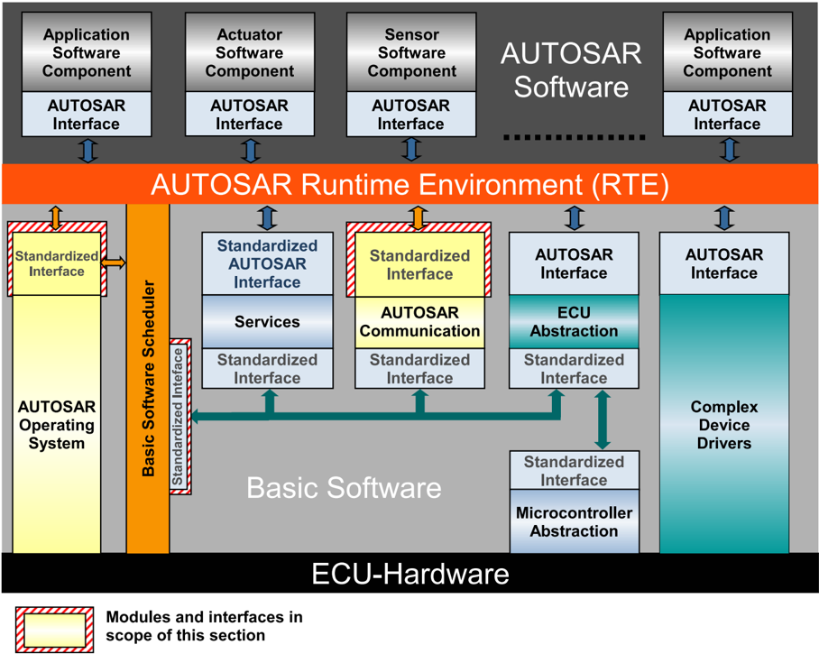
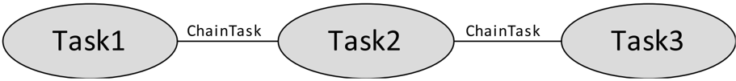
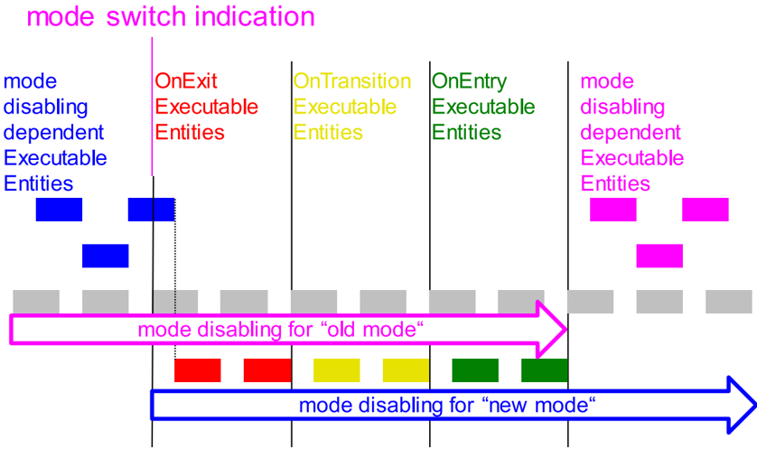

本文是《**AUTOSAR CP SWS RTE**》（R23-11）中基础软件调度器（**Basic Software Scheduler**，**SchM**）相关内容的独立中文译文：第 2–5 节为 SchM 的介绍与理论，选译自源文档第 4 章（分区间数据通信、模式切换顺序、模式机实例分配、初始化与终结、变体性）与第 6 章（与基础软件模块的关系、实现相关方面、契约阶段与生成阶段）；第 6–11 节为源文档第 6 章 **Basic Software Scheduler Reference** 的完整译文，涵盖 API 原则、模块互接头文件、API 数据类型、全部调度器 API（`SchM_Enter`/`SchM_Exit`/`SchM_Trigger` 等）与生命周期 API。RTE 本体规范见 [AUTOSAR RTE（运行时环境）](../rte/index.md)。

## 1. 范围

本章从**AUTOSAR**基础软件模块（**Basic Software Module**）的视角介绍基础软件调度器（**Basic Software Scheduler**）API——这些 API 不适用于 **AUTOSAR** 软件组件（**software components**）。

第 2–5 节为基础软件调度器的介绍与理论，选译自源文档第 4、6 章。第 6 节介绍该 API 的基本原则，包括命名约定和所支持的编程语言。第 7 节描述基础软件调度器所使用的头文件以及 **RTE** 生成器所创建的文件。该 API 所使用的数据类型在第 8 节中描述，第 9 节和第 10 节提供基础软件调度器 API 本身的参考，包括基础软件模块实体（**Basic Software Module Entities**）的定义，生命周期 API 在第 11 节中描述。

## 2. 基础软件调度器与基础软件模块

### 2.1. 基础软件模块的描述

基础软件模块的描述划分为以下几个部分：

* 接口
* 内部行为
* 实现

更多细节见文档[9]。

### 2.2. 基础软件接口

基础软件模块的接口用基础软件模块入口（**Basic Software Module Entry**，`BswModuleEntry`）描述。对于基础软件调度器的功能而言，只有 `BswCallType` 为 `SCHEDULED` 的 `BswModuleEntry` 是相关的。不过出于优化的目的，可能需要分析完整的调用树，这就要求考虑所有 `BswModuleEntry`。

### 2.3. 基础软件内部行为

基础软件内部行为（**Basic Software Internal Behavior**）规定了 **BSW** 模块或 **BSW** 集群相对于 **BSW** 调度器可见代码实体的行为。对基础软件调度器而言，主要相关的是基础软件可调度实体（**Basic Software Schedulable Entity**，`BswSchedulableEntity`）。它们是专为被基础软件调度器控制而设计的基础软件模块实体（**Basic Software Module Entity**）。基础软件可调度实体实现主处理函数。此外，所有基础软件可调度实体都可以使用独占区；而对于调用树分析，所有基础软件模块实体都是相关的。

基础软件调度器应支持 AUTOSAR 基础软件模块中的多个基础软件模块实体。

基础软件调度器应按照所连接的 `BswEvent` 触发 `BswSchedulableEntity` 和 `BswInterruptEntity` 的执行。

**RTE** 生成器应拒绝这样的配置：某个能够启动可调度实体的 `BswEvent` 既未映射到 `OsTask`/ISR2，也不具备直接或可信函数调用的条件。

**RTE** 生成器应拒绝这样的配置：某个 `BswInterruptEvent` 未通过 `RteBswEventToIsrMapping` 映射到 ISR2。

**RTE** 生成器应遵守一个 **OS** 任务/ISR2 内可调度实体的已配置执行顺序。

**RTE** 生成器应遵守一个 ISR2 内 `BswInterruptEntity` 的已配置执行顺序。

**RTE** 应支持同一个 **OS** 任务/ISR2 内可运行实体与可调度实体以任意可配置顺序组成的执行序列。

**RTE** 应支持同一个 ISR2 内 `BswInterruptEntity` 以任意可配置顺序组成的执行序列。

### 2.4. 基础软件实现

实现定义基础软件模块实现的更多细节。`vendorApiInfix` 特性尤为重要，它为同一个基础软件模块的多个实例定义命名空间扩展。此外，`codeDescriptor` 的类别规定基础软件模块以源代码还是目标代码交付。

### 2.5. 基础软件模块的多个实例

与软件组件的多重实例化概念不同（软件组件的所有实例使用同一份组件代码），基础软件模块的多重实例化是通过为每个实例在不同的命名空间中创建各自的代码来实现的。特性 `vendorApiInfix` 允许定义全局符号所需的名称扩展。

### 2.6. AUTOSAR 服务 / ECU 抽象 / 复杂设备驱动

AUTOSAR 服务、**ECU** 抽象和复杂设备驱动是 AUTOSAR 软件组件与基础软件模块的混合体。这些种类的模块既可以使用 AUTOSAR 接口经由 **RTE** 通信，也可以使用 C **API** 直接访问其他基础软件模块。由于 AUTOSAR 元模型的结构，'C' 实现的某些实体必须被描述两次：一方面用软件组件模板[2]，另一方面用 **BSW** 模块描述模板[9]。此外，软件组件基于端口的通信与基础软件模块之间无端口的通信这一二元性，在某些情况下要求两种原则之间的协调与同步。关于哪些元素彼此对应的信息由所谓的 `SwcBswMapping` 提供。

**2.6.1 RunnableEntity / BswModuleEntity 映射**

映射到基础软件模块实体的可运行实体必须被视为一个公共实体。这意味着它描述了一个既可以利用可运行实体的特性、又可以利用基础软件模块实体特性的实体。例如，它支持在同一个 C 函数中使用基于端口的 **API** 以及基础软件调度器 **API**。

**2.6.2 同步的 ModeDeclarationGroupPrototype**

两个同步的 `ModeDeclarationGroupPrototype` 会产生一个公共模式机实例的实现。因此，调用相应的 `Rte_Switch` **API** 与调用 `SchM_Switch` **API** 具有相同的效果。出于优化目的，`Rte_Switch` **API** 可以直接引用 `SchM_Switch` **API**。

**2.6.3 同步的触发器**

两个同步的 `Trigger` 表现得像一个公共的 `Trigger`。因此，调用相应的 `Rte_Trigger` **API** 与调用 `SchM_Trigger` **API** 具有相同的效果。出于优化目的，`Rte_Trigger` **API** 可以直接引用 `SchM_Trigger` **API**。

## 3. RTE 与基础软件调度器的实现相关方面

### 3.1. 范围

本节描述 AUTOSAR **RTE** 和基础软件调度器的一些具体实现相关方面，主要涉及：

* 逻辑概念（例如可运行实体、**BSW** 可调度实体）到技术架构（即 AUTOSAR **OS**）的映射；
* （基础软件中）挂起中断与 AUTOSAR 软件组件通知之间的解耦；
* 由 **RTE** 解决的数据一致性问题。

因此，本节还将涉及 AUTOSAR **RTE** 和基础软件调度器与 AUTOSAR 基础软件中两个具有标准化接口的模块之间的交互（见图 4.9）：

* AUTOSAR 操作系统模块[19][4]；
* AUTOSAR **COM** 模块[20][3]。

图 4.9 展示了基础软件模块一节的范围。



拥有标准化接口首先意味着：这些模块不提供、也不请求位于 **RTE** 之上的 AUTOSAR 软件组件的服务。它们没有端口，因此无法与上述 AUTOSAR 软件组件连接。AUTOSAR **OS** 和 AUTOSAR **COM** 对这些软件组件而言是完全不可见的。

其次，**RTE** 使用 AUTOSAR **OS** 和 AUTOSAR **COM** 来实现 AUTOSAR 软件组件所请求的功能。**RTE** 使用 AUTOSAR **COM** 模块跨 **ECU** 边界传递信号，但这一机制对发送方和接收方 AUTOSAR 软件组件都是隐藏的。AUTOSAR **OS** 模块被用于两个主要目的：第一，**OS** 被 **RTE** 用来跨核和分区边界传递信号；第二，**RTE** 使用 AUTOSAR **OS** 模块来正确调度单个 **Runnable**，即由 **RTE** 生成器生成任务/ISR2 体，其中包含对相应 **Runnable** 的调用。

在这个意义上，**RTE** 也应使用可用的手段把中断转换为任务上下文中的通知，或保证数据一致性。

按照这一视角，第三，**RTE** 并不是 AUTOSAR **OS** 和 AUTOSAR **COM** 的通用抽象层。它是为特定 **ECU** 生成的，向 AUTOSAR 软件组件提供与 **VFB** 相同的接口。它使用基础软件的模块（包括 AUTOSAR **OS** 和 AUTOSAR **COM** 的特定实现）来实现 **VFB** 的功能。

基础软件调度器为所有层的所有模块提供集成基础软件模块的服务。因此，基础软件调度器提供以下功能：

* 将基础软件模块的实现嵌入 AUTOSAR **OS** 的上下文中；
* 触发基础软件模块的 `BswSchedulableEntity`；
* 为基础软件模块应用数据一致性机制。

集成人员的任务是在项目特定的上下文中，运用（AUTOSAR **OS**）给定的手段，以良好定义且高效的方式装配 **BSW** 模块。

这也意味着 **BSW** 调度器只使用 AUTOSAR **OS**，它完全不是 AUTOSAR **OS** 调度器的竞争者。

**RTE** 应只使用 AUTOSAR **OS**、AUTOSAR **COM**、AUTOSAR 大数据高效通信（**Efficient COM for Large Data**）、AUTOSAR 转换器（**Transformer**）和 AUTOSAR **NVRAM** 管理器，来向 AUTOSAR 组件提供 **RTE** 功能。

基础软件调度器应只使用 AUTOSAR **OS** 来向基础软件模块提供基础软件调度器功能。

**RTE** 生成器应为包含 `RunnableEntity` 的那些任务构造任务体。

集群生成阶段的 **RTE** 生成器应拒绝这样的配置：可运行实体经由其相应 `RTEEvent` 的映射要求扩展任务（**extended task**）。

**RTE** 生成器应为类别 2 且包含 `RunnableEntity` 的那些 ISR 构造 ISR 体。

**RTE** 生成器应为包含基础软件可调度实体的那些任务构造任务体。

**RTE** 生成器应为类别 2 且包含基础软件可调度实体的那些 ISR 构造 ISR 体。

构造任务/ISR2 体所需的信息必须由 **ECU** 配置描述给出。可运行实体到任务/ISR2 的映射由 **ECU** 配置描述作为输入给出。**RTE** 生成器不决定 `RunnableEntity` 到任务/ISR2 的映射。

**RTE** 生成器应按如下内存映射（**Memory Mapping**）包裹每个任务体的定义：

```C
#define OS_START_SEC_<sadm>
#include "Os_MemMap.h"

<task body definition>

#define OS_STOP_SEC_<sadm>
#include "Os_MemMap.h"
```

其中 `<sadm>` 是 `OsTask` 的 `OsMemoryMappingCodeLocationRef` 所引用的 `SwAddrMethod` 的 `shortName`。

**RTE** 生成器应按如下内存映射包裹每个 ISR2 体的定义：

```C
#define OS_START_SEC_<sadm>
#include "Os_MemMap.h"

<ISR2 body definition>

#define OS_STOP_SEC_<sadm>
#include "Os_MemMap.h"
```

其中 `<sadm>` 是 `OsIsr` 的 `OsMemoryMappingCodeLocationRef` 所引用的 `SwAddrMethod` 的 `shortName`。

**RTE** 应按如下内存映射包裹可选的 **OS** 回调 `ReceiverPullCB` 函数的每个定义：

```C
#define OS_START_SEC_<sadm>
#include "Os_MemMap.h"

<ReceiverPullCB definition>

#define OS_STOP_SEC_<sadm>
#include "Os_MemMap.h"
```

其中 `<sadm>` 是接收方 `OsApplication` 的 `OsMemoryMappingCodeLocationRef` 所引用的 `SwAddrMethod` 的 `shortName`。

**RTE** 生成器应按如下内存映射包裹每个 `TrustedFunction` 体的定义：

```C
#define OS_START_SEC_<sadm>
#include "Os_MemMap.h"

<TrustedFunction body definition>

#define OS_STOP_SEC_<sadm>
#include "Os_MemMap.h"
```

其中 `<sadm>` 是所属 `OsApplication` 的 `OsMemoryMappingCodeLocationRef` 所引用的 `SwAddrMethod` 的 `shortName`。

**RTE** 生成器应按如下内存映射包裹可选的 `OsAlarmCallback` 函数的每个定义：

```C
#define OS_START_SEC_<sadm>
#include "Os_MemMap.h"

<OsAlarmCallback definition>

#define OS_STOP_SEC_<sadm>
#include "Os_MemMap.h"
```

其中 `<sadm>` 是 `OsAlarmCallback` 的 `OsMemoryMappingCodeLocationRef` 所引用的 `SwAddrMethod` 的 `shortName`。

**注意：** 上述四条内存映射规定是内存分配关键字包裹通用规定（见 [7.1.1 节](../rte/index.md#711-范围)）的例外。

如果某个 `OsApplication`、`OsIsr`（ISR2）或 `OsTask` 未引用 `SwAddrMethod`（通过各自的 `OsMemoryMappingCodeLocationRef`），则 **RTE** 应拒绝该配置。

**RTE** 生成器应拒绝这样的配置：缺少关于 `BswEvent` 到 **OS** 任务的映射、以及（触发可运行实体的）`RTEEvent` 到 **OS** 任务/ISR2 的映射的输入信息。

**注意：** 并非在所有情况下事件都必须映射到 `OsTask`/ISR2。例如，将通过直接或可信函数调用执行的可运行实体不需要 `OsTask`/ISR2 映射。

**RTE** 生成器应拒绝这样的配置：缺少关于任务或 ISR2 体构造的输入信息。

存在这样的用例（例如在不同分区上一组具有既定调用顺序的任务）：当前任务终止时，需要显式激活另一个任务。

通过配置 `RteOsTaskChain`，可以为这类情况配置预期的任务链行为。

如果某个 `OsTask` 被 `RtePredecessorOsTaskRef` 引用，则 **RTE** 应在该任务体中任务终止的位置，发出对 `RteSuccessorOsTaskRef` 所给 `OsTask` 的 `ChainTask` 调用。

当 **RTE** 因被某个 `RTEEvent`（例如 `DataReceivedEvent`）触发而需要激活某个 `OsTask`，且该 `OsTask` 被 `RtePredecessorOsTaskRef` 或 `RteSuccessorOsTaskRef` 引用、但并非任务链中最初的那个前驱 `OsTask` 时，**RTE** 应改为激活该 `OsTask` 最终的 `RtePredecessorOsTaskRef`，而不是它通常应当激活的那个 `OsTask`。

**注意：** 任务链中某个 `OsTask` 的最终前驱任务可以这样找到：从该 `OsTask` 被某个 `RteOsTaskChain` 容器引用之处开始，沿着所有 `RtePredecessorOsTaskRef` 追溯，直到任务链的 `RtePredecessorOsTaskRef` 引用了一个未被任何 `RteSuccessorOsTaskRef` 引用的 `OsTask`。最后一个 `RteOsTaskChain` 容器中被引用为 `RtePredecessorOsTaskRef` 的 `OsTask` 即最终前驱任务。

**示例 4.3**：考虑一个 `RteOsTaskChain` 配置，其中 Task1 链接到 Task2，Task2 又链接到 Task3。在该场景中，如果 Task2 因某个 `DataReceivedEvent` 需要被 **RTE** 激活，则 **RTE** 必须激活 Task1 而不是 Task2，因为 Task1 是最终前驱任务。

图 4.10 展示了任务链接顺序的示意。



```C
...
Rte_Write_myPort_myData(uint8 data)
{
  /.../
  ActivateTask(Task1);
}
...
TASK(Task1)
{
  /.../
  ChainTask(Task2);
}
...
TASK(Task2)
{
  /.../
  ChainTask(Task3);
}
...
TASK(Task3)
{
  /.../
  TerminateTask();
}
...
```

一个 `OsTask` 至多属于一个任务链。因此，一个 `OsTask` 至多被一个 `RtePredecessorOsTaskRef` 引用，且至多被一个 `RteSuccessorOsTaskRef` 引用。

`RteOsTaskChain` 的配置不得定义循环链。

**注意：** 例如，T1 链接到 T2、而 T2 又链接回 T1 的配置是不允许的。

### 3.2. 基于基础软件调度器的分区间数据通信

基础软件调度器为基础软件模块之间的跨分区（**partition**）通信提供发送者-接收者（**Sender-Receiver**）与客户端-服务器（**Client-Server**）通信机制。因此，在多核（**multi core**）环境中，基础软件模块可以使用这些通信范式。

其用法见文档[9]。

对于发送者-接收者通信，当前仅支持具有"事件"（**event**）语义（排队，**queued**）的数据元素的"显式"（**explicit**）传输。

**[SWS_Rte_08763]** 跨 **ECU** 的发送者-接收者通信中，队列的长度由 `BswQueuedDataReceptionPolicy` 的 `queueLength` 属性指定，该策略通过 `receivedData` 引用发送者-接收者通信的 `VariableDataPrototype`。（SRS_Rte_00243）

**[SWS_Rte_08764]** **RTE** 生成器应拒绝 `BswQueuedDataReceptionPolicy` 的 `queueLength` 属性为 0 的配置。（SRS_Rte_00243）

### 3.3. RTE / 基础软件调度器拦截模式切换通知时的动作顺序

本节描述向模式用户"传递"（communication）一次模式切换时实际发生的动作：**RTE**/基础软件调度器为切换一个模式究竟做了什么，尤其是以何种顺序进行。

**模式切换程序**

根据模式用户对同步性的需求，模式机实例（**mode machine instance**）可以采用两种不同的实现：

* 同步模式切换程序（**synchronous mode switching procedure**）
* 异步模式切换程序（**asynchronous mode switching procedure**）

两种实现的区别在于：异步模式切换程序省略了等待条件。例如，在异步行为下，软件组件不能依赖前一个模式的所有模式禁用依赖 `ExecutableEntity` 都在 on-entry 与 on-exit `ExecutableEntity` 启动之前终止。一方面，这可能需要软件组件设计者付出一些努力，使组件的实现能够支持这种调度方式；另一方面，它使模式切换快速而精简。

注 9：原子 **AUTOSAR** SW-C 的生命周期被视为其可运行实体正在执行的时间跨度。

注 10：依赖模式的 **AUTOSAR** 基础软件模块的生命周期被视为其基础软件可调度实体正在执行的时间跨度。

**[SWS_Rte_07150]** 如果模式机实例的至少一个模式用户不支持异步模式切换行为，**RTE** 生成器应使用同步模式切换程序。（SRS_Rte_00143, SRS_Rte_00213）

**[SWS_Rte_07151]** 如果所有模式用户都支持异步模式切换行为、且为相关模式机实例配置了该行为，**RTE** 生成器应采用异步模式切换行为。（SRS_Rte_00143, SRS_Rte_00213）

**保护资源的模式典型用法**

**RTE** / 基础软件调度器可以启动和阻止 `RunnableEntity` 与 `BswSchedulableEntity` 的执行。在模式切换的上下文中：

* **RTE** / 基础软件调度器启动 on-exit `ExecutableEntity` 以离开前一个模式。这通常被"清理可执行实体"用于释放前一个模式中使用的资源。
* **RTE** / 基础软件调度器启动 on-entry `ExecutableEntity` 以进入下一个模式。这通常被"初始化可执行实体"用于分配下一个模式中使用的资源。
* 并且 **RTE** / 基础软件调度器可以阻止模式禁用（**mode disabling**）依赖的 `ExecutableEntity` 在某个模式内执行。这通常与时间触发的"工作可执行实体"一起使用，后者使用的资源在某些模式下不可用。

根据这一用例，在"清理可执行实体"与"初始化可执行实体"执行期间，应禁用"工作可执行实体"以保护资源。此外，如果同一资源（由不同的 SWC）在两个相继的模式中使用，则应在执行下一个模式的"初始化可执行实体"之前安全地终止"清理可执行实体"（同步模式切换程序）。综上，**RTE** / 基础软件调度器在接收到模式切换通知（**mode switch notification**）后应按如下顺序执行动作：

1. 为下一个模式激活模式禁用；
2. 同步模式切换程序时，等待新被禁用的 `ExecutableEntity` 终止；
3. 执行"清理可执行实体"；
4. 同步模式切换程序时，等待"清理可执行实体"终止；
5. 执行"初始化可执行实体"；
6. 同步模式切换程序时，等待"初始化可执行实体"终止；
7. 停用前几个模式的模式禁用，并启用在前一个模式中被禁用的 `ExecutableEntity`。

**RTE** / 基础软件调度器还可以在两个模式之间的转换上启动 on-transition `ExecutableEntity`，本用例示例中未展示这一点。

通常，一个 **ECU** 中只有一小部分 SWC、可运行实体、基础软件模块和基础软件可调度实体依赖于被切换的模式。因此，应当可以如此设计系统：模式切换不影响其余软件的性能。

图 4.48：该图用于说明同步模式转换期间，哪类 `ExecutableEntity` 以何种顺序运行。方框表示被激活的 `ExecutableEntity`。模式禁用依赖的 `ExecutableEntity` 以蓝色（旧模式）和粉色（新模式）打印。on-exit、on-transition 与 on-entry `ExecutableEntity` 分别以红色、黄色和绿色打印。



图 4.49：该图用于说明异步模式转换期间，哪类 `ExecutableEntity` 以何种顺序运行，其中因模式变化而被触发的 `ExecutableEntity` 被映射到优先级高于模式依赖 `ExecutableEntity` 的任务。方框表示被激活的 `ExecutableEntity`。模式禁用依赖的 `ExecutableEntity` 以蓝色（旧模式）和粉色（新模式）打印。on-exit、on-transition 与 on-entry `ExecutableEntity` 分别以红色、黄色和绿色打印。


本节其余部分列出保证上述行为的需求。

所有依赖模式的可运行实体都必须在模式转换期间被执行或终止。约束 [SWS_Rte_02500] 要求这些可运行实体属于类别 1，以保证有限的执行时间。

为简化实现以保证可运行实体的执行顺序，适用约束 [SWS_Rte_02662]。

实现异步模式切换程序的模式机实例可以完全在 `Rte_Switch` 或 `SchM_Switch` **API** 内部实现。在这种情况下，on-entry、on-transition、on-exit 与 ModeSwitchAck `ExecutableEntity` 不按 [8.5.1 节](../rte/index.md#851-rte-事件到任务isr-的映射)所述映射到任务。

**[SWS_Rte_07173]** 如果以下条件全部满足，**RTE** 生成器应支持通过直接函数调用（**direct function call**）调用 on-entry、on-transition、on-exit 与 ModeSwitchAck `ExecutableEntity`：

* 配置了异步模式切换行为（见 [SWS_Rte_07151]）；
* 这些 on-entry、on-transition、on-exit 与 ModeSwitchAck `ExecutableEntity` 未定义"最小启动距离"（**minimum start distance**）；
* 模式管理器（**mode manager**）与模式用户位于同一分区（**Partition**）；
* 满足 [constr_4086] 的前提条件。

（SRS_Rte_00143, SRS_Rte_00213）

**[SWS_Rte_08905]** 如果以下条件全部满足，**RTE** 生成器应支持通过受信函数调用（**trusted function call**）调用 on-entry、on-transition、on-exit 与 ModeSwitchAck `ExecutableEntity`：

* 配置了异步模式切换行为（见 [SWS_Rte_07151]）；
* 这些 on-entry、on-transition、on-exit 与 ModeSwitchAck `ExecutableEntity` 未定义"最小启动距离"；
* 模式管理器与模式用户位于同一核上的不同分区；
* 满足 [constr_4086] 的前提条件。

（SRS_Rte_00143, SRS_Rte_00213）

此外，还必须考虑需求 [SWS_Rte_05083]、[SWS_Rte_07155] 与 [SWS_Rte_07157]。

**[SWS_Rte_02667]** 在模式管理器为指示模式切换而调用的 `Rte_Switch` / `SchM_Switch` **API** 中，应执行以下操作之一：

1. 如果相应的模式机实例正处于转换（**transition**）中、且模式切换通知队列已满，则 `Rte_Switch` / `SchM_Switch` 应立即返回错误。
2. 如果相应的模式机实例正处于转换中、且模式切换通知队列未满，则该模式切换通知应入队。
3. 如果模式机实例不在转换中，`Rte_Switch` / `SchM_Switch` 应按 [SWS_Rte_02665] 所述的序列发起转换，该序列继而激活下一个模式的模式禁用（见 [SWS_Rte_02661]）。

（SRS_Rte_00143, SRS_Rte_00213）

以下清单给出模式转换各步骤的需求。

* **[SWS_Rte_02661]** 在模式机实例转换开始时，如果为该模式定义了任何模式禁用依赖（**mode disabling dependency**），**RTE** / 基础软件调度器应激活下一个模式的模式禁用（另见 [SWS_Rte_02503]）。（SRS_Rte_00143, SRS_Rte_00213）
* **[SWS_Rte_07152]** 如果为下一个模式定义了任何模式禁用依赖（如 [SWS_Rte_02661] 所规定），在同步模式切换程序的情况下，**RTE** / 基础软件调度器应等待新被禁用的 `RunnableEntity` 与基础软件可调度实体终止。（SRS_Rte_00143, SRS_Rte_00213）

注意：为保证在同步模式切换的情况下，本核本地模式用户组（**core local mode user group**）中所有被激活的模式禁用依赖 `ExecutableEntity` 都在该转换的 on-exit `ExecutableEntity` 启动之前终止，**RTE** 生成器可以利用约束 [SWS_Rte_02663]：模式禁用依赖 `ExecutableEntity` 的运行优先级不低于 on-exit 与 on-entry `ExecutableEntity`。

* **[SWS_Rte_02562]** **RTE** / 基础软件调度器应执行前一个模式的 on-exit `ExecutableEntity`。（SRS_Rte_00143, SRS_Rte_00052, SRS_Rte_00213）
* **[SWS_Rte_07153]** 如果配置了任何 on-exit `ExecutableEntity`，在同步模式切换程序的情况下，**RTE** / 基础软件调度器应在其执行（[SWS_Rte_02562]）之后等待所有 on-exit `ExecutableEntity` 终止。（SRS_Rte_00143, SRS_Rte_00213）
* **[SWS_Rte_02707]** **RTE** / 基础软件调度器应为从前一模式到下一模式的转换执行所配置的 on-transition `ExecutableEntity`。（SRS_Rte_00143, SRS_Rte_00052, SRS_Rte_00213）
* **[SWS_Rte_02708]** 如果配置了任何 on-transition `ExecutableEntity`，在同步模式切换程序的情况下，**RTE** / 基础软件调度器应在其执行（[SWS_Rte_02707]）之后等待所有 on-transition `ExecutableEntity` 终止。（SRS_Rte_00143, SRS_Rte_00213）
* **[SWS_Rte_02564]** **RTE** / 基础软件调度器应执行下一个模式的 on-entry `ExecutableEntity`。（SRS_Rte_00143, SRS_Rte_00052, SRS_Rte_00213）
* **[SWS_Rte_07154]** 如果配置了任何 on-entry `ExecutableEntity`，在同步模式切换程序的情况下，**RTE** 应在其执行（[SWS_Rte_02564]）之后等待所有 on-entry `ExecutableEntity` 终止。（SRS_Rte_00143, SRS_Rte_00213）
* **[SWS_Rte_02563]** **RTE** / 基础软件调度器应停用前一个模式的模式禁用，仅保留下一个模式的模式禁用。（SRS_Rte_00143, SRS_Rte_00213）

至此，转换完成。

* **[SWS_Rte_02587]** 在转换结束时，**RTE** / 基础软件调度器应触发连接到模式管理器 `ModeDeclarationGroupPrototype` 的 ModeSwitchedAckEvent。（SRS_Rte_00143, SRS_Rte_00213）

这将在模式管理器一侧产生一个确认，使模式管理器能够等待模式切换完成。

模式切换通知的出队也应在转换结束时进行，见 [SWS_Rte_02721]。

**[SWS_Rte_02665]** 在模式机实例的一次转换期间，对于核本地模式用户组，下列适用步骤应按所列顺序执行：

1. [SWS_Rte_02661]（转换随本步骤并行进入），
2. [SWS_Rte_07152]，
3. [SWS_Rte_02562]，
4. [SWS_Rte_07153]，
5. [SWS_Rte_02707]，
6. [SWS_Rte_02708]，
7. [SWS_Rte_02564]，
8. [SWS_Rte_07154]，
9. [SWS_Rte_02563]（转换随本步骤完成），以及
10. 紧接着的 [SWS_Rte_02587]。

如某步骤不适用，其余步骤的顺序保持不变。

如果模式用户属于不同的核本地模式用户组，则步骤 1.–9. 可以在不同核上并行执行。步骤 10. 在整个模式机实例的步骤 1.–9. 全部完成后执行。（SRS_Rte_00143, SRS_Rte_00213）

在模式用户属于同一模式机实例、但被映射到调度于不同微控制器核上的不同分区的情况下，[SWS_Rte_02665] 所述的序列可以并行化。

**[SWS_Rte_02668]** 在按 [SWS_Rte_02665] 所述执行一次转换之后，**RTE** / 基础软件调度器应立即检查该模式机实例的挂起模式切换通知队列。如果可以出队一个模式切换通知，该模式机实例应直接按 [SWS_Rte_02665] 所述序列进入相应的转换。（SRS_Rte_00143, SRS_Rte_00213）

在两次模式切换快速相继发生的情况下，如果在前一个中间模式的转换完成之前已指示了向下一个模式的模式切换通知，则 `Rte_Mode` 或 `SchM_Mode` **API** 将不会指示该中间模式。

**[SWS_Rte_02630]** 在同步模式切换程序的情况下，**RTE** 应对整个模式机实例同步地执行模式切换的所有步骤（见 [SWS_Rte_02665]）。（SRS_Rte_00143, SRS_Rte_00213）

即，对于连接到同一模式管理器 `ModeDeclarationGroupPrototype` 的所有模式用户，模式转换将同步执行。

**[SWS_Rte_02669]** 如果转换的下一个模式与前一个模式相同，该转换仍应执行。（SRS_Rte_00143, SRS_Rte_00213）

### 3.4. 模式机实例向 RTE 与基础软件调度器的分配

**[SWS_Rte_07533]** 如果相关的 `ModeDeclarationGroupPrototype` 实例化于某个软件组件的端口中，且该 `ModeDeclarationGroupPrototype` 未（通过 `SwcBswMapping` 的 `synchronizedModeGroup`）与某个基础软件模块实例的 providedModeGroup `ModeDeclarationGroupPrototype` 同步，则该模式机实例应分配给 **RTE**。（SRS_Rte_00143）

**[SWS_Rte_07534]** 如果相关的 `ModeDeclarationGroupPrototype` 是某个基础软件模块实例的 providedModeGroup `ModeDeclarationGroupPrototype`，则该模式机实例应分配给基础软件调度器。（SRS_Rte_00213）

**[SWS_Rte_07535]** 如果实例化于软件组件端口中的 `ModeDeclarationGroupPrototype`（通过 `SwcBswMapping` 的 `synchronizedModeGroup`）与某个基础软件模块实例的 providedModeGroup `ModeDeclarationGroupPrototype` 同步，**RTE** 生成器应只创建一个模式机实例。相关的公共模式机实例（**common mode machine instance**）应分配给基础软件调度器。（SRS_Rte_00143, SRS_Rte_00213, SRS_Rte_00214）

在 `ModeDeclarationGroupPrototype` 同步的情况下，相关的公共模式机实例在 `SchM_Init` 执行期间初始化。此时，由于 **RTE** 尚未初始化，`RunnableEntity` 的调度尚未启用。因此会出现这样的情况：模式机实例被初始化时，作为 on-entry `ExecutableEntity` 的 `RunnableEntity` 不会被调用。此外，在 **RTE** 初始化完成之前，此类模式机实例的当前模式仍可能被切换。尽管如此，当前活动模式的 on-entry 可运行实体仍会被执行。

**[SWS_Rte_07582]** 对于公共模式机实例，如果其不在转换中，则当前活动模式的 on-entry `RunnableEntity` 在 **RTE** 初始化期间执行。（SRS_Rte_00214）

**[SWS_Rte_07583]** 如果公共模式机实例具有 on-entry、on-transition 或 on-exit `RunnableEntity`，则不允许其在 **RTE** 初始化期间进入转换阶段。（SRS_Rte_00214）

注意：[SWS_Rte_07582] 与 [SWS_Rte_07583] 应确保确定性行为：从公共模式机实例接收模式切换请求的软件组件在 **RTE** 初始化期间能够收到当前活动模式。

**[SWS_Rte_07564]** **RTE** 生成器应拒绝这样的配置：引用模式切换端口中 `ModeDeclarationGroupPrototype` 的 `ModeSwitchPoint` 与指向 providedModeGroup `ModeDeclarationGroupPrototype` 的 `managedModeGroup` 关联，未对两个同步的 `ModeDeclarationGroupPrototype` 之一互斥地定义。（SRS_Rte_00143, SRS_Rte_00213, SRS_Rte_00214, SRS_Rte_00018）

**[SWS_Rte_CONSTR_09014] ModeSwitchPoint 与 managedModeGroup 对于同步的 ModeDeclarationGroupPrototype 互斥** 两个同步的 `ModeDeclarationGroupPrototype` 中，只能有一个被 `ModeSwitchPoint` 或 `managedModeGroup` 关联互斥地引用。

注意：[SWS_Rte_CONSTR_09014] 与 `Rte_Switch`、`Rte_Mode`、`Rte_SwitchAck`、`SchM_Switch`、`SchM_Mode` 及 `SchM_SwitchAck` 的存在条件相结合，应确保向模式管理器的实现提供基于端口的 **RTE API** 或基础软件调度器 **API** 之一（[SWS_Rte_07201] 与 [SWS_Rte_07264]）。

### 3.5. RTE、基础软件调度器与 BswExecutionContext

**RTE** 和基础软件调度器在某些特殊情况下支持通过直接或可信函数调用调用受触发的 `ExecutableEntity`。尽管如此，必须防止这样的情况：来自某个特定执行上下文的 `ExecutableEntity` 调用一个需要更高权限执行上下文的受触发 `ExecutableEntity`。

文档[9]中的约束 `[constr_4086]` 描述了依据 `BswExecutionContext`、通过直接或可信函数调用调用 `ExecutableEntity` 的可能情形。

这适用于通过 `SchM_Trigger`、`SchM_ActMain` 或 `Rte_Trigger` **API** 对受触发 `ExecutableEntity` 的调用，也适用于通过 `SchM_Switch` 或 `Rte_Switch` **API** 对 on-entry `ExecutableEntity`、on-transition `ExecutableEntity`、on-exit `ExecutableEntity` 或 ModeSwitchAck `ExecutableEntity` 的调用。

## 4. 基础软件调度器的初始化与终结

### 4.1. 基础软件调度器的初始化

在基础软件调度器初始化之前，只有 `SchM_Enter` 与 `SchM_Exit` 两个 **API** 调用可用（[SWS_Rte_07578]）。

**ECU** 状态管理器（**ECU state manager**）在任何基础软件模块需要被调度之前，调用基础软件调度器的启动例程 `SchM_Init`。

基础软件调度器的初始化例程将在有限执行时间内返回（见 [SWS_Rte_07273]）。

基础软件调度器将初始化分配给它的模式机实例（[SWS_Rte_02544]）。这将在 `SchM_Init` 期间激活所有初始模式的模式禁用，并触发初始模式的 on-entry `ExecutableEntity` 的执行。在基础软件调度器内部数据结构与模式机实例初始化完成之后，由 `BswTimingEvent` 触发的基础软件可调度实体的激活随即开始。

**[SWS_Rte_07574]** 调用 `SchM_StartTiming` 应开始激活由 `BswTimingEvent` 触发的基础软件可调度实体。（SRS_Rte_00211）

**[SWS_Rte_07584]** 调用 `SchM_Init` 应开始激活由 `BswBackgroundEvent` 触发的基础软件可调度实体。（SRS_Rte_00211）

注意：在 `BswEvent` 与 `RTEEvent` 被映射到同一 **OS** 任务的情况下，**RTE** 生成器必须确保 `RunnableEntity` 不会在 **RTE** 初始化之前或 **RTE** 终结之后被激活。见 [SWS_Rte_07580] 与 [SWS_Rte_02538]。

**[SWS_Rte_07580]** 基础软件调度器必须防止在 **RTE** 初始化之前激活 `RunnableEntity`。（SRS_Rte_00220）

### 4.2. 基础软件调度器的终结

如果必须停止基础软件模块的调度，**ECU** 状态管理器调用基础软件调度器的终结例程 `SchM_Deinit`。

**[SWS_Rte_07586]** 在某个核上调用 `SchM_Deinit` 之后，**BSW** 调度器不得再在该核上激活或启动基础软件可调度实体。（SRS_Rte_00116）

注意：**BSW** 调度器不会在 `BswSchedulableEntity` 的"运行中"状态终止任务。

**[SWS_Rte_04552]** 在基础软件调度器完全初始化之前或停止之后，基础软件调度器应忽略传入的客户端-服务器通信请求。（SRS_Rte_00116）

## 5. RTE 生成过程中的基础软件调度器

### 5.1. 基础软件调度器契约阶段

为了能够使用基础软件调度器特定的 **API** 来支持基础软件模块开发，**RTE** 生成器在所谓"基础软件调度器契约阶段"（**Basic Software Scheduler Contract Phase**）中生成模块互连头文件（**Module Interlink Header**，见 7.2 节）和模块互连类型头文件（**Module Interlink Types Header**，见 7.1 节），其中包含与单个基础软件模块实例相关的基础软件调度器 **API** 的定义和声明。

所需的输入为：

* 基础软件模块描述，以及
* 基础软件模块内部行为，以及
* 基础软件模块实现

请注意，在实现了 **PreCompileTime** 变体性的情况下，还需要 **PreBuild** 数据集契约阶段（见 [6.1.4 节](../rte/index.md#614-prebuild-数据集契约阶段)）才能编译该基础软件模块。

### 5.2. 基础软件调度器生成阶段

取决于 **ECU** 的复杂度以及不同软件供应商之间的协作模式，可能需要在不含软件组件的情况下单独集成基础软件。

因此，**RTE** 生成器必须支持生成不含软件组件相关 **RTE** 片段的基础软件调度器。基础软件调度器生成阶段仅适用于不包含任何类型软件组件的软件构建。

在这种情况下，**RTE** 生成器只生成基础软件模块的 **API** 和基础软件调度代码。当输入中包含软件组件相关信息时，这些信息将引发一个错误。

例如：

* 不会为 **ECU Extract** 中包含的软件组件生成应用头文件（**Application Header File**）。
* 不允许映射的 `RTEEvent`，且不会将可运行实体的调用生成到 **OS** 任务体中。但是，与基础软件调度器配置相关的所有 **OS** 任务体都会被生成。
* 不支持映射到 **RTE** 的模式机实例。

在基础软件调度器生成阶段，**RTE** 生成器应拒绝包含软件组件相关信息的输入配置。

处于基础软件调度器生成阶段的 **RTE** 生成器还负责生成有助于 **ECU** 软件后续构建、部署和标定的附加构件。

在基础软件调度器生成阶段，**RTE** 生成器应提供其 **BSW** 模块描述，以记录所生成的 **RTE**/**BSW** 调度器的特性。

关于 **BSW** 模块描述生成的细节见 [6.1.6.4 节](../rte/index.md#6164-bsw-模块描述生成)。

在基础软件调度器生成阶段，**RTE** 生成器应作为 **BSW** 模块描述的一部分提供 MC 支持（测量与标定，**Measurement and Calibration**）描述。

关于 MC 支持的细节见 6.2.9.4 节。

对于包含软件组件的软件构建，适用 **RTE** 生成阶段（见 [6.1.6.2 节](../rte/index.md#6162-rte-生成阶段)），在该阶段也会生成 **RTE** 的基础软件调度器部分。

### 5.3. 影响基础软件调度器生成的变体性

**5.3.1 受变体性影响的基础软件调度器 API**

输入配置中表 4.28 所列的 `VariationPoint` 控制基础软件调度器 **API** 的变体存在性（**variant existence**）。

**[SWS_Rte_07702]**

| 变体点条件值宏 | 受变体性影响 | 形式 | 种类中缀 |
|---|---|---|---|
| `ExclusiveArea`（[SWS_Rte_06535]） | `SchM_Enter`、`SchM_Exit` | 模块内部 | `ExAr` |
| `managedModeGroup` 关联到 providedModeGroup `ModeDeclarationGroupPrototype`（[SWS_Rte_06536]） | `SchM_Switch`、`SchM_SwitchAck` | 模块外部 | `MMod` |
| `accessedModeGroup` 关联到 providedModeGroup 或 requiredModeGroup `ModeDeclarationGroupPrototype`（[SWS_Rte_06536]） | `SchM_Mode` | 模块外部 | `AMod` |
| `issuedTrigger` 关联到 releasedTrigger `Trigger`（[SWS_Rte_06536]） | `SchM_Trigger` | 模块外部 | `Tr` |
| `BswModuleCallPoint`（[SWS_Rte_06536]） | `SchM_Call` | 模块外部 | `SrvCall` |
| `BswAsynchronousServerCallResultPoint`（[SWS_Rte_06536]） | `SchM_Result` | 模块外部 | `SrvRes` |
| `dataSendPoint` 关联到 providedData（[SWS_Rte_06536]） | `SchM_Send` | 模块外部 | `DSP` |
| `dataReceivePoint` 关联到 requiredData（[SWS_Rte_06536]） | `SchM_Receive` | 模块外部 | `DRP` |
| `BswInternalTriggeringPoint`（[SWS_Rte_06536]） | `SchM_ActMainFunction` | 实体内部 | `ITr` |
| `perInstanceParameter` `ParameterDataPrototype`（[SWS_Rte_06535]） | `SchM_CData` | 模块内部 | `PIP` |

（SRS_Rte_00229）

表 4.29：表「基础软件调度器 API 的变体存在性」的说明

| 列 | 描述 |
|---|---|
| 种类中缀 | 「种类中缀」列定义用于区分属于不同 **API** 集合的变体点条件值宏的中缀字符串 |
| 形式 | 「形式」列规定拼接条件值宏的哪些名称，以确保宏命名空间的唯一性 |
| 形式 | 描述 |
| 模块外部 | 相关 **API** 为整个模块提供，属于模块接口 |
| 模块内部 | 相关 **API** 为整个模块提供，属于模块内部功能 |
| 实体内部 | 相关 **API** 为每个 `ExecutableEntity` 提供，属于模块内部功能 |

**[SWS_Rte_06537]** 仅当输入配置中控制同一基础软件调度器 **API** 存在性的所有元素（例如 `managedModeGroup` 关联）都受变体性影响时，**RTE** 生成器才应将该基础软件调度器 **API** 的存在性视为受变体性影响。（SRS_Rte_00229）

**5.3.2 基础软件实体**

输入配置中表 4.30 所列的 `VariationPoint` 控制 `BswModuleEntity` 的变体存在性与 `BswSchedulableEntity` 的变体激活（**variant activation**）。

**[SWS_Rte_07705]**

表 4.30：影响 BswSchedulableEntity 的变体性

| 变体点条件值宏 | 受变体性影响 |
|---|---|
| `BswSchedulableEntity`（[SWS_Rte_06532]） | `BswSchedulableEntity` 原型的存在性 |
| `BswEvent`（未标准化） | `BswSchedulableEntity` 的激活 |

（SRS_Rte_00229）

**5.3.3 API 行为**

输入配置中表 4.31 所列的 `VariationPoint` 控制基础软件调度器 **API** 的变体行为（**variant behavior**）。

表 4.31：BswSchedulableEntity 的变体存在性

| 变体点条件值宏 | 受变体性影响 |
|---|---|
| `BswModeSenderPolicy`（未标准化） | 模式机实例中的队列长度取决于该属性 |
| `BswModeReceiverPolicy`（未标准化） | 属性 `supportsAsynchronousModeSwitch` 必须按绑定的变体予以考虑 |

## 6. API 原则

### 6.1. 基础软件调度器命名空间

基础软件调度器与 **RTE** 的调度部分交织在一起。此外，它由 **RTE** 生成器与 **RTE** 一起生成，因此在二者均为生成的情况下，基础软件调度器和 **RTE** 无法分离。因此，基础软件调度器对内部符号、变量和函数使用 **RTE** 的命名空间，参见 **SWS_Rte_01171**。

唯一的例外是属于基础软件调度器接口的宏定义（**defines**）、数据类型和函数。这些在本规范中被显式提及。

属于基础软件调度器接口的所有基础软件调度器符号（例如函数名、数据类型等）都必须使用 `SchM_` 前缀。

在基础软件模块支持同一基础软件模块的多个实例的情况下，与基础软件模块的一个实例相关的 `BswSchedulableEntity` 和基础软件调度器 API 的命名空间会以 `vendorId` 和 `vendorApiInfix` 扩展。参见文档[12]。在后续章节中，这个可选部分用方括号 `[_<vi>_<ai>]` 表示。

如果某个基础软件模块存在属性 `vendorApiInfix`，则 **RTE** 生成器应在标记为 `[_<vi>_<ai>]` 的位置插入带前导下划线的 `vendorId`（`<vi>`）和 `vendorApiInfix`（`<ai>`）。

### 6.2. BSW 调度器名称前缀与节名称前缀

由于基础软件模块描述（**Basic Software Module Description**）支持对 **BSW** 模块簇（**BSW Module Clusters**）的描述，一个基础软件模块描述可以包含多个 **BSW** 模块的内容。为了通过簇接口满足标准化接口，一个簇内可能出现不同的 **ICC3** 模块缩写（**Module abbreviations**）[9]。对于基础软件调度器，模块缩写被用作 **SchM** API 中的 **BSW** 调度器名称前缀（**BSW Scheduler Name Prefix**）。尽管如此，`BswModuleDescription` 的 `shortName` 同样可以描述 **BSW** 调度器名称前缀和节名称前缀（**Section Name Prefix**），以便在 **ICC3** 模块的情况下提供一个统一的前缀。

在元模型（**Meta Model**）中，与调度管理器 API 相关的模块缩写由元类 `BswSchedulerNamePrefix` 显式表达。更多信息见文档[9]。

图 6.1：BswSchedulerNamePrefix 与 SectionNamePrefix

在本规范的若干需求中需要用到模块前缀（**Module Prefix**），其确定方式如下：

如果使用相关基础软件调度器 API 的 `BswModuleEntity` 未定义 `BswSchedulerNamePrefix`，则调用方 **BSW** 模块的 **BSW** 调度器名称前缀 `<bsnp>` 应从 `BswModuleDescription` 的 `shortName` 派生。

如果使用相关基础软件调度器 API 的 `BswModuleEntity` 定义了 `BswSchedulerNamePrefix`，则 **BSW** 调度器名称前缀 `<bsnp>` 应为该 `BswSchedulerNamePrefix` 的 `symbol` 属性值。

请注意，无论 `<bsnp>` 是通过 `BswModuleDescription.shortName`（见 **SWS_Rte_07593**）派生，还是通过 `BswSchedulerNamePrefix.symbol`（见 **SWS_Rte_07594**）派生，**TPS_BSWMDT_04001** 都要求该值大写。

此外，一个簇内部的内存映射（**Memory Mapping**）可以保留或取消 **ICC3** 边界。在某些情况下（例如入口点原型），**RTE** 必须知道内存分配所使用的前缀。在元模型中，这些前缀由元类 `SectionNamePrefix` 表达。更多信息见文档[9]。

如果实现相关 `BswModuleEntry` 的 `BswModuleEntity` 未定义 `SectionNamePrefix`，则节名称前缀 `<snp>` 应按如下方式构成：

`<Ma>[_<vi>_<ai>]`，其中：

* `<Ma>` 是从 `BswModuleDescription` 的 `shortName` 派生的 **BSW** 模块模块缩写（大写字母）；
* `<vi>` 是该 **BSW** 模块的 `vendorId`（大写字母）；
* `<ai>` 是该 **BSW** 模块的 `vendorApiInfix`（大写字母）。

方括号中的子部分 `[_<vi>_<ai>]` 在未为基础软件模块定义 `vendorApiInfix` 时省略。

节名称前缀 `<snp>` 应为与实现相关 `BswModuleEntry` 的 `BswModuleEntity` 相关联的 `MemorySection` 的 `SectionNamePrefix` 的 `symbol`。

例如，以下输入配置：

图 6.2：ICC2 簇的示例

将按照 **SWS_Rte_07195** 生成如下入口点原型：

```c
#define NVM_START_SEC_CODE
#include "MEM_MemMap.h"

void NvM_MainFunction (void);

#define NVM_STOP_SEC_CODE
#include "MEM_MemMap.h"
```

### 6.3. BSW 调度器 API 选项

如果为某个 `providedData`、`requiredData`、`perInstanceParameter`、`providedModeGroup`、`requiredModeGroup`、`releasedTrigger`、`referencedTrigger` 或 `queuedDataElement` 设置了属性 `enableTakeAddress` 为 **TRUE**，则不得为它们提供类宏（**macro-like**）的 **API**。

在 **C** 语言中，取函数的地址是合法的，但取类函数宏的地址不合法。如果未为某个 **SchM** API 设置 `enableTakeAddress` 属性或将其设置为 **FALSE**，则 **RTE** 生成器可以为该 **API** 提供宏。

## 7. 基础软件调度器模块

基础软件调度器的每个文件都应以 `SchM_` 前缀命名。

### 7.1. 模块互链类型头文件

模块互链类型头文件（**Module Interlink Types Header**）定义与该基础软件模块相关的特定类型，这些类型从输入配置或从 **RTE**/基础软件调度器实现中派生。

**RTE** 生成器应为输入中引用了某个 `BswInternalBehavior` 的每个 `BswImplementation`，在该 `BswInternalBehavior` 中的每个 `BswSchedulerNamePrefix` 创建一个模块互链类型头文件。

例如，一个输入配置包含两个 `BswImplementation`（典型情况是具有不同的 **API** 中缀）引用一个带有三个 `BswSchedulerNamePrefix` 的 `BswInternalBehavior`，将生成六个模块互链类型头文件。

**7.1.1 文件名**

模块互链类型头文件的名称应按如下方式构成：

`SchM_<bsnp>[_<vi>_<ai>]Type.h`

其中：

* `<bsnp>` 是按照 **SWS_Rte_07593** 和 **SWS_Rte_07594** 确定的 **BSW** 调度器名称前缀；
* `<vi>` 是该 **BSW** 模块的 `vendorId`；
* `<ai>` 是该 **BSW** 模块的 `vendorApiInfix`。

方括号中的子部分 `[<vi>_<ai>]` 在未为基础软件模块定义 `vendorApiInfix` 时省略。参见 **SWS_Rte_07528**。

例6.1：输入 **XML** 中的以下声明：

```xml
<AR-PACKAGE>
  <SHORT-NAME>CanDriver</SHORT-NAME>
  <ELEMENTS>
    <BSW-MODULE-DESCRIPTION>
      <SHORT-NAME>Can</SHORT-NAME>
      <INTERNAL-BEHAVIORS>
        <BSW-INTERNAL-BEHAVIOR>
          <SHORT-NAME>YesWeCan</SHORT-NAME>
        </BSW-INTERNAL-BEHAVIOR>
      </INTERNAL-BEHAVIORS>
    </BSW-MODULE-DESCRIPTION>
    <BSW-IMPLEMENTATION>
      <SHORT-NAME>MyCanDrv</SHORT-NAME>
      <VENDOR-ID>25</VENDOR-ID>
      <BEHAVIOR-REF DEST="BSW-INTERNAL-BEHAVIOR">/CanDriver/Can/YesWeCan</BEHAVIOR-REF>
      <VENDOR-API-INFIX>Dev0815</VENDOR-API-INFIX>
    </BSW-IMPLEMENTATION>
  </ELEMENTS>
</AR-PACKAGE>
```

应生成名为 `SchM_Can_25_Dev0815Type.h` 的模块互链类型头文件。

基础软件模块前缀（必须与基础软件模块描述的 `shortName` 相同）与供应商 **API** 中缀的拼接，是为了支持多个基础软件模块实例的分离。与软件组件的多实例化概念（所有组件实例使用相同的组件代码）不同，基础软件模块的多实例化是通过在每个实例的独立命名空间中创建各自的代码来实现的。

**7.1.2 作用域**

模块互链类型头文件中的所有定义都应以如下片段作为后缀：

```c
#ifdef __cplusplus
}
/* extern "C" */
#endif /* __cplusplus */
```

**7.1.3 文件内容**

模块互链类型头文件应包含 **RTE** 类型头文件（**RTE Types Header File**）。**RTE** 类型头文件的名称在第 7.1.3.4 节中定义。

**7.1.4 基础软件调度器模式**

模块互链类型头文件应包含 `ModeDeclaration` 的标识符以及第 4.2 节中定义的 `ModeDeclarationGroup` 的类型定义。

### 7.2. 模块互链头文件

模块互链头文件（**Module Interlink Header**）定义基础软件调度器 **API** 以及基础软件调度器实现所需的任何相关数据结构。但模块互链头文件不得在内存中创建对象。

**RTE** 生成器应为输入中引用了某个 `BswInternalBehavior` 的每个 `BswImplementation`，在该 `BswInternalBehavior` 中的每个 `BswSchedulerNamePrefix` 创建一个模块互链头文件。

使用基础软件调度器 **API** 的前提是包含模块互链头文件：每个 **BSW** 模块实现如果使用了基础软件调度器 **API** 或实现了 `BswSchedulableEntity`，则应包含其模块互链头文件。

模块互链头文件不应包含在内存中创建对象的代码。

**7.2.1 文件名**

模块互链头文件的名称应按如下方式构成：

`SchM_<bsnp>[_<vi>_<ai>].h`

其中：

* `<bsnp>` 是按照 **SWS_Rte_07593** 和 **SWS_Rte_07594** 确定的 **BSW** 调度器名称前缀；
* `<vi>` 是该 **BSW** 模块的 `vendorId`；
* `<ai>` 是该 **BSW** 模块的 `vendorApiInfix`。

方括号中的子部分 `[_<vi>_<ai>]` 在未为基础软件模块定义 `vendorApiInfix` 时省略。

例6.2：输入 **XML** 中的以下声明：

```xml
<AR-PACKAGE>
  <SHORT-NAME>CanDriver</SHORT-NAME>
  <ELEMENTS>
    <BSW-MODULE-DESCRIPTION>
      <SHORT-NAME>Can</SHORT-NAME>
      <INTERNAL-BEHAVIORS>
        <BSW-INTERNAL-BEHAVIOR>
          <SHORT-NAME>YesWeCan</SHORT-NAME>
        </BSW-INTERNAL-BEHAVIOR>
      </INTERNAL-BEHAVIORS>
    </BSW-MODULE-DESCRIPTION>
    <BSW-IMPLEMENTATION>
      <SHORT-NAME>MyCanDrv</SHORT-NAME>
      <VENDOR-ID>25</VENDOR-ID>
      <BEHAVIOR-REF DEST="BSW-INTERNAL-BEHAVIOR">/CanDriver/Can/YesWeCan</BEHAVIOR-REF>
      <VENDOR-API-INFIX>Dev0815</VENDOR-API-INFIX>
    </BSW-IMPLEMENTATION>
  </ELEMENTS>
</AR-PACKAGE>
```

应生成名为 `SchM_Can_25_Dev0815.h` 的模块互链头文件。

**7.2.2 作用域**

一个组件的模块互链头文件应只包含与该基础软件模块实例相关的声明。该需求意味着编译时检查可确保使用模块互链头文件的 **BSW** 模块只访问对该实例有效的定义。

模块互链头文件中的所有定义都应以如下片段作为后缀：

```c
#ifdef __cplusplus
}
/* extern "C" */
#endif /* __cplusplus */
```

**7.2.3 文件内容**

模块互链头文件应包含模块互链类型头文件。模块互链类型头文件的名称在第 7.1 节中定义。

**7.2.3.1 入口点原型**

模块互链头文件还为每个 `BswSchedulableEntity` 的入口点包含一个原型（**SWS_Rte_04542**）。

**7.2.3.2 基础软件调度器与基础软件模块的接口**

模块互链头文件定义基础软件模块与基础软件调度器之间的"接口"。该接口由面向基础软件模块的基础软件调度器 **API** 以及 `BswSchedulableEntity` 入口点的原型组成。在采用宏实现的情况下，基础软件调度器 **API** 的定义要求同时定义相关的数据结构和 **API** 调用。在以函数形式实现接口的情况下，特定基础软件模块实例的基础软件调度器 **API** 的原型即已足够。数据结构取决于基础软件调度器的实现和配置，未被标准化。如果需要数据结构，它们也应可通过模块互链头文件访问。

**RTE** 生成器必须将模块互链头文件的内容限定为仅与该基础软件模块实例相关的信息。该要求包括 **API** 的定义。

在模块的模块互链头文件中，只能定义对该基础软件模块实例有效的基础软件调度器 **API** 调用。

这一要求确保了调用无效 **API** 的尝试将被编译时错误拒绝。

如果要实现变体性（**variability**），**RTE** 生成器应按照 **SWS_Rte_07702** 包装每个以变体形式存在的基础软件调度器 **API** 定义：

```c
#if (<condition> [|| <condition>])
  <Basic Software Scheduler API Definition>
#endif
```

其中 `condition` 是与该 **RTE** **API** 的条件存在相关的各 `VariationPoint` 的条件值宏（见 **SWS_Rte_07702**），`Basic Software Scheduler API Definition` 是按照不变式基础软件调度器 **API** 定义的代码（另见 **SWS_Rte_07510**、**SWS_Rte_07250**、**SWS_Rte_07253**、**SWS_Rte_07255**、**SWS_Rte_07260**、**SWS_Rte_07556**、**SWS_Rte_07263**、**SWS_Rte_07266**）。

面向基础软件模块的基础软件调度器 **API** 在第 9 节中定义。

如果基础软件模块以目标代码（**object code**）交付，则该基础软件模块实例的基础软件调度器 **API** 应以函数形式实现。

对于以源代码交付的基础软件模块，模块互链头文件中所包含的基础软件调度器 **API** 定义可以在"**RTE** 生成"阶段（即 `BswSchedulableEntity` 到 **OS** 任务的映射已知之后）进行优化。

**7.2.3.3 提供激活 Bsw 事件**

如果可执行实体（**executable entity**）定义了至少一个 `activationReason`，则启用提供激活事件（**provide activating event**）特性。

如果启用了提供激活事件特性，**RTE** 生成器在契约阶段应按照 **SWS_Rte_07282** 和 **SWS_Rte_08071** 生成可执行实体签名。

如果启用了提供激活事件特性，**RTE** 生成器在契约阶段应生成类型 `SchM_ActivatingEvent_<bsnp>[_<vi>_<ai>]` 以及每个相关 `BswEvent` 的 `activationReason` 的 `xx` 值。`xx` 的值由 `bitPosition` 定义：`xx = 2^bitPosition`。

更多细节见第 6.2.2.3.3 节（提供激活 **RTE** 事件）。

**7.2.3.4 映射到 BswModuleEntity 的 RunnableEntity**

在 `RunnableEntity` 被映射到 `BswSchedulableEntity` 的情况下，**RTE** 生成器只为该 `BswSchedulableEntity` 生成入口点原型（第 7.2.3.1 节，见 **SWS_Rte_01132**）。由于 `RunnableEntity` 和 `BswModuleEntry` 定义了一组重叠的属性，在 **AUTOSAR** 模型中，**BSW** 模块描述与软件组件描述之间在技术上有可能存在冗余。

**RTE** 生成器应拒绝违反 **con_str_4071** 的配置。

在一个 `SwcBswRunnableMapping` 的作用域内，`RTEEvent` 和 `BswEvent` 均适用。因此，`RunnableEntity` 与被映射的 `BswModuleEntity` 的 `ExecutableEntityActivationReason` 必须叠加。

具有 `SwcBswRunnableMapping` 的 `RunnableEntity` 和 `BswModuleEntity` 的签名应包含为每个实体定义的所有 `ExecutableEntityActivationReason`。

注意：就 `shortName` 和 `bitPosition` 而言完全相同的多个 `activationReason` 定义是合法的配置，因为 `RunnableEntity` 和 `BswModuleEntity` 都可以提供各自的 `activationReason`。

**7.2.3.5 条件值宏**

对于每个 `bindingTime = PreCompileTime` 的 `VariationPointProxy`，模块互链头文件应包含一个定义：

```c
#define SchM_SysCon_<name> SchM_SysCon_<bsnp>[_<vi>_<ai>]_<ki>_<name>
```

其中：

* `<bsnp>` 是按照 **SWS_Rte_07593** 和 **SWS_Rte_07594** 确定的 **BSW** 调度器名称前缀；
* `<vi>` 是该 **BSW** 模块的 `vendorId`；
* `<ai>` 是该 **BSW** 模块的 `vendorApiInfix`；
* `<ki>` 是按照 **SWS_Rte_07702** 的种类中缀（**kind infix**）；
* `<name>` 是 **SWS_Rte_07702** 中定义基础软件调度器 **API** 名称中缀的、受变体性影响的元素的 `shortName`。

方括号中的子部分 `[_<vi>_<ai>]` 在未为基础软件模块定义 `vendorApiInfix` 时省略。参见 **SWS_Rte_07528**。

## 8. API 数据类型

除了访问基础软件调度器服务的 **API** 函数之外，该 **API** 还包含基础软件调度器特定的数据类型。

### 8.1. Std_ReturnType 的预定义错误代码

文档[32]规定了一个标准 **API** 返回类型 `Std_ReturnType`。`Std_ReturnType` 定义了 **API** 函数返回的"状态"和"错误值"。它被定义为 `uint8` 类型。值 `0` 保留用于"未发生错误"。

表6.1：基础软件调度器错误与状态值（**Basic Software Scheduler Error and Status values**）

| 符号名 | 值 | 备注 |
|---|---|---|
| SCHM_E_OK | 0 | **SWS_Rte_07289** |
| SCHM_E_LIMIT | 130 | **SWS_Rte_07290** |
| SCHM_E_NO_DATA | 131 | **SWS_Rte_07562** |
| SCHM_E_TRANSMIT_ACK | 132 | **SWS_Rte_07563** |
| SCHM_E_IN_EXCLUSIVE_AREA | 135 | **SWS_Rte_02747** |
| SCHM_E_TIMEOUT | 129 | **SWS_Rte_07054** |
| SCHM_E_LOST_DATA | 64 | **SWS_Rte_02312** |

出于兼容性原因，`Std_ReturnType` 的底层类型定义为 `uint8`。因此，错误值使用 `#define` 声明：

```c
typedef uint8 Std_ReturnType; /* defined in Std_Types.h */

#define SCHM_E_OK 0U
#define SCHM_E_LIMIT 130U
#define SCHM_E_NO_DATA 131U
#define SCHM_E_TRANSMIT_ACK 132U
#define SCHM_E_IN_EXCLUSIVE_AREA 135U
#define SCHM_E_TIMEOUT 129U
#define SCHM_E_LOST_DATA 64U
```

**8.1.1 SCHM_E_OK**

| 符号名 | 值 |
|---|---|
| 符号名 | `SCHM_E_OK` |
| 值 | 0 |
| 注释 | 未发生错误 |

**8.1.2 SCHM_E_LIMIT**

| 符号名 | 值 |
|---|---|
| 符号名 | `SCHM_E_LIMIT` |
| 值 | 130 |
| 注释 | 超出了基础软件调度器的内部限制。请求无法被处理。OUT 缓冲区不被修改。 |

注意：该值必须与 **SWS_Rte_01317** 中的值相同。

**8.1.3 SCHM_E_NO_DATA**

| 符号名 | 值 |
|---|---|
| 符号名 | `SCHM_E_NO_DATA` |
| 值 | 131 |
| 注释 | 一次显式读取 API 调用未返回数据。（这不算错误。） |

注意：该值必须与 **SWS_Rte_01061** 中的值相同。

**8.1.4 SCHM_E_TRANSMIT_ACK**

| 符号名 | 值 |
|---|---|
| 符号名 | `SCHM_E_TRANSMIT_ACK` |
| 值 | 132 |
| 注释 | 已接收到传输确认（**transmission acknowledgement**）。 |

注意：该值必须与 **SWS_Rte_01065** 中的值相同。

**8.1.5 SCHM_E_IN_EXCLUSIVE_AREA**

| 符号名 | 值 |
|---|---|
| 符号名 | `SCHM_E_IN_EXCLUSIVE_AREA` |
| 值 | 135 |
| 注释 | 该错误由阻塞式 API 返回，表示可调度实体（**schedulable entity**）无法进入等待状态，因为当前任务调用栈中的某个 `ExecutableEntity` 已进入某个互斥区域（**ExclusiveArea**）。 |

注意：目前不存在阻塞式的 **SchM** API，因此该值不会被返回。在此定义它是为了将来使用，以及与 **SWS_Rte_02739** 保持一致。两个错误值必须相同。

**8.1.6 SCHM_E_TIMEOUT**

| 符号名 | 值 |
|---|---|
| 符号名 | `SCHM_E_TIMEOUT` |
| 值 | 129 |
| 注释 | 在预期结果就绪之前，所配置的超时时间已到期。 |

注意：该值必须与 **SWS_Rte_01064** 中的值相同。

**8.1.7 SCHM_E_LOST_DATA**

| 符号名 | 值 |
|---|---|
| 符号名 | `SCHM_E_LOST_DATA` |
| 值 | 64 |
| 注释 | 一次以事件语义（**event semantics**）读取已接收数据的 API 调用表明，由于接收队列溢出，部分传入数据已丢失。 |

注意：该值必须与 **SWS_Rte_02571** 中的值相同。

### 8.2. 基础软件模式

对于每个类别为 `ALPHABETIC_ORDER` 的 `ModeDeclarationGroup`，模块互链类型头文件应包含一个定义：

```c
#ifndef RTE_TRANSITION_<prefix><ModeDeclarationGroup>
#define RTE_TRANSITION_<prefix><ModeDeclarationGroup> \
    <n>U
#endif
```

其中 `<ModeDeclarationGroup>` 是该 `ModeDeclarationGroup` 的 `shortName`，`<prefix>` 是引用该 `ModeDeclarationGroup` 的 `IncludedModeDeclarationGroupSet` 所定义的可选 `prefix` 属性，`<n>` 是该组内声明的模式数量。

对于每个类别为 `EXPLICIT_ORDER` 的 `ModeDeclarationGroup`，模块互链类型头文件应包含一个定义：

```c
#ifndef RTE_TRANSITION_<prefix><ModeDeclarationGroup>
#define RTE_TRANSITION_<prefix><ModeDeclarationGroup> \
    <onTransitionValue>U
#endif
```

其中 `<ModeDeclarationGroup>` 是该 `ModeDeclarationGroup` 的 `shortName`，`<prefix>` 是引用该 `ModeDeclarationGroup` 的 `IncludedModeDeclarationGroupSet` 所定义的可选 `prefix` 属性，`<onTransitionValue>` 是该 `ModeDeclarationGroup` 的 `onTransitionValue`。

对于类别为 `ALPHABETIC_ORDER` 的 `ModeDeclarationGroup` 中的每个模式，模块互链类型头文件应包含一个定义：

```c
#ifndef RTE_MODE_<prefix><ModeDeclarationGroup>_<ModeDeclaration>
#define RTE_MODE_<prefix><ModeDeclarationGroup>_<ModeDeclaration> \
    <index>U
#endif
```

其中 `<ModeDeclarationGroup>` 是该 `ModeDeclarationGroup` 的 `shortName`，`<prefix>` 是引用该 `ModeDeclarationGroup` 的 `IncludedModeDeclarationGroupSet` 所定义的可选 `prefix` 属性，`<ModeDeclaration>` 是某个 `ModeDeclaration` 的 `shortName`，`<index>` 是该 `ModeDeclaration` 在 `ModeDeclarationGroup` 内按 `shortName` 字母顺序（**ASCII**/**ISO 8859-1** 码升序）排列的索引。最低索引为 `0`，因此赋值范围为 `0..<n>`，其中 `<n>` 是该组内声明的模式数量。

对于类别为 `EXPLICIT_ORDER` 的 `ModeDeclarationGroup` 中的每个模式，模块互链类型头文件应包含一个定义：

```c
#ifndef RTE_MODE_<prefix><ModeDeclarationGroup>_<ModeDeclaration>
#define RTE_MODE_<prefix><ModeDeclarationGroup>_<ModeDeclaration> \
    <value>U
#endif
```

其中 `<ModeDeclarationGroup>` 是该 `ModeDeclarationGroup` 的 `shortName`，`<prefix>` 是引用该 `ModeDeclarationGroup` 的 `IncludedModeDeclarationGroupSet` 所定义的可选 `prefix` 属性，`<ModeDeclaration>` 是某个 `ModeDeclaration` 的 `shortName`，`<value>` 是在该 `ModeDeclaration` 处指定的值。

### 8.3. 枚举数据类型

枚举（**enumeration**）不是一种纯原始实现数据类型。相反，一个整数范围可以用作其结构描述。整数到枚举中"标签"的映射实际上是在 **SwC-T** 中通过 `SwDataDefProps` 的语义类 `CompuMethod` 建模的[2]。枚举数据类型被建模为这样的 `ImplementationDataType`：其 `SwDataDefProps` 引用一个仅包含带点范围（**point range**，即 `CompuScale` 的下限与上限相同）的 `CompuScale` 的 `CompuMethod`。

对于本基础软件模块所"使用"（"used"一词的含义见 **SWS_Rte_08803**）的每个 `ImplementationDataType`/`ApplicationDataType`，模块互链类型头文件应包含其所有常量的定义。这包括被基础软件模块直接引用的 `ImplementationDataType` 的 `ImplementationDataTypeElement` 所引用的 `CompuMethod` 的常量，以及通过 `TYPE_REFERENCE` 类别的 `ImplementationDataType`/`ImplementationDataTypeElement` 被间接引用的 `ImplementationDataType` 的 `CompuMethod` 的常量。

该要求无论 `AutosarDataType` 是被基础软件模块 `InternalBehavior` 中定义的 `DataPrototype` 引用，还是仅被 `IncludedDataTypeSet` 引用，均适用。它确保基础软件模块内部使用的 `AutosarDataType` 常量（例如枚举常量）可用。这些常量的名称基于 **TPS_SWCT_01569** 所定义的 `CompuScale` 符号名。

对于每个带点范围、且位于按 **SWS_Rte_03983** 被引用的 `ImplementationDataType` 或 `ApplicationPrimitiveDataType` 所引用的 `CompuMethod` 的 `compuInternalToPhys` 容器中、类别为 `TEXTTABLE`、`SCALE_LINEAR_AND_TEXTTABLE`、`SCALE_RATIONAL_AND_TEXTTABLE` 或 `BITFIELD_TEXTTABLE` 的 `CompuScale`，模块互链类型头文件应包含一个定义：

```c
#ifndef <prefix><EnumLiteral>
#define <prefix><EnumLiteral> <value><suffix>
#endif /* <prefix><EnumLiteral> */
```

其中枚举字面量 `<EnumLiteral>` 的名称按以下规则派生：

```c
if (attribute symbol of CompuScale is available and not empty) {
    <EnumLiteral> := C identifier specified in symbol attribute of CompuScale
} else {
    if (string specified in the VT element of the CompuConst of the CompuScale
        is a valid C identifier) {
        <EnumLiteral> := string specified in the VT element of the CompuConst
    } else {
        if (attribute shortLabel of CompuScale is available and not empty) {
            <EnumLiteral> := string specified in shortLabel attribute of CompuScale
        }
    }
}
```

`<prefix>` 是引用使用该 `CompuMethod` 的 `AutosarDataType` 的 `DataTypeSet` 所定义的可选 `literalPrefix` 属性。`<value>` 是表示该 `CompuScale` 点范围的值。`<suffix>` 应按照 **SWS_Rte_03619** 设置。

请注意，前缀既可以这样定义：带 `literalPrefix` 属性的 `IncludedDataTypeSet` 引用 `ApplicationDataType`；也可以该 `IncludedDataTypeSet` 引用 `ImplementationDataType`。

**SWS_Rte_03984** 意味着 **RTE** 仅在显式要求时才为枚举常量的名称添加前缀。这是必要的，以便处理各基础软件模块提供的、各自使用自己前缀约定的枚举常量。这类枚举常量名必须在整个 **AUTOSAR** 系统中唯一。

当同一 `ImplementationDataType` 或 `ApplicationPrimitiveDataType` 被带有不同 `literalPrefix` 属性的不同 `IncludedDataTypeSet` 引用时，必须为每个不同的 `literalPrefix` 分别提供按 **SWS_Rte_03984** 的定义。

如果 **RTE** 生成器的输入包含一个类别为 `TEXTTABLE`、`SCALE_LINEAR_AND_TEXTTABLE`、`SCALE_RATIONAL_AND_TEXTTABLE` 或 `BITFIELD_TEXTTABLE` 的 `CompuMethod`，其中含有一个带点范围的 `CompuScale`，且：

* 该 `CompuScale` 的 `symbol` 属性不可用或为空；
* 且该 `CompuScale` 的 `CompuConst` 的 **VT** 元素中指定的字符串不是合法的 **C** 标识符；
* 且该 `CompuScale` 的 `shortLabel` 属性不可用或为空；

则 **RTE** 生成器应将该输入作为无效配置拒绝。

**RTE** 应拒绝这样的配置：同一基础软件模块使用的 `ImplementationDataType` 和 `ApplicationPrimitiveDataType` 引用了两个或更多类别为 `TEXTTABLE`、`SCALE_LINEAR_AND_TEXTTABLE`、`SCALE_RATIONAL_AND_TEXTTABLE` 或 `BITFIELD_TEXTTABLE` 的 `CompuMethod`，它们包含具有不同点范围但相同 `CompuScale` 符号名的 `CompuScale`。唯一的例外是这些 `ImplementationDataType` 和 `ApplicationPrimitiveDataType` 的使用定义了不同的 `<literalPrefix>`。

**RTE** 生成器应拒绝违反 **con_str_1133** 的配置。这将拒绝这样的配置：某个 `ImplementationDataType` 或 `ApplicationPrimitiveDataType` 引用了一个类别为 `TEXTTABLE`、`SCALE_LINEAR_AND_TEXTTABLE`、`SCALE_RATIONAL_AND_TEXTTABLE` 或 `BITFIELD_TEXTTABLE` 的 `CompuMethod`，其中存在符号名相同但 `lowerLimit` 或 `upperLimit` 不同的 `CompuScale`。

注意：类别为 `TEXTTABLE` 等的 `CompuMethod` 内部可能还存在带非点范围的其他 `CompuScale`，但 **RTE** 生成器不会为它们生成枚举字面量。

**RTE** 生成器不支持对基础软件中使用的 `DataPrototype` 使用 **C** 枚举（**enum**）。

**RTE** 生成器应拒绝违反 **con_str_1244** 的配置，即基础软件模块中使用的 `DataPrototype` 设置了 `swDataDefProps.additionalNativeTypeQualifier = enum` 的配置。

就 `AutosarDataType` 而言，"使用"（**used**）一词的含义是：一个 `AutosarDataType` 如果满足以下任一条件，即被视为被使用：

* 它被 `BswInternalBehavior` 中的某个 `DataPrototype` 引用；或
* 它被基础软件模块的 `IncludedDataTypeSet` 引用；或
* 它被一个被使用的 `AutosarDataType` 通过 `ImplementationDataTypeElement` 引用。

### 8.4. 范围数据类型

对于 `ApplicationPrimitiveDataType`，可以通过引用一个给出 `lowerLimit` 和 `upperLimit` 的数据约束（**dataConstr**）来指定一个范围（**Range**）。为了让基础软件模块能够访问这些值，应为这些值生成两个定义。

当 `ApplicationPrimitiveDataType` 未被不同的 `IncludedDataTypeSet` 引用时，模块互链类型头文件应为该基础软件模块使用的每个 `ApplicationPrimitiveDataType` 包含其所有 `lowerLimit` 和 `upperLimit` 常量的定义，每个 `ApplicationPrimitiveDataType` 一次。

当同一 `ImplementationDataType` 或 `ApplicationPrimitiveDataType` 被不同的 `IncludedDataTypeSet` 引用时，模块互链类型头文件应为每个不同的 `literalPrefix` 与 `ApplicationPrimitiveDataType` 的组合，包含该基础软件模块使用的所有 `lowerLimit` 和 `upperLimit` 常量的定义。

引用了 `DataConstr` 的 `ApplicationPrimitiveDataType` 的 `lowerLimit` 和 `upperLimit` 常量应由 **RTE** 生成器在模块互链类型头文件中按如下方式生成：

```c
#define <prefix><DataType>_LowerLimit <lowerValue><suffix>
#define <prefix><DataType>_UpperLimit <upperValue><suffix>
```

其中 `<DataType>` 是基础软件模块使用的 `ApplicationPrimitiveDataType` 的名称；`<prefix>` 是引用该 `DataConstr` 所属 `AutosarDataType` 的 `IncludedDataTypeSet` 所定义的可选 `literalPrefix` 属性；`<lowerValue>` 和 `<upperValue>` 是对相应的 `CompuMethod` 已应用之后、被该 `ApplicationPrimitiveDataType` 引用的 `dataConstr` 的 `lowerLimit` 和 `upperLimit` 值（见 **SWS_Rte_07038**）。无论 `dataConstr` 指定的区间类型如何，宏定义中的值应始终反映闭区间。`<suffix>` 应按照 **SWS_Rte_03619** 设置。

请注意，**SWS_Rte_07196** 不适用于 **SWS_Rte_03992**。此外，使用 `ApplicationPrimitiveDataType` 的 `DataPrototype` 可能引用额外的 `dataConstr`（见 **SWS_Rte_07196**）。在这种情况下，按 **SWS_Rte_03992** 生成的 `upperLimit` 和 `lowerLimit` 定义并不反映该 `DataPrototype` 实际适用的范围。不会为 `DataPrototype` 特定的数据约束生成宏。

请注意，前缀既可以这样定义：带 `literalPrefix` 属性的 `IncludedDataTypeSet` 引用 `ApplicationDataType`；也可以该 `IncludedDataTypeSet` 引用 `ImplementationDataType`。

理由：以 `ApplicationPrimitiveDataType`（而非对应的 `ImplementationDataType`）作为生成限值的基础，是因为定义在 `ImplementationDataType` 上的限值可能比 `ApplicationPrimitiveDataType` 的限值更宽（见 **AUTOSAR** **SwC** 模板[2]中的"单值数据类型"小节）。

对于指定了 `invalidValue` 的 **AUTOSAR** 数据类型，模块互链类型头文件应包含定义：

```c
#define InvalidValue_<prefix><DataType> <invalidValue><suffix>
```

其中 `<prefix>` 是引用该 `AutosarDataType` 的 `IncludedDataTypeSet` 所定义的可选 `literalPrefix` 属性，`<DataType>` 是该数据类型的 `shortName`，`<invalidValue>` 是为该数据类型定义为 `invalidValue` 的值，`<suffix>` 应按照 **SWS_Rte_03619** 设置。

当同一 `ImplementationDataType` 或 `ApplicationPrimitiveDataType` 被不同的 `IncludedDataTypeSet` 引用时，模块互链类型头文件应为每个不同的 `literalPrefix` 与 `ApplicationPrimitiveDataType` 的组合，包含该基础软件模块使用的所有 `invalidValue` 常量的定义。

### 8.5. 带位域转换的数据类型

与类别为 `BITFIELD_TEXTTABLE` 的 `CompuMethod` 相关联的 `AutosarDataType` 支持在单个标量变量内拼接一个值集。由此，单个位可以具有独立的（布尔）含义，或者一组位用于承载一个枚举。请注意，这些数据类型不会映射为 **C** 位域，而是映射为标量（例如 `uint8`）。因此，**RTE** 生成器为"位掩码"（**Bit Mask**）、"位起始位置"（**Bit Start Position**）和"位数"（**Number of Bits**）提供一组定义，以支持对这类数据类型使用 **AUTOSAR** 位处理例程（**Bit Handling Routines**）[33]。对于位集上的某些操作（该集合可以只含 1 个位），**AUTOSAR** 位域库要求一个单一的连续位域，即 `CompuScale.mask` 属性值中所有置 1 的位彼此相邻，例如 `0b00010000` 或 `0b00111100`。

对于每个唯一的 `CompuScale.shortLabel`/`CompuScale.mask` 值对——该 `CompuScale` 位于按 **SWS_Rte_03984** 被引用的 `ImplementationDataType` 或 `ApplicationPrimitiveDataType` 所引用的、类别为 `BITFIELD_TEXTTABLE` 的 `CompuMethod` 的 `compuInternalToPhys` 容器中——模块互链类型头文件应包含位域掩码的定义：

```c
#ifndef <prefix><BflMaskLabel>_BflMask
#define <prefix><BflMaskLabel>_BflMask <mask>U
#endif /* <prefix><BflMaskLabel>_BflMask */
```

其中 `<BflMaskLabel>` 是 `CompuScale.shortLabel` 属性的值，`<mask>` 是 `mask` 属性的值，`<prefix>` 是引用使用该 `CompuMethod` 的 `AutosarDataType` 的 `IncludedDataTypeSet` 所定义的可选 `literalPrefix` 属性。

对于每个唯一的 `CompuScale.shortLabel`/`CompuScale.mask` 值对——该 `CompuScale` 具有单一连续位域、且位于按 **SWS_Rte_03984** 被引用的 `ImplementationDataType` 或 `ApplicationPrimitiveDataType` 所引用的、类别为 `BITFIELD_TEXTTABLE` 的 `CompuMethod` 的 `compuInternalToPhys` 容器中——模块互链类型头文件应包含位起始位置的定义：

```c
#ifndef <prefix><BflStartPnLabel>_BflPn
#define <prefix><BflStartPnLabel>_BflPn <BflStartPnNumber>U
#endif /* <prefix><BflStartPnLabel>_BflPn */
```

其中 `<BflStartPnLabel>` 是 `CompuScale.shortLabel` 属性的值，`<BflStartPnNumber>` 是 `CompuScale.mask` 属性值中第一个置 1 的位的编号。位的计数从 0（**LSB**）到 n（**MSB**）。`<prefix>` 是引用使用该 `CompuMethod` 的 `AutosarDataType` 的 `IncludedDataTypeSet` 所定义的可选 `literalPrefix` 属性。

对于每个唯一的 `CompuScale.shortLabel`/`CompuScale.mask` 值对——该 `CompuScale` 具有单一连续位域、且位于类别为 `BITFIELD_TEXTTABLE` 的 `CompuMethod` 的 `compuInternalToPhys` 容器中——模块互链类型头文件应包含位域长度的定义：

```c
#ifndef <prefix><BflLengthLabel>_BflLn
#define <prefix><BflLengthLabel>_BflLn <BflLengthNumber>U
#endif /* <prefix><BflLengthLabel>_BflLn */
```

其中 `<BflLengthLabel>` 是 `CompuScale.shortLabel` 属性的值，`<BflLengthNumber>` 是该连续位域中被置 1 的位的个数，`<prefix>` 的含义同上。

## 9. API 参考

本章定义基础软件模块的一个特定实例与基础软件调度器之间的"接口"。通配符 `<bsnp>` 是按照 **SWS_Rte_07593** 和 **SWS_Rte_07594** 确定的 **BSW** 调度器名称前缀，`<vi>` 是 `vendorId`，`<ai>` 是 `vendorApiInfix`（参见 **SWS_Rte_07528**）。

### 9.1. SchM_Enter

目的：`SchM_Enter` 函数进入基础软件模块的一个互斥区域。

签名：

```c
void SchM_Enter_<bsnp>[_<vi>_<ai>]_[<me>_]<name>()
```

其中：

* `<bsnp>` 是按照 **SWS_Rte_07593** 和 **SWS_Rte_07594** 确定的 **BSW** 调度器名称前缀；
* `<vi>` 是调用方 **BSW** 模块的 `vendorId`；
* `<ai>` 是调用方 **BSW** 模块的 `vendorApiInfix`；
* `<me>` 是 `BswModuleEntity` 的 `shortName`；
* `<name>` 是互斥区域名称。

方括号中的子部分 `[<me>_]` 仅在属性 `BswExclusiveAreaPolicy.apiPrinciple` 设置为 `perExecutable` 时生成。

存在条件：对于在 `BswInternalBehavior` 中声明的、且具有 `canEnter` 关联的每个互斥区域（**ExclusiveArea**），应创建一个 `SchM_Enter` API。

描述：`SchM_Enter` API 调用由 **AUTOSAR** **BSW** 模块发起，用于定义一个互斥区域的开始。

返回值：无。

注意：

* 基础软件调度器不需要支持对同一互斥区域的 `SchM_Enter` 嵌套调用。
* 只要不同的互斥区域按与其进入相反的顺序退出，基础软件调度器应允许 `SchM_Enter` 与 `SchM_Exit` 调用相互嵌套。
* `SchM_Enter` 和 `SchM_Exit` API 只能被描述了其用法的 `BswModuleEntity` 使用（即该 `BswModuleEntity` 包含指向所涉互斥区域的 `canEnter` 关联）。
* `SchM_Enter` 和 `SchM_Exit` API 只有在不同互斥区域按相反顺序退出时才允许嵌套调用。
* 基础软件调度器应支持在 **OS** 初始化之后、基础软件调度器自身初始化之前调用 `SchM_Enter` 和 `SchM_Exit`。
* 基础软件调度器应支持在 **OS** 任务、I 类和 II 类中断的上下文中调用 `SchM_Enter` 和 `SchM_Exit`。

注意：在这种情形下，此类互斥区域的可能实现机制仅限于相关上下文种类可用的机制，例如 `SuspendAllInterrupts`/`ResumeAllInterrupts`。

在 **AUTOSAR** **OS** 中，锁定资源的尝试不会因为锁已被持有而失败——锁尝试只可能因配置错误（例如调用方未被声明为资源的访问者）而失败。对请求同一互斥区域的任务的互斥，应跨分区和内核边界得到保证。

### 9.2. SchM_Exit

目的：`SchM_Exit` 函数离开基础软件模块的一个互斥区域。

签名：

```c
void SchM_Exit_<bsnp>[_<vi>_<ai>]_[<me>_]<name>()
```

其中各通配符的含义与 `SchM_Enter` 相同；方括号中的子部分 `[<me>_]` 仅在 `BswExclusiveAreaPolicy.apiPrinciple` 设置为 `perExecutable` 时生成。

存在条件：对于在 `BswInternalBehavior` 中声明的、且具有 `canEnter` 关联的每个互斥区域，应创建一个 `SchM_Exit` API。

描述：`SchM_Exit` API 调用由 **AUTOSAR** **BSW** 模块发起，用于定义一个互斥区域的结束。

返回值：无。

注意：

* 基础软件调度器不需要支持对同一互斥区域的 `SchM_Exit` 嵌套调用。
* 只要不同的互斥区域按与其进入相反的顺序退出，`SchM_Exit` 调用允许嵌套。
* `SchM_Exit` API 只能被描述了其用法的 `BswModuleEntity` 使用（即该 `BswModuleEntity` 包含指向所涉互斥区域的 `canEnter` 关联）。

### 9.3. SchM_Call

目的：发起 **BSW** 模块之间的客户端-服务器调用，可能跨分区边界。`SchM_Call` API 同时用于同步和异步调用。

签名：

```c
Std_ReturnType SchM_Call_<bsnp>[_<vi>_<ai>]_<name>(
    [OUT <typeOfReturnValue> returnValue]
    [IN|IN/OUT|OUT] <data_1>, ..., [IN|IN/OUT|OUT] <data_n>)
```

其中存在一个提供入口的 **BSW** 模块，该入口是所生成函数 `<typeOfReturnValue> <bsnp>[_<vi>_<ai>]_<name>(<data_1>...)` 的基础：

* `<typeOfReturnValue>` 是被引用 `BswModuleEntry` 的 `returnType`。如果被引用 `BswModuleEntry` 的 `returnType` 为 `void` 类型或执行为异步，则省略该部分；
* `<bsnp>` 是按照 **SWS_Rte_07593** 和 **SWS_Rte_07594** 确定的、提供该入口的 **BSW** 模块的 **BSW** 调度器名称前缀；
* `<vi>` 是调用方 **BSW** 模块的 `vendorId`；
* `<ai>` 是调用方 **BSW** 模块的 `vendorApiInfix`；
* `<name>` 是以 `requiredClientServerEntry` 角色定义的 `BswModuleClientServerEntry` 的 `shortName`。

方括号中的子部分 `[_<vi>_<ai>]` 在未为基础软件模块定义 `vendorApiInfix` 时省略。参见 **SWS_Rte_07528**。

存在条件：

* 如果存在指向 `BswSynchronousServerCallPoint` 的 `callPoint` 关联，且该 `BswSynchronousServerCallPoint` 被包含在 `BswInternalBehavior` 中，则应生成同步 `SchM_Call` API。
* 如果存在指向 `BswAsynchronousServerCallPoint` 的 `callPoint` 关联，且该 `BswAsynchronousServerCallPoint` 被包含在 `BswInternalBehavior` 中，则应生成异步 `SchM_Call` API。

同时包含同步和异步调用点的配置是无效的。

`SchM_Call` API 只能在描述了其用法的 `BswModuleEntity` 内部使用（即该 `BswModuleEntity` 包含作为该 **API** 基础的 `BswModuleClientServerEntry`）。

描述：当 `BswModuleClientServerEntry` 被调用时，**SchM** 应调用被引用的 `BswModuleEntry`，后者提供签名为 `<bsnp>[_<vi>_<ai>]_name(<data_1>, ..., <data_n>)` 的 **C** 函数。

* 仅当 `BswModuleEntry` 的 `returnType` 不为 `void` 且 `SchM_Call` 为同步时，OUT 参数 `returnValue` 才存在。
* OUT 参数 `returnValue` 的数据类型应与被调用 `BswModuleEntry` 的 `returnType` 相同。
* 被调用 `BswModuleEntry` 的返回值应在 OUT 参数 `returnValue` 中返回。
* **SchM** 应确保实现服务器操作的 `BswModuleEntity` 在开始处理来自同一客户端的下一次请求之前，已完成当前请求的处理。

以引用方式传递的所有参数的指针必须在 **API** 调用返回之前保持有效。

返回值：返回值用于指示 **RTE** 在执行 `SchM_Call` 调用期间检测到的基础设施错误：

* `SCHM_E_OK` — **API** 调用成功完成。
* `SCHM_E_LIMIT` — 同一 `BswModuleEntry` 存在多个未完成的异步调用。本次调用将被丢弃，`returnValue` 及结果参数的缓冲区不被修改。
* `SCHM_E_TIMEOUT` — 如果该调用按照 **SWS_Rte_04552** 被忽略。

### 9.4. SchM_Result

目的：获取一次 `BswModuleEntry` 异步调用的结果。

签名：

```c
Std_ReturnType SchM_Result_<bsnp>[_<vi>_<ai>]_<name>(
    [OUT <typeOfReturnValue> returnValue]
    [IN/OUT|OUT] <data_1>, ..., [IN/OUT|OUT] <data_n>)
```

其中存在一个提供入口的 **BSW** 模块，该入口是所生成函数 `<bsnp>[_<vi>_<ai>]_name(<data_1>...)` 的基础：

* `<bsnp>` 是按照 **SWS_Rte_07593** 和 **SWS_Rte_07594** 确定的、发送回调的 **BSW** 模块的 **BSW** 调度器名称前缀；
* `<vi>` 是调用方 **BSW** 模块的 `vendorId`；
* `<ai>` 是调用方 **BSW** 模块的 `vendorApiInfix`；
* `<name>` 是以 `requiredClientServerEntry` 角色定义的 `BswModuleClientServerEntry` 的 `shortName`。

方括号中的子部分 `[_<vi>_<ai>]` 在未为基础软件模块定义 `vendorApiInfix` 时省略。参见 **SWS_Rte_07528**。

* 仅当 `BswModuleEntry` 的 `returnType` 不为 `void` 时，OUT 参数 `returnValue` 才存在。
* OUT 参数 `returnValue` 的数据类型应与被调用 `BswModuleEntry` 的 `returnType` 相同。
* 被调用 `BswModuleEntry` 的返回值应在 OUT 参数 `returnValue` 中返回。

存在条件：如果存在指向 `BswAsynchronousServerCallResultPoint` 的 `callPoint` 关联，则应生成非阻塞的 `SchM_Result` API。

`SchM_Result` API 只能在通过 `callPoint` 关联引用相应 `BswAsynchronousServerCallResultPoint` 的 `BswModuleEntity` 内部使用。

描述：`SchM_Result` 用于收集由 `SchM_Call_<bsnp>[_<vi>_<ai>]_name(<data_1>...<data_n>)` 发起的对某个 `BswModuleEntry` 的异步调用的结果。

使用 `SchM_Result` 可以取回调用的结果。

`SchM_Result` API 包含零个或多个用于传回结果的 IN/OUT 和 OUT 参数。

以引用方式传递的所有参数的指针必须在 **API** 调用返回之前保持有效。

如果 `SchM_Result` 跨越分区边界，该回调被映射到 `IOCSend_<id>()`。

返回值：返回值用于指示来自 `SchM_Result` 调用本身的错误，或在 **API** 调用发起之前检测到的通信错误：

* `SCHM_E_OK` — **API** 调用成功完成。
* `SCHM_E_NO_DATA` — `BswModuleEntry` 的结果不可用，但 **API** 调用内部未发生其他错误，或该 `BswModuleEntry` 未通过 `SchM_Call` 被调用。IN/OUT 和 OUT 参数的缓冲区不得被修改。
* `SCHM_E_TIMEOUT` — 如果该调用按照 **SWS_Rte_04552** 被忽略。

返回值 `SCHM_E_NO_DATA` 不被视为错误，而是表示 **API** 调用的正常操作。当发生 `SCHM_E_NO_DATA` 时，**BSW** 模块可以再次调用 `SchM_Result`，从而重复尝试读取结果。

### 9.5. SchM_Send

目的：在 **BSW** 模块之间发起具有“事件”语义（排队）的数据元素的“显式”发送方-接收方传输。

签名：

```c
Std_ReturnType SchM_Send_<bsnp>[_<vi>_<ai>]_<name>(IN <data>)
```

其中：

* `<bsnp>` 是按照 **SWS_Rte_07593** 和 **SWS_Rte_07594** 确定的、提供该数据的 **BSW** 模块的 **BSW** 调度器名称前缀；
* `<vi>` 是提供该数据的 **BSW** 模块的 `vendorId`；
* `<ai>` 是提供该数据的 **BSW** 模块的 `vendorApiInfix`；
* `<name>` 是该发送方-接收方连接的 `VariableDataPrototype` 的 `shortName`。

方括号中的子部分 `[_<vi>_<ai>]` 在未为基础软件模块定义 `vendorApiInfix` 时省略。参见 **SWS_Rte_07528**。

存在条件：如果存在指向 `providedData` 角色 `VariableDataPrototype` 的 `dataSendPoint` 关联，则应为所提供的 `VariableDataPrototype` 生成 `SchM_Send` API。

`SchM_Send` API 只能在通过 `dataSendPoint` 引用该 `VariableDataPrototype` 的 `BswModuleEntity` 内部使用。

描述：当 **BSW** 模块在 **BSW** 运行于多个分区的系统上向某个发送方-接收方连接写入数据时，应调用 `SchM_Send_<bsnp>[_<vi>_<ai>]_<name>(<data>)`。`SchM_Send` API 调用发起一次发送方-接收方通信，其中传输发生在进行 **API** 调用的时刻（参见显式传输）。`SchM_Send` API 调用包含 IN 参数 `<data>`，用于传递要写入的数据元素。IN 参数 `<data>` 按照 `ImplementationDataType` 以值或引用方式传递，如 5.2.6.5 节所述。如果 IN 参数 `<data>` 以引用方式传递，则该指针必须保持有效，直至 **API** 调用返回。

返回值：返回值用于指示 **SchM** 在执行 `SchM_Send` 期间检测到的错误：

* `SCHM_E_OK` — 数据已成功传递给通信服务。
* `SCHM_E_LIMIT` — 某个分区本地接收方因队列已满而丢弃了一个“事件”。

注意：

* `SchM_Send` API 用于传输具有“事件”语义的数据，这意味着这些数据会被排入队列。
* 在分区间通信的情况下，`SchM_Send` API 调用应引起立即的传输请求。对于分区间通信，可以使用 **IOC** 将数据传输到另一个分区。
* 如果 `providedData` 角色的 `VariableDataPrototype` 连接到多个 `requiredData` 角色的 `VariableDataPrototype`，则 **SchM** 应确保对所有接收方的写入相互独立。这确保了 **SchM** 在向一个接收方写入时检测到的错误不会阻止该消息向其他 **BSW** 模块的传输。
* 在分区内通信的情况下，`SchM_Send` API 调用应在将数据复制到 **RTE** 本地内存或使用 **IOC** 缓冲区之后返回。

### 9.6. SchM_Receive

目的：在 **BSW** 模块之间执行具有“事件”语义（排队）的数据元素的“显式”发送方-接收方接收。

签名：

```c
Std_ReturnType SchM_Receive_<bsnp>[_<vi>_<ai>]_<name>(OUT <data>)
```

其中：

* `<bsnp>` 是按照 **SWS_Rte_07593** 和 **SWS_Rte_07594** 确定的、读取该数据的 **BSW** 模块的 **BSW** 调度器名称前缀；
* `<vi>` 是读取该数据的 **BSW** 模块的 `vendorId`；
* `<ai>` 是读取该数据的 **BSW** 模块的 `vendorApiInfix`；
* `<name>` 是该发送方-接收方连接的 `VariableDataPrototype` 的 `shortName`。

方括号中的子部分 `[_<vi>_<ai>]` 在未为基础软件模块定义 `vendorApiInfix` 时省略。参见 **SWS_Rte_07528**。

存在条件：如果存在指向 `requiredData` 角色 `VariableDataPrototype` 的 `dataReceivePoint` 关联，则应为所需求的 `VariableDataPrototype` 生成 `SchM_Receive` API。

`SchM_Receive` API 只能在通过 `dataReceivePoint` 引用该 `VariableDataPrototype` 的 `BswModuleEntity` 内部使用。

描述：当 **BSW** 模块在 **BSW** 运行于多个分区的系统上处理某个 `BswDataReceivedEvent` 时，应调用 `SchM_Receive_<bsnp>[_<vi>_<ai>]_<name>(<data>)`。对于跨越分区边界的发送方-接收方连接，**SchM** 随后应从共享缓冲区读取数据，该数据是由 `SchM_Send` 放入共享缓冲区的。

`SchM_Receive` API 调用包含 OUT 参数 `<data>`，用于传回所接收的数据元素。

OUT 参数的指针必须在 **API** 调用返回之前保持有效。

返回值：返回值用于指示 **SchM** 在执行 `SchM_Receive` 期间检测到的错误，或由通信系统检测到的错误：

* `SCHM_E_OK` — 数据读取成功。
* `SCHM_E_NO_DATA` — 未接收到“事件”（即排队数据），且在尝试读取时未发生其他错误。
* `SCHM_E_LOST_DATA` — 表示由于接收队列溢出，部分传入数据已丢失。这不是参数中所返回数据的错误。该 Overlayed Error 可与任何其他错误组合。

如果返回值为 `SCHM_E_NO_DATA`，则 OUT 参数应保持不变。

返回值 `SCHM_E_NO_DATA` 不被视为错误，而是表示 **API** 调用的正常操作。

### 9.7. SchM_Switch

目的：发起一次模式切换。`SchM_Switch` API 调用由基础软件模块用于发送模式切换通知。

签名：

```c
Std_ReturnType SchM_Switch_<bsnp>[_<vi>_<ai>]_<name>(IN <mode>)
```

其中：

* `<bsnp>` 是按照 **SWS_Rte_07593** 和 **SWS_Rte_07594** 确定的 **BSW** 调度器名称前缀；
* `<vi>` 是调用方 **BSW** 模块的 `vendorId`；
* `<ai>` 是调用方 **BSW** 模块的 `vendorApiInfix`；
* `<name>` 是提供的（`providedModeGroup`）`ModeDeclarationGroupPrototype` 的名称。

方括号中的子部分 `[_<vi>_<ai>]` 在未为基础软件模块定义 `vendorApiInfix` 时省略。参见 **SWS_Rte_07528**。

存在条件：如果存在指向 `providedModeGroup` 角色 `ModeDeclarationGroupPrototype` 的 `managedModeGroup` 关联，则应生成 `SchM_Switch` API。

`SchM_Switch` API 只能被包含相应 `managedModeGroup` 关联的 `BswModuleEntity` 使用。

描述：`SchM_Switch` 为所有已连接的需求（`requiredModeGroup`）`ModeDeclarationGroupPrototype` 触发一次模式切换。

`SchM_Switch` API 调用恰好包含一个用于下一模式的 IN 参数 `<mode>`。IN 参数 `<mode>` 按照该 `ModeDeclarationGroup` 所映射到的 `ImplementationDataType` 以值方式传递。类型名应与 `ImplementationDataType` 符号相同。

返回值：返回值用于指示基础软件调度器在执行 `SchM_Switch` 调用期间检测到的错误：

* `SCHM_E_OK` — 数据已成功传递给服务。
* `SCHM_E_LIMIT` — 一次模式切换因队列已满而被丢弃。

注意：

* `SchM_Switch` 仅限于 **ECU** 本地通信。
* 如果某个模式实例当前正处于转换之中，则 `SchM_Switch` API 将尝试把请求排入队列并返回（参见 **SWS_Rte_02667**）。但如果该模式实例没有正在进行的转换，则该模式实例的模式禁用以及 on-entry、on-transition 和 on-exit 可运行实体的激活会在 `SchM_Switch` API 返回之前执行（参见 **SWS_Rte_02665**）。
* 请注意，当队列已满且模式转换正在进行时，模式切换可能被丢弃，参见 **SWS_Rte_02675**。
* 如果启用了模式切换确认，则 **RTE** 应在模式切换完成时通知模式管理器。

### 9.8. SchM_Mode

`SchM_Mode` API 存在两个版本。根据基础软件模块描述中的 `enhancedModeApi` 属性，应提供不同版本的该 API（另见 9.9 节）。

目的：提供（`requiredModeGroup` 或 `providedModeGroup`）`ModeDeclarationGroupPrototype` 的当前活动模式。

签名：

```c
<return> SchM_Mode_<bsnp>[_<vi>_<ai>]_<name>()
```

其中：

* `<bsnp>` 是按照 **SWS_Rte_07593** 和 **SWS_Rte_07594** 确定的 **BSW** 调度器名称前缀；
* `<vi>` 是调用方 **BSW** 模块的 `vendorId`；
* `<ai>` 是调用方 **BSW** 模块的 `vendorApiInfix`；
* `<name>` 是（`requiredModeGroup` 或 `providedModeGroup`）`ModeDeclarationGroupPrototype` 的名称。

方括号中的子部分 `[_<vi>_<ai>]` 在未为基础软件模块定义 `vendorApiInfix` 时省略。参见 **SWS_Rte_07528**。

存在条件：如果存在指向 `providedModeGroup` 或 `requiredModeGroup` 角色 `ModeDeclarationGroupPrototype` 的 `accessedModeGroup` 关联，且 `BswModeSenderPolicy` 或 `BswModeReceiverPolicy` 的 `enhancedModeApi` 属性设置为 false，则应生成按照 **SWS_Rte_07260** 的 `SchM_Mode` API。

注：这确保了模式管理器和模式用户可以使用 `SchM_Mode` API。

`SchM_Mode` API 只能被包含相应 `managedModeGroup` 关联或 `accessedModeGroup` 关联的 `BswModuleEntity` 使用。

描述：`SchM_Mode` API 告知基础软件模块某个需求的或提供的 `ModeDeclarationGroupPrototype` 的哪个模式当前是活动的。这是 **RTE** 用于 `ModeDisablingDependency` 的信息。在从模式管理器接收到模式切换通知之后，新模式不会立即被指示，参见 3.3 节。在模式转换期间，即在执行因退出一个模式或进入下一个模式而被触发的可运行实体期间，两个模式的重叠模式禁用处于活动状态。在这种情况下，`SchM_Mode` API 将返回 `RTE_TRANSITION_<ModeDeclarationGroup>`。

对于所有已连接的需求的或提供的 `ModeDeclarationGroupPrototype`，`SchM_Mode` 将返回相同的模式（参见 **SWS_Rte_02630**）。

返回值：`SchM_Mode` 的返回类型取决于 `ModeDeclarationGroup` 的 `ImplementationDataType`。它应返回 `ModeDeclarationGroupPrototype` 的值。类型名应与 `ImplementationDataType` 符号相同。

`SchM_Mode` API 应返回以下值：

* 在模式转换期间：`RTE_TRANSITION_<ModeDeclarationGroup>`，其中 `<ModeDeclarationGroup>` 是 `ModeDeclarationGroup` 的 shortName；
* 否则：`RTE_MODE_<ModeDeclarationGroup>_<ModeDeclaration>`，其中 `<ModeDeclarationGroup>` 是 `ModeDeclarationGroup` 的 shortName，`<ModeDeclaration>` 是当前活动 `ModeDeclaration` 的 shortName。

注：无。

### 9.9. 增强型 SchM_Mode

目的：提供（`requiredModeGroup` 或 `providedModeGroup`）`ModeDeclarationGroupPrototype` 的当前活动模式。如果相应的模式机实例正处于转换之中，则额外提供前一个模式和下一个模式的值。

签名：

```c
<return> SchM_Mode_<bsnp>[_<vi>_<ai>]_<name>(OUT <previousmode>, OUT <nextmode>)
```

其中：

* `<bsnp>` 是按照 **SWS_Rte_07593** 和 **SWS_Rte_07594** 确定的 **BSW** 调度器名称前缀；
* `<vi>` 是调用方 **BSW** 模块的 `vendorId`；
* `<ai>` 是调用方 **BSW** 模块的 `vendorApiInfix`；
* `<name>` 是（`requiredModeGroup` 或 `providedModeGroup`）`ModeDeclarationGroupPrototype` 的名称。

方括号中的子部分 `[_<vi>_<ai>]` 在未为基础软件模块定义 `vendorApiInfix` 时省略。参见 **SWS_Rte_07528**。

存在条件：如果存在指向 `providedModeGroup` 或 `requiredModeGroup` 角色 `ModeDeclarationGroupPrototype` 的 `accessedModeGroup` 关联，且 `BswModeSenderPolicy` 或 `BswModeReceiverPolicy` 的 `enhancedModeApi` 属性设置为 true，则应生成按照 **SWS_Rte_07694** 的 `SchM_Mode` API。

注：这确保了模式管理器和模式用户可以使用 `SchM_Mode` API。

`SchM_Mode` API 只能被包含相应 `managedModeGroup` 关联或 `accessedModeGroup` 关联的 `BswModuleEntity` 使用。

描述：`SchM_Mode` API 告知基础软件模块某个需求的或提供的 `ModeDeclarationGroupPrototype` 的哪个模式当前是活动的。这是 **RTE** 用于 `ModeDisablingDependency` 的信息。在从模式管理器接收到模式切换通知之后，新模式不会立即被指示，参见 3.3 节。在模式转换期间，即在执行因退出一个模式或进入下一个模式而被触发的可运行实体期间，两个模式的重叠模式禁用处于活动状态。在这种情况下，`SchM_Mode` API 将返回 `RTE_TRANSITION_<ModeDeclarationGroup>`。此时参数 `<previousmode>` 包含当前正在离开的模式，参数 `<nextmode>` 包含正在进入的模式。

对于所有已连接的需求的或提供的 `ModeDeclarationGroupPrototype`，`SchM_Mode` 将返回相同的模式（参见 **SWS_Rte_02630**）。

返回值：`SchM_Mode` 的返回类型取决于 `ModeDeclarationGroup` 的 `ImplementationDataType`。它应返回 `ModeDeclarationGroupPrototype` 的值。类型名应与 `ImplementationDataType` 符号相同。

在转换期间，`SchM_Mode` API 应返回以下值：

* 返回值应为 `RTE_TRANSITION_<ModeDeclarationGroup>`；
* `<previousmode>` 应包含正在离开的模式的 `RTE_MODE_<ModeDeclarationGroup>_<ModeDeclaration>`；
* `<nextmode>` 应包含正在进入的模式的 `RTE_MODE_<ModeDeclarationGroup>_<ModeDeclaration>`；

其中 `<ModeDeclarationGroup>` 是 `ModeDeclarationGroup` 的 shortName。

如果模式机实例处于已定义的模式，则 `SchM_Mode` 应返回以下值：

* 返回值应包含 `RTE_MODE_<ModeDeclarationGroup>_<ModeDeclaration>` 的值；
* `<previousmode>` 应包含 `RTE_MODE_<ModeDeclarationGroup>_<ModeDeclaration>` 的值；
* `<nextmode>` 应包含 `RTE_MODE_<ModeDeclarationGroup>_<ModeDeclaration>` 的值；

其中 `<ModeDeclarationGroup>` 是 `ModeDeclarationGroup` 的 shortName，`<ModeDeclaration>` 是当前活动 `ModeDeclaration` 的 shortName。

注：无。

### 9.10. SchM_SwitchAck

目的：提供对模式通信确认通知的访问。

签名：

```c
Std_ReturnType SchM_SwitchAck_<bsnp>[_<vi>_<ai>]_<name>()
```

其中：

* `<bsnp>` 是按照 **SWS_Rte_07593** 和 **SWS_Rte_07594** 确定的 **BSW** 调度器名称前缀；
* `<vi>` 是调用方 **BSW** 模块的 `vendorId`；
* `<ai>` 是调用方 **BSW** 模块的 `vendorApiInfix`；
* `<name>` 是提供的（`providedModeGroup`）`ModeDeclarationGroupPrototype` 的名称。

方括号中的子部分 `[_<vi>_<ai>]` 在未为基础软件模块定义 `vendorApiInfix` 时省略。参见 **SWS_Rte_07528**。

存在条件：通过 `BswModeSenderPolicy` 的 `ackRequest` 属性的存在，为提供的（`providedModeGroup`）`ModeDeclarationGroupPrototype` 启用确认。

如果启用了确认，且某个 `managedModeGroup` 关联引用了该 `providedModeGroup` 角色 `ModeDeclarationGroupPrototype`，则应为提供的（`providedModeGroup`）`ModeDeclarationGroupPrototype` 生成非阻塞的 `SchM_SwitchAck` API。

`SchM_SwitchAck` API 只能被包含相应 `managedModeGroup` 关联的 `BswModuleEntity` 使用。

描述：`SchM_SwitchAck` API 不接受参数——返回值用于向调用方指示确认状态。

返回值：返回值用于指示基础软件调度器在执行 `SchM_SwitchAck` 调用期间检测到的“状态”状态及错误：

* `SCHM_E_NO_DATA` —（非阻塞读取）在尝试 `SchM_SwitchAck` 读取时未发生错误。
* `SCHM_E_TRANSMIT_ACK` — 对于模式切换的通信，这表示转换上的 `BswSchedulableEntity` 已被执行，且模式禁用已切换到新模式（参见 **SWS_Rte_02587**）。
* `SCHM_E_TIMEOUT` — 在模式转换完成之前，所配置的超时时间已到期。

返回值 `SCHM_E_TRANSMIT_ACK` 不被视为错误，而是表示 **API** 调用的正常操作。

当发生 `SCHM_E_NO_DATA` 时，基础软件模块可以再次调用 `SchM_SwitchAck`，从而重复尝试读取模式切换确认状态。

注意：如果同一提供的（`providedModeGroup`）`ModeDeclarationGroupPrototype` 上有多个未完成的传输，则无法确定哪一个先被确认。如果这一点很重要，应对传输进行串行化，即仅在前一次传输已被确认或已超时之后才进行下一次传输。

### 9.11. SchM_Trigger

目的：触发同一或其他基础软件模块的已连接 `BswSchedulableEntity` 的激活。

当 `Trigger` 的 `swImplPolicy` 未设置为 queued 时的签名：

```c
void SchM_Trigger_<bsnp>[_<vi>_<ai>]_<name>()
```

当 `Trigger` 的 `swImplPolicy` 设置为 queued 时的签名：

```c
Std_ReturnType SchM_Trigger_<bsnp>[_<vi>_<ai>]_<name>()
```

其中：

* `<bsnp>` 是按照 **SWS_Rte_07593** 和 **SWS_Rte_07594** 确定的 **BSW** 调度器名称前缀；
* `<vi>` 是调用方 **BSW** 模块的 `vendorId`；
* `<ai>` 是调用方 **BSW** 模块的 `vendorApiInfix`；
* `<name>` 是释放的（`releasedTrigger`）`Trigger` 的名称。

方括号中的子部分 `[_<vi>_<ai>]` 在未为基础软件模块定义 `vendorApiInfix` 时省略。参见 **SWS_Rte_07528**。

存在条件：如果存在指向释放的（`releasedTrigger`）`Trigger` 的 `issuedTrigger` 关联，则应生成 `SchM_Trigger` API。

`SchM_Trigger` API 只能被包含相应 `issuedTrigger` 关联的 `BswModuleEntity` 使用。

描述：`SchM_Trigger` 为其 `BswExternalTriggerOccurredEvent` 关联到已连接需求 `Trigger` 的所有 `BswSchedulableEntity` 触发一次执行。

返回值：当 `Trigger` 的 `swImplPolicy` 未设置为 queued 时，无返回值。

当 `Trigger` 的 `swImplPolicy` 设置为 queued 时，`SchM_Trigger` API 应返回以下值：

* `SCHM_E_OK` — 触发器已成功排入队列；
* `SCHM_E_LIMIT` — 触发器未被排入队列，因为已达到最大队列大小。

注意：`SchM_Trigger` 仅限于 **ECU** 本地通信。

### 9.12. SchM_ActMainFunction

目的：触发与同一或其他基础软件模块的 `activationPoint` 相关联的 `BswSchedulableEntity` 的激活。

当 `Trigger` 的 `swImplPolicy` 未设置为 queued 时的签名：

```c
void SchM_ActMainFunction_<bsnp>[_<vi>_<ai>]_<name>()
```

当 `Trigger` 的 `swImplPolicy` 设置为 queued 时的签名：

```c
Std_ReturnType SchM_ActMainFunction_<bsnp>[_<vi>_<ai>]_<name>()
```

其中：

* `<bsnp>` 是按照 **SWS_Rte_07593** 和 **SWS_Rte_07594** 确定的 **BSW** 调度器名称前缀；
* `<vi>` 是调用方 **BSW** 模块的 `vendorId`；
* `<ai>` 是调用方 **BSW** 模块的 `vendorApiInfix`；
* `<name>` 是关联的 `BswInternalTriggeringPoint` 的 shortName。

方括号中的子部分 `[_<vi>_<ai>]` 在未为基础软件模块定义 `vendorApiInfix` 时省略。参见 **SWS_Rte_07528**。

存在条件：某个 `activationPoint` 的存在应导致 `SchM_ActMainFunction` API 的生成。

`SchM_ActMainFunction` API 只能被包含相应 `activationPoint` 关联的 `BswModuleEntity` 使用。

描述：`SchM_ActMainFunction` 为其 `BswInternalTriggerOccurredEvent` 通过 `activationPoint` 相关联的所有 `BswSchedulableEntity` 触发一次执行。

返回值：当 `Trigger` 的 `swImplPolicy` 未设置为 queued 时，无返回值。

当 `Trigger` 的 `swImplPolicy` 设置为 queued 时，`SchM_ActMainFunction` API 应返回以下值：

* `SCHM_E_OK` — 触发器已成功排入队列；
* `SCHM_E_LIMIT` — 触发器未被排入队列，因为已达到最大队列大小。

注意：`SchM_ActMainFunction` 仅限于 **ECU** 本地通信。

### 9.13. SchM_CData

目的：提供对基础软件模块内部定义的标定参数的访问。`perInstanceParameter` 角色的 `ParameterDataPrototype` 用于定义基础软件模块内部的标定参数。之所以称为“内部”，是因为该 `ParameterDataPrototype` 不能在基础软件模块之外被复用。访问为只读。每个实例都有与之关联的自己的数据值。

签名：

```c
<return> SchM_CData_<bsnp>[_<vi>_<ai>]_<name>()
```

其中：

* `<bsnp>` 是按照 **SWS_Rte_07593** 和 **SWS_Rte_07594** 确定的 **BSW** 调度器名称前缀；
* `<vi>` 是调用方 **BSW** 模块的 `vendorId`；
* `<ai>` 是调用方 **BSW** 模块的 `vendorApiInfix`；
* `<name>` 是该 `ParameterDataPrototype` 的 `shortName`。

方括号中的子部分 `[_<vi>_<ai>]` 在未为基础软件模块定义 `vendorApiInfix` 时省略。参见 **SWS_Rte_07528**。

存在条件：对于以 `perInstanceParameter` 角色定义的每个 `ParameterDataPrototype`，应创建一个 `SchM_CData` API。

描述：`SchM_CData` API 提供对基础软件模块内所定义标定参数的访问。基础软件模块实例的实际数据值可以在组件编译之后设置。

返回值：`SchM_CData` 返回值提供对 `perInstanceParameter` 角色 `ParameterDataPrototype` 数据值的访问。

`SchM_CData` 的返回类型取决于该 `ParameterDataPrototype` 的 `ImplementationDataType`，可以是值，也可以是指向可访问该值位置的指针。因此组件无需使用类型转换即可访问 `ParameterDataPrototype` 数据。

`<return>` 值定义的详细信息见 5.2.6.6 节。

相应 `SchM_CData` API 的返回值应提供对基础软件模块实例特定的标定参数值的访问。

注：无。

### 9.14. SchM_Pim

目的：提供对基础软件模块已定义的每实例内存（节）的访问。

签名：

```c
<return> SchM_Pim_<bsnp>[_<vi>_<ai>]_<name>()
```

其中：

* `<bsnp>` 是按照 **SWS_Rte_07593** 和 **SWS_Rte_07594** 确定的、读取该数据的 **BSW** 模块的 **BSW** 调度器名称前缀；
* `<vi>` 是读取该数据的 **BSW** 模块的 `vendorId`；
* `<ai>` 是读取该数据的 **BSW** 模块的 `vendorApiInfix`；
* `<name>` 是以 `arTypedPerInstanceMemory` 角色定义的 `VariableDataPrototype` 的 `shortName`。

方括号中的子部分 `[_<vi>_<ai>]` 在未为基础软件模块定义 `vendorApiInfix` 时省略。参见 **SWS_Rte_07528**。

存在条件：对于基础软件模块描述内以 `arTypedPerInstanceMemory` 角色定义的每个 `VariableDataPrototype`，应创建一个 `SchM_Pim` API。

描述：`SchM_Pim` API 提供对基础软件模块描述的 `BswInternalBehavior` 上下文中定义的 `arTypedPerInstanceMemory` 的访问。

返回值：该 API 返回指向 `arTypedPerInstanceMemory` 的带类型引用（在 **C** 语言中为带类型指针）。

注意：对于 `arTypedPerInstanceMemory`，`<return reference>` 由关联的 `AutosarDataType` 定义（参见 **SWS_Rte_07161**）。`<return reference>` 定义的详细信息见 5.2.6.7 节。

## 10. BSW 模块实体参考

一个 **AUTOSAR** 基础软件模块定义一个或多个“BSW 模块实体”。**BSW** 模块实体是一段带有单一入口点和一组关联属性的代码。与完全由 **RTE** 调度的可运行实体不同，只有 **BSW** 模块实体的一个子集——`BswSchedulableEntity` 和 `BswCalledEntity`——由基础软件调度器调用。其余的可以实现由其他 **BSW** 模块直接调用的“C”函数接口，或者是由 **OS**/中断控制器调用的中断。

基础软件模块描述为 **BSW** 模块内的每个 `BswModuleEntity` 提供定义。基础软件调度器响应不同的 `BswEvent` 触发 `BswSchedulableEntity` 和 `BswCalledEntity` 的执行。

`BswCalledEntity` 由 `BswOperationInvokedEvent` 触发，`BswSchedulableEntity` 由 `BswScheduleEvent` 触发。

对于使用 **C** 或 **C++** 实现的 **BSW** 模块，`BswSchedulableEntity` 的入口点由 **BSW** 模块源代码中定义的具有全局作用域的函数实现。以下各节讨论函数签名和原型。

### 10.1. 签名

所有 `BswSchedulableEntity` 的定义，无论触发其执行的 `BswScheduleEvent` 是哪一种，都遵循相同的基本形式。

目的：当 `BswModuleDescription` 中定义的相关 `BswScheduleEvent` 被引发时，触发一个 `BswSchedulableEntity`。

签名：

```c
void <bsnp>[_<vi>_<ai>]_<name>([IN SchM_ActivatingEvent_<name> <activation>])
```

签名各部分 `<bsnp>`、`<vi>`、`<ai>`、`<name>` 和 `<activation>` 在 **SWS_Rte_08765** 中定义。

`SchM_ActivatingEvent` 的使用是可选的，并在 **SWS_Rte_08056** 中定义。

对于 `BswCalledEntity`，签名包含参数和返回类型，见 **SWS_Rte_08765**。

目的：当 `BswModuleDescription` 中定义的相关 `BswOperationInvokedEvent` 被引发时，触发一个 `BswCalledEntity`。

签名：

```c
<returnType> <bsnp>[_<vi>_<ai>]_<name>([IN|IN/OUT|OUT] <parameter_1>, ..., [IN|IN/OUT|OUT] <parameter_n>)
```

目前无法获得 `BswCalledEntity` 的激活 `BswOperationInvokedEvent`。

其中，对于 **SWS_Rte_08765** 和 **SWS_Rte_07282** 两者：

* `<bsnp>` 是按照 **SWS_Rte_07593** 和 **SWS_Rte_07594** 确定的 **BSW** 调度器名称前缀；
* `<vi>` 是 **BSW** 模块的 `vendorId`；
* `<ai>` 是 **BSW** 模块的 `vendorApiInfix`；
* `<name>` 是作为 `implementedEntry` 被引用的 `BswModuleEntry` 的 shortName 中 “<bsnp>_” 之后的子串；
* `<returnType>` 是 `BswModuleEntry` 中 `returnType` 角色 `SwServiceArg` 所定义的返回类型，该 `BswModuleEntry` 被以 `encapsulatedEntry` 角色的 `BswModuleClientServerEntry` 所引用。如果未定义类型，则 `<returnType>` 为 void 类型；
* `<parameter_x>` 是 `BswModuleEntry` 中 `argument` 角色 `SwServiceArg` 所定义的参数，该 `BswModuleEntry` 被以 `encapsulatedEntry` 角色的 `BswModuleClientServerEntry` 所引用。对于每个参数，必须按照 **SWS_Rte_08766** 给出其类型。

方括号中的子部分 `[_<vi>_<ai>]` 在未为基础软件模块定义 `vendorApiInfix` 时省略。参见 **SWS_Rte_07528**。

参数的数据类型取决于 `SwServiceArg`。

**对于类别为 `TYPE_REFERENCE` 的 `SwServiceArg`**：如果 `SwServiceArg` 的 `SwDataDefProps` 中 `implementationDataType` 角色的 `ImplementationDataType` 解析为原始类型，且该 `SwServiceArg` 的方向为 IN，则参数的数据类型由代表该参数的 `SwServiceArg` 的 `SwDataDefProps` 中 `implementationDataType` 角色的 `ImplementationDataType`（可能经由 `TYPE_REFERENCE` 类别的 `ImplementationDataType` 链被引用）定义。

如果 `SwServiceArg` 的 `SwDataDefProps` 中 `implementationDataType` 角色的 `ImplementationDataType` 解析为指针类型（其最终指针目标为原始类型或复合类型），且该 `SwServiceArg` 的方向为 IN、INOUT 或 OUT，则参数的数据类型由 `DATA_REFERENCE` 类别的 `ImplementationDataType` 所引用的 `SwPointerTargetProps` 元素（可能经由 `TYPE_REFERENCE` 类别的 `ImplementationDataType` 链被引用）定义。

**对于类别为 `DATA_REFERENCE` 的 `SwServiceArg`**：如果 `SwServiceArg` 的 `SwDataDefProps` 中 `swPointerTargetProps` 角色的 `SwPointerTargetProps` 解析为原始类型或复合类型，且该 `SwServiceArg` 的方向为 IN、INOUT 或 OUT，则参数的数据类型由代表该参数的 `SwServiceArg` 的 `SwDataDefProps` 中的 `SwPointerTargetProps` 定义（如果 `SwPointerTargetProps` 的目标类别为 `TYPE_REFERENCE`，这可能包括解析一条 `ImplementationDataType` 链）。

**对于类别为 `FUNCTION_REFERENCE` 的 `SwServiceArg`**：不支持该情形。

基础软件调度器要求 `BswModuleEntity` 的 `BswModuleEntry` 没有服务参数（除非启用了 `SchM_ActivatingEvent`）且没有返回值。

### 10.2. 入口点原型

基础软件模块源代码中定义的入口点必须与 `BswSchedulableEntity` 或 `BswCalledEntity` 被基础软件调度器触发时所调用的函数兼容，因此 **RTE** 生成器需要为该函数生成原型。

**RTE** 生成器应在模块互链头文件中为每个 `BswSchedulableEntity` 的 `implementedEntry` 按照 **SWS_Rte_07282** 生成入口点原型。

如果属性 `functionPrototypeEmitter` 的值设置为 “RTE”，则 **RTE** 生成器应在模块互链头文件中为每个 `BswCalledEntity` 的 `implementedEntry` 按照 **SWS_Rte_08765** 生成入口点原型。

如果属性 `functionPrototypeEmitter` 的值以 “.h” 结尾，且 **RTE** 必须调用该 `BswCalledEntity`，则 **RTE** 生成器应包含该 `BswCalledEntity` 的 `implementedEntry` 之 `functionPrototypeEmitter` 中所定义的头文件。

这确保了在 **RTE** 不生成 **BSW** 模块 API（即 `BswCalledEntity`）的函数原型声明、而由 **BSW** 模块头文件（例如 NvM.h）转而提供这些声明的情况下，这些声明的可用性。一个典型的用例是通过 ServiceSwComponent 提供服务 API。这些服务 API 被建模为映射到 `BswCalledEntity` 的服务器可运行实体。**RTE** 将不得不调用这些 API，但不应生成其原型，因为原型已经可以通过所配置的头文件获得。此时应改为包含所配置的头文件。

**RTE** 生成器应在模块互链头文件中用内存映射宏包裹每个 `BswSchedulableEntity` 的入口点原型：

```c
#define <snp>_START_SEC_<sadm>
#include "<MemMap_filename.h>"

void <bsnp>[_<vi>_<ai>]_<name>
([IN SchM_ActivatingEvent_<name> <activation>]);

#define <snp>_STOP_SEC_<sadm>
#include "<MemMap_filename.h>"
```

**RTE** 生成器应在模块互链头文件中用内存映射宏包裹每个 `BswCalledEntity` 的入口点原型：

```c
#define <snp>_START_SEC_<sadm>
#include "<MemMap_filename.h>"

<returnType> <bsnp>[_<vi>_<ai>]_<name>(
    [IN|IN/OUT|OUT] <parameter_1>, ..., [IN|IN/OUT|OUT] <parameter_n>);

#define <snp>_STOP_SEC_<sadm>
#include "<MemMap_filename.h>"
```

其中，对于上述两者：

* `<bsnp>` 是按照 **SWS_Rte_07593** 和 **SWS_Rte_07594** 确定的 **BSW** 调度器名称前缀；
* `<snp>` 是按照 **SWS_Rte_07595** 和 **SWS_Rte_07596** 确定的节名称前缀；
* `<vi>` 是 **BSW** 模块的 `vendorId`；
* `<ai>` 是 **BSW** 模块的 `vendorApiInfix`；
* `<name>` 是作为 `implementedEntry` 被引用的 `BswModuleEntry` 的 shortName 中 “<bsnp>_” 之后的子串；
* `<returnType>` 是 `BswModuleEntry` 中 `returnType` 角色 `SwServiceArg` 所定义的返回类型，该 `BswModuleEntry` 被以 `encapsulatedEntry` 角色的 `BswModuleClientServerEntry` 所引用。如果未定义类型，则 `<returnType>` 为 void 类型；
* `<parameter_x>` 是 `BswModuleEntry` 中 `argument` 角色 `SwServiceArg` 所定义的参数，该 `BswModuleEntry` 被以 `encapsulatedEntry` 角色的 `BswModuleClientServerEntry` 所引用。对于每个参数，必须按照 **SWS_Rte_08766** 给出其类型；
* `<sadm>` 是被引用 `swAddrMethod` 的 shortName；
* `<MemMap_filename.h>` 是按照 **SWS_Rte_07830**、**SWS_Rte_07831** 和 **SWS_Rte_07832** 确定的适用的内存映射头文件名。

方括号中的子部分 `[_<vi>_<ai>]` 在未为基础软件模块定义 `vendorApiInfix` 时省略。参见 **SWS_Rte_07528**。

`SchM_ActivatingEvent` 的使用对 `BswSchedulableEntity` 是可选的，并在 **SWS_Rte_08056** 中定义。它目前不适用于 `BswCalledEntity`。

如果多个入口点原型引用相同的 `swAddrMethod`，内存映射宏可以包裹多个入口点原型。如果 `BswSchedulableEntity` 或 `BswCalledEntity` 未引用 `swAddrMethod`，则 `<sadm>` 设置为 CODE。

如果 `BswImplementation` 不包含 `DependencyOnArtifact.category` 设置为 MEMMAP 的 `requiredArtifact` 角色 `DependencyOnArtifact`，则 **RTE** 生成器应将适用的内存映射头文件名 `<MemMap_filename.h>` 生成为 `<Msn>[_<vi>_<ai>]_MemMap.h`。`<Msn>` 是 `BswModuleDescription` 的 shortName（区分大小写）。

如果 `BswImplementation` 恰好包含一个 `DependencyOnArtifact.category` 设置为 MEMMAP 的 `requiredArtifact` 角色 `DependencyOnArtifact`，则 **RTE** 生成器应将适用的内存映射头文件名 `<MemMap_filename.h>` 生成为与属性值 `requiredArtifact.artifactDescriptor.shortLabel` 相同。

**RTE** 生成器应将适用的内存映射头文件名 `<MemMap_filename.h>` 生成为与某个 `DependencyOnArtifact` 的属性值 `requiredArtifact.artifactDescriptor.shortLabel` 相同，该 `DependencyOnArtifact` 处于 `requiredArtifact` 角色、其 `DependencyOnArtifact.category` 设置为 MEMMAP，且与该 `BswModuleEntity` 所关联 `MemorySection` 的 `SectionNamePrefix` `implementedIn` 相关联。

请注意入口点原型的示例 6.2。

如果需要实现变体性，**RTE** 生成器应在模块互链头文件中包裹变体存在的 `BswSchedulableEntity` 或 `BswCalledEntity` 的每个入口点原型：

```c
#if (<condition>)

<Entry Point Prototype>

#endif
```

其中 `<condition>` 是与该 `BswSchedulableEntity` 或 `BswCalledEntity` 的变体存在性相关的 `VariationPoint` 的条件值宏（参见 **SWS_Rte_07705**），`<Entry Point Prototype>` 是与不变入口点原型一致的代码（另见 **SWS_Rte_07282**、**SWS_Rte_04542**）。

### 10.3. 可重入性

`BswSchedulableEntity` 和 `BswCalledEntity` 在 **BSW** 模块内声明。基础软件调度器确保仅当所实现入口点的特性 `isReentrant` 设置为 “true” 时，才允许同一 `BswSchedulableEntity` 或 `BswCalledEntity` 的并发激活（参见 4.2.7 节）。

一致性规则：**RTE** 生成器应拒绝这样的配置：某个 `BswSchedulableEntity` 在 `implementedEntry` 角色所引用 `BswModuleEntry` 的 `isReentrant` 属性设置为 false，且该 `BswSchedulableEntity` 被映射到可相互抢占的不同任务。

### 10.4. 提供激活 Bsw 事件

如果启用了提供激活 **Bsw** 事件特性，**RTE** 应在可执行实体所映射到的 **OS** 任务上下文中，将定义了 `activationReasonRepresentation` 引用的激活 **Bsw** 事件收集到一个激活向量中，并置于按照 **SWS_Rte_08058** 定义的相应位位置。

如果启用了提供激活 **Bsw** 事件特性，**RTE** 应在可执行实体“启动”时，将已收集的激活 **Bsw** 事件（激活向量）提供给可执行实体 API。激活向量在被提供之后应立即复位。

激活 **Bsw** 事件的提供目前不适用于 `BswCalledEntity`。

由于可执行实体的激活与其执行（启动）之间可能存在时间间隔，后续的激活会被累加，并随可执行实体的启动一并提供。

可执行实体执行期间的激活将被收集，用于该可运行实体的下一次启动。

## 11. 基础软件调度器生命周期 API 参考

### 11.1. SchM_Init

| 服务名 | `SchM_Init` |
| --- | --- |
| 语法 | `void SchM_Init ( const SchM_ConfigType* ConfigPtr )` |
| 服务 ID [hex] | 0x00 |
| 同步/异步 | 同步 |
| 可重入性 | 不可重入 |
| 输入参数 | `ConfigPtr`：指向 Variant Post-Build 中配置集的指针 |
| 输入输出参数 | 无 |
| 输出参数 | 无 |
| 返回值 | 无 |
| 描述 | `SchM_Init` 用于分配和初始化 **RTE** 的基础软件调度器部分在其被调用的核上所使用的系统资源 |
| 可用头文件 | `Rte_Main.h` |

签名：

```c
void SchM_Init(const SchM_ConfigType* ConfigPtr)
```

存在条件：`SchM_Init` API 总是被创建。

注意：

* `SchM_Init` 应在有限的执行时间内返回——它不得进入无限循环。
* `SchM_Init` 可以实现为函数或宏。
* `SchM_Init` 在生命周期头文件 `Rte_Main.h` 中声明。

### 11.2. SchM_Start

| 服务名 | `SchM_Start` |
| --- | --- |
| 语法 | `void SchM_Start ( void )` |
| 服务 ID [hex] | 0x70 |
| 同步/异步 | 同步 |
| 可重入性 | 不可重入 |
| 输入参数 | 无 |
| 输入输出参数 | 无 |
| 输出参数 | 无 |
| 返回值 | 无 |
| 描述 | 基础软件调度器已初始化。应在 `BswM_Init()` 之前调用 |
| 可用头文件 | `Rte_Main.h` |

`SchM_Start` 用于初始化基础软件调度器。它应在 `BswM_Init()` 之前被调用。

签名：

```c
void SchM_Start(void)
```

存在条件：`SchM_Start` API 总是被创建。

注意：

* `SchM_Start` 应在有限的执行时间内返回——它不得进入无限循环。
* `SchM_Start` 可以实现为函数或宏。
* `SchM_Start` 在生命周期头文件 `Rte_Main.h` 中声明。

### 11.3. SchM_StartTiming

| 服务名 | `SchM_StartTiming` |
| --- | --- |
| 语法 | `void SchM_StartTiming ( void )` |
| 服务 ID [hex] | 0x76 |
| 同步/异步 | 同步 |
| 可重入性 | 不可重入 |
| 输入参数 | 无 |
| 输入输出参数 | 无 |
| 输出参数 | 无 |
| 返回值 | 无 |
| 描述 | 为 BSW/SWC 启动周期性事件。必须先调用 `SchM_Init()` |
| 可用头文件 | `Rte_Main.h` |

`SchM_StartTiming` 启动 **RTE** 的基础软件调度器部分。它为 **BSW**/**SWC** 启动周期性事件，且必须先调用 `SchM_Init()`。

签名：

```c
void SchM_StartTiming(void)
```

存在条件：`SchM_StartTiming` API 总是被创建。

注意：

* `SchM_StartTiming` 应在有限的执行时间内返回——它不得进入无限循环。
* `SchM_StartTiming` 可以实现为函数或宏。
* `SchM_StartTiming` 在生命周期头文件 `Rte_Main.h` 中声明。
* `SchM_Init`、`SchM_Start`、`SchM_StartTiming` 应在 **RTE** 的基础软件调度器部分所需的基础软件模块初始化之后，由 EcuStateManager 在每个核上仅调用一次。这些模块包括 **OS**。

### 11.4. SchM_Deinit

| 服务名 | `SchM_Deinit` |
| --- | --- |
| 语法 | `void SchM_Deinit ( void )` |
| 服务 ID [hex] | 0x01 |
| 同步/异步 | 同步 |
| 可重入性 | 不可重入 |
| 输入参数 | 无 |
| 输入输出参数 | 无 |
| 输出参数 | 无 |
| 返回值 | 无 |
| 描述 | `SchM_Deinit` 用于终结在其被调用的核上 **RTE** 的基础软件调度器部分。该服务释放基础软件调度器部分在该核上分配的所有系统资源 |
| 可用头文件 | `Rte_Main.h` |

`SchM_Deinit` 终结在其被调用的核上 **RTE** 的基础软件调度器部分。

签名：

```c
void SchM_Deinit(void)
```

存在条件：`SchM_Deinit` API 总是被创建。

注意：

* `SchM_Deinit` 只能在 **RTE** 终结之后（即在 `Rte_Stop` 终止之后）使用。
* `SchM_Deinit` 应在基础软件调度器部分所需的基础软件模块关闭之前由 EcuStateManager 调用。这些模块包括 **OS**。
* `SchM_Deinit` 应在有限的执行时间内返回。
* `SchM_Deinit` 可以实现为函数或宏。
* `SchM_Deinit` 在生命周期头文件 `Rte_Main.h` 中声明。

### 11.5. SchM_GetVersionInfo

| 服务名 | `SchM_GetVersionInfo` |
| --- | --- |
| 语法 | `void SchM_GetVersionInfo ( Std_VersionInfoType* versioninfo )` |
| 服务 ID [hex] | 0x02 |
| 同步/异步 | 同步 |
| 可重入性 | 可重入 |
| 输入参数 | 无 |
| 输入输出参数 | 无 |
| 输出参数 | `versioninfo`：指向保存该模块版本信息的内存位置的指针 |
| 返回值 | 无 |
| 描述 | 返回基础软件调度器的版本信息 |
| 可用头文件 | `Rte_Main.h` |

签名：

```c
void SchM_GetVersionInfo(Std_VersionInfoType* versioninfo)
```

存在条件：仅当 `RteSchMVersionInfoApi` 设置为 true 时才创建 `SchM_GetVersionInfo` API。`SchM_GetVersionInfo` API 的存在取决于参数 `RteSchMVersionInfoApi`。

描述：`SchM_GetVersionInfo` 应返回包含基础软件调度器的 **RTE** 模块的版本信息。版本信息包括：

* 模块 ID；
* 供应商 ID；
* 供应商特定的版本号。

`SchM_GetVersionInfo` 的参数 `versioninfo` 应指向保存基础软件调度器版本信息的内存位置。

供应商特定的版本号应表示构建版本，该版本取决于 **RTE** 生成器版本和输入配置。由于这些版本号是供应商特定的版本号，如何具体创建这些版本号不在本规范的标准化范围之内。

注意：

* `SchM_GetVersionInfo` 可以实现为函数或宏。
* `SchM_GetVersionInfo` 在生命周期头文件 `Rte_Main.h` 中声明。
