<!-- 源文档 AUTOSAR_CP_EXP_FunctionalSafetyMeasures（R23-11），讲述型指南（EXP），不受 Type A 七章骨架约束；章节结构镜像源文档自身编号（1–4 + 附录 A/B）。PDF→markdown 转换中溢出的图内文字按转换噪声剔除；源文档的页脚编号注释以引用块形式保留（转换丢失了正文中的锚点位置）。 -->

## 1. 引言

功能安全是一种从一开始就要考虑的系统特性，因为它可能影响系统设计决策。因此 AUTOSAR 规范包含与功能安全相关的需求。

诸如系统设计复杂性等方面会影响在汽车领域实现功能安全。

软件是可以在系统层面影响复杂性的一个参数。可以使用软件开发的新技术与概念来最小化复杂性，从而减轻功能安全的实现难度。

AUTOSAR 通过提供安全措施与机制来支持安全相关系统的开发。但 AUTOSAR 不是一个完整的安全解决方案。

使用 AUTOSAR 并不意味着符合 [1, ISO 26262]（见第 B 章 [\[1\]](#ref-1)）。仍然可能使用 AUTOSAR 的安全措施与机制构建不安全的系统。

### 1.1. 免责声明

本说明性文档呈现 AUTOSAR 最新版本的功能安全措施与机制。部分所述机制与措施在先前版本中的实现方式可能不同，或可能不可用。本文档的用户应始终查阅适用的被引用文档。

### 1.2. 范围

本文档的内容按独立章节组织如下：

**功能安全机制：** 本章包含与 AUTOSAR SW-C 之间免受干扰（freedom from interference）相关的 AUTOSAR 功能安全机制。

- 内存（Memory）：在应用软件开发与部署语境下的 AUTOSAR 分区机制。
- 时序（Timing）：使用看门狗管理器（Watchdog Manager）的时间性程序流监控机制，以及使用操作系统的时序保护机制。
- 执行（Execution）：使用看门狗管理器的逻辑监督机制。
- 信息交换（Exchange of Information）：使用 E2E 库及扩展的通信故障检测机制。

**功能安全措施：** 本章包含与安全相关系统开发相关的主题。涵盖以下内容：

- AUTOSAR 的功能安全措施，例如可追溯性、开发措施与标准的演进。
- 非 AUTOSAR 交付的功能安全措施。
- 安全用例（Safety Use Case）：基于导览示例「前灯管理（Front Light Management）」的使用 AUTOSAR 的示例性安全相关系统。
- 安全扩展（Safety Extensions）：如何借助 AUTOSAR 元模型在 AUTOSAR 模型与文档中表达安全需求。

**硬件诊断：** 本章包含与「微控制器所提供的功能可以被信任」这一前提相关的主题。涵盖以下内容：

- 核心测试（Core Test）。
- RAM 测试（RAM Test）。

### 1.3. 目的

关于 AUTOSAR 功能安全机制与措施的信息目前分布在被引用的文档中。如果不知道功能安全机制是如何被支持的、必要的信息具体位于何处，就难以评估如何使用 AUTOSAR 高效地实现安全相关系统。

本说明性文档总结 AUTOSAR 中与功能安全相关的要点，并解释如何使用功能安全机制与措施。

注意：本文档取代 AUTOSAR 文档「Technical Safety Concept Status Report」（ID: 233）。

### 1.4. 目标读者

本文档为参与安全相关（ECU）系统开发的人员提供 AUTOSAR 功能安全措施与机制及其实现的概览。因此本文档面向 AUTOSAR 的用户，包括参与安全分析的人员。

## 2. 功能安全机制

现代 ECU 包含高度模块化的嵌入式软件，它可以既包含非安全相关也包含安全相关的软件组件，这些组件执行具有不同 ASIL 等级的功能。

根据 ISO 262621，如果嵌入式软件由具有不同 ASIL 等级的软件组件组成，则要么整个软件必须按照最高的 ASIL 开发，要么应确保较高 ASIL 等级的软件组件免受较低 ASIL 等级元素的干扰。

此外，ISO 262622 标准提供了导致软件组件之间干扰的故障示例。这些故障分组如下：

- 内存
- 时序
- 执行
- 信息交换

在接下来的章节中，将给出 AUTOSAR 功能安全机制3的概览。这些机制协助预防、检测与缓解硬件与软件故障，以确保软件组件之间的免受干扰。

注意：AUTOSAR 功能安全机制用于支持安全相关系统的开发。因此，功能安全机制（软件与硬件）是安全相关的，必须相应地开发与集成。

> 1 [ISO 26262-6 7.4.8] Coexistence
> 2 [ISO 26262-6, Annex D] Freedom from interference between software elements.
> 3 在本文档的语境中，功能安全机制是具体的产品部件，例如内存保护。它们被视为功能安全措施的特化，后者还包括过程步骤（如评审）。该定义与 ISO 26262 对这些术语给出的定义一致。

### 2.1. 内存分区（Memory Partitioning）

由不同 ASIL 的安全相关软件组件、或安全相关与非安全相关软件组件组成的嵌入式系统的模块化实现，得到了支持此类软件组件之间免受干扰的 AUTOSAR 特性的促进。

按照较低 ASIL 等级开发的软件组件可能通过错误地访问具有较高 ASIL 等级的软件组件的内存区域而产生干扰。在独立的内存区域或内存分区中执行软件组件，有助于预防此类内存访问违规。更多细节请参见 2.1.2.6 节。

本节所述特性是 OS 与 RTE 功能的一部分，它们是使 SW-C 组能够运行在独立内存分区中、从而提供软件组件之间免受干扰所必需的。

#### 2.1.1 故障模型

根据 ISO 262624，以下与内存相关的故障效应可被视为软件组件之间干扰的原因：

- 内容损坏。
- 对分配给另一个软件元素的内存的读取或写入访问。
- 不一致的数据（例如由于在数据获取期间更新）。
- 栈溢出或下溢。

功能安全机制「内存分区」通过限制对内存与内存映射硬件的访问来提供保护。内存分区意味着 OS-Application 驻留在彼此受保护的不同内存区域（分区）中。特别地，在一个分区中执行的代码不能修改另一个分区的内存。此外，内存分区能够保护只读内存段（例如代码执行），以及保护内存映射硬件。

内存分区与用户/管理模式相关特性致力于以下目标：通过内存分区支持软件组件之间的免受干扰（例如 SW-C 中的内存相关故障不会传播到其他软件模块，且以用户模式执行的 SW-C 对诸如重配置之类的 CPU 指令的访问受到限制）。

#### 2.1.2 描述

内存分区是 RTE 与 OS 的扩展，AUTOSAR 规范将其描述为「一个分区将使用一个 OSApplication 实现」5与「SW-C 被分组到独立的用户模式内存分区中」6。

在本章中，将以 AUTOSAR 方法论的语境，描述这一扩展为 Runnable、任务、软件组件与 OS-Application 之间的关系。

> 4 [ISO 26262-6, Annex D] D.2.3 Memory
> 5 CP_TPS_ECUConfiguration[2], V3.5.0, R4.1 Rev 3, Page 154, ECUC_EcuC_00005
> 6 Requirements on AUTOSAR Features, V1.2.1, R4.1 Rev 2, Chapter 4.11 Safety

##### 2.1.2.1 应用软件

在 AUTOSAR 架构中，应用软件位于 RTE 之上，由相互连接的 AUTOSAR 软件组件组成，它们原子性地封装应用软件功能的部分。

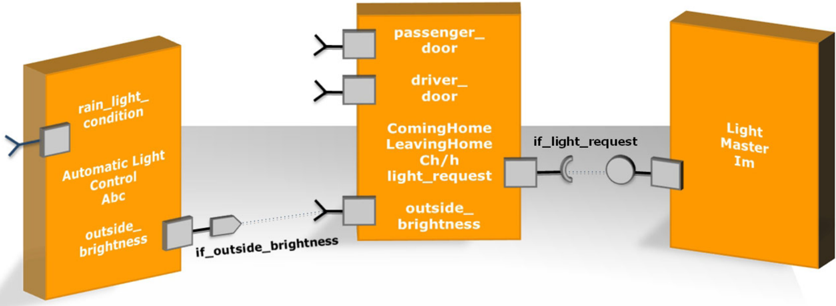

AUTOSAR 软件组件是硬件无关的，因此它们可以集成到任何可用的 ECU 硬件上。为了便于 ECU 间与 ECU 内的信息交换，AUTOSAR 软件组件完全通过 RTE 通信。

AUTOSAR 软件组件包含若干提供内部功能的函数与变量。AUTOSAR 软件组件的内部结构、其变量与函数调用，通过头文件对公共视图隐藏。只有外部 RTE 调用呈现在公共接口上。

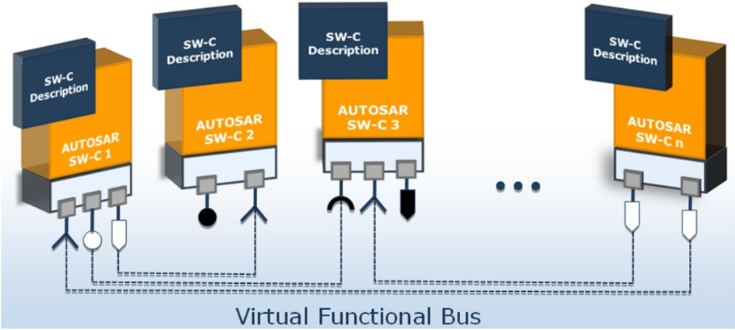

AUTOSAR 软件组件还包含必须在运行时被调用的函数。这些 C 函数在 AUTOSAR 中被称为 Runnable。

Runnable 不能自行执行；它们必须被分配到操作系统的可执行实体。这种分配可以通过将 Runnable 的函数调用插入 OS 任务体中来完成。

Runnable 随后在其调用者 OS 任务的上下文中以周期性和/或事件驱动方式执行。Runnable 到任务的分配按照图 2.3 与图 2.4 执行。

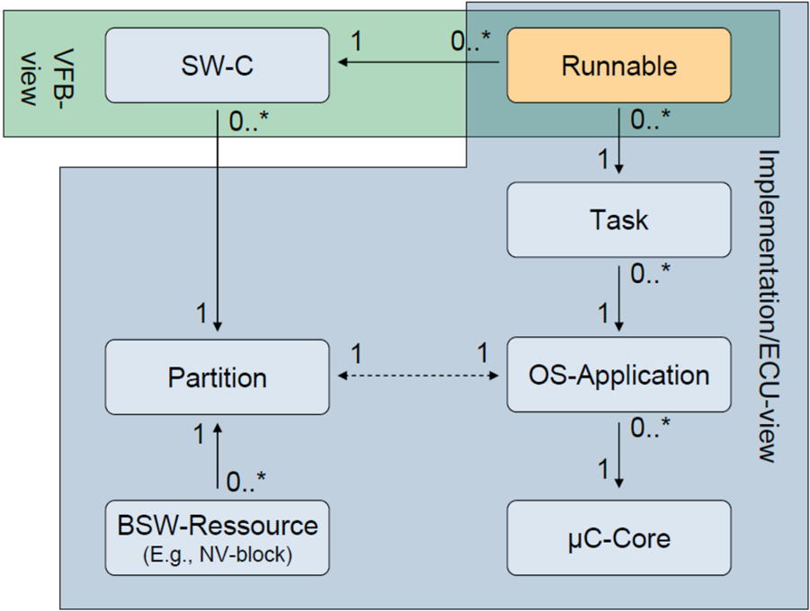

##### 2.1.2.2 OS-Application

图 2.4 给出了图 2.3 关系的一种解释。AUTOSAR 软件组件的 Runnable 按照此图被分配到 OS 任务。

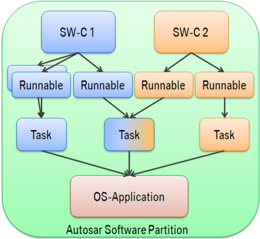

AUTOSAR OS-Application 是操作系统对象（如任务、ISR、调度表、计数器与报警）的集合，它们形成一个内聚的功能单元。属于同一 OS-Application 的所有对象可以相互访问。

OS-Application 内的操作系统对象可以属于不同的 AUTOSAR 软件组件。RTE 实现了一个可被 OS-Application 的所有成员无限制访问的内存区域，以便高效地支持 SW-C 之间的通信。

OS-Application 有两类：

1. 「可信（Trusted）OS-Application 允许在运行时禁用监控或保护特性的情况下运行。它们可以不受限制地访问内存与操作系统模块的 API。可信 OS-Application 无需在运行时强制其时序行为。在处理器支持的情况下，它们允许以特权模式运行。」
2. 「非可信（Non-Trusted）OS-Application 不允许在运行时禁用监控或保护特性的情况下运行。它们对内存的访问受限、对操作系统模块 API 的访问受限，且其时序行为在运行时被强制。在处理器支持的情况下，它们不允许以特权模式运行。」7

##### 2.1.2.3 通信与代码共享

根据图 2.4 与图 2.3，一个 OS-Application 可以包含多个 AUTOSAR 软件组件及关联的 Runnable。Runnable 只被允许直接访问各自软件组件内的变量并执行其中的函数调用。

> 7 CP_SWS_OS[4], V5.3.0 R4.1 Rev 3, Chapter 7.6.1

软件组件的内部函数调用与变量不被其他软件组件公开知晓，因为它们的定义不由外部接口的头文件呈现。

因此，经由变量的直接通信以及执行其他软件组件的代码不是预期行为。

图 2.5 以代码共享为例说明了这一点：代码共享只允许在软件组件内部进行，而不允许在一个 OS-Application 的软件组件之间进行。与其他软件组件的通信应经由 RTE 执行。Runnable 4 不得执行属于 SW-C 2.2 的函数。

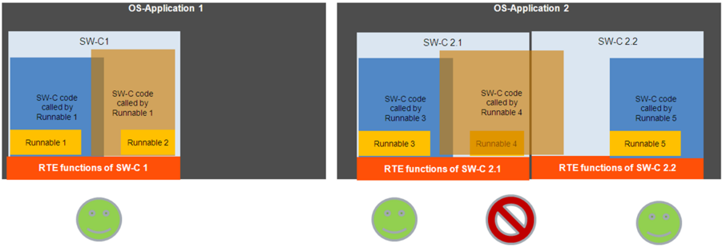

##### 2.1.2.4 应用软件内的内存分区

AUTOSAR ECU 中的应用软件可以由安全相关与非安全相关的软件组件组成。应按照 ISO 262628 的要求确保不同 ASIL 等级的软件组件之间的免受干扰。

AUTOSAR 操作系统通过将 OS-Application 放入独立的内存区域来提供针对内存相关故障的免受干扰。该机制称为内存分区。OS-Application 彼此受保护，因为在一个 OS-Application 的内存分区中执行的代码不能修改其他内存区域。AUTOSAR OS 规范中的相应需求见表 2.1。

> 8 [ISO 26262-6 7.4.8] Coexistence

表2.1：AUTOSAR OS——OS-Application 的内存分区（**AUTOSAR OS - Memory Partitioning for OS-Applications**，Specification of Operating System, V5.3.0 R4.1 Rev 3）

| 需求 ID | 需求文本 |
| --- | --- |
| [SWS_Os_00207] | 操作系统模块应防止其他非可信 OS-Application 对某 OS-Application 私有数据段的写入访问。 |
| [SWS_Os_00355] | 操作系统模块应防止其他非可信 OS-Application 对某 OS-Application 的任务/Category 2 ISR 的所有私有栈的写入访问。 |
| [SWS_Os_00356] | 操作系统模块应防止其他非可信 OS-Application 对某 OS-Application 的任务/Category 2 ISR 的所有私有数据段的写入访问。 |

应用软件可以由具有不同 ASIL 等级的软件组件组成。

不过，具有不同 ASIL 等级的软件组件不应被分配到同一个 OS-Application。内存分区不为被分配到同一 OS-Application 的软件组件提供免受干扰。操作系统只阻止其他 OS-Application 进行不当访问。一个故障的软件组件不会被阻止修改同一 OS-Application 内其他软件组件的内存区域。

注意：有关任务级分区的细节，请查阅后续小节。

##### 2.1.2.5 软件组件内的内存分区

混合 ASIL（Mixed-ASIL）软件组件可以由具有不同 ASIL 等级的 Runnable 组成，因此需要一个支持这些 Runnable 之间免受干扰的执行环境。由于以下原因，将一个软件组件的不同 Runnable 在不同内存分区中执行是不可能的：

内存分区在 OS-Application 层级执行。然而根据图 2.3 与图 2.4，一个软件组件只能被分配到一个 OS-Application，因此只有一个内存分区。而且，软件组件的 Runnable 只能被一个 OS-Application 的任务调用。

如图 2.6 所示，软件组件的 Runnable 不能被分布到多个 OS-Application 的任务中。

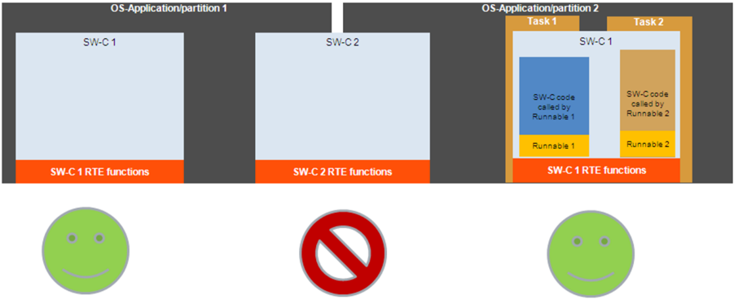

内存分区不能用于分隔同一 SW-C 内的 Runnable。如果需要让一个软件组件包含具有不同 ASIL 等级的 Runnable，并且这些 Runnable 需要以免受干扰的方式独立执行，那么 OS-Application 层级的内存分区是不够的，必须在任务级执行内存分区。该方法见图 2.7。

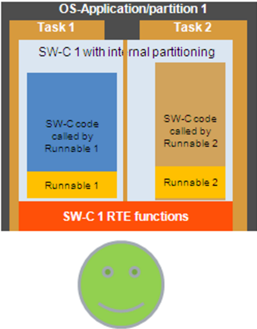

与任务级内存分区相关的需求列于 AUTOSAR OS 规范的表 2.2 中。弱词「may（可以）」的使用表明任务级分区的实现是 AUTOSAR OS 的可选项。因此，并非每个 AUTOSAR OS 实现都支持任务级内存分区。

表2.2：AUTOSAR OS 需求——任务的内存分区（**AUTOSAR OS Requirements - Memory Partitioning for Tasks**，Specification of Operating System, V5.3.0 R4.1 Rev 3）

| 需求 ID | 需求文本 |
| --- | --- |
| [SWS_Os_00208] | 操作系统模块可以防止同一 OS-Application 中所有其他任务/ISR 对某非可信应用的任务/Category 2 ISR 的私有栈的写入访问。 |
| [SWS_Os_00195] | 操作系统模块可以防止同一 OS-Application 中所有其他任务/ISR 对某非可信应用的任务/Category 2 ISR 的私有数据段的写入访问。 |

##### 2.1.2.6 内存分区的实现

利用「内存分区」机制可以实现系统与软件层面广泛多样的技术安全概念。

图 2.8 展示了一种可能的实现，其中所有基础软件模块都在一个可信/管理模式9内存分区中执行（图 2.8 中以红色高亮）。一些 SW-C 被逻辑地分组并放入独立的非可信/用户模式10内存分区（以绿色高亮）。选定的 SW-C 与基础软件模块属于同一个可信/管理模式内存分区（见图 2.8 中第四个 SW-C，以红色高亮）。可以存在若干非可信/用户模式分区，每个分区包含一个或多个 SW-C。

> 9 Supervisor Mode、Privileged Mode 与 Elevated Mode 是提升的 CPU 模式的同义词。Trusted Mode 是在提升的 CPU 模式下执行的软件的一种模式。
> 10 User Mode 与 Non-Privileged Mode 是非提升 CPU 模式的同义词。Non-Trusted Mode 是在非提升 CPU 模式下执行的软件的一种模式。

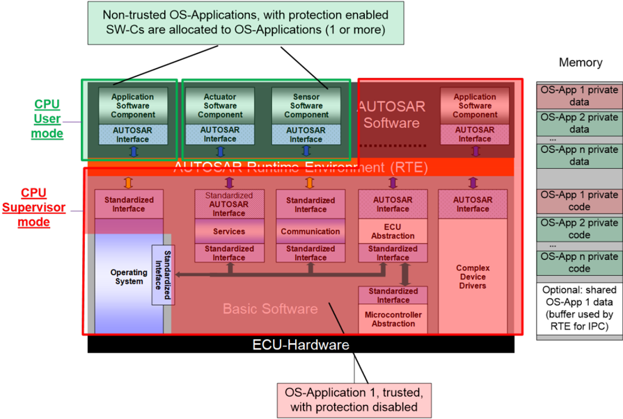

> Technical Safety Concept Status Report, V1.2.0, R4.1 Rev 1, Chapter 1.1.6 Memory Partitioning and User/Supervisor-Modes Related Features

SW-C 在非可信/用户模式内存分区中的执行被限制修改其他内存区域，而可信/管理模式内存分区中 SW-C 的执行不受限制。

面向安全相关应用的现代微控制器通过专用硬件——内存保护单元（MPU）——支持内存分区。

注意：假定内存分区将在具有 MPU 或类似硬件特性11的微控制器上实现。

在典型的 MPU 实现中，非可信应用可以被允许多段微控制器地址空间。访问控制被定义为读、写与执行访问的组合。MPU 的配置只允许在管理模式下进行。

注意：在一些微控制器实现中，MPU 集成在处理器核心内部。因此该 MPU 只控制相关核心的访问。其他总线主控（如 DMA 控制器与附加核心）不受该 MPU 实例控制。

下表与用例说明了当内存保护单元的配置从系统需求导出时的一组可能场景。

> 11 [ISO26262-6 7.4.9 b)] Partitioning

注意：相对于所使用的特定硬件设备的特性，本表可能不完整。

表2.3：内存保护的配置场景（**Configuration scenarios for Memory Protection**）

| 地址空间 | 理由 | 读 | 写 | 执行 |
| --- | --- | --- | --- | --- |
| Flash Memory | 读、执行与写访问不会修改闪存内容。闪存必须先由不同的机制擦除并使能写入。注意：从安全（Security）的角度看会产生以下影响：读取与执行外来代码可能被用于获取软件本不打算提供的信息。 | O | O | O |
| RAM | 对 RAM 的写入访问可能造成内存损坏，从而影响软件的行为。 | O | X | O |
| Peripheral | 即使从外设地址空间读取也可能产生副作用。例如：对中断的确认是通过对中断控制器的读取访问执行的；对外设的读取访问可能导致 I/O 错误。 | X | X | X |

**图例（Legend）：**

- X——需要保护
- O——保护可选

注意：从性能角度看，可能由于总线争用、接口仲裁等而产生副作用。

**用例 1：同一分区中的软件组件。**

- 同一分区中的软件组件可以访问彼此的 RAM 区域，因此可能损坏彼此的内存内容。
- 按照定义，软件组件不访问外设，因为它们不应感知底层微控制器架构。当给软件组件对外设的直接访问时，可能创建不安全的系统。

**用例 2：不同分区中的软件组件。**

- 不同分区中的软件组件不能访问彼此的 RAM 区域，因此无法损坏彼此的内存内容。
- 按照定义，软件组件不访问外设，因为它们不应感知底层微控制器架构。当给软件组件对外设的直接访问时，可能创建潜在不安全的系统。

**用例 3：MCAL 驱动。**

- MCAL 驱动是诸如读/写/初始化等函数的集合。它们必须由另一个实体（如 BSW 或 CDD）执行。细节请见图 2.8。
- MCAL 驱动需要对相应外设硬件模块的外设空间的读/写访问。根据硬件架构，可能还额外需要处理器的管理模式。

#### 2.1.3 检测与反应

功能安全机制「内存分区」通过限制对内存与内存映射硬件的访问来提供保护。在一个分区中执行的代码不能修改另一个分区的内存。内存分区能够保护只读内存段以及内存映射硬件。此外，以用户模式执行的软件组件对诸如重配置之类的 CPU 指令的访问受到限制。

机制「内存分区」可以在微控制器硬件（如内存保护单元或内存管理单元）的支持下实现。操作系统必须恰当地配置微控制器硬件，以便于检测与阻止不正确的内存访问。随后对在非可信/用户模式内存分区中执行的软件组件的执行进行监控。

在非可信/用户模式分区中发生内存访问违规或 CPU 指令违规时，错误的访问被阻止，并由微控制器硬件引发异常。OS 与 RTE 通过执行分区关闭或重启该分区的所有 SW-C 来处理错误的软件分区。

注意：操作系统的实际反应可以通过保护钩子（Protection Hook）实现来配置。更多细节请查阅 OS SWS12 文档。

注意：AUTOSAR 文档「应用层错误处理说明」13提供了关于错误处理的附加信息。该文档解释了如何执行错误处理以及从何处获取所需的数据（例如替代值）。此外，该文档还详细解释（用户手册）了 AUTOSAR 中 OS-Application/分区终止与重启的执行方式。

> 12 Specification of Operating System, V5.3.0 R4.1 Rev 3
> 13 CP_EXP_ApplicationLevelErrorHandling[5], R4.2 Rev 1, Chapter 8, Chapter 10

#### 2.1.4 限制

1. 具有相同 ASIL 等级的 SW-C 的内存分区。

ISO 2626214 标准要求不同 ASIL 等级的软件组件之间免受干扰。然而，该标准不要求相同 ASIL 等级的软件组件之间免受干扰。

> 14 [ISO 26262-9 Clause 6]

允许存在由大量软件组件组成的 OS-Application。当单个软件组件导致违规、进而导致整个内存分区关闭或重启时，该内存分区中所有其他正常工作的 SW-C 也会受到影响。

2. 内存分区不适用于可信 OS-Application。

可信/管理模式内存分区的执行不受操作系统以及部分 MMU/MPU 硬件实现的控制。

3. 不支持任务级的内存分区。

任务级分区的实现对 AUTOSAR OS 实现而言不是强制的。因此，OS-Application 内部的免受干扰可能不被支持。

4. 内存分区带来的性能损失。

取决于应用软件的架构以及微控制器硬件与 OS 的实现，使用内存分区会带来性能损失。该损失随每单位时间执行的上下文切换次数增加而增大。

5. 无基础软件分区。

当前的基础软件规范没有为来自不同供应商、具有不同 ASIL 等级的基础软件组件规定内存分区。

#### 2.1.5 对 AUTOSAR 文档的引用

来源：Requirements on AUTOSAR Features, V1.2.1, R4.1 Rev 2

- AUTOSAR OS 应支持应用软件的隔离与保护
- AUTOSAR 应支持使用硬件内存保护特性以增强安全性
- AUTOSAR OS 应支持终止与重启 OS-Application

#### 2.1.6 对 ISO 26262 的引用

以下对 ISO 26262 标准的引用与不同 ASIL 等级的软件组件之间免受干扰的方面相关。

此外，还涵盖与软件分区及内存相关故障相关的概念。

表2.4：ISO 26262 内存分区引用（**ISO26262 Memory Partitioning References**）

| ID | ISO 26262 引用 |
| --- | --- |
| 01 | Part 6: [7.4.9] Partitioning |
| 02 | Part 6: [7.4.11] Dependent failure analysis |
| 03 | Part 6: [D.2.1] |
| 04 | Part 6: [D.2.3] |
| 05 | Part 9: [6.2] |
| 06 | Part 9: [6.4.3] |
| 07 | Part 9: [6.4.4] |

### 2.2. 时序监控（Timing Monitoring）

时序是嵌入式系统的一项重要属性。安全的行为要求系统的动作与反应在正确的时间执行。

「正确的时间」可以用必须满足的一组时序约束来描述。然而，AUTOSAR 软件组件本身无法确保正确的时序。它依赖于 AUTOSAR 运行时环境与基础软件的恰当支持。在集成期间需要确保 AUTOSAR 软件组件的时序约束。

#### 2.2.1 故障模型

根据 ISO 2626215，以下与时序及执行相关的故障可被视为软件组件之间干扰的原因：

- 执行阻塞
- 死锁
- 活锁
- 执行时间的错误分配
- 软件元素之间的错误同步

时序保护与监控可以被描述为对以下特性的监控：监控任务在规定的时间被调度、满足其执行时间预算，并且不垄断 OS 资源。

为了保证安全相关功能遵守其时序约束，应当检测并处理垄断 CPU 的任务（如沉重的 CPU 负载、大量中断请求）。

> 15 [ISO 26262-6, Annex D] D.2.2 Timing and execution

#### 2.2.2 描述

AUTOSAR 提供以下时序监控机制：

1. 使用操作系统的时序保护机制。
2. 使用看门狗管理器的时间性程序流监控。

本章将解释看门狗管理器在实现应用软件时序监控方面的适用性。时间性程序流监控由「截止期限监督（Deadline Supervision）」与「存活监督（Alive Supervision）」机制组成，随后讨论。

看门狗管理器还提供一种称为「逻辑监督（Logical Supervision）」的机制，它可以与截止期限监督组合以提供高诊断覆盖率。该主题在 2.3 章讨论。

此外，还将概览 AUTOSAR OS 的时序保护机制。

##### 2.2.2.1 被监督实体（Supervised Entities）

看门狗管理器监督 AUTOSAR ECU 中应用软件的执行。监督的逻辑单元称为被监督实体（Supervised Entity）。被监督实体与 AUTOSAR 中的架构构件之间没有固定的关系。通常，根据开发者的选择，一个被监督实体可以表示一个 SW-C、SW-C 内的一个 Runnable、一个 BSW 模块或 CDD。

被监督实体中的重要位置被定义为检查点（Checkpoint）。被监督实体的代码与看门狗管理器的函数调用交织在一起。这些调用用于向看门狗管理器报告已到达某个检查点。

##### 2.2.2.2 看门狗管理器（Watchdog Manager）

看门狗管理器是 AUTOSAR 架构的一个基础软件模块。

看门狗管理器将看门狗硬件16的触发与软件执行的监督联系起来。当检测到对程序执行所配置的时序和/或逻辑约束的违反时，将采取若干可配置的动作以从该失效中恢复。

看门狗管理器为时间性程序流监控提供以下机制：

存活监督（Alive Supervision）：周期性被监督实体对其执行频率有约束。借助存活监督，看门狗管理器周期性地检查被监督实体的检查点是否在给定的限值SE3内被到达。这意味着看门狗管理器检查被监督实体是否运行得不太频繁或不太稀少。

> 16 见 CP_EXP_LayeredSoftwareArchitecture[3], V3.4.0, R4.1 Rev 3, Page 42, Page 82.

存活监督使用单个不带迁移的检查点执行。被监督实体必须周期性地调用该检查点，以标志其及时运行。操作系统周期性地执行看门狗管理器以验证检查点参数。

一个被监督实体也可以由多个存活监督实例监控，因此每个存活监督拥有一个独立的检查点。请见图 2.9。

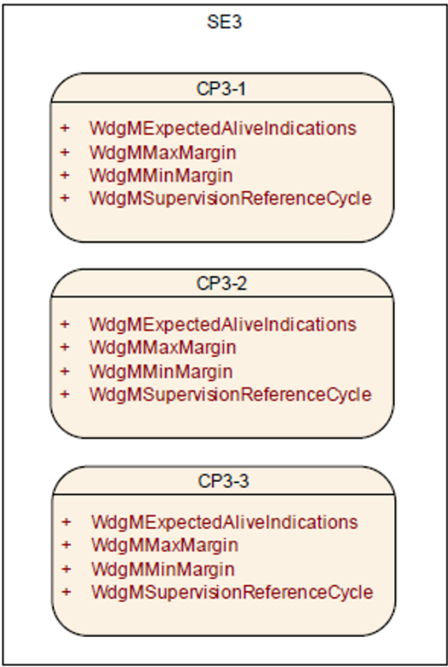

> CP_SWS_WatchdogManager[6], V2.5.0, R4.1 Rev 3, Page 43, Chapter 7.1.5 Alive Supervision Functions

截止期限监督（Deadline Supervision）：非周期性或偶发性被监督实体对两个检查点之间的时序有各自的约束。借助截止期限监督，看门狗管理器检查被监督实体的两个检查点之间迁移的时序。这意味着看门狗管理器检查被监督实体中的某些步骤所花费的时间是否在所配置的最小值与最大值之间。请见图 2.10。

如果第二个检查点永远未被到达，那么截止期限监督将无法检测到该问题。出现该问题的原因是时序检查由看门狗管理器在第二个检查点被调用之后执行。

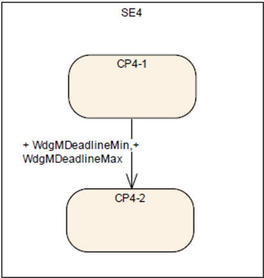

> CP_SWS_WatchdogManager[6], V2.5.0, R4.1 Rev 3, Page 61, Chapter 7.3 Watchdog Handling

##### 2.2.2.3 操作系统的时序保护

根据 AUTOSAR OS 规范，当任务或中断在运行时错过其最后期限时，实时系统中就发生了时序故障。

AUTOSAR OS 不提供用于时序保护的截止期限监督。截止期限监督不足以正确识别 AUTOSAR 系统中导致时序故障的任务或中断。最后期限违规可能由不相关的任务或中断干扰执行引起。更多细节请查阅 AUTOSAR OS 规范17。

在像 AUTOSAR OS 这样的固定优先级抢占式操作系统中，任务或中断是否满足其最后期限由以下因素决定：

> 17 Specification of Operating System, V5.3.0 R4.1 Rev 3, Chapter 7.7.2

- 系统中任务/中断的执行时间。
- 任务/中断因较低优先级的任务/中断锁定共享资源或禁用中断而遭受的阻塞时间。
- 系统中任务/中断的到达间隔速率。

为了安全且准确地时序保护，操作系统有必要在运行时控制这些因素，以确保任务/中断能够满足其各自的最后期限。AUTOSAR OS 提供以下时序保护机制：

1. 执行时间保护。任务或 Cat218 中断执行时间的上限（即所谓的执行预算，Execution Budget）经由 OS 监控，以防止时序错误。
2. 锁定时间保护。资源阻塞、中断锁定与挂起的上限（即所谓的锁定预算，Lock Budget）由 OS 监控。
3. 到达间隔时间保护。任务被激活或 Cat2 中断到达之间的下限（即所谓的时间帧，Time Frame）经由 OS 监控，以防止时序错误。

注意：执行时间的强制需要硬件支持，例如时序强制中断。如果使用中断来实现时间强制，则该中断的优先级应足够高，以便能够「中断」被监督的任务或中断。

> 18 Category 2 中断由操作系统管理。Category 1 中断在操作系统之外执行，因此无法被监控。

#### 2.2.3 检测与反应

看门狗管理器为时间性与逻辑性程序流监控提供三种机制：截止期限监督、存活监督与逻辑监督。

监督机制是静态配置的。对于一个被监督实体的监控，可以采用多于一种监督机制。

基于每个已启用机制的结果，计算被监督实体的状态（称为局部状态，Local Status）。当每个被监督实体的状态确定后，再基于每个局部监督状态确定整个 MCU 的状态（称为全局监督状态，Global Supervision Status）。

根据每个被监督实体的局部监督状态与全局监督状态，看门狗管理器启动若干机制以从监督失效中恢复。这些机制的范围从被监督实体内的局部错误恢复到 ECU 的全局复位。

看门狗管理器可以采用以下错误恢复机制：

1. 被监督实体内的错误处理

如果被监督实体是 SW-C 或 CDD，看门狗管理器可以经由 RTE 模式机制将该监督失效通知被监督实体。被监督实体随后可以采取其自身从该失效恢复的动作。

看门狗管理器在检测到监督失效时，可以向诊断事件管理器（DEM）登记一个条目。被监督实体可以基于该错误条目采取恢复动作。

2. 分区关闭

如果看门狗管理器模块在位于非可信分区中的被监督实体内检测到监督失效，看门狗管理器模块可以通过调用 BswM 请求分区关闭。

3. 硬件看门狗复位

当看门狗接口不应再触发硬件看门狗时，看门狗管理器向看门狗接口指示。在硬件看门狗超时之后，硬件看门狗复位 ECU 或 MCU。这将导致 ECU 和/或 MCU 硬件的重新初始化以及软件的完全重新初始化。

4. 立即 MCU 复位

如果需要对监督失效立即做出全局反应，看门狗管理器可以直接引发 MCU 复位。这将导致 MCU 硬件与全部软件的重新初始化。通常，MCU 复位不会重新初始化 ECU 的其余硬件。

注意：AUTOSAR 文档「应用层错误处理说明」19提供了关于错误处理的附加信息。该文档解释了如何执行错误处理以及从何处获取所需的数据（例如替代值）。此外，该文档还详细解释（用户手册）了 AUTOSAR 中 OS-Application/分区终止与重启的执行方式。

> 19 CP_EXP_ApplicationLevelErrorHandling[5], R4.2 Rev 1, Chapter 8, Chapter 10

#### 2.2.4 限制

1. 检查点的粒度不由看门狗管理器固定。少量粗粒度的检查点会限制看门狗管理器的检测能力。例如，如果一个应用 SW-C 只有一个指示周期性 Runnable 已被启动的检查点，那么看门狗管理器只能检测到该 Runnable 被重新启动并检查时序约束。相比之下，如果该 SW-C 在 Runnable 的每个块与分支处都有检查点，看门狗管理器还可以检测该 SW-C 控制流中的失效。检查点的高粒度会导致看门狗管理器配置复杂且庞大。
2. 截止期限监督有一个弱点：它只检测延迟（当终止检查点被报告时），而不检测超时（当终止检查点完全没有被报告时）。
3. 不支持截止期限监督的嵌套（即启动 1、启动 2、结束 2、结束 1）。
4. 每个被监督实体多于一个检查点的存活监督函数在《看门狗管理器规范》文档中没有一致地规定。目前建议每个监督实体只支持一个存活监督检查点。
5. 为了关闭或重启（作为错误反应）一个包含被监督实体的分区，集成者代码（OS 应用的重启任务）必须通过调用看门狗管理器的可用函数，将所涉及分区的所有被监督实体去激活（或去激活 + 激活）。这有点复杂，在《看门狗管理器规范》文档的未来版本中，考虑为此增加一个新的看门狗管理器函数。
6. 库不能调用 BSW，因此库不能被看门狗管理器监督。不过，可以通过在模块代码中库调用之前与之后放置检查点来监督库（使用截止期限监督）。
7. BSW 模块如何用被监督实体 ID 标识尚未标准化。

#### 2.2.5 对 AUTOSAR 文档的引用

来源：Requirements on AUTOSAR Features, V1.2.1, R4.1 Rev 2

- AUTOSAR 应支持程序流监控
- AUTOSAR OS 应支持时序保护
- AUTOSAR OS 应支持时序保护

#### 2.2.6 对 ISO 26262 的引用

以下对 ISO 26262 标准的引用与不同 ASIL 等级的软件组件之间免受干扰的方面相关。涵盖与时序监督相关的概念。

表2.5：ISO 26262 时序监控引用（**ISO26262 Timing Monitoring References**）

| ID | ISO 26262 引用 |
| --- | --- |
| 03 | Part 6: [D.2.1] |
| 08 | Part 6: [D.2.2] |
| 09 | Part 6: [7.4.12] NOTE 2, Monitoring of program execution by an external element |

### 2.3. 逻辑监督（Logical Supervision）

逻辑监督是一种检查软件正确执行的技术，聚焦于控制流错误。

控制流错误导致在应用无错执行期间偏离有效（即编码/编译的）程序序列。如果一个或多个程序指令以不正确的序列被处理，或根本没有被处理，就会发生不正确的控制流。控制流错误例如可能导致数据不一致、数据损坏或其他软件失效。

#### 2.3.1 故障模型

根据 ISO 2626220，以下与时序及执行相关的故障可被视为软件组件之间干扰的原因：

- 执行阻塞
- 死锁
- 活锁
- 执行时间的错误分配
- 软件元素之间的错误同步

程序序列的逻辑与时序监控在汽车工业中使用，并在 ISO 26262 中被提及为检测处理单元（即 CPU、微控制器）失效的措施，以及检测 HW 时钟失效的措施。

程序序列执行中的故障（即程序序列的无效执行）可能导致数据损坏、进程崩溃或失效静默（fail-silence）违规。

程序序列的逻辑监控被 ISO 26262、IEC 61508、MISRA 要求/推荐/提出。

> 20 [ISO 26262-6, Annex D] D.2.2 Timing and execution

#### 2.3.2 描述

对程序执行序列的逻辑监督能够检测导致在应用无错执行期间偏离有效程序序列的错误。如果一个或多个程序指令以不正确的序列被处理，或根本没有被处理，就会发生不正确的程序流。

看门狗管理器监督 AUTOSAR ECU 中应用软件的执行。监督的逻辑单元称为被监督实体。被监督实体与 AUTOSAR 中的架构构件之间没有固定的关系。通常，根据开发者的选择，一个被监督实体可以表示一个 SW-C、SW-C 内的一个 Runnable、一个 BSW 模块或 CDD。

被监督实体中与逻辑监督相关的位置被定义为检查点。被监督实体的代码与看门狗管理器的函数调用交织在一起。这些调用用于向看门狗管理器报告已到达某个检查点。

每个被监督实体有一个或多个检查点。被监督实体的检查点及检查点之间的迁移构成一个图（Graph）。

一个图可以有一个或多个21初始检查点与一个或多个终止检查点。以任何初始检查点开始并以任何终止检查点结束的任何序列都是正确的，前提是这些检查点属于同一个图。

被监督实体内的图称为内部图（Internal Graph）。来自不同被监督实体的检查点可以通过外部迁移（External Transition）连接，形成外部图（External Graph）。

图 2.11 展示了一个 While 循环的图表示，它由检查点与迁移组成。

> 21 内部图只能有一个初始检查点。外部图可以有多个初始检查点。

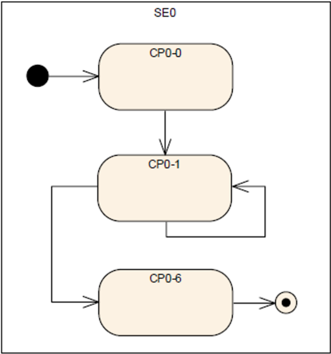

> CP_SWS_WatchdogManager[6], V2.5.0, R4.1 Rev 3, Chapter 7.1.7 Logical Supervision

在运行时，看门狗管理器验证被监督实体是否按照所配置的图执行。这称为逻辑监督。

此外，看门狗管理器还可以验证图内检查点与迁移的时序。

检查点之间迁移的时序可以经由截止期限监督验证，而逻辑监控验证检查点的正确顺序。时序监控机制的细节在 2.2 章描述。

#### 2.3.3 检测与反应

在设计阶段，有效程序序列被识别并建模。在运行时，看门狗管理器使用该模型来监督或监控程序序列的正确执行。

看门狗管理器为时间性与逻辑性程序流监控提供三种机制：截止期限监督、存活监督与逻辑监督。

监督机制是静态配置的。对于一个被监督实体的监控，可以采用多于一种监督机制。

基于每个已启用机制的结果，计算被监督实体的状态（称为局部状态）。当每个被监督实体的状态确定后，再基于每个局部监督状态确定整个 MCU 的状态（称为全局监督状态）。

根据每个被监督实体的局部监督状态与全局监督状态，看门狗管理器启动若干机制以从监督失效中恢复。这些机制的范围从被监督实体内的局部错误恢复到 ECU 的全局复位。

可以采用以下错误恢复机制：

1. 被监督实体内的错误处理：

如果被监督实体是 SW-C 或 CDD，看门狗管理器可以经由 RTE 模式机制将该监督失效通知被监督实体。被监督实体随后可以采取其自身从该失效恢复的动作。

看门狗管理器在检测到监督失效时，可以向诊断事件管理器（DEM）登记一个条目。被监督实体可以基于该错误条目采取恢复动作。

2. 分区关闭

如果看门狗管理器模块在位于非可信分区中的被监督实体内检测到监督失效，看门狗管理器模块可以通过调用 BswM 请求分区关闭。

3. 硬件看门狗复位

当看门狗接口不应再触发硬件看门狗时，看门狗管理器向看门狗接口指示。在硬件看门狗超时之后，硬件看门狗复位 ECU 或 MCU。这将导致 ECU 和/或 MCU 硬件的重新初始化以及软件的完全重新初始化。

4. 立即 MCU 复位

如果需要对监督失效立即做出全局反应，看门狗管理器可以直接引发 MCU 复位。这将导致 MCU 硬件与全部软件的重新初始化。

注意：AUTOSAR 文档「应用层错误处理说明」22提供了关于错误处理的附加信息。该文档解释了如何执行错误处理以及从何处获取所需的数据（例如替代值）。此外，该文档还详细解释（用户手册）了 AUTOSAR 中 OS-Application/分区终止与重启的执行方式。

> 22 CP_EXP_ApplicationLevelErrorHandling[5], R4.2 Rev 1, Chapter 8, Chapter 10

#### 2.3.4 限制

1. 对于逻辑监督，看门狗管理器不支持任何重叠的图——一个检查点应最多属于一个图。这是为了能够将收到的检查点通知分配给某个图所必需的。
2. 看门狗管理器不支持并发执行的被监督实体的逻辑监督，因为它一次只跟随图的一个实例。
3. 为了关闭或重启（作为错误反应）一个包含被监督实体的分区，集成者代码（OS 应用的重启任务）必须通过调用看门狗管理器的可用函数，将所涉及分区的所有被监督实体去激活（或去激活 + 激活）。

#### 2.3.5 对 AUTOSAR 文档的引用

来源：Requirements on AUTOSAR Features, V1.2.1, R4.1 Rev 2

- AUTOSAR 应支持程序流监控

#### 2.3.6 对 ISO 26262 的引用

以下对 ISO 26262 标准的引用与不同 ASIL 等级的软件组件之间免受干扰的方面相关。涵盖与逻辑监督相关的概念。

表2.6：ISO 26262 逻辑监督引用（**ISO26262 Logical Supervision References**）

| ID | ISO 26262 引用 |
| --- | --- |
| 03 | Part 6: [D.2.1] |
| 08 | Part 6: [D.2.2] |
| 09 | Part 6: [7.4.12] NOTE 2, Monitoring of program execution by an external element and Temporal monitoring of program execution |

### 2.4. 端到端保护（End-2-End Protection）

在分布式系统中，发送者与接收者之间的数据交换可能影响功能安全，如果其安全行为依赖于此类数据的完整性（见本章开头「信息交换」故障示例）。

因此，此类数据应使用保护其免受通信链路内故障影响的机制来传输。

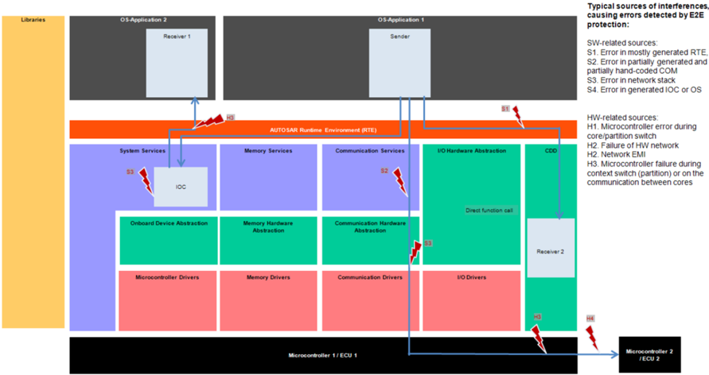

> CP_SWS_E2ELibrary[7], V3.2.1, R4.1 Rev 3

#### 2.4.1 故障模型

根据 ISO 2626223，对于在不同软件分区或 ECU 中执行的每个发送者或接收者软件组件（例如微控制器 2/ECU 2），可以考虑以下与信息交换相关的故障：

> 23 [ISO 26262-6, Annex D] D.2.4 Exchange of Information

- 信息的重复；
- 信息的丢失；
- 信息的延迟；
- 信息的插入；
- 信息的伪装或错误寻址；
- 信息的错误顺序；
- 信息的损坏；
- 从一个发送者向多个接收者发送的非对称信息；
- 来自一个发送者的信息只被接收者的一个子集收到；
- 对通信信道的访问被阻塞。

端到端保护的概念假定：安全相关的数据交换应在运行时受到保护，以抵御通信链路内故障的影响（见图 2.12）。此类故障的例子有随机硬件故障（例如 CAN 收发器的损坏寄存器）、干扰（例如由 EMC 引起）、ECU 内部与外部（例如网关上）实现 VFB 通信的软件（例如 RTE、IOC、COM 与网络协议栈）内的系统性故障。

E2E 库考虑了与经由通信网络的消息交换相关的以下故障。

表2.7：通信网络的故障模型（**Fault Models of a Communication Network**）

| 故障模型 | 描述 |
| --- | --- |
| 信息的重复 | 一种通信故障，信息被接收多于一次。 |
| 信息的丢失 | 一种通信故障，信息或信息的一部分从传输的信息流中被移除。 |
| 信息的延迟 | 一种通信故障，信息晚于预期被接收。 |
| 信息的插入 | 一种通信故障，附加信息被插入传输的信息流。 |
| 伪装 | 一种通信故障，非真实的信息被接收者当作真实信息接受。 |
| 错误寻址 | 一种通信故障，信息被从错误的发送者接受或被错误的接收者接受。 |
| 信息的错误顺序 | 一种通信故障，改变了传输信息流中信息的顺序。 |
| 信息的损坏 | 一种通信故障，改变了信息。 |
| 从一个发送者向多个接收者发送的非对称信息 | 一种通信故障，接收者从同一发送者接收到不同的信息。 |
| 来自一个发送者的信息只被接收者的一个子集收到 | 一种通信故障，某些接收者没有收到信息 |
| 对通信信道的访问被阻塞 | 一种通信故障，对通信信道的访问被阻塞。 |

> CP_SWS_E2ELibrary[7], V3.2.1, R4.1 Rev 3, Chapter 4.3.3

#### 2.4.2 描述

从软件组件的视角看，经由 RTE 的数据传输表现得像一个简单的点对点连接。然而，这一抽象的实现需要一个由软件层、通信协议栈、驱动与底层硬件组成的高度复杂的基础设施。随着复杂性的增加，潜在失效来源的数量也在增加。

端到端保护机制的使用假定：安全相关数据的完整性必须在通信期间得到维持，保护数据免受通信链路内故障的影响。

端到端保护最重要的方面是保护能力的标准化与该机制的灵活适用性。本章将描述通过端到端保护概念在 ECU 内与 ECU 间安全数据通信的机制。

端到端保护的架构实现如下：由应用数据组成的数据元素在发送者一侧被附加控制信息——端到端头（End-2-End header）——而扩展。控制信息通常包含校验和（Checksum）、计数器（Counter）及其他选项。扩展后的数据元素被提供给 RTE 进行传输，如图 2.13 所示。它展示了 E2E 的原理，但未展示实现所需的全部细节。为简单起见，省略了使用 RTE 数据转换器（Data Transformer）对复杂数据元素进行编码/解码的部分。

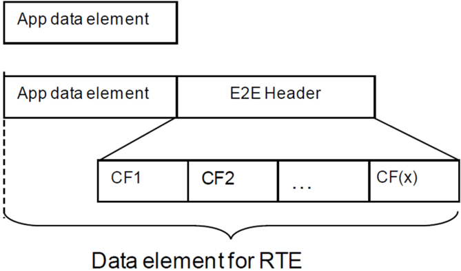

> CP_SWS_E2ELibrary[7], V3.2.1, R4.1 Rev 3, Chapter 8.1

数据元素在接收者一侧通过对照应用数据处理端到端头的内容来验证。在接收到的数据元素被处理并被接受为正确之后，控制信息被移除，应用数据被提供给目标软件组件。

错误处理在接收者执行。

##### 2.4.2.1 端到端配置文件（End-2-End Profiles）

AUTOSAR 规定了一组标准化且可配置的端到端配置文件（Profile），它们实现一组保护机制并规定所附端到端头的数据格式。

一个端到端配置文件使用以下数据保护机制的子集：24

> 24 CP_SWS_E2ELibrary[7], V3.2.1, R4.1 Rev 3, SWS_E2E_00221

1. CRC 校验和，由 CRC 库提供；
2. 序列计数器（Sequence Counter），在每次传输请求时递增，接收者侧检查该值是否正确递增；
3. 存活计数器（Alive Counter），在每次传输请求时递增，接收者侧只检查该值是否发生变化，但不检查是否正确递增；
4. 经由端口发送的每个端口数据元素的特定 ID（对系统全局，系统可能潜在包含多个 ECU）。
5. 超时检测：接收者通信超时与发送者确认超时。

AUTOSAR 标准规定了三个端到端配置文件：带两个变体的 Profile 1、端到端 Profile 2 与端到端 Profile 4。即将发布的版本还将规定 Profile 5 与 Profile 6。

只应使用标准化的端到端配置文件；非标准的端到端配置文件配置只能在特殊情况下使用，例如遗留软件。

端到端 Profile 1 的保护机制在表 2.8 中描述：

表2.8：端到端 Profile 1 中的机制（**Mechanisms in End-2-End Profile 1**）

| 机制 | 描述 | 故障模型 |
| --- | --- | --- |
| Counter | 一个 4 位计数器随每次发送请求递增。该值被显式发送。 | 重复、删除、插入、错误顺序 |
| Timeout | 使用非阻塞读取，接收者可以确定计数器的值是否已增加。 | 删除、延迟 |
| Data ID | 每个发送-接收端口有一个唯一的 16 位 ID，用于 CRC 计算。CRC 计算如图 2.14 所示。Data ID 的值不被显式发送。由于该 ID 只为发送者与接收者所知，CRC 计算只能由相应的通信伙伴正确执行。 | 插入、寻址故障 |
| CRC | 对所有数据元素、计数器与 Data ID 执行 CRC 校验和（8 位）计算。该值被显式发送。 | 损坏 |

图 2.14 阐明了端到端 Profile 1 中 CRC 计算的执行方式。Data ID 的值被计算进 CRC 值中，因此两个通信伙伴必须使用相同的 Data ID 才能正确验证消息的 CRC 校验和。

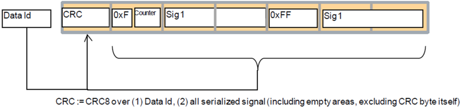

> CP_SWS_E2ELibrary[7], V3.2.1, R4.1 Rev 3, Chapter 8.3.4

尽管 Data ID 的长度为 16 位（可以产生大量独立的 Data ID），但 CRC 校验和的长度只有 8 位。这意味着不同的 Data ID 会产生相同的 CRC 校验和，从而限制了独立 Data ID 的数量。

如果一条消息被路由到错误的目的地（例如由于网关中的位翻转），且 Data ID 产生相同的 CRC 校验和，那么假设当前计数值与消息长度都正确，接收者就会接受这条被错误导向的消息。底层对寻址故障的保护程度被削弱。该故障模型称为伪装（Masquerading）。

可以限制 Data ID 的取值，使 CRC 校验和之间没有重叠。但这会将独立 Data ID 的数量限制到 255。

端到端 Profile 2 在使用 Data ID 保护机制方面采取了不同的方法。每个发送-接收端口对有一个 Data ID 列表。序列计数器的当前值决定使用哪个 Data ID。

需要恰当地选择 Data ID，以增加可以检测伪装的消息数量。然而，8 位 Data ID 与计数值之间会存在重叠，将独立 Data ID 与计数值的数量限制到 256。

如果单条错误接收的消息不违反系统的安全目标，那么端到端 Profile 2 允许对更多的消息提供伪装防护。

表2.9：端到端 Profile 2 中的机制（**Mechanisms in End-2-End Profile 2**）

| 机制 | 描述 | 故障模型 |
| --- | --- | --- |
| Sequence Number (Counter) | 一个 4 位计数器随每次发送请求递增。该值被显式发送。 | 消息的非预期重复、消息丢失、消息插入、重新排序 |
| Message Key used for CRC calculation (Data ID) | 8 位（不显式发送）。用于 CRC 计算的 Data ID 是一个预定义列表的元素，取决于计数器的当前值。Data ID 列表对每个数据元素唯一，且只为发送者与接收者所知。 | 消息插入、伪装 |
| Safety Code (CRC) | 对所有数据元素、计数器与 Data ID 执行 CRC 校验和（8 位）计算。该值被显式发送。 | 消息损坏、消息插入（伪装） |
| Timeout (detection and handling implemented by SW-C) | 超时检测必须由 SW-C 实现。 | 消息丢失、消息延迟 |

AUTOSAR 支持最大 4kB 大小的 PDU，可以通过 TCP/IP 协议栈或通过 FlexRay TP、CAN TP 等的 TP 服务实现。由于 8 位 CRC 校验和较短，端到端 Profile 1 与 2 只支持最高 30 或 42 字节 PDU 的符合 ASIL-D 的传输。

AUTOSAR R4.2.1 引入了一个新的端到端配置文件。端到端 Profile 4 专门设计用于长数据的符合 ASIL-D 的传输。这通过使用一个特殊的 32 位 CRC 多项式来支持。该多项式优于广泛使用的 IEEE 802.3 CRC，因为它为长数据提供更高的汉明距离。

表2.10：端到端 Profile 4 中的机制（**Mechanisms in End-2-End Profile 4**）

| 机制 | 描述 | 故障模型 |
| --- | --- | --- |
| Counter | 一个 16 位计数器随每次发送请求递增。该值被显式发送。 | 消息的非预期重复、消息丢失、消息插入、重新排序 |
| CRC | 32 位 CRC 对整个 E2E 头（不含 CRC 字节）与用户数据计算。该值被显式发送。注意：该 CRC 多项式不同于 FlexRay、CAN、LIN 与 TCP/IP 所使用的 CRC 多项式。 | 消息损坏、消息插入（伪装） |
| Data ID | 32 位 Data ID 在 ECU 网络内对特定数据元素应唯一。该值被显式发送。 | 消息插入、伪装 |
| Timeout (detection and handling implemented by SW-C) | 接收者读取当前可用的数据，即检查是否有新数据。然后，借助计数器，接收者可以检测通信丢失与超时。 | 消息丢失、消息延迟 |

端到端 Profile 4 的头提供以下控制字段，它们与被保护的数据一同传输。

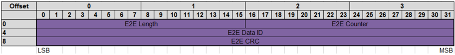

与 E2E Profile 1 与 2 相反，存在数据长度的显式传输，因为数据包没有标准大小。引入 16 位的 Length 字段是为了支持可变大小的数据，它们在每个传输周期可以有不同的长度。此外，还存在 Data ID 的显式传输。

##### 2.4.2.2 端到端状态机（End-2-End State Machine）

数据元素在接收者一侧通过使用端到端配置文件的检查函数，对照应用数据处理端到端头的内容来验证。它判定本周期接收到的数据是否正确，并在检测到故障时提供附加信息。

AUTOSAR R4.2.1 引入了一个状态机，它以更高的细节层次帮助判定接收到的应用数据是否可接受。引入了一个新的抽象层级，使应用接收通信的整体状态，而不必处理每一条消息的状态。

新的状态机支持对丢失或重复数据包的数量、可恢复与不可恢复的通信故障以及通信初始化的可配置设置。图 2.15 阐明了该状态机的设计与特性。

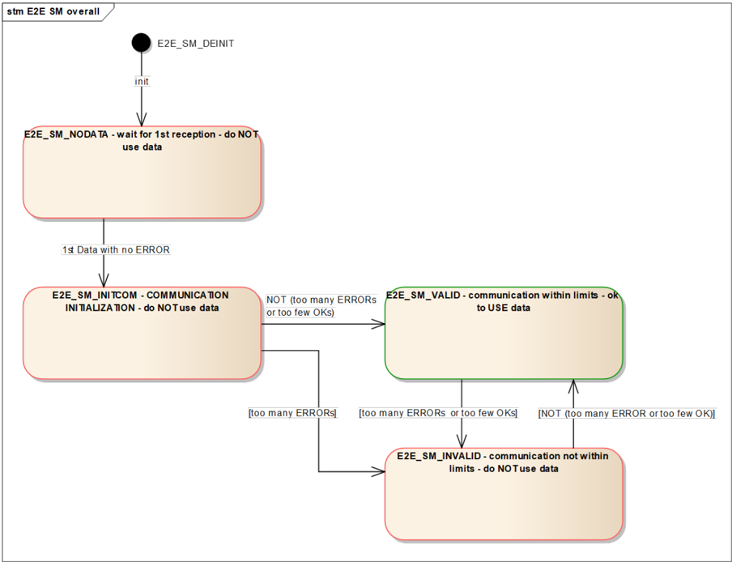

> CP_SWS_E2ELibrary[7], V3.0.0-0.10.4, R4.1 Rev 3, Chapter 7.8.1

##### 2.4.2.3 端到端保护库的集成

为了启用端到端库的正确使用，存在不同的可能解决方案。它们可能取决于 RTE、COM 或其他基础软件模块的完整性，以及其他 SW/HW 机制（例如内存分区）的使用。

端到端库可用于借助端到端保护包装器（End-2-End Protection Wrapper）保护 SW-C 之间交换的安全相关数据元素。

此外，端到端库可用于借助 COM Callout 保护安全相关的 I-PDU。

也可以有混合场景：一些数据元素在 SW-C 层级保护（例如用端到端保护包装器），另一些用 COM E2E Callout。

在 AUTOSAR R4.2.1 中引入的 RTE 数据转换器也可用于在 RTE 层级保护 ECU 之间复杂数据元素的数据交换。

##### 2.4.2.4 端到端保护包装器（End-2-End Protection Wrapper）

端到端保护库可用于在 RTE 层级保护 SW-C 之间的数据通信。为此，端到端保护包装器充当提供给 SW-C 的 Rte_Write 与 Rte_Read 函数之上的包装器。端到端保护包装器封装软件组件的 Rte_Read/Write 调用，并使用端到端库保护数据交换。

在这种方法中，每个安全相关的 SW-C 都有自己的附加子层（一对 .h/.c 文件），称为端到端保护包装器，它负责将复杂数据元素编组为与相应 I-PDU 相同的布局（用于 ECU 间通信），并负责正确调用端到端库与 RTE。请见图 2.17。

端到端保护包装器的使用允许在 SW-C 之间使用 VFB 通信，而无需进一步的措施来确保 VFB 的完整性。

此类 SW-C 之间的通信可以在一个 ECU 内（这意味着在同一或不同核心上，或在微控制器的同一或不同内存分区内），也可以跨 ECU（经由 VFB 连接的 SW-C，也使用网络）。

端到端保护是保护 SW-C 通信的系统性解决方案，与所使用的通信资源无关（例如 COM 与网络、OS/IOC 或 RTE 内部的通信）。SW-C 的重新部署可能只需要选择其他保护参数，而无需更改 SW-C 应用代码。

此外，端到端保护包装器的使用支持在通信软件协议栈可能不安全的情况下，软件组件之间的安全通信。

注意：端到端保护包装器不支持 SW-C 的多重实例化。这意味着，如果一个 SW-C 要使用端到端保护包装器，则该 SW-C 必须是单实例化的。该限制基于以下事实：软件组件的多个实例将拥有相同的 DataID，从而限制底层保护机制的能力。

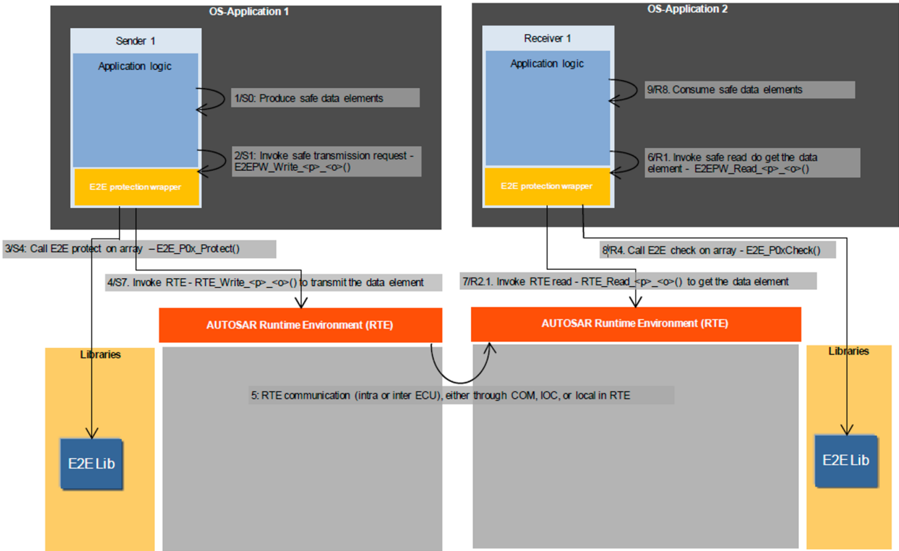

> CP_SWS_E2ELibrary[7], V3.2.1, R4.1 Rev 3, Chapter 13.1.1

##### 2.4.2.5 传输管理器（Transmission Manager）

在未为 COM 与 RTE 提供运行完整性的 ECU 系统中，仍然可以经由网络传输安全相关数据。

在发送者 ECU 上，有一个名为传输管理器（Transmission Manager）的专用 SW-C，它包含端到端保护包装器。传输管理器从相关 SW-C 收集安全相关数据，组合它们并使用端到端保护包装器保护它们。最后，它将组合并受保护的数据作为一个数据元素提供给 RTE。请见图 2.18。

在接收者 ECU 上，传输管理器为此类数据的接收执行相反的步骤。

传输管理器取代了 RTE 与 COM 的职责，例如将数据元素合并为 PDU 以及确保数据的完整性。

注意：传输管理器 SW-C 模块既不属于端到端库，也不属于 AUTOSAR。此外，SW-C 与传输管理器之间的 RTE 通信的完整性应由其他措施保护。

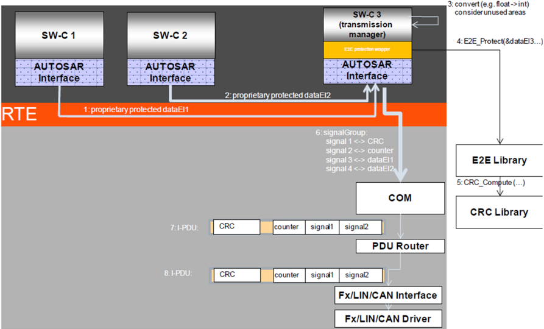

> CP_SWS_E2ELibrary[7], V3.2.1, R4.1 Rev 3, Chapter 13.1.2

##### 2.4.2.6 COM 端到端 Callout

在这种方法中，端到端库用于保护 COM 模块之间的数据交换。COM 通过 COM 端到端 Callout 调用端到端库，以保护与检查 I-PDU。Callout 以适合给定 I-PDU 的参数调用端到端库。请见图 2.19。

对于每个要保护与检查的 I-PDU，都有一个单独的 Callout 函数。每个 Callout 函数「知道」每个 I-PDU需要如何被保护与检查。这意味着 Callout 以适合给定 I-PDU 的设置与状态参数调用端到端库函数。

该方案适用于 RTE 为 ECU 间通信提供的所有通信模型与多重性。与传输管理器相反，该方案只能用于 COM 与 RTE 的运行完整性得到保证的系统。

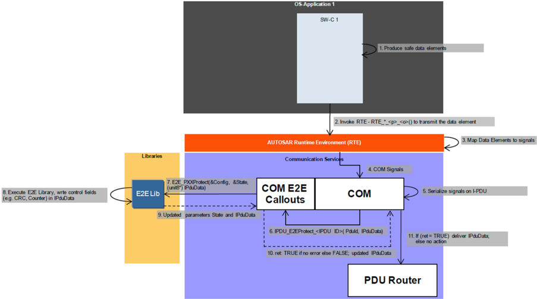

> CP_SWS_E2ELibrary[7], V3.2.1, R4.1 Rev 3, Chapter 13.2.1

##### 2.4.2.7 RTE 数据转换器（RTE Data Transformer）

在 AUTOSAR R4.2.1 中引入的 RTE 数据转换器可用于保护 ECU 之间复杂数据元素的交换。

前面所述的端到端库调用机制之间的主要区别可以阐明如下：

端到端保护包装器通过添加端到端头的数据元素来扩展受保护的复杂数据元素25。附加的数据元素可以被 SW-C 看到，但被忽略。因此，RTE 保护包装器不支持对单个信号的保护，除非它们被嵌入到复杂数据元素中。

> 25 复杂数据元素是复杂数据类型的一个实例。在复杂数据类型内部，有一个或多个数据类型（原始数据类型），就像 C 结构体那样。

COM 将复杂数据元素的各个信号映射到 PDU 中。使用 COM Callout，整个 PDU 的内容被保护。然而，PDU 的最大大小受到互连总线物理特性的限制。

复杂数据元素可以通过一个称为序列化（serialization）的过程被专门排列到一个字节数组中来准备传输。序列化后的数据数组随后可以作为一个整体用端到端库保护。此外，序列化数据数组的大小可以在每个传输周期的基础上是动态的。

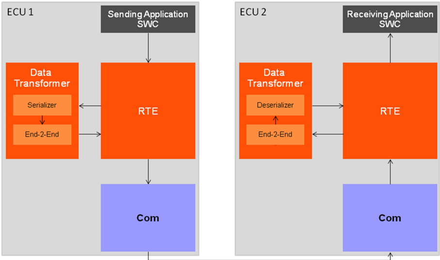

> 基于 Concept "Sender/Receiver Serialization", V0.51, R4.2 Rev 1, Page 31, Figure 8 "Use Case 1: Transmission of large composite data types over networks with large PDUs (e.g Ethernet)"

如图 2.20 所示，RTE 数据转换器从 RTE 接受复杂数据（发送/接收数据元素或带有其参数的客户端/服务器操作），执行可配置的数据转换链（如序列化、端到端保护、加密函数、压缩），并提供所得的字节数组，该数组最终由 COM（或在 ECU 内通信期间由 RTE）传输给接收者。端到端保护的数据转换由端到端转换器26实现，它在内部使用端到端库。

> 26 CP_SWS_E2ETransformer[8], V0.9.1, R4.2 Rev 1

RTE 数据转换器的完整配置经由 AUTOSAR 系统模板（用于 ECU 间通信）与软件组件模板（用于 ECU 内通信）执行。得到的代码完全由 RTE 生成与执行。软件组件无需感知所使用的特定保护机制，除非需要所检测故障的详细知识。RTE 数据转换器只能用于 RTE 运行完整性得到保证的系统。

注意：序列化数据数组的大小不受互连网络 PDU 大小的限制，因为大数据数组可以使用现有的传输协议传输。

注意：各个数据转换是在数据数组上而不是复杂数据元素上执行的，因此序列化是由 RTE 数据转换器执行的第一个（相应地也是最后一个）数据转换。

#### 2.4.3 检测与反应

端到端通信保护相关特性在 AUTOSAR 4.0 中作为一个标准库实现。该库提供端到端通信保护机制，使发送者能够在传输前保护数据，使接收者能够在运行时检测并处理通信链路中的错误。

当使用端到端库时，通信故障的检测会向接收者发出信号。

注意：AUTOSAR 文档「应用层错误处理说明」27提供了关于错误处理的附加信息。该文档解释了如何执行错误处理以及从何处获取所需的数据（例如替代值）。此外，该文档还详细解释（用户手册）了 AUTOSAR 中 OS-Application/分区终止与重启的执行方式。

> 27 CP_EXP_ApplicationLevelErrorHandling[5], R4.2 Rev 1, Chapter 8, Chapter 10

#### 2.4.4 限制

1. 单独恰当使用端到端库不足以实现安全的端到端通信。只有用户有责任证明所选择的配置文件为所考虑的网络提供了足够的错误检测能力（例如通过评估硬件失效率、误码率、网络中的节点数量、消息重复率以及网关的使用）。
2. 软件组件之间经由 RTE 的通信不仅仅是一个简单的点对点连接。还必须考虑进一步的故障模型，例如数据转换中的 RTE 错误、过滤、通知缺失、客户端-服务器通信中参数顺序错误以及传输延迟。在开发安全相关系统时也必须考虑这些失效模式。

本地 RTE 通信可以通过其他机制（例如采用内部分区的 RTE 及其他安全机制与措施）针对上述部分故障提供保护。

3. 由于运行时开销，对 ECU 的所有软件组件通信使用端到端保护可能是不可行的。此外，与 DataID 唯一性相关的限制可能由于伪装而阻止在 Profile 1 与 2 上采用该方法。
4. 端到端保护不保证数据的时效性，因为端到端配置文件没有在控制数据中加入时间戳。

#### 2.4.5 对 AUTOSAR 文档的引用

来源：Requirements on AUTOSAR Features, V1.2.1, R4.1 Rev 2

- AUTOSAR 应提供保护安全相关数据通信免受损坏的方法
- AUTOSAR 应作为库提供端到端保护支持
- AUTOSAR 应使用硬件通信数据完整性机制

#### 2.4.6 对 ISO 26262 的引用

以下对 ISO 26262 标准的引用与不同 ASIL 等级的软件组件之间免受干扰的方面相关。涵盖与信息交换相关的概念。

表2.11：ISO 26262 信息交换引用（**ISO26262 Exchange of Information References**）

| ID | ISO 26262 引用 |
| --- | --- |
| 03 | Part 6: [D.2.1] |
| 09 | Part 6: [D.2.4] |
| 10 | Part 6: [7.4.12] NOTE 2, Detection of data errors |

## 3. 功能安全措施

除了 AUTOSAR 提供的功能安全机制之外，安全相关软件的开发还得到源自 AUTOSAR 的功能安全措施的支持。

### 3.1. AUTOSAR 的功能安全措施

下表列出了映射到 AUTOSAR 基础软件定义的 ISO 26262 需求示例。

表3.1：ISO 26262 需求到 AUTOSAR 基础软件的映射（**Mapping of ISO26262 Requirements to AUTOSAR Basic Software**）

| ID | 功能安全措施 | ISO 引用 | AUTOSAR 需求/特性 |
| --- | --- | --- | --- |
| 001 | 强类型化的强制 | ISO26262-6 Table 1, 1c | FO_MMOD_MetaModel_059 |
| 002 | 使用值得信赖的设计原则 | ISO26262-6 Table 1, 1e | CP_EXP_LayeredSoftwareArchitecture_053 |
| 003 | 使用无歧义的图形表示 | ISO26262-6 Table 1, 1f | FO_MMOD_MetaModel_059 的标准表示 |
| 004 | 使用命名约定 | ISO26262-6 Table 1,1h | AUTOSAR 应用接口定义：AUTOSAR_MOD_AITable.xls CP_EXP_AIUserGuide_442 |
| 005 | 半形式化记法 | ISO 26262-6 Table 2, 1c Semi-formal notations | FO_MMOD_MetaModel_059 |
| 006 | 受限的接口规模 | ISO26262-6 Table 3, 1c | 按域提出了应用接口：CP_EXP_AIBodyAndComfort_268、CP_EXP_AIChassis_270、CP_EXP_AIOccupantAndPedestrianSafety_271、CP_EXP_AIHMIMultimediaAndTelematics_272、CP_EXP_AIPowertrain_269 |
| 007 | 软件组件之间的松耦合 | ISO26262-6 Table 3, 1e | CP_EXP_LayeredSoftwareArchitecture_053。请参见：Interfaces: General Rules、Layer Interaction Matrix。 |
| 008 | 中断的受限使用 | ISO26262-6 Table 3, 1g | CP_EXP_InterruptHandlingExplanation_307 |
| 009 | 数据错误的检测 | ISO 26262-6 [7.4.12] NOTE 2, Detection of data errors | CP_SWS_E2ELibrary_428、CP_SWS_CRCLibrary_016 |
| 010 | 控制流监控 | ISO 26262-6 [7.4.12] NOTE 2, Temporal monitoring of program execution | CP_SWS_WatchdogManager_080 |
| 011 | 优雅降级 | ISO 26262-6 [7.4.12] NOTE 3 | CP_EXP_LayeredSoftwareArchitecture_053。请参见：Integration and Runtime Aspects - Partitioning、重启分区的示例。CP_SWS_FunctionInhibitionManager_082 |
| 012 | 接口测试 | ISO 26262-6 Table 7, 1k；Table 10, 1b | AUTOSAR 协议栈的验收测试 |
| 013 | 文档管理 | ISO26262-8 10.4.3-10.4.6 | 由 AUTOSAR 质量管理满足 |

### 3.2. 可追溯性（Traceability）

可追溯性是实现安全相关系统的前提。AUTOSAR 提供从 AUTOSAR 项目目标到 AUTOSAR 架构软件规范的可追溯性。

### 3.3. 开发措施与标准的演进

AUTOSAR 标准遵循一个确定的生命周期，它由专门的变更管理强制执行。因此，产品开发期间使用的 AUTOSAR 版本可以被轻松引用。

当使用确定版本的 AUTOSAR 时，可以减少产品开发期间的系统性故障，因为规范、接口与行为可以被清晰地确立。

在 AUTOSAR 规范的开发期间，使用成熟的工具（「Bugzilla」）对发现的问题与缺陷修复进行跟踪。因此，AUTOSAR 版本的用户可以远在量产之前跟踪发现的问题与缺陷修复的纳入。

在基于模型的开发中，使用具有良好定义的输入与输出的层次化结构的功能块模型来控制复杂性、对功能建模并支持代码生成。细节请参见 ISO 26262 第 6 部分附录 B。基于模型的开发得到支持，因为使用了标准化的接口与交换格式，以及 AUTOSAR 方法论支持扩展的灵活性。

AUTOSAR 规范的开发过程涉及由多方与工作包执行的全面评审过程。开发里程碑与关联的评审过程条件由 AUTOSAR 质量管理定义。

AUTOSAR 通过提供功能安全机制来支持免受干扰的论证。有关 AUTOSAR 功能安全机制的细节，请参见第 [2](#2-功能安全机制) 章。

AUTOSAR 基于在相应领域的高度专业性，提供了工作包人员分配的清晰定义。

AUTOSAR 基于模块化、形式化与基于模型的开发，提供了通用软件架构的定义。

### 3.4. 非 AUTOSAR 交付的功能安全措施

并非开发安全相关应用所需的全部功能安全措施都由 AUTOSAR 交付。因此，安全相关应用的实现者必须确保安全开发生命周期是恰当的。

作为示例，以下功能安全措施既不由 AUTOSAR 强制执行，也不由其交付。此列表并不意味着完备。

- AUTOSAR 规范没有定义 ISO 26262 第 10 部分第 9 章所述的脱离语境的安全要素（Safety Elements out of Context，SEooC）。
- AUTOSAR 规范没有定义用于系统检查、风险分析与管理的系统性与结构化技术的使用，例如危害分析（HARA）与危害与可操作性分析（HAZOP）。
- 无整体安全概念。
- 无 ASIL 识别。
- 不执行相关性失效分析。
- 无 AUTOSAR 安全档案（safety case）。
- 无确认措施。
- 无功能安全审核。
- 无一致性测试。
- 软件组件的实现技术，例如低复杂性、鲁棒性、防御性编程、约定、编码规则。
- AUTOSAR 特性到软件组件实现的追溯。
- 软件集成测试。
- 针对 AUTOSAR 规范的确认与验证。
- 与实现有关的缺陷报告、跟踪、解决。

### 3.5. 方法论与模板的安全相关扩展

文档「Safety Extensions」提供了对 AUTOSAR 方法论与模板中扩展的需求，以实现并记录 AUTOSAR 系统的功能安全。它规定了如何使用 AUTOSAR 元模型，用功能安全信息增强 AUTOSAR 模型。借助安全扩展，可以：

- 以标准化的形式，借助 AUTOSAR 模板，描述并交换系统的（技术）安全概念中与使用 AUTOSAR 架构实现该系统相关的部分。
- 作为 AUTOSAR 模板的一部分，提供 AUTOSAR 模型的安全相关元素与安全需求之间的可追溯性。
- 作为 AUTOSAR 模板的一部分，声明为 AUTOSAR 系统所应用的安全机制/安全措施。
- 作为 AUTOSAR 模板的一部分，展示安全机制/安全措施与安全需求之间的可追溯性。

「AUTOSAR 功能安全措施概览」中描述的所有安全措施与机制都可以使用如上所述的安全扩展来建模与追溯。

### 3.6. 安全用例（Safety Use Case）

「Safety Use Case」作为辅助文档交付。它基于 AUTOSAR 导览示例「前灯管理（Front Light Management）」描述了一个使用 AUTOSAR 的示例性安全相关系统。

该文档提供了功能安全概念以及由此导出的 ECU 级技术安全概念的概览，聚焦于 AUTOSAR 相关的部分。该示例遵循 ISO 26262 标准，但不覆盖所有方面，也不包含所有细节。

安全用例应：

- 提供一个用于在 AUTOSAR 内讨论与验证安全相关概念的示例，
- 识别当前 AUTOSAR 规范与方法论中在功能安全方面的改进潜力，
- 在 AUTOSAR 方法论之上为安全分析提供指南。

28因此，该示例可以在未来被适配或更改，以包含新的 AUTOSAR 概念或扩展被分析系统的复杂性。

> 28 在本文档的语境中，功能安全机制是具体的产品部件，例如内存保护。它们被视为功能安全措施的特化，后者还包括过程步骤（如评审）。该定义与 ISO 26262 对这些术语给出的定义一致。

### 3.7. 将 AUTOSAR 特性用于功能安全

AUTOSAR 为功能安全提供了广泛多样的特性、机制与措施。以下章节给出关于使用 AUTOSAR 特性的提示，这些特性最初并非专门用于功能安全，但可以支持安全相关应用的实现。

#### 3.7.1 时序相关特性

时序是嵌入式系统的一项重要属性。安全的行为要求系统的动作与反应在正确的时间执行。

「正确的时间」可以用必须满足的一组时序约束来描述。然而，AUTOSAR 软件组件本身无法确保正确的时序。它依赖于 AUTOSAR 运行时环境与基础软件的恰当支持。在集成期间需要确保软件组件的时序约束。

时序相关特性致力于以下方面，以在 AUTOSAR 框架内实现正确的软件组件时序：

- 提供同步时基，以在 ECU 网络内提供共同的时间概念；
- 提供在 AUTOSAR ECU 内以及跨 AUTOSAR ECU 网络同步执行 runnable 的手段；
- 由 AUTOSAR RTE、BSW 与方法论支持软件组件的确定性时序；
- 由 AUTOSAR RTE 与 BSW 支持检测与控制时序违规并防止其传播。

##### 3.7.1.1 与同步时基提供相关的特性

同步时基是存在于处理实体（例如分布式系统的一个节点）上的软件时基，它与不同处理实体上的软件时基同步。同步时基可以通过时间协议或时间一致协议获得，后者以确定的方式从一个或多个物理时基导出同步时基。例如网络时间协议（NTP）与 FlexRay 时间一致协议。

同步时基允许处理实体的同步动作。同步时基通常被称为「全局时间」，例如所谓的「FlexRay 全局时间」。这里我们不使用「全局时间」这个术语，因为单个 ECU 有时必须应对多个在速率与绝对值上可能不同的同步时基。

同步时基由同步时基管理器（Synchronized Time-base Manager）BSW 模块建立。

在 AUTOSAR ECU 架构中，「Synchronized Time-base Manager」BSW 模块实现一个 AUTOSAR 服务，如图 3.1 所示。

应用可以经由具有标准化 AUTOSAR 接口的服务端口访问 AUTOSAR 服务「Synchronized Time-Base Manager」。

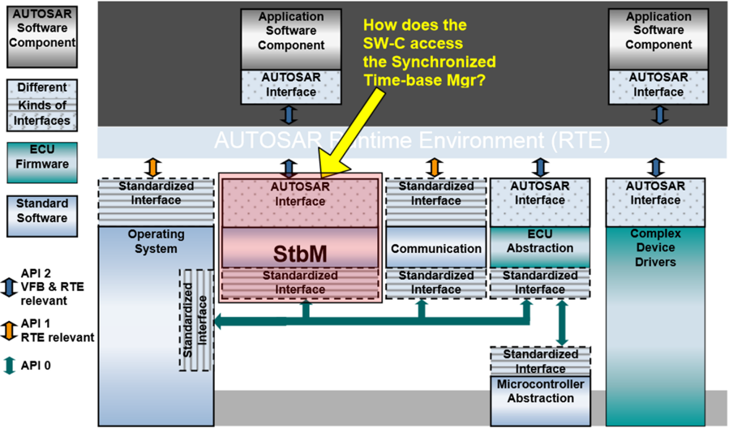

> CP_SWS_SynchronizedTimeBaseManager[9], V1.2.1, R4.2 Rev 2, Chapter 7.6.1 Architecture

不同类型的客户将使用同步时基：触发型客户（triggered customer）、主动型客户（active customer）与通知型客户（notification customer）。触发型客户（runnable）经由 OS 完成。

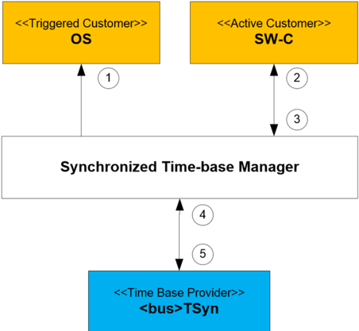

> CP_SWS_SynchronizedTimeBaseManager[9], V1.2.1, R4.2 Rev 2, Chapter 1.2 Functional Overview

同步时基管理器本身不提供诸如网络时间协议或时间一致协议之类的手段来将其（本地）时基与其他节点上的时基同步。它通过 BSW 的 &lt;bus&gt;TSyn 模块实现这种同步。

###### 3.7.1.1.1 集群内同步时基的提供

**该特性的覆盖准则**

约束：在 AUTOSAR R4.2.2 中，同步时基的提供仅限于 FlexRay、CAN、以太网与 TTCAN 集群。

如果满足以下条件，则认为特性「集群内同步时基的提供」已满足：

表3.2：覆盖准则——集群内同步时基的提供（**Coverage Criteria - Provision of a synchronized time-base within a cluster**）

| ID | 描述 |
| --- | --- |
| RS_BRF_00120_CC01 | 存在为 FlexRay、CAN、以太网与 TTCAN 集群提供同步时基的手段。 |
| RS_BRF_00120_CC02 | 时基以可靠的方式提供，故障被检测与处理。 |

**覆盖理由**

这两项的覆盖方式如下：

表3.3：覆盖理由——集群内同步时基的提供（**Coverage Justification - Provision of a synchronized time-base within a cluster**）

| 覆盖准则 | BSW 模块 | 需求 | 理由 |
| --- | --- | --- | --- |
| RS_BRF_00120_CC01 | CP_SWS_Synchronized-TimeBaseManager_421 | SRS_StbM_20005, SWS_StbM_00050, SWS_StbM_00080, SWS_StbM_00081, SWS_StbM_00015 | 为 FlexRay 与 TTCAN 集群提供同步时基的手段：在 AUTOSAR 基础软件中引入了「synchronized time-base manager」模块。该模块从 FlexRay 或 TTCAN 接口获取时基。 |
| RS_BRF_00120_CC02 | AUTOSAR_SRS_SynchronizedTimeBaseManager、CP_SWS_Synchronized-TimeBaseManager_421 | (SRS_StbM_20007, SWS_StbM_00030, SWS_StbM_00031, SWS_StbM_00032, SWS_StbM_00033, SWS_StbM_00034, SWS_StbM_00035, SWS_StbM_00036) | 提供可靠的时基以及故障检测与处理：同步时基管理器持续提供时间的定义。如果同步未规定或暂时不可用，则改为提供本地时间。同步时基管理器检测同步时基的丢失与重新建立以及错误的客户调用，并向 DEM 与通知型客户报告此类故障。 |

###### 3.7.1.1.2 访问同步时基的服务

**该特性的覆盖准则**

表3.4：覆盖准则——访问同步时基的服务（**Coverage Criteria - Services for accessing to synchronized time-bases**）

| ID | 描述 |
| --- | --- |
| RS_BRF_00127_CC01 | 存在客户可以使用同步时基的手段。需要考虑以下类型的客户：触发型客户、主动型客户与通知型客户。 |

**覆盖理由**

这一项的覆盖方式如下：

表3.5：覆盖理由——访问同步时基的服务（**Coverage Justification - Services for accessing to synchronized time-bases**）

| 覆盖准则 | BSW 模块 | 需求 | 理由 |
| --- | --- | --- | --- |
| RS_BRF_00127_CC01 | SynchronizedTimeBaseManager、CP_SRS_OS_008、CP_SWS_Synchronized-TimeBaseManager_421 | SRS_StbM_20001, SRS_StbM_20002, SRS_StbM_20009, SRS_Os_11002, SWS_StbM_00020, SWS_StbM_00022, SWS_StbM_00025, SWS_StbM_00026, SWS_StbM_00028, SWS_StbM_00029, SWS_StbM_00037, SWS_StbM_00038, SWS_StbM_00077, SWS_StbM_00082, SWS_StbM_00083, SWS_StbM_00084, SWS_StbM_00085, SWS_Os_00206, SWS_Os_00201, SWS_Os_00013, SWS_Os_00199, SWS_Os_00227, SWS_Os_00429, SWS_Os_00430, SWS_Os_00431, SWS_Os_00462, SWS_Os_00463, SWS_Os_00435, SWS_Os_00415, SWS_Os_00416, SWS_Os_00436, SWS_Os_00437, SWS_Os_00438, SWS_Os_00417, SWS_Os_00418, SWS_Os_00419, SWS_Os_00420, SWS_Os_00421, SWS_Os_00422；SRS_StbM_20001, SRS_StbM_20003, SRS_StbM_20008, SRS_StbM_20010, SWS_StbM_00020, SWS_StbM_00025, SWS_StbM_00026, SWS_StbM_00028, SWS_StbM_00029, SWS_StbM_00037, SWS_StbM_00038, SWS_StbM_00082, SWS StbM 第 11 章 | 客户可以使用同步时基的手段：对于触发型客户，BSW 模块「Synchronized Time-base Manager」提供同步时基与 OS 用于调度所使用的时基（即 OS 计数器）之间的同步；对于主动型客户与通知型客户，它意味着经由 RTE 为 SW-C 提供服务接口，或为 BSW 提供 API。 |

###### 3.7.1.1.3 以定义良好的方式将 AUTOSAR OS 与来自提供总线系统的全局时间同步

**该特性的覆盖准则**

如果满足以下条件，则认为特性「以定义良好的方式将 AUTOSAR OS 与来自既有总线系统的全局时间同步」已被覆盖：

表3.6：覆盖准则——以定义良好的方式将 AUTOSAR OS 与来自提供总线系统的全局时间同步（**Coverage Criteria - Sync AUTOSAR OS with Global Time from providing bus system in a well-defined way**）

| ID | 描述 |
| --- | --- |
| RS_BRF_00278_CC01 | 存在为 FlexRay、CAN、以太网与 TTCAN 集群提供同步时基的手段 |
| RS_BRF_00278_CC02 | 提供同步时基与 OS 用于调度的时基之间的同步。 |

**覆盖理由**

这两项的覆盖方式如下：

表3.7：覆盖理由——以定义良好的方式将 AUTOSAR OS 与来自提供总线系统的全局时间同步（**Coverage Justification - Sync AUTOSAR OS with Global Time from providing bus system in a well-defined way**）

| 覆盖准则 | BSW 模块 | 需求 | 理由 |
| --- | --- | --- | --- |
| RS_BRF_00278_CC01 | | | 由 RS_BRF_00120_CC01 覆盖（进一步的可追溯性见彼处） |
| RS_BRF_00278_CC02 | | | 由 RS_BRF_00127_CC01 (a) 覆盖（进一步的可追溯性见彼处） |

##### 3.7.1.2 与异步处理单元处理同步相关的特性

为了同步一组 SW-C 内的 runnable，它们必须被附着到同步的 RTE 时序上。为此，必须能够规定一个 SW-C 组合内的一组 RTE 时序事件（具有相同周期）是同步的。

同步在单个微控制器内以及跨网络都是可能的。

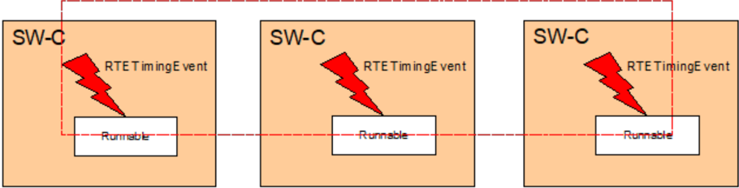

###### 3.7.1.2.1 SW-C 同步的服务

**该特性的覆盖准则**

约束：

- 该特性仅限于 RTE 时序事件。这些事件用于触发 runnable。
- 由不同 AUTOSAR OS 实例控制的 runnable（例如运行在不同 ECU 上或同一 ECU 内不同微控制器上）之间的同步，只有在它们位于同一 FlexRay、CAN、以太网或 TTCAN 网络集群内的 ECU 上时才可能。

如果满足 RS_BRF_00126_CC02，则认为特性「SW-C 同步的服务」已被覆盖：

表3.8：覆盖准则——SW-C 同步的服务（**Coverage Criteria - Services for synchronization of SW-Cs**）

| ID | 描述 |
| --- | --- |
| RS_BRF_00126_CC01 | 存在以同步方式（即最小抖动，以及（在串行处理的情况下）固定的执行顺序）触发 runnable 的技术手段。这里必须区分以下情况：由同步时序事件触发的 runnable 被映射到同一操作系统任务；被映射到同一 OS 应用内的不同操作系统任务；被映射到同一微控制器核心上不同 OS 应用的不同操作系统任务；被映射到同一微控制器不同核心上不同 OS 应用的不同操作系统任务；被映射到同一 ECU 内不同微控制器上不同 OS 应用的不同操作系统任务；被映射到不同 ECU 内不同微控制器上不同 OS 应用的不同操作系统任务。 |
| RS_BRF_00126_CC02 | AUTOSAR 方法论支持为 RTE 时序事件规定同步约束。 |

**覆盖理由**

这两项的覆盖方式如下：

表3.9：覆盖理由——SW-C 同步的服务（**Coverage Justification - Services for synchronization of SW-Cs**）

| 覆盖准则 | BSW 模块 | 需求 | 理由 |
| --- | --- | --- | --- |
| RS_BRF_00126_CC01 | CP_SRS_RTE_083、CP_SWS_RTE_084 | SRS_Rte_00232, rte_sws_7804, rte_sws_7805；其余由 RS_BRF_00120 与 RS_BRF_00127 覆盖 | a–c：在这些情况下，RTE 配置与 RTE 生成将通过以下方式负责 runnable 的同步：将 runnable 定位到同一任务；使用同一 Os Alarm 或 OsScheduleTableExpiryPoint 来实现所有 TimingEvent；或在基于不同 OS 计数器但具有相同周期与最大值的不同 OsScheduleTable 中使用不同的 OsAlarm 或 OsScheduleTableExpiryPoint。d–f：在这些情况下，RTE 配置与 RTE 生成将通过在不同的显式同步的 OsScheduleTable 中使用 OsScheduleTableExpiryPoint 来负责 runnable 的同步。此外，同步时基管理器将负责调度表的显式同步以及公共同步时基的建立。 |
| RS_BRF_00126_CC02 | FO_RS_TimingExtensions_410 | RSTM002 第 3.7 章 | 同步约束的规格化由时序扩展支持。 |

##### 3.7.1.3 允许应用的时间确定性实现的特性

应用的时间确定性实现要求能够在开发的不同阶段规定时序约束并分析时序特性，即在 VFB 层级的虚拟集成期间、SW-C 的开发期间，以及最后将 SW-C 集成到 ECU、将 ECU 集成到 ECU 系统期间。

此外，运行时环境必须提供合适的机制来强制确定性时序。

下图阐明了 VFB 时序的规格化。

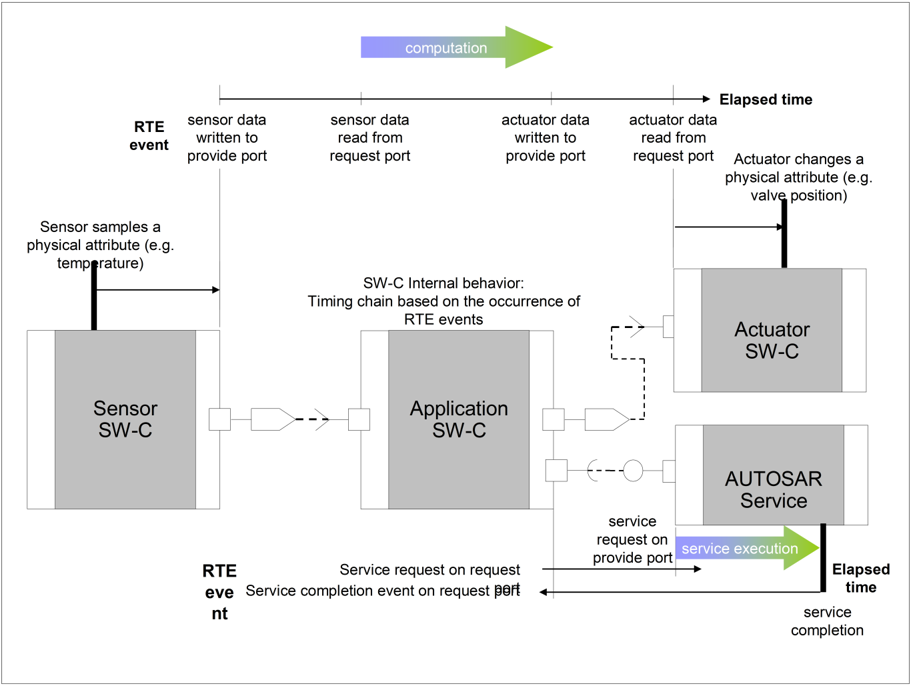

###### 3.7.1.3.1 时序约束的支持

**该特性的覆盖准则**

如果满足以下条件，则认为特性「时序约束的支持」已被覆盖：

表3.10：覆盖准则——时序约束的支持（**Coverage Criteria - Support for timing constraints**）

| ID | 描述 |
| --- | --- |
| RS_BRF_00122_CC01 | 可以规定以下时序约束：具有下限与上限的 RTE 事件之间的时序关系（min、max、nominal）；物理传感器采集（或物理执行器变更）与传感器 SW-C（或执行器 SW-C）端口上相应数据元素可用性之间的时间关系；runnable 执行时间（min、max）的约束；runnable 触发速率的约束；与外部通信相关的端到端时序；与 I/O 访问相关的端到端时序。 |
| RS_BRF_00122_CC02 | 调度策略允许通过提供以下机制来强制这些时序约束：规定代码段的非抢占执行；对所有任务或任务子集的基于时间的静态调度；用基于时间的轮询例程替换 ISR 的可能性；基于固定优先级的调度；较高优先级任务抢占较低优先级任务的可能性。 |

**这两项的覆盖方式如下：**

表3.11：覆盖理由——时序约束的支持（**Coverage Justification - Support for timing constraints**）

| 覆盖准则 | BSW 模块 | 需求 | 理由 |
| --- | --- | --- | --- |
| RS_BRF_00122_CC01 | FO_RS_TimingExtensions_410、CP_TPS_TimingExtensions_411 | RSTM002, RSTM003, RSTM004, CP_TPS_TimingExtensions_411 第 3.3、3.6 节；RSTM012, CP_TPS_TimingExtensions_411 第 3.6 节；RSTM001, RSTM002, CP_TPS_TimingExtensions_411 第 3.2、3.6 节；RSTM001, RSTM002, CP_TPS_TimingExtensions_411 第 3.2、3.5 节；RSTM001, RSTM002, CP_TPS_TimingExtensions_411 第 3.2、3.6 节；RSTM001, RSTM004, CP_TPS_TimingExtensions_411 第 3.2、3.6 节 | 时序约束与特性的规格化可以使用 AUTOSAR 时序扩展进行：AUTOSAR 时序扩展允许规定事件链以及事件链的触发行为。允许规定传感器/执行器延迟。允许规定 SW-C 内部行为的时序事件（如 runnable 的启动与终止）以及与之相关的时序约束。允许规定事件触发约束。允许规定与总线通信相关的时序事件及其时序约束。允许规定输入/输出延迟约束。 |
| RS_BRF_00122_CC02 | CP_SRS_OS_008、CP_SWS_OS_034 | SRS_Os_00097, SWS_Os_00001, SRS_Os_00098, SWS_Os_00002, SWS_Os_00007；SRS_Os_00097, SWS_Os_00001 | OS 与 RTE 提供强制时序所需的调度机制：非抢占调度由 OSEK OS 支持。操作系统提供基于时间表的静态可配置调度表。c–e：这些特性在 OSEK OS 中可用。 |

###### 3.7.1.3.2 对外部事件的响应性

**该特性的覆盖准则**

如果满足以下条件，则认为特性「对外部事件的响应性」已被覆盖：

表3.12：覆盖准则——对外部事件的响应性（**Coverage Criteria - Responsiveness to external events**）

| ID | 描述 |
| --- | --- |
| RS_BRF_00123_CC01 | 外部事件可以用作调度的发起者。 |

**这一项的覆盖方式如下：**

表3.13：覆盖理由——对外部事件的响应性（**Coverage Justification - Responsiveness to external events**）

| 覆盖准则 | BSW 模块 | 需求 | 理由 |
| --- | --- | --- | --- |
| RS_BRF_00123_CC01 | CP_SRS_RTE_083、CP_SWS_RTE_084 | SRS_Rte_00162, SRS_Rte_00216, rte_sws_7229, rte_sws_7212, rte_sws_7213, rte_sws_7214, rte_sws_7543, rte_sws_7215, rte_sws_7216, rte_sws_7218, rte_sws_7200, rte_sws_7201, rte_sws_7207, rte_sws_7514, rte_sws_7542, rte_sws_7544, rte_sws_7545, rte_sws_7548, rte_sws_7546, rte_sws_7549, rte_sws_7282, rte_sws_7283 | RTE 支持使用外部事件作为触发 runnable 与 BSW 可调度实体执行的手段。 |

##### 3.7.1.4 与时序违规防护相关的特性

取决于可扩展性类别，AUTOSAR OS 可以提供针对时序违规的保护机制。由于 OS 只感知任务而不感知 runnable，OS 在任务层级提供保护机制，故障遏制区域为 OS 应用。

SW-C 在运行时的时序保护需要监控 runnable 并防止时序故障从一个 SW-C 传播到另一个。如果 SW-C 需要彼此保护，则它们的 runnable 必须被放入不同的 OS 应用，这意味着它们被放入不同的任务体。

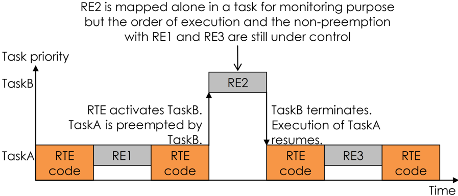

注意：请参见小节 2.2.2.3「操作系统的时序保护」。

###### 3.7.1.4.1 运行时时序保护与监控

**该特性的覆盖准则**

如果满足以下条件，则认为特性「运行时时序保护与监控」已被覆盖：

表3.14：覆盖准则——运行时时序保护与监控（**Coverage Criteria - Runtime timing protection and monitoring**）

| ID | 描述 |
| --- | --- |
| RS_BRF_00121_CC01 | 操作系统提供在任务层级检测时序故障并防止时序故障从一个 OS 应用传播到另一个的机制 |
| RS_BRF_00121_CC02 | RTE 提供手段，使 runnable 能够利用任务层级的 OS 时序保护机制。 |

**这两项的覆盖方式如下：**

表3.15：覆盖理由——运行时时序保护与监控（**Coverage Justification - Runtime timing protection and monitoring**）

| 覆盖准则 | BSW 模块 | 需求 | 理由 |
| --- | --- | --- | --- |
| RS_BRF_00121_CC01 | CP_SRS_OS_008、CP_SWS_OS_034 | SRS_Os_11008, SWS_Os_00028, SWS_Os_00089, SWS_Os_00033, SWS_Os_00037, SWS_Os_00048, SWS_Os_00064, SWS_Os_00465, SWS_Os_00469, SWS_Os_00470, SWS_Os_00471, SWS_Os_00472, SWS_Os_00473, SWS_Os_00474 | OS 提供监控执行时间预算、任务激活频率与资源锁定时间的手段，并允许通过停止 OS 应用并释放被锁定的资源来防止故障传播 |
| RS_BRF_00121_CC02 | CP_SRS_RTE_083、CP_SWS_RTE_084 | SRS_Rte_00160, SRS_Rte_00193, rte_sws_2697, sws_rte_7800, sws_rte_7802（在 084 中） | RTE 提供去抖的 runnable 实体启动并支持 runnable 执行链接，以便允许将 runnable（通常在同一个任务体内链接）分离为链式任务，这些任务随后可以被任务层级的 OS 机制监控 |

###### 3.7.1.4.2 本地时间的监控

该特性被认为已满足，因为该功能可以在软件组件内实现。AUTOSAR 中不需要特定的机制。

#### 3.7.2 E-Gas 监控相关特性

E-Gas 监控概念是一种适用于例如柴油与汽油发动机管理的安全概念。它由 AKEGAS 工作组标准化，不属于 AUTOSAR 标准。

已经研究了在 AUTOSAR 软件架构语境下 e-Gas 监控概念的可能实现方式。本节的特性确保如下图所示的设计方法可以与 AUTOSAR R4.0 一起使用。

在下面所示的设计方法中，监控相关的软件位于复杂驱动（CDD）中。CDD 允许直接访问相关的输入与输出。

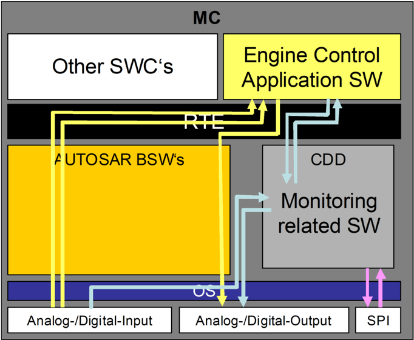

###### 3.7.2.1 针对数据损坏与丢失的通信防护

**该特性的覆盖准则**

约束：假定使用端到端保护来保护从发送者到接收者（例如监控软件）的必要信号的传输。

如果复杂驱动读取的数据的完整路径都受到丢失与损坏的防护，则认为特性「针对数据损坏与丢失的通信防护」已满足，这意味着：

表3.16：覆盖准则——针对数据损坏与丢失的通信防护（**Coverage Criteria - Communication protections against corruption and loss of data**）

| ID | 描述 |
| --- | --- |
| RS_BRF_00243_CC01 | 如果数据的丢失与损坏发生在从发射节点到接收节点 BSW 驱动的路径上，则被检测到 |
| RS_BRF_00243_CC02 | 如果数据的丢失与损坏发生在从总线特定接口到复杂驱动的路径上，则被检测到 |

**这两项的覆盖方式如下：**

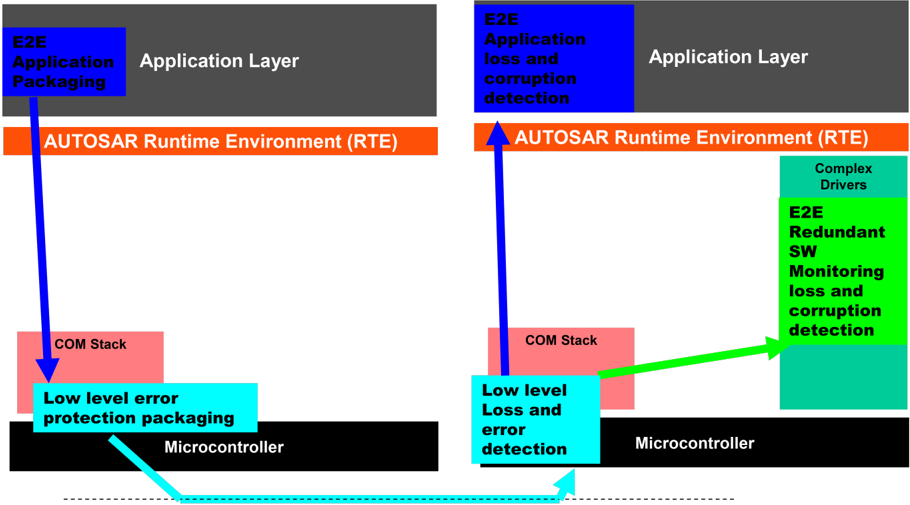

表3.17：覆盖理由——针对数据损坏与丢失的通信防护（**Coverage Justification - Communication protections against corruption and loss of data**）

| 覆盖准则 | BSW 模块 | 需求 | 理由 |
| --- | --- | --- | --- |
| RS_BRF_00243_CC01 | CP_SRS_Libraries_314、CP_SWS_E2ELibrary_428 | SRS_LIBS_08527, SRS_LIBS_08536, SWS_E2E_00020, E2E0023, E2E0026, E2E0030, E2E0043 | 发射节点与接收节点 BSW 之间数据丢失与损坏的检测由 CAN 或 FlexRay 通信网络可用的保护机制（CRC、校验和、过程计数器）保证 |
| RS_BRF_00243_CC02 | CP_SRS_Libraries_314、CP_SWS_E2ELibrary_428 | SRS_LIBS_08535, E2E0026, E2E0030 | 总线特定接口与复杂驱动之间数据丢失与损坏的检测由复杂驱动对专用于安全的帧载荷的访问以及依赖于应用的端到端保护保证。 |

###### 3.7.2.2 SPI 总线的优先访问

**该特性的覆盖准则**

如果满足以下条件，则认为特性「SPI 总线的优先访问」已满足：

表3.18：覆盖准则——SPI 总线的优先访问（**Coverage Criteria - Priority access to SPI bus**）

| ID | 描述 |
| --- | --- |
| RS_BRF_00251_CC01 | 位于复杂驱动 SW 中的监控软件能够以有界延迟访问 SPI 总线，这意味着优先访问被调度为使 CDD 访问 SPI 的延迟是有界的。 |

**这一项的覆盖方式如下：**

表3.19：覆盖理由——SPI 总线的优先访问（**Coverage Justification - Priority access to SPI bus**）

| 覆盖准则 | BSW 模块 | 需求 | 理由 |
| --- | --- | --- | --- |
| RS_BRF_00251_CC01 | CP_SRS_SPIHandlerDriver_077、CP_SWS_SPIHandlerDriver_038 | SRS_Spi_12037, SWS_Spi_00002, SWS_Spi_00014, SWS_Spi_00093, SWS_Spi_00059 | 优先访问在 SPI 处理驱动中定义并由其提供 |

###### 3.7.2.3 I/O 数据与 I/O 硬件的测试与监控

**该特性的覆盖准则**

如果满足以下条件，则认为特性「I/O 数据与 I/O 硬件的测试与监控」已满足：

表3.20：覆盖准则——I/O 数据与 I/O 硬件的测试与监控（**Coverage Criteria - Testing and monitoring of I/O data and I/O HW**）

| ID | 描述 |
| --- | --- |
| RS_BRF_00248_CC01 | 位于复杂驱动 SW 中的监控软件能够对相关 A/D 转换器执行测试，而不干扰与正常运行相关的数据采集。 |
| RS_BRF_00248_CC02 | 位于复杂驱动中的监控软件能够直接对关闭路径（shut-off path）的安全相关执行器（节气门、喷油器）执行测试。 |

**这两项的覆盖方式如下：**

表3.21：覆盖理由——I/O 数据与 I/O 硬件的测试与监控（**Coverage Justification - Testing and monitoring of I/O data and I/O HW**）

| 覆盖准则 | BSW 模块 | 需求 | 理由 |
| --- | --- | --- | --- |
| RS_BRF_00248_CC01 | | | 对 ADC 测试的支持得以保证，因为它对 ADC 驱动没有任何影响。 |
| RS_BRF_00248_CC02 | | | 专用于喷油器与节气门执行器的驱动是复杂驱动，因此可以实现必要的测试过程。 |

###### 3.7.2.4 使 AUTOSAR 应用与 e-Gas 监控概念兼容的能力

**该特性的覆盖准则**

特性 [RS_BRF_00301] 使 AUTOSAR 应用与 e-Gas 监控概念兼容的能力在以下情况下被覆盖：

表3.22：覆盖准则——使 AUTOSAR 应用与 e-Gas 监控概念兼容的能力（**Coverage Criteria - Ability to make an AUTOSAR application compatible to the e-Gas monitoring Concept**）

| ID | 描述 |
| --- | --- |
| RS_BRF_00301_CC01 | [RS_BRF_00243]、[RS_BRF_00251]、[RS_BRF_00248]、[BRF00244]、[BRF00245]、[BRF00246]、[BRF00247]、[BRF00249]、[BRF00250] 的论据得到满足。 |
| RS_BRF_00301_CC02 | 位于复杂驱动中的 e-Gas 监控软件能够访问 ADC 输入的原始值。 |
| RS_BRF_00301_CC03 | 位于复杂驱动中的 e-Gas 监控软件能够访问 DIO 输入的原始值。 |
| RS_BRF_00301_CC04 | 位于复杂驱动中的 e-Gas 监控软件能够访问 PWM 输入的原始值。 |

**这四项的覆盖方式如下：**

表3.23：覆盖理由——使 AUTOSAR 应用与 e-Gas 监控概念兼容的能力（**Coverage Justification - Ability to make an AUTOSAR application compatible to the e-Gas monitoring Concept**）

| 覆盖准则 | BSW 模块 | 需求 | 理由 |
| --- | --- | --- | --- |
| RS_BRF_00301_CC01 | | | 特性 [RS_BRF_00243]、[RS_BRF_00251]、[RS_BRF_00248]、[BRF00244]、[BRF00245]、[BRF00246]、[BRF00247]、[BRF00249]、[BRF00250] 已被完全覆盖。 |
| RS_BRF_00301_CC02 | CP_SRS_ADCDriver_111、CP_SWS_ADCDriver_010 | SRS_SPAL_12063, SWS_Adc_00113 | ADC 驱动可以直接向复杂驱动提供原始数据 |
| RS_BRF_00301_CC03 | CP_SRS_DIODriver_191、CP_SWS_DIODriver_020 | SRS_Dio_12352, SWS_Dio_00083 | DIO 驱动可以直接向复杂驱动提供原始数据 |
| RS_BRF_00301_CC04 | CP_SRS_ICUDriver_112、CP_SWS_ICUDriver_023 | SRS_Icu_12436, SWS_Ico_00211, SWS_Ico_00342, SWS_Ico_00084, SWS_Ico_00344, SWS_Ico_00106, SWS_Ico_00345, SWS_Ico_00180, SWS_Ico_00181, SWS_Ico_00022, SWS_Ico_00048, ICU272, ICU265；SRS_Icu_12369, SWS_Ico_00021 | ICU 驱动可以直接向复杂驱动提供原始数据 |

## 4. 硬件诊断

面向安全相关应用的现代微控制器是高度复杂的设备。为了确保微控制器作为安全相关系统的一部分达到所期望的完整性水平，需要在硬件与软件中集成并使用功能安全机制与措施。

微控制器必须支持安全相关系统的前提，即所提供的功能可以被信任。硬件诊断机制的执行可以支持这一前提。本章概述如何使用 AUTOSAR 支持硬件诊断。

### 4.1. 核心测试（Core Test）

软件测试的总体目标是检测处理单元中导致错误结果的失效。核心测试在微控制器启动与运行时期间对处理单元执行软件测试。

#### 4.1.1 故障模型

根据 ISO 2626229，处理单元以下部分的失效检测通常被考虑用于诊断覆盖率的导出。下表提供了 ISO 26262 与核心测试需求3031之间的初步映射。

> 29 [ISO 26262-5, Annex D] Table D.1 Volatile Memory
> 30 [10] Requirements on Core Test
> 31 [11] Specification of Core Test

表4.1：处理单元部件与核心测试需求之间的映射（**Mapping between Processing Unit parts and Core Test requirements**）

| ID | 处理单元部件 | 核心测试 SRS 需求 |
| --- | --- | --- |
| 001 | ALU 数据通路 | Core ALU Test |
| 002 | 寄存器（通用寄存器组、DMA 传输寄存器等）、内部 RAM | Core Register Test |
| 003 | 地址计算（Load/Store 单元、DMA 寻址逻辑、内存与总线接口） | Core Address Generator、Core Memory Interfaces、Memory Management/Protection Unit (MMU/MPU)、Cache Controller |
| 004 | 中断处理 | Core Interrupt and Exception Detection |
| 005 | 控制逻辑（定序器、编码与执行逻辑，包括标志寄存器与栈控制） | - |
| 006 | 配置寄存器 | - |
| 007 | 不属于前述类别的其他子元素 | - |

#### 4.1.2 描述

核心测试驱动是一个 AUTOSAR 基础软件模块，它不经过中间软件层直接访问微控制器核心。它位于抽象层（MCAL）。

核心测试驱动提供多个测试以验证专用的核心功能，例如通用寄存器或算术逻辑单元（ALU）。此外，核心测试驱动提供用于配置、启动、轮询、终止核心测试以及将核心测试结果通知应用的服务。它还提供以预定义方式返回测试结果的服务。

核心测试驱动可以在 ECU 上电期间与应用运行时期间使用。但假定被测核心的每个硬件功能块都可以被核心测试驱动独占地访问。

#### 4.1.3 检测与反应

如果核心测试驱动的执行要嵌入到系统安全架构概念中，那么由核心测试驱动的用户选择合适的测试组合与计划的执行顺序，以满足系统的安全需求。

核心测试将专用内存与总线接口（例如紧耦合存储器、缓存、系统总线）以及专用支持功能（例如中断控制器）中的错误作为生产错误报告给诊断事件管理器（DEM）。

CPU 内部（例如 ALU、预取队列、寄存器）的错误无法可靠地报告给 DEM，因为这些故障影响核心本身的正确运行。

#### 4.1.4 限制

1. 核心测试不覆盖瞬态故障。

核心测试可用于在上电与运行时检测静态硬件错误。瞬态故障与间歇性故障不被覆盖，且无法被核心测试可靠检测。

2. 核心测试的实现可能仅限于启动/上电期间执行。

核心测试需要对本地核心资源的独占访问，以避免运行时测试与应用之间的不希望的行为与干扰。

当前，AUTOSAR 上层没有资源管理实体来支持对共享资源的独占访问。

3. 测试结果仅对执行核心测试的核心可用。

MCAL 驱动有意缺少访问在其他核心上执行的测试结果的能力。当前，AUTOSAR 上层没有测试管理实体来处理测试结果。

4. 核心测试无法可靠地报告检测到的故障。

CPU 自身内部（例如 ALU、MAC、寄存器）的故障无法可靠地报告给 DEM，因为它们由同一个故障 CPU 处理。

#### 4.1.5 对 AUTOSAR 文档的引用

来源：Requirements on Core Test, V1.4.0, R4.2 Rev 1

- 核心寄存器测试应可用
- 核心中断与异常检测测试应可用
- 核心 ALU 测试应可用
- 核心地址生成器测试应可用
- 核心内存接口测试应可用
- 内存管理/保护单元（MMU/MPU）测试应可用
- 缓存控制器测试应可用
- 被测共享资源应对测试独占可用
- 故障应作为生产错误处理

#### 4.1.6 对 ISO 26262 的引用

以下对 ISO 26262 标准的引用与处理单元的软件测试相关。

表4.2：ISO 26262 核心测试引用（**ISO26262 Core Test References**）

| ID | ISO 26262 引用 |
| --- | --- |
| 010 | Part 5: [D.2.3.1] Self Test by software |
| 011 | Part 11: [Table 34] Combinatorial and sequential logic |
| 012 | Part 5: [Table D.4] Processing Units |
| 013 | Part 5: [Table D.1] Analysed failure modes |

### 4.2. RAM 测试（RAM Test）

RAM 测试的总体目标是检测可能引起易失性内存损坏的永久性失效。

#### 4.2.1 故障模型

根据 ISO 2626232，易失性内存中以下失效的检测通常被考虑用于诊断覆盖率的导出。下表提供了 ISO 26262 与 RAM 测试需求3334之间的初步映射。

> 32 [ISO 26262-5, Annex D] Table D.1 Volatile Memory
> 33 [12] Requirements on RAM Test
> 34 [13] Specification of RAM Test

表4.3：易失性内存失效模式与 RAM 测试需求之间的映射（**Mapping between Volatile Memory Failure Modes and RAM Test requirements**）

| ID | 易失性内存的失效模式 | RAM 测试 SRS 需求 |
| --- | --- | --- |
| 001 | 低覆盖率（60%）：数据、地址与控制接口、线路与逻辑的 Stuck-at 故障 | 应提供一种低覆盖率的测试算法 |
| 002 | 中覆盖率（90%）：数据、地址（包括同一块内的地址线以及无法写入单元）与控制接口、线路与逻辑的直流故障模型 | 应提供一种中覆盖率的测试算法 |
| 003 | 中覆盖率（90%）：位单元的软错误模型 | - |
| 004 | 高覆盖率（99%）：数据、地址（包括同一块内的地址线以及无法写入单元）与控制接口、线路与逻辑的直流故障模型 | 应提供一种高覆盖率的测试算法 |
| 005 | 高覆盖率（99%）：位单元的软错误模型 | |

#### 4.2.2 描述

RAM 测试驱动是一个 AUTOSAR 基础软件模块，它不经过中间软件层直接访问微控制器 RAM。它位于抽象层（MCAL）。

RAM 测试驱动执行 RAM 单元物理健康状态的测试，它并不打算测试 RAM 的内容。此外，用于寄存器的 RAM 也会被测试。

存在多种测试 RAM 的算法。它们针对不同的故障模型集合、达到不同的覆盖率、产生不同的运行时间，并且是破坏性的或非破坏性的。覆盖率还取决于底层的物理 RAM 架构。

必须执行 ECU 安全分析，以确定需要哪种 RAM 测试诊断覆盖率（低、中或高）。然后在编译时选择合适的 RAM 测试算法与进一步的配置参数。在运行时，应用软件可以在已编译的算法之间（以及在进一步的参数之间）选择。

RAM 测试驱动支持称为「前台测试（foreground test）」的同步测试方法与称为「后台测试（background test）」的异步测试。在 RAM 测试算法的执行期间，不允许任何其他软件修改被测 RAM 区域。

#### 4.2.3 检测与反应

在非破坏性测试的执行期间，RAM 测试模块保存被测 RAM 区域的内容，并在其后恢复原始内容。

RAM 测试将错误作为生产错误报告给诊断事件管理器（DEM）。

#### 4.2.4 限制

1. RAM 测试不覆盖瞬态故障。

RAM 测试可用于在上电与运行时检测静态硬件错误。瞬态故障与间歇性故障不被覆盖，且无法被 RAM 测试可靠检测。

2. 在 RAM 测试算法的执行期间，不允许任何其他软件与硬件修改被测 RAM 区域。RAM 测试模块无法确保数据一致性（例如在 NMI、DMA 传输、多核系统中的多个活动核心期间）。因此 RAM 测试的执行可能仅限于微控制器的上电/休眠/关机阶段。

3. 破坏性测试会导致被测内存内容的损坏。

在破坏性测试的执行期间，RAM 测试模块不保存被测 RAM 区域的内容。

#### 4.2.5 对 AUTOSAR 文档的引用

来源：Requirements on RAM Test, V2.0.1, R4.2 Rev 1

- 应提供一种低覆盖率的测试算法
- 应提供一种中覆盖率的测试算法
- 应提供一种高覆盖率的测试算法
- RAM 测试模块应可用于满足 ISO 26262 不同 ASIL 等级的需求

#### 4.2.6 对 ISO 26262 的引用

以下对 ISO 26262 标准的引用与 RAM 测试相关。

表4.4：ISO 26262 RAM 测试引用（**ISO26262 RAM Test References**）

| ID | ISO 26262 引用 |
| --- | --- |
| 015 | Part 11: [5.1.13.5] RAM Pattern test |
| 016 | Part 11: [5.1.13.7] RAM March test |
| 012 | Part 11: [Table 33] Volatile Memory |
| 013 | Part 5: [Table D.1] General semiconductor elements - Volatile Memory |

## A. 附录

### A.1. 缩略语与缩写

AUTOSAR 术语表中未包含的所用缩略语与缩写。

表A.1：本文档范围内使用的缩略语与缩写（**Acronyms and abbreviations used in the scope of this Document**）

| 缩写/缩略语 | 说明 |
| --- | --- |
| HARA | Hazard Analysis（危害分析） |
| HAZOP | Hazard &amp; Operability Analysis（危害与可操作性分析） |
| SEooC | Safety Element out of Context（脱离语境的安全要素） |
| HTM | Hardware Test Manager（硬件测试管理器） |
| HTMSS | Hardware Test Manager on Startup and Shutdown（启动与关机时的硬件测试管理器） |
| ASIL | Automotive Safety Integrity Level（汽车安全完整性等级） |
| DMA | Direct Memory Access（直接内存访问） |
| EMC | Electromagnetic Compatibility（电磁兼容） |
| IOC | Inter-OS-Application Communicator（OS 应用间通信器） |
| CRC | Cyclic Redundancy Check（循环冗余校验） |
| TP | Transport Protocol（传输协议） |
| BIST | Built In Self Test（内建自测试） |
| FTTI | Fault Tolerant Time Interval（故障容忍时间间隔） |
| MSTP | Microcontroller Specific Test Package（微控制器特定测试包） |

## B. 相关文档

[1] ISO 26262 (all parts) - Road vehicles - Functional Safety https://www.iso.org

[2] ECU 配置规范
> AUTOSAR_CP_TPS_ECUConfiguration

[3] 分层软件架构
> AUTOSAR_CP_EXP_LayeredSoftwareArchitecture

[4] 操作系统规范
> AUTOSAR_CP_SWS_OS

[5] 应用层错误处理说明
> AUTOSAR_CP_EXP_ApplicationLevelErrorHandling

[6] 看门狗管理器规范
> AUTOSAR_CP_SWS_WatchdogManager

[7] SW-C 端到端通信保护库规范
> AUTOSAR_CP_SWS_E2ELibrary

[8] E2E 转换器模块规范
> AUTOSAR_CP_SWS_E2ETransformer

[9] 同步时基管理器规范
> AUTOSAR_CP_SWS_SynchronizedTimeBaseManager

[10] 核心测试需求
> AUTOSAR_CP_SRS_CoreTest

[11] 核心测试规范
> AUTOSAR_CP_SWS_CoreTest

[12] RAM 测试需求
> AUTOSAR_CP_SRS_RAMTest

[13] RAM 测试规范
> AUTOSAR_CP_SWS_RAMTest
