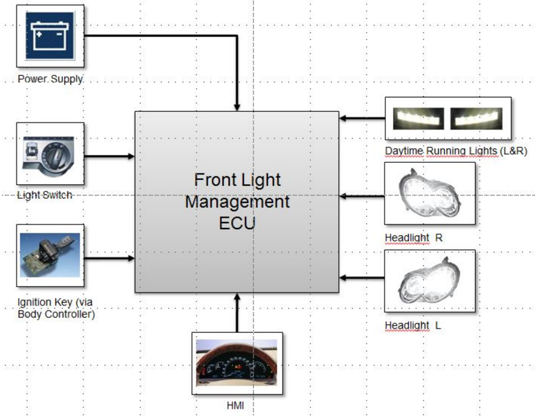
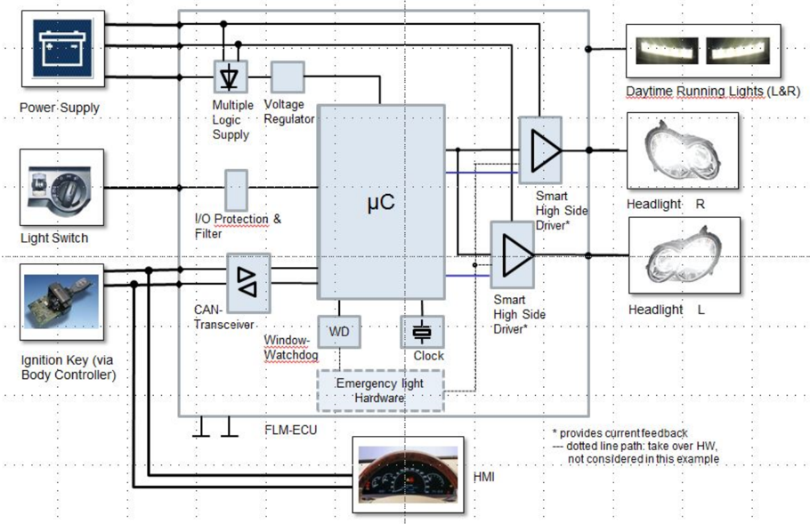
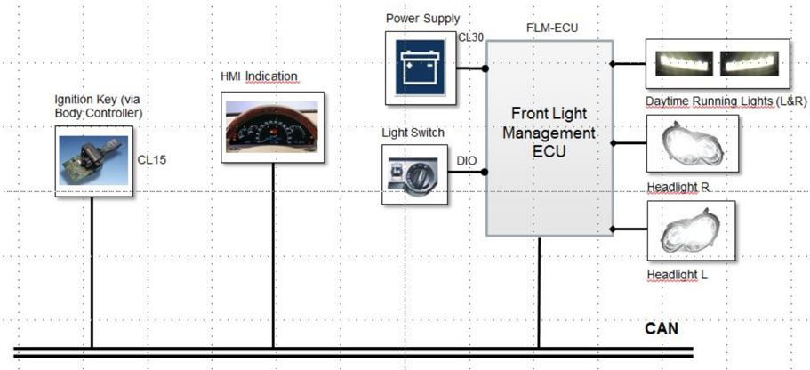
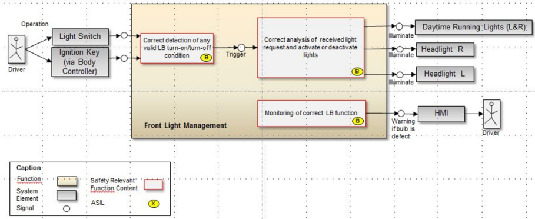
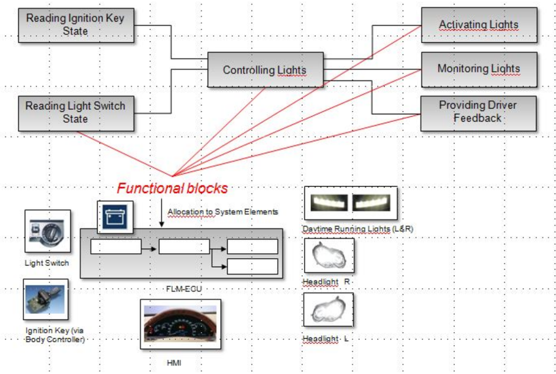
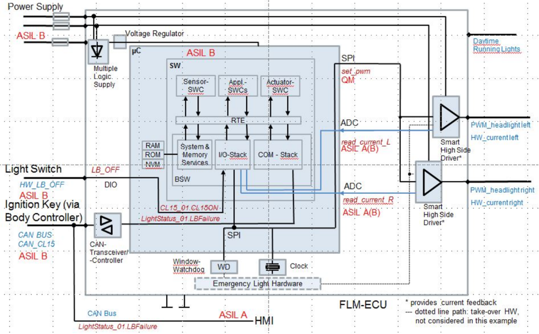
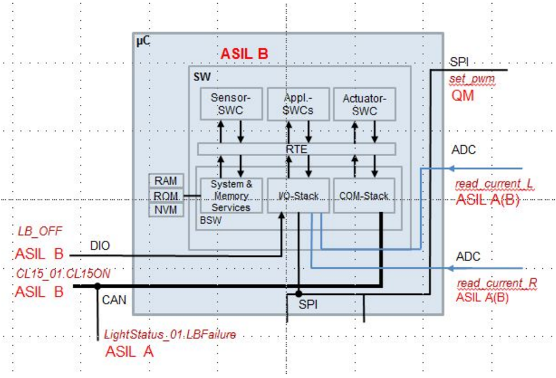
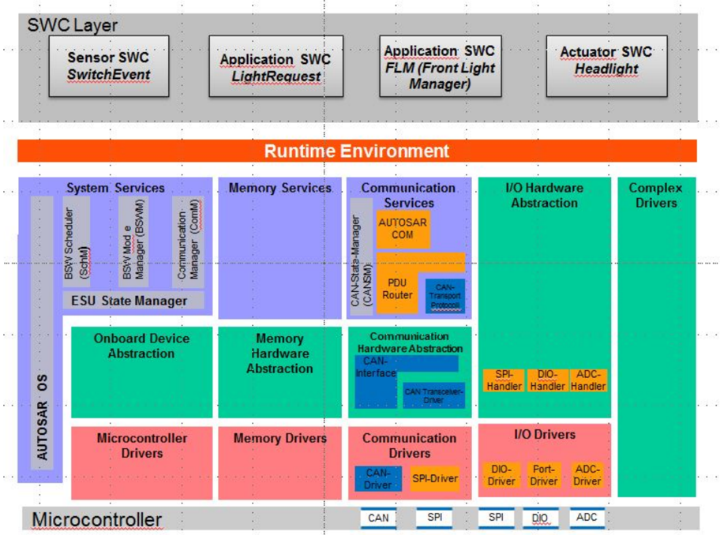
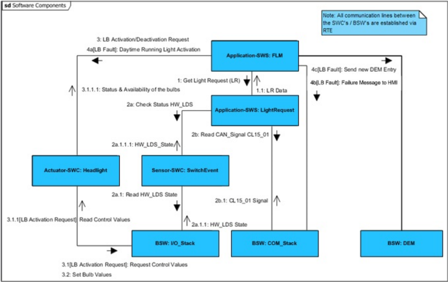
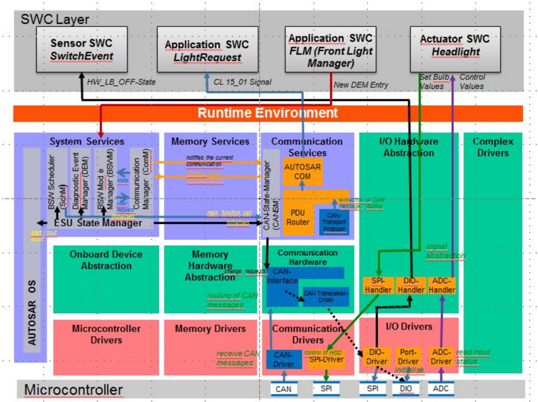

<!-- 源文档 AUTOSAR_CP_EXP_SafetyUseCase（R23-11），讲述型指南（EXP），不受 Type A 七章骨架约束；章节结构镜像源文档自身编号（1–9）。5.3 节各分析表在 R23-11 转换中跨页断裂且部分长单元格被截断——可见内容按原样翻译，截断处以「……」标注；完整核对需查源 PDF（adas_vmc 附录 B 同类待办）。 -->

## 1. 引言

本文档从功能安全的视角展示使用 AUTOSAR 的示例性系统的主要分析步骤。以下文档中使用的示例基于 AUTOSAR 导览示例「前灯管理（Front Light Management）」。每当分析或概念讨论需要时，都会添加附加约束。

本报告旨在：

- 在 AUTOSAR 环境中建立一个用于功能安全分析的相关用例。
- 提供一个用于在 AUTOSAR 内讨论与验证安全相关概念的示例。
- 识别当前 AUTOSAR 规范与方法论中在功能安全方面的改进潜力。
- 提出安全架构所需的 AUTOSAR 改进或附加概念。
- 为概念「Safety Related Extension for Methodology and Templates」创建输入。
- 在 AUTOSAR 方法论之上为安全分析提供指南。

该示例在 ISO 26262 需求的语境下编制，但聚焦于 AUTOSAR 相关的部分。虽然它可以被视为在 AUTOSAR 方法论之上进行安全分析的基本指南，但它只是粗略地触及主要主题。更多细节（例如软件安全需求的详细列表或安全分析措施的示例）可以在下一个开发步骤中添加。

该示例涵盖以下方面：

- 功能安全概念
- 系统层级的技术安全概念
- ECU 层级的技术安全概念
- AUTOSAR 基础软件层级的安全方面

注意：实现约束不一定与现有实现相符。

## 2. 项描述（Item Description）

为本示例选择的项基本上等同于 AUTOSAR 导览示例「前灯管理」。每当需要附加定义时，都会添加有助于澄清安全相关主题的信息。

当前示例的范围聚焦于前灯的一个非常有限的功能部分，即近光（low beam）功能。所有其他灯光功能（例如驻车 Orientation 灯、雾灯等）均被排除在外。作为例外，日间行车灯作为一种可能的后备解决方案被提及，因此被整合到下图中。不过，控制日间行车灯的细节不属于本示例的一部分。

所有促成前灯管理的车辆层级部件在此被视为「系统」（见图 2.1）。这包括前灯管理 ECU 以及促成前灯管理的相关传感器、执行器、显示与供电部件。

### 2.1. 功能行为

近光功能的一般特性是在黑暗中照亮道路。此外，近光向其他道路使用者告知一辆正在接近的车辆。激活/停用条件汇总于下表。

表2.1：操作元件与功能行为（**Operating Elements and Functional Behavior**）

| 功能 | 操作元件 | 接通条件 | 断开条件 |
| --- | --- | --- | --- |
| 近光（Low Beam） | 灯光开关（LS） | CL15 ON 且灯光开关 ON | 灯光开关 OFF 或 CL15 OFF |

近光可以由灯光开关在接线柱 15（CL15）经点火钥匙激活时接通。近光灯的任何故障都应向驾驶员指示。

作为附加功能，日间行车灯作为前灯管理系统的一部分提供。此外，近光功能的所有相关规范性法规均应适用。

基于该名义功能，导出以下功能及关联的功能需求：

1. 近光请求的检测
   - (a) 前灯管理器应评估点火钥匙位置。
   - (b) 前灯管理器应读取 LS 开关位置。
2. 近光请求的评估
   - (a) 前灯管理器应评估 LS 开关状态。
   - (b) 只有当 LS 开关状态从 OFF 变为 ON 时，前灯管理器才应创建开关事件（ON）。
   - (c) 如果 LS 开关状态从 ON 变为 OFF，前灯管理器应创建开关事件（OFF）。
3. 近光灯的控制
   - (a) 如果点火钥匙位置为 ON 且检测到灯光开关事件，前灯管理器应激活近光灯。
   - (b) 如果点火钥匙位置为 OFF 或检测到开关事件（OFF），前灯管理器应停用近光灯。
4. 近光功能的监控
   - (a) 前灯管理器应监督近光灯。
   - (b) 前灯管理器应指示近光灯的失效，例如电流失效或灯泡失效。
5. 日间行车灯的激活
   - (a) 在近光灯失效的情况下，前灯管理器应激活日间行车灯。

### 2.2. 初步架构

下图展示了假定的系统架构，包括以下系统元素：

- 前灯管理 ECU
- 灯光开关（LS）
- 点火钥匙（经车身控制器）
- 电源
- 前照灯，左与右
- 日间行车灯，左与右
- HMI

系统元素与前灯管理 ECU 的技术接口假定如图 2.2 与表 2.2 所示。

表2.2：FLM ECU 的接口（**Interfaces of FLM ECU**）

| 系统元素 | 到 FLM ECU 的接口 |
| --- | --- |
| 灯光开关位置（LS） | DIO |
| 点火钥匙位置（CL15）（经车身控制器） | CAN 接口 |
| HMI | CAN 接口 |
| 左前照灯控制 | PWM |
| 右前照灯控制 | PWM |
| 日间行车灯（左与右） | PWM |
| 电源 | 模拟 |

以通信为焦点的技术接口视图见图 2.3。

### 2.3. 示例性安全分析的假设与限制

作为示例的起点，假定系统采用以下配置：

1. 前灯管理软件在一个 ECU 上实现
2. 经由开关激活灯光，该开关提供一个数字 I/O 输出。
   - 注意：这类灯光开关的常见类型提供模拟输出或最多 4 个数字输出以及用于验证状态的逻辑表。本示例的意图是展示数据在软件架构中的流动。传感器的硬件诊断不在关注范围内。
3. 紧急灯光功能（例如在微控制器运行失效的情况下）由硬件提供，不打算使用 AUTOSAR 软件部件。
4. 所有内存（易失性与非易失性）都受到针对可逆瞬态故障的保护。假定诸如 ECC 之类的机制可用。
5. 用于内存分区的硬件手段可用（例如 MPU）。
6. 前灯管理软件集成在一个带有不满足 ISO 26262 ASIL 等级的 BSW 模块的系统上。
7. 微控制器失效模式的分析已执行，安全措施已定义并实现。该分析基于供应商提供的数据（例如安全手册）以及 ISO 26262 的需求。

此外，定义了以下约束以将示例的焦点保持在特定的 AUTOSAR 软件安全问题上：

1. 假定 ECU 按要求工作：
   - (a) ECU 正确地唤醒、运行并进入休眠（示例不关注模式管理或状态管理）。
   - (b) 必要的通信网络可用且正常运行（示例不关注 COM 管理）。
   - (c) 必要的 BSW 模块按要求被触发。
2. 不考虑板级布线系统、电池或电源中的失效。尽管电池在前灯管理（FLM）之外，但其失效将直接影响 FLM 以及车辆的任何其他电子系统。不过，12 V 供电的失效会影响车内的许多功能（制动、发动机等），因此我们假定采用车辆级的解决方案来处理这些失效。
3. 不考虑近光灯供电的失效。通常左右近光有各自独立的供电。
4. 假定灯泡的起动测试已经就位。其设计与实现不属于本示例的一部分。
5. 灯光开关信号（LS）已被滤波/去抖。此外，假定该信号以适当的质量提供，以满足 ISO 26262 的要求（例如所需的失效率、硬件开发的过程要求，见 ISO 26262 第 5 部分）（为简化示例）。

## 3. 车辆层级的安全概念

以下章节概述车辆层级的安全分析及其结果，后者通常由 OEM 创建并部分提供给供应商。

注意：这种安全分析的结构不能 1:1 地映射到 ISO 26262 [\[1\]](#ref-1) 中的结构，因为该标准没有明确包含不同的可能开发范围。

### 3.1. 危害分析与风险评估的结果

对于本示例，假定以下危害与属性被识别为危害分析与风险评估的输出：

**危害 H1：近光完全丢失（ASIL B）**

该危害潜在地可能导致驾驶员失去对车辆的控制、驶离道路并与环境物体碰撞。

**H1 的例外与边界条件：**

- 近光丢失只在恶劣视见条件（夜间、雾等）下才被视为风险。
- 在弯曲、无照明的乡村道路上近光丢失被评估为最关键的工况。
- 仅一侧近光丢失不被认为直接导致危险工况。但它是一个潜伏故障，将被纳入概念考量。

**ASIL：** ASIL B 等级基于危害分析与风险评估期间识别的严重度、暴露率与可控性。

**安全目标 SG01：**

防止近光完全丢失

**安全状态：**

近光激活

**故障容忍时间：**

500 ms

（应考虑夜间行驶且灯光已激活时近光的丢失。）

注意：可以假定附加的危害。但为了限制本示例的范围，假定它是唯一相关的危害。对于以下关于 AUTOSAR 特性的讨论，此时包含额外的风险似乎没有帮助。

### 3.2. 相关的失效模式

安全目标 SG01 可能通过以下一个或多个故障（MF）被违反：

- MF01：灯光接通/断开条件检测的失效
- MF02：用于接通灯光的灯光请求功能评估与执行的失效
- MF03：已激活灯光的失效

### 3.3. 功能安全概念

功能描述、安全目标以及顶层安全需求的结果是一个功能安全架构，它将被映射到某一个特定的车辆架构。

#### 3.3.1 FunSafReq01-01

FLM 应正确检测近光的任何有效接通条件。（ASIL B）

关联 MF01：「有效近光灯 ON」请求之后没有近光。

#### 3.3.2 FunSafReq01-02

FLM 应验证所收到的任何近光灯请求的有效性，并相应地激活或停用近光。（ASIL B）

关联 MF02：未收到「有效近光灯 OFF」请求而关闭灯光。

#### 3.3.3 FunSafReq01-03

FLM 应检测已激活近光的失效，并向驾驶员指示故障。（ASIL B）

关联 MF03：已激活灯光的失效。

注意：

有效近光灯 ON 请求 =&gt; 「CL15 为 ON 且灯光开关从 OFF 变为 ON」

有效近光灯 OFF 请求 =&gt; 「灯光开关从 ON 变为 OFF」

### 3.4. 车辆层级的安全需求

作为车辆层级安全分析的一部分，根据可用的系统架构定义了警告与降级概念。车辆层级的技术安全需求从功能安全需求与初步架构的假设（见 2.2 节）导出，并以 SysSafReq ID 标记。

注意：生成技术安全需求的过程不属于本文档，因此不在下文描述。这些车辆层级的需求仅用于演示若干需求层级。它们既没有被完整分析，也不是从真实实现映射而来。

#### 3.4.1 警告与降级概念

对于近光灯，应实现以下两步降级概念：

**正常模式：**

- 见项描述中的名义功能（见第 [2](#2-项描述item-description) 章）。

**降级模式第 1 步——丢失一个近光：**

- 第二个近光仍然履行其功能。
- 应向驾驶员提供警告，指示近光部分丢失，此时近光被请求但未被成功激活（检测到故障）。

**降级模式第 2 步——丢失两个近光：**

- 每当近光被请求但未被成功激活（检测到故障）时，应激活日间行车灯。
- 应向驾驶员提供警告，指示近光丢失以及日间行车灯的激活，此时近光被请求。

注意：这种将日间行车灯用作后备的用法仅作为演示降级功能的示例。该方案在型式认证方面可能不合适。

注意：在此模式下可以激活附加的驾驶员辅助功能来帮助驾驶员，但这不属于本示例的一部分。

#### 3.4.2 技术安全需求（车辆层级）

以下技术安全需求在本示例性分析中基于 3.3 节中的判定导出：

##### 3.4.2.1 SysSafReq01

CAN 连接的车身控制器应经由 CAN 总线消息 CL15_01（CAN 消息：CL15_01，CAN 信号：CL15ON（布尔量，接线柱 15 置于 on 时为「1」，置于 off 时为「0」））标志点火钥匙接线柱 15 的状态。（ASIL B）

注意：CAN 消息细节（频率、禁止时间、信号类型）作为名义功能的一部分在 CAN DB 中定义。

##### 3.4.2.2 SysSafReq02

灯光开关应经由数字硬件线 HW_LB_OFF 标志开关的状态（请求开灯时 0=0 V，请求关灯时 1=5 V）。（ASIL B）

##### 3.4.2.3 SysSafReq03

灯光开关内的失效应导致数字硬件线 HW_LB_OFF 被置为 0。（ASIL B）

##### 3.4.2.4 SysSafReq04

FLM ECU 应确保给近光灯泡供电的限值（如电压与 PWM）得到保持，同时 FLM ECU 检测到给灯泡供电的条件已满足（作为名义功能的一部分定义）。（ASIL B）

##### 3.4.2.5 SysSafReq05

在 CL15ON==1 期间，只有当 HW_LB_OFF ==1 条件持续为真 20 ms 时，FLM ECU 才应关闭灯光（CAN 消息：CL15_01；CAN 信号：CL15ON，布尔量，接线柱 15 置于 on 时为「1」，置于 off 时为「0」）。（ASIL B）

注意：等待条件稳定若干毫秒的时序条件被纳入以对信号值去抖。20 ms 这一具体取值取自专家经验。也可以使用其他值。

##### 3.4.2.6 SysSafReq06

FLM ECU 应检测电路失效（灯泡、保险丝、布线开路/短路）并经由 CAN 标志它们（CAN 消息：LightStatus_01，CAN 信号：LBFailure（2 位，左近光失效时为 01，右近光失效时为 10，两个近光都失效时为 11））。（ASIL B）

##### 3.4.2.7 SysSafReq07

如果两个近光灯泡的失效被持续检测到 200 ms，FLM ECU 应激活两个日间行车灯（DRL）。（ASIL B）

注意：FTT 预算按以下方式分配：200 ms 失效检测时间 + 保守的 200 ms 卤素灯泡达到全亮度的时间间隔（失效反应）+ 100 ms 缓冲 = 500 ms。

##### 3.4.2.8 SysSafReq08

FLM ECU 应使用独立的电路给左右灯泡供电，使得单一故障不能导致近光完全丢失。（ASIL B）

##### 3.4.2.9 SysSafReq09

HMI 应根据经由 CAN 收到的信号 LBFailure 显示灯泡熄灭信息（CAN 消息：LightStatus_01，CAN 信号：LBFailure（2 位，左近光失效时为 01，右近光失效时为 10，两个近光都失效时为 11））。（ASIL A）

注意：对该措施而言 FTT 不相关，因为它是针对潜伏故障的措施。这里可以计算一个相关的时间（诊断间隔）。针对双灯泡失效（FTT 相关）的措施是日间行车灯的激活。作为针对潜伏故障的措施，ASIL 依据 ISO 26262-4:2018(E) 6.4.2.5 被降低。

##### 3.4.2.10 SysSafReq10

必须确保发送者与接收者之间经由 CAN 的数据传输：CAN 消息 CL15_01，CAN 信号 CL15ON（布尔量，「1」表示接线柱 15 置于 on，「0」表示置于 off）。（ASIL B）

注意：对该措施，应考虑数据交换的所有相关失效模式（见 ISO 26262 第 6 部分）。

##### 3.4.2.11 SysSafReq11

必须确保发送者与接收者之间经由 CAN 的数据传输：CAN 消息 LightStatus_01，CAN 信号 LBFailure（2 位，左近光失效时为 01，右近光失效时为 10，两个近光都失效时为 11）。（ASIL A）

说明：对该措施，应考虑数据交换的所有相关失效模式（见 ISO 26262-6）。

##### 3.4.2.12 SysSafReq12

如果关于消息 CL15_01 的通信故障被持续检测到 200 ms，FLM ECU 应激活近光灯。

注意：FTT 预算按以下方式分配：200 ms 失效检测时间 + 保守的 200 ms 卤素灯泡达到全亮度的时间间隔（失效反应）+ 100 ms 缓冲 = 500 ms。

##### 3.4.2.13 SysSafReq13

FLM ECU 应：

- 如果关于消息 LightStatus_01 的通信故障被持续检测到 200 ms，则激活两个日间行车灯（DRL），并且
- 向驾驶员提供类似「灯光系统故障」的文本消息。

#### 3.4.3 （功能）系统安全需求的分配

在下一步中，所有系统安全需求需要被分配到一个架构系统元素（见图 3.2）。

#### 3.4.4 技术系统安全需求的汇总（车辆层级）

系统安全需求到功能安全需求（车辆层级）的整体映射以及到系统元素的分配汇总于表 3.1。

表3.1：技术系统安全需求的汇总（**Summary of Technical System Safety Requirements**）

| ID | 系统安全需求 | 支持的功能安全需求 ID | ASIL | 项 |
| --- | --- | --- | --- | --- |
| SysSafReq01 | 车身控制单元应经由 CAN 总线消息 CL15_01 标志接线柱 15 的状态（CAN 消息：CL15_01，CAN 信号：CL15ON（布尔量，接线柱 15 置于 on 时为「1」，置于 off 时为「0」））。注意：CAN 消息细节（频率、禁止时间、信号类型）作为名义功能的一部分在 CAN DB 中定义。 | FunSafReq01-01 | ASIL B | BC-ECU |
| SysSafReq02 | 灯光开关应经由数字硬件线 HW_LB_OFF 标志开关的状态（请求开灯时 0=0 V，请求关灯时 1=5 V）。 | FunSafReq01-01 | ASIL B | 灯光开关 |
| SysSafReq03 | 灯光开关内的失效应导致数字硬件线 HW_LB_OFF 被置为 0。 | FunSafReq01-02 | ASIL B | 灯光开关 |
| SysSafReq04 | FLM ECU 应确保给近光灯泡供电的限值（电压、PWM）得到保持，同时 FLM ECU 检测到给灯泡供电的条件已满足（作为名义功能的一部分定义）。 | FunSafReq01-02 | ASIL B | FLM ECU |
| SysSafReq05 | 在 CL15ON==1 期间，只有当 HW_LB_OFF ==1 条件持续为真 20 ms 时，FLM ECU 才应关闭灯光（CAN 消息：CL15_01，CAN 信号：CL15ON，布尔量，接线柱 15 置于 on 时为「1」，置于 off 时为「0」）。注意：等待条件稳定若干毫秒的时序条件被纳入以对信号值去抖。20 ms 这一具体取值取自专家经验。也可以使用其他值。 | FunSafReq01-02 | ASIL B | FLM ECU |
| SysSafReq06 | FLM ECU 应检测电路失效（灯泡、保险丝、布线开路/短路）并经由 CAN 标志它们（CAN 消息：LightStatus_01，CAN 信号：LBFailure（2 位，左近光失效时为 01，右近光失效时为 10，两个近光都失效时为 11））。 | FunSafReq01-03 | ASIL A | FLM ECU |
| SysSafReq07 | 如果两个近光灯泡的失效被持续检测到 200 ms，FLM ECU 应激活两个日间行车灯（DRL）。 | FunSafReq01-03 | ASIL B | FLM ECU |
| SysSafReq08 | FLM ECU 应使用独立的电路给左右灯泡供电，使得单一故障不能导致近光完全丢失。 | FunSafReq01-02 | ASIL B | FLM ECU |
| SysSafReq09 | HMI 应根据经由 CAN 收到的信号 LBFailure 显示灯泡熄灭信息（CAN 消息：LightStatus_01，CAN 信号：LBFailure（2 位，左近光失效时为 01，右近光失效时为 10，两个近光都失效时为 11））。 | FunSafReq01-03 | ASIL A | HMI |
| SysSafReq10 | 必须确保发送者与接收者之间 CL15_01.CL15ON 的数据传输。说明：对该措施，应考虑数据交换的所有相关失效模式（见 ISO 26262-6）。 | FunSafReq01-02 | ASIL B | FLM ECU、BC-ECU |
| SysSafReq11 | 必须确保发送者与接收者之间 LightStatus_01.LBFailure 的数据传输。说明：对该措施，应考虑数据交换的所有相关失效模式（见 ISO 26262-6）。 | FunSafReq01-03 | ASIL A | HMI、FLM ECU |
| SysSafReq12 | 如果关于消息 CL15_01 的通信故障被持续检测到 200 ms，FLM ECU 应激活近光灯。注意：FTT 预算按以下方式分配：200 ms 失效检测时间 + 保守的 200 ms 卤素灯泡达到全亮度的时间间隔（失效反应）+ 100 ms 缓冲 = 500 ms。 | FunSafReq01-02 | ASIL B | FLM ECU |
| SysSafReq13 | FLM ECU 应：如果关于消息 LightStatus_01 的通信故障被持续检测到 200 ms，则激活两个日间行车灯（DRL），并且向驾驶员提供类似「灯光系统故障」的文本消息。 | FunSafReq01-03 | ASIL A | HMI、FLM ECU |

## 4. FLM-ECU 层级的技术安全概念

以下章节概述 ECU 层级的安全分析及其结果，后者通常由供应商创建。

### 4.1. ECU 层级的假设与限制

FLM-ECU 层级的安全概念基于以下假设：

1. 根据 AUTOSAR 方法论，BSW 周期性运行。
2. 硬件信号被周期性读取，并作为客户端/服务器信号在 I/O 硬件抽象（HWA）的 RAM 中可用。
3. 到达的 CAN 消息产生一个中断。
4. ECU 正确地唤醒、运行并进入休眠（此处不关注模式管理或状态管理）。
5. 必要的通信网络可用且正常运行（此处不关注 COM 管理）。
6. 必要的 BSW 模块按要求被触发。
7. RTE 用作数据与消息传输的媒介，不执行任何缩放（数据变换）。
8. 日间行车灯在技术上以前照灯相同的方式连接，但在一条单独专用的 SPI 上。

注意：在这种情况下，如果左侧前照灯电缆控制右侧日间行车灯、反之亦然，交叉接线可以帮助诊断断裂的线束。

### 4.2. 待满足的安全目标

相关的安全目标在 3.1 节中定义。

### 4.3. 相关的系统安全需求

相关的系统安全需求列于小节 3.4.4。

### 4.4. ECU 层级概念概览

该框图展示了 ECU 层级参与实现安全目标的元素，包括 ASIL 到输入、处理、输出与警告元素的分配。

功能「前照灯」（ASIL B）被分解为两个独立的前照灯（2× ASIL A(B)）以提供冗余，如图 4.1 所示。

当前示例中的假设是：「set_pwm 的丢失不会直接导致『近光完全丢失（H1）』」。因此，用于控制前照灯的公共 SPI「总线」被评为 QM。

「Set_pwm」用于产生一个矩形脉冲波，其脉冲宽度被调制以经由智能高边驱动器控制前照灯（见图 4.1 最右侧）。

**理由（Rationale）：**

1. 起动自诊断以足够的覆盖率检测 SPI 连接的故障，并向驾驶员反馈（在静止期间、在任何危险的驾驶工况之前）。
2. 「读回」路径 read_current_R 与 read_current_L 提供关于灯光请求是否被成功传输的反馈。
3. 如果「读回」路径显示出与激活路径请求的差异，则必须实现一个适当的、安全的反应（在本例中为：如果检测到 LS ON，则将日间行车灯置为 ON），独立于 set_pwm 命令。
4. 这样，「激活路径 SPI」可以作为 QM 路径实现。
5. 此外，近光激活路径控制激活，反馈路径（ASIL B）在任何危险（黑暗）工况之前通报成功与否。单条损坏的 set_pwm 消息（每个近光获得一个单独的请求）只会影响两个前照灯中的一个。

### 4.5. ECU 层级的需求

以下列表汇总 ECU 层级的安全需求。基于这些软件需求，必须导出针对基础软件模块的附加需求。该步骤未在本文档中详细给出。

导出的 SW 需求的粒度将保持非常有限，以保持示例的可理解性。安全相关软件组件应按照所分配需求的最高 ASIL 等级开发。

表4.1：ECU 层级的需求（**Requirements on ECU Level**）

| ECU 安全需求 ID | ECU 安全需求 | 功能块 | 域 | ASIL | ECU 功能 | 相关的 AUTOSAR 组件 | 系统安全需求 |
| --- | --- | --- | --- | --- | --- | --- | --- |
| | 应正确接收 CAN 消息 CAN BUS CAN_CL15。 | 读取 | ECU | B | | | SysSafReq05 |
| ECU01 | 应确保正确读取（物理的）CAN 总线 CAN_CL15。 | 读取 | HW | QM(B) | 读取点火钥匙状态 | CAN 收发器/CAN 控制器 | SysSafReq05 |
| ECU02 | 应确保从 CAN 总线 CAN_CL15 到逻辑消息 CL15_01 的正确转换。 | 读取 | HW + SW 驱动 | QM(B) | 读取点火钥匙状态 | CAN 收发器/CAN 控制器 | SysSafReq05 |
| ECU03 | 应确保 CL15_01 消息经由 AUTOSAR BSW/RTE 的正确路由。信号 CL15_01.CL15ON 应被提取并恰当地提供给应用 SWC。 | 读取 | SW | QM(B) | 读取点火钥匙状态 | COM 协议栈（Can Driver、CanIf、Com、PduR）、RTE | SysSafReq05 |
| ECU04 | ECU 应检测任何可能影响信号 CL15ON、进而可能导致违反安全目标的潜在通信故障。 | 诊断 | HW、SW | B(B) | 控制灯光 | RTE、应用 SWC、Com 协议栈（Can Driver、CanIf、Com、PduR）、RTE | SysSafReq05 |
| | ECU 应正确确定灯光开关输入 HW_LB_OFF 的状态。 | 读取 | ECU | B | | | SysSafReq05 |
| ECU06 | 应确保正确读取 HW_LB_OFF 输入。 | 读取 | SW | QM(B) | 读取灯光请求 | I/O 协议栈（Dio 与 Port） | SysSafReq05 |
| ECU07 | 应确保 HW_LB_OFF 输入端口与引脚的正确配置。 | - | SW | QM(B) | 读取灯光请求 | I/O 协议栈（Dio 与 Port） | SysSafReq05 |
| ECU08 | 应确保从 HW_LB_OFF 输入到逻辑信号 LB_OFF 的正确转换。 | 读取 | HW、SW | QM(B) | I/O 过滤（不属于本示例，见假设） | I/O 协议栈（I/O HW 抽象） | SysSafReq05 |
| ECU09 | 应确保 LB_OFF 经由 AUTOSAR BSW/RTE 的正确路由。 | 读取 | SW | QM(B) | 读取灯光请求 | I/O 协议栈（I/O HW 抽象）、RTE | SysSafReq05 |
| ECU10 | ECU 应检测可能影响 LB_OFF、进而可能导致违反安全目标的潜在故障。 | 诊断 | SW | B(B) | 控制灯光 | 应用 SWC、RTE、传感器 SWC、I/O 协议栈（I/O HW 抽象） | SysSafReq05 |
| ECU10 | ECU 应检测可能影响 LB_OFF、进而可能导致违反安全目标的潜在故障。 | 诊断 | SW | B(B) | 控制灯光 | 应用 SWC、RTE、传感器 SWC、I/O 协议栈（I/O HW 抽象） | SysSafReq06 |
| | 应用 SWC 应评估灯光请求并按规格发起灯泡的供电。 | 处理 | | B | | | SysSafReq04 |
| ECU12 | 应用 SWC 应按规格确定 LB_OFF 与 CL15ON 的状态。 | 处理 | SW | B | 读取灯光请求 | 应用 SWC | SysSafReq05 |
| ECU12 | 应用 SWC 应按规格确定 LB_OFF 与 CL15ON 的状态。 | 处理 | SW | B | 读取灯光请求 | 应用 SWC | SysSafReq04 |
| ECU13 | 应用 SWC 应基于 LB_OFF 与 CL15ON 及其时序，按规格评估灯光请求条件。 | 处理 | SW | B | 控制灯光 | 应用 SWC | SysSafReq04 |
| ECU13 | 应用 SWC 应基于 LB_OFF 与 CL15ON 及其时序，按规格评估灯光请求条件。 | 处理 | SW | B | 控制灯光 | 应用 SWC | SysSafReq05 |
| ECU14 | 应用 SWC 应：基于 LB_OFF 与 CL15ON 的评估结果或在检测到任何故障时，置位或复位开灯命令（Lights_ON）；在 CL15_01 消息的通信故障被持续检测到超过 200 ms 时置位开灯命令；或在 LB_OFF 上的故障被持续检测到超过 200 ms 时置位开灯命令。 | 处理 | SW | B | 控制灯光 | 应用 SWC | SysSafReq05、SysSafReq12 |
| ECU15 | 如果两个近光灯泡的失效被持续检测到 200 ms（read_current_L、read_current_R），应用 SWC 应激活两个日间行车灯（DRL_ON）。 | 处理 | SW | B | 控制灯光 | 应用 SWC | SysSafReq07、SysSafReq12 |
| ECU30 | 当灯泡被供电时，执行器 SWC 应读回电流并提供灯泡的状态（read_current_L、read_current_R）。 | 监控 | SW | A(B)、A(B) | 监控灯光 | 应用 SWC | SysSafReq06 |
| | 应确保按照规格给灯泡正确供电。 | 控制 | | B | | | SysSafReq04 |
| ECU16 | 按照灯光请求与规格给灯泡的正确供电应经由 set_pwm 命令来标志。 | 控制 | SW | QM(B) | 激活灯光 | 执行器 SWC | SysSafReq04 |
| ECU17 | 应确保 set_pwm 请求到微控制器 SPI 输出的正确路由。 | 控制 | SW | QM(B) | 激活灯光 | 执行器 SWC、RTE、I/O HW 抽象、SPI 驱动 | SysSafReq04 |
| ECU18 | 应确保微控制器 set_pwm 请求到高边驱动器的正确路由，以及 set_pwm 请求到物理输出 PWM_headlight left、PWM_headlight right 的正确转换。 | 控制 | HW | QM(B) | 激活灯光 | - | SysSafReq04 |
| ECU19 | ECU 应提供 2 条独立的硬件路径给灯泡供电，一条用于左灯泡（PWM_headlight left），一条用于右灯泡（PWM_headlight right）。 | 控制 | HW | A(B)、A(B) | 激活灯光 | - | SysSafReq08 |
| | ECU 应监督灯泡的状态并在失效时通知驾驶员。 | 监控 | | B | | | |
| ECU20 | 当灯泡被供电时，应用 SWC 应评估灯泡的状态（read_current_L、read_current_R）。 | 监控 | SW | A(B)、A(B) | 监控灯光 | 应用 SWC | SysSafReq06 |
| ECU21 | 检测到的故障应经由 CAN 总线 LBFailure 标志。 | 控制、驾驶员反馈 | SW | A | 提供驾驶员反馈 | 应用 SWC、RTE、Com 协议栈 | SysSafReq06 |
| ECU22 | ECU 应提供 2 条独立的通道来测量每个灯泡的电流 HW_current left、HW_current right。 | 监控 | HW | A(B)、A(B) | 监控灯光 | - | SysSafReq08 |
| ECU23 | ECU 应在故障容忍时间（FTT）内检测灯泡健康测量路径（微控制器硬件、ECU 硬件、车辆线束）的故障。 | 诊断 | HW、SW | B | 监控灯光 | I/O HW 抽象、SPI 驱动 | SysSafReq06 |
| ECU24 | 应确保灯泡健康测量值 read_current_L、read_current_R 经由 AUTOSAR BSW/RTE 的正确路由。 | 监控 | SW | QM(B) | 监控灯光 | I/O 协议栈（I/O HW 抽象）、驱动、RTE | SysSafReq06 |
| ECU25 | ADC 应将测量到的电流转换为 read_current_L、read_current_R。 | 监控 | HW、SW | A(B)、A(B) | 监控灯光 | ADC 驱动 | SysSafReq06 |
| | RTE 之上的 SWC 内部及通信 | | | | | | |
| ECU26 | 应确保 SW 组件之间正确的数据交换（时序与内容）。 | 处理 | SW | B | 控制灯光 | 应用 SWC | |
| ECU27 | 必须确保发送者与接收者之间 CL15_01.CL15ON 的传输。 | 读取 | SW | B | 读取点火钥匙状态 | 应用 SWC | SysSafReq10 |
| ECU28 | 必须确保发送者与接收者之间 LightStatus_01.LBFailure 的传输。 | 控制、驾驶员反馈 | SW | A | 提供驾驶员反馈 | 应用 SWC | SysSafReq11 |
| ECU29 | 应确保从逻辑 PWM-水平信号到 SPI 总线消息的正确转换。 | 控制 | SW | QM(B) | 激活灯光 | 应用 SWC | SysSafReq04 |
| ECU30 | 当灯泡被供电时，执行器 SWC 应读回电流并提供灯泡的状态（read_current_L、read_current_R）。 | 监控 | SW | A(B)、A(B) | 监控灯光 | 应用 SWC | SysSafReq06 |

### 4.6. ECU 功能

以下章节按照功能块（见图 3.2）组织，例如读取灯光请求、读取点火钥匙状态等。它描述 ECU 边界处的信号接口，概述输入信号如何从物理硬件输入变换为逻辑软件输入，以及从逻辑软件输出变换为硬件输出。

#### 4.6.1 读取灯光开关状态

物理输入：HW_LB_OFF（在硬件层级，它目前实现为单个数字输入。）

逻辑输入：LB_OFF

涉及的 SW 模块：DIO 驱动/处理程序、RTE、SwitchEvent（传感器 SWC）。

#### 4.6.2 读取点火钥匙状态（经车身控制器）

物理输入：CAN 总线 CAN_CL15

逻辑输入：CL15_01（ASIL B）

涉及的 SW 模块：CAN 驱动与接口、PDU 路由器、AUTOSAR COM、RTE、Light Request（应用 SWC）。

#### 4.6.3 激活灯光（物理）

##### 4.6.3.1 近光灯

物理输出：PWM_headlight left、PWM_headlight right（QM）

（高边驱动器根据 SPI 请求产生 PWM 信号。）

逻辑输出：Set_pwm

涉及的 SW 模块：HeadLight（执行器 SWC 控制路径）、RTE、SPI 驱动/处理程序。

##### 4.6.3.2 日间行车灯

物理输出：日间行车灯

逻辑输出：不属于本示例

涉及的 SW 模块：不属于本示例

#### 4.6.4 监控灯光

物理输入：HW_current left、HW_current right（ASIL A(B)）。

逻辑输入：Read_current_L、read_current_R

涉及的 SW 模块：HeadLight（执行器 SWC 读回路径）、RTE、ADC 驱动/处理程序。

#### 4.6.5 提供驾驶员反馈

物理输出：CAN 总线（ASIL A）

注意：该 ASIL 只分配给信号内容，而不是整个 CAN 总线或总线接口。

逻辑输出：LBFailure

涉及的 SW 模块：CAN 驱动与接口、PDU 路由器、AUTOSAR COM、RTE、FLM（应用 SWC）。

#### 4.6.6 控制灯光（逻辑）

控制灯光的逻辑部分完全由 SW 承担。细节见图 5.2 的 SW 架构。逻辑输入按照小节 4.6.1–4.6.5 中的概览提供。

物理输入：无

物理输出：无

涉及的 SW 模块：Switch-Event（传感器 SWC）、LightRequest（应用 SWC）、FLM（应用 SWC）、Headlight（执行器 SWC）、RTE

## 5. SW 架构与 SW 安全需求

本章应支持两个目标：第一，它应给出抽象软件系统的概览，包括其主要的软件组件（SWC）以及以分层结构涉及的 AUTOSAR BSW 模块（图 5.1、图 5.2）。这将包括所有主要软件组件的静态方面（如接口与数据路径）以及动态方面（如过程序列与时序行为），记录在通信图中（图 9）。

第二，它将支持为 ECU 层级定义的每个安全需求识别潜在失效模式，以及如何通过足够的安全措施检测它们。最后，在 AUTOSAR 中已存在安全措施的情况下，将提供引用。

### 5.1. 软件架构

下图展示了集成到标准 AUTOSAR 架构（见 [\[2\]](#ref-2)）中的相关软件组件示例。

FLM 应集成到一个具有 AUTOSAR SW 架构的现有 ECU 中，使用 AUTOSAR BSW 协议栈。

它应由 4 个 SW 组件组成：

- 传感器 SWC（SwitchEvent）
- 应用 SWC（LightRequest）
- 应用 SWC（FLM）
- 执行器 SWC（Headlight）

#### 5.1.1 软件组件

定义了以下软件组件以提供前照灯功能：

1. SwitchEvent
   - (a) 传感器 SWC：
   - (b) 事件触发，应 LightRequest 的请求（检查状态 HW_LB_OFF；HW_LB_OFF_State）
   - (c) check_switch()：读取 HW_LB_OFF（读取 HW_LB_OFF）
   - (d) 存储 HW_LB_OFF 的状态（HW_LB_OFF_State）
2. LightRequest
   - (a) 应用 SWC
   - (b) LightRequest：检查 HW_LB_OFF 的状态（check_switch）（检查状态 HW_LB_OFF；HW_LB_OFF_State）
   - (c) 读取消息 CL15_01 的相关 CAN 信号（读取 CAN_信号 CL15_01；CAN_信号 CL15_01）
   - (d) 按需根据名义功能表向「FLM」发送灯光请求（LR 数据）
3. FLM（Front Light Manager）
   - (a) 应用 SWC
   - (b) 监控灯泡的状态与可用性（读回路径）（灯泡的状态与可用性）
   - (c) 周期性请求从「LightRequest」获取灯光请求信息，读取「灯光请求」数据（获取灯光请求）
   - (d) 在灯泡失效的情况下向 HMI（主机）发送信号（[LB 故障] 失效消息至 HMI）
   - (e) 当条件满足时，将近光灯泡激活请求发送给「Headlight」（近光激活/停用请求）
   - (f) 在两个近光灯泡都失效的情况下，向「Headlight」发送日间行车灯激活请求（[LB 故障] 日间行车灯激活）
   - (g) 负责 DEM 中的条目（[LB 故障] 发送新 DEM 条目）
4. Headlight
   - (a) 执行器 SWC
   - (b) 能够按需提供当前灯光状态（来自 4.d）与灯泡的可用性（灯泡的状态与可用性）
   - (c) 控制前灯
   - (d) 仅当 FLM 已经请求前照灯激活时，才周期性检查读回路径（灯泡的物理细节可用）（[近光激活请求] 请求控制值；[近光激活请求] 读取控制值）
   - (e) 确保灯泡控制的限值（电压、PWM）（设置灯泡值）

注意：SWC/BSW 之间的所有通信线路都经由 RTE 建立。

#### 5.1.2 RTE 运行时环境

RTE 是 AUTOSAR 虚拟功能总线（VFB）接口的实现。RTE 提供使 AUTOSAR 软件组件之间能够通信的基础设施服务，并充当 AUTOSAR 软件组件访问基础软件模块（包括 OS 与通信服务）的手段。

#### 5.1.3 AUTOSAR BSW 视图

下图与描述聚焦于从相关软件组件流出与流入的通信与信号流。

##### 5.1.3.1 基础软件组件

以下基础软件模块被识别为与本示例的架构和功能相关：

- COM 管理器
- AUTOSAR COM
- CAN 状态管理器
- PDU 路由器
- CAN 接口
- CAN 驱动
- CAN 收发器驱动
- SPI 驱动/处理程序
- DIO 与 Port 驱动/处理程序
- ADC 驱动/处理程序
- ECU 状态管理器
- BSW 管理器
- AUTOSAR OS

#### 5.1.4 BSW 功能的一般概览

本示例中使用的 AUTOSAR BSW 模块的主要功能在以下小节中作为粗略概览提供。

说明：BSW 功能未详细描述且不完整。更多信息请使用 AUTOSAR 规范。

##### 5.1.4.1 COM 管理器

ComM 模块控制与通信相关的基础软件模块，而不是软件组件或可运行实体。

ComM 模块收集来自通信请求者的总线通信访问请求，并协调总线通信访问请求。

- ComM 模块接收来自 SW-C 的任何通信请求
- ComM 模块使用 CAN 状态管理器模块的 API 来请求 CAN 网络的通信模式。

##### 5.1.4.2 AUTOSAR COM

AUTOSAR COM 位于 RTE 与 PDU 路由器之间。它提供影响通信的不同特性（例如打包/解包 PDU、用于 RTE 的数据接口等）。

- 监控接收到的信号（信号超时）、用于到达信号的过滤机制。

##### 5.1.4.3 CAN 状态管理器

CAN 状态管理器模块使用 CAN 接口模块的 API 来控制分配给 CAN 网络的 CAN 控制器与 CAN 收发器的运行模式。

CAN 状态管理器模块将其 CAN 网络的当前通信模式通知给通信管理器（ComM）模块。

##### 5.1.4.4 PDU 路由器

PDU 路由器模块使用以下模块类型提供 I-PDU 路由服务：通信接口模块（例如 Com、LinIf、CanIf、CanNm、FrIf 与 FrNm）。

- 提供不同抽象通信控制器与上层之间的 PDU 路由；PDU 路由器的规模是 ECU 特定的（如果例如只存在一个通信控制器，则可以小到没有）；提供即时传输协议路由。

##### 5.1.4.5 CAN 接口

CAN 接口模块位于 CAN 驱动与上层通信服务层之间。它表示到 CAN 驱动服务以及 AUTOSAR COM 协议栈上层通信模块的接口。

##### 5.1.4.6 CAN 驱动

CAN 驱动执行硬件访问，并向上层提供硬件无关的 API。唯一可以访问 CAN 驱动的上层是 CAN 接口。

- 发起传输。
- 调用 CAN 接口模块的函数以通知事件。
- 控制 CAN 控制器的行为与状态。

##### 5.1.4.7 CAN 收发器驱动

CAN 收发器驱动抽象 CAN 收发器硬件。

- 它向上层提供硬件无关的接口。
- 它通过使用 MCAL 层的 API 访问 CAN 收发器硬件，从而从 ECU 布局中抽象出来。

##### 5.1.4.8 SPI 驱动/SPI 处理程序

SPI 处理程序/驱动提供对经由 SPI 总线连接的设备进行读取与写入的服务。

- 它为多个用户（例如 EEPROM、看门狗、I/O ASIC）提供对 SPI 通信的访问。
- 它还提供配置片上 SPI 外设所需的机制。

##### 5.1.4.9 DIO 与 Port 驱动/处理程序

DIO 驱动提供对 DIO 通道（引脚）、DIO 端口、DIO 通道组进行读写的服务。

DIO 驱动工作在由 Port 驱动为此目的配置的引脚与端口上。

因此，DIO 驱动中没有该端口结构的配置与初始化。

##### 5.1.4.10 ADC 驱动

- 向 SW 提供测量值（电流读数）。

##### 5.1.4.11 ECU 状态管理器

ECU 管理器模块是一个管理 ECU 状态公共方面的基础软件模块。具体而言，ECU 管理器模块：

- 初始化与去初始化 OS、SchM 与 BswM 以及一些基础软件驱动模块。
- 在被请求时将 ECU 配置为 SLEEP 与 SHUTDOWN。
- 管理 ECU 上的所有唤醒事件。
- 协调 ECU 的多核。

##### 5.1.4.12 BSW 管理器

其职责是基于简单的规则仲裁来自应用层 SW-C 或其他 BSW 模块的模式请求，并根据仲裁结果执行动作。

- 组织 SW-C 与 BSW 模块的模式处理及模式相关交互。
- 监控 ECU 状态机的变更。

##### 5.1.4.13 AUTOSAR OS

- 管理任务与事件的调度。
- 管理不同任务之间的数据流。
- 提供监控与错误处理特性。
- 控制保护特性（时序保护/内存保护）。

### 5.2. 失效模式

ISO 26262 [\[1\]](#ref-1) 区分两种不同的失效原因：

1. 随机硬件失效：可以在硬件元件的生命周期内不可预测地发生，并遵循某种概率分布；
2. 系统性失效：以确定性的方式与某个原因相关，只能通过更改设计或制造过程、操作规程、文档或其他相关因素来消除。

注意：由于 AUTOSAR 的一般范围，本章的焦点将放在系统性软件失效上。

#### 5.2.1 HW 失效模式

HW 失效模式不属于 SW 安全分析。因此在 AUTOSAR 语境下不在此进一步详述。

细节见 ISO 26262-5:2018(E) 附录 B 与 D [\[1\]](#ref-1)。

#### 5.2.2 SW 失效模式

软件失效模式的参考见 ISO 26262-6:2018(E) 附录 D [\[1\]](#ref-1)。为了处理结果并减少分析结果中的重复条目，失效模式被聚类为 4 个类别——「数据完整性、初始化与配置数据」「数据交换」「时序与控制流」「数据处理」（见表 5.1）。

表5.1：失效模式聚类概览（**Overview of Failure Mode Clustering**）

| 一般失效模式 | 数据完整性：内存 | 数据完整性：初始化与配置数据 | 数据交换 | 时序与控制流 | 数据处理 |
| --- | --- | --- | --- | --- | --- |
| 内存内容的损坏。方面「DataIntegrity」：简单的内存损坏。方面「Init&ConfigData」：已应用的初始化可能被损坏（例如在外设上），或配置「源」数据可能已被损坏 | x | x | | | |
| 内存分区故障 | x | | | | |
| 内存访问故障 | x | | | | |
| 传输数据的错误寻址 | | | x | | |
| 对通信信道的访问被阻塞 | | | x | | |
| 传输数据的损坏（不是 RAM 中的数据，而是「传输的数据」在线上或在 SW 元素之间（经由 RTE）传输期间被扰动） | | | x | | |
| 传输数据的延迟 | | | x | | |
| 传输数据的不一致 | | | x | | |
| 传输数据值错误（高于或低于范围） | | | x | | |
| 传输数据的错误顺序 | | | x | | |
| 传输数据的插入 | | | x | | |
| 传输数据的伪装 | | | x | | |
| 传输数据缺失 / 传输数据丢失 | | | x | | |
| 传输数据的重复 | | | x | | |
| 错误的数据处理（SW 逻辑失效） | | | | | x |
| 因意外终止导致的不完整执行 | | | | x | |
| 执行时序错误，执行过慢、过快、过早或过晚，频率错误 | | | | x | |
| 无执行 | | | | x | |
| 不终止的计算 | | | | x | |

##### 5.2.2.1 数据完整性

数据完整性汇总与损坏的内存或初始化与配置数据相关的所有失效模式。

数据完整性——内存涵盖考虑某个特定内存地址（寄存器、全局或静态变量以及程序代码）处的软件数据损坏的所有失效模式。

数据完整性——初始化与配置数据还涵盖完全没有被应用或被错误应用到例如外设的特定配置数据。

##### 5.2.2.2 数据交换

数据交换涵盖考虑发送者与接收者之间数据传输的所有失效模式（ECU 内：SWC、BSW、CDD；ECU 间：SWC）。

注意：初始的基于物理（CAN/FlexRay）总线的含义被扩展到 AUTOSAR 的 VFB。因此，在这个视图中它也涵盖 ECU 内通信，即经由 RTE 的 SW-C 到 SW-C 消息。

##### 5.2.2.3 时序与控制流

时序与控制流涵盖考虑执行时序与序列顺序的所有失效模式。

##### 5.2.2.4 数据处理

数据处理涵盖考虑逻辑软件失效的所有失效模式，例如任何算法、过滤器等的错误实现。

### 5.3. 软件方面与潜在失效模式

当前，本文档中没有从 ECU 层级安全需求导出纯软件安全需求。

这里只描述针对某些失效模式的软件安全机制。

以下失效模式分配基于小节 5.2.2 所述的聚类。对列出的所有 ECU 层级需求，识别了潜在失效模式，并展示了一些相关的、通常已实现的安全措施。该概览旨在说明失效模式与安全措施的关系以及安全措施在安全概念中的使用。

> **译者注：** 以下各分析表在 R23-11 的 PDF→markdown 转换中跨页断裂，部分较长单元格（安全措施/AUTOSAR 机制列）被截断。可见内容按原样翻译，截断处以「……」标注；完整核对需查源 PDF。

注意：如果下面的表格包含 n/a 条目，这意味着就所分析的需求而言，所选的方面不相关。

注意：以下分析结果按照相关输入信号组织。因此，所链接的 ECU 层级需求的 ID 不遵循严格的顺序。
#### 5.3.1 ECU02 的分析——应确保从 CAN 总线 CAN_CL15 到逻辑消息 CL15_01 的正确转换。

表5.2：ECU02 的分析（**Analysis of ECU02**）

| 内存 | 初始化与配置数据 | 数据交换 | 时序与控制流 | 数据处理 | 理由/失效模式示例 | 安全措施 | AUTOSAR 机制 |
| --- | --- | --- | --- | --- | --- | --- | --- |
| Memory | Initialization & Configuration Data | Data Exchange | Timing & Control Flow | Data Processing | Rational/ Failure Mode Example | Safety Measures | AUTOSAR Mechanisms |
| o |  |  |  |  | n/a | n/a | n/a |
|  | x |  |  |  | 硬件的错误/缺失初始化或非预期的重新配置将导致不可预测的 CAN 硬件行为 | 1. ECC(random HW faults, no protection against SW failures) 2. CRC (detect modification of the source data or even of the applied configuration in the Peripheral) 3. Duplication of the source configuration data(compare it before it will be applied) 4. HW-supported protection mechanisms (MPU, MMU, register protection): protection against re-initialization 5. WdgM (maybe to check whether initialization took place only once) | MPU NOT inside BSW(BSW partitioning not specified, especially OS and MCAL require full rights, partitioned BSW implementations are proprietary) CRC-Lib |
|  |  | o |  |  | n/a | n/a | n/a |
|  |  |  | x |  | Interrupt mode: unexpected long/ often locked interrupts or wrong interrupt prioritization can lead to "ignored" CAN "data available" triggers Polling mode: The poll frequency/ timing can be affected by wrong OS scheduling/task prioritization configuration, unexpected preemption etc. | internal watchdog • direct reset • "top level interrupt" which cannot be blocked by "locked interrupts" (machine dependent) external watchdog direct reset | WdgM |
| Memory | Initialization & Configuration Data | Data Exchange | Timing & Control Flow | Data Processing | Rational/ Failure Mode Example | Safety Measures | AUTOSAR Mechanisms |
|  |  |  |  | o | n/a | n/a | n/a |

#### 5.3.2 ECU03 的分析——应确保 CL15_01 消息经由 AUTOSAR BSW/RTE 的正确路由。信号 CL15_01.CL15ON 应被提取并恰当地提供给应用 SWC。

表5.3：ECU03 的分析（**Analysis of ECU03**）

| 内存 | 初始化与配置数据 | 数据交换 | 时序与控制流 | 数据处理 | 理由/失效模式示例 | 安全措施 | AUTOSAR 机制 |
| --- | --- | --- | --- | --- | --- | --- | --- |
| Memory | Initialization & Configuration Data | Data Exchange | Timing & Control Flow | Data Processing | Rational/ Failure Mode Example | Safety Measures | AUTOSAR Mechanisms |
| x |  |  |  |  | Several COM stack & RTE modules interfere with each other and filter/ translate/modify common data. This implies storing the data (registers, stack etc.) which makes them (illegally) accessible also from outside the COM stack. | 1. ECC(random HW faults, no SW feature) 2. MPU, MMU (protect against unwanted writing) 3. E2E protection(detect modification of data) Note: routing here up to the SW-C would mean to apply E2E protection wrapper not COM callouts (if BSW has lower ASIL than required for the protected data) | E2E MPU NOT inside BSW(BSW partitioning not specified, especially OS and MCAL require full rights, partitioned BSW implementations are proprietary) |
| Memory | Initialization & Configuration Data | Data Exchange | Timing & Control Flow | Data Processing | Rational/ Failure Mode Example | Safety Measures | AUTOSAR Mechanisms |
|  | x |  |  |  | CanDrv、CanIf、PduR、COM 的错误/缺失初始化或非预期的重新配置 | 1. WdgM (maybe to check whether initialization took place only once) 2. CRC inside configuration source data to check their integrity (not enforced by AUTOSAR, feedback mechanism missing) 3. ECC(random HW faults, no protection against SW failures) | WdgM CRC lib |
|  |  | x |  |  | 消息可能发生损坏。 | 1. 消息/信号的校验和（作为数据的一部分而非 CAN CRC），2. 消息重复，3. 消息计数器，4. E2E 保护 | CRC via COM stack (only if BSW is developed for same ASIL), E2E protection via E2E lib, Data repetition via COM stack (only if BSW is developed for same ASIL) |
|  |  |  | x |  | Can Drv、PduR、Com、RTE 的错误/缺失调度 | 1. WdgM (Wdg Trigger interfaces weak, every code part in BSW can re-trigger unintended 2. OS-Timing protection (ComStack integrated "data deadline monitoring" with limitation) 3. Proprietary OS "safety" extensions that grant freedom from interference also on BSW. | WdgM OS-Timing protection (Weakness1: a "trusted" BSW can overrun/ disable such mechanisms by accident Weakness2: OS-timing protection potentially not fully sufficient from ISO 26262 [1] perspective) |
|  |  |  |  | x | BSW 中从位流提取信号可能失败；此处未使用 RTE 数据转换/过滤 | 故障可通过 E2E 保护检测 |  |

#### 5.3.3 ECU27 的分析——必须确保发送者与接收者之间 CL15_01.CL15ON 的传输（ASIL B）。

表5.4：ECU27 的分析（**Analysis of ECU27**）

| 内存 | 初始化与配置数据 | 数据交换 | 时序与控制流 | 数据处理 | 理由/失效模式示例 | 安全措施 | AUTOSAR 机制 |
| --- | --- | --- | --- | --- | --- | --- | --- |
| Memory | Initialization & Configuration Data | Data Exchange | Timing & Control Flow | Data Processing | Rational/ Failure Mode Example | Safety Measures | AUTOSAR Mechanisms |
| o |  |  |  |  | n/a | n/a | n/a |
|  | o |  |  |  | n/a | n/a | n/a |
|  |  | x |  |  |  | 1. 消息/信号的校验和（作为数据的一部分而非 CAN CRC），2. 消息重复，3. 消息计数器，4. E2E 保护 | CRC via COM stack (only if BSW is developed for same ASIL), E2E protection via E2E lib, Data repetition via COM stack (only if BSW is developed for same ASIL) |
|  |  |  | o |  | n/a | n/a | n/a |
|  |  |  |  | o | n/a | n/a | n/a |

#### 5.3.4 ECU04 的分析——ECU 应检测任何可能影响信号 CL15ON、进而可能导致违反安全目标的潜在通信故障。

表5.5：ECU04 的分析（**Analysis of ECU04**）

| 内存 | 初始化与配置数据 | 数据交换 | 时序与控制流 | 数据处理 | 理由/失效模式示例 | 安全措施 | AUTOSAR 机制 |
| --- | --- | --- | --- | --- | --- | --- | --- |
| Memory | Initialization & Configuration Data | Data Exchange | Timing & Control Flow | Data Processing | Rational/ Failure Mode Example | Safety Measures | AUTOSAR Mechanisms |
| o |  |  |  |  | n/a | n/a | n/a |
|  | o |  |  |  | n/a | n/a | n/a |
|  |  | o |  |  | n/a | n/a | n/a |
| Memory | Initialization & Configuration Data | Data Exchange | Timing & Control Flow | Data Processing | Rational/ Failure Mode Example | Safety Measures | AUTOSAR Mechanisms |
|  |  |  | x |  | 诊断可能「未执行」或以错误的时序执行 | WdgM (WdgTrigger interfaces weak, everybody in BSW can re-trigger unintended) OS-Timing protection Weakness: "trusted" SW can overrun/ disable such mechanisms by accident. Proprietary OS "safety" extensions that grant freedom from interference also on BSW. | WdgM OS-Timing protection (Weakness1: a "trusted" BSW can overrun/ disable such mechanisms by accident Weakness2: OS-timing protection potentially not fully sufficient from ISO 26262 [1] perspective) |
|  |  |  |  | x | 例如诊断功能实现可能失效（未捕获故障） | 评审、测试 | n/a |

#### 5.3.5 ECU06 的分析——应确保正确读取 HW_LB_OFF 输入。

表5.6：ECU06 的分析（**Analysis of ECU06**）

| 内存 | 初始化与配置数据 | 数据交换 | 时序与控制流 | 数据处理 | 理由/失效模式示例 | 安全措施 | AUTOSAR 机制 |
| --- | --- | --- | --- | --- | --- | --- | --- |
| Memory | Initialization & Configuration Data | Data Exchange | Timing & Control Flow | Data Processing | Rational/ Failure Mode Example | Safety Measures | AUTOSAR Mechanisms |
| x |  |  |  |  |  | Multiple reading on SW-C level to discover "latent disturbance" (e.g. stack issues) Reading the signal through ADC and DIO and compare the results "Write protection" against unwanted "PinSet" or "pin Reconfigre"(direction in<->out, Pull-up/ down...) is not provided by AUTOSAR "detection" can be done proprietary e.g. by CRC of the config | No special AUTOSAR mechanism needed only "basics of MCAL" |
|  | o |  |  |  | n/a | n/a | n/a |
|  |  | o |  |  | n/a | n/a | n/a |
|  |  |  | x |  |  | Pin can be configured in Interrupt Mode (if supported by the µ C) so the user will be notified on each change. Background "poll state changes just to check whether interrupts are "lost" Pin reading can be used in polling mode=> Supervision of the timing/read frequency needs to be done by WdgM or OS SC3 features(supervise the "reader SW-C" synch between update rate and reading frequency) | No special AUTOSAR mechanism needed only "basics of MCAL" |
| Memory | Initialization & Configuration Data | Data Exchange | Timing & Control Flow | Data Processing | Rational/ Failure Mode Example | Safety Measures | AUTOSAR Mechanisms |
|  |  |  |  | x |  | Proprietary implementations in DIO, and the upper layers (correct hand shake) can ensure that the data processing of each module and the RAM content itself is consistent ReadChannel( ) + ReadGroup( ) and compare the appropriate Pin status to ensure correct reading in DIO | n/a |

#### 5.3.6 ECU07 的分析——应确保 HW_LB_OFF 输入端口与引脚的正确配置。

表5.7：ECU07 的分析（**Analysis of ECU07**）

| 内存 | 初始化与配置数据 | 数据交换 | 时序与控制流 | 数据处理 | 理由/失效模式示例 | 安全措施 | AUTOSAR 机制 |
| --- | --- | --- | --- | --- | --- | --- | --- |
| Memory | Initialization & Configuration Data | Data Exchange | Timing & Control Flow | Data Processing | Rational/ Failure Mode Example | Safety Measures | AUTOSAR Mechanisms |
| o |  |  |  |  | n/a | n/a | n/a |
|  | x |  |  |  | 硬件的错误/缺失初始化或非预期的重新配置将导致不可预测的硬件引脚/端口行为 | 1. ECC(random HW faults, no protection against SW failures) 2. CRC (detect modification of the source data or even of the applied configuration in the peripheral) 3. Duplication of the source configuration data(compare it before it will be applied) 4. HW-supported protection mechanisms (MPU, MMU, register protection): protection against re-initialization 5. WdgM (maybe to check whether initialization took place only once) | MPU NOT inside BSW(BSW partitioning not specified, especially OS and MCAL require full rights, partitioned BSW implementations are proprietary) CRC-Lib |
|  |  | o |  |  | n/a | n/a | n/a |
|  |  |  | o |  | n/a | n/a | n/a |
|  |  |  |  | o | n/a | n/a | n/a |

#### 5.3.7 ECU08 的分析——应确保从 HW_LB_OFF 输入到逻辑信号 LB_OFF 的正确转换。

表5.8：ECU08 的分析（**Analysis of ECU08**）

| 内存 | 初始化与配置数据 | 数据交换 | 时序与控制流 | 数据处理 | 理由/失效模式示例 | 安全措施 | AUTOSAR 机制 |
| --- | --- | --- | --- | --- | --- | --- | --- |
| Memory | Initialization & Configuration Data | Data Exchange | Timing & Control Flow | Data Processing | Rational/ Failure Mode Example | Safety Measures | AUTOSAR Mechanisms |
| o |  |  |  |  | n/a | n/a | n/a |
|  | x |  |  |  | 正确转换（硬件良好工作）的前提是对硬件的正确初始化与配置 | 1. ECC(random HW faults, no protection against SW failures) 2. CRC (detect modification of the source data or even of the applied configuration in the peripheral) 3. Duplication of the source configuration data(compare it before it will be applied) 4. HW-supported protection mechanisms (MPU, MMU, register protection): protection against re-initialization 5. WdgM (maybe to check whether initialization took place only once) | E2E MPU NOT inside BSW(BSW partitioning not specified, especially OS and MCAL require full rights, partitioned BSW implementations are proprietary) |
|  |  | o |  |  | n/a | n/a | n/a |
|  |  |  | o |  | n/a | n/a | n/a |
|  |  |  |  | o | n/a | n/a | n/a |

#### 5.3.8 ECU09 的分析——应确保 LB_OFF 经由 AUTOSAR BSW/RTE 的正确路由。

表5.9：ECU09 的分析（**Analysis of ECU09**）

| 内存 | 初始化与配置数据 | 数据交换 | 时序与控制流 | 数据处理 | 理由/失效模式示例 | 安全措施 | AUTOSAR 机制 |
| --- | --- | --- | --- | --- | --- | --- | --- |
| Memory | Initialization & Configuration Data | Data Exchange | Timing & Control Flow | Data Processing | Rational/ Failure Mode Example | Safety Measures | AUTOSAR Mechanisms |
| x |  |  |  |  | 若干 I/O 协议栈与 RTE 模块相互干扰并对公共数据进行过滤/转换/修改。这意味着要存储数据（寄存器、栈等），从而使它们（非法地）也可从 I/O 协议栈之外访问。 | ECC（随机硬件故障）、MPU（防护非预期写入……）……〔转换截断〕 | MPU NOT inside BSW(BSW partitioning not specified, especially OS and MCAL require full rights, partitioned BSW implementations are proprietary) |
|  | o |  |  |  | n/a | n/a | n/a |
|  |  | o |  |  | n/a | n/a | n/a |
|  |  |  | o |  | n/a | n/a | n/a |
|  |  |  |  | o | n/a | n/a | n/a |

#### 5.3.9 ECU10 的分析——ECU 应检测可能影响 LB_OFF、进而可能导致违反安全目标的潜在故障。

表5.10：ECU10 的分析（**Analysis of ECU10**）

| 内存 | 初始化与配置数据 | 数据交换 | 时序与控制流 | 数据处理 | 理由/失效模式示例 | 安全措施 | AUTOSAR 机制 |
| --- | --- | --- | --- | --- | --- | --- | --- |
| Memory | Initialization & Configuration Data | Data Exchange | Timing & Control Flow | Data Processing | Rational/ Failure Mode Example | Safety Measures | AUTOSAR Mechanisms |
| o |  |  |  |  | n/a | n/a | n/a |
|  | o |  |  |  | n/a | n/a | n/a |
|  |  | o |  |  | n/a | n/a | n/a |
| Memory | Initialization & Configuration Data | Data Exchange | Timing & Control Flow | Data Processing | Rational/ Failure Mode Example | Safety Measures | AUTOSAR Mechanisms |
|  |  |  | x |  | 诊断可能「未执行」或以错误的时序执行 | 1. WdgM（Wdg Trigger 接口较弱，BSW 中的任何代码都可以非预期地重新触发）2. 带限制的 OS 时序保护 3. 授予 BSW 免受干扰的专有 OS「安全」扩展。 | WdgM OS-Timing protection (Weakness1: a "trusted" BSW can overrun/ disable such mechanisms by accident Weakness2: OS-timing protection potentially not fully sufficient from ISO 26262 [1] perspective) |
|  |  |  |  | x | 例如诊断功能实现可能失效（未捕获故障） | 评审、测试 | n/a |

#### 5.3.10 ECU12 的分析——应用 SWC 应按规格确定 LB_OFF 与 CL15ON 的状态。

表5.11：ECU12 的分析（**Analysis of ECU12**）

| 内存 | 初始化与配置数据 | 数据交换 | 时序与控制流 | 数据处理 | 理由/失效模式示例 | 安全措施 | AUTOSAR 机制 |
| --- | --- | --- | --- | --- | --- | --- | --- |
| Memory | Initialization & Configuration Data | Data Exchange | Timing & Control Flow | Data Processing | Rational/ Failure Mode Example | Safety Measures | AUTOSAR Mechanisms |
| x |  |  |  |  | BSW 中的数据完整性已由前面的需求与机制保证，但 SW-C 私有数据的数据完整性仍可能受影响 | 1. ECC(random HW faults), 2. CRC checks, data duplication, Plausibility checks, 3. MPU(protect SW-C against unwanted writing by other SW-C, protection against write access by "trusted" BSW NOT SPECIFIED by AUTOSAR), 4. divers SW-C designs (2xSW-C with own internal data but different implementation) | CRC-Lib (automatic generated and triggered checks are not supported by AUTOSAR), Memory protection, |
|  | o |  |  |  | n/a | n/a | n/a |
|  |  | x |  |  | 垂直数据交换已由前面的需求与机制保证（CL15ON 垂直地来自 BSW）；水平（RTE）可能受影响——细节见 ECU26 | 细节见 ECU26 | 细节见 ECU26 |
|  |  |  | x |  | 依赖正确中断处理的时序保护机制对「意外」禁用中断（可信软件可以这样做）是脆弱的 | 看门狗、基于硬件定时器的机制。 | WdgM (Wdg Trigger interfaces weak, everybody in BSW can re-trigger unintended), OS_Timing protection Weakness: a "trusted" BSW can overrun/ disable such mechanisms by accident |
| Memory | Initialization & Configuration Data | Data Exchange | Data Processing | Rational/ Failure Mode Example | Safety Measures | AUTOSAR Mechanisms |  |
|  |  |  | x |  | 1. 评审、测试，2. 多样化的 SW-C 设计（2×SWC，拥有自己的内部数据但实现不同），3. 基于计数器/密钥的控制流监控 | WdgM（Wdg Trigger 接口较弱，BSW 中的任何代码都可以非预期地重新触发） |  |

#### 5.3.11 ECU13 的分析——应用 SWC 应基于 LB_OFF 与 CL15ON 及其时序，按规格评估灯光请求条件。

表5.12：ECU13 的分析（**Analysis of ECU13**）

| 内存 | 初始化与配置数据 | 数据交换 | 时序与控制流 | 数据处理 | 理由/失效模式示例 | 安全措施 | AUTOSAR 机制 |
| --- | --- | --- | --- | --- | --- | --- | --- |
| Memory | Initialization & Configuration Data | Data Exchange | Timing & Control Flow | Data Processing | Rational/ Failure Mode Example | Safety Measures | AUTOSAR Mechanisms |
| x |  |  |  |  | BSW 中的数据完整性已由前面的需求与机制保证，但 SW-C 私有数据的数据完整性仍可能受影响 | 1. ECC(random HW faults), 2. CRC checks, data duplication, plausibility checks, 3. MPU(protect SW-C against unwanted writing by other SW-C, protection against write access by "trusted" BSW NOT SPECIFIED by AUTOSAR), 4. divers SW-C designs (2xSW-C with own internal data but different implementation) | CRC-Lib (automatic generated and triggered checks are not supported by AUTOSAR), Memory protection, |
|  | o |  |  |  | n/a | n/a | n/a |
| Memory | Initialization & Configuration Data | Data Exchange | Timing & Control Flow | Data Processing | Rational/ Failure Mode Example | Safety Measures | AUTOSAR Mechanisms |
|  |  | x |  |  | 水平数据交换（RTE）可能受影响——细节见 ECU26 | 细节见 ECU26 | 细节见 ECU26 |
|  |  |  | x |  | 依赖正确中断处理的时序保护机制对「意外」禁用中断（可信软件可以这样做）是脆弱的 | 看门狗、基于硬件定时器的机制。 | WdgM (Wdg Trigger interfaces weak, everybody in BSW can re-trigge unintended) OS_Timing protectionWeakness: a "trusted" BSW can overrun/ disable such mechanisms by accident |
|  |  |  |  | x |  | 1. Review, tests, 2. divers SW-C designs (2xSW-C with own internal data but different implementation), 3. Counter/Key based controlFlow monitoring | WdgM（Wdg Trigger 接口较弱，BSW 中的任何代码都可以非预期地重新触发） |

#### 5.3.12 ECU14 的分析——应用 SWC 应：基于 LB_OFF 与 CL15ON 的评估结果或在检测到任何故障时，置位或复位开灯命令（Lights_ON）——在 CL15_01 消息的通信故障被持续检测到超过 200 ms 时置位开灯命令，或在 LB_OFF 上的故障被持续检测到超过 200 ms 时置位开灯命令。

表5.13：ECU14 的分析（**Analysis of ECU14**）

| 内存 | 初始化与配置数据 | 数据交换 | 时序与控制流 | 数据处理 | 理由/失效模式示例 | 安全措施 | AUTOSAR 机制 |
| --- | --- | --- | --- | --- | --- | --- | --- |
| Memory | Initialization & Configuration Data | Data Exchange | Timing & Control Flow | Data Processing | Rational/ Failure Mode Example | Safety Measures | AUTOSAR Mechanisms |
| x |  |  |  |  | BSW 中的数据完整性已由前面的需求与机制保证，但 SW-C 私有数据的数据完整性仍可能受影响 | 1. ECC(random HW faults), 2. CRC checks, data duplication, plausibility checks, 3. MPU(protect SW-C against unwanted writing by other SW-C, protection against write access by "trusted" BSW NOT SPECIFIED by AUTOSAR), 4. divers SW-C designs (2xSW-C with own internal data but different implementation) | CRC-Lib (automatic generated and triggered checks are not supported by AUTOSAR), Memory protection, |
|  | o |  |  |  | n/a | n/a | n/a |
|  |  | x |  |  | 水平数据交换（RTE）可能受影响——细节见 ECU26 | 细节见 ECU26 | 细节见 ECU26 |
|  |  |  | x |  | 依赖正确中断处理的时序保护机制对「意外」禁用中断（可信软件可以这样做）是脆弱的 | 看门狗、基于硬件定时器的机制。 | WdgM (Wdg Trigger interfaces weak, everybody in BSW can re-trigger unintended) OS_Timing protectionWeakness: a "trusted" BSW can overrun/ disable such mechanisms by accident |
| Memory | Initialization & Configuration Data | Data Exchange | Data Processing | Rational/ Failure Mode Example | Safety Measures | AUTOSAR Mechanisms |  |
|  |  |  | x |  | 1. 评审、测试，2. 多样化的 SW-C 设计（2×SWC，拥有自己的内部数据但实现不同），3. 基于计数器/密钥的控制流监控 | WdgM（Wdg Trigger 接口较弱，BSW 中的任何代码都可以非预期地重新触发） |  |

#### 5.3.13 ECU15 的分析——如果两个近光灯泡的失效被持续检测到 200 ms（read_current_L、read_current_R），应用 SWC 应激活两个日间行车灯（DRL_ON）。

表5.14：ECU15 的分析（**Analysis of ECU15**）

| 内存 | 初始化与配置数据 | 数据交换 | 时序与控制流 | 数据处理 | 理由/失效模式示例 | 安全措施 | AUTOSAR 机制 |
| --- | --- | --- | --- | --- | --- | --- | --- |
| Memory | Initialization & Configuration Data | Data Exchange | Timing & Control Flow | Data Processing | Rational/ Failure Mode Example | Safety Measures | AUTOSAR Mechanisms |
| x |  |  |  |  | BSW 中的数据完整性已由前面的需求与机制保证，但 SW-C 私有数据的数据完整性仍可能受影响 | 1. ECC(random HW faults), 2. CRC checks, data duplication, plausibility checks, 3. MPU(protect SW-C against unwanted writing by other SW-C, protection against write access by "trusted" BSW NOT SPECIFIED by AUTOSAR), 4. divers SW-C designs (2xSW-C with own internal data but different implementation) | CRC-Lib (automatic generated and triggered checks are not supported by AUTOSAR), Memory protection |
|  | o |  |  |  | n/a | n/a | n/a |
| Memory | Initialization & Configuration Data | Data Exchange | Timing & Control Flow | Data Processing | Rational/ Failure Mode Example | Safety Measures | AUTOSAR Mechanisms |
|  |  | x |  |  | 水平数据交换（RTE）可能受影响——细节见 ECU26 | 细节见 ECU26 | 细节见 ECU26 |
|  |  |  | x |  | 依赖正确中断处理的时序保护机制对「意外」禁用中断（可信软件可以这样做）是脆弱的。SW-C 可以依赖频繁且有保证的「Runnable 调用/执行」=> 对时间计数并由此导出 | 看门狗、基于硬件定时器的机制。 | WdgM (Wdg Trigger interfaces weak, everybody in BSW can re-trigger unintended) OS_Timing protection - Weakness: a "trusted" BSW can overrun/ disable such mechanisms by accident |
|  |  |  |  | x | The SW-C internal realization can contain systematic faults | 1. 评审、测试，2. 多样化的 SW-C 设计（2×SWC，拥有自己的内部数据但实现不同），3. 基于计数器/密钥的控制流监控 | WdgM（Wdg Trigger 接口较弱，BSW 中的任何代码都可以非预期地重新触发） |

#### 5.3.14 ECU16 的分析——按照灯光请求（Lightsrequest）与规格给灯泡的正确供电应经由 set_pwm 命令来标志。

表5.15：ECU16 的分析（**Analysis of ECU16**）

| 内存 | 初始化与配置数据 | 数据交换 | 时序与控制流 | 数据处理 | 理由/失效模式示例 | 安全措施 | AUTOSAR 机制 |
| --- | --- | --- | --- | --- | --- | --- | --- |
| Memory | Initialization & Configuration Data | Data Exchange | Timing & Control Flow | Data Processing | Rational/ Failure Mode Example | Safety Measures | AUTOSAR Mechanisms |
| o |  |  |  |  | n/a | n/a | n/a |
|  | x |  |  |  |  | 配置参数的 CRC 检查 | CRC 库 |
|  |  | o |  |  | n/a | n/a | n/a |
|  |  |  | x |  |  | 看门狗以确保 cmd API 至少一次（one-time）执行 | WdgM |
|  |  |  |  | o | n/a | n/a | n/a |

#### 5.3.15 ECU29 的分析——应确保从逻辑 PWM-水平信号到 SPI 总线消息的正确转换。

表5.16：ECU29 的分析（**Analysis of ECU29**）

| 内存 | 初始化与配置数据 | 数据交换 | 时序与控制流 | 数据处理 | 理由/失效模式示例 | 安全措施 | AUTOSAR 机制 |
| --- | --- | --- | --- | --- | --- | --- | --- |
| Memory | Initialization & Configuration Data | Data Exchange | Timing & Control Flow | Data Processing | Rational/ Failure Mode Example | Safety Measures | AUTOSAR Mechanisms |
| o |  |  |  |  | n/a | n/a | n/a |
|  | x |  |  |  | 硬件的错误/缺失初始化或非预期的重新配置将导致不可预测的 SPI 硬件行为 | 1. ECC(random HW faults, no protection against SW failures) 2. CRC (detect modification of the source data or even of the applied configuration in the Peripheral) 3. Duplication of the source configuration data(compare it before it will be applied) 4. HW-supported protection mechanisms (MPU, MMU, register protection): protection against re-initialization 5. WdgM (maybe to check whether initialization took place only once) | E2E MPU NOT inside BSW(BSW partitioning not specified, especially OS and MCAL require full rights, partitioned BSW implementations are proprietary) CRC-Lib |
|  |  | o |  |  | n/a | n/a | n/a |
|  |  |  | x |  | 中断模式：意外地长时间/频繁锁定的中断或错误的中断优先级可能导致 SPI「数据可用」触发被忽略。轮询模式：轮询频率/时序可能受错误的 OS 调度/任务优先级配置、意外抢占等影响 | Internal watchdog • direct reset • "top level interrupt" which cannot be blocked by "locked interrupts" (machine dependent) External watchdog direct reset | WdgM |
| Memory | Initialization & Configuration Data | Data Exchange | Timing & Control Flow | Data Processing | Rational/ Failure Mode Example | Safety Measures | AUTOSAR Mechanisms |
|  |  |  |  | o | n/a | n/a | n/a |

#### 5.3.16 ECU17 的分析——应确保 set_pwm 请求到微控制器 SPI 输出的正确路由。

表5.17：ECU17 的分析（**Analysis of ECU17**）

| 内存 | 初始化与配置数据 | 数据交换 | 时序与控制流 | 数据处理 | 理由/失效模式示例 | 安全措施 | AUTOSAR 机制 |
| --- | --- | --- | --- | --- | --- | --- | --- |
| Memory | Initialization & Configuration Data | Data Exchange | Timing & Control Flow | Data Processing | Rational/ Failure Mode Example | Safety Measures | AUTOSAR Mechanisms |
| x |  |  |  |  | CDD 与 SpiDrv 模块相互干扰并对公共数据进行过滤/转换/修改。这意味着要存储数据（寄存器、栈等），从而使它们（非法地）也可从直接数据流之外访问 | Read the SPI output back in "LoopBack mode" Mirror The SPI Output Define a protocol that requires an answer from the receiver (received "Bit" and "answer the cmd") | n/a |
|  | x |  |  |  | Spi Drv 的错误/缺失初始化或非预期的重新配置 | 1. WdgM (maybe to check whether initialization took place only once) 2. CRC inside configuration source data to check their integrity(not enforced by AUTOSAR, feedback mechanism missing) 3. ECC(random HW faults, no protection against SW failures) | WdgM CRC lib |
|  |  | o |  |  | n/a | n/a | n/a |
| Memory | Initialization & Configuration Data | Data Exchange | Timing & Control Flow | Data Processing | Rational/ Failure Mode Example | Safety Measures | AUTOSAR Mechanisms |
|  |  |  | x |  | SpiDrv 的错误/缺失调度 | 看门狗 | AUTOSAR doesn't specify WdgM usage inside BSW, each watch point would have to be added project specifically; this is the opposite of a re-usable generic BSW. Therefore an "activity/ update" counter mechanism potentially has to be part of the transmitted content |
|  |  |  |  | x | 通常用作 CS 引脚的引脚可能作为非法 DIO「请求」的一部分被意外修改，甚至更糟——被对端口/引脚的直接访问修改 | 微控制器的硬件保护；没有可用的特定 AUTOSAR 特性，因为未规定在 BSW 中使用 MPU | n/a |

#### 5.3.17 ECU20 的分析——当灯泡被供电时，应用 SWC 应评估灯泡的状态。

表5.18：ECU20 的分析（**Analysis of ECU20**）

| 内存 | 初始化与配置数据 | 数据交换 | 时序与控制流 | 数据处理 | 理由/失效模式示例 | 安全措施 | AUTOSAR 机制 |
| --- | --- | --- | --- | --- | --- | --- | --- |
| Memory | Initialization & Configuration Data | Data Exchange | Timing & Control Flow | Data Processing | Rational/ Failure Mode Example | Safety Measures | AUTOSAR Mechanisms |
| x |  |  |  |  | Data Integrity in BSW is ensured by the previous requirements and mechanisms, data integrity of SW-C private data can still be affected | 1. ECC(random HW faults), 2. CRC checks, data duplication, plausibility checks, 3. MPU(protect SW-C against unwanted writing by other SW-C, protection against write access by "trusted" BSW NOT SPECIFIED by AUTOSAR), 4. divers SW-C designs (2xSW-C with own internal data but different | CRC-Lib (automatic generated and triggered checks are not supported by AUTOSAR), Memory protection, |
|  | o |  |  |  | n/a | n/a | n/a |
|  |  | x |  |  | 水平数据交换（RTE）可能受影响——细节见 ECU26 | 细节见 ECU26 的分析（5.3.23） | 细节见 ECU26 的分析（5.3.23） |
|  |  |  | x |  | 依赖正确中断处理的时序保护机制对「意外」禁用中断（可信软件可以这样做）是脆弱的。SW-C 可以依赖频繁且有保证的「Runnable 调用/执行」=> 对时间计数并由此导出 | 看门狗、基于硬件定时器的机制。 | WdgM (Wdg Trigger interfaces weak, everybody in BSW can re-trigger unintended) OS_Timing protectionWeakness: a "trusted" BSW can overrun/ disable such mechanisms by accident |
| Memory | Initialization & Configuration Data | Data Exchange | Data Processing | Rational/ Failure Mode Example | Safety Measures | AUTOSAR Mechanisms |  |
|  |  |  | x | The SW-C internal realization can contain systematic faults | 1. 评审、测试，2. 多样化的 SW-C 设计（2×SWC，拥有自己的内部数据但实现不同），3. 基于计数器/密钥的控制流监控 | WdgM（Wdg Trigger 接口较弱，BSW 中的任何代码都可以非预期地重新触发） |  |

#### 5.3.18 ECU30 的分析——当灯泡被供电时，执行器 SWC 应读取并提供灯泡的状态（read_current_L、read_current_R）。

表5.19：ECU30 的分析（**Analysis of ECU30**）

| 内存 | 初始化与配置数据 | 数据交换 | 时序与控制流 | 数据处理 | 理由/失效模式示例 | 安全措施 | AUTOSAR 机制 |
| --- | --- | --- | --- | --- | --- | --- | --- |
| Memory | Initialization & Configuration Data | Data Exchange | Timing & Control Flow | Data Processing | Rational/ Failure Mode Example | Safety Measures | AUTOSAR Mechanisms |
| x |  |  |  |  | BSW 中的数据完整性已由前面的需求与机制保证，但 SW-C 私有数据的数据完整性仍可能受影响 | 1. ECC(random HW faults), 2. CRC checks, data duplication, plausibility checks, 3. MPU(protect SW-C against unwanted writing by other SW-C, protection against write access by "trusted" BSW NOT SPECIFIED by AUTOSAR), 4. divers SW-C designs (2xSW-C with own internal data but different implementation) | CRC-Lib (automatic generated and triggered checks are not supported by AUTOSAR), Memory protection, |
|  | o |  |  |  | n/a | n/a | n/a |
| Memory | Initialization & Configuration Data | Data Exchange | Timing & Control Flow | Data Processing | Rational/ Failure Mode Example | Safety Measures | AUTOSAR Mechanisms |
|  |  | x |  |  | 水平数据交换（RTE）可能受影响。细节见 ECU26 | Details ECU26 | 细节见 ECU26 |
|  |  |  | x |  | 依赖正确中断处理的时序保护机制对「意外」禁用中断（可信软件可以这样做）是脆弱的。SW-C 可以依赖频繁且有保证的「Runnable 调用/执行」=> 对时间计数并由此导出 | 看门狗、基于硬件定时器的机制。 | WdgM (Wdg Trigger interfaces weak, everybody in BSW can re-trigger unintended) OS_Timing protectionWeakness: a "trusted" BSW can overrun/ disable such mechanisms by accident |
|  |  |  |  | x | The SW-C internal realization can contain systematic faults | 1. 评审、测试，2. 多样化的 SW-C 设计（2×SWC，拥有自己的内部数据但实现不同），3. 基于计数器/密钥的控制流监控 | WdgM（Wdg Trigger 接口较弱，BSW 中的任何代码都可以非预期地重新触发） |

#### 5.3.19 ECU21 的分析——检测到的故障应经由 CAN 总线 LBFailure 标志。

表5.20：ECU21 的分析（**Analysis of ECU21**）

| 内存 | 初始化与配置数据 | 数据交换 | 时序与控制流 | 数据处理 | 理由/失效模式示例 | 安全措施 | AUTOSAR 机制 |
| --- | --- | --- | --- | --- | --- | --- | --- |
| Memory | Initialization & Configuration Data | Data Exchange | Timing & Control Flow | Data Processing | Rational/ Failure Mode Example | Safety Measures | AUTOSAR Mechanisms |
| o |  |  |  |  | n/a | n/a | n/a |
|  | x |  |  |  | 硬件的错误/缺失初始化或非预期的重新配置将导致不可预测的 CAN 硬件行为 | 1. ECC(random HW faults, no protection against SW failures) 2. CRC (detect modification of the source data or even of the applied configuration in the peripheral) 3. Duplication of the source configuration data(compare it before it will be applied) 4. HW-supported protection mechanisms (MPU, MMU, register protection): protection against re-initialization 5. WdgM (maybe to check whether initialization took place only once) | MPU NOT inside BSW(BSW partitioning not specified, especially OS and MCAL require full rights, partitioned BSW implementations are proprietary) CRC-Lib |
|  |  | x |  |  | 消息可能发生损坏。 | 1. 消息/信号的校验和（作为数据的一部分而非 CAN CRC），2. 消息重复，3. 消息计数器，4. E2E 保护 | CRC via COM stack (only if BSW is developed for same ASIL), E2E protection via E2E lib, Data repetition via COM stack (only if BSW is developed for same ASIL) |
|  |  |  | o |  | n/a | n/a | n/a |
|  |  |  |  |  | n/a | n/a | n/a |

#### 5.3.20 ECU23 的分析——执行器 SWC 应发起对灯泡健康测量路径每个元素的诊断并评估结果。

表5.21：ECU23 的分析（**Analysis of ECU23**）

| 内存 | 初始化与配置数据 | 数据交换 | 时序与控制流 | 数据处理 | 理由/失效模式示例 | 安全措施 | AUTOSAR 机制 |
| --- | --- | --- | --- | --- | --- | --- | --- |
| Memory | Initialization & Configuration Data | Data Exchange | Timing & Control Flow | Data Processing | Rational/ Failure Mode Example | Safety Measures | AUTOSAR Mechanisms |
| x |  |  |  |  | BSW 中的数据完整性已由前面的需求与机制保证，但 SW-C 私有数据的数据完整性仍可能受影响 | 1. ECC(random HW faults), 2. CRC checks, data duplication, plausibility checks, 3. MPU(protect SW-C against unwanted writing by other SW-C, protection against write access by "trusted" BSW NOT SPECIFIED by AUTOSAR), 4. divers SW-C designs (2xSW-C with own internal data but different implementation) | CRC-Lib (automatic generated and triggered checks are not supported by AUTOSAR), Memory protection, |
|  | o |  |  |  | n/a | n/a | n/a |
|  |  | x |  |  | 水平数据交换（RTE）可能受影响——细节见 ECU26 | 细节见 ECU26 | 细节见 ECU26 |
|  |  |  | x |  | 依赖正确中断处理的时序保护机制对「意外」禁用中断（可信软件可以这样做）是脆弱的。SW-C 可以依赖频繁且有保证的「Runnable 调用/执行」=> 对时间计数并由此导出 | 看门狗、基于硬件定时器的机制。 | WdgM (Wdg Trigger interfaces weak, everybody in BSW can re-trigger unintended) OS_Timing protectionWeakness: a "trusted" BSW can overrun/ disable such mechanisms by accident |
| Memory | Initialization & Configuration Data | Data Exchange | Data Processing | Rational/ Failure Mode Example | Safety Measures | AUTOSAR Mechanisms |  |
|  |  |  | x | The SW-C internal realization can contain systematic faults | 1. 评审、测试，2. 多样化的 SW-C 设计（2×SWC，拥有自己的内部数据但实现不同），3. 基于计数器/密钥的控制流监控 | WdgM（Wdg Trigger 接口较弱，BSW 中的任何代码都可以非预期地重新触发） |  |

#### 5.3.21 ECU24 的分析——应确保灯泡健康测量值 read_current_L、read_current_R 经由 AUTOSAR BSW/RTE 的正确路由。

表5.22：ECU24 的分析（**Analysis of ECU24**）

| 内存 | 初始化与配置数据 | 数据交换 | 时序与控制流 | 数据处理 | 理由/失效模式示例 | 安全措施 | AUTOSAR 机制 |
| --- | --- | --- | --- | --- | --- | --- | --- |
| Memory | Initialization & Configuration Data | Data Exchange | Timing & Control Flow | Data Processing | Rational/ Failure Mode Example | Safety Measures | AUTOSAR Mechanisms |
| x |  |  |  |  | 若干 I/O 协议栈模块与 RTE 相互干扰并对公共数据进行过滤/转换/修改。这意味着要存储数据（寄存器、栈等），从而使它们（非法地）也可从 I/O 协议栈之外访问。 | ECC(random HW faults) MPU(protect against unwanted writing), Data duplication in/on MCAL routing through two different channels (BSW and CDD) and result comparison on receiver side, data injection into ADC => eadout=>routing=> comparison against expected value | MPU(protect against unwanted writing, NOT SPECIFIED by AUTOSAR on BSW) |
|  | o |  |  |  | n/a | n/a | n/a |
|  |  | o |  |  | n/a | n/a | n/a |
|  |  |  | o |  | n/a | n/a | n/a |
|  |  |  |  | o | n/a | n/a | n/a |

#### 5.3.22 ECU25 的分析——ADC 硬件应将测量到的电流转换为 read_current_L、read_current_R。

表5.23：ECU25 的分析（**Analysis of ECU25**）

| 内存 | 初始化与配置数据 | 数据交换 | 时序与控制流 | 数据处理 | 理由/失效模式示例 | 安全措施 | AUTOSAR 机制 |
| --- | --- | --- | --- | --- | --- | --- | --- |
| Memory | Initialization & Configuration Data | Data Exchange | Timing & Control Flow | Data Processing | Rational/ Failure Mode Example | Safety Measures | AUTOSAR Mechanisms |
| o |  |  |  |  | n/a | n/a | n/a |
|  | x |  |  |  | 硬件的错误/缺失初始化或非预期的重新配置将导致不可预测的 ADC 硬件行为 | 1. ECC(random HW faults, no protection against SW failures) 2. CRC (detect modification of the source data or even of the applied configuration in the peripheral) 3. Duplication of the source configuration data(compare it before it will be applied) 4. HW-supported protection mechanisms (MPU, MMU, register protection...): protection against re-initialization 5. WdgM (maybe to check whether initialization took place only once) | MPU NOT inside BSW(BSW partitioning not specified, especially OS and MCAL require full rights, partitioned BSW implementations are proprietary) CRC-Lib |
|  |  | o |  |  | n/a | n/a | n/a |
|  |  |  | x |  | 仅当外设由软件主动触发时才相关 | 时序监督 | WdgM (currently not specified for BSW modules) |
| Memory | Initialization & Configuration Data | Data Exchange | Timing & Control Flow | Data Processing | Rational/ Failure Mode Example | Safety Measures | AUTOSAR Mechanisms |
|  |  |  |  | x | 例如，如果 ADC 工作不正常，它将不会报告有效的灯泡健康状态。 | 使用两个独立的 ADC 并比较结果；通过采样已知数据并与预期结果比较来进行 ADC 自诊断；触发内建的 ADC 硬件自诊断 | HWTest Manager (currently not released yet) could control the activity, MCAL "HWself Test" Interfaces (currently not specified) could support the activity Implementation currently only via Complex DeviceDriver and ECU HW_ abstraction SW-C, controlled through Actuator-SW-C via AUTOSAR interfaces |

#### 5.3.23 ECU26 的分析——应确保 SW 组件之间正确的数据交换（时序与内容）。

表5.24：ECU26 的分析（**Analysis of ECU26**）

| 内存 | 初始化与配置数据 | 数据交换 | 时序与控制流 | 数据处理 | 理由/失效模式示例 | 安全措施 | AUTOSAR 机制 |
| --- | --- | --- | --- | --- | --- | --- | --- |
| Memory | Initialization & Configuration Data | Data Exchange | Timing & Control Flow | Data Processing | Rational/ Failure Mode Example | Safety Measures | AUTOSAR Mechanisms |
| o |  |  |  |  | n/a | n/a | n/a |
|  | o |  |  |  | n/a | n/a | n/a |
|  |  | x |  |  |  | E2E 保护、消息计数器、MPU、经由 RTE 的安全路径 | 经由 E2E 库的 E2E 保护 |
|  |  |  | o |  | n/a | n/a | n/a |
|  |  |  |  | o | n/a | n/a | n/a |

## 6. 结论

在 AUTOSAR 语境下符合 ISO 26262 [\[1\]](#ref-1) 的需求，要求在应用 SWC 以及 AUTOSAR RTE 与 BSW 存在混合 ASIL 的情况下实现免受干扰（FFI）。

因此，必须按照 ISO 26262-6 [\[1\]](#ref-1) 识别安全措施，为所有 FFI 对象（时序与执行；内存；信息交换）提供适当的对策。

在本示例中，目的之一是展示现有 AUTOSAR 版本可以通过哪些手段支持 FFI 需求。

在本文档「软件方面与潜在失效模式」一章中，展示了对所需安全措施以及 AUTOSAR 已有安全措施的示例性分析。不过，基于该示例，识别出了当前 AUTOSAR 版本中的若干潜在改进点。

它们将在下一小节中重点说明。

### 6.1. 未来 AUTOSAR 版本的潜在安全改进

以下方面值得在后续 AUTOSAR 版本中考虑。

**MCAL**

API 应以通用的方式扩展，以支持微控制器/外设特定的硬件自诊断（由 SW 或 HW 驱动）。

规范应扩展为：将已应用的配置（已分配给硬件外设）与参考配置数据（例如来自 NVM）进行核对。

硬件配置的诊断（例如配置寄存器的读回）目前不受 MCAL 支持，但技术安全措施需要它们。

**BSW 中的 MPU 使用**

当前的 BSW 规范没有定义如何在 BSW 层级就利用 MPU 的详细措施。

潜在风险：BSW 中的故障可能触发非预期的看门狗活动，因此 WdgM 将不再独立。它于是不再可用作保证 FFI 的措施。

不受限的 BSW 必须要么：

- 按照应用 SW 所需的最高 ASIL 开发，要么
- 以保证 FFI 的方式实现（例如允许在 BSW 中使用 MPU）。

《安全系统中的 BSW 分布》（见 [\[4\]](#ref-4) 第 3 章「安全系统中的 BSW 分布」）提供了一种变通办法，但没有通用的「内建」解决方案。

需要一个在所有粒度层级（水平、垂直或两者）上都连贯适用的分区概念。

**BSW 的时序监督**

当前，不存在要求在 BSW 组件中使用时序监督或控制流监控点的 AUTOSAR 需求。WdgM 在 BSW 模块中的使用未被 AUTOSAR 规范规定。它不被禁止，但也不是强制的，因此「开箱即用」的通用 BSW 协议栈无法被配置为使用这样的特性。为此目的应用 WdgM 意味着在每个单独的应用中修改 BSW。可复用的软件应……

**API 定义规则**

传引用调用的 API（COM 协议栈）要求访问源/目标数据位置，即使例如发送者/接收者是 ASIL-X 而 COM 是 QM。

这一 API 设计上的原则性弱点需要项目特定的考量，因此可能需要专有的扩展。

原则上，需要支持 ISO 26262-6:2018(E) 附录 D「软件元素之间的免受干扰」[\[1\]](#ref-1) 中提到的机制，考虑 AUTOSAR SWC、RTE 与 BSW 中的混合关键性部件。

## 7. 缩写/术语表

| 缩写 | 翻译（德语） | 解释/备注 |
| --- | --- | --- |
| ADC | | Analog-Digital Converter（模数转换器） |
| ASIL | | Automotive Safety Integrity Level（汽车安全完整性等级） |
| BCU | | Body Control Unit（车身控制单元） |
| BSW | | Basic Software Components（基础软件组件） |
| CAN | | Controller Area Network（控制器局域网） |
| DRL | 德语「Tagfahrlicht」 | Daytime Running Light（日间行车灯） |
| DIO | | Digital Input/Output（数字输入/输出） |
| ECU | | Electronic Control Unit（电子控制单元） |
| FLM | | Front Light Management（前灯管理） |
| FS | | Functional Safety（功能安全） |
| FSC | | Functional Safety Concept（功能安全概念） |
| FTT | 德语「Fehlertoleranzzeit」 | Fault Tolerance Time（故障容忍时间） |
| Head Light | 德语「Scheinwerfer」 | 前照灯的物理部件 |
| High Beam | 德语「Aufblendlicht/Fernlicht」 | 远光功能 |
| HWA | | Hardware Abstraction（硬件抽象） |
| HW | | Hardware（硬件） |
| LB | 德语「Abblendlicht」 | 近光功能 |
| LS | | Light Switch（灯光开关） |
| oc/sc | | Open circuit / Short circuit（开路/短路） |
| OEM | | Original Equipment Manufacturer（原始设备制造商） |
| OS | | Operating System（操作系统） |
| QM | | Quality Management（质量管理） |
| RTE | | Runtime Environment（运行时环境） |
| SPI | | Serial Peripheral Interface（串行外设接口） |
| SWC | | Software Component（软件组件） |
| VFB | | Virtual Function Bus（虚拟功能总线） |

## 8. 参考文档

### 8.1. 输入文件和相关标准与规范

[1] ISO 26262:2018 (all parts) - Road vehicles - Functional Safety https://www.iso.org

[2] 分层软件架构
> AUTOSAR_CP_EXP_LayeredSoftwareArchitecture

[3] AUTOSAR 功能安全措施概览
> AUTOSAR_CP_EXP_FunctionalSafetyMeasures

[4] BSW 分布指南
> AUTOSAR_CP_EXP_BSWDistributionGuide

## 9. 图与表

### 图目录

- 图 2.1 Front Light Management and System Overview
- 图 2.2 Preliminary Architecture Front Light Management
- 图 2.3 Preliminary Architecture Front Light Management（通信焦点视图）
- 图 3.1 Functional Safety Architecture
- 图 3.2 Allocation of Functional Blocks to Preliminary Architecture
- 图 4.1 Block Diagram on ECU Level
- 图 5.1 Block Diagram on SW Architecture Level
- 图 5.2 SW Components and Involved AUTOSAR BSW Modules
- 图 5.3 SWC Communication-Diagram via RTE
- 图 5.4 Communication Channels via AUTOSAR BSW Modules

### 表目录

- 表 2.1 Operating Elements and Functional Behavior
- 表 2.2 Interfaces of FLM ECU
- 表 3.1 Summary of Technical System Safety Requirements
- 表 4.1 Requirements on ECU Level
- 表 5.1 Overview of Failure Mode Clustering
- 表 5.2–5.24 Analysis of ECU02–ECU26
