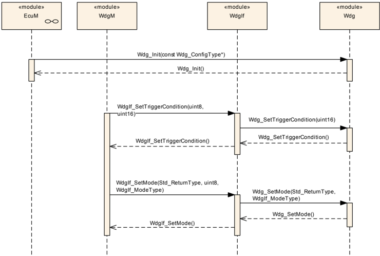
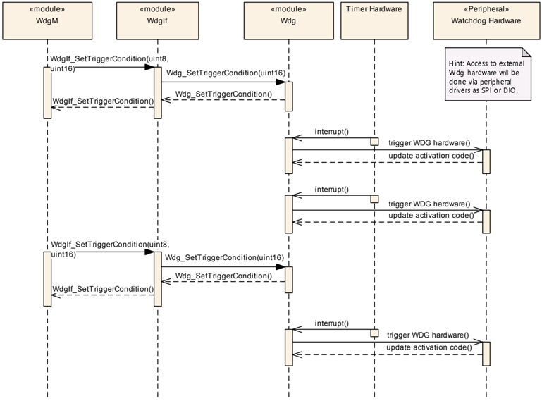

## 1. 简介和功能概述

本文档规定 **AUTOSAR** 基础软件模块**看门狗驱动**（**Wdg**）的功能、**API** 和配置。

本模块提供用于初始化、更改工作模式和设置触发条件（超时）的服务。

内部看门狗驱动和外部看门狗驱动的功能需求和功能范围是相同的。因此，它们的 **API** 在语义上是相同的。

内部看门狗驱动属于**微控制器抽象层**（**MCAL**），而外部看门狗驱动属于板载设备抽象层。因此，外部看门狗驱动需要其他驱动（**MCAL** 中的驱动）才能访问微控制器硬件。

## 2. 缩略语

以下术语表收录与**看门狗驱动**模块相关、且未包含在 [1，AUTOSAR 术语表] 中的缩略语和缩写。

**DIP**
> 数字输入/输出（**Digital Input/Output**）

**DET**
> 默认错误跟踪器（**Default Error Tracer**）

**DEM**
> 诊断事件管理器（**Diagnostic Event Manager**）——处理诊断相关事件的模块。

**SPI**
> 串行外设接口（**Serial Peripheral Interface**）

**WDG**
> 看门狗（**Watchdog**，模块特定前缀）

**Off-Mode**
> 看门狗硬件被禁用/关闭。这样做可能是为了关闭整个 **ECU**，而不遭受仍在运行的外部看门狗的周期性复位。对于安全关键系统，该模式可能不被允许。在这种情况下，必须将 **Wdg** 模块配置为禁止切换到此模式。

**Slow-Mode**
> 对看门狗硬件的触发可以以较长的超时期限完成。例如，该模式可用于系统启动/初始化阶段。例如，看门狗硬件被配置为翻转模式（对触发的时间点没有约束）且超时期限为 20 毫秒。

**Fast-Mode**
> 对看门狗硬件的触发必须以较短的超时期限完成。例如，该模式可用于 **ECU** 的正常运行。例如，看门狗硬件被配置为窗口模式（触发看门狗必须发生在超时期限内的特定最小/最大边界中）且超时期限为 5 毫秒。

## 3. 相关文档

### 3.1. 输入文件和相关标准与规范

<a id="ref-1"></a>[1] AUTOSAR 术语表
> AUTOSAR_FO_TR_Glossary

<a id="ref-2"></a>[2] 基础软件模块通用规范
> AUTOSAR_CP_SWS_BSWGeneral

<a id="ref-3"></a>[3] 分层软件架构
> AUTOSAR_CP_EXP_LayeredSoftwareArchitecture

<a id="ref-4"></a>[4] 看门狗驱动需求
> AUTOSAR_CP_SRS_WatchdogDriver

<a id="ref-5"></a>[5] 基础软件模块通用需求
> AUTOSAR_CP_SRS_BSWGeneral

<a id="ref-6"></a>[6] SPAL 通用需求
> AUTOSAR_CP_SRS_SPALGeneral

### 3.2. 相关规范

**AUTOSAR** 提供了基础软件模块通用规范 [\[2\]](#ref-2)（**SWS BSW General**），该规范同样适用于**看门狗驱动**。

因此，规范 **SWS BSW General** 应被视为**看门狗驱动**的附加且必需的规范。

## 4. 约束和假设

### 4.1. 限制

无限制。

### 4.2. 汽车域的适用性

无限制。

## 5. 对其他模块的依赖

用于内部（片上）看门狗的 **Wdg** 模块直接访问微控制器硬件，位于**微控制器抽象层**。

用于外部看门狗的 **Wdg** 模块使用其他模块（例如 **SPI**）访问外部看门狗设备。这样的 **Wdg** 模块位于板载设备抽象层（见 [\[3\]](#ref-3)）。

用于外部看门狗驱动的 **Wdg** 模块的源代码应独立于微控制器平台。

### 5.1. 文件结构

#### 5.1.1. 代码文件结构

**Wdg** 模块的代码文件结构不应在本规范中完全定义。此处应指出的是，代码文件结构应包含以下文件（在需要的范围内；名称扩展见下文）：

* Wdg_Lcfg.c —— 用于链接时可配置参数
* Wdg_PBcfg.c —— 用于构建后时可配置参数

如果内部看门狗服务被实现为中断例程，则代码文件结构应包含用于存放中断框架的 Wdg_Irq.c。

这些文件应包含所有链接时和构建后时可配置的参数。

**注意：** 这些文件名称是 [5, 基础软件模块通用需求] 和基础软件模块通用需求所要求的。

如果 **ECU** 上存在多于一个看门狗驱动实例（即一个外部和一个内部实例），实现者应通过名称扩展提供唯一的代码文件名，以满足基础软件驱动实例的命名区分要求 [\[5\]](#ref-5)。

#### 5.1.2. 头文件结构

如果 **ECU** 上存在多于一个看门狗驱动实例（即一个外部和一个内部实例），实现者应通过名称扩展提供唯一的头文件名，以满足基础软件驱动实例的命名区分要求 [\[5\]](#ref-5)。

**注意：** 在存在多个看门狗驱动实例的情况下，本规范定义的生产错误的 **Event Id** 符号（见第 6.5.5 章和第 6.5.1 章，以及配置容器 WdgDemEventParameterRefs）可能在 **DEM** 的配置中被扩展，以使它们唯一。

#### 5.1.3. 版本检查

详情请参阅 **SWS BSW General** 第 5.1.8 章「版本检查」。

### 5.2. 系统时钟

如果内部看门狗的硬件依赖于系统时钟，则系统时钟的更改（例如 **PLL** 开启或关闭）也可能影响看门狗硬件的时钟设置。

### 5.3. 板载通信处理程序

用于外部看门狗设备的 **Wdg** 模块依赖于所使用的板载通信处理程序或驱动（例如 **SPI** 处理程序）的 **API** 和能力。

## 6. 功能规格

### 6.1. 通用设计规则

**Wdg** 模块应静态检查配置参数的正确性（最迟在编译时）。

**Wdg** 模块不应实现去初始化/关闭接口。如果看门狗支持去初始化/关闭且环境允许使用该特性，则应通过以 **OFF** 模式参数调用 [**Wdg_SetMode**](#732-wdg_setmode) 例程来实现去初始化/关闭。

理由：某些看门狗不支持去初始化/关闭功能，并且在某些环境中不得使用该特性（例如在安全关键系统中）。

如果为了确保数据一致性或本模块的正确功能而必须禁用中断（例如在切换看门狗模式期间或在看门狗触发例程期间），应尽可能通过使用相应的 **BSW 调度器**功能来完成（这意味着定义一个独占区域）。内部看门狗驱动（因为它属于 **MCAL**）也可以直接禁用中断——见 [5, 基础软件模块通用需求]。

根据静态配置（见配置参数 **WdgRunArea**），**Wdg** 模块的代码或者从 **ROM** 执行，或者从 **RAM** 执行。

动机：对于某些用例（例如引导加载模式下的 flash 编程），**Wdg** 模块必须是在 **RAM** 中运行的可执行文件的一部分。

提示：这更多是针对构建环境的要求，而不是针对看门狗模块本身。但是，由于它也可能影响代码的实现，因此在此提出，并给出相应的配置参数。

### 6.2. 外部看门狗驱动

要访问外部看门狗硬件，相应的 **Wdg** 模块实例应使用相应处理程序或驱动的功能和 **API**，例如 **SPI** 处理程序或 **DIO** 驱动。

**注意：** 服务外部看门狗的例程可以通过使用自己的内部硬件计时器来实现，以便独立于其他外设；也可以通过使用 **GPT** 驱动回调来实现。

**提示：** 外部看门狗驱动属于板载设备抽象层（见 [\[3\]](#ref-3)），该层排除直接的硬件访问。这一架构上的差异将在后续版本中解决。

用于外部看门狗的 **Wdg** 模块应满足与用于内部看门狗的 **Wdg** 模块相同的功能需求，并提供相同的功能范围。因此，它们各自的 **API** 在语义上是相同的。

**Wdg** 模块应将访问外部看门狗硬件所需的全部参数（例如所使用的 **SPI** 通道或 **DIO** 端口）添加到模块的已发布参数和模块的配置参数中。

### 6.3. 内部看门狗驱动

要访问内部看门狗硬件，相应的 **Wdg** 模块实例应直接访问硬件进行看门狗服务。

**提示：** 内部看门狗驱动属于微控制器抽象层（见 [\[3\]](#ref-3)），该层允许直接的硬件访问。

**注意：** 服务内部看门狗的例程可以通过使用内部硬件计时器来实现，以便独立于其他外设；也可以通过使用 **GPT** 驱动回调来实现。

如果看门狗服务例程被实现为中断例程（即作为 cat1 或 cat2 中断例程实现，而不是通过 **GPT** 实现），则应在基础软件模块描述中对其加以描述，且实现应遵循 [\[5\]](#ref-5) 和 [\[6\]](#ref-6) 给出的中断处理需求。

### 6.4. 触发概念以支持窗口看门狗

在本规范的早期版本中，看门狗服务例程由软件的上层调用，这使得难以保证时序约束，特别是窗口看门狗条件。这一概念已经更改，形成了本章所解释的需求。

这一概念的基本思想是将服务看门狗硬件的时序从逻辑控制中解耦出来。

触发看门狗的时基可以通过硬件的方式提供。这确保了最小的时序抖动。直接从定时器 **ISR** 服务看门狗硬件可确保最小的延迟。

这两个条件——最小抖动和最小延迟——确保能够满足窗口看门狗的时间窗口。

**Wdg 驱动**期望：看门狗的逻辑控制（是否应触发看门狗）由环境（例如**看门狗管理器**）负责，以便**看门狗管理器**的基本概念（**存活监督**）保持不变。

**看门狗管理器**（或其他实体）应通过所谓的触发条件来控制看门狗驱动：只要触发条件有效，**Wdg 驱动**就会服务看门狗硬件；如果触发条件变为无效，**Wdg 驱动**将停止触发，看门狗将超时。

触发条件的语义可以解释为「允许在接下来的 n 毫秒内服务看门狗」。在此时间范围内，触发条件必须由控制实体更新，否则看门狗将超时。

看门狗控制逻辑的交接只需通过共享使用触发条件来完成（例如在启动/关闭期间）。

如果触发计数器大于零，看门狗服务例程应递减触发计数器并触发硬件看门狗。

如果触发计数器已达到零，看门狗服务例程应不执行任何操作（即不触发看门狗，因此看门狗将超时）。

如果看门狗硬件需要可配置或可更改的激活码，**Wdg 驱动**应在内部处理该激活码。在这种情况下，**Wdg 驱动**应将正确的激活码传递给看门狗硬件，而看门狗硬件相应地应更新 **Wdg** 模块内部变量中存储的下一个预期访问码。

如果看门狗硬件需要可配置或可更改的激活码，则 **Wdg 驱动**的触发周期应定义为某个值，以便能够保证看门狗硬件更新激活码（见图 2）。

如果看门狗硬件需要可配置或可更改的激活码且初始激活码可配置，则激活码应提供在 **Wdg 驱动**的配置集中。如果激活码对特定硬件是固定的，则可以忽略上述需求。

当为 **Wdg 驱动**模块启用开发错误检测时：看门狗服务例程应检查 **Wdg** 模块的状态是否为 **WDG_IDLE**（表示看门狗驱动和硬件已初始化，且当前没有在触发或切换看门狗）。如果不是这种情况，该函数不应触发看门狗硬件，而应引发开发错误 [**WDG_E_DRIVER_STATE**](#651-开发错误)。

当为 **Wdg 驱动**模块启用开发错误检测时：看门狗服务例程应在其执行期间将 **Wdg** 模块的状态设置为 **WDG_BUSY**（表示模块忙），并应在返回之前的最后一步操作将模块的状态复位为 **WDG_IDLE**（表示模块已初始化且不忙）。

**注意：** 本规范仅在 **WDG_IDLE** 和 **WDG_BUSY** 符号对外可见（例如用于调试）时规定了这两个符号。状态变量的数据类型选择由实现决定。

**面向集成的提示：** **Wdg** 模块的环境应确保在调用看门狗服务例程之前，**Wdg 驱动**模块已被初始化。

### 6.5. 错误分类

文档《基础软件模块通用规范》的第 7.x 章「错误处理」详细描述了基础软件的错误处理。其中最重要的是，它构成了一个分类体系，该体系由 **BSW** 模块中可能发生的五种错误类型组成。

在此基础上，以下各小节按所属的小节对特定错误进行规定。

#### 6.5.1. 开发错误

| 错误类型 | 相关错误代码 | 错误值 |
|---|---|---|
| **API** 服务在错误的上下文中使用（例如模块未初始化） | WDG_E_DRIVER_STATE | 0x10 |
| **API** 服务以错误/不一致的参数被调用 | WDG_E_PARAM_MODE | 0x11 |
| **API** 服务以错误/不一致的参数被调用 | WDG_E_PARAM_CONFIG | 0x12 |
| 传入的超时值高于最大超时值 | WDG_E_PARAM_TIMEOUT | 0x13 |
| **API** 以错误的指针值被调用（例如 **NULL** 指针） | WDG_E_PARAM_POINTER | 0x14 |
| 无效的配置集选择 | WDG_E_INIT_FAILED | 0x15 |

#### 6.5.2. 运行时错误

不存在运行时错误。

#### 6.5.3. 瞬时故障

不存在瞬时故障。

#### 6.5.4. 生产错误

不存在生产错误。

#### 6.5.5. 扩展生产错误

| 错误名称 | WDG_E_MODE_FAILED |
|---|---|
| 简短描述 | 设置看门狗模式失败 |
| 详细描述 | 在初始化或模式切换期间设置看门狗模式失败。 |
| 检测条件 | 失败：设置看门狗模式失败。 |
| 检测条件 | 通过：设置看门狗模式未失败。 |
| 辅助参数 | - |
| 所需时间 | - |
| 监控频率 | 取决于上层 |

当设置看门狗模式失败时，扩展生产错误 **WDG_E_MODE_FAILED** 应以 **FAILED** 报告。

当设置看门狗模式未失败时，扩展生产错误 **WDG_E_MODE_FAILED** 应以 **PASSED** 报告。

| 错误名称 | WDG_E_DISABLE_REJECTED |
|---|---|
| 简短描述 | 禁用看门狗模式失败 |
| 详细描述 | 初始化或看门狗模式切换失败，因为这将禁用看门狗，而在此配置中不允许这样做。 |
| 检测条件 | 失败：禁用看门狗模式失败。 |
| 检测条件 | 通过：禁用看门狗模式未失败。 |
| 辅助参数 | - |
| 所需时间 | - |
| 监控频率 | 取决于上层 |

当禁用看门狗模式失败时，扩展生产错误 **WDG_E_DISABLE_REJECTED** 应以 **FAILED** 报告。

当禁用看门狗模式未失败时，扩展生产错误 **WDG_E_DISABLE_REJECTED** 应以 **PASSED** 报告。

## 7. API规范

如果 **ECU** 上存在多于一个看门狗驱动实例（即一个外部和一个内部实例），则本章规定的 **API** 名称和实例特定的类型名称应通过命名扩展使其唯一（遵循基础软件驱动实例的命名区分要求 [\[5\]](#ref-5)）。

### 7.1. 导入的类型

本章列出从以下模块导入的所有类型：

| 模块 | 头文件 | 导入类型 |
|---|---|---|
| Dem | Rte_Dem_Type.h | Dem_EventIdType |
|  | Rte_Dem_Type.h | Dem_EventStatusType |
| Std | Std_Types.h | Std_ReturnType |
|  | Std_Types.h | Std_VersionInfoType |
| WdgIf | WdgIf.h | WdgIf_ModeType |

### 7.2. 类型定义

#### 7.2.1. Wdg_ConfigType

| 名称 | Wdg_ConfigType |
|---|---|
| 种类 | 结构体 |
| 元素 | 硬件相关的结构体 |
| 元素类型 | - |

**说明**: 该结构用于保存看门狗驱动的配置集。指向该结构的指针用于将配置数据提供给 **Wdg** 模块初始化例程，以配置模块和看门狗硬件。可通过 **Wdg.h** 获得。

### 7.3. 函数定义

#### 7.3.1. Wdg_Init

**说明**: 此服务初始化模块。参数 ConfigPtr（in）：指向配置集的指针。无返回值。可通过 **Wdg.h** 获得。本服务为同步调用，不可重入。服务 ID 0x00。

```C
void Wdg_Init ( const Wdg_ConfigType* ConfigPtr )
```

**Wdg_Init** 函数应初始化 **Wdg** 模块和看门狗硬件，即它应按照配置集中提供的设置设置默认的看门狗模式和超时期限。

**注意：** 通过构建后配置，用户可以从有限数量的静态配置集中选择与 **Wdg_Init** 函数一起使用的配置集（另见 [5, 基础软件模块通用需求]）。

**Wdg_Init** 函数应初始化 **Wdg** 模块的所有全局变量，并设置默认的看门狗模式和初始超时期限。

**Wdg_Init** 函数应初始化控制看门狗硬件所需的、且不影响/不依赖于其他（硬件）模块的那些控制器寄存器。可能影响或依赖于其他模块的寄存器由公共系统模块初始化。

如果不允许禁用看门狗（因为预编译配置参数 **WdgDisableAllowed** == **OFF**），且所提供的配置集中给出的默认模式会禁用看门狗，则 **Wdg_Init** 函数不应执行初始化，而应引发扩展生产错误 [**WDG_E_DISABLE_REJECTED**](#655-扩展生产错误)。

如果无法将 **Wdg** 模块和看门狗硬件切换到默认模式——例如由于不一致的模式设置或由于某些时序约束未被满足——则 **Wdg_Init** 函数应引发扩展生产错误 [**WDG_E_MODE_FAILED**](#655-扩展生产错误)。

当为 **Wdg** 模块启用开发错误检测时：**Wdg_Init** 函数应检查所给配置集的（硬件特定）内容是否在允许的边界内。如果检测到此错误，**Wdg_Init** 函数不应执行初始化，而应引发扩展错误 [**WDG_E_PARAM_CONFIG**](#651-开发错误)。

当为 **Wdg** 模块启用开发错误检测时：如果初始化成功，**Wdg_Init** 函数应将 **Wdg** 模块的内部状态从 **WDG_UNINIT**（表示模块未初始化的默认状态）设置为 **WDG_IDLE**。

**注意：** 本规范仅在 **WDG_IDLE** 和 **WDG_UNINIT** 符号对外可见（例如用于调试）时规定了这两个符号。状态变量的数据类型选择由实现决定。

#### 7.3.2. Wdg_SetMode

**说明**: 此服务将看门狗切换到模式 **Mode**。参数 Mode（in）：以下静态配置模式之一：1. WDGIF_OFF_MODE 2. WDGIF_SLOW_MODE 3. WDGIF_FAST_MODE。返回值：**Std_ReturnType**。可通过 **Wdg.h** 获得。本服务为同步调用，不可重入。服务 ID 0x01。

```C
Std_ReturnType Wdg_SetMode ( WdgIf_ModeType Mode )
```

**Wdg_SetMode** 函数应将看门狗驱动从当前的看门狗模式切换到参数 **Mode** 给定的模式。这意味着：通过选择有限数量的静态配置设置之一（例如翻转或窗口看门狗、不同的超时期限），**Wdg** 模块和看门狗硬件被切换到以下三种不同模式之一：

* WDGIF_OFF_MODE
* WDGIF_SLOW_MODE
* WDGIF_FAST_MODE

提供给 **Wdg** 模块初始化例程的配置集应包含在不同看门狗模式中要使用的硬件/驱动特定参数。

**Wdg_SetMode** 函数应根据新的看门狗模式复位看门狗超时计数器，也就是说，应基于更改后的触发周期重新计算剩余的超时时间范围。

如果模式切换已被完整且成功地执行（即 **Wdg** 模块和看门狗硬件的所有参数都已设置为新值），则 **Wdg_SetMode** 函数应返回 **E_OK**。

如果无法将 **Wdg** 模块和看门狗硬件切换到所请求的模式——例如由于不一致的模式设置或由于某些时序约束未被满足——则 **Wdg_SetMode** 函数应返回 **E_NOT_OK** 并引发扩展生产错误 [**WDG_E_MODE_FAILED**](#655-扩展生产错误)。

如果不允许禁用看门狗（例如在安全相关系统中，见配置参数 **WdgDisableAllowed**），则 **Wdg_SetMode** 函数应检查所请求模式的设置是否会禁用看门狗。在这种情况下，该函数不应执行模式切换，而应引发扩展生产错误 [**WDG_E_DISABLE_REJECTED**](#655-扩展生产错误) 并返回 **E_NOT_OK**。

当为 **Wdg** 模块启用开发错误检测时：**Wdg_SetMode** 函数应检查参数 **Mode** 是否在允许的取值范围内。如果不是这种情况，该函数不应执行模式切换，而应引发开发错误 [**WDG_E_PARAM_MODE**](#651-开发错误)。

当为 **Wdg** 模块启用开发错误检测时：**Wdg_SetMode** 函数应检查所请求模式的（硬件特定）设置是否在允许的边界内。如果不是这种情况，该函数不应执行模式切换，而应引发开发错误 [**WDG_E_PARAM_MODE**](#651-开发错误)。

当为 **Wdg** 模块启用开发错误检测时：**Wdg_SetMode** 函数应检查 **Wdg** 模块的状态是否为 **WDG_IDLE**（表示 **Wdg** 模块和看门狗硬件已初始化，且当前没有在触发或切换看门狗）。如果不是这种情况，该函数不应执行模式切换，而应引发开发错误 [**WDG_E_DRIVER_STATE**](#651-开发错误)。

当为 **Wdg** 模块启用开发错误检测时：**Wdg_SetMode** 函数应在其执行期间将 **Wdg** 模块的状态设置为 **WDG_BUSY**（表示模块忙），并应在返回调用者之前的最后一步操作将 **Wdg** 模块的状态复位为 **WDG_IDLE**。

**注意：** 本规范仅在 **WDG_IDLE** 和 **WDG_BUSY** 符号对外可见（例如用于调试）时规定了这两个符号。状态变量的数据类型选择由实现决定。

#### 7.3.3. Wdg_SetTriggerCondition

**说明**: 此服务为触发计数器设置超时值。参数 timeout（in）：用于设置触发计数器的超时值（毫秒）。无返回值。可通过 **Wdg.h** 获得。本服务为同步调用，不可重入。服务 ID 0x03。

```C
void Wdg_SetTriggerCondition ( uint16 timeout )
```

**Wdg_SetTriggerCondition** 函数应根据传入的超时值复位看门狗超时计数器。

传入的超时值应被解释为「毫秒」。从毫秒到相应计数器值的转换应由 **Wdg** 模块在内部完成。

在根据超时参数计算计数器值时，应考虑当前的看门狗模式。

该函数还应允许将「0」设置为触发的时间范围，这将导致（几乎）立即停止看门狗触发和（几乎）瞬时的 **ECU** 看门狗复位。如果看门狗内部存储的计数器值为「0」，则 **Wdg_SetTriggerCondition** 服务应不执行任何操作，即应忽略通过参数传给 **Wdg_SetTriggerCondition** 的计数器。

当为该模块启用开发错误检测时：**Wdg_SetTriggerCondition** 函数应检查所给的超时参数是否小于或等于最大超时值（**WdgMaxTimeout**）。如果不是这种情况，该函数不应重新加载超时计数器，而应引发开发错误 [**WDG_E_PARAM_TIMEOUT**](#651-开发错误) 并返回调用者。

#### 7.3.4. Wdg_GetVersionInfo

**说明**: 此服务返回该模块的版本信息。参数 versioninfo（out）：指向存储本模块版本信息的位置的指针。无返回值。可通过 **Wdg.h** 获得。本服务为同步调用，可重入。服务 ID 0x04。

```C
void Wdg_GetVersionInfo ( Std_VersionInfoType* versioninfo )
```

如果为 **Wdg 驱动**模块启用了开发错误检测，则当参数为 **NULL** 指针时，**Wdg_GetVersionInfo** 函数应引发 [**WDG_E_PARAM_POINTER**](#651-开发错误) 并不做任何动作直接返回。

### 7.4. 回调通知

本章列出由 **Wdg** 模块提供给下层模块的所有函数。

**Wdg** 模块没有回调通知。

### 7.5. 调度函数

本章列出由 **Wdg** 模块提供、并由基础软件模块调度器直接调用的所有函数。

**Wdg** 模块没有调度函数。

### 7.6. 期望接口

本章列出 **Wdg** 模块要求其他模块提供的所有函数。

#### 7.6.1. 强制接口

本模块不需要任何强制接口。

#### 7.6.2. 可选接口

本章列出实现本模块可选功能所必需的所有接口。

| **API** 函数 | 头文件 | 描述 |
|---|---|---|
| Dem_SetEventStatus | Dem.h | 由 **SW-C** 或 **BSW** 模块调用，用于向 **DEM** 报告监控状态信息。调用 Dem_SetEventStatus 的 **BSW** 模块可以安全地忽略返回值。仅当 ({Dem/DemConfigSet/DemEventParameter/DemEventReportingType} == **STANDARD_REPORTING**) 时该 **API** 才可用。 |
| Det_ReportError | Det.h | 用于报告开发错误的服务。 |

#### 7.6.3. 可配置接口

本模块不需要任何可配置接口。

## 8. 时序图

### 8.1. 看门狗初始化、设置触发条件和模式。

该图展示初始化 **Wdg** 模块、设置触发条件以及更改看门狗模式的时序。注意这只是一个示例。特别是，可以由**看门狗管理器**（**WdgM**）以外的其他「客户端」模块来设置触发条件。



### 8.2. 看门狗驱动与硬件之间的数据交换

该图展示当 **WDG** 服务例程被实现为中断例程时触发看门狗硬件的时序。注意这只是一个示例，触发例程是实现特定的。对于外部看门狗，无法直接访问看门狗硬件，而只能通过 **MCAL** 层的驱动（如 **SPI** 或 **DIO**）访问。



## 9. 配置规范

通常，本章定义配置参数及其到容器的聚类。为支持本规范，第 9.1 章描述基础知识，并规定用于参数规范的一个模板（表）。我们有意保留第 9.1 章在规范中，以保证可理解性。

第 9.2 章规定模块 **Wdg** 的结构（容器）和参数。

第 9.3 章规定模块 **Wdg** 的发布信息。

### 9.1. 如何阅读本章

详情请参阅 [2, 基础软件模块通用规范] 第 10.1 章「配置规范导论」。

### 9.2. 容器与配置参数

以下各章汇总所有配置参数。参数的详细含义在第 6 章和第 7 章中描述。

#### 9.2.1. Wdg

| SWS 条目 | [ECUC_Wdg_00082] |
|---|---|
| 容器名称 | WdgSettingsConfig |
| 父容器 | Wdg |
| 描述 | 用于不同看门狗设置的配置项，包括外部看门狗硬件的设置。**注意：** 所有构建后参数都通过此容器处理。 |
| 配置参数 | 见下方参数表 |

| SWS 条目 | [ECUC_Wdg_00120] |
|---|---|
| 参数名称 | WdgDefaultMode |
| 父容器 | WdgSettingsConfig |
| 描述 | 看门狗驱动初始化的默认模式。 **ImplementationType**: WdgIf_ModeType |
| 多重性 | 1 |
| 类型 | EcucEnumerationParamDef |
| 取值范围 | WDGIF_FAST_MODE —— 默认看门狗模式为「快」。 |
| 取值范围 | WDGIF_OFF_MODE —— 默认看门狗模式为「关」。 |
| 取值范围 | WDGIF_SLOW_MODE —— 默认看门狗模式为「慢」。 |
| Post-Build 变体值 | true |
| 值配置类 | Pre-compile time：x（VARIANT-PRE-COMPILE）；Link time：x（VARIANT-LINK-TIME）；Post-build time：x（VARIANT-POST-BUILD） |
| 作用域/依赖 | scope: local；仅当允许禁用看门狗驱动时才可能使用「Off」模式 |

| 容器名称 | 多重性 | 作用域/依赖 |
|---|---|---|
| WdgExternalConfiguration | 0..1 | 外部看门狗硬件的配置项 |
| WdgSettingsFast | 1 | 看门狗驱动「快」模式的硬件相关设置。 |
| WdgSettingsOff | 1 | 看门狗驱动「关」模式的硬件相关设置。 |
| WdgSettingsSlow | 1 | 看门狗驱动「慢」模式的硬件相关设置。 |

| SWS 条目 | [ECUC_Wdg_00114] |
|---|---|
| 容器名称 | WdgGeneral |
| 父容器 | Wdg |
| 描述 | 看门狗驱动的所有通用参数都收集在此。 |
| 配置参数 | 见下方参数表 |

| SWS 条目 | [ECUC_Wdg_00115] |
|---|---|
| 参数名称 | WdgDevErrorDetect |
| 父容器 | WdgGeneral |
| 描述 | 开启或关闭开发错误检测与通知。**true**：启用检测与通知。**false**：禁用检测与通知。 |
| 多重性 | 1 |
| 类型 | EcucBooleanParamDef |
| 默认值 | false |
| Post-Build 变体值 | false |
| 值配置类 | Pre-compile time：x（All Variants）；Link time：-；Post-build time：- |
| 作用域/依赖 | scope: local |

| SWS 条目 | [ECUC_Wdg_00116] |
|---|---|
| 参数名称 | WdgDisableAllowed |
| 父容器 | WdgGeneral |
| 描述 | 允许/禁止在运行期禁用看门狗驱动的编译开关。**true**：允许在运行期禁用看门狗驱动。**false**：不允许在运行期禁用看门狗驱动。 |
| 多重性 | 1 |
| 类型 | EcucBooleanParamDef |
| 默认值 | - |
| Post-Build 变体值 | false |
| 值配置类 | Pre-compile time：x（All Variants）；Link time：-；Post-build time：- |
| 作用域/依赖 | scope: local；安全相关编译开关，必须与**看门狗管理器**的相应设置一致 |

| SWS 条目 | [ECUC_Wdg_00117] |
|---|---|
| 参数名称 | WdgIndex |
| 父容器 | WdgGeneral |
| 描述 | 指定此模块实例的 **InstanceId**。如果只存在一个模块实例，它应具有 Id 0。 |
| 多重性 | 1 |
| 类型 | EcucIntegerParamDef（为该参数生成的符号名称） |
| 取值范围 | 0 .. 255 |
| 默认值 | - |
| Post-Build 变体值 | false |
| 值配置类 | Pre-compile time：x（All Variants）；Link time：-；Post-build time：- |
| 作用域/依赖 | scope: local |

| SWS 条目 | [ECUC_Wdg_00130] |
|---|---|
| 参数名称 | WdgInitialTimeout |
| 父容器 | WdgGeneral |
| 描述 | 在 Init 函数期间为触发条件初始化的初始超时（单位：秒）。它不应大于 **WdgMaxTimeout**。 |
| 多重性 | 1 |
| 类型 | EcucFloatParamDef |
| 取值范围 | [0 .. 65.535] |
| 默认值 | - |
| Post-Build 变体值 | false |
| 值配置类 | Pre-compile time：x（All Variants）；Link time：-；Post-build time：- |
| 作用域/依赖 | scope: local |

| SWS 条目 | [ECUC_Wdg_00131] |
|---|---|
| 参数名称 | WdgMaxTimeout |
| 父容器 | WdgGeneral |
| 描述 | 看门狗触发条件可以初始化到的最大超时（单位：秒）。 |
| 多重性 | 1 |
| 类型 | EcucFloatParamDef |
| 取值范围 | [0 .. 65.535] |
| 默认值 | - |
| Post-Build 变体值 | false |
| 值配置类 | Pre-compile time：x（All Variants）；Link time：-；Post-build time：- |
| 作用域/依赖 | scope: local |

| SWS 条目 | [ECUC_Wdg_00147] |
|---|---|
| 参数名称 | WdgRunArea |
| 父容器 | WdgGeneral |
| 描述 | 表示看门狗驱动的执行区域：或者从 **ROM** 区域执行，或者从 **RAM** 区域执行，取决于具体微控制器的要求。 |
| 多重性 | 1 |
| 类型 | EcucEnumerationParamDef |
| 取值范围 | RAM —— 看门狗驱动从 **RAM** 区域执行。 |
| 取值范围 | ROM —— 看门狗驱动从 **ROM** 区域执行。 |
| Post-Build 变体值 | false |
| 值配置类 | Pre-compile time：x（All Variants）；Link time：-；Post-build time：- |
| 作用域/依赖 | scope: local |

| SWS 条目 | [ECUC_Wdg_00119] |
|---|---|
| 参数名称 | WdgVersionInfoApi |
| 父容器 | WdgGeneral |
| 描述 | 用于启用/禁用版本信息 **API** 的编译开关。**true**：**API** 启用。**false**：**API** 禁用。 |
| 多重性 | 1 |
| 类型 | EcucBooleanParamDef |
| 默认值 | false |
| Post-Build 变体值 | false |
| 值配置类 | Pre-compile time：x（All Variants）；Link time：-；Post-build time：- |
| 作用域/依赖 | scope: local |

| SWS 条目 | [ECUC_Wdg_00353] |
|---|---|
| 参数名称 | WdgEcucPartitionRef |
| 父容器 | WdgGeneral |
| 描述 | 将 **Wdg** 驱动映射到零个或一个 **ECUC** 分区，以使该模块的 **API** 在此分区内可用。 |
| 多重性 | 0..1 |
| 类型 | 对 EcucPartition 的引用 |
| Post-Build 多重性变体 | true |
| Post-Build 变体值 | true |
| 多重性配置类 | Pre-compile time：x（All Variants）；Link time：-；Post-build time：- |
| 值配置类 | Pre-compile time：x（All Variants）；Link time：-；Post-build time：- |
| 作用域/依赖 | scope: ECU |

无包含的容器。

| SWS 条目 | [ECUC_Wdg_00148] |
|---|---|
| 容器名称 | WdgDemEventParameterRefs |
| 父容器 | Wdg |
| 描述 | 用于引用 **DemEventParameter** 元素的容器，当相应错误发生时应使用 **API** Dem_SetEventStatus 触发这些元素。**Event Id** 取自被引用的 **DemEventParameter** 的 **DemEventId** 符号值。此容器提供标准化的错误，并可由供应商特定的错误引用加以扩展。 |
| 配置参数 | 见下方参数表 |

| SWS 条目 | [ECUC_Wdg_00150] |
|---|---|
| 参数名称 | WDG_E_DISABLE_REJECTED |
| 父容器 | WdgDemEventParameterRefs |
| 描述 | 对 **DemEventParameter** 的引用，当发生错误「初始化或模式切换失败，因为这将禁用看门狗」时应触发该参数。 |
| 多重性 | 0..1 |
| 类型 | 对 DemEventParameter 的符号名称引用 |
| Post-Build 多重性变体 | false |
| Post-Build 变体值 | false |
| 多重性配置类 | Pre-compile time：x（All Variants）；Link time：-；Post-build time：- |
| 值配置类 | Pre-compile time：x（All Variants）；Link time：-；Post-build time：- |
| 作用域/依赖 | scope: local |

| SWS 条目 | [ECUC_Wdg_00149] |
|---|---|
| 参数名称 | WDG_E_MODE_FAILED |
| 父容器 | WdgDemEventParameterRefs |
| 描述 | 对 **DemEventParameter** 的引用，当发生错误「设置看门狗模式失败（在初始化或模式切换期间）」时应触发该参数。 |
| 多重性 | 0..1 |
| 类型 | 对 DemEventParameter 的符号名称引用 |
| Post-Build 多重性变体 | false |
| Post-Build 变体值 | false |
| 多重性配置类 | Pre-compile time：x（All Variants）；Link time：-；Post-build time：- |
| 值配置类 | Pre-compile time：x（All Variants）；Link time：-；Post-build time：- |
| 作用域/依赖 | scope: local |

无包含的容器。

| SWS 条目 | [ECUC_Wdg_00073] |
|---|---|
| 模块名称 | Wdg |
| 描述 | **Wdg**（**看门狗驱动**）模块的配置。 |
| Post-Build 变体支持 | true |
| 支持的配置变体 | VARIANT-LINK-TIME, VARIANT-POST-BUILD, VARIANT-PRE-COMPILE |

| 容器名称 | 多重性 | 作用域/依赖 |
|---|---|---|
| WdgDemEventParameterRefs | 0..1 | 用于引用 **DemEventParameter** 元素的容器，当相应错误发生时应使用 **API** Dem_SetEventStatus 触发这些元素。**Event Id** 取自被引用的 **DemEventParameter** 的 **DemEventId** 符号值。此容器提供标准化的错误，并可由供应商特定的错误引用加以扩展。 |
| WdgGeneral | 1 | 看门狗驱动的所有通用参数都收集在此。 |
| WdgPublishedInformation | 1 | 保存所有 **Wdg** 特定发布信息参数的容器 |
| WdgSettingsConfig | 1 | 用于不同看门狗设置的配置项，包括外部看门狗硬件的设置。**注意：** 所有构建后参数都通过此容器处理。 |

这三种模式之所以作为容器提供，是因为其他模块可能引用它们，因此不需要参数。不过，这些容器可以由供应商（或硬件）特定的配置参数加以扩展，但无法将这些参数标准化。

#### 9.2.2. WdgSettingsFast

| SWS 条目 | [ECUC_Wdg_00112] |
|---|---|
| 容器名称 | WdgExternalConfiguration |
| 父容器 | WdgSettingsConfig |
| 描述 | 外部看门狗硬件的配置项 |
| 配置参数 | 见下方参数表 |

| SWS 条目 | [ECUC_Wdg_00113] |
|---|---|
| 参数名称 | WdgExternalContainerRef |
| 父容器 | WdgExternalConfiguration |
| 描述 | 对以下之一的引用： **DioChannelGroup** 容器（当硬件看门狗通过 **DIO** 引脚连接时）； **SpiSequenceConfiguration** 容器（当通过 **SPI** 访问看门狗硬件时）。 |
| 多重性 | 0..1 |
| 类型 | 对 [DioChannelGroup, SpiSequence] 的选择引用 |
| Post-Build 多重性变体 | true |
| Post-Build 变体值 | true |
| 多重性配置类 | Pre-compile time：x（VARIANT-PRE-COMPILE）；Link time：x（VARIANT-LINK-TIME）；Post-build time：x（VARIANT-POST-BUILD） |
| 值配置类 | Pre-compile time：x（VARIANT-PRE-COMPILE）；Link time：x（VARIANT-LINK-TIME）；Post-build time：x（VARIANT-POST-BUILD） |
| 作用域/依赖 | scope: local；参见 **DIO** 或 **SPI** 的 **SWS** |

无包含的容器。

| SWS 条目 | [ECUC_Wdg_00122] |
|---|---|
| 容器名称 | WdgSettingsOff |
| 父容器 | WdgSettingsConfig |
| 描述 | 看门狗驱动「关」模式的硬件相关设置。 |
| 配置参数 | 见下方参数表 |

无包含的容器。

| SWS 条目 | [ECUC_Wdg_00123] |
|---|---|
| 容器名称 | WdgSettingsSlow |
| 父容器 | WdgSettingsConfig |
| 描述 | 看门狗驱动「慢」模式的硬件相关设置。 |
| 配置参数 | 见下方参数表 |

无包含的容器。

| SWS 条目 | [ECUC_Wdg_00121] |
|---|---|
| 容器名称 | WdgSettingsFast |
| 父容器 | WdgSettingsConfig |
| 描述 | 看门狗驱动「快」模式的硬件相关设置。 |
| 配置参数 | 见下方参数表 |

无包含的容器。

### 9.3. 发布信息

详情请参阅 [2, 基础软件模块通用规范] 第 10.3 章「发布信息」。

#### 9.3.1. WdgPublishedInformation

| SWS 条目 | [ECUC_Wdg_00074] |
|---|---|
| 容器名称 | WdgPublishedInformation |
| 父容器 | Wdg |
| 描述 | 保存所有 **Wdg** 特定发布信息参数的容器 |
| 配置参数 | 见下方参数表 |

| SWS 条目 | [ECUC_Wdg_00127] |
|---|---|
| 参数名称 | WdgTriggerMode |
| 父容器 | WdgPublishedInformation |
| 描述 | 看门狗触发模式（翻转/窗口/两者）。 |
| 多重性 | 1 |
| 类型 | EcucEnumerationParamDef |
| 取值范围 | WDG_BOTH —— - |
| 取值范围 | WDG_TOGGLE —— - |
| 取值范围 | WDG_WINDOW —— - |
| Post-Build 变体值 | false |
| 值配置类 | Published Information：x（All Variants） |
| 作用域/依赖 | scope: local |

无包含的容器。

WdgTriggerMode 仅为信息目的而发布；该参数不用于配置**看门狗驱动**或使用**看门狗驱动**的模块。

## B. AUTOSAR 可追溯项变更历史

### B.1. 本文档的可追溯项历史（按 AUTOSAR R23-11 版本）

#### B.1.1. R22-11 中新增的规范项

表 B.1：R22-11 中新增的规范项

```
[SWS_Wdg_NA_00175]
```

#### B.1.2. R22-11 中变更的规范项

表 B.2：R22-11 中变更的规范项

```
[SWS_Wdg_00010] [SWS_Wdg_00105] [SWS_Wdg_00106] [SWS_Wdg_00107] [SWS_Wdg_00109] [SWS_Wdg_00111] [SWS_Wdg_00155] [SWS_Wdg_00171]
```

#### B.1.3. R22-11 中删除的规范项

表 B.3：R22-11 中删除的规范项

```
[SWS_Wdg_00175]
```

#### B.1.4. R23-11 中新增的规范项

无。

#### B.1.5. R23-11 中变更的规范项

表 B.4：R23-11 中变更的规范项

| 编号 | 标题 |
|---|---|
| [SWS_Wdg_00105] | 模块 Wdg 导入的数据类型定义 |
| [SWS_Wdg_00107] | **API** 函数 Wdg_SetMode 的定义 |
| [SWS_Wdg_00111] | 模块 Wdg 可选接口的定义 |
| [SWS_Wdg_00171] | 数据类型 Wdg_ConfigType 的定义 |

#### B.1.6. R23-11 中删除的规范项

无。
