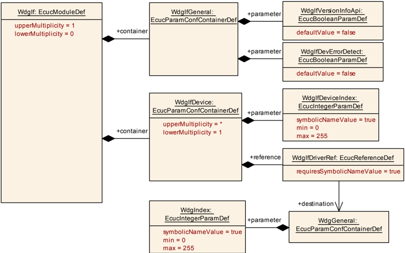

## 1. 简介和功能概述

本规范描述 **AUTOSAR** 基础软件模块**看门狗接口**（**Watchdog Interface**）的功能、**API** 和配置。

当 **ECU** 上使用多于一个看门狗设备和看门狗驱动（例如同时使用内部软件看门狗和外部硬件看门狗）时，本模块允许**看门狗管理器**（或看门狗的任何其他客户端）选择正确的看门狗驱动——也就是选择正确的看门狗设备——同时保留底层驱动的 **API** 和功能。

**看门狗接口**属于板载设备抽象层 [\[1\]](#ref-1)。

**看门狗接口**应提供对底层看门狗驱动服务（如模式切换和设置触发条件）的统一访问。

## 2. 缩略语

**注意：** 本模块没有本地缩略语和缩写。所有使用的缩略语和缩写应包含在 [2, TR 术语表] 中。

## 3. 相关文档

### 3.1. 输入文件和相关标准与规范

<a id="ref-1"></a>[1] 分层软件架构
> AUTOSAR_CP_EXP_LayeredSoftwareArchitecture

<a id="ref-2"></a>[2] 术语表
> AUTOSAR_FO_TR_Glossary

<a id="ref-3"></a>[3] 基础软件模块通用规范
> AUTOSAR_CP_SWS_BSWGeneral

<a id="ref-4"></a>[4] 基础软件模块通用需求
> AUTOSAR_CP_SRS_BSWGeneral

<a id="ref-5"></a>[5] 存储器硬件抽象层需求
> AUTOSAR_CP_SRS_MemoryHWAbstractionLayer

<a id="ref-6"></a>[6] SPAL 通用需求
> AUTOSAR_CP_SRS_SPALGeneral

<a id="ref-7"></a>[7] 看门狗驱动规范
> AUTOSAR_CP_SWS_WatchdogDriver

### 3.2. 相关规范

**AUTOSAR** 提供了基础软件模块通用规范 [\[3\]](#ref-3)（**SWS BSW General**），该规范同样适用于**看门狗接口**。

因此，规范 **SWS BSW General** 应被视为**看门狗接口**的附加且必需的规范。

## 4. 约束和假设

### 4.1. 限制

无限制。

### 4.2. 汽车域的适用性

无限制。

## 5. 对其他模块的依赖

**看门狗接口**属于 **ECU** 抽象层。它允许上层（尤其是**看门狗管理器**）统一地访问一个或多个看门狗驱动。因此，**看门狗接口**的实现取决于其下层的看门狗驱动数量。

### 5.1. 文件结构

#### 5.1.1. 代码文件结构

详情请参阅 [3, 基础软件模块通用规范] 第 5.1.6 章「代码文件结构」。

#### 5.1.2. 版本检查

详情请参阅 [3, 基础软件模块通用规范] 第 5.1.8 章「版本检查」。

## 6. 功能规格

### 6.1. 一般行为

**看门狗接口**不应向看门狗驱动添加任何功能。同时，**看门狗接口**也不对看门狗属性（如翻转（**toggle**）或窗口（**window**）模式、超时期限等）进行抽象——也就是说，它不隐藏底层看门狗驱动和看门狗硬件的任何特性。

### 6.2. 错误分类

文档 [4, 基础软件模块通用需求] 的「错误处理」章节详细描述了基础软件的错误处理。其中最重要的是，它构成了一个分类体系，该体系由 **BSW** 模块中可能发生的五种错误类型组成。

在此基础上，以下各节规定按相应子章节排列的具体错误。

#### 6.2.1. 开发错误

| 错误类型 | 相关错误代码 | 错误值 |
|---|---|---|
| **API** 服务以错误的设备索引参数被调用 | WDGIF_E_PARAM_DEVICE | 0x01 |
| **NULL** 指针检查 | WDGIF_E_PARAM_POINTER | 0x03 |

如果配置了多于一个看门狗驱动且本模块的开发错误检测已启用，则应在本模块的服务中检查参数 **DeviceIndex** 是否为已存在的设备。检测到的错误应以错误代码 **WDGIF_E_PARAM_DEVICE** 向**默认错误跟踪器**（**DET**）报告，且被调用的服务不应执行。

#### 6.2.2. 运行时错误

没有运行时错误。

#### 6.2.3. 瞬态故障

没有瞬态故障。

#### 6.2.4. 生产错误

没有生产错误。

#### 6.2.5. 扩展生产错误

没有扩展生产错误。

## 7. API规范

### 7.1. 导入的类型

本章列出从以下模块导入的所有类型：

| 模块 | 头文件 | 导入的类型 |
|---|---|---|
| Std | Std_Types.h | Std_ReturnType |
|  | Std_Types.h | Std_VersionInfoType |

### 7.2. 类型定义

**注意：** **看门狗接口**的实现者不得针对特定看门狗设备或平台更改或扩展**看门狗接口**的类型定义。

#### 7.2.1. WdgIf_ModeType

| 名称 | WdgIf_ModeType |
|---|---|
| 种类 | 枚举 |
| 取值范围 | WDGIF_OFF_MODE —— 在此模式下，看门狗驱动被禁用（关闭）。 |
| 取值范围 | WDGIF_SLOW_MODE —— 在此模式下，看门狗驱动被设置为较长的超时期限（慢速触发）。 |
| 取值范围 | WDGIF_FAST_MODE —— 在此模式下，看门狗驱动被设置为较短的超时期限（快速触发）。 |

**说明**: **WdgIf** 模块的模式类型。可通过 **WdgIf.h** 获得。

**WdgIf_ModeType** 的取值应作为参数传递给看门狗驱动的模式切换函数（**Wdg_SetMode**）。

**注意：** 这些模式背后的硬件特定设置在看门狗驱动的配置集中给出。

### 7.3. 函数定义

**看门狗接口**应将本章所规定的 **API** 映射到底层驱动的 **API**。关于功能行为，请参阅看门狗驱动的规范。

**看门狗接口**应使用参数 **DeviceIndex** 来选择看门狗驱动。如果只配置了一个看门狗驱动，则参数 **DeviceIndex** 应被忽略。

看门狗设备索引的数据类型应为 **uint8**。**DeviceIndex** 应提供一个从零开始的连续索引。

如果只配置了一个看门狗驱动，则**看门狗接口**在将**看门狗接口 API** 映射到相应**看门狗驱动 API** 时应不产生任何运行时开销。

实现提示：这可以通过使用宏来实现，例如

```C
#define WdgIf_SetMode(DeviceIndex, WdgMode) \
        Wdg_SetMode(WdgMode)
```

如果配置了多于一个看门狗驱动，则**看门狗接口**应使用高效的机制将 **API** 调用映射到相应的看门狗驱动。

实现提示：一种解决方案是使用函数指针表，其中参数 **DeviceIndex** 被用作数组索引，例如

```C
#define WdgIf_SetMode(DeviceIndex, WdgMode) \
        SetModeFctPtr[DeviceIndex](WdgMode)
```

**注意：** 这些服务 ID 与看门狗驱动规范 [\[7\]](#ref-7) 中的服务 ID 相关联。因此，它们不能以 0 开头。

#### 7.3.1. WdgIf_SetMode

**说明**: 此服务将服务 **WdgIf_SetMode** 映射到相应看门狗驱动的服务 **Wdg_SetMode**。参数 DeviceIndex（in）：标识看门狗驱动实例。参数 WdgMode（in）：看门狗驱动模式（见看门狗驱动）。返回值：**Std_ReturnType**。可通过 **WdgIf.h** 获得。本服务为同步调用，不可重入。

```C
Std_ReturnType WdgIf_SetMode ( uint8 DeviceIndex, WdgIf_ModeType WdgMode )
```

**WdgIf_SetMode** 应返回其从相应看门狗驱动的服务 **Wdg_SetMode** 得到的返回值。

返回值的可能内容由看门狗驱动规定，见 [\[7\]](#ref-7)。

#### 7.3.2. WdgIf_SetTriggerCondition

**说明**: 此服务将服务 **WdgIf_SetTriggerCondition** 映射到相应看门狗驱动的服务 **Wdg_SetTriggerCondition**。参数 DeviceIndex（in）：标识看门狗驱动实例。参数 Timeout（in）：用于设置触发计数器的超时值（毫秒）。无返回值。可通过 **WdgIf.h** 获得。本服务为同步调用，不可重入。

```C
void WdgIf_SetTriggerCondition ( uint8 DeviceIndex, uint16 Timeout )
```

#### 7.3.3. WdgIf_GetVersionInfo

**说明**: 此服务返回版本信息。参数 VersionInfoPtr（out）：指向存储本模块版本信息的位置的指针。无返回值。可通过 **WdgIf.h** 获得。本服务为同步调用，可重入。

```C
void WdgIf_GetVersionInfo ( Std_VersionInfoType* VersionInfoPtr )
```

### 7.4. 回调通知

本模块不提供任何回调函数。

### 7.5. 调度函数

本模块不需要任何调度函数。

### 7.6. 期望接口

本章列出本模块要求其他模块提供的所有接口。

#### 7.6.1. 强制接口

本章定义实现本模块核心功能所必需的所有接口。

| **API** 函数 | 头文件 | 描述 |
|---|---|---|
| Wdg_SetMode | Wdg.h | 将看门狗切换到模式 **Mode**。 |
| Wdg_SetTriggerCondition | Wdg.h | 为触发计数器设置超时值。 |

#### 7.6.2. 可选接口

本章定义实现本模块可选功能所必需的所有接口。

| **API** 函数 | 头文件 | 描述 |
|---|---|---|
| Det_ReportError | Det.h | 用于报告开发错误的服务。 |

#### 7.6.3. 可配置接口

本模块没有任何可配置接口。

## 8. 时序图

请参阅看门狗驱动规范 [\[7\]](#ref-7)。

## 9. 配置规范

通常，本章定义配置参数及其到容器的聚类。为支持本规范，第 9.1 章描述基础知识，并规定用于参数规范的一个模板（表）。我们有意保留第 9.1 章在规范中，以保证可理解性。

第 9.2 章规定模块 **WdgIf** 的结构（容器）和参数。

第 9.3 章规定模块 **WdgIf** 的发布信息。

### 9.1. 如何阅读本章

详情请参阅 [3, 基础软件模块通用规范] 第 10.1 章「配置规范导论」。

### 9.2. 容器与配置参数

以下各章汇总所有配置参数。参数的详细含义在第 6 章和第 7 章中描述。



#### 9.2.1. WdgIf

| SWS 条目 | [ECUC_WdgIf_00033] |
|---|---|
| 模块名称 | WdgIf |
| 描述 | **WdgIf**（**看门狗接口**）模块的配置。 |
| Post-Build 变体支持 | false |
| 支持的配置变体 | VARIANT-PRE-COMPILE |

| 容器名称 | 多重性 | 作用域/依赖 |
|---|---|---|
| WdgIfDevice | 1..* | 在连接多个看门狗驱动的情况下，它包含用于选择特定看门狗设备的信息。 |
| WdgIfGeneral | 1 | 此容器收集所有通用的看门狗接口参数。 |

#### 9.2.2. WdgIfGeneral

| SWS 条目 | [ECUC_WdgIf_00001] |
|---|---|
| 容器名称 | WdgIfGeneral |
| 父容器 | WdgIf |
| 描述 | 此容器收集所有通用的看门狗接口参数。 |
| 配置参数 | 见下方参数表 |

| SWS 条目 | [ECUC_WdgIf_00005] |
|---|---|
| 参数名称 | WdgIfDevErrorDetect |
| 父容器 | WdgIfGeneral |
| 描述 | 开启或关闭开发错误检测与通知。**true**：启用检测与通知。**false**：禁用检测与通知。 |
| 多重性 | 1 |
| 类型 | EcucBooleanParamDef |
| 默认值 | false |
| Post-Build 变体值 | false |
| 值配置类 | Pre-compile time：x（All Variants）；Link time：-；Post-build time：- |
| 作用域/依赖 | scope: local |

| SWS 条目 | [ECUC_WdgIf_00003] |
|---|---|
| 参数名称 | WdgIfVersionInfoApi |
| 父容器 | WdgIfGeneral |
| 描述 | 用于启用/禁用返回版本信息服务的预处理器开关。**true**：版本信息服务启用。**false**：版本信息服务禁用。 |
| 多重性 | 1 |
| 类型 | EcucBooleanParamDef |
| 默认值 | false |
| Post-Build 变体值 | false |
| 值配置类 | Pre-compile time：x（All Variants）；Link time：-；Post-build time：- |
| 作用域/依赖 | scope: local |

无包含的容器。

#### 9.2.3. WdgIfDevice

| SWS 条目 | [ECUC_WdgIf_00002] |
|---|---|
| 容器名称 | WdgIfDevice |
| 父容器 | WdgIf |
| 描述 | 在连接多个看门狗驱动的情况下，它包含用于选择特定看门狗设备的信息。 |
| 配置参数 | 见下方参数表 |

| SWS 条目 | [ECUC_WdgIf_00006] |
|---|---|
| 参数名称 | WdgIfDeviceIndex |
| 父容器 | WdgIfDevice |
| 描述 | 表示看门狗接口 ID，以便它能被**看门狗管理器**引用。 |
| 多重性 | 1 |
| 类型 | EcucIntegerParamDef（为该参数生成的符号名称） |
| 取值范围 | 0 .. 255 |
| 默认值 | - |
| Post-Build 变体值 | false |
| 值配置类 | Pre-compile time：x（All Variants）；Link time：-；Post-build time：- |
| 作用域/依赖 | scope: ECU |

| SWS 条目 | [ECUC_WdgIf_00007] |
|---|---|
| 参数名称 | WdgIfDriverRef |
| 父容器 | WdgIfDevice |
| 描述 | 对由看门狗接口控制的看门狗驱动的引用。 |
| 多重性 | 1 |
| 类型 | 对 WdgGeneral 的符号名称引用 |
| Post-Build 变体值 | false |
| 值配置类 | Pre-compile time：x（All Variants）；Link time：-；Post-build time：- |
| 作用域/依赖 | scope: local |

无包含的容器。

### 9.3. 发布信息

详情请参阅 [3, 基础软件模块通用规范] 第 10.3 章「发布信息」。
