## 1. 简介和功能概述

**Watchdog Manager**（**WdgM**，看门狗管理器）是 **AUTOSAR** 标准化基础软件架构中位于服务层的基础软件模块。

**WdgM** 能够监督程序的执行，并对外屏蔽硬件看门狗实体的触发细节。

**WdgM** 监督可配置数量的所谓**被监督实体**（**Supervised Entity**）的执行。当它检测到程序执行违反了所配置的时序约束和/或逻辑约束时，将采取若干可配置的动作以从该故障中恢复。

**WdgM** 提供三种机制：

1. **存活监督**（**Alive Supervision**）——用于监督周期软件的时序
2. **截止时间监督**（**Deadline Supervision**）——用于监督非周期软件的时序
3. **逻辑监督**（**Logical Supervision**）——用于监督执行顺序的正确性

### 1.1. 被监督实体与检查点

**WdgM** 监督软件的执行。监督的逻辑单元是**被监督实体**。**被监督实体**与 **AUTOSAR** 中的体系结构构建块（即 **SW-C**、**CDD**、**RTE**、**BSW** 模块）之间没有固定关系，但通常一个**被监督实体**可以代表一个 **SW-C** 原型，或一个 **SW-C** 原型内的一个或多个 **Runnable** 实体、一个 **BSW** 模块实例或一个 **CDD** 实例，具体取决于开发者的选择。

**被监督实体**中的重要位置定义为**检查点**（**Checkpoint**）。**被监督实体**的代码与**WdgM** 的调用交织在一起，这些调用在到达**检查点**时向**WdgM** 报告。

每个**被监督实体**有一个或多个**检查点**。**被监督实体**的**检查点**以及这些**检查点**之间的**转换**（**Transition**）构成一个**图**（**Graph**）。该**图**称为**内部图**（**Internal Graph**）。此外，不同**被监督实体**的**检查点**之间也可以通过**外部转换**（**External Transition**）相连，形成**外部图**（**External Graph**）。在每个 **WdgM** 模式中可以存在若干**外部图**。

一个**图**可以有一个或多个**初始检查点**（**Initial Checkpoint**）和一个或多个**结束检查点**（**Final Checkpoint**）。任何以任意**初始检查点**开始、以任意**结束检查点**结束的序列都是正确的（前提是这些**检查点**属于同一个**图**）。在**结束检查点**之后，可以再次报告任意**初始检查点**。

在 **WdgM** 配置中，可以配置**检查点**所需的时序，以及允许的**外部图**与**内部图**。

在运行时，**WdgM** 验证所配置的**图**是否被执行。这称为**逻辑监督**。**WdgM** 还验证**检查点**与**转换**的时序。用于周期性**检查点**的机制称为**存活监督**，用于非周期性**检查点**的机制称为**截止时间监督**。

**WdgM** 不固定**检查点**的粒度。粗粒度的**检查点**会限制**WdgM** 的检测能力。例如，如果一个应用 **SW-C** 只有一个**检查点**，表示某个周期性 **Runnable** 已经启动，那么**WdgM** 只能检测到该 **Runnable** 被重新启动，并检查其时序约束。相反，如果该 **SW-C** 在 **Runnable** 的每个块和分支处都有**检查点**，**WdgM** 还可能检测到该 **SW-C** 控制流中的故障。**检查点**的高粒度会导致 **WdgM** 配置复杂且庞大。

### 1.2. 监督机制之间的交互

这三种监督机制监督每个**被监督实体**。一个**被监督实体**可以启用其中一种、两种或三种机制。基于每个已启用机制的结果，计算出该**被监督实体**的状态（称为**局部监督状态**，**Local Supervision Status**）。

当每个**被监督实体**的状态确定后，再基于各个**局部监督状态**确定整个 **MCU** 的状态（称为**全局监督状态**，**Global Supervision Status**）。

### 1.3. 监督功能

#### 1.3.1. 存活监督

周期性**被监督实体**对其在给定时间跨度内被执行的次数有约束。通过**存活监督**，**WdgM** 周期性地检查**被监督实体**的**检查点**是否在给定限制内被到达。这意味着 **WdgM** 检查一个**被监督实体**的运行是否不过于频繁或不过于稀疏。

#### 1.3.2. 截止时间监督

非周期性或偶发性的**被监督实体**对两个**检查点**之间的时序有各自的约束。通过**截止时间监督**，**WdgM** 检查**被监督实体**的两个**检查点**之间**转换**的时序。这意味着 **WdgM** 检查**被监督实体**中的某些步骤所耗费的时间是否在所配置的最小值与最大值之间。**WdgM** 同时检测不到第二个**检查点**的情况。

#### 1.3.3. 逻辑监督

**逻辑监督**是检查嵌入式系统软件正确执行的基本技术。当需要**逻辑监督**时，请参考安全标准（**IEC 61508** [1](#ref-1) 或 **ISO 26262** [2](#ref-2)）。

**逻辑监督**关注控制流错误，即在应用无错误执行期间导致偏离有效（即已编码/已编译）程序序列的错误。当一条或多条程序指令以错误的顺序被处理，或者根本未被处理时，就发生了控制流错误。控制流错误可能导致数据损坏、微控制器复位或违反失效静默（**fail-silent**）要求。

对于控制流图而言，这意味着：每当**被监督实体**报告一个新的**检查点**时，都必须验证在前一个**检查点**与所报告的**检查点**之间配置了**转换**。

### 1.4. 看门狗处理

**WdgM** 与**看门狗接口**（**WdgIf**）通信以控制硬件看门狗。

与 **R4.0.1** 之前的版本不同，**WdgM** 不再负责通过**看门狗接口**和**看门狗驱动**（**Wdg**）触发硬件看门狗。取而代之的是，**WdgM** 通过**看门狗接口**向**看门狗驱动**报告一个触发条件。随后**看门狗驱动**负责在该条件为真期间以正确的时序触发硬件看门狗。该触发条件是一个由**WdgM** 周期性设置的计数值。**看门狗驱动**每次触发硬件看门狗时都递减该计数器。当计数器达到 0 时，**看门狗驱动**停止触发硬件看门狗。因此，当**WdgM** 未能执行时，会自动导致看门狗复位（在计数器递减所需的时间加上硬件看门狗的超时值之后）。

当由于 **WdgM** 自身的编程错误或存储故障而无法正确评估**被监督实体**时，仍有可能发生 **WdgM** 错误地设置触发条件、因而不会引起看门狗复位的情况。因此，可能需要在 **WdgM** 内部使用**被监督实体**与**检查点**（或其他内部监督机制），同时避免在 **WdgM** 中产生递归。

### 1.5. 错误处理

根据各个**被监督实体**的**局部监督状态**以及**全局监督状态**，**WdgM** 启动若干机制以从监督故障中恢复。这些机制的范围从**被监督实体**内部的局部错误恢复，一直到 **ECU** 的全局复位。

#### 1.5.1. 被监督实体中的错误处理

如果**被监督实体**是 **SW-C** 或 **CDD**，那么**WdgM** 可以通过 **RTE** 模式机制将监督故障告知**被监督实体**。**被监督实体**随后可以采取相应的动作用于从该故障中恢复。

当**WdgM** 检测到监督故障时，可以向**诊断事件管理器**（**DEM**）登记一个条目。**被监督实体**可以基于该错误条目采取恢复动作。

#### 1.5.2. 硬件看门狗复位

**WdgM** 指示**看门狗接口**何时不再触发硬件看门狗。在硬件看门狗超时之后，硬件看门狗将复位 **ECU** 或 **MCU**。这将导致 **ECU** 和/或 **MCU** 硬件的重新初始化以及软件的完全重新初始化。

#### 1.5.3. 立即 MCU 复位

如果需要对监督故障作出立即的、全局性的反应，**WdgM** 可以直接导致 **MCU** 复位。这将导致 **MCU** 硬件与软件的完全重新初始化。通常，**MCU** 复位不会重新初始化 **ECU** 的其余硬件。

请注意，某些类型的微控制器上不提供 **MCU** 复位功能。

**MCU** 复位与看门狗复位是系统级错误反应的两种大体等价的机制。在安全相关系统中，建议并行使用两者。通过这种方式，这两种机制构成一条「冗余关断路径」。

## 2. 缩略语

**AI**
> 存活指示（**Alive Indication**）

**BSW**
> 基础软件（**Basic Software**）

**BswM**
> 基础软件模式管理器（**Basic Software Mode Manager**）

**DEM**
> 诊断事件管理器（**Diagnostic Event Manager**）

**DET**
> 默认错误跟踪器（**Default Error Tracer**）

**EAI**
> 期望存活指示（**Expected Alive Indications**）

**EcuM**
> **ECU** 状态管理器（**ECU State Manager**）

**FiM**
> 功能抑制管理器（**Function Inhibition Manager**）

**HW**
> 硬件（**Hardware**）

**ID**
> 标识符（**Identifier**）

**MCU**
> 微控制器单元（**Micro Controller Unit**）

**OS**
> 操作系统（**Operating System**）

**SC**
> 监督周期（**Supervision Cycle**）

**SE**
> 被监督实体（**Supervised Entity**）

**SRC**
> 监督参考周期（**Supervision Reference Cycle**）

**SW-C**
> 软件组件（**Software Component**）

**RTE**
> 运行时环境（**Runtime Environment**）

**WdgM**
> 看门狗管理器（**Watchdog Manager**）

**Alive Counter**
> **WdgM** 中在**检查点**上下文内的独立数据资源，用于跟踪和处理该**检查点**的**存活指示**数量。

**Alive Indication**
> 由**被监督实体**的**检查点**提供的指示，用于向**WdgM** 标识其存活状态。

**Alive Supervision**
> 一种监督，用于检查**被监督实体**的执行是否足够频繁且不过于频繁（包括容差）。

**Checkpoint**
> **被监督实体**控制流中的一个点，在该处向**WdgM** 报告活动。

**Deadline Supervision**
> 一种监督，用于检查两个**检查点**之间的执行时间是否小于给定的执行时间上限。

**Deadline Start Checkpoint**
> 为其配置了**截止时间监督**、并且是某个特定**截止时间监督**起点的**检查点**。

**Deadline End Checkpoint**（**Deadline Stop Checkpoint**）
> 为其配置了**截止时间监督**、并且是某个特定**截止时间监督**终点的**检查点**。一个**检查点**可以同时是**截止时间起始检查点**和**截止时间结束检查点**——即当**截止时间监督**被串联时。

**Expired Supervision Cycle**
> 一个**监督周期**，其中**存活监督**已失败其两个升级步骤（**存活计数器**失败的**期望存活指示**数量（包括容差）超过允许的失败参考周期次数）。

**Failed Supervision Reference Cycle**
> 一个**监督参考周期**，其结束时刻检测到**存活计数器**与**期望存活指示**数量之间存在偏差（包括容差）。

**Global Supervision Status**
> 汇总所有**被监督实体****局部监督状态**的状态。

**Graph**
> 控制流图（**Control Flow Graph**）。一组通过**转换**相连的**检查点**，其中至少有一个**检查点**是**初始检查点**。在该**图**的任意两个**检查点**之间都存在一条（通过**转换**的）路径。

**External Graph**
> 可能涉及多于一个**被监督实体**的**图**。其配置依赖于模式。

**Cross-Cluster External Graph**
> 一种特殊的**外部图**，在集群式软件架构下跨越多个**软件集群**（**Software Cluster**）。其配置依赖于模式（由**宿主软件集群**（**Host Software Cluster**）控制），并且另外具有专门的配置结构。注意：单个**软件集群**内的**外部图**可以在不使用集群式软件架构专门配置结构的情况下建模。

**External Transition**
> **外部转换**是两个**检查点**之间的**转换**，其中这两个**检查点**属于不同的**被监督实体**。

**Local Supervision Status**
> 表示单个**被监督实体**当前存活监督结果的状态。

**Logical Supervision**
> 一种对软件的在线监督，用于检查软件（**被监督实体**或一组**被监督实体**）是否按程序员（即已开发的代码）定义的顺序执行。

**Internal Graph**
> 不跨越若干**被监督实体**的**图**。其配置与模式无关，并且可以通过禁用对应的**被监督实体**而被禁用。

**Internal Transition**
> **内部转换**是同一个**被监督实体**内两个**检查点**之间的**转换**。

**Mode**
> 模式是车辆中运行的各个状态机的特定状态集合，这些状态与某个特定实体相关，例如 **SW-C**、**BSW** 模块、应用或整个车辆。在其生命周期内，一个实体在一组互斥的模式之间切换。这些切换由环境数据触发，例如信号接收、操作调用。在**看门狗管理器**的上下文中，一个模式由一组配置选项定义。被监督的**被监督实体**集合可以随模式而变化。

**Supervised Entity**
> 被纳入**WdgM** 监督的软件实体。每个**被监督实体**恰好具有一个标识符。**被监督实体**表示软件组件类型或基础软件模块某个实例内的一组**检查点**。在一个软件组件类型或基础软件模块的实例中，可以有零个、一个或多个**被监督实体**。

**Supervised Entity Identifier**
> 在一个应用内唯一标识某个**被监督实体**的**标识符**。

**Supervision Counter**
> 在**被监督实体**上下文内的独立数据资源，由**WdgM** 在每个**监督周期**期间更新，并被**存活监督**算法用于执行对已计数**存活指示**的检查。

**Supervision Cycle**
> **WdgM****监督参考周期**的时基，在其中执行周期性的**存活监督**。它同时也是更新**全局监督状态**以及执行由此产生的恢复动作的间隔。这在所属 **WdgM** 的主函数每次被调用时完成，并且依赖于模式（在切换模式时可能变化）。

**Supervision Reference Cycle**
> **存活监督**用于执行已计数**存活指示**检查所使用的**监督周期**数量（对每个**被监督实体**分别确定），并且依赖于模式。

## 3. 相关文档

### 3.1. 输入文件和相关标准与规范

<a id="ref-1"></a>[1] IEC 61508（全部部分）- 电气/电子/可编程电子安全相关系统的功能安全
> https://iec.ch/

<a id="ref-2"></a>[2] ISO 26262（全部部分）- 道路车辆 - 功能安全
> https://www.iso.org

<a id="ref-3"></a>[3] 基础软件模块通用规范
> AUTOSAR_CP_SWS_BSWGeneral

<a id="ref-4"></a>[4] ECU 状态管理器规范
> AUTOSAR_CP_SWS_ECUStateManager

<a id="ref-5"></a>[5] 健康监控需求
> AUTOSAR_FO_RS_HealthMonitoring

<a id="ref-6"></a>[6] 基础软件模块通用需求
> AUTOSAR_CP_SRS_BSWGeneral

<a id="ref-7"></a>[7] 模式管理需求
> AUTOSAR_CP_SRS_ModeManagement

<a id="ref-8"></a>[8] MCU 驱动规范
> AUTOSAR_CP_SWS_MCUDriver

<a id="ref-9"></a>[9] RTE 软件规范
> AUTOSAR_CP_SWS_RTE

### 3.2. 相关规范

**AUTOSAR** 提供了基础软件模块通用规范 [3](#ref-3)（**SWS BSW General**），该规范同样适用于**看门狗管理器**。

因此，规范 **SWS BSW General** 应被视为**看门狗管理器**的附加且必需的规范。

## 4. 约束和假设

### 4.1. 限制

**WdgM** 设计的主要限制如下。它们可能会在本文档的后续版本中被移除：

- 一个**被监督实体**不能跨越多个 **EcucPartition**。
- 在本发布中，**WdgM** 对基于**跨集群外部图**的**逻辑监督**中未连接**转换代理**的处理未作规定。
- 由于库无法调用 **BSW**，因此库不能被**看门狗管理器**监督。
- 不支持**截止时间监督**的嵌套（即 start 1、start 2、end 2、end 1）。
- 本文档中对每个**被监督实体**具有多于一个**检查点**的**存活监督**功能的规定并不一致。目前建议仅支持每个**被监督实体**一个**存活监督检查点**。

进一步的限制：

- **看门狗管理器**不封装**看门狗驱动**的初始化。**看门狗驱动**必须由 [4, **ECU** 状态管理器规范] 在启动过程中、在**看门狗管理器**初始化之前完成初始化。
- **看门狗管理器**在 **OS** 启动之后被初始化。因此，它不能负责在启动过程中更早的阶段控制**看门狗驱动**。通常，在**看门狗驱动**中配置足够大的初始超时值即可弥合**看门狗驱动**与**看门狗管理器**初始化之间的空隙。集成者也可以改用 **ECU** 状态管理器的相关机制（callout）。
- **看门狗管理器**在 **OS** 关闭之前被去初始化。因此，它不能负责在关闭过程中更晚的阶段控制**看门狗驱动**。通常，只需配置在**看门狗管理器**被去初始化时设置的足够大的最终超时值即可。这样可以弥合**看门狗管理器**去初始化与系统关机或复位之间的空隙。集成者也可以改用 **ECU** 状态管理器的相关机制（callout）。
- 对于实现睡眠模式的 **ECU**，如果硬件看门狗在这些睡眠模式中保持激活，其触发同样应由 **ECU** 状态管理器处理。
- 错误恢复机制「立即 **MCU** 复位」仅在能够通过微控制器硬件特性执行复位的微控制器上可用。
- **WdgM** 监督的预期运行必须满足以下所有条件：
    - 已初始化的 **Wdg** 接口；
    - 已初始化的 **OS**（因为可能使用 **OsCounter**）；
    - 已初始化的 **WdgM**（通过调用 [**WdgM_Init**](#731-wdgm_init) 完成）；
    - 周期性地调用 [**WdgM_MainFunction**](#751-wdgm_mainfunction)，最好由 **AUTOSAR BSW** 调度器完成；在启动期间也可以由其他模块完成。
        - **注意：** 周期性调用 [**WdgM_MainFunction**](#751-wdgm_mainfunction) 的偏差/抖动会导致**存活监督**与**截止时间监督**（超时检测部分）中可能延迟检测，并在**存活监督**中导致误检或漏检。
        - **注意：** 该周期性调用的任何阻塞都会导致**截止时间监督**（超时检测部分）、**存活监督**、**局部/全局监督状态**的所有状态转换，以及由此产生的用于从监督故障中恢复的错误处理机制全部失效，仅剩最后手段「通过硬件看门狗复位」除外，因为**看门狗处理**本身已丢失（不再通过 **WdgIf** 向硬件实例触发）。
- 一个**被监督实体**及其所有**检查点**最多只能属于一个 **OSApplication**。由于 OS-Application 只能在一个内核上运行，因此某个特定的**被监督实体**只能在一个内核上运行。
- **截止时间监督**（超时检测部分）与**存活监督**高度依赖于对 [**WdgM_MainFunction**](#751-wdgm_mainfunction) 的周期性调用：应按照所请求的超时检测值仔细选择其周期性。
- 在多分区配置的软件架构中，[**WdgM_GetFirstExpiredSEID**](#7310-wdgm_getfirstexpiredseid) 的结果可能不完全可靠，取决于具体实现（至少，在没有跨分区的可靠且统一的时间戳机制的情况下无法做到这一点，但这不会被标准化）。
- **看门狗管理器**无法检测在 **Category 2 ISR** 中运行的**被监督实体**的**截止时间监督**超时。
    - 理由：在 **Category 2 ISR** 中运行的 **Runnable** 实体发生死锁会阻塞任务层上 [**WdgM_MainFunction**](#751-wdgm_mainfunction) 的执行。

### 4.2. 汽车域的适用性

无限制。

## 5. 对其他模块的依赖

### 5.1. 看门狗接口模块

**看门狗管理器**模块负责更改**看门狗驱动**的模式，并负责向**看门狗驱动**报告触发硬件看门狗的条件。**看门狗驱动**的服务通过**看门狗接口**访问，**看门狗接口**允许寻址多个看门狗实例。

### 5.2. ECU 状态管理器模块

**ECU** 状态管理器负责**看门狗管理器**模块的初始化与去初始化，并负责在睡眠模式下触发硬件看门狗。

### 5.3. 微控制器单元驱动模块

在监督失败的情况下，**看门狗管理器**模块可以执行 **ECU** 的立即复位。该复位服务由 **MCU** 驱动提供。

### 5.4. 默认错误跟踪器模块

如果启用了开发错误检测，**看门狗管理器**模块会将检测到的开发错误告知**默认错误跟踪器**。

### 5.5. 诊断事件管理器模块

**看门狗管理器**可以就检测到的与功能/生产代码相关的错误通知**诊断事件管理器**。

### 5.6. BSW 调度器模块

**BSW** 调度器负责调用**看门狗管理器**模块的调度函数。**看门狗管理器**模块使用 **BSW** 调度器的服务来实现临界区。

### 5.7. 运行时环境模块

运行时环境负责将 **SW-C** 或 **CDD** 中的**检查点**信息传播给**看门狗管理器**模块。**看门狗管理器**模块使用运行时环境的服务，将监督状态的变化告知 **SW-C**。**BSW** 模块无需使用 **RTE** 即可直接调用**看门狗管理器**模块。

### 5.8. 操作系统模块

**看门狗管理器**使用操作系统来提供时间戳。

### 5.9. 软件集群连接器模块

**SwCluC**（由经典平台灵活性概念引入）可以通过二进制清单在软件集群之间建立 **WdgM** 的内部连接。请注意，**WdgM** 内部跨 **EcucPartition** 的连接将不经由 **SwCluC** 建立，因为它属于 **BSW** 多核分布概念的一部分，其实现方式未被标准化（典型的实现方法之一是主-从模式）。

### 5.10. 文件结构

#### 5.10.1. 代码文件结构

详情请参阅 [3, 基础软件模块通用规范] 第 5.1.6 章「代码文件结构」。

### 5.11. 版本检查

详情请参阅 [3, 基础软件模块通用规范] 第 5.1.8 章「版本检查」。

## 6. 功能规格

本章给出**看门狗管理器**模块内部功能行为的规范细节。

### 6.1. 监督机制之间的交互

#### 6.1.1. 概述

**被监督实体**是**看门狗管理器**模块的监督单元。每个**被监督实体**可以由不同的**监督功能**监督，或由它们的组合监督。

可用的**监督功能**有：

- **存活监督**（见第 6.2.1 节）
- **截止时间监督**（见第 6.2.2 节）
- **逻辑监督**（见第 6.2.3 节）

这三种**监督功能**中的每一种都会为每个**被监督实体**产生一份**监督功能结果**列表，其中每个结果要么为*正确*，要么为*不正确*。在 **WdgM** 初始化时，所有结果均被设置为*正确*。这意味着对每个**被监督实体**而言都有三个部分结果（分别来自**存活监督**、**截止时间监督**与**逻辑监督**）。

在给定**模式**下，每个**被监督实体**可以有零个、一个或多个**存活监督**（**WdgMAliveSupervision**），每个都有一个*正确*/*不正确*结果。

在给定**模式**下，每个**被监督实体**可以有零个、一个或多个**截止时间监督**（**WdgMDeadlineSupervision**），每个都有一个*正确*/*不正确*结果。

**注意：** **截止时间监督**是以下检测机制的组合：

- 提前到达：自报告起始检查点以来，在 **WdgMDeadlineMin** 之前报告了结束检查点。
- 延迟：自报告起始检查点以来，在 **WdgMDeadlineMax** 之后报告了结束检查点。
- 超时：自报告起始检查点以来，即使超过 **WdgMDeadlineMax** 也未报告结束检查点

在给定**模式**下，每个**被监督实体**可以有零个、一个或多个已配置的**逻辑监督**（即**图**）（对于一个**外部图**为 **WdgMExternalLogicalSupervision**，对于一个**内部图**为一组 **WdgMInternalTransition**），每个都有一个*正确*/*不正确*结果。每个**逻辑监督**对应一个**外部图**或**内部图**。

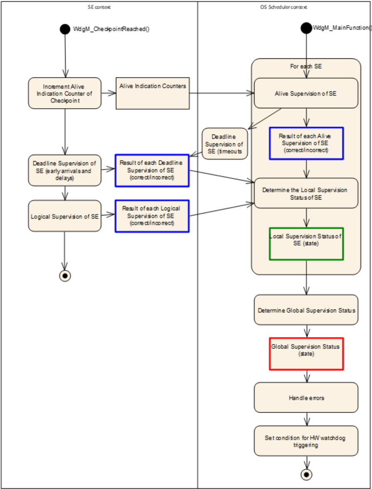

如果给定**模式**下没有激活的监督，则主函数不会看到 **EXPIRED** 局部状态，因此可以调用 **WdgIf_SetTriggerCondition**。

基于**监督功能**的结果（*正确*/*不正确*），通过**局部监督状态**状态机（见第 6.1.2 节）确定每个**被监督实体**的**局部监督状态**。

基于每个**被监督实体**的**局部监督状态**，通过**全局监督状态**状态机（见第 6.1.3 节）确定**全局监督状态**。

基于**全局监督状态**，进行错误处理（见第 6.3 节）与看门狗处理（见第 6.4 节）。

**截止时间监督**（提前到达与延迟的检测）以及**逻辑监督**的监督结果确定在 [**WdgM_CheckpointReached**](#736-wdgm_checkpointreached) 函数内执行。在该函数的一次执行中，它仅更新一个特定**被监督实体**的结果。

**截止时间监督**（超时检测部分）以及**存活监督**的监督结果确定在 [**WdgM_MainFunction**](#751-wdgm_mainfunction) 函数内执行。在该函数的一次执行中，它更新所有**被监督实体**的**截止时间监督**（超时检测部分）和/或**存活监督**的结果。

**WdgM** 模块应在模块初始化后首次调用 [**WdgM_MainFunction**](#751-wdgm_mainfunction) 时，启动所有**监督功能**（包括所有**监督算法**、**监督参考周期**）以及**看门狗处理**。

**注意：** 如果 **WdgM** 模块未初始化，其主函数将立即返回而不执行任何功能，也不引发任何错误。此外，在首次调用主函数之前，模块不能使用 **RTE** **API**。因此，初始化后的首次主函数调用应被视为**监督功能**以及对硬件看门狗实例（使用 **WdgIf** 模块）相关处理的起点，以便作为安全相关监控机制具有一致的行为。

**WdgM** 模块应在 [**WdgM_DeInit**](#732-wdgm_deinit) 中停止所有**监督功能**（所有**监督算法**）以及**看门狗处理**。

**看门狗管理器**的**监督功能**运行应具备以下条件：

1. 可用的已初始化 **Wdg** 接口；
2. 可用的已初始化 **OS**；
3. 已初始化的 **WdgM**——通过调用 **[WdgM_Init](#731-wdgm_init)()** 函数实现；以及
4. 周期性调用 **[WdgM_MainFunction](#751-wdgm_mainfunction)()** 函数。

应由 **WdgM** 模块的调用者确保 [**WdgM_DeInit**](#732-wdgm_deinit)、[**WdgM_Init**](#731-wdgm_init) 与 [**WdgM_SetMode**](#734-wdgm_setmode) 函数不与 [**WdgM_MainFunction**](#751-wdgm_mainfunction) 并发调用。

这可以通过集成者对初始化与任务调度进行适当协调来实现。

**注意** 在集群式软件架构的情况下（**WdgMSwClusterSupport = ENABLE_SW_CLUSTER_SUPPORT**），应用软件集群中的 [**WdgM_MainFunction**](#751-wdgm_mainfunction) 实例可以在任何时刻被调用，而不论宿主软件集群中的 [**WdgM_DeInit**](#732-wdgm_deinit)、[**WdgM_Init**](#731-wdgm_init) 与 [**WdgM_SetMode**](#734-wdgm_setmode) 函数是否并发调用。

为了即使某个**被监督实体**发生死锁也能继续**存活监督**和**截止时间监督**（超时检测部分），每个 [**WdgM_MainFunction**](#751-wdgm_mainfunction) 必须映射到不包含由该 [**WdgM_MainFunction**](#751-wdgm_mainfunction) 实例监督的**被监督实体**的任务上。

执行 [**WdgM_MainFunction**](#751-wdgm_mainfunction) 的 **OS** 任务应与调用**被监督实体**中任何函数的 **OS** 任务相分离。

#### 6.1.2. 局部监督状态

**局部监督状态**状态机确定**被监督实体**的状态。这是基于以下内容完成的：

1. **局部监督状态**的前一个值；
2. **存活监督**结果、**截止时间监督**结果、**逻辑监督**结果的当前值。

**局部监督状态**状态机应在该**被监督实体**所属的 [**WdgM_MainFunction**](#751-wdgm_mainfunction) 每次被调用时计算。

该状态机应由 [**WdgM_Init**](#731-wdgm_init) 函数初始化。

**看门狗管理器**模块提供了一项特性，为**存活监督**提供容错（对应于**局部监督状态** **WDGM_LOCAL_STATUS_FAILED**），容错时长为以**监督周期**（**监督周期**是调用 [**WdgM_MainFunction**](#751-wdgm_mainfunction) 的周期）为单位的可配置（累积）时间量，称为**失败的监督参考周期**（见配置参数 **WdgMFailedAliveSupervisionRefCycleTol**）。如果该参数设置为 0，则**存活监督**没有容错，此时**存活监督**的行为与**截止时间监督**和**逻辑监督**相同，即第一个*不正确*结果就导致转换到 **WDGM_LOCAL_STATUS_EXPIRED**。

请注意，**截止时间监督**与**逻辑监督**不受 **WdgMFailedAliveSupervisionRefCycleTol** 影响。

**看门狗管理器**模块应跟踪每个**被监督实体**的**局部监督状态**。

图 6.1 给出了**被监督实体****局部监督状态**的状态机及其所有可能状态。

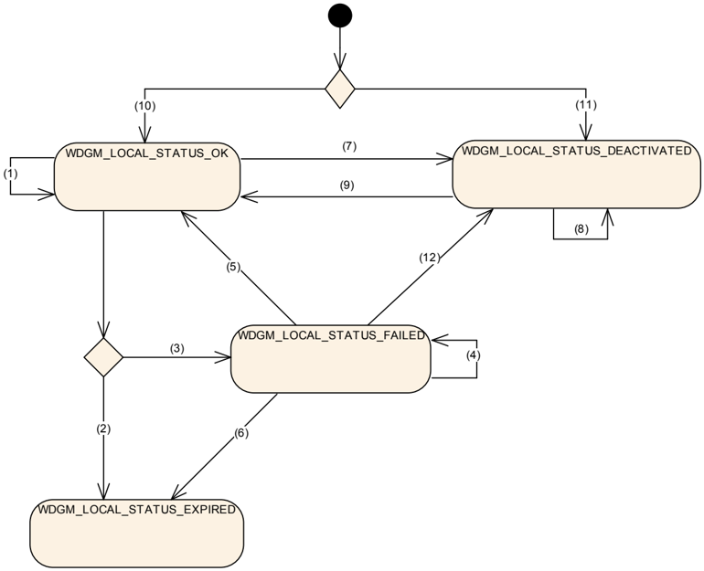

**局部监督状态**各状态之间的转换遵循以下规则：

如果成功调用了 [**WdgM_Init**](#731-wdgm_init) 函数，则对于初始**模式**（**WdgMInitialMode**）所引用的每个**被监督实体**（即在初始**模式**中激活的每个**被监督实体**），[**WdgM_Init**](#731-wdgm_init) 函数应将该**被监督实体**的**局部监督状态**设置为 **WDGM_LOCAL_STATUS_OK**。并且**失败的监督参考周期**计数器应设置为零（0）。

如果成功调用了 [**WdgM_Init**](#731-wdgm_init) 函数，则对于初始**模式**（**WdgMInitialMode**）未引用的每个**被监督实体**，[**WdgM_Init**](#731-wdgm_init) 函数应将该**被监督实体**的**局部监督状态**设置为 **WDGM_LOCAL_STATUS_DEACTIVATED**。

如果成功调用了 [**WdgM_Init**](#731-wdgm_init) 函数，且该**被监督实体**在 **WdgMInitialMode** 中的参数 **WdgMInitialMode** 未配置为 **WDGM_LOCAL_STATUS_OK**，则**看门狗管理器**模块应将该**被监督实体**的**局部监督状态**设置为 **WDGM_LOCAL_STATUS_DEACTIVATED**。

如果该**被监督实体**的**局部监督状态**为 **WDGM_LOCAL_STATUS_OK**，并且该**被监督实体**的三组**监督**结果（**存活监督**结果、**截止时间监督**结果、**逻辑监督**结果）中的所有值均为*正确*，则 [**WdgM_MainFunction**](#751-wdgm_mainfunction) 函数应将该**被监督实体**保持在**局部监督状态** **WDGM_LOCAL_STATUS_OK**。

如果该**被监督实体**的**局部监督状态**为 **WDGM_LOCAL_STATUS_OK**，并且：

1. 该**被监督实体**的**存活监督**结果中至少有一个*不正确*，且配置了零容错（见配置参数 **WdgMFailedAliveSupervisionRefCycleTol**）；或
2. 该**被监督实体**的**截止时间监督**结果中至少有一个*不正确*，或**逻辑监督**结果中至少有一个*不正确*；

则 [**WdgM_MainFunction**](#751-wdgm_mainfunction) 函数应将**局部监督状态**更改为 **WDGM_LOCAL_STATUS_EXPIRED**。

以下需求说明了**存活监督**与**截止时间监督**及**逻辑监督**之间的重要区别：**存活监督**对失败的参考周期具有错误容错。

如果该**被监督实体**的**局部监督状态**为 **WDGM_LOCAL_STATUS_OK**，并且：

1. 该**被监督实体**的**存活监督**结果中至少有一个*不正确*，且配置了大于零的容错（见配置参数 **WdgMFailedAliveSupervisionRefCycleTol**）；并且
2. 该**被监督实体**的所有**截止时间监督**结果与所有**逻辑监督**结果均为*正确*；

则 [**WdgM_MainFunction**](#751-wdgm_mainfunction) 函数应将**局部监督状态**更改为 **WDGM_LOCAL_STATUS_FAILED**，并递增**失败的监督参考周期**计数器。

如果该**被监督实体**的**局部监督状态**为 **WDGM_LOCAL_STATUS_FAILED**，并且：

1. **存活监督**结果中至少有一个*不正确*，且**失败的监督参考周期**计数器小于所配置的容错（见参数 **WdgMFailedAliveSupervisionRefCycleTol**）；并且
2. 该**被监督实体**的所有**截止时间监督**结果与所有**逻辑监督**结果均为*正确*；

则 [**WdgM_MainFunction**](#751-wdgm_mainfunction) 函数应将**局部监督状态**保持在 **WDGM_LOCAL_STATUS_FAILED**，并递增**失败的监督参考周期**计数器。

如果该**被监督实体**的**局部监督状态**为 **WDGM_LOCAL_STATUS_FAILED**，并且：

1. 该**被监督实体**的所有**存活监督**结果均为*正确*，且**失败的监督参考周期**计数器 > 1；并且
2. 该**被监督实体**的所有**截止时间监督**结果与所有**逻辑监督**结果均为*正确*；

则 [**WdgM_MainFunction**](#751-wdgm_mainfunction) 函数应将**局部监督状态**保持在 **WDGM_LOCAL_STATUS_FAILED**，并递减**失败的监督参考周期**计数器。

如果该**被监督实体**的**局部监督状态**为 **WDGM_LOCAL_STATUS_FAILED**，并且：

1. 该**被监督实体**的所有**存活监督**结果均为*正确*，且**失败的监督参考周期**计数器等于 1；并且
2. 该**被监督实体**的所有**截止时间监督**结果与所有**逻辑监督**结果均为*正确*；

则 [**WdgM_MainFunction**](#751-wdgm_mainfunction) 函数应将**局部监督状态**更改为 **WDGM_LOCAL_STATUS_OK**，并递减**失败的监督参考周期**计数器。

如果该**被监督实体**的**局部监督状态**为 **WDGM_LOCAL_STATUS_FAILED**，并且：

1. **存活监督**结果中至少有一个*不正确*，且**失败的监督参考周期**计数器等于所配置的容错（见配置参数 **WdgMFailedAliveSupervisionRefCycleTol**）；或
2. 该**被监督实体**的**截止时间监督**结果中至少有一个*不正确*，或**逻辑监督**结果中至少有一个*不正确*；

则 [**WdgM_MainFunction**](#751-wdgm_mainfunction) 函数应将**局部监督状态**更改为 **WDGM_LOCAL_STATUS_EXPIRED**。

如果该**被监督实体**的**局部监督状态**为 **WDGM_LOCAL_STATUS_OK**，且调用 [**WdgM_SetMode**](#734-wdgm_setmode) 切换到某个停用该**被监督实体**的模式，则**看门狗管理器**模块应将**局部监督状态**更改为 **WDGM_LOCAL_STATUS_DEACTIVATED**。

如果该**被监督实体**的**局部监督状态**为 **WDGM_LOCAL_STATUS_FAILED**，且调用 [**WdgM_SetMode**](#734-wdgm_setmode) 切换到某个在该模式中停用该**被监督实体**的模式，则**看门狗管理器**模块应将**局部监督状态**更改为 **WDGM_LOCAL_STATUS_DEACTIVATED**。

请注意，上述需求仅适用于 **WDGM_LOCAL_STATUS_FAILED** 状态，而不适用于 **WDGM_LOCAL_STATUS_EXPIRED**。

如果该**被监督实体**处于**局部监督状态** **WDGM_LOCAL_STATUS_DEACTIVATED**，则 [**WdgM_CheckpointReached**](#736-wdgm_checkpointreached) 与 [**WdgM_MainFunction**](#751-wdgm_mainfunction) 函数不应为该**被监督实体**执行任何**监督功能**，并应将**局部监督状态**保持在 **WDGM_LOCAL_STATUS_DEACTIVATED** 状态。

如果该**被监督实体**处于**局部监督状态** **WDGM_LOCAL_STATUS_DEACTIVATED**，且调用 [**WdgM_SetMode**](#734-wdgm_setmode) 切换到某个在该模式中激活该**被监督实体**的模式，则**看门狗管理器**模块应将**局部监督状态**更改为 **WDGM_LOCAL_STATUS_OK**。并且**失败的监督参考周期**计数器应设置为零（0）。

#### 6.1.3. 全局监督状态

基于所有**被监督实体**的**局部监督状态**，计算**全局监督状态**。

**全局监督状态**具有与**局部监督状态**相似的取值。主要差别是增加了 **WDGM_GLOBAL_STATUS_STOPPED** 取值。图 6.2 给出了这些取值及其之间的转换。

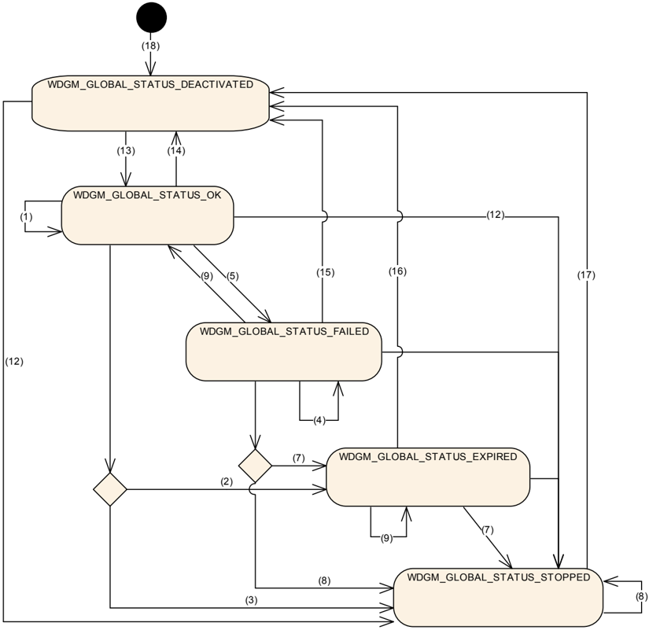

**看门狗管理器**模块应针对整个被监控软件具有一个**全局监督状态**。

**全局监督状态**应静态初始化为 **WDGM_GLOBAL_STATUS_DEACTIVATED**。

**看门狗管理器**模块提供了一项特性，可将错误反应（即不设置正确的触发条件）推迟以**监督周期**为单位的可配置时间量，称为**过期监督容差**（见配置参数 **WdgMExpiredSupervisionCycleTol**）。

**过期监督容差**在**全局监督状态**的状态机内实现。所定义的状态机在阻塞被推迟期间处于 **WDGM_GLOBAL_STATUS_EXPIRED** 状态。

[**WdgM_MainFunction**](#751-wdgm_mainfunction) 函数应在每个主函数周期计算**全局监督状态**。该函数应在计算每个**局部监督状态**之后计算**全局监督状态**。

**全局监督状态**的周期性更新对于及时地从 **WDGM_GLOBAL_STATUS_EXPIRED** 转换到 **WDGM_GLOBAL_STATUS_STOPPED** 是必要的。

**注意** 在集群式软件架构的情况下，可能存在多个 [**WdgM_MainFunction**](#751-wdgm_mainfunction) 实例。在这种情况下，**全局监督状态**可以在任意 [**WdgM_MainFunction**](#751-wdgm_mainfunction) 实例每次被调用时更新。

计算**全局监督状态**应使用以下规则：

如果成功调用了 [**WdgM_Init**](#731-wdgm_init) 函数，则该函数应将**全局监督状态**更改为 **WDGM_GLOBAL_STATUS_OK**。并且**过期周期计数器**应设置为零（0）。

如果**全局监督状态**为 **WDGM_GLOBAL_STATUS_OK**，且成功调用了 [**WdgM_DeInit**](#732-wdgm_deinit) 函数，则该函数应将**全局监督状态**更改为 **WDGM_GLOBAL_STATUS_DEACTIVATED**。

必须仔细考虑：当 **WdgM** 处于 **WDGM_GLOBAL_STATUS_EXPIRED** 或 **WDGM_GLOBAL_STATUS_STOPPED** 状态时对其进行停用，可能会妨碍错误报告或错误反应。

如果**全局监督状态**为 **WDGM_GLOBAL_STATUS_OK**，且所有**被监督实体**的**局部监督状态**均为 **WDGM_LOCAL_STATUS_OK** 或 **WDGM_LOCAL_STATUS_DEACTIVATED**，则 [**WdgM_MainFunction**](#751-wdgm_mainfunction) 函数应保持**全局监督状态** **WDGM_GLOBAL_STATUS_OK**。

如果**全局监督状态**为 **WDGM_GLOBAL_STATUS_OK**，至少一个**被监督实体**的**局部监督状态**为 **WDGM_LOCAL_STATUS_FAILED**，且没有**被监督实体**处于**局部监督状态** **WDGM_LOCAL_STATUS_EXPIRED**，则 [**WdgM_MainFunction**](#751-wdgm_mainfunction) 函数应将**全局监督状态**更改为 **WDGM_GLOBAL_STATUS_FAILED**。

**看门狗管理器**模块支持一项特性，可将错误反应（切换到 **WDGM_LOCAL_STATUS_EXPIRED**）推迟一段可配置的时间。这可用于在看门狗复位之前允许执行清理活动，例如写入错误原因、写入 **NVRAM** 数据。

如果**全局监督状态**为 **WDGM_GLOBAL_STATUS_OK**，至少一个**被监督实体**的**局部监督状态**为 **WDGM_LOCAL_STATUS_EXPIRED**，且**过期监督容差**配置为大于零的值（见配置参数 **WdgMExpiredSupervisionCycleTol**），则 [**WdgM_MainFunction**](#751-wdgm_mainfunction) 函数应将**全局监督状态**更改为 **WDGM_GLOBAL_STATUS_EXPIRED**。并递增**过期周期计数器**。

如果**全局监督状态**为 **WDGM_GLOBAL_STATUS_OK**，至少一个**被监督实体**的**局部监督状态**为 **WDGM_LOCAL_STATUS_EXPIRED**，且**过期监督容差**配置为零（见配置参数 **WdgMExpiredSupervisionCycleTol**），则 [**WdgM_MainFunction**](#751-wdgm_mainfunction) 函数应将**全局监督状态**更改为 **WDGM_GLOBAL_STATUS_STOPPED**。

如果**全局监督状态**为 **WDGM_GLOBAL_STATUS_FAILED**，至少一个**被监督实体**的**局部监督状态**为 **WDGM_LOCAL_STATUS_FAILED**，且没有**被监督实体**处于**局部监督状态** **WDGM_LOCAL_STATUS_EXPIRED**，则 [**WdgM_MainFunction**](#751-wdgm_mainfunction) 函数应保持在**全局监督状态** **WDGM_GLOBAL_STATUS_FAILED**。

如果**全局监督状态**为 **WDGM_GLOBAL_STATUS_FAILED**，且所有**被监督实体**的**局部监督状态**均为 **WDGM_LOCAL_STATUS_OK** 或 **WDGM_LOCAL_STATUS_DEACTIVATED**，则 [**WdgM_MainFunction**](#751-wdgm_mainfunction) 函数应将**全局监督状态**更改为 **WDGM_GLOBAL_STATUS_OK**。

如果**全局监督状态**为 **WDGM_GLOBAL_STATUS_FAILED**，至少一个**被监督实体**的**局部监督状态**为 **WDGM_LOCAL_STATUS_EXPIRED**，且**过期监督容差**配置为大于零的值（见配置参数 **WdgMExpiredSupervisionCycleTol**），则 [**WdgM_MainFunction**](#751-wdgm_mainfunction) 函数应将**全局监督状态**更改为 **WDGM_GLOBAL_STATUS_EXPIRED**。并递增**过期周期计数器**。

如果**全局监督状态**为 **WDGM_GLOBAL_STATUS_FAILED**，至少一个**被监督实体**的**局部监督状态**为 **WDGM_LOCAL_STATUS_EXPIRED**，且**过期监督容差**配置为零（见配置参数 **WdgMExpiredSupervisionCycleTol**），则 [**WdgM_MainFunction**](#751-wdgm_mainfunction) 函数应将**全局监督状态**更改为 **WDGM_GLOBAL_STATUS_STOPPED**。

如果**全局监督状态**为 **WDGM_GLOBAL_STATUS_EXPIRED**，至少一个**被监督实体**的**局部监督状态**为 **WDGM_LOCAL_STATUS_EXPIRED**，且**过期周期计数器**小于所配置的**过期监督容差**（见配置参数 **WdgMExpiredSupervisionCycleTol**），则 [**WdgM_MainFunction**](#751-wdgm_mainfunction) 函数应保持**全局监督状态** **WDGM_GLOBAL_STATUS_EXPIRED** 并递增**过期周期计数器**。

如果**全局监督状态**为 **WDGM_GLOBAL_STATUS_EXPIRED**，至少一个**被监督实体**的**局部监督状态**为 **WDGM_LOCAL_STATUS_EXPIRED**，且**过期周期计数器**等于所配置的**过期监督容差**（见配置参数 **WdgMExpiredSupervisionCycleTol**），则 [**WdgM_MainFunction**](#751-wdgm_mainfunction) 函数应将**全局监督状态**更改为 **WDGM_GLOBAL_STATUS_STOPPED**。

如果**全局监督状态**为 **WDGM_GLOBAL_STATUS_STOPPED**，则 [**WdgM_MainFunction**](#751-wdgm_mainfunction) 函数应保持在**全局监督状态** **WDGM_GLOBAL_STATUS_STOPPED**。

如果对 **WdgIf_SetMode** 的调用失败，则函数应假定发生全局监督失败，并将**全局监督状态**设置为 **WDGM_GLOBAL_STATUS_STOPPED**。

**注意：** 另见第 6.5.2 节，其中给出了关于 **WdgIf_SetMode** 调用可能失败的信息。

这是最终状态，将启动故障恢复机制。通常在硬件看门狗超时后会发生看门狗复位。

### 6.2. 监督功能

对每个**被监督实体**，**存活监督**与**截止时间监督**（超时检测部分）应在对应的**主函数**实例内执行，该实例由 **WdgMMainFunctionPartitionRef** 标识。

如果**全局监督状态**不处于 **WDGM_GLOBAL_STATUS_DEACTIVATED** 状态，则 **[WdgM_MainFunction](#751-wdgm_mainfunction)()** 应按照所配置的**监督周期**执行**存活监督**。

如果**全局监督状态**不处于 **WDGM_GLOBAL_STATUS_DEACTIVATED** 状态，则 **[WdgM_MainFunction](#751-wdgm_mainfunction)()** 应按照所配置的**主函数周期**执行**截止时间监督**（超时检测部分）。

#### 6.2.1. 存活监督

**存活监督**是**看门狗管理器**模块的**监督功能**之一。**存活监督**提供了一种机制，用于周期性检查一个或多个**被监督实体**的执行可靠性。该机制支持对独立**被监督实体**的周期性时序约束进行检查。

##### 6.2.1.1. 存活监督配置

为了提供**存活监督**，需要配置**检查点**及其时序约束。**存活监督**最简单的配置是一个没有任何**转换**的**检查点**，如图 7.4 所示。

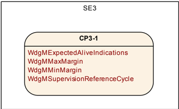

上述配置为 **AUTOSAR** 经典平台 **R4.0.1** 之前版本中定义的**存活监督**提供向后兼容，在那些版本中每个**被监督实体**只能用一组参数进行监督。

此外，也可以有多个**检查点**，如图 7.5 所示。

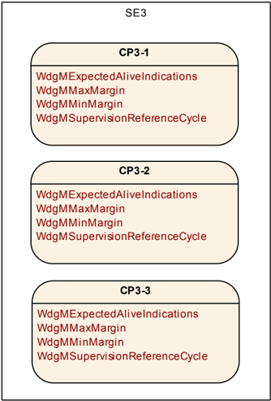

每个**检查点**有自己的一组**存活监督**参数。**存活监督**不使用**转换**。尽管每个**检查点**有各自的参数，但确定状态的对象是**被监督实体**，其依据是**检查点**的频率。

**存活监督**的参数（见 **WdgMAliveSupervision**）依赖于**看门狗管理器模式**，并且按**检查点**定义（而不是为整个**被监督实体**全局定义）。

在给定**模式**下，一个**被监督实体**的**检查点**中可以有零个、部分或全部为**存活监督**配置。此外，在每个**模式**中，**检查点**的**存活监督**选项可以不同。

**WdgMExpectedAliveIndications**（**EAI**）指定在固定数量的**监督周期**内，来自给定**检查点**的**期望存活指示**数量。

可以配置可接受的负向偏差（**WdgMMinMargin**）与可接受的正向偏差（**WdgMMaxMargin**）。

**看门狗管理器**模块必须支持可配置数量的独立**被监督实体**。因此，必须考虑以下一般性问题。

**看门狗管理器**模块应根据**被监督实体**数量、**WdgMMode** 数量及其 **WdgMAliveSupervision** 数量，导出在**看门狗管理器**模块内执行**存活监督**所需的独立数据资源数量。

在**看门狗管理器**模块上下文中，独立数据资源的示例包括：**存活计数器**、**监督周期**计数器、**失败的监督参考周期**计数器、**过期监督周期**计数器、**局部监督状态**。

##### 6.2.1.2. 存活监督算法

为了发送**存活指示**，**被监督实体**调用 [**WdgM_CheckpointReached**](#736-wdgm_checkpointreached) 函数，其结果是对该**检查点**的**存活计数器**递增。

**存活监督**通过在一个可配置周期内统计来自**被监督实体**的报告次数（由 [**WdgM_CheckpointReached**](#736-wdgm_checkpointreached) 发出）来执行。

该监督由具有可配置周期时间的 [**WdgM_MainFunction**](#751-wdgm_mainfunction) 执行。主函数对某个**被监督实体**的每个**检查点**的计数器的周期性检查，在每个**监督参考周期**（即**监督周期**的整数倍）进行。

**监督周期**与**监督参考周期**（见 **WdgMSupervisionReferenceCycle**）是给定**看门狗管理器模式**下某个**检查点**的**存活监督**的属性。

[**WdgM_MainFunction**](#751-wdgm_mainfunction) 函数应对在活动**模式**中配置的每个**存活监督**（**WdgMAliveSupervision**），检查该**被监督实体**的每个**检查点**的**存活计数器**。该检查应按对应**存活监督**（**WdgMAliveSupervision**）的 **WdgMSupervisionReferenceCycle** 周期进行。

**注意：** 在**存活监督**的中间**监督周期**内，[**WdgM_MainFunction**](#751-wdgm_mainfunction) 函数不执行**存活计数器**的检查。

[**WdgM_MainFunction**](#751-wdgm_mainfunction) 函数应通过检查**存活计数器**是否在允许的容差范围内（期望值 - 最小偏差；期望值 + 最大偏差）来检查它（见 **WdgMExpectedAliveIndications**、**WdgMMinMargin**、**WdgMMaxMargin**）。

如果某个**被监督实体**的任何**检查点**未通过该检查，则该**被监督实体**的**存活监督**结果被设置为*不正确*。

如果 [**WdgM_MainFunction**](#751-wdgm_mainfunction) 函数检测到某个**被监督实体**的任何**检查点**的已计数**存活指示**与期望的存活指示数量之间存在偏差（包括容差边界），则该**被监督实体**在该**监督参考周期**上的**存活监督**应定义为*不正确*。否则应定义为*正确*。

如果某个**检查点**在某个模式中未被**存活监督**，则**看门狗管理器**忽略它。

[**WdgM_MainFunction**](#751-wdgm_mainfunction) 函数不应在活动的**看门狗管理器模式**中未定义对应的**存活监督**（**WdgMAliveSupervision**）时，检查某个**检查点**的**存活计数器**。

#### 6.2.2. 截止时间监督

**截止时间监督**检查非周期性**被监督实体**的时序约束。在这些**被监督实体**中，某个事件发生，随后的另一个事件在给定时间跨度内发生。该时间跨度可以具有最大和最小截止时间（时间窗口）。

##### 6.2.2.1. 截止时间监督配置

对于每个**截止时间监督**，配置两个由**转换**连接的**检查点**。**截止时间**附加在从起始检查点到结束检查点的**转换**上。最简单的**截止时间监督**配置包含两个**检查点**和一个**转换**，如图 7.6 所示。

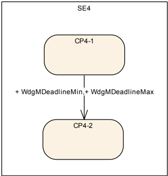

一个**被监督实体**中可定义多个**转换**。**转换**与**检查点**不必构成闭合的**图**。由于该**监督功能**只考虑起始和结束（停止）**检查点**，因此可以存在独立的**图**，如图 7.7 所示。此外，**检查点**可以串联。

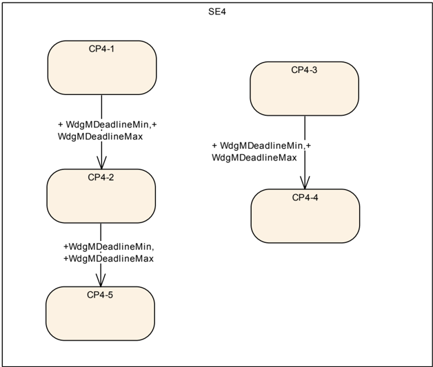

**截止时间监督**的配置与**存活监督**的配置类似。

**截止时间监督**的参数（见 **WdgMDeadlineSupervision**）依赖于**看门狗管理器模式**（**WdgMMode**），并且按一组两个**检查点**定义。在给定**模式**下，一个**被监督实体**的**检查点**中可以有零个、部分或全部为**截止时间监督**配置。

**截止时间监督**定义为一组带时序约束的**转换**。一个**转换**定义为对两个**检查点**的引用，分别称为**截止时间起始检查点**和**截止时间结束检查点**（**WdgMDeadlineStartRef** 与 **WdgMDeadlineStopRef**）。一个**转换**具有最小和最大时间（**WdgMDeadlineMin**、**WdgMDeadlineMax**）。

**看门狗管理器**模块应根据**被监督实体**数量、**WdgMMode** 数量及其 **WdgMDeadlineSupervision** 数量，导出在**看门狗管理器**模块内执行**截止时间监督**所需的独立数据资源数量。

##### 6.2.2.2. 截止时间监督算法

对于每个**截止时间起始检查点**（即由 **WdgMDeadlineStartRef** 引用的**检查点**），**看门狗管理器**具有一个时间戳变量，用于存储到达该**检查点**时的时间。

**截止时间监督**的时间戳变量通过读取 **OS** tick 获得。为每个**被监督实体**配置一个 **OS** 计数器。

一个 **OS** 计数器可以在多个**被监督实体**之间共享，或者为每个**被监督实体**使用单独的 **OS** 计数器（取决于实现）。如果使用 **OSApplication**/分区，且某个计数器在属于不同 **OS**-application 的**被监督实体**之间共享，则需要配置允许访问该计数器的 **OS**-application 列表（**OsCounterAccessingApplication**）。

如果为某个**被监督实体**在任一**看门狗管理器模式**中配置了至少一个**截止时间监督**，则应为该**被监督实体**配置一个 **OS** 计数器（见 **WdgMOSCounter**）。

每个**被监督实体**的 **OS** 计数器应配置为可从包含该**被监督实体**的 **OsApplication** 访问。

如果 **WdgMEnableTimeoutDetection** 设置为 true，则每个**被监督实体**的 **OS** 计数器还应配置为可从调用 [**WdgM_MainFunction**](#751-wdgm_mainfunction) 的 **OsApplication** 访问。

为了确定时间戳并计算时间戳之差，[**WdgM_CheckpointReached**](#736-wdgm_checkpointreached) 函数应使用 **OS** 函数 **GetElapsedValue**，其第一个参数使用为该**被监督实体**配置的 CounterID（见 **WdgMOSCounter**）。

时间戳以 tick 为单位。而**看门狗**的截止时间配置以秒为单位。tick 与秒之间的换算在 **OS** 中配置。

为了将时间戳差换算到限值（**WdgMDeadlineMin** 与 **WdgMDeadlineMax**），[**WdgM_CheckpointReached**](#736-wdgm_checkpointreached) 函数（用于提前到达与延迟的检测）以及 [**WdgM_MainFunction**](#751-wdgm_mainfunction) 函数（用于超时的检测）应使用 **OsSecondsPerTick** 配置参数。

在初始化期间，所有**截止时间起始检查点**（即由 **WdgMDeadlineStartRef** 引用的**检查点**）的时间戳都被清零——设置为 0。

[**WdgM_Init**](#731-wdgm_init) 函数应为所有**截止时间起始检查点**将其时间戳设置为 0。

当到达**截止时间起始检查点**（即由 **WdgMDeadlineStartRef** 引用的**检查点**）时，**被监督实体**调用 [**WdgM_CheckpointReached**](#736-wdgm_checkpointreached) 函数，其结果是执行**截止时间监督**。

当到达**截止时间起始检查点**且该**检查点**在活动**模式**中被引用时，[**WdgM_CheckpointReached**](#736-wdgm_checkpointreached) 函数应将当前时间戳记录到所到达的**截止时间起始检查点**的时间戳下。该当前时间戳应作为检查对应**截止时间结束检查点**时间的参考基准。

[**WdgM_CheckpointReached**](#736-wdgm_checkpointreached) 函数应通过调用 **OS** 函数来确定当前时间戳。

这意味着，所到达的**截止时间起始检查点**的时间戳会被当前时间戳覆盖，无论该**截止时间起始检查点**在覆盖前的值为何。此外，这意味着，如果某个给定的**截止时间起始检查点**被多次到达而未到达对应的**截止时间结束检查点**（每次仅更新时间戳），则**截止时间监督**不将其视为错误。

当到达**截止时间结束检查点**且该**检查点**在活动**模式**中被引用，且对应**截止时间起始检查点**的时间戳 <> 0 时，[**WdgM_CheckpointReached**](#736-wdgm_checkpointreached) 函数应测量当前时间戳与对应**截止时间起始检查点**时间戳之间的时间差。然后，该函数应清除（即设置为 0）对应**截止时间起始检查点**的时间戳。

当到达**截止时间结束检查点**且该**检查点**在活动**模式**中被引用，且对应**截止时间起始检查点**的时间戳 = 0 时，[**WdgM_CheckpointReached**](#736-wdgm_checkpointreached) 函数应以成功退出（不测量时间差）。

这意味着，如果某个给定的**截止时间结束检查点**被连续到达多次，**截止时间监督**不将其视为错误。

如果测得的时间差（见上文）不在最小与最大限值之内（即时间差小于 **WdgMDeadlineMin** 或大于 **WdgMDeadlineMax**），则 [**WdgM_CheckpointReached**](#736-wdgm_checkpointreached) 函数应将该**被监督实体**的**截止时间监督**结果定义为*不正确*。否则应定义为*正确*。

**注意：** 如果最大限值（**WdgMDeadlineMax**）配置为 'INF'，则无需检查时间差是否大于该限值。

对于任何既不是**截止时间起始检查点**也不是**截止时间结束检查点**的报告**检查点**，[**WdgM_CheckpointReached**](#736-wdgm_checkpointreached) 函数应忽略该**检查点**，并且不更新该**被监督实体**的**截止时间监督**结果。

如果启用了**截止时间超时**检测（即 **WdgMEnableTimeoutDetection** 设置为 'true'），则对于活动模式中配置的所有**截止时间监督**，如果对应**截止时间起始检查点**的时间戳 <> 0（即已报告起始检查点但尚未报告对应的结束检查点），则 [**WdgM_MainFunction**](#751-wdgm_mainfunction) 函数应测量当前时间戳与对应**截止时间起始检查点**时间戳之间的时间差。如果测得的时间差超出（大于）最大限值（**WdgMDeadlineMax**），则 [**WdgM_MainFunction**](#751-wdgm_mainfunction) 函数应将该**被监督实体**的**截止时间监督**结果定义为*不正确*。

**注意：** 通过这种方式，可以在**截止时间结束检查点**始终未被到达时检测到错误（**截止时间监督**的超时检测部分）。

#### 6.2.3. 逻辑监督

**逻辑监督**检查**被监督实体**的代码是否按正确的顺序执行。

##### 6.2.3.1. 逻辑监督配置

对于每个**逻辑监督**，存在一个由**转换**连接的**检查点****图**。该**图**为**看门狗管理器**模块抽象了**被监督实体**的行为。

以某个**被监督实体**为例，考虑以下包含**检查点** CP0-0 至 CP0-6 的代码片段。

```
CP0-0 i = 0; CP0-1 while(i < n) { CP0-2 if (a[i] < b[i]) CP0-3 a[i] = b[i]; CP0-4 else a[i] = 0; CP0-5 i++; CP0-6 }
```

该**被监督实体**可以由图 7.8 所示的**图**表示。

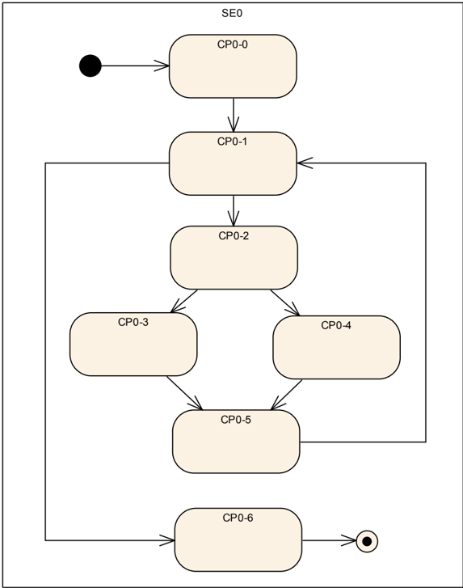

该**被监督实体**的一个更抽象的视图由图 7.9 所示的**图**给出，其中**检查点** CP0-1 代表完整的 while 循环。

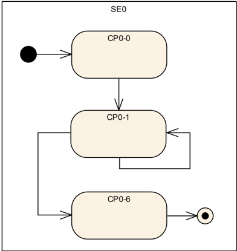

**逻辑监督**的**图**有两种类型。第一种是**内部图**，其中所有**检查点**都属于同一个**被监督实体**，且**检查点**之间由**内部转换**连接。

第二种是**外部图**，其中至少两个**检查点**属于不同的**被监督实体**。这些**检查点**通过**外部转换**连接。

**逻辑监督**的**图**有两种类型。**内部图**与**外部图**的主要区别在于：**内部图**是**被监督实体**的属性，与**模式**无关（即其结构不随**看门狗管理器模式**切换而改变，尽管当该**被监督实体**在某个**模式**中被禁用时，其监督行为可以被禁用），而**外部图**依赖于**模式**。

**内部图**的**逻辑监督**参数是**内部转换**（见 **WdgMInternalTransition**），它们包含在一个**被监督实体**（**WdgMSupervisedEntity**）中。每个**内部转换**连接两个**检查点**。这意味着所有**模式**共享相同的**内部转换**。唯一可能的是在某个**模式**中停用一个**被监督实体**，这会使其**内部转换**的**逻辑监督**失效。

**外部图**的参数（见 **WdgMExternalLogicalSupervision**）包含在一个**模式**（**WdgMMode**）中。每个**外部转换**连接两个**检查点**。

无论**检查点**是否由任何**转换**连接，**检查点**都存在。

**看门狗管理器**模块应根据**被监督实体**数量、**WdgMMode** 数量及其 **WdgMExternalLogicalSupervision** 与 **WdgMInternalTransition** 数量，导出在**看门狗管理器**模块内执行**逻辑监督**所需的独立数据资源数量。

##### 6.2.3.2. 逻辑监督算法

在看门狗管理器初始化之后，紧接着尚未有任何**检查点**被报告，即该**被监督实体**的**逻辑监督**处于非激活状态。该信息保存在**活动标志**中（每个**图**一个标志）。

每个**内部图**代表一个**逻辑监督**。假设有 N 个**内部图**，这意味着一个**被监督实体**有 N 个来自**逻辑监督**的结果（**注意：** 目前 N 每个**被监督实体**最多为一个）。

每个**外部图**代表一个**逻辑监督**，但它可能跨越若干**被监督实体**。假设有 M 个**外部图**跨越某个**被监督实体**，这将导致该**被监督实体**有 M 个来自**逻辑监督**的结果。

**看门狗管理器**模块应为每个**图**维护一个**活动标志**。

[**WdgM_Init**](#731-wdgm_init) 函数应将每个**图**的**活动标志**设置为 false。

每个**图**可以有一个或多个**初始检查点**。**初始检查点**是一个**图**可以开始于其中的**检查点**。

为了通知到达某个**检查点**，**被监督实体**调用 [**WdgM_CheckpointReached**](#736-wdgm_checkpointreached) 函数，其结果是执行**逻辑监督**算法。

为了验证**转换**是否有效，算法需要存储最近到达的**检查点**。对于每个**外部图**与**内部图**，**看门狗管理器**都存储最近到达的**检查点**。

由于一个**检查点**可以属于多个**图**，[**WdgM_CheckpointReached**](#736-wdgm_checkpointreached) 函数必须能够识别某个**检查点**属于哪个（或哪些）**图**。

**看门狗管理器**模块应识别每个**检查点**属于哪个（或哪些）**图**。

[**WdgM_CheckpointReached**](#736-wdgm_checkpointreached) 函数应为每个**图**存储该**被监督实体**最近报告的**检查点**。

如果某个**图**的**活动标志**为 true，则 [**WdgM_CheckpointReached**](#736-wdgm_checkpointreached) 函数针对每个新的**检查点**检查所存储**检查点**与新报告**检查点**之间的**转换**是否被允许。

[**WdgM_CheckpointReached**](#736-wdgm_checkpointreached) 函数应通过以下检查，验证属于某个**内部图**的报告**检查点**是否为一个正确的**检查点**：

1. 如果所报告**检查点**所在**图**的**活动标志**为 false，则：
    - 如果该**检查点**是**初始检查点**（**WdgMInternalCheckpointInitialRef**），则该**被监督实体**的**逻辑监督**结果为*正确*，否则为*不正确*。
2. 否则，如果**活动标志**为 true，且该**图**中所有先前被调用的**检查点**都以正确的顺序被调用，则：
    - 如果所报告**检查点**是所报告**检查点**所在**图**中所存储**检查点**的后继（即存在一个具有 **WdgMInternalTransitionSourceRef** 与 **WdgMInternalTransitionDestRef** 的 **WdgMInternalTransition**），则该**被监督实体**的该**逻辑监督**结果为*正确*，否则为*不正确*。
3. 否则（即**活动标志**为 true，但该**图**中至少有一个**检查点**先前以错误的顺序被调用）：
    - 该**被监督实体**的该**逻辑监督**结果保持*不正确*。

对于属于**外部图**的**检查点**，进行类似的检查。

[**WdgM_CheckpointReached**](#736-wdgm_checkpointreached) 函数应通过以下检查，验证属于某个**外部图**的报告**检查点**是否为一个正确的**检查点**：

1. 如果所报告**检查点**所在**图**的**活动标志**为 false，则：
    - 如果该**检查点**是**初始检查点**（**WdgMExternalCheckpointInitialRef**），则所报告**检查点**所属**被监督实体**内的该**逻辑监督**结果为*正确*，否则为*不正确*。
2. 否则，如果**活动标志**为 true，且该**图**中所有先前被调用的**检查点**都以正确的顺序被调用，则：
    - 如果所报告**检查点**是所报告**检查点**所在**图**中所存储**检查点**的后继（即存在一个具有 **WdgMExternalTransitionSourceRef** 与 **WdgMExternalTransitionDestRef** 的 **WdgMExternalTransition**），则所报告**检查点**所属**被监督实体**的该**逻辑监督**结果为*正确*，否则为*不正确*。
3. 否则（即**活动标志**为 true，但该**图**中至少有一个**检查点**先前以错误的顺序被调用）：
    - 该**被监督实体**的该**逻辑监督**结果保持*不正确*。

上述需求意味着：在**外部转换**不正确的情况下，被认为有误的**被监督实体**是报告了不正确**检查点**的那个。

如果某个**检查点**是某个**图**的**初始检查点**之一，则该**图**被设置为激活。

如果 [**WdgM_CheckpointReached**](#736-wdgm_checkpointreached) 函数确定给定**检查点**的**逻辑监督**结果为*正确*，且该**检查点**被定义为初始**检查点**，则 [**WdgM_CheckpointReached**](#736-wdgm_checkpointreached) 函数应将对应**图**的**活动标志**设置为 true。

对于**结束检查点**，反之亦然。

如果 [**WdgM_CheckpointReached**](#736-wdgm_checkpointreached) 函数确定给定**检查点**的**逻辑监督**结果为*正确*，且该**检查点**被定义为最终**检查点**，则 [**WdgM_CheckpointReached**](#736-wdgm_checkpointreached) 函数应将对应**图**的**活动标志**设置为 false。

其结果是，在来自**结束检查点**的报告之后，同一**图**内的正确报告只能来自**初始检查点**（**注意：** 对于**图**的评估，来自不属于该**图**的**检查点**的报告将被忽略）。

一个**检查点**可以属于多个**图**（可以是**内部图**与**外部图**的组合）。这意味着定义于内部**图**的检查与定义于外部**图**的检查可以同时执行；也意味着，在 [**WdgM_CheckpointReached**](#736-wdgm_checkpointreached) 的任何一次执行中，如果所报告**检查点**属于任何**内部图**或**外部图**，则该函数可以将对应**被监督实体**的**逻辑监督**结果设置为*正确*（对于所有所属**图**）或*不正确*（对于所属**图**的全部或一部分）。

如果所报告**检查点**不属于任何**图**，则不更新**逻辑监督**结果。这是因为该**检查点**可能被其他**监督功能**（**存活监督**或**截止时间监督**）使用。

对于任何不属于任何**图**的报告**检查点**，[**WdgM_CheckpointReached**](#736-wdgm_checkpointreached) 函数应忽略它，并且不更新该**被监督实体**的**逻辑监督**结果。

### 6.3. 错误处理/故障恢复

**看门狗管理器**模块启动若干机制以从监督故障中恢复。这些机制的范围从**被监督实体**内部的局部错误恢复，一直到 **ECU** 的全局复位。

#### 6.3.1. RTE 模式机制通知

**看门狗管理器**模块通过 **RTE** 模式机制将监督故障告知 **SW-C** 与 **CDD**。**SW-C** 与 **CDD** 随后可以采取相应的动作用于从该故障中恢复。

#### 6.3.2. 在 WDGM_GLOBAL_STATUS_STOPPED 时向 DEM 报告

当**看门狗管理器**达到 **WDGM_GLOBAL_STATUS_STOPPED** 状态时，**看门狗管理器**模块向**诊断事件管理器**（**DEM**）登记一个条目。**SW-C** 或 **CDD** 可以基于该错误条目采取恢复动作。

在 [**WdgM_Init**](#731-wdgm_init) 之后的第一次 [**WdgM_MainFunction**](#751-wdgm_mainfunction) 调用中，如果前一个运行周期的复位原因是**全局监督状态**曾达到 **WDGM_GLOBAL_STATUS_STOPPED**，且已配置参数 [WDGM_E_SUPERVISION](#684-生产错误)，则**看门狗管理器**模块应向 **DEM** 报告 [WDGM_E_SUPERVISION](#684-生产错误) 的错误状态 FAILED。

#### 6.3.3. 不设置看门狗触发条件

在 **WDGM_GLOBAL_STATUS_STOPPED** 状态下，**看门狗管理器**模块停止向**看门狗接口**设置触发条件。其结果是，在硬件看门狗超时之后，将导致 **ECU** 复位。

对应的需求见第 6.4.2 节。

#### 6.3.4. MCU 复位

对于需要在检测到不可恢复的监督故障时立即进行微控制器复位，或者需要相对于硬件看门狗拥有独立关断路径的应用，**看门狗管理器**模块可以执行 **MCU** 的立即复位。

如果配置参数 **WdgMImmediateReset** 设置为 TRUE，且**全局监督状态**已达到 **WDGM_GLOBAL_STATUS_STOPPED** 状态，则**看门狗管理器**模块应调用 **MCU** 驱动模块的 **MCU** 服务 **Mcu_PerformReset**。

**MCU** 驱动中的接口提供：**WdgMImmediateReset** 参数仅当 **McuPerformResetApi**（在 **MCU** 驱动规范 [8](#ref-8) 中定义）设置为 TRUE 时才可设置为 TRUE。

在立即 **MCU** 复位的情况下，**看门狗管理器**模块不应通过 **RTE** 模式机制向应用提供通知。

### 6.4. 看门狗处理

看门狗的处理是**看门狗管理器**模块的一项重要特性。它在程序执行正常时防止 **ECU** 因硬件看门狗实例超时而复位。

通常硬件看门狗具有各自的时序约束，并且每个看门狗实例的触发必须在最大时间跨度内、或根据对应看门狗实例的时序约束在定义的时间窗口内周期性地执行。如果触发未发生，对应的硬件看门狗实例将导致复位。

看门狗触发的实际时序被封装在**看门狗驱动**中。**看门狗管理器**仅通过**看门狗接口**设置一个触发条件，指示**看门狗驱动**继续触发。

#### 6.4.1. 支持多个看门狗实例

某些硬件平台可设计为具有多个看门狗实例（即内部看门狗与外部看门狗并行）。

**看门狗管理器**模块应支持并行使用多个看门狗。

#### 6.4.2. 设置触发条件

**看门狗管理器**模块使用**看门狗接口**模块的 **WdgIf_SetTriggerCondition** 服务来设置（更新）看门狗的触发条件。该服务需要看门狗设备索引以及超时/计数器作为参数（见配置参数 **WdgMTrigger**）。

**看门狗管理器**模块应在每次重新计算**全局监督状态**后更新触发条件。应使用以下规则来确定如何设置触发条件：

1. 对于 **WDGM_GLOBAL_STATUS_OK**、**WDGM_GLOBAL_STATUS_FAILED** 与 **WDGM_GLOBAL_STATUS_EXPIRED** 状态，[**WdgM_MainFunction**](#751-wdgm_mainfunction) 函数应正确设置触发条件。
2. 对于 **WDGM_GLOBAL_STATUS_STOPPED** 状态，[**WdgM_MainFunction**](#751-wdgm_mainfunction) 函数应将触发条件设置为 0，其结果是通过硬件看门狗产生复位。
3. 对于 **WDGM_GLOBAL_STATUS_DEACTIVATED** 状态，[**WdgM_MainFunction**](#751-wdgm_mainfunction) 函数不应设置触发条件（因为该状态意味着**看门狗管理器**模块未被正确初始化）。

如果**全局监督状态**重新计算为 **WDGM_GLOBAL_STATUS_OK**，则**看门狗管理器**模块应对所有未配置为 **WDGIF_OFF_MODE** 的看门狗调用 **WdgIf_SetTriggerCondition**，其 id 参数设置为 **WdgMWatchdogDeviceRef**，其触发条件参数设置为 **WdgMTriggerConditionValue**。

如果**全局监督状态**重新计算为 **WDGM_GLOBAL_STATUS_FAILED**，则**看门狗管理器**模块应对所有未配置为 **WDGIF_OFF_MODE** 的看门狗调用 **WdgIf_SetTriggerCondition**，其 id 参数设置为 **WdgMWatchdogDeviceRef**，其触发条件参数设置为 **WdgMTriggerConditionValue**。

如果**全局监督状态**重新计算为 **WDGM_GLOBAL_STATUS_EXPIRED**，则**看门狗管理器**模块应对所有未配置为 **WDGIF_OFF_MODE** 的看门狗调用 **WdgIf_SetTriggerCondition**，其 id 参数设置为 **WdgMWatchdogDeviceRef**，其触发条件参数设置为 **WdgMTriggerConditionValue**。

如果**全局监督状态**重新计算为 **WDGM_GLOBAL_STATUS_STOPPED**，则**看门狗管理器**模块应对所有未配置为 **WDGIF_OFF_MODE** 的看门狗调用 **WdgIf_SetTriggerCondition**，其 id 参数设置为 **WdgMWatchdogDeviceRef**，其触发条件参数设置为零。

将触发条件设置为零将立即阻止**看门狗驱动**模块触发硬件看门狗。

### 6.5. 模式切换

#### 6.5.1. 对监督状态的影响

[**WdgM_SetMode**](#734-wdgm_setmode) 函数用于在不同模式之间切换。这些模式是静态配置的，包含在**看门狗管理器**模块的配置集中。

一次模式切换会改变**被监督实体**的监督参数。

如果当前全局状态为 **WDGM_GLOBAL_STATUS_OK** 或 **WDGM_GLOBAL_STATUS_FAILED**，则对于在新模式中激活的每个**被监督实体**（作为参数传递给 [**WdgM_SetMode**](#734-wdgm_setmode) 函数），[**WdgM_SetMode**](#734-wdgm_setmode) 函数应保持该**被监督实体**的当前状态。

切换到某个停用该**被监督实体**的模式，同时也会清除导致 **WDGM_GLOBAL_STATUS_FAILED** 状态的错误。

如果当前全局状态为 **WDGM_GLOBAL_STATUS_OK** 或 **WDGM_GLOBAL_STATUS_FAILED**，则对于在新模式中停用的每个**被监督实体**（作为参数传递给 [**WdgM_SetMode**](#734-wdgm_setmode) 函数），[**WdgM_SetMode**](#734-wdgm_setmode) 函数应将该**被监督实体**的状态更改为 **WDGM_LOCAL_STATUS_DEACTIVATED**；应将其**存活监督**、**截止时间监督**与**逻辑监督**的结果设置为正确；并应将其失败的参考周期计数器清零为 0。

当**看门狗管理器**模块处于 **WDGM_GLOBAL_STATUS_OK** 或 **WDGM_GLOBAL_STATUS_FAILED** 状态时，可以执行模式切换。在其他模式下，[**WdgM_SetMode**](#734-wdgm_setmode) 函数无任何效果。

如果当前全局状态既不是 **WDGM_GLOBAL_STATUS_OK** 也不是 **WDGM_GLOBAL_STATUS_FAILED**，则 [**WdgM_SetMode**](#734-wdgm_setmode) 函数应返回而不执行任何动作。

#### 6.5.2. 对看门狗的影响

一次模式切换也会改变看门狗触发的参数。

如果调用了 [**WdgM_SetMode**](#734-wdgm_setmode) 函数，则**看门狗管理器**模块应通过调用 [**WdgM_SetMode**](#734-wdgm_setmode) 服务，将所配置的看门狗模式参数应用到每个看门狗。

**注意：** 如果对 [**WdgM_SetMode**](#734-wdgm_setmode) 服务的调用失败，**看门狗管理器**模块将假定发生全局监督失败，并将**全局监督状态**设置为 **WDGM_GLOBAL_STATUS_STOPPED**。这将导致复位——或者在第一个看门狗超时时，或者在配置了**看门狗管理器**模块的立即复位时立即发生。

此外，还存在禁止关闭看门狗的可能性。

#### 6.5.3. 睡眠期间的看门狗处理

当 **ECU** 状态管理器进入 SLEEP 状态时，它激活睡眠模式并调用 [**WdgM_DeInit**](#732-wdgm_deinit) 服务。

[**WdgM_DeInit**](#732-wdgm_deinit) 通过切换到由集成者定义的睡眠模式来更新触发条件，并去初始化**看门狗管理器**模块。该模式切换是必要的，用于将所有运行中的看门狗的触发条件更新为一个超时值，使关断过程的其余部分能够在没有看门狗复位的情况下执行。这是「窗口化看门狗」概念的直接结果。

在 **ECU** 处于 SLEEP 状态期间，代码的正常执行以及**看门狗管理器**模块的执行均被挂起。如果硬件看门狗在 SLEEP 期间不能或不应被停用，则不可避免地会导致看门狗复位。

因此，看门狗必须在 SLEEP 期间的某个时刻被触发。仍在服务的 **BSW** 组件（例如 **BswM** 或 **EcuM**）必须负责在**看门狗管理器**模块被停用期间触发硬件看门狗。集成者必须相应地配置所需的模式。

### 6.6. 看门狗管理器配置

#### 6.6.1. 与模式无关的监督设置

##### 6.6.1.1. 被监督实体

为了支持 **SW-C** 跨平台的可移植性，**看门狗管理器**模块需要适配相应 **ECU** 上所具有的**被监督实体**数量。

每个**被监督实体**的唯一**被监督实体标识符**由配置参数 **WdgMSupervisedEntityId** 提供。该标识符在**看门狗管理器**配置范围内应是唯一的。

**被监督实体**与**检查点**的存在与**模式**无关。另一方面，**监督功能**的存在部分与**模式**无关，部分依赖于**模式**。

为了在给定模式下具有一个启用监督的**被监督实体**（简称：已激活**被监督实体**），应满足以下条件：

1. 该**被监督实体**应被该**模式**引用（见 **WdgMMode** -> **WdgMLocalStatusParams** -> **WdgMLocalStatusSupervisedEntityRef** -> **WdgMSupervisedEntity**）；并且
2. 该**模式**的**监督功能**的模式相关设置中至少有一项被设置（**存活监督**、**截止时间监督**、外部**图**的**逻辑监督**）

为了在给定模式下具有一个停用监督的**被监督实体**（简称：已停用**被监督实体**），应满足以下条件：

1. 该**被监督实体**不应被该**模式**引用（见 **WdgMMode** -> **WdgMLocalStatusParams** -> **WdgMLocalStatusSupervisedEntityRef** -> **WdgMSupervisedEntity**）；并且
2. 该**模式**的**监督功能**的模式相关设置中不应有任何一项被设置（**存活监督**、**截止时间监督**、外部**图**的**逻辑监督**）

由于内部**图**的**逻辑监督**是**被监督实体**的属性，内部**图**的**逻辑监督**配置不影响**被监督实体**的停用/激活状态。

##### 6.6.1.2. 内部图的逻辑监督

每个**被监督实体**都可以有一个受**看门狗管理器**监督的已配置控制流。该控制流由其**检查点**与**转换**抽象表示。每个**图**至少有一个**检查点**被标记为初始**检查点**。

一个**被监督实体**中的**内部转换**不应连接不同时属于该**被监督实体**的**检查点**。

为了根据模式打开和关闭某个**内部图**的**逻辑监督**，需要从每个模式中引用（或不引用）该**被监督实体**（见 **WdgMLocalStatusParams**）。

一个**被监督实体**可以有零个或一个**内部图**。**被监督实体**的所有**检查点**并非都必须属于其**内部图**。

**内部转换**与**内部图**是**被监督实体**的属性。这些**内部转换**仅依赖于**被监督实体**内部的控制流。因此，包含该**被监督实体**的 **SW-C** 或 **BSW** 模块的开发者可以独立于其他**被监督实体**交付这一**检查点**与**内部转换**的配置。图 7.10 给出了两个独立**被监督实体**的配置，各自具有独立配置的**内部图**。

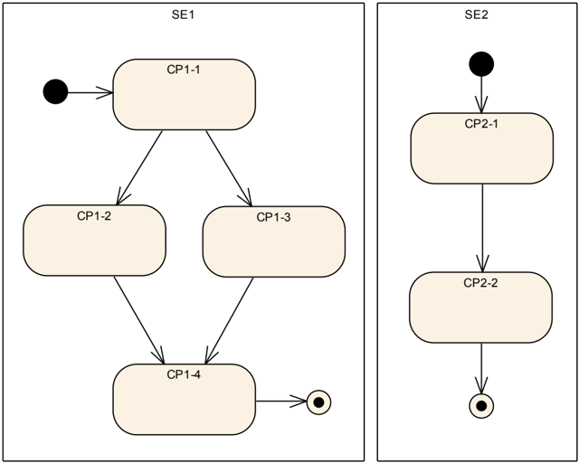

#### 6.6.2. 与模式相关的参数

##### 6.6.2.1. 模式

更改**看门狗管理器**模块的模式（**看门狗管理器模式**）也会导致看门狗处理条件的改变，例如不同的看门狗模式。因此，**看门狗管理器**模块为每个已配置的模式以及每个看门狗提供了一组静态配置���看门狗参数（见 **WdgMTrigger**）。

对于每个看门狗实例，看门狗模式应是静态配置的，并由参数 **WdgMWatchdogMode** 表示。

通过将看门狗模式配置为 **WDGIF_OFF_MODE**，可以禁用对应的看门狗。

**看门狗管理器**模块为每个已配置的模式（**WdgMMode**）以及每个预期在该给定模式下被监督的**被监督实体**提供了一组静态配置的监督参数。

##### 6.6.2.2. 外部图的逻辑监督

也存在跨越**被监督实体**边界的**转换**。当**看门狗管理器**模块还应监督多个**被监督实体**的执行顺序时，就会出现这些**外部转换**。这些**外部转换**构成**外部图**。

因此，**外部转换**必须独立于**内部转换**配置，且仅在**逻辑监督**的上下文中配置。

当我们集成图 7.10 中的两个**被监督实体**时，可以例如决定**被监督实体** SE1 必须总是执行到**检查点** CP1-4，然后**被监督实体** SE2 必须从**检查点** CP2-1 开始执行。那么就需要配置一个从 CP1-4 到 CP2-1 的**转换**。该**转换**既不属于 SE1 也不属于 SE2。图 7.11 给出了该**外部转换**。

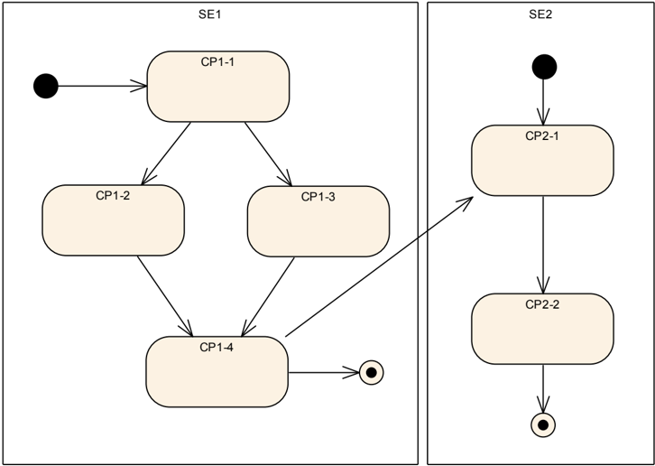

配置**内部转换**与**外部转换**存在显著差异。**内部转换**属于一个**被监督实体**，且不依赖于**看门狗管理器模式**。可以通过从模式中引用某个 **SE** 来配置在给定模式下激活/停用该 **SE**。然而，不可能在同一个 **SE** 内拥有依赖于模式的不同**转换**或**检查点**。相反，**外部转换**包含在特定的**看门狗管理器模式**中。每个模式可以存在若干**外部转换图**。如果两个不同的模式具有相同的全局**转换图**，则它们需要被复制。

图 7.11 给出了带有**外部转换**的两个**被监督实体**。

**检查点**的起点、终点以及**外部转换**针对每个**看门狗管理器模式**进行配置。

**看门狗管理器**模块支持若干不同的运行模式。每个模式由以下内容定义：

- 已激活**被监督实体**的集合（见 6.6.1.1 节）及其参数（见 **WdgMLocalStatusParams**）
- **监督功能**（见 **WdgMAliveSupervision**、**WdgMDeadlineSupervision**、**WdgMExternalLogicalSupervision**）
- 需要更新其触发条件的看门狗集合（见 **WdgMTrigger**）

**ECU** 生命周期的不同阶段需要不同的模式。例如，一个模式在启动与关机期间活动，另一个在正常运行期间活动，还有一个在睡眠期间活动。即使在正常运行期间，也可能需要多个模式：当多个应用运行在同一个 **ECU** 上时，一个应用可能已经关闭而不再需要监督，而另一个应用仍在运行并需要被监督。

**看门狗管理器**模块的每个模式都有一个标识符（见 **WdgMModeId**），该标识符应是唯一的。

**看门狗管理器**模块有一个初始模式 **WdgMInitialMode**，该模式在其被初始化时激活。

##### 6.6.2.3. 存活监督

每个**检查点**的时序约束由**看门狗管理器**模块的可配置参数表示（见 **WdgMAliveSupervision**）。尽管时序约束是针对**检查点**定义的，**看门狗管理器**仍为整个**被监督实体**确定**存活监督**的结果。

可接受的**失败的监督参考周期**数量取决于每个**被监督实体**的应用上下文。因此，用于检查对应**被监督实体**的**存活监督**是否最终失败的各个阈值，需要是一个可配置参数（见 **WdgMFailedAliveSupervisionRefCycleTol**）。

当**存活监督**通过任何**局部监督状态**达到过期条件时，恢复就不再需要。其结果是，看门狗触发将被停止；但为了确保对该条件有进一步反应的一定时间周期，看门狗触发的阻塞可被推迟若干连续的**监督周期**（见 **WdgMExpiredSupervisionCycleTol**）。

由同一个 **WdgMMode** 聚合的任意两个 **WdgMAliveSupervision** 不应引用相同的 **WdgMCheckpoint**。

##### 6.6.2.4. 截止时间监督

一个**被监督实体**的**截止时间监督**（**WdgMDeadlineSupervision**）应引用同时属于该**被监督实体**的**检查点**（**WdgMDeadlineStartRef**、**WdgMDeadlineStopRef**）。换言之，所引用的任何**检查点**都不应属于其他**被监督实体**。

任意一组有序的两个**检查点**不应定义多于一个**截止时间监督**（**WdgMDeadlineSupervision**）。

### 6.7. 使用软件集群连接器（SwCluC）支持集群式软件架构

本节仅适用于集群式软件架构（**WdgMSwClusterSupport = ENABLE_SW_CLUSTER_SUPPORT**），即不适用于非集群式软件架构。

#### 6.7.1. 软件架构假设与约束

对于支持集群式软件架构（带或不带多分区配置）的 **ECU** 软件，假定**看门狗管理器**将按以下方式分配到每个**软件集群**（同样如图 7.12 所示）：

- 在**宿主软件集群**内，**WdgM** 应提供完整的 **API** 集合（[**WdgM_MainFunction**](#751-wdgm_mainfunction)、[**WdgM_CheckpointReached**](#736-wdgm_checkpointreached) 等）。每个 **EcucPartition** 至少提供一个 [**WdgM_MainFunction**](#751-wdgm_mainfunction)。这些 API 集执行：
    - 在**宿主软件集群**内、按 EcucPartition（即在主实例和每个从实例中）的**存活监督**、**截止时间监督**与**逻辑监督**
    - 基于**跨集群外部图**的跨**软件集群****逻辑监督**（仅在包含 **WdgM** 主实例的 EcucPartition 中）
    - 每个**被监督实体**的**局部监督状态**的确定
    - **全局监督状态**的确定（仅在主实例中）
    - 基于**局部监督状态**的恢复动作
    - 基于**全局监督状态**的恢复动作（仅在主实例中）
    - **看门狗处理**（包括通过 **WdgIf** 与 **Wdg** 模块的看门狗触发）（仅在主实例中）
- 在**宿主软件集群**内，**WdgM** 应在所有 EcucPartition 上提供从实例（[**WdgM_MainFunction**](#751-wdgm_mainfunction)），它们可连接到每个**应用软件集群**中的 **WdgM** 主实例。这确保**应用软件集群**中的每个 **WdgM**（主实例）都能访问同一分区上**宿主软件集群**中的 **WdgM**。
- 在每个**应用软件集群**内，**WdgM** 应提供 **API** 的子集。每个 EcucPartition 至少提供一个 [**WdgM_MainFunction**](#751-wdgm_mainfunction)。
    - 在**宿主软件集群**内、按 EcucPartition（即在主实例和每个从实例中）的**存活监督**、**截止时间监督**与**逻辑监督**
    - 每个**被监督实体**的**局部监督状态**的确定
    - 基于**局部监督状态**的恢复动作

请注意，如果在**宿主软件集群**的主实例侧存在多个主函数，则需要做出以下设计决策，但本规范未对其标准化（因为主-从模式的实现是实现特定的）：

- 恢复动作等到主函数的映射
- Init / DeInit **API** 等的可用性

图 7.12 给出了带**软件集群**的**看门狗管理器**概览。

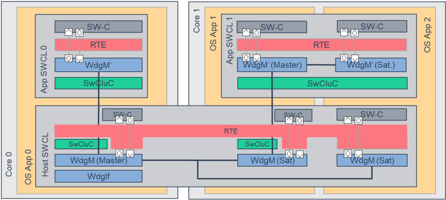

#### 6.7.2. 配置方面

在非集群式软件架构的情况下（**WdgMSwClusterSupport** 未设置或设置为 **DISABLE_SW_CLUSTER_SUPPORT**），参数与容器 **WdgMCrossClusterTransition**、**WdgMTransitionProxy** 和 **WdgMBaseSocket** 不应存在。

一个 **WdgMCrossClusterTransition** 仅在以下配置中有效：

- 从一个 **WdgMCheckpoint** 到一个 **WdgMTransitionProxy**
- 从一个 **WdgMTransitionProxy** 到一个 **WdgMCheckpoint**
- 从一个 **WdgMTransitionProxy** 到另一个 **WdgMTransitionProxy**（仅在**宿主软件集群**中）
- 从一个 **WdgMTransitionProxy** 到相同的 **WdgMTransitionProxy**（仅在**应用软件集群**中，且限于**应用软件集群**中不需要到达任何 **WdgMCheckpoint** 的情形），或
- 从一个 **WdgMCheckpoint** 到一个 **WdgMCheckpoint**（在跨集群**转换图**完全由 **WdgMCrossClusterTransition** 容器描述的情形下）

其中「from」通过 **WdgMCrossClusterTransitionSourceRef** 配置，「to」由 **WdgMCrossClusterTransitionDestRef** 给出。

**WdgMBaseSocket** 仅与类别为 **SWCLUSTER_RES_WDGM_BASES_SOCKET** 的 **CpSoftwareClusterServiceResource** 相关：**WdgMBaseSocket** 的 **WdgMResourceRef** 应仅引用类别为 **SWCLUSTER_RES_WDGM_BASES_SOCKET** 的 **CpSoftwareClusterServiceResource**。

**WdgMTransitionProxy** 仅与类别为 **SWCLUSTER_RES_WDGM_TRANSITION** 的 **CpSoftwareClusterServiceResource** 相关：**WdgMTransitionProxy** 的 **WdgMResourceRef** 应仅引用类别为 **SWCLUSTER_RES_WDGM_TRANSITION** 的 **CpSoftwareClusterServiceResource**。

**ECU** 配置将按**软件集群**进行。因此：

- 一个**被监督实体** ID 可以在不同**软件集群**中复用
- **WdgMMode** 与 **WdgMInitialMode** 配置必须在各**软件集群**（**宿主软件集群**与**应用软件集群**）之间保持一致

请注意，**软件集群**的类型可通过 **SwCluCGeneral**.**SwCluCDefinitionSelection** 识别。

##### 6.7.2.1. 跨集群外部图的配置

**跨集群外部图**是**外部图**的一种扩展，用于建模在集群式软件架构下跨越多个**软件集群**的**图**。

为了建模具有跨集群**转换**的**图**，可以使用以下配置元素：

- **WdgMCrossClusterTransition**（代替 **WdgMExternalTransition**），表示到其他**软件集群**的**转换**（包含对其他**软件集群**中目的**检查点**的引用）或来自其他**软件集群**的**转换**（包含对其他**软件集群**中源**检查点**的引用）
- **WdgMTransitionProxy**（代替 **WdgMCheckpoint**），表示其他**软件集群**中的**检查点**

### 6.8. 错误分类

文档 [3, 基础软件模块通用规范] 的「错误处理」章详细描述了基础软件的错误处理，并由此构成了一个由五种可能在 **BSW** 模块中出现的错误类型组成的分类方案。

在此基础上，以下各节规定按相应子章节排列的具体错误。

#### 6.8.1. 开发错误

| 错误类型 | 相关错误代码 | 错误值 |
|---|---|---|
| **API**服务在错误的上下文中使用（无模块初始化） | WDGM_E_UNINIT | 0x10 |
| **API**服务 **Wdg_Init** 使用了错误的配置集被调用 | WDGM_E_PARAM_CONFIG | 0x11 |
| **API**服务使用了错误的 "mode" 参数 | WDGM_E_PARAM_MODE | 0x12 |
| **API**服务使用了错误的 "supervised entity identifier" 参数 | WDGM_E_PARAM_SEID | 0x13 |
| **API**服务使用了无效指针 | WDGM_E_INV_POINTER | 0x14 |
| **API**服务使用了无效的 CheckpointId | WDGM_E_CPID | 0x16 |
| **API**服务在错误的上下文中使用——模块未去初始化时调用了 [**WdgM_Init**](#731-wdgm_init)（全局状态不是 **WDGM_GLOBAL_STATUS_DEACTIVATED**） | WDGM_E_NO_DEINIT | 0x1A |
| 初始化失败，例如所选配置集不存在 | WDGM_E_INIT_FAILED | 0x1B |
| **API**服务使用了空指针参数 | WDGM_E_PARAM_POINTER | 0x1C |

#### 6.8.2. 运行时错误

| 错误类型 | 相关错误代码 | 错误值 |
|---|---|---|
| 不允许禁用看门狗（例如在安全相关系统中） | WDGM_E_DISABLE_NOT_ALLOWED | 0x15 |
| **API**服务使用了在当前**看门狗管理器模式**中已停用的**被监督实体**的**检查点** | WDGM_E_SEDEACTIVATED | 0x19 |
| 看门狗驱动的模式切换失败 | WDGM_E_SET_MODE | 0x1D |

#### 6.8.3. 瞬态故障

无瞬态故障。

#### 6.8.4. 生产错误

**看门狗管理器**模块检测到以下生产错误：

| 错误名称 | WDGM_E_SUPERVISION |
|---|---|
| 简短描述 | 监督已失败，将发生看门狗复位 |
| 详细描述 | 监督已失败（**全局监督状态**已达到 **WDGM_GLOBAL_STATUS_STOPPED**），将发生看门狗复位。 |
| 检测条件 | 失败：已达到 **WDGM_GLOBAL_STATUS_STOPPED**，将发生复位。 |
| 检测条件 | 通过：启动之后。 |
| 辅助参数 | - |
| 所需时间 | 取决于 **WdgM** 的配置 |
| 监控频率 | **WdgM** 内的周期性监督 |

**注意：** 所存储的 DTC 永远不会显示为「已确认」，因为它在每次启动时都会被复位。

**注意：** 即使 **DemStatusBitStorageTestFailed** 被设置为 true，所存储的 DTC 也可能不会显示为「测试失败（事件激活）」，因为在达到**全局监督状态** = **WDGM_GLOBAL_STATUS_STOPPED** 之后无法始终确保 DTC 的存储。

在 [**WdgM_Init**](#731-wdgm_init) 之后的第一次 [**WdgM_MainFunction**](#751-wdgm_mainfunction) 调用中，但在上述报告执行之后，如果已配置参数 WDGM_E_SUPERVISION，则**看门狗管理器**模块应向 **DEM** 报告 WDGM_E_SUPERVISION 的错误状态 PASSED。

#### 6.8.5. 扩展生产错误

无扩展生产错误。

### 6.9. 安全事件

本模块不报告安全事件。

## 7. API规范

### 7.1. 导入的类型

下列数据类型由**看门狗管理器**模块使用。

| 模块 | 头文件 | 导入类型 |
|---|---|---|
| Dem | Rte_Dem_Type.h | Dem_EventIdType |
| | Rte_Dem_Type.h | Dem_EventStatusType |
| Os | Os.h | StatusType |
| | Os.h | TickRefType |
| | Os.h | TickType |
| | Rte_Os_Type.h | CounterType |
| Std | Std_Types.h | Std_ReturnType |
| | Std_Types.h | Std_VersionInfoType |
| SwCluC | SwCluC_BManif.h | SwCluC_BManif_HandleIndexType |
| | SwCluC_BManif.h | SwCluC_BManif_SwClusterIdType |
| | SwCluC_BManif.h | SwCluC_BManif_TableIndexType |
| WdgIf | WdgIf.h | WdgIf_ModeType |

### 7.2. 类型定义

下列数据类型用于本规范中定义的函数。

#### 7.2.1. WdgM_ConfigType

| 名称 | WdgM_ConfigType |
|---|---|
| 种类 | 结构体 |
| 元素 | 实现相关 |
| 元素类型 | - |

**说明**: 此结构体包含**看门狗管理器**的所有构建后可配置参数。指向该结构体的指针被传递给**看门狗管理器**的初始化函数以进行配置。可通过 **WdgM.h** 获得。

### 7.3. 函数定义

以下是提供给上层模块的函数列表。

#### 7.3.1. WdgM_Init

**说明**: 此服务初始化**看门狗管理器**。可通过**WdgM.h**获得。本服务为同步调用，不可重入。参数 ConfigPtr（in）：指向构建后配置数据的指针。无返回值。

```C
void WdgM_Init ( const WdgM_ConfigType* ConfigPtr )
```

**WdgM_Init** 函数初始化**看门狗管理器**。执行该函数后，将根据初始**模式**中定义的**被监督实体**列表激活监督。

**注意：** 在**WdgM_Init** 函数执行之后，配置数据可访问，并可供**WdgM**模块的函数使用。

**WdgM_Init** 函数应初始化**看门狗管理器**模块的所有模块变量（全局与静态）。

**WdgM_Init** 函数应建立**看门狗管理器**模块的初始**模式**。

**注意：** 如果在 **WdgM_Init** 期间对 **WdgIf_SetMode** 服务的调用失败，则直接调用 **MCU** 复位 **API**（仅在已配置时），此后**看门狗管理器**模块将处于已初始化状态，且**全局监督状态** = **WDGM_GLOBAL_STATUS_STOPPED**。这将导致复位——或者在第一个看门狗超时时（如果未配置**看门狗管理器**模块的立即复位），或者立即发生（如果配置了立即复位）。

如果 **WdgMOffModeEnabled** 开关未启用，且配置（**ConfigPtr**）提供的初始模式将禁用看门狗（**WDGIF_OFF_MODE**），则 **WdgM_Init** 函数应返回 **E_NOT_OK** 而不执行任何动作，并且 **WdgM_Init** 函数应向**默认错误跟踪器**报告运行时错误代码 [**WDGM_E_DISABLE_NOT_ALLOWED**](#682-运行时错误)。

如果配置参数 **WdgMDevErrorDetect** 已启用：如果**看门狗管理器**处于 **WDGM_GLOBAL_STATUS_DEACTIVATED** 状态，则 **WdgM_Init** 函数应以错误代码 [**WDGM_E_UNINIT**](#681-开发错误) 向**默认错误跟踪器**报告错误，且不产生任何进一步作用。

如果配置参数 **WdgMDevErrorDetect** 已禁用：如果**看门狗管理器**不处于 **WDGM_GLOBAL_STATUS_DEACTIVATED** 状态，则 **WdgM_Init** 函数应返回且不产生任何作用。

如果 **WdgMDevErrorDetect** 开关已启用且配置变体为 **VARIANT-POST-BUILD**，则 **WdgM_Init** 函数应检查给定配置集的内容是否在允许的边界内。如果 **WdgM_Init** 函数检测到错误，则它不应执行**看门狗管理器**模块的初始化，并且应向**默认错误跟踪器**的 **Det_ReportError** 服务报告错误代码 [**WDGM_E_PARAM_CONFIG**](#681-开发错误)。

**WdgM_Init** 函数应从未初始化的 **RAM** 中清除存储首个达到 **EXIRED** 状态的 **SEID** 的双反转值。

#### 7.3.2. WdgM_DeInit

**说明**: 此服务去初始化**看门狗管理器**。可通过**WdgM.h**获得。本服务为同步调用，不可重入。无参数。无返回值。

```C
void WdgM_DeInit ( void )
```

**WdgM_DeInit** 函数去初始化**看门狗管理器**模块，并通过一次模式切换更新所有**看门狗驱动**的触发条件。

**注意** 由于「窗口化看门狗」概念，此服务是必需的。在**看门狗管理器**模块停止工作之前，它必须将所有运行中的看门狗的触发条件设置为一个超时值，以使关断过程的其余部分能够在没有看门狗复位的情况下执行。

如果配置参数 **WdgMDevErrorDetect** 已启用：如果**看门狗管理器**处于 **WDGM_GLOBAL_STATUS_DEACTIVATED** 状态，则 **WdgM_DeInit** 函数应以错误代码 [**WDGM_E_UNINIT**](#681-开发错误) 向**默认错误跟踪器**报告错误，且不产生任何进一步作用。

如果配置参数 **WdgMDevErrorDetect** 已禁用：如果**看门狗管理器**处于 **WDGM_GLOBAL_STATUS_DEACTIVATED** 状态，则 **WdgM_DeInit** 函数应返回且不产生任何作用。

#### 7.3.3. WdgM_GetVersionInfo

**说明**: 此服务返回本模块的版本信息。可通过**WdgM.h**获得。本服务为同步调用，可重入。参数 VersionInfo（out）：指向用于存储 **WdgM** 模块版本信息的位置的指针。无返回值。

```C
void WdgM_GetVersionInfo ( Std_VersionInfoType* VersionInfo )
```

如果 **WdgMDevErrorDetect** 开关已启用，则 **WdgM_GetVersionInfo** 函数应检查是否为 VersionInfo 参数传入 **NULL** 指针。如果发生错误，则 **WdgM_GetVersionInfo** 函数的其余部分不应被执行，并且 **WdgM_GetVersionInfo** 函数应向**默认错误跟踪器**的 **Det_ReportError** 服务报告开发错误代码 [**WDGM_E_INV_POINTER**](#681-开发错误)。

#### 7.3.4. WdgM_SetMode

**说明**: 此服务设置**看门狗管理器**的当前模式。可通过**WdgM.h**获得。本服务为同步调用，不可重入。参数 Mode（in）：已配置的**看门狗管理器模式**之一。返回值：Std_ReturnType，**E_OK**：成功切换到新模式；**E_NOT_OK**：切换到新模式失败。

```C
Std_ReturnType WdgM_SetMode ( WdgM_ModeType Mode )
```

该服务的行为与对应的功能需求见第 6.5 节。

只有当**全局监督状态**等于 **WDGM_GLOBAL_STATUS_OK** 或 **WDGM_GLOBAL_STATUS_FAILED** 时，**看门狗管理器**模块才应执行 **WdgM_SetMode** 服务。

如果 **WdgM_SetMode** 函数因对 **WdgIf_SetMode** 服务的调用失败而失败，则**看门狗管理器**应向**默认错误跟踪器**报告一个值为 [**WDGM_E_SET_MODE**](#682-运行时错误) 的运行时错误。

如果通过将参数 **WdgMOffModeEnabled** 设置为 FALSE 使禁用看门狗不被允许，则该例程应检查所请求的模式是否会禁用看门狗（**WDGIF_OFF_MODE**）。在这种情况下（即在不允许时将禁用看门狗）：

1. 不应执行模式切换。
2. 应以运行时错误代码 [**WDGM_E_DISABLE_NOT_ALLOWED**](#682-运行时错误) 向**默认错误跟踪器**报告错误。
3. 该例程应返回值 **E_NOT_OK**。

如果配置参数 **WdgMDevErrorDetect** 已启用，则应对 Mode 参数检查其是否在允许的范围内。如果发生错误，则不应执行模式切换，并应以值 [**WDGM_E_PARAM_MODE**](#681-开发错误) 向**默认错误跟踪器**报告错误。

如果配置参数 **WdgMDevErrorDetect** 已启用：如果**看门狗管理器**处于 **WDGM_GLOBAL_STATUS_DEACTIVATED** 状态，则 **WdgM_SetMode** 函数应以错误代码 [**WDGM_E_UNINIT**](#681-开发错误) 向**默认错误跟踪器**报告错误，且不产生任何进一步作用。

如果配置参数 **WdgMDevErrorDetect** 已禁用：如果**看门狗管理器**处于 **WDGM_GLOBAL_STATUS_DEACTIVATED** 状态，则 **WdgM_SetMode** 函数应返回且不产生任何作用。

#### 7.3.5. WdgM_GetMode

**说明**: 此服务返回**看门狗管理器**的当前模式。可通过**WdgM.h**获得。本服务为同步调用，可重入。无参数。返回值：Std_ReturnType，**E_OK**：成功返回当前模式；**E_NOT_OK**：返回当前模式失败。参数 Mode（out）：**看门狗管理器**的当前模式。

```C
Std_ReturnType WdgM_GetMode ( WdgM_ModeType* Mode )
```

**WdgM_GetMode** 服务应返回**看门狗管理器**当前激活的模式。如果在调用本服务时 [**WdgM_SetMode**](#734-wdgm_setmode) 服务正处于活动状态，则只要新模式尚未被完全激活，**WdgM_GetMode** 就应返回先前激活的模式。

如果配置参数 **WdgMDevErrorDetect** 已启用：如果**看门狗管理器**处于 **WDGM_GLOBAL_STATUS_DEACTIVATED** 状态，则 **WdgM_GetMode** 函数应以错误代码 [**WDGM_E_UNINIT**](#681-开发错误) 向**默认错误跟踪器**报告错误，且不产生任何进一步作用。

如果配置参数 **WdgMDevErrorDetect** 已禁用：如果**看门狗管理器**处于 **WDGM_GLOBAL_STATUS_DEACTIVATED** 状态，则 **WdgM_GetMode** 函数应返回且不产生任何作用。

如果配置参数 **WdgMDevErrorDetect** 已启用，则该例程应检查是否为 **OUT** 参数传入 **NULL** 指针。如果发生错误，则不应执行该服务，并应以错误代码 [**WDGM_E_INV_POINTER**](#681-开发错误) 向**默认错误跟踪器**报告错误。

#### 7.3.6. WdgM_CheckpointReached

**说明**: 此服务向**看门狗管理器**指示已到达**被监督实体**内的某个**检查点**。可通过**WdgM.h**获得。本服务为同步调用，可重入。参数 SEID（in）：报告**检查点**的**被监督实体**的标识符。参数 CheckpointID（in）：已到达的**被监督实体**内**检查点**的标识符。返回值：Std_ReturnType，**E_OK**：成功更新存活计数器；**E_NOT_OK**：更新失败。

```C
Std_ReturnType WdgM_CheckpointReached ( WdgM_SupervisedEntityIdType SEID, WdgM_CheckpointIdType CheckpointID )
```

**WdgM_CheckpointReached()** 函数应递增所报告**检查点**的**存活计数器**。

**WdgM_CheckpointReached()** 函数应使用所报告的**检查点**，为所报告的**被监督实体**执行**截止时间监督**（提前到达与延迟的检测）。其输出应为该**被监督实体**更新后的**截止时间监督**结果。

**WdgM_CheckpointReached()** 函数应使用所报告的**检查点**，为所报告的**被监督实体**执行**逻辑监督**。其输出应为该**被监督实体**更新后的**逻辑监督**结果。

该例程应检查 CheckpointID 参数所属的**被监督实体**在当前**模式**中是否已激活。如果发生错误（即该**被监督实体**在当前**模式**中已停用），则该服务应返回 **E_NOT_OK** 而不执行任何动作，并应以运行时错误代码 [**WDGM_E_SEDEACTIVATED**](#682-运行时错误) 向**默认错误跟踪器**报告错误。

如果配置参数 **WdgMDevErrorDetect** 已禁用：如果**看门狗管理器**处于 **WDGM_GLOBAL_STATUS_DEACTIVATED** 状态，则 **WdgM_CheckpointReached** 函数应返回且不产生任何作用。

如果配置参数 **WdgMDevErrorDetect** 已启用，则应对 SEID 参数检查其是否在**看门狗管理器**所控制的实体列表中。如果发生错误，则不应执行该服务，并应以错误代码 [**WDGM_E_PARAM_SEID**](#681-开发错误) 向**默认错误跟踪器**报告错误。

如果配置参数 **WdgMDevErrorDetect** 已启用：如果**看门狗管理器**处于 **WDGM_GLOBAL_STATUS_DEACTIVATED** 状态，则 **WdgM_CheckpointReached** 函数应以错误代码 [**WDGM_E_UNINIT**](#681-开发错误) 向**默认错误跟踪器**报告错误，且不产生任何进一步作用。

如果配置参数 **WdgMDevErrorDetect** 已禁用：如果**看门狗管理器**处于 **WDGM_GLOBAL_STATUS_DEACTIVATED** 状态，则 **WdgM_CheckpointReached** 函数应返回且不产生任何作用。

如果配置参数 **WdgMDevErrorDetect** 已启用，则该例程应检查 CheckpointID 参数是否在由 SEID 参数给出的**被监督实体**所关联的**检查点**集合内。如果发生错误，则不应执行该服务，并应以错误代码 [**WDGM_E_CPID**](#681-开发错误) 向**默认错误跟踪器**报告错误。

#### 7.3.7. WdgM_GetLocalStatus

**说明**: 此服务返回单个**被监督实体**的监督状态。可通过**WdgM.h**获得。本服务为同步调用，可重入。参数 SEID（in）：应返回其监督状态的被监督实体的标识符。参数 Status（out）：给定被监督实体的监督状态。返回值：Std_ReturnType，**E_OK**：成功返回当前监督状态；**E_NOT_OK**：返回当前监督状态失败。

```C
Std_ReturnType WdgM_GetLocalStatus ( WdgM_SupervisedEntityIdType SEID, WdgM_LocalStatusType* Status )
```

**WdgM_GetLocalStatus** 服务应返回给定**被监督实体**的单个监督状态。

如果配置参数 **WdgMDevErrorDetect** 已启用，则应对 SEID 参数检查其是否在**看门狗管理器**所控制的实体列表中。如果发生错误，则不应执行该服务，并应以错误代码 [**WDGM_E_PARAM_SEID**](#681-开发错误) 向**默认错误跟踪器**报告错误。

如果配置参数 **WdgMDevErrorDetect** 已启用，则该例程应检查是否为 **OUT** 参数传入 **NULL** 指针。如果发生错误，则不应执行该服务，并应以错误代码 [**WDGM_E_INV_POINTER**](#681-开发错误) 向**默认错误跟踪器**报告错误。

如果配置参数 **WdgMDevErrorDetect** 已启用：如果**看门狗管理器**处于 **WDGM_GLOBAL_STATUS_DEACTIVATED** 状态，则 **WdgM_GetLocalStatus** 函数应以错误代码 [**WDGM_E_UNINIT**](#681-开发错误) 向**默认错误跟踪器**报告错误，且不产生任何进一步作用。

如果配置参数 **WdgMDevErrorDetect** 已禁用：如果**看门狗管理器**处于 **WDGM_GLOBAL_STATUS_DEACTIVATED** 状态，则 **WdgM_GetLocalStatus** 函数应返回且不产生任何作用。

#### 7.3.8. WdgM_GetGlobalStatus

**说明**: 此服务返回**看门狗管理器**的全局监督状态。可通过**WdgM.h**获得。本服务为同步调用，可重入。参数 Status（out）：**看门狗管理器**的全局监督状态。返回值：Std_ReturnType，**E_OK**：成功返回当前监督状态；**E_NOT_OK**：返回当前监督状态失败。

```C
Std_ReturnType WdgM_GetGlobalStatus ( WdgM_GlobalStatusType* Status )
```

如果启用了**看门狗管理器**模块的开发错误检测，则 **WdgM_GetGlobalStatus** 函数应检查 Status 参数是否为 **NULL** 指针（**NULL_PTR**）。如果 Status 是 **NULL** 指针，则该函数应引发开发错误 [**WDGM_E_INV_POINTER**](#681-开发错误)（即无效指针），且不产生任何进一步作用。

如果配置参数 **WdgMDevErrorDetect** 已启用，则该例程应检查是否为 **OUT** 参数传入 **NULL** 指针。如果发生错误，则不应执行该服务，并应以错误代码 [**WDGM_E_INV_POINTER**](#681-开发错误) 向**默认错误跟踪器**报告错误。

如果配置参数 **WdgMDevErrorDetect** 已启用，则该例程应检查**看门狗管理器**是否已初始化。如果发生错误，则不应执行该服务，并应以错误代码 [**WDGM_E_UNINIT**](#681-开发错误) 向**默认错误跟踪器**报告错误。

#### 7.3.9. WdgM_PerformReset

**说明**: 此服务指示**看门狗管理器**产生看门狗复位。可通过**WdgM.h**获得。本服务为同步调用，不可重入。无参数。无返回值。

```C
void WdgM_PerformReset ( void )
```

当调用此服务时，**看门狗管理器**应将所有已配置**看门狗驱动**的触发条件设置为 0（零）。

由此，硬件看门狗将产生外部硬件复位。

在此服务被调用之后，**看门狗管理器**不应再更新触发条件。

调用此 **API** 后，不再考虑**全局监督状态**。

如果配置参数 **WdgMDevErrorDetect** 已启用：如果**看门狗管理器**处于 **WDGM_GLOBAL_STATUS_DEACTIVATED** 状态，则 **WdgM_PerformReset** 函数应以错误代码 [**WDGM_E_UNINIT**](#681-开发错误) 向**默认错误跟踪器**报告错误，且不产生任何进一步作用。

如果配置参数 **WdgMDevErrorDetect** 已禁用：如果**看门狗管理器**处于 **WDGM_GLOBAL_STATUS_DEACTIVATED** 状态，则 **WdgM_PerformReset** 函数应返回且不产生任何作用。

#### 7.3.10. WdgM_GetFirstExpiredSEID

**说明**: 此服务返回首个达到 **WDGM_LOCAL_STATUS_EXPIRED** 状态的 **SEID**。可通过**WdgM.h**获得。本服务为同步调用，可重入。参数 SEID（out）：首个达到 **WDGM_LOCAL_STATUS_EXPIRED** 状态的被监督实体的标识符。返回值：Std_ReturnType，**E_OK**：成功返回 **SEID**；**E_NOT_OK**：返回 **SEID** 时出错。

```C
Std_ReturnType WdgM_GetFirstExpiredSEID ( WdgM_SupervisedEntityIdType* SEID )
```

如果启用了**看门狗管理器**模块的开发错误检测，则 **WdgM_GetFirstExpiredSEID()** 函数应检查 SEID 参数是否为 **NULL** 指针（**NULL_PTR**）。如果 Status 是 **NULL** 指针，则该函数应引发开发错误 [**WDGM_E_INV_POINTER**](#681-开发错误)（即无效指针），且不产生任何进一步作用。

**WdgM_GetFirstExpiredSEID()** 函数应在 [**WdgM_Init**](#731-wdgm_init) 之前可用。

**WdgM_GetFirstExpiredSEID()** 函数应从未初始化的 **RAM** 位置读取以双反转值存储的 **SEID**。如果该值与其反转值不对应，则该函数应返回 **E_NOT_OK** 并向 *SEID 写入 0。如果该值与其反转值对应，则该函数应返回 **E_OK** 并将读取到的值写入 *SEID。

### 7.4. 回调通知

不适用。

### 7.5. 调度函数

这些函数由**基础软件调度器**直接调用。

#### 7.5.1. WdgM_MainFunction

**说明**: 此服务执行**看门狗管理器**周期性作业的处理。可通过**SchM_WdgM.h**获得。

```C
void WdgM_MainFunction ( void )
```

**WdgM_MainFunction()** 函数应使用所报告的**检查点**，为所报告的**被监督实体**执行**存活监督**。该函数的输入应为该**检查点**的**存活计数器**。该函数的输出应为该**被监督实体**的**存活监督**结果。

**WdgM_MainFunction()** 函数应对所有具有激活**截止时间监督**的**被监督实体**（例如已到达**截止时间起始检查点**且尚未到达对应**截止时间结束检查点**）执行**截止时间监督**（超时的检测）。其输出应为该**被监督实体**更新后的**截止时间监督**结果。

基于**存活监督**、**截止时间监督**与**逻辑监督**的结果，**WdgM_MainFunction()** 函数应为每个已激活的**被监督实体**确定**局部监督状态**。

对于自上次调用 **[WdgM_Init](#731-wdgm_init)()** 以来首个切换到 **WDGM_LOCAL_STATUS_EXPIRED** 状态的**被监督实体**，**WdgM_MainFunction()** 函数应将该**被监督实体**的 **SEID** 存储在未初始化的 **RAM** 中，形式为双反转值（即 SEID 与 ~ SEID）。

基于每个已激活**被监督实体**的**局部监督状态**，**WdgM_MainFunction()** 函数应确定**全局监督状态**。

如果配置了多个主函数（见 **WdgMMainFunction**），则每个主函数的函数名应为 **WdgM_MainFunction_<shortName>**。后缀 <shortName> 应派生自 **ECU** 配置中 **WdgMMainFunction** 配置容器的短名称。

如果配置参数 **WdgMDevErrorDetect** 已启用，则该例程应检查**看门狗管理器**是否已初始化。如果发生错误，则不应执行主函数，并应以错误代码 [**WDGM_E_UNINIT**](#681-开发错误) 向**默认错误跟踪器**报告开发错误。

### 7.6. 期望接口

本章列出了**看门狗管理器**模块需要从其他模块获得的所有接口。

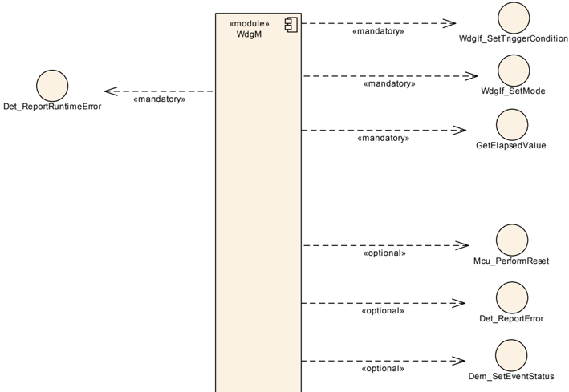

#### 7.6.1. 强制接口

本节定义了为实现模块核心功能所需的所有接口。

| API 函数 | 头文件 | 描述 |
|---|---|---|
| Det_ReportRuntimeError | Det.h | 报告运行时错误的服务。如果已配置 callout，则应调用该 callout。 |
| GetElapsedValue | Os.h | 该服务获取当前 tick 值与先前读取的 tick 值之间的 tick 数量。 |
| WdgIf_SetMode | WdgIf.h | 将服务 **WdgIf_SetMode** 映射到对应**看门狗驱动**的 **Wdg_SetMode** 服务。 |
| WdgIf_SetTriggerCondition | WdgIf.h | 将服务 **WdgIf_SetTriggerCondition** 映射到对应**看门狗驱动**的 **Wdg_SetTriggerCondition** 服务。 |

#### 7.6.2. 可选接口

本节定义了为实现模块可选功能所需的所有接口。

| API 函数 | 头文件 | 描述 |
|---|---|---|
| Dem_SetEventStatus | Dem.h | 由 **SW-C** 或 **BSW** 模块调用，向 **Dem** 报告监控器状态信息。调用 **Dem_SetEventStatus** 的 **BSW** 模块可以安全地忽略返回值。仅当（{Dem/Dem ConfigSet/DemEventParameter/DemEvent ReportingType} == STANDARD_REPORTING）时此 **API** 才可用 |
| Det_ReportError | Det.h | 报告开发错误的服务。 |
| Mcu_PerformReset | Mcu.h | 该服务执行微控制器复位。 |
| SwCluC_BManif_GetConSwClusterId _<ResourceEntryGroup>_<Handle> | SwCluC_BManif.h | 返回某个 Provide Resource Entry 的 Notifier Handle 或某个 Require Resource Entry 的 Provide Handle 所连接的**软件集群**的 Id |
| SwCluC_BManif_GetConSwClusterId _<ResourceEntryGroup>_<Resource Entry>_<Handle> | SwCluC_BManif.h | 返回某个 Provide Resource Entry 的 Notifier Handle 或某个 Require Resource Entry 的 Provide Handle 所连接的**软件集群**的 Id |
| SwCluC_BManif_GetHandle_< ResourceEntryGroup>_<Handle> | SwCluC_BManif.h | 返回某个 Resource Entry Group 中一个 Resource Entry 的句柄 |
| SwCluC_BManif_GetHandle_< ResourceEntryGroup>_<Resource Entry>_<Handle> | SwCluC_BManif.h | 返回某个 Resource Entry Group 中一个 Resource Entry 的句柄 |
| SwCluC_BManif_GetNoOfHandleSets _<Resource Entry Group> | SwCluC_BManif.h | 返回实际使用的——因而也是已连接的——句柄集的数量。 |
| SwCluC_BManif_GetNoOfHandleSets _<Resource Entry Group>_<Resource Entry> | SwCluC_BManif.h | 返回实际使用的——因而也是已连接的——句柄集的数量 |

#### 7.6.3. 可配置接口

不适用。

### 7.7. 服务接口

本章规定由**看门狗管理器**模块提供的 **AUTOSAR** 接口。**看门狗管理器**服务的 **SW-C** 描述将定义对 **SW-C** 与 **CDD** 可用的**看门狗管理器**端口。每个使用该服务的 **AUTOSAR SW-C** 或 **CDD** 都必须在其自身的描述中包含服务端口。这些端口使用相同的接口进行类型化，并且必须连接到**看门狗管理器**模块的端口，以便 **RTE** 能够生成相应的 **ID** 与所需的符号。

**看门狗管理器**模块的**局部监督状态**与**全局监督状态**通过模式端口报告给 **SW-C** 与 **CDD**。**SW-C** 与 **CDD** 可以定义自己的模式端口，其接口与**看门狗管理器**模块的模式端口相同。此后 **SW-C** 或 **CDD** 即可查询状态，并将通过模式端口获知状态变化。此外，**SW-C** 还可以定义由 **RTE** 因状态变化而启动或停止的 **Runnable**。

**BSW** 模块可以直接调用 **WdgM** **API** 函数并考虑 **RTE** 的映射，也可以通过使用 **RTE** 的服务端口来调用它们。

对于集群式软件架构（一个**宿主软件集群**和零个或多个**应用软件集群**），**宿主软件集群**应提供所有永久可用或由配置启用的端口与对应的端口接口，以及全部操作与 ModeGroup。

对于集群式软件架构，**应用软件集群**应提供以下端口与对应的端口接口，以及所列出的操作与 ModeGroup，这些操作与 ModeGroup 是永久可用或由配置启用的：

- 端口：localSupervision_{SupervisedEntityCheckpointName}（端口接口：**WdgM_LocalSupervision**，操作：**CheckpointReached**）
- 端口：globalSupervision（端口接口：**WdgM_GlobalSupervision**，操作：**GetMode**）
- 端口：mode_{SupervisedEntityName}（端口接口：**WdgM_LocalMode**，ModeGroup：currentMode）

#### 7.7.1. 监督的端口与端口接口

##### 7.7.1.1. 总体方案

为了减少**看门狗管理器**模块所提供的端口数量，所有 **SW-C** / **CDD** 与该服务之间的接口都建模为**客户端/服务器**通信。对于报告**检查点**，发送者-接收者范式看起来可能更合适，但这种建模方式会使端口数量翻倍。因此，对于该功能同样选择了**客户端/服务器**范式。

唯一的**被监督实体** **ID** 用于标识 **ECU** 内的**被监督实体**。为了使应用代码不依赖于 **ECU** 相关的**被监督实体** ID 的配置，**SW-C** 与 **CDD** 所使用的 **ID** 不被显式建模为在 **SW-C** 与服务之间传递的数据元素。这些 **ID** 被建模为**看门狗管理器**模块的 Provide 端口的「端口定义参数值」。因此，**被监督实体** **ID** 不会作为客户端-服务器接口操作的参数出现。该方法的进一步后果是，将为每个**被监督实体**设置独立的端口。

##### 7.7.1.2. 数据类型

在应用与服务之间传递的信息为：

1. 用于标识**被监督实体**的 **ID**（作为端口定义参数值）；以及
2. 用于标识**检查点**的 **ID**。

该**被监督实体标识符**的类型应基于 **WdgM_SupervisedEntityIdType** 类型。该类型定义为 uint16。因此，需要以下类型描述：

| 名称 | WdgM_SupervisedEntityIdType |
|---|---|
| 种类 | 类型 |
| 派生自 | uint16 |
| 取值范围 | 0-<被监督实体数量> |
| 描述 | 该类型为**看门狗管理器**标识单个**被监督实体**。 |
| 变体 | - |
| 可通过 | Rte_WdgM_Type.h |

该**检查点标识符**的类型应基于 **WdgM_CheckpointIdType** 类型。该类型定义为 uint16。因此，需要以下类型描述：

| 名称 | WdgM_CheckpointIdType |
|---|---|
| 种类 | 类型 |
| 派生自 | uint16 |
| 取值范围 | 0-<最大检查点数量> |
| 描述 | 该类型在**被监督实体**的上下文中为**看门狗管理器**标识一个**检查点**。请注意，单个**检查点**只能通过**被监督实体** **ID** 与**检查点** **ID** 的组合来标识。 |
| 变体 | - |
| 可通过 | Rte_WdgM_Type.h |

请注意，**检查点** **ID** 本身并不唯一。只有**被监督实体** **ID** 与**检查点** **ID** 的组合才能唯一标识一个**检查点**。

##### 7.7.1.3. 端口接口

所有操作被放入两个接口中（一个包含针对单个**被监督实体**的特定操作，另一个包含**看门狗管理器**的全局操作）。

**WdgM_LocalSupervision**（客户端/服务器接口）：

| 名称 | WdgM_LocalSupervision |
|---|---|
| 注释 | - |
| 是否为服务 | true |
| 变体 | - |
| 可能错误 0 | E_OK：操作成功 |
| 可能错误 1 | E_NOT_OK：操作失败 |

操作 **CheckpointReached**：向**看门狗管理器**指示已到达**被监督实体**内的某个**检查点**。映射到 **API** [**WdgM_CheckpointReached**](#736-wdgm_checkpointreached)。变体：-。可能错误：**E_OK** **E_NOT_OK**。

**WdgM_LocalSupervisionStatus**（客户端/服务器接口）：

| 名称 | WdgM_LocalSupervisionStatus |
|---|---|
| 注释 | - |
| 是否为服务 | true |
| 变体 | - |
| 可能错误 0 | E_OK：操作成功 |
| 可能错误 1 | E_NOT_OK：操作失败 |

操作 **GetLocalStatus**：返回单个**被监督实体**的监督状态。映射到 **API** [**WdgM_GetLocalStatus**](#737-wdgm_getlocalstatus)。变体：-。参数 Status（类型 **WdgM_LocalStatusType**，方向 **OUT**，注释：给定被监督实体的监督状态，变体：-）。可能错误：**E_OK** **E_NOT_OK**。

**WdgM_GlobalSupervision**（客户端/服务器接口）：

| 名称 | WdgM_GlobalSupervision |
|---|---|
| 注释 | - |
| 是否为服务 | true |
| 变体 | - |
| 可能错误 0 | E_OK：操作成功 |
| 可能错误 1 | E_NOT_OK：操作失败 |

操作 **GetFirstExpiredSEID**：返回首个达到 **WDGM_LOCAL_STATUS_EXPIRED** 状态的 **SEID**。映射到 **API** [**WdgM_GetFirstExpiredSEID**](#7310-wdgm_getfirstexpiredseid)。变体：-。参数 SEID（类型 **WdgM_SupervisedEntityIdType**，方向 **OUT**，注释：首个达到 **WDGM_LOCAL_STATUS_EXPIRED** 状态的被监督实体的标识符，变体：-）。可能错误：**E_OK** **E_NOT_OK**。

操作 **GetGlobalStatus**：返回**看门狗管理器**的全局监督状态。映射到 **API** [**WdgM_GetGlobalStatus**](#738-wdgm_getglobalstatus)。变体：-。参数 Status（类型 **WdgM_GlobalStatusType**，方向 **OUT**，注释：**看门狗管理器**的全局监督状态，变体：-）。可能错误：**E_OK** **E_NOT_OK**。

操作 **GetMode**：返回**看门狗管理器**的当前模式。映射到 **API** [**WdgM_GetMode**](#735-wdgm_getmode)。变体：-。参数 Mode（类型 **WdgM_ModeType**，方向 **OUT**，注释：**看门狗管理器**的当前模式，变体：-）。可能错误：**E_OK** **E_NOT_OK**。

操作 **PerformReset**：指示**看门狗管理器**产生看门狗复位。映射到 **API** [**WdgM_PerformReset**](#739-wdgm_performreset)。变体：-。可能错误：-。

操作 **SetMode**：设置**看门狗管理器**的当前模式。映射到 **API** [**WdgM_SetMode**](#734-wdgm_setmode)。变体：-。参数 Mode（类型 **WdgM_ModeType**，方向 **IN**，注释：已配置的**看门狗管理器模式**之一，变体：-）。可能错误：**E_OK** **E_NOT_OK**。

与 **API** 相比，这里名称中的 ' **WdgM_** ' 前缀不是必需的，因为此处给出的名称将出现在 **XML** 中，但不是作为接口描述的一部分出现，而是作为其一部分出现。

##### 7.7.1.4. 服务端口

图 8.2 给出了 **AUTOSAR** 软件组件（单个或多个实例）如何通过服务端口连接到**看门狗管理器**模块。在左侧，SWC1：SWC Type A。

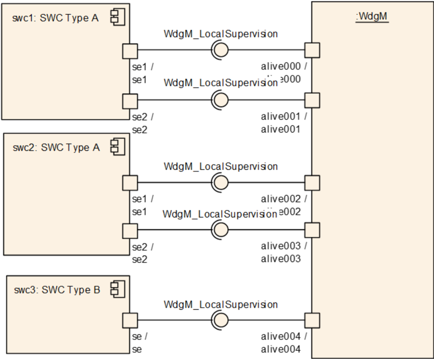

在**看门狗管理器**一侧，每个**被监督实体**有一个端口，提供上述 **WdgM_LocalSupervision** 接口的所有服务。每个**被监督实体**针对与该应用关联的每个**被监督实体**都有一个用于请求这些服务的端口。

**看门狗管理器**模块应为每个已配置的**被监督实体**提供一个用于监督的单一服务端口。

为了能够将监督端口与其用于状态报告的对应模式端口匹配，需要一个命名约定。

**看门狗管理器**模块的**局部监督**端口命名如下：

**WdgM_LocalSupervision**（**localSupervision_{SupervisedEntityCheckpointName}** 端口）：

| 名称 | localSupervision_{SupervisedEntityCheckpointName} |
|---|---|
| 种类 | ProvidedPort |
| 描述 | 该端口向一个 **SWC** 提供一个**被监督实体检查点**的监督接口。 |
| 接口 | WdgM_LocalSupervision |
| 端口定义参数值 | 类型：WdgM_SupervisedEntityIdType；值：{ecuc(WdgM/WdgMGeneral/WdgMSupervisedEntity/WdgMSupervisedEntity Id.value)} |
| 端口定义参数值 | 类型：WdgM_CheckpointIdType；值：ecuc{WdgM/WdgMGeneral/WdgMSupervisedEntity/WdgMCheckpoint/WdgMCheckpointId} |
| 变体 | SupervisedEntityCheckpointName = {ecuc(WdgM/WdgMGeneral/WdgMSupervisedEntity.SHORT-NAME)}_{ecuc(WdgM/WdgMGeneral/WdgMSupervisedEntity/WdgMCheckpoint.SHORT-NAME)} |

**WdgM_LocalSupervisionStatus**（**localSupervisonStatus_{SupervisedEntityName}** 端口）：

| 名称 | localSupervisonStatus_{SupervisedEntityName} |
|---|---|
| 种类 | ProvidedPort |
| 描述 | 该端口向一个 **SWC** 提供一个**被监督实体**的监督状态接口。 |
| 接口 | WdgM_LocalSupervisionStatus |
| 端口定义参数值 | 类型：WdgM_SupervisedEntityIdType；值：{ecuc(WdgM/WdgMGeneral/WdgMSupervisedEntity/WdgMSupervisedEntity Id.value)} |
| 变体 | SupervisedEntityName = {ecuc(WdgM/WdgMGeneral/WdgMSupervisedEntity.SHORT-NAME)} |

**看门狗管理器**模块的**全局监督**端口命名如下：

**WdgM_GlobalSupervision**（**globalSupervision** 端口）：

| 名称 | globalSupervision |
|---|---|
| 种类 | ProvidedPort |
| 描述 | 该端口提供 **WdgM** 的**全局监督**接口。 |
| 接口 | WdgM_GlobalSupervision |
| 变体 | - |

##### 7.7.1.5. 错误代码

监督服务不返回任何服务特定的错误代码。

#### 7.7.2. 状态报告的端口与端口接口

##### 7.7.2.1. 总体方案

为了控制 **SW-C** 与 **CDD** 的状态相关行为，**RTE** 提供了模式端口机制。模式管理器可以在模式端口中定义的不同模式之间切换。连接到模式端口的 **SW-C** / **CDD** 可以以两种方式使用模式信息：

- **SW-C** / **CDD** 可以通过模式端口查询当前模式。
- **SW-C** / **CDD** 可以声明由 **RTE** 因模式变化而启动或停止的 **Runnable**。

根据 **RTE** 规范 [9, RTE 软件规范]，模式端口具有一个 **ModeSwitchInterface**。模式管理器（此处为**看门狗管理器**模块）是发送方，**SW-C** 是接收方。

**看门狗管理器**模块使用模式端口提供两类信息：

- 第一，它提供每个**被监督实体**的**局部监督状态**。因此，**看门狗管理器**模块为每个**被监督实体**都有一个模式端口。
- 第二，**看门狗管理器**模块提供**全局监督状态**，它反映了所有**被监督实体**的组合监督状态。因此，它还有一个额外的模式端口。

##### 7.7.2.2. 数据类型

模式声明组 **WdgM_Mode** 表示将通知给 **SW-C** / **CDD** 与 **RTE** 的**看门狗管理器**模块的模式。

**WdgM_Mode**（模式声明组）：

| 名称 | WdgM_Mode |
|---|---|
| 种类 | ModeDeclarationGroup |
| 类别 | EXPLICIT_ORDER |
| 初始模式 | SUPERVISION_OK |
| 转换值 | 255 |
| 模式 | SUPERVISION_OK = 0 |
| 模式 | SUPERVISION_FAILED = 1 |
| 模式 | SUPERVISION_EXPIRED = 2 |
| 模式 | SUPERVISION_STOPPED = 3 |
| 模式 | SUPERVISION_DEACTIVATED = 4 |

描述：模式声明组 **WdgM_Mode** 的类别为 EXPLICIT_ORDER。ModeDeclaration 的属性值设置如下："SUPERVISION_OK" = 0，"SUPERVISION_FAILED" = 1，"SUPERVISION_EXPIRED" = 2，"SUPERVISION_STOPPED" = 3，"SUPERVISION_DEACTIVATED" = 4。onTransitionValue 定义为 255。

**WdgM_LocalStatusType**（实现数据类型）：

| 名称 | WdgM_LocalStatusType |
|---|---|
| 种类 | 类型 |
| 派生自 | uint8 |
| 取值范围 | WDGM_LOCAL_STATUS_OK = 0：该**被监督实体**的监督未显示任何故障。 |
| 取值范围 | WDGM_LOCAL_STATUS_FAILED = 1：该**被监督实体**的监督已失败但仍可被「治愈」。即如果**被监督实体**恢复正常行为，其监督状态也将返回 **WDGM_LOCAL_STATUS_OK**。此外，监督失败的次数尚未超过可配置的上限。当超过该上限时，状态将变更为 **WDGM_LOCAL_STATUS_EXPIRED**。 |
| 取值范围 | WDGM_LOCAL_STATUS_EXPIRED = 2：该**被监督实体**的监督已永久失败。该状态无法离开。 |
| 取值范围 | WDGM_LOCAL_STATUS_DEACTIVATED = 4：该**被监督实体**的监督被临时禁用。 |
| 描述 | 该类型应用于表示单个**被监督实体**当前监督状态的变量。 |
| 变体 | - |
| 可通过 | Rte_WdgM_Type.h |

**WdgM_GlobalStatusType**（实现数据类型）：

| 名称 | WdgM_GlobalStatusType |
|---|---|
| 种类 | 类型 |
| 派生自 | uint8 |
| 取值范围 | WDGM_GLOBAL_STATUS_OK = 0：监督未显示任何故障。 |
| 取值范围 | WDGM_GLOBAL_STATUS_FAILED = 1：监督已失败，但仍在允许的失败次数限制之内。 |
| 取值范围 | WDGM_GLOBAL_STATUS_EXPIRED = 2：监督已失败，允许的失败次数限制已被超过，但**看门狗驱动**尚未被指示停止触发。 |
| 取值范围 | WDGM_GLOBAL_STATUS_STOPPED = 3：监督已失败，允许的失败次数限制已被超过，且**看门狗驱动**已被指示停止触发。看门狗复位即将发生。 |
| 取值范围 | WDGM_GLOBAL_STATUS_DEACTIVATED = 4：**WdgM** 未初始化，因此将不管理看门狗。 |
| 描述 | 该类型应用于表示**看门狗管理器**模块全局监督状态的变量。 |
| 变体 | - |
| 可通过 | Rte_WdgM_Type.h |

**WdgM_ModeType**（实现数据类型）：

| 名称 | WdgM_ModeType |
|---|---|
| 种类 | 类型 |
| 派生自 | uint8 |
| 取值范围 | 0-<模式数量> |
| 描述 | 该类型用于区分为**看门狗管理器**配置的不同模式。 |
| 变体 | - |
| 可通过 | Rte_WdgM_Type.h |

##### 7.7.2.3. 端口接口

有两个不同的接口用于向感兴趣的 **SW-C** / **CDD** 与 **RTE** 指示监督状态的变化。

接口 **WdgM_LocalMode** 用于指示单个**被监督实体**的**局部监督状态**。

**WdgM_LocalMode**（模式切换接口）：

| 名称 | WdgM_LocalMode |
|---|---|
| 注释 | - |
| 是否为服务 | true |
| 变体 | - |
| ModeGroup | currentMode |

接口 **WdgM_GlobalMode** 用于指示由所有单个**被监督实体**组合而成的**全局监督状态**。

**WdgM_GlobalMode**（模式切换接口）：

| 名称 | WdgM_GlobalMode |
|---|---|
| 注释 | - |
| 是否为服务 | true |
| 变体 | - |
| ModeGroup | currentMode = WdgM_Mode |

定义两个不同接口的原因在于这些接口的使用方式。对于 **WdgM_GlobalMode** 接口，**看门狗管理器**模块只提供具有该接口的单个端口。相比之下，对于 **WdgM_LocalMode** 接口，**看门狗管理器**模块提供的端口数量与**被监督实体**的数量相同。为了高效访问这些端口，可以使用 **RTE** 的间接端口 **API**。该 **API** 提供具有相同接口的所有端口的列表，例如：

```
1 /** 2 * Called within WdgM. Reports the status/mode of the SE 3 * to SW-Cs / CDDs through Rte 4 */ 5 void WdgM_NotifyOKToSE(WdgM_SupervisedEntityIdType se) 6 { 7 Rte_PortHandle_WdgM_LocalMode_P ph = Rte_Ports_WdgM_LocalMode_P(); 8 ph[se].Switch_currentMode(RTE_MODE_WdgM_Mode_SUPERVISION_OK); 9 }
```

为了避免**全局监督状态**的模式端口出现在该列表中，该端口使用不同的接口，即 **WdgM_GlobalMode** 而不是 **WdgM_LocalMode**。

##### 7.7.2.4. 模式端口

图 8.3 给出了 **AUTOSAR** 软件组件（单个或多个实例）如何通过模式端口与服务端口连接到**看门狗管理器**模块。在左侧，有组件 SWC Type A 的两个实例（swc1 和 swc2）与组件 SWC Type B 的一个实例（swc3）。每个组件都连接到与其自身**被监督实体**相对应的模式端口。此外，swc3 还连接到全局模式端口，因此可以对所有**被监督实体**的组合监督状态的变化作出反应。

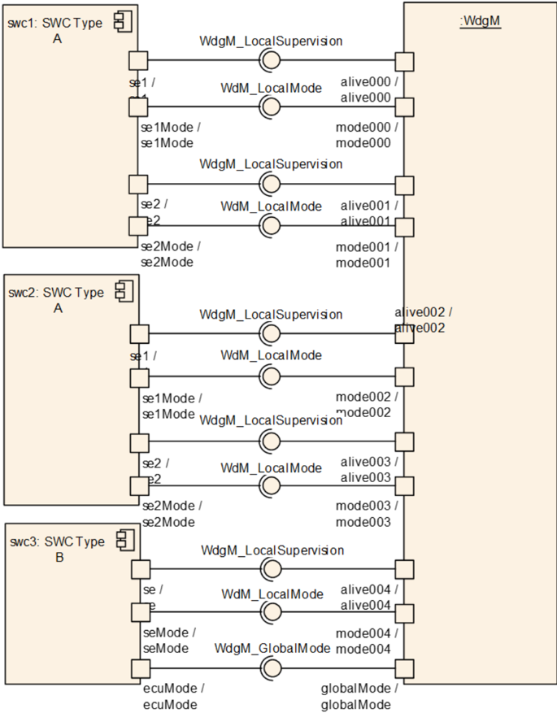

这导致每个**被监督实体**有一个模式端口。

**看门狗管理器**模块应为每个已配置的**被监督实体**提供一个用于报告其**局部监督状态**的单一模式端口。

为了能够将监督端口与其用于状态报告的对应模式端口匹配，需要一个命名约定。

**看门狗管理器**为报告每个**被监督实体**的监督状态提供模式端口：

**WdgM_LocalMode**（**mode_{SupervisedEntityName}** 端口）：

| 名称 | mode_{SupervisedEntityName} |
|---|---|
| 种类 | ProvidedPort |
| 接口 | WdgM_LocalMode |
| 描述 | - |
| 变体 | SupervisedEntityName = {ecuc(WdgM/WdgMGeneral/WdgMSupervisedEntity/WdgMSupervisedEntityId.SHORT-NAME)} |

当单个**被监督实体**的**局部监督状态**发生变化时，**看门狗管理器**模块应在识别到该变化之后立即通过该**被监督实体**的模式端口报告该变化。

**看门狗管理器**模块提供一个用于报告**全局监督状态**的模式端口：

**WdgM_GlobalMode**（**globalmode** 端口）：

| 名称 | globalmode |
|---|---|
| 种类 | ProvidedPort |
| 接口 | WdgM_GlobalMode |
| 描述 | - |
| 变体 | - |

当**全局监督状态**变化时，**看门狗管理器**模块应通过全局模式端口报告该变化。

在根据所有**局部监督状态**计算出**全局监督状态**之后，**看门狗管理器**模块应仅一次报告由此产生的**全局监督状态**的任何变化。

由此产生的行为是：首先报告**局部监督状态**的所有变化。之后，仅当**全局监督状态**因各个变化而改变时，才报告一次**全局监督状态**。

例如，如果在一个**监督周期**内 SE1 从 **WDGM_LOCAL_STATUS_OK** 变为 **WDGM_LOCAL_STATUS_FAILED**，则在 SE1 的本地模式端口上报告 **WDGM_LOCAL_STATUS_FAILED**。在同一个**监督周期**内 SE2 直接从 **WDGM_LOCAL_STATUS_OK** 变为 **WDGM_LOCAL_STATUS_EXPIRED**，则在 SE2 的本地模式端口上报告 **WDGM_LOCAL_STATUS_EXPIRED**。在此示例中，该**监督周期**产生的**全局监督状态**从 **WDGM_GLOBAL_STATUS_OK** 变为 **WDGM_GLOBAL_STATUS_EXPIRED**，因此只在全局模式端口上报告 **WDGM_GLOBAL_STATUS_EXPIRED**。在该示例中，**WDGM_GLOBAL_STATUS_FAILED** 不会在全局模式端口上报告，因为它只是在评估**被监督实体**的一个子集时出现的中间状态。

## 8. 时序图

本章展示**看门狗管理器**与其他 **BSW** 模块以及**被监督实体**之间的交互。

### 8.1. 初始化

下图显示**看门狗管理器**模块的初始化过程。初始化应在 **ECU** 初始化的后期阶段、在 **OS** 初始化之后完成。

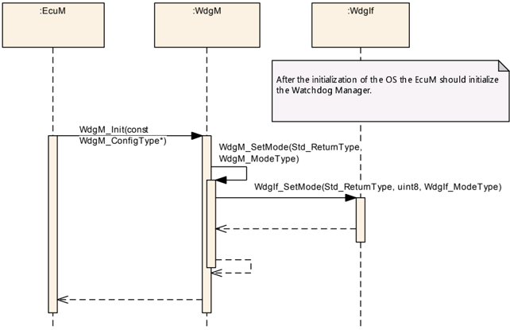

## 9. 配置规范

### 9.1. 参数区分

本章简要介绍用于区分配置参数类型的术语。在各子章节中给出**看门狗管理器**上下文中参数的具体规范问题。

详情请参阅 [3, 基础软件模块通用规范] 第 10.1 章「配置规范导论」。

#### 9.1.1. 静态配置参数

**看门狗管理器**模块中至少应在系统生成和/或系统编译时（预编译）可配置的参数。

#### 9.1.2. 运行时配置参数

**看门狗管理器**模块中应在构建后（post-build）时可配置的参数。

#### 9.1.3. 预编译选项

预编译选项应用于不是直接由代码生成器生成的代码实现。因此，预编译选项支持根据静态配置的设置对**看门狗管理器**模块的复用源代码文件进行优化。

### 9.2. 容器与配置参数

**看门狗管理器**模块支持以下变体：

#### 9.2.1. 配置变体

详情请参阅 [3, 基础软件模块通用规范] 中的「变体」章。

#### 9.2.2. WdgM

| SWS 条目 |  |
|---|---|
| 模块名称 | WdgM |
| 描述 | **WdgM**（**看门狗管理器**）模块的配置。 |
| Post-Build 变体支持 | true |
| 支持的配置变体 | VARIANT-POST-BUILD, VARIANT-PRE-COMPILE |

| 容器名称 | 多重性 | 作用域/依赖 |
|---|---|---|
| WdgMConfigSet | 1 | 此容器描述 **WdgM** 的多个配置集之一。 |
| WdgMGeneral | 1 | 此容器定义**看门狗管理器**的所有通用配置参数。 |

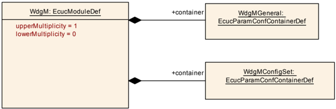

#### 9.2.3. WdgMGeneral

| SWS 条目 | [ECUC_WdgM_00300] |
|---|---|
| 容器名称 | WdgMGeneral |
| 父容器 | WdgM |
| 描述 | 此容器定义**看门狗管理器**的所有通用配置参数。 |
| 配置参数 | 见下方参数表 |

| SWS 条目 | [ECUC_WdgM_00301] |
|---|---|
| 参数名称 | WdgMDevErrorDetect |
| 父容器 | WdgMGeneral |
| 描述 | 开启或关闭开发错误检测与通知。**true**：启用检测与通知。 |
| 多重性 | 1 |
| 类型 | EcucBooleanParamDef |
| 默认值 | false |
| Post-Build 变体值 | false |
| 值配置类 | Pre-compile time：x（All Variants）；Link time：-；Post-build time：- |
| 作用域/依赖 | scope: local |

| SWS 条目 | [ECUC_WdgM_00363] |
|---|---|
| 参数名称 | WdgMEnableTimeoutDetection |
| 父容器 | WdgMGeneral |
| 描述 | 此参数启用**截止时间监督**的超时检测部分（用于在结束检查点始终未被到达时检测截止时间监督违规）。**true**：启用超时检测。**false**：禁用超时检测。**注意：** 出于向后兼容的原因，默认禁用此选项。 |
| 多重性 | 1 |
| 类型 | EcucBooleanParamDef |
| 默认值 | false |
| Post-Build 变体值 | false |
| 值配置类 | Pre-compile time：x（All Variants）；Link time：-；Post-build time：- |
| 作用域/依赖 | scope: local |

| SWS 条目 | [ECUC_WdgM_00339] |
|---|---|
| 参数名称 | WdgMImmediateReset |
| 父容器 | WdgMGeneral |
| 描述 | 此参数启用/禁用存活监督失败时的立即复位特性。**true**：启用立即复位；**false**：禁用立即复位 |
| 多重性 | 0..1 |
| 类型 | EcucBooleanParamDef |
| 默认值 | - |
| Post-Build 变体值 | false |
| 值配置类 | Pre-compile time：x（All Variants）；Link time：-；Post-build time：- |
| 作用域/依赖 | scope: local |

| SWS 条目 | [ECUC_WdgM_00340] |
|---|---|
| 参数名称 | WdgMOffModeEnabled |
| 父容器 | WdgMGeneral |
| 描述 | 此参数启用/禁用选择看门狗驱动的 "OffMode"。**true**：允许选择 "OffMode"；**false**：不允许选择 "OffMode" |
| 多重性 | 0..1 |
| 类型 | EcucBooleanParamDef |
| 默认值 | - |
| Post-Build 变体值 | false |
| 值配置类 | Pre-compile time：x（All Variants）；Link time：-；Post-build time：- |
| 作用域/依赖 | scope: local |

| SWS 条目 | [ECUC_WdgM_00365] |
|---|---|
| 参数名称 | WdgMSwClusterSupport |
| 父容器 | WdgMGeneral |
| 描述 | 此参数选择对带**软件集群**的软件架构的支持。如果未设置该参数，则适用默认行为 **DISABLE_SW_CLUSTER_SUPPORT**。 |
| 多重性 | 0..1 |
| 类型 | EcucEnumerationParamDef |
| 取值范围 | DISABLE_SW_CLUSTER_SUPPORT：禁用将**看门狗管理器**集成到带**软件集群**的软件架构的附加功能。 |
| 取值范围 | ENABLE_SW_CLUSTER_SUPPORT：启用将**看门狗管理器**集成到带**软件集群**的软件架构的附加功能。 |
| 默认值 | DISABLE_SW_CLUSTER_SUPPORT |
| Post-Build 变体值 | false |
| 值配置类 | Pre-compile time：x（All Variants）；Link time：-；Post-build time：- |
| 作用域/依赖 | scope: local |

| SWS 条目 | [ECUC_WdgM_00302] |
|---|---|
| 参数名称 | WdgMVersionInfoApi |
| 父容器 | WdgMGeneral |
| 描述 | 用于启用/禁用 **API** **WdgM_GetVersionInfo** 是否存在的预处理器开关。应用于删除不需要的代码段。**true**：启用 **API**；**false**：禁用 **API** |
| 多重性 | 1 |
| 类型 | EcucBooleanParamDef |
| 默认值 | false |
| Post-Build 变体值 | false |
| 值配置类 | Pre-compile time：x（All Variants）；Link time：-；Post-build time：- |
| 作用域/依赖 | scope: local |

| 容器名称 | 多重性 | 作用域/依赖 |
|---|---|---|
| WdgMBaseSocket | 0..* | 此容器配置**宿主软件集群**所提供的**应用软件集群**中的 **WdgM** 实例需要多少个按 EcucPartition 划分的基础设施链接。这些基础设施链接用于：由**宿主** **WdgM** 实例初始化**应用软件集群** **WdgM** 实例；从**应用软件集群** **WdgM** 实例向**宿主** **WdgM** 实例传输监督结果；**应用软件集群** **WdgM** 实例与**宿主** **WdgM** 实例交互所需的任何其他实现特定用途。如果基础设施连接专属于一个或若干 EcucPartition，则 **WdgMSocketEcucPartitionRef** 指出适用的 EcucPartition。 |
| WdgMMainFunction | 0..* | 引用该**被监督实体**所属的 WdgMInstanceMainFunction。与**存活监督**和**截止时间监督**相关 |
| WdgMSupervisedEntity | 0..65535 | 此容器收集由**看门狗管理器**监督的一个**被监督实体**的所有通用（与模式无关）参数。 |
| WdgMWatchdog | 0..255 | 此容器收集由**看门狗管理器**触发的一个看门狗的所有通用（与模式无关）参数。 |

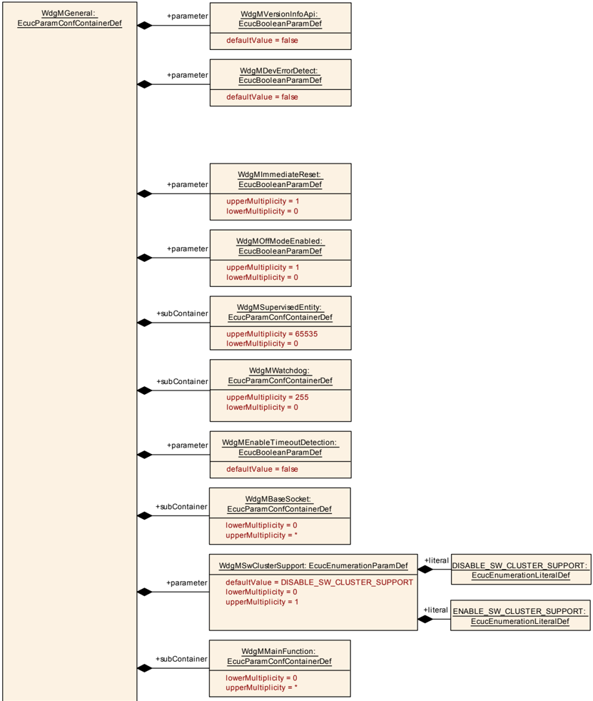

#### 9.2.4. WdgMSupervisedEntity

| SWS 条目 | [ECUC_WdgM_00303] |
|---|---|
| 容器名称 | WdgMSupervisedEntity |
| 父容器 | WdgMGeneral |
| 描述 | 此容器收集由**看门狗管理器**监督的一个**被监督实体**的所有通用（与模式无关）参数。 |
| 配置参数 | 见下方参数表 |

| SWS 条目 | [ECUC_WdgM_00304] |
|---|---|
| 参数名称 | WdgMSupervisedEntityId |
| 父容器 | WdgMSupervisedEntity |
| 描述 | 此参数应包含被监督实体的唯一标识符。 |
| 多重性 | 1 |
| 类型 | EcucIntegerParamDef（为该参数生成符号名） |
| 取值范围 | 0 .. 65535 |
| 默认值 | - |
| Post-Build 变体值 | false |
| 值配置类 | Pre-compile time：x（All Variants）；Link time：-；Post-build time：- |
| 作用域/依赖 | scope: local |

| SWS 条目 | [ECUC_WdgM_00343] |
|---|---|
| 参数名称 | WdgMInternalCheckpointInitialRef |
| 父容器 | WdgMSupervisedEntity |
| 描述 | 这是对该**被监督实体**初始**检查点**的引用。 |
| 多重性 | 0..65535 |
| 类型 | 到 WdgMCheckpoint 的符号名引用 |
| Post-Build 变体值 | false |
| 值配置类 | Pre-compile time：x（All Variants）；Link time：-；Post-build time：- |
| 作用域/依赖 | scope: local |

| SWS 条目 | [ECUC_WdgM_00344] |
|---|---|
| 参数名称 | WdgMInternallCheckpointFinalRef |
| 父容器 | WdgMSupervisedEntity |
| 描述 | 这是对该**被监督实体**结束**检查点**的引用。 |
| 多重性 | 0..65535 |
| 类型 | 到 WdgMCheckpoint 的符号名引用 |
| Post-Build 变体多重性 | false |
| Post-Build 变体值 | false |
| 多重性配置类 | Pre-compile time：x；Link time：-；Post-build time：- |
| 值配置类 | Pre-compile time：x；Link time：-；Post-build time：- |
| 作用域/依赖 | scope: local |

| SWS 条目 | [ECUC_WdgM_00368] |
|---|---|
| 参数名称 | WdgMMainFunctionRef |
| 父容器 | WdgMSupervisedEntity |
| 描述 | 引用该**被监督实体**所属的 WdgMInstanceMainFunction。与**存活监督**和**截止时间监督**相关 |
| 多重性 | 0..1 |
| 类型 | 到 WdgMMainFunction 的引用 |
| Post-Build 变体多重性 | false |
| Post-Build 变体值 | false |
| 多重性配置类 | Pre-compile time：x；Link time：-；Post-build time：- |
| 值配置类 | Pre-compile time：x；Link time：-；Post-build time：- |
| 作用域/依赖 | scope: local |

| SWS 条目 | [ECUC_WdgM_00361] |
|---|---|
| 参数名称 | WdgMOSCounter |
| 父容器 | WdgMSupervisedEntity |
| 描述 | **看门狗管理器**用于对**被监督实体**执行截止时间监督的 **OS** 计数器。 |
| 多重性 | 0..1 |
| 类型 | 到 OsCounter 的引用 |
| Post-Build 变体多重性 | false |
| Post-Build 变体值 | false |
| 多重性配置类 | Pre-compile time：x；Link time：-；Post-build time：- |
| 值配置类 | Pre-compile time：x；Link time：-；Post-build time：- |
| 作用域/依赖 | |

| 容器名称 | 多重性 | 作用域/依赖 |
|---|---|---|
| WdgMCheckpoint | 1..65535 | 此容器收集该**被监督实体**的所有**检查点**。每个**被监督实体**至少有一个**检查点**。 |
| WdgMInternalTransition | 0..65535 | 此容器定义该**被监督实体**内**内部转换**的图。 |

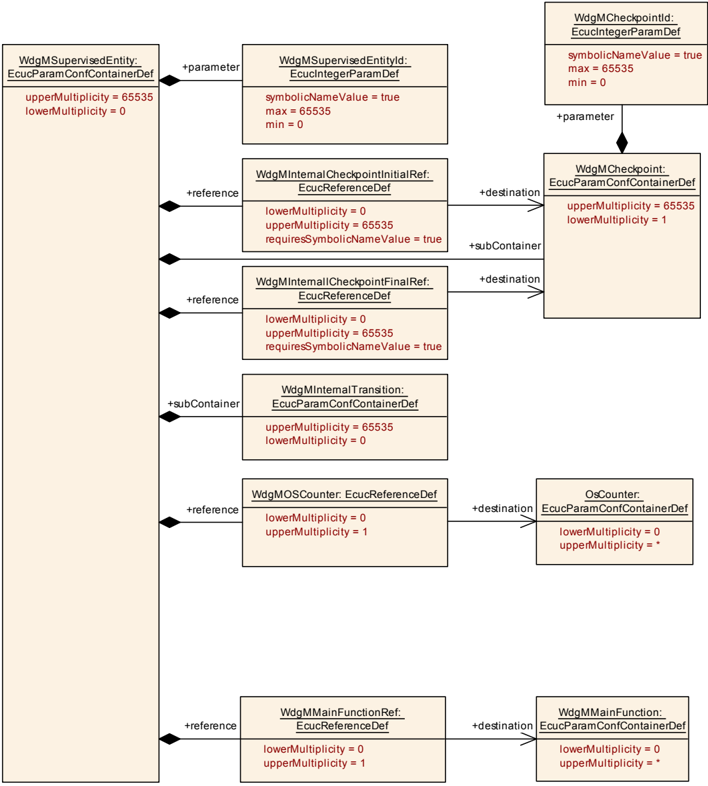

#### 9.2.5. WdgMCheckpoint

| SWS 条目 | [ECUC_WdgM_00305] |
|---|---|
| 容器名称 | WdgMCheckpoint |
| 父容器 | WdgMSupervisedEntity |
| 描述 | 此容器收集该**被监督实体**的所有**检查点**。每个**被监督实体**至少有一个**检查点**。 |
| 配置参数 | 见下方参数表 |

| SWS 条目 | [ECUC_WdgM_00306] |
|---|---|
| 参数名称 | WdgMCheckpointId |
| 父容器 | WdgMCheckpoint |
| 描述 | 此参数应包含**检查点**的唯一标识符。 |
| 多重性 | 1 |
| 类型 | EcucIntegerParamDef（为该参数生成符号名） |
| 取值范围 | 0 .. 65535 |
| 默认值 | - |
| Post-Build 变体值 | false |
| 值配置类 | Pre-compile time：x（All Variants）；Link time：-；Post-build time：- |
| 作用域/依赖 | scope: local |

无包含的容器。

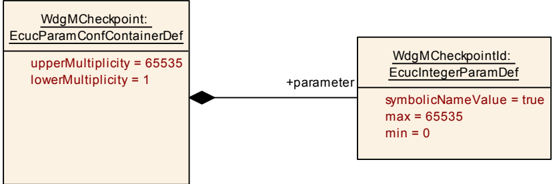

#### 9.2.6. WdgMInternalTransition

| SWS 条目 | [ECUC_WdgM_00345] |
|---|---|
| 容器名称 | WdgMInternalTransition |
| 父容器 | WdgMSupervisedEntity |
| 描述 | 此容器定义该**被监督实体**内**内部转换**的图。 |
| 配置参数 | 见下方参数表 |

| SWS 条目 | [ECUC_WdgM_00351] |
|---|---|
| 参数名称 | WdgMInternalTransitionDestRef |
| 父容器 | WdgMInternalTransition |
| 描述 | 这是对该**被监督实体**内一个**内部转换**目的**检查点**的引用。 |
| 多重性 | 1 |
| 类型 | 到 WdgMCheckpoint 的符号名引用 |
| Post-Build 变体值 | false |
| 值配置类 | Pre-compile time：x（All Variants）；Link time：-；Post-build time：- |
| 作用域/依赖 | scope: local |

| SWS 条目 | [ECUC_WdgM_00350] |
|---|---|
| 参数名称 | WdgMInternalTransitionSourceRef |
| 父容器 | WdgMInternalTransition |
| 描述 | 这是对该**被监督实体**内一个**内部转换**源**检查点**的引用。 |
| 多重性 | 1 |
| 类型 | 到 WdgMCheckpoint 的符号名引用 |
| Post-Build 变体值 | false |
| 值配置类 | Pre-compile time：x（All Variants）；Link time：-；Post-build time：- |
| 作用域/依赖 | scope: local |

无包含的容器。

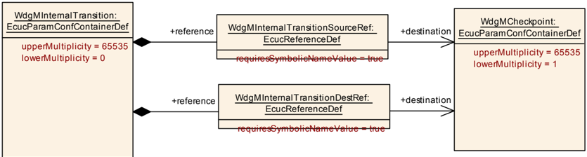

#### 9.2.7. WdgMWatchdog

| SWS 条目 | [ECUC_WdgM_00347] |
|---|---|
| 容器名称 | WdgMWatchdog |
| 父容器 | WdgMGeneral |
| 描述 | 此容器收集由**看门狗管理器**触发的一个看门狗的所有通用（与模式无关）参数。 |
| 配置参数 | 见下方参数表 |

| SWS 条目 | [ECUC_WdgM_00348] |
|---|---|
| 参数名称 | WdgMWatchdogName |
| 父容器 | WdgMWatchdog |
| 描述 | 此参数应包含看门狗实例的名称。 |
| 多重性 | 1 |
| 类型 | EcucStringParamDef |
| 默认值 | - |
| 正则表达式 | - |
| Post-Build 变体值 | false |
| 值配置类 | Pre-compile time：x（All Variants）；Link time：-；Post-build time：- |
| 作用域/依赖 | scope: local |

| SWS 条目 | [ECUC_WdgM_00349] |
|---|---|
| 参数名称 | WdgMWatchdogDeviceRef |
| 父容器 | WdgMWatchdog |
| 描述 | 到**看门狗接口**的一个设备容器的引用。在被引用的容器 **WdgIfDevice** 中，参数 **WdgIfDeviceIndex** 包含 **WdgM** 在为该看门狗实例调用 **WdgIf_SetTriggerCondition** 时必须使用的索引参数。 |
| 多重性 | 1 |
| 类型 | 到 WdgIfDevice 的符号名引用 |
| Post-Build 变体值 | false |
| 值配置类 | Pre-compile time：x（All Variants）；Link time：-；Post-build time：- |
| 作用域/依赖 | scope: local |

无包含的容器。

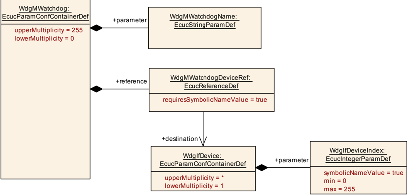

#### 9.2.8. WdgMConfigSet

| SWS 条目 | [ECUC_WdgM_00337] |
|---|---|
| 容器名称 | WdgMConfigSet |
| 父容器 | WdgM |
| 描述 | 此容器描述 **WdgM** 的多个配置集之一。 |
| 配置参数 | 见下方参数表 |

| SWS 条目 | [ECUC_WdgM_00336] |
|---|---|
| 参数名称 | WdgMInitialMode |
| 父容器 | WdgMConfigSet |
| 描述 | **看门狗管理器**初始化后所处的模式。 |
| 多重性 | 1 |
| 类型 | 到 WdgMMode 的符号名引用 |
| Post-Build 变体值 | true |
| 值配置类 | Pre-compile time：x（VARIANT-PRE-COMPILE）；Link time：-；Post-build time：x（VARIANT-POST-BUILD） |
| 作用域/依赖 | scope: local |

| 容器名称 | 多重性 | 作用域/依赖 |
|---|---|---|
| WdgMDemEventParameterRefs | 0..1 | 用于对 DemEventParameter 元素的引用的容器，在相应错误发生时通过 **API** **Dem_SetEventStatus** 调用这些元素。EventId 取自被引用的 DemEventParameter 的 DemEventId 符号值。标准化错误在此容器中提供，并可由厂商特定的错误引用扩展。 |
| WdgMMode | 1..255 | 此容器描述**看门狗管理器**的若干模式之一。 |

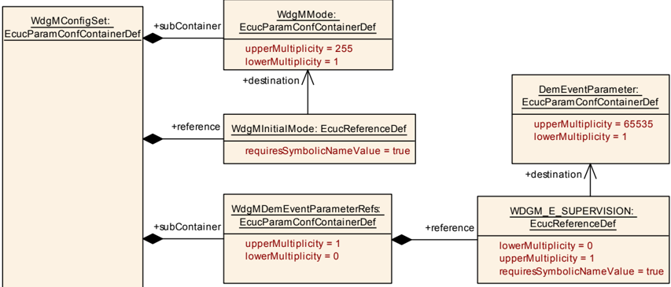

#### 9.2.9. WdgMDemEventParameterRefs

| SWS 条目 | [ECUC_WdgM_00353] |
|---|---|
| 容器名称 | WdgMDemEventParameterRefs |
| 父容器 | WdgMConfigSet |
| 描述 | 用于对 DemEventParameter 元素的引用的容器，在相应错误发生时通过 **API** **Dem_SetEventStatus** 调用这些元素。Event Id 取自被引用的 DemEventParameter 的 DemEventId 符号值。标准化错误在此容器中提供，并可由厂商特定的错误引用扩展。 |
| 配置参数 | 见下方参数表 |

| SWS 条目 | [ECUC_WdgM_00362] |
|---|---|
| 参数名称 | WDGM_E_SUPERVISION |
| 父容器 | WdgMDemEventParameterRefs |
| 描述 | 到 DemEventParameter 的引用，当发生错误「监督已失败（**全局监督状态**已达到 **WDGM_GLOBAL_STATUS_STOPPED**）且将发生看门狗复位」时应对其发出。 |
| 多重性 | 0..1 |
| 类型 | 到 DemEventParameter 的符号名引用 |
| Post-Build 变体多重性 | true |
| Post-Build 变体值 | true |
| 多重性配置类 | Pre-compile time：x（VARIANT-PRE-COMPILE）；Link time：-；Post-build time：x（VARIANT-POST-BUILD） |
| 值配置类 | Pre-compile time：x（VARIANT-PRE-COMPILE）；Link time：-；Post-build time：x（VARIANT-POST-BUILD） |
| 作用域/依赖 | scope: local |

无包含的容器。

#### 9.2.10. WdgMMode

| SWS 条目 | [ECUC_WdgM_00335] |
|---|---|
| 容器名称 | WdgMMode |
| 父容器 | WdgMConfigSet |
| 描述 | 此容器描述**看门狗管理器**的若干模式之一。 |
| 配置参数 | 见下方参数表 |

| SWS 条目 | [ECUC_WdgM_00329] |
|---|---|
| 参数名称 | WdgMExpiredSupervisionCycleTol |
| 父容器 | WdgMMode |
| 描述 | 此参数应用于定义一个值，该值确定在**全局监督状态**达到 EXPIRED 状态之后，看门狗触发的阻塞被推迟多少个过期的监督周期。 |
| 多重性 | 1 |
| 类型 | EcucIntegerParamDef |
| 取值范围 | 0 .. 65535 |
| 默认值 | - |
| Post-Build 变体值 | true |
| 值配置类 | Pre-compile time：x（VARIANT-PRE-COMPILE）；Link time：-；Post-build time：x（VARIANT-POST-BUILD） |
| 作用域/依赖 | scope: ECU |

| SWS 条目 | [ECUC_WdgM_00307] |
|---|---|
| 参数名称 | WdgMModeId |
| 父容器 | WdgMMode |
| 描述 | 此参数确定该模式的标识符。例如，该标识符作为参数传递给 **WdgM_SetMode** 服务。 |
| 多重性 | 1 |
| 类型 | EcucIntegerParamDef（为该参数生成符号名） |
| 取值范围 | 0 .. 255 |
| 默认值 | - |
| Post-Build 变体值 | false |
| 值配置类 | Pre-compile time：x（All Variants）；Link time：-；Post-build time：- |
| 作用域/依赖 | scope: local |

| 容器名称 | 多重性 | 作用域/依赖 |
|---|---|---|
| WdgMAliveSupervision | 0..65535 | 此容器收集一个**检查点**的**存活监督**的所有配置参数。请注意，每个**检查点**可以有不同的参数。例如，它可以有不同的最小与最大偏差。 |
| WdgMDeadlineSupervision | 0..65535 | 此容器收集一个**被监督实体**的**截止时间监督**的所有配置参数。 |
| WdgMExternalLogicalSupervision | 0..65535 | 此容器收集一个外部图的**逻辑监督**的所有配置参数。 |
| WdgMLocalStatusParams | 0..65535 | 此容器收集一个**被监督实体**的**局部状态**的所有配置参数。 |
| WdgMMainFunctionModeProps | 0..* | 此容器为在特定 **WdgMMode** 中适用的 **WdgMMainFunction** 提供配置值。 |
| WdgMTrigger | 0..255 | 此容器收集硬件看门狗触发的所有配置参数。 |

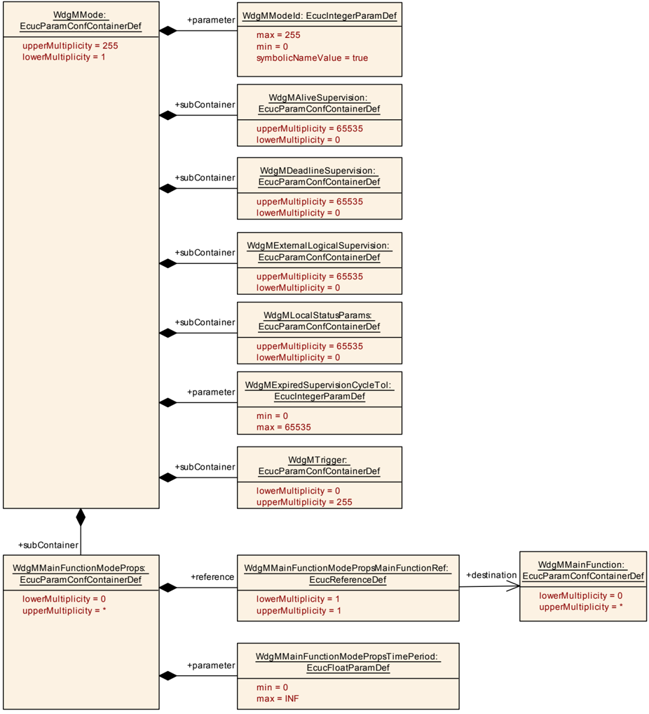

#### 9.2.11. WdgMAliveSupervision

| SWS 条目 | [ECUC_WdgM_00308] |
|---|---|
| 容器名称 | WdgMAliveSupervision |
| 父容器 | WdgMMode |
| 描述 | 此容器收集一个**检查点**的**存活监督**的所有配置参数。请注意，每个**检查点**可以有不同的参数。例如，它可以有不同的最小与最大偏差。 |
| 配置参数 | 见下方参数表 |

| SWS 条目 | [ECUC_WdgM_00311] |
|---|---|
| 参数名称 | WdgMExpectedAliveIndications |
| 父容器 | WdgMAliveSupervision |
| 描述 | 此参数包含根据对应 **SE**，在所定义的监督周期数量内**检查点**的期望存活指示数量。 |
| 多重性 | 1 |
| 类型 | EcucIntegerParamDef |
| 取值范围 | 0 .. 65535 |
| 默认值 | - |
| Post-Build 变体值 | true |
| 值配置类 | Pre-compile time：x（VARIANT-PRE-COMPILE）；Link time：-；Post-build time：x（VARIANT-POST-BUILD） |
| 作用域/依赖 | scope: local |

| SWS 条目 | [ECUC_WdgM_00313] |
|---|---|
| 参数名称 | WdgMMaxMargin |
| 父容器 | WdgMAliveSupervision |
| 描述 | 此参数包含在对应监督参考周期内，除期望存活指示之外可接受的**检查点**存活指示数量。 |
| 多重性 | 1 |
| 类型 | EcucIntegerParamDef |
| 取值范围 | 0 .. 255 |
| 默认值 | - |
| Post-Build 变体值 | true |
| 值配置类 | Pre-compile time：x（VARIANT-PRE-COMPILE）；Link time：-；Post-build time：x（VARIANT-POST-BUILD） |
| 作用域/依赖 | scope: local |

| SWS 条目 | [ECUC_WdgM_00312] |
|---|---|
| 参数名称 | WdgMMinMargin |
| 父容器 | WdgMAliveSupervision |
| 描述 | 此参数包含在对应监督参考周期内，相对于期望存活指示允许缺少的**检查点**存活指示数量。 |
| 多重性 | 1 |
| 类型 | EcucIntegerParamDef |
| 取值范围 | 0 .. 255 |
| 默认值 | - |
| Post-Build 变体值 | true |
| 值配置类 | Pre-compile time：x（VARIANT-PRE-COMPILE）；Link time：-；Post-build time：x（VARIANT-POST-BUILD） |
| 作用域/依赖 | scope: local |

| SWS 条目 | [ECUC_WdgM_00310] |
|---|---|
| 参数名称 | WdgMSupervisionReferenceCycle |
| 父容器 | WdgMAliveSupervision |
| 描述 | 此参数应包含存活监督机制用于根据对应 **SE** 对已计数存活指示进行检查时所使用的监督周期数量。 |
| 多重性 | 1 |
| 类型 | EcucIntegerParamDef |
| 取值范围 | 1 .. 65535 |
| 默认值 | - |
| Post-Build 变体值 | true |
| 值配置类 | Pre-compile time：x（VARIANT-PRE-COMPILE）；Link time：-；Post-build time：x（VARIANT-POST-BUILD） |
| 作用域/依赖 | scope: local |

| SWS 条目 | [ECUC_WdgM_00309] |
|---|---|
| 参数名称 | WdgMAliveSupervisionCheckpointRef |
| 父容器 | WdgMAliveSupervision |
| 描述 | 到**被监督实体**内应被监督的**检查点**的引用。 |
| 多重性 | 1 |
| 类型 | 到 WdgMCheckpoint 的符号名引用 |
| Post-Build 变体值 | true |
| 值配置类 | Pre-compile time：x（VARIANT-PRE-COMPILE）；Link time：-；Post-build time：x（VARIANT-POST-BUILD） |
| 作用域/依赖 | scope: local |

无包含的容器。

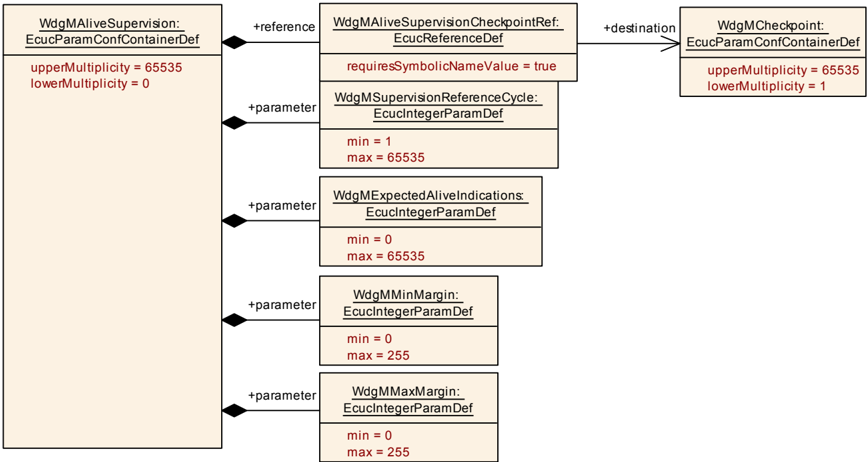

#### 9.2.12. WdgMDeadlineSupervision

| SWS 条目 | [ECUC_WdgM_00314] |
|---|---|
| 容器名称 | WdgMDeadlineSupervision |
| 父容器 | WdgMMode |
| 描述 | 此容器收集一个**被监督实体**的**截止时间监督**的所有配置参数。 |
| 配置参数 | 见下方参数表 |

| SWS 条目 | [ECUC_WdgM_00318] |
|---|---|
| 参数名称 | WdgMDeadlineMax |
| 父容器 | WdgMDeadlineSupervision |
| 描述 | 此参数包含超过该时长后即认为满足截止时间的最长时间跨度。单位：[s] |
| 多重性 | 1 |
| 类型 | EcucFloatParamDef |
| 取值范围 | [0 .. INF] |
| 默认值 | - |
| Post-Build 变体值 | true |
| 值配置类 | Pre-compile time：x（VARIANT-PRE-COMPILE）；Link time：-；Post-build time：x（VARIANT-POST-BUILD） |
| 作用域/依赖 | scope: local |

| SWS 条目 | [ECUC_WdgM_00317] |
|---|---|
| 参数名称 | WdgMDeadlineMin |
| 父容器 | WdgMDeadlineSupervision |
| 描述 | 此参数包含未超过该时长即认为满足截止时间的最短时间跨度。单位：[s] |
| 多重性 | 1 |
| 类型 | EcucFloatParamDef |
| 取值范围 | [0 .. INF] |
| 默认值 | - |
| Post-Build 变体值 | true |
| 值配置类 | Pre-compile time：x（VARIANT-PRE-COMPILE）；Link time：-；Post-build time：x（VARIANT-POST-BUILD） |
| 作用域/依赖 | scope: local |

| SWS 条目 | [ECUC_WdgM_00315] |
|---|---|
| 参数名称 | WdgMDeadlineStartRef |
| 父容器 | WdgMDeadlineSupervision |
| 描述 | 这是到**截止时间监督**起始**检查点**的引用。 |
| 多重性 | 1 |
| 类型 | 到 WdgMCheckpoint 的符号名引用 |
| Post-Build 变体值 | true |
| 值配置类 | Pre-compile time：x（VARIANT-PRE-COMPILE）；Link time：-；Post-build time：x（VARIANT-POST-BUILD） |
| 作用域/依赖 | scope: local |

| SWS 条目 | [ECUC_WdgM_00316] |
|---|---|
| 参数名称 | WdgMDeadlineStopRef |
| 父容器 | WdgMDeadlineSupervision |
| 描述 | 这是到**截止时间监督**停止**检查点**的引用。 |
| 多重性 | 1 |
| 类型 | 到 WdgMCheckpoint 的符号名引用 |
| Post-Build 变体值 | true |
| 值配置类 | Pre-compile time：x（VARIANT-PRE-COMPILE）；Link time：-；Post-build time：x（VARIANT-POST-BUILD） |
| 作用域/依赖 | scope: local |

无包含的容器。

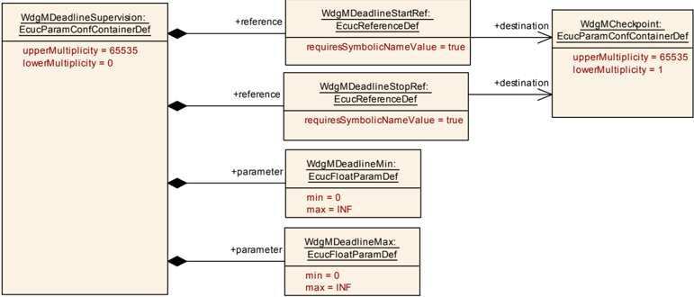

#### 9.2.13. WdgMExternalLogicalSupervision

| SWS 条目 | [ECUC_WdgM_00319] |
|---|---|
| 容器名称 | WdgMExternalLogicalSupervision |
| 父容器 | WdgMMode |
| 描述 | 此容器收集一个外部图的**逻辑监督**的所有配置参数。 |
| 配置参数 | 见下方参数表 |

| SWS 条目 | [ECUC_WdgM_00324] |
|---|---|
| 参数名称 | WdgMExternalCheckpointFinalRef |
| 父容器 | WdgMExternalLogicalSupervision |
| 描述 | 这是对该**外部图**结束**检查点**的引用，该**外部图**可以以 **WdgMCheckpoint** 结束，或在跨集群**转换**的情况下以 **WdgMTransitionProxy** 结束。**WdgMCheckpoint** 与 **WdgMTransitionProxy** 可以在同一个 **WdgMExternalLogicalSupervision** 内混合使用。 |
| 多重性 | 1..65535 |
| 类型 | 到 [ WdgMCheckpoint, WdgMTransitionProxy ] 的选择型符号名引用 |
| Post-Build 变体多重性 | true |
| Post-Build 变体值 | true |
| 多重性配置类 | Pre-compile time：x（VARIANT-PRE-COMPILE）；Link time：-；Post-build time：x（VARIANT-POST-BUILD） |
| 值配置类 | Pre-compile time：x（VARIANT-PRE-COMPILE）；Link time：-；Post-build time：x（VARIANT-POST-BUILD） |
| 作用域/依赖 | scope: local |

| SWS 条目 | [ECUC_WdgM_00323] |
|---|---|
| 参数名称 | WdgMExternalCheckpointInitialRef |
| 父容器 | WdgMExternalLogicalSupervision |
| 描述 | 这是对该**外部图**初始**检查点**的引用，该**外部图**可以以 **WdgMCheckpoint** 开始，或在跨集群**转换**的情况下以 **WdgMTransitionProxy** 开始。**WdgMCheckpoint** 与 **WdgMTransitionProxy** 可以在同一个 **WdgMExternalLogicalSupervision** 内混合使用。 |
| 多重性 | 1..65535 |
| 类型 | 到 [ WdgMCheckpoint, WdgMTransitionProxy ] 的选择型符号名引用 |
| Post-Build 变体多重性 | true |
| Post-Build 变体值 | true |
| 多重性配置类 | Pre-compile time：x（VARIANT-PRE-COMPILE）；Link time：-；Post-build time：x（VARIANT-POST-BUILD） |
| 值配置类 | Pre-compile time：x（VARIANT-PRE-COMPILE）；Link time：-；Post-build time：x（VARIANT-POST-BUILD） |
| 作用域/依赖 | scope: local |

| 容器名称 | 多重性 | 作用域/依赖 |
|---|---|---|
| WdgMCrossClusterTransition | 0..65535 | 此容器配置一个跨集群**转换**。**WdgMCrossClusterTransition** 可以配置为：从一个 **WdgMCheckpoint** 到一个 **WdgMTransitionProxy**；从一个 **WdgMTransitionProxy** 到一个 **WdgMCheckpoint**；从一个 **WdgMTransitionProxy** 到另一个 **WdgMTransitionProxy**（仅在**宿主软件集群**中）；从一个 **WdgMTransitionProxy** 到相同的 **WdgMTransitionProxy**（仅在**应用软件集群**中，且限于**应用软件集群**中不需要到达任何 **WdgMCheckpoint** 的情形）；从一个 **WdgMCheckpoint** 到一个 **WdgMCheckpoint**（在跨集群**转换图**完全由 **WdgMCrossClusterTransition** 容器描述的情形下）。 |
| WdgMExternalTransition | 0..65535 | 此容器收集跨**被监督实体**的**外部转换**的**检查点**。 |
| WdgMTransitionProxy | 0..65535 | **WdgMTransitionProxy** 定义了**宿主软件集群**与**应用软件集群**之间（以及反向）的**转换**代理。从**宿主软件集群**的视角看，一个跨集群**转换图**在以 **WdgMTransitionProxy** 为目的或初始引用的**转换**之后离开宿主，并在相关**应用软件集群**中所配置的**转换**发生之后回到该 **WdgMTransitionProxy**。此后，预期发生宿主中通过源或最终引用引用该 **WdgMTransitionProxy** 的**转换**。 |

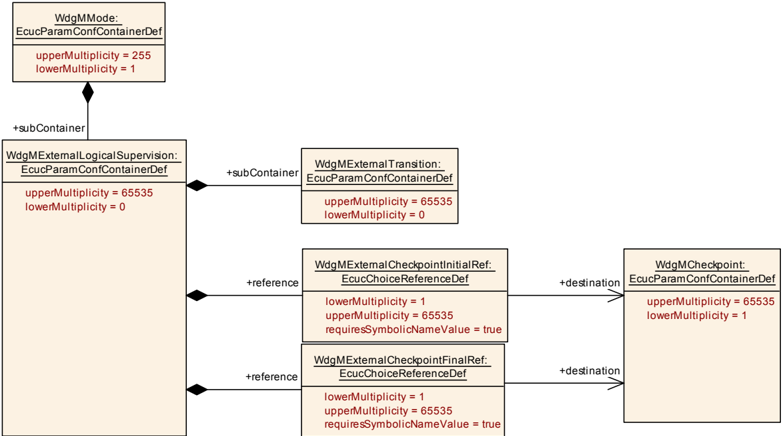

#### 9.2.14. WdgMExternalTransition

| SWS 条目 | [ECUC_WdgM_00320] |
|---|---|
| 容器名称 | WdgMExternalTransition |
| 父容器 | WdgMExternalLogicalSupervision |
| 描述 | 此容器收集跨**被监督实体**的**外部转换**的**检查点**。 |
| 配置参数 | 见下方参数表 |

| SWS 条目 | [ECUC_WdgM_00322] |
|---|---|
| 参数名称 | WdgMExternalTransitionDestRef |
| 父容器 | WdgMExternalTransition |
| 描述 | 这是到一个**外部转换**目的**检查点**的引用。 |
| 多重性 | 1 |
| 类型 | 到 WdgMCheckpoint 的符号名引用 |
| Post-Build 变体值 | true |
| 值配置类 | Pre-compile time：x（VARIANT-PRE-COMPILE）；Link time：-；Post-build time：x（VARIANT-POST-BUILD） |
| 作用域/依赖 | scope: local |

| SWS 条目 | [ECUC_WdgM_00321] |
|---|---|
| 参数名称 | WdgMExternalTransitionSourceRef |
| 父容器 | WdgMExternalTransition |
| 描述 | 这是到一个**外部转换**源**检查点**的引用。 |
| 多重性 | 1 |
| 类型 | 到 WdgMCheckpoint 的符号名引用 |
| Post-Build 变体值 | true |
| 值配置类 | Pre-compile time：x（VARIANT-PRE-COMPILE）；Link time：-；Post-build time：x（VARIANT-POST-BUILD） |
| 作用域/依赖 | scope: local |

无包含的容器。

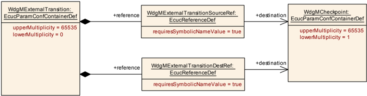

#### 9.2.15. WdgMTrigger

| SWS 条目 | [ECUC_WdgM_00331] |
|---|---|
| 容器名称 | WdgMTrigger |
| 父容器 | WdgMMode |
| 描述 | 此容器收集硬件看门狗触发的所有配置参数。 |
| 配置参数 | 见下方参数表 |

| SWS 条目 | [ECUC_WdgM_00333] |
|---|---|
| 参数名称 | WdgMTriggerConditionValue |
| 父容器 | WdgMTrigger |
| 描述 | 此参数应包含为该看门狗传递给 **WdgIf_SetTriggerCondition** 的值。 |
| 多重性 | 1 |
| 类型 | EcucIntegerParamDef |
| 取值范围 | 1 .. 65535 |
| 默认值 | - |
| Post-Build 变体值 | true |
| 值配置类 | Pre-compile time：x（VARIANT-PRE-COMPILE）；Link time：-；Post-build time：x（VARIANT-POST-BUILD） |
| 作用域/依赖 | scope: local |

| SWS 条目 | [ECUC_WdgM_00332] |
|---|---|
| 参数名称 | WdgMWatchdogMode |
| 父容器 | WdgMTrigger |
| 描述 | 此参数包含在此**看门狗管理器模式**中用于所引用看门狗的看门狗模式。实现类型：WdgIf_ModeType |
| 多重性 | 1 |
| 类型 | EcucEnumerationParamDef |
| 取值范围 | WDGIF_FAST_MODE |
| 取值范围 | WDGIF_OFF_MODE |
| 取值范围 | WDGIF_SLOW_MODE |
| Post-Build 变体值 | true |
| 值配置类 | Pre-compile time：x（VARIANT-PRE-COMPILE）；Link time：-；Post-build time：x（VARIANT-POST-BUILD） |
| 作用域/依赖 | scope: local |

| SWS 条目 | [ECUC_WdgM_00334] |
|---|---|
| 参数名称 | WdgMTriggerWatchdogRef |
| 父容器 | WdgMTrigger |
| 描述 | 此参数是对已配置看门狗的引用。 |
| 多重性 | 1 |
| 类型 | 到 WdgMWatchdog 的引用 |
| Post-Build 变体值 | true |
| 值配置类 | Pre-compile time：x（VARIANT-PRE-COMPILE）；Link time：-；Post-build time：x（VARIANT-POST-BUILD） |
| 作用域/依赖 | scope: local |

无包含的容器。

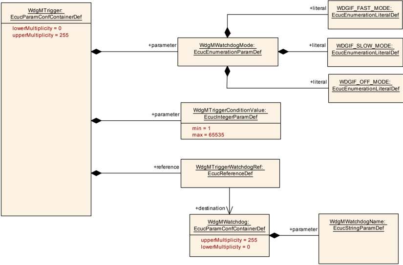

#### 9.2.16. WdgMLocalStatusParams

| SWS 条目 | [ECUC_WdgM_00325] |
|---|---|
| 容器名称 | WdgMLocalStatusParams |
| 父容器 | WdgMMode |
| 描述 | 此容器收集一个**被监督实体**的**局部状态**的所有配置参数。 |
| 配置参数 | 见下方参数表 |

| SWS 条目 | [ECUC_WdgM_00327] |
|---|---|
| 参数名称 | WdgMFailedAliveSupervisionRefCycleTol |
| 父容器 | WdgMLocalStatusParams |
| 描述 | 此参数应包含该**被监督实体**可接受的存活监督不正确/失败的参考周期数量。 |
| 多重性 | 1 |
| 类型 | EcucIntegerParamDef |
| 取值范围 | 0 .. 255 |
| 默认值 | - |
| Post-Build 变体值 | true |
| 值配置类 | Pre-compile time：x（VARIANT-PRE-COMPILE）；Link time：-；Post-build time：x（VARIANT-POST-BUILD） |
| 作用域/依赖 | scope: local |

| SWS 条目 | [ECUC_WdgM_00326] |
|---|---|
| 参数名称 | WdgMLocalStatusSupervisedEntityRef |
| 父容器 | WdgMLocalStatusParams |
| 描述 | 这是对指定**局部状态**参数的**被监督实体**的引用。 |
| 多重性 | 1 |
| 类型 | 到 WdgMSupervisedEntity 的符号名引用 |
| Post-Build 变体值 | true |
| 值配置类 | Pre-compile time：x（VARIANT-PRE-COMPILE）；Link time：-；Post-build time：x（VARIANT-POST-BUILD） |
| 作用域/依赖 | scope: local |

无包含的容器。

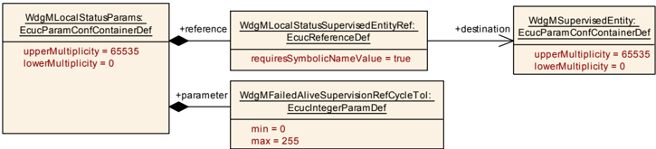

#### 9.2.17. WdgMMainFunction

| SWS 条目 | [ECUC_WdgM_00373] |
|---|---|
| 容器名称 | WdgMMainFunction |
| 父容器 | WdgMGeneral |
| 描述 | 引用该**被监督实体**所属的 WdgMInstanceMainFunction。与**存活监督**和**截止时间监督**相关 |
| 多重性配置类 | Pre-compile time：x（All Variants）；Link time：-；Post-build time：- |
| 配置参数 | 见下方参数表 |

| SWS 条目 | [ECUC_WdgM_00369] |
|---|---|
| 参数名称 | WdgMMainFunctionPartitionRef |
| 父容器 | WdgMMainFunction |
| 描述 | 到 EcucPartition 的引用，相应的 **WdgM_MainFunction** 实例被分配到该分区。对于单分区的软件架构，此引用是不必要的。 |
| 多重性 | 0..1 |
| 类型 | 到 EcucPartition 的引用 |
| Post-Build 变体多重性 | false |
| Post-Build 变体值 | false |
| 多重性配置类 | Pre-compile time：x（All Variants）；Link time：-；Post-build time：- |
| 值配置类 | Pre-compile time：x（All Variants）；Link time：-；Post-build time：- |
| 作用域/依赖 | scope: local |

无包含的容器。

（来自 EcucPartition）

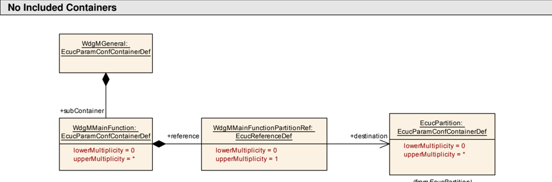

#### 9.2.18. WdgMMainFunctionModeProps

| SWS 条目 | [ECUC_WdgM_00372] |
|---|---|
| 容器名称 | WdgMMainFunctionModeProps |
| 父容器 | WdgMMode |
| 描述 | 此容器为在特定 **WdgMMode** 中适用的 **WdgMMainFunction** 提供配置值。 |
| 多重性配置类 | Pre-compile time：x（All Variants）；Link time：-；Post-build time：- |
| 配置参数 | 见下方参数表 |

| SWS 条目 | [ECUC_WdgM_00370] |
|---|---|
| 参数名称 | WdgMMainFunctionModePropsTimePeriod |
| 父容器 | WdgMMainFunctionModeProps |
| 描述 | 对相应 **WdgM_MainFunction** 实例 successive 调用的周期（单位：秒）。此参数可由 **WdgM** 生成器用于将 **WdgM** 模块的 WdgMModes 和/或 WdhMSupervisedEntities 的时序配置参数值转换为内部的实现特定计数器或 tick 值。**WdgM** 模块的内部时序处理是实现特定的。**WdgM** 模块（生成器）可以依赖 **Wdg_MainFunction** 按此处配置的值被调度这一事实。单位：[s] |
| 多重性 | 1 |
| 类型 | EcucFloatParamDef |
| 取值范围 | ]0 .. INF[ |
| 默认值 | - |
| Post-Build 变体值 | false |
| 值配置类 | Pre-compile time：x（All Variants）；Link time：-；Post-build time：- |
| 作用域/依赖 | scope: local |

| SWS 条目 | [ECUC_WdgM_00371] |
|---|---|
| 参数名称 | WdgMMainFunctionModePropsMainFunctionRef |
| 父容器 | WdgMMainFunctionModeProps |
| 描述 | 到 **WdgMMainFunction** 的引用，**WdgMMainFunctionModeProps** 应用于该函数。 |
| 多重性 | 1 |
| 类型 | 到 WdgMMainFunction 的引用 |
| Post-Build 变体多重性 | false |
| Post-Build 变体值 | false |
| 值配置类 | Pre-compile time：x（All Variants）；Link time：-；Post-build time：- |
| 作用域/依赖 | scope: local |

无包含的容器。

#### 9.2.19. WdgMCrossClusterTransition

| SWS 条目 | [ECUC_WdgM_00376] |
|---|---|
| 容器名称 | WdgMCrossClusterTransition |
| 父容器 | WdgMExternalLogicalSupervision |
| 描述 | 此容器配置一个跨集群**转换**。**WdgMCrossClusterTransition** 可以配置为：从一个 **WdgMCheckpoint** 到一个 **WdgMTransitionProxy**；从一个 **WdgMTransitionProxy** 到一个 **WdgMCheckpoint**；从一个 **WdgMTransitionProxy** 到另一个 **WdgMTransitionProxy**（仅在**宿主软件集群**中）；从一个 **WdgMTransitionProxy** 到相同的 **WdgMTransitionProxy**（仅在**应用软件集群**中，且限于**应用软件集群**中不需要到达任何 **WdgMCheckpoint** 的情形）；从一个 **WdgMCheckpoint** 到一个 **WdgMCheckpoint**（在跨集群**转换图**完全由 **WdgMCrossClusterTransition** 容器描述的情形下）。 |
| 配置参数 | 见下方参数表 |

| SWS 条目 | [ECUC_WdgM_00375] |
|---|---|
| 参数名称 | WdgMCrossClusterTransitionDestRef |
| 父容器 | WdgMCrossClusterTransition |
| 描述 | 这是对一个跨集群**转换**目的的引用。 |
| 多重性 | 1 |
| 类型 | 到 [ WdgMCheckpoint, WdgMTransitionProxy ] 的选择型符号名引用 |
| Post-Build 变体值 | true |
| 值配置类 | Pre-compile time：x（VARIANT-PRE-COMPILE）；Link time：-；Post-build time：- |
| 作用域/依赖 | scope: local |

| SWS 条目 | [ECUC_WdgM_00374] |
|---|---|
| 参数名称 | WdgMCrossClusterTransitionSourceRef |
| 父容器 | WdgMCrossClusterTransition |
| 描述 | 这是对一个跨集群**转换**源的引用。 |
| 多重性 | 1 |
| 类型 | 到 [ WdgMCheckpoint, WdgMTransitionProxy ] 的选择型符号名引用 |
| Post-Build 变体值 | true |
| 值配置类 | Pre-compile time：x（VARIANT-PRE-COMPILE）；Link time：-；Post-build time：- |
| 作用域/依赖 | scope: local |

无包含的容器。

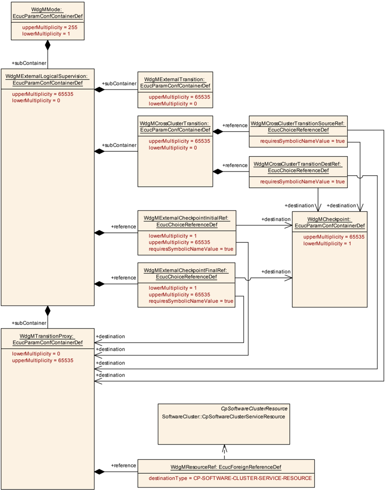

#### 9.2.20. WdgMTransitionProxy

| SWS 条目 | [ECUC_WdgM_00364] |
|---|---|
| 容器名称 | WdgMTransitionProxy |
| 父容器 | WdgMExternalLogicalSupervision |
| 描述 | **WdgMTransitionProxy** 定义了**宿主软件集群**与**应用软件集群**之间（以及反向）的**转换**代理。从**宿主软件集群**的视角看，一个跨集群**转换图**在以 **WdgMTransitionProxy** 为目的或初始引用的**转换**之后离开宿主，并在相关**应用软件集群**中所配置的**转换**发生之后回到该 **WdgMTransitionProxy**。此后，预期发生宿主中通过源或最终引用引用该 **WdgMTransitionProxy** 的**转换**。 |
| 配置参数 | 见下方参数表 |

| SWS 条目 | [ECUC_WdgM_00367] |
|---|---|
| 参数名称 | WdgMResourceRef |
| 父容器 | WdgMTransitionProxy |
| 描述 | 到 CpSoftwareClusterServiceResource 的引用。 |
| 多重性 | 1 |
| 类型 | 到 CP-SOFTWARE-CLUSTER-SERVICE-RESOURCE 的外部引用 |
| 作用域/依赖 | scope: ECU |

无包含的容器。

#### 9.2.21. WdgMBaseSocket

| SWS 条目 | [ECUC_WdgM_00377] |
|---|---|
| 容器名称 | WdgMBaseSocket |
| 父容器 | WdgMGeneral |
| 描述 | 此容器配置**宿主软件集群**所提供的**应用软件集群**中的 **WdgM** 实例需要多少个按 EcucPartition 划分的基��设施链接。这些基础设施链接用于：由**宿主** **WdgM** 实例初始化**应用软件集群** **WdgM** 实例；从**应用软件集群** **WdgM** 实例向**宿主** **WdgM** 实例传输监督结果；**应用软件集群** **WdgM** 实例与**宿主** **WdgM** 实例交互所需的任何其他实现特定用途。如果基础设施连接专属于一个或若干 EcucPartition，则 **WdgMSocketEcucPartitionRef** 指出适用的 EcucPartition。 |
| 多重性配置类 | Pre-compile time：x（All Variants）；Link time：-；Post-build time：- |
| 配置参数 | 见下方参数表 |

| SWS 条目 | [ECUC_WdgM_00367] |
|---|---|
| 参数名称 | WdgMResourceRef |
| 父容器 | WdgMBaseSocket |
| 描述 | 到 CpSoftwareClusterServiceResource 的引用。 |
| 多重性 | 1 |
| 类型 | 到 CP-SOFTWARE-CLUSTER-SERVICE-RESOURCE 的外部引用 |
| 作用域/依赖 | scope: ECU |

| SWS 条目 | [ECUC_WdgM_00366] |
|---|---|
| 参数名称 | WdgMSocketEcucPartitionRef |
| 父容器 | WdgMBaseSocket |
| 描述 | 到 EcucPartition 的引用。 |
| 多重性 | 0..* |
| 类型 | 到 EcucPartition 的引用 |
| 多重性配置类 | Pre-compile time：x；Link time：-；Post-build time：- |
| 值配置类 | Pre-compile time：x；Link time：-；Post-build time：- |
| 作用域/依赖 | scope: ECU |

无包含的容器。

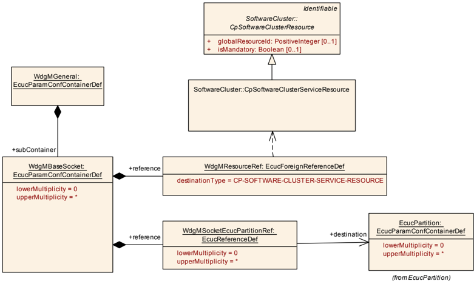

### 9.3. 发布信息

详情请参阅 [3, 基础软件模块通用规范] 第 10.3 章「发布信息」。

## 10. 存活监督算法示例实现

对于**存活监督**，给出一个用于检测**检查点**时序约束不匹配的算法，以明确界定**存活监督**所需的参数。

通过为**检查点**使用递增的**存活计数器**来实现这一点，就得到了以计数的存活指示数量与**存活监督**周期之间关系来表示存活状态的方式。

采用这种方法时，必须能够处理两种不同的情形：

- A）**检查点**的存活指示预期在一个监督周期内至少出现一次。应对一个监督周期（**SC**）内的存活指示（**AI**）数量进行计数。
- B）**检查点**的存活指示预期出现频率低于监督周期。应对两个存活指示（**AI**）之间的监督周期（**SC**）数量进行计数。

为了应对这两种情形，必须同时对 **AI** 与 **SC** 计数。

我们还需要参数 **WdgMExpectedAliveIndications**（**EAI**），它表示**检查点**在所引用的监督周期数量（也称为监督参考周期 [ECUC_WdgM_00310]（**SRC**））内的期望存活指示数量。该参数的值应已在设计阶段确定，并通过配置定义。

为避免对**检查点**检测到过多的监督错误，设有参数 **WdgMMinMargin** [ECUC_WdgM_00312] 与 **WdgMMaxMargin** [ECUC_WdgM_00313]，用于定义时序约束上的容差。

**WdgMMinMargin** 表示允许缺少的**检查点**执行次数。

**WdgMMaxMargin** 表示允许的额外**检查点**执行次数。

因此，算法变为：

```
(n (AI) – n (SC) + f(EAI, SRC) <= WdgMMaxMargin ) and
(n (AI) – n (SC) + f(EAI, SRC) >= - WdgMMinMargin ),
```

其中函数 f 定义为：

```
f(EAI, SRC) = SRC - EAI .
```

请注意，f( **EAI**, **SRC** ) 具有恒定值，如果 **EAI** 与 **SRC** 恒定，则可以预先计算。

### 10.1. 场景 A

**检查点**的存活指示（**AI**）预期在一个监督周期内至少出现一次。

示例：在一个代表监督参考周期的监督周期内预期出现 2 次存活指示，则 f( **EAI**, **SRC** ) 的值为：

```
f(EAI, SRC) = 1 - 2 = -1
```

当 **SC** 发生时，监督周期数量递增（n ( **SC** ) = 1），并使用该算法在每个监督周期（监督参考周期 = 1 个监督周期）内执行常规检查。

执行检查之后，当前的存活指示数量与监督周期数量被复位。

在本示例中，为简单起见将最大与最小偏差都设置为 0，因此所用算法为：

```
n (AI) – n (SC) + f(EAI, SRC) = 0.
```

如果在监督周期之前发生的存活指示不足，这会使比较算法得到负值结果。如果存活指示的数量恰好等于期望数量，结果为 0。如果发生了更多的存活指示，则该数值大于 0。

算法的结果恰好表示最后一个监督周期内「额外」存活指示的数量。

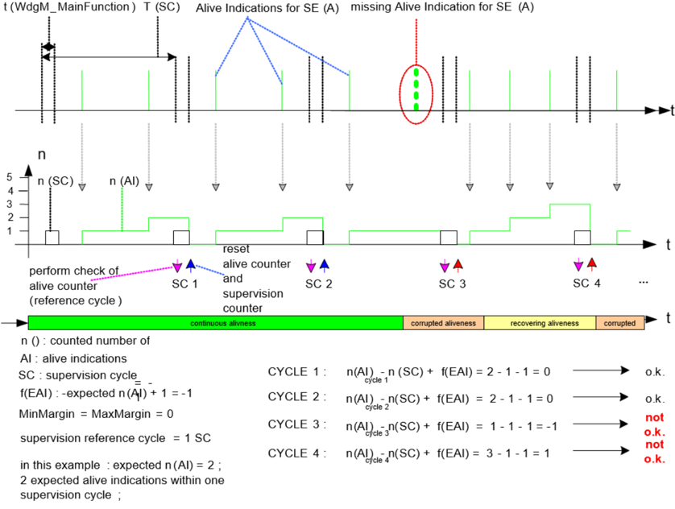

### 10.2. 场景 B

预期监督周期比存活指示出现得更频繁。在这种情况下，我们必须对已经发生的监督周期进行计数，直到**存活计数器**再次递增。存活状态的检查应在每个监督参考周期内执行，并使用相同的算法：

```
n (AI) – n (SC) + f(EAI, SRC) = 0
```

存活指示必须至少在预定义的监督周期数量内发生，该数量代表监督参考周期。

示例：预期在 2 个监督周期内出现 1 次存活指示（监督参考周期 = 2 个监督周期）：

```
f(EAI, SRC) = 2 – 1 = +1
```

**存活计数器**必须在每次存活指示时递增 1。存活状态应在与监督参考周期对应的监督周期内进行评估。算法的比较条件保持不变，但检测到的**存活计数器**递增也应触发在本次比较操作之后对**存活计数器**与**监督计数器**的复位。

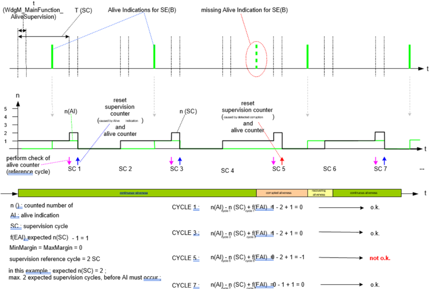

<section id="wechat">

<h4>微信扫一扫，获取更多及时资讯</h4>


</section>
