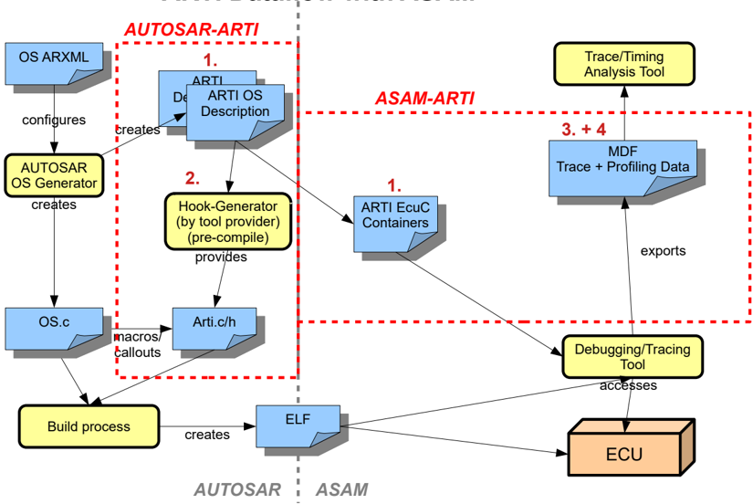
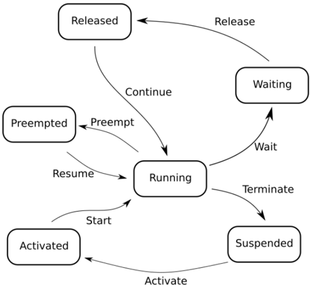
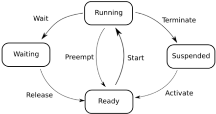
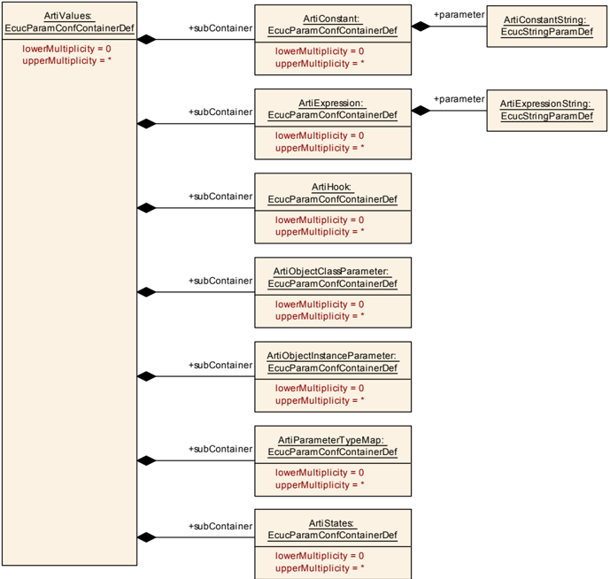
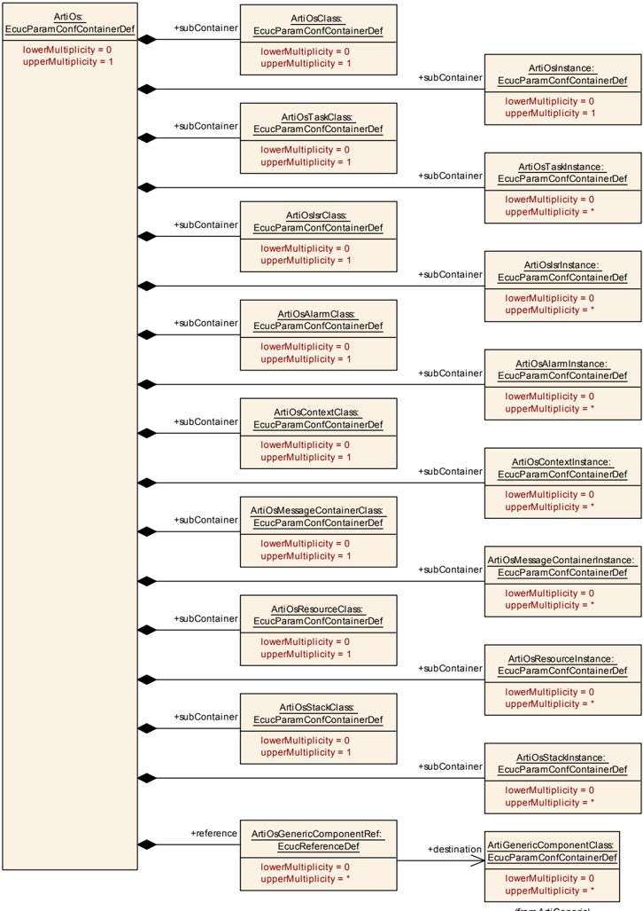

<!-- 源文档 AUTOSAR_CP_EXP_ARTI（R23-11），讲述型指南（EXP），不受 Type A 七章骨架约束；章节结构镜像源文档自身编号（1–9）。代码清单按源文档逐字保留（PDF 转换的断行与实体转义已重建为可读格式）。 -->

## 1. 引言

### 1.1. 本文档的读者是谁？

本说明性（EXPlanatory）文档旨在描述 OS 供应商、RTE 供应商、调试器供应商与时序工具供应商实现支持 AUTOSAR 运行时接口软件规范所需部分而必须执行的步骤。

### 1.2. 目标

ARTI 是一组用于调试与跟踪嵌入式系统运行时行为的标准。它起源于汽车领域，具体而言是为 AUTOSAR 开发合作组织制定的一份概念文档，但其范围并不限于纯汽车系统。

ARTI 旨在使来自多个不同供应商的工具能够以标准化的方式采集与交换嵌入式系统的运行时数据，从而促进竞争与创新。

ARTI 描述了支持 (a) 静态调试与 (b) 动态跟踪所需的接口。

静态调试通常涉及将在线调试器连接到嵌入式系统。每当调试器暂停系统执行时，你可以检查系统的状态（寄存器、栈与数据）。在任何中等或大规模系统中，解码状态的含义不一定直截了当。ARTI 允许以架构概念与组件的形式描述软件，使调试器能够显示意义更明确的系统状态表示。一个例子是调试器可以显示系统中任务的列表及其状态、优先级与执行时间。它还可以显示系统的其他部分，例如任务间消息及其值。

另一方面，动态跟踪在嵌入式系统以正常速度运行且不受干扰的情况下工作。系统记录特定事件发生的时刻，并将该信息传递给某个分析工具或查看器。如前所述，ARTI 允许描述这些系统事件，使分析工具——查看器能够按照架构概念与组件来解释它们。可以构建显示任务执行模式的视图，并可以计算基于响应时间与执行时间的统计数据。在存在兼容 ARTI 的在线调试器的情况下，动态跟踪可以以最小甚至零代码插桩实现。

ARTI 这个名称的选取是对先前一项名为 ORTI 的汽车标准的致意。ORTI 的规格聚焦于嵌入式操作系统的调试，而 ARTI 旨在能够为软件栈的所有层带来调试与跟踪。本文档首先描述 ARTI 规格的动机与理由，不深入技术细节。这些内容在后面的章节中补充。

### 1.3. 用例总结

以下两个用例应能给出 AUTOSAR 运行时接口为实现 AUTOSAR 感知的调试所预期内容的概貌。

**静态调试** 一个典型用例是在 ECU 集成阶段对代码执行进行调试与单步执行。为了分析应用软件代码中的失效，理解 OS 上下文（即错误发生在哪个任务中）总是有帮助的。

**动态跟踪** 在软件开发期间，对实时软件时序的 ECU 连续测试并不总是标准做法。大多数时候，资源消耗只是静态测量（例如内存消耗）。但通常某些测试——尤其受以车辆环境激励软件影响——会偶发性地失败且没有明显原因。如果不考虑调度中的偏移与时序最后期限的错过，就无法确定这一失效来源。因此，跟踪软件架构的动态运行时行为是 AUTOSAR AutosarRunTimeInterface 的一个重要用例。

## 2. 运行时接口

在现场捕获软件架构的动态运行时行为并不容易。评估 CPU 负载或时序度量等简单性能特性所需的投入可能非常高，取决于项目。工具链中通常涉及许多部分，它们需要非常好地协同工作才能提供有意义且正确的结果。

为了解释 AUTOSAR 运行时接口试图如何克服这些一般性描述的问题，有必要了解为实现预期结果而需要使用的各种技术。

### 2.1. 跟踪技术

工具要在运行时捕获软件的行为，有许多方法可以做到。每种方法都有其优点与缺点。但基本上，要长时间捕获软件的动态方面，需要资源。要么是 ECU 资源（如处理时间），要么是硅资源（如跟踪接口与处理器引脚），甚至是总线资源。以下各子章应能简要洞见不同的跟踪技术，从而理解为何 ARTI 以后文所述的方式引入。

#### 2.1.1 硬件跟踪

在硬件跟踪中，主要挑战是将信息从硬件提升到系统层面。意思是将汇编与低级指令解释为 OS 任务或任何其他与配置和软件架构相关产物的执行。一般而言，有两种跟踪技术（在硅供应商与实现上存在一些细微差异）：程序流跟踪（指令跟踪）与数据跟踪。

程序流跟踪：采用这种方法，诸如跳转、分支或其他（取决于供应商的）指令集会创建一个跟踪事件，该事件被多路复用并存储在片上缓冲区中，或直接从目标流式输出。该技术提供对目标上所执行代码的细粒度洞见。这当然以高带宽接口或片上情况下有限的测量时间为代价。对 ARTI 方法而言重要的是要知道：使用指令跟踪时，OS 内部状态变量对跟踪单元不可见，因此无法推导任务与 ISR 的状态。

数据跟踪：采用数据跟踪方法，对大多数内存区域的读取与写入访问都可以创建跟踪事件消息，并将该操作无运行时开销地导出到片上跟踪缓冲区或输出流。如果 OS 内部变量是已知的，通过这种方法可以导出任务与 ISR 状态。在现代 AUTOSAR 系统中，不存在用于 Runnable 的状态变量或其他跟踪机制。因此，通过数据跟踪对全局数据对象的写入访问来观察 Runnable 并非 RTE 原生支持。仅为数据跟踪的目的手动添加一个变量（例如在 VFB 钩子中使用的变量）通常被称为插桩（instrumentation）。采用这种方法，跟踪事件仅由运行时的调度行为创建。

#### 2.1.2 软件跟踪

硬件跟踪要求微控制器配备片上跟踪单元/逻辑。采用基于软件的跟踪，事件可以被捕获并存储在目标上的片上存储器中。通常在 CPU 空闲时，数据可以经由所连接的总线接口（如 CAN 或以太网）从 ECU 发出。因此该方法与带插桩的数据跟踪非常相似，区别在于将信息送出芯片的接口很可能是总线而不是调试接口。

### 2.2. 静态调试

ECU 开发与集成的一个非常重要的用例是嵌入式软件的调试。对于调试软件的用户而言，关于当前正在运行的任务或 ISR 的信息会非常有帮助。因此，ARTI 文件向调试器提供关于相关 OS 内部状态变量的信息。

### 2.3. OS 感知

针对 OSEK 平台，ORTI（OSEK Run-Time Interface）标准是已经成功地将跟踪工具对 OS 内部的访问标准化的尝试。关于任务栈、当前运行任务、当前运行 ISR 以及从 OS 内部解码任务状态的知识被存储在 .ORTI 文件中。对于 AUTOSAR 尤其是多核项目，该标准已不再适用。随着从单核 OS 到多核 OS 的合并，任务与 ISR 状态的跟踪变得更加复杂。表达式、指针处理等在代码执行期间难以跟踪。此外，ORTI 标准不感知 RTE 特性。但最重要的是：基于软件的跟踪没有在 ORTI 中标准化。

ARTI 的目标是扩展这种 OS 感知，使调试、跟踪及其他运行时工具感知额外的 AUTOSAR 模块，如 RTE 与 SchM。

### 2.4. ARTI 一览

ARTI 的一般理念不只是为调试器实现简单的「OS 感知」。从关于调度状态机的共同理解出发，配合调试与跟踪配置的公共交换格式。此外，交换运行时测量直至其解释，影响 AUTOSAR/ASAM 运行时接口的范围。ARTI 的目标之一是建立一个标准，以配置、采集、处理以及评估与供应商无关的 AUTOSAR 项目的运行时行为。为实现该工作流与标准化目标，还必须将跟踪交换格式以及公共时序参数标准化。时序参数与跟踪格式由 ARTI ASAM 标准覆盖。

以下列表描述 ARTI 工作流需要采取的必要步骤及其产物文件。

**与 ASAM 协同的 ARTI 数据流（ARTI Dataflow with ASAM）：**



**1. ECU 配置（ARXML）——AUTOSAR**

ARTI ECU 配置参数容器承载两个目的。一方面，它们存储 AUTOSAR 项目的跟踪/调试配置。除此之外，所有 ARTI 容器的汇集取代了 ORTI 文件提供的信息。

当前，在 ARTI ECUC 模块定义中有四个 ARTI ECU 配置参数容器可用：ArtiValues、ArtiGeneric、ArtiHardware 与 ArtiOs。根据用例，需要配置不同的参数容器集合。

- ArtiValues：ARTI ECUC 容器负责存储所有实际的跟踪与调试信息。它对所有 ARTI 用例都是必需的。它收集所有 ARTI 相关变量的名称，例如带有 TypeMap 的 OS 钩子布局（将任务与 ISR Id 映射到名称），或静态调试的任务状态表达式（从 ArtiHardware 引用）。
- ArtiOs：ARTI OS 容器基本上以面向跟踪与调试工具的视角存储 OS 配置。它主要描述所有可用的任务与 ISR。此外，它为所引用的 OS 配置定义启用了哪个调试或跟踪特性，而 ARTI 容器汇总项目中总共可用的 ARTI 钩子、变量等。
- ArtiHardware：ARTI 硬件容器存储每个核心的当前运行任务与 ISR OS 变量的所有引用，而实际变量存储在 ARTI 组件中。该容器仅对静态调试必需，并建立 CurrentRunningTask、CurrentRunningIsr 与 ECU 核心之间的连接。
- ArtiGeneric：ARTI 通用容器为 ARTI OS 与 RTE 供应商提供向 ARTI 文件添加未标准化附加信息的可能性。例如，它可以用于存储任务的起始地址。ArtiGeneric 容器在任何用例中都不是强制使用的。

**2. 钩子生成器——AUTOSAR**

在 AUTOSAR 项目配置完成后，需要生成跟踪工具供应商特定的钩子实现。为此，跟踪工具有意读取所使用的 ARTI ECUC 文件（拆分或合并的 ECUC），并从中生成 ARTI 钩子的 C 代码实现。将它们加入构建过程后，项目即可编译。该工作流的背景主要是：钩子宏可以被展开为 void，因此在配置之后可以打开与关闭。

**3. 跟踪格式（MDF）——ASAM**

整个项目编译完成后，AUTOSAR 运行时接口的标准化部分基本结束。客户现在能够以 OS 运行时参数的视角调试或跟踪项目。在记录由 OS 钩子标志的任务与 ISR 迁移期间，跟踪供应商存储发生的时间戳与调度事件。调度迁移的集合由 OS 钩子定义，并标志受影响调度实体（任务、ISR）的状态图之一中的状态迁移。

跟踪交换格式基本上以时间戳存储调度事件，并额外存储哪个调度实体受影响以及应使用哪个状态图来计算可能的时序参数。作为交换格式本身，出于诸多原因使用了业界熟知的 ASAM MDF（Measurement Data Format）：首先，它可以高效存储海量数据；它在业界广为人知；并且它同时存储数据与数据的描述。

**4. 时序参数（MDF）——ASAM**

在跟踪数据可用之后，可以导出感兴趣的信息。因此，ASAM 运行时接口聚焦于如何将数据解释为一组度量。通过这样的工作流，标准化方法应有助于发现 AUTOSAR 项目中的运行时问题。时序参数旨在与跟踪数据一同存储在 MDF 文件中。

对于一个同时采用两种标准化方法的 ARTI 感知项目，其产物文件与数据流见图 2.1。

## 3. OS

为实现对 AUTOSAR ECU 运行时行为与供应商无关的解释，ARTI 定义了状态机。这些状态之间的迁移标志运行时的 OS 调度。换言之，状态迁移可以被理解为 OS 钩子的实现。例如，每当一个 OS 任务被 ISR 抢占，ARTI 钩子宏就标志 OS 任务状态迁移中的变更。这有两个优点：可以使用基于软件的跟踪，也可以使用数据跟踪，且结果相同。

### 3.1. 状态模型

SWS OS 中描述的 OS 状态模型得到 ARTI 的支持。但要用时序工具获得恰当的视图，还需要额外的状态信息。由于被抢占（preempted）、被释放（released）与被激活（activated）的任务状态之间没有区分，引入了一个增强的状态机。根据 OS 供应商提供的特性，可以使用标准 OS 模型，也可以使用增强模型进行详细分析。为了区分两个状态图，钩子宏（因此也就是可用的状态迁移）应遵循不同的状态机描述（类名，Class Name）。ARTI 类名 AR_CP_OS_TASK 用于标准 OS 任务状态，AR_CP_OSARTI_TASK 用于增强状态机。





### 3.2. 钩子（Hooks）

ARTI 钩子宏旨在标志可调度实体的状态迁移。有意将其设计为宏而非函数，以便最小化所增加的计算开销。ARTI 钩子的使用可以在受影响的 BSW 模块中关闭。例如，所有 OS ARTI 宏通过 define `OS_USE_ARTI` 打开，它实现了 [\[1\]](#ref-1) 中定义的 OS 配置参数 OsUseArti。

清单3.1：用一个 define 启用或禁用 ARTI（**Enable or disable ARTI with one define**）

```
#ifdef OS_USE_ARTI
# include "Os_Arti.h"
#else
# define ARTI_TRACE(_contextName, _className, _instanceName, _eventName, instanceParameter, eventParameter) ((void)0)
#endif
```

ARTI 宏的布局相当通用。其主要理念是用户也可以定义自己的宏。不过，这种方法目前尚未完全标准化。对所有标准化的调度状态机，_className 将宏映射到状态机，而 _eventName 描述状态迁移。_contextName 应描述在执行期间读取宏数据时中断是否被禁用。有三种不同的模式：_USER 表示钩子实现者不能禁用中断，并且在中断发生时需要提供修正性的后处理；_NOSUSP 表示宏将在中断被锁定的上下文中执行；_SPRVSR 表示钩子宏可以自行禁用中断。_instanceName 应提供任务属于哪个 OS（名称）的信息。

清单3.2：ARTI 宏的预处理器转换示例（**Preprocessor conversion example for ARTI macros**）

```
#define ARTI_TRACE(_contextName, _className, _instanceName, _eventName, instanceParameter, eventParameter) \
  ARTI_TRACE ## _contextName ## _ ## _className ## _ ## _instanceName ## _ ## _eventName((instanceParameter),(eventParameter))
```

instanceParameter 与 eventParameter 不像所有其他宏部分（_….Name）那样是字面量。instanceParameter 用于处理 CoreId 参数，而 TaskId 可以经由 eventParameter 访问。

清单3.3：OS 任务等待（Wait）的 ARTI 跟踪宏（**ARTI trace macro for OS Task Wait**）

```
ARTI_TRACE(NOSUSP, AR_CP_OSARTI_TASK, OS, OsTask_Wait, CoreId, TaskId);
```

在编译时，预处理器会将通用宏替换为所有特定的 ARTI 宏（如果它们已经用跟踪供应商特定的插桩实现）。双下划线应有助于更容易地解析宏。

清单3.4：OS 任务等待（Wait）的 ARTI 跟踪宏实现（**ARTI trace macro implementation for OS Task Wait**）

```
#define ARTI_TRACE_NOSUSP_AR_CP_OSARTI_TASK_OS_OsTask_Wait(CoreId, TaskId) {;}
```

### 3.3. ECUC

以下小节聚焦于 OS 跟踪用例的 ARTI 的 ECUC 表示。为了配置与存储基于钩子跟踪的 ARTI 配置，需要以下 ECUC 容器：ArtiValues 与 ArtiOs。ArtiValues 容器存储任务与 ISR 的 Id 映射以及所有可用的 OS 钩子宏（图 3.3）。ArtiOs 容器存储所有配置的 OS 任务，并在 ArtiOsInstance EcucParamConfContainer 中引用所有启用的钩子宏（见图 3.4）。





该用例的示例见清单 6.4 的 Arti EcucParamConfContainer 与清单 6.5 的 ArtiOs EcucParamConfContainer。

表3.1：ArtiValues 类的 ECUC 容器值（**ArtiValues Class ECUC Container Values**）

| ECUC 容器值（class ArtiValues） | 说明 |
| --- | --- |
| ArtiConstant | 该容器持有一个常量值。 |
| ArtiExpression | 包含 OS 表达式字符串，例如任务状态表达式。这个类 C 表达式可以由调试器求值，与 ORTI 中已经做的类似。 |

表3.2：ArtiOs 类的 ECUC 容器值（**ArtiOs Class ECUC Container Values**）

| ECUC 容器值（class ArtiOs） | 用例 |
| --- | --- |
| ArtiHook | ARTI 钩子宏的模型表示 |
| ArtiObjectClassParameter | 描述 ARTI 对象的属性，例如 CurrentRunningTask 需要引用 TypeMap 来对 ID 或表达式求值 |
| ArtiObjectInstanceParameter | 实例化一个 ARTI 对象，例如核心 0 的 CurrentRunningTask 变量 |
| ArtiParameterTypeMap | 包含一个映射，用于将 ARTI 对象（例如任务）的数值 ID 转换为其字面量名称 |
| ArtiStates | 该容器包含 EcuC 使用的任务、ISR……的所有状态 |
| ArtiOsClass | |
| ArtiOsInstance | OS 表达式，例如任务状态 |
| ArtiOsTaskClass | 任务的 ARTI 钩子宏的模型表示 |
| ArtiOsTaskInstance | 带有对 OS 的引用来实例化一个任务 |
| ArtiOsIsrClass | Isr 的 ARTI 钩子宏的模型表示 |
| ArtiOsIsrInstance | 带有对 OS 的引用来实例化一个 Isr |
| ArtiOsAlarmClass | 报警（alarm）的 ARTI 钩子宏的模型表示 |
| ArtiOsAlarmInstance | 带有对 OS 的引用来实例化一个报警 |
| ArtiOsContextClass | 上下文（context）的 ARTI 钩子宏的模型表示 |
| ArtiOsContextInstance | 带有对 OS 的引用来实例化一个上下文 |
| ArtiOsMessageContainerClass | 消息容器（message container）的 ARTI 钩子宏的模型表示 |
| ArtiOsMessageContainerInstance | 带有对 OS 的引用来实例化一个消息容器 |
| ArtiOsResourceClass | 资源（resource）的 ARTI 钩子宏的模型表示 |
| ArtiOsResourceInstance | 带有对 OS 的引用来实例化一个资源 |
| ArtiOsStackClass | 栈（stack）的 ARTI 钩子宏的模型表示 |
| ArtiOsStackInstance | 带有对 OS 的引用来实例化一个栈 |

## 4. RTE

ARTI 使用 VFB 跟踪钩子作为自己的跟踪客户端。关于如何配置符合 ARTI 的 RTE 规格的详细描述，见 [\[2\]](#ref-2)（SWS ARTI）第 7.4 章。

RTE VFB 跟踪客户端配置分几个步骤完成，其中 RTE 生成器与 ARTI 模块交互。配置参数在 EcuC 中交换。

### 4.1. ECU 配置

ARTI 创建一个名为 Arti 的 VFB 跟踪客户端，并使用 RTE 的 ECU 配置容器 RteVfbTraceClient 为该跟踪客户端提供配置。在该容器内，使用 EcuC 参数 RteVfbTraceFunction 生成要跟踪的钩子函数的愿望清单。由此可以区分以下用例：

- 要启用所有 BswSchedulableEntity 钩子的跟踪，RteVfbTraceFunction 包含 Rte_Arti_SchM
- 要启用所有 RunnableEntity 钩子的跟踪，RteVfbTraceFunction 包含 Rte_Arti_Runnable
- 要启用特定组件的所有 RunnableEntity 钩子的跟踪，RteVfbTraceFunction 包含 Rte_Arti_Runnable_MyComponentType，其中 MyComponentType 指向一个 RteSwComponentType EcuC 容器
- 要启用特定组件内特定 RunnableEntity 的跟踪钩子，RteVfbTraceFunction 包含 Rte_Arti_Runnable_MyComponentType_MyRunnable，其中 MyComponentType 指向一个 RteSwComponentType EcuC 容器，MyRunnable 指向 SWComponentTemplate 中的一个 RunnableEntity

**示例 4.1（Example 4.1）**

本示例展示对一个特定组件的所有 RunnableEntity 的跟踪钩子生成的配置。为此，EcuC 必须包含位于所配置 ECU 上的 SwComponentPrototype 的表示。这通过 Rte 模块配置中的 ECU 容器 RteSwComponentInstance 完成。

```
...
<ECUC-CONTAINER-VALUE UUID="cd307f8d-8496-421b-a9e8-571463b08250">
  <SHORT-NAME>ConsumerComponent</SHORT-NAME>
  <DEFINITION-REF DEST="ECUC-PARAM-CONF-CONTAINER-DEF">/AUTOSAR/EcucDefs/Rte/RteSwComponentInstance</DEFINITION-REF>
  ...
</ECUC-CONTAINER-VALUE>
...
```

下面的清单展示了 EcuC 中启用上述软件组件实例 ConsumerComponent 的所有 runnable 的跟踪钩子生成的部分。

```
...
<ECUC-CONTAINER-VALUE UUID="6de0bb4e-c1ff-4c6c-ae19-3a0f536e7e9e">
  <SHORT-NAME>Arti</SHORT-NAME>
  <DEFINITION-REF DEST="ECUC-PARAM-CONF-CONTAINER-DEF">/AUTOSAR/EcucDefs/Rte/RteGeneration/RteVfbTraceClient</DEFINITION-REF>
  <PARAMETER-VALUES>
    <ECUC-TEXTUAL-PARAM-VALUE>
      <DEFINITION-REF DEST="ECUC-FUNCTION-NAME-DEF">/AUTOSAR/EcucDefs/Rte/RteGeneration/RteVfbTraceClient/RteVfbTraceFunction</DEFINITION-REF>
      <VALUE>Rte_Arti_Runnable_ConsumerComponent</VALUE>
    </ECUC-TEXTUAL-PARAM-VALUE>
    ...
  </PARAMETER-VALUES>
</ECUC-CONTAINER-VALUE>
...
```

### 4.2. BSW 模块描述模板

基于该配置，RTE 生成器创建包含跟踪钩子的 BswModuleEntry。functionPrototypeEmitter 条目 Arti 将它们标识为 ARTI 钩子。随后，ARTI 基于 BswModuleEntry 为 ARTI 跟踪客户端生成最终的跟踪客户端。这导致以下变更：

- 对每个钩子，在 BswInternalBehavior 中扩展一个 BswCalledEntity，并通过被引用的 SwAddrMethod 为其代码对象分配一个公共的内存段
- 为每个钩子的 BswModuleEntry 设置正确的实现策略（MACRO、INLINE 或 STANDARD）
- 将带有钩子函数声明的头文件作为必需产物添加到 BswImplementation
- 通过添加一个包含对所有钩子 BswCalledEntity 的引用的 MemorySection，以及经由 SectionNamePrefix 在代码中为内存段的命名空间添加前缀，在 BswImplementation 中规定 ResourceConsumption

**示例 4.2（Example 4.2）**

示例 4.1 从启用软件组件实例 ConsumerComponent 的所有 runnable 的跟踪钩子生成的 ECU 配置开始。本示例继续展开，详细呈现对 BSW 模块描述模板的后续变更。如上所述，为每个跟踪钩子创建一个 BswModuleEntry。在本例中，软件组件实例 ConsumerComponent 包含一个名为 RE2 的 runnable。因此 ARTI 为该 runnable 生成一个起始与一个返回钩子，分别组装为 Rte_Arti_Runnable_ConsumerComponent_RE2_Start 与 Rte_Arti_Runnable_ConsumerComponent_RE2_Return：

```
...
<BSW-MODULE-ENTRY>
  <SHORT-NAME>Rte_Arti_Runnable_ConsumerComponent_RE2_Start</SHORT-NAME>
  <FUNCTION-PROTOTYPE-EMITTER>Arti</FUNCTION-PROTOTYPE-EMITTER>
  <CALL-TYPE>CALLBACK</CALL-TYPE>
</BSW-MODULE-ENTRY>
<BSW-MODULE-ENTRY>
  <SHORT-NAME>Rte_Arti_Runnable_ConsumerComponent_RE2_Return</SHORT-NAME>
  <FUNCTION-PROTOTYPE-EMITTER>Arti</FUNCTION-PROTOTYPE-EMITTER>
  <CALL-TYPE>CALLBACK</CALL-TYPE>
</BSW-MODULE-ENTRY>
...
```

除 BswModuleEntry 之外，ARTI 还创建 BswCalledEntity，其反映方式如下：

```
...
<BSW-CALLED-ENTITY>
  <SHORT-NAME>Rte_Arti_Runnable_ConsumerComponent_RE2_Start</SHORT-NAME>
  <MINIMUM-START-INTERVAL>0.0</MINIMUM-START-INTERVAL>
  <SW-ADDR-METHOD-REF DEST="SW-ADDR-METHOD">/AUTOSAR_MemMap/SwAddrMethods/CODE</SW-ADDR-METHOD-REF>
  <IMPLEMENTED-ENTRY-REF DEST="BSW-MODULE-ENTRY" BASE="Rte_BSWMD_BswModuleEntrys">Rte_Arti_Runnable_ConsumerComponent_RE2_Start</IMPLEMENTED-ENTRY-REF>
</BSW-CALLED-ENTITY>
<BSW-CALLED-ENTITY>
  <SHORT-NAME>Rte_Arti_Runnable_ConsumerComponent_RE2_Return</SHORT-NAME>
  <MINIMUM-START-INTERVAL>0.0</MINIMUM-START-INTERVAL>
  <IMPLEMENTED-ENTRY-REF DEST="BSW-MODULE-ENTRY" BASE="Rte_BSWMD_BswModuleEntrys">Rte_Arti_Runnable_ConsumerComponent_RE2_Return</IMPLEMENTED-ENTRY-REF>
</BSW-CALLED-ENTITY>
...
```

接下来，添加带有钩子函数声明的生成头文件（Rte_Hook_Arti.h），其内容如下：

```
...
<BSW-IMPLEMENTATION>
  <SHORT-NAME>Rte</SHORT-NAME>
  <PROGRAMMING-LANGUAGE>C</PROGRAMMING-LANGUAGE>
  <REQUIRED-ARTIFACTS>
    ...
    <DEPENDENCY-ON-ARTIFACT>
      <SHORT-NAME>Rte_Hook_Arti.h</SHORT-NAME>
      <CATEGORY>MEMMAP</CATEGORY>
      <ARTIFACT-DESCRIPTOR>
        <SHORT-LABEL>Rte_Hook_Arti.h</SHORT-LABEL>
        <CATEGORY>SWHDR</CATEGORY>
      </ARTIFACT-DESCRIPTOR>
      <USAGES>
        <USAGE>COMPILE</USAGE>
      </USAGES>
    </DEPENDENCY-ON-ARTIFACT>
    ...
  </REQUIRED-ARTIFACTS>
  ...
</BSW-IMPLEMENTATION>
...
```

最后，为这些钩子定义相应的内存段：

```
...
<RESOURCE-CONSUMPTION>
  ...
  <MEMORY-SECTION>
    <SHORT-NAME>RTE_Arti_CODE</SHORT-NAME>
    <EXECUTABLE-ENTITY-REFS>
      <EXECUTABLE-ENTITY-REF DEST="BSW-CALLED-ENTITY" BASE="Rte_BSWMD_BswModuleDescriptions">Rte/RteInternalBehavior/Rte_Arti_Runnable_ConsumerComponent_RE2_Start</EXECUTABLE-ENTITY-REF>
      <EXECUTABLE-ENTITY-REF DEST="BSW-CALLED-ENTITY" BASE="Rte_BSWMD_BswModuleDescriptions">Rte/RteInternalBehavior/Rte_Arti_Runnable_ConsumerComponent_RE2_Return</EXECUTABLE-ENTITY-REF>
    </EXECUTABLE-ENTITY-REFS>
    <PREFIX-REF DEST="SECTION-NAME-PREFIX" BASE="Rte_BSWMD_BswImplementations">Rte/ResConsumption/RTE_Arti</PREFIX-REF>
    <SW-ADDRMETHOD-REF DEST="SW-ADDR-METHOD">/AUTOSAR_MemMap/SwAddrMethods/CODE</SW-ADDRMETHOD-REF>
    <SYMBOL>CODE</SYMBOL>
  </MEMORY-SECTION>
  ...
</RESOURCE-CONSUMPTION>
...
```

### 4.3. 钩子（Hooks）

如上文已经提到的，ARTI 还生成包含 VFB 跟踪定义的头文件。这些函数随后用于将 VFB 跟踪钩子映射到 ARTI_TRACE 宏。ARTI_TRACE 宏的一种可能实现将在 7.1.3 节中详细讨论。

**示例 4.3（Example 4.3）**

再次承接示例 4.1 与示例 4.2 中的示例。下面的清单展示包含软件组件实例 CustomerComponent 的 runnable RE2 的起始与返回钩子 Rte_Arti_Runnable_ConsumerComponent_RE2_Start 与 Rte_Arti_Runnable_ConsumerComponent_RE2_Return 的生成函数定义的头文件。

清单4.1：VFB 钩子的示例函数声明（**Example function declarations of VFB hooks**）

```
/************************************************************************
 * ----------------------------------------------------------------------
 * FILE DESCRIPTION
 * ----------------------------------------------------------------------
 * File: Rte_Hook_Arti.h
 *
 * Description: Header file containing definitions for VFB tracing
 ***********************************************************************/

/***********************************************************************
 * Names of available VFB-Trace-Hooks
 ***********************************************************************
 *
 * Configured:
 *
 * Rte_Arti_Runnable_ConsumerComponent_RE2_Start
 * Rte_Arti_Runnable_ConsumerComponent_RE2_Return
 *
 * Not configured:
 *
 *
 ***********************************************************************/

/* double include prevention */
#ifndef _RTE_HOOK_H
# define _RTE_HOOK_H

# include "Os.h"

# include "Rte_Type.h"
# include "Rte_Cfg.h"

void Rte_Arti_Runnable_ConsumerComponent_RE2_Start(void);

void Rte_Arti_Runnable_ConsumerComponent_RE2_Return(void);

#endif /* _RTE_HOOK_H */

/* ***********************************************************************
 * END OF FILE: Rte_Hook_Arti.h
 ***********************************************************************/
```

现在剩下的全部工作，就是在生成的 VFB 跟踪钩子中使用 ARTI 宏。清单 4.2 示例性地展示了这一点，其中实现了被分配 ID 1 的 runnable 的起始与返回钩子。

清单4.2：使用 ARTI 宏的 VFB 跟踪钩子的示例实现（**Example Implementation of VFB Tracing Hooks with ARTI Macros**）

```
/************************************************************************
 * ----------------------------------------------------------------------
 * FILE DESCRIPTION
 * ----------------------------------------------------------------------
 * File: Rte_Hook_Arti.c
 *
 * Description: Example Implementation of VFB Tracing Hooks with ARTI Macros.
 ***********************************************************************/

/* ***********************************************************************
 * INCLUDES
 ***********************************************************************/
#include "Std_Types.h"
#include "Rte_Hook_Arti.h"
#include "Rte_Arti.h"

/* ***********************************************************************
 * VFB HOOK IMPLEMENTATIONS
 ***********************************************************************/
#if !defined (Rte_Arti_Runnable_ConsumerComponent_RE2_Start)
void Rte_Arti_Runnable_ConsumerComponent_RE2_Start(void) {
  /* #ID Rte_Arti_Runnable_ConsumerComponent_RE2_Start 1*/
  ARTI_TRACE(USER, AR_CP_RTE_RUNNABLE, ct, 0, RteRunnable_Start, 1);
}
#endif

#if !defined (Rte_Arti_Runnable_ConsumerComponent_RE2_Return)
void Rte_Arti_Runnable_ConsumerComponent_RE2_Return(void) {
  ARTI_TRACE(USER, AR_CP_RTE_RUNNABLE, ct, 0, RteRunnable_Return, 1);
}
#endif
```

## 5. ARTI 与 ORTI 的比较

可以把 ARTI 想象为 ORTI 的后继者。ARTI 可以包含 ORTI 文件的所有信息。文件格式已从 ORTI 基于 OSEK 的语法更改为 ARTI 中模型驱动的 ARXML 语法。此外，ARTI 涵盖了新的元素，例如基于事件的钩子跟踪与多核方面。

### 5.1. 从 ORTI 到 ARTI 的映射

ORTI 文件中的所有元素都可以映射到 ARTI。ORTI 的 implementation 节中的对象映射到名为 *Class 的 ARXML 子容器（ARTI 类）。ORTI 的 information 节中的对象映射到名为 *Instance 的 ARXML 子容器（ARTI 实例）。只有声明了枚举或映射时才需要 ARTI 类。因此，并非所有 ORTI 对象都有相关的 ARTI 类。表 5.1 展示已定义的 ORTI 对象及其属性到 ARTI 元素的映射。

表5.1：ORTI 对象到 ARTI 的映射（**ORTI-object to ARTI-mapping**）

| ORTI 属性（类: 实例:） | ARTI 类 / ARTI 实例 |
| --- | --- |
| OS.RUNNINGTASK | OS.RUNNINGTASK |
| 类: | ArtiHardwareCoreClass.ArtiHardwareCoreClassCurrentTaskRef |
| 实例: | ArtiHardwareCoreInstance.ArtiHardwareCoreInstanceCurrentTaskRef |
| OS.RUNNINGTASKPRIORITY | OS.RUNNINGTASKPRIORITY |
| 类: | ArtiHardwareCoreClass.ArtiHardwareCoreClassRunningTaskPriorityRef |
| 实例: | ArtiHardwareCoreInstance.ArtiHardwareCoreInstanceRunningTaskPriorityRef |
| OS.RUNNINGISR2 | OS.RUNNINGISR2 |
| 类: | ArtiHardwareCoreClass.ArtiHardwareCoreClassCurrentIsrRef |
| 实例: | ArtiHardwareCoreInstance.ArtiHardwareCoreInstanceCurrentIsrRef |
| OS.SERVICETRACE | OS.SERVICETRACE |
| 类: | ArtiOsClass.ArtiOsClassServiceTraceRef |
| 实例: | ArtiOsInstance.ArtiOsInstanceServiceTraceRef |
| OS.LASTERROR | OS.LASTERROR |
| 类: | ArtiHardwareCoreClass.ArtiHardwareCoreClassLastErrorRef |
| 实例: | ArtiHardwareCoreInstance.ArtiHardwareCoreInstanceLastErrorRef |
| OS.CURRENTAPPMODE | OS.CURRENTAPPMODE |
| 类: | ArtiOsClass.ArtiOsClassAppModeRef |
| 实例: | ArtiOsInstance.ArtiOsInstanceAppModeRef |
| OS.VALID | OS.VALID |
| 实例: | ArtiOsInstance.ArtiOsInstanceValidRef |
| 实例: | ArtiHardwareCoreInstance.ArtiHardwareCoreInstanceValidRef |
| TASK.PRIORITY | TASK.PRIORITY |
| 类: | ArtiOsTaskClass.ArtiOsTaskClassPriorityRef |
| 实例: | ArtiOsTaskInstance.ArtiOsTaskInstancePriorityRef |
| TASK.STATE | TASK.STATE |
| 类: | ArtiOsTaskClass.ArtiOsTaskClassCurrentTaskStateRef |
| 实例: | ArtiOsTaskInstance.ArtiOsTaskInstanceCurrentTaskStateRef |
| TASK.STACK | TASK.STACK |
| 类: | ArtiOsTaskClass.ArtiOsTaskClassStackRef |
| 实例: | ArtiOsTaskInstance.ArtiOsTaskInstanceStackRef |
| TASK.CURRENTACTIVATIONS | TASK.CURRENTACTIVATIONS |
| 实例: | ArtiOsTaskInstance.ArtiOsTaskInstanceCurrentActivationsRef |
| TASK.CONTEXT | TASK.CONTEXT |
| 类: | ArtiOsTaskClass.ArtiOsTaskClassContextRef |
| 实例: | ArtiOsTaskInstance.ArtiOsTaskInstanceContextRef |
| TASK.VALID | TASK.VALID |
| 实例: | ArtiOsTaskInstance.ArtiOsTaskInstanceValidRef |
| CONTEXT.ADDRESS | CONTEXT.ADDRESS |
| 实例: | ArtiOsContextInstance.ArtiOsContextInstanceAddressRef |
| CONTEXT.SIZE | CONTEXT.SIZE |
| 实例: | ArtiOsContextInstance.ArtiOsContextInstanceSizeRef |
| CONTEXT.VALID | CONTEXT.VALID |
| 实例: | ArtiOsContextInstance.ArtiOsContextInstanceValidRef |
| STACK.SIZE | STACK.SIZE |
| 实例: | ArtiOsStackInstance.ArtiOsStackInstanceSizeRef |
| STACK.BASEADDRESS | STACK.BASEADDRESS |
| 实例: | ArtiOsStackInstance.ArtiOsStackInstanceBaseAddressRef |
| STACK.STACKDIRECTION | STACK.STACKDIRECTION |
| 实例: | ArtiOsStackInstance.ArtiOsStackInstanceSDirection |
| STACK.FILLPATTERN | STACK.FILLPATTERN |
| 实例: | ArtiOsStackInstance.ArtiOsStackInstanceFillPatternRef |
| STACK.VALID | STACK.VALID |
| 实例: | ArtiOsStackInstance.ArtiOsStackInstanceValidRef |
| ALARM.ALARMTIME | ALARM.ALARMTIME |
| 实例: | ArtiOsAlarmInstance.ArtiOsAlarmInstanceAlarmTimeRef |
| ALARM.CYCLETIME | ALARM.CYCLETIME |
| 实例: | ArtiOsAlarmInstance.ArtiOsAlarmInstanceCycleTimeRef |
| ALARM.STATE | ALARM.STATE |
| 类: | ArtiOsAlarmClass.ArtiOsAlarmClassStateRef |
| 实例: | ArtiOsAlarmInstance.ArtiOsAlarmInstanceStateRef |
| ALARM.ACTION | ALARM.ACTION |
| 实例: | ArtiOsAlarmInstance.ArtiOsAlarmInstanceAction |
| ALARM.COUNTER | ALARM.COUNTER |
| 实例: | ArtiOsAlarmInstance.ArtiOsAlarmInstanceCounter |
| ALARM.VALID | ALARM.VALID |
| 实例: | ArtiOsAlarmInstance.ArtiOsAlarmInstanceValidRef |
| RESOURCE.STATE | RESOURCE.STATE |
| 类: | ArtiOsResourceClass.ArtiOsResourceClassStateRef |
| 实例: | ArtiOsResourceInstance.ArtiOsResourceInstanceStateRef |
| RESOURCE.LOCKER | RESOURCE.LOCKER |
| 类: | ArtiOsResourceClass.ArtiOsResourceClassLockerRef |
| 实例: | ArtiOsResourceInstance.ArtiOsResourceInstanceLockerRef |
| RESOURCE.PRIORITY | RESOURCE.PRIORITY |
| 实例: | ArtiOsResourceInstance.ArtiOsResourceInstancePriority |
| RESOURCE.VALID | RESOURCE.VALID |
| 实例: | ArtiOsResourceInstance.ArtiOsResourceInstanceValidRef |
| MESSAGECONTAINER.MSGNAME | MESSAGECONTAINER.MSGNAME |
| 实例: | ArtiOsMessageContainerInstance.ArtiOsMessageContainerInstanceMsgName |
| MESSAGECONTAINER.MSGTYPE | MESSAGECONTAINER.MSGTYPE |
| 实例: | ArtiOsMessageContainerInstance.ArtiOsMessageContainerInstanceMstType |
| MESSAGECONTAINER.QUEUESIZE | MESSAGECONTAINER.QUEUESIZE |
| 实例: | ArtiOsMessageContainerInstance.ArtiOsMessageContainerInstanceQueueSizeRef |
| MESSAGECONTAINER.QUEUECOUNT | MESSAGECONTAINER.QUEUECOUNT |
| 实例: | ArtiOsMessageContainerInstance.ArtiOsMessageContainerInstanceQueueCountRef |
| MESSAGECONTAINER.FIRSTELEMENT | MESSAGECONTAINER.FIRSTELEMENT |
| 实例: | ArtiOsMessageContainerInstance.ArtiOsMessageContainerInstanceFirstElementRef |
| MESSAGECONTAINER.VALID | MESSAGECONTAINER.VALID |
| 实例: | ArtiOsMessageContainerInstance.ArtiOsMessageContainerInstanceValidRef |

所有 ARTI 属性都是对最终存储在 ArtiValues 子容器中的参数的引用。ARTI 实例参数是 ArtiConstant 或 ArtiExpression。ARTI 类参数是 ArtiParamterTypeMap，它声明从值或表达式到最终可显示文本或引用的映射。

### 5.2. 映射供应商特定的对象与属性

供应商特定的对象映射到 ArtiGenericComponentClass 与 ArtiGenericComponentInstance。这些类与实例放置在 ARTI 子容器 ArtiGeneric 中。当前只有一个例外，即已建模的中断。在 ARTI 中已经定义了 ArtiOsIsrClass 与 ArtiOsIsrInstance。因此，ORTI 中描述中断的供应商特定对象映射到 ArtiOsIsr*。

与 ORTI 相反，供应商特定的属性不能直接添加到 ARTI 中的相关元素。在 ARTI 中需要附加步骤。首先，需要定义 ArtiGenericComponent。这些组件包含所有供应商特定的属性。最后，这些附加组件必须由相关的 ARTI 实例与 ARTI 类引用。因此，如果要向 ArtiOsTask* 对象添加供应商特定的枚举属性（如 vs_Enum_Task_Type），则：

- 必须创建一个 ArtiGenericComponentClass。该类必须包含作为 ArtiParameterTypeMap 的参数定义 EnumTaskType。
- 必须创建一个引用所创建 ArtiGenericComponentClass 的 ArtiGenericComponentIntance。该实例填充参数 EnumTaskType。
- ArtiOsTaskClass 必须引用所创建的 ArtiGenericComponentClass。
- ArtiOsTaskInstance 必须引用 ArtiGenericComponentInstance。

常量属性不需要在 ARTI 类中建模。对于这类属性，在 ARTI 实例中定义该参数就足够了。这在不需求映射（即引用映射或枚举映射）时是可能的。

## 6. 示例配置

以下两个示例旨在为两个用例提供 ARTI ECUC 配置的示例。

### 6.1. 静态调试

ARTI ECU 配置参数容器被设计为可配置成并非所有容器参数都需要配置。以下清单展示如何配置这三个容器的最小示例。

**ARTI ECUConfiguration 参数容器 Arti（ArtiValues）**

ArtiValues 容器存储用于跟踪任务状态的可用 OS 变量或表达式。

清单6.1：ArtiValues 的 ARTI ECUC 容器 ARXML 清单（**ARTI ECUC Container ARXML Listing for ArtiValues**）

```
<ECUC-CONTAINER-VALUE>
  <SHORT-NAME>ArtiValues</SHORT-NAME>
  <DEFINITION-REF DEST="ECUC-PARAM-CONF-CONTAINER-DEF">/AUTOSAR/EcucDefs/Arti/ArtiValues</DEFINITION-REF>
  <SUB-CONTAINERS>
    <ECUC-CONTAINER-VALUE>
      <SHORT-NAME>ArtiExpression_Core0_CurrentTask</SHORT-NAME>
      <DEFINITION-REF DEST="ECUC-PARAM-CONF-CONTAINER-DEF">/AUTOSAR/EcucDefs/Arti/ArtiValues/ArtiExpression</DEFINITION-REF>
      <PARAMETER-VALUES>
        <ECUC-TEXTUAL-PARAM-VALUE>
          <DEFINITION-REF DEST="ECUC-STRING-PARAM-DEF">/AUTOSAR/EcucDefs/Arti/ArtiValues/ArtiExpression/ArtiExpressionString</DEFINITION-REF>
          <VALUE>OsCfg_Trace_OsCore_Core0_Dyn.CurrentTask</VALUE>
        </ECUC-TEXTUAL-PARAM-VALUE>
      </PARAMETER-VALUES>
    </ECUC-CONTAINER-VALUE>
    <ECUC-CONTAINER-VALUE>
      <SHORT-NAME>ArtiObjectClassParameter_ArtiHwCore_CurrentTask</SHORT-NAME>
      <DESC>
        <L-2 L="EN">Current Running AUTOSAR Task.</L-2>
      </DESC>
      <DEFINITION-REF DEST="ECUC-PARAM-CONF-CONTAINER-DEF">/AUTOSAR/EcucDefs/Arti/ArtiValues/ArtiObjectClassParameter</DEFINITION-REF>
      <REFERENCE-VALUES>
        <ECUC-REFERENCE-VALUE>
          <DEFINITION-REF DEST="ECUC-REFERENCE-DEF">/AUTOSAR/EcucDefs/Arti/ArtiValues/ArtiObjectClassParameter/ArtiObjectClassParameterTypeMapRef</DEFINITION-REF>
          <VALUE-REF DEST="ECUC-CONTAINER-VALUE">/StaticDebugging_ARTI_ECUC/Arti/ArtiValues/ArtiParameterTypeMap_TaskExpr</VALUE-REF>
        </ECUC-REFERENCE-VALUE>
      </REFERENCE-VALUES>
    </ECUC-CONTAINER-VALUE>
    <ECUC-CONTAINER-VALUE>
      <SHORT-NAME>ArtiObjectInstanceParameter_Core0_CurrentTask</SHORT-NAME>
      <DEFINITION-REF DEST="ECUC-PARAM-CONF-CONTAINER-DEF">/AUTOSAR/EcucDefs/Arti/ArtiValues/ArtiObjectInstanceParameter</DEFINITION-REF>
      <REFERENCE-VALUES>
        <ECUC-REFERENCE-VALUE>
          <DEFINITION-REF DEST="ECUC-REFERENCE-DEF">/AUTOSAR/EcucDefs/Arti/ArtiValues/ArtiObjectInstanceParameter/ArtiObjectInstanceParameterExpressionRef</DEFINITION-REF>
          <VALUE-REF DEST="ECUC-CONTAINER-VALUE">/StaticDebugging_ARTI_ECUC/Arti/ArtiValues/ArtiExpression_Core0_CurrentTask</VALUE-REF>
        </ECUC-REFERENCE-VALUE>
      </REFERENCE-VALUES>
    </ECUC-CONTAINER-VALUE>
    <ECUC-CONTAINER-VALUE>
      <SHORT-NAME>ArtiParameterTypeMap_TaskExpr</SHORT-NAME>
      <DEFINITION-REF DEST="ECUC-PARAM-CONF-CONTAINER-DEF">/AUTOSAR/EcucDefs/Arti/ArtiValues/ArtiParameterTypeMap</DEFINITION-REF>
      <SUB-CONTAINERS>
        <ECUC-CONTAINER-VALUE>
          <SHORT-NAME>ArtiParameterTypeMapPair_IdleTask_C0</SHORT-NAME>
          <DEFINITION-REF DEST="ECUC-CONTAINER-DEF">/AUTOSAR/EcucDefs/Arti/ArtiValues/ArtiParameterTypeMap/ArtiParameterTypeMapPair</DEFINITION-REF>
          <PARAMETER-VALUES>
            <ECUC-NUMERICAL-PARAM-VALUE>
              <DEFINITION-REF DEST="ECUC-INTEGER-PARAM-DEF">/AUTOSAR/EcucDefs/Arti/ArtiValues/ArtiParameterTypeMap/ArtiParameterTypeMapPair/ArtiParameterTypeMapPairInput</DEFINITION-REF>
              <VALUE>0</VALUE>
            </ECUC-NUMERICAL-PARAM-VALUE>
            <ECUC-TEXTUAL-PARAM-VALUE>
              <DEFINITION-REF DEST="ECUC-STRING-PARAM-DEF">/AUTOSAR/EcucDefs/Arti/ArtiValues/ArtiParameterTypeMap/ArtiParameterTypeMapPair/ArtiParameterTypeMapPairOutput</DEFINITION-REF>
              <VALUE>IdleTask_C0</VALUE>
            </ECUC-TEXTUAL-PARAM-VALUE>
          </PARAMETER-VALUES>
          <REFERENCE-VALUES>
            <ECUC-REFERENCE-VALUE>
              <DEFINITION-REF DEST="ECUC-CHOICE-REFERENCE-DEF">/AUTOSAR/EcucDefs/Arti/ArtiValues/ArtiParameterTypeMap/ArtiParameterTypeMapPair/ArtiParameterTypeMapPairOutputRef</DEFINITION-REF>
              <VALUE-REF DEST="ECUC-CONTAINER-VALUE">/StaticDebugging_ARTI_ECUC/Arti/ArtiOs/VendorArtiOsTaskInstance_IdleTask_C0</VALUE-REF>
            </ECUC-REFERENCE-VALUE>
          </REFERENCE-VALUES>
        </ECUC-CONTAINER-VALUE>
      </SUB-CONTAINERS>
    </ECUC-CONTAINER-VALUE>
  </SUB-CONTAINERS>
</ECUC-CONTAINER-VALUE>
```

**ARTI ECUConfiguration 参数容器 ArtiHardware**

ArtiHardware 容器是描述所有可用于调试的核心所必需的。此外，每个核心可以引用依赖于核心的 CurrentRunningTask 变量。

清单6.2：ArtiHardware 的 ARTI ECUC 容器 ARXML 清单（**ARTI ECUC Container ARXML Listing for ArtiHardware**）

```
<ECUC-CONTAINER-VALUE>
  <SHORT-NAME>ArtiHardware</SHORT-NAME>
  <DEFINITION-REF DEST="ECUC-PARAM-CONF-CONTAINER-DEF">/AUTOSAR/EcucDefs/Arti/ArtiHardware</DEFINITION-REF>
  <SUB-CONTAINERS>
    <ECUC-CONTAINER-VALUE>
      <SHORT-NAME>VendorArtiHardwareCoreClass</SHORT-NAME>
      <DESC>
        <L-2 L="EN">Description</L-2>
      </DESC>
      <DEFINITION-REF DEST="ECUC-PARAM-CONF-CONTAINER-DEF">/AUTOSAR/EcucDefs/Arti/ArtiHardware/ArtiHardwareCoreClass</DEFINITION-REF>
      <REFERENCE-VALUES>
        <ECUC-REFERENCE-VALUE>
          <DEFINITION-REF DEST="ECUC-REFERENCE-DEF">/AUTOSAR/EcucDefs/Arti/ArtiHardware/ArtiHardwareCoreClass/ArtiHardwareCoreClassCurrentTaskRef</DEFINITION-REF>
          <VALUE-REF DEST="ECUC-CONTAINER-VALUE">/StaticDebugging_ARTI_ECUC/Arti/ArtiValues/ArtiObjectClassParameter_ArtiHwCore_CurrentTask</VALUE-REF>
        </ECUC-REFERENCE-VALUE>
      </REFERENCE-VALUES>
    </ECUC-CONTAINER-VALUE>
    <ECUC-CONTAINER-VALUE>
      <SHORT-NAME>VendorArtiHwCore_0</SHORT-NAME>
      <DEFINITION-REF DEST="ECUC-PARAM-CONF-CONTAINER-DEF">/AUTOSAR/EcucDefs/Arti/ArtiHardware/ArtiHardwareCoreInstance</DEFINITION-REF>
      <REFERENCE-VALUES>
        <ECUC-REFERENCE-VALUE>
          <DEFINITION-REF DEST="ECUC-REFERENCE-DEF">/AUTOSAR/EcucDefs/Arti/ArtiHardware/ArtiHardwareCoreInstance/ArtiHardwareCoreInstanceCurrentTaskRef</DEFINITION-REF>
          <VALUE-REF DEST="ECUC-CONTAINER-VALUE">/StaticDebugging_ARTI_ECUC/Arti/ArtiValues/ArtiObjectInstanceParameter_Core0_CurrentTask</VALUE-REF>
        </ECUC-REFERENCE-VALUE>
        <ECUC-REFERENCE-VALUE>
          <DEFINITION-REF DEST="ECUC-REFERENCE-DEF">/AUTOSAR/EcucDefs/Arti/ArtiHardware/ArtiHardwareCoreInstance/ArtiHardwareCoreInstanceEcucCoreRef</DEFINITION-REF>
          <VALUE-REF DEST="ECUC-CONTAINER-VALUE">/ActiveEcuC/EcuC/EcucHardware/EcucCoreDefinition_C0</VALUE-REF>
        </ECUC-REFERENCE-VALUE>
      </REFERENCE-VALUES>
    </ECUC-CONTAINER-VALUE>
  </SUB-CONTAINERS>
</ECUC-CONTAINER-VALUE>
```

**ARTI ECUConfiguration 参数容器 ArtiOs**

在这个简单示例中，ArtiOs 容器只用于描述在本示例中应为 OS 调试跟踪哪个任务，并引用 OS 容器中的任务。这基本上是信息的复制，但用于替代 ORTI 文件。

清单6.3：ArtiOs 的 ARTI ECUC 容器 ARXML 清单（**ARTI ECUC Container ARXML Listing for ArtiOs**）

```
<ECUC-CONTAINER-VALUE>
  <SHORT-NAME>ArtiOs</SHORT-NAME>
  <DEFINITION-REF DEST="ECUC-PARAM-CONF-CONTAINER-DEF">/AUTOSAR/EcucDefs/Arti/ArtiOs</DEFINITION-REF>
  <SUB-CONTAINERS>
    <ECUC-CONTAINER-VALUE>
      <SHORT-NAME>VendorArtiOsTaskInstance_IdleTask_C0</SHORT-NAME>
      <DESC>
        <L-2 L="EN">ARTI representation of EcuC Task "IdleTask_C0".</L-2>
      </DESC>
      <DEFINITION-REF DEST="ECUC-PARAM-CONF-CONTAINER-DEF">/AUTOSAR/EcucDefs/Arti/ArtiOs/ArtiOsTaskInstance</DEFINITION-REF>
      <REFERENCE-VALUES>
        <ECUC-REFERENCE-VALUE>
          <DEFINITION-REF DEST="ECUC-REFERENCE-DEF">/AUTOSAR/EcucDefs/Arti/ArtiOs/ArtiOsTaskInstance/ArtiOsTaskInstanceEcucRef</DEFINITION-REF>
          <VALUE-REF DEST="ECUC-CONTAINER-VALUE">/ActiveEcuC/Os/IdleTask_C0</VALUE-REF>
        </ECUC-REFERENCE-VALUE>
      </REFERENCE-VALUES>
    </ECUC-CONTAINER-VALUE>
  </SUB-CONTAINERS>
</ECUC-CONTAINER-VALUE>
```

### 6.2. OS 任务跟踪

**ARTI ECUConfiguration 参数容器 Arti**

Arti 容器存储 TaskId 与 CoreId 的 TypeMap，以及可用的 OS 钩子及其布局。

清单6.4：ArtiValues 的 ARTI ECUC 容器 ARXML 清单（**ARTI ECUC Container ARXML Listing for ArtiValues**）

```
<ECUC-CONTAINER-VALUE>
  <SHORT-NAME>ArtiValues</SHORT-NAME>
  <DEFINITION-REF DEST="ECUC-PARAM-CONF-CONTAINER-DEF">/AUTOSAR/EcucDefs/Arti/ArtiValues</DEFINITION-REF>
  <SUB-CONTAINERS>
    <ECUC-CONTAINER-VALUE>
      <SHORT-NAME>ArtiHook_ArtiOs_TaskRelease</SHORT-NAME>
      <DEFINITION-REF DEST="ECUC-PARAM-CONF-CONTAINER-DEF">/AUTOSAR/EcucDefs/Arti/ArtiValues/ArtiHook</DEFINITION-REF>
      <PARAMETER-VALUES>
        <ECUC-TEXTUAL-PARAM-VALUE>
          <DEFINITION-REF DEST="ECUC-STRING-PARAM-DEF">/AUTOSAR/EcucDefs/Arti/ArtiValues/ArtiHook/ArtiHookContext</DEFINITION-REF>
          <VALUE>NOSUSP</VALUE>
        </ECUC-TEXTUAL-PARAM-VALUE>
        <ECUC-TEXTUAL-PARAM-VALUE>
          <DEFINITION-REF DEST="ECUC-STRING-PARAM-DEF">/AUTOSAR/EcucDefs/Arti/ArtiValues/ArtiHook/ArtiHookClass</DEFINITION-REF>
          <VALUE>AR_CP_OS_TASKSCHEDULER</VALUE>
        </ECUC-TEXTUAL-PARAM-VALUE>
        <ECUC-TEXTUAL-PARAM-VALUE>
          <DEFINITION-REF DEST="ECUC-STRING-PARAM-DEF">/AUTOSAR/EcucDefs/Arti/ArtiValues/ArtiHook/ArtiHookEventName</DEFINITION-REF>
          <VALUE>OsTask_Release</VALUE>
        </ECUC-TEXTUAL-PARAM-VALUE>
        <ECUC-TEXTUAL-PARAM-VALUE>
          <DEFINITION-REF DEST="ECUC-STRING-PARAM-DEF">/AUTOSAR/EcucDefs/Arti/ArtiValues/ArtiHook/ArtiHookInstance</DEFINITION-REF>
          <VALUE>VectorOsOs</VALUE>
        </ECUC-TEXTUAL-PARAM-VALUE>
      </PARAMETER-VALUES>
      <REFERENCE-VALUES>
        <ECUC-REFERENCE-VALUE>
          <DEFINITION-REF DEST="ECUC-REFERENCE-DEF">/AUTOSAR/EcucDefs/Arti/ArtiValues/ArtiHook/ArtiHookEventParameterTypeRef</DEFINITION-REF>
          <VALUE-REF DEST="ECUC-CONTAINER-VALUE">/OsTaskTracing_ARTI_ECUC/Arti/ArtiValues/ArtiParameterTypeMap_TaskId</VALUE-REF>
        </ECUC-REFERENCE-VALUE>
        <ECUC-REFERENCE-VALUE>
          <DEFINITION-REF DEST="ECUC-REFERENCE-DEF">/AUTOSAR/EcucDefs/Arti/ArtiValues/ArtiHook/ArtiHookInstanceParameterTypeRef</DEFINITION-REF>
          <VALUE-REF DEST="ECUC-CONTAINER-VALUE">/OsTaskTracing_ARTI_ECUC/Arti/ArtiValues/ArtiParameterTypeMap_CoreId</VALUE-REF>
        </ECUC-REFERENCE-VALUE>
      </REFERENCE-VALUES>
      <SUB-CONTAINERS>
        <ECUC-CONTAINER-VALUE>
          <SHORT-NAME>ArtiHook_ArtiOs_TaskRelease</SHORT-NAME>
          <DEFINITION-REF DEST="ECUC-PARAM-CONF-CONTAINER-DEF">/AUTOSAR/EcucDefs/Arti/ArtiValues/ArtiHook</DEFINITION-REF>
          <PARAMETER-VALUES>
            <ECUC-TEXTUAL-PARAM-VALUE>
              <DEFINITION-REF DEST="ECUC-STRING-PARAM-DEF">/AUTOSAR/EcucDefs/Arti/ArtiValues/ArtiHook/ArtiHookContext</DEFINITION-REF>
              <VALUE>NOSUSP</VALUE>
            </ECUC-TEXTUAL-PARAM-VALUE>
            <ECUC-TEXTUAL-PARAM-VALUE>
              <DEFINITION-REF DEST="ECUC-STRING-PARAM-DEF">/AUTOSAR/EcucDefs/Arti/ArtiValues/ArtiHook/ArtiHookClass</DEFINITION-REF>
              <VALUE>AR_CP_OS_TASKSCHEDULER</VALUE>
            </ECUC-TEXTUAL-PARAM-VALUE>
            <ECUC-TEXTUAL-PARAM-VALUE>
              <DEFINITION-REF DEST="ECUC-STRING-PARAM-DEF">/AUTOSAR/EcucDefs/Arti/ArtiValues/ArtiHook/ArtiHookEventName</DEFINITION-REF>
              <VALUE>OsTask_Release</VALUE>
            </ECUC-TEXTUAL-PARAM-VALUE>
            <ECUC-TEXTUAL-PARAM-VALUE>
              <DEFINITION-REF DEST="ECUC-STRING-PARAM-DEF">/AUTOSAR/EcucDefs/Arti/ArtiValues/ArtiHook/ArtiHookInstance</DEFINITION-REF>
              <VALUE>VectorOsOs</VALUE>
            </ECUC-TEXTUAL-PARAM-VALUE>
          </PARAMETER-VALUES>
          <REFERENCE-VALUES>
            <ECUC-REFERENCE-VALUE>
              <DEFINITION-REF DEST="ECUC-REFERENCE-DEF">/AUTOSAR/EcucDefs/Arti/ArtiValues/ArtiHook/ArtiHookEventParameterTypeRef</DEFINITION-REF>
              <VALUE-REF DEST="ECUC-CONTAINER-VALUE">/OsTaskTracing_ARTI_ECUC/Arti/ArtiValues/ArtiParameterTypeMap_TaskId</VALUE-REF>
            </ECUC-REFERENCE-VALUE>
            <ECUC-REFERENCE-VALUE>
              <DEFINITION-REF DEST="ECUC-REFERENCE-DEF">/AUTOSAR/EcucDefs/Arti/ArtiValues/ArtiHook/ArtiHookInstanceParameterTypeRef</DEFINITION-REF>
              <VALUE-REF DEST="ECUC-CONTAINER-VALUE">/OsTaskTracing_ARTI_ECUC/Arti/ArtiValues/ArtiParameterTypeMap_CoreId</VALUE-REF>
            </ECUC-REFERENCE-VALUE>
          </REFERENCE-VALUES>
        </ECUC-CONTAINER-VALUE>
      </SUB-CONTAINERS>
    </ECUC-CONTAINER-VALUE>
    <ECUC-CONTAINER-VALUE>
      <SHORT-NAME>ArtiParameterTypeMap_CoreId</SHORT-NAME>
      <DEFINITION-REF DEST="ECUC-PARAM-CONF-CONTAINER-DEF">/AUTOSAR/EcucDefs/Arti/ArtiValues/ArtiParameterTypeMap</DEFINITION-REF>
      <SUB-CONTAINERS>
        <ECUC-CONTAINER-VALUE>
          <SHORT-NAME>Core0</SHORT-NAME>
          <DEFINITION-REF DEST="ECUC-PARAM-CONF-CONTAINER-DEF">/AUTOSAR/EcucDefs/Arti/ArtiValues/ArtiParameterTypeMap/ArtiParameterTypeMapPair</DEFINITION-REF>
          <PARAMETER-VALUES>
            <ECUC-TEXTUAL-PARAM-VALUE>
              <DEFINITION-REF DEST="ECUC-INTEGER-PARAM-DEF">/AUTOSAR/EcucDefs/Arti/ArtiValues/ArtiParameterTypeMap/ArtiParameterTypeMapPair/ArtiParameterTypeMapPairInput</DEFINITION-REF>
              <VALUE>0</VALUE>
            </ECUC-TEXTUAL-PARAM-VALUE>
            <ECUC-TEXTUAL-PARAM-VALUE>
              <DEFINITION-REF DEST="ECUC-STRING-PARAM-DEF">/AUTOSAR/EcucDefs/Arti/ArtiValues/ArtiParameterTypeMap/ArtiParameterTypeMapPair/ArtiParameterTypeMapPairOutput</DEFINITION-REF>
              <VALUE>OsCore_Core0</VALUE>
            </ECUC-TEXTUAL-PARAM-VALUE>
          </PARAMETER-VALUES>
        </ECUC-CONTAINER-VALUE>
      </SUB-CONTAINERS>
    </ECUC-CONTAINER-VALUE>
    <ECUC-CONTAINER-VALUE>
      <SHORT-NAME>ArtiParameterTypeMap_TaskId</SHORT-NAME>
      <DEFINITION-REF DEST="ECUC-PARAM-CONF-CONTAINER-DEF">/AUTOSAR/EcucDefs/Arti/ArtiValues/ArtiParameterTypeMap</DEFINITION-REF>
      <SUB-CONTAINERS>
        <ECUC-CONTAINER-VALUE>
          <SHORT-NAME>INVALID_TASK</SHORT-NAME>
          <DEFINITION-REF DEST="ECUC-PARAM-CONF-CONTAINER-DEF">/AUTOSAR/EcucDefs/Arti/ArtiValues/ArtiParameterTypeMap/ArtiParameterTypeMapPair</DEFINITION-REF>
          <PARAMETER-VALUES>
            <ECUC-TEXTUAL-PARAM-VALUE>
              <DEFINITION-REF DEST="ECUC-INTEGER-PARAM-DEF">/AUTOSAR/EcucDefs/Arti/ArtiValues/ArtiParameterTypeMap/ArtiParameterTypeMapPair/ArtiParameterTypeMapPairInput</DEFINITION-REF>
              <VALUE>22</VALUE>
            </ECUC-TEXTUAL-PARAM-VALUE>
            <ECUC-TEXTUAL-PARAM-VALUE>
              <DEFINITION-REF DEST="ECUC-STRING-PARAM-DEF">/AUTOSAR/EcucDefs/Arti/ArtiValues/ArtiParameterTypeMap/ArtiParameterTypeMapPair/ArtiParameterTypeMapPairOutput</DEFINITION-REF>
              <VALUE>INVALID_TASK</VALUE>
            </ECUC-TEXTUAL-PARAM-VALUE>
          </PARAMETER-VALUES>
        </ECUC-CONTAINER-VALUE>
        <ECUC-CONTAINER-VALUE>
          <SHORT-NAME>IdleTask_C0</SHORT-NAME>
          <DEFINITION-REF DEST="ECUC-PARAM-CONF-CONTAINER-DEF">/AUTOSAR/EcucDefs/Arti/ArtiValues/ArtiParameterTypeMap/ArtiParameterTypeMapPair</DEFINITION-REF>
          <PARAMETER-VALUES>
            <ECUC-TEXTUAL-PARAM-VALUE>
              <DEFINITION-REF DEST="ECUC-INTEGER-PARAM-DEF">/AUTOSAR/EcucDefs/Arti/ArtiValues/ArtiParameterTypeMap/ArtiParameterTypeMapPair/ArtiParameterTypeMapPairInput</DEFINITION-REF>
              <VALUE>10</VALUE>
            </ECUC-TEXTUAL-PARAM-VALUE>
            <ECUC-TEXTUAL-PARAM-VALUE>
              <DEFINITION-REF DEST="ECUC-STRING-PARAM-DEF">/AUTOSAR/EcucDefs/Arti/ArtiValues/ArtiParameterTypeMap/ArtiParameterTypeMapPair/ArtiParameterTypeMapPairOutput</DEFINITION-REF>
              <VALUE>IdleTask_C0</VALUE>
            </ECUC-TEXTUAL-PARAM-VALUE>
          </PARAMETER-VALUES>
          <REFERENCE-VALUES>
            <ECUC-REFERENCE-VALUE>
              <DEFINITION-REF DEST="ECUC-REFERENCE-DEF">/AUTOSAR/EcucDefs/Arti/ArtiOs/ArtiOsTaskInstance/ArtiOsTaskInstanceEcucRef</DEFINITION-REF>
              <VALUE-REF DEST="ECUC-CONTAINER-VALUE">/OsTaskTracing_ARTI_ECUC/Arti/ArtiOs/VendorArtiOsTaskInstance_IdleTask_C0</VALUE-REF>
            </ECUC-REFERENCE-VALUE>
          </REFERENCE-VALUES>
        </ECUC-CONTAINER-VALUE>
        <ECUC-CONTAINER-VALUE>
          <SHORT-NAME>notask</SHORT-NAME>
          <DEFINITION-REF DEST="ECUC-PARAM-CONF-CONTAINER-DEF">/AUTOSAR/EcucDefs/Arti/ArtiValues/ArtiParameterTypeMap/ArtiParameterTypeMapPair</DEFINITION-REF>
          <PARAMETER-VALUES>
            <ECUC-TEXTUAL-PARAM-VALUE>
              <DEFINITION-REF DEST="ECUC-INTEGER-PARAM-DEF">/AUTOSAR/EcucDefs/Arti/ArtiValues/ArtiParameterTypeMap/ArtiParameterTypeMapPair/ArtiParameterTypeMapPairInput</DEFINITION-REF>
              <VALUE>0xff</VALUE>
            </ECUC-TEXTUAL-PARAM-VALUE>
            <ECUC-TEXTUAL-PARAM-VALUE>
              <DEFINITION-REF DEST="ECUC-STRING-PARAM-DEF">/AUTOSAR/EcucDefs/Arti/ArtiValues/ArtiParameterTypeMap/ArtiParameterTypeMapPair/ArtiParameterTypeMapPairOutput</DEFINITION-REF>
              <VALUE>NO_TASK</VALUE>
            </ECUC-TEXTUAL-PARAM-VALUE>
          </PARAMETER-VALUES>
        </ECUC-CONTAINER-VALUE>
      </SUB-CONTAINERS>
    </ECUC-CONTAINER-VALUE>
  </SUB-CONTAINERS>
</ECUC-CONTAINER-VALUE>
```

**ARTI ECUConfiguration 参数容器 ArtiOs**

在这个简单示例中，ArtiOs 容器只用于描述在本示例中应为 OS 跟踪跟踪哪个任务，并引用 OS 容器中的任务。这基本上是信息的复制，但用于替代 ORTI 文件。

清单6.5：ArtiOs 的 ARTI ECUC 容器 ARXML 清单（**ARTI ECUC Container ARXML Listing for ArtiOs**）

```
<ECUC-CONTAINER-VALUE>
  <SHORT-NAME>ArtiOs</SHORT-NAME>
  <DEFINITION-REF DEST="ECUC-PARAM-CONF-CONTAINER-DEF">/AUTOSAR/EcucDefs/Arti/ArtiOs</DEFINITION-REF>
  <SUB-CONTAINERS>
    <ECUC-CONTAINER-VALUE>
      <SHORT-NAME>VendorArtiOsInstance</SHORT-NAME>
      <DESC>
        <L-2 L="EN">Actual values of the Vector OS</L-2>
      </DESC>
      <DEFINITION-REF DEST="ECUC-PARAM-CONF-CONTAINER-DEF">/AUTOSAR/EcucDefs/Arti/ArtiOs/ArtiOsInstance</DEFINITION-REF>
      <REFERENCE-VALUES>
        <ECUC-REFERENCE-VALUE>
          <DEFINITION-REF DEST="ECUC-REFERENCE-DEF">/AUTOSAR/EcucDefs/Arti/ArtiOs/ArtiOsInstance/ArtiOsInstanceEcucRef</DEFINITION-REF>
          <VALUE-REF DEST="ECUC-CONTAINER-VALUE">/ActiveEcuC/Os/OsOS</VALUE-REF>
        </ECUC-REFERENCE-VALUE>
        <ECUC-REFERENCE-VALUE>
          <DEFINITION-REF DEST="ECUC-REFERENCE-DEF">/AUTOSAR/EcucDefs/Arti/ArtiOs/ArtiOsInstance/ArtiOsInstanceHookRef</DEFINITION-REF>
          <VALUE-REF DEST="ECUC-CONTAINER-VALUE">/OsTaskTracing_ARTI_ECUC/Arti/ArtiValues/ArtiHook_ArtiOs_TaskRelease</VALUE-REF>
        </ECUC-REFERENCE-VALUE>
      </REFERENCE-VALUES>
    </ECUC-CONTAINER-VALUE>
    <ECUC-CONTAINER-VALUE>
      <SHORT-NAME>VendorArtiOsTaskInstance_IdleTask_C0</SHORT-NAME>
      <DESC>
        <L-2 L="EN">ARTI representation of EcuC Task "IdleTask_C0".</L-2>
      </DESC>
      <DEFINITION-REF DEST="ECUC-PARAM-CONF-CONTAINER-DEF">/AUTOSAR/EcucDefs/Arti/ArtiOs/ArtiOsTaskInstance</DEFINITION-REF>
      <REFERENCE-VALUES>
        <ECUC-REFERENCE-VALUE>
          <DEFINITION-REF DEST="ECUC-REFERENCE-DEF">/AUTOSAR/EcucDefs/Arti/ArtiOs/ArtiOsTaskInstance/ArtiOsTaskInstanceEcucRef</DEFINITION-REF>
          <VALUE-REF DEST="ECUC-CONTAINER-VALUE">/ActiveEcuC/Os/IdleTask_C0</VALUE-REF>
        </ECUC-REFERENCE-VALUE>
      </REFERENCE-VALUES>
    </ECUC-CONTAINER-VALUE>
  </SUB-CONTAINERS>
</ECUC-CONTAINER-VALUE>
```

## 7. 示例实现

本章包含针对典型调度跟踪技术或用例的 ARTI 钩子宏的示例实现。

ARTI 钩子宏提供了在为 AUTOSAR 项目添加跟踪插桩的同时，保留跟踪供应商的实现自由。除此之外，AUTOSAR 运行时接口还为跟踪供应商与用户提供了一个可以倚重的标准化实现。

### 7.1. 硬件跟踪的示例钩子实现

以下 ARTI 钩子实现聚焦于硬件跟踪用例。一般而言，该实现示例旨在克服硬件跟踪用户的某些障碍：

1. 微控制器对可跟踪核心数量的特定限制
2. 最小化对 AUTOSAR 项目的运行时影响
3. 最小化对硬件跟踪接口的影响
4. 简化硬件跟踪的建立
5. 最大化对应用代码的免受干扰保证

因此，数据跟踪插桩是一个微控制器原子变量，以保证写入它时的最小开销，而无需任何数据稳定性机制。对它的每次写入访问都标志某个调度对象中的状态迁移。因此它捕获 CoreId、调度实体 Id 与状态迁移。而 ARTI 跟踪宏确保在正确的位置注入到 BSW 中，而不增加额外的运行时开销。为了保证对 AUTOSAR 项目的免受干扰，建议将 arti 跟踪变量链接到一个全局可访问的、预期用于测量技术的内存，例如英飞凌 AURIX TriCore OLDA（Online Data Acquisition）内存或插载数据跟踪内存。

#### 7.1.1 公共 ARTI 头文件

以下两个示例使用一个公共的 ARTI 头文件，其中定义了顶层 ARTI_TRACE() 宏并将其展开为模块/类特定的宏。

清单 7.1 展示公共 ARTI 头文件的代码。

清单7.1：公共 ARTI 示例头文件（**Common ARTI Example Header File**）

```
/*******************************************************************
 *
 * AUTOSAR example implementation of ARTI Hooks for H/W trace.
 * Arti.h
 *
 *******************************************************************/

#ifndef ARTI_H
#define ARTI_H

/**
 * \brief Common ARTI trace macro
 *
 * This macro acts as a top level macro that
 * - discards the parameter \p _contextName
 * - takes the parameter \p _className to create a new module specific macro
 *
 * Macro parameters:
 * - \param[in] _contextName Discarded
 * - \param[in] _className Used as token
 * - \param[in] _instanceName Passed to new module specific macro
 * - \param[in] instanceParameter Passed to new module specific macro
 * - \param[in] _eventName Passed to new module specific macro
 * - \param[in] eventParameter Passed to new module specific macro
 */
#define ARTI_TRACE( _contextName, \
                    _className, \
                    _instanceName, \
                    instanceParameter, \
                    _eventName, \
                    eventParameter \
) \
  ARTI_TRACE_ ## _className ( \
    _instanceName, \
    (instanceParameter), \
    _eventName, \
    (eventParameter) \
  )

#endif
```

#### 7.1.2 OS 插桩

ARTI 钩子宏可以通过全局参数 OS_USE_ARTI 启用或禁用。这允许在代码生成之后关闭 OS 特性，而对 AUTOSAR 项目没有任何残留影响。

arti_os_trace 变量的布局编码了 ThreadId（在这种情况下是 OS 任务与 Category 2 ISR 的统称）、微控制器 CoreId，以及调度实体迁移到的 ARTI 状态迁移。通过这种方法，同一个跟踪变量可以用于任务与 ISR 调度跟踪事件。为确保该变量在使用中，加入了一个校验位。这有助于检测对跟踪变量的内存初始化访问是否触发了跟踪消息，从而在启动测量中被判定为无效状态迁移。

为了识别跟踪事件以及在 OS 中调用的相应钩子，建议将跟踪变量的状态迁移枚举按以下方式保存：

任务状态迁移定义——增强与标准状态模型（**Task State Transition Defines for the Enhanced and Standard State Model**）

| 增强任务状态图 | 标准任务状态图 | Define |
| --- | --- | --- |
| ARTI_OSARTITASK_ACTIVATE | ARTI_OSTASK_ACTIVATE | 0 |
| ARTI_OSARTITASK_START | ARTI_OSTASK_START | 1 |
| ARTI_OSARTITASK_WAIT | ARTI_OSTASK_WAIT | 2 |
| ARTI_OSARTITASK_RELEASE | ARTI_OSTASK_RELEASE | 3 |
| ARTI_OSARTITASK_PREEMPT | ARTI_OSTASK_PREEMPT | 4 |
| ARTI_OSARTITASK_TERMINATE | ARTI_OSTASK_TERMINATE | 5 |
| ARTI_OSARTITASK_RESUME | | 6 |
| ARTI_OSARTITASK_CONTINUE | | 7 |

Category 2 ISR 状态迁移定义（**Category 2 ISR State Transition Defines**）

| 增强 Cat2Isr 状态图 | 标准 Cat2Isr 状态图 | Define |
| --- | --- | --- |
| ARTI_OSARTICAT2ISR_START | ARTI_OSCAT2ISR_START | 16 |
| ARTI_OSARTICAT2ISR_STOP | ARTI_OSCAT2ISR_STOP | 17 |
| ARTI_OSARTICAT2ISR_ACTIVATE | | 18 |
| ARTI_OSARTICAT2ISR_PREEMPT | | 19 |
| ARTI_OSARTICAT2ISR_RESUME | | 20 |

清单 7.2 展示一个由 OS 包含或实现的示例 ARTI 头文件。它列出所有必要且可用的钩子的一个子集，以阐明插桩概念。

清单7.2：用于硬件跟踪插桩的 ARTI 宏示例 OS 头文件（**ARTI Macros Example OS Header for Hardware Trace Instrumentation**）

```
/*******************************************************************
 *
 * AUTOSAR example implementation of ARTI Hooks for H/W trace.
 * Os_Arti.h
 *
 *******************************************************************/

#ifndef OS_ARTI_H
#define OS_ARTI_H

#include "Platform_Types.h"
#include "Arti.h"

#ifdef OS_USE_ARTI
# define ARTI_TRACE_AR_CP_OS_TASK( \
   _instanceName, \
   instanceParameter, \
   _eventName, \
   eventParameter \
) \
  ARTI_TRACE_AR_CP_OS_TASK_ ## _eventName( \
    (instanceParameter), \
    (eventParameter) \
  )

# define ARTI_TRACE_AR_CP_OS_CAT2ISR( \
   _instanceName, \
   instanceParameter, \
   _eventName, \
   eventParameter \
) \
  ARTI_TRACE_AR_CP_OS_CAT2ISR_ ## _eventName( \
    (instanceParameter), \
    (eventParameter) \
  )

# define ARTI_TRACE_AR_CP_ARTI_CAT1ISR( \
   _instanceName, \
   instanceParameter, \
   _eventName, \
   eventParameter \
) \
  ARTI_TRACE_AR_CP_ARTI_CAT1ISR_ ## _eventName( \
    (instanceParameter), \
    (eventParameter) \
  )
#else
# define ARTI_TRACE_AR_CP_OS_TASK( \
   _instanceName, \
   instanceParameter, \
   _eventName, \
   eventParameter \
) \
  do{ \
    (void)instanceParameter; \
    (void)eventParameter; \
  }while(0)

# define ARTI_TRACE_AR_CP_OS_CAT2ISR( \
   _instanceName, \
   instanceParameter, \
   _eventName, \
   eventParameter \
) \
  do{ \
    (void)instanceParameter; \
    (void)eventParameter; \
  }while(0)

# define ARTI_TRACE_AR_CP_ARTI_CAT1ISR( \
   _instanceName, \
   instanceParameter, \
   _eventName, \
   eventParameter \
) \
  do{ \
    (void)instanceParameter; \
    (void)eventParameter; \
  }while(0)
#endif

extern volatile uint32 arti_os_trace;

/** arti_os_trace encoding:
 *
 *   0000              80               00
 *   --------           |                |
 *   |                  |                |
 *   |                  |                \ CoreId
 *   |                  |
 *   |                  \ StateId
 *   \ Bit 16 always written to 1 ("ValidOsWriteFlag)
 *   \ ThreadId (16-bit)
 **/

/** ARTI OS Task/ISR state transitions for AR_CP_OSARTI_TASK **/
/** The state transition for the standard state diagram uses the same defines **/
/** AR_CP_OS_TASK **/
#define ARTI_OSARTITASK_ACTIVATE   (0x00u)
#define ARTI_OSARTITASK_START      (0x01u)
#define ARTI_OSARTITASK_WAIT       (0x02u)
#define ARTI_OSARTITASK_RELEASE    (0x03u)
#define ARTI_OSARTITASK_PREEMPT    (0x04u)
#define ARTI_OSARTITASK_TERMINATE  (0x05u)
#define ARTI_OSARTITASK_RESUME     (0x06u)
#define ARTI_OSARTITASK_CONTINUE   (0x07u)
/** AR_CP_OS_CAT2ISR **/
#define ARTI_OSARTICAT2ISR_START    (0x10u)
#define ARTI_OSARTICAT2ISR_STOP     (0x11u)
#define ARTI_OSARTICAT2ISR_ACTIVATE (0x12u)
#define ARTI_OSARTICAT2ISR_PREEMPT  (0x13u)
#define ARTI_OSARTICAT2ISR_RESUME   (0x14u)
/** AR_CP_ARTI_CAT1ISR **/
#define ARTI_OSARTICAT1ISR_START (0x20u)
#define ARTI_OSARTICAT1ISR_STOP  (0x21u)

/** Bit 16 of art_os_trace is always written to 1 in order to identify a valid write of the OS
 * (not by e.g. data init routine of C-startup). **/
#define ARTI_VALID_OS_SIGNALING (0x80u)

/** ARTI OS Hooks example implementations **/

/**
 * \brief Expanded ARTI macro for OS task preemption event.
 *
 * State transition: Running -> Ready
 *
 * ARTI_TRACE() arguments:
 * - _contextName = Unused
 * - _className = AR_CP_OS_TASK
 * - _instanceName = Unused
 * - instanceParameter = CoreId
 * - _eventName = OsTask_Preempt
 * - eventParameter = TaskId
 *
 * - \param CoreId ID of the core that the macro is executed on
 * - \param TaskId ID of the preempted task
 */
#define ARTI_TRACE_AR_CP_OS_TASK_OsTask_Preempt(CoreId, TaskId) \
  { arti_os_trace = ((TaskId)<<16) | (ARTI_VALID_OS_SIGNALING<<8) | ( ARTI_OSARTITASK_PREEMPT<<8) | (CoreId); }

/**
 * \brief Expanded ARTI macro for OS task start event.
 *
 * State transition: Ready -> Running
 *
 * ARTI_TRACE() arguments:
 * - _contextName = Unused
 * - _className = AR_CP_OS_TASK
 * - _instanceName = Unused
 * - instanceParameter = CoreId
 * - _eventName = OsTask_Start
 * - eventParameter = TaskId
 *
 * - \param CoreId ID of the core that the macro is executed on
 * - \param TaskId ID of the starting task
 */
#define ARTI_TRACE_AR_CP_OS_TASK_OsTask_Start(CoreId, TaskId) \
  do{ \
    arti_os_trace = ((TaskId)<<16) | (ARTI_VALID_OS_SIGNALING<<8) | ( ARTI_OSARTITASK_START<<8) | (CoreId); \
  }while(0)

/**
 * \brief Expanded ARTI macro for OS ISR2 stop event.
 *
 * State transition: Running -> Inactive
 *
 * ARTI_TRACE() arguments:
 * - _contextName = Unused
 * - _className = AR_CP_OS_CAT2ISR
 * - _instanceName = Unused
 * - instanceParameter = CoreId
 * - _eventName = OsCat2Isr_Stop
 * - eventParameter = Isr2Id
 *
 * - \param CoreId ID of the core that the macro is executed on
 * - \param Isr2Id ID of the stopping CAT2 ISR
 */
#define ARTI_TRACE_AR_CP_OS_CAT2ISR_OsCat2Isr_Stop(CoreId, Isr2Id) \
  do{ \
    arti_os_trace = ((Isr2Id)<<16) | (ARTI_VALID_OS_SIGNALING<<8) | ( ARTI_OSARTICAT2ISR_STOP<<8) | (CoreId); \
  }while(0)

/**
 * \brief Expanded ARTI macro for ISR1 stop event.
 *
 * State transition: Inactive -> Running
 *
 * ARTI_TRACE() arguments:
 * - _contextName = Unused
 * - _className = AR_CP_ARTI_CAT1ISR
 * - _instanceName = Unused
 * - instanceParameter = CoreId
 * - _eventName = OsCat1Isr_Start
 * - eventParameter = Isr1Id
 *
 * - \param CoreId ID of the core that the macro is executed on
 * - \param Isr1Id ID of the stopping CAT1 ISR
 */
#define ARTI_TRACE_AR_CP_ARTI_CAT1ISR_OsCat1Isr_Start(CoreId, Isr1Id) \
  do{ \
    arti_os_trace = ((Isr1Id)<<16) | (ARTI_VALID_OS_SIGNALING<<8) | ( ARTI_OSARTICAT1ISR_START<<8) | (CoreId); \
  }while(0)

/**
 * \brief Expanded ARTI macro for ISR1 stop event.
 *
 * State transition: Running -> Inactive
 *
 * ARTI_TRACE() arguments:
 * - _contextName = Unused
 * - _className = AR_CP_ARTI_CAT1ISR
 * - _instanceName = Unused
 * - instanceParameter = CoreId
 * - _eventName = OsCat1Isr_Stop
 * - eventParameter = Isr1Id
 *
 * - \param CoreId ID of the core that the macro is executed on
 * - \param Isr1Id ID of the stopping CAT1 ISR
 */
#define ARTI_TRACE_AR_CP_ARTI_CAT1ISR_OsCat1Isr_Stop(CoreId, Isr1Id) \
  do{ \
    arti_os_trace = ((Isr1Id)<<16) | (ARTI_VALID_OS_SIGNALING<<8) | ( ARTI_OSARTICAT1ISR_STOP<<8) | (CoreId); \
  }while(0)
*/
```

注意：源清单末尾多出的一个孤立的 `*/` 按原样保留（源文档如此）。

清单 7.3 中的实际实现 C 文件因此只是实例化数据跟踪变量。需要提及的是，该变量应当是 volatile 的，以确保它不会在编译器优化期间被移除，因为实际上没有消费者读取该变量。此外，将该变量定位到项目相关跟踪内存的编译器 pragma 应说明这一步在项目的链接阶段需要考虑。

清单7.3：用于硬件跟踪插桩的 ARTI 宏示例 OS 实现（**ARTI Macros Example OS Implementation for Hardware Trace Instrumentation**）

```
/*******************************************************************
 *
 * AUTOSAR example implementation of ARTI Hooks for H/W trace.
 * Os_Arti.c
 *
 *******************************************************************/

#include "Platform_Types.h"

volatile uint32 arti_os_trace __at(TRACE_MEMORY_ADDRESS);
```

#### 7.1.3 RTE 插桩

如第 [4](#4-rte) 章所述，ARTI 使用 VFB 跟踪钩子作为自己的跟踪客户端。清单 7.4 展示一个由 RTE 包含或实现的示例 ARTI 头文件。它列出所有必要且可用的钩子的一个子集，以阐明插桩概念。

arti_rte_trace 变量（第 16 行）的布局编码 Runnable 实体以及受影响处理核心的 ID。如第 18–28 行所描绘，较低的字节可以用于 CoreId，较高的字节用于 Runnable 实体的标识。

清单7.4：用于硬件跟踪插桩的 ARTI 宏示例 Rte 头文件（**ARTI Macros Example Rte Header for Hardware Trace Instrumentation**）

```
/*******************************************************************
 *
 * AUTOSAR example implementation of ARTI Hooks for H/W trace.
 * Rte_Arti.h
 *
 *******************************************************************/

#ifndef RTE_ARTI_H
#define RTE_ARTI_H

#include "Platform_Types.h"
#include "Arti.h"

/**
 * \brief ARTI trace macro for class 'AR_CP_RTE_RUNNABLE'
 *
 * This macro takes the parameter \p _eventName to create an event specific macro for
 * VFB tracing.
 *
 * Macro parameters:
 * - \param[in] _instanceName Discarded
 * - \param[in] instanceParameter [const_Rte_CDS_<cts>_ptr]|0 -> Discarded
 * - \param[in] _eventName Used as token
 * - \param[in] eventParameter Passed to new macro
 *
 */
#define ARTI_TRACE_AR_CP_RTE_RUNNABLE( \
   _instanceName, \
   instanceParameter, \
   _eventName, \
   eventParameter \
) \
  ARTI_TRACE_AR_CP_RTE_RUNNABLE_ ## _eventName( \
    (eventParameter) \
  )

extern volatile uint32 arti_rte_trace;

/** arti_rte_trace encoding:
   [0:7]  : Core ID
   [8:31] : Runnable ID

   000000              00
   --------            |
   |                   |
   |                   \ CoreId
   |
   \ RunnableId
**/

/** ARTI RTE runnable transitions **/
#define ARTI_COMMON_RUNNABLE_RETURN_ID (0x0 << 8)

/** ARTI Rte Hooks example implementations **/

/**
 * \brief Expanded ARTI macro for RTE VFB tracing Runnable started event
 *
 * \param RunnableId ID of the Runnable to be written to 'arti_rte_trace'
 */
#define ARTI_TRACE_AR_CP_RTE_RUNNABLE_RteRunnable_Start(RunnableId) \
  do{ \
    uint32 const CoreId = (uint32)GetCoreId( ); \
    arti_rte_trace = ((RunnableId) << 8) | CoreId; \
  }while(0)

/**
 * \brief Expanded ARTI macro for RTE VFB tracing Runnable returned event
 *
 * - \param RunnableId Not used
 */
#define ARTI_TRACE_AR_CP_RTE_RUNNABLE_RteRunnable_Return(RunnableId) \
  do{ \
    uint32 const CoreId = (uint32)GetCoreId( ); \
    (void)RunnableId; \
    arti_rte_trace = ARTI_COMMON_RUNNABLE_RETURN_ID | CoreId; \
  }while(0)

#endif /* RTE_ARTI_H */
```

清单 7.5 中的实际实现 C 文件只是实例化数据跟踪变量（第 8 行）。该变量必须是 volatile 的，以确保它不会在编译器优化期间被移除，因为实际上没有消费者读取它。此外，将该变量定位到项目相关跟踪内存的编译器 pragma 应说明这一步在项目的链接阶段需要考虑。

清单7.5：用于硬件跟踪插桩的 ARTI 宏示例 RTE 实现（**ARTI Macros Example RTE Implementation for Hardware Trace Instrumentation**）

```
/*******************************************************************
 *
 * AUTOSAR example implementation of ARTI Hooks for H/W trace.
 * Rte_Arti.c
 *
 *******************************************************************/

#include "Platform_Types.h"

volatile uint32 arti_rte_trace __at(TRACE_MEMORY_ADDRESS);
```

### 7.2. 用户提供的 CAT1 中断示例

Category 1 中断可以使用标准的 AUTOSAR 工具链建模与实现。但也可以在应用中直接实现它们而不在系统描述或 EcuC 中建模——这是明确允许的。例如，定时器中断通常就是这样处理的。在这种情况下，消费 ARTI 的工具将无法检测该 CAT1 中断的运行时间。为了仍然能够测量这些中断，ARTI 允许手动添加所需的钩子与 EcuC 条目，使跟踪工具能够识别 CAT1 中断的流程。

#### 7.2.1 使用 ARTI 钩子对 CAT1 中断插桩

为了跟踪 CAT1 中断，应使用类别为 AR_CP_ARTI_CAT1ISR 的 ARTI 钩子对中断例程的进入与退出进行插桩。一个示例实现可以是：

清单7.6：CAT1 中断的 ARTI 钩子示例实现（**Example Implementation of ARTI Hooks for CAT1 Interrupt**）

```
#define OS_USE_ARTI

#include "Os_Arti.h"

void __interrupt( 7 ) __vector_table( 0 ) Cat1_TimerIsr (void)
{
  ARTI_TRACE(
    NOSUSP,             /* Indicates that interrupts are locked at this point */
    AR_CP_ARTI_CAT1ISR, /* ARTI trace class name for CAT1 ISRs */
    OsOs,               /* OS Short Name */
    0uL,                /* Index of the core this code runs on */
    OsCat1Isr_Start,    /* Event name */
    7uL                 /* Trace ID of this ISR */
  );

  /* Enable interrupts */
  __enable( );

  incrementTimers( );
  kickTimerRelatedCat2Isrs( );

  ARTI_TRACE(
    SPRVSR,             /* Indicates that interrupts are enabled, but the execution context has sufficient rights to disable them */
    AR_CP_ARTI_CAT1ISR, /* ARTI trace class name for CAT1 ISRs */
    OsOs,               /* OS Short Name */
    0uL,                /* Index of the core this code runs on */
    OsCat1Isr_Stop,     /* Event name */
    7uL                 /* Trace ID of this ISR */
  );
}
```

在此示例代码中：

- OS 的短名称是 OsOs，
- 接收定时器中断的核心是核心 0（__vector_table( 0 )），并且
- CAT1 ISR 的跟踪索引在本例中等于硬件中断向量 7（__interrupt( 7 )）。

#### 7.2.2 CAT1 ARTI 钩子的 EcuC 表示

手动实现的 CAT1 中断的 ARTI 钩子需要手动建模并添加到 EcuC 描述中。按照上面示例代码，EcuC 容器内的模型可以如下：

```
<ECUC-MODULE-CONFIGURATION-VALUES>
  <SHORT-NAME>Arti</SHORT-NAME>
  <DEFINITION-REF DEST="ECUC-MODULE-DEF">/AUTOSAR/EcucDefs/Arti</DEFINITION-REF>
  <CONTAINERS>
    <ECUC-CONTAINER-VALUE>
      <SHORT-NAME>ArtiOs</SHORT-NAME>
      <DEFINITION-REF DEST="ECUC-PARAM-CONF-CONTAINER-DEF">/AUTOSAR/EcucDefs/Arti/ArtiOs</DEFINITION-REF>
      <SUB-CONTAINERS>
        <ECUC-CONTAINER-VALUE>
          <SHORT-NAME>ArtiOsIsrClassCat1</SHORT-NAME>
          <DEFINITION-REF DEST="ECUC-PARAM-CONF-CONTAINER-DEF">/AUTOSAR/EcucDefs/Arti/ArtiOs/ArtiOsIsrClass</DEFINITION-REF>
        </ECUC-CONTAINER-VALUE>
        <ECUC-CONTAINER-VALUE>
          <SHORT-NAME>ArtiOsIsrCat1Timer</SHORT-NAME>
          <DEFINITION-REF DEST="ECUC-PARAM-CONF-CONTAINER-DEF">/AUTOSAR/EcucDefs/Arti/ArtiOs/ArtiOsIsrInstance</DEFINITION-REF>
          <PARAMETER-VALUES>
            <ECUC-TEXTUAL-PARAM-VALUE>
              <DEFINITION-REF DEST="ECUC-ENUMERATION-PARAM-DEF">/AUTOSAR/EcucDefs/Arti/ArtiOs/ArtiOsIsrInstance/ArtiOsIsrInstanceCategory</DEFINITION-REF>
              <VALUE>CATEGORY_1</VALUE>
            </ECUC-TEXTUAL-PARAM-VALUE>
            <ECUC-TEXTUAL-PARAM-VALUE>
              <DEFINITION-REF DEST="ECUC-FUNCTION-NAME-DEF">/AUTOSAR/EcucDefs/Arti/ArtiOs/ArtiOsIsrInstance/ArtiOsIsrInstanceFunction</DEFINITION-REF>
              <VALUE>Os_Cat1_Interrupt_TimerIsr</VALUE>
            </ECUC-TEXTUAL-PARAM-VALUE>
            <ECUC-NUMERICAL-PARAM-VALUE>
              <DEFINITION-REF DEST="ECUC-INTEGER-PARAM-DEF">/AUTOSAR/EcucDefs/Arti/ArtiOs/ArtiOsIsrInstance/ArtiOsIsrInstanceId</DEFINITION-REF>
              <VALUE>7</VALUE>
            </ECUC-NUMERICAL-PARAM-VALUE>
          </PARAMETER-VALUES>
        </ECUC-CONTAINER-VALUE>
      </SUB-CONTAINERS>
    </ECUC-CONTAINER-VALUE>
  </CONTAINERS>
</ECUC-MODULE-CONFIGURATION-VALUES>
```

在此示例配置中：

- ISR 类别是「CATEGORY_1」
- ISR 函数名称是「Os_Cat1_Interrupt_TimerIsr」，并且
- ISR IDX 是「7」。

## 8. 展望

随着持续开发，ARTI 将为用户提供越来越多的特性来理解其 AUTOSAR 项目的运行时行为。除 OS 与 RTE 之外，ARTI 未来还将致力于支持 OS 保护钩子（Protection Hooks）与其他故障识别接口。

除此之外，还将涉及自适应平台（Adaptive Platform）。

## 9. 文档信息

## 已知限制

- 尚无已知限制。

### 9.1. 相关文档

#### 9.1.1 输入文件和相关标准与规范

<a id="ref-1"></a>[1] 操作系统规范（Specification of Operating System）
> AUTOSAR_CP_SWS_OS

<a id="ref-2"></a>[2] AUTOSAR 运行时接口规范（Specification of AUTOSAR Run-Time Interface）
> AUTOSAR_CP_SWS_ARTI

<a id="ref-3"></a>[3] RTE 软件规范（Specification of RTE Software）
> AUTOSAR_CP_SWS_RTE

<a id="ref-4"></a>[4] 时序分析与设计（Timing Analysis and Design）
> AUTOSAR_FO_TR_TimingAnalysis

#### 9.1.2 相关规范

本文档应解释 [\[2\]](#ref-2)（SWS ARTI）所涉及的标准。

ARTI 高度聚焦于调度与运行时分析，因此影响 [\[1\]](#ref-1)（SWS OS）与 [\[3\]](#ref-3)（SWS RTE）。

ARTI 的示例实现可以在时序参考平台（Timing Reference Platform）中找到，后者在 [\[4\]](#ref-4)（TR TimingAnalysis）的附录 A 中描述。
