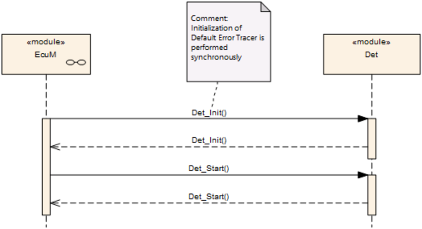
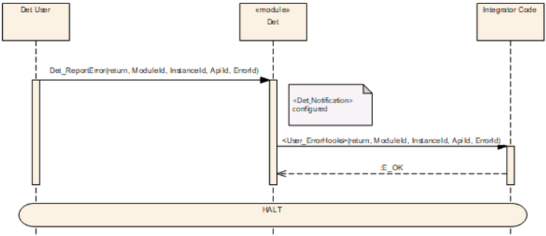
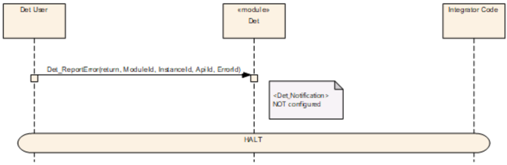
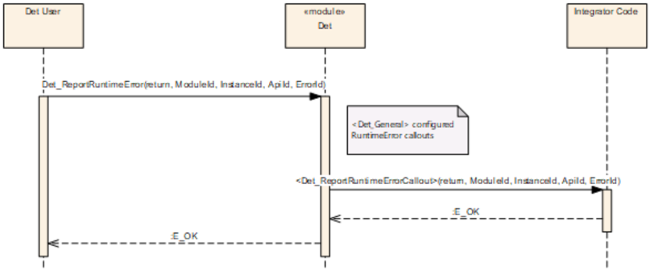
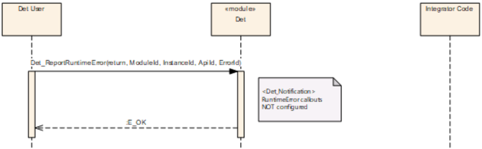
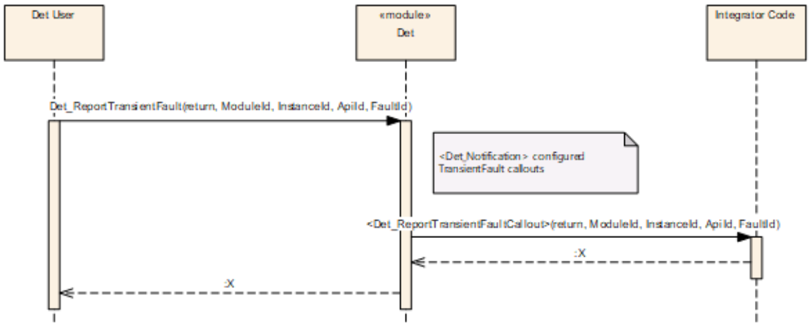
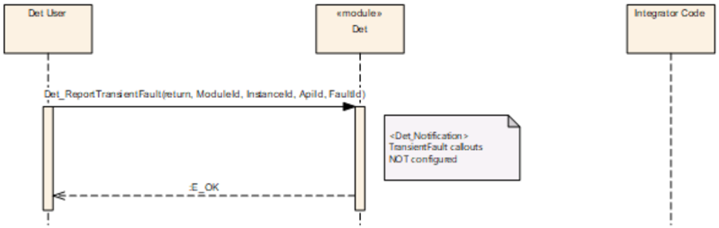
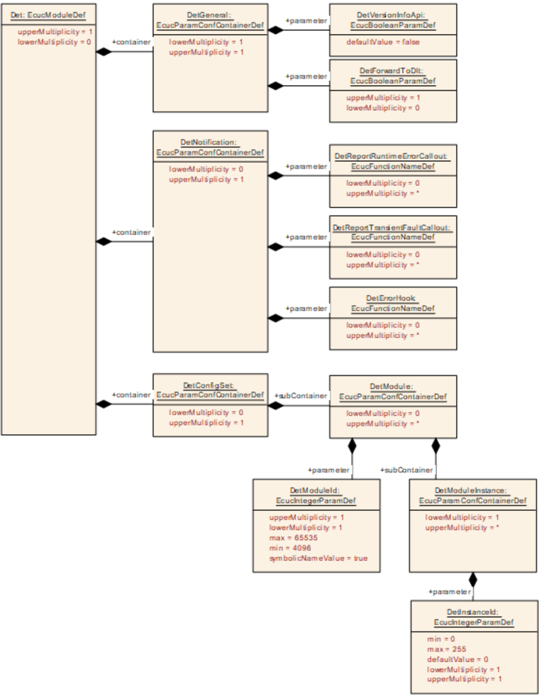

## 1. 简介和功能概述

本规范描述默认错误跟踪器（**Default Error Tracer**）的 [**API**](#71-api)。基础软件中检测到的所有开发错误和运行时错误都会报告给该模块。[**API**](#71-api) 参数允许追踪错误的来源和类型：

* 检测到错误的模块
* 检测到错误的函数
* 错误的类型

该模块 [**API**](#71-api) 背后的功能不在本规范的范围之内。由软件开发者和软件集成者为其特定的应用和测试环境选择最优策略。可能的功能包括：

* 在错误报告 [**API**](#71-api) 内设置调试器断点
* 统计已报告的错误
* 通过使用默认值处理运行时错误
* 将调用和传递的参数记录到 **RAM** 缓冲区
* 通过通信接口将已报告的错误发送给外部记录器

**注意：**默认错误跟踪器的软件需求在 SRS Diagnostics 文档中规定。

## 2. 缩略语

下面的术语表包括与默认错误跟踪器模块相关、但未包含在 **AUTOSAR** 术语表 [\[1\]](#ref-1) 中的缩略语和缩写。

**DET**
> Default Error Tracer：默认错误跟踪器

## 3. 相关文档

### 3.1. 输入文件和相关标准与规范

<a id="ref-1"></a>[1] Glossary
> AUTOSAR_FO_TR_Glossary

<a id="ref-2"></a>[2] General Specification of Basic Software Modules
> AUTOSAR_CP_SWS_BSWGeneral

<a id="ref-3"></a>[3] Requirements on Diagnostics
> AUTOSAR_FO_RS_Diagnostics

<a id="ref-4"></a>[4] General Requirements on Basic Software Modules
> AUTOSAR_CP_SRS_BSWGeneral

### 3.2. 相关规范

AUTOSAR 提供了基础软件模块通用规范（SWS BSW General）[\[2\]](#ref-2)，它对默认错误跟踪器同样有效。因此，规范 SWS BSW General 应被视为默认错误跟踪器的附加和必需规范。

## 4. 约束和假设

### 4.1. 限制

本规范不定义错误报告 [**API**](#71-api) 背后的功能。不考虑操作系统的存储器保护机制。

### 4.2. 汽车域的适用性

无限制。

## 5. 对其他模块的依赖

### 5.1. 文件结构

**Det**头文件包含通过其服务报告的错误的追踪所需的全部用户相关信息。

## 6. 功能规格

默认错误跟踪器提供相应的功能，用于在软件组件和其他基础软件模块的开发与运行期间支持错误检测和错误追踪。为此，默认错误跟踪器接收并评估来自这些组件和模块的错误消息。

由于在错误情况下对功能的需求总是特定的（非通用的！），因此除了以下内容之外，没有对 **DET** 实现的明确规定：

* 可配置的错误钩子（error hooks）列表将在错误报告时执行。
* 将提供用于报告错误、允许复位后的可选错误恢复、处理可选的错误恢复信息以及获取版本信息的接口。

### 6.1. 初始化

**DET** 应提供初始化函数 [Det_Init](#7131-det_init)（参见 [Det_Init](#7131-det_init) 的 [**API**](#71-api) 定义）。

每次调用 [Det_Init](#7131-det_init) 函数都应用于将默认错误跟踪器设置为确定的初始状态（例如：通过移除可选的错误恢复信息）。

**注意：**在不了解未规定的功能以及可能使用的可选错误恢复信息的情况下，该需求是不可测试的。

**注意：**错误恢复信息的使用和含义是可选的且未作规定。

默认错误跟踪器应提供函数 [Det_Start](#7133-det_start)（参见 [Det_Start](#7133-det_start) 的 [**API**](#71-api) 定义）。

**注意：**默认错误跟踪器的环境可以使用 [Det_Start](#7133-det_start) 函数来触发默认错误跟踪器模块，例如（如需要）在 **NVRAM** 初始化完成以进行持久化错误存储时。

**注意：**如果默认错误跟踪器不需要启动调用，则 [Det_Start](#7133-det_start) 函数可以为空。

**注意：**集成者可以通过 **EcuM** 的配置决定何时调用 [Det_Init](#7131-det_init)。

**注意：**集成者可以通过 **EcuM** 或 **ModeM** 的配置决定何时以及是否调用 [Det_Start](#7133-det_start)。

### 6.2. 错误钩子

为支持开发和运行期间的调试与错误追踪，默认错误跟踪器提供对已接收错误报告的通知功能。因此，所谓的错误钩子是可配置的。错误钩子将用于转发错误通知。如果至少配置了一个错误钩子，默认错误跟踪器将通过调用已配置的错误钩子来通知每个接收到的错误报告。

错误钩子的配置通过第 [9](#9-配置规范) 章所述的 **AUTOSAR** 配置方法完成。

每个 Error_Hook 应使用与对应函数 [Det_ReportError](#7132-det_reporterror)、[Det_ReportTransientFault](#7135-det_reporttransientfault) 和 [Det_ReportRuntimeError](#7134-det_reportruntimeerror) 相同的参数集来调用。已配置的调出函数属于 **ECU** 配置，参见参数 DetErrorHook、DetReportRuntimeErrorCallout 和 DetReportTransientFaultCallout。

### 6.3. 错误报告

如果在调用 [Det_ReportTransientFault](#7135-det_reporttransientfault) 或 [Det_ReportRuntimeError](#7134-det_reportruntimeerror) 报告函数之前默认错误跟踪器尚未初始化，这些函数应立即返回且不执行任何其他操作（不使用 Error_Hook，不执行实现者特定的功能，也不报告错误）。

如果在调用 [Det_ReportError](#7132-det_reporterror) 之前默认错误跟踪器尚未初始化，则停止执行。（不使用 Error_Hook，不执行实现者特定的功能，也不报告错误。）

错误报告函数 [Det_ReportError](#7132-det_reporterror)、[Det_ReportTransientFault](#7135-det_reporttransientfault) 和 [Det_ReportRuntimeError](#7134-det_reportruntimeerror) 应立即调用所有已配置的 Error_Hook。

默认错误跟踪器应按照配置给定的顺序执行对应的已配置 DetErrorHook 列表。

可选的实现特定功能应仅在所有已配置的 Error_Hook 被调用之后执行。此外，该功能应是预编译期可配置的。

如果 **DLT** 模块可用/已配置，则每次调用 [Det_ReportError](#7132-det_reporterror)、[Det_ReportTransientFault](#7135-det_reporttransientfault) 和 [Det_ReportRuntimeError](#7134-det_reportruntimeerror) 函数都应转发给 **DLT** 模块。

[Det_ReportError](#7132-det_reporterror)、[Det_ReportTransientFault](#7135-det_reporttransientfault) 和 [Det_ReportRuntimeError](#7134-det_reportruntimeerror) 函数应是可重入的。

[Det_ReportError](#7132-det_reporterror) 应停止执行。应确保 **DET** 运行时错误和 **DET** 瞬态故障的处理方式不会导致 **DET** 被递归调用。

**注意：**这种递归调用可能发生在通过 Error_Hook 调用一个未初始化的模块时，并会导致栈溢出。

### 6.4. 版本信息

与 [\[2\]](#ref-2) 中规定的处理无偏差。

### 6.5. 错误分类

默认错误跟踪器具有以下 **AUTOSAR** 错误：

* 开发错误，见第 [6.5.1](#651-开发错误) 章
* 运行时错误：不适用
* 瞬态故障：不适用
* 生产错误：不适用
* 扩展生产错误：不适用

调用默认错误函数将导致对所有已配置调出函数的调用，参见参数 DetErrorHook、DetReportTransientFault 和 DetReportRuntimeError。

[Det_ReportError](#7132-det_reporterror) 的调用应调用在 DetErrorHook 中配置的所有回调函数（参见参数 DetErrorHook）。

[Det_ReportTransientFault](#7135-det_reporttransientfault) 的调用应调用在 DetReportTransientFaultCallout 中配置的所有回调函数。

[Det_ReportRuntimeError](#7134-det_reportruntimeerror) 的调用应调用在 DetReportRuntimeErrorCallout 中配置的所有回调函数。

**注意：**如果没有配置 Error_Hook，则不会调用其他函数。但是，如果已配置，到 **DLT** 的转发仍然有效。

如果在 [Det_GetVersionInfo](#7136-det_getversioninfo) 中发生空指针错误，**DET** 应将错误 [DET_E_PARAM_POINTER](#651-开发错误) 通知给在调出（callouts）中配置的所有函数。

#### 6.5.1. 开发错误

**DET** 无法报告开发错误，除了 [Det_GetVersionInfo](#7136-det_getversioninfo) 中的 **DET_E_PARAM_POINTER**：

| 错误类型 | 相关错误代码 | 错误值 |
|---|---|---|
| [Det_GetVersionInfo](#7136-det_getversioninfo) 以空参数指针调用 | DET_E_PARAM_POINTER | 0x01 |

#### 6.5.2. 运行时错误

**DET** 无法报告运行时错误。

#### 6.5.3. 瞬态故障

**DET** 无法报告瞬态故障。

#### 6.5.4. 生产错误

**DET** 中没有生产错误。

#### 6.5.5. 扩展生产错误

**DET** 中没有扩展生产错误。

## 7. API规范

此处提供默认错误跟踪器 [**API**](#71-api) 的规范。

### 7.1. API

#### 7.1.1. 导入的类型

本节列出 [**API**](#71-api) 使用的所有导入类型。即使 **DET** 不需要新类型，某些 **RTE** 或组件类型也可用于钩子函数的配置中。因此，对于具有服务接口的模块，**DET** 也具有标准化的包含结构。

**Det**模块的导入数据类型定义

| 模块 | 头文件 | 导入的类型 |
|---|---|---|
| Std | Std_Types.h | Std_ReturnType |
| Std | Std_Types.h | Std_VersionInfoType |

#### 7.1.2. 类型定义

##### 7.1.2.1. Det_ConfigType

结构类型。元素为特定于实现。描述：**Det**模块的配置数据结构。可通过**Det.h**获得。

#### 7.1.3. 函数定义

##### 7.1.3.1. Det_Init

**说明**: 此服务初始化默认错误跟踪器。可通过**Det.h**获得。本服务为同步调用，不可重入。参数 ConfigPtr（in）：指向所选配置集的指针。

```C
void Det_Init ( const Det_ConfigType* ConfigPtr )
```

##### 7.1.3.2. Det_ReportError

**说明**: 此服务报告开发错误。可通过**Det.h**获得。本服务为同步调用，可重入。参数 ModuleId（in）：调用模块的模块 ID。InstanceId（in）：模块基于索引的实例的标识符，从 0 开始；如果模块是单实例模块，则应传递 0 作为 InstanceId。ApiId（in）：检测到错误的 [**API**](#71-api) 服务的 ID（由调用模块的 SWS 定义）。ErrorId（in）：检测到的开发错误的 ID（由调用模块的 SWS 定义）。返回值：Std_ReturnType，从不返回值，但为了与服务和钩子兼容而具有返回类型。

```C
Std_ReturnType Det_ReportError ( uint16 ModuleId, uint8 InstanceId, uint8 ApiId, uint8 ErrorId )
```

**注意：**Det_ReportError 可能可以在中断上下文中调用。由于可以在正常模式或中断上下文中（从栈或集成）调用 **DET**，因此在实现钩子函数时必须考虑到这一点：Det_ReportError 可以在中断上下文中调用；在停机（halt）系统时应考虑到这一点。

##### 7.1.3.3. Det_Start

**说明**: 此服务启动默认错误跟踪器。可通过**Det.h**获得。本服务为同步调用，不可重入。

```C
void Det_Start ( void )
```

##### 7.1.3.4. Det_ReportRuntimeError

**说明**: 此服务报告运行时错误。如果已配置调出函数，则应调用该调出函数。可通过**Det.h**获得。本服务为同步调用，可重入。参数 ModuleId（in）：调用模块的模块 ID。InstanceId（in）：模块基于索引的实例的标识符，从 0 开始；如果模块是单实例模块，则应传递 0 作为 InstanceId。ApiId（in）：检测到错误的 [**API**](#71-api) 服务的 ID（由调用模块的 SWS 定义）。ErrorId（in）：检测到的运行时错误的 ID（由调用模块的 SWS 定义）。返回值：Std_ReturnType，始终返回 E_OK（服务需要）。

```C
Std_ReturnType Det_ReportRuntimeError ( uint16 ModuleId, uint8 InstanceId, uint8 ApiId, uint8 ErrorId )
```

**注意：**Det_ReportRuntimeError 可能可以在中断上下文中调用。由于可以在正常模式或中断上下文中（从栈或集成）调用 **DET**，因此在实现钩子函数时必须考虑到这一点：Det_ReportRuntimeError 可以在中断上下文中调用；该钩子应是可重入的且具有足够的性能。

##### 7.1.3.5. Det_ReportTransientFault

**说明**: 此服务报告瞬态故障。如果已配置调出函数，则应调用该调出函数并返回该调出函数的返回值。否则它立即返回 E_OK。可通过**Det.h**获得。本服务为同步调用，可重入。参数 ModuleId（in）：调用模块的模块 ID。InstanceId（in）：模块基于索引的实例的标识符，从 0 开始；如果模块是单实例模块，则应传递 0 作为 InstanceId。ApiId（in）：检测到瞬态故障的 [**API**](#71-api) 服务的 ID（由调用模块的 SWS 定义）。FaultId（in）：检测到的瞬态故障的 ID（由调用模块的 SWS 定义）。返回值：Std_ReturnType，如果不存在调出函数，则应返回 E_OK；否则应返回已配置调出函数的值。如果配置了多个调出函数，则应返回各调出函数返回值的逻辑或（和）。

```C
Std_ReturnType Det_ReportTransientFault ( uint16 ModuleId, uint8 InstanceId, uint8 ApiId, uint8 FaultId )
```

**注意：**Det_ReportTransientFault 可能可以在中断上下文中调用。由于可以在正常模式或中断上下文中（从栈或集成）调用 **DET**，因此在实现钩子函数时必须考虑到这一点：Det_ReportTransientFault 可以在中断上下文中调用；该钩子应是可重入的且具有足够的性能。

##### 7.1.3.6. Det_GetVersionInfo

**说明**: 返回本模块的版本信息。可通过**Det.h**获得。本服务为同步调用，可重入。参数 versioninfo（out）：指向存储本模块版本信息的位置的指针。

```C
void Det_GetVersionInfo ( Std_VersionInfoType* versioninfo )
```

如果传递了空指针，则返回 [**DET_E_PARAM_POINTER**](#651-开发错误)，参见第 [6.5](#65-错误分类) 章。

#### 7.1.4. 期望接口

本章规定其他模块的所有所需接口。

##### 7.1.4.1. 强制接口

没有强制的期望接口，但所有已使用且配置为调出的 &lt;User_ErrorHooks&gt; [**API**](#71-api) 都必须包含。

**注意：**用户 [**API**](#71-api) 的名称不作规定，&lt;User_ErrorHook&gt; 仅是一个同义词。

**注意：**可以定义 User_ErrorHook 的列表。

##### 7.1.4.2. 可选接口

本章定义实现默认错误跟踪器可选功能所需的接口。

| [API](#71-api) 函数 | 头文件 | 描述 |
|---|---|---|
| Dlt_DetForwardErrorTrace | Dlt_Det.h | 将错误报告从 Det 转发到 Dlt 的服务。 |

#### 7.1.5. 调出函数/可配置接口

如果配置了调出函数，它们应当具有与对应函数相同的签名。如果为同一服务定义了多个调出函数，它们应当具有相同的 ID。

如果调用了 [Det_ReportError](#7132-det_reporterror) 函数，则应调用所有已配置的调出函数（参见第 [6.5](#65-错误分类) 章）。User_ErrorHooks 函数的服务 ID 应为 0x10。

##### 7.1.5.1. &lt;User_Error_Hooks&gt;

**说明**: 服务 ID 0x10。本服务为同步调用，可重入。参数 ModuleId（in）：调用模块的模块 ID。InstanceId（in）：模块基于索引的实例的标识符，从 0 开始；如果模块是单实例模块，则应传递 0 作为 InstanceId。ApiId（in）：检测到错误的 [**API**](#71-api) 服务的 ID（由调用模块的 SWS 定义）。ErrorId（in）：检测到的开发错误的 ID（由调用模块的 SWS 定义）。返回值：Std_ReturnType，始终返回 E_OK（服务需要）。可通过**Det_Externals.h**获得。

```C
Std_ReturnType <User_Error_Hooks> ( uint16 ModuleId, uint8 InstanceId, uint8 ApiId, uint8 ErrorId )
```

如果调用了 [Det_ReportRuntimeError](#7134-det_reportruntimeerror) 函数，则应调用所有已配置的调出函数（参见第 [6.5](#65-错误分类) 章）。DetReportRuntimeErrorCallout 函数的服务 ID 应为 0x11。

##### 7.1.5.2. &lt;DetReportRuntimeErrorCallout&gt;

**说明**: 服务 ID 0x11。本服务为同步调用，可重入。参数 ModuleId（in）：调用模块的模块 ID。InstanceId（in）：模块基于索引的实例的标识符，从 0 开始；如果模块是单实例模块，则应传递 0 作为 InstanceId。ApiId（in）：检测到错误的 [**API**](#71-api) 服务的 ID（由调用模块的 SWS 定义）。ErrorId（in）：检测到的运行时错误的 ID（由调用模块的 SWS 定义）。返回值：Std_ReturnType，始终返回 E_OK（服务需要）。可通过**Det_Externals.h**获得。

```C
Std_ReturnType <DetReportRuntimeErrorCallout> ( uint16 ModuleId, uint8 InstanceId, uint8 ApiId, uint8 ErrorId )
```

如果调用了 [Det_ReportTransientFault](#7135-det_reporttransientfault) 函数，则调用所有已配置的调出函数（参见第 [6.5](#65-错误分类) 章）。

##### 7.1.5.3. &lt;DetReportTransientFaultCallout&gt;

**说明**: 服务 ID 0x12。本服务为同步调用，可重入。参数 ModuleId（in）：调用模块的模块 ID。InstanceId（in）：模块基于索引的实例的标识符，从 0 开始；如果模块是单实例模块，则应传递 0 作为 InstanceId。ApiId（in）：检测到瞬态故障的 [**API**](#71-api) 服务的 ID（由调用模块的 SWS 定义）。FaultId（in）：检测到的瞬态故障的 ID（由调用模块的 SWS 定义）。返回值：Std_ReturnType，该值传播给 [Det_ReportTransientFault](#7135-det_reporttransientfault) 的调用者。可通过**Det_Externals.h**获得。

```C
Std_ReturnType <DetReportTransientFaultCallout> ( uint16 ModuleId, uint8 InstanceId, uint8 ApiId, uint8 FaultId )
```

### 7.2. 服务接口

#### 7.2.1. 端口与端口接口的规范

本章规定为了通过 **VFB** 操作默认错误跟踪器功能所需的端口和端口接口。

每个使用该服务的 **AUTOSAR SW-C** 必须在其自己的 **SW-C** 描述中包含「服务端口」，这些服务端口由相同的接口定型，并且必须连接到默认错误跟踪器的端口，以便 **RTE** 可以生成相应的 ID 和所需的符号。

##### 7.2.1.1. 通用方法

由于必须传递多个参数，因此使用客户端-服务器范式。

为了重用已在默认错误跟踪器 **BSW** 模块中定义的 **C [API](#71-api)**，默认错误跟踪器服务使用与 **C [API](#71-api)** 中相同的参数名称，即使这些名称不能直接映射到 **SW-C** 领域。「模块 ID」最好可以解释为组件或可运行实体，但这由实现者决定。

默认错误跟踪器服务需要一个「模块 ID」作为 **C** 函数的第一个参数。

为了使客户端代码独立于客户端数量的配置，「模块 ID」不从客户端传递给默认错误跟踪器，而是在默认错误跟踪器侧的提供（Provide）端口上建模为「端口定义参数值」。因此，「模块 ID」不会作为参数出现在客户端的操作中。

模块 ID 类型的范围为 0...65535。0...254 范围内的值保留给基础软件模块，复杂驱动程序使用 255 或 2048 到 4095 之间的值。所有其他值可用于应用软件组件。

##### 7.2.1.2. 数据类型

对于默认错误跟踪器服务的端口接口，需要 uint8 和 uint16，它们引用 **AUTOSAR** 数据类型。

##### 7.2.1.3. 端口接口

客户端-服务器接口 **DETService** 的定义

| 名称 | DETService |
|---|---|
| 注释 | 默认错误跟踪器的服务 |
| IsService | true |
| 变体 | - |
| 可能的错误 | 0：操作成功 |

**操作** ReportError

| 注释 | 使用端口的模块 ID 调用 [Det_ReportError](#7132-det_reporterror) |
|---|---|
| 映射到的[API](#71-api) | [Det_ReportError](#7132-det_reporterror) |
| 变体 | - |
| 可能的错误 | E_OK |

| 参数 | 类型 | 方向 | 描述 |
|---|---|---|---|
| ApiId | uint8 | IN | 检测到错误的 [API](#71-api) 服务的 ID（由调用模块的 SWS 定义）。 |
| ErrorId | uint8 | IN | 检测到的开发错误的 ID（由调用模块的 SWS 定义）。 |

**操作** ReportRuntimeError

| 注释 | 使用端口的模块 ID 调用 [Det_ReportRuntimeError](#7134-det_reportruntimeerror) |
|---|---|
| 映射到的[API](#71-api) | [Det_ReportRuntimeError](#7134-det_reportruntimeerror) |
| 变体 | - |
| 可能的错误 | E_OK |

| 参数 | 类型 | 方向 | 描述 |
|---|---|---|---|
| ApiId | uint8 | IN | 检测到错误的 [API](#71-api) 服务的 ID（由调用模块的 SWS 定义）。 |
| ErrorId | uint8 | IN | 检测到的运行时错误的 ID（由调用模块的 SWS 定义）。 |

**C [API](#71-api)** 的参数 ModuleId 和 InstanceId 用于通过「端口定义参数值」来标识组件和组件实例。参数 ApiId 和 ErrorId 未由 **AUTOSAR** 为软件组件标准化。由 **SW-C** 的实现者决定这些参数的语义。

#### 7.2.2. 服务的定义

提供（Provide）端口与 **DET** 的内部行为有一定的关系：通过每次调用，**RTE** 将「模块 ID」作为附加参数传递给实现相关可运行实体的 **C** 函数（特性「端口定义参数值」）。

**DET**应为每个已配置的 **SWC** 模块提供具有给定名称的以下端口。

端口 **Det_&lt;Name&gt;** 的定义

| 名称 | Det_&lt;Name&gt; |
|---|---|
| 种类 | ProvidedPort |
| 接口 | DETService |
| 描述 | - |

| 端口定义参数 | 类型/值 | |
|---|---|---|
| 类型 | uint16 | |
| 值 | {ecuc(Det/[DetConfigSet](#914-detconfigset)/[DetModule](#915-detmodule)/DetModuleId.value)} | |
| 类型 | uint8 | |
| 值 | {ecuc(Det/[DetConfigSet](#914-detconfigset)/[DetModule](#915-detmodule)/[DetModuleInstance](#916-detmoduleinstance)/DetInstanceId.value)} | |

| 变体 | Name = {ecuc(Det/[DetConfigSet](#914-detconfigset)/[DetModule](#915-detmodule).SHORT-NAME)}_{ecuc(Det/[DetConfigSet](#914-detconfigset)/[DetModule](#915-detmodule)/[DetModuleInstance](#916-detmoduleinstance).SHORT-NAME)} |
|---|---|

#### 7.2.3. DET 的配置

**DET** 服务的「模块 ID」被建模为「端口定义参数值」。因此，这些值的配置是 **RTE** 配置的一部分。预编译配置可以通过更改客户端（**SW-C**）侧或服务（即 **DET**）侧的端口 **XML** 规范来完成。

## 8. 时序图

### 8.1. 初始化



### 8.2. 错误报告

存在不同的场景：每种错误类（**DevelopmentError**、**RuntimeError** 和 **TransientFault**）一个场景，以及每种配置一个场景：未配置钩子、至少配置了一个钩子。













## 9. 配置规范

总体而言，本章定义配置参数及其到**容器**（container）的聚类组织。为支持本规范，第 9.1 章描述基础知识，并规定了应用于参数规范的模板（表）。我们有意将这些内容保留在规范中以保证可理解性。

第 9.1 章规定模块默认错误跟踪器的结构（容器）和参数。

第 9.3 章规定模块默认错误跟踪器的发布信息。

### 9.1. 容器与配置参数

以下各小节描述 **DET** 的参数。

图 10.1 给出了它们的概览。



#### 9.1.1. Det

| SWS 条目 | [ECUC_Det_00001] |
|---|---|
| 模块名称 | Det |
| 描述 | Det 配置包括通知时要调用的函数。一方面指定应用函数，另一方面通常可以决定是否在每次调用 Det 时调用 Dlt。 |
| Post-Build 变体支持 | false |
| 支持的配置变体 | VARIANT-PRE-COMPILE |

| 容器名称 | 多重性 | 作用域/依赖 |
|---|---|---|
| DetConfigSet | 0..1 | Det 的配置集容器。 |
| DetGeneral | 1 | Det 模块的通用配置参数。 |
| DetNotification | 0..1 | 通知函数的配置。 |

#### 9.1.2. DetGeneral

| SWS 条目 | [ECUC_Det_00002] |
|---|---|
| 容器名称 | DetGeneral |
| 父容器 | Det |
| 描述 | Det 模块的通用配置参数。 |
| 配置参数 | 见下方参数表 |

| SWS 条目 | [ECUC_Det_00006] |
|---|---|
| 参数名称 | DetForwardToDlt |
| 父容器 | DetGeneral |
| 描述 | 仅当该参数存在且设置为 true 时，Det 才需要 Dlt 接口，并将其调用转发给函数 Dlt_DetForwardErrorTrace。在这种情况下，需要到 Dlt_Det 的可选接口。 |
| 多重性 | 0..1 |
| 类型 | EcucBooleanParamDef |
| 默认值 | - |
| Post-Build 变体多重性 | false |
| Post-Build 变体值 | false |
| 多重性配置类 | Pre-compile time：x；Link time：-；Post-build time：- |
| 值配置类 | Pre-compile time：x；Link time：-；Post-build time：- |
| 作用域/依赖 | scope: local |

| SWS 条目 | [ECUC_Det_00003] |
|---|---|
| 参数名称 | DetVersionInfoApi |
| 父容器 | DetGeneral |
| 描述 | 启用/禁用读取模块版本信息的 API 的预处理器开关。true：版本信息 API 启用。false：版本信息 API 禁用。 |
| 多重性 | 1 |
| 类型 | EcucBooleanParamDef |
| 默认值 | false |
| Post-Build 变体值 | false |
| 值配置类 | Pre-compile time：x；Link time：-；Post-build time：- |
| 作用域/依赖 | scope: local |

无包含的容器。

#### 9.1.3. DetNotification

| SWS 条目 | [ECUC_Det_00004] |
|---|---|
| 容器名称 | DetNotification |
| 父容器 | Det |
| 描述 | 通知函数的配置。 |
| 配置参数 | 见下方参数表 |

| SWS 条目 | [ECUC_Det_00005] |
|---|---|
| 参数名称 | DetErrorHook |
| 父容器 | DetNotification |
| 描述 | 在每次调用 Det_ReportError 时由默认错误跟踪器调用的可选函数列表。这些函数的类型应与 Det_ReportError 本身的类型相同：Std_ReturnType (*f)(uint16, uint8, uint8, uint8)。 |
| 多重性 | 0..* |
| 类型 | EcucFunctionNameDef |
| 默认值 | - |
| 正则表达式 | - |
| Post-Build 变体多重性 | false |
| Post-Build 变体值 | false |
| 多重性配置类 | Pre-compile time：x；Link time：-；Post-build time：- |
| 值配置类 | Pre-compile time：x；Link time：-；Post-build time：- |
| 作用域/依赖 | scope: local |

| SWS 条目 | [ECUC_Det_00010] |
|---|---|
| 参数名称 | DetReportRuntimeErrorCallout |
| 父容器 | DetNotification |
| 描述 | 该参数定义相应运行时错误处理程序的调出函数的存在性与名称。这些函数的类型应与 Det_ReportRuntimeError 本身的类型相同：Std_ReturnType (*f)(uint16, uint8, uint8, uint8)。 |
| 多重性 | 0..* |
| 类型 | EcucFunctionNameDef |
| 默认值 | - |
| 正则表达式 | - |
| 值配置类 | Pre-compile time：x；Link time：-；Post-build time：- |
| 作用域/依赖 | scope: local |

| SWS 条目 | [ECUC_Det_00011] |
|---|---|
| 参数名称 | DetReportTransientFaultCallout |
| 父容器 | DetNotification |
| 描述 | 该参数定义相应瞬态故障处理程序的调出函数的存在性与名称。这些函数的类型应与 Det_ReportTransientFault 本身的类型相同：Std_ReturnType (*f)(uint16, uint8, uint8, uint8)。 |
| 多重性 | 0..* |
| 类型 | EcucFunctionNameDef |
| 默认值 | - |
| 正则表达式 | - |
| 值配置类 | Pre-compile time：x；Link time：-；Post-build time：- |
| 作用域/依赖 | scope: local |

无包含的容器。

#### 9.1.4. DetConfigSet

| SWS 条目 | [ECUC_Det_00007] |
|---|---|
| 容器名称 | DetConfigSet |
| 父容器 | Det |
| 描述 | Det 的配置集容器。 |
| 配置参数 | 见下方参数表 |

| 容器名称 | 多重性 | 作用域/依赖 |
|---|---|---|
| DetModule | 0..* | 该容器描述一个通过服务接口使用 Det 的非 BSW 模块。 |

#### 9.1.5. DetModule

| SWS 条目 | [ECUC_Det_00008] |
|---|---|
| 容器名称 | DetModule |
| 父容器 | DetConfigSet |
| 描述 | 该容器描述一个通过服务接口使用 Det 的非 BSW 模块。 |
| 配置参数 | 见下方参数表 |

| SWS 条目 | [ECUC_Det_00009] |
|---|---|
| 参数名称 | DetModuleId |
| 父容器 | DetModule |
| 描述 | 错误报告组件的唯一标识符。当向 DET 报告错误时，必须使用由 moduleID 派生的符号名来标识报告者。 |
| 多重性 | 1 |
| 类型 | EcucIntegerParamDef（为此参数生成符号名） |
| 范围 | 4096 .. 65535 |
| 默认值 | - |
| Post-Build 变体值 | false |
| 值配置类 | Pre-compile time：x；Link time：-；Post-build time：- |
| 作用域/依赖 | scope: local |

| 容器名称 | 多重性 | 作用域/依赖 |
|---|---|---|
| DetModuleInstance | 1..* | 描述相应服务端口所使用的实例。当使用多实例化时，它应用于区分软件组件实例。 |

#### 9.1.6. DetModuleInstance

| SWS 条目 | [ECUC_Det_00013] |
|---|---|
| 容器名称 | DetModuleInstance |
| 父容器 | DetModule |
| 描述 | 描述相应服务端口所使用的实例。当使用多实例化时，它应用于区分软件组件实例。 |
| Post-Build 变体多重性 | true |
| 多重性配置类 | Pre-compile time：x；Link time：-；Post-build time：- |
| 配置参数 | 见下方参数表 |

| SWS 条目 | [ECUC_Det_00012] |
|---|---|
| 参数名称 | DetInstanceId |
| 父容器 | DetModuleInstance |
| 描述 | 描述相应服务端口所使用的 InstanceId。当使用多实例化时，它应用于区分软件组件实例。 |
| 多重性 | 1 |
| 类型 | EcucIntegerParamDef |
| 范围 | 0 .. 255 |
| 默认值 | 0 |
| Post-Build 变体值 | false |
| 值配置类 | Pre-compile time：x；Link time：-；Post-build time：- |
| 作用域/依赖 | scope: local |

无包含的容器。

### 9.2. 发布信息

如适用，下面列出了其他模块特定的发布参数。

### 9.3. 发布信息

有关详细信息，请参阅 SWS_BSWGeneral 中的第 10.3 章「Published Information」（发布信息）。

## B. 需求历史

请注意，本章中的列表还包括在后续版本中已从规范中移除的需求。这些需求不会作为超链接出现在文档中。

### B.1. 本文档相对于 AUTOSAR R22-11 的需求历史

#### B.1.1. R22-11 中新增的规范条目

```
[SWS_Det_91001] [SWS_Det_91002] [SWS_Det_NA_00999]
```

#### B.1.2. R22-11 中变更的规范条目

```
[SWS_Det_00008] [SWS_Det_00009] [SWS_Det_00010] [SWS_Det_00011] [SWS_Det_00181]
[SWS_Det_00184] [SWS_Det_00187] [SWS_Det_00202] [SWS_Det_00204] [SWS_Det_00205]
[SWS_Det_00210] [SWS_Det_00301] [SWS_Det_01001] [SWS_Det_01003]
```

#### B.1.3. R22-11 中删除的规范条目

```
[SWS_Det_00999]
```

### B.2. 本文档相对于 AUTOSAR R23-11 的需求历史

#### B.2.1. R23-11 中新增的规范条目

无

#### B.2.2. R23-11 中变更的规范条目

无

#### B.2.3. R23-11 中删除的规范条目

无
