## 1. 简介和功能概述

本文档描述了 **AUTOSAR** 操作系统的基本要求，以满足 **AUTOSAR SRS** [1] 中提出的顶级需求。

一般来说，操作系统可以根据其特性分为不同的组，例如：静态配置与动态管理。对**AUTOSAR OS**进行分类，以下是**OS**的基本特征：

* 可以静态配置和扩展的。
* 可以适应实时性能的推理。
* 可以提供基于优先级的调度策略。
* 在运行时可以提供保护功能（如：内存、时序等）。
* 可以部署在低端控制器，而无需外部资源。

本功能集定义了当代汽车 **ECU** 中，除了远程信息处理（**Telematic**）和信息娱乐（**Infotainment**）系统以外的常用操作系统类型。因为远程信息处理以及信息娱乐系统会继续使用 **AUTOSAR** 框架下的专有操作系统（如：**Windows CE**、**VxWorks**、**QNX**等）。如果需要在这些专有操作系统上运行 **AUTOSAR** 组件，则本文档中定义的接口需作为操作系统抽象层 OSAL（**Operating System Abstraction Layer**）来提供支持。

本文档使用行业标准[2]（**ISO 17356-3**）作为 **AUTOSAR OS** 的基础。在阅读本文件前需熟悉此标准规范。本文档仅仅描述了参考文档[2]的扩展和限制。

## 2. 缩略语

下面的词汇表包括与参考文档[3]（**AUTOSAR** 词汇表）中未包含的、与 **AUTOSAR** 操作系统模块相关的首字母缩略词和缩略语。

**API** 
> 应用程序接口（**Application Programming Interface**）

**AR** 
> AUTOSAR

**ARTI** 
> AUTOSAR 运行时接口（**AUTOSAR Run-time interface**）

**BSW** 
> 基础软件（**Basic Software**）

**BSWMD**
> 基础软件模块说明（**Basic Software Module Description**）

**CDD**
> 复杂驱动程序（**Complex Driver**）

**COM** 
> 通讯（**Communication**）

**ECC** 
> 扩展一致性等级（**Extended Conformance Class**）

**ECU** 
> 电子控制单元（Electronic Control Unit）

**HW** 
> 硬件（**Hardware**）

**ID** 
> 标识符（**Identifier**）

[**IOC**](#75-ioc) 
> 操作系统间应用程序通信器（**Inter OS-Application communicator**）

**ISR** 
> 中断服务程序（**Interrupt Service Routine**）

**LE** 
> 可定位实体（**locatable entity**）是一个不同的软件，无论它位于哪个内核，都具有相同的效果。

**MC** 
> 多核（**Multi-Core**）

**MCU** 
> 微控制器单元（**Microcontroller Unit**）

**ME** 
> 互斥（**Mutual exclusion**）

**MPU** 
> 内存保护单元（**Memory Protection Unit**）

**NMI** 
> 不可屏蔽中断（**Non maskable interrupt**）

**OIL** 
> OSEK 实现语言（**OSEK Implementation Language**）

**OS** 
> 操作系统（**Operating System**）

**OSEK/VDX** 
> 用于机动车辆电子设备的开放系统及其接口（**Offene Systeme und deren Schnittstellen für die Elektronik im Kraftfahrzeug**）

**RTE** 
> 运行环境（**Run-Time Environment**）

**RTOS** 
> 实时操作系统（**Real Time Operating System**）

**SC** 
> 单核（**Single-Core**）

**SLA** 
> 软件分层架构（**Software Layered Architecture**）

**SW** 
> 软件（**Software**）

**SWC** 
> 软件组件（**Software Component**）

**SWFRT**
> 软件自由运行定时器（**Software FreeRunningTimer**）

### 2.1. 术语表

**Access Right**
> 一种标识，表明 **OS-Application** 的某个对象（例如任务（**Task**）、**ISR**、钩子函数）拥有对内存、**OS** 服务或（一组）**OS** 对象进行访问或操作的权限。

**Cardinality**
> 集合中项目的数量。

**Counter**
> 一种以滴答为单位寄存计数值的操作系统对象。计数器有两种类型：
> **Hardware Counter**（硬件计数器）：由硬件（例如定时器）推进的计数器。计数值由外设"以硬件方式"维护。
> **Software Counter**（软件计数器）：通过调用 [IncrementCounter](#7417-incrementcounter) API 来递增的计数器。计数值由操作系统"以软件方式"维护。

**Deadline**
> 任务（**Task**）/类别2 **ISR** 必须在其执行过程中到达某一特定点的时刻，该时刻由系统设计定义，相对于触发激活的刺激。参见图 2.1。

**Delay**
> 调度表（**ScheduleTable**）上两个相邻到期点（**expiry point**）之间的滴答数。当一对到期点 X 和 Y 满足以下条件时，称它们是相邻的：
> - 不存在到期点 Z 使得 X.Offset < Z.Offset < Y.Offset。此时 Delay = Y.Offset − X.Offset；
> - X 和 Y 分别是最终到期点（**Final Expiry Point**）和初始到期点（**Initial Expiry Point**）。此时 Delay = (Duration − X.Offset) + Y.Offset。
>
> 在正文使用时，Delay 是从指定到期点开始度量的相对滴答数。例如：X.Delay 表示从 X 到下一个到期点的延迟。

**Deviation**
> 显式同步的调度表（**ScheduleTable**）上当前位置与同步计数值对调度表时长取模后的值之间的最小滴答数。

**Duration**
> 调度表（**ScheduleTable**）从名义零点出发发生回绕（wrap）处的滴答数。

**Execution Time**
> 任务（**Task**）：任务处于 **RUNNING** 状态所花费的净时间，不进入 **SUSPENDED** 或 **WAITING** 状态，且不包括抢占该任务的 **ISR** 所造成的抢占时间。扩展任务执行 WaitEvent API 调用以等待一个已经置位的事件（**Event**）时，名义上进入 **WAITING** 状态。对于多次激活的基本任务，净时间按任务的每次激活计算。
> **ISR**：从用户提供的类别2中断处理程序的第一条指令到最后一条指令的净时间，不包括优先执行的更高优先级 **ISR** 所造成的抢占。
> 执行时间包括在错误钩子、任务前钩子（pretask hook）和任务后钩子（posttask hook）中花费的时间，以及进行 **OS** 服务调用所花费的时间。

**Execution Budget**
> 任务（**Task**）/**ISR** 允许的最大执行时间。

**Expiry Point**
> 调度表（**ScheduleTable**）上以零为基准度量的偏移量，**OS** 在该处激活任务（**Task**）和/或设置事件（**Event**）。
> **Initial Expiry Point**（初始到期点）：具有最小偏移量的到期点。
> **Final Expiry Point**（最终到期点）：具有最大偏移量的到期点。

**Hook Function**
> 钩子函数由用户实现，在发生某些事件时由操作系统调用。为了在系统或应用层级对这些事件做出反应，共有两种钩子函数：
> **Application-specific**（应用特定的）：单个 **OS-Application** 范围内的钩子函数。
> **System-specific**（系统特定的）：整个系统范围内的钩子函数（通常由集成者提供）。

**Initial Offset**
> 调度表（**ScheduleTable**）上最小的到期点偏移量。它可以为零。

**Interarrival Time**
> 基本任务（**Basic Task**）：相继从 **SUSPENDED** 状态进入 **READY** 状态之间的时间。任务的每次激活都代表一次新的到达。在多次激活的情况下也是如此，即使该任务的现有实例已处于 **RUNNING** 或 **READY** 状态。
> 扩展任务（**Extended Task**）：相继从 **SUSPENDED** 或 **WAITING** 状态进入 **READY** 状态之间的时间。为处于 **WAITING** 状态的任务设置其正在等待的事件（**Event**）代表一次新的到达。在 **RUNNING** 状态等待一个已经置位的事件也代表一次新的到达。
> **ISR**：相继发生的两次中断之间的时间。参见图 2.1。

**Interrupt Lock Time**
> 任务（**Task**）/**ISR** 在类别1中断被禁用/挂起和/或类别2中断被禁用/挂起的状态下执行的时间。

**Interrupt Source Enable**
> 在硬件中使能特定中断源的开关。

**Interrupt Vector Table**
> 在概念上，中断向量表包含从硬件中断请求到（软件）中断服务例程的映射。中断向量表的实际内容非常依赖于具体硬件，例如它可以包含中断服务例程的起始地址。

**Final Delay**
> 调度表（**ScheduleTable**）上最终到期点偏移量与时长之间的差异（以滴答计）。对于单次执行（single-shot）调度表和带有后继（"nexted"）的调度表，该值定义了从最终到期点到调度表逻辑末尾的延迟。

**Forced OS-Application Termination**
> 操作系统释放与该 **OS-Application** 相关联的所有系统对象，例如强制终止任务（**Task**）、禁用中断等。**OS-Application** 及其内部变量可能处于未定义状态。

**Forced Termination**
> **OS** 终止任务（**Task**）/类别2 **ISR** 并"解锁"其持有的资源。详情参见第 6 章功能规格。

**Linker File**
> 包含链接器链接设置的文件。链接器文件的语法取决于具体的链接器，因此定义以"链接器特定"的方式存储在链接器文件中。

**Lock Budget**
> 允许的最大中断锁定时间或资源锁定时间。

**Master core**
> 主核（master core）是用于引导启动（bootstrap）**AUTOSAR** 系统的那个内核。

**Memory Protection Unit**
> 内存保护单元（**MPU**）支持具有独立保护属性的内存分区。它与内存管理单元（**MMU**）不同，后者在运行时提供虚拟地址与物理内存位置之间的映射。
> **注意：** 某些器件可以用 **MMU** 实现 **MPU** 的功能。

**Mode**
> 描述处理器上可用的权限。
> **Privileged**（特权模式）：通常，在"特权模式"下可以不受限制地访问内存以及底层硬件。
> **Non-privileged**（非特权模式）：在"非特权模式"下访问受到限制。

**Modulus**
> OSEK 计数器（**Counter**）完成一次完整回绕所需的滴答数。等于计数器的 OsCounterMaxAllowedValue + 1 个滴答。

**OS-Application**
> OS 对象的集合。
> **Trusted**（受信任的）：可以在特权模式下执行、并且可以不受限制地访问 API 和硬件资源的 **OS-Application**。只有受信任的应用才能提供可信函数（trusted function）。
> **Non-trusted**（不受信任的）：在非特权模式下执行、对 API 和硬件资源的访问受到限制的 **OS-Application**。

**OS object**
> 属于单个 **OS-Application** 的对象：任务（**Task**）、**ISR**、警报（**Alarm**）、事件（**Event**）、调度表（**ScheduleTable**）、资源（**Resource**）、可信函数（**Trustedfunction**）、计数器（**Counter**）、应用特定的钩子。

**OS Service**
> OS 服务是操作系统的 API。

**Protection Error**
> **OS-Application** 软件中的系统性错误。
> **Memory access violation**（内存访问违规）：以不存在访问权限的方式访问某个地址所导致的保护错误。
> **Timing fault**（时序故障）：违反时序保护的保护错误。
> **Illegal service**（非法服务）：违反服务保护的保护错误，例如未授权地调用 OS 服务。
> **Hardware exception**（硬件异常）：除零、非法指令等。

**Resource Lock Time**
> 任务（**Task**）/**ISR** 持有一个 OSEK 资源（**Resource**）的时间（不包括该任务/**ISR** 被更高优先级的任务/**ISR** 抢占的时间）。

**Response Time**
> 从任务（**Task**）/**ISR** 变为就绪可执行到产生指定响应之间的时间。该时间包括所有抢占。参见图 2.1。

**Restart an OS-Application**
> **OS-Application** 在自行终止或因保护错误被强制终止之后可以重启。当 **OS-Application** 重启时，**OS** 会激活所配置的 OsRestartTask。

**Scalability Class**
> 本文档所描述的 **OS** 特性（例如内存保护或时序保护）可以分组在一起，以根据应用的需要定制操作系统。共定义了 4 组特性，称为可扩展性等级（scalability class）。详情参见第 6.11 节。

**ScheduleTable**
> 静态定义的一组到期点（**expiry point**）的封装。

**Section**
> 目标文件（object file）的一部分，其中指令或数据被组合成一个单元（为数据或代码分配的连续地址空间）。目标文件（目标文件格式）中的节（section）具有名称和大小。
> 从链接器的视角可以区分两个不同的侧面：
> **Input section**（输入节）：链接器的输入目标文件中的内存节。
> **Output section**（输出节）：链接器的输出目标文件中的内存节。

**Set (of OS objects)**
> 本文档在严格的数学意义上使用"集合"一词，表示同一类型 OS 对象的汇集，即：
> - 集合包含零个或多个 OS 对象（这意味着集合可以为空）；
> - 集合中的 OS 对象是唯一的（这意味着集合中不能有重复的 OS 对象）。

**Spinlock**
> 自旋锁（spinlock）是一种锁定机制，任务（**Task**）在循环中等待（自旋，spin），反复检查某个共享变量是否变为特定的值。该值指示锁是否空闲。在多核系统中，比较和修改变量通常需要原子操作。由于任务保持活跃但并不做任何有用的工作，自旋锁是一种忙等待机制。

**Spinlock variable**
> 自旋锁变量是自旋锁用来指示该自旋锁空闲还是被占用的共享变量。

**Symbol**
> 可以被软件模块导入/使用并由链接器解析的地址标号。标号的确切语法取决于具体的链接器。在本文档中，这些地址标号用于标识内存节的起始和结束。
> **Start symbol**（起始符号）：标记内存节的起始。
> **End symbol**（结束符号）：标记内存节的结束。

**Synchronization of ScheduleTable s with a synchronization Counter**
> 当调度表（**ScheduleTable**）的到期点在与同步计数器（synchronization Counter）的绝对偏差小于或等于精度阈值的范围内被处理时，即实现了与同步计数器的同步。

**Synchronization Counter**
> "同步计数器"不同于 OS 的计数器（**Counter**）对象，是 OS 之外的外部计数器，调度表（**ScheduleTable**）的到期点相对于它进行同步。

**Task**
> 任务（**Task**）是执行（用户）代码并由 **OS** 管理的对象。例如，OS 在不同任务之间进行切换（调度）。任务有两种类型；更多细节参见[2]。
> **Basic Task**（基本任务）：自身不能阻塞的任务。这意味着它不能等待（OS）事件（**Event**）。
> **Extended Task**（扩展任务）：可以自行阻塞并等待（OS）事件的任务。

**Time Frame**
> 任务（**Task**）/**ISR** 的最小到达间隔时间。

**Trustedfunction**
> 由受信任的 **OS-Application** 提供的、可供其他 **OS-Application**（受信任或不受信任的）使用的服务。

**Worst case execution time (WCET)**
> 最坏情况执行时间（**WCET**）是最长的可能执行时间。

**Write access**
> 向寄存器或内存位置存储值。所有具有写入后果的内存访问（例如具有向内存位置写入副作用的读取）都被视为写访问。

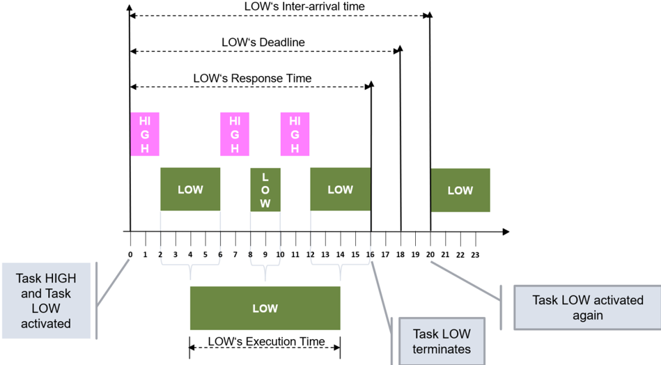

## 3. 相关文档

### 3.1. 输入文件和相关标准与规范

[1] Requirements on Operating System
> AUTOSAR_CP_SRS_OS

[2] ISO 17356-3:
> Road vehicles – Open interface for embedded automotive applications – Part 3: OSEK/VDX Operating System (OS)

[3] Glossary
> AUTOSAR_FO_TR_Glossary

[4] General Specification of Basic Software Modules
> AUTOSAR_CP_SWS_BSWGeneral

[5] Virtual Functional Bus
> AUTOSAR_CP_EXP_VFB

[6] General Requirements on Basic Software Modules
> AUTOSAR_CP_SRS_BSWGeneral

[7] ISO 17356-6:
> Road vehicles – Open interface for embedded automotive applications – Part 6: OSEK/VDX Implementation Language (OIL)

[8] Specification of AUTOSAR Run-Time Interface
> AUTOSAR_CP_SWS_ARTI

[9] Specification of RTE Software
> AUTOSAR_CP_SWS_RTE

[10] Software Component Template
> AUTOSAR_CP_TPS_SoftwareComponentTemplate

[11] Specification of Memory Mapping
> AUTOSAR_CP_SWS_MemoryMapping

### 3.2. 相关规范

因为**AUTOSAR**提供了基础软件模块的通用规范[4]**SWS BSW General**，它也适用于**AUTOSAR**操作系统。所以参考文献规范[4]**SWS BSW General**应被视为 **AUTOSAR** 操作系统的附加和必需规范。

所有与 **OSEK OS** 相关的类型、定义和函数都可以在参考文献[2]中找到。

## 4. 约束和假设

### 4.1. 现有标准

本文件对引用的相关标准和规范做出以下假设：

* 参考文献[2]提供了足够灵活的调度策略来调度 **AUTOSAR** 系统。
* 参考文献[2]是一个成熟的规范，并在全球数百万个 **ECU** 中使用。
* 参考文献[2]没有为在运行时隔离多源软件组件提供足够的支持。
* 参考文献[2]没有提供足够的运行时支持来证明在安全案例中不存在某些类别的故障传播。

### 4.2. 术语

当需求指定多个术语时，规范使用以下运算符：

* **NOT**: 对单个术语的否定，例如：不是周末（**NOT Weekend**）。
* **AND**: 两个术语的结合，例如：周末和周六（**Weekend AND Saturday**）
* **OR** : 两个术语的分离，例如：星期一或星期二（**Monday OR Tuesday**）

但一条需求包含多个术语时，按从左到右评估。优先规则如下：

* 最高优先级**NOT**
* 最低优先级**AND OR**
  
表达式 **NOT X AND Y** 表示 **(NOT X) AND (Y)**。在同一句子中使用相同优先级的运算符时，使用逗号来消除歧义。表达式 **X AND Y, OR Z** 表示 **(X AND Y) OR Z**。

### 4.3. 与 RTE 的互动

**AUTOSAR**系统[5]的配置将软件组件的可运行实体（**runnable**）映射到操作系统调度的（一个或多个）Task任务。Task任务中的所有可运行实体共享相同的保护边界。在 **AUTOSAR** 中，因为软件组件不得包含中断处理程序，所以软件组件被实现为仅在Task任务主体或Task任务集内执行的可运行实体。

可运行实体可以通过 **AUTOSAR RTE** 访问硬件来源的数据。**RTE** 提供了可运行实体和基础软件模块之间的运行时接口。基础软件模块还包括许多由操作系统调度的**Task任务**和 **ISR**。

软件组件模板和基础软件模块的描述提供了有关所需运行时行为的足够信息，以便能够指定配置操作系统所需的任务的属性。

### 4.4. 操作系统抽象层 (OSAL)

不使用 **AUTOSAR** 中定义的操作系统的系统可以使用操作系统抽象层为执行 **AUTOSAR** 软件组件提供平台。**OSAL** 的接口正是为 **AUTOSAR OS** 定义的接口。

### 4.5. 多核硬件假设

目前有几种现有的和建议的多核微处理器硬件架构<sup>1</sup>。由于这些架构提供的功能有相当大的差异，所以本节试图捕捉多核所需的一组通用架构特性。

硬件假设需继续保持假设，而不应成为官方的 **AUTOSAR** 要求。

#### 4.5.1. CPU核心功能

1. 在同一块硅片（**silicon**）上会存在多个内核（**core**）。
2. 硬件提供了一种可供软件用来识别不同内核的方法。
3. 硬件支持访问硬件的固定字长的原子读和写操作（**atomic read and atomic write operations**）。
4. 硬件支持一些原子的测试和设置（**AtomicTest-And-Set**）或者类似的功能，可用于构建内核之间共享的临界区。可能还有其他原子操作也存在。
5. 内核可以有相同的指令集。至少在所有内核都会有一讨通用的基本指令集。特定于内心的附加组件可能存在，但无需考虑它们。
6. 内核具有相同的数据表示。例如：相同大小的整数，相同的字节和位顺序等。
7. 如果每个内核存在缓存，**AUTOSAR** 需要硬件或软件中可以支持内存和缓存（**RAM - Cache**）的一致性。软件的支持意味着高速缓存控制器可以通过软件进行编程控制，以便于高速缓存行（**cache lines**）无效或从高速缓存中排除某些内存区域。
8. 如果发生异常（例如：非法的内存引用或被零除），异常需发生在引入异常的内核上。
9. 出于通知目的，可以在任何内核上触发中断/陷阱。

#### 4.5.2. 内存功能

* 共享 RAM 可用于所有内核；至少所有内核都可以共享大部分内存。
* Flash闪存至少应在所有内核之间共享。但是如果可以对**Flash/RAM**进行分区，以便从内核到**Flash**有单独的路径，则可以提高性能。
* 假设存在一个单一的地址空间，至少在内存地址空间的共享部分是这样的。
* **AUTOSAR** 多核架构应能够在支持和不支持内存保护的系统上运行。如果存在内存保护，则所有内核都可以被基于硬件的内存保护所覆盖。

#### 4.5.3. 多核限制

* 在 **AUTOSAR R4.0** 中，不支持在操作系统启动后激活受 **AUTOSAR** 控制的其他内核。
* 调度算法不会动态地将Task任务分配给不同的内核。
* **AUTOSAR OS** 资源算法不支持跨内核。资源可以在被本地使用，或者被绑定到同一个内核的Task任务之间。但资源不能被绑定到不同内核的Task任务或者ISR之间使用。

### 4.6. 限制

#### 4.6.1. 硬件

核心 **AUTOSAR** 操作系统假定可以自由访问由操作系统本身管理的硬件资源，包括但不限于以下硬件：

* 中断控制寄存器（**interrupt control registers**）
* 处理器状态字（**processor status words**）
* 堆栈指针（**stack pointers**）

核心操作系统的特定（扩展）特性扩展了对硬件资源的要求。以下列表概述了有硬件需求的功能。如果不使用这些操作系统功能的系统，可以无需关心以下这些硬件需求。

* 内存保护（**Memory Protection**）：依赖硬件内存保护单元。所有具有写入结果的内存访问（例如，具有写入内存位置的副作用的读取）都应被视为写入。
* 时间保护（**Time Protection**）：用于监控执行时间和到达率的计时器硬件。
* MCU上的特权和非特权模式（**Privileged and non-privileged modes on the MCU**）：保护操作系统免受由写入操作系统控制的寄存器引起的内部损坏。此模式不得允许**OS-Applications**绕过保护（例如：写入管理内存保护的寄存器、写入处理器状态字等）。特权模式必须在受保护操作系统的完全控制下，该操作系统在内部使用该模式并将控制权从不受信任的**OS-Applications**来回转移到受信任的**OS-Applications**。微处理器必须支持使处理器进入这种特权模式的受控方式。
* 本地/全局时间同步（**Local/Global Time Synchronization**）：需要一个全局的时间源。

通常处理器中的硬件故障并不会被操作系统检测到。如果发生硬件故障，操作系统的正确运行则将无法被保证。

由特定操作系统实现管理的资源必须在操作系统的适当配置文件中定义。

#### 4.6.2. 编程语言

**AUTOSAR** 操作系统的 **API** 被定义为 **C** 函数调用或宏。如果使用其他语言，则必须适应 **C** 接口。

#### 4.6.3. 其他

**AUTOSAR** 操作系统不提供动态内存管理服务。

### 4.7. 汽车域的适用性

因为操作系统在大小和可伸缩性方面具有与参见文档[2]的设计相同的设计约束，所以当前的直接适用领域是车身、底盘和动力传动系ECU（**body, chassis and power train ECUs**）。但是没有理由不可以使用此操作系统来实现信息娱乐应用的 **ECU**。

## 5. 对其他模块的依赖

**AUTOSAR** 操作系统对其他模块没有强制依赖，但是：

* 假设操作系统可以直接使用定时器单元来驱动计数器。
* 如果用户需要直接从全局时间来驱动调度，则全局时间中断是必须的。
* 如果用户需要将ScheduleTable的处理同步到全局时间，操作系统需要使用 [**SyncScheduleTable**](#7414-syncscheduletable) 服务来获知全局时间。
* 本文档中描述的 [**IOC**](#75-ioc) 提供 **OSApplication** 之间的通信。[**IOC**](#75-ioc) 生成基于 **RTE** 生成器生成的配置信息。另一方面，**RTE** 使用 [**IOC**](#75-ioc) 生成的函数来传输数据。

### 5.1. 文件结构

#### 5.1.1. 代码文件结构

操作系统模块的代码文件结构不是固定的，除了参考文档[6] **AUTOSAR_SRS_BSWGeneral** 中要求的。

#### 5.1.2. 头文件结构

[**IOC**](#75-ioc) 生成器生成一个附加的头文件 **Ioc.h**。**Ioc.h** 的用户应包括 **Ioc.h** 文件。如果 [**IOC**](#75-ioc) 的实现需要额外的头文件，可以自由地包含它们。头文件是自包含的，这意味着它们将包含所有其他需要的头文件。

#### 5.1.3. ARTI 文件结构

为了支持基于 **ARTI** 的调试和跟踪，所有带有 **ARTI** 钩子宏（**ARTI hook macros**）的源文件都应包含一个 **arti.h** 文件。该文件连同相应的 **arti.c** 文件将由 **ARTI** 钩子实现者（即：Tracing工具）提供。 在构建最终的可执行文件时，链接器也会拉入已编译的 **arti.c** 文件。 **ARTI** 钩子宏的使用是可配置的。如果操作系统配置为不使用 **ARTI**，则可以省略包含**arti.h**，并且 **ARTI** 钩子宏可以扩展为空的宏。

## 6. 功能规格

### 6.1. 核心操作系统

#### 6.1.1. 背景与理由

**OSEK/VDX** 的操作系统[2]广泛用于汽车行业，并已在当代车辆中能被发现的所有类别的 **ECU** 中得到证明。被引入的 **OSEK OS** 的概念已广为人知，汽车行业在基于 **OSEK OS** 的系统工程方面拥有多年积攒的经验。

**OSEK OS** 是一个事件触发的操作系统（**event-triggered operating system**）。这为基于 **AUTOSAR** 的系统的设计和维护提供了高度的灵活性。事件触发为在运行时选择事件以驱动调度提供了自由，例如：角旋转、本地时间源、全局时间源、错误发生等。

由于这些原因，**AUTOSAR OS** 的核心功能需基于 **OSEK OS**。 特别是 **OSEK OS** 提供以下功能来支持 **AUTOSAR** 中的概念：

* 基于固定优先级的调度（**fixed priority-based scheduling**）
* 处理中断的设施（**facilities for handling interrupts**）
* 只有优先级高于任务的中断（**only interrupts with higher priority than Tasks**）
* 对不正确使用操作系统服务的一些保护（**some protection against incorrect use of OS services**）
* 通过 StartOS 和 StartupHook 的启动界面（**a startup interface through StartOS and the StartupHook**）
* 通过 ShutdownOS 和 ShutdownHook 的关机接口（**a shutdown interface through ShutdownOS and the ShutdownHook**）

除了这些之外，**OSEK OS**还提供了许多功能。可查阅规范[2]了解详细信息。

基于 **OSEK OS** 的 **AUTOSAR OS** 意味着遗留应用程序（**legacy applications**）可以向后兼容 - 即为 **OSEK OS** 编写的应用程序将可在 **AUTOSAR OS** 上运行。 但是**AUTOSAR OS** 引入的一些功能需求限制了使用现有的部分 **OSEK OS** 功能，并扩展现有的部分 **OSEK OS** 功能。

#### 6.1.2. 需求

**AUTOSAR** 操作系统模块应提供与 **OSEK OS API** 向后兼容的 **API**。

###### 6.1.2.1. OSEK 操作系统的限制

由于 **OSEK OS** 效率太低，无法为警报回调函数（**alarm callback**）实现时序和内存保护。所以它们在一些特定的可伸缩性类中是不被允许使用的。

**AUTOSAR** 操作系统模块仅允许可扩展性等级1中的警报回调函数。

当系统中仅需要内部通信时，**OSEK OS** 需要根据 **OSEK COM** 规范提供处理Task任务间通信（即：内部通信）的功能。在 **AUTOSAR** 中，内部通信由 **AUTOSAR RTE** 或 **AUTOSAR COM** 提供，至少其中一个将存在于所有 **AUTOSAR ECU**。

当**AUTOSAR OS** 在用于 **AUTOSAR** 系统时，不需要支持内部通信。

如果定义了符号 **LOCALMESSAGESONLY**，则 **OSEK OS** 必须实现内部通信。**AUTOSAR OS** 即使在未定义 **LOCALMESSAGESONLY** 的环境中，确保内部通信始终存在，来弃用实现 **OSEK COM** 功能，并保持与 **OSEK** 规范的兼容性的需要。

**OSEK OS** 有一个称为 **RES_SCHEDULER** 的特殊资源。此资源有**2**个具体方面：

1. 即使未配置，它也始终存在于系统中。这意味着 **RES_SCHEDULER** 始终为操作系统所知。
2. 它始终具有最高的Task任务优先级。这意味着分配此资源的Task任务不能被其他任务抢占。

由于一些特殊情况总是难以处理。例如：在**RES_SCHEDULER**这种情况下与时序保护有关的情况。所以**AUTOSAR OS** 将 **RES_SCHEDULER** 处理为任何其他资源。这意味着不会自动创建 **RES_SCHEDULER**。

**注意：**

在多核系统上，调度发生在每个内核上。 第6.9.22 章包含有关在此类系统中处理资源的更多信息。

在 **OSEK OS** 中，用户必须用特定的宏（**Macro**）来声明操作系统对象。例如：DeclareTask()等。而 **AUTOSAR OS** 实现不应依赖于此类声明，并且需为了向后兼容提供没有功能的此类宏声明。

###### 6.1.2.2. OSEK OS 中的未定义行为

在许多情况下，**OSEK OS** 的行为是未定义的。这些情况表现了其移植性上的障碍。**AUTOSAR OS** 通过定义所需的行为来收紧 **OSEK OS** 此类规范。

1. 如果在对 **SetRelAlarm** 的调用中，参数**increment**设置为零，则服务应以标准和扩展状态返回 **E_OS_VALUE**。
2. 对 **StartOS**（用于启动操作系统）的第一次调用不应返回。
3. 如果调用 **ShutdownOS** 并且 **ShutdownHook** 返回，则操作系统模块需禁用所有中断并进入无限循环。

###### 6.1.2.3. OSEK OS 的扩展

操作系统模块应在调用 **StartOS** 之前和调用 **ShutdownOS** 之后提供 **DisableAllInterrupts**、**EnableAllInterrupts**、**SuspendAllInterrupts**、**ResumeAllInterrupts** 服务。

操作系统模块应提供增加软件计数器（**Software Counter**）的能力，作为警报到期（**alarm expiry**）的替代操作。操作系统模块需提供 **API** 服务 [**IncrementCounter**](#7417-incrementcounter) 来增加软件计数器（**Software Counter**）。

操作系统模块需允许在操作系统启动期间自动启动预配置的绝对警报（**absolute alarm**）。绝对警报是对 **OSEK OS** 的扩展，OSEK OS只允许相关警报（**relative alarm**）。

操作系统 **API** 需在扩展模式下检查所有指针参数是否为 **NULL** 空指针，如果此类参数为 **NULL**，则以扩展状态返回 **E_OS_PARAM_POINTER**。

### 6.2. 软件自由运行定时器

由于定时器的数量通常非常有限，添加了一些功能和配置以扩展定时器的重用。例如：这允许进行定时器测量。

操作系统模块需处理由操作系统模块直接使用，并且不是由 **GPT** 驱动程序处理的所有定时器的初始化和配置。

操作系统模块需提供 **API** 服务 [**GetCounterValue**](#7418-getcountervalue) 以读取计数器（**Counter**）的当前计数值。如果计数器（**Counter**）由硬件驱动，则返回硬件计时器滴答值（**tick**）；如果计数器（**Counter**）是用户驱动，则返回软件滴答值（**tick**）。

操作系统模块需提供 **API** 服务 [**GetElapsedValue**](#7419-getelapsedvalue) 以获取当前滴答值和先前读取的滴答值之间的滴答的差值。

操作系统模块需调整硬件定时器驱动计数器的读出值，使最小值为零。并在连续读取时能够返回一个递增的计数值，直到计时器以其模数结束。

### 6.3. 调度表

#### 6.3.1. 背景与理由

可以使用 **OSEK** 计数器（**Counter**）和一系列自动启动的警报（**Alarms**）来实现静态定义的任务（**Task**）激活机制。在简单的情况下，这可以通过指定一旦启动就不会被修改的警报（**Alarm**）来实现。运行时修改只有在警报之间的相对同步可以保证的情况下才能进行。这通常意味着只有在禁用相关的计数器（**Counter**）滴答中断的时候，才能修改警报。

调度表（**ScheduleTables**) 通过提供一组静态定义的到期点（**expiry points**）的封装来解决同步问题。每个到期点定义：

* 处理时必须发生的一个或多个动作，其中动作是任务（**Task**）的激活或事件（**event**）的设置。
* 从调度表（**ScheduleTable**）开始点一个以滴答为单位的偏移量。

每个调度表（**ScheduleTable**）都有一个以滴答为单位的持续时间。持续时间从零开始测量，并定义了调度表（**ScheduleTable**）的模数。

在运行时，操作系统模块将遍历调度表（**ScheduleTable**），依次处理每个到期点（**expiry points**）。迭代是被 **OSEK** 计数器（**Counter**）驱动。 因此计数器（**Counter**）的属性会影响可以在调度表（**ScheduleTable**）上配置的内容。

#### 6.3.2. 需求

###### 6.3.2.1. 调度表的结构

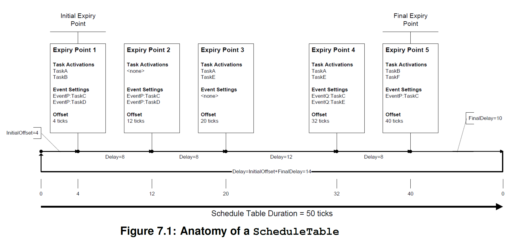

一个调度表（**ScheduleTable**）至少有一个到期点（**expiry points**）。

一个到期点（**expiry points**）包含一组（可能为空）要激活的任务（**Task**）。

一个到期点（**expiry points**）需包含一组（可能为空）要设置的事件（**Event**）。

一个到期点需包含从调度表（**ScheduleTable**）开始的以滴答（**Ticks**）为单位偏移量。

###### 6.3.2.2. 到期点的限制

真实场景下，因为不存在空的到期点的用例，所以每个到期点都必须定义至少一个动作（**action**）。即：到期点需至少激活一个任务（**Task**）或设置至少一个事件（**Event**）。

因为操作系统需要知道处理到期点的顺序。所以有必要确保调度表（**ScheduleTable**）上的到期点可以完全排序。这是通过强制调度表（**ScheduleTable**）上的每个到期点必须具有唯一偏移量来保证的。给定调度表（**ScheduleTable**）上的每个到期点都需具有唯一的偏移量。

对调度表（**ScheduleTable**）上的到期点的迭代通过 **OSEK** 计数器来驱动。计数器（**Counter**）的特性（包括：**OsCounterMinCycle** 和 **OsCounterMaxAllowedValue**）对到期点偏移量施加约束。

初始的偏移量需为零或在底层计数器的**OsCounterMinCycle** 到 **OsCounterMaxAllowedValue**的范围之间。

类似地，此约束也适用于相邻到期点之间的延迟，以及到调度表（**ScheduleTable**）逻辑结束的延迟。相邻到期点之间的延迟也需底层计数器的**OsCounterMinCycle**到** OsCounterMaxAllowedValue**的范围之间。

###### 6.3.2.3. 处理调度表

操作系统模块需按照偏移量递增的顺序处理调度表（**ScheduleTable**）从初始到期点到最终到期点的每个到期点。

操作系统模块需允许同时处理多个调度表（**ScheduleTable**）。操作系统模块的一个调度表（**ScheduleTable**）应该由一个计数器（**Counter**）来驱动。操作系统模块需在任何给定时间，让每个计数器（**Counter**）能够处理至少一个调度表（**ScheduleTable**）。

操作系统模块需使用滴答（**Ticks**）来计时，以便计数器上的一个滴答值（**Ticks**）能够对应到调度表（**ScheduleTable**）上的一个滴答值（**Ticks**）。

可以在同一到期点（**expiry points**）上激活任务（**Task**）并为同一任务（**Task**）设置一个或多个唯一的事件（**Event**）。在到期点执行的任务（**Task**）激活的顺序和事件（**Event**）设置的顺序可能会导致不同的实现，并表现出不同的行为。例如：激活暂停的任务（**Task**），然后在此任务（**Task**）上事件的设置会执行成功。但如果顺序颠倒，则事件设置会失败。为了防止这种不确定性，有必要在到期点（**expiry points**）执行严格的操作顺序。

如果到期点（**expiry points**）包含激活任务（**Task**）的动作，以及为此任务设置一个或者多个事件，则操作系统模块需在相关事件设置之前先处理此任务的激活。无法对到期点（**expiry points**）的处理顺序做出进一步的假设。

调度表（**ScheduleTable**）始终具有定义的状态，下图说明了非同步调度表（**ScheduleTable**）的不同状态，以及它们之间的转换。

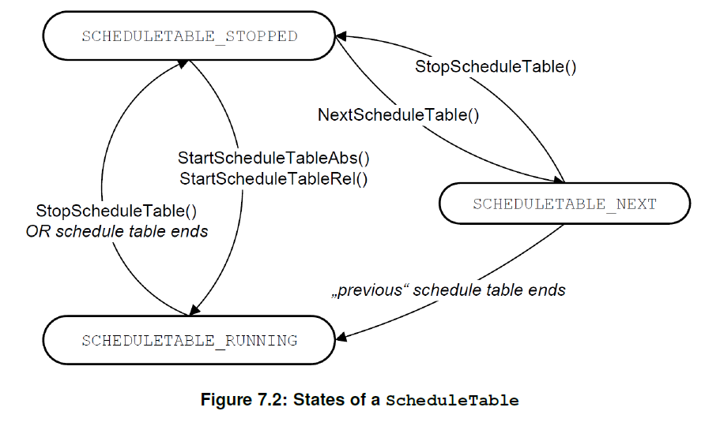

* 如果调度表（**ScheduleTable**）不活动，这意味着操作系统未处理，其状态为 **SCHEDULETABLE_STOPPED**。 
* 启动了调度表（**ScheduleTable**）后，进入 **SCHEDULETABLE_RUNNING** 状态，操作系统需处理到期点（**expiry points**）。 
* 如果切换调度表（**ScheduleTable**）的服务被调用，则调度表（**ScheduleTable**）进入 **SCHEDULETABLE_NEXT** 状态，并等待当前执行的调度表（**ScheduleTable**）执行结束。

###### 6.3.2.4. 重复调度表处理

在最终到期点被处理完之后，调度表（**ScheduleTable**）可能会也可能不会再被重复处理。

在这种情况下，允许两种类型的行为：

1. 单次（**single-shot**）：调度表（**ScheduleTable**）依次处理每个到期点，然后处理完最后一个到期点后停止。这对于触发分阶段的动作序列，以响应某些触发器的场景非常有用。
2. 重复（**repeating**）：调度表（**ScheduleTable**）依次处理每个到期点，处理完最后一个到期点后，循环回到最初的过期点。这对于构建执行重复处理的应用程序，或者需要处理同步驱动程序源的系统的场景非常有用。

重复的调度表（**ScheduleTable**）意味着每个到期点的重复周期，等同于调度表（**ScheduleTable**）的持续时间（**duration**）。

调度表（**ScheduleTable**）必须被配置成单次（**single-shot**）或者重复（**repeating**）的方式。

如果调度表（**ScheduleTable**）是单次的方式，则操作系统模块必须在处理完最后一个到期点后，停止处理调度表（**ScheduleTable**）最终延迟滴答计数（**Final Delay ticks**）。最终延迟滴答计数允许基于底层计数器，数值介于 **0 .. OsCounterMaxAllowedValue** 之间。

如果调度表（**ScheduleTable**）是重复的方式，最终延迟滴答计数的数值也和单次的方式类似，允许基于底层计数器，数值介于 **OsCounterMinCycle .. OsCounterMaxAllowedValue** 范围内。

在处理完最终的到期点之后，如果调度表（**ScheduleTable**）是重复，操作系统将在最终延迟（**Final Delay**）加上初始偏移（**Initial Offset**）滴答计数之后，处理下一个初始的到期点（**Initial Expiry Point**）。

###### 6.3.2.5. 控制 ScheduleTable 处理

应用程序负责开始和停止调度表（**ScheduleTable**）的处理。

操作系统模块提供 [**StartScheduleTableAbs**](#7410-startscheduletableabs) 服务，以便于在底层计数器的绝对值开始（**Start**）点，开始处理调度表（**ScheduleTable**）。即：当底层计数器的值，等于 **Start + InitialOffset** 时，初始的到期点（**Initial Expiry Point**）必须被处理。

操作系统模块提供 [**StartScheduleTableRel**](#749-startscheduletablerel) 服务，以便于在底层计数器的相对于**Now**值的**Offset**处，开始处理调度表（**ScheduleTable**）。即：当底层计数器的值，等于 **Now + Offset + InitialOffset** 时，初始的到期点（**Initial Expiry Point**）必须被处理。

下图说明了由计数器（**Counter**）驱动的调度表（**ScheduleTable**）的两种不同方法。示例中的模数为 **65536**，即：**OsCounterMaxAllowedValue = 65535**。

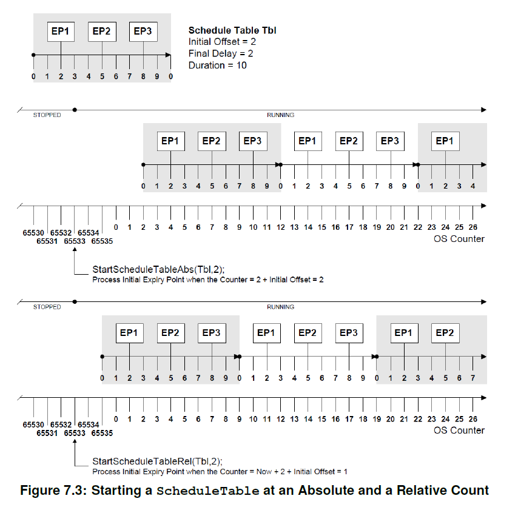

操作系统模块提供 [**StopScheduleTable**](#7411-stopscheduletable)服务，以便于在调度表（**ScheduleTable**）运行的任何时候，立即取消对调度表（**ScheduleTable**）的处理。

如果调度表（**ScheduleTable**）处理在到达最终的到期点（**Final Expiry Point**）之前被取消，并随后重新启动。如果调用 [**StartScheduleTableAbs**](#7410-startscheduletableabs) 或者 [**StartScheduleTableRel**](#749-startscheduletablerel) 服务，则调度表（**ScheduleTable**）将从开始点被重新启动。

操作系统模块提供 [**NextScheduleTable**](#7412-nextscheduletable)服务，处理从一个调度表（**ScheduleTable**）切换到另一个调度表（**ScheduleTable**）。

当请求调度表切换时，操作系统会继续处理当前调度表上的到期点。在最终的到期点（**Final Expiry Point**）之后，开始处理被切换到调度表（**ScheduleTable**）之前，将会有一个相当于 最终延迟（**Final Delay**）滴答计数的延迟。初始到期点（**Initial Expiry Point**）并将在初始偏移（**initial offset**）后被处理。

操作系统模块提供 [**GetScheduleTableStatus**](#7416-getscheduletablestatus) 服务，用来查询调度表（**ScheduleTable**）的状态。

调度表（**ScheduleTable**）可以被配置为在操作系统模块启动期间自动启动。如 **OSEK OS** 中的任务（**Task**）和警报（**Alarm**）一样。**OSEK OS** 定义了一个特定的顺序：在警报（**Alarm**）自动启动之前，执行任务（**Task**）的自动启动。**AUTOSAR OS** 使用调度表（**ScheduleTable**）扩展了这一点。

操作系统模块需在启动期间，完成任务（**Task**）和警报（**Alarm**）自动启动后，执行调度表（**ScheduleTable**）的自动启动。

### 6.4. 调度表同步

#### 6.4.1. 背景与理由

处理调度表（**ScheduleTable**）上的初始到期点（**Initial Expiry Point**）的绝对时间是可以由用户控制。但是如果调度表（**ScheduleTable**）是重复的方式，则不能保证第一次处理初始到期点的绝对计数值与随后处理它的计数值相同。这是因为调度表（**ScheduleTable**）的持续时间不必等于计数器（**Counter**）模数。

在许多情况下，以底层计数器的特定绝对值处理 ScheduleTable 到期点可能很重要，这被称做为同步。

典型用例包括：

* 到期点需与用于电机管理的旋转角度同步。
* 将计算同步到全局（网络）时基（**Time base**）。请注意，在 **AUTOSAR** 中，操作系统并不提供全局（网络）时间源，原因如下：
  1. 很多情况下可能不需要全全局时间。
  2. 其他 **AUTOSAR** 模块，如 **FlexRay**，对操作系统来说是独立提供。
  3. 如果操作系统需要同步到多个全局（网络）时间源。例如：在两个时间触发网络（**time triggered networks**）之间建立网关（**Gateway**）时，操作系统不可能是唯一全局的时间源。

**AUTOSAR OS** 以两种方式提供对同步的支持：

* 隐式同步（**implicit synchronization**）：驱动调度表（**ScheduleTable**）的计数器（**Counter**），就是需要与之同步的计数器（**Counter**）。这种方式通常是如何实现与时间触发的网络技术（例如：**FlexRay**、**TTP**）的同步。底层硬件管理网络时间同步，并简单地将时间作为输出/比较计时器接口呈现给操作系统。下图7-4展示了具有隐式同步的调度表（**ScheduleTable**）的可能状态。
* 显式同步（**explicit synchronization**）：调度表（**ScheduleTable**）由操作系统计数器（**Operating System Counter**）驱动，该计数器不是需要同步的计数器。操作系统提供了额外的功能来保持由操作系统计数器驱动的调度表（**ScheduleTable**）处理与同步计数器（**Synchronization Counter**）之间的同步。这通常是与定期广播的全球时间同步的工作原理。下图7-5展示了显式同步的调度表（**ScheduleTable**）的状态。

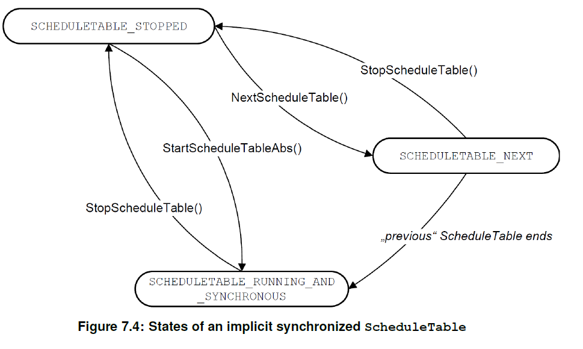

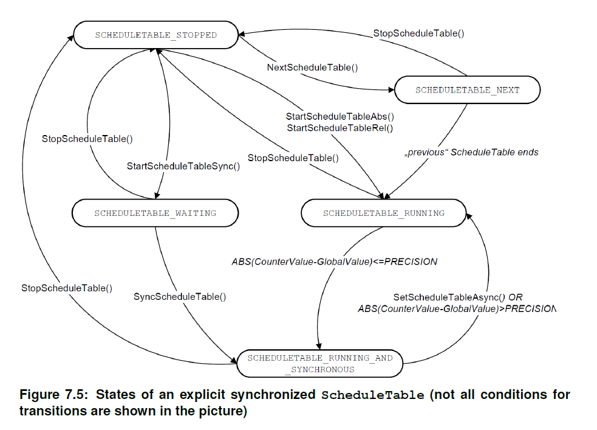

#### 6.4.2. 需求

操作系统模块需提供将调度表（**ScheduleTable**）的处理和已知的计数器（**Counter**）值同步的能力。

###### 6.4.2.1. 隐式同步

操作系统模块不需要为调度表（**ScheduleTable**）的隐式同步提供任何额外的支持。但是有必要限制调度表（**ScheduleTable**）的配置和运行时控制，以便配置的调度表（**ScheduleTable**）上的滴答值（**Tick**）可以与计数器（**Counter**）上的滴答值（**Tick**）对齐。 这要求调度表（**ScheduleTable**）的范围与计数器（**Counter**）的范围相同，即：调度表（**ScheduleTable**）和计数器（**Counter**）交互的要求，保证了每个滴答值（**Tick**）分辨率必须相等。

隐式同步的操作系统模块的调度表（**ScheduleTable**）应具有等于其关联 **OSEK OS** 计数器的 **OsCounterMaxAllowedValue + 1** 的持续时间。

为了同步调度表（**ScheduleTable**）的处理，它必须从一个已知的计数器值开始。这意味着需要隐式同步的调度表（**ScheduleTable**）只能以绝对计数器值启动，而不能以相对计数值启动。操作系统模块应防止隐式同步的调度表（**ScheduleTable**）以相对计数值启动。

当调度表（**ScheduleTable**）以绝对计数器值启动时，当计数器等于服务调用中指定的值加上到期点的偏移量时，将处理每个到期点。常见的用例是确保 调度表（**ScheduleTable**）配置中指定的偏移量对应于底层计数器的绝对值。这可以使用 **[StartScheduleTableAbs](#7410-startscheduletableabs)(Tbl,0)** 轻松实现，如下所示。

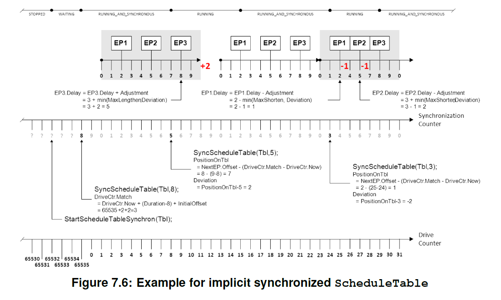

###### 6.4.2.2. 显式同步

显式同步的调度表（**ScheduleTable**）需要操作系统模块的额外支持。调度表（**ScheduleTable**）正常情况下，由操作系统模块的计数器驱动，此类计数器被称为驱动计数器（**drive Counter**）。但处理过程需要与不属于操作系统模块的计数器对象的另一种计数器进行同步，此类进行同步的计数器被称为同步计数器（**synchronization Counter**）。

在调度表（**ScheduleTable**）、操作系统模块的计数器和同步计数器之间必须强制执行以下约束：

1. 约束1：显式同步的调度表（**ScheduleTable**）的持续时间不应大于驱动计数器（**drive Counter**）的模数。
2. 约束2：显式同步的调度表（**ScheduleTable**）的持续时间应等于同步计数器（**synchronization Counter**）的模数。
3. 约束3：同步计数器（**synchronization Counter**）应与调度表（**ScheduleTable**）相关联的驱动计数器**drive Counter**）具有相同的分辨率。 这意味着调度表（**ScheduleTable**）上的滴答与同步计数器（**synchronization Counter**）上的滴答具有相同的持续时间。

请注意，操作系统模块用户有责任验证其系统是否满足**约束2**和**约束3**。

显式同步的作用是让操作系统模块在同步计数器（**synchronization Counter**）的绝对值等于过期点的偏移量处继续处理每个到期点。这意味着显式同步始终假定调度表（**ScheduleTable**）的名义零必须与同步计数器（**synchronization Counter**）上的绝对值零同步。

为此用户必须告诉操作系统模块同步计数器的值。由于同步计数器（**synchronization Counter**）和调度表（**ScheduleTable**）的模数相同，操作系统模块可以使用这个信息来计算漂移。然后，操作系统模块会自动调整特殊配置的到期点之间的延迟，酌情延迟或提前，以确保保持同步。

###### 6.4.2.2.1. 启动

启动显式同步的调度表（**ScheduleTable**）有两个选项：

1. 异步启动（**Asynchronous start**）：以同步计数器（**synchronization Counter**）的任意值启动调度表（**ScheduleTable**）。

2. 同步启动（**Synchronous start**）：只有在提供了同步计数后，才能在同步计数器（**synchronization Counter**）的绝对值为零处启动 调度表（**ScheduleTable**）。 这可能意味着第一次同步的等待具有不确定性。

异步启动（**Asynchronous start**）由现有的绝对和相对调度表（**ScheduleTable**）启动服务提供。这两个服务都使用驱动计数器（**drive Counter**）而不是同步计数器（**synchronization Counter**）以设置初始到期点的处理的起始点。这允许 ScheduleTable调度表（**ScheduleTable**）在获知同步计数器（**synchronization Counter**）的值之前，就可以开始运行。

同步启动（**Synchronous start**）需要额外的服务，该服务仅在操作系统模块被告知同步计数器（**synchronization Counter**）的数值后，才能启动调度表（**ScheduleTable**）。

操作系统模块提供 [**StartScheduleTableSynchron**](#7413-startscheduletablesynchron) 服务，来同步启动显式同步的调度表（**ScheduleTable**）。在驱动计数器（**drive Counter**）的 **(Duration - Value) + Initial Offset** 滴答时间过去后，初始到期点（**Initial Expiry Point**）才会被处理。其中 **Value** 是提供给调度表（**ScheduleTable**）的同步计数器（**synchronization Counter**）的绝对值。

如果显式同步的调度表（**ScheduleTable**）是同步启动的，则操作系统模块需要保证在 [StartScheduleTableSynchron](#7413-startscheduletablesynchron)服务调用返回前，它处于等待（**waiting**）的状态。

###### 6.4.2.2.2. 提供同步计数

操作系统模块必须被告知同步计数器的值。由于调度表（**ScheduleTable**）持续时间等于同步计数器的模数（**modulus**），所以操作系统模块可以使用它来确定调度表时间上的当前计数值与同步计数之间的偏移，并决定是否需要采取所需的动作来实现同步。

操作系统模块需提供服务 *[SyncScheduleTable](#7414-syncscheduletable)*()（请参阅 **SWS_Os_00199**），来为调度表提供同步计数并启动同步。

###### 6.4.2.2.3. 指定同步界限

默认情况下，调度表不应在所有到期点（**expiry points**）进行调整。只有通过显式配置才允许进行调整。操作系统模块在可调到期点可以进行的调整范围通过指定以下内容来控制:

* **OsScheduleTableMaxShorten**：可以从到期偏移量中减去的最大值。
* **OsScheduleTableMaxLengthen**：可以添加到到期点偏移量的最大值。

下图说明了依赖于 **OsScheduleTableMaxShorten** 和 **OsScheduleTableMaxLengthen** 的行为：

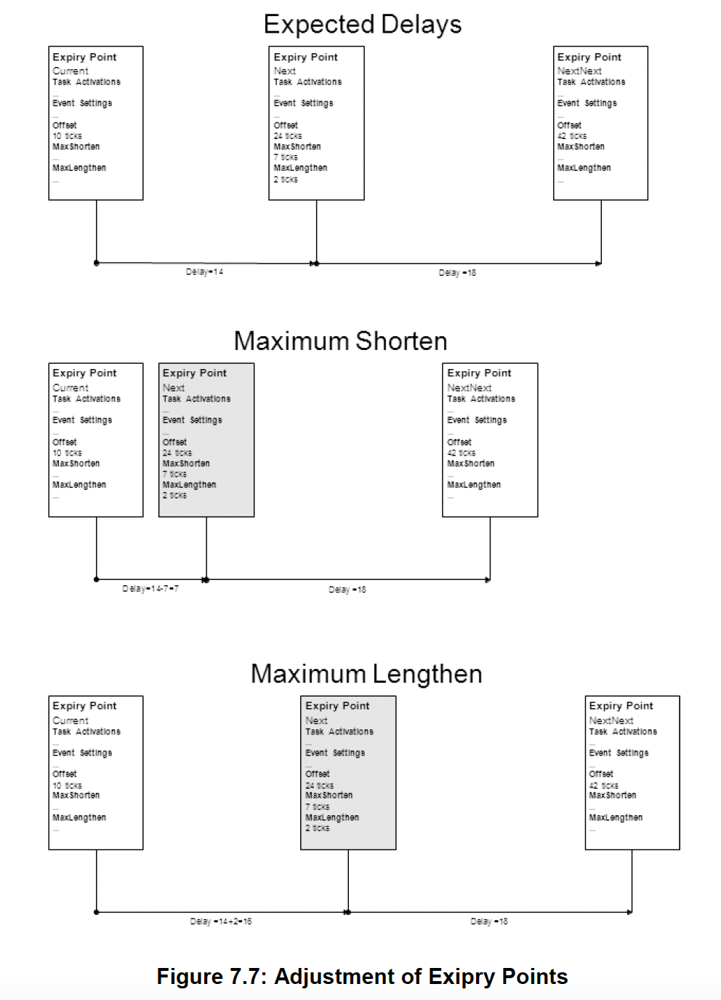

到期点应允许配置 **OsScheduleTableMaxShorten**，该 **OsScheduleTableMaxShorten** 定义了可以从到期点偏移量中减去的最大滴答数（**ticks**）。

到期点应允许配置 **OsScheduleTableMaxLengthen**，该 **OsScheduleTableMaxLengthen** 定义可以添加到到期点偏移量的最大滴答数（**ticks**）。

在执行同步同时，必须根据其偏移量定义的总排序来处理计划表上的到期点。这意味着 **OsScheduleTableMaxShorten** 和 **OsScheduleTableMaxLengthen** 的允许值范围必须确保下一个到期点不会延迟到过去或提前到计划表的多个迭代（**iteration**）之后。

到期点的（偏移量 - **OsScheduleTableMaxShorten**）的值应大于该过期点的（偏移量 + **OsCounterMinCycle**）。

**OsScheduleTableMaxLengthen** 的值应小于调度表的持续时间。

到期点的（**OsScheduleTableMaxLengthen** + **delay_from_previous_EP**）的值应小于基础计数器的 **OsCounterMaxAllowedValue** 。

显式同步的调度表允许允许调度表值和同步计数器值之间的一些偏移。此容差可以为零，表示除非值相同，否则不会将计划表视为同步。

调度表需定义精度界限，其值范围为**0**到持续时间（duration）。

###### 6.4.2.3. 执行同步

操作系统模块使用同步计数，通过计算对下一个到期点的延迟的调整，在每个到期点支持（重新）同步计划表。这提供了比在最终到期点执行操作更快的计划表重新同步。

When a new synchronization count is provided, the Operating System module shall calculate the current deviation between the explicitly synchronized scheduled table and the synchronization count. ⌋ (SRS_Os_11002)

It is meaningless to try and synchronise an explicitly synchronized schedule table before a synchronization count is provided.

The Operating System module shall start to synchronise an explicitly synchronized schedule table after a synchronization count is provided AND shall continue to adjust expiry points until synchronized.

The Operating System module shall set the state of an explicitly synchronized schedule table to “running and synchronous” if the deviation is less than or equal to the configured OsScheduleTblExplicitPrecision threshold.

The Operating System module shall set the state of an explicitly synchronized schedule table to “running” if the deviation is greater than the configured OsScheduleTblExplicitPrecision threshold.

### 6.5. 堆栈监视设施

#### 6.5.1. 背景与理由

在不提供任何内存保护硬件的处理器上，可能仍然需要提供利用可用资源尽力而为（**best effort with available resources**）的方案，提供可检测的内存故障类别。堆栈监视（**Stack monitoring**）将识别任务（**Task**）或 **ISR** 在上下文切换时超出指定堆栈使用的位置。这可能意味着在系统出错（**system being in error**）和检测到故障（**fault being detected**）之间，有相当长的时间。类似地，错误可能在通知故障时已被清除。如：发生上下文切换时堆栈可能小于指定大小的情况。

仅仅监视系统的整个堆栈空间通常是不够的，因为它不一定是正在执行的任务（**Task**）或者 **ISR** 使用的堆栈空间超过了所需的，它可能是被抢占的较低优先级的对象。

通过让操作系统正确识别任务（**Task**）或者**类别 2 ISR**的错误，可以节省大量调试时间。

请注意，对于使用 **MPU** 和可扩展性等级3（**scalability class 3**）或者扩展性等级4（**scalability class 4**）的系统，堆栈溢出可能会在堆栈监控能够检测到故障之前导致内存异常。

#### 6.5.2. 需求

操作系统模块应提供堆栈监视，以检测任务（**Task**）和**类别 2 ISR**的可能堆栈故障。

如果堆栈监控检测到堆栈故障并且没有配置 **ProtectionHook**，操作系统模块会调用状态为 **E_OS_STACKFAULT** 的 **ShutdownOS** 服务。

如果堆栈监控检测到堆栈故障并且配置了**ProtectionHook**，则操作系统模块会调用状态为**E_OS_STACKFAULT** 的 **ProtectionHook**函数。

### 6.6. OS-Application

#### 6.6.1. 背景与理由

AUTOSAR OS 必须能够支持构成一个内聚功能单元的操作系统对象，包括：任务（**Task**）、ISR、警报（**Alarm**)、调度表（**ScheduleTable**）、计数器（**Counter**）的集合。这个对象集合称为**OS-Application**。

操作系统模块负责调度共享处理器的**OS-Application**之间的可用处理资源。如果**OS-Application**被使用，所有的任务（**Task**）、ISR、警报（**Alarm**)、调度表（**ScheduleTable**）、计数器（**Counter**）必须属于一个**OS-Application**。属于同一个 **OS-Application** 的所有对象都可以相互访问。可以在配置期间授予从其他 **OS-Application** 访问对象的权限。如果可以为其设置事件（**Event**）的任务（**Task**）是可3访问的，则该事件（**Event**）也是可访问的。访问意味着这些操作系统对象被允许作为 **API** 服务的参数。

有两类 **OS-Application**：

1. 受信任的**OS-Applications**：受信任的**OS-Applications**可以在运行时禁用监控或保护功能的情况下运行。它们可以不受限制地访问内存、操作系统模块的 API，并且不需要在运行时强制执行它们的计时行为。当处理器支持时，它们可以在特权模式下运行。操作系统模块假定受信任的**OS-Applications**（和受信任的功能）不会导致与内存相关的保护故障。如果发生此类故障，系统稳定性可能会消失，关闭可能是唯一的选择。
2. 不受信任的**OS-Applications**：不受信任的**OS-Applications**不允许在运行时禁用监控或保护功能的情况下运行。它们对内存的访问受到限制，对操作系统模块的 API 的访问受到限制，并在运行时强制执行它们的计时行为。当处理器支持时，它们不允许在特权模式下运行。

**AUTOSAR OS**模块本身假设是受信任的。

**AUTOSAR OS**提供了一些服务，为调用者提供有关访问权限（**access rights**）和对象成员资格（**membership of objects**）的信息。这些服务旨在用于检查跨**OS-Application**间调用的访问权限以及参数。

**注意**：资源（**Resource**）对象不属于任何 **OS-Application** ，但对它们的访问权限必须被明确授予。同样的原理也适用于多核系统中的自旋锁。

正在运行的 **OS-Application** 定义为当前运行的任务（**Task**）或 **ISR** 所属的 **OS-Application**。以及在挂钩例程（hook routine）的情况下，导致挂钩例程调用的任务（**Task**）或 **ISR** 定义了正在运行的 **OS-Application**。

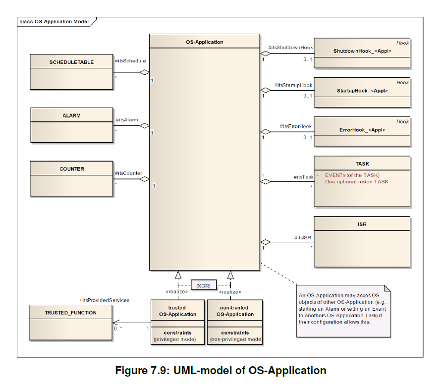

**OS-Application** 有一个状态，它定义了其他 **OS-Application** 对其操作系统对象的可访问性范围。每个 **OS-Application** 始终处于以下状态之一：

* **APPLICATION_ACCESSIBLE**：活动且可访问（**Active and accessible**）。操作系统对象可以从其他 **OS-Application** 访问。这是启动时的默认状态。
* **APPLICATION_RESTARTING**：在重启阶段（Restart phase）。操作系统对象无法被其他 **OS-Application** 访问。在**OS-Application**调用 [**AllowAccess**](#7421-allowaccess) 之前，状态是有效的。
* **APPLICATION_TERMINATED**：已终止且不可访问（**Terminated and not accessible**）。操作系统对象无法被其他 **OS-Application** 访问。状态不会改变。

下图显示了状态和可能的转换：

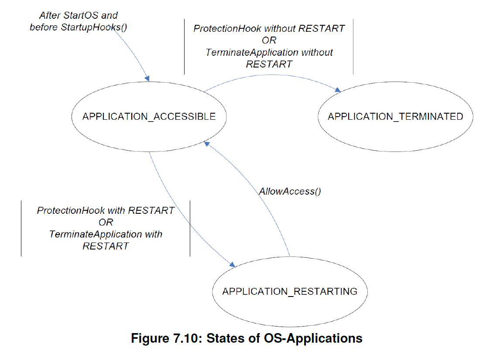

#### 6.6.2. 需求

操作系统模块应支持 **OS-Application** ，这些**OS-Application**可以是受信任函数（**Trusted Function**）、任务（**Task**）、ISR、警报（**Alarm**）、调度表（**ScheduleTable**）、计数器（**Counter**）、挂钩（用于启动、错误和关闭）的可配置选择。

操作系统模块应支持受信任（**trusted**）和不受信任（**non-trusted**）**OS-Application**的概念。

受信任的**OS-Application**可以向其他（甚至不受信任的）**OS-Application**提供服务。此类服务就是受信任的服务（**trusted services**）。

操作系统模块提供服务 [**GetApplicationID**](#741-getapplicationid) 和 [**GetCurrentApplicationID**](#742-getcurrentapplicationid) 来确定当前正在执行的 **OS-Application**（需为每个**OS-Application**分配一个唯一的标识符）。

操作系统模块提供服务 [**CheckObjectOwnership**](#748-checkobjectownership) 以确定给定任务（**Task**）、ISR、计数器、警报（**Alarm**)、调度表（**ScheduleTable**）属于哪个**OS-Application**。

操作系统模块提供服务 [**CheckObjectAccess**](#747-checkobjectaccess) 来确定允许哪些**OS-Application**在 **API** 调用中使用任务（**Task**）、ISR、计数器、警报（**Alarm**)、调度表（**ScheduleTable**）的 ID。

操作系统模块提供服务 [**TerminateApplication**](#7420-terminateapplication) 来终止调用任务（**Task**）、类别2 ISR、应用程序特定错误挂钩所属的 **OS-Application**。这是 **TerminateTask** 服务的操作系统应用程序级别变体）

操作系统模块提供服务 [**TerminateApplication**](#7420-terminateapplication) 来终止另一个 **OS-Application**，并且如果调用者不属于受信任的 **OS-Application**，则需忽略对该服务的调用。

如果操作系统模块需要终止一个 **OS-Application**，那么它应该：

* 终止此 **OS-Application** 的所有正在运行的（**running**）、就绪的（**ready**）和等待的（**waiting**）任务（**Task**）、ISR；
* 禁用此 **OS-Application** 的所有中断（**interrupts**）；
* 停止此 **OS-Application** 的所有活动的警报；
* 停止此 **OS-Application** 的所有调度表（**ScheduleTable**）。

操作系统模块应阻止受信任或不受信任的 **OS-Application** 访问不属于该 **OS-Application** 的对象，除非这些对象的访问权限由配置明确授予。

操作系统模块提供服务 [**GetApplicationState**](#7422-getapplicationstate) 来请求 **OS-Application** 的当前状态。

操作系统模块应在调用 **StartOS** 之后和调用任何 **StartupHook** 之前将所有 **OS-Applications** 的状态设置为 **APPLICATION_ACCESSIBLE**。

操作系统模块提供服务 [**AllowAccess**](#7421-allowaccess) 以将 **OS-Application** 的自身状态从 **APPLICATION_RESTARTING** 设置为 **APPLICATION_ACCESSIBLE**。

如果一个 **OS-Application** 被终止。例如：通过服务调用或通过保护挂钩（**protection hook**），并且没有请求重新启动，则操作系统模块应将此 **OS-Application** 的状态设置为 **APPLICATION_TERMINATED**。

如果一个 **OS-Application** 被终止。例如：通过服务调用或通过保护挂钩（**protection hook**），并且请求了重新启动，则操作系统模块应将此 **OS-Application** 的状态设置为 **APPLICATION_RESTARTING**。

操作系统模块应该拒绝其他 **OS-Application** 对不处于 **APPLICATION_ACCESSIBLE** 状态的 **OS-Application** 的操作系统对象（**Operating System objects**）的访问。

如果对一个操作系统对象的服务调用是由另一个 **OS-Application** 拥有的，同时 **OS-Application** 不处于 **APPLICATION_ACCESSIBLE** 状态，那么操作系统模块需返回 **E_OS_ACCESS**。例如：为了正在重新启动的 **OS-Application** 中的任务（**Task**）调用 **ActivateTask**。

### 6.7. 保护设施

保护仅适用于操作系统管理的对象。这意味着：

* 无法在类别1的ISR（**Category 1 ISR**）运行期间提供保护。因为操作系统不知道正在调用任何类别1的ISR（**Category 1 ISR**），所以如果需要任何保护，则必须避免使用类别1的ISR（**Category 1 ISR**）。如果 类别1的中断和 **OS-Application** 一起使用，则所有类别1的ISR（**Category 1 ISR**）必须属于受信任的 **OS-Application**。
* 无法为在从同一任务（**Task**）或者类别2的ISR（**Category 2 ISR**）的主体调用的函数之间提供保护。

#### 6.7.1. 内存保护

###### 6.7.1.1. 背景与理由

内存保护只能在提供硬件支持内存保护的处理器上实现。

内存保护方案基于可执行程序的数据（**data**）、代码（**code**）和堆栈（**stack**）的部分。

**堆栈（Stack）**

一个 **OS-Application** 包含许多任务（**Task**）和 **ISR**。因为根据定义这些对象的堆栈只属于它的所有者对象，所以不需要在对象之间共享堆栈数据，即使这些对象属于同一个 **OS-Application**。

任务（**Task**）和 **ISR** 堆栈的内存保护非常有用，主要有两个原因：

1. 为任务（**Task**）或 **ISR** 提供比堆栈监控更直接的堆栈溢出和下溢检测。
2. 在 **OS-Application** 的组成部分之间提供保护，例如:满足一些安全约束。

**数据（Data）**

**OS-Applications** 可以有私有数据段，而任务（**Task**）或 **ISR** 也可以有私有数据段。**OS-Applications** 的私有数据部分由属于该 **OS-Applications** 的所有任务（**Task**）或 **ISR** 共享。

**代码（Code）**

代码部分要么是**OS-Application**私有的，要么可以在所有**OS-Application**之间共享（以使用共享库）。在不使用代码保护的情况下，执行不正确的代码最终会导致内存、时序或服务违规。

###### 6.7.1.2. 需求

**数据段和堆栈（Data Sections and Stack）**

操作系统模块应防止不受信任（**non-trusted**）的 **OS-Applications**，对其自己的数据部分和自己的堆栈进行写访问。

操作系统应提供限制受信任（**trusted**）的 **OS-Applications** 写入访问的可能性，就像对不受信任**OS-Applications**所做的那样。

这可以使用 **OsTrustedApplicationWithProtection** 进行配置。

**OS-Application的私有数据**

操作系统模块可能会阻止其他不受信任的**OS-Application**尝试对**OS-Application**的数据部分进行读取访问。

操作系统模块应允许**OS-Application**对该**OS-Application**自己的私有数据部分进行读写访问。

操作系统模块应防止其他不可信的**OS-Application**对**OS-Application**的私有数据部分进行写访问。

**任务/ISR 的私有堆栈**

操作系统模块应允许任务（**Task**）/ **类别2的ISR** 对该任务（**Task**）/ **类别2的ISR**自己的私有堆栈进行读写访问。

操作系统模块可能会阻止所有同一个**OS-Application**中的其他任务（**Task**）/ **ISR** 对非受信任**OS-Application**的任务（**Task**）/**类别2的ISR** 的私有堆栈进行写访问。

操作系统模块应防止从其他非受信任**OS-Application**对当前**OS-Application**的任务（**Task**）/**类别2的ISR** 的所有私有堆栈进行写访问。

**任务/ISR 的私有数据**

操作系统模块应允许（**Task**）/ **类别2的ISR**对该（**Task**）/ **类别2的ISR**自己的私有数据部分进行读写访问。

操作系统模块可能会阻止所有同一 个**OS-Application**中的其他（**Task**）/ **ISR** 对非受信任**OS-Application**的任务（**Task**）/**类别2的ISR** 的私有数据部分的写访问。

操作系统模块应防止从其他非受信任**OS-Application**对当前**OS-Application**的的任务（**Task**）/**类别2的ISR** 的所有私有数据部分进行写访问。

**代码段（Code Sections）**

操作系统模块可以为**OS-Application**提供保护其代码段不被非受信任的**OS-Application**执行的能力。

操作系统模块应提供在所有**OS-Application**可执行的共享库代码部分的能力。

**外围设备（Peripherals）**

如果 **OsTrustedApplicationWithProtection == FALSE**，则操作系统模块需允许受信任的**OS-Application**对外围设备进行读写访问。

操作系统模块应允许非受信任的 **OS-Application** 仅写入其分配的外围设备。（包括：具有写入内存位置的副作用的读取）。

**内存访问冲突（Memory Access Violation）**

如果检测到内存访问违规，操作系统模块需调用 **ProtectionHook**，并返回状态码 **E_OS_PROTECTION_MEMORY** 。

#### 6.7.2. 时序保护（Timing Protection）

###### 6.7.2.1. 背景与理由

当一个任务（**Task**）或中断（**Interrupt**）在运行时错过了它的最后期限时，就会发生实时系统中的计时错误。

**AUTOSAR OS** 不提供时序保护的截止时间的监控（**deadline monitoring**）。因为监控截止时间并不能正确识别导致 **AUTOSAR** 系统中时序故障的那个任务（**Task**）或者**ISR**。当截止时间超时的时候，这可能是由于其他非监控的任务（**Task**）或者**ISR**的干扰或者阻塞时间过长，而最终引起了时序的错误。在这种情况下，错误在于这些非监控的不相关的任务（**Task**）或者**ISR**。接着它们通过系统的慢慢扩散，直到任务（**Task**）或者**ISR** 错过了截止时间。所以错过截止时间的任务（**Task**）或者**ISR** 不一定是在在运行时失败的那个任务（**Task**）或者 **ISR**。它只不过是被最早检测到时序的故障。

如果基于通过监控截止时间来识别的是否错过截止时间并采取行动，这可能会使用错误证据来终止了正确的 **OS-Application**，并同时不正确的**OS-Application**依旧被允许继续运行。

这个问题可以通过以下的例子来说明。考虑具有以下配置的系统：

| 任务Id | 优先级 | 执行时间 | 截止时间 (=任务周期） |
| ------ | ------ | -------- | --------------------- |
| A      | 高     | 1        | 5                     |
| B      | 中等   | 3        | 10                    |
| C      | 低     | 5        | 15                    |

假设所有任务（**Task**）在时间0都已经准备好运行，接着会执行以下调度，并且所有任务（**Task**）都将满足它们各自的截止时间。

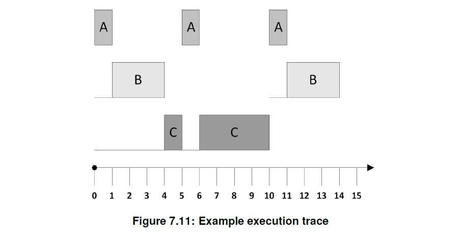

现在考虑任务A（**Task A**）和任务B（**Task B**）行为不正确的情况。下图显示了任务A（**Task A**）和任务B（**Task B**）的执行时间都比指定的时间长，而任务B（**Task B**）的到达时间比指定的时间早 2 个滴答。任务A（**Task A**）和任务B（**Task B**）都按时完成。然而，任务C任务B（**Task C**）行为正确，但由于任务A（**Task A**）和任务B（**Task B**）的执行不正确，它未能在截止时间前完成。这是故障传播。即：系统中不相关部分的故障导致系统中正常运行的部分发生故障。

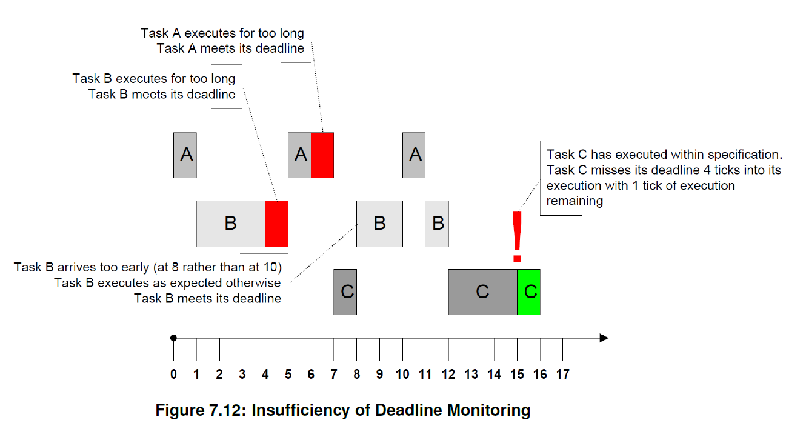

在 **AUTOSAR OS** 等固定优先级抢占式操作系统中，任务（**Task**）或者**ISR**是否满足其截止时间取决于以下因素：

* 系统中任务（**Task**）和**ISR**的执行时间。
* 任务（**Task**）和**ISR**因为较低优先级任务（**Task**）和**ISR**锁定共享资源或禁用中断，而遭受的阻塞时间。
* 系统中任务（**Task**）和**ISR**的到达间隔时间率（**interarrival rate**）。

为了安全和准确的时序保护，操作系统有必要在运行时控制这些因素，以确保任务（**Task**）和**ISR**能够满足它们各自的期限时间。

**AUTOSAR OS** 通过使用执行时间保护（**execution time protection**）来保证以下执行时间的静态配置上限（称为执行预算）来防止 (1) 中的计时错误：

* 任务（**Tasks**）。
* 类别2的ISR（**Category 2 ISRs**）。

**AUTOSAR OS** 通过使用锁定时间保护（**locking time protection**）来保证以下时间的静态配置上限（称为锁定预算（**Lock Budget**））来防止 (2) 中的计时错误：

* 任务（**Tasks**）/类别2的ISR（**Category 2 ISRs**）持有资源（**Resources**）的时间。
* 任务（**Tasks**）/类别2的ISR（**Category 2 ISRs**）挂起 OS 中断的时间。
* 任务（**Tasks**）/类别2的ISR（**Category 2 ISRs**）挂起/禁用所有中断（**ALL interrupts**）的时间。

**AUTOSAR OS** 通过使用到达间隔时间保护（**inter-arrival time protection**）来保证以下时间之间的静态配置下限（称为时间框架（**Time Frame**））来防止 (3) 中的计时错误：

* 任务（**Task**）由于以下原因被允许转换到 **READY** 状态：
    * 激活（**Activation**）（从 **SUSPENDED** 状态到 **READY** 状态的转换）。
    * 释放（**Release**）（从 **WAITING** 状态到 **READY** 状态的转换）。
* 类别2的ISR（**Category 2 ISR**）到达。到达发生在操作系统识别到该类别2 ISR 之时。

对基本任务（**basic Tasks**）的到达间隔时间保护控制连续激活之间的时间，而不管激活是否被排队。在排队激活的情况下，激活一个处于 **READY** 或 **RUNNING** 状态的基本任务（**Task**）是一次新的激活，因为它代表了对该任务（**Task**）一个新实例的激活。因此，到达间隔时间保护与排队激活相互作用，共同控制队列被填充的速率。

对扩展任务（**extended Tasks**）的到达间隔时间保护控制连续激活和释放之间的时间。当一个任务（**Task**）处于 **WAITING** 状态，且通过单次调用 **SetEvent** 设置多个事件（**Events**）时，这代表一次单一的释放。当一个任务（**Task**）所等待的一个或多个事件（**Events**）已经被设置时，这代表一个名义上的等待/释放/启动（**Wait/Release/Start**）转换，因此被视为一次新的释放。

下图展示了执行时间保护和到达间隔时间保护如何与 **AUTOSAR OS** 的任务状态转换模型进行交互。

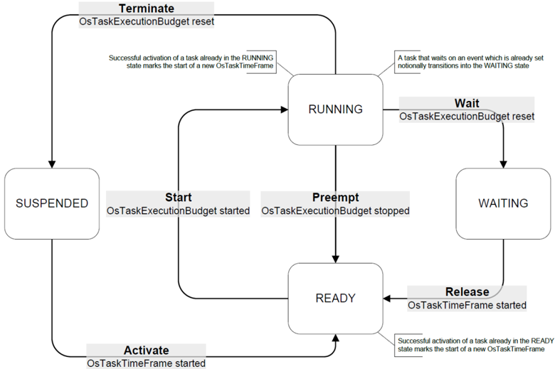

**注意：**

1. 对类别2的ISR（**Category 2 ISRs**）的到达间隔时间强制执行，可用于保护 ECU 免受"胡言乱语"（"babbling idiot"）中断源的影响（例如，CAN 控制器每次从网络上的其他 ECU 接收到一个帧时都产生一次中断）。
2. 时序保护仅适用于任务（**Tasks**）或类别2的ISR（**Category 2 ISRs**）。对类别1的ISR（**Category 1 ISRs**）没有保护。如果时序保护错误发生在类别1 ISR 期间，则无法保证操作系统模块的一致性。因此，我们不鼓励在具有类别1中断的系统中使用时序保护。
3. 在操作系统模块启动之前，时序保护不适用。
4. 对于受信任的 **OS-Application**，至关重要的是所有时序信息都正确无误，否则系统可能在运行时发生故障。对于非受信任的 **OS-Application**，时序保护可用于强制执行可执行对象之间的时序边界。

###### 6.7.2.2. 需求

在非受信任的 **OS-Application** 中，操作系统模块应对该非受信任 **OS-Application** 的每个任务（**Task**）/类别2 ISR 应用时序保护。

在受信任的 **OS-Application** 中，操作系统模块应提供对该 **OS-Application** 的任务（**Tasks**）/类别2的ISR（**Category 2 ISRs**）应用时序保护的能力。

如果没有配置 **OS-Application**，操作系统模块应能够对任务（**Tasks**）/类别2的ISR（**Category 2 ISRs**）应用时序保护。

**时序保护：任务（Timing Protection: Tasks）**

如果任务（**Task**）的 **OsTaskExecutionBudget** 已经达到，则操作系统模块应调用状态为 **E_OS_PROTECTION_TIME** 的 **ProtectionHook**。

操作系统模块应在转换到 **SUSPENDED** 或 **WAITING** 状态时，重置任务（**Task**）的 **OsTaskExecutionBudget**。

操作系统模块应将任务（**Tasks**）的到达间隔时间限制为每个 **OsTaskTimeFrame** 一次。

当任务（**Task**）被成功激活时，操作系统模块应启动一个 **OsTaskTimeFrame**。

当任务（**Task**）被成功释放时，操作系统模块应启动一个 **OsTaskTimeFrame**。

如果在 **OsTaskTimeFrame** 结束之前尝试激活一个任务（**Task**），则操作系统模块不应执行该激活，并且应调用状态为 **E_OS_PROTECTION_ARRIVAL** 的 **ProtectionHook**。

如果在 **OsTaskTimeFrame** 结束之前尝试释放一个任务（**Task**），则操作系统模块不应执行该释放，应调用状态为 **E_OS_PROTECTION_ARRIVAL** 的 **ProtectionHook**，并且该事件应被设置。

**时序保护：ISR（Timing Protection: ISRs）**

如果类别2 ISR 的 **OsIsrExecutionBudget** 已经达到，则操作系统模块应调用状态为 **E_OS_PROTECTION_TIME** 的 **ProtectionHook**。

当 ISR 将控制权交还给操作系统或终止时，操作系统模块应重置该 ISR 的 **OsIsrExecutionBudget**。

操作系统模块应将类别2的ISR（**Category 2 ISRs**）的到达间隔时间限制为每个 **OsIsrTimeFrame** 一次。

操作系统模块应从其识别到中断的那一点（即在操作系统的中断包装器（**interrupt wrapper**）中）开始测量 **OsIsrTimeFrame** 的起点。

如果类别2中断在 **OsIsrTimeFrame** 结束之前发生，则操作系统模块不应执行用户提供的 ISR，并且应调用状态为 **E_OS_PROTECTION_ARRIVAL** 的 **ProtectionHook**。

**时序保护：资源锁定和中断禁用（Timing Protection: Resource Locking and Interrupt Disabling）**

如果任务（**Task**）/类别2 ISR 持有一个 OSEK 资源（**Resource**）并超过了 **OsTaskResourceLockBudget**（或 **OsIsrResourceLockBudget**），则操作系统模块应调用状态为 **E_OS_PROTECTION_LOCKED** 的 **ProtectionHook**。

如果任务（**Task**）/类别2 ISR 禁用中断（通过 Suspend/Disable|All/OS|Interrupts()），并超过了配置的 **OsIsrAllInterruptLockBudget**（或 **OsIsrOsInterruptLockBudget** 或 **OsTaskAllInterruptLockBudget** 或 **OsTaskOsInterruptLockBudget**），则操作系统模块应调用状态为 **E_OS_PROTECTION_LOCKED** 的 **ProtectionHook**。

###### 6.7.2.3. 实现说明

执行时间的强制执行需要硬件支持，例如时序强制执行中断（**timing enforcement interrupt**）。如果使用中断来实现时间强制执行，则该中断的优先级必须足够高，以"中断"被监视的任务（**Tasks**）或 ISR。

取决于实际的硬件支持，这可能意味着 **DisableAllInterrupts** 和 **SuspendAllInterrupts** 并不禁用所有中断（例如，禁用除用于时序保护的中断之外的所有中断），或者对类别1的ISR（**Category 1 ISRs**）——它们绕过操作系统模块（也绕过时序保护）——的使用受到某种限制。

实现必须记录此类特定于实现的行为（例如，使用时序保护时的限制）。

#### 6.7.3. 服务保护

###### 6.7.3.1. 背景与理由

由于 **OS-Application** 可以通过服务与操作系统模块进行交互，因此这些服务调用不会破坏操作系统模块本身是至关重要的。服务保护（**Service Protection**）在运行时防范此类破坏。

服务保护需要考虑以下几种情况：一个 **OS-Application** 进行 API 调用：

1. 使用无效的句柄或超出范围的值。
2. 在错误的上下文中，例如在 **StartupHook** 中调用 **ActivateTask**。
3. 或者未能进行某个 API 调用，而导致 OSEK OS 被留在未定义状态，例如它在没有 **ReleaseResource** 调用的情况下终止。
4. 该调用影响系统中所有其他 **OS-Application** 的行为，例如 **ShutdownOS**。
5. 操纵属于另一个 **OS-Application** 的操作系统对象（调用者对该对象没有必要的权限），例如一个 **OS-Application** 试图对它不拥有的任务（**Task**）执行 **ActivateTask**。

OSEK OS 已经通过服务调用返回的状态码提供了一些服务保护，这将构成服务保护的基础。这意味着服务保护将仅适用于 OSEK OS 的扩展状态（**extended status**）。

然而，OSEK OS 并未涵盖上述所有情况。以下各节将描述——除强制性的扩展状态之外——在上述每种情况下需要应用的附加保护需求。

###### 6.7.3.2. 无效对象参数或超出范围的值

###### 6.7.3.2.1. 背景与理由

当前的 OSEK OS 服务调用已经对无效对象（即在 OIL 文件中未定义的对象）返回 **E_OS_ID**，对超出范围的值（例如，设置的警报周期时间小于 **OsCounterMinCycle**）返回 **E_OS_VALUE**。

###### 6.7.3.2.2. 需求

如果将一个无效地址（该地址不可被此 **OS-Application** 写入）作为输出参数传递给操作系统服务，操作系统模块应返回状态码 **E_OS_ILLEGAL_ADDRESS**。

###### 6.7.3.3. 在错误上下文中进行的服务调用

###### 6.7.3.3.1. 背景与理由

当前的 OSEK OS 定义了服务调用的有效调用上下文（参见 [2]），然而仅对其中一小部分无效调用进行保护，例如从类别2 ISR 调用 **TerminateTask**。

表7.1：OS 服务调用的允许调用上下文（**Allowed Calling Context for OS Service Calls**）

| 服务 | 任务 | 类别1 ISR | 类别2 ISR | ErrorHook | PreTaskHook | PostTaskHook | StartupHook | ShutdownHook | 警报回调 | ProtectionHook |
| ------- | ---- | -------- | -------- | --------- | ----------- | ------------ | ----------- | ------------ | -------------- | -------------- |
| ActivateTask | OK |  | OK |  |  |  |  |  |  |  |
| [ActivateTaskAsyn](#7437-activatetaskasyn) | OK |  | OK |  |  |  |  |  |  |  |
| TerminateTask | OK |  | C |  |  |  |  |  |  |  |
| ChainTask | OK |  | C |  |  |  |  |  |  |  |
| Schedule | OK |  | C |  |  |  |  |  |  |  |
| GetTaskID | OK |  | OK | OK | OK | OK |  |  |  | OK |
| GetTaskState | OK |  | OK | OK | OK | OK |  |  |  |  |
| DisableAllInterrupts | OK | OK | OK | OK | OK | OK | OK | OK | OK | OK |
| EnableAllInterrupts | OK | OK | OK | OK | OK | OK | OK | OK | OK | OK |
| SuspendAllInterrupts | OK | OK | OK | OK | OK | OK | OK | OK | OK | OK |
| ResumeAllInterrupts | OK | OK | OK | OK | OK | OK | OK | OK | OK | OK |
| SuspendOSInterrupts | OK | OK | OK | OK | OK | OK | OK | OK | OK | OK |
| ResumeOSInterrupts | OK | OK | OK | OK | OK | OK | OK | OK | OK | OK |
| GetResource | OK |  | OK |  |  |  |  |  |  |  |
| ReleaseResource | OK |  | OK |  |  |  |  |  |  |  |
| SetEvent | OK |  | OK |  |  |  |  |  |  |  |
| [SetEventAsyn](#7438-seteventasyn) | OK |  | OK |  |  |  |  |  |  |  |
| ClearEvent | OK |  | C |  |  |  |  |  |  |  |
| GetEvent | OK |  | OK | OK | OK | OK |  |  |  |  |
| WaitEvent | OK |  | C |  |  |  |  |  |  |  |
| GetAlarmBase | OK |  | OK | OK | OK | OK |  |  |  |  |
| GetAlarm | OK |  | OK | OK | OK | OK |  |  |  |  |
| SetRelAlarm | OK |  | OK |  |  |  |  |  |  |  |
| SetAbsAlarm | OK |  | OK |  |  |  |  |  |  |  |
| CancelAlarm | OK |  | OK |  |  |  |  |  |  |  |
| GetActiveApplicationMode | OK |  | OK | OK | OK | OK | OK | OK |  |  |
| StartOS |  |  |  |  |  |  |  |  |  |  |
| ShutdownOS | OK |  | OK | OK |  |  | OK |  |  |  |
| [GetApplicationID](#741-getapplicationid) | OK |  | OK | OK | OK | OK | OK | OK |  | OK |
| [GetISRID](#743-getisrid) | OK |  | OK | OK |  |  |  |  |  | OK |
| [CallTrustedFunction](#744-calltrustedfunction) | OK |  | OK |  |  |  |  |  |  |  |
| [CheckISRMemoryAccess](#745-checkisrmemoryaccess) | OK |  | OK | OK |  |  |  |  |  | OK |
| [CheckTaskMemoryAccess](#746-checktaskmemoryaccess) | OK |  | OK | OK |  |  |  |  |  | OK |
| [CheckObjectAccess](#747-checkobjectaccess) | OK |  | OK | OK |  |  |  |  |  | OK |
| [CheckObjectOwnership](#748-checkobjectownership) | OK |  | OK | OK |  |  |  |  |  | OK |
| [StartScheduleTableRel](#749-startscheduletablerel) | OK |  | OK |  |  |  |  |  |  |  |
| [StartScheduleTableAbs](#7410-startscheduletableabs) | OK |  | OK |  |  |  |  |  |  |  |
| [StopScheduleTable](#7411-stopscheduletable) | OK |  | OK |  |  |  |  |  |  |  |
| [NextScheduleTable](#7412-nextscheduletable) | OK |  | OK |  |  |  |  |  |  |  |
| [StartScheduleTableSynchron](#7413-startscheduletablesynchron) | OK |  | OK |  |  |  |  |  |  |  |
| [SyncScheduleTable](#7414-syncscheduletable) | OK |  | OK |  |  |  |  |  |  |  |
| [GetScheduleTableStatus](#7416-getscheduletablestatus) | OK |  | OK |  |  |  |  |  |  |  |
| [SetScheduleTableAsync](#7415-setscheduletableasync) | OK |  | OK |  |  |  |  |  |  |  |
| [IncrementCounter](#7417-incrementcounter) | OK |  | OK |  |  |  |  |  |  |  |
| [GetCounterValue](#7418-getcountervalue) | OK |  | OK |  |  |  |  |  |  |  |
| [GetElapsedValue](#7419-getelapsedvalue) | OK |  | OK |  |  |  |  |  |  |  |
| [TerminateApplication](#7420-terminateapplication) | OK |  | OK | OK <sup>1</sup> |  |  |  |  |  |  |
| [AllowAccess](#7421-allowaccess) | OK |  | OK |  |  |  |  |  |  |  |
| [GetApplicationState](#7422-getapplicationstate) | OK |  | OK | OK | OK | OK | OK | OK |  | OK |
| [ControlIdle](#7430-controlidle) | OK |  | OK |  |  |  |  |  |  |  |
| [GetCurrentApplicationID](#742-getcurrentapplicationid) | OK |  | OK | OK | OK | OK | OK | OK |  | OK |
| ReadPeripheral8 | OK |  | OK |  |  |  |  |  |  |  |
| ReadPeripheral16 | OK |  | OK |  |  |  |  |  |  |  |
| ReadPeripheral32 | OK |  | OK |  |  |  |  |  |  |  |
| WritePeripheral8 | OK |  | OK |  |  |  |  |  |  |  |
| WritePeripheral16 | OK |  | OK |  |  |  |  |  |  |  |
| WritePeripheral32 | OK |  | OK |  |  |  |  |  |  |  |
| ModifyPeripheral8 | OK |  | OK |  |  |  |  |  |  |  |
| ModifyPeripheral16 | OK |  | OK |  |  |  |  |  |  |  |
| ModifyPeripheral32 | OK |  | OK |  |  |  |  |  |  |  |
| [DisableInterruptSource](#7435-disableinterruptsource) | OK |  | OK |  |  |  |  |  |  |  |
| [EnableInterruptSource](#7434-enableinterruptsource) | OK |  | OK |  |  |  |  |  |  |  |
| [ClearPendingInterrupt](#7436-clearpendinginterrupt) | OK |  | OK |  |  |  |  |  |  |  |
| [isOsStarted](#7439-isosstarted) | OK | OK | OK | OK | OK | OK | OK | OK | OK | OK |

> 1 仅在自终止的情况下。

在上表中，"C"表示有效性仅"在扩展状态中由 **E_OS_CALLEVEL** 检查"。

###### 6.7.3.3.2. 需求

如果 **OS-Application** 在错误的上下文中进行服务调用，且当前不在类别1 ISR（**Category 1 ISR**）内，则操作系统模块不应执行所请求的动作（该服务调用应不产生任何效果），并返回 **E_OS_CALLEVEL** 或该服务的"无效值"。

###### 6.7.3.4. 具有未定义行为的服务

###### 6.7.3.4.1. 背景与理由

在扩展状态中，有许多情况 OSEK OS 的行为是未定义的。在需要保护时，这是不可接受的，因为这将允许操作系统模块通过其自身的服务调用被破坏。因此，操作系统模块服务保护的实现必须描述并实现一种行为，该行为不危及系统的完整性，也不危及未导致该特定错误的任何 **OS-Application** 的完整性。

###### 6.7.3.4.2. 需求

**任务（Tasks）未调用 TerminateTask 或 ChainTask 而结束**

如果任务（**Task**）从其入口函数返回而未调用 **TerminateTask** 或 **ChainTask**，则操作系统模块应终止该任务（**Task**）（如果配置了，则调用 **OsPostTaskHook**）。

如果任务（**Task**）从其入口函数返回而未调用 **TerminateTask** 或 **ChainTask**，并且配置了错误挂钩，则操作系统模块应在该任务（**Task**）离开 **RUNNING** 状态之前，以状态 **E_OS_MISSINGEND** 调用 **ErrorHook**（无论该任务（**Task**）是否引起其他错误，例如 **E_OS_RESOURCE**，都会这样做）。

如果任务（**Task**）从入口函数返回而未调用 **TerminateTask** 或 **ChainTask**，并且仍持有 OSEK 资源（**Resources**），则操作系统模块应释放它们。

如果任务（**Task**）从入口函数返回而未调用 **TerminateTask** 或 **ChainTask**，并且中断仍处于禁用状态，则操作系统模块应启用它们。

**类别2 ISR 在中断被锁定或资源被分配的状态下结束**

如果类别2 ISR 调用了 **DisableAllInterrupts** / **SuspendAllInterrupts** / **SuspendOSInterrupts**，并在未调用相应的 **EnableAllInterrupts** / **ResumeAllInterrupts** / **ResumeOSInterrupts** 的情况下结束（返回），则操作系统模块应执行缺失的服务，并应以状态 **E_OS_DISABLEDINT** 调用 **ErrorHook**（如果已配置）。

如果类别2 ISR 调用了 **GetResource**，并在未调用相应的 **ReleaseResource** 的情况下结束（返回），则操作系统模块应执行 **ReleaseResource** 调用，并应以状态 **E_OS_RESOURCE** 调用 **ErrorHook**（如果已配置）（参见 [12] 第 13.1 节）。

**在 ShutdownOS 期间调用 PostTaskHook**

如果配置了 **PostTaskHook**，则当调用 **ShutdownOS** 时，操作系统模块不应调用该挂钩。

**任务（Tasks）/ISR 在未进行相应禁用的情况下调用 EnableAllInterrupts / ResumeAllInterrupts / ResumeOSInterrupts**

如果调用了 **EnableAllInterrupts** / **ResumeAllInterrupts** / **ResumeOSInterrupts**，而之前没有进行相应的 **DisableAllInterrupts** / **SuspendAllInterrupts** / **SuspendOSInterrupts**，则操作系统模块不应执行该操作系统服务。

**当调用了 DisableAllInterrupts / SuspendAllInterrupts / SuspendOSInterrupts 时任务（Tasks）/ISR 调用 OS 服务**

如果中断被任务（**Task**）/ISR/挂钩禁用/挂起，而该任务（**Task**）/ISR/挂钩调用任何操作系统服务（中断服务除外），则操作系统模块应忽略该服务，并且如果该服务返回 **StatusType** 值，则应返回 **E_OS_DISABLEDINT**。

###### 6.7.3.5. 非受信任 OS-Application 的服务限制

###### 6.7.3.5.1. 背景与理由

可用的操作系统服务调用根据调用上下文受到限制（参见 6.7.3.3）。在受保护的系统中，需要施加额外的约束，以防止非受信任的 **OS-Application** 执行可能对系统产生全局影响的 API 调用。每个限制级别都是前一级别的真子集（**proper subset**），如下图所示。

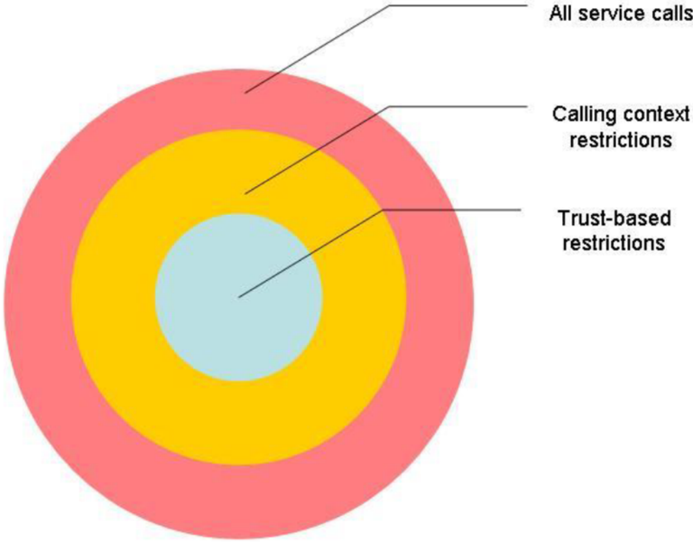

定义了两个完整性级别：

1. 受信任（**Trusted**）
2. 非受信任（**Non-Trusted**）

它们与受信任和非受信任的 **OS-Application** 精确对应。

###### 6.7.3.5.2. 需求

操作系统模块应忽略来自非受信任 **OS-Application** 的 **ShutdownOS** 调用。

###### 6.7.3.6. 对不同 OS-Application 中对象的服务调用

###### 6.7.3.6.1. 背景与理由

6.7.3.2 节说明了当对象无效时，OSEK OS 服务调用会返回 **E_OS_ID**。在保护方案下，服务调用可能是无效的，因为调用者对该对象不具有有效的权限（这对多 **OS-Application** 系统而言是一种新的含义）。

这与 OSEK OS 中对象不可访问的情况类似（例如，当一个任务（**Task**）试图获取一个在系统中存在但未被配置为该任务（**Task**）所使用的资源（**Resource**）时）。

###### 6.7.3.6.2. 需求

如果一个 OS 对象标识符是操作系统模块系统服务的参数，并且在配置时没有为调用该服务的任务（**Task**）/类别2 ISR 分配对该 OS 对象的足够访问权限（参数 **Os[...]AccessingApplication**，例如 **OsTaskAccessingApplication**），则操作系统模块的系统服务应返回 **E_OS_ACCESS**。

[**CheckTaskMemoryAccess**](#746-checktaskmemoryaccess) 和 [**CheckISRMemoryAccess**](#745-checkisrmemoryaccess) 检查内存访问。内存访问检查对所有 **OS-Application** 都是可能的，并且可以从所有 **OS-Application** 进行，且不需要被授予的权限。

[SWS_Os_00449] 是 [SWS_Os_00056] 的一个例外。

[**CheckObjectAccess**](#747-checkobjectaccess) 检查操作系统对象的访问权限。对象访问检查对所有 **OS-Application** 都是可能的，并且可以从所有 **OS-Application** 进行，且不需要被授予的权限。

[SWS_Os_00450] 是 [SWS_Os_00056] 的一个例外。

#### 6.7.4. 保护 OS 使用的硬件

###### 6.7.4.1. 背景与理由

在处理器支持特权模式（**privileged mode**）和非特权模式（**non-privileged mode**）的情况下，通常某些寄存器以及修改这些寄存器的指令在特权模式之外是无法访问的。

在此类硬件上，让操作系统模块在特权模式下执行、任务（**Tasks**）/ISR 在非特权模式下执行，可以保护操作系统模块运行所必需的寄存器免受在非特权模式下执行的对象的无意破坏。操作系统模块的服务将需要在特权模式下执行，因为它们需要修改在该模式之外受保护的寄存器。

操作系统模块可以使用 **MPU**、定时器单元、中断控制器等的控制寄存器，因此有必要保护这些寄存器免受非受信任 **OS-Application** 的影响。

###### 6.7.4.2. 需求

如果硬件支持，操作系统模块应以非特权模式执行非受信任 **OS-Application**。

在硬件支持的范围内，操作系统模块不应允许非受信任 **OS-Application** 访问由操作系统模块管理的控制寄存器。

如果发生指令异常（例如除零），操作系统模块应调用状态为 **E_OS_PROTECTION_EXCEPTION** 的 **ProtectionHook**。

###### 6.7.4.3. 实现说明

当操作系统模块运行非受信任 **OS-Application** 时，操作系统模块对中断进入和挂钩例程的处理必须被仔细管理。

中断处理：当 MCU 支持不同模式时（如本节所述），ISR 将要求操作系统模块在 ISR() 包装器中做额外的工作。ISR 通常在特权模式下进入。如果处理程序属于非受信任 **OS-Application**，则 ISR() 包装器必须确保在处理程序执行之前切换到非特权模式。

#### 6.7.5. 提供可信函数

###### 6.7.5.1. 背景与理由

一个 **OS-Application** 可以调用由（另一个）受信任 **OS-Application** 提供的可信函数（**Trustedfunction**）。这可能需要从非特权模式切换到特权模式。这通常通过以下操作来实现：

* 每个受信任 **OS-Application** 可以导出可从其他 **OS-Application** 调用的服务。
* 在配置期间，这些受信任服务必须被配置为可从非受信任 **OS-Application** 调用。
* 从非受信任 **OS-Application** 到受信任服务的调用使用操作系统提供的机制（例如陷阱/软件中断）。服务以标识符的形式传递，该标识符用于在受信任环境中确定该服务是否可以被调用。
* 操作系统提供服务来检查一个内存区域是否可从某个 **OS-Application** 进行写/读/执行访问。它还返回该内存区域是否属于堆栈空间的信息。

操作系统软件规范不为非受信任服务（**non-trusted services**）提供支持。

###### 6.7.5.2. 需求

操作系统模块应允许从受信任 **OS-Application** 导出服务。

操作系统模块提供 [**CallTrustedFunction**](#744-calltrustedfunction) 服务（参见 [SWS_Os_00097]），用于从（受信任或非受信任的）**OS-Application** 调用可信函数。

如果调用了 [**CallTrustedFunction**](#744-calltrustedfunction)，而被调用的可信函数未被配置，则操作系统模块应调用状态为 **E_OS_SERVICEID** 的 **ErrorHook**。

操作系统模块提供 [**CheckISRMemoryAccess**](#745-checkisrmemoryaccess) 和 [**CheckTaskMemoryAccess**](#746-checktaskmemoryaccess) 服务（参见 [SWS_Os_00512] 和 [SWS_Os_00513]），供 **OS-Application** 检查一个内存区域是否可从任务（**Task**）/类别2 ISR 进行写/读/执行访问，并且还返回该内存区域是否属于堆栈空间的信息。

### 6.8. 保护错误处理

###### 6.8.1. 背景与理由

操作系统可以基于关于 **OS-Application** 的各个组成部分在运行时可以做什么的静态配置信息来检测保护错误。参见 6.7 节。

与监视不同，保护设施会在错误发生的那一刻捕获错误状态，从而使进入错误状态与检测到故障之间的时间尽可能短。不同类型的保护错误在词汇表中描述。如果保护错误发生在操作系统模块启动之前，则行为未被定义。如果保护错误发生在关闭期间，例如在特定于应用程序的关闭挂钩中，则关闭服务与保护挂钩之间可能发生无限循环。

在发生保护错误的情况下，操作系统模块会调用用户提供的 **ProtectionHook**，以便在运行时通知保护错误。**ProtectionHook** 在操作系统模块的上下文中运行，因此必须是受信任的代码。

操作系统模块本身只需要检测错误并提供采取行动的能力。**ProtectionHook** 可以从操作系统模块提供的四个选项中选择一个，该选项将在从 **ProtectionHook** 返回之后执行，具体取决于 **ProtectionHook** 的返回值。这些选项是：

1. 不做任何事情。
2. 强制终止有故障的任务（**Task**）/类别2 ISR。
3. 强制终止有故障的 **OS-Application** 中的所有任务（**Tasks**）和 ISR：
    * 不重启该 **OS-Application**。
    * 重启该 **OS-Application**。
4. 关闭操作系统模块。

需求 [SWS_Os_00243] 和 [SWS_Os_00244] 定义了当找不到有故障的任务（**Task**）/类别2 ISR 或 **OS-Application** 时（例如在系统特定的挂钩例程中）默认反应的顺序。此外，**OS-Application** 仅在可扩展性等级3（**Scalability Class 3**）和可扩展性等级4（**Scalability Class 4**）中是强制性的，因此在其他可扩展性等级中无需定义 **OS-Application**。

请注意，在"强制终止有故障的 ISR"和"强制终止 OS-Application"中，强制终止中断的处理方式是不同的。如果一个有故障的 ISR 被强制终止，则终止该 ISR 的当前调用，允许后续调用。如果 **OS-Application** 被强制终止，则中断源也会被禁用，从而阻止后续的中断。

**关于返回值 PRO_IGNORE 的说明**

"不做任何事情"（**PRO_IGNORE**）的含义是忽略错误反应。**PRO_IGNORE** 仅在特定情况下（目前：到达率错误）被允许。在检测到错误之后（例如按 [SWS_Os_00466] 或 [SWS_Os_00467] 的规定），保护挂钩被调用。如果挂钩返回 **PRO_IGNORE**，操作系统将继续其正常操作。如果某个服务调用是违规的根本原因（例如 **ActivateTask**），并且保护挂钩返回 **PRO_IGNORE**，则该服务调用应继续其操作（例如激活一个任务（**Task**））并返回 **E_OK**（如果成功且可能）。

示例1：一个任务（**Task**）调用 **ActivateTask**（B）并引起到达率违规。该激活未被执行（[SWS_Os_00466]），保护挂钩被调用。当返回 **PRO_IGNORE** 时，操作系统继续运行，**ActivateTask** 服务激活 B 并返回 **E_OK**。

示例2：任务 A 为任务 B 调用 **SetEvent**（任务 B 当前正在等待该事件）。操作系统检测到（[SWS_Os_00467]）到达率违规并调用保护挂钩。当该调用返回 **PRO_IGNORE** 时，**SetEvent** 服务继续运行并设置该事件。任务 B 转换到 **READY** 状态，并且可能发生重新调度。**SetEvent** 服务调用将向任务 A 返回 **E_OK**。

**关于由具有内存故障或异常的可信函数引起的保护挂钩调用的说明：**

假定可信函数只包含受信任的代码，不会引起保护违规（例如 **E_OS_PROTECTION_EXCEPTION** 或 **E_OS_PROTECTION_MEMORY**）。如果这种情况仍然发生，则可能的选项（保护挂钩的返回值）非常有限。例如，如果可信函数内部发生内存违规（**E_OS_PROTECTION_MEMORY**），则至少有两个（可能更多）**OS-Application** 受到影响。在这种情况下，操作系统会限制可能的反应——这意味着并非保护挂钩的所有返回值都有效。但仍然会执行对保护挂钩的调用，以便将情况通知用户。另请参见 [SWS_Os_00860]。

###### 6.8.2. 需求

操作系统模块应以与操作系统模块相同的权限执行 **ProtectionHook**。

如果没有配置 **ProtectionHook** 并且发生了保护错误，则操作系统模块应调用 **ShutdownOS**。

如果 **ProtectionHook** 返回 **PRO_IGNORE**，且它是以 **E_OS_PROTECTION_ARRIVAL** 被调用的，则操作系统模块应将控制权返回给用户应用程序。

如果 **ProtectionHook** 返回 **PRO_TERMINATETASKISR**，则操作系统模块应强制终止有故障的任务（**Task**）/类别2 ISR。

如果 **ProtectionHook** 返回 **PRO_TERMINATEAPPL**，则操作系统模块应强制终止有故障的 **OS-Application**。

如果 **ProtectionHook** 返回 **PRO_TERMINATEAPPL_RESTART**，则操作系统模块应强制终止有故障的 **OS-Application**，然后重启该 **OS-Application**。

如果 **ProtectionHook** 返回 **PRO_SHUTDOWN**，则操作系统模块应调用 **ShutdownOS**。

如果 **ProtectionHook** 是以 **E_OS_PROTECTION_ARRIVAL** 被调用的，则唯一有效的返回值是 **PRO_IGNORE** 或 **PRO_SHUTDOWN**<sup>2</sup>。返回其他值将导致调用 **ShutdownOS**。

> 2 之所以如此，是因为被监视的任务（**Task**）不一定处于活动状态（并且例如无法被终止），而且激活的调用者可能才是真正的问题所在。

如果 **ProtectionHook** 返回 **PRO_TERMINATETASKISR**，并且没有任务（**Task**）或 ISR 可以与该错误相关联，则操作系统模块将强制终止正在运行的 **OS-Application**。如果连 **OS-Application** 也无法被指派，则调用 **ShutdownOS**。

如果 **ProtectionHook** 返回 **PRO_TERMINATEAPPL** 或 **PRO_TERMINATEAPPL_RESTART**，并且无法指派任何 **OS-Application**，则调用 **ShutdownOS**。

如果 **ProtectionHook** 返回 **PRO_TERMINATEAPPL_RESTART**，并且没有为有故障的 **OS-Application** 配置 **OsRestartTask**，则调用 **ShutdownOS**。

如果操作系统模块强制终止一个任务（**Task**），它将终止该任务（**Task**），释放所有已分配的 OSEK 资源，并且如果该任务（**Task**）之前调用了 **DisableAllInterrupts** / **SuspendOSInterrupts** / **SuspendAllInterrupts** 而没有相应的 **EnableAllInterrupts** / **ResumeOSInterrupts** / **ResumeAllInterrupts** 调用，则调用 **EnableAllInterrupts** / **ResumeOSInterrupts** / **ResumeAllInterrupts**。

如果操作系统模块强制终止一个中断服务例程，它将清除中断请求，中止该中断服务例程（中断源保持当前状态。），并释放该中断服务例程已分配的所有 OSEK 资源，并且如果该中断之前调用了 **DisableAllInterrupts** / **SuspendOSInterrupts** / **SuspendAllInterrupts** 而没有相应的 **EnableAllInterrupts** / **ResumeOSInterrupts** / **ResumeAllInterrupts** 调用，则调用 **EnableAllInterrupts** / **ResumeOSInterrupts** / **ResumeAllInterrupts**。

如果操作系统模块要强制终止一个 **OS-Application**，它应：

* 强制终止该 **OS-Application** 的所有任务（**Tasks**）/ISR，并且
* 取消该 **OS-Application** 的所有警报（**Alarms**），并且
* 停止该 **OS-Application** 的调度表（**ScheduleTables**），并且
* 禁用属于该 **OS-Application** 的类别2 ISR 的中断源。

当操作系统模块重启一个 **OS-Application** 时，它应激活所配置的 **OsRestartTask**。

如果对 **ProtectionHook** 的调用是由一个引起 **E_OS_PROTECTION_EXCEPTION** 或 **E_OS_PROTECTION_MEMORY** 的可信函数导致的，则唯一有效的返回值应为 **PRO_SHUTDOWN**。返回其他值也应导致操作系统的关闭。

### 6.9. 多核操作系统

本章规定了一些扩展，这些扩展允许在多核微处理器上使用 **AUTOSAR** 系统。本章描述了主要设计理念，以及针对多核（**Multi-Core**）对现有 **OS** 功能的附加扩展。下一章包含对 OS 内一种新机制的规范，该机制称为 [IOC](#75-ioc)（**Inter OS-Application Communicator**，操作系统间应用程序通信器），它支持位于相同或不同内核（**core**）上的 **OS-Application** 之间的通信。

#### 6.9.1. 背景与理由

现有的 **AUTOSAR OS** 基于在汽车行业中被广泛使用的 OSEK/VDX 操作系统。**AUTOSAR** 多核 **OS** 是从现有的 **AUTOSAR OS** 派生而来的。

**AUTOSAR** 中的多核 **OS** 不是一种虚拟 ECU 概念，而应被理解为这样一个 OS：它共享相同的配置和大部分代码，但为每个内核（**core**）操作不同的数据结构。

为了减少内存占用，所有内核（**core**）应使用相同的代码库。有时，多花费一些 ROM/Flash 会是有益的，例如使用本地 ROM，并将部分代码"复制"（double）一份，以获得更快的 ROM/Flash 访问。

###### 6.9.1.1. 需求

OS 的生成部分应从包含所有内核相关信息的单一配置中派生。这意味着 ID（例如 **TaskID**、**ResourceID**……）在各内核之间是唯一的。每个 ID 应恰好指向一个实体，而与访问该实体的内核无关。这一点同样适用于无法在内核之间共享的对象。

#### 6.9.2. 调度

任务（**Task**）的优先级驱动调度。由于多个内核真正并行地运行，多个任务（**Task**）可以同时执行。

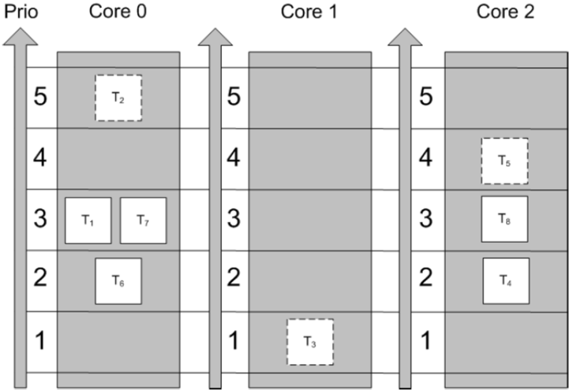

OS 可以在每个内核上并行进入。这优化了向多核方向的可扩展性。各内核独立地进行调度。这意味着一个内核上的调度不考虑其他内核上的调度[3]。一个内核上的低优先级任务（**Task**）可以与另一个内核上的高优先级任务（**Task**）并行运行。

任务（**Task**）和 ISR 无法通过调度算法动态地更改内核。

###### 6.9.2.1. 需求

实现应能够在每个已启动的 **AUTOSAR OS** 内核上独立地并行执行任务（**Task**）或 ISR。

**AUTOSAR OS** 中定义的调度策略应适用于多核系统中的每个单独内核，作用于分配给该内核的任务（**Task**）和 ISR。

注3：这同样适用于绑定到不同内核上、具有相同优先级的任务（**Task**）。这也意味着非抢占式任务（**non-preemptive Task**）无法在其正在运行的内核上被抢占，但其他内核上的任务（**Task**）可以并行运行。

#### 6.9.3. 可定位实体（LE）

可定位实体（LE）是必须完全位于一个内核上的实体。LE 到内核的分配是在配置时定义的（**OsAppEcucPartitionRef**）。

在本版本的 **AUTOSAR** 标准中，**OS-Application** 应是 LE。因为每个任务（**Task**）都必须在某个内核上运行，所以在 **AUTOSAR** R4.0 中，多核系统强制使用 **OS-Application**。BSW 模块不允许忽略 **OS-Application**，即使它们不使用任何保护机制。这与可扩展性等级（**scalability class**）无关。

如 **AUTOSAR** 操作系统规范所述，如果使用了 **OS-Application**，则所有任务（**Task**）、ISR 等都必须属于某个 **OS-Application**。这意味着在多核系统中，不存在位于 **OS-Application** 之外的 **AUTOSAR** 软件。

在单核系统上，**OS-Application** 仅在 SC3 和 SC4 中可用，因为该机制用于支持内存保护，并隐含了扩展模式（**extended mode**）的使用。在多核系统中，无论是否有内存保护，**OS-Application** 始终可用，并且在 SC1 上应可以使用标准模式（**standard mode**）。

###### 6.9.3.1. 需求

分配给同一 **OS-Application** 的所有任务（**Task**）应在同一个内核上执行。

分配给同一 **OS-Application** 的所有 ISR 应在同一个内核上执行。

ISR 均衡（**ISR balancing**，如果硬件支持）应在启动时由 OS 关闭。

在多核（**MultiCore**）情况下，OS 模块还应在 SC1 和 SC2 中支持 **OS-Application**。

在 SC1 系统中，应可以使用标准模式。

**OS-Application** 到内核的绑定应从所引用的 **EcucPartition** 派生。

**OS-Application** 容器中的配置项 **OsAppEcucPartitionRef** 应用于定义 **EcucPartition**（进而 **OS-Application**）所绑定的内核。OS 生成器会将配置参数 "CORE" 映射到某个特定的内核，从而使所有具有相同配置参数的 **OS-Application** 都位于同一个内核上。

#### 6.9.4. 多核启动概念

内核的启动方式在很大程度上取决于硬件。通常，硬件只启动一个内核，称之为主核（**master core**），而其他内核（从核，**slave**）保持停机（halt）状态，直到被软件激活。

与这种主从系统相反，也可以设想让内核彼此独立启动的其他引导概念。然而，在这类系统上，可以通过软件来仿真主从行为。

**AUTOSAR** 多核 OS 规范要求具有主从启动行为的系统，这种行为要么由硬件直接支持，要么在软件中仿真。主核（**master core**）定义为不需要软件激活的内核，而从核（**slave core**）则需要由软件激活。

在多核配置中，每个被 **AUTOSAR** 使用的从核都必须在该内核进入 **StartOS** 之前被激活。取决于硬件，可能只能从主核激活可用内核的一个子集。从核可以在调用 **StartOS** 之前激活额外的内核。所有属于 **AUTOSAR** 系统的内核都必须由指定的 **AUTOSAR API** 函数激活。此外，必须在所有这些内核上调用 **StartOS** 函数。

内核被激活后，会先执行一些硬件和编译器相关的操作，然后才调用 "main" 函数。如果在每个内核上执行相同的 "main" 函数，则必须在该函数内部通过各内核特定的内核 ID（**core Id**）来区分它们。

**示例：**

```C
void main ()
{
    StatusType rv;

    /* ... */

    switch (GetCoreID())
    {
        case OS_CORE_ID_MASTER:
            /* ... */
            StartCore(OS_CORE_ID_0, &rv);
            StartOS(OSDEFAULTAPPMODE);
            break;

        case OS_CORE_ID_0:
            /* ... */
            StartCore(OS_CORE_ID_1, &rv);
            StartOS(DONOTCARE);
            break;

        otherwise:
            StartOS(DONOTCARE);
    }
}
```

**StartOS** 会对所有内核进行两次同步。第一个同步点位于执行 **StartupHook** 之前；第二个同步点位于 **OS-Application** 特定的 **StartupHook** 完成之后、调度器启动之前。第二次同步发生的确切位置取决于实现，但它应位于调度启动之前。本版本的 **AUTOSAR** 规范不支持同步阶段中的超时。用 [**StartCore**](#7425-startcore) 激活但不调用 **StartOS** 的内核可能导致系统挂起。避免这种行为是集成者的责任。

如图 7.16 所示，在第一次同步之后，会在每个内核上立即调用 **StartupHook**。然而，系统中只有一个全局 **StartupHook**。例如，如果必须在 **StartupHook** 期间执行内核各自的功能，可以使用 [**GetCoreID**](#7424-getcoreid) 函数来区分各个内核。在全局 **StartupHook** 完成之后，每个内核会执行其各 **OS-Application** 的 **StartupHook**。由于 **OS-Application** 绑定到内核，**OS-Application** 特定的 **StartupHook** 只在相应 **OS-Application** 所绑定的内核上执行。

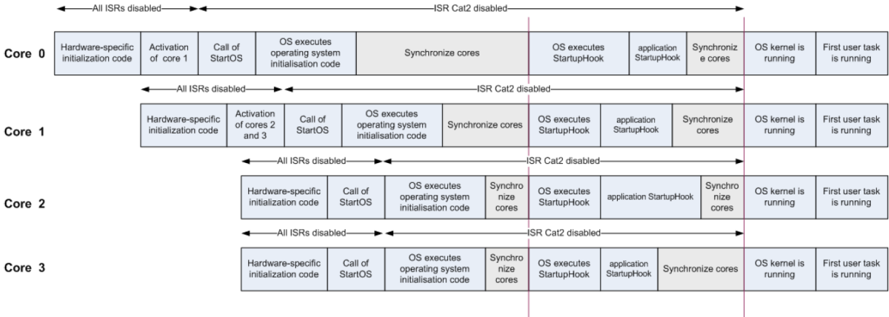

###### 6.9.4.1. 需求

主核（**master core**）应能够激活内核。

任何从核（**slave core**）都应能够激活内核。

应允许 **AUTOSAR** 系统仅使用 µC 上可用内核的一个子集。

内核应以主从模式引导。如果硬件不支持这一点，则应让内核并行引导并仿真主从系统的行为。

在仿真的情况下，受 **AUTOSAR OS** 控制的从核（**AUTOSAR** 内核）（CoreS）在另一个内核通过 [**StartCore**](#7425-startcore)(CoreS) 激活该从核之前，不得进入 main 函数。

所有属于 **AUTOSAR** 系统的内核应在 **StartOS** 函数内、在全局 **StartupHook** 被调用之后且在调度启动之前被同步。

所有属于 **AUTOSAR** 系统的内核应在 **StartOS** 内、在全局 **StartupHook** 被调用之前被同步。

全局 **StartupHook** 应在第一个同步点之后立即在所有内核上被调用。

**OS-Application** 特定的 **StartupHook** 应在全局 **StartupHook** 之后被调用，但只在 **OS-Application** 所绑定的那些内核上调用。

#### 6.9.5. 受 AUTOSAR OS 控制的内核

如上所述，**AUTOSAR OS** 控制若干内核。但是，它不必控制 µC 的所有内核。受控内核的最大数量应在配置的 **OsOS** 部分中配置。

**AUTOSAR OS API** 提供 [**StartCore**](#7425-startcore) 函数来启动其控制下的内核。[**StartCore**](#7425-startcore) 函数接受一个 [**CoreIdType**](#7318-coreidtype) 类型的标量值参数，用于指定要启动的内核。[**StartCore**](#7425-startcore) 可以在主核上多次调用，也可以在从核上调用。但是，每个内核只能被启动一次。例如：

```C
StatusType rv1, rv2;
StartCore(OS_CORE_ID_1, &rv1);
StartCore(OS_CORE_ID_2, &rv2);
if (rv1 != E_OK) || (rv2 != E_OK)
    EnterPanicMode();
StartOS(OSDEFAULTAPPMODE);
```

**StartOS** 函数应在所有已被 [**StartCore**](#7425-startcore) 激活的内核上被调用。不允许从已经调用过 **StartOS** 的内核上调用 [**StartCore**](#7425-startcore)。

属于 **AUTOSAR** 系统的内核应由指定的 **AUTOSAR OS API** 服务 [**StartCore**](#7425-startcore) 启动。

###### 6.9.5.1. 需求

可由 **AUTOSAR OS** 控制的内核数量应离线配置。**OsOS** 容器中的一个新配置项（**OsNumberOfCores**）用于指定受 **AUTOSAR OS** 控制的内核的最大数量。如果没有为 **OsNumberOfCores** 指定值，则内核数量应为一。

#### 6.9.6. 多核关机概念

**AUTOSAR** 支持两种关机概念：同步关机概念和单独关机概念。同步关机由新的 API 函数 [**ShutdownAllCores**](#7429-shutdownallcores) 触发，而单独关机由现有的 API 函数 **ShutdownOS** 调用。

###### 6.9.6.1. 同步关机概念

如果具有相应权限的任务（**Task**）调用 [**ShutdownAllCores**](#7429-shutdownallcores)，则会向所有其他内核发送一个信号以引发关机过程。一旦某个内核上开始了关机过程，中断和任务（**Task**）将不再被处理，也不会再进行调度，因此激活任何任务（**Task**）都没有意义，但不会产生错误。应用开发者/系统集成者有责任确保在调用 [**ShutdownAllCores**](#7429-shutdownallcores) 之前，已完成应用层和基础软件层上所有的关机准备工作（例如借助 ECU 状态管理器）。

在关机过程中，每个内核执行其 **OS-Application** 特定的 **ShutdownHook** 函数，随后是一个同步点。在所有内核都到达同步点之后，全局 **ShutdownHook** 函数由所有内核并行执行。

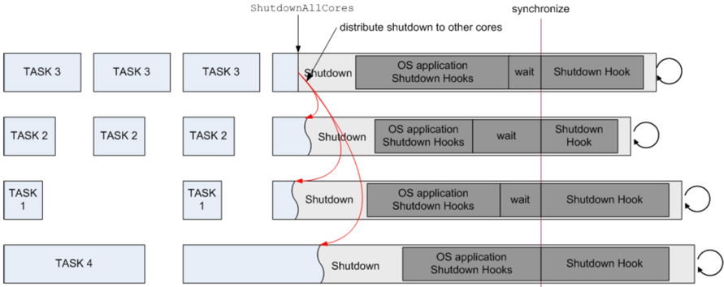

在关机期间，**OS-Application** 特定的 **ShutdownHook** 应在相应 **OS-Application** 所绑定的内核上被调用。

在调用全局 **ShutdownHook** 之前，所有内核应被同步。

全局 **ShutdownHook** 应在所有内核上被调用。

###### 6.9.6.2. 单独关机概念

如果任务（**Task**）调用 **ShutdownOS**，OS 将在调用 **ShutdownOS** 的那个内核上被关闭。每个内核都应能够调用 **ShutdownOS**。与 **StartOS** 类似，该函数将关闭单个内核。要关闭整个 ECU，必须在每个内核上调用 **ShutdownOS**。该函数不会返回。

**AUTOSAR** R4.x 不支持单独关机（**AUTOSAR** 模式管理不会使用它）。

###### 6.9.6.3. 致命内部错误情况下的关机

在多核系统中，可能发生仅在单个内核上检测到致命的 OS 内部错误的情况。在这种情况下，对该内核进行本地关机是没有意义的。

在 OS 检测到致命内部错误的情况下，所有内核都应被关闭。

#### 6.9.7. OS 服务功能（概览）

本章描述现有的单核 **AUTOSAR OS** 功能中有哪些得到了扩展。下表概述了所有标准 OS API 函数。"Multi-Core support"列包含以下值之一：

* **Extended**：该函数已被大幅扩展，以支持特定的多核功能。
* **Adapted**：该函数需要一些小的更改，但基本保持不变。
* **Unchanged**：该函数的行为没有变化。
* **New**：该函数是一个新的 **AUTOSAR OS API** 函数。

表7.2：OS 服务调用变更概览

| 服务                      | 多核支持             | 说明                                     |
|---------------------------|----------------------|------------------------------------------|
| ActivateTask              | Extended             | 应支持跨内核使用。       |
| [AllowAccess](#7421-allowaccess)               | Unchanged            | 仅在同一内核上有效。             |
| [CallTrustedFunction](#744-calltrustedfunction)       | Adapted              | 函数必须绑定到同一内核。 |
| CancelAlarm               | Extended             | 应支持跨内核使用。       |
| ChainTask                 | Extended             | 应支持跨内核使用。       |
| [CheckISRMemoryAccess](#745-checkisrmemoryaccess)      | Unchanged            |                                          |
| [CheckObjectAccess](#747-checkobjectaccess)         | Unchanged            |                                          |
| [CheckObjectOwnership](#748-checkobjectownership)      | Unchanged            |                                          |
| CheckTASKMemoryAccess     | Unchanged            |                                          |
| ClearEvent                | Unchanged            |                                          |
| [ControlIdle](#7430-controlidle)               | Unchanged            | 允许从任何内核调用。   |
| DisableAllInterrupts      | Unchanged            | 仅在同一内核上有效。             |
| EnableAllInterrupts       | Unchanged            | 仅在同一内核上有效。             |
| GetActiveApplicationMode  | Unchanged            |                                          |
| GetAlarm                  | Extended             | 应支持跨内核使用。       |
| GetAlarmBase              | Extended             | 应支持跨内核使用。       |
| [GetApplicationID](#741-getapplicationid)          | Unchanged            |                                          |
| [GetApplicationState](#7422-getapplicationstate)       | Extended             | 应支持跨内核使用。       |
| [GetCoreID](#7424-getcoreid)                 | New                  | 当前内核的 ID。                  |
| [GetCounterValue](#7418-getcountervalue)           | Adapted              | 不允许跨内核。               |
| [GetElapsedValue](#7419-getelapsedvalue)           | Adapted              | 不允许跨内核。               |
| GetEvent                  | Unchanged            |                                          |
| [GetISRID](#743-getisrid)                  | Unchanged            |                                          |
| [GetNumberOfActivatedCores](#7423-getnumberofactivatedcores) | New                  | 运行 AUTOSAR OS 的内核数量。  |
| GetResource               | Adapted              | 可与自旋锁嵌套。                 |
| [GetScheduleTableStatus](#7416-getscheduletablestatus)    | Extended             | 应支持跨内核使用。       |
| [GetSpinlock](#7426-getspinlock)               | New                  | 占用自旋锁。                       |
| GetTaskID                 | Unchanged            | 仅在同一内核上有效。             |
| GetTaskState              | Extended             | 应支持跨内核使用。       |
| [IncrementCounter](#7417-incrementcounter)          | Adapted              | 不允许跨内核。               |
| [NextScheduleTable](#7412-nextscheduletable)         | Unchanged            |                                          |
| ReleaseResource           | Adapted              | 可与自旋锁嵌套。                 |
| [ReleaseSpinlock](#7427-releasespinlock)           | New                  | 释放自旋锁。                      |
| ResumeAllInterrupts       | Unchanged            | 仅在同一内核上有效。             |
| ResumeOSInterrupts        | Unchanged            | 仅在同一内核上有效。             |
| Schedule                  | Adapted              | 检查未释放的自旋锁           |
| SetAbsAlarm               | Extended             | 应支持跨内核使用        |
| SetEvent                  | Extended             | 应支持跨内核使用。       |
| SetRelAlarm               | Extended             | 应支持跨内核使用        |
| [SetScheduleTableAsync](#7415-setscheduletableasync)     | Unchanged            |                                          |
| [ShutdownAllCores](#7429-shutdownallcores)          | New                  | 同步关机。                   |
| ShutdownOS                | Extended             | 支持多核系统                   |
| [StartCore](#7425-startcore)                 | New                  | 启动额外的内核                    |
| StartOS                   | Extended             | 支持多核系统                   |
| [StartScheduleTableAbs](#7410-startscheduletableabs)     | Extended             | 应支持跨内核使用。       |
| [StartScheduleTableRel](#749-startscheduletablerel)     | Extended             | 应支持跨内核使用。       |
| [StartScheduleTableSynchron](#7413-startscheduletablesynchron) | Unchanged            |                                          |
| [StopScheduleTable](#7411-stopscheduletable)         | Extended             | 应支持跨内核使用。       |
| SuspendAllInterrupts      | Unchanged            | 仅在同一内核上有效              |
| SuspendOSInterrupts       | Unchanged            | 仅在同一内核上有效              |
| [SyncScheduleTable](#7414-syncscheduletable)         | Unchanged            |                                          |
| [TerminateApplication](#7420-terminateapplication)      | Extended             | 检查未释放的自旋锁. 应支持跨内核使用。 |
| TerminateTask             | Adapted              | 检查未释放的自旋锁           |
| [TryToGetSpinlock](#7428-trytogetspinlock)          | New                  | 尝试占用自旋锁                 |
| WaitEvent                 | Adapted              | 检查未释放的自旋锁           |
| [isOsStarted](#7439-isosstarted)               | Adapted              | 在多核情况下，它仅返回调用该服务的内核的值 |

表7.3：OS 服务调用的允许调用上下文（**Allowed Calling Context for OS Service Calls**）

| 服务                       | 任务   | 类别1 ISR  | 类别2 ISR  | ErrorHook    | PreTaskHook     | PostTaskHook     | StartupHook    | ShutdownHook    | 警报回调         | ProtectionHook    |
|----------------------------|--------|------------|------------|--------------|-----------------|------------------|----------------|-----------------|------------------|-------------------|
| [GetNumberOfActivatedCores](#7423-getnumberofactivatedcores)  | Ok     |            | Ok         |              |                 |                  |                |                 |                  |                   |
| [GetCoreID](#7424-getcoreid)                  | Ok     | Ok         | Ok         | Ok           | Ok              | Ok               | Ok             | Ok              | Ok               | Ok                |
| [StartCore](#7425-startcore)                  |        |            |            |              |                 |                  |                |                 |                  |                   |
| [GetSpinlock](#7426-getspinlock)                | Ok     |            | Ok         |              |                 |                  |                |                 |                  |                   |
| [ReleaseSpinlock](#7427-releasespinlock)            | Ok     |            | Ok         |              |                 |                  |                |                 |                  |                   |
| [TryToGetSpinlock](#7428-trytogetspinlock)           | Ok     |            | Ok         |              |                 |                  |                |                 |                  |                   |
| [GetNumberOfActivatedCores](#7423-getnumberofactivatedcores)  | Ok     |            | Ok         |              |                 |                  |                |                 |                  |                   |
| [ShutdownAllCores](#7429-shutdownallcores)           | Ok     |            | Ok         | Ok           |                 |                  | Ok             |                 |                  |                   |

所有不允许跨内核操作的函数，在使用需要跨内核操作的参数调用时，应在扩展状态下返回 **E_OS_CORE**。

#### 6.9.8. GetTaskID

**GetTaskID** 既可以从任务（**Task**）级也可以从类别 2 **ISR** 级调用。当从中断例程调用时，在单核系统上，**GetTaskID** 或者返回被中断的任务（**Task**），或者指示没有正在运行的任务（**Task**）。在多核系统上，它：

* 指示该内核上没有正在运行的任务（**Task**），或
* 返回该内核上被中断任务（**Task**）的 ID。

#### 6.9.9. 中断禁用

**注意：**所有类型的中断只能在本地内核上被禁用。这意味着其他内核上的中断标志保持其当前状态。其他内核上的调度继续进行。其他内核上正在运行的 ISR 继续执行。

###### 6.9.9.1. 需求

OS 服务 **DisableAllInterrupts** 应仅影响调用它的内核。

OS 服务 **EnableAllInterrupts** 应仅影响调用它的内核。

OS 服务 **SuspendAllInterrupts** 应仅影响调用它的内核。

OS 服务 **ResumeAllInterrupts** 应仅影响调用它的内核。

OS 服务 **SuspendOSInterrupts** 应仅影响调用它的内核。

OS 服务 **ResumeOSInterrupts** 应仅影响调用它的内核。

#### 6.9.10. 任务激活

任务激活应被扩展以跨内核工作。本文档不规定任何实现细节。跨内核工作时，此函数的时序行为可能变慢。如果必须在另一个内核上激活任务（**Task**），则该内核上必须做出调度决策。如果该内核尚未启动，则会产生错误。

###### 6.9.10.1. 需求

应可以激活属于位于另一个内核上的 **OS-Application** 的任务（**Task**），只要所分配的访问权限允许。

跨内核调用 **ActivateTask** 的行为应是同步的，即调用在任务（**Task**）已被激活或错误已被检测到之后返回。在远程内核上完成 **ActivateTask** 之前，不应可能在调用内核上继续执行。

跨内核调用 **ActivateTask** 时发生错误的情况下，错误处理程序应在最初调用 **ActivateTask** 的内核上被调用。

操作系统应提供 **ActivateTask** 的异步版本，该版本不向调用者返回错误，而只调用（全局）错误挂钩（如果已配置）。函数名应为 [**ActivateTaskAsyn**](#7437-activatetaskasyn)。

#### 6.9.11. 任务链接

任务链接应被扩展以跨内核工作。本文档不规定任何实现细节。跨内核工作时，此函数的时序行为可能变慢。如果必须在另一个内核上激活任务（**Task**），则该内核上必须做出调度决策。如果该内核尚未被激活，则会产生错误。

###### 6.9.11.1. 需求

应可以链接属于位于另一个内核上的 **OS-Application** 的任务（**Task**），只要所分配的访问权限允许。

#### 6.9.12. 事件设置

**SetEvent** 应被扩展以跨内核工作。本文档不规定任何实现细节。跨内核工作时，此函数的时序行为可能变慢。如果内核尚未被激活，则会产生错误。

###### 6.9.12.1. 需求

应可以设置属于位于另一个内核上的 **OS-Application** 的事件（**Event**），只要所分配的访问权限允许。

跨内核调用 **SetEvent** 的行为应是同步的，即调用在事件（**Event**）已被设置或错误已被检测到之后返回。在远程内核上完成 **SetEvent** 之前，不应可能在调用内核上继续执行。

跨内核调用 **SetEvent** 时发生错误的情况下，错误处理程序应在最初调用 **SetEvent** 的内核上被调用。

操作系统应提供 **SetEvent** 的异步版本，该版本不向调用者返回错误，而只调用（全局）错误挂钩（如果已配置）。函数名应为 [**SetEventAsyn**](#7438-seteventasyn)。

#### 6.9.13. 激活额外的内核

激活额外内核的机制如 6.9.5 节所述。

#### 6.9.14. OS 的启动

有必要扩展 **StartOS** 的功能。这是因为 **StartOS** 在每个内核（**core**）上被调用一次。用户通过 **StartOS(AppMode)** 的调用参数向操作系统提供所谓的应用模式（**application mode**）<sup>4</sup>。应用模式定义了 OS 自动启动哪些已配置的（启动）对象（任务（**Task**）、警报（**Alarm**）、调度表（**ScheduleTable**））。

在多核（**Multi-Core**）系统上，所有内核（**core**）应在同一个应用模式下运行。如果调用 **StartOS** 时所用的 **AppMode** 为 **DONOTCARE**，则使用其他内核（**core**）的 **AppMode**。至少有一个内核必须定义一个不同于 **DONOTCARE** 的 **AppMode**。

如果所有内核上的应用模式相同，**StartOS** 将继续执行其任务。更多细节参见 6.9.4 节。

###### 6.9.14.1. 需求

**AUTOSAR** 规范不支持在某个内核上调用 **StartOS** 之后再激活 **AUTOSAR** 内核（**core**）。如果在 **StartOS** 之后调用 [**StartCore**](#7425-startcore)，它应在扩展状态下返回 **E_OS_ACCESS**。

**StartOS** 应在其被调用的内核上启动 OS。

如果多个内核以不同于 **DONOTCARE** 的 **AppMode** 调用 **StartOS**，则这些 **AppMode** 应相同。**StartOS** 应在第一个同步点检查这一点。如果违反，**StartOS** 不应启动调度，不应调用任何 **StartupHook**，并且应在每个内核上进入无限循环。

如果调用 **StartOS** 时所用的 **AppMode** 为 **DONOTCARE**，则应使用其他内核（不同于 **DONOTCARE** 的那些）的应用模式。

> 4 这是操作系统的应用模式，不应与 **AUTOSAR** 模式管理中定义的其他应用模式相混淆。

至少有一个内核应定义一个不同于 **DONOTCARE** 的 **AppMode**。

如果配置了 [IOC](#75-ioc)，**StartOS** 应初始化 [IOC](#75-ioc) 的数据结构。

如果配置了 [IOC](#75-ioc)，并且 OS 生成器以"Default mode"被调用，**StartOS** 应调用 [**IocInit**](#7541-iocinit)（参见 [SWS_Os_00835]）来初始化 [IOC](#75-ioc) 的数据结构。

#### 6.9.15. 任务终止

任务（**Task**）的终止需要一项额外的检查：不允许在自旋锁（**spinlock**）被占用时终止任务（**Task**）。如果在自旋锁（**spinlock**）被占用的情况下调用 **TerminateTask** / **ChainTask**，将返回一个错误。

###### 6.9.15.1. 需求

如果在调用任务（**Task**）持有自旋锁（**spinlock**）的情况下调用 **TerminateTask**（或 **ChainTask**），则在标准状态下行为未定义。

在扩展状态下，**TerminateTask** / **ChainTask** 应返回一个可在应用中求值的错误（**E_OS_SPINLOCK**）。

因响应保护挂钩而被终止的任务（**Task**）所占用的自旋锁（**spinlock**）应被自动释放。这同样适用于 **OS-Application** 被终止的情况。

#### 6.9.16. OS-Application 的终止

与任务（**Task**）类似，当 **OS-Application** 的任何任务（**Task**）占用自旋锁（**spinlock**）时，该 **OS-Application** 无法被终止。在这种情况下，自旋锁（**spinlock**）会被自动释放。为避免错误处理的雪崩式增长，不会调用 **ErrorHook**。

[**TerminateApplication**](#7420-terminateapplication)(A) 可能会从不同内核并行调用。实现必须通过执行最先到达的 [**TerminateApplication**](#7420-terminateapplication)(A) 调用、并忽略后续任何调用直至终止完成，来支持这种调用模式。

###### 6.9.16.1. 需求

[**TerminateApplication**](#7420-terminateapplication) 应检查 **OS-Application** 中的任务（**Task**）是否占用了自旋锁（**spinlock**）。如果是，则应释放这些自旋锁。

如果 [**TerminateApplication**](#7420-terminateapplication)(A) 从不同内核并行调用，**OS-Application** A 由第一次调用终止；在终止完成之前，任何后续调用都将在标准状态和扩展状态下返回 **E_OK** 且不执行任何操作。

#### 6.9.17. OS 的关机

每个内核（**core**）都应能够使用 **ShutdownOS** 函数来引发关机。通过调用 **ShutdownOS**，只有调用它的内核会进入关机过程。

如果用户希望（或多或少并行地）关闭所有内核，应使用 [**ShutdownAllCores**](#7429-shutdownallcores)。**ShutdownOS** 和 [**ShutdownAllCores**](#7429-shutdownallcores) 不会返回。

在 **AUTOSAR** R4.0 中，**AUTOSAR** 模式管理不使用 OS 服务 **ShutdownOS**。该函数是为那些在没有 RTE、也没有模式管理的内核上运行 OS 的用户提供的。

###### 6.9.17.1. 需求

**ShutdownOS** 应可以从每个运行 **AUTOSAR** OS 的内核上调用。

**ShutdownOS** 应关闭调用它的那个内核。

一旦在某个特定内核上进入了关机过程，OS 就不应再启动 **OS-Application** 的任务（**Task**）。

**AUTOSAR** OS 函数 **ShutdownOS** 应可以在多个内核上并行调用。

**ShutdownOS** 应释放调用内核所占用的所有自旋锁（**spinlock**）。

[**ShutdownAllCores**](#7429-shutdownallcores) 应可以从每个运行 **AUTOSAR** OS 的内核上调用。

#### 6.9.18. 等待事件

事件（**Event**）等待机制必须适应新的多核自旋锁（**spinlock**）功能：

任务（**Task**）在调用 **WaitEvent** 时可能被取消调度，此时它将无法释放自旋锁（**spinlock**）。因此，**WaitEvent** 必须检查调用任务（**Task**）是否持有自旋锁（**spinlock**）。与资源（**Resource**）一样，处于等待状态的任务（**Task**）不能占用自旋锁（**spinlock**）。

###### 6.9.18.1. 需求

**AUTOSAR** 操作系统 **WaitEvent** API 服务应检查它是否在调用任务（**Task**）已占用自旋锁（**spinlock**）的情况下被调用。在扩展状态下应返回错误 **E_OS_SPINLOCK**，并且该任务（**Task**）不应进入等待状态。

#### 6.9.19. 调用可信函数

函数可以作为某个 **OS-Application** 的一部分被声明为可信的。此后，它们只能通过 [**CallTrustedFunction**](#744-calltrustedfunction) API 函数来执行。假设访问权限已相应配置，**OS-Application** A 中的任务（**Task**）可以调用 **OS-Application** B 中的可信函数。

在多核系统上，这种从一个 **OS-Application** 到另一个 **OS-Application** 的可信函数调用仅限于同一个内核（**core**）。

###### 6.9.19.1. 需求

如果目标可信函数属于另一个内核上的 **OS-Application**，则 OS API 函数 [**CallTrustedFunction**](#744-calltrustedfunction) 应在扩展状态下返回 **E_OS_ACCESS**。

#### 6.9.20. 触发重新调度

**Schedule** API 服务必须以与 **WaitEvent** 相同的方式适应新的多核自旋锁（**spinlock**）功能。

任务（**Task**）在占用自旋锁（**spinlock**）时不应主动强制取消调度。

###### 6.9.20.1. 需求

**AUTOSAR** 操作系统 **Schedule** API 服务应检查它是否在调用任务（**Task**）已占用自旋锁（**spinlock**）的情况下被调用。在扩展状态下应返回错误 **E_OS_SPINLOCK**，并且不应调用调度器。

#### 6.9.21. 资源处理

**GetResource** 函数允许同一内核（**core**）上的任务（**Task**）之间实现互斥。OS 生成器应离线检查这些任务（**Task**）不位于不同内核上（参见 6.9.29），而 **GetResource** 函数会在运行时在线检查这一要求。

**GetResource** 所使用的优先级天花板协议（priority ceiling protocol）会临时更改任务（**Task**）的优先级。这种方法在多核系统上会失效，因为优先级是各内核本地的。因此，天花板协议不足以保护临界区免受来自不同内核的访问。

如果一个任务（**Task**）/ISR 锁定了自旋锁（**spinlock**）和资源（**Resource**），则它们必须以严格的 LIFO 顺序解锁。如果违反了解锁顺序，**ReleaseResource** 应返回 **E_OS_NOFUNC**。不应执行任何其他功能。

如果 **OsUseResScheduler** 为 TRUE，OS 生成工具应为每个已配置的内核（**core**）创建 **RES_SCHEDULER** 的一个虚拟实例。

运行在不同内核上的任务（**Task**）应可以同时占用它们各自的 **RES_SCHEDULER** 实例。

**RES_SCHEDULER** 每个实例的天花板优先级应阻止在其被占用的内核上执行任何其他任务（**Task**），但对任何其他内核上的调度没有影响。

如果 **OsUseResScheduler** 为 FALSE，并且配置中包含一个名为 **RES_SCHEDULER** 的资源（**Resource**），则该已配置的资源（**Resource**）的行为应与任何其他已配置的资源（**Resource**）相同。

应可以配置一个链接到 **RES_SCHEDULER** 的 **LINKED** 资源（**Resource**）。在 **OsUseResScheduler** = TRUE 的多核配置中，该链接应指向 **LINKED** 资源（**Resource**）所分配到的内核上 **RES_SCHEDULER** 的实例。

#### 6.9.22. CoreID

每个硬件都会为内核（**core**）分配一个唯一的物理 ID。物理内核 ID 是区分各内核的唯一手段。一个 µC 的物理内核 ID 不一定是连续的，也不一定从零开始。

软件需要一种标识内核的机制，例如使用内核特定的变量。由于物理内核 ID 通常无法直接用作内核特定变量的数组索引，因此需要一个逻辑 **CoreID** 来将物理内核 ID 映射到数组索引。在软件中无需知道物理内核 ID，逻辑 **CoreID** 就足够了。

**OS-Application** 及其他软件对象到内核（**core**）的映射在配置文件中规定。所有此类映射都应与硬件无关，因此不应基于物理内核 ID，而应基于逻辑 **CoreID**。

[**GetCoreID**](#7424-getcoreid) 函数在内部将物理内核 ID 映射到逻辑 **CoreID**。该值在配置参数 **EcucCoreId** 中定义。[**GetCoreID**](#7424-getcoreid) 可以是一个 C 函数，也可以是一个宏。

###### 6.9.22.1. 需求

**AUTOSAR** 操作系统 API 函数 [**GetCoreID**](#7424-getcoreid) 应可以在 **StartOS** 之前调用。

实现应定义一组 [**CoreIdType**](#7318-coreidtype) 类型的常量 **OS_CORE_ID_&lt;No&gt;**，其中 &lt;No&gt; 为 0 到 **OsNumberOfCores** -1 之间的值。

实现应提供一个 [**CoreIdType**](#7318-coreidtype) 类型的常量 **OS_CORE_ID_MASTER**，它指向主核（**master core**）。

#### 6.9.23. 计数器，背景与理由

一个计数器（**Counter**）由一个以"滴答"为单位度量的计数值和一些计数器特定的常量来表示。

与单核（**Single-Core**）情况类似，每个操作系统（在每个内核上）都提供至少一个从定时器派生的计数器（**Counter**）。因此，可以定义多个属于不同 **OS-Application** 的计数器（**Counter**），它们既可以位于同一个内核上，也可以位于不同的内核上。

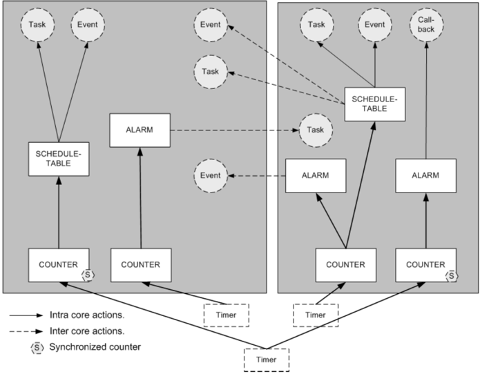

#### 6.9.24. 计数器的多核限制

**AUTOSAR** OS 只能在计数器（**Counter**）所在的内核上递增该计数器。如果 X 和 Y 被分配到不同的内核，分配给 **OS-Application** X 的计数器（**Counter**）就不能被 **OS-Application** Y 递增。

###### 6.9.24.1. 需求

属于某个 **OS-Application** 的计数器（**Counter**）应由该 **OS-Application** 所在的内核递增。该计数器（**Counter**）不应被其他内核递增。

不应允许由分配到不同内核上的计数器（**Counter**）来驱动调度表（**ScheduleTable**）。

不应允许由分配到不同内核上的计数器（**Counter**）来驱动警报（**Alarm**）。

这些限制有两个不同的原因：

- 当允许跨内核修改计数器（**Counter**）时，可能发生竞态条件（race condition）（一个内核等待另一个内核修改某个计数器（**Counter**））。

- 递增计数器（**Counter**）的内核必须检查基于该计数器的警报（**Alarm**）是否已到期。当不同的内核操作相同的警报（**Alarm**）时，已到期警报（**Alarm**）的处理会更加复杂，因为必须进行互斥。

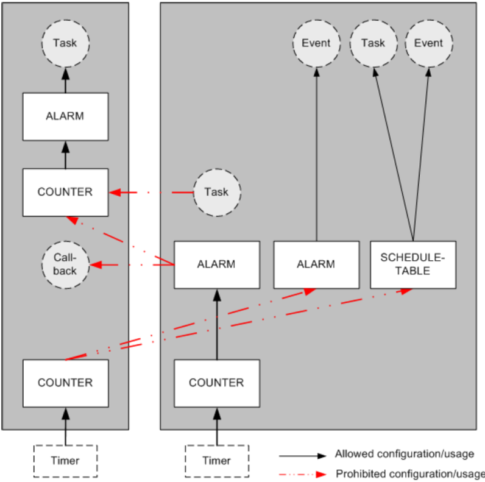

#### 6.9.25. 计数器的同步

计数器（**Counter**）用于驱动警报（**Alarm**）和调度表（**ScheduleTable**）。为了同步位于不同内核上的警报（**Alarm**）和调度表（**ScheduleTable**），必须同步相应的计数器（**Counter**）。例如，如果硬件支持，不同内核上相应的自由运行硬件计数器可以使用同一个定时器（由外设维护相同的计数值），从而在不同内核上提供相同的时基。随后，软件计数器（**Software Counter**）可以由附加到这些内核本地相应硬件计数器上的警报（**Alarm**）来推进，例如以驱动不同内核上同步的调度表（**ScheduleTable**）。同步性的质量取决于硬件架构和系统配置。

#### 6.9.26. 警报

**AUTOSAR** 操作系统的警报（**Alarm**）机制提供服务，用于激活任务（**Task**）、设置事件（**Event**）、递增计数器（**Counter**）或调用警报回调（**OsAlarmCallbackName**）。

如上所述，警报（**Alarm**）只能绑定到位于同一个内核上的计数器（**Counter**）。通过警报（**Alarm**）动作可以激活任务（**Task**）和设置事件（**Event**），而与任务（**Task**）绑定到哪个内核无关。但是，必须遵守由 **OS-Application** 定义的访问权限。此外，还应允许对绑定到其他内核的警报（**Alarm**）进行操作。API 服务 **SetRelAlarm**、**SetAbsAlarm** 和 **CancelAlarm** 可用于操作其他内核上警报（**Alarm**）的参数。

###### 6.9.26.1. 需求

当警报（**Alarm**）到期时，应允许激活不同内核上的任务（**Task**）。

当警报（**Alarm**）到期时，应允许设置不同内核上的事件（**Event**）。

**AUTOSAR** 操作系统应在其相应的 **OS-Application** 所在的内核上处理警报（**Alarm**）。

警报回调应在警报（**Alarm**）绑定到的内核上执行。这仅适用于 SC1 系统，因为在其他情况下不允许使用警报回调（参见 [SWS_Os_00242]）。

**SetRelAlarm** 也应作用于绑定到另一个内核上的警报（**Alarm**）。

**SetAbsAlarm** 也应作用于绑定到另一个内核上的警报（**Alarm**）。

**CancelAlarm** 也应作用于绑定到另一个内核上的警报（**Alarm**）。

**GetAlarmBase** 也应作用于绑定到另一个内核上的警报（**Alarm**）。

**GetAlarm** 也应作用于绑定到另一个内核上的警报（**Alarm**）。

#### 6.9.27. 调度表

与警报（**Alarm**）类似，调度表（**ScheduleTable**）可用于激活任务（**Task**）和设置事件（**Event**）。与警报（**Alarm**）一样，调度表（**ScheduleTable**）只能绑定到位于同一个内核上的计数器（**Counter**）。

为简化系统启动，应可以启动其他内核上的调度表（**ScheduleTable**）。系统设计者负责调度表（**ScheduleTable**）的正确处理。例如，调度表（**ScheduleTable**）可以由一个内核控制。

###### 6.9.27.1. 需求

调度表（**ScheduleTable**）应能够激活绑定在调度表（**ScheduleTable**）所驻留内核以外的其他内核上的任务（**Task**）。

调度表（**ScheduleTable**）应能够在调度表（**ScheduleTable**）所驻留内核以外的其他内核上设置事件（**Event**）。

**AUTOSAR** 操作系统应在其相应的 **OS-Application** 所在的内核上处理调度表（**ScheduleTable**）。

API 调用 [**StartScheduleTableAbs**](#7410-startscheduletableabs) 应能够启动驻留在其他内核上的 **OS-Application** 的调度表（**ScheduleTable**）。

API 调用 [**StartScheduleTableRel**](#749-startscheduletablerel) 应能够启动驻留在其他内核上的 **OS-Application** 的调度表（**ScheduleTable**）。

API 调用 [**StopScheduleTable**](#7411-stopscheduletable) 应能够停止驻留在其他内核上的 **OS-Application** 的调度表（**ScheduleTable**）。

API 服务 [**GetScheduleTableStatus**](#7416-getscheduletablestatus) 应能够获取驻留在不同内核上的 **OS-Application** 中调度表（**ScheduleTable**）的状态。

#### 6.9.28. 自旋锁机制

随着多核概念的出现，需要一种新机制来支持不同内核上的任务（**Task**）之间的互斥。这一新机制不应用于同一内核上的任务（**Task**）之间，因为那没有意义。在这种情况下，**AUTOSAR** 操作系统会返回一个错误。

应使用一种与 OSEK 的 **ResourceType** 类似的 **SpinlockType**。自旋锁（**spinlock**）是离线配置的。

自旋锁（**spinlock**）是一种忙等待机制，它轮询一个（锁）变量，直到该变量可用为止。通常，这需要原子的测试并设置（test and set）功能，其细节与具体实现有关。

一旦一个锁变量被某个任务（**Task**）/类别2 ISR 占用，其他内核上的其他任务（**Task**）/类别2 ISR 应无法占用该锁变量。自旋锁机制不会在那些轮询锁变量的其他任务（**Task**）轮询期间对它们取消调度。但是，在轮询锁变量期间，可能会有一个优先级更高的任务（**Task**）/ISR 变为就绪。在这种情况下，自旋的任务（**Task**）会受到干扰。图 7.20 对此进行了说明。

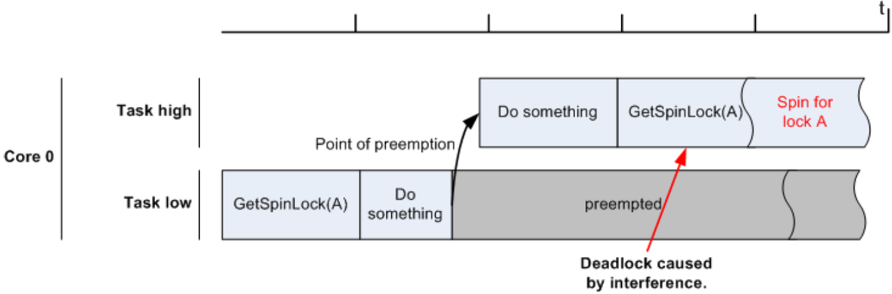

用户可以保护任务（**Task**）免受这种情况的影响，例如用 **SuspendAllInterrupts** 包裹自旋锁（**spinlock**），使其不会受到其他任务（**Task**）的干扰。OS 可以自动为调用者做到这一点——参见 **OsSpinlockLockMethod**。

第二种死锁情况可能由嵌套的自旋锁调用造成，如图 7.21 所示。

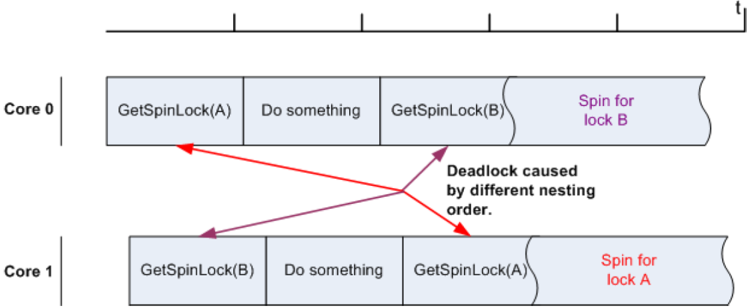

为避免死锁，不允许嵌套不同的自旋锁（**spinlock**）。或者，如果必须嵌套自旋锁（**spinlock**），则必须定义一个唯一的顺序。只能按该顺序获取自旋锁（**spinlock**），但允许跳过个别的自旋锁（**spinlock**）。在所定义的顺序中不允许出现循环。图 7.22 对此进行了说明。

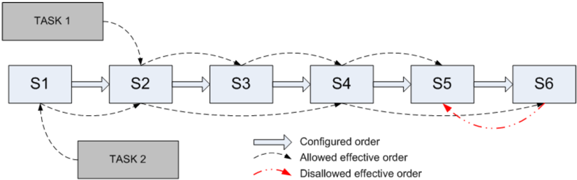

图 7.22 展示了一个示例，其中两个任务（**Task**）可以访问一组自旋锁（**spinlock**）S1 - S6。允许按预定义的顺序占用自旋锁（**spinlock**），也允许跳过自旋锁（**spinlock**）。如果同时占用多个自旋锁（**spinlock**），加锁和解锁必须以严格的 LIFO 顺序进行。

自旋锁机制本身并不是无死锁的。任务（**Task**）/ISR 请求自旋锁（**spinlock**）的顺序必须在配置描述中予以说明。如果一个任务（**Task**）占用了自旋锁（**spinlock**），则应限制调度。

**注意：****AUTOSAR** 并未规定使用哪些算法来实现自旋锁（**spinlock**）。由于用户可能希望分析时序行为（例如锁定时间），实现应记录真实的行为。

###### 6.9.28.1. 需求

**AUTOSAR** 操作系统应提供一种跨内核（**core**）工作的自旋锁（**spinlock**）机制。

**AUTOSAR** 操作系统应提供一个占用自旋锁（**spinlock**）的 [**GetSpinlock**](#7426-getspinlock) 函数。如果该自旋锁（**spinlock**）已被占用，[**GetSpinlock**](#7426-getspinlock) 应不断尝试占用该自旋锁（**spinlock**），直到成功为止。

[**GetSpinlock**](#7426-getspinlock) 应可以从任务（**Task**）级调用。

[**GetSpinlock**](#7426-getspinlock) 应可以从类别2 ISR 级调用。

如果从类别1 ISR 调用，[**GetSpinlock**](#7426-getspinlock) 的行为是未定义的。

**AUTOSAR** 操作系统应提供一个占用自旋锁（**spinlock**）的 [**TryToGetSpinlock**](#7428-trytogetspinlock) 函数。如果该自旋锁（**spinlock**）已被某个任务（**Task**）占用，[**TryToGetSpinlock**](#7428-trytogetspinlock) 应返回。

[**TryToGetSpinlock**](#7428-trytogetspinlock) 应可以从任务（**Task**）级调用。

[**TryToGetSpinlock**](#7428-trytogetspinlock) 应可以从类别2 ISR 级调用。

**AUTOSAR** 操作系统应提供一个释放已占用自旋锁（**spinlock**）的 [**ReleaseSpinlock**](#7427-releasespinlock) 函数。如果该自旋锁（**spinlock**）未被占用，应返回一个错误。

[**ReleaseSpinlock**](#7427-releasespinlock) 应可以从任务（**Task**）级调用。

[**ReleaseSpinlock**](#7427-releasespinlock) 应可以从类别2 ISR 级调用。

如果一个任务（**Task**）试图占用一个已分配给同一内核（包括其自身）上的任务（**Task**）/类别2 ISR 的自旋锁（**spinlock**），**AUTOSAR** 操作系统应产生一个错误。

如果一个类别2 ISR 试图占用一个已分配给同一内核上的任务（**Task**）/类别2 ISR 的自旋锁（**spinlock**），**AUTOSAR** 操作系统应产生一个错误。

应可以在 **AUTOSAR** 操作系统中配置一个唯一的顺序，任务（**Task**）/类别2 ISR 按该顺序在一个内核上占用多个自旋锁（**spinlock**）。这可以通过配置项（**OsSpinlockSuccessor** {**NEXT_SPINLOCK**}）来实现，其中 **NEXT_SPINLOCK** 指向紧随其后的自旋锁（**spinlock**）。（参见 **OsSpinlockSuccessor**）

如果一个内核上的任务（**Task**）/类别2 ISR（在该内核上，相同或不同的任务（**Task**）/ISR 已持有一个自旋锁（**spinlock**））试图获取另一个未被配置为最近所获取自旋锁（通过 **OsSpinlockSuccessor** 配置参数）的直接或间接后继的自旋锁（**spinlock**），或者未配置后继，**AUTOSAR** 操作系统应产生一个错误。

#### 6.9.29. 离线检查

**AUTOSAR** 资源（**Resource**）不能在不同内核上的任务（**Task**）/ISR 之间共享。OS 生成器必须检查用户是否试图将一个资源（**Resource**）分配给不同内核上的任务（**Task**），并在发现这种情况时以错误终止生成过程。

计数器（**Counter**）不能从不同内核上的 **OS-Application** 访问。OS 生成器必须拒绝违反此规则的配置。

自旋锁（**spinlock**）的链表必须无循环，以允许正确地嵌套自旋锁（**spinlock**），从而防止死锁。

OS 生成器工具必须检查 **OS-Application** 没有被分配到不存在的内核。建议在配置时进行额外的检查，例如通过 **AUTOSAR** 描述编辑器进行。

###### 6.9.29.1. 需求

如果 OS 生成器工具检测到一个资源（**Resource**）被分配到不同内核的任务（**Task**）或 ISR 所引用，它应返回错误。

如果某个警报（**Alarm**）被分配到不同内核上的计数器（**Counter**），OS 生成器工具应返回错误。

如果某个不同内核上的计数器（**Counter**）应作为警报（**Alarm**）动作被递增，OS 生成器工具应返回错误。

如果某个调度表（**ScheduleTable**）被分配到不同内核上的计数器（**Counter**），OS 生成器工具应返回错误。

如果自旋锁（**spinlock**）的链表不是无循环的，OS 生成器工具应返回错误。

OS 生成器工具应检查 **OS-Application**（包括分配给该 **OS-Application** 的任务（**Task**））到内核的分配，并在这些内核中有任何一个不存在时返回错误。

#### 6.9.30. 自动启动对象

在调度启动之前，**AUTOSAR** 操作系统<sup>5</sup> 会激活所有已配置的自动启动对象。这一机制在多核系统上的工作方式应类似。在调度启动之前，多核 OS 应在相应的内核上激活所有已配置的自动启动对象。由于 **OS-Application** 被定义为可定位实体（**locatable entity**），因此不需要额外的配置容器。自动启动对象已经作为 **OS-Application** 的一部分被配置。

###### 6.9.30.1. 需求

在调度初始启动之前，**AUTOSAR** 操作系统应针对相应的内核，自动激活为当前 **AppMode** 配置的所有自动启动任务（**Task**）。

在调度初始启动之前，**AUTOSAR** 操作系统应针对相应的内核，自动激活为当前 **AppMode** 配置的所有自动启动警报（**Alarm**）。

在调度初始启动之前，**AUTOSAR** 操作系统应针对相应的内核，自动激活为当前 **AppMode** 配置的所有自动启动调度表（**ScheduleTable**）。

> 5 即 **StartOS**。

### 6.10. OS-Application 间通信器（IOC）

#### 6.10.1. 背景与理由

[IOC](#75-ioc) 代表操作系统间应用程序通信器（**Inter OS-Application Communicator**）。

"[IOC](#75-ioc)" 负责 **OS-Application** 之间的通信，尤其是跨越内核（**core**）边界或内存保护边界的通信。其内部功能与操作系统紧密相连。

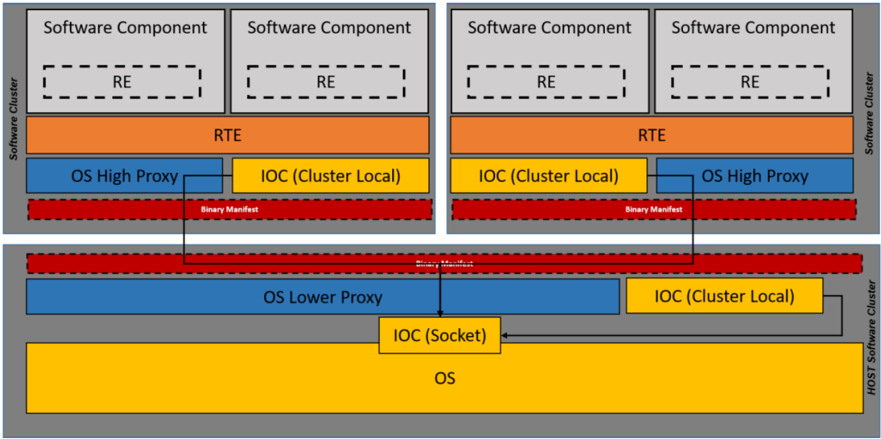

存在这样的用例：需要在被多个不同软件簇（**Software Cluster**）共同使用的 OS 代码之上，生成 1 到 N 个 [IOC](#75-ioc) 代码实例。由于这些软件簇使用不同的 [IOC](#75-ioc) 配置，因此 OS 代码不应包含任何依赖于特定 [IOC](#75-ioc) 配置的代码。

为了确保 [IOC](#75-ioc) 与 OS 代码之间的兼容性，仍然存在一项依赖：必须使用相同的 OS 配置来生成不同的 [IOC](#75-ioc) 代码实例。此外，OS 和 [IOC](#75-ioc) 代码应由来自同一供应商的 OS 生成器生成。

[IOC](#75-ioc) 的实现应为操作系统的一部分。[IOC](#75-ioc) 是除以下通信之外的第三种通信：

- **OS-Application** 内部通信：始终在运行环境（**RTE**）内处理
- ECU 间通信：已可通过通向通信栈（**COM**）的明确定义的接口实现

**[IOC](#75-ioc) 模式**：这是指 OS 生成器在调用时带有配置参数、仅生成 [IOC](#75-ioc) 代码的模式。

**OS 模式**：这是指 OS 生成器在调用时带有配置参数、仅生成 OS 代码的模式。

**默认模式**：这是指当前的行为，即 [IOC](#75-ioc) 代码与 OS 代码一起生成。

OS 生成器应提供配置参数，允许将 [IOC](#75-ioc) 通信代码（"[IOC](#75-ioc) mode"）与 OS 代码（"OS mode"）分开生成。

[SWS_Os_00831] 意味着 OS 生成器应能够在单次调用中仅生成 OS 代码或仅生成 [IOC](#75-ioc) 代码。

宿主软件簇（**Host Software Cluster**）中的操作系统应能够处理与不同软件簇相关的多个 [IOC](#75-ioc) 代码实例。

当 OS 生成器以"OS mode"被调用时，它应仅生成 OS 代码。因此，OS 代码不应包含任何依赖于特定 [IOC](#75-ioc) 配置的代码，因为不同的软件簇将使用不同的 [IOC](#75-ioc) 配置配合同一份 OS 代码。

请注意，必须使用相同的 OS 配置来生成不同的 [IOC](#75-ioc) 实例，以确保 [IOC](#75-ioc) 与 OS 代码之间的兼容性。

当 OS 生成器以"[IOC](#75-ioc) mode"被调用时，它应仅生成 [IOC](#75-ioc) 代码。此时，包含所生成 [IOC](#75-ioc) 代码的 C 模块的名称应为 **Ioc.c**，包含所生成 [IOC](#75-ioc) API 的头文件的名称应为 **Ioc.h**。

需求 [SWS_Os_00833] 和 [SWS_Os_00834] 确保 OS 与 [IOC](#75-ioc) 可以相互独立地生成，并在构建 ECU 实例/机器（**Machine**）时链接在一起。

如果配置了 [IOC](#75-ioc)，则应存在一个函数 [**IocInit**](#7541-iocinit)，负责 [IOC](#75-ioc) 数据结构的初始化。

内存保护边界是 **OS-Application** 的一个特性，需要特殊的通信机制才能跨越它们。多核系统可能还需要额外的措施来使内核之间的通信安全。

所有 **AUTOSAR** 软件，无论是 BSW 还是软件组件，都必须属于某个 **OS-Application**（参见第 6.9.3 节），但不一定属于同一个。预计 BSW 将是受信任代码，但它应被定义为一个或多个 **OS-Application**。

[IOC](#75-ioc) 提供 **OS-Application** 之间的通信服务，尤其是在多核系统中跨越内核边界的通信。由于跨内核通信始终是一种 **OS-Application** 间通信，因此这两种机制被结合在了一起。

然而，**OS-Application** 间通信并不一定需要跨内核通信。

**OS-Application** 之间的通信预计将比 ECU 间通信更加频繁。当现有的、紧密相关的软件组件及其可运行实体（**runnable** 实体）被分配到两个或更多内核上以提高系统性能时，就会出现这种情况。当原本设计为在单个内核上运行的可运行实体被分布到多个内核上时，满足时序约束预计会变得更加困难。

在只有一个内核的系统中，如果仅有一个 **OS-Application** 可用，或者没有任何 **OS-Application** 使用内存保护机制，则可以完全省略 [IOC](#75-ioc)。

[IOC](#75-ioc) 不提供对 [IOC](#75-ioc) 通道进行测量的标准化支持。

#### 6.10.2. IOC - 通用用途

[IOC](#75-ioc) 提供通信服务，可供需要跨越同一 ECU 或软件簇内 **OS-Application** 边界进行通信的客户端访问。

RTE 使用 [IOC](#75-ioc) 服务来跨越此类边界进行通信。所有通信都必须在发送方（或客户端）一侧和接收方（或服务器）一侧通过 RTE 进行路由。

目前不支持 RTE 以外的客户端直接访问 [IOC](#75-ioc) 服务，但如果客户端（例如 CDD）按要求提供了手写或生成的 [IOC](#75-ioc) 配置描述（**[IOC](#75-ioc) Configuration Description**），并在必要时提供了特定的回调函数，则是可能的。不过，[IOC](#75-ioc) 仅支持发送方/接收方通信。

为了使 RTE 尽可能地与硬件无关，所有 **OS-Application** 间通信和内核间通信机制及实现变体都被封装在 [IOC](#75-ioc) 中。[IOC](#75-ioc) 的内部功能依赖于硬件架构特性，尤其是内存架构。

[IOC](#75-ioc) 必须保证 **OS-Application** 间和内核间（多核系统）通信中的数据一致性，这特别意味着：

- 在排队通信中，通信操作的先后顺序应保持不变。在 N:1 通信的情况下，来自不同来源的消息的顺序是实现的一个属性。
- 在一次通信操作中发送的所有数据的内容应保持不变，即每次通信操作都应被视为原子操作。
- [IOC](#75-ioc) 为保证数据一致性所使用的锁机制（中断锁、自旋锁（**spinlock**）、无锁实现……）未被标准化。

#### 6.10.3. IOC 功能

###### 6.10.3.1. 通信

[IOC](#75-ioc) 仅提供发送方-接收方（信号传递）通信。RTE（或本规范未来版本中经过适配的 BSW 模块）将客户端-服务器调用和响应传输转换为发送方-接收方通信。

[IOC](#75-ioc) 支持 1:1、N:1 和 N:M（仅非排队）通信。

[IOC](#75-ioc) 允许每次原子通信操作传输一个数据项。数据项既可以是原子基本数据类型的值，也可以是复杂数据结构的引用。但数据结构必须实现为单个内存块。这样，数据项就可以一次性传输。[IOC](#75-ioc) 不需要知道内部的数据结构。基本的内存地址和长度（可由数据项的类型计算得出）就足够了。例如，[IOC](#75-ioc) 不支持内核之间的字节序（**endianness**）转换。

在一次操作中传输多个数据项同样仅支持 1:1 通信。在这种情况下，[IOC](#75-ioc) 函数必须使用多个类型和内存地址。与顺序调用 [IOC](#75-ioc) 相比，其优势在于：打开内存保护边界和通知接收方的机制只需执行一次。此外，所有数据项都保证是一致的，因为它们是在一次原子操作中传输的。

[IOC](#75-ioc) 同时提供非排队（**Last-is-Best**，最后最佳，数据语义）和排队（**First-In-First-Out**，先进先出，事件语义）通信操作。如果存在 [IOC](#75-ioc) 内部队列，则其长度是可配置的。

每个原子通信操作都通过配置描述（**Configuration Description**）中各自的描述块来单独指定，内容涉及发送方、接收方、数据类型、通知和排队。

###### 6.10.3.2. 通知

[IOC](#75-ioc) 可以在传输的数据一经可供接收方访问时，通过调用已配置的、由通信用户提供的回调函数，可选地通知接收方。

一种可能的实现方式是触发中断（类别2 ISR）机制，以便在接收方从 ISR 中调用回调函数，或者使用微控制器提供的陷阱（**trap**）。回调函数应高效且紧凑，因为它是在 ISR 内部被调用的。

在某些情况下，可能不需要触发 ISR 来通知接收方。此时，[IOC](#75-ioc) 生成器可以基于硬件架构和其他约束选择合适的 [IOC](#75-ioc) 内部通知方法。对于同一内核上 **OS-Application** 之间的通信，这可能比 ISR 更高效。

通知也可以完全由 [IOC](#75-ioc) 的客户端来处理，例如当 RTE 调用 [IOC](#75-ioc) 发送函数，然后通知接收方一侧的 RTE 有新数据可从 [IOC](#75-ioc) 获取时。在这种情况下，[IOC](#75-ioc) 完全不受通知机制细节的影响。

如果此类替代解决方案被证明更加高效，[IOC](#75-ioc) 内部通知可能会在未来的 **AUTOSAR** 版本中被移除。

#### 6.10.4. IOC 接口

RTE 与 [IOC](#75-ioc) 之间的接口应类似于软件组件与 RTE 之间的接口，即通过为每个通信操作生成特定的接口，而不是提供通用的 API。

与标准化接口相比，这能更好地支持优化方法（如函数内联或用宏替换函数调用）。大多数优化可以在代码生成时离线执行，而不是消耗宝贵的实时资源。

对于在 [IOC](#75-ioc) 配置描述中指定的每个数据通信，都存在一组唯一的 [IOC](#75-ioc) 服务 API（至少用于发送和接收数据）。每个服务 API 都会被生成，并且可以通过每个数据通信的唯一 Id 来标识。在 N:1 通信的情况下，每个发送方必须使用自己的 API。

同一个 [IOC](#75-ioc) 服务 API（从而同一个 1:1 通信）可以在发送方和接收方两侧，被同一软件组件（**SWC**）内的多个可运行实体使用。但是，[IOC](#75-ioc) 函数不是可重入的，否则例如在多核系统中 [IOC](#75-ioc) 使用自旋锁（**spinlock**）的情况下，可能会发生自旋锁错误。因此，同一个 [IOC](#75-ioc) API 只能被顺序地调用。如果所有可运行实体都在同一个任务（**Task**）内被调度，则这不成问题；否则由调用者负责保证同一个 [IOC](#75-ioc) API 在从另一次调用返回之前不会被再次调用。

软件组件只能经由 RTE 访问 [IOC](#75-ioc)。只有 RTE 决定使用哪些通信服务来支持软件组件的通信需求。

不支持 BSW 模块直接访问 [IOC](#75-ioc) 服务，但如果不可避免，则允许 CDD 和其他模块这样做。客户端必须按要求提供手写或生成的 [IOC](#75-ioc) 配置描述。在需要通知接收方的情况下，必须由客户端指定并提供特定的回调函数。不过，[IOC](#75-ioc) 仅支持发送方/接收方通信。

#### 6.10.5. IOC 内部结构

本节给出关于可能的 [IOC](#75-ioc) 实现选项的一些提示。

[IOC](#75-ioc) 可以进入特权模式以跨越 **OS-Application** 之间的保护边界。因此，[IOC](#75-ioc) 必须是 OS 的一部分。注意，置于内核上下文中的功能可能无法被任务（**Task**）或类别2 ISR 中断。但该功能可以被类别1 ISR 中断。

[IOC](#75-ioc) 发送服务将数据写入位于与接收通信伙伴共享的内存区域内的缓冲区（这是使用共享内存的一个可能的实现示例）。取决于硬件架构和其他约束，[IOC](#75-ioc) 内部可能有不同的实现选项。但这些选项对客户端（RTE）应是透明的。

[IOC](#75-ioc) 确保数据一致性，即对来自所有发送方和接收方对同一数据的并发访问进行保护，以防止不一致的行为和数据损坏。实现可以与硬件相关。

在具有共享内存的系统中，可以在发送 **OS-Application** 与接收 **OS-Application** 共享的内存段中，为每个数据项设置一个特定的通信缓冲区。

如果配置了具有事件语义（排队）的 [IOC](#75-ioc) 通信，则应定义队列的长度。

#### 6.10.6. IOC 配置与生成

RTE 与 [IOC](#75-ioc) 之间的数据元素特定的接口需要大量的代码生成。[IOC](#75-ioc) 不是与 RTE 一起生成的，而是采用一种顺序的代码生成过程，以尽可能地将通用的 RTE 代码生成与依赖于硬件的 [IOC](#75-ioc) 代码生成分离开来。应执行以下步骤：

- 步骤 1：在 ECU 配置描述文件中指定关于软件组件到 **OS-Application** 和内核的分配的所有信息。
- 步骤 2：生成 RTE。RTE 生成器创建数据元素特定的 [IOC](#75-ioc) 服务调用，以及相应的 [IOC](#75-ioc) 配置描述块（XML 格式），用于为每个数据元素指定通信关系。
- 步骤 3：根据 [IOC](#75-ioc) 配置描述（步骤 2）并考虑硬件描述文件，生成 [IOC](#75-ioc) 代码。此外，生成一个头文件（**Ioc.h**）以便包含到 RTE.c 中，从而提供定义、函数原型和宏。

每个原子通信都必须在 [IOC](#75-ioc) 配置描述中以标准化的 XML 格式指定。每个通信操作有一个描述块，指定以下内容：

- 唯一标识符
- 数据类型
- 发送方属性

- 接收方属性
- 在通知的情况下，接收方一侧回调函数的名称。
- 通信是排队的还是非排队的（最后最佳）
- 在排队通信的情况下：队列的长度

详情参见第 9.3 节。

对于每个 **OS-Application** 间通信，RTE 生成器都会创建对一个 [IOC](#75-ioc) 函数的一次或多次调用以发送或接收数据，并向 [IOC](#75-ioc) 配置描述中添加相应的描述块。

可能有多个来源共同构成 [IOC](#75-ioc) 配置（例如 RTE、CDD）。主要输入将来自 RTE 生成器。[IOC](#75-ioc) 配置描述的其他来源（本规范版本不支持）可以是 BSW 模块配置工具，或被允许使用 BSW 服务的非 **AUTOSAR** 组件。

在只有一个 **OS-Application** 的 ECU 或软件簇中，可以省略 [IOC](#75-ioc) 配置描述。

OS 为 [IOC](#75-ioc) 通信分配的所有数据都应使用内存分配关键字机制进行包裹：

```C
#define OS_<IE>_START_SEC_<sadm>
#include "Os_MemMap.h"

<IOC buffers>

#define OS_<IE>_STOP_SEC_<sadm>
#include "Os_MemMap.h"
```

其中 `<IE>` 是在相应 OsIocCommunication 通道的 OsIocSendingOsApplicationRef 中配置的、发送方 OsApplication 的 shortName；`<sadm>` 是所引用的 swAddrMethod 的 shortName（前提是它在相应 OsIocCommunication 通道内的 OsIocDataProperties 的 OsMemoryMappingCodeLocationRef 中进行了配置）。如果未定义 OsMemoryMappingCodeLocationRef，则允许 OS 选择一个合适的 swAddrMethod。

#### 6.10.7. IOC 集成示例

本节描述两个典型用例，它们展示了 [IOC](#75-ioc) 如何支持 **OS-Application** 之间的通信。在这两个示例中，**OS-Application** 都位于多核系统的不同内核上。

###### 6.10.7.1. 示例 1 - 无通知的 1:1 发送方/接收方通信

一个软件组件以事件语义（排队）向位于不同内核上的另一个软件组件发送数据项。接收方的一个可运行实体被周期性地调用（例如由警报（**Alarm**）调用），并通过 RTE 接收数据（参见图 7.24）。

由于该通信跨越内核边界，RTE 调用 [IOC](#75-ioc) 将数据从内核0 传输到内核1。

在发送方，`Rte_Send_<port>_<item> (..., <data>)` 调用被映射为 `IocSend_<Id> (<data>)` 调用。

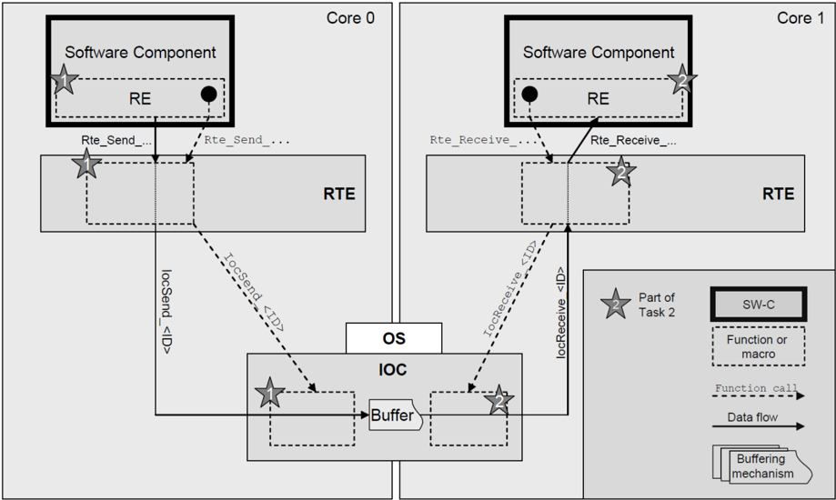

在本示例中，**IocSend** 服务将数据写入位于共享内存区域中的缓冲区，接收方可以通过 [IOC](#75-ioc) 读取该缓冲区。

在接收方，接收可运行实体被周期性地调用。`Rte_Receive_<port>_<item> (..., <data>)` 调用被映射为 `IocReceive_<Id> (<data>)` 调用，以从 [IOC](#75-ioc) 内部队列中读取数据。对于 1:1 通信，RTE 内不需要额外的队列。

[IOC](#75-ioc) 生成器生成所有的发送和接收函数。出于优化目的，这些函数可以被定义为宏。

这种无通知的端口到端口通信适用于：

- 发送方/接收方通信
- 排队或非排队通信
- 1:1 通信。

###### 6.10.7.2. 示例 2 - 由 RTE 进行接收方通知的 N:1 客户端/服务器通信

一个软件组件调用由位于不同内核上的另一个软件组件提供的服务操作。接收方的一个可运行实体被激活以计算结果（参见图 7.25）。

RTE 通过将客户端/服务器调用映射为发送方/接收方通信，在客户端实现该服务。由于该通信跨越内核边界，RTE 使用 [IOC](#75-ioc) 将数据从内核0 传输到内核1。

在发送方，`Rte_Call_<port>_<op> (..., <data>)` 调用被映射为 `IocSend_<Id> (<data>)` 调用，以便通过 [IOC](#75-ioc) 将参数传输到托管服务器可运行实体的内核。

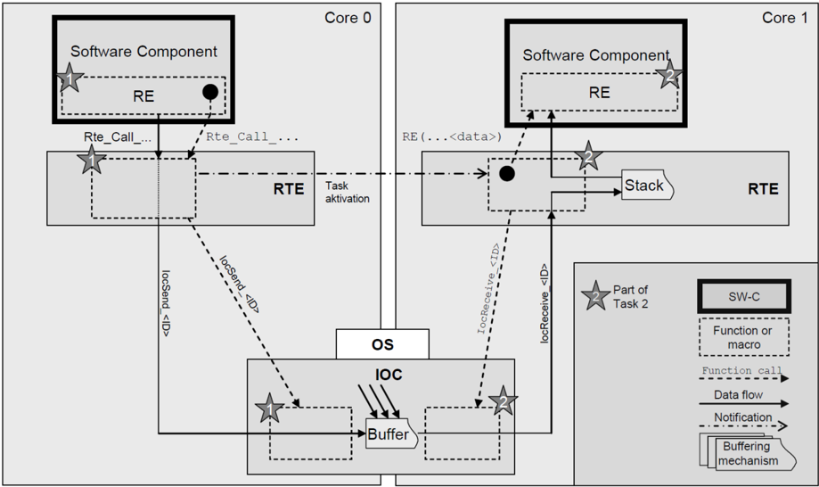

在将数据写入 [IOC](#75-ioc) 内部排队缓冲区之后，**Rte_Call** 函数使用一个 OS 调用，通过激活接收内核上的服务器任务（**Task**）来通知接收方。该任务（**Task**）由 RTE 提供。其任务体负责通过调用 **IocReceive** 函数从 [IOC](#75-ioc) 缓冲区读取数据，并将数据转发给服务器可运行实体。取决于 [IOC](#75-ioc) 函数的返回值，可能会多次重复 **IocReceive** 和服务器可运行实体调用，以清空 [IOC](#75-ioc) 内部排队缓冲区（如果指定了的话）。

内核1 上的服务结果以类似的方式被传输回内核0 上的客户端。结果的通信路径未在图 7.25 中显示。

这种由 RTE 进行通知的端口到端口通信适用于：

- 带通知的发送方/接收方通信
- 客户端/服务器通信。在这种情况下，RTE 必须提供服务，将服务器调用映射为用于该服务器调用的 1:1 发送方/接收方通信，以及另一个用于将结果返回给客户端的发送方/接收方通信
- 排队或非排队通信
- 1:1 通信，如果接收方不周期性地轮询数据（在这种情况下，示例 1 中的解决方案可能更为合适）
- N:1 通信。

#### 6.10.8. 未来扩展

本规范的第一版不支持某些特性，但可能在以后的版本中加入：

- 未来，[IOC](#75-ioc) 将处理位于不同 **OS-Application** 中的 BSW 模块彼此之间、或 BSW 模块与软件组件（经由 RTE）之间的直接且高效的通信。将添加对 BSW 模块直接访问 [IOC](#75-ioc) 服务的额外支持。
- 其他通知选项（如激活接收方一侧的指定任务（**Task**））以后可能会被添加到 [IOC](#75-ioc) 中。

### 6.11. 系统可扩展性

#### 6.11.1. 背景与理由

为了根据用户的需求定制操作系统并充分利用处理器特性，可以借助可扩展性等级（**scalability class**）对操作系统进行相应的伸缩，参见 [SWS_Os_00241]。

表7.4：可扩展性等级的最低要求

| 特性 | 可扩展性等级 1 | 可扩展性等级 2 | 可扩展性等级 3 | 可扩展性等级 4 |
|------|----------------|----------------|----------------|----------------|
| 支持的调度表（**ScheduleTable**）的最小数量 | 2 | 8 | 2 | 8 |
| 支持的 OS-Application 的最小数量 | 0 | 0 | 2 | 2 |
| 支持的软件计数器（**Software Counter**）的最小数量 | 8 | 8 | 8 | 8 |

#### 6.11.2. 需求

如果较低可扩展性等级（**scalability class**）的实现支持较高等级的特性，则这些特性的接口必须符合本操作系统软件规范。

表7.5：可扩展性等级

| 特性 | 描述章节 | 可扩展性等级 1 | 可扩展性等级 2 | 可扩展性等级 3 | 可扩展性等级 4 | 硬件要求 |
|------|----------|----------------|----------------|----------------|----------------|----------|
| OSEK OS（所有一致性等级（**conformance class**）） | 第 6.1 节 | 是 | 是 | 是 | 是 |  |
| 计数器接口 | [IncrementCounter](#7417-incrementcounter) | 是 | 是 | 是 | 是 |  |
| SWFRT 接口 | [GetCounterValue](#7418-getcountervalue)、[GetElapsedValue](#7419-getelapsedvalue) | 是 | 是 | 是 | 是 |  |
| 调度表（**ScheduleTable**） | 第 6.3 节 | 是 | 是 | 是 | 是 |  |
| 堆栈监视 | 第 6.5 节 | 是 | 是 | 是 | 是 |  |
| **ProtectionHook** | 第 6.8 节 |  | 是 | 是 | 是 |  |
| 时序保护 | 第 6.7.2 节 |  | 是 |  | 是 | 具有高优先级中断的定时器 |
| 全局时间/同步支持 | 第 6.4 节 |  | 是 |  | 是 | 全局时间源 |
| 内存保护 | 第 6.7.1、6.7.4 节 |  |  | 是 | 是 | MPU |
| **OS-Application** | 第 6.6、6.12 节 | ⋆6 | ⋆7 | 是 | 是 |  |
| 服务保护 | 第 6.7.3 节 |  |  | 是 | 是 |  |
| [**CallTrustedFunction**](#744-calltrustedfunction) | 第 6.7.5 节 |  |  | 是 | 是 | （非）特权模式 |

6 参见 [SWS_Os_00764]

7 参见 [SWS_Os_00764]

操作系统模块应支持本给定表中所列出的特性。

操作系统模块在可扩展性等级 3 和 4 中应始终使用扩展状态（**extended status**）。

### 6.12. 钩子函数

#### 6.12.1. 背景与理由

OSEK OS 中定义的钩子例程（**hook routine**）在操作系统模块的层级上运行，因此只能属于受信任环境。此外，这些钩子例程对整个系统而言是全局的（系统特定的（**system-specific**）），并且很可能由 ECU 集成者提供。

然而在 **AUTOSAR** 中，每个 **OS-Application** 都可能需要执行应用特定的（**application-specific**）代码，例如在其自己的附加（应用特定的）启动钩子中初始化某些硬件。这些钩子例程被称为应用特定的钩子例程。一般来说，应用特定的钩子与 OSEK OS 规范中描述的钩子例程具有相同的属性。差异将在下文描述。

#### 6.12.2. 需求

操作系统模块应向所有已配置的错误钩子提供 OSEK 错误宏（**OSError...()**），并且应有两个（如同 OIL 中那样的）全局配置参数用于开启或关闭这些宏。

**StartupHook**

如果为 OS-Application &lt;App&gt; 配置了应用特定的启动钩子，操作系统模块应在操作系统模块启动时调用 **StartupHook_&lt;App&gt;**。

操作系统模块应以关联的 **OS-Application** 的访问权限执行应用特定的启动钩子。

如果同时配置了系统特定的（**system-specific**）启动钩子和一个（或多个）应用特定的启动钩子，操作系统模块应在应用特定的启动钩子之前调用系统特定的启动钩子。

**ShutdownHook**

如果为 OS-Application &lt;App&gt; 配置了应用特定的关闭钩子，操作系统模块应在 OS 关闭时调用 **ShutdownHook_&lt;App&gt;**。

操作系统模块应以关联的 **OS-Application** 的访问权限执行应用特定的关闭钩子。

如果同时配置了系统特定的关闭钩子和一个（或多个）应用特定的关闭钩子，操作系统模块应在应用特定的关闭钩子之后调用系统特定的关闭钩子。

**ErrorHook**

当发生错误且为出错的 OS-Application &lt;App&gt; 配置了应用特定的错误钩子时，操作系统模块应在系统特定的错误钩子被调用（如果已配置）之后，调用该应用特定的错误钩子 **ErrorHook_&lt;App&gt;**。

操作系统模块应以关联的 **OS-Application** 的访问权限执行应用特定的错误钩子。

不返回 **StatusType** 的操作系统模块服务——[**ActivateTaskAsyn**](#7437-activatetaskasyn) 和 [**SetEventAsyn**](#7438-seteventasyn) 除外——不应引发错误钩子。

### 6.13. 硬件外设访问

#### 6.13.1. 背景与理由

在一些 MCU 架构上，存在内存映射的硬件寄存器（外设区域），它们仅在特定模式（例如特权模式（**privileged mode**））下才可访问。只要任务（**Task**）/**ISR** 以完整的硬件访问权限运行，它们就可以直接访问这些寄存器。如果操作系统使用了内存保护，非受信任 OS-Application 的任务（**Task**）/**ISR** 便无法直接访问此类寄存器，因为操作系统会将其识别为内存违规。

为了允许甚至从非受信任的应用访问此类寄存器，操作系统提供以下 API 来读取、写入和修改寄存器：

- **ReadPeripheral8**
- **ReadPeripheral16**
- **ReadPeripheral32**
- **WritePeripheral8**
- **WritePeripheral16**
- **WritePeripheral32**
- **ModifyPeripheral8**
- **ModifyPeripheral16**
- **ModifyPeripheral32**

为了控制对寄存器的访问，必须为每个 **OS-Application** 配置访问权限。由此，OS 便可以在运行时检查调用者是否具有足够的权限。

#### 6.13.2. 需求

**检查外设寄存器的访问**：操作系统仅应在满足以下条件时，才通过 API **ReadPeripheralX**、**WritePeripheralX** 和 **ModifyPeripheralX** 执行对外设寄存器的访问：

- 参数 **Address** 位于 **OsPeripheralAreaStartAddress** 和 **OsPeripheralAreaEndAddress** 的范围内
- 参数 **Area** 有效
- 调用者被配置为具有足够的权限（**OsPeripheralAreaAccessingApplication**）。

**外设访问 API 的错误处理**：如果操作系统在执行 **ReadPeripheralX**、**WritePeripheralX** 和 **ModifyPeripheralX** 时检测到错误（参见 [SWS_Os_00806]），OS 应返回相应的 **StatusType** 并调用 **ErrorHook**。否则应返回 **E_OK**。

### 6.14. 中断源 API

#### 6.14.1. 背景与理由

操作系统需要保证调度，因此它需要是唯一访问中断控制器的组件。为此，它向其他 BSW/CDD 组件提供接口 [**DisableInterruptSource**](#7435-disableinterruptsource)、[**EnableInterruptSource**](#7434-enableinterruptsource) 和 [**ClearPendingInterrupt**](#7436-clearpendinginterrupt)，以访问类别 2 **ISR** 的中断控制寄存器。

[**DisableInterruptSource**](#7435-disableinterruptsource) / [**EnableInterruptSource**](#7434-enableinterruptsource) 这一对 API 可用于两种不同的目的：

1. 特定中断应被屏蔽较短的时间（可能是为了避免数据一致性问题）。一旦中断源再次被使能，此前被屏蔽的请求应随后得到服务。

2. 来自特定源的中断请求应在一段特定时间内（可能是较长的时间，例如在 CAN 驱动休眠期间）被忽略。在使能该源之后，应仅考虑新的请求。

#### 6.14.2. 需求

对于每个类别 2 中断源（**OsIsrCategory** == **CATEGORY_2**），操作系统应提供 API [**DisableInterruptSource**](#7435-disableinterruptsource)、[**EnableInterruptSource**](#7434-enableinterruptsource) 和 [**ClearPendingInterrupt**](#7436-clearpendinginterrupt)。

[**DisableInterruptSource**](#7435-disableinterruptsource) / [**EnableInterruptSource**](#7434-enableinterruptsource) 不支持嵌套调用。

**中断源控制 API 的嵌套调用**：如果对已被禁用的中断源调用 [**DisableInterruptSource**](#7435-disableinterruptsource)，或对已被使能的中断源调用 [**EnableInterruptSource**](#7434-enableinterruptsource)，操作系统应（在 EXTENDED 状态下）返回 **E_OS_NOFUNC**。

**中断源控制 API 的错误处理**：如果操作系统在执行 [**DisableInterruptSource**](#7435-disableinterruptsource)、[**EnableInterruptSource**](#7434-enableinterruptsource) 和 [**ClearPendingInterrupt**](#7436-clearpendinginterrupt) 时检测到错误，OS 应返回相应的 **StatusType** 并调用 **ErrorHook**。否则应返回 **E_OK**。

[**EnableInterruptSource**](#7434-enableinterruptsource) 的调用应通过修改中断控制器寄存器来使能所请求的中断源。此外，它还应清除中断挂起标志。

[**DisableInterruptSource**](#7435-disableinterruptsource) 的调用应通过修改中断控制器寄存器来禁用所请求的中断源。

[**ClearPendingInterrupt**](#7436-clearpendinginterrupt) 的调用应通过修改相应的中断控制器寄存器来清除中断挂起标志。

挂起中断的清除应仅限于清除中断控制器中的挂起标志。

**注意：**这并不必然保证中断请求已被成功清除，即 ISR 此后仍可能被服务。（这可能是由于竞争条件所致，或者由于该请求还需要在发出请求的硬件单元中被清除。）

### 6.15. 错误分类

**AUTOSAR** BSW 模块通常将其错误报告给 **Det**（开发错误）或 **Dem**（生产错误）。OS 以不同的方式处理错误（另见 [2]），并且不将其错误报告给 Dem/Det。如果需要向 Dem/Det 报告错误，用户可以在 **ErrorHook** 中执行这些操作。

下表包含 OS 可能报告的所有错误代码（[2] 中已定义的那些除外）：

**OS 模块中开发错误的定义：**

| 错误类型 | 相关错误代码 | 错误值 |
|----------|--------------|--------|
| 向某个服务传递了无效地址作为参数。 | E_OS_ILLEGAL_ADDRESS | 由实现分配 |
| 发生了内存访问违规 | E_OS_PROTECTION_MEMORY | 由实现分配 |
| OS 通过堆栈监视检测到堆栈故障 | E_OS_STACKFAULT | 由实现分配 |
| 内核不可用 | E_OS_CORE | 由实现分配 |
| 由于错误嵌套导致的潜在死锁 | E_OS_NESTING_DEADLOCK | 由实现分配 |
| 任务未调用 **TerminateTask()** 或 **ChainTask()** 即终止。 | E_OS_MISSINGEND | 由实现分配 |
| 任务（**Task**）/类别 2 ISR 阻塞时间过长 | E_OS_PROTECTION_LOCKED | 由实现分配 |
| 在占用自旋锁的情况下去调度 | E_OS_SPINLOCK | 由实现分配 |
| 服务无法被调用。 | E_OS_SERVICEID | 由实现分配 |
| 发生了 trap | E_OS_PROTECTION_EXCEPTION | 由实现分配 |
| 由于相互干扰导致的死锁情况 | E_OS_INTERFERENCE_DEADLOCK | 由实现分配 |
| 任务（**Task**）或类别 2 ISR 超出了其执行时间预算 | E_OS_PROTECTION_TIME | 由实现分配 |
| 在禁用/使能中断对的内部调用了 OS 的服务。 | E_OS_DISABLEDINT | 由实现分配 |
| 任务（**Task**）/类别 2 ISR 在其时间帧到期之前到达 | E_OS_PROTECTION_ARRIVAL | 由实现分配 |

### 6.16. ARTI 调试信息

OS 应创建 ARTI 模块描述文件。

ARTI 模块描述文件应支持所有 **ORTI** 容器。

ARTI 调试信息旨在使所连接的工具能够评估并显示有关操作系统、其状态、其性能、不同的任务状态、不同的操作系统对象等的信息。

此外，ARTI 调试信息还包含动态信息，即一组由公式表示、用于访问相应动态值的属性。用于动态数据访问的公式由目标文件内的常量、操作和符号名称组成。为获得所需 OS 对象的内部值，调试工具随后可以对给定的公式求值。

#### 6.16.1. OS ARTI 对象

本节描述了系统对象的一组属性以及解释所获数据的方法。本节中定义的类型旨在允许调试器确定目标内存访问方法以及显示所检索数据的最佳方式。在大多数情况下，用户需要查看的信息是某个属性的文本描述，而不是从变量中读取的实际值。

这方面的一个例子如下：当用户请求一个任务（**Task**）的当前状态时，他期望看到类似 RUNNING、WAITING、READY 或 SUSPENDED 这样的内容，而不是 OS 在内部用来表示该信息的实际数值。因此，规范定义了一个映射，允许内核制造商描述内部 OS 值必须如何映射到描述性值。

- **ArtiOs**
- **ArtiHwCore**
- **ArtiOsAlarm**
- **ArtiOsContext**
- **ArtiOsIsr**
- **ArtiOsResource**
- **ArtiOsMessageContainer**
- **ArtiOsStack**
- **ArtiOsTask**

这些对象在 Arti 容器中以名为 `"*Class"` 的定义进行声明。这些对象的实例放置在同一个 Arti 容器中，以名为 `"*Instance"` 的定义表示。

### 6.17. ARTI 钩子宏

OS 应纳入特殊的宏，ARTI 跟踪工具可以使用这些宏插入任意类型的跟踪功能。

**AUTOSAR CP OS** 的钩子应遵循 ARTI 宏的一般结构：`ARTI_TRACE(_contextName, _className, _instanceName, instanceParameter, _eventName, eventParameter);`

某些参数使用字面文本（**Token**）而非符号标识符。这使得一个宏定义能够将这些参数连接成更具体的宏。在运行时传递并求值所有参数将非常昂贵，尤其就运行时消耗而言。以下是通用 **ARTI_TRACE** 宏的一种可能实现，ARTI 跟踪工具供应商可以定义它来匹配其跟踪工具的接口：

```C
#define ARTI_TRACE(_contextName, _className, _instanceName, instanceParameter, _eventName, eventParameter) \
    ARTI_TRACE ## _ ## _className ## _ ## _eventName ## _ ## _instanceName ## _ ## _contextName ( (instanceParameter), (eventParameter) )
```

这样的实现将为 _className、_eventName 和 _contextName 的所有可能组合各生成一个钩子，并在运行时仅传递参数 instance_id 和 event_value。

各参数的含义描述如下：

- **_contextName**：Token，字面文本，上下文的名称。为以下之一：
    - **NOSUSP** 表示该钩子在禁用中断的上下文中被调用
    - **SPRVSR** 表示被调用的钩子可以禁用中断
    - **USER** 表示被调用的钩子不能禁用中断
- **_className**：Token，字面文本，宏类的名称。AUTOSAR OS 的预定义类为：
    - **AR_CP_OS_APPLICATION** 启动和停止应用程序
    - **AR_CP_OS_TASK** 调度任务
    - **AR_CP_OS_CAT2ISR** 分发类别 2 中断
    - **AR_CP_OS_SERVICECALLS** 调用服务例程
    - **AR_CP_OS_SPINLOCK** 调用自旋锁
    - **AR_CP_OS_HOOK** 调用 OS 钩子
- **_instanceName**：ARXML 中所定义的 OS 实例的短名称。
- **instanceParameter**：OS 所见 CPU 内核的索引 [uint32] 0..4294967295（&lt;Core Index&gt;）。应始终从 0 开始并连续向上计数。它可能等于物理内核的索引，但不必如此。
- **_eventName**：Token，字面文本，为特定类定义的事件的名称。
- **eventParameter**：作为事件参数的一个 [uint32] 0..4294967295 值。

**因此，AUTOSAR OS 的所有 ARTI 宏都编译以下模板：**

```C
ARTI_TRACE(_contextName, <AR OS Class Name>, <OS Short Name>, <Core Index>, <Event Name>, <Event Parameter>)
```

**OS 中钩子调用的示例：**

```C
ARTI_TRACE( NOSUSP, AR_CP_OS_TASK, OS1, (uint32)GetCoreID(), OsTask_Activation, (uint32)GetTaskID() );
```

**预处理输出的示例：**

- `ARTI_TRACE_NOSUSP_AR_CP_OS_TASK_OS1_OsTask_Activation( (uint32) [GetCoreID](#7424-getcoreid)(), (uint32)GetTaskID() );`

#### 6.17.1. 类 AR_CP_OS_APPLICATION

OS 应创建 **AR_CP_OS_APPLICATION** 类的事件，以允许跟踪 OS 应用程序【如 AUTOSAR 经典平台中所定义】。

ARTI 所使用的状态基于 OS-Application 的状态，详情参见 6.6.1 节"背景与理由"中的图 7.10。

**ARTI 使用的状态：**

| ARTI      | OS                     |
|-----------|------------------------|
| Initial    | -                      |
| Accessible | APPLICATION_ACCESSIBLE |
| Restarting | APPLICATION_RESTARTING |
| Terminated | APPLICATION_TERMINATED |

**ARTI 使用的转换：**

| 名称        | 转换                   | 事件名                  |
|-------------|------------------------|-------------------------|
| Start       | Initial -> Accessible    | OsApplication_Start     |
| Restart     | Accessible -> Restarting | OsApplication_Restart   |
| [AllowAccess](#7421-allowaccess) | Restarting -> Accessible | OsApplication_AllowAccess |
| Terminate   | Accessible -> Terminated | OsApplication_Terminate |

**AR_CP_OS_APPLICATION** 类的 ARTI 宏应编译以下模板：

- `ARTI_TRACE(_contextName, AR_CP_OS_APPLICATION, <OS Short Name>, <Core ID>, <Event Name>, <Application ID>)`

任何事件的 &lt;Core ID&gt; 应表示相应应用程序运行所在的内核 ID。

&lt;Event Name&gt; 应遵循上面的转换表。

&lt;Application ID&gt; 应是 OS 应用程序的数字标识符。

#### 6.17.2. 类 AR_CP_OS_TASK

ARTI 需要跟踪 OS 内所有的任务（**Task**）状态和所有状态转换。对于某些时序参数（例如从启动到终止的任务（**Task**）"运行时间"），OS 简单的"就绪"状态是不够的。评估时序的工具需要通过从历史记录计算转换来重建更复杂的状态图。为了与纯 OS 状态图兼容，**AR_CP_OS_TASK** 引用该状态模型，同时知道工具需要对事件流进行后处理才能获得所有相关信息。然而，如果 OS 实现能够提供更详细的状态图，ARTI 则允许定义更多无需后处理的事件，并允许在跟踪被截断（跟踪缓冲区有限）时更早地进行同步。该状态图随后由类 "AR_CP_OSARTI_TASK" 处理。如果可能，应优先使用第二个状态机。

**AR_CP_OS_TASK**

OS 应创建 **AR_CP_OS_TASK** 类的事件，以允许跟踪任务（**Task**）。

下面的状态图显示了由 OS 定义的状态和转换：

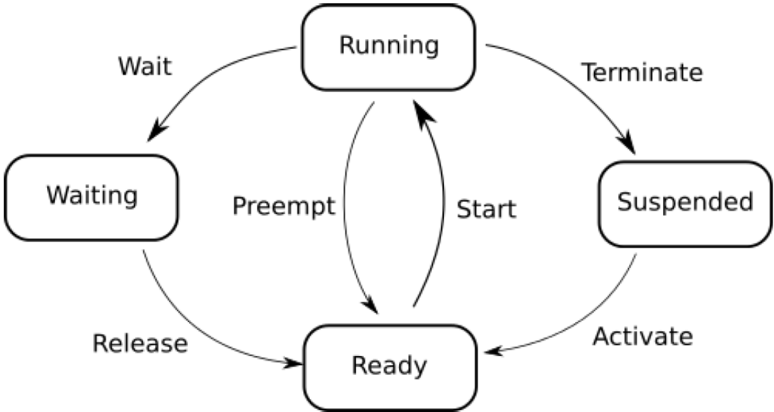

**ARTI 使用的转换：**

| 名称      | 转换           | 事件名       |
|-----------|----------------------|------------------|
| Activate  | Suspended -> Ready   | OsTask_Activate  |
| Start     | Ready -> Running     | OsTask_Start     |
| Preempt   | Running -> Ready     | OsTask_Preempt   |
| Wait      | Running -> Waiting   | OsTask_Wait      |
| Release   | Waiting -> Ready     | OsTask_Release   |
| Terminate | Running -> Suspended | OsTask_Terminate |

**AR_CP_OSARTI_TASK**

**AR_CP_OSARTI_TASK** 类包含允许以增强的状态模型跟踪 OS 任务（**Task**）的事件。

下面的状态图显示了 ARTI 所使用的状态机：

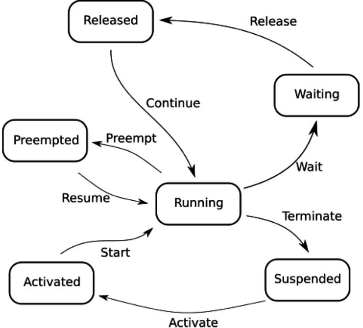

**ARTI 使用的状态：**

| ARTI      | OS        |
|-----------|-----------|
| Suspended | SUSPENDED |
| Activated | READY     |
| Running   | RUNNING   |
| Preempted | READY     |
| Waiting   | WAITING   |
| Released  | READY     |

**ARTI 使用的转换：**

| 名称      | 转换             | 事件名       |
|-----------|--------------------------|------------------|
| Activate  | Suspended -> Activated   | OsTask_Activate  |
| Start     | Activated -> Running     | OsTask_Start     |
| Preempt   | Running -> Preempted     | OsTask_Preempt   |
| Resume    | Preempted -> Running     | OsTask_Resume    |
| Wait      | Running -> Waiting       | OsTask_Wait      |
| Release   | Waiting -> Released      | OsTask_Release   |
| Continue  | Released -> Running      | OsTask_Continue  |
| Terminate | Running -> Suspended     | OsTask_Terminate |

**AR_CP_OS_TASK** 和 **AR_CP_OSARTI_TASK** 类的 ARTI 宏应编译以下模板：

- `ARTI_TRACE(_contextName, AR_CP_OS_TASK, <OS Short Name>, <Core ID>, <Event Name>, <Task ID>)`
- `ARTI_TRACE(_contextName, AR_CP_OSARTI_TASK, <OS Short Name>, <Core ID>, <Event Name>, <Task ID>)`

任何事件的 &lt;Core ID&gt; 应表示调度相应任务（**Task**）的内核的 ID。

&lt;Event Name&gt; 应遵循上面的转换表。

&lt;Task ID&gt; 应是 OS 任务（**Task**）的数字标识符。

#### 6.17.3. 类 AR_CP_OS_CAT2ISR

OS 应创建事件来跟踪 OS 内 Cat2Isr 的所有状态和所有状态转换（"Cat2Isr"指类别 2 中断服务例程）。

对于某些时序参数（例如中断挂起时间），OS 简单的类别 2 中断启动/停止是不够的。评估时序的工具需要通过从历史记录计算转换来重建更复杂的状态图。为了与 OS 兼容，**AR_CP_OS_CAT2ISR** 引用该状态模型，同时知道工具需要对事件流进行后处理才能获得所有相关信息。然而，如果 OS 实现能够提供更详细的状态图，ARTI 则允许定义更多无需后处理的事件，并允许在跟踪被截断（跟踪缓冲区有限）时更早地进行同步。该状态图随后由类 "AR_CP_OSARTI_CAT2ISR" 处理。如果可能，应优先使用第二个状态机。

**AR_CP_OS_CAT2ISR**

**AR_CP_OS_CAT2ISR** 类包含允许跟踪 AUTOSAR 经典平台所定义的类别 2 中断的事件。

下面的状态图显示了由 OS 定义的状态和转换：

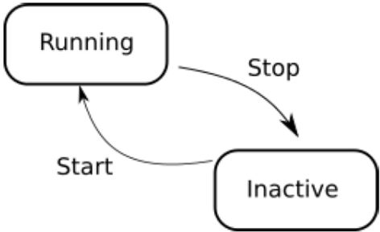

**ARTI 使用的转换：**

| 名称   | 转换          | 事件名       |
|--------|---------------------|-----------------|
| Start  | Inactive -> Running | OsCat2Isr_Start |
| Stop   | Running -> Inactive | OsCat2Isr_Stop  |

**AR_CP_OSARTI_CAT2ISR**

**AR_CP_OSARTI_CAT2ISR** 类包含允许以增强的状态模型跟踪类别 2 中断的事件。

下面的状态图显示了 ARTI 所使用的状态机：

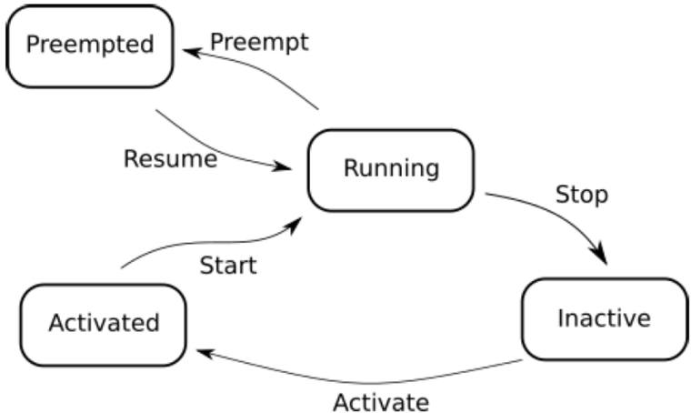

**ARTI 使用的状态：**

| ARTI      | OS       |
|-----------|----------|
| Inactive  | Inactive |
| Activated | Inactive |
| Running   | Running  |
| Preempted | Running  |

**ARTI 使用的转换：**

| 名称     | 转换            | 事件名          |
|----------|-------------------------|-------------------|
| Activate | Inactive -> Activated   | OsCat2Isr_Activate |
| Start    | Activated -> Running    | OsCat2Isr_Start    |
| Preempt  | Running -> Preempted    | OsCat2Isr_Preempt  |
| Resume   | Preempted -> Running    | OsCat2Isr_Resume   |
| Stop     | Running -> Inactive     | OsCat2Isr_Stop     |

**AR_CP_OS_CAT2ISR** 和 **AR_CP_OSARTI_CAT2ISR** 类的 ARTI 宏应编译以下模板：

- `ARTI_TRACE(_contextName, AR_CP_OS_CAT2ISR, <OS Short Name>, <Core Index>, <Event Name>, <Cat2Isr Index>)`
- `ARTI_TRACE(_contextName, AR_CP_OSARTI_CAT2ISR, <OS Short Name>, <Core Index>, <Event Name>, <Cat2Isr Index>)`

任何事件的 &lt;Core Index&gt; 应表示调度相应类别 2 中断的内核的索引。

&lt;Event Name&gt; 应遵循上面的转换表。

&lt;Cat2Isr Index&gt; 应是类别 2 中断的数字标识符。

#### 6.17.4. 类 AR_CP_OS_SERVICECALLS

当从应用上下文进入和退出服务调用时，OS 应创建 **AR_CP_OS_SERVICECALLS** 类的事件。

仅当服务调用是从应用上下文中被调用时，才应调用这些钩子。如果服务调用在 OS 上下文中使用，则不应调用它们。

这些事件仅适用于服务调用的进入和退出，而不适用于由服务调用处理的对象（及其状态）。

**AR_CP_OS_SERVICECALLS** 类的 ARTI 宏应编译以下模板：

- `ARTI_TRACE(_contextName, AR_CP_OS_SERVICECALLS, <OS Short Name>, <Core Index>, <eventName>, <eventParameter>)`

下表中任何事件的 &lt;Core Index&gt; 应表示调用相应服务调用的内核 ID。

&lt;eventName&gt; 是一个字符串字面量，由前缀 "OsServiceCall"、服务调用名称以及表示服务调用进入或退出的 "_Start" 或 "_Return" 组成。例如，当调用 **ActivateTask** 时，进入和退出时的事件名分别为 **OsServiceCall_ActivateTask_Start** 和 **OsServiceCall_ActivateTask_Return**。

&lt;eventParamter&gt; 是函数参数之一或返回值的 uint32 表示。它取决于服务调用，并列于下表：

| OS 服务调用 | 来源 | 启动时的 eventParameter | 返回时 |
|-------------|------|-------------------------|--------|
| ActivateTask | OSEK | TaskID | (StatusType) returnValue |
| TerminateTask | OSEK | TaskID | (StatusType) returnValue |
| ChainTask | OSEK | TaskID | (StatusType) returnValue |
| Schedule | OSEK | 0 | (StatusType) returnValue |
| GetTaskID | OSEK | 0 | (TaskType) *TaskID |
| GetTaskState | OSEK | TaskID | (TaskStateType) *State |
| EnableAllInterrupts | OSEK | 0 | 0 |
| DisableAllInterrupts | OSEK | 0 | 0 |
| ResumeAllInterrupts | OSEK | 0 | 0 |
| SuspendAllInterrupts | OSEK | 0 | 0 |
| ResumeOSInterrupts | OSEK | 0 | 0 |
| SuspendOSInterrupts | OSEK | 0 | 0 |
| GetResource | OSEK | ResID | (StatusType) returnValue |
| ReleaseResource | OSEK | ResID | (StatusType) returnValue |
| SetEvent | OSEK | TaskID | (StatusType) returnValue |
| ClearEvent | OSEK | Mask | (StatusType) returnValue |
| GetEvent | OSEK | TaskID | (EventMaskType) *Event |
| WaitEvent | OSEK | Mask | (StatusType) returnValue |
| GetAlarmBase | OSEK | AlarmID | (AlarmBaseRefType) Info |
| GetAlarm | OSEK | AlarmID | (TickType) *Tick |
| SetRelAlarm | OSEK | AlarmID | (StatusType) returnValue |
| SetAbsAlarm | OSEK | AlarmID | (StatusType) returnValue |
| CancelAlarm | OSEK | AlarmID | (StatusType) returnValue |
| GetActiveApplicationMode | OSEK | 0 | (AppModeType) returnValue |
| StartOS | OSEK | Mode | 不适用 |
| ShutdownOS | OSEK | Error | 不适用 |
| [GetApplicationID](#741-getapplicationid) | AUTOSAR | 0 | (ApplicationType) returnValue |
| [GetCurrentApplicationID](#742-getcurrentapplicationid) | AUTOSAR | 0 | (ApplicationType) returnValue |
| [GetISRID](#743-getisrid) | AUTOSAR | 0 | ([ISRType](#7311-isrtype)) returnValue |
| [CallTrustedFunction](#744-calltrustedfunction) | AUTOSAR | FunctionIndex | (StatusType) returnValue |
| [CheckISRMemoryAccess](#745-checkisrmemoryaccess) | AUTOSAR | ISRID | ([AccessType](#736-accesstype)) returnValue |
| [CheckTaskMemoryAccess](#746-checktaskmemoryaccess) | AUTOSAR | TaskID | ([AccessType](#736-accesstype)) returnValue |
| [CheckObjectAccess](#747-checkobjectaccess) | AUTOSAR | ApplID | ([ObjectAccessType](#737-objectaccesstype)) returnValue |
| [CheckObjectOwnership](#748-checkobjectownership) | AUTOSAR | [ObjectTypeType](#738-objecttypetype) | (ApplicationType) returnValue |
| [StartScheduleTableRel](#749-startscheduletablerel) | AUTOSAR | ScheduleTableID | (StatusType) returnValue |
| [StartScheduleTableAbs](#7410-startscheduletableabs) | AUTOSAR | ScheduleTableID | (StatusType) returnValue |
| [StopScheduleTable](#7411-stopscheduletable) | AUTOSAR | ScheduleTableID | (StatusType) returnValue |
| [NextScheduleTable](#7412-nextscheduletable) | AUTOSAR | ScheduleTableID_To | (StatusType) returnValue |
| [StartScheduleTableSynchron](#7413-startscheduletablesynchron) | AUTOSAR | ScheduleTableID | (StatusType) returnValue |
| [SyncScheduleTable](#7414-syncscheduletable) | AUTOSAR | ScheduleTableID | (StatusType) returnValue |
| [SetScheduleTableAsync](#7415-setscheduletableasync) | AUTOSAR | ScheduleTableID | (StatusType) returnValue |
| [GetScheduleTableStatus](#7416-getscheduletablestatus) | AUTOSAR | ScheduleTableID | ([ScheduleTableStatusType](#7313-scheduletablestatustype)) *ScheduleStatus |
| [IncrementCounter](#7417-incrementcounter) | AUTOSAR | CounterID | (StatusType) returnValue |
| [GetCounterValue](#7418-getcountervalue) | AUTOSAR | CounterID | (TickType) *Value |
| [GetElapsedValue](#7419-getelapsedvalue) | AUTOSAR | CounterID | (TickType) *ElapsedValue |
| [TerminateApplication](#7420-terminateapplication) | AUTOSAR | Application | (StatusType) returnValue |
| [AllowAccess](#7421-allowaccess) | AUTOSAR | 0 | (StatusType) returnValue |
| [GetApplicationState](#7422-getapplicationstate) | AUTOSAR | Application | ([ApplicationStateType](#732-applicationstatetype)) *Value |
| [GetNumberOfActivatedCores](#7423-getnumberofactivatedcores) | AUTOSAR | 0 | (uint32) returnValue |
| [GetCoreID](#7424-getcoreid) | AUTOSAR | 0 | ([CoreIdType](#7318-coreidtype)) returnValue |
| [StartCore](#7425-startcore) | AUTOSAR | CoreID | (StatusType) *Status |
| [GetSpinlock](#7426-getspinlock) | AUTOSAR | SpinlockId | (StatusType) returnValue |
| [ReleaseSpinlock](#7427-releasespinlock) | AUTOSAR | SpinlockId | (StatusType) returnValue |
| [TryToGetSpinlock](#7428-trytogetspinlock) | AUTOSAR | SpinlockId | ([TryToGetSpinlockType](#7320-trytogetspinlocktype)) *Success |
| [ShutdownAllCores](#7429-shutdownallcores) | AUTOSAR | Error | 0 |
| [ControlIdle](#7430-controlidle) | AUTOSAR | IdleMode | (StatusType) returnValue |
| ReadPeripheral8 | AUTOSAR | Address | (uint8) *ReadValue |
| ReadPeripheral16 | AUTOSAR | Address | (uint16) *ReadValue |
| ReadPeripheral32 | AUTOSAR | Address | (uint32) *ReadValue |
| WritePeripheral8 | AUTOSAR | Address | (StatusType) returnValue |
| WritePeripheral16 | AUTOSAR | Address | (StatusType) returnValue |
| WritePeripheral32 | AUTOSAR | Address | (StatusType) returnValue |
| ModifyPeripheral8 | AUTOSAR | Address | (StatusType) returnValue |
| ModifyPeripheral16 | AUTOSAR | Address | (StatusType) returnValue |
| ModifyPeripheral32 | AUTOSAR | Address | (StatusType) returnValue |
| [EnableInterruptSource](#7434-enableinterruptsource) | AUTOSAR | ISRID | (StatusType) returnValue |
| [DisableInterruptSource](#7435-disableinterruptsource) | AUTOSAR | ISRID | (StatusType) returnValue |
| [ClearPendingInterrupt](#7436-clearpendinginterrupt) | AUTOSAR | ISRID | (StatusType) returnValue |
| [ActivateTaskAsyn](#7437-activatetaskasyn) | AUTOSAR | id | 0 |
| [SetEventAsyn](#7438-seteventasyn) | AUTOSAR | id | 0 |
| [isOsStarted](#7439-isosstarted) | AUTOSAR | 0 | (boolean) returnValue |

如果返回中的服务调用的 eventParameter 不是 **StatusType** 类型，且该服务调用不返回 **E_OK**，则应以一个非有效值作为 eventParameter 调用该钩子，以便消费该钩子的工具有可能检测到调用的失败。

#### 6.17.5. 类 AR_CP_OS_SPINLOCK

OS 应创建 **AR_CP_OS_SPINLOCK** 类的事件，以允许跟踪 OS 自旋锁（**spinlock**）以及 OS 内的所有状态转换。

这些宏标记的是实际状态变化的事件，而非 OS 服务调用。（例如，获得自旋锁可能晚于请求它；如果自旋锁已被释放，则释放请求可能不会引起释放。）

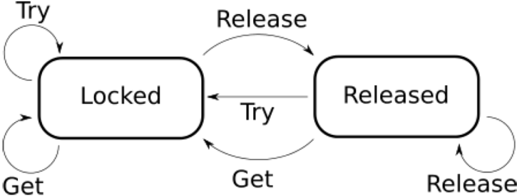

**AR_CP_OS_SPINLOCK** 类的 ARTI 宏应编译以下模板：

- `ARTI_TRACE(_contextName, AR_CP_OS_SPINLOCK, <OS Short Name>, <Core Index>, <_eventName>, <eventParameter>)`

下表中任何事件的 &lt;Core Index&gt; 应表示调用相应服务调用的内核 ID。

以下事件是 **AR_CP_OS_SPINLOCK** 类的一部分：

| 事件描述 | 状态转换 | _eventName | eventParameter |
|----------|----------|------------|----------------|
| 锁定自旋锁 | Released -> Locked | OsSpinlock_Locked | SpinlockId |
| 释放自旋锁 | Locked -> Released | OsSpinlock_Released | SpinlockId |

#### 6.17.6. 类 AR_CP_OS_HOOK

当进入和退出钩子函数（**hook function**）时，OS 应创建 **AR_CP_OS_HOOK** 类的事件。

**AR_CP_OS_HOOK** 类的 ARTI 宏应编译以下模板：

- `ARTI_TRACE(_contextName, AR_CP_OS_HOOK, <OS Short Name>, <Core Index>, <eventName>, <eventParameter>)`

下表中任何事件的 &lt;Core Index&gt; 应表示执行相应钩子函数（**hook function**）的内核 ID。

&lt;eventName&gt; 是一个字符串字面量，由前缀 OsHook、钩子函数名以及表示钩子函数进入或退出的 _Start 或 _Return 组成。例如，当调用 **ErrorHook** 时，进入和退出时的事件名分别为 **OsHook_ErrorHook_Start** 和 **OsHook_ErrorHook_Return**。

&lt;eventParamter&gt; 是函数参数或返回值的 uint32 表示。它取决于钩子函数，并列于下表：

| OS 钩子函数 | 来源 | 启动时的 eventParameter | 返回时的 eventParameter |
|-------------|------|-------------------------|-------------------------|
| ErrorHook | OSEK | Error | 0 |
| ErrorHook_&lt;App&gt; | AUTOSAR | Error | 0 |
| PostTaskHook | OSEK | 0 | 0 |
| PreTaskHook | OSEK | 0 | 0 |
| ProtectionHook | AUTOSAR | Fatalerror | ReturnValue |
| StartupHook | OSEK | 0 | 0 |
| StartupHook_&lt;App&gt; | AUTOSAR | 0 | 0 |
| ShutdownHook | OSEK | Error | 0 |
| ShurtdownHook_&lt;App&gt; | AUTOSAR | Fatalerror | 0 |

指示 **ProtectionHook** 退出（即 eventName 为 **OsHook_ProtectionHook_Return**）的 ARTI 钩子，应在 OS 检查了 **ProtectionHook** 的 ReturnValue 之后被调用（基于 6.8.2 节中描述的需求，例如 [SWS_Os_00506] 或 [SWS_Os_00475]）。该 ARTI 钩子的 eventParameter 应反映 OS 因 **ProtectionHook** 的返回值而采取的动作。

## 7. API规范

本章包含操作系统提供的 API。注意，并非所有服务在所有可扩展性等级（**scalability class**）中都可用，并且某些服务的行为会针对特定的可扩展性等级进行扩展。例如，相对启动调度表（**ScheduleTable**）的 API 会额外检查该调度表是否允许隐式同步。该检查仅在支持调度表同步的 SC2 和 SC4 中执行。

### 7.1. 常量

#### 7.1.1. StatusType 类型的错误码

以下常量在多核环境中可用。

枚举类型。范围为：**DONOTCARE**。内核的 AppMode。可通过**Os.h**获得。

类型，派生自标量（**scalar**）。范围为：1..65535。内核的总数。可通过**Os.h**获得。

其他常量见第 6.15 节和[2]。

### 7.2. 宏

```C
OSMEMORY_IS_READABLE(<AccessType>)

OSMEMORY_IS_WRITEABLE(<AccessType>)

OSMEMORY_IS_EXECUTABLE(<AccessType>)

OSMEMORY_IS_STACKSPACE(<AccessType>)
```

如果内存可读/可写/可执行或是堆栈空间，这些宏返回一个不等于零的值。宏的参数必须是 [**AccessType**](#736-accesstype) 类型。通常，服务 [**CheckTaskMemoryAccess**](#746-checktaskmemoryaccess)（或 [**CheckISRMemoryAccess**](#745-checkisrmemoryaccess)）的返回值被用作这些宏的参数。

### 7.3. 类型定义

#### 7.3.1. ApplicationType（用于 OS-Application）

类型，派生自 uint32。范围为：**INVALID_OSAPPLICATION**。该数据类型标识 **OS-Application**。可通过**Os.h**获得。

**ApplicationType** 所描述的有效 **OS-Application** 的范围应为从零开始且连续。该值应由 **OS-Application** 所引用的 **EcucPartition** 的 **EcucPartitionId** 定义。**INVALID_OSAPPLICATION** 的值应位于有效 **OS-Application** ID 的范围之外。

**注意：** OS 在内部可以使用其他表示方式，以实现性能最优的实现。

**OsApplication** 与 **EcucPartition** 之间的关系应是唯一的。这意味着一个 **EcucPartition** 不得被多个 **OsAppEcucPartitionRef** 引用。

**EcucPartitionId** 应是唯一的、从零开始且连续的。

#### 7.3.2. ApplicationStateType

类型，派生自标量（**scalar**）。范围为：**APPLICATION_ACCESSIBLE**、**APPLICATION_RESTARTING**、**APPLICATION_TERMINATED**。该数据类型标识 **OS-Application** 的状态。可通过**Os.h**获得。

#### 7.3.3. ApplicationStateRefType

类型，派生自指针（**pointer**）。该数据类型指向可存储 [**ApplicationStateType**](#732-applicationstatetype) 的位置。可通过**Os.h**获得。

#### 7.3.4. TrustedFunctionIndexType

类型，派生自标量（**scalar**）。该数据类型标识一个可信函数（**trusted function**）。可通过**Os.h**获得。

#### 7.3.5. TrustedFunctionParameterRefType

类型，派生自指针（**pointer**）。该数据类型指向一个结构体，该结构体保存调用可信函数的参数。可通过**Os.h**获得。

#### 7.3.6. AccessType

类型，派生自整型（**integral**）。该类型保存特定内存区域可以如何访问的信息。可通过**Os.h**获得。

#### 7.3.7. ObjectAccessType

类型，派生自实现特定的类型。范围为：**ACCESS**、**NO_ACCESS**。该数据类型标识 **OS-Application** 是否具有对某个对象的访问权限。可通过**Os.h**获得。

#### 7.3.8. ObjectTypeType

类型，派生自实现特定的类型。范围为：**OBJECT_TASK**、**OBJECT_ISR**、**OBJECT_ALARM**、**OBJECT_RESOURCE**、**OBJECT_COUNTER**、**OBJECT_SCHEDULETABLE**。该数据类型标识一个对象。可通过**Os.h**获得。

#### 7.3.9. MemoryStartAddressType

指针类型，类型为 void\*。该数据类型是一个能够指向 **MCU** 地址空间中任意位置的指针。可通过**Os.h**获得。

#### 7.3.10. MemorySizeType

类型，派生自实现特定的类型。该数据类型保存内存区域的大小（以字节为单位）。可通过**Os.h**获得。

#### 7.3.11. ISRType

类型，派生自实现特定的类型。范围为：**INVALID_ISR**。该数据类型标识一个中断服务例程。可通过**Os.h**获得。

#### 7.3.12. ScheduleTableType

类型，派生自实现特定的类型。该数据类型标识一个调度表（**ScheduleTable**）。可通过**Os.h**获得。

#### 7.3.13. ScheduleTableStatusType

类型，派生自实现特定的类型。范围为：**SCHEDULETABLE_STOPPED**、**SCHEDULETABLE_NEXT**、**SCHEDULETABLE_WAITING**、**SCHEDULETABLE_RUNNING**、**SCHEDULETABLE_RUNNING_AND_SYNCHRONOUS**。该类型描述调度表的状态。状态可以是以下之一：

* 调度表未启动（**SCHEDULETABLE_STOPPED**）。
* 调度表将在当前运行的调度表结束后启动（该调度表在 [NextScheduleTable](#7412-nextscheduletable)() 服务中使用过）（**SCHEDULETABLE_NEXT**）。
* 调度表使用显式同步，已启动并正在等待全局时间（**SCHEDULETABLE_WAITING**）。
* 调度表正在运行，但当前未与全局时间源同步（**SCHEDULETABLE_RUNNING**）。
* 调度表正在运行且与全局时间源同步（**SCHEDULETABLE_RUNNING_AND_SYNCHRONOUS**）。

可通过**Os.h**获得。

#### 7.3.14. ScheduleTableStatusRefType

指针类型，类型为 [ScheduleTableStatusType](#7313-scheduletablestatustype)\*。该数据类型指向 [**ScheduleTableStatusType**](#7313-scheduletablestatustype) 数据类型的变量。可通过**Os.h**获得。

#### 7.3.15. ProtectionReturnType

类型，派生自实现特定的类型。范围为：**PRO_IGNORE**、**PRO_TERMINATETASKISR**、**PRO_TERMINATEAPPL**、**PRO_TERMINATEAPPL_RESTART**、**PRO_SHUTDOWN**。该数据类型标识一个值，该值控制 OS 从保护钩子返回后的进一步动作。可通过**Os.h**获得。

#### 7.3.16. RestartType

类型，派生自实现特定的类型。范围为：**OS_OSAPPLICATION_RESTART**、**OS_OSAPPLICATION_NO_RESTART**。该数据类型定义终止 **OS-Application** 后重启任务（**Restart Task**）的使用。可通过**Os.h**获得。

#### 7.3.17. PhysicalTimeType

类型，派生自实现特定的类型。该数据类型用于转换宏（参见 [SWS_Os_00393]）**OS_TICKS2&lt;Unit&gt;\_&lt;Counter&gt;()** 所返回的值。可通过**Os.h**获得。

#### 7.3.18. CoreIdType

类型，派生自标量（**scalar**）。范围为：**OS_CORE_ID_MASTER**——指主核，可以是 **OS_CORE_ID\_&lt;x&gt;** 的别名；**OS_CORE_ID_0**..**OS_CORE_ID_65533**——指逻辑内核 0、内核 1 等。**CoreIdType** 是允许标识单个内核的标量。**CoreIdType** 应表示逻辑 CoreID。可通过**Os.h**获得。

**CoreIdType** 所描述的有效 Core-ID 的范围应为从零开始且连续。

#### 7.3.19. SpinlockIdType

类型，派生自标量（**scalar**）。范围为：1..65535——0x01、0x02、……：标识一个自旋锁实例；**INVALID_SPINLOCK**——0：表示无效的自旋锁实例。**SpinlockIdType** 标识一个自旋锁实例，并由 API 函数 [**GetSpinlock**](#7426-getspinlock)、[**ReleaseSpinlock**](#7427-releasespinlock) 和 [**TryToGetSpinlock**](#7428-trytogetspinlock) 使用。可通过**Os.h**获得。

#### 7.3.20. TryToGetSpinlockType

枚举类型。范围为：**TRYTOGETSPINLOCK_SUCCESS**——成功占用自旋锁；**TRYTOGETSPINLOCK_NOSUCCESS**——无法占用自旋锁。**TryToGetSpinlockType** 指示自旋锁是否已被占用。可通过**Os.h**获得。

#### 7.3.21. IdleModeType

类型，派生自标量（**scalar**）。范围为：**IDLE_NO_HALT**——内核在空闲时间不执行任何特定动作。该数据类型标识空闲模式行为。可通过**Os.h**获得。

#### 7.3.22. AreaIdType

类型，派生自标量（**scalar**）。范围为：0..65534——标识一个外设区域。**AreaIdType** 标识一个外设区域，并由 API 函数 **ReadPeripheralX**、**WritePeripheralX** 和 **ModifyPeripheralX** 使用。可通过**Os.h**获得。

### 7.4. 函数定义

以下服务的可用性在表7.5中定义。这些服务的使用可能受到其调用上下文的限制。详情参见表7.1。

#### 7.4.1. GetApplicationID

**说明**: 该服务确定调用者原本所属（被配置到）的 **OS-Application**（每个应用必须被分配一个唯一的标识符）。同步（**Synchronous**）服务，服务 ID 0x00，可重入（**Reentrant**）。参数（in/inout/out）：无。返回值（**ApplicationType**）：正在运行的 **OS-Application** 的标识符，或 **INVALID_OSAPPLICATION**。可通过 **Os.h** 获得。

```C
ApplicationType GetApplicationID ( void )
```

**GetApplicationID** 应返回执行中的任务（**Task**）/类别2 **ISR**/钩子被配置到的应用标识符。

这意味着，当从类别1 **ISR** 中调用 **GetApplicationID** 时，其返回值是未定义的。

如果没有 **OS-Application** 正在运行，**GetApplicationID** 应返回 **INVALID_OSAPPLICATION**。

可用性：在可扩展性等级 3 和 4 以及多核系统中可用。

#### 7.4.2. GetCurrentApplicationID

**说明**: 该服务确定服务的调用者当前正在其中执行的 **OS-Application**。注意，如果调用者不在 **[CallTrustedFunction](#744-calltrustedfunction)()** 调用之内，该值等于 **[GetApplicationID](#741-getapplicationid)()** 的结果。同步（**Synchronous**）服务，服务 ID 0x27，可重入（**Reentrant**）。参数（in/inout/out）：无。返回值（**ApplicationType**）：<identifier of the OS-Application> 或 **INVALID_OSAPPLICATION**。可通过 **Os.h** 获得。

```C
ApplicationType GetCurrentApplicationID ( void )
```

**GetCurrentApplicationID** 应返回当前任务（**Task**）/类别2 **ISR**/钩子正在其中执行的应用标识符。

这意味着，当从类别1 **ISR** 中调用 **GetCurrentApplicationID** 时，其返回值是未定义的。

如果没有 **OS-Application** 正在运行，**GetCurrentApplicationID** 应返回 **INVALID_OSAPPLICATION**。

可用性：在可扩展性等级 3 和 4 中可用。

#### 7.4.3. GetISRID

**说明**: 该服务返回当前正在执行的 **ISR** 的标识符。同步（**Synchronous**）服务，服务 ID 0x01，可重入（**Reentrant**）。参数（in/inout/out）：无。返回值（[**ISRType**](#7311-isrtype)）：正在运行的 **ISR** 的标识符，或 **INVALID_ISR**。可通过 **Os.h** 获得。

```C
ISRType GetISRID ( void )
```

如果从类别2 **ISR**（或类别2 **ISR** 内部调用的钩子例程）中调用，**GetISRID** 应返回当前正在执行的 **ISR** 的标识符。

如果其调用者不是类别2 **ISR**（或类别2 **ISR** 内部调用的钩子例程），**GetISRID** 应返回 **INVALID_ISR**。

可用性：在所有可扩展性等级中可用。

#### 7.4.4. CallTrustedFunction

**说明**: （受信任或非受信任的）**OS-Application** 使用该服务调用一个可信函数。同步（**Synchronous**）服务，服务 ID 0x02，可重入（**Reentrant**）。参数（in）：**FunctionIndex**——要调用的函数的索引；**FunctionParams**——指向要调用的函数（由 **FunctionIndex** 指定）的参数的指针。如果没有提供参数，则必须传递 **NULL_PTR**。参数（inout/out）：无。返回值（**StatusType**）：**E_OK**：无错误；**E_OS_SERVICEID**：没有为该索引定义函数。可通过 **Os.h** 获得。

```C
StatusType CallTrustedFunction ( TrustedFunctionIndexType FunctionIndex, TrustedFunctionParameterRefType FunctionParams )
```

如果 &lt;FunctionIndex&gt; 是一个已定义的函数索引，**CallTrustedFunction** 应以提供该可信函数的 **OS-Application** 的保护设置，从实现特定的可信函数列表中调用函数 &lt;FunctionIndex&gt;，并在完成后返回 **E_OK**。

**CallTrustedFunction** 的注意事项：

- 被调用的可信函数必须符合以下 C 原型：void TRUSTED\_&lt;name\_of\_the\_trusted\_service&gt;([TrustedFunctionIndexType](#734-trustedfunctionindextype), [TrustedFunctionParameterRefType](#735-trustedfunctionparameterreftype));（参数与 **CallTrustedFunction** 的参数相同。）
- 通常，用户不会直接调用该服务，它将是某个标准接口（例如标准 **I/O** 接口）的一部分。
- 检查所传递参数的权利是被调用的可信函数的职责，特别是当参数被解释为输出参数时。
- 应注意，**CallTrustedFunction** 不会为调用该服务的任务（**Task**）禁用时序保护。这可能导致时序故障（调用 **ProtectionHook**），即使是在受信任的 **OS-Application** 内部。因此，建议仅对无状态函数（例如不写数据或没有内部状态的函数）使用 **CallTrustedFunction**。

当 **CallTrustedFunction** 调用函数 &lt;FunctionIndex&gt; 时，该函数应以与其所属的 **OS-Application** 相同的处理器模式、内存保护边界和服务保护限制执行。"当前应用"的概念应保持为调用它的任务（**Task**）或类别2 **ISR** 的概念。

对时序保护的反应可以定义为终止 **OS-Application**。如果某个任务（**Task**）位于 **CallTrustedFunction** 之内，并且在同一 **OS-Application** 内发生了任务重新调度，新运行的高优先级任务（**Task**）可能引起时序保护并终止该 **OS-Application**，从而间接中止可信函数。为避免这种情况，需要限制与调用者属于同一 **OS-Application** 的其他任务（**Task**）的调度，以及同一 **OS-Application** 的中断的可用性。

当调用 **CallTrustedFunction** 且 **CallTrustedFunction** 的调用者受到时序保护监督时，操作系统应将任何时序保护错误延迟到 **CallTrustedFunction** 返回到一个 **OsTrustedApplicationDelayTimingViolationCall == FALSE** 的 **OsApplication** 为止。

如果在某个任务（**Task**）的嵌套 **CallTrustedFunction** 调用序列中检测到此类违规，该延迟应持续到 **CallTrustedFunction** 返回到一个 **OsTrustedApplicationDelayTimingViolationCall == FALSE** 的 **OsApplication** 为止。

操作系统不应调度任何与该服务的非受信任调用者属于同一 **OS-Application** 的其他任务（**Task**）。这应通过优先级天花板（priority ceiling）来完成。同样，属于同一 **OS-Application** 的类别2中断在该服务执行期间应被禁用。

如果 **CallTrustedFunction** 从类别2 **ISR** 上下文调用可信函数，该函数应以相同的中断优先级继续运行，并被允许调用为类别2 **ISR** 定义的所有系统服务。另请参见第 6.7.3.3 节中的表。

如果 **CallTrustedFunction** 从任务（**Task**）上下文调用可信函数，该函数应以相同的优先级继续运行，并被允许调用为任务（**Task**）定义的所有系统服务。另请参见第 6.7.3.3 节中的表。

如果 **CallTrustedFunction** 调用中的函数索引 &lt;FunctionIndex&gt; 未定义，**CallTrustedFunction** 应返回 **E_OS_SERVICEID**。

可用性：在可扩展性等级 3 和 4 中可用。

#### 7.4.5. CheckISRMemoryAccess

**说明**: 该服务检查一个内存区域是否可写/可读/可执行访问，并返回该内存区域是否属于堆栈空间的信息。同步（**Synchronous**）服务，服务 ID 0x03，可重入（**Reentrant**）。参数（in）：**ISRID**——ISR 引用；**Address**——内存区域的起始；**Size**——内存区域的大小。参数（inout/out）：无。返回值（[**AccessType**](#736-accesstype)）：包含对该内存区域的访问权限的值。可通过 **Os.h** 获得。

```C
AccessType CheckISRMemoryAccess ( ISRType ISRID, MemoryStartAddressType Address, MemorySizeType Size )
```

如果 **CheckISRMemoryAccess** 调用中的 **ISR** 引用 &lt;ISRID&gt; 有效，**CheckISRMemoryAccess** 应返回该 **ISR** 在指定内存区域上的访问权限。

如果某个访问权限（例如"读"）对于 **CheckISRMemoryAccess** 调用中指定的整个内存区域不有效，**CheckISRMemoryAccess** 对该权限应不产生任何访问权。

如果 **ISR** 引用 &lt;ISRID&gt; 无效，**CheckISRMemoryAccess** 应不产生任何访问权限。

可用性：在可扩展性等级 3 和 4 中可用。

#### 7.4.6. CheckTaskMemoryAccess

**说明**: 该服务检查一个内存区域是否可写/可读/可执行访问，并返回该内存区域是否属于堆栈空间的信息。同步（**Synchronous**）服务，服务 ID 0x04，可重入（**Reentrant**）。参数（in）：**TaskID**——任务（**Task**）引用；**Address**——内存区域的起始；**Size**——内存区域的大小。参数（inout/out）：无。返回值（[**AccessType**](#736-accesstype)）：包含对该内存区域的访问权限的值。可通过 **Os.h** 获得。

```C
AccessType CheckTaskMemoryAccess ( TaskType TaskID, MemoryStartAddressType Address, MemorySizeType Size )
```

如果 **CheckTaskMemoryAccess** 调用中的任务（**Task**）引用 &lt;TaskID&gt; 有效，**CheckTaskMemoryAccess** 应返回该任务（**Task**）在指定内存区域上的访问权限。

如果某个访问权限（例如"读"）对于 **CheckTaskMemoryAccess** 调用中指定的整个内存区域不有效，**CheckTaskMemoryAccess** 对该权限应不产生任何访问权。

如果任务（**Task**）引用 &lt;TaskID&gt; 无效，**CheckTaskMemoryAccess** 应不产生任何访问权限。

可用性：在可扩展性等级 3 和 4 中可用。

#### 7.4.7. CheckObjectAccess

**说明**: 该服务确定由 **ApplID** 给出的 **OS-Application** 是否被允许在 **API** 调用中使用某个任务（**Task**）、资源（**Resource**）、计数器（**Counter**）、警报（**Alarm**）或调度表（**ScheduleTable**）的 ID。同步（**Synchronous**）服务，服务 ID 0x05，可重入（**Reentrant**）。参数（in）：**ApplID**——OS-Application 标识符；**ObjectType**——后续参数的类型；`...`——要检查的对象。参数（inout/out）：无。返回值（[**ObjectAccessType**](#737-objectaccesstype)）：如果 **ApplID** 具有对该对象的访问权，则为 **ACCESS**；否则为 **NO_ACCESS**。可通过 **Os.h** 获得。

```C
ObjectAccessType CheckObjectAccess ( ApplicationType ApplID, ObjectTypeType ObjectType, void ... )
```

如果 **CheckObjectAccess** 调用中的 **OS-Application** &lt;ApplID&gt; 具有对所查询对象的访问权，**CheckObjectAccess** 应返回 **ACCESS**。

如果 **CheckObjectAccess** 调用中的 **OS-Application** &lt;ApplID&gt; 不具有对所查询对象的访问权，**CheckObjectAccess** 应返回 **NO_ACCESS**。

如果在 **CheckObjectAccess** 调用中，要检查的对象不是一个有效的对象，或 &lt;ApplID&gt; 无效，或 &lt;ObjectType&gt; 无效，则 **CheckObjectAccess** 应返回 **NO_ACCESS**。

可用性：在可扩展性等级 3 和 4 中可用。

#### 7.4.8. CheckObjectOwnership

**说明**: 该服务确定一个给定的任务（**Task**）、**ISR**、计数器（**Counter**）、警报（**Alarm**）或调度表（**ScheduleTable**）属于哪个 **OS-Application**。同步（**Synchronous**）服务，服务 ID 0x06，可重入（**Reentrant**）。参数（in）：**ObjectType**——后续参数的类型；`...`——要检查的对象。参数（inout/out）：无。返回值（**ApplicationType**）：<OS-Application>：该对象所属的 **OS-Application**；如果该对象不存在，则为 **INVALID_OSAPPLICATION**。可通过 **Os.h** 获得。

```C
ApplicationType CheckObjectOwnership ( ObjectTypeType ObjectType, void ... )
```

如果 **CheckObjectOwnership** 调用中指定的对象 &lt;ObjectType&gt; 存在，**CheckObjectOwnership** 应返回该对象所属的 **OS-Application** 的标识符。

如果在 **CheckObjectOwnership** 调用中，指定的对象 &lt;ObjectType&gt; 无效，或该类型的实参（"..."）无效，或该对象不属于任何 **OS-Application**，**CheckObjectOwnership** 应返回 **INVALID_OSAPPLICATION**。

可用性：在可扩展性等级 3 和 4 以及多核系统中可用。

#### 7.4.9. StartScheduleTableRel

**说明**: 该服务以底层计数器上"当前"值为基准，在相对的"Offset"处开始调度表（**ScheduleTable**）的处理。同步（**Synchronous**）服务，服务 ID 0x07，可重入（**Reentrant**）。参数（in）：**ScheduleTableID**——要启动的调度表；**Offset**——调度表处理启动之前，计数器上经过的滴答数。参数（inout/out）：无。返回值（**StatusType**）：**E_OK**：无错误；**E_OS_ID**（仅在 **EXTENDED** 状态中）：ScheduleTableID 无效；**E_OS_VALUE**（仅在 **EXTENDED** 状态中）：Offset 大于（OsCounterMaxAllowedValue − InitialOffset）或等于 0；**E_OS_STATE**：调度表已被启动。可通过 **Os.h** 获得。

```C
StatusType StartScheduleTableRel ( ScheduleTableType ScheduleTableID, TickType Offset )
```

如果 **StartScheduleTableRel** 调用中的调度表 &lt;ScheduleTableID&gt; 无效，**StartScheduleTableRel** 应返回 **E_OS_ID**。

如果 **StartScheduleTableRel** 调用中的调度表 &lt;ScheduleTableID&gt; 是隐式同步的（**OsScheduleTblSyncStrategy** = **IMPLICIT**），**StartScheduleTableRel** 应返回 **E_OS_ID**。

如果 **StartScheduleTableRel** 调用中的 &lt;Offset&gt; 为零，**StartScheduleTableRel** 应返回 **E_OS_VALUE**。

如果偏移 &lt;Offset&gt; 大于底层计数器的 **OsCounterMaxAllowedValue** 减去初始偏移（Initial Offset），**StartScheduleTableRel** 应返回 **E_OS_VALUE**。

如果 **StartScheduleTableRel** 调用中的调度表 &lt;ScheduleTableID&gt; 不处于 **SCHEDULETABLE_STOPPED** 状态，**StartScheduleTableRel** 应返回 **E_OS_STATE**。

如果 **StartScheduleTableRel** 的输入参数有效，且调度表 &lt;ScheduleTableID&gt; 的状态为 **SCHEDULETABLE_STOPPED**，则 **StartScheduleTableRel** 应启动调度表 &lt;ScheduleTableID&gt; 的处理。在底层计数器上经过 &lt;Offset&gt; + Initial Offset 个滴答后，应处理初始到期点。在该服务返回给调用者之前，&lt;ScheduleTableID&gt; 的状态被设置为 **SCHEDULETABLE_RUNNING**。

可用性：在所有可扩展性等级中可用。

#### 7.4.10. StartScheduleTableAbs

**说明**: 该服务以底层计数器上的绝对值"Start"开始调度表（**ScheduleTable**）的处理。同步（**Synchronous**）服务，服务 ID 0x08，可重入（**Reentrant**）。参数（in）：**ScheduleTableID**——要启动的调度表；**Start**——启动调度表的绝对计数器滴答值。参数（inout/out）：无。返回值（**StatusType**）：**E_OK**：无错误；**E_OS_ID**（仅在 **EXTENDED** 状态中）：ScheduleTableID 无效；**E_OS_VALUE**（仅在 **EXTENDED** 状态中）："Start" 大于 OsCounterMaxAllowedValue；**E_OS_STATE**：调度表已被启动。可通过 **Os.h** 获得。

```C
StatusType StartScheduleTableAbs ( ScheduleTableType ScheduleTableID, TickType Start )
```

如果 **StartScheduleTableAbs** 调用中的调度表 &lt;ScheduleTableID&gt; 无效，**StartScheduleTableAbs** 应返回 **E_OS_ID**。

如果 **StartScheduleTableAbs** 调用中的 &lt;Start&gt; 大于底层计数器的 **OsCounterMaxAllowedValue**，**StartScheduleTableAbs** 应返回 **E_OS_VALUE**。

如果 **StartScheduleTableAbs** 调用中的调度表 &lt;ScheduleTableID&gt; 不处于 **SCHEDULETABLE_STOPPED** 状态，**StartScheduleTableAbs** 应返回 **E_OS_STATE**。

如果 **StartScheduleTableAbs** 的输入参数有效，且 &lt;ScheduleTableID&gt; 处于 **SCHEDULETABLE_STOPPED** 状态，**StartScheduleTableAbs** 应在底层计数器下一次等于 &lt;Start&gt; 时启动调度表 &lt;ScheduleTableID&gt; 的处理，并在返回给用户之前，将 &lt;ScheduleTableID&gt; 的状态设置为：

- **SCHEDULETABLE_RUNNING**（对于非同步/显式同步的调度表），或
- **SCHEDULETABLE_RUNNING_AND_SYNCHRONOUS**（对于隐式同步的调度表）

（初始到期点将在底层计数器下一次等于 &lt;Start&gt; + Initial Offset 时被处理。）

可用性：在所有可扩展性等级中可用。

#### 7.4.11. StopScheduleTable

**说明**: 该服务在调度表（**ScheduleTable**）运行期间的任意时刻，立即取消其处理。同步（**Synchronous**）服务，服务 ID 0x09，可重入（**Reentrant**）。参数（in）：**ScheduleTableID**——要停止的调度表。参数（inout/out）：无。返回值（**StatusType**）：**E_OK**：无错误；**E_OS_ID**（仅在 **EXTENDED** 状态中）：ScheduleTableID 无效；**E_OS_NOFUNC**：调度表已被停止。可通过 **Os.h** 获得。

```C
StatusType StopScheduleTable ( ScheduleTableType ScheduleTableID )
```

如果 **StopScheduleTable** 调用中的调度表标识符 &lt;ScheduleTableID&gt; 无效，**StopScheduleTable** 应返回 **E_OS_ID**。

如果调用 **StopScheduleTable** 时，标识符为 &lt;ScheduleTableID&gt; 的调度表处于 **SCHEDULETABLE_STOPPED** 状态，**StopScheduleTable** 应返回 **E_OS_NOFUNC**。

如果 **StopScheduleTable** 的输入参数有效，**StopScheduleTable** 应将 &lt;ScheduleTableID&gt; 的状态设置为 **SCHEDULETABLE_STOPPED**，（停止调度表 &lt;ScheduleTableID&gt; 对任何后续到期点的处理，）并应返回 **E_OK**。

可用性：在所有可扩展性等级中可用。

#### 7.4.12. NextScheduleTable

**说明**: 该服务将处理从一个调度表（**ScheduleTable**）切换到另一个调度表。同步（**Synchronous**）服务，服务 ID 0x0a，可重入（**Reentrant**）。参数（in）：**ScheduleTableID_From**——当前正在处理的调度表；**ScheduleTableID_To**——提供其到期点序列的调度表。参数（inout/out）：无。返回值（**StatusType**）：**E_OK**：无错误；**E_OS_ID**（仅在 **EXTENDED** 状态中）：ScheduleTableID_From 或 ScheduleTableID_To 无效；**E_OS_NOFUNC**：ScheduleTableID_From 未启动；**E_OS_STATE**：ScheduleTableID_To 已启动或已被设置为"next"。可通过 **Os.h** 获得。

```C
StatusType NextScheduleTable ( ScheduleTableType ScheduleTableID_From, ScheduleTableType ScheduleTableID_To )
```

如果 **NextScheduleTable** 调用中的输入参数 &lt;ScheduleTableID_From&gt; 或 &lt;ScheduleTableID_To&gt; 无效，**NextScheduleTable** 应返回 **E_OS_ID**。

如果 **NextScheduleTable** 调用中，调度表 &lt;ScheduleTableID_To&gt; 由与调度表 &lt;ScheduleTableID_From&gt; 不同的计数器（**Counter**）驱动，则 **NextScheduleTable** 应返回错误 **E_OS_ID**。

如果 **NextScheduleTable** 调用中的调度表 &lt;ScheduleTableID_From&gt; 处于 **SCHEDULETABLE_STOPPED** 或 **SCHEDULETABLE_NEXT** 状态，**NextScheduleTable** 应保持 &lt;ScheduleTable_From&gt; 和 &lt;ScheduleTable_To&gt; 的状态不变，并返回 **E_OS_NOFUNC**。

如果 **NextScheduleTable** 调用中的调度表 &lt;ScheduleTableID_To&gt; 不处于 **SCHEDULETABLE_STOPPED** 状态，**NextScheduleTable** 应保持 &lt;ScheduleTable_From&gt; 和 &lt;ScheduleTable_To&gt; 的状态不变，并返回 **E_OS_STATE**。

如果 **NextScheduleTable** 调用中 &lt;ScheduleTableID_To&gt; 的 **OsScheduleTblSyncStrategy** 不等于 &lt;ScheduleTableID_From&gt; 的 **OsScheduleTblSyncStrategy**，则 **NextScheduleTable** 应返回 **E_OS_ID**。

如果 **NextScheduleTable** 的输入参数有效，则 **NextScheduleTable** 应在 &lt;ScheduleTableID_From&gt; 的最终到期点被处理之后 &lt;ScheduleTableID_From&gt;.FinalDelay 个滴答时，启动调度表 &lt;ScheduleTableID_To&gt; 的处理，并应返回 **E_OK**。**NextScheduleTable** 应在 &lt;ScheduleTableID_From&gt; 的最终到期点被处理之后 &lt;ScheduleTableID_From&gt;.FinalDelay + &lt;ScheduleTable_To&gt;.Initial Offset 个滴答时，处理 &lt;ScheduleTableID_To&gt; 上的初始到期点。

如果 **NextScheduleTable** 的输入参数有效，并且 &lt;ScheduleTableID_From&gt; 已经有一个"next"调度表，则 **NextScheduleTable** 应用 &lt;ScheduleTableID_To&gt; 替换先前的"next"调度表，并应将旧的"next"调度表的状态更改为 **SCHEDULETABLE_STOPPED**。

如果 **NextScheduleTable** 调用中调度表 &lt;ScheduleTableID_From&gt; 和 &lt;ScheduleTableID_To&gt; 的 **OsScheduleTblSyncStrategy** 为 **EXPLICIT**，且操作系统模块已经在同步 &lt;ScheduleTableID_From&gt;，则 **NextScheduleTable** 应在 &lt;ScheduleTableID_To&gt; 的处理启动之后继续同步。

如果 **NextScheduleTable** 调用中的 &lt;ScheduleTableID_From&gt; 被停止，**NextScheduleTable** 不应启动该"next"调度表，并将其状态更改为 **SCHEDULETABLE_STOPPED**。

可用性：在所有可扩展性等级中可用。

#### 7.4.13. StartScheduleTableSynchron

**说明**: 该服务同步地启动一个显式同步的调度表（**ScheduleTable**）。同步（**Synchronous**）服务，服务 ID 0x0b，可重入（**Reentrant**）。参数（in）：**ScheduleTableID**——要启动的调度表。参数（inout/out）：无。返回值（**StatusType**）：**E_OK**：无错误；**E_OS_ID**（仅在 **EXTENDED** 状态中）：ScheduleTableID 无效；**E_OS_STATE**：调度表已被启动。可通过 **Os.h** 获得。

```C
StatusType StartScheduleTableSynchron ( ScheduleTableType ScheduleTableID )
```

如果 **StartScheduleTableSynchron** 调用中，调度表 &lt;ScheduleTableID&gt; 无效，或调度表 &lt;ScheduleTableID&gt; 不是显式同步的（**OsScheduleTblSyncStrategy** != **EXPLICIT**），**StartScheduleTableSynchron** 应返回 **E_OS_ID**。

如果 **StartScheduleTableSynchron** 调用中的调度表 &lt;ScheduleTableID&gt; 不处于 **SCHEDULETABLE_STOPPED** 状态，**StartScheduleTableSynchron** 应返回 **E_OS_STATE**。

如果 **StartScheduleTableSynchron** 调用中的 &lt;ScheduleTableID&gt; 有效，**StartScheduleTableSynchron** 应将 &lt;ScheduleTableID&gt; 的状态设置为 **SCHEDULETABLE_WAITING**，并在调度表的同步计数通过 [**SyncScheduleTable**](#7414-syncscheduletable) 设置之后，启动调度表 &lt;ScheduleTableID&gt; 的处理。在同步计数器（**Counter**）上经过 (DurationSyncValue) + InitialOffset 个滴答后，应处理初始到期点，其中：

- Duration 为 &lt;ScheduleTableID&gt;.OsScheduleTableDuration
- SyncValue 为传递给 [**SyncScheduleTable**](#7414-syncscheduletable) 的 &lt;Value&gt; 参数
- InitialOffset 为 &lt;ScheduleTableID&gt; 中最短的到期点偏移

可用性：在可扩展性等级 2 和 4 中可用。

#### 7.4.14. SyncScheduleTable

**说明**: 该服务为调度表（**ScheduleTable**）提供同步计数并启动同步。同步（**Synchronous**）服务，服务 ID 0x0c，可重入（**Reentrant**）。参数（in）：**ScheduleTableID**——要同步的调度表；**Value**——同步计数器的当前值。参数（inout/out）：无。返回值（**StatusType**）：**E_OK**：无错误；**E_OS_ID**（仅在 **EXTENDED** 状态中）：ScheduleTableID 无效，或调度表无法同步（OsScheduleTblSyncStrategy 未设置或 OsScheduleTblSyncStrategy = IMPLICIT）；**E_OS_VALUE**（仅在 **EXTENDED** 状态中）：<Value> 超出范围；**E_OS_STATE**：调度表 &lt;ScheduleTableID&gt; 的状态等于 SCHEDULETABLE_STOPPED。可通过 **Os.h** 获得。

```C
StatusType SyncScheduleTable ( ScheduleTableType ScheduleTableID, TickType Value )
```

如果 **SyncScheduleTable** 调用中的 &lt;ScheduleTableID&gt; 无效，或调度表无法被显式同步（**OsScheduleTblSyncStrategy** 不等于 **EXPLICIT**），**SyncScheduleTable** 应返回 **E_OS_ID**。

如果 **SyncScheduleTable** 调用中的 &lt;Value&gt; 大于或等于 **OsScheduleTableDuration**，**SyncScheduleTable** 应返回 **E_OS_VALUE**。

如果 **SyncScheduleTable** 调用中调度表 &lt;ScheduleTableID&gt; 的状态等于 **SCHEDULETABLE_STOPPED** 或 **SCHEDULETABLE_NEXT**，**SyncScheduleTable** 应返回 **E_OS_STATE**。

如果 **SyncScheduleTable** 调用中的参数有效，**SyncScheduleTable** 应向操作系统模块提供给定调度表的当前同步计数。（它用于将调度表的处理同步到同步计数器。）

可用性：在可扩展性等级 2 和 4 中可用。

#### 7.4.15. SetScheduleTableAsync

**说明**: 该服务停止调度表（**ScheduleTable**）的同步。同步（**Synchronous**）服务，服务 ID 0x0d，可重入（**Reentrant**）。参数（in）：**ScheduleTableID**——请求其状态的调度表。参数（inout/out）：无。返回值（**StatusType**）：**E_OK**：无错误；**E_OS_ID**（仅在 **EXTENDED** 状态中）：无效的 ScheduleTableID。可通过 **Os.h** 获得。

```C
StatusType SetScheduleTableAsync ( ScheduleTableType ScheduleTableID )
```

如果对一个正在运行的调度表调用 **SetScheduleTableAsync**，操作系统模块应停止进一步的同步，直到进行 [**SyncScheduleTable**](#7414-syncscheduletable) 调用为止。

如果对一个正在运行的调度表调用 **SetScheduleTableAsync**，操作系统模块应继续处理该调度表上的到期点。

如果 **SetScheduleTableAsync** 调用中 &lt;ScheduleTableID&gt; 的 **OsScheduleTblSyncStrategy** 不等于 **EXPLICIT**，或 &lt;ScheduleTableID&gt; 无效，则 **SetScheduleTableAsync** 应返回 **E_OS_ID**。

如果 **SetScheduleTableAsync** 调用中 &lt;ScheduleTableID&gt; 的当前状态等于 **SCHEDULETABLE_STOPPED**、**SCHEDULETABLE_NEXT** 或 **SCHEDULETABLE_WAITING**，则 **SetScheduleTableAsync** 应返回 **E_OS_STATE**。

如果 **SetScheduleTableAsync** 调用中 &lt;ScheduleTableID&gt; 的当前状态等于 **SCHEDULETABLE_RUNNING_AND_SYNCHRONOUS**（或 **SCHEDULETABLE_RUNNING**），则 **SetScheduleTableAsync** 应将 &lt;ScheduleTableID&gt; 的状态设置为（或在 **SCHEDULETABLE_RUNNING** 的情况下保持为）**SCHEDULETABLE_RUNNING**。

可用性：在可扩展性等级 2 和 4 中可用。

#### 7.4.16. GetScheduleTableStatus

**说明**: 该服务查询调度表（**ScheduleTable**）的状态（包括与同步有关的状态）。同步（**Synchronous**）服务，服务 ID 0x0e，可重入（**Reentrant**）。参数（in）：**ScheduleTableID**——请求其状态的调度表。参数（inout）：无。参数（out）：**ScheduleStatus**——指向 [ScheduleTableStatusType](#7313-scheduletablestatustype) 的引用。返回值（**StatusType**）：**E_OK**：无错误；**E_OS_ID**（仅在 **EXTENDED** 状态中）：无效的 ScheduleTableID。可通过 **Os.h** 获得。

```C
StatusType GetScheduleTableStatus ( ScheduleTableType ScheduleTableID, ScheduleTableStatusRefType ScheduleStatus )
```

如果 **GetScheduleTableStatus** 调用中的调度表 &lt;ScheduleTableID&gt; 未启动，**GetScheduleTableStatus** 应通过引用参数 &lt;ScheduleStatus&gt; 传回 **SCHEDULETABLE_STOPPED**，并应返回 **E_OK**。

如果 **GetScheduleTableStatus** 调用中的调度表 &lt;ScheduleTableID&gt; 曾在 [**NextScheduleTable**](#7412-nextscheduletable) 调用中使用，并正在等待当前调度表的结束，**GetScheduleTableStatus** 应通过引用参数 &lt;ScheduleStatus&gt; 传回 **SCHEDULETABLE_NEXT**，并应返回 **E_OK**。

如果 **GetScheduleTableStatus** 调用中的调度表 &lt;ScheduleTableID&gt; 配置为显式同步，且 &lt;ScheduleTableID&gt; 以 [**StartScheduleTableSynchron**](#7413-startscheduletablesynchron) 启动，并且尚未向操作系统提供同步计数，**GetScheduleTableStatus** 应通过引用参数 &lt;ScheduleStatus&gt; 传回 **SCHEDULETABLE_WAITING**，并应返回 **E_OK**。

如果 **GetScheduleTableStatus** 调用中的调度表 &lt;ScheduleTableID&gt; 已启动且是同步的，**GetScheduleTableStatus** 应通过引用参数 &lt;ScheduleStatus&gt; 传回 **SCHEDULETABLE_RUNNING_AND_SYNCHRONOUS**，并应返回 **E_OK**。

如果 **GetScheduleTableStatus** 调用中的调度表 &lt;ScheduleTableID&gt; 已启动但不是同步的（偏差不在精度区间内，或调度表已被设置为异步），**GetScheduleTableStatus** 应通过引用参数 ScheduleStatus 传回 **SCHEDULETABLE_RUNNING**，并应返回 **E_OK**。

如果 **GetScheduleTableStatus** 调用中的标识符 &lt;ScheduleTableID&gt; 无效，**GetScheduleTableStatus** 应返回 **E_OS_ID**。

可用性：在所有可扩展性等级中可用。

#### 7.4.17. IncrementCounter

**说明**: 该服务递增一个软件计数器（**Counter**）。同步（**Synchronous**）服务，服务 ID 0x0f，可重入（**Reentrant**）。参数（in）：**CounterID**——要递增的计数器。参数（inout/out）：无。返回值（**StatusType**）：**E_OK**：无错误；**E_OS_ID**（仅在 **EXTENDED** 状态中）：CounterID 无效，或计数器由硬件实现、无法由软件递增。可通过 **Os.h** 获得。

```C
StatusType IncrementCounter ( CounterType CounterID )
```

如果 **IncrementCounter** 调用中的输入参数 &lt;CounterID&gt; 无效，或该计数器（**Counter**）是硬件计数器，**IncrementCounter** 应返回 **E_OS_ID**。

如果 **IncrementCounter** 的输入参数有效，**IncrementCounter** 应将计数器 &lt;CounterID&gt; 递增一（如果连接到该计数器的任何警报到期，则执行给定的动作，例如任务激活），并应返回 **E_OK**。

如果在 **IncrementCounter** 调用期间，在警报动作的执行过程中发生错误（例如由任务激活引起的 **E_OS_LIMIT**），**IncrementCounter** 应调用错误钩子，但 **IncrementCounter** 服务本身应返回 **E_OK**。

注意事项：如果从任务（**Task**）中调用，可能发生重新调度。

可用性：在所有可扩展性等级中可用。

#### 7.4.18. GetCounterValue

**说明**: 该服务读取计数器（**Counter**）的当前计数值（如果计数器由硬件驱动，则返回硬件定时器滴答值；如果计数器由用户驱动，则返回软件滴答值）。同步（**Synchronous**）服务，服务 ID 0x10，可重入（**Reentrant**）。参数（in）：**CounterID**——要读取其滴答值的计数器。参数（inout）：无。参数（out）：**Value**——包含计数器的当前滴答值。返回值（**StatusType**）：**E_OK**：无错误；**E_OS_ID**（仅在 **EXTENDED** 状态中）：<CounterID> 无效。可通过 **Os.h** 获得。

```C
StatusType GetCounterValue ( CounterType CounterID, TickRefType Value )
```

如果 **GetCounterValue** 调用中的输入参数 &lt;CounterID&gt; 无效，**GetCounterValue** 应返回 **E_OS_ID**。

如果 **GetCounterValue** 调用中的输入参数 &lt;CounterID&gt; 有效，**GetCounterValue** 应通过 &lt;Value&gt; 返回计数器的当前滴答值，并返回 **E_OK**。

注意事项：注意，对于 **OsCounterType** = **HARDWARE** 的计数器，返回的是真实的定时器值（可能被调整过的硬件值，参见 [SWS_Os_00384]）；而对于 **OsCounterType** = **SOFTWARE** 的计数器，返回的是当前的"软件"滴答值。

可用性：在所有可扩展性等级中可用。

#### 7.4.19. GetElapsedValue

**说明**: 该服务获取当前滴答值与先前读取的滴答值之间的滴答数。同步（**Synchronous**）服务，服务 ID 0x11，可重入（**Reentrant**）。参数（in）：**CounterID**——要读取的计数器。参数（inout）：**Value**——输入：先前读取的计数器滴答值；输出：计数器的当前滴答值。参数（out）：**ElapsedValue**——与先前读取值的差值。返回值（**StatusType**）：**E_OK**：无错误；**E_OS_ID**（仅在 **EXTENDED** 状态中）：CounterID 无效；**E_OS_VALUE**（仅在 **EXTENDED** 状态中）：给定的 Value 无效。可通过 **Os.h** 获得。

```C
StatusType GetElapsedValue ( CounterType CounterID, TickRefType Value, TickRefType ElapsedValue )
```

如果 **GetElapsedValue** 调用中的输入参数 &lt;CounterID&gt; 无效，**GetElapsedValue** 应返回 **E_OS_ID**。

如果 **GetElapsedValue** 调用中的 &lt;Value&gt; 大于 &lt;CounterID&gt; 的最大允许值，**GetElapsedValue** 应返回 **E_OS_VALUE**。

如果 **GetElapsedValue** 调用中的输入参数有效，**GetElapsedValue** 应通过 &lt;ElapsedValue&gt; 返回自给定的 &lt;Value&gt; 值以来经过的滴答数，并应返回 **E_OK**。

**GetElapsedValue** 应在 &lt;Value&gt; 参数中返回计数器的当前滴答值。

注意事项：如果定时器已经第二次（或多次）经过 &lt;Value&gt; 值，则返回的结果是错误的。原因是该服务无法检测到这种相对溢出。

可用性：在所有可扩展性等级中可用。

#### 7.4.20. TerminateApplication

**说明**: 该服务终止调用它的任务（**Task**）/类别2 **ISR**/应用特定错误钩子所关联的 **OS-Application**。同步（**Synchronous**）服务，服务 ID 0x12，可重入（**Reentrant**）。参数（in）：**Application**——要终止的 OS-Application 的标识符。如果调用者属于 <Application>，则该调用导致自终止；**RestartOption**——重启 OS-Application 时为 OS_OSAPPLICATION_RESTART，不重启时为 OS_OSAPPLICATION_NO_RESTART。参数（inout/out）：无。返回值（**StatusType**）：**E_OK**：无错误；**E_OS_ID**（仅在 **EXTENDED** 状态中）：<Application> 无效；**E_OS_VALUE**（仅在 **EXTENDED** 状态中）：<RestartOption> 既不是 OS_OSAPPLICATION_RESTART 也不是 OS_OSAPPLICATION_NO_RESTART；**E_OS_ACCESS**（仅在 **EXTENDED** 状态中）：调用者无权终止 <Application>；**E_OS_STATE**：<Application> 的状态不允许终止 <Application>。可通过 **Os.h** 获得。

```C
StatusType TerminateApplication ( ApplicationType Application, RestartType RestartOption )
```

如果 **TerminateApplication** 调用中的输入参数 &lt;Application&gt; 无效，**TerminateApplication** 应返回 **E_OS_ID**。

如果 **TerminateApplication** 调用中的 &lt;RestartOption&gt; 无效，**TerminateApplication** 应返回 **E_OS_VALUE**。

如果 **TerminateApplication** 调用中的输入参数 &lt;Application&gt; 有效，且调用者属于一个非受信任的 **OS-Application**，且调用者不属于 &lt;Application&gt;，**TerminateApplication** 应返回 **E_OS_ACCESS**。

如果 **TerminateApplication** 调用中 &lt;Application&gt; 的状态为 **APPLICATION_TERMINATED**，**TerminateApplication** 应返回 **E_OS_STATE**。

如果 **TerminateApplication** 调用中 &lt;Application&gt; 的状态为 **APPLICATION_RESTARTING**，且调用者不属于该 &lt;Application&gt;，则 **TerminateApplication** 应返回 **E_OS_STATE**。

如果 **TerminateApplication** 调用中 &lt;Application&gt; 的状态为 **APPLICATION_RESTARTING**，且调用者确实属于该 &lt;Application&gt;，并且 &lt;RestartOption&gt; 等于 **OS_OSAPPLICATION_RESTART**，则 **TerminateApplication** 应返回 **E_OS_STATE**。

如果 **TerminateApplication** 调用中的参数有效且满足上述准则，**TerminateApplication** 应终止 &lt;Application&gt;（即杀死所有任务（**Task**）、禁用属于该 **OS-Application** 的那些 **ISR** 的中断源，并释放与该应用关联的所有其他 **OS** 资源），并且当 &lt;RestartOption&gt; 等于 **OS_OSAPPLICATION_RESTART** 时，应激活为 &lt;Application&gt; 配置的 **OsRestartTask**。如果没有配置 **OsRestartTask**，则不进行重启。如果 &lt;Application&gt; 被重启，其状态被设置为 **APPLICATION_RESTARTING**，否则为 **APPLICATION_TERMINATED**。如果调用者属于 &lt;Application&gt;，**TerminateApplication** 不应返回；否则应返回 **E_OK**。

注意事项：

* 如果没有配置应用，实现应确保该服务不可用。
* 由受信任应用拥有的任务（**Task**）和中断可以终止任何 **OS-Application**。由非受信任应用拥有的任务和中断只能终止拥有它们的 **OS-Application**。

**注意：** 尽管受信任的 **OS-Application** 可以被其他受信任 **OS-Application** 的任务（**Task**）/中断强制终止，但不建议这样做。这可能有进一步的影响，例如对当前通过 [**CallTrustedFunction**](#744-calltrustedfunction) 调用成为该 **OS-Application** 一部分的用户。

可用性：在可扩展性等级 3 和 4 中可用。

#### 7.4.21. AllowAccess

**说明**: 该服务将 **OS-Application** 自身的状态从 **APPLICATION_RESTARTING** 设置为 **APPLICATION_ACCESSIBLE**。同步（**Synchronous**）服务，服务 ID 0x13，可重入（**Reentrant**）。参数（in/inout/out）：无。返回值（**StatusType**）：**E_OK**：无错误；**E_OS_STATE**：调用者的 OS-Application 处于错误的状态。可通过 **Os.h** 获得。

```C
StatusType AllowAccess ( void )
```

如果 **AllowAccess** 调用者的 **OS-Application** 的状态不是 **APPLICATION_RESTARTING**，**AllowAccess** 应返回 **E_OS_STATE**。

如果 **AllowAccess** 调用者的 **OS-Application** 的状态为 **APPLICATION_RESTARTING**，**AllowAccess** 应将状态设置为 **APPLICATION_ACCESSIBLE**，并允许其他 **OS-Application** 访问调用者的 **OS-Application** 所配置的对象。

可用性：在可扩展性等级 3 和 4 中可用。

#### 7.4.22. GetApplicationState

**说明**: 该服务返回一个 **OS-Application** 的当前状态。同步（**Synchronous**）服务，服务 ID 0x14，可重入（**Reentrant**）。参数（in）：**Application**——请求其状态的 OS-Application。参数（inout）：无。参数（out）：**Value**——该应用的当前状态。返回值（**StatusType**）：**E_OK**：无错误；**E_OS_ID**（仅在 **EXTENDED** 状态中）：<Application> 无效。可通过 **Os.h** 获得。

```C
StatusType GetApplicationState ( ApplicationType Application, ApplicationStateRefType Value )
```

如果 **GetApplicationState** 调用中的 &lt;Application&gt; 无效，**GetApplicationState** 应返回 **E_OS_ID**。

如果 **GetApplicationState** 调用中的参数有效，**GetApplicationState** 应在 &lt;Value&gt; 中返回 **OS-Application** &lt;Application&gt; 的状态。

可用性：在可扩展性等级 3 和 4 中可用。

#### 7.4.23. GetNumberOfActivatedCores

**说明**: 该函数返回运行 **AUTOSAR OS** 的内核数量。该函数可能是一个宏。同步（**Synchronous**）服务，服务 ID 0x15，可重入（**Reentrant**）。参数（in/inout/out）：无。返回值（**uint32**）：运行 AUTOSAR OS 的内核数量（见下文）。可通过 **Os.h** 获得。

```C
uint32 GetNumberOfActivatedCores ( void )
```

函数 **GetNumberOfActivatedCores** 应可以从任务（**Task**）和类别2 **ISR** 中调用。否则行为是未指定的。

**GetNumberOfActivatedCores** 的返回值应小于或等于 **OsNumberOfCores** 的配置值。

#### 7.4.24. GetCoreID

**说明**: 该函数返回一个唯一的内核标识符。同步（**Synchronous**）服务，服务 ID 0x16，可重入（**Reentrant**）。参数（in/inout/out）：无。返回值（[**CoreIdType**](#7318-coreidtype)）：该内核的唯一 ID。可通过 **Os.h** 获得。

```C
CoreIdType GetCoreID ( void )
```

函数 **GetCoreID** 应返回调用该函数的内核的唯一逻辑 **CoreID**。该值在配置参数 **EcucCoreId** 中定义。

#### 7.4.25. StartCore

**说明**: 不支持在 **StartOS()** 之后调用该函数。该函数启动由参数 **CoreID** 指定的内核。OUT 参数允许调用者检查操作是否成功。如果某个内核通过该函数启动，则应在该内核上调用 **StartOS**。同步（**Synchronous**）服务，服务 ID 0x17，不可重入（**Non Reentrant**）。参数（in）：**CoreID**——内核标识符。参数（inout）：无。参数（out）：**Status**——扩展状态下函数的返回值：**E_OK**：无错误；**E_OS_ID**：Core ID 无效；**E_OS_ACCESS**：该函数在 OS 启动之后被调用；**E_OS_STATE**：该内核已被激活。标准状态下函数的返回值：**E_OK**：无错误。返回值：无。可通过 **Os.h** 获得。

```C
void StartCore ( CoreIdType CoreID, StatusType* Status )
```

函数 **StartCore** 应启动一个在 **AUTOSAR OS** 控制下运行的内核。

在 **StartOS** 之后对 **StartCore** 函数的调用应返回 **E_OS_ACCESS**，且该内核不应被启动。

如果参数 CoreID 指向一个已经被 **StartCore** 函数启动的内核，则忽略相关的内核，并应返回 **E_OS_STATE**。

如果 **StartCore** 期间发生错误，不调用 **ErrorHook**。

#### 7.4.26. GetSpinlock

**说明**: **GetSpinlock** 尝试占用一个自旋锁变量。如果该函数返回，则或者锁被成功获取，或者发生了错误。自旋锁机制是一种主动轮询机制。该函数不会引起重新调度。同步（**Synchronous**）服务，服务 ID 0x19，可重入（**Reentrant**）。参数（in）：**SpinlockId**——该值指向要锁定的自旋锁实例。参数（inout/out）：无。返回值（**StatusType**）：**E_OK**（标准与扩展状态）：无错误；**E_OS_ID**（扩展状态）：SpinlockId 无效；**E_OS_INTERFERENCE_DEADLOCK**（扩展状态）：一个 TASK 在锁已被同一内核上的某个 TASK 占用时尝试占用该自旋锁，这将导致死锁；**E_OS_NESTING_DEADLOCK**（扩展状态）：一个 TASK 在同一内核上的另一个 TASK 正以可能引起死锁的方式持有另一个自旋锁时，尝试占用该自旋锁；**E_OS_ACCESS**（扩展状态）：无法访问该自旋锁。可通过 **Os.h** 获得。

```C
StatusType GetSpinlock ( SpinlockIdType SpinlockId )
```

函数 **GetSpinlock** 应占用一个自旋锁。如果该自旋锁已被占用，该函数应忙等待，直到该自旋锁变为可用。

如果没有检测到错误，函数 **GetSpinlock** 应返回 **E_OK**。此时该自旋锁由调用的任务（**Task**）/类别2 **ISR** 在调用的内核上占用。

如果参数 SpinlockID 指向一个不存在的自旋锁，函数 **GetSpinlock** 应返回 **E_OS_ID**。

如果参数 SpinlockID 所指向的自旋锁已被同一内核上的某个任务（**Task**）/类别2 **ISR** 占用，函数 **GetSpinlock** 应返回 **E_OS_INTERFERENCE_DEADLOCK**。

如果一个内核上同时占用多个自旋锁的顺序不符合配置的顺序，函数 **GetSpinlock** 应返回 **E_OS_NESTING_DEADLOCK**。

如果进行访问的 **OS-Application** 未在配置（**OsSpinlock**）中列出，函数 **GetSpinlock** 应返回 **E_OS_ACCESS**。

应允许在中断被禁用时调用函数 **GetSpinlock**。

应允许在某个资源（**Resource**）被占用时调用函数 **GetSpinlock**。

#### 7.4.27. ReleaseSpinlock

**说明**: **ReleaseSpinlock** 释放一个先前被占用的自旋锁变量。在终止一个 **TASK** 之前，所有通过 **[GetSpinlock](#7426-getspinlock)()** 占用的自旋锁变量都应被释放。在调用 **WaitEvent** 之前，所有自旋锁都应被释放。同步（**Synchronous**）服务，服务 ID 0x1a，可重入（**Reentrant**）。参数（in）：**SpinlockId**——该值指向要锁定的自旋锁实例。参数（inout/out）：无。返回值（**StatusType**）：**E_OK**（标准与扩展状态）：无错误；**E_OS_ID**（扩展状态）：SpinlockId 无效；**E_OS_STATE**（扩展状态）：该自旋锁未被该 TASK 占用；**E_OS_ACCESS**（扩展状态）：无法访问该自旋锁；**E_OS_NOFUNC**（扩展状态）：在另一个自旋锁（或资源）必须先被释放时尝试释放自旋锁。可通过 **Os.h** 获得。

```C
StatusType ReleaseSpinlock ( SpinlockIdType SpinlockId )
```

函数 **ReleaseSpinlock** 应释放已被同一个（调用的）任务（**Task**）占用的自旋锁。如果相关的 [**GetSpinlock**](#7426-getspinlock) 调用使用了配置的锁定（**OsSpinlockLockMethod**），该函数还应执行所使用锁定的撤销操作。

如果没有检测到错误，函数 **ReleaseSpinlock** 应返回 **E_OK**。此时该自旋锁空闲，可以由同一或其他任务（**Task**）占用。

如果参数 SpinlockID 指向一个不存在的自旋锁，函数 **ReleaseSpinlock** 应返回 **E_OS_ID**。

如果参数 SpinlockID 指向一个未被调用任务（**Task**）占用的自旋锁，函数 **ReleaseSpinlock** 应返回 **E_OS_STATE**。

如果该任务（**Task**）无权访问参数 SpinlockID 所指向的自旋锁，函数 **ReleaseSpinlock** 应返回 **E_OS_ACCESS**。

如果任务（**Task**）在另一个自旋锁（或资源（**Resource**））必须先被释放时尝试释放自旋锁，函数 **ReleaseSpinlock** 应返回 **E_OS_NOFUNC**。此时不执行任何功能。

#### 7.4.28. TryToGetSpinlock

**说明**: **TryToGetSpinlock** 与 [**GetSpinlock**](#7426-getspinlock) 具有相同的功能，不同之处在于：如果自旋锁已被另一个内核上的某个 **TASK** 占用，该函数会设置 OUT 参数"Success"并以 **E_OK** 返回。同步（**Synchronous**）服务，服务 ID 0x1b，可重入（**Reentrant**）。参数（in）：**SpinlockId**——该值指向要锁定的自旋锁实例。参数（inout）：无。参数（out）：**Success**——返回锁是否已被占用。返回值（**StatusType**）：**E_OK**（标准与扩展状态）：无错误；**E_OS_ID**（扩展状态）：SpinlockId 无效；**E_OS_INTERFERENCE_DEADLOCK**（扩展状态）：一个 TASK 在锁已被同一内核上的某个 TASK 占用时尝试占用该自旋锁，这将导致死锁；**E_OS_NESTING_DEADLOCK**（扩展状态）：一个 TASK 在正以可能引起死锁的方式持有另一个自旋锁时尝试占用自旋锁；**E_OS_ACCESS**（扩展状态）：无法访问该自旋锁。可通过 **Os.h** 获得。

```C
StatusType TryToGetSpinlock ( SpinlockIdType SpinlockId, TryToGetSpinlockType* Success )
```

函数 **TryToGetSpinlock** 应原子地测试自旋锁的可用性，并在可用时占用它。返回成功与否的结果。

如果自旋锁被成功占用，函数 **TryToGetSpinlock** 应将 OUT 参数"Success"设置为 **TRYTOGETSPINLOCK_SUCCESS**；否则设置为 **TRYTOGETSPINLOCK_NOSUCCESS**。在这两种情况下都应返回 **E_OK**。

如果函数 **TryToGetSpinlock** 未返回 **E_OK**，OUT 参数"Success"应是未定义的。

如果参数 SpinlockID 指向一个不存在的自旋锁，函数 **TryToGetSpinlock** 应返回 **E_OS_ID**。

如果参数 SpinlockID 所指向的自旋锁已被同一内核上的某个任务（**Task**）占用，函数 **TryToGetSpinlock** 应返回 **E_OS_INTERFERENCE_DEADLOCK**。

如果某个任务（**Task**）在正以可能引起死锁的方式持有另一个自旋锁时尝试占用自旋锁，函数 **TryToGetSpinlock** 应返回 **E_OS_NESTING_DEADLOCK**。

如果该任务（**Task**）无权访问参数 SpinlockID 所指向的自旋锁，函数 **TryToGetSpinlock** 应返回 **E_OS_ACCESS**。

应允许在中断被禁用时调用函数 **TryToGetSpinlock**。

应允许在某个资源（**Resource**）被占用时调用函数 **TryToGetSpinlock**。

#### 7.4.29. ShutdownAllCores

**说明**: 在该服务之后，所有 **AUTOSAR** 内核上的 **OS** 被关闭。允许在 **TASK** 级和 **ISR** 级调用，也可由 **OS** 内部调用。该函数永远不会返回。该函数将强制其他内核进入关机。同步（**Synchronous**）服务，服务 ID 0x1c，可重入（**Reentrant**）。参数（in）：**Error**——<Error> 必须是 **AUTOSAR OS** 支持的有效错误码。参数（inout/out）：无。返回值：无。可通过 **Os.h** 获得。

```C
void ShutdownAllCores ( StatusType Error )
```

同步关机应由 **API** 函数 **ShutdownAllCores** 触发。

**ShutdownAllCores** 不应返回。

如果 **ShutdownAllCores** 从非受信任代码中被调用，该调用应被忽略。

#### 7.4.30. ControlIdle

**说明**: 该 **API** 允许调用者选择在 **OS** 空闲时间（例如没有任务（**Task**）/**ISR** 活动时）执行的空闲模式动作。它可用于实现节能。实际的空闲模式依赖于硬件且未标准化。每个内核上的默认空闲模式为同步（**Synchronous**）服务，服务 ID 0x1d，不可重入（**Non Reentrant**）。参数（in）：**CoreID**——选择要设置其空闲模式的内核；**IdleMode**——空闲时间应执行的模式。参数（inout/out）：无。返回值（**StatusType**）：**E_OK**：无错误；**E_OS_ID**（仅在 **EXTENDED** 状态中）：无效的 core 和/或无效的 idleMode。可通过 **Os.h** 获得。

```C
StatusType ControlIdle ( CoreIdType CoreID, IdleModeType IdleMode )
```

如果没有检测到错误且参数有效，函数 **ControlIdle** 应返回 **E_OK**。

如果参数 CoreID 或 IdleMode 无效（例如所指向的内核不存在；空闲模式未知），函数 **ControlIdle** 应返回 **E_OS_ID**。在单核系统中，应省略对 CoreID 的检查。

如果该内核（由 CoreID 给出）已处于另一个空闲模式（与给定的 IdleMode 不同），新的 IdleMode 应在该内核下一次进入空闲模式时生效。

#### 7.4.31. ReadPeripheral8 / ReadPeripheral16 / ReadPeripheral32

**说明**: 该服务返回给定内存位置（&lt;Address&gt;）的内容。同步（**Synchronous**）服务，可重入（**Reentrant**）。**ReadPeripheral8** 服务 ID 0x28；**ReadPeripheral16** 服务 ID 0x29；**ReadPeripheral32** 服务 ID 0x2a。参数（in）：**Area**——硬件外设区域引用；**Address**——内存地址。参数（inout）：无。参数（out）：**ReadValue**——给定内存位置（<Address>）的内容。返回值（**StatusType**）：**E_OK**：无错误；**E_OS_ID**（**EXTENDED** 状态）：Area id 超出范围；**E_OS_VALUE**（**EXTENDED** 状态）：Address 不属于给定的 Area；**E_OS_CALLEVEL**（**EXTENDED** 状态）：API 函数的调用上下文错误；**E_OS_ACCESS**：调用任务或 ISR 不允许访问给定的外设区域。可通过 **Os.h** 获得。

```C
StatusType ReadPeripheral8 ( AreaIdType Area, const uint8* Address, uint8* ReadValue )

StatusType ReadPeripheral16 ( AreaIdType Area, const uint16* Address, uint16* ReadValue )

StatusType ReadPeripheral32 ( AreaIdType Area, const uint32* Address, uint32* ReadValue )
```

#### 7.4.32. WritePeripheral8 / WritePeripheral16 / WritePeripheral32

**说明**: 该服务将 &lt;value&gt; 写入给定的内存位置（&lt;memory address&gt;）。同步（**Synchronous**）服务，可重入（**Reentrant**）。**WritePeripheral8** 服务 ID 0x2b；**WritePeripheral16** 服务 ID 0x2c；**WritePeripheral32** 服务 ID 0x2d。参数（in）：**Area**——硬件外设区域引用；**Address**——内存地址。参数（inout）：无。参数（out）：**WriteValue**——要写入该内存地址的值。返回值（**StatusType**）：**E_OK**：无错误；**E_OS_ID**（**EXTENDED** 状态）：Area id 超出范围；**E_OS_VALUE**（**EXTENDED** 状态）：Address 不属于给定的 Area；**E_OS_CALLEVEL**（**EXTENDED** 状态）：API 函数的调用上下文错误；**E_OS_ACCESS**：调用任务或 ISR 不允许访问给定的外设区域。可通过 **Os.h** 获得。

```C
StatusType WritePeripheral8 ( AreaIdType Area, uint8* Address, uint8 WriteValue )

StatusType WritePeripheral16 ( AreaIdType Area, uint16* Address, uint16 WriteValue )

StatusType WritePeripheral32 ( AreaIdType Area, uint32* Address, uint32 WriteValue )
```

#### 7.4.33. ModifyPeripheral8 / ModifyPeripheral16 / ModifyPeripheral32

**说明**: 该服务使用以下公式修改给定的内存位置（&lt;memory address&gt;）：\*<Address> = ((\*<Address> & <clearmask>) | <setmask>)。同步（**Synchronous**）服务，可重入（**Reentrant**）。**ModifyPeripheral8** 服务 ID 0x2e；**ModifyPeripheral16** 服务 ID 0x35；**ModifyPeripheral32** 服务 ID 0x2f。参数（in）：**Area**——硬件外设区域引用；**Address**——内存地址；**Clearmask**——内存地址将通过按位与（bit-AND）进行修改；**Setmask**——内存地址将通过按位或（bit-OR）进行修改。参数（inout/out）：无。返回值（**StatusType**）：**E_OK**：无错误；**E_OS_ID**（**EXTENDED** 状态）：Area id 超出范围；**E_OS_VALUE**（**EXTENDED** 状态）：Address 不属于给定的 Area；**E_OS_CALLEVEL**（**EXTENDED** 状态）：API 函数的调用上下文错误；**E_OS_ACCESS**：调用任务或 ISR 不允许访问给定的外设区域。可通过 **Os.h** 获得。

```C
StatusType ModifyPeripheral8 ( AreaIdType Area, uint8* Address, uint8 Clearmask, uint8 Setmask )

StatusType ModifyPeripheral16 ( AreaIdType Area, uint16* Address, uint16 Clearmask, uint16 Setmask )

StatusType ModifyPeripheral32 ( AreaIdType Area, uint32* Address, uint32 Clearmask, uint32 Setmask )
```

#### 7.4.34. EnableInterruptSource

**说明**: 通过修改中断控制器寄存器来使能中断源。此外，它还可以清除中断挂起标志。同步（**Synchronous**）服务，服务 ID 0x31，可重入（**Reentrant**）。参数（in）：**ISRID**——某个类别2 **ISR** 的 ID；**ClearPending**——定义是否应清除挂起标志（TRUE）或不清除（FALSE）。参数（inout/out）：无。返回值（**StatusType**）：**E_OK**：无错误；**E_OS_ID**（**EXTENDED** 状态）：ISRID 不是有效的类别2 ISR 标识符；**E_OS_CALLEVEL**（**EXTENDED** 状态）：API 函数的调用上下文错误；**E_OS_ACCESS**：调用应用不是 ISRID 所传递 ISR 的所有者（服务保护）。可通过 **Os.h** 获得。

```C
StatusType EnableInterruptSource ( ISRType ISRID, boolean ClearPending )
```

#### 7.4.35. DisableInterruptSource

**说明**: 通过修改中断控制器寄存器来禁用中断源。同步（**Synchronous**）服务，服务 ID 0x30，可重入（**Reentrant**）。参数（in）：**ISRID**——某个类别2 **ISR** 的 ID。参数（inout/out）：无。返回值（**StatusType**）：**E_OK**：无错误；**E_OS_ID**（**EXTENDED** 状态）：ISRID 不是有效的类别2 ISR 标识符；**E_OS_CALLEVEL**（**EXTENDED** 状态）：API 函数的调用上下文错误；**E_OS_ACCESS**：调用应用不是 ISRID 所传递 ISR 的所有者（服务保护）。可通过 **Os.h** 获得。

```C
StatusType DisableInterruptSource ( ISRType ISRID )
```

#### 7.4.36. ClearPendingInterrupt

**说明**: 通过修改中断控制器寄存器来清除中断挂起标志。同步（**Synchronous**）服务，服务 ID 0x32，可重入（**Reentrant**）。参数（in）：**ISRID**——某个类别2 **ISR** 的 ID。参数（inout/out）：无。返回值（**StatusType**）：**E_OK**：无错误；**E_OS_ID**（**EXTENDED** 状态）：ISRID 不是有效的类别2 ISR 标识符；**E_OS_CALLEVEL**（**EXTENDED** 状态）：API 函数的调用上下文错误；**E_OS_ACCESS**：调用应用不是 ISRID 所传递 ISR 的所有者（服务保护）。可通过 **Os.h** 获得。

```C
StatusType ClearPendingInterrupt ( ISRType ISRID )
```

#### 7.4.37. ActivateTaskAsyn

**说明**: **ActivateTask()** 函数的异步版本。用于跨内核的任务激活。可能的错误不会返回给调用者，但可以通过错误钩子报告。异步（**Asynchronous**）服务，服务 ID 0x33，可重入（**Reentrant**）。参数（in）：**id**——要激活的任务的 id。参数（inout/out）：无。返回值：无。可通过 **Os.h** 获得。

```C
void ActivateTaskAsyn ( TaskType id )
```

可用性：在支持 **OS-Application** 的系统中可用。

**注意：** 如果在任务（**Task**）激活期间发生错误，且调用者已经不存在（例如调用者的 **OS-Application** 已被终止，或调用者的内核正在关机等），对错误钩子的调用将被丢弃，不进行任何报告。

#### 7.4.38. SetEventAsyn

**说明**: **SetEvent()** 函数的异步版本。用于跨内核的事件设置。可能的错误不会返回给调用者，但可以通过错误钩子报告。异步（**Asynchronous**）服务，服务 ID 0x34，可重入（**Reentrant**）。参数（in）：**id**——要激活的任务的 id；**m**——要设置的事件的掩码。参数（inout/out）：无。返回值：无。可通过 **Os.h** 获得。

```C
void SetEventAsyn ( TaskType id, EventMaskType m )
```

可用性：在支持 **OS-Application** 的系统中可用。

**注意：** 如果在事件设置期间发生错误，且调用者已经不存在（例如调用者的 **OS-Application** 已被终止，或调用者的内核正在关机等），对错误钩子的调用将被丢弃，不进行任何报告。

#### 7.4.39. isOsStarted

**说明**: 该 **API** 返回一个布尔值，指示 **OS** 是否已被启动。在多核情况下，它应检查在调用 **isOsStarted** 的内核上是否已调用过 **StartOS**。如果 **OS** 已（在本地）启动，则返回 true，否则返回 false。该函数预期被实现为宏。该函数本质上也可以在 **StartOS** 之前调用，但假定存在有效且已初始化的 C 环境（例如在使用 isOsStarted 之前已调用过 main()）。同步（**Synchronous**）服务，服务 ID 0x36，可重入（**Reentrant**）。参数（in/inout/out）：无。返回值（**boolean**）：如果 StartOS() 已被调用则返回 true，否则返回 false。可通过 **Os.h** 获得。

```C
boolean isOsStarted ( void )
```

**isOsStarted** API 可帮助驱动程序检测 **OS** 是否已被启动。注意，如果在启动期间从类别1 **ISR** 中调用，该中断可能恰好发生在对 **StartOS** 的调用正在处理的时候。在这种情况下，不保证正确的返回值 true。

### 7.5. IOC

#### 7.5.1. 导入的类型

本章列出从以下模块包含进来的所有类型：

| 模块 | 头文件 | 导入的类型 |
|---|---|---|
| Std | Std_Types.h | Std_ReturnType |

如果一个 **ImplementationDataType** 的 typeEmitter 为空或设置为 **RTE**，并用于 [**IOC**](#75-ioc) 通信，则 [**IOC**](#75-ioc) 应包含 **Rte_Type.h**。

如果一个 **ImplementationDataType** 的 typeEmitter != **RTE** 且以 ".h" 结尾，并用于 [**IOC**](#75-ioc) 通信，则 [**IOC**](#75-ioc) 应包含所指定的头文件。

#### 7.5.2. 类型定义

无

#### 7.5.3. 常量

| 名称 | 通信 | 类型 | 错误名 / 值 | 说明 |
|---|---|---|---|---|
| IOC_E_OK | 全部，SND/RCV | Std_ReturnType | RTE_E_OK / 0 | 未发生错误 |
| IOC_E_LENGTH | 排队 SND | Std_ReturnType | RTE_E_LIMIT / 130 | 在"事件"（排队）语义下，[IOC](#75-ioc) 通信服务内部的缓冲区对于所请求的传输尺寸来说太小。 |
| IOC_E_LIMIT | 排队 SND | Std_ReturnType | RTE_E_LIMIT / 130 | 在"事件"（排队）语义下，[IOC](#75-ioc) 通信服务内部的缓冲区已满（情形：接收方慢于发送方）。该错误还会在接收方的下一次数据接收时产生一个叠加错误（Overlayed Error）。 |
| IOC_E_LOST_DATA | 排队 RCV | Std_ReturnType | 叠加错误 RTE_E_LOST_DATA / 64 | 在"事件"（排队）语义下，该叠加错误表示 [IOC](#75-ioc) 服务由于内部缓冲区溢出而拒绝了 IocSend 请求。 |
| IOC_E_NO_DATA | 排队 RCV | Std_ReturnType | RTE_E_NO_DATA / 131 | 在"事件"（排队）语义下，没有可供接收的数据。 |

#### 7.5.4. 函数定义

如果 **VariableDataPrototype** 为动态类型，且相应的 **ApplicationArrayDataType** 中未使用尺寸指示符，则应生成该 **API** 的可选 length 参数。

###### 7.5.4.1. IocInit

**说明**: 该服务初始化 [**IOC**](#75-ioc) 的数据结构。同步（**Synchronous**）服务，服务 ID 0x35，不可重入（**Non Reentrant**）。参数（in/inout/out）：无。返回值：无。可通过 **Ioc.h** 获得。

```C
void IocInit ( void )
```

###### 7.5.4.2. IocSend / IocWrite

**IocWrite** API 调用是为"数据"（非排队）语义生成的，而 **IocSend** API 调用是为"事件"（排队）语义生成的。

**说明**: 执行具有"事件"语义的数据元素"显式"发送方/接收方传输，用于位于相同或不同内核上的 **OS-Application** 之间的单向 1:1 或 N:1 通信。&lt;IocId&gt; 是引用单向 1:1 或 N:1 通信的唯一标识符。&lt;SenderId&gt; 仅在 N:1 通信中使用。它与 &lt;IocId&gt; 一起唯一标识发送方，用下划线与 &lt;IocId&gt; 分隔。在 1:1 通信中应省略。&lt;numberOfBytesIN&gt; 指定要传输数据的尺寸（以字节为单位）。异步（**Asynchronous**）服务，服务 ID 0x1e。该函数为每个发送方单独生成。单个函数不可重入（如果从属于同一发送方的不同运行实体中调用），但不同的函数可以并行调用。参数（in）：IN——要通过由 &lt;IocId&gt; 标识的通信发送的数据值。对于基本数据元素，该参数按值传递；对于所有其他类型，按引用传递。示例：Std_ReturnType IocSend_RTE_25 (const uint32 UI_Value); Std_ReturnType IocSend_RTE_42 (const TASKParams3 *pStr_Value)；numberOfBytesIN——（可选）要发送的字节数。参数（inout/out）：无。返回值（**Std_ReturnType**）：**IOC_E_OK**：数据已成功传递给通信服务；**IOC_E_LIMIT**：[IOC](#75-ioc) 内部通信缓冲区已满（情形：接收方慢于发送方）。该错误会在接收方的下一次数据接收时产生一个 IOC_E_LOST_DATA 叠加错误；**IOC_E_LENGTH**：&lt;numberOfBytesIN&gt; 超出内部缓冲区或等于零，因此不发送任何数据。可通过 **Ioc.h** 获得。

```C
Std_ReturnType IocSend_<IocId>[_<SenderId>] ( <Data> IN, [uint16 numberOfBytesIN] )
```

**说明**: 执行具有"数据"语义的数据元素"显式"发送方/接收方传输，用于位于相同或不同内核上的 **OS-Application** 之间的单向 1:1 或 N:1 通信。&lt;IocId&gt; 是引用单向 1:1 或 N:1 通信的唯一标识符。&lt;SenderId&gt; 仅在 N:1 通信中使用。它与 &lt;IocId&gt; 一起唯一标识发送方，用下划线与 &lt;IocId&gt; 分隔。在 1:1 通信中应省略。&lt;numberOfBytesIN&gt; 指定要传输数据的尺寸（以字节为单位）。异步（**Asynchronous**）服务，服务 ID 0x1f。重入性同上。参数与返回值：同上，但返回值仅 **IOC_E_OK**：数据已成功传递给通信服务；**IOC_E_LENGTH**：&lt;numberOfBytesIN&gt; 超出内部缓冲区或等于零，因此不发送任何数据。可通过 **Ioc.h** 获得。

```C
Std_ReturnType IocWrite_<IocId>[_<SenderId>] ( <Data> IN, [uint16 numberOfBytesIN] )
```

**通用：**

**IocSend** / **IocWrite** 是异步的，即它不必等待接收方接收到数据即可从执行中返回。

**IocSend** / **IocWrite** 函数在参数中给出的数据通过通信介质被完全物理发送之前不应返回。例如，在通过共享 **RAM** 通信的情况下，当所有数据都被复制到目标共享 **RAM** 中时，**IocSend** / **IocWrite** 才应返回。

在"事件"（排队）语义下，**IocSend** 函数应保证投递顺序。在发送方来自不同内核的情况下，消息被接收的顺序将由实现确定。

**IocSend** / **IocWrite** 函数应支持在传输期间保证数据完整性的机制。**IocSend** / **IocWrite** 函数应解决 **OS-Application** 保护边界的跨越问题。在内核内通信和跨内核通信的情况下都必须生成它。

**IocSend** / **IocWrite** 相应地 **IocSendGroup** / **IocWriteGroup** 函数应使用内存分配关键字机制进行包裹：

```C
#define OS_START_SEC_<sadm>
#include "Os_MemMap.h"


<IocSend, IocSendGroup, IocWrite, IocWriteGroup>


#define OS_STOP_SEC_<sadm>
#include "Os_MemMap.h"
```

其中 &lt;sadm&gt; 是由相应 **OsIocCommunication** 通道的 **OsIocSendingOsApplicationRef** 中配置的发送方 **OsApplication** 的 **OsMemoryMappingCodeLocationRef** 所引用的 **SwAddrMethod** 的 shortName。

**参数：**

**IocSend** / **IocWrite** 函数的 IN &lt;Data&gt; 参数对于基本数据类型应按值传递，对于数组应作为指向数组基类型的指针传递，对于所有其他类型应按引用传递。

对于以指向数组基类型的指针或按引用传递的数据，**IocSend** / **IocWrite** 函数应在返回时保证该参数可以被安全地重用。

**返回值：**

如果数据被成功传递给通信服务，**IocSend** / **IocWrite** 函数应返回 **IOC_E_OK**。

在"事件"语义下，如果某个 [**IOC**](#75-ioc) 内部传输缓冲区变满（情形：接收方慢于发送方，和/或所配置的内部 [**IOC**](#75-ioc) 缓冲区尺寸太小），**IocSend** 函数应返回 **IOC_E_LIMIT**。如果发生该错误，[**IOC**](#75-ioc) 内部缓冲区无法被参数填充。在这种情况下，该错误应在接收方的下一次数据接收时产生一个 **IOC_E_LOST_DATA** 叠加错误（参见 [SWS_Os_00745]）。

**内部结构：**

在"事件"语义下，[**IOC**](#75-ioc) 应使用属性 **OsIocBufferLength** 的值配置其内部传输缓冲区尺寸。

###### 7.5.4.3. IocSendGroup / IocWriteGroup

**IocWriteGroup** API 调用是为"数据"（非排队）语义生成的，而 **IocSendGroup** API 调用是为"事件"（排队）语义生成的。

**说明**: 执行具有"事件"语义的数据元素"显式"发送方/接收方传输，用于位于相同或不同内核上的 **OS-Application** 之间的单向 1:1 通信。该 **API** 涉及一组数据元素，其值在参数中指定。&lt;IocId&gt; 是引用涉及多个数据元素的单向 1:1 通信的唯一标识符。异步（**Asynchronous**）服务，服务 ID 0x20。该函数为每个发送方单独生成。单个函数不可重入（如果从属于同一发送方的不同运行实体中调用），但不同的函数可以并行调用。参数（in）：IN1——要通过由 &lt;IocId&gt; 标识的通信发送的数据值参数列表。对于简单数据元素，参数按值传递；对于所有其他类型，按引用传递。示例：Std_ReturnType IocSendGroup_RTE_G1 (const uint32 UI_Value1, const uint16 Value2, const uint8 Value3, const uint16 Value4)；numberOfBytesIN1——（可选）参数 IN1 要发送的字节数；IN2、numberOfBytesIN2、……同上。参数（inout/out）：无。返回值（**Std_ReturnType**）：**IOC_E_OK**：数据已成功传递给通信服务；**IOC_E_LIMIT**：[IOC](#75-ioc) 内部通信缓冲区已满（情形：接收方慢于发送方）。该错误会在接收方的下一次数据接收时产生一个 IOC_E_LOST_DATA 叠加错误；**IOC_E_LENGTH**：至少一个 &lt;numberOfBytesIN&lt;x&gt;&gt; 超出内部缓冲区或等于零，因此不发送任何数据。可通过 **Ioc.h** 获得。

```C
Std_ReturnType IocSendGroup_<IocId> ( <Data1> IN1, [uint16 numberOfBytesIN1], <Data2> IN2, [uint16 numberOfBytesIN2], ... )
```

**说明**: 执行具有"数据"语义的数据元素"显式"发送方/接收方传输，用于位于相同或不同内核上的 **OS-Application** 之间的单向 1:1 通信。该 **API** 涉及一组数据元素，其值在参数中指定。&lt;IocId&gt; 是引用涉及多个数据元素的单向 1:1 通信的唯一标识符。异步（**Asynchronous**）服务，服务 ID 0x21。重入性与参数同上。返回值（**Std_ReturnType**）：**IOC_E_OK**：数据已成功传递给通信服务；**IOC_E_LENGTH**：至少一个 &lt;numberOfBytesIN&lt;x&gt;&gt; 超出内部缓冲区或等于零，因此不发送任何数据。可通过 **Ioc.h** 获得。

```C
Std_ReturnType IocWriteGroup_<IocId> ( <Data1> IN1, [uint16 numberOfBytesIN1], <Data2> IN2, [uint16 numberOfBytesIN2], ... )
```

**通用：**

**IocSendGroup** / **IocWriteGroup** 是异步的，即它不必等待接收方接收到数据即可从执行中返回。

**IocSendGroup** / **IocWriteGroup** 函数在参数中给出的数据通过通信介质被完全物理发送之前不应返回。例如，在通过共享 **RAM** 通信的情况下，当所有数据都被复制到目标共享 **RAM** 中时，**IocSendGroup** / **IocWriteGroup** 才应返回。

在"事件"语义下，**IocSendGroup** 函数应保证投递顺序。

**IocSendGroup** / **IocWriteGroup** 函数应支持在传输期间保证数据完整性的机制。**IocSendGroup** / **IocWriteGroup** 函数应解决 **OS-Application** 保护边界的跨越问题。在内核内通信和跨内核通信的情况下都必须生成它。

**参数：**

**IocSendGroup** / **IocWriteGroup** 函数的 IN &lt;DataN&gt; 参数对于基本数据类型应按值传递，对于数组应作为指向数组基类型的指针传递，对于所有其他类型应按引用传递。

对于以指向数组基类型的指针或按引用传递的数据，**IocSendGroup** / **IocWriteGroup** 函数应在返回时保证该参数可以被安全地重用。

**返回值：**

如果数据被成功传递给通信服务，**IocSendGroup** / **IocWriteGroup** 函数应返回 **IOC_E_OK**。

在"事件"语义下，如果某个 [**IOC**](#75-ioc) 内部传输缓冲区变满（情形：接收方慢于发送方，和/或所配置的内部 [**IOC**](#75-ioc) 缓冲区尺寸太小），**IocSendGroup** 函数应返回 **IOC_E_LIMIT**。如果发生该错误，[**IOC**](#75-ioc) 内部缓冲区无法被参数填充。在这种情况下，该错误会在接收方的下一次数据接收时产生一个 **IOC_E_LOST_DATA** 叠加错误。

**内部结构：**

在"事件"语义下，[**IOC**](#75-ioc) 应使用属性 **OsIocBufferLength** 的值配置其内部传输缓冲区尺寸。

###### 7.5.4.4. IocReceive / IocRead

**IocRead** API 调用是为"数据"生成的，而 **IocReceive** API 调用是为"事件"生成的。

**说明**: 执行具有"事件"语义的数据元素"显式"发送方/接收方接收，用于位于相同或不同内核上的 **OS-Application** 之间的单向通信。同步（**Synchronous**）服务，服务 ID 0x22。该函数为每个接收方单独生成。单个函数不可重入（如果从属于同一接收方的不同运行实体中调用），但不同的函数可以并行调用。参数（in/inout）：无。参数（out）：OUT——要以接收到的数据元素填充的数据引用；numberOfBytesOUT——（可选）要以接收到的数据元素长度（以字节为单位）填充的数据引用。返回值（**Std_ReturnType**）：**IOC_E_OK**：数据接收成功；**IOC_E_NO_DATA**：没有可供接收的数据；**IOC_E_LOST_DATA**：该叠加错误表示 [IOC](#75-ioc) 通信服务由于内部缓冲区溢出而拒绝了发送方的 IocSend 请求。参数中返回的数据没有错误。可通过 **Ioc.h** 获得。

```C
Std_ReturnType IocReceive_<IocId> ( <Data> OUT, [uint16* numberOfBytesOUT] )
```

**说明**: 执行具有"数据"语义的数据元素"显式"发送方/接收方接收，用于位于相同或不同内核上的 **OS-Application** 之间的单向通信。&lt;IocId&gt; 是引用单向 1:1 或 N:1 通信的唯一标识符。&lt;ReceiverId&gt; 仅在 N:M 通信中使用。它与 &lt;IocId&gt; 一起唯一标识接收方，用下划线与 &lt;IocId&gt; 分隔。如果通信不是 N:M，则应省略。同步（**Synchronous**）服务，服务 ID 0x23。重入性同上。参数（in/inout）：无。参数（out）：OUT、numberOfBytesOUT——同上。返回值（**Std_ReturnType**）：**IOC_E_OK**：数据接收成功。可通过 **Ioc.h** 获得。

```C
Std_ReturnType IocRead_<IocId>[_<ReceiverId>] ( <Data> OUT, [uint16* numberOfBytesOUT] )
```

**通用：**

对 **IocReceive** / **IocRead** 函数的成功调用表明数据已成功接收到参数中给定的 OUT &lt;Data&gt; 中。**IocReceive** / **IocRead** 函数在内核内通信和跨内核通信的情况下都必须生成。

**IocReceive** / **IocRead** 相应地 **IocReceiveGroup** / **IocReadGroup** 函数应使用内存分配关键字机制进行包裹：

```C
#define OS_START_SEC_<sadm>
#include "Os_MemMap.h"


<IocReceive, IocReceiveGroup, IocRead, IocReadGroup>


#define OS_STOP_SEC_<sadm>
#include "Os_MemMap.h"
```

其中 &lt;sadm&gt; 是由相应 **OsIocCommunication** 通道的 **OsIocReceivingOsApplicationRef** 中配置的读取方 **OsApplication** 的 **OsMemoryMappingCodeLocationRef** 所引用的 **SwAddrMethod** 的 shortName。

如果 **OsIocReceiverPullCB** 属性定义了回调函数名，则 [**IOC**](#75-ioc) 应在接收方内核上为每次数据传输调用该函数。

**参数：**

在"数据"语义下，**IocRead** 函数应始终能够交付最后可用的数据。在发送方来自不同内核的情况下，顺序的精度可能受硬件和实现的限制。

**IocReceive** / **IocRead** 函数应保证从执行返回时，参数中给出的引用可以被安全使用。

**IocReceive** / **IocRead** 函数的 OUT &lt;Data&gt; 参数对于数组应作为指向数组基类型的指针传递，对于所有其他类型应按引用传递。

**返回值：**

如果数据被成功接收到 OUT &lt;Data&gt; 参数中，**IocReceive** / **IocRead** 函数应返回 **IOC_E_OK**。

在"事件"语义下，如果没有可用数据，**IocReceive** 函数应返回 **IOC_E_NO_DATA**。

在"事件"语义下，如果 [**IOC**](#75-ioc) 通信服务由于内部缓冲区溢出而拒绝了发送方的 IocSend 请求，**IocReceive** 函数应返回 **IOC_E_LOST_DATA** 叠加错误。参数中返回的数据没有错误。

###### 7.5.4.5. IocReceiveGroup / IocReadGroup

**IocReadGroup** API 调用是为"数据"生成的，而 **IocReceiveGroup** API 调用是为"事件"生成的。

**说明**: 执行具有"事件"语义的数据元素"显式"发送方/接收方传输，用于位于相同或不同内核上的 **OS-Application** 之间的单向 1:1 通信。该 **API** 涉及一组数据元素，其值在参数中指定。&lt;IocId&gt; 是引用涉及多个数据元素的单向 1:1 通信的唯一标识符。同步（**Synchronous**）服务，服务 ID 0x24。该函数为每个接收方单独生成。单个函数不可重入（如果从属于同一接收方的不同运行实体中调用），但不同的函数可以并行调用。参数（in/inout）：无。参数（out）：OUT1——要以接收到的数据元素填充的数据引用列表。参数的指定顺序应与相应发送函数中的指定顺序一致；numberOfBytesOUT1——（可选）要以接收到的数据元素（OUT1）长度（以字节为单位）填充的数据引用；OUT2、numberOfBytesOUT2、……同上。返回值（**Std_ReturnType**）：**IOC_E_OK**：数据接收成功；**IOC_E_NO_DATA**：没有可供接收的数据；**IOC_E_LOST_DATA**：该叠加错误表示 [IOC](#75-ioc) 通信服务由于内部缓冲区溢出而拒绝了发送方的 IocSend 请求。参数中返回的数据没有错误。可通过 **Ioc.h** 获得。

```C
Std_ReturnType IocReceiveGroup_<IocId> ( <Data1> OUT1, [uint16* numberOfBytesOUT1], <Data2> OUT2, [uint16* numberOfBytesOUT2], ... )
```

**说明**: 执行具有"数据"语义的数据元素"显式"发送方/接收方传输，用于位于相同或不同内核上的 **OS-Application** 之间的单向 1:1 通信。该 **API** 涉及一组数据元素，其值在参数中指定。&lt;IocId&gt; 是引用涉及多个数据元素的单向 1:1 通信的唯一标识符。同步（**Synchronous**）服务，服务 ID 0x25。重入性与参数同上。返回值（**Std_ReturnType**）：**IOC_E_OK**：数据接收成功。可通过 **Ioc.h** 获得。

```C
Std_ReturnType IocReadGroup_<IocId> ( <Data1> OUT1, [uint16* numberOfBytesOUT1], <Data2> OUT2, [uint16* numberOfBytesOUT2], ... )
```

**通用：**

对 **IocReceiveGroup** / **IocReadGroup** 函数的成功调用表明数据已成功接收到给定的参数中。**IocReceiveGroup** / **IocReadGroup** 函数在内核内通信和跨内核通信的情况下都必须生成。

如果 **OsIocReceiverPullCB** 属性定义了回调函数名，则 [**IOC**](#75-ioc) 应在接收方内核上为每次数据传输调用该函数。

**参数：**

在"数据"语义下，**IocReadGroup** 函数应始终能够交付最后可用的数据。

**IocReceiveGroup** / **IocReadGroup** 函数应保证从执行返回时，参数中给出的引用可以被安全使用。

**IocReceiveGroup** / **IocReadGroup** 函数的 OUT &lt;DataN&gt; 参数对于数组应作为指向数组基类型的指针传递，对于所有其他类型应按引用传递。

**返回值：**

如果数据被成功接收到参数中给出的引用列表中，**IocReceiveGroup** / **IocReadGroup** 函数应返回 **IOC_E_OK**。

在"事件"语义下，如果没有可用数据，**IocReceiveGroup** 函数应返回 **IOC_E_NO_DATA**。

在"事件"语义下，如果 [**IOC**](#75-ioc) 通信服务由于内部缓冲区溢出而拒绝了发送方的 IocSendGroup 请求，**IocReceiveGroup** 函数应返回 **IOC_E_LOST_DATA** 叠加错误。参数中返回的数据没有错误。

###### 7.5.4.6. IocEmptyQueue

**说明**: 在由函数名中的 &lt;IocId&gt; 标识的排队通信中，应删除 [**IOC**](#75-ioc) 内部通信队列的内容。同步（**Synchronous**）服务，服务 ID 0x26，不可重入（**Non reentrant**）。参数（in/inout/out）：无。返回值（**Std_ReturnType**）：**IOC_E_OK**：队列内容被成功删除。可通过 **Ioc.h** 获得。

```C
Std_ReturnType IocEmptyQueue_<IocId> ( void )
```

**通用：**

函数 **IocEmptyQueue\_&lt;IocId&gt;** 应为所有具有排队语义的 [**IOC**](#75-ioc) 元素而存在。

函数 **IocEmptyQueue\_&lt;IocId&gt;** 应删除关联数据队列中的所有内容。**IocEmptyQueue** 的生成方式应比迭代调用 **IocReceive** 函数更高效。

### 7.6. 期望接口

本章列出从其他模块所需的所有接口。

#### 7.6.1. 强制接口

[**IOC**](#75-ioc) 没有强制接口。

#### 7.6.2. 可选接口

###### 7.6.2.1. ReceiverPullCB

**说明**: 该回调函数可以为通信的接收方配置。如果已配置，[**IOC**](#75-ioc) 会在接收方内核上为每次数据接收调用该回调。&lt;ReceiverPullCB&gt; 是接收方在 **OsIocReceiverPullCB** 属性中配置的、要在数据接收时调用的回调函数名。同步（**Synchronous**）服务，可重入（**Reentrant**）。参数（in/inout/out）：无。返回值：无。可通过 **Os.h** 获得。

```C
void <ReceiverPullCB> ( void )
```

&lt;ReceiverPullCB&gt; 函数名应在配置文件中为每个 [**IOC**](#75-ioc) 通信在 **OsIocReceiverPullCB** 属性中定义。

该回调的名称应在整个微控制器上唯一。为此，以下示例可以作为 [**IOC**](#75-ioc) 用户的参考：

示例：Rte_IocReceiveCB\_&lt;IocId&gt;

接收方一侧的 &lt;ReceiverPullCB&gt; 函数使用接收方 **OsApplication** 的访问权限。

**注意：** 这意味着这样的回调不能被另一个 **OsApplication** 重用。

该通知机制应同时支持排队和非排队通信语义。

&lt;ReceiverPullCB&gt; 函数的所有者应注意，该函数的执行时间不应过长。应可以从一个 **IOCISR** 中调用该函数。

### 7.7. 钩子函数

钩子函数在满足特定条件时由操作系统调用。它们由用户提供。除了下文的 **ProtectionHook** 之外，**OS** 还可以调用 [7] 中的钩子和/或 7.12 的扩展。

#### 7.7.1. ProtectionHook

**说明**: 只要发生严重错误（例如超出最坏情况执行时间或违反内存保护），就会调用保护钩子。同步（**Synchronous**）服务，可重入（**Reentrant**）。参数（in）：**Fatalerror**——引起保护钩子调用的错误。参数（inout/out）：无。返回值（[**ProtectionReturnType**](#7315-protectionreturntype)）：**PRO_IGNORE**、**PRO_TERMINATETASKISR**、**PRO_TERMINATEAPPL**、**PRO_TERMINATEAPPL_RESTART**、**PRO_SHUTDOWN**——返回值定义 OS 在保护钩子之后应采取的动作。可通过 **Os_Externals.h** 获得。

```C
ProtectionReturnType ProtectionHook ( StatusType Fatalerror )
```

取决于返回值，操作系统模块将：

* 强制终止引起问题的任务（**Task**）/类别2 **ISR**，或
* 强制终止该任务（**Task**）/类别2 **ISR** 所属的 **OS-Application**（可选地伴随重启），或
* 关闭系统，或
* 不做任何事情

（参见第 6.8.2 节）

如果 **ProtectionHook** 返回一个无效值，操作系统模块应采取与未配置保护钩子时相同的动作。

可用性：在可扩展性等级 2、3 和 4 中可用。

#### 7.7.2. 应用特定的 StartupHook

**说明**: 应用特定的启动钩子在 **OS** 启动期间（在用户通过 **StartOS()** 启动 OS 之后）被调用。同步（**Synchronous**）服务，可重入（**Reentrant**）。参数（in/inout/out）：无。返回值：无。可通过 **Os_Externals.h** 获得。

```C
void StartupHook_<App> ( void )
```

应用特定的 **StartupHook** 总是在标准 **StartupHook** 之后被调用（参见 [SWS_Os_00236]）。如果配置了多个使用启动钩子的 **OS-Application**，则对不同 **OS-Application** 启动钩子的调用顺序是未定义的。

可用性：在可扩展性等级 3 和 4 中可用。

#### 7.7.3. 应用特定的 ErrorHook

**说明**: 每当属于该 **OS-Application** 的某个任务（**Task**）或类别2 **ISR** 引起错误时，就会调用应用特定的错误钩子。同步（**Synchronous**）服务，可重入（**Reentrant**）。参数（in）：**Error**——引起错误钩子调用的错误。参数（inout/out）：无。返回值：无。可通过 **Os_Externals.h** 获得。

```C
void ErrorHook_<App> ( StatusType Error )
```

如果配置了通用 **ErrorHook**，则在调用应用特定的错误钩子之前先调用通用 **ErrorHook**（参见 [SWS_Os_00246]）。

可用性：在可扩展性等级 3 和 4 中可用。

#### 7.7.4. 应用特定的 ShutdownHook

**说明**: 每当系统开始自身的关机时，就会调用应用特定的关机钩子。同步（**Synchronous**）服务，可重入（**Reentrant**）。参数（in）：**Fatalerror**——引起操作系统关机动作的错误。参数（inout/out）：无。返回值：无。可通过 **Os_Externals.h** 获得。

```C
void ShutdownHook_<App> ( StatusType Fatalerror )
```

如果配置了通用 **ShutdownHook**，则在调用完所有应用特定的关机钩子之后再调用通用 **ShutdownHook**（参见 [SWS_Os_00237]）。如果存在多个带有应用特定关机钩子的 **OS-Application**，则对这些应用特定关机钩子的调用顺序是未定义的。

可用性：在可扩展性等级 3 和 4 中可用。

### 7.8. 服务接口

#### 7.8.1. Os 的端口接口

由模块 **Os** 提供的端口 **OsService**：

| 名称 | OsService |
|---|---|
| 种类 | ProvidedPort |
| 接口 | OsService_{Counter} |
| 描述 | - |
| 端口定义实参值（类型） | CounterType |
| 端口定义实参值（值） | {ecuc(Os/OsCounter)} |
| 变体 | - |

#### 7.8.2. 客户端-服务器接口

###### 7.8.2.1. Os_Service

客户端-服务器接口 **OsService_{Counter}**：

| 名称 | OsService_{Counter} |
|---|---|
| 注释 | - |
| IsService | true |
| 变体 | ({ecuc(Os/OsCounter/OsSecondsPerTick)} != NULL) Counter = {ecuc(Os/OsCounter.SHORT-NAME)} |
| 可能的错误 0 | E_OK 操作成功 |
| 可能的错误 1 | E_OS_ACCESS - |
| 可能的错误 3 | E_OS_ID - |
| 可能的错误 7 | E_OS_STATE - |
| 可能的错误 8 | E_OS_VALUE - |

操作 [**GetCounterValue**](#7418-getcountervalue)：

| 操作 | [GetCounterValue](#7418-getcountervalue) |
|---|---|
| 注释 | 该服务读取计数器的当前计数值（如果计数器由硬件驱动，则返回硬件定时器滴答值；如果计数器由用户驱动，则返回软件滴答值）。 |
| 映射到 API | [GetCounterValue](#7418-getcountervalue) |
| 参数 Value（类型） | TimeInMicrosecondsType |
| 参数 Value（方向） | OUT |
| 参数 Value（注释） | 包含计数器的当前滴答值 |
| 变体 | - |
| 可能的错误 | E_OK E_OS_ID |

操作 [**GetElapsedValue**](#7419-getelapsedvalue)：

| 操作 | [GetElapsedValue](#7419-getelapsedvalue) |
|---|---|
| 注释 | 该服务获取当前滴答值与先前读取的滴答值之间的滴答数。 |
| 映射到 API | [GetElapsedValue](#7419-getelapsedvalue) |
| 参数 Value（类型） | TimeInMicrosecondsType |
| 参数 Value（方向） | INOUT |
| 参数 Value（注释） | 输入：先前读取的计数器滴答值；输出：计数器的当前滴答值 |
| 参数 ElapsedValue（类型） | TimeInMicrosecondsType |
| 参数 ElapsedValue（方向） | OUT |
| 参数 ElapsedValue（注释） | 与先前读取值的差值 |
| 变体 | - |
| 可能的错误 | E_OK E_OS_ID |

###### 7.8.2.2. 实现数据类型

类型 **TimeInMicrosecondsType**：类型，派生自 uint64。描述：-。变体：-。可通过 **Rte_Os_Type.h** 获得。

类型 **CounterType**：类型，派生自 uint32。该数据类型标识一个计数器。变体：-。可通过 **Rte_Os_Type.h** 获得。

## 8. 时序图

### 8.1. 调用可信函数的序列图

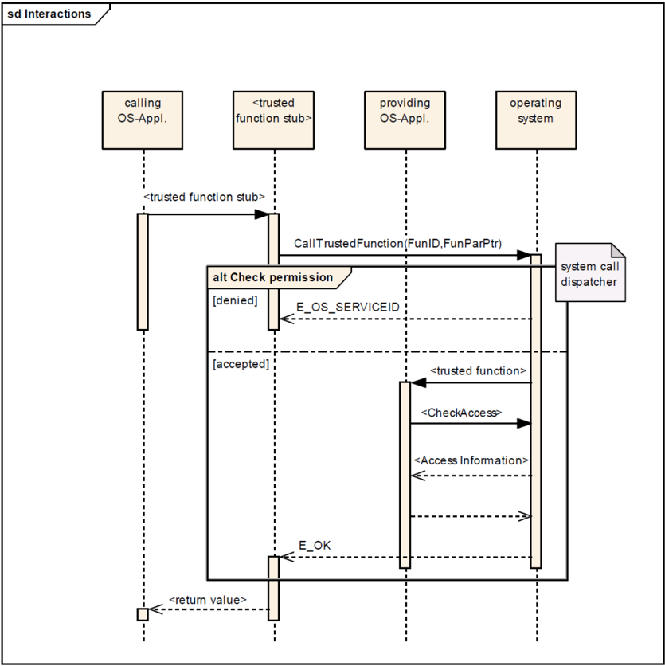

上面的序列描述了对 [**CallTrustedFunction**](#744-calltrustedfunction) 服务的调用。它始于一个调用某服务的用户，而该服务本身需要调用一个可信函数。然后，该服务将可信函数的参数打包到一个结构体中，并以 ID 和指针作为参数调用 [**CallTrustedFunction**](#744-calltrustedfunction)。随后，**OS** 检查对所请求服务的访问是否有效。如果未授予访问权限，则返回 **E_OS_SERVICEID**。否则，将调用可信服务本身，由该函数检查参数的访问权限等。

### 8.2. ErrorHook 使用的序列图

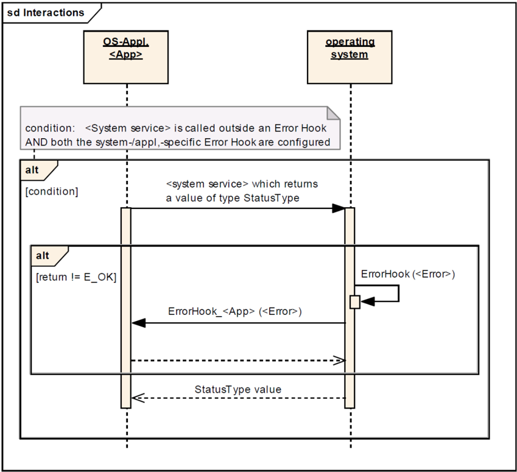

上面的序列图展示了当服务未以 **E_OK** 返回时错误钩子调用的顺序。注意，在这种情况下，会调用通用错误钩子和 **OS-Application** 特定的错误钩子。

### 8.3. ProtectionHook 的序列图

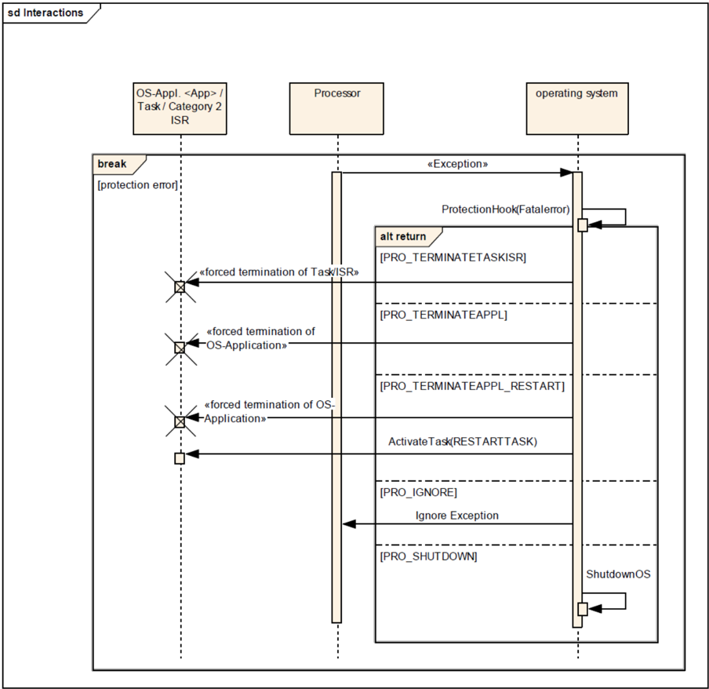

该序列展示了发生保护错误时的控制流。取决于 **ProtectionHook** 的返回值，或者强制终止有故障的任务（**Task**）/**ISR**，或者强制终止 **OS-Application**，或者关闭系统。如果动作是终止有故障的 **OS-Application**，则一个选项是在随后启动重启任务（**restart Task**），由它执行清理等工作。

### 8.4. StartupHook 的序列图

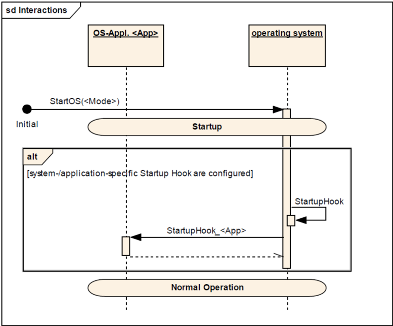

上面的序列展示了 **OS** 启动期间的控制流。与 **OSEK OS** 中一样，用户调用 **StartOS** 服务来启动 **OS**。在启动期间，启动钩子按上述顺序被调用。启动序列的其余部分与 **OSEK OS** 定义的行为相同。

### 8.5. ShutdownHook 的序列图

下一个序列展示了关机时的行为。该流程与 **OSEK OS** 中相同，不同之处在于 **OS-Application** 的关机钩子在通用 **ShutdownHook** 被调用之前被调用。注意，应用的特定关机钩子不允许阻塞，它们必须返回到调用者。

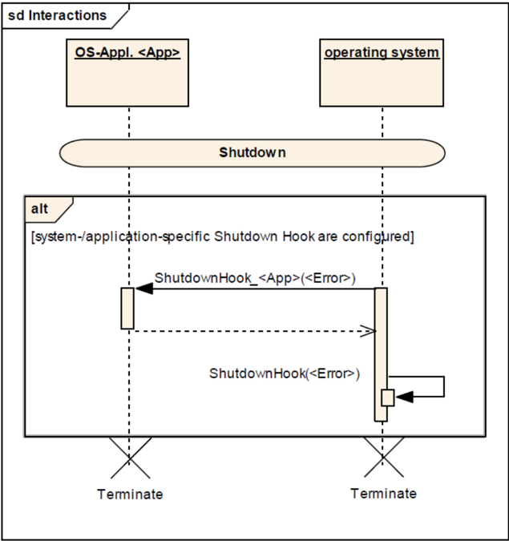

### 8.6. 通过 IOC 的发送方/接收方通信的序列图

#### 8.6.1. 最后即最佳通信

图 9.6 展示了在最后即最佳（last-is-best）通信（"数据"语义）情况下，[**IOC**](#75-ioc) 与 **RTE** 之间交互的成功和失败案例的序列。

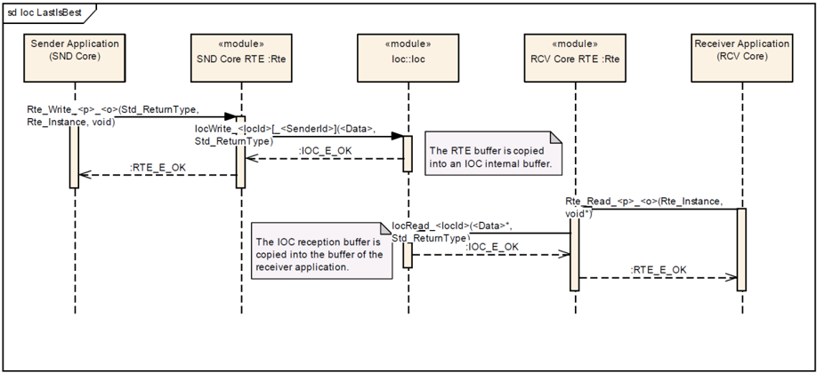

#### 8.6.2. 无拉取回调的排队通信

图 9.7 展示了 [**IOC**](#75-ioc) 与 **RTE** 之间的交互，重点关注排队通信的拥塞控制。

所定义的通信没有用于数据接收的回调功能，内部缓冲区大小为 2 个数据元素，未定义等待点（waitpoint），并且所涉及的 **OS-Application** 位于不同的内核上。

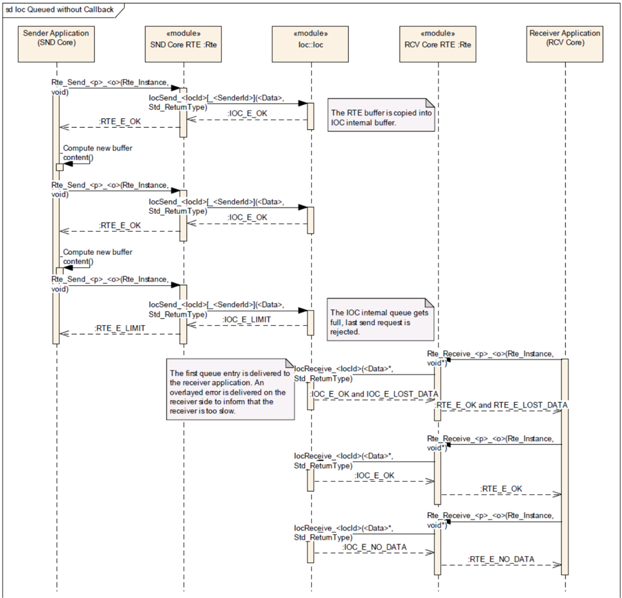

#### 8.6.3. 带拉取回调的排队通信

图 9.8 展示了在带有激活的回调功能的排队通信情况下 [**IOC**](#75-ioc) 与 **RTE** 之间的交互。**RTE** 可能在内部处理通知，因此可能不提供任何回调函数，但在不同内核上的 **CDD** 之间进行通信的情况下，会出现类似的场景。在这种情况中，接收方 **CDD** 将提供回调函数。

所定义的通信没有等待点，并描述了涉及位于不同内核上的两个 **OS-Application** 的通信。

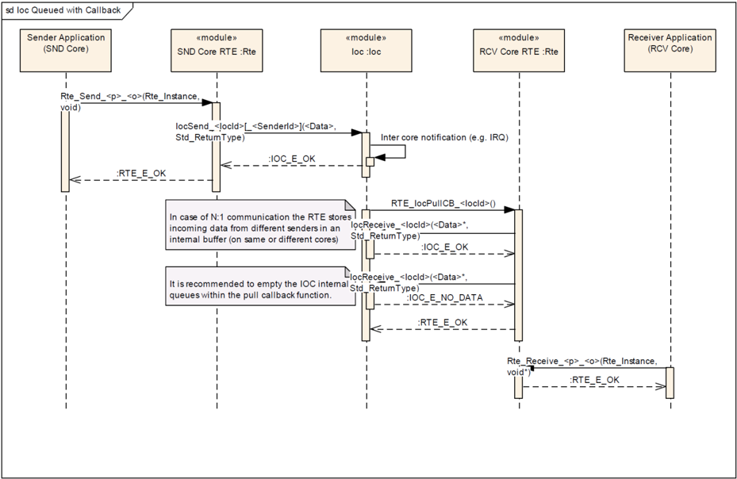

## 9. 配置规范

总体而言，本章定义配置参数及其到**容器**（container）的聚类组织。为支持本规范，第 9.1 章描述基础知识，并规定应用于参数规范的模板（表）。我们有意将第 9.1 章保留在规范中以保证可理解性。

第 9.2 章规定模块 **Os** 的结构（容器）和参数。

第 9.3 章规定 **Ioc** 的结构（容器）和参数。

第 9.4 章规定 **Os** 和 **Ioc** 的结构（容器）和 ARTI 参数。

第 9.5 章规定模块 **Os** 的发布信息。

### 9.1. 如何阅读本章

详情请参阅 **SWS_BSWGeneral** 中的第 10.1 章「Introduction to configuration specification」（配置规范简介）。

### 9.1.1. 参数规则

某些配置参数被配置为浮点值，有时这些值必须经过取整才能使用。以下规则定义了特定参数的取整方式：

- 执行时间（用于时序保护）为“向下取整”（**round down**）
- 时间帧为“向下取整”（**round down**）

### 9.2. 容器与配置参数

以下各节汇总所有配置参数及其容器。有关各参数详细含义的背景信息见第 6 章和第 7 章。

为了更好的可读性，在配置参数的名称字段中以花括号给出 2.1 版 OS 规范的 OIL 名称。

分配给 **OS-Application** 的已使用 EcucPartitionId 应从零开始且连续。如果不是这种情况，一致性检查应发出错误。

分配给 **OS-Application** 的已使用 EcucCoreId 应从零开始且连续。如果不是这种情况，一致性检查应发出错误。

#### 9.2.1. Os

| SWS 条目 |  |
|---|---|
| 模块名称 | Os |
| 描述 | Os（操作系统）模块的配置。 |
| Post-Build 变体支持 | false |
| 支持的配置变体 | VARIANT-PRE-COMPILE |

| 容器名称 | 多重性 | 作用域/依赖 |
|---|---|---|
| OsAlarm | 0..* | OsAlarm 可用于异步通知或激活特定任务。可以取决于应用模式，在系统启动时自动启动告警。 |
| OsAppMode | 1..* | OsAppMode 是用于为 ISO 17356-3 应用模式定义 ISO 17356-3 属性的对象。没有为 AppMode 定义标准属性。在一个 CPU 中，必须至少定义一个 AppMode 对象。[来源：ISO 17356-6] 为兼容 ISO 17356，必须始终存在一个名为 OSDEFAULTAPPMODE 的 OsAppMode。 |
| OsApplication | 0..* | AUTOSAR OS 必须能够支持构成一个内聚功能单元的 OS 对象集合（任务、中断、告警、钩子等）。这种对象集合称为 OS-Application。属于同一 OS-Application 的所有对象彼此可访问。访问指允许在 API 服务中使用这些对象。可以单独授予其他应用的访问权限。 |
| OsCounter | 0..* | 属于 Os Application 的计数器的配置信息。 |
| OsEvent | 0..* | 配置上下文中 OS 事件的表现形式。采纳自 ISO 17356-6 规范。 |
| OsIoc | 0..1 | IOC（Inter OS Application Communicator）的配置。 |
| OsIsr | 0..* | OsIsr 容器表示一个 ISO 17356 中断服务例程。 |
| OsOS | 1 | OS 是用于为 ISO 17356 应用定义 ISO 17356-3 属性的对象。每个 CPU 必须恰好定义一个 OS 对象。 |
| OsPeripheralArea | 0..65534 | 用于组织一个外围区域配置参数的结构容器。容器短名称可用于访问该区域。 |
| OsResource | 0..* | OsResource 对象用于协调任务和 ISR 对共享资源（例如调度器、任何程序序列、内存或任何硬件区域）的并发访问。 |
| OsScheduleTable | 0..* | OsScheduleTable 通过封装一组静态定义、运行时不可修改的告警来解决同步问题。 |
| OsSpinlock | 0..* | OsSpinlock 对象用于协调不同内核上 TASK/ISR2 对共享资源的并发访问。 |
| OsTask | 0..* | 此容器表示一个 ISO 17356 任务。 |

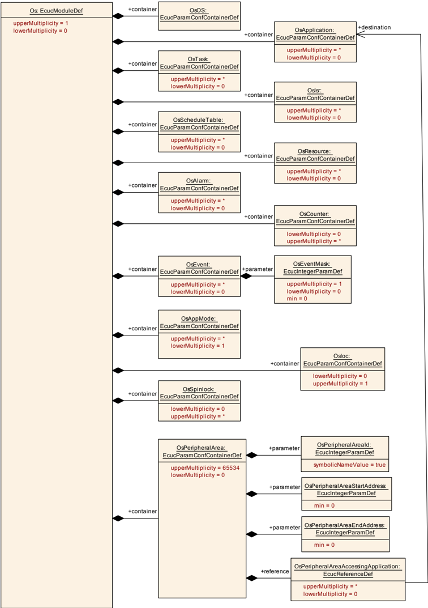

#### 9.2.2. OsAlarmSetEvent

| SWS 条目 |  |
|---|---|
| 容器名称 | OsAlarmSetEvent |
| 父容器 | OsAlarmAction |
| 描述 | 此容器指定用于设置事件的参数 |
| 配置参数 | 见下方参数表 |

| SWS 条目 |  |
|---|---|
| 参数名称 | OsAlarmSetEventRef |
| 父容器 | OsAlarmSetEvent |
| 描述 | 引用将由该告警动作设置的事件 |
| 多重性 | 1 |
| 类型 | 对 OsEvent 的引用 |
| Post-Build 变体值 | false |
| 值配置类 | Pre-compile time：X（All Variants）；Link time：-；Post-build time：- |
| 作用域/依赖 | scope: local |

| SWS 条目 |  |
|---|---|
| 参数名称 | OsAlarmSetEventTaskRef |
| 父容器 | OsAlarmSetEvent |
| 描述 | 引用将由该事件激活的任务 |
| 多重性 | 1 |
| 类型 | 对 OsTask 的引用 |
| Post-Build 变体值 | false |
| 值配置类 | Pre-compile time：X（All Variants）；Link time：-；Post-build time：- |
| 作用域/依赖 | scope: local |

该容器不包含任何子容器。

#### 9.2.3. OsAlarm

| SWS 条目 |  |
|---|---|
| 容器名称 | OsAlarm |
| 父容器 | Os |
| 描述 | OsAlarm 可用于异步通知或激活特定任务。可以取决于应用模式，在系统启动时自动启动告警。 |
| 配置参数 | 见下方参数表 |

| SWS 条目 |  |
|---|---|
| 参数名称 | OsAlarmAccessingApplication |
| 父容器 | OsAlarm |
| 描述 | 引用有权访问此对象的应用。 |
| 多重性 | 0..* |
| 类型 | 对 OsApplication 的引用 |
| Post-Build 变体多重性 | false |
| Post-Build 变体值 | false |
| 多重性配置类 | Pre-compile time：X（All Variants）；Link time：-；Post-build time：- |
| 值配置类 | Pre-compile time：X（All Variants）；Link time：-；Post-build time：- |
| 作用域/依赖 |  |

| SWS 条目 |  |
|---|---|
| 参数名称 | OsAlarmCounterRef |
| 父容器 | OsAlarm |
| 描述 | 引用分配给该告警的计数器 |
| 多重性 | 1 |
| 类型 | 对 OsCounter 的引用 |
| Post-Build 变体值 | false |
| 值配置类 | Pre-compile time：X（All Variants）；Link time：-；Post-build time：- |
| 作用域/依赖 | scope: local |

| 容器名称 | 多重性 | 作用域/依赖 |
|---|---|---|
| OsAlarmAction | 1 | 此容器定义告警到期时使用哪种通知类型。 |
| OsAlarmAutostart | 0..1 | 如果存在，此容器定义是否取决于应用模式在系统启动时自动启动告警。 |

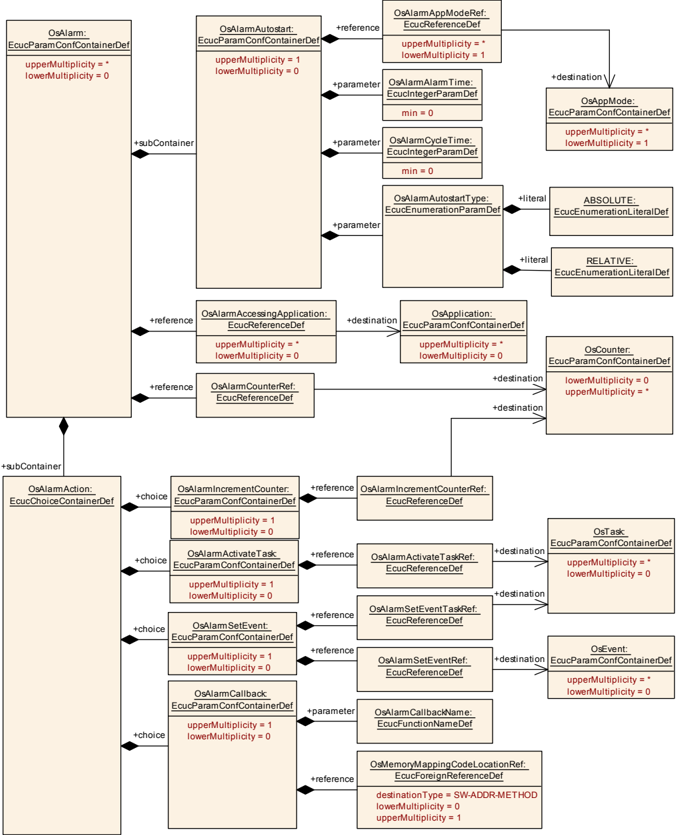

#### 9.2.4. OsAlarmAction

| SWS 条目 |  |
|---|---|
| 可选容器名称 | OsAlarmAction |
| 父容器 | OsAlarm |
| 描述 | 此容器定义告警到期时使用哪种通知类型。 |

| 容器名称 | 多重性 | 作用域/依赖 |
|---|---|---|
| OsAlarmActivateTask | 0..1 | 此容器指定用于激活任务的参数。 |
| OsAlarmCallback | 0..1 | 此容器指定用于调用回调 OS 告警动作的参数。 |
| OsAlarmIncrementCounter | 0..1 | 此容器指定用于递增计数器的参数。 |
| OsAlarmSetEvent | 0..1 | 此容器指定用于设置事件的参数 |

#### 9.2.5. OsAlarmActivateTask

| SWS 条目 |  |
|---|---|
| 容器名称 | OsAlarmActivateTask |
| 父容器 | OsAlarmAction |
| 描述 | 此容器指定用于激活任务的参数。 |
| 配置参数 | 见下方参数表 |

| SWS 条目 |  |
|---|---|
| 参数名称 | OsAlarmActivateTaskRef |
| 父容器 | OsAlarmActivateTask |
| 描述 | 引用将由该告警动作激活的任务 |
| 多重性 | 1 |
| 类型 | 对 OsTask 的引用 |
| Post-Build 变体值 | false |
| 值配置类 | Pre-compile time：X（All Variants）；Link time：-；Post-build time：- |
| 作用域/依赖 | scope: local |

该容器不包含任何子容器。

#### 9.2.6. OsAlarmAutostart

| SWS 条目 |  |
|---|---|
| 容器名称 | OsAlarmAutostart |
| 父容器 | OsAlarm |
| 描述 | 如果存在，此容器定义是否取决于应用模式在系统启动时自动启动告警。 |
| 配置参数 | 见下方参数表 |

| SWS 条目 |  |
|---|---|
| 参数名称 | OsAlarmAlarmTime |
| 父容器 | OsAlarmAutostart |
| 描述 | 告警首次到期时的相对或绝对 tick 值。注意，对于 RELATIVE（相对）告警，该值必须大于 0。 |
| 多重性 | 1 |
| 类型 | EcucIntegerParamDef |
| 范围 | 0 .. 18446744073709551615 |
| 默认值 | - |
| Post-Build 变体值 | false |
| 值配置类 | Pre-compile time：X（All Variants）；Link time：-；Post-build time：- |
| 作用域/依赖 | scope: local |

| SWS 条目 |  |
|---|---|
| 参数名称 | OsAlarmAutostartType |
| 父容器 | OsAlarmAutostart |
| 描述 | 指定告警的自动启动类型。 |
| 多重性 | 1 |
| 类型 | EcucEnumerationParamDef |
| 范围 | ABSOLUTE：告警在启动时通过 SetAbsAlarm() 启动；RELATIVE：告警在启动时通过 SetRelAlarm() 启动 |
| Post-Build 变体值 | false |
| 值配置类 | Pre-compile time：X（All Variants）；Link time：-；Post-build time：- |
| 作用域/依赖 | scope: local |

| SWS 条目 |  |
|---|---|
| 参数名称 | OsAlarmCycleTime |
| 父容器 | OsAlarmAutostart |
| 描述 | 循环告警的周期时间（以 tick 计）。如果该值为 0，则告警不是循环的。 |
| 多重性 | 1 |
| 类型 | EcucIntegerParamDef |
| 范围 | 0 .. 18446744073709551615 |
| 默认值 | - |
| Post-Build 变体值 | false |
| 值配置类 | Pre-compile time：X（All Variants）；Link time：-；Post-build time：- |
| 作用域/依赖 | scope: local |

| SWS 条目 |  |
|---|---|
| 参数名称 | OsAlarmAppModeRef |
| 父容器 | OsAlarmAutostart |
| 描述 | 引用应对其执行 AUTOSTART 的应用模式 |
| 多重性 | 1..* |
| 类型 | 对 OsAppMode 的引用 |
| Post-Build 变体多重性 | false |
| Post-Build 变体值 | false |
| 多重性配置类 | Pre-compile time：X（All Variants）；Link time：-；Post-build time：- |
| 值配置类 | Pre-compile time：X（All Variants）；Link time：-；Post-build time：- |
| 作用域/依赖 | scope: local |

该容器不包含任何子容器。

#### 9.2.7. OsAlarmCallback

| SWS 条目 |  |
|---|---|
| 容器名称 | OsAlarmCallback |
| 父容器 | OsAlarmAction |
| 描述 | 此容器指定用于调用回调 OS 告警动作的参数。 |
| 配置参数 | 见下方参数表 |

| SWS 条目 |  |
|---|---|
| 参数名称 | OsAlarmCallbackName |
| 父容器 | OsAlarmCallback |
| 描述 | 此告警回调被触发时调用的函数的名称。 |
| 多重性 | 1 |
| 类型 | EcucFunctionNameDef |
| 默认值 | - |
| 正则表达式 | - |
| Post-Build 变体值 | false |
| 值配置类 | Pre-compile time：X（All Variants）；Link time：-；Post-build time：- |
| 作用域/依赖 | scope: local |

| SWS 条目 |  |
|---|---|
| 参数名称 | OsMemoryMappingCodeLocationRef |
| 父容器 | OsAlarmCallback |
| 描述 | 对内存映射的引用，其中包含有关代码所放置段的详细信息。 |
| 多重性 | 0..1 |
| 类型 | 对 SW-ADDR-METHOD 的外部引用 |
| Post-Build 变体值 | false |
| 值配置类 | Pre-compile time：X（All Variants）；Link time：-；Post-build time：- |
| 作用域/依赖 | scope: ECU |

该容器不包含任何子容器。

#### 9.2.8. OsAlarmIncrementCounter

| SWS 条目 |  |
|---|---|
| 容器名称 | OsAlarmIncrementCounter |
| 父容器 | OsAlarmAction |
| 描述 | 此容器指定用于递增计数器的参数。 |
| 配置参数 | 见下方参数表 |

| SWS 条目 |  |
|---|---|
| 参数名称 | OsAlarmIncrementCounterRef |
| 父容器 | OsAlarmIncrementCounter |
| 描述 | 引用将由该告警动作递增的计数器 |
| 多重性 | 1 |
| 类型 | 对 OsCounter 的引用 |
| Post-Build 变体值 | false |
| 值配置类 | Pre-compile time：X（All Variants）；Link time：-；Post-build time：- |
| 作用域/依赖 | scope: ECU |

该容器不包含任何子容器。

#### 9.2.9. OsApplication

| SWS 条目 |  |
|---|---|
| 容器名称 | OsApplication |
| 父容器 | Os |
| 描述 | AUTOSAR OS 必须能够支持构成一个内聚功能单元的 OS 对象集合（任务、中断、告警、钩子等）。这种对象集合称为 OS-Application。属于同一 OS-Application 的所有对象彼此可访问。访问指允许在 API 服务中使用这些对象。可以单独授予其他应用的访问权限。 |
| 配置参数 | 见下方参数表 |

| SWS 条目 |  |
|---|---|
| 参数名称 | OsTrusted |
| 父容器 | OsApplication |
| 描述 | 用于指定 OS-Application 是否可信的参数（true：OS-Application 是可信的；false：OS-Application 不可信（默认））。 |
| 多重性 | 1 |
| 类型 | EcucBooleanParamDef |
| 默认值 | false |
| Post-Build 变体值 | false |
| 值配置类 | Pre-compile time：X（All Variants）；Link time：-；Post-build time：- |
| 作用域/依赖 | scope: ECU dependency: 可扩展性等级 3 和 4 必需 |

| SWS 条目 |  |
|---|---|
| 参数名称 | OsTrustedApplicationDelayTimingViolationCall |
| 父容器 | OsApplication |
| 描述 | 用于指定可信 OS-Application 内发生的时序违规是立即抛出，还是延迟到当前任务返回调用方 OS-Application（CallTrustedFunction 返回）时再抛出的参数（true：违规/对 ProtectionHook() 的调用被延迟；false：时序违规导致立即调用 ProtectionHook()）。 |
| 多重性 | 1 |
| 类型 | EcucBooleanParamDef |
| 默认值 | true |
| Post-Build 变体值 | false |
| 值配置类 | Pre-compile time：X（All Variants）；Link time：-；Post-build time：- |
| 作用域/依赖 | scope: ECU |

| SWS 条目 |  |
|---|---|
| 参数名称 | OsTrustedApplicationWithProtection |
| 父容器 | OsApplication |
| 描述 | 用于指定可信 OS-Application 是否在内存保护下执行的参数（true：OS-Application 在受保护的环境中运行，这意味着写访问受限；false：OS-Application 拥有完全的写访问权限（默认））。 |
| 多重性 | 1 |
| 类型 | EcucBooleanParamDef |
| 默认值 | false |
| Post-Build 变体值 | false |
| 值配置类 | Pre-compile time：X（All Variants）；Link time：-；Post-build time：- |
| 作用域/依赖 | scope: ECU |

| SWS 条目 |  |
|---|---|
| 参数名称 | OsAppAlarmRef |
| 父容器 | OsApplication |
| 描述 | 指定属于该 OsApplication 的 OsAlarm。 |
| 多重性 | 0..* |
| 类型 | 对 OsAlarm 的引用 |
| Post-Build 变体多重性 | false |
| Post-Build 变体值 | false |
| 多重性配置类 | Pre-compile time：X（All Variants）；Link time：-；Post-build time：- |
| 值配置类 | Pre-compile time：X（All Variants）；Link time：-；Post-build time：- |
| 作用域/依赖 | scope: ECU |

| SWS 条目 |  |
|---|---|
| 参数名称 | OsAppCounterRef |
| 父容器 | OsApplication |
| 描述 | 引用属于该 OsApplication 的 OsCounter。 |
| 多重性 | 0..* |
| 类型 | 对 OsCounter 的引用 |
| Post-Build 变体多重性 | false |
| Post-Build 变体值 | false |
| 多重性配置类 | Pre-compile time：X（All Variants）；Link time：-；Post-build time：- |
| 值配置类 | Pre-compile time：X（All Variants）；Link time：-；Post-build time：- |
| 作用域/依赖 | scope: ECU |

| SWS 条目 |  |
|---|---|
| 参数名称 | OsAppEcucPartitionRef |
| 父容器 | OsApplication |
| 描述 | 表示此“OSApplication”实现的是哪个“EcucPartition”。 |
| 多重性 | 1 |
| 类型 | 对 EcucPartition 的引用 |
| Post-Build 变体多重性 | false |
| Post-Build 变体值 | false |
| 多重性配置类 | Pre-compile time：X（All Variants）；Link time：-；Post-build time：- |
| 值配置类 | Pre-compile time：X（All Variants）；Link time：-；Post-build time：- |
| 作用域/依赖 | scope: ECU |

| SWS 条目 |  |
|---|---|
| 参数名称 | OsAppIsrRef |
| 父容器 | OsApplication |
| 描述 | 引用哪些 OsIsr 属于该 OsApplication |
| 多重性 | 0..* |
| 类型 | 对 OsIsr 的引用 |
| Post-Build 变体多重性 | false |
| Post-Build 变体值 | false |
| 多重性配置类 | Pre-compile time：X（All Variants）；Link time：-；Post-build time：- |
| 值配置类 | Pre-compile time：X（All Variants）；Link time：-；Post-build time：- |
| 作用域/依赖 | scope: ECU |

| SWS 条目 |  |
|---|---|
| 参数名称 | OsAppScheduleTableRef |
| 父容器 | OsApplication |
| 描述 | 引用属于该 OsApplication 的 OsScheduleTable。 |
| 多重性 | 0..* |
| 类型 | 对 OsScheduleTable 的引用 |
| Post-Build 变体多重性 | false |
| Post-Build 变体值 | false |
| 多重性配置类 | Pre-compile time：X（All Variants）；Link time：-；Post-build time：- |
| 值配置类 | Pre-compile time：X（All Variants）；Link time：-；Post-build time：- |
| 作用域/依赖 | scope: ECU |

| SWS 条目 |  |
|---|---|
| 参数名称 | OsAppTaskRef |
| 父容器 | OsApplication |
| 描述 | 引用哪些 OsTask 属于该 OsApplication |
| 多重性 | 0..* |
| 类型 | 对 OsTask 的引用 |
| Post-Build 变体多重性 | false |
| Post-Build 变体值 | false |
| 多重性配置类 | Pre-compile time：X（All Variants）；Link time：-；Post-build time：- |
| 值配置类 | Pre-compile time：X（All Variants）；Link time：-；Post-build time：- |
| 作用域/依赖 | scope: ECU |

| SWS 条目 |  |
|---|---|
| 参数名称 | OsMemoryMappingCodeLocationRef |
| 父容器 | OsApplication |
| 描述 | 对内存映射的引用，其中包含有关代码所放置段的详细信息。 |
| 多重性 | 0..1 |
| 类型 | 对 SW-ADDR-METHOD 的外部引用 |
| Post-Build 变体值 | false |
| 值配置类 | Pre-compile time：X（All Variants）；Link time：-；Post-build time：- |
| 作用域/依赖 | scope: ECU |

| SWS 条目 |  |
|---|---|
| 参数名称 | OsRestartTask |
| 父容器 | OsApplication |
| 描述 | 可选地，OS-Application 的一个任务可被定义为重启任务（Restart Task）。多重性 = 1：当保护钩子请求时，操作系统激活重启任务。多重性 = 0：发生保护错误后，不会自动启动任何任务。 |
| 多重性 | 0..1 |
| 类型 | 对 OsTask 的引用 |
| Post-Build 变体多重性 | false |
| Post-Build 变体值 | false |
| 多重性配置类 | Pre-compile time：X（All Variants）；Link time：-；Post-build time：- |
| 值配置类 | Pre-compile time：X（All Variants）；Link time：-；Post-build time：- |
| 作用域/依赖 | scope: ECU dependency: 可扩展性等级 3 和 4 必需 |

| 容器名称 | 多重性 | 作用域/依赖 |
|---|---|---|
| OsApplicationHooks | 1 | 用于组织 OS-Application 特定钩子的容器 |
| OsApplicationTrustedFunction | 0..* | 用于组织可信函数配置参数的容器 |

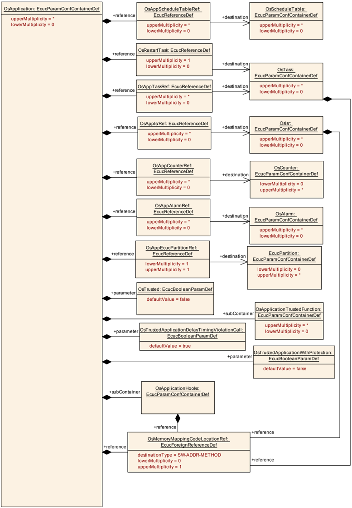

#### 9.2.10. OsApplicationHooks

| SWS 条目 |  |
|---|---|
| 容器名称 | OsApplicationHooks |
| 父容器 | OsApplication |
| 描述 | 用于组织 OS-Application 特定钩子的容器 |
| 配置参数 | 见下方参数表 |

| SWS 条目 |  |
|---|---|
| 参数名称 | OsAppErrorHook |
| 父容器 | OsApplicationHooks |
| 描述 | 选择 OS-Application 错误钩子（true：调用钩子；false：不调用钩子）。 |
| 多重性 | 1 |
| 类型 | EcucBooleanParamDef |
| 默认值 | - |
| Post-Build 变体值 | false |
| 值配置类 | Pre-compile time：X（All Variants）；Link time：-；Post-build time：- |
| 作用域/依赖 | scope: ECU dependency: 可扩展性等级 3 和 4 必需 |

| SWS 条目 |  |
|---|---|
| 参数名称 | OsAppShutdownHook |
| 父容器 | OsApplicationHooks |
| 描述 | 为 OS-Application 选择该 OS-Application 特定的关机钩子（true：调用钩子；false：不调用钩子）。 |
| 多重性 | 1 |
| 类型 | EcucBooleanParamDef |
| 默认值 | - |
| Post-Build 变体值 | false |
| 值配置类 | Pre-compile time：X（All Variants）；Link time：-；Post-build time：- |
| 作用域/依赖 | scope: ECU dependency: 可扩展性等级 3 和 4 必需 |

| SWS 条目 |  |
|---|---|
| 参数名称 | OsAppStartupHook |
| 父容器 | OsApplicationHooks |
| 描述 | 为 OS-Application 选择该 OS-Application 特定的启动钩子（true：调用钩子；false：不调用钩子）。 |
| 多重性 | 1 |
| 类型 | EcucBooleanParamDef |
| 默认值 | - |
| Post-Build 变体值 | false |
| 值配置类 | Pre-compile time：X（All Variants）；Link time：-；Post-build time：- |
| 作用域/依赖 | scope: ECU dependency: 可扩展性等级 3 和 4 必需 |

| SWS 条目 |  |
|---|---|
| 参数名称 | OsMemoryMappingCodeLocationRef |
| 父容器 | OsApplicationHooks |
| 描述 | 对内存映射的引用，其中包含有关代码所放置段的详细信息。 |
| 多重性 | 0..1 |
| 类型 | 对 SW-ADDR-METHOD 的外部引用 |
| Post-Build 变体值 | false |
| 值配置类 | Pre-compile time：X（All Variants）；Link time：-；Post-build time：- |
| 作用域/依赖 | scope: ECU |

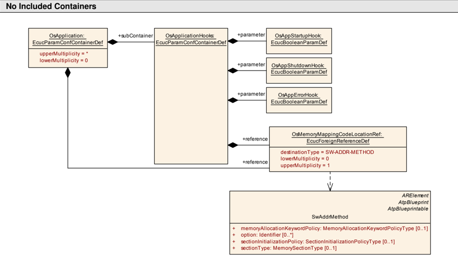

#### 9.2.11. OsApplicationTrustedFunction

| SWS 条目 |  |
|---|---|
| 容器名称 | OsApplicationTrustedFunction |
| 父容器 | OsApplication |
| 描述 | 用于组织可信函数配置参数的容器 |
| 配置参数 | 见下方参数表 |

| SWS 条目 |  |
|---|---|
| 参数名称 | OsTrustedFunctionName |
| 父容器 | OsApplicationTrustedFunction |
| 描述 | 对其他 OS-Application 可用的可信函数（作为可信 OS-Application 的一部分）。由于此参数的可选性已经对此进行了描述，这也取代了 APPLICATION 中的 ISO 17356-6 属性 TRUSTED。 |
| 多重性 | 1 |
| 类型 | EcucFunctionNameDef |
| 默认值 | - |
| 正则表达式 | - |
| Post-Build 变体值 | false |
| 值配置类 | Pre-compile time：X（All Variants）；Link time：-；Post-build time：- |
| 作用域/依赖 | scope: ECU dependency: 可扩展性等级 3 和 4 以及可信 OS-Application 中必需 |

| SWS 条目 |  |
|---|---|
| 参数名称 | OsMemoryMappingCodeLocationRef |
| 父容器 | OsApplicationTrustedFunction |
| 描述 | 对内存映射的引用，其中包含有关代码所放置段的详细信息。 |
| 多重性 | 0..1 |
| 类型 | 对 SW-ADDR-METHOD 的外部引用 |
| Post-Build 变体多重性 | false |
| Post-Build 变体值 | false |
| 值配置类 | Pre-compile time：X（All Variants）；Link time：-；Post-build time：- |
| 作用域/依赖 | scope: ECU |

该容器不包含任何子容器。

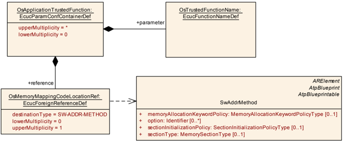

#### 9.2.12. OsAppMode

| SWS 条目 |  |
|---|---|
| 容器名称 | OsAppMode |
| 父容器 | Os |
| 描述 | OsAppMode 是用于为 ISO 17356-3 应用模式定义 ISO 17356-3 属性的对象。没有为 AppMode 定义标准属性。在一个 CPU 中，必须至少定义一个 AppMode 对象。[来源：ISO 17356-6] 为兼容 ISO 17356，必须始终存在一个名为 OSDEFAULTAPPMODE 的 OsAppMode。 |
| 配置参数 | 见下方参数表 |

该容器不包含任何子容器。

#### 9.2.13. OsCounter

| SWS 条目 |  |
|---|---|
| 容器名称 | OsCounter |
| 父容器 | Os |
| 描述 | 属于 OsApplication 的计数器的配置信息。 |
| 配置参数 | 见下方参数表 |

| SWS 条目 |  |
|---|---|
| 参数名称 | OsCounterMaxAllowedValue |
| 父容器 | OsCounter |
| 描述 | 系统计数器允许的最大值（以 tick 计）。 |
| 多重性 | 1 |
| 类型 | EcucIntegerParamDef |
| 范围 | 1 .. 18446744073709551615 |
| 默认值 | - |
| Post-Build 变体值 | false |
| 值配置类 | Pre-compile time：X（All Variants）；Link time：-；Post-build time：- |
| 作用域/依赖 | scope: local |

| SWS 条目 |  |
|---|---|
| 参数名称 | OsCounterMinCycle |
| 父容器 | OsCounter |
| 描述 | MINCYCLE 属性指定链接到该计数器的循环告警所允许的最小计数器 tick 数。 |
| 多重性 | 1 |
| 类型 | EcucIntegerParamDef |
| 范围 | 1 .. 18446744073709551615 |
| 默认值 | - |
| Post-Build 变体值 | false |
| 值配置类 | Pre-compile time：X（All Variants）；Link time：-；Post-build time：- |
| 作用域/依赖 | scope: local |

| SWS 条目 |  |
|---|---|
| 参数名称 | OsCounterTicksPerBase |
| 父容器 | OsCounter |
| 描述 | TICKSPERBASE 属性指定达到一个计数器特定单位所需的 tick 数。其解释是特定于实现的。 |
| 多重性 | 1 |
| 类型 | EcucIntegerParamDef |
| 范围 | 1 .. 4294967295 |
| 默认值 | - |
| Post-Build 变体值 | false |
| 值配置类 | Pre-compile time：X（All Variants）；Link time：-；Post-build time：- |
| 作用域/依赖 | scope: local |

| SWS 条目 |  |
|---|---|
| 参数名称 | OsCounterType |
| 父容器 | OsCounter |
| 描述 | 此参数包含计数器的自然类型或单位。 |
| 多重性 | 1 |
| 类型 | EcucEnumerationParamDef |
| 范围 | HARDWARE：此计数器由某些硬件驱动，例如硬件定时器单元；SOFTWARE：计数器由调用 IncrementCounter 服务的某些软件驱动 |
| Post-Build 变体值 | false |
| 值配置类 | Pre-compile time：X（All Variants）；Link time：-；Post-build time：- |
| 作用域/依赖 | scope: ECU |

| SWS 条目 |  |
|---|---|
| 参数名称 | OsSecondsPerTick |
| 父容器 | OsCounter |
| 描述 | 一个计数器 tick 的时间（以秒计）。 |
| 多重性 | 0..1 |
| 类型 | EcucFloatParamDef |
| 范围 | [0 .. INF] |
| 默认值 | - |
| Post-Build 变体多重性 | false |
| Post-Build 变体值 | false |
| 多重性配置类 | Pre-compile time：X（All Variants）；Link time：-；Post-build time：- |
| 值配置类 | Pre-compile time：X（All Variants）；Link time：-；Post-build time：- |
| 作用域/依赖 | scope: ECU |

| SWS 条目 |  |
|---|---|
| 参数名称 | OsCounterAccessingApplication |
| 父容器 | OsCounter |
| 描述 | 引用有权访问此对象的应用。 |
| 多重性 | 0..* |
| 类型 | 对 OsApplication 的引用 |
| Post-Build 变体多重性 | false |
| Post-Build 变体值 | false |
| 多重性配置类 | Pre-compile time：X（All Variants）；Link time：-；Post-build time：- |
| 值配置类 | Pre-compile time：X（All Variants）；Link time：-；Post-build time：- |
| 作用域/依赖 | scope: local |

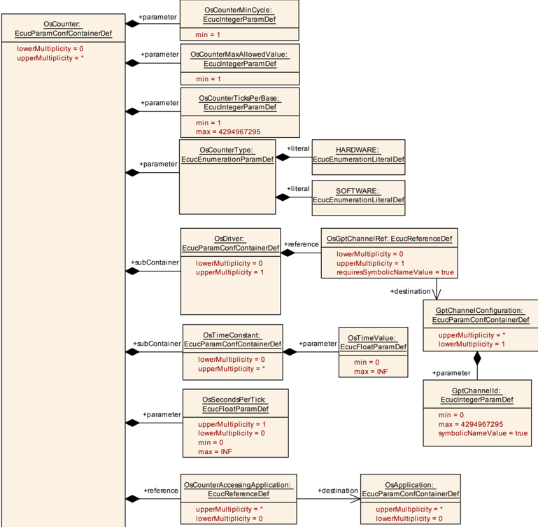

| 容器名称 | 多重性 | 作用域/依赖 |
|---|---|---|
| OsDriver | 0..1 | 此容器包含有关由谁驱动计数器的信息。此配置仅在计数器的 OsCounterType 设置为 HARDWARE 时有效。如果该容器不存在（多重性 = 0），则定时器由 OS 在内部管理（OSINTERNAL）。如果该容器存在，OS 可以使用 GPT 接口来管理定时器。用户必须提供 GPT 通道。如果计数器由其他（OS 外部的）源（例如 TPU）驱动，则必须将其描述为供应商特定的扩展。 |
| OsTimeConstant | 0..* | 允许用户定义常量，例如可用于将时间值与定时器 tick 值进行比较的常量。时间值将在生成期间被转换为定时器 tick 值，之后可通过 OsConstName 访问。转换通过将时间值舍入到最接近的合适 tick 值来完成。 |

#### 9.2.14. OsEvent

| SWS 条目 |  |
|---|---|
| 容器名称 | OsEvent |
| 父容器 | Os |
| 描述 | 配置上下文中 OS 事件的表现形式。采纳自 ISO 17356-6 规范。 |
| 配置参数 | 见下方参数表 |

| SWS 条目 |  |
|---|---|
| 参数名称 | OsEventMask |
| 父容器 | OsEvent |
| 描述 | 如果在 OIL 中事件掩码将被设置为 AUTO，则应在此处省略该参数。 |
| 多重性 | 0..1 |
| 类型 | EcucIntegerParamDef |
| 范围 | 0 .. 18446744073709551615 |
| 默认值 | - |
| Post-Build 变体多重性 | false |
| Post-Build 变体值 | false |
| 多重性配置类 | Pre-compile time：X（All Variants）；Link time：-；Post-build time：- |
| 值配置类 | Pre-compile time：X（All Variants）；Link time：-；Post-build time：- |
| 作用域/依赖 | scope: local |

该容器不包含任何子容器。

#### 9.2.15. OsDriver

| SWS 条目 |  |
|---|---|
| 容器名称 | OsDriver |
| 父容器 | OsCounter |
| 描述 | 此容器包含有关由谁驱动计数器的信息。此配置仅在计数器的 OsCounterType 设置为 HARDWARE 时有效。如果该容器不存在（多重性 = 0），则定时器由 OS 在内部管理（OSINTERNAL）。如果该容器存在，OS 可以使用 GPT 接口来管理定时器。用户必须提供 GPT 通道。如果计数器由其他（OS 外部的）源（例如 TPU）驱动，则必须将其描述为供应商特定的扩展。 |
| 配置参数 | 见下方参数表 |

| SWS 条目 |  |
|---|---|
| 参数名称 | OsGptChannelRef |
| 父容器 | OsDriver |
| 描述 | 对 GPT 通道的引用。 |
| 多重性 | 0..1 |
| 类型 | 对 GptChannelConfiguration 的符号名称引用 |
| Post-Build 变体多重性 | false |
| Post-Build 变体值 | false |
| 多重性配置类 | Pre-compile time：X（All Variants）；Link time：-；Post-build time：- |
| 值配置类 | Pre-compile time：X（All Variants）；Link time：-；Post-build time：- |
| 作用域/依赖 | scope: ECU |

该容器不包含任何子容器。

#### 9.2.16. OsHooks

| SWS 条目 |  |
|---|---|
| 容器名称 | OsHooks |
| 父容器 | OsOS |
| 描述 | 用于组织属于该 OS 的所有钩子的容器。 |
| 配置参数 | 见下方参数表 |

| SWS 条目 |  |
|---|---|
| 参数名称 | OsErrorHook |
| 父容器 | OsHooks |
| 描述 | ISO 17356 定义的错误钩子（true：调用钩子；false：不调用钩子）。 |
| 多重性 | 1 |
| 类型 | EcucBooleanParamDef |
| 默认值 | - |
| Post-Build 变体值 | false |
| 值配置类 | Pre-compile time：X（All Variants）；Link time：-；Post-build time：- |
| 作用域/依赖 | scope: local |

| SWS 条目 |  |
|---|---|
| 参数名称 | OsPostTaskHook |
| 父容器 | OsHooks |
| 描述 | ISO 17356 定义的任务后钩子。 |
| 多重性 | 1 |
| 类型 | EcucBooleanParamDef |
| 默认值 | - |
| Post-Build 变体值 | false |
| 值配置类 | Pre-compile time：X（All Variants）；Link time：-；Post-build time：- |
| 作用域/依赖 | scope: local |

| SWS 条目 |  |
|---|---|
| 参数名称 | OsPreTaskHook |
| 父容器 | OsHooks |
| 描述 | ISO 17356 定义的任务前钩子（true：调用钩子；false：不调用钩子）。 |
| 多重性 | 1 |
| 类型 | EcucBooleanParamDef |
| 默认值 | - |
| Post-Build 变体值 | false |
| 值配置类 | Pre-compile time：X（All Variants）；Link time：-；Post-build time：- |
| 作用域/依赖 | scope: local |

| SWS 条目 |  |
|---|---|
| 参数名称 | OsProtectionHook |
| 父容器 | OsHooks |
| 描述 | 用于启用/禁用对（用户提供的）保护钩子的调用的开关（true：发生保护错误时调用保护钩子；false：不调用保护钩子）。 |
| 多重性 | 0..1 |
| 类型 | EcucBooleanParamDef |
| 默认值 | - |
| Post-Build 变体多重性 | false |
| Post-Build 变体值 | false |
| 多重性配置类 | Pre-compile time：X（All Variants）；Link time：-；Post-build time：- |
| 值配置类 | Pre-compile time：X（All Variants）；Link time：-；Post-build time：- |
| 作用域/依赖 | scope: ECU dependency: 可扩展性等级 2、3 和 4 必需 |

| SWS 条目 |  |
|---|---|
| 参数名称 | OsShutdownHook |
| 父容器 | OsHooks |
| 描述 | ISO 17356 定义的关机钩子。 |
| 多重性 | 1 |
| 类型 | EcucBooleanParamDef |
| 默认值 | - |
| Post-Build 变体值 | false |
| 值配置类 | Pre-compile time：X（All Variants）；Link time：-；Post-build time：- |
| 作用域/依赖 | scope: local |

| SWS 条目 |  |
|---|---|
| 参数名称 | OsStartupHook |
| 父容器 | OsHooks |
| 描述 | ISO 17356 定义的启动钩子（true：调用钩子；false：不调用钩子）。 |
| 多重性 | 1 |
| 类型 | EcucBooleanParamDef |
| 默认值 | - |
| Post-Build 变体值 | false |
| 值配置类 | Pre-compile time：X（All Variants）；Link time：-；Post-build time：- |
| 作用域/依赖 | scope: local |

| SWS 条目 |  |
|---|---|
| 参数名称 | OsMemoryMappingCodeLocationRef |
| 父容器 | OsHooks |
| 描述 | 对内存映射的引用，其中包含有关代码所放置段的详细信息。 |
| 多重性 | 0..1 |
| 类型 | 对 SW-ADDR-METHOD 的外部引用 |
| Post-Build 变体值 | false |
| 值配置类 | Pre-compile time：X（All Variants）；Link time：-；Post-build time：- |
| 作用域/依赖 | scope: ECU |

该容器不包含任何子容器。

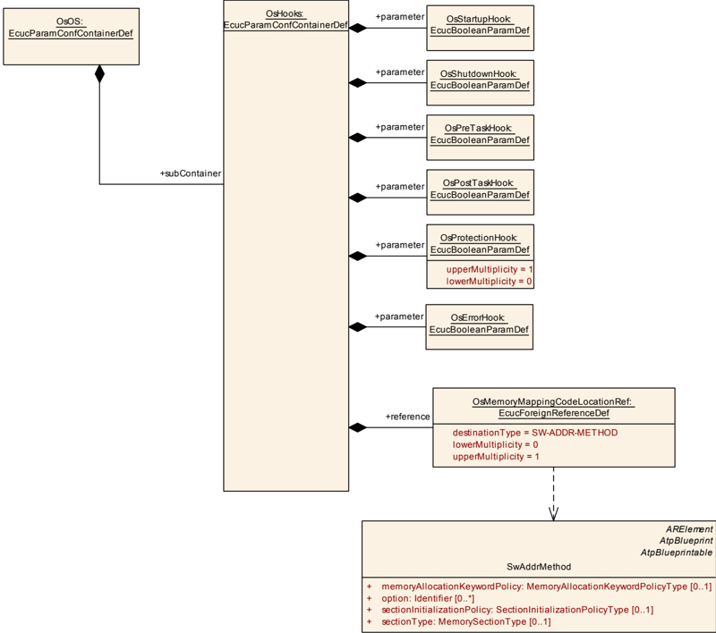

#### 9.2.17. OsIsr

| SWS 条目 |  |
|---|---|
| 容器名称 | OsIsr |
| 父容器 | Os |
| 描述 | OsIsr 容器表示一个 ISO 17356 中断服务例程。 |
| 配置参数 | 见下方参数表 |

| SWS 条目 |  |
|---|---|
| 参数名称 | OsIsrCategory |
| 父容器 | OsIsr |
| 描述 | 此属性指定该 ISR 的类别。 |
| 多重性 | 1 |
| 类型 | EcucEnumerationParamDef |
| 范围 | CATEGORY_1：中断属于类别 1；CATEGORY_2：中断属于类别 2 |
| Post-Build 变体值 | false |
| 值配置类 | Pre-compile time：X（All Variants）；Link time：-；Post-build time：- |
| 作用域/依赖 | scope: local |

| SWS 条目 |  |
|---|---|
| 参数名称 | OsIsrPeriod |
| 父容器 | OsIsr |
| 描述 | 此参数指定在循环触发中断的情况下该 ISR 的周期（以秒计）。如果未给出此参数，则中断可以偶发方式激活，或以未知的周期值循环激活。该值是信息性的，例如在时序事件（Timing Events）映射到此 OsIsr 时用于 RTE 中的时基计算。请注意，该参数不应与 OS 相关！集成者有责任确保按照所配置的周期激活 ISR。提供该信息是 OS 配置的一部分，以支持使用固定 OsIsr 集合的配置工作流。 |
| 多重性 | 0..1 |
| 类型 | EcucFloatParamDef |
| 范围 | [-INF .. INF] |
| 默认值 | - |
| Post-Build 变体多重性 | false |
| Post-Build 变体值 | false |
| 多重性配置类 | Pre-compile time：X（All Variants）；Link time：-；Post-build time：- |
| 值配置类 | Pre-compile time：X（All Variants）；Link time：-；Post-build time：- |
| 作用域/依赖 | scope: ECU |

| SWS 条目 |  |
|---|---|
| 参数名称 | OsIsrResourceRef |
| 父容器 | OsIsr |
| 描述 | 该引用定义此 ISR 访问的资源。 |
| 多重性 | 0..* |
| 类型 | 对 OsResource 的引用 |
| Post-Build 变体多重性 | false |
| Post-Build 变体值 | false |
| 多重性配置类 | Pre-compile time：X（All Variants）；Link time：-；Post-build time：- |
| 值配置类 | Pre-compile time：X（All Variants）；Link time：-；Post-build time：- |
| 作用域/依赖 | scope: local |

| SWS 条目 |  |
|---|---|
| 参数名称 | OsMemoryMappingCodeLocationRef |
| 父容器 | OsIsr |
| 描述 | 对内存映射的引用，其中包含有关代码所放置段的详细信息。 |
| 多重性 | 0..1 |
| 类型 | 对 SW-ADDR-METHOD 的外部引用 |
| Post-Build 变体值 | false |
| 值配置类 | Pre-compile time：X（All Variants）；Link time：-；Post-build time：- |
| 作用域/依赖 | scope: ECU |

| 容器名称 | 多重性 | 作用域/依赖 |
|---|---|---|
| OsIsrTimingProtection | 0..1 | 此容器包含与时序保护相关的所有参数。如果该容器存在，则对此中断使用时序保护。如果该容器不存在，则不监视该中断的时序违规。 |

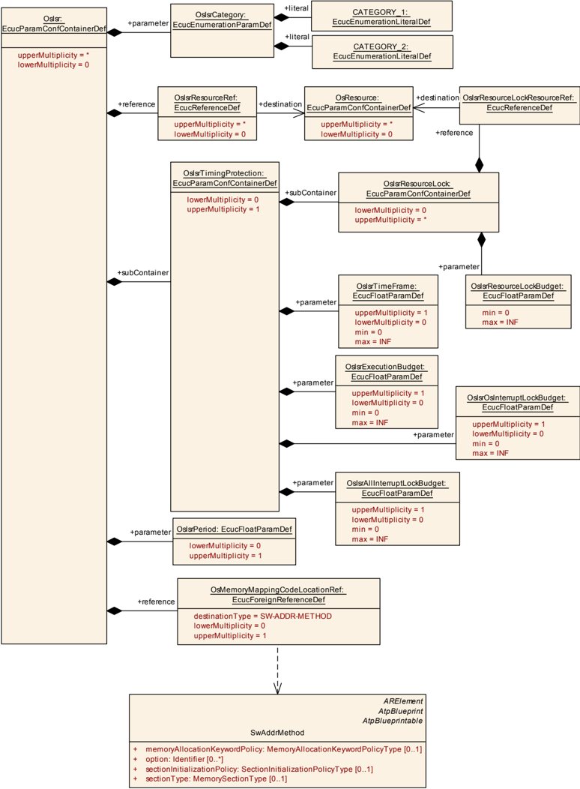

#### 9.2.18. OsIsrResourceLock

| SWS 条目 |  |
|---|---|
| 容器名称 | OsIsrResourceLock |
| 父容器 | OsIsrTimingProtection |
| 描述 | 此容器包含中断使用资源的时间列表。 |
| 配置参数 | 见下方参数表 |

| SWS 条目 |  |
|---|---|
| 参数名称 | OsIsrResourceLockBudget |
| 父容器 | OsIsrResourceLock |
| 描述 | 此参数包含允许中断持有给定资源的最长时间（以秒计）。 |
| 多重性 | 1 |
| 类型 | EcucFloatParamDef |
| 范围 | [0 .. INF] |
| 默认值 | - |
| Post-Build 变体值 | false |
| 值配置类 | Pre-compile time：X（All Variants）；Link time：-；Post-build time：- |
| 作用域/依赖 | scope: ECU |

| SWS 条目 |  |
|---|---|
| 参数名称 | OsIsrResourceLockResourceRef |
| 父容器 | OsIsrResourceLock |
| 描述 | 对锁定时间所依赖的资源的引用 |
| 多重性 | 1 |
| 类型 | 对 OsResource 的引用 |
| Post-Build 变体值 | false |
| 值配置类 | Pre-compile time：X（All Variants）；Link time：-；Post-build time：- |
| 作用域/依赖 | scope: ECU dependency: 可扩展性等级 2 和 4 必需 |

该容器不包含任何子容器。

#### 9.2.19. OsIsrTimingProtection

| SWS 条目 |  |
|---|---|
| 容器名称 | OsIsrTimingProtection |
| 父容器 | OsIsr |
| 描述 | 此容器包含与时序保护相关的所有参数。如果该容器存在，则对此中断使用时序保护。如果该容器不存在，则不监视该中断的时序违规。 |
| 配置参数 | 见下方参数表 |

| SWS 条目 |  |
|---|---|
| 参数名称 | OsIsrAllInterruptLockBudget |
| 父容器 | OsIsrTimingProtection |
| 描述 | 此参数包含允许 ISR 锁定所有中断（通过 SuspendAllInterrupts() 或 DisableAllInterrupts()）的最长时间（以秒计）。 |
| 多重性 | 0..1 |
| 类型 | EcucFloatParamDef |
| 范围 | [0 .. INF] |
| 默认值 | - |
| Post-Build 变体多重性 | false |
| Post-Build 变体值 | false |
| 多重性配置类 | Pre-compile time：X（All Variants）；Link time：-；Post-build time：- |
| 值配置类 | Pre-compile time：X（All Variants）；Link time：-；Post-build time：- |
| 作用域/依赖 | scope: ECU dependency: 可扩展性等级 2 和 4 必需 |

| SWS 条目 |  |
|---|---|
| 参数名称 | OsIsrExecutionBudget |
| 父容器 | OsIsrTimingProtection |
| 描述 | 该参数包含中断允许的最大执行时间（以秒计）。 |
| 多重性 | 0..1 |
| 类型 | EcucFloatParamDef |
| 范围 | [0 .. INF] |
| 默认值 | - |
| Post-Build 变体多重性 | false |
| Post-Build 变体值 | false |
| 多重性配置类 | Pre-compile time：X（All Variants）；Link time：-；Post-build time：- |
| 值配置类 | Pre-compile time：X（All Variants）；Link time：-；Post-build time：- |
| 作用域/依赖 | scope: ECU dependency: 可扩展性等级 2 和 4 必需 |

| SWS 条目 |  |
|---|---|
| 参数名称 | OsIsrOsInterruptLockBudget |
| 父容器 | OsIsrTimingProtection |
| 描述 | 此参数包含允许 ISR 锁定所有类别 2 中断（通过 SuspendOSInterrupts()）的最长时间（以秒计）。 |
| 多重性 | 0..1 |
| 类型 | EcucFloatParamDef |
| 范围 | [0 .. INF] |
| 默认值 | - |
| Post-Build 变体多重性 | false |
| Post-Build 变体值 | false |
| 多重性配置类 | Pre-compile time：X（All Variants）；Link time：-；Post-build time：- |
| 值配置类 | Pre-compile time：X（All Variants）；Link time：-；Post-build time：- |
| 作用域/依赖 | scope: ECU dependency: 可扩展性等级 2 和 4 必需 |

| SWS 条目 |  |
|---|---|
| 参数名称 | OsIsrTimeFrame |
| 父容器 | OsIsrTimingProtection |
| 描述 | 此参数包含连续中断之间的最小到达间隔时间（以秒计）。 |
| 多重性 | 0..1 |
| 类型 | EcucFloatParamDef |
| 范围 | [0 .. INF] |
| 默认值 | - |
| Post-Build 变体多重性 | false |
| Post-Build 变体值 | false |
| 多重性配置类 | Pre-compile time：X（All Variants）；Link time：-；Post-build time：- |
| 值配置类 | Pre-compile time：X（All Variants）；Link time：-；Post-build time：- |
| 作用域/依赖 | scope: ECU dependency: 可扩展性等级 2 和 4 必需 |

| 容器名称 | 多重性 | 作用域/依赖 |
|---|---|---|
| OsIsrResourceLock | 0..* | 此容器包含中断使用资源的时间列表。 |

#### 9.2.20. OsOS

| SWS 条目 |  |
|---|---|
| 容器名称 | OsOS |
| 父容器 | Os |
| 描述 | OS 是用于为 ISO 17356 应用定义 ISO 17356-3 属性的对象。每个 CPU 必须恰好定义一个 OS 对象。 |
| 配置参数 | 见下方参数表 |

| SWS 条目 |  |
|---|---|
| 参数名称 | OsNumberOfCores |
| 父容器 | OsOS |
| 描述 | 由 OS 控制的最大内核数。OS 在内部使用该值。它取决于 ECU 硬件。 |
| 多重性 | 0..1 |
| 类型 | EcucIntegerParamDef |
| 范围 | 1 .. 65535 |
| 默认值 | - |
| Post-Build 变体多重性 | false |
| Post-Build 变体值 | false |
| 多重性配置类 | Pre-compile time：X（All Variants）；Link time：-；Post-build time：- |
| 值配置类 | Pre-compile time：X（All Variants）；Link time：-；Post-build time：- |
| 作用域/依赖 | scope: local |

| SWS 条目 |  |
|---|---|
| 参数名称 | OsScalabilityClass |
| 父容器 | OsOS |
| 描述 | 必须为每个系统对象"OS"选择一个可扩展性等级。为了根据用户的需求定制操作系统并充分利用处理器特性，可以按照可扩展性等级对操作系统进行伸缩。如果省略可扩展性等级，则转换为 OIL AUTO 机制。 |
| 多重性 | 0..1 |
| 类型 | EcucEnumerationParamDef |
| 范围 | SC1；SC2；SC3；SC4 |
| Post-Build 变体值 | false |
| 值配置类 | Pre-compile time：X（All Variants）；Link time：-；Post-build time：- |
| 作用域/依赖 | scope: ECU |

| SWS 条目 |  |
|---|---|
| 参数名称 | OsStackMonitoring |
| 父容器 | OsOS |
| 描述 | 选择任务/类别 2 ISR 的栈监视（true：监视栈；false：不监视栈）。 |
| 多重性 | 1 |
| 类型 | EcucBooleanParamDef |
| 默认值 | - |
| Post-Build 变体值 | false |
| 值配置类 | Pre-compile time：X（All Variants）；Link time：-；Post-build time：- |
| 作用域/依赖 | scope: ECU |

| SWS 条目 |  |
|---|---|
| 参数名称 | OsStatus |
| 父容器 | OsOS |
| 描述 | Status 属性指定必须使用具有标准状态还是扩展状态的系统。此属性不支持自动分配。 |
| 多重性 | 1 |
| 类型 | EcucEnumerationParamDef |
| 范围 | EXTENDED；STANDARD |
| Post-Build 变体值 | false |
| 值配置类 | Pre-compile time：X（All Variants）；Link time：-；Post-build time：- |
| 作用域/依赖 | scope: local |

| SWS 条目 |  |
|---|---|
| 参数名称 | OsUseArti |
| 父容器 | OsOS |
| 描述 | OsUseArti 属性定义 OS 是否使用并调用 ARTI 钩子。这还包括由生成器生成相关的 ARTI 工件。 |
| 多重性 | 1 |
| 类型 | EcucBooleanParamDef |
| 默认值 | - |
| Post-Build 变体值 | false |
| 值配置类 | Pre-compile time：X（All Variants）；Link time：-；Post-build time：- |
| 作用域/依赖 | scope: local |

| SWS 条目 |  |
|---|---|
| 参数名称 | OsUseGetServiceId |
| 父容器 | OsOS |
| 描述 | 如 ISO 17356 所定义。 |
| 多重性 | 1 |
| 类型 | EcucBooleanParamDef |
| 默认值 | - |
| Post-Build 变体值 | false |
| 值配置类 | Pre-compile time：X（All Variants）；Link time：-；Post-build time：- |
| 作用域/依赖 | scope: local |

| SWS 条目 |  |
|---|---|
| 参数名称 | OsUseParameterAccess |
| 父容器 | OsOS |
| 描述 | 如 ISO 17356 所定义。 |
| 多重性 | 1 |
| 类型 | EcucBooleanParamDef |
| 默认值 | - |
| Post-Build 变体值 | false |
| 值配置类 | Pre-compile time：X（All Variants）；Link time：-；Post-build time：- |
| 作用域/依赖 | scope: local |

| SWS 条目 |  |
|---|---|
| 参数名称 | OsUseResScheduler |
| 父容器 | OsOS |
| 描述 | OsUseResScheduler 属性定义应用中是否使用资源 RES_SCHEDULER。 |
| 多重性 | 1 |
| 类型 | EcucBooleanParamDef |
| 默认值 | true |
| Post-Build 变体值 | false |
| 值配置类 | Pre-compile time：X（All Variants）；Link time：-；Post-build time：- |
| 作用域/依赖 | scope: local |

| 容器名称 | 多重性 | 作用域/依赖 |
|---|---|---|
| OsHooks | 1 | 用于组织属于该 OS 的所有钩子的容器。 |

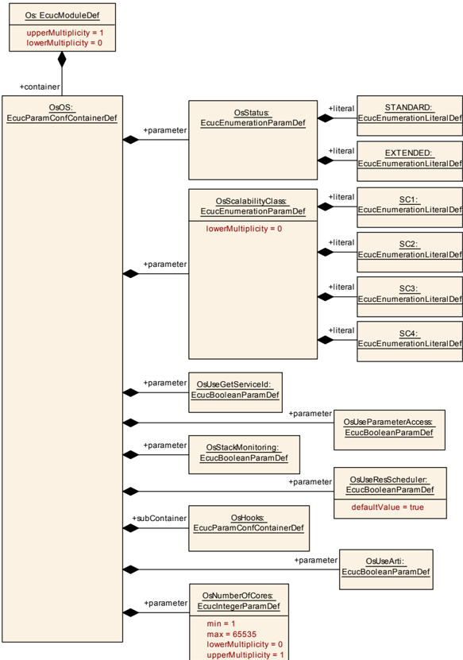

#### 9.2.21. OsPeripheralArea

| SWS 条目 |  |
|---|---|
| 容器名称 | OsPeripheralArea |
| 父容器 | Os |
| 描述 | 用于组织单个外围区域的配置参数的结构容器。容器短名称可用于访问该区域。 |
| Post-Build 变体多重性 | false |
| 多重性配置类 | Pre-compile time：X（All Variants）；Link time：-；Post-build time：- |
| 配置参数 | 见下方参数表 |

| SWS 条目 |  |
|---|---|
| 参数名称 | OsPeripheralAreaEndAddress |
| 父容器 | OsPeripheralArea |
| 描述 | 外围区域的最后一个有效地址。 |
| 多重性 | 1 |
| 类型 | EcucIntegerParamDef |
| 范围 | 0 .. 18446744073709551615 |
| 默认值 | - |
| Post-Build 变体值 | false |
| 值配置类 | Pre-compile time：X（All Variants）；Link time：-；Post-build time：- |
| 作用域/依赖 | scope: local |

| SWS 条目 |  |
|---|---|
| 参数名称 | OsPeripheralAreaId |
| 父容器 | OsPeripheralArea |
| 描述 | 外围区域的 ID。 |
| 多重性 | 1 |
| 类型 | EcucIntegerParamDef（将为此参数生成符号名） |
| 范围 | 0 .. 18446744073709551615 |
| 默认值 | - |
| Post-Build 变体值 | false |
| 作用域/依赖 | scope: local |

| SWS 条目 |  |
|---|---|
| 参数名称 | OsPeripheralAreaStartAddress |
| 父容器 | OsPeripheralArea |
| 描述 | 外围区域的第一个有效地址。 |
| 多重性 | 1 |
| 类型 | EcucIntegerParamDef |
| 范围 | 0 .. 18446744073709551615 |
| 默认值 | - |
| Post-Build 变体多重性 | false |
| 值配置类 | Pre-compile time：X（All Variants）；Link time：-；Post-build time：- |
| 作用域/依赖 | scope: local |

| SWS 条目 |  |
|---|---|
| 参数名称 | OsPeripheralAreaAccessingApplication |
| 父容器 | OsPeripheralArea |
| 描述 | 引用有权访问此对象的应用。 |
| 多重性 | 0..* |
| 类型 | 对 OsApplication 的引用 |
| Post-Build 变体多重性 | false |
| Post-Build 变体值 | false |
| 作用域/依赖 | scope: local |

该容器不包含任何子容器。

#### 9.2.22. OsResource

| SWS 条目 |  |
|---|---|
| 容器名称 | OsResource |
| 父容器 | Os |
| 描述 | OsResource 对象用于协调任务和 ISR 对共享资源（例如调度器、任何程序序列、内存或任何硬件区域）的并发访问。 |
| 配置参数 | 见下方参数表 |

| SWS 条目 |  |
|---|---|
| 参数名称 | OsResourceProperty |
| 父容器 | OsResource |
| 描述 | 指定资源的类型。 |
| 多重性 | 1 |
| 类型 | EcucEnumerationParamDef |
| 范围 | INTERNAL：该资源是内部资源；LINKED：该资源是链接资源（现有资源的第二个名称）；STANDARD：该资源是标准资源 |
| Post-Build 变体值 | false |
| 值配置类 | Pre-compile time：X（All Variants）；Link time：-；Post-build time：- |
| 作用域/依赖 | scope: local |

| SWS 条目 |  |
|---|---|
| 参数名称 | OsResourceAccessingApplication |
| 父容器 | OsResource |
| 描述 | 引用有权访问此对象的应用。 |
| 多重性 | 0..* |
| 类型 | 对 OsApplication 的引用 |
| Post-Build 变体多重性 | false |
| Post-Build 变体值 | false |
| 多重性配置类 | Pre-compile time：X（All Variants）；Link time：-；Post-build time：- |
| 值配置类 | Pre-compile time：X（All Variants）；Link time：-；Post-build time：- |
| 作用域/依赖 | scope: local |

| SWS 条目 |  |
|---|---|
| 参数名称 | OsResourceLinkedResourceRef |
| 父容器 | OsResource |
| 描述 | 对资源的链接。如果 OsResourceProperty 为 LINKED，则该引用必须有效。如果 OsResourceProperty 不为 LINKED，则忽略该值。 |
| 多重性 | 0..1 |
| 类型 | 对 OsResource 的引用 |
| Post-Build 变体多重性 | false |
| Post-Build 变体值 | false |
| 多重性配置类 | Pre-compile time：X（All Variants）；Link time：-；Post-build time：- |
| 值配置类 | Pre-compile time：X（All Variants）；Link time：-；Post-build time：- |
| 作用域/依赖 | scope: local |

该容器不包含任何子容器。

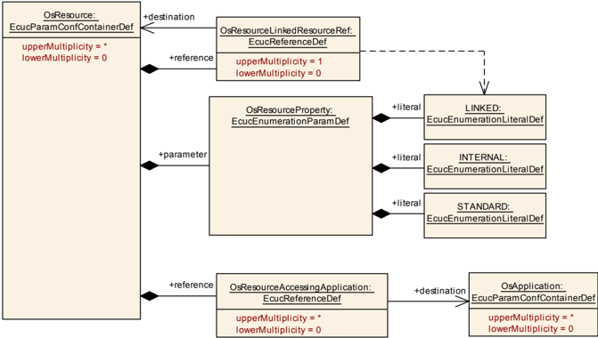

#### 9.2.23. OsScheduleTable

| SWS 条目 |  |
|---|---|
| 容器名称 | OsScheduleTable |
| 父容器 | Os |
| 描述 | OsScheduleTable 通过提供对一组静态定义、运行时不可修改的告警的封装来解决同步问题。 |
| 配置参数 | 见下方参数表 |

| SWS 条目 |  |
|---|---|
| 参数名称 | OsScheduleTableDuration |
| 父容器 | OsScheduleTable |
| 描述 | 此参数定义调度表的模数（以 tick 计）。 |
| 多重性 | 1 |
| 类型 | EcucIntegerParamDef |
| 范围 | 0 .. 18446744073709551615 |
| 默认值 | - |
| Post-Build 变体值 | false |
| 值配置类 | Pre-compile time：X（All Variants）；Link time：-；Post-build time：- |
| 作用域/依赖 | scope: local |

| SWS 条目 |  |
|---|---|
| 参数名称 | OsScheduleTableRepeating |
| 父容器 | OsScheduleTable |
| 描述 | （true：在最后一个到期点被处理之后，再经过最后到期点延迟（final expiry point delay）个 tick 时，处理调度表的第一个到期点；false：最后一个到期点被处理后，调度表的处理停止）。 |
| 多重性 | 1 |
| 类型 | EcucBooleanParamDef |
| 默认值 | - |
| Post-Build 变体值 | false |
| 值配置类 | Pre-compile time：X（All Variants）；Link time：-；Post-build time：- |
| 作用域/依赖 | scope: ECU |

| SWS 条目 |  |
|---|---|
| 参数名称 | OsScheduleTableCounterRef |
| 父容器 | OsScheduleTable |
| 描述 | 此参数包含对驱动调度表的计数器的引用。 |
| 多重性 | 1 |
| 类型 | 对 OsCounter 的引用 |
| Post-Build 变体值 | false |
| 值配置类 | Pre-compile time：X（All Variants）；Link time：-；Post-build time：- |
| 作用域/依赖 | scope: ECU |

| SWS 条目 |  |
|---|---|
| 参数名称 | OsSchTblAccessingApplication |
| 父容器 | OsScheduleTable |
| 描述 | 引用有权访问此对象的应用。 |
| 多重性 | 0..* |
| 类型 | 对 OsApplication 的引用 |
| Post-Build 变体多重性 | false |
| Post-Build 变体值 | false |
| 多重性配置类 | Pre-compile time：X（All Variants）；Link time：-；Post-build time：- |
| 值配置类 | Pre-compile time：X（All Variants）；Link time：-；Post-build time：- |
| 作用域/依赖 | scope: local |

| 容器名称 | 多重性 | 作用域/依赖 |
|---|---|---|
| OsScheduleTableAutostart | 0..1 | 此容器指定在操作系统启动时是否以及如何启动调度表。启动调度表的选项与运行时启动调度表的 API 调用相对应。 |
| OsScheduleTableExpiryPoint | 1..* | 调度表上 OS 激活任务和/或设置事件的点 |
| OsScheduleTableSync | 0..1 | 此容器指定调度表的同步参数。 |

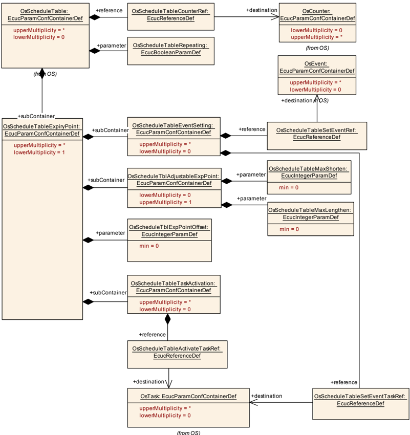

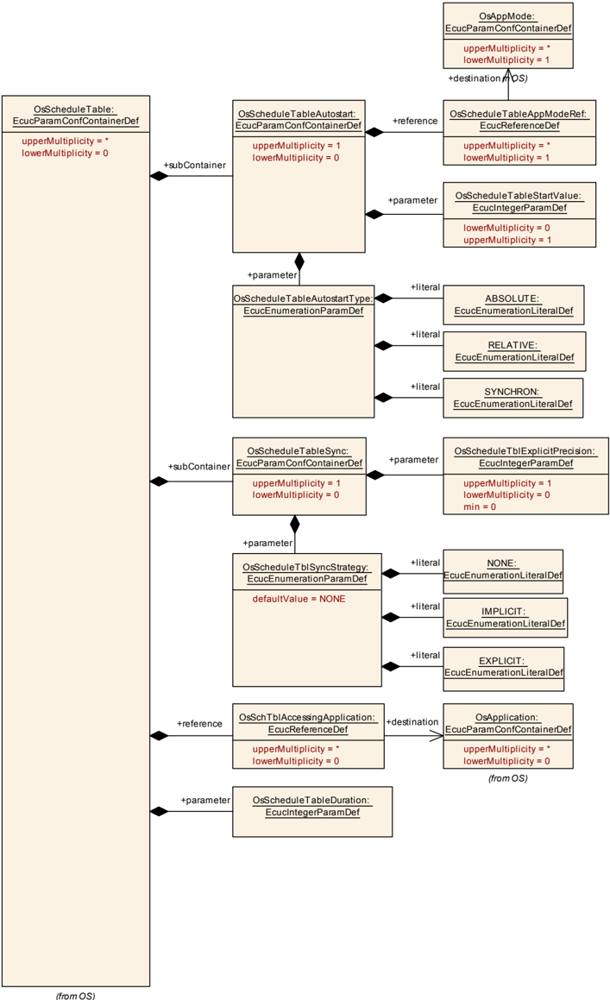

#### 9.2.24. OsScheduleTableAutostart

| SWS 条目 |  |
|---|---|
| 容器名称 | OsScheduleTableAutostart |
| 父容器 | OsScheduleTable |
| 描述 | 此容器指定在操作系统启动时是否以及如何启动调度表。启动调度表的选项与运行时启动调度表的 API 调用相对应。 |
| 配置参数 | 见下方参数表 |

| SWS 条目 |  |
|---|---|
| 参数名称 | OsScheduleTableAutostartType |
| 父容器 | OsScheduleTableAutostart |
| 描述 | 指定调度表自动启动的类型。 |
| 多重性 | 1 |
| 类型 | EcucEnumerationParamDef |
| 范围 | ABSOLUTE：调度表在启动期间通过 StartScheduleTableAbs() 服务启动；RELATIVE：调度表在启动期间通过 StartScheduleTableRel() 服务启动；SYNCHRON：调度表在启动期间通过 StartScheduleTableSynchron() 服务启动 |
| Post-Build 变体值 | false |
| 值配置类 | Pre-compile time：X（All Variants）；Link time：-；Post-build time：- |
| 作用域/依赖 | scope: local |

| SWS 条目 |  |
|---|---|
| 参数名称 | OsScheduleTableStartValue |
| 父容器 | OsScheduleTableAutostart |
| 描述 | 调度表启动时的绝对自动启动 tick 值。仅在 OsScheduleTableAutostartType 为 ABSOLUTE 时使用。调度表启动时以 tick 计的相对偏移。仅在 OsScheduleTableAutostartType 为 RELATIVE 时使用。 |
| 多重性 | 0..1 |
| 类型 | EcucIntegerParamDef |
| 范围 | 0 .. 18446744073709551615 |
| 默认值 | - |
| Post-Build 变体多重性 | false |
| Post-Build 变体值 | false |
| 多重性配置类 | Pre-compile time：X（All Variants）；Link time：-；Post-build time：- |
| 值配置类 | Pre-compile time：X（All Variants）；Link time：-；Post-build time：- |
| 作用域/依赖 | scope: ECU |

| SWS 条目 |  |
|---|---|
| 参数名称 | OsScheduleTableAppModeRef |
| 父容器 | OsScheduleTableAutostart |
| 描述 | 引用启动期间应在哪些应用模式下启动调度表 |
| 多重性 | 1..* |
| 类型 | 对 OsAppMode 的引用 |
| Post-Build 变体多重性 | false |
| Post-Build 变体值 | false |
| 多重性配置类 | Pre-compile time：X（All Variants）；Link time：-；Post-build time：- |
| 值配置类 | Pre-compile time：X（All Variants）；Link time：-；Post-build time：- |
| 作用域/依赖 | scope: ECU |

该容器不包含任何子容器。

#### 9.2.25. OsScheduleTableEventSetting

| SWS 条目 |  |
|---|---|
| 容器名称 | OsScheduleTableEventSetting |
| 父容器 | OsScheduleTableExpiryPoint |
| 描述 | 由该调度表触发的事件。 |
| 配置参数 | 见下方参数表 |

| SWS 条目 |  |
|---|---|
| 参数名称 | OsScheduleTableSetEventRef |
| 父容器 | OsScheduleTableEventSetting |
| 描述 | 对将由该动作设置的事件的引用 |
| 多重性 | 1 |
| 类型 | 对 OsEvent 的引用 |
| Post-Build 变体值 | false |
| 值配置类 | Pre-compile time：X（All Variants）；Link time：-；Post-build time：- |
| 作用域/依赖 | scope: local |

| SWS 条目 |  |
|---|---|
| 参数名称 | OsScheduleTableSetEventTaskRef |
| 父容器 | OsScheduleTableEventSetting |
| 描述 | - |
| 多重性 | 1 |
| 类型 | 对 OsTask 的引用 |
| Post-Build 变体值 | false |
| 值配置类 | Pre-compile time：X（All Variants）；Link time：-；Post-build time：- |
| 作用域/依赖 | scope: local |

该容器不包含任何子容器。

#### 9.2.26. OsScheduleTableExpiryPoint

| SWS 条目 |  |
|---|---|
| 容器名称 | OsScheduleTableExpiryPoint |
| 父容器 | OsScheduleTable |
| 描述 | 调度表上 OS 激活任务和/或设置事件的点 |
| 配置参数 | 见下方参数表 |

| SWS 条目 |  |
|---|---|
| 参数名称 | OsScheduleTblExpPointOffset |
| 父容器 | OsScheduleTableExpiryPoint |
| 描述 | 到期点将被处理时距零点的偏移量（以 tick 计）。 |
| 多重性 | 1 |
| 类型 | EcucIntegerParamDef |
| 范围 | 0 .. 18446744073709551615 |
| 默认值 | - |
| Post-Build 变体值 | false |
| 值配置类 | Pre-compile time：X（All Variants）；Link time：-；Post-build time：- |
| 作用域/依赖 |  |

| 容器名称 | 多重性 | 作用域/依赖 |
|---|---|---|
| OsScheduleTableEventSetting | 0..* | 由该调度表触发的事件。 |
| OsScheduleTableTaskActivation | 0..* | 由该调度表触发的任务。 |
| OsScheduleTblAdjustableExpPoint | 0..1 | 可调整的到期点 |

#### 9.2.27. OsScheduleTableTaskActivation

| SWS 条目 |  |
|---|---|
| 容器名称 | OsScheduleTableTaskActivation |
| 父容器 | OsScheduleTableExpiryPoint |
| 描述 | 由该调度表触发的任务。 |
| 配置参数 | 见下方参数表 |

| SWS 条目 |  |
|---|---|
| 参数名称 | OsScheduleTableActivateTaskRef |
| 父容器 | OsScheduleTableTaskActivation |
| 描述 | 对将由该动作激活的任务的引用 |
| 多重性 | 1 |
| 类型 | 对 OsTask 的引用 |
| Post-Build 变体值 | false |
| 值配置类 | Pre-compile time：X（All Variants）；Link time：-；Post-build time：- |
| 作用域/依赖 | scope: ECU |

该容器不包含任何子容器。

#### 9.2.28. OsScheduleTblAdjustableExpPoint

| SWS 条目 |  |
|---|---|
| 容器名称 | OsScheduleTblAdjustableExpPoint |
| 父容器 | OsScheduleTableExpiryPoint |
| 描述 | 可调整的到期点 |
| 配置参数 | 见下方参数表 |

| SWS 条目 |  |
|---|---|
| 参数名称 | OsScheduleTableMaxLengthen |
| 父容器 | OsScheduleTblAdjustableExpPoint |
| 描述 | 可对到期点偏移进行的最大正向调整（以 tick 计）。 |
| 多重性 | 1 |
| 类型 | EcucIntegerParamDef |
| 范围 | 0 .. 18446744073709551615 |
| 默认值 | - |
| Post-Build 变体值 | false |
| 值配置类 | Pre-compile time：X（All Variants）；Link time：-；Post-build time：- |
| 作用域/依赖 | scope: local |

| SWS 条目 |  |
|---|---|
| 参数名称 | OsScheduleTableMaxShorten |
| 父容器 | OsScheduleTblAdjustableExpPoint |
| 描述 | 可对到期点偏移进行的最大负向调整（以 tick 计）。 |
| 多重性 | 1 |
| 类型 | EcucIntegerParamDef |
| 范围 | 0 .. 18446744073709551615 |
| 默认值 | - |
| Post-Build 变体值 | false |
| 值配置类 | Pre-compile time：X（All Variants）；Link time：-；Post-build time：- |
| 作用域/依赖 | scope: local |

该容器不包含任何子容器。

#### 9.2.29. OsScheduleTableSync

| SWS 条目 |  |
|---|---|
| 容器名称 | OsScheduleTableSync |
| 父容器 | OsScheduleTable |
| 描述 | 此容器指定调度表的同步参数。 |
| 配置参数 | 见下方参数表 |

| SWS 条目 |  |
|---|---|
| 参数名称 | OsScheduleTblExplicitPrecision |
| 父容器 | OsScheduleTableSync |
| 描述 | 此配置仅在使用显式同步时有效。 |
| 多重性 | 0..1 |
| 类型 | EcucIntegerParamDef |
| 范围 | 0 .. 18446744073709551615 |
| 默认值 | - |
| Post-Build 变体多重性 | false |
| Post-Build 变体值 | false |
| 多重性配置类 | Pre-compile time：X（All Variants）；Link time：-；Post-build time：- |
| 值配置类 | Pre-compile time：X（All Variants）；Link time：-；Post-build time：- |
| 作用域/依赖 | scope: ECU |

| SWS 条目 |  |
|---|---|
| 参数名称 | OsScheduleTblSyncStrategy |
| 父容器 | OsScheduleTableSync |
| 描述 | AUTOSAR OS 以两种方式提供同步支持：显式和隐式。 |
| 多重性 | 1 |
| 类型 | EcucEnumerationParamDef |
| 范围 | EXPLICIT：调度表由一个 OS 计数器驱动，但其处理需要与一个并非 OS 计数器对象的其他计数器同步；IMPLICIT：驱动调度表的计数器即需要与之同步的计数器；NONE：不支持同步 |
| 默认值 | NONE |
| Post-Build 变体值 | false |
| 值配置类 | Pre-compile time：X（All Variants）；Link time：-；Post-build time：- |
| 作用域/依赖 | scope: ECU |

该容器不包含任何子容器。

#### 9.2.30. OsSpinlock

| SWS 条目 |  |
|---|---|
| 容器名称 | OsSpinlock |
| 父容器 | Os |
| 描述 | OsSpinlock 对象用于协调不同内核上的 TASKs/ISR2s 对共享资源的并发访问。 |
| 配置参数 | 见下方参数表 |

| SWS 条目 |  |
|---|---|
| 参数名称 | OsSpinlockLockMethod |
| 父容器 | OsSpinlock |
| 描述 | 获取自旋锁时所使用的锁定方法。注意，一个用户（例如一个任务）有可能持有多个自旋锁。在这种情况下，最后获取的锁被强制使用至少与当前锁同等强度的锁定方法。 |
| 多重性 | 1 |
| 类型 | EcucEnumerationParamDef |
| 范围 | LOCK_ALL_INTERRUPTS；LOCK_CAT2_INTERRUPTS；LOCK_NOTHING；LOCK_WITH_RES_SCHEDULER |
| 默认值 | LOCK_NOTHING |
| Post-Build 变体值 | false |
| 值配置类 | Pre-compile time：X（All Variants）；Link time：-；Post-build time：- |
| 作用域/依赖 | scope: local |

| SWS 条目 |  |
|---|---|
| 参数名称 | OsSpinlockAccessingApplication |
| 父容器 | OsSpinlock |
| 描述 | 引用有权访问此对象的 OS-Application。 |
| 多重性 | 1..* |
| 类型 | 对 OsApplication 的引用 |
| Post-Build 变体多重性 | false |
| Post-Build 变体值 | false |
| 多重性配置类 | Pre-compile time：X（All Variants）；Link time：-；Post-build time：- |
| 值配置类 | Pre-compile time：X（All Variants）；Link time：-；Post-build time：- |
| 作用域/依赖 | scope: local |

| SWS 条目 |  |
|---|---|
| 参数名称 | OsSpinlockSuccessor |
| 父容器 | OsSpinlock |
| 描述 | 引用有权访问此对象的 OS-Application。为了检查自旋锁是否可以（以嵌套方式）被占用而不存在任何死锁危险，可以定义一个自旋锁链表。自旋锁只能按链表的顺序被占用。允许跳过某个自旋锁。如果未指定链表，则自旋锁不能嵌套。 |
| 多重性 | 0..1 |
| 类型 | 对 OsSpinlock 的引用 |
| Post-Build 变体多重性 | false |
| Post-Build 变体值 | false |
| 多重性配置类 | Pre-compile time：X（All Variants）；Link time：-；Post-build time：- |
| 值配置类 | Pre-compile time：X（All Variants）；Link time：-；Post-build time：- |
| 作用域/依赖 | scope: local |

该容器不包含任何子容器。


#### 9.2.31. OsTask

| SWS 条目 |  |
|---|---|
| 容器名称 | OsTask |
| 父容器 | Os |
| 描述 | 此容器表示一个 ISO 17356 任务。 |
| 配置参数 | 见下方参数表 |

| SWS 条目 |  |
|---|---|
| 参数名称 | OsTaskActivation |
| 父容器 | OsTask |
| 描述 | 此属性定义该任务排队激活请求的最大数目。值等于 1 意味着任意时刻该任务仅允许单次激活。注意，该值必须是从 1 开始的自然数。 |
| 多重性 | 1 |
| 类型 | EcucIntegerParamDef |
| 范围 | 1 .. 4294967295 |
| 默认值 | - |
| Post-Build 变体值 | false |
| 值配置类 | Pre-compile time：X（All Variants）；Link time：-；Post-build time：- |
| 作用域/依赖 | scope: local |

| SWS 条目 |  |
|---|---|
| 参数名称 | OsTaskPeriod |
| 父容器 | OsTask |
| 描述 | 此参数指定在任务被周期性激活的情况下该任务的周期（以秒计）。如果未给出此参数，则该任务可以以未知的周期值偶发或周期性地激活。此值是信息性的，例如当时序事件（Timing Events）被映射到此 OsTask 上时，用于 RTE 中的时基计算。请注意，此参数不应与 OS 相关！此信息作为 OS 配置的一部分给出，以支持使用固定 OsTask 集合的配置工作流。 |
| 多重性 | 0..1 |
| 类型 | EcucFloatParamDef |
| 范围 | [-INF .. INF] |
| 默认值 | - |
| Post-Build 变体多重性 | false |
| Post-Build 变体值 | false |
| 多重性配置类 | Pre-compile time：X（All Variants）；Link time：-；Post-build time：- |
| 值配置类 | Pre-compile time：X（All Variants）；Link time：-；Post-build time：- |
| 作用域/依赖 | scope: ECU |

| SWS 条目 |  |
|---|---|
| 参数名称 | OsTaskPriority |
| 父容器 | OsTask |
| 描述 | 任务的优先级由此属性的值定义。该值必须被理解为相对值，即这些值仅表示任务的相对顺序。ISO 17356-3 将最低优先级定义为零（0）；较大的值对应较高的优先级。 |
| 多重性 | 1 |
| 类型 | EcucIntegerParamDef |
| 范围 | 0 .. 4294967295 |
| 默认值 | - |
| Post-Build 变体值 | false |
| 值配置类 | Pre-compile time：X（All Variants）；Link time：-；Post-build time：- |
| 作用域/依赖 | scope: local |

| SWS 条目 |  |
|---|---|
| 参数名称 | OsTaskSchedule |
| 父容器 | OsTask |
| 描述 | OsTaskSchedule 属性定义任务的可抢占性。如果此属性设置为 NON，则不得为该任务分配任何内部资源。 |
| 多重性 | 1 |
| 类型 | EcucEnumerationParamDef |
| 范围 | FULL：任务是可抢占的；NON：任务是不可抢占的 |
| Post-Build 变体值 | false |
| 值配置类 | Pre-compile time：X（All Variants）；Link time：-；Post-build time：- |
| 作用域/依赖 | scope: local |

| SWS 条目 |  |
|---|---|
| 参数名称 | OsMemoryMappingCodeLocationRef |
| 父容器 | OsTask |
| 描述 | 对内存映射的引用，其中包含有关代码所放置段的详细信息。 |
| 多重性 | 0..1 |
| 类型 | 对 SW-ADDR-METHOD 的外部引用 |
| Post-Build 变体值 | false |
| 值配置类 | Pre-compile time：X（All Variants）；Link time：-；Post-build time：- |
| 作用域/依赖 | scope: ECU |

| SWS 条目 |  |
|---|---|
| 参数名称 | OsTaskAccessingApplication |
| 父容器 | OsTask |
| 描述 | 引用有权访问此对象的应用。 |
| 多重性 | 0..* |
| 类型 | 对 OsApplication 的引用 |
| Post-Build 变体多重性 | false |
| Post-Build 变体值 | false |
| 多重性配置类 | Pre-compile time：X（All Variants）；Link time：-；Post-build time：- |
| 值配置类 | Pre-compile time：X（All Variants）；Link time：-；Post-build time：- |
| 作用域/依赖 | scope: local |

| SWS 条目 |  |
|---|---|
| 参数名称 | OsTaskEventRef |
| 父容器 | OsTask |
| 描述 | 此引用定义扩展任务可对其做出反应的事件列表。 |
| 多重性 | 0..* |
| 类型 | 对 OsEvent 的引用 |
| Post-Build 变体多重性 | false |
| Post-Build 变体值 | false |
| 多重性配置类 | Pre-compile time：X（All Variants）；Link time：-；Post-build time：- |
| 值配置类 | Pre-compile time：X（All Variants）；Link time：-；Post-build time：- |
| 作用域/依赖 | scope: local |

| SWS 条目 |  |
|---|---|
| 参数名称 | OsTaskResourceRef |
| 父容器 | OsTask |
| 描述 | 此引用定义该任务所访问的资源列表。 |
| 多重性 | 0..* |
| 类型 | 对 OsResource 的引用 |
| Post-Build 变体多重性 | false |
| Post-Build 变体值 | false |
| 多重性配置类 | Pre-compile time：X（All Variants）；Link time：-；Post-build time：- |
| 值配置类 | Pre-compile time：X（All Variants）；Link time：-；Post-build time：- |
| 作用域/依赖 | scope: local |

| 容器名称 | 多重性 | 作用域/依赖 |
|---|---|---|
| OsTaskAutostart | 0..1 | 此容器确定在某些特定应用模式下，任务是否在系统启动过程中被激活。如果任务应在系统启动期间被激活，则存在此容器，并持有该任务自动启动所在应用模式的引用。 |
| OsTaskTimingProtection | 0..1 | 此容器包含有关该任务时序保护的所有参数。 |


#### 9.2.32. OsTaskAutostart

| SWS 条目 |  |
|---|---|
| 容器名称 | OsTaskAutostart |
| 父容器 | OsTask |
| 描述 | 此容器确定在某些特定应用模式下，任务是否在系统启动过程中被激活。如果任务应在系统启动期间被激活，则存在此容器，并持有该任务自动启动所在应用模式的引用。 |
| 配置参数 | 见下方参数表 |

| SWS 条目 |  |
|---|---|
| 参数名称 | OsTaskAppModeRef |
| 父容器 | OsTaskAutostart |
| 描述 | 引用在 OS 启动时将在其中激活该任务的应用模式 |
| 多重性 | 1..* |
| 类型 | 对 OsAppMode 的引用 |
| Post-Build 变体多重性 | false |
| Post-Build 变体值 | false |
| 多重性配置类 | Pre-compile time：X（All Variants）；Link time：-；Post-build time：- |
| 值配置类 | Pre-compile time：X（All Variants）；Link time：-；Post-build time：- |
| 作用域/依赖 |  |

该容器不包含任何子容器。

#### 9.2.33. OsTaskResourceLock

| SWS 条目 |  |
|---|---|
| 容器名称 | OsTaskResourceLock |
| 父容器 | OsTaskTimingProtection |
| 描述 | 此容器包含获取和释放给定资源之间的最坏情况时间（以秒计）。 |
| 配置参数 | 见下方参数表 |

| SWS 条目 |  |
|---|---|
| 参数名称 | OsTaskResourceLockBudget |
| 父容器 | OsTaskResourceLock |
| 描述 | 此参数包含允许任务锁定该资源的最长时间（以秒计）。 |
| 多重性 | 1 |
| 类型 | EcucFloatParamDef |
| 范围 | [0 .. INF] |
| 默认值 | - |
| Post-Build 变体值 | false |
| 值配置类 | Pre-compile time：X（All Variants）；Link time：-；Post-build time：- |
| 作用域/依赖 | scope: ECU dependency: 可扩展性等级 2 和 4 必需 |

| SWS 条目 |  |
|---|---|
| 参数名称 | OsTaskResourceLockResourceRef |
| 父容器 | OsTaskResourceLock |
| 描述 | 对该任务所使用资源的引用 |
| 多重性 | 1 |
| 类型 | 对 OsResource 的引用 |
| Post-Build 变体值 | false |
| 值配置类 | Pre-compile time：X（All Variants）；Link time：-；Post-build time：- |
| 作用域/依赖 | scope: ECU dependency: 可扩展性等级 2 和 4 必需 |

该容器不包含任何子容器。

#### 9.2.34. OsTaskTimingProtection

| SWS 条目 |  |
|---|---|
| 容器名称 | OsTaskTimingProtection |
| 父容器 | OsTask |
| 描述 | 此容器包含有关该任务时序保护的所有参数。 |
| 配置参数 | 见下方参数表 |

| SWS 条目 |  |
|---|---|
| 参数名称 | OsTaskAllInterruptLockBudget |
| 父容器 | OsTaskTimingProtection |
| 描述 | 此参数包含允许任务锁定所有中断（通过 SuspendAllInterrupts() 或 DisableAllInterrupts()）的最长时间（以秒计）。 |
| 多重性 | 0..1 |
| 类型 | EcucFloatParamDef |
| 范围 | [0 .. INF] |
| 默认值 | - |
| Post-Build 变体多重性 | false |
| Post-Build 变体值 | false |
| 多重性配置类 | Pre-compile time：X（All Variants）；Link time：-；Post-build time：- |
| 值配置类 | Pre-compile time：X（All Variants）；Link time：-；Post-build time：- |
| 作用域/依赖 | scope: ECU dependency: 可扩展性等级 2 和 4 必需 |

| SWS 条目 |  |
|---|---|
| 参数名称 | OsTaskExecutionBudget |
| 父容器 | OsTaskTimingProtection |
| 描述 | 此参数包含该任务允许的最大执行时间（以秒计）。 |
| 多重性 | 0..1 |
| 类型 | EcucFloatParamDef |
| 范围 | [0 .. INF] |
| 默认值 | - |
| Post-Build 变体多重性 | false |
| Post-Build 变体值 | false |
| 多重性配置类 | Pre-compile time：X（All Variants）；Link time：-；Post-build time：- |
| 值配置类 | Pre-compile time：X（All Variants）；Link time：-；Post-build time：- |
| 作用域/依赖 | scope: ECU dependency: 可扩展性等级 2 和 4 必需 |

| SWS 条目 |  |
|---|---|
| 参数名称 | OsTaskOsInterruptLockBudget |
| 父容器 | OsTaskTimingProtection |
| 描述 | 此参数包含允许任务锁定所有类别 2 中断（通过 SuspendOSInterrupts()）的最长时间（以秒计）。 |
| 多重性 | 0..1 |
| 类型 | EcucFloatParamDef |
| 范围 | [0 .. INF] |
| 默认值 | - |
| Post-Build 变体多重性 | false |
| Post-Build 变体值 | false |
| 多重性配置类 | Pre-compile time：X（All Variants）；Link time：-；Post-build time：- |
| 值配置类 | Pre-compile time：X（All Variants）；Link time：-；Post-build time：- |
| 作用域/依赖 | scope: ECU dependency: 可扩展性等级 2 和 4 必需 |

| SWS 条目 |  |
|---|---|
| 参数名称 | OsTaskTimeFrame |
| 父容器 | OsTaskTimingProtection |
| 描述 | 任务激活和/或释放之间的最小到达间隔时间（以秒计）。 |
| 多重性 | 0..1 |
| 类型 | EcucFloatParamDef |
| 范围 | [0 .. INF] |
| 默认值 | - |
| Post-Build 变体多重性 | false |
| Post-Build 变体值 | false |
| 多重性配置类 | Pre-compile time：X（All Variants）；Link time：-；Post-build time：- |
| 值配置类 | Pre-compile time：X（All Variants）；Link time：-；Post-build time：- |
| 作用域/依赖 | scope: ECU dependency: 仅在可扩展性等级 2 和 4 中可用 |

| 容器名称 | 多重性 | 作用域/依赖 |
|---|---|---|
| OsTaskResourceLock | 0..* | 此容器包含获取和释放给定资源之间的最坏情况时间（以秒计）。 |

#### 9.2.35. OsTimeConstant

| SWS 条目 |  |
|---|---|
| 容器名称 | OsTimeConstant |
| 父容器 | OsCounter |
| 描述 | 允许用户定义常量，例如可用于将时间值与定时器 tick 值进行比较。时间值将在生成期间被转换为定时器 tick 值，之后可通过 OsConstName 访问。转换通过将时间值舍入到最接近的合适 tick 值来完成。 |
| 配置参数 | 见下方参数表 |

| SWS 条目 |  |
|---|---|
| 参数名称 | OsTimeValue |
| 父容器 | OsTimeConstant |
| 描述 | 此参数包含以秒计的常量值。 |
| 多重性 | 1 |
| 类型 | EcucFloatParamDef |
| 范围 | [0 .. INF] |
| 默认值 | - |
| Post-Build 变体值 | false |
| 值配置类 | Pre-compile time：X（All Variants）；Link time：-；Post-build time：- |
| 作用域/依赖 | scope: ECU |

该容器不包含任何子容器。

### 9.3. IOC 的容器与配置参数扩展

本节描述生成 IOC API 所需的 IOC 配置描述（IOC Configuration Description）的内容。


#### 9.3.1. OsIoc

| SWS 条目 |  |
|---|---|
| 容器名称 | OsIoc |
| 父容器 | Os |
| 描述 | IOC（Inter OS Application Communicator）的配置。 |
| 配置参数 | 见下方参数表 |

| 容器名称 | 多重性 | 作用域/依赖 |
|---|---|---|
| OsIocCommunication | 0..* | 表示位于绑定到相同或不同内核的不同 OS-Application 中的软件部分之间的 1:1、N:1 或 N:M（仅限无队列）通信。名称应以发送软件服务的名称开头，后跟由发送软件服务交付的唯一标识符。当 RTE 作为用户时，应注意标识符名称的唯一性必须跨端口、数据元素、对象实例以及可能的附加标识属性来达成（例如 1:N 映射为 1:1 的情形）。示例：• `<NameSpace>_UniqueID` |

#### 9.3.2. OsIocCommunication

| SWS 条目 |  |
|---|---|
| 容器名称 | OsIocCommunication |
| 父容器 | OsIoc |
| 描述 | 表示位于绑定到相同或不同内核的不同 OS-Application 中的软件部分之间的 1:1、N:1 或 N:M（仅限无队列）通信。名称应以发送软件服务的名称开头，后跟由发送软件服务交付的唯一标识符。当 RTE 作为用户时，应注意标识符名称的唯一性必须跨端口、数据元素、对象实例以及可能的附加标识属性来达成（例如 1:N 映射为 1:1 的情形）。示例：• `<NameSpace>_UniqueID` |
| 配置参数 | 见下方参数表 |

| SWS 条目 |  |
|---|---|
| 参数名称 | OsIocBufferLength |
| 父容器 | OsIocCommunication |
| 描述 | 此属性定义为队列通信分配的 IOC 内部队列的大小。此配置信息应允许对 RTE 内和 IOC 内需要缓冲区的通信所需的内存进行优化。 |
| 多重性 | 0..1 |
| 类型 | EcucIntegerParamDef |
| 范围 | 0 .. 4294967295 |
| 默认值 | - |
| Post-Build 变体多重性 | false |
| Post-Build 变体值 | false |
| 多重性配置类 | Pre-compile time：X（All Variants）；Link time：-；Post-build time：- |
| 值配置类 | Pre-compile time：X（All Variants）；Link time：-；Post-build time：- |
| 作用域/依赖 | scope: local |

| 容器名称 | 多重性 | 作用域/依赖 |
|---|---|---|
| OsIocDataProperties | 1..* | 在 IOC 通信通道上传输的数据的数据属性。 |
| OsIocReceiverProperties | 1..* | 一次通信的接收方属性的表现形式。对于每个 OsIocCommunication，必须定义一个（1:1）或多个接收方（N:M）。此容器应在 OsIocCommunication 中实例化。 |
| OsIocSenderProperties | 1..* | 一次通信的发送方属性的表现形式。对于每个 OsIocCommunication，必须定义一个（1:1）或多个发送方（N:1 或 N:M）。多重性 > 1（N:1 或 N:M 通信）仅在 OsIocDataTypeRef 的多重性 = 1 时允许。此容器应在 OsIocCommunication 中实例化。 |

#### 9.3.3. OsIocSenderProperties

| SWS 条目 |  |
|---|---|
| 容器名称 | OsIocSenderProperties |
| 父容器 | OsIocCommunication |
| 描述 | 一次通信的发送方属性的表现形式。对于每个 OsIocCommunication，必须定义一个（1:1）或多个发送方（N:1 或 N:M）。多重性 > 1（N:1 或 N:M 通信）仅在 OsIocDataTypeRef 的多重性 = 1 时允许。此容器应在 OsIocCommunication 中实例化。 |
| 配置参数 | 见下方参数表 |

| SWS 条目 |  |
|---|---|
| 参数名称 | OsIocFunctionImplementationKind |
| 父容器 | OsIocSenderProperties |
| 描述 | 此参数用于选择该通信是以宏还是以函数的形式实现。 |
| 多重性 | 0..1 |
| 类型 | EcucEnumerationParamDef |
| 范围 | DO_NOT_CARE：未定义使用宏还是函数；FUNCTION：通信以函数形式实现；MACRO：通信以宏形式实现 |
| 默认值 | DO_NOT_CARE |
| Post-Build 变体多重性 | false |
| Post-Build 变体值 | false |
| 多重性配置类 | Pre-compile time：X（All Variants）；Link time：-；Post-build time：- |
| 值配置类 | Pre-compile time：X（All Variants）；Link time：-；Post-build time：- |
| 作用域/依赖 | scope: local |

| SWS 条目 |  |
|---|---|
| 参数名称 | OsIocSenderId |
| 父容器 | OsIocSenderProperties |
| 描述 | 表示 N:1 或 N:M 通信中的发送方，用于区分不同的发送方。此参数在 1:1 通信中不存在。 |
| 多重性 | 0..1 |
| 类型 | EcucIntegerParamDef |
| 范围 | 0 .. 255 |
| 默认值 | - |
| Post-Build 变体多重性 | false |
| Post-Build 变体值 | false |
| 多重性配置类 | Pre-compile time：X（All Variants）；Link time：-；Post-build time：- |
| 值配置类 | Pre-compile time：X（All Variants）；Link time：-；Post-build time：- |
| 作用域/依赖 | scope: ECU |

| SWS 条目 |  |
|---|---|
| 参数名称 | OsIocSendingOsApplicationRef |
| 父容器 | OsIocSenderProperties |
| 描述 | 此属性是对 OS 配置文件中定义的发送方 OS-Application 实例的引用。此信息应允许生成器获得代码生成所需的附加信息，例如：• 通信各 OS-Application 的保护属性，以确定必须跨越哪些保护边界；• 内核标识符，以确定必须实现内核内通信还是跨内核通信 |
| 多重性 | 1 |
| 类型 | 对 OsApplication 的引用 |
| Post-Build 变体值 | false |
| 值配置类 | Pre-compile time：X（All Variants）；Link time：-；Post-build time：- |
| 作用域/依赖 | scope: local |

该容器不包含任何子容器。

#### 9.3.4. OsIocReceiverProperties

| SWS 条目 |  |
|---|---|
| 容器名称 | OsIocReceiverProperties |
| 父容器 | OsIocCommunication |
| 描述 | 一次通信的接收方属性的表现形式。对于每个 OsIocCommunication，必须定义一个（1:1）或多个接收方（N:M）。此容器应在 OsIocCommunication 中实例化。 |
| 配置参数 | 见下方参数表 |

| SWS 条目 |  |
|---|---|
| 参数名称 | OsIocFunctionImplementationKind |
| 父容器 | OsIocReceiverProperties |
| 描述 | 此参数用于选择该通信是以宏还是以函数的形式实现。 |
| 多重性 | 0..1 |
| 类型 | EcucEnumerationParamDef |
| 范围 | DO_NOT_CARE：未定义使用宏还是函数；FUNCTION：通信以函数形式实现；MACRO：通信以宏形式实现 |
| 默认值 | DO_NOT_CARE |
| Post-Build 变体多重性 | false |
| Post-Build 变体值 | false |
| 多重性配置类 | Pre-compile time：X（All Variants）；Link time：-；Post-build time：- |
| 值配置类 | Pre-compile time：X（All Variants）；Link time：-；Post-build time：- |
| 作用域/依赖 | scope: local |

| SWS 条目 |  |
|---|---|
| 参数名称 | OsIocReceiverId |
| 父容器 | OsIocReceiverProperties |
| 描述 | 表示 N:M 通信中的接收方，用于区分不同的接收方。此参数在 1:1 或 N:1 通信中不存在。 |
| 多重性 | 0..1 |
| 类型 | EcucIntegerParamDef |
| 范围 | 0 .. 255 |
| 默认值 | - |
| Post-Build 变体多重性 | false |
| Post-Build 变体值 | false |
| 多重性配置类 | Pre-compile time：X（All Variants）；Link time：-；Post-build time：- |
| 值配置类 | Pre-compile time：X（All Variants）；Link time：-；Post-build time：- |
| 作用域/依赖 | scope: ECU |

| SWS 条目 |  |
|---|---|
| 参数名称 | OsIocReceiverPullCB |
| 父容器 | OsIocReceiverProperties |
| 描述 | 此属性定义回调函数的名称，IOC 应在接收内核上为每次数据接收调用该函数。如果此属性不存在，则 IOC 不应应用任何 ReceiverPullCB 通知。函数名称应以接收模块的名称开头，后跟回调名称，再后跟 IocId。示例：void RTE_ReceiverPullCB_RTE25 (void)。如果此属性不存在，意味着不应调用任何 ReceiverPullCB（不需要来自 IOC 的通知）。如果此属性存在，IOC 应在接收内核上调用该回调函数。 |
| 多重性 | 0..1 |
| 类型 | EcucFunctionNameDef |
| 默认值 | - |
| 正则表达式 | - |
| Post-Build 变体多重性 | false |
| Post-Build 变体值 | false |
| 多重性配置类 | Pre-compile time：X（All Variants）；Link time：-；Post-build time：- |
| 值配置类 | Pre-compile time：X（All Variants）；Link time：-；Post-build time：- |
| 作用域/依赖 | scope: local |

| SWS 条目 |  |
|---|---|
| 参数名称 | OsIocReceivingOsApplicationRef |
| 父容器 | OsIocReceiverProperties |
| 描述 | 此属性是对 OS 配置文件中定义的接收方 OsApplication 实例的引用。此信息允许生成器获得代码生成所需的附加信息，例如：• 通信各 OsApplication 的保护属性，以确定必须跨越哪些保护；• 内核标识符，以确定必须实现内核内通信还是跨内核通信；• 跨内核通知情况下通过 IRQ 实现所需的中断细节 |
| 多重性 | 1 |
| 类型 | 对 OsApplication 的引用 |
| Post-Build 变体值 | false |
| 值配置类 | Pre-compile time：X（All Variants）；Link time：-；Post-build time：- |
| 作用域/依赖 | scope: local |

该容器不包含任何子容器。

#### 9.3.5. OsIocDataProperties

| SWS 条目 |  |
|---|---|
| 容器名称 | OsIocDataProperties |
| 父容器 | OsIocCommunication |
| 描述 | 在 IOC 通信通道上传输的数据的数据属性。 |
| 配置参数 | 见下方参数表 |

| SWS 条目 |  |
|---|---|
| 参数名称 | OsIocDataPropertyIndex |
| 父容器 | OsIocDataProperties |
| 描述 | 此参数用于定义数据发送的顺序，例如应使用 IocSendGroup(A,B) 还是 IocSendGroup(B,A)。 |
| 多重性 | 0..1 |
| 类型 | EcucIntegerParamDef |
| 范围 | 0 .. 255 |
| 默认值 | - |
| Post-Build 变体多重性 | false |
| Post-Build 变体值 | false |
| 多重性配置类 | Pre-compile time：X（All Variants）；Link time：-；Post-build time：- |
| 值配置类 | Pre-compile time：X（All Variants）；Link time：-；Post-build time：- |
| 作用域/依赖 | scope: local |

| SWS 条目 |  |
|---|---|
| 参数名称 | OsIocInitValue |
| 父容器 | OsIocDataProperties |
| 描述 | 在 IOC 通信通道上传输的数据的初始值。 |
| 多重性 | 0..1 |
| 类型 | EcucStringParamDef |
| 默认值 | - |
| 正则表达式 | - |
| Post-Build 变体多重性 | false |
| Post-Build 变体值 | false |
| 多重性配置类 | Pre-compile time：X（All Variants）；Link time：-；Post-build time：- |
| 值配置类 | Pre-compile time：X（All Variants）；Link time：-；Post-build time：- |
| 作用域/依赖 | scope: local |

| SWS 条目 |  |
|---|---|
| 参数名称 | OsIocDataTypeRef |
| 父容器 | OsIocDataProperties |
| 描述 | 这是在 IOC 通信通道上传输的数据的类型。此属性是生成 IOC 函数的参数类型所必需的。此外，应使用此信息计算 IOC 模块内必要的数据复制操作的数据大小。如果定义了多个此属性，IOC 生成器应生成 IocXxxGroup 函数（Xxx = CHOICE [Send, Receive, Write, Read]）。N:1 或 N:M 通信（OsIocSenderProperties 的多重性 > 1）仅在 OsIocDataTypeRef 的多重性 = 1 时允许。 |
| 多重性 | 1 |
| 类型 | 对 IMPLEMENTATION-DATA-TYPE 的外部引用 |
| Post-Build 变体值 | false |
| 值配置类 | Pre-compile time：X（All Variants）；Link time：-；Post-build time：- |
| 作用域/依赖 | scope: local |

| SWS 条目 |  |
|---|---|
| 参数名称 | OsMemoryMappingCodeLocationRef |
| 父容器 | OsIocDataProperties |
| 描述 | 对内存映射的引用，其中包含有关 IOC 缓冲区所放置段的详细信息。 |
| 多重性 | 0..1 |
| 类型 | 对 SW-ADDR-METHOD 的外部引用 |
| Post-Build 变体多重性 | false |
| Post-Build 变体值 | false |
| 多重性配置类 | Pre-compile time：X（All Variants）；Link time：-；Post-build time：- |
| 值配置类 | Pre-compile time：X（All Variants）；Link time：-；Post-build time：- |
| 作用域/依赖 | scope: ECU |

该容器不包含任何子容器。

### 9.4. ARTI 的容器与配置参数

本节描述与 OS 配置相关的 ARTI 对象的结构（容器）和参数。ARTI 对象由 MOD_ARTI 模型定义。

有关所引用 ARTI 参数的详细描述，请参见参考文献[8]的第 10 章。另请参阅本文档的应用说明 11.7。

配置项 **ArtiHardware** 和 **ArtiOs** 及其相关子容器包含用于配置 ARTI 对象的参数。

#### 9.4.1. ArtiHardware

| SWS 条目 |  |
|---|---|
| 容器名称 | ArtiHardware |
| 父容器 | Arti |
| 描述 | ArtiHardware 容器包含 EcucHardware 模块的 ARTI 扩展。 |
| Post-Build 变体多重性 | true |
| 多重性配置类 | Pre-compile time：X（VARIANT-PRE-COMPILE）；Link time：-；Post-build time：X（VARIANT-POST-BUILD） |
| 配置参数 | 见下方参数表 |

| 容器名称 | 多重性 | 作用域/依赖 |
|---|---|---|
| ArtiHardwareCoreClass | 0..1 | 包含 ARTI「Core」对象的布局，扩展 EcucCoreDefinition。 |
| ArtiHardwareCoreInstance | 0..* | 描述：表示一个 ARTI「Core」对象的实例，扩展 EcucCoreDefinition。当使用 ARTI 进行调试或基于硬件的跟踪时，这是必需的（即多重性 1..*），否则为可选。 |

```xml
<ECUC-MODULE-CONFIGURATION-VALUES>
<SHORT-NAME>Vendor1ArtiHardware</SHORT-NAME>
<DEFINITION-REF DEST="ECUC-MODULE-DEF">
/AUTOSAR/Arti/ArtiHardware</DEFINITION-REF>
<CONTAINERS>
<ECUC-CONTAINER-VALUE>
<SHORT-NAME>ArtiCoreClass</SHORT-NAME>
<DEFINITION-REF DEST="ECUC-PARAM-CONF-CONTAINER-DEF">
/AUTOSAR/Arti/ArtiHardware/ArtiHardwareCoreClass</DEFINITION-REF>
<...>
</ECUC-CONTAINER-VALUE>
<ECUC-CONTAINER-VALUE>
<SHORT-NAME>ArtiCore0</SHORT-NAME>
<DEFINITION-REF DEST="ECUC-PARAM-CONF-CONTAINER-DEF">
/AUTOSAR/Arti/ArtiHardware/ArtiHardwareCoreInstance</DEFINITION-REF>
<...>
</ECUC-CONTAINER-VALUE>
<ECUC-CONTAINER-VALUE>
<SHORT-NAME>ArtiCore1</SHORT-NAME>
<DEFINITION-REF DEST="ECUC-PARAM-CONF-CONTAINER-DEF">
/AUTOSAR/Arti/ArtiHardware/ArtiHardwareCoreInstance</DEFINITION-REF>
<...>
</ECUC-CONTAINER-VALUE>
</CONTAINERS>
</ECUC-MODULE-CONFIGURATION-VALUES>
```

#### 9.4.2. ArtiHardwareCoreClass

| SWS 条目 |  |
|---|---|
| 容器名称 | ArtiHardwareCoreClass |
| 父容器 | ArtiHardware |
| 描述 | 包含 ARTI「Core」对象的布局，扩展 EcucCoreDefinition。 |
| Post-Build 变体多重性 | true |
| 多重性配置类 | Pre-compile time：X（VARIANT-PRE-COMPILE）；Link time：-；Post-build time：X（VARIANT-POST-BUILD） |
| 配置参数 | 见下方参数表 |

| SWS 条目 |  |
|---|---|
| 参数名称 | ArtiHardwareCoreClassCurrentApplicationRef |
| 父容器 | ArtiHardwareCoreClass |
| 描述 | 引用定义 ArtiCurrentApplicationInstance 参数的 ArtiObjectClassParameter。 |
| 多重性 | 0..1 |
| 类型 | 对 ArtiObjectClassParameter 的引用 |
| Post-Build 变体多重性 | true |
| Post-Build 变体值 | true |
| 多重性配置类 | Pre-compile time：X（VARIANT-PRE-COMPILE）；Link time：-；Post-build time：X（VARIANT-POST-BUILD） |
| 值配置类 | Pre-compile time：X（VARIANT-PRE-COMPILE）；Link time：-；Post-build time：X（VARIANT-POST-BUILD） |
| 作用域/依赖 | scope: ECU |

| SWS 条目 |  |
|---|---|
| 参数名称 | ArtiHardwareCoreClassCurrentIsrRef |
| 父容器 | ArtiHardwareCoreClass |
| 描述 | 引用定义 ArtiCurrentIsrInstance 参数的 ArtiObjectClassParameter。 |
| 多重性 | 0..1 |
| 类型 | 对 ArtiObjectClassParameter 的引用 |
| Post-Build 变体值 | true |
| 值配置类 | Pre-compile time：X（VARIANT-PRE-COMPILE）；Link time：-；Post-build time：X（VARIANT-POST-BUILD） |
| 作用域/依赖 | scope: ECU |

| SWS 条目 |  |
|---|---|
| 参数名称 | ArtiHardwareCoreClassCurrentTaskRef |
| 父容器 | ArtiHardwareCoreClass |
| 描述 | 引用定义 ArtiCurrentTaskInstance 参数的 ArtiObjectClassParameter。 |
| 多重性 | 1 |
| 类型 | 对 ArtiObjectClassParameter 的引用 |
| Post-Build 变体值 | true |
| 值配置类 | Pre-compile time：X（VARIANT-PRE-COMPILE）；Link time：-；Post-build time：X（VARIANT-POST-BUILD） |
| 作用域/依赖 | scope: ECU |

| SWS 条目 |  |
|---|---|
| 参数名称 | ArtiHardwareCoreClassGenericComponentRef |
| 父容器 | ArtiHardwareCoreClass |
| 描述 | 引用扩展内核描述的 ArtiGenericComponentClass。 |
| 多重性 | 0..1 |
| 类型 | 对 ArtiGenericComponentClass 的引用 |
| Post-Build 变体多重性 | true |
| Post-Build 变体值 | true |
| 多重性配置类 | Pre-compile time：X（VARIANT-PRE-COMPILE）；Link time：-；Post-build time：X（VARIANT-POST-BUILD） |
| 值配置类 | Pre-compile time：X（VARIANT-PRE-COMPILE）；Link time：-；Post-build time：X（VARIANT-POST-BUILD） |
| 作用域/依赖 | scope: ECU |

| SWS 条目 |  |
|---|---|
| 参数名称 | ArtiHardwareCoreClassLastErrorRef |
| 父容器 | ArtiHardwareCoreClass |
| 描述 | 引用定义 ArtiLastErrorInstance 参数的 ArtiObjectClassParameter。 |
| 多重性 | 0..1 |
| 类型 | 对 ArtiObjectClassParameter 的引用 |
| Post-Build 变体多重性 | true |
| Post-Build 变体值 | true |
| 多重性配置类 | Pre-compile time：X（VARIANT-PRE-COMPILE）；Link time：-；Post-build time：X（VARIANT-POST-BUILD） |
| 值配置类 | Pre-compile time：X（VARIANT-PRE-COMPILE）；Link time：-；Post-build time：X（VARIANT-POST-BUILD） |
| 作用域/依赖 | scope: ECU |

| SWS 条目 |  |
|---|---|
| 参数名称 | ArtiHardwareCoreClassRunningTaskPriorityRef |
| 父容器 | ArtiHardwareCoreClass |
| 描述 | 引用定义 ArtiHwCoreInstanceRunningTaskPriority 参数的 ArtiObjectClassParameter。此属性指定如何求值 RUNNINGTASK 所引用任务的当前优先级。由于优先级天花板协议（priority ceiling protocol），当前优先级可能不同于静态任务优先级。此属性不同于 ArtiCurrentTask->ArtiOsTaskClassPriority：此处只有一个单一变量，而在有多个任务时每个任务各有一个变量。 |
| 多重性 | 0..1 |
| 类型 | 对 ArtiObjectClassParameter 的引用 |
| Post-Build 变体多重性 | true |
| Post-Build 变体值 | true |
| 多重性配置类 | Pre-compile time：X（VARIANT-PRE-COMPILE）；Link time：-；Post-build time：X（VARIANT-POST-BUILD） |
| 值配置类 | Pre-compile time：X（VARIANT-PRE-COMPILE）；Link time：-；Post-build time：X（VARIANT-POST-BUILD） |
| 作用域/依赖 | scope: ECU |

该容器不包含任何子容器。

```xml
<ECUC-CONTAINER-VALUE>
<SHORT-NAME>ArtiCoreClass</SHORT-NAME>
<DEFINITION-REF DEST="ECUC-PARAM-CONF-CONTAINER-DEF">/AUTOSAR/Arti/
ArtiHardware/ArtiHardwareCoreClass</DEFINITION-REF>
<REFERENCE-VALUES>
<ECUC-REFERENCE-VALUE>
<DEFINITION-REF DEST="ECUC-REFERENCE-DEF">/AUTOSAR/Arti/
ArtiHardware/ArtiHardwareCoreClass/
ArtiHardwareCoreClassCurrentApplicationRef</DEFINITION-REF>
<VALUE-REF DEST="ECUC-CONTAINER-VALUE">/Vendor1/Vendor1Arti/
ArtiObjectClassParameter_ArtiHwCore_CurrentApplication
</VALUE-REF>
</ECUC-REFERENCE-VALUE>
<ECUC-REFERENCE-VALUE>
<DEFINITION-REF DEST="ECUC-REFERENCE-DEF">/AUTOSAR/Arti/
ArtiHardware/ArtiHardwareCoreClass/
ArtiHardwareCoreClassCurrentTaskRef</DEFINITION-REF>
<VALUE-REF DEST="ECUC-CONTAINER-VALUE">/Vendor1/Vendor1Arti/
ArtiObjectClassParameter_ArtiHwCore_CurrentTask</VALUE-REF>
</ECUC-REFERENCE-VALUE>
</REFERENCE-VALUES>
</ECUC-CONTAINER-VALUE>
```

#### 9.4.3. ArtiHardwareCoreInstance

| SWS 条目 |  |
|---|---|
| 容器名称 | ArtiHardwareCoreInstance |
| 父容器 | ArtiHardware |
| 描述 | 表示 ARTI「Core」对象的一个实例，扩展 EcucCoreDefinition。在将 ARTI 用于调试或基于硬件的跟踪时，此容器是必需的（即多重性 1..*），否则为可选。 |
| Post-Build 变体多重性 | true |
| 多重性配置类 | Pre-compile time：X（VARIANT-PRE-COMPILE）；Link time：-；Post-build time：X（VARIANT-POST-BUILD） |
| 配置参数 | 见下方参数表 |

| SWS 条目 |  |
|---|---|
| 参数名称 | ArtiHardwareCoreInstanceCoreId |
| 父容器 | ArtiHardwareCoreInstance |
| 描述 | 该参数表示由 OS 给出的"CoreID"，即 GetCoreID() 返回的值。 |
| 多重性 | 1 |
| 类型 | EcucIntegerParamDef |
| 范围 | 0 .. 18446744073709551615 |
| 默认值 | - |
| Post-Build 变体值 | true |
| 值配置类 | Pre-compile time：X（VARIANT-PRE-COMPILE）；Link time：-；Post-build time：X（VARIANT-POST-BUILD） |
| 作用域/依赖 | scope: ECU |

| SWS 条目 |  |
|---|---|
| 参数名称 | ArtiHardwareCoreInstanceCurrentApplicationRef |
| 父容器 | ArtiHardwareCoreInstance |
| 描述 | 引用包含在此内核上运行的"当前应用"求值的 ArtiObjectInstanceParameter。 |
| 多重性 | 1 |
| 类型 | 对 ArtiObjectInstanceParameter 的引用 |
| Post-Build 变体值 | true |
| 值配置类 | Pre-compile time：X（VARIANT-PRE-COMPILE）；Link time：-；Post-build time：X（VARIANT-POST-BUILD） |
| 作用域/依赖 | scope: ECU |

| SWS 条目 |  |
|---|---|
| 参数名称 | ArtiHardwareCoreInstanceCurrentIsrRef |
| 父容器 | ArtiHardwareCoreInstance |
| 描述 | 引用包含在此内核上运行的"当前 ISR"求值的 ArtiObjectInstanceParameter。 |
| 多重性 | 0..1 |
| 类型 | 对 ArtiObjectInstanceParameter 的引用 |
| Post-Build 变体多重性 | true |
| Post-Build 变体值 | true |
| 多重性配置类 | Pre-compile time：X（VARIANT-PRE-COMPILE）；Link time：-；Post-build time：X（VARIANT-POST-BUILD） |
| 值配置类 | Pre-compile time：X（VARIANT-PRE-COMPILE）；Link time：-；Post-build time：X（VARIANT-POST-BUILD） |
| 作用域/依赖 | scope: ECU |

| SWS 条目 |  |
|---|---|
| 参数名称 | ArtiHardwareCoreInstanceCurrentTaskRef |
| 父容器 | ArtiHardwareCoreInstance |
| 描述 | 引用包含在此内核上运行的"当前任务"求值的 ArtiObjectInstanceParameter。 |
| 多重性 | 1 |
| 类型 | 对 ArtiObjectInstanceParameter 的引用 |
| Post-Build 变体值 | true |
| 值配置类 | Pre-compile time：X（VARIANT-PRE-COMPILE）；Link time：-；Post-build time：X（VARIANT-POST-BUILD） |
| 作用域/依赖 | scope: ECU |

| SWS 条目 |  |
|---|---|
| 参数名称 | ArtiHardwareCoreInstanceEcucCoreRef |
| 父容器 | ArtiHardwareCoreInstance |
| 描述 | 引用此内核的 EcucCoreDefinition。 |
| 多重性 | 1 |
| 类型 | 对 EcucCoreDefinition 的引用 |
| Post-Build 变体值 | true |
| 值配置类 | Pre-compile time：X（VARIANT-PRE-COMPILE）；Link time：-；Post-build time：X（VARIANT-POST-BUILD） |
| 作用域/依赖 | scope: ECU |

| SWS 条目 |  |
|---|---|
| 参数名称 | ArtiHardwareCoreInstanceGenericComponentRef |
| 父容器 | ArtiHardwareCoreInstance |
| 描述 | 引用扩展某个内核的 ArtiGenericComponentInstance。 |
| 多重性 | 0..1 |
| 类型 | 对 ArtiGenericComponentInstance 的引用 |
| Post-Build 变体多重性 | true |
| Post-Build 变体值 | true |
| 多重性配置类 | Pre-compile time：X（VARIANT-PRE-COMPILE）；Link time：-；Post-build time：X（VARIANT-POST-BUILD） |
| 值配置类 | Pre-compile time：X（VARIANT-PRE-COMPILE）；Link time：-；Post-build time：X（VARIANT-POST-BUILD） |
| 作用域/依赖 | scope: ECU |

| SWS 条目 |  |
|---|---|
| 参数名称 | ArtiHardwareCoreInstanceLastErrorRef |
| 父容器 | ArtiHardwareCoreInstance |
| 描述 | 引用包含在此内核上发生的"最后错误"求值的 ArtiObjectInstanceParameter。 |
| 多重性 | 0..1 |
| 类型 | 对 ArtiObjectInstanceParameter 的引用 |
| Post-Build 变体多重性 | true |
| Post-Build 变体值 | true |
| 多重性配置类 | Pre-compile time：X（VARIANT-PRE-COMPILE）；Link time：-；Post-build time：X（VARIANT-POST-BUILD） |
| 值配置类 | Pre-compile time：X（VARIANT-PRE-COMPILE）；Link time：-；Post-build time：X（VARIANT-POST-BUILD） |
| 作用域/依赖 | scope: ECU |

| SWS 条目 |  |
|---|---|
| 参数名称 | ArtiHardwareCoreInstanceRunningTaskPriorityRef |
| 父容器 | ArtiHardwareCoreInstance |
| 描述 | 引用包含此内核上"运行任务优先级"求值的 ArtiObjectInstanceParameter。 |
| 多重性 | 0..1 |
| 类型 | 对 ArtiObjectInstanceParameter 的引用 |
| Post-Build 变体多重性 | true |
| Post-Build 变体值 | true |
| 多重性配置类 | Pre-compile time：X（VARIANT-PRE-COMPILE）；Link time：-；Post-build time：X（VARIANT-POST-BUILD） |
| 值配置类 | Pre-compile time：X（VARIANT-PRE-COMPILE）；Link time：-；Post-build time：X（VARIANT-POST-BUILD） |
| 作用域/依赖 | scope: ECU |

| SWS 条目 |  |
|---|---|
| 参数名称 | ArtiHardwareCoreInstanceValidRef |
| 父容器 | ArtiHardwareCoreInstance |
| 描述 | 引用包含此 ArtiHwCoreInstance"有效性"求值的 ArtiObjectInstanceParameter。每个对象声明都可以包含一个 VALID 属性，告知调试器该对象的属性当前是否有效。它可以具有任意大小的整数类型。其可能的取值为 0（无效）和非零（对象有效）。 |
| 多重性 | 0..1 |
| 类型 | 对 ArtiObjectInstanceParameter 的引用 |
| Post-Build 变体多重性 | false |
| Post-Build 变体值 | false |
| 多重性配置类 | Pre-compile time：X（VARIANT-PRE-COMPILE）；Link time：X（VARIANT-LINK-TIME）；Post-build time：- |
| 值配置类 | Pre-compile time：X（VARIANT-PRE-COMPILE）；Link time：X（VARIANT-LINK-TIME）；Post-build time：- |
| 作用域/依赖 | scope: ECU |

该容器不包含任何子容器。

```xml
<ECUC-CONTAINER-VALUE>
  <SHORT-NAME> ArtiCore0 </SHORT-NAME>
  <DEFINITION-REF DEST="ECUC-PARAM-CONF-CONTAINER-DEF">
    /AUTOSAR/Arti/ArtiHardware/ArtiHardwareCoreInstance </DEFINITION-REF>
  <REFERENCE-VALUES>
    <ECUC-REFERENCE-VALUE>
      <DEFINITION-REF DEST="ECUC-REFERENCE-DEF"> /AUTOSAR/Arti/
        ArtiHardware/ArtiHardwareCoreInstance/
        ArtiHardwareCoreInstanceCurrentApplicationRef </DEFINITION-REF>
      <VALUE-REF DEST="ECUC-CONTAINER-VALUE"> /Vendor1/Vendor1Arti/
        ArtiObjectInstanceParameter_CurrentApplicationOnCore0
      </VALUE-REF>
    </ECUC-REFERENCE-VALUE>
    <ECUC-REFERENCE-VALUE>
      <DEFINITION-REF DEST="ECUC-REFERENCE-DEF"> /AUTOSAR/Arti/
        ArtiHardware/ArtiHardwareCoreInstance/
        ArtiHardwareInstanceCurrentTaskRef </DEFINITION-REF>
      <VALUE-REF DEST="ECUC-CONTAINER-VALUE">
        /Vendor1/Vendor1Arti/
        ArtiObjectInstanceParameter_CurrentTaskOnCore0 </VALUE-REF>
    </ECUC-REFERENCE-VALUE>
    <ECUC-REFERENCE-VALUE>
      <DEFINITION-REF DEST="ECUC-REFERENCE-DEF"> /AUTOSAR/Arti/
        ArtiHardware/ArtiHardwareCoreInstance/
        ArtiHardwareCoreInstanceEcucCoreRef
      </DEFINITION-REF>
      <VALUE-REF DEST="ECUC-CONTAINER-VALUE">
        /Vendor1/Vendor1EcucEcuC/Hardware/Core0 </VALUE-REF>
    </ECUC-REFERENCE-VALUE>
  </REFERENCE-VALUES>
</ECUC-CONTAINER-VALUE>
```

#### 9.4.4. ArtiOs

| SWS 条目 |  |
|---|---|
| 容器名称 | ArtiOs |
| 父容器 | Arti |
| 描述 | ArtiOs 容器包含对 EcucDefs/Os 模块的 ARTI 扩展。 |
| Post-Build 变体多重性 | true |
| 多重性配置类 | Pre-compile time：X（VARIANT-PRE-COMPILE）；Link time：X（VARIANT-LINK-TIME）；Post-build time：- |
| 配置参数 | 见下方参数表 |

| SWS 条目 |  |
|---|---|
| 参数名称 | ArtiOsGenericComponentRef |
| 父容器 | ArtiOs |
| 描述 | 引用与 OS 相关的 ArtiGenericComponentClass。 |
| 多重性 | 0..* |
| 类型 | 对 ArtiGenericComponentClass 的引用 |
| Post-Build 变体多重性 | false |
| Post-Build 变体值 | false |
| 多重性配置类 | Pre-compile time：X（VARIANT-PRE-COMPILE）；Link time：X（VARIANT-LINK-TIME）；Post-build time：- |
| 值配置类 | Pre-compile time：X（VARIANT-PRE-COMPILE）；Link time：X（VARIANT-LINK-TIME）；Post-build time：- |
| 作用域/依赖 | scope: ECU |

| 包含的容器 |  |  |
|---|---|---|
| 容器名称 | 多重性 | 作用域/依赖 |
| ArtiOsAlarmClass | 0..1 | 包含 ArtiOsAlarm 对象的布局。 |
| ArtiOsAlarmInstance | 0..* | 表示 ArtiOsAlarm 对象的一个实例，扩展 EcuC OsTaskAlarm。 |
| ArtiOsClass | 0..1 | 包含 ARTI「Os」对象的布局，扩展 EcuC OsOS。 |
| ArtiOsContextClass | 0..1 | 包含 ARTI「OsContext」对象的布局。 |
| ArtiOsContextInstance | 0..* | 表示「ArtiContext」对象的一个实例。 |
| ArtiOsInstance | 0..1 | 表示 ARTI「Os」对象的一个实例，扩展 EcuC OsOS。 |
| ArtiOsIsrClass | 0..1 | 包含 ARTI「OsIsr」对象的布局，扩展 EcuC OsIsr。 |
| ArtiOsIsrInstance | 0..* | 表示 ARTI「OsIsr」对象的一个实例，扩展 EcuC OsIsr。 |
| ArtiOsMessageContainerClass | 0..1 | 包含 ARTI「OsMessageContainer」对象的布局。「OsMessageContainer」对象表示 OSEK 消息的一种现有组合。 |
| ArtiOsMessageContainerInstance | 0..* | 表示「ArtiMessageContainer」对象的一个实例。 |
| ArtiOsResourceClass | 0..1 | 包含 ArtiOsResource 对象的布局。ArtiOsResource 对象表示一个 OSEK 资源。 |
| ArtiOsResourceInstance | 0..* | 表示 ArtiOsResource 对象的一个实例。 |
| ArtiOsStackClass | 0..1 | 包含 ArtiOsStack 对象的布局。ArtiOsStack 对象定义系统中任意堆栈的内存区域。 |
| ArtiOsStackInstance | 0..* | 表示 ArtiOsStack 对象的一个实例。 |
| ArtiOsTaskClass | 0..1 | 包含 ARTI「OsTask」对象的布局，扩展 EcuC OsTask。 |
| ArtiOsTaskInstance | 0..* | 表示 ARTI「OsTask」对象的一个实例，扩展 EcuC OsTask。 |

```xml
<ECUC-MODULE-CONFIGURATION-VALUES>
  <SHORT-NAME> Vendor1ArtiOs </SHORT-NAME>
  <DEFINITION-REF DEST="ECUC-MODULE-DEF">
    /AUTOSAR/Arti/ArtiOs </DEFINITION-REF>
  <CONTAINERS>
    <ECUC-CONTAINER-VALUE>
      <SHORT-NAME> ArtiOsClass_Conf </SHORT-NAME>
      <DEFINITION-REF DEST="ECUC-PARAM-CONF-CONTAINER-DEF"> /AUTOSAR/Arti/ArtiOs/ArtiOsClass </DEFINITION-REF>
      <...>
    </ECUC-CONTAINER-VALUE>
    <ECUC-CONTAINER-VALUE>
      <SHORT-NAME> ArtiOsInstance_Conf </SHORT-NAME>
      <DEFINITION-REF DEST="ECUC-PARAM-CONF-CONTAINER-DEF">
        /AUTOSAR/Arti/ArtiOs/ArtiOsInstance </DEFINITION-REF>
      <...>
    </ECUC-CONTAINER-VALUE>
    <ECUC-CONTAINER-VALUE>
      <SHORT-NAME> ArtiOsTaskClass_Conf </SHORT-NAME>
      <DEFINITION-REF DEST="ECUC-PARAM-CONF-CONTAINER-DEF">
        /AUTOSAR/Arti/ArtiOs/ArtiOsTaskClass </DEFINITION-REF>
    </ECUC-CONTAINER-VALUE>
    <ECUC-CONTAINER-VALUE>
      <SHORT-NAME> ArtiOsTaskInstance_TaskHighPriority </SHORT-NAME>
      <DEFINITION-REF DEST="ECUC-PARAM-CONF-CONTAINER-DEF">
        /AUTOSAR/Arti/ArtiOs/ArtiOsTaskInstance
      <...>
    </ECUC-CONTAINER-VALUE>
    <ECUC-CONTAINER-VALUE>
      <SHORT-NAME> ArtiOsTaskInstance_TaskLowPriority </SHORT-NAME>
      <DEFINITION-REF DEST="ECUC-PARAM-CONF-CONTAINER-DEF">
        /AUTOSAR/Arti/ArtiOs/ArtiOsTaskInstance </DEFINITION-REF>
      <...>
    </ECUC-CONTAINER-VALUE>
  </CONTAINERS>
</ECUC-MODULE-CONFIGURATION-VALUES>

</DEFINITION-REF>
```

#### 9.4.5. ArtiOsAlarmClass

| SWS 条目 |  |
|---|---|
| 容器名称 | ArtiOsAlarmClass |
| 父容器 | ArtiOs |
| 描述 | 包含 ArtiOsAlarm 对象的布局。 |
| Post-Build 变体多重性 | false |
| 多重性配置类 | Pre-compile time：X（VARIANT-PRE-COMPILE）；Link time：X（VARIANT-LINK-TIME）；Post-build time：- |
| 配置参数 | 见下方参数表 |

| SWS 条目 |  |
|---|---|
| 参数名称 | ArtiOsAlarmClassGenericComponentClassRef |
| 父容器 | ArtiOsAlarmClass |
| 描述 | 引用扩展 ArtiOsAlarmClass 的 ArtiGenericComponentClass。 |
| 多重性 | 0..1 |
| 类型 | 对 ArtiGenericComponentClass 的引用 |
| Post-Build 变体多重性 | false |
| Post-Build 变体值 | false |
| 多重性配置类 | Pre-compile time：X（VARIANT-PRE-COMPILE）；Link time：X（VARIANT-LINK-TIME）；Post-build time：- |
| 值配置类 | Pre-compile time：X（VARIANT-PRE-COMPILE）；Link time：X（VARIANT-LINK-TIME）；Post-build time：- |
| 作用域/依赖 | scope: ECU |

| SWS 条目 |  |
|---|---|
| 参数名称 | ArtiOsAlarmClassStateRef |
| 父容器 | ArtiOsAlarmClass |
| 描述 | 引用声明 ArtiOsAlarmInstance 中属性 ArtiOsAlarmStateRef 的 ArtiObjectClassParameter。该属性指定警报是"RUNNING"还是"STOPPED"。所引用的 ArtiObjectClassParameter 包含从整数到人类可读的"RUNNING"或"STOPPED"的映射。 |
| 多重性 | 0..1 |
| 类型 | 对 ArtiObjectClassParameter 的引用 |
| Post-Build 变体多重性 | false |
| Post-Build 变体值 | false |
| 多重性配置类 | Pre-compile time：X（VARIANT-PRE-COMPILE）；Link time：X（VARIANT-LINK-TIME）；Post-build time：- |
| 值配置类 | Pre-compile time：X（VARIANT-PRE-COMPILE）；Link time：X（VARIANT-LINK-TIME）；Post-build time：- |
| 作用域/依赖 | scope: ECU |

该容器不包含任何子容器。

#### 9.4.6. ArtiOsAlarmInstance

| SWS 条目 |  |
|---|---|
| 容器名称 | ArtiOsAlarmInstance |
| 父容器 | ArtiOs |
| 描述 | 表示 ArtiOsAlarm 对象的一个实例，扩展 EcuC OsTaskAlarm。 |
| Post-Build 变体多重性 | false |
| 多重性配置类 | Pre-compile time：X（VARIANT-PRE-COMPILE）；Link time：X（VARIANT-LINK-TIME）；Post-build time：- |
| 配置参数 | 见下方参数表 |

| SWS 条目 |  |
|---|---|
| 参数名称 | ArtiOsAlarmInstanceAction |
| 父容器 | ArtiOsAlarmInstance |
| 描述 | 该属性提供一个字符串，描述警报到期时的动作，例如"ActivateTask TaskA"。 |
| 多重性 | 0..1 |
| 类型 | EcucStringParamDef |
| 默认值 | - |
| 正则表达式 | - |
| Post-Build 变体多重性 | false |
| Post-Build 变体值 | false |
| 多重性配置类 | Pre-compile time：X（VARIANT-PRE-COMPILE）；Link time：X（VARIANT-LINK-TIME）；Post-build time：- |
| 值配置类 | Pre-compile time：X（VARIANT-PRE-COMPILE）；Link time：X（VARIANT-LINK-TIME）；Post-build time：- |
| 作用域/依赖 | scope: ECU |

| SWS 条目 |  |
|---|---|
| 参数名称 | ArtiOsAlarmInstanceCounter |
| 父容器 | ArtiOsAlarmInstance |
| 描述 | 该属性提供一个字符串，包含此警报使用的计数器的名称。 |
| 多重性 | 0..1 |
| 类型 | EcucStringParamDef |
| 默认值 | - |
| 正则表达式 | - |
| Post-Build 变体多重性 | false |
| Post-Build 变体值 | false |
| 多重性配置类 | Pre-compile time：X（VARIANT-PRE-COMPILE）；Link time：X（VARIANT-LINK-TIME）；Post-build time：- |
| 值配置类 | Pre-compile time：X（VARIANT-PRE-COMPILE）；Link time：X（VARIANT-LINK-TIME）；Post-build time：- |
| 作用域/依赖 | scope: ECU |

| SWS 条目 |  |
|---|---|
| 参数名称 | ArtiOsAlarmInstanceAlarmTimeRef |
| 父容器 | ArtiOsAlarmInstance |
| 描述 | 该属性指定如何求值警报下次到期前的时间。该时间应以秒表示。 |
| 多重性 | 0..1 |
| 类型 | 对 ArtiObjectInstanceParameter 的引用 |
| Post-Build 变体多重性 | false |
| Post-Build 变体值 | false |
| 多重性配置类 | Pre-compile time：X（VARIANT-PRE-COMPILE）；Link time：X（VARIANT-LINK-TIME）；Post-build time：- |
| 值配置类 | Pre-compile time：X（VARIANT-PRE-COMPILE）；Link time：X（VARIANT-LINK-TIME）；Post-build time：- |
| 作用域/依赖 | scope: ECU |

| SWS 条目 |  |
|---|---|
| 参数名称 | ArtiOsAlarmInstanceCycleTimeRef |
| 父容器 | ArtiOsAlarmInstance |
| 描述 | 该属性指定如何求值周期性警报的周期时间。对于非周期性警报，"cycle time" 的值为 0。该时间应以秒表示。 |
| 多重性 | 0..1 |
| 类型 | 对 ArtiObjectInstanceParameter 的引用 |
| Post-Build 变体多重性 | false |
| Post-Build 变体值 | false |
| 多重性配置类 | Pre-compile time：X（VARIANT-PRE-COMPILE）；Link time：X（VARIANT-LINK-TIME）；Post-build time：- |
| 值配置类 | Pre-compile time：X（VARIANT-PRE-COMPILE）；Link time：X（VARIANT-LINK-TIME）；Post-build time：- |
| 作用域/依赖 | scope: ECU |

| SWS 条目 |  |
|---|---|
| 参数名称 | ArtiOsAlarmInstanceEcuCRef |
| 父容器 | ArtiOsAlarmInstance |
| 描述 | 引用被扩展的 EcuC OsAlarm。 |
| 多重性 | 0..1 |
| 类型 | 对 OsAlarm 的引用 |
| Post-Build 变体多重性 | false |
| Post-Build 变体值 | false |
| 多重性配置类 | Pre-compile time：X（VARIANT-PRE-COMPILE）；Link time：X（VARIANT-LINK-TIME）；Post-build time：- |
| 值配置类 | Pre-compile time：X（VARIANT-PRE-COMPILE）；Link time：X（VARIANT-LINK-TIME）；Post-build time：- |
| 作用域/依赖 | scope: ECU |

| SWS 条目 |  |
|---|---|
| 参数名称 | ArtiOsAlarmInstanceGenericComponentInstanceRef |
| 父容器 | ArtiOsAlarmInstance |
| 描述 | 引用扩展 ArtiOsAlarmInstance 的 ArtiGenericComponentInstance。 |
| 多重性 | 0..1 |
| 类型 | 对 ArtiGenericComponentInstance 的引用 |
| Post-Build 变体多重性 | false |
| Post-Build 变体值 | false |
| 多重性配置类 | Pre-compile time：X（VARIANT-PRE-COMPILE）；Link time：X（VARIANT-LINK-TIME）；Post-build time：- |
| 值配置类 | Pre-compile time：X（VARIANT-PRE-COMPILE）；Link time：X（VARIANT-LINK-TIME）；Post-build time：- |
| 作用域/依赖 | scope: ECU |

| SWS 条目 |  |
|---|---|
| 参数名称 | ArtiOsAlarmInstanceStateRef |
| 父容器 | ArtiOsAlarmInstance |
| 描述 | 引用包含此警报"状态"求值的 ArtiObjectInstanceParameter。其结果随后通过 ArtiOsAlarmClass 的 ArtiOsAlarmStateRef 的 typemap 进行映射。 |
| 多重性 | 0..1 |
| 类型 | 对 ArtiObjectInstanceParameter 的引用 |
| Post-Build 变体多重性 | false |
| Post-Build 变体值 | false |
| 多重性配置类 | Pre-compile time：X（VARIANT-PRE-COMPILE）；Link time：X（VARIANT-LINK-TIME）；Post-build time：- |
| 值配置类 | Pre-compile time：X（VARIANT-PRE-COMPILE）；Link time：X（VARIANT-LINK-TIME）；Post-build time：- |
| 作用域/依赖 | scope: ECU |

| SWS 条目 |  |
|---|---|
| 参数名称 | ArtiOsAlarmInstanceValidRef |
| 父容器 | ArtiOsAlarmInstance |
| 描述 | 引用包含此警报"有效性"求值的 ArtiObjectInstanceParameter。每个对象声明都可以包含一个 VALID 属性，告知调试器该对象的属性当前是否有效。它可以具有任意大小的整数类型。其可能的取值为 0（无效）和非零（对象有效）。 |
| 多重性 | 0..1 |
| 类型 | 对 ArtiObjectInstanceParameter 的引用 |
| Post-Build 变体多重性 | false |
| Post-Build 变体值 | false |
| 多重性配置类 | Pre-compile time：X（VARIANT-PRE-COMPILE）；Link time：X（VARIANT-LINK-TIME）；Post-build time：- |
| 值配置类 | Pre-compile time：X（VARIANT-PRE-COMPILE）；Link time：X（VARIANT-LINK-TIME）；Post-build time：- |
| 作用域/依赖 | scope: ECU |

该容器不包含任何子容器。

#### 9.4.7. ArtiOsClass

| SWS 条目 |  |
|---|---|
| 容器名称 | ArtiOsClass |
| 父容器 | ArtiOs |
| 描述 | 包含 ARTI「Os」对象的布局，扩展 EcuC OsOS。 |
| Post-Build 变体多重性 | false |
| 多重性配置类 | Pre-compile time：X（VARIANT-PRE-COMPILE）；Link time：X（VARIANT-LINK-TIME）；Post-build time：- |
| 配置参数 | 见下方参数表 |

| SWS 条目 |  |
|---|---|
| 参数名称 | ArtiOsClassAppModeRef |
| 父容器 | ArtiOsClass |
| 描述 | 引用定义 ArtiOsAppModeInstance 参数的 ArtiObjectClassParameter。 |
| 多重性 | 1 |
| 类型 | 对 ArtiObjectClassParameter 的引用 |
| Post-Build 变体值 | false |
| 值配置类 | Pre-compile time：X（VARIANT-PRE-COMPILE）；Link time：X（VARIANT-LINK-TIME）；Post-build time：- |
| 作用域/依赖 | scope: ECU |

| SWS 条目 |  |
|---|---|
| 参数名称 | ArtiOsClassGenericComponentRef |
| 父容器 | ArtiOsClass |
| 描述 | 引用扩展 OS 描述的 ArtiGenericComponentClass。 |
| 多重性 | 0..1 |
| 类型 | 对 ArtiGenericComponentClass 的引用 |
| Post-Build 变体多重性 | false |
| Post-Build 变体值 | false |
| 多重性配置类 | Pre-compile time：X（VARIANT-PRE-COMPILE）；Link time：X（VARIANT-LINK-TIME）；Post-build time：- |
| 值配置类 | Pre-compile time：X（VARIANT-PRE-COMPILE）；Link time：X（VARIANT-LINK-TIME）；Post-build time：- |
| 作用域/依赖 | scope: ECU |

| SWS 条目 |  |
|---|---|
| 参数名称 | ArtiOsClassServiceTraceRef |
| 父容器 | ArtiOsClass |
| 描述 | 引用定义 ArtiOsInstanceServiceTrace 参数的 ArtiObjectClassParameter。该属性指示服务例程的进入或退出以及该服务例程的 ID。此属性的值必须从单个内存位置求值。 |
| 多重性 | 0..1 |
| 类型 | 对 ArtiObjectClassParameter 的引用 |
| Post-Build 变体多重性 | false |
| Post-Build 变体值 | false |
| 多重性配置类 | Pre-compile time：X（VARIANT-PRE-COMPILE）；Link time：X（VARIANT-LINK-TIME）；Post-build time：- |
| 值配置类 | Pre-compile time：X（VARIANT-PRE-COMPILE）；Link time：X（VARIANT-LINK-TIME）；Post-build time：- |
| 作用域/依赖 | scope: ECU |

该容器不包含任何子容器。

```xml
<ECUC-CONTAINER-VALUE>
  <SHORT-NAME> ArtiOsClass_Conf </SHORT-NAME>
  <DEFINITION-REF DEST="ECUC-PARAM-CONF-CONTAINER-DEF"> /AUTOSAR/Arti/
    ArtiOs/ArtiOsClass </DEFINITION-REF>
  <REFERENCE-VALUES>
    <ECUC-REFERENCE-VALUE>
      <DEFINITION-REF DEST="ECUC-REFERENCE-DEF"> /AUTOSAR/Arti/
        ArtiOs/ArtiOsClass/ArtiOsClassAppModeRef </DEFINITION-REF>
      <VALUE-REF DEST="ECUC-CONTAINER-VALUE"> /Vendor1/Vendor1Arti/
        ArtiObjectClassParameter_ArtiOs_OsAppMode </VALUE-REF>
    </ECUC-REFERENCE-VALUE>
  </REFERENCE-VALUES>
</ECUC-CONTAINER-VALUE>
```

#### 9.4.8. ArtiOsContextClass

| SWS 条目 |  |
|---|---|
| 容器名称 | ArtiOsContextClass |
| 父容器 | ArtiOs |
| 描述 | 包含 ARTI「OsContext」对象的布局。 |
| Post-Build 变体多重性 | false |
| 多重性配置类 | Pre-compile time：X（VARIANT-PRE-COMPILE）；Link time：X（VARIANT-LINK-TIME）；Post-build time：- |
| 配置参数 | 见下方参数表 |

| SWS 条目 |  |
|---|---|
| 参数名称 | ArtiOsContextClassGenericComponentClassRef |
| 父容器 | ArtiOsContextClass |
| 描述 | 引用扩展 ArtiOsContextClass 的 ArtiGenericComponentClass。 |
| 多重性 | 0..1 |
| 类型 | 对 ArtiGenericComponentClass 的引用 |
| Post-Build 变体多重性 | false |
| Post-Build 变体值 | false |
| 多重性配置类 | Pre-compile time：X（VARIANT-PRE-COMPILE）；Link time：X（VARIANT-LINK-TIME）；Post-build time：- |
| 值配置类 | Pre-compile time：X（VARIANT-PRE-COMPILE）；Link time：X（VARIANT-LINK-TIME）；Post-build time：- |
| 作用域/依赖 | scope: ECU |

该容器不包含任何子容器。

#### 9.4.9. ArtiOsContextInstance

| SWS 条目 |  |
|---|---|
| 容器名称 | ArtiOsContextInstance |
| 父容器 | ArtiOs |
| 描述 | 表示「ArtiContext」对象的一个实例。 |
| Post-Build 变体多重性 | false |
| 多重性配置类 | Pre-compile time：X（VARIANT-PRE-COMPILE）；Link time：X（VARIANT-LINK-TIME）；Post-build time：- |
| 配置参数 | 见下方参数表 |

| SWS 条目 |  |
|---|---|
| 参数名称 | ArtiOsContextInstanceAddressRef |
| 父容器 | ArtiOsContextInstance |
| 描述 | 引用包含此上下文"地址"求值的 ArtiObjectInstanceParameter。 |
| 多重性 | 0..1 |
| 类型 | 对 ArtiObjectInstanceParameter 的引用 |
| Post-Build 变体多重性 | false |
| Post-Build 变体值 | false |
| 多重性配置类 | Pre-compile time：X（VARIANT-PRE-COMPILE）；Link time：X（VARIANT-LINK-TIME）；Post-build time：- |
| 值配置类 | Pre-compile time：X（VARIANT-PRE-COMPILE）；Link time：X（VARIANT-LINK-TIME）；Post-build time：- |
| 作用域/依赖 | scope: ECU |

| SWS 条目 |  |
|---|---|
| 参数名称 | ArtiOsContextInstanceGenericComponentInstanceRef |
| 父容器 | ArtiOsContextInstance |
| 描述 | 引用扩展 ArtiOsContext 的 ArtiGenericComponentInstance。 |
| 多重性 | 0..1 |
| 类型 | 对 ArtiGenericComponentInstance 的引用 |
| Post-Build 变体多重性 | false |
| Post-Build 变体值 | false |
| 多重性配置类 | Pre-compile time：X（VARIANT-PRE-COMPILE）；Link time：X（VARIANT-LINK-TIME）；Post-build time：- |
| 值配置类 | Pre-compile time：X（VARIANT-PRE-COMPILE）；Link time：X（VARIANT-LINK-TIME）；Post-build time：- |
| 作用域/依赖 | scope: ECU |

| SWS 条目 |  |
|---|---|
| 参数名称 | ArtiOsContextInstanceSizeRef |
| 父容器 | ArtiOsContextInstance |
| 描述 | 引用包含此上下文"大小"求值的 ArtiObjectInstanceParameter。 |
| 多重性 | 0..1 |
| 类型 | 对 ArtiObjectInstanceParameter 的引用 |
| Post-Build 变体多重性 | false |
| Post-Build 变体值 | false |
| 多重性配置类 | Pre-compile time：X（VARIANT-PRE-COMPILE）；Link time：X（VARIANT-LINK-TIME）；Post-build time：- |
| 值配置类 | Pre-compile time：X（VARIANT-PRE-COMPILE）；Link time：X（VARIANT-LINK-TIME）；Post-build time：- |
| 作用域/依赖 | scope: ECU |

| SWS 条目 |  |
|---|---|
| 参数名称 | ArtiOsContextInstanceValidRef |
| 父容器 | ArtiOsContextInstance |
| 描述 | 引用包含此上下文"有效性"求值的 ArtiObjectInstanceParameter。每个对象声明都可以包含一个 VALID 属性，告知调试器该对象的属性当前是否有效。它可以具有任意大小的整数类型。其可能的取值为 0（无效）和非零（对象有效）。 |
| 多重性 | 0..1 |
| 类型 | 对 ArtiObjectInstanceParameter 的引用 |
| Post-Build 变体多重性 | false |
| Post-Build 变体值 | false |
| 多重性配置类 | Pre-compile time：X（VARIANT-PRE-COMPILE）；Link time：X（VARIANT-LINK-TIME）；Post-build time：- |
| 值配置类 | Pre-compile time：X（VARIANT-PRE-COMPILE）；Link time：X（VARIANT-LINK-TIME）；Post-build time：- |
| 作用域/依赖 | scope: ECU |

该容器不包含任何子容器。

#### 9.4.10. ArtiOsInstance

| SWS 条目 |  |
|---|---|
| 容器名称 | ArtiOsInstance |
| 父容器 | ArtiOs |
| 描述 | 表示 ARTI「Os」对象的一个实例，扩展 EcuC OsOS。 |
| Post-Build 变体多重性 | false |
| 多重性配置类 | Pre-compile time：X（VARIANT-PRE-COMPILE）；Link time：X（VARIANT-LINK-TIME）；Post-build time：- |
| 配置参数 | 见下方参数表 |

| SWS 条目 |  |
|---|---|
| 参数名称 | ArtiOsInstanceAppModeRef |
| 父容器 | ArtiOsInstance |
| 描述 | 引用包含此 OS"应用模式"求值的 ArtiObjectInstanceParameter。 |
| 多重性 | 1 |
| 类型 | 对 ArtiObjectInstanceParameter 的引用 |
| Post-Build 变体值 | false |
| 值配置类 | Pre-compile time：X（VARIANT-PRE-COMPILE）；Link time：X（VARIANT-LINK-TIME）；Post-build time：- |
| 作用域/依赖 | scope: ECU |

| SWS 条目 |  |
|---|---|
| 参数名称 | ArtiOsInstanceEcucRef |
| 父容器 | ArtiOsInstance |
| 描述 | 引用此 OS 的 EcucDefs/Os/OsOS。 |
| 多重性 | 1 |
| 类型 | 对 OsOS 的引用 |
| Post-Build 变体值 | false |
| 值配置类 | Pre-compile time：X（VARIANT-PRE-COMPILE）；Link time：X（VARIANT-LINK-TIME）；Post-build time：- |
| 作用域/依赖 | scope: ECU |

| SWS 条目 |  |
|---|---|
| 参数名称 | ArtiOsInstanceGenericComponentRef |
| 父容器 | ArtiOsInstance |
| 描述 | 引用扩展 OS 的 ArtiGenericComponentInstance。 |
| 多重性 | 0..1 |
| 类型 | 对 ArtiGenericComponentInstance 的引用 |
| Post-Build 变体多重性 | false |
| Post-Build 变体值 | false |
| 多重性配置类 | Pre-compile time：X（VARIANT-PRE-COMPILE）；Link time：X（VARIANT-LINK-TIME）；Post-build time：- |
| 值配置类 | Pre-compile time：X（VARIANT-PRE-COMPILE）；Link time：X（VARIANT-LINK-TIME）；Post-build time：- |
| 作用域/依赖 | scope: ECU |

| SWS 条目 |  |
|---|---|
| 参数名称 | ArtiOsInstanceHookRef |
| 父容器 | ArtiOsInstance |
| 描述 | 引用 OS 中定义的钩子。 |
| 多重性 | 0..* |
| 类型 | 对 ArtiHook 的引用 |
| Post-Build 变体多重性 | false |
| Post-Build 变体值 | false |
| 多重性配置类 | Pre-compile time：X（VARIANT-PRE-COMPILE）；Link time：X（VARIANT-LINK-TIME）；Post-build time：- |
| 值配置类 | Pre-compile time：X（VARIANT-PRE-COMPILE）；Link time：X（VARIANT-LINK-TIME）；Post-build time：- |
| 作用域/依赖 | scope: ECU |

| SWS 条目 |  |
|---|---|
| 参数名称 | ArtiOsInstanceServiceTraceRef |
| 父容器 | ArtiOsInstance |
| 描述 | 引用 OS 中定义的钩子。 |
| 多重性 | 0..1 |
| 类型 | 对 ArtiObjectInstanceParameter 的引用 |
| Post-Build 变体多重性 | false |
| Post-Build 变体值 | false |
| 多重性配置类 | Pre-compile time：X（VARIANT-PRE-COMPILE）；Link time：X（VARIANT-LINK-TIME）；Post-build time：- |
| 值配置类 | Pre-compile time：X（VARIANT-PRE-COMPILE）；Link time：X（VARIANT-LINK-TIME）；Post-build time：- |
| 作用域/依赖 | scope: ECU |

| SWS 条目 |  |
|---|---|
| 参数名称 | ArtiOsInstanceValidRef |
| 父容器 | ArtiOsInstance |
| 描述 | 引用包含此 ArtiOsInstance"有效性"求值的 ArtiObjectInstanceParameter。每个对象声明都可以包含一个 VALID 属性，告知调试器该对象的属性当前是否有效。它可以具有任意大小的整数类型。其可能的取值为 0（无效）和非零（对象有效）。 |
| 多重性 | 0..1 |
| 类型 | 对 ArtiObjectInstanceParameter 的引用 |
| Post-Build 变体多重性 | false |
| Post-Build 变体值 | false |
| 多重性配置类 | Pre-compile time：X（VARIANT-PRE-COMPILE）；Link time：X（VARIANT-LINK-TIME）；Post-build time：- |
| 值配置类 | Pre-compile time：X（VARIANT-PRE-COMPILE）；Link time：X（VARIANT-LINK-TIME）；Post-build time：- |
| 作用域/依赖 | scope: ECU |

该容器不包含任何子容器。

```xml
<ECUC-CONTAINER-VALUE>
  <SHORT-NAME> ArtiOsInstance_Conf </SHORT-NAME>
  <DEFINITION-REF DEST="ECUC-PARAM-CONF-CONTAINER-DEF"> /AUTOSAR/Arti/
    ArtiOs/ArtiOsInstance </DEFINITION-REF>
  <REFERENCE-VALUES>
    <ECUC-REFERENCE-VALUE>
      <DEFINITION-REF DEST="ECUC-REFERENCE-DEF">
        /AUTOSAR/Arti/
        ArtiOs/ArtiOsInstance/ArtiOsInstanceAppModeRef </DEFINITION-REF>
      <VALUE-REF DEST="ECUC-CONTAINER-VALUE"> /Vendor1/Vendor1Arti/
        ArtiObjectInstanceParameter_OsAppMode </VALUE-REF>
    </ECUC-REFERENCE-VALUE>
    <ECUC-REFERENCE-VALUE>
      <DEFINITION-REF DEST="ECUC-REFERENCE-DEF"> /AUTOSAR/Arti/
        ArtiOs/ArtiOsInstance/ArtiOsInstanceEcucRef </DEFINITION-REF>
      <VALUE-REF DEST="ECUC-CONTAINER-VALUE"> /Vendor1/Vendor1EcucOs/
        Vendor1Os </VALUE-REF>
    </ECUC-REFERENCE-VALUE>
    <ECUC-REFERENCE-VALUE>
      <DEFINITION-REF DEST="ECUC-REFERENCE-DEF"> /AUTOSAR/Arti/
        ArtiOs/ArtiOsInstance/ArtiOsInstanceHookRef </DEFINITION-REF>
      <VALUE-REF DEST="ECUC-CONTAINER-VALUE"> /Vendor1/Vendor1Arti/
        ArtiHook_ArtiOs_TaskStart </VALUE-REF>
    </ECUC-REFERENCE-VALUE>
    <ECUC-REFERENCE-VALUE>
      <DEFINITION-REF DEST="ECUC-REFERENCE-DEF"> /AUTOSAR/Arti/
        ArtiOs/ArtiOsInstance/ArtiOsInstanceHookRef </DEFINITION-REF>
      <VALUE-REF DEST="ECUC-CONTAINER-VALUE"> /Vendor1/Vendor1Arti/
        ArtiHook_ArtiOs_TaskStop </VALUE-REF>
    </ECUC-REFERENCE-VALUE>
  </REFERENCE-VALUES>
</ECUC-CONTAINER-VALUE>
```

#### 9.4.11. ArtiOsIsrClass

| SWS 条目 |  |
|---|---|
| 容器名称 | ArtiOsIsrClass |
| 父容器 | ArtiOs |
| 描述 | 包含 ARTI「OsIsr」对象的布局，扩展 EcuC OsIsr。 |
| Post-Build 变体多重性 | false |
| 多重性配置类 | Pre-compile time：X（VARIANT-PRE-COMPILE）；Link time：X（VARIANT-LINK-TIME）；Post-build time：- |
| 配置参数 | 见下方参数表 |

| SWS 条目 |  |
|---|---|
| 参数名称 | ArtiOsIsrClassGenericComponentRef |
| 父容器 | ArtiOsIsrClass |
| 描述 | 引用一个可选的、用附加参数扩展 OsIsr 的 ArtiGenericComponentClass。 |
| 多重性 | 0..1 |
| 类型 | 对 ArtiGenericComponentClass 的引用 |
| Post-Build 变体多重性 | false |
| Post-Build 变体值 | false |
| 多重性配置类 | Pre-compile time：X（VARIANT-PRE-COMPILE）；Link time：X（VARIANT-LINK-TIME）；Post-build time：- |
| 值配置类 | Pre-compile time：X（VARIANT-PRE-COMPILE）；Link time：X（VARIANT-LINK-TIME）；Post-build time：- |
| 作用域/依赖 | scope: ECU |

该容器不包含任何子容器。

#### 9.4.12. ArtiOsIsrInstance

| SWS 条目 |  |
|---|---|
| 容器名称 | ArtiOsIsrInstance |
| 父容器 | ArtiOs |
| 描述 | 表示 ARTI「OsIsr」对象的一个实例，扩展 EcuC OsIsr。 |
| Post-Build 变体多重性 | false |
| 多重性配置类 | Pre-compile time：X（VARIANT-PRE-COMPILE）；Link time：X（VARIANT-LINK-TIME）；Post-build time：- |
| 配置参数 | 见下方参数表 |

| SWS 条目 |  |
|---|---|
| 参数名称 | ArtiOsIsrInstanceCategory |
| 父容器 | ArtiOsIsrInstance |
| 描述 | 指定此 ISR 的类别。若省略，该实例关联 CATEGORY_2。 |
| 多重性 | 0..1 |
| 类型 | EcucEnumerationParamDef |
| 范围 | CATEGORY_1；CATEGORY_2 |
| Post-Build 变体多重性 | false |
| Post-Build 变体值 | false |
| 多重性配置类 | Pre-compile time：X（All Variants）；Link time：-；Post-build time：- |
| 值配置类 | Pre-compile time：X（All Variants）；Link time：-；Post-build time：- |
| 作用域/依赖 | scope: ECU |

| SWS 条目 |  |
|---|---|
| 参数名称 | ArtiOsIsrInstanceFunction |
| 父容器 | ArtiOsIsrInstance |
| 描述 | 该参数表示 ISR 例程的 C 函数名。 |
| 多重性 | 0..1 |
| 类型 | EcucFunctionNameDef |
| 默认值 | - |
| 正则表达式 | - |
| Post-Build 变体多重性 | false |
| Post-Build 变体值 | false |
| 多重性配置类 | Pre-compile time：X（VARIANT-PRE-COMPILE）；Link time：X（VARIANT-LINK-TIME）；Post-build time：- |
| 值配置类 | Pre-compile time：X（VARIANT-PRE-COMPILE）；Link time：X（VARIANT-LINK-TIME）；Post-build time：- |
| 作用域/依赖 | scope: ECU |

| SWS 条目 |  |
|---|---|
| 参数名称 | ArtiOsIsrInstanceId |
| 父容器 | ArtiOsIsrInstance |
| 描述 | 该参数表示由 OS 给出的"ISRID"，即 GetISRID() 返回的值。 |
| 多重性 | 1 |
| 类型 | EcucIntegerParamDef |
| 范围 | 0 .. 18446744073709551615 |
| 默认值 | - |
| Post-Build 变体值 | false |
| 值配置类 | Pre-compile time：X（VARIANT-PRE-COMPILE）；Link time：X（VARIANT-LINK-TIME）；Post-build time：- |
| 作用域/依赖 | scope: ECU |

| SWS 条目 |  |
|---|---|
| 参数名称 | ArtiOsIsrInstanceEcucRef |
| 父容器 | ArtiOsIsrInstance |
| 描述 | 引用此 ISR 的 EcucDefs/Os/OsIsr。 |
| 多重性 | 0..1 |
| 类型 | 对 OsIsr 的引用 |
| Post-Build 变体多重性 | false |
| Post-Build 变体值 | false |
| 多重性配置类 | Pre-compile time：X（All Variants）；Link time：-；Post-build time：- |
| 值配置类 | Pre-compile time：X（VARIANT-PRE-COMPILE）；Link time：X（VARIANT-LINK-TIME）；Post-build time：- |
| 作用域/依赖 | scope: ECU |

| SWS 条目 |  |
|---|---|
| 参数名称 | ArtiOsIsrInstanceGenericComponentRef |
| 父容器 | ArtiOsIsrInstance |
| 描述 | 引用一个可选的、用附加参数扩展此 OsIsr 的 ArtiGenericComponentInstance。 |
| 多重性 | 0..1 |
| 类型 | 对 ArtiGenericComponentInstance 的引用 |
| Post-Build 变体多重性 | false |
| Post-Build 变体值 | false |
| 多重性配置类 | Pre-compile time：X（VARIANT-PRE-COMPILE）；Link time：X（VARIANT-LINK-TIME）；Post-build time：- |
| 值配置类 | Pre-compile time：X（VARIANT-PRE-COMPILE）；Link time：X（VARIANT-LINK-TIME）；Post-build time：- |
| 作用域/依赖 | scope: ECU |

| SWS 条目 |  |
|---|---|
| 参数名称 | ArtiOsIsrInstanceValidRef |
| 父容器 | ArtiOsIsrInstance |
| 描述 | 引用包含此 ArtiOsIsrInstance"有效性"求值的 ArtiObjectInstanceParameter。每个对象声明都可以包含一个 VALID 属性，告知调试器该对象的属性当前是否有效。它可以具有任意大小的整数类型。其可能的取值为 0（无效）和非零（对象有效）。 |
| 多重性 | 0..1 |
| 类型 | 对 ArtiObjectInstanceParameter 的引用 |
| Post-Build 变体多重性 | false |
| Post-Build 变体值 | false |
| 多重性配置类 | Pre-compile time：X（VARIANT-PRE-COMPILE）；Link time：X（VARIANT-LINK-TIME）；Post-build time：- |
| 值配置类 | Pre-compile time：X（VARIANT-PRE-COMPILE）；Link time：X（VARIANT-LINK-TIME）；Post-build time：- |
| 作用域/依赖 | scope: ECU |

该容器不包含任何子容器。

#### 9.4.13. ArtiOsMessageContainerClass

| SWS 条目 |  |
|---|---|
| 容器名称 | ArtiOsMessageContainerClass |
| 父容器 | ArtiOs |
| 描述 | 包含 ARTI「OsMessageContainer」对象的布局。「OsMessageContainer」对象表示 OSEK 消息的一种现有组合。 |
| Post-Build 变体多重性 | false |
| 多重性配置类 | Pre-compile time：X（VARIANT-PRE-COMPILE）；Link time：X（VARIANT-LINK-TIME）；Post-build time：- |
| 配置参数 | 见下方参数表 |

| SWS 条目 |  |
|---|---|
| 参数名称 | ArtiOsMessageContainerClassGenericComponentClassRef |
| 父容器 | ArtiOsMessageContainerClass |
| 描述 | 引用扩展 ArtiOsMessageContainerClass 的 ArtiGenericComponentClass。 |
| 多重性 | 0..1 |
| 类型 | 对 ArtiGenericComponentClass 的引用 |
| Post-Build 变体多重性 | false |
| Post-Build 变体值 | false |
| 多重性配置类 | Pre-compile time：X（VARIANT-PRE-COMPILE）；Link time：X（VARIANT-LINK-TIME）；Post-build time：- |
| 值配置类 | Pre-compile time：X（VARIANT-PRE-COMPILE）；Link time：X（VARIANT-LINK-TIME）；Post-build time：- |
| 作用域/依赖 | scope: ECU |

该容器不包含任何子容器。

#### 9.4.14. ArtiOsMessageContainerInstance

| SWS 条目 |  |
|---|---|
| 容器名称 | ArtiOsMessageContainerInstance |
| 父容器 | ArtiOs |
| 描述 | 表示「ArtiMessageContainer」对象的一个实例。 |
| Post-Build 变体多重性 | false |
| 多重性配置类 | Pre-compile time：X（VARIANT-PRE-COMPILE）；Link time：X（VARIANT-LINK-TIME）；Post-build time：- |
| 配置参数 | 见下方参数表 |

| SWS 条目 |  |
|---|---|
| 参数名称 | ArtiOsMessageContainerInstanceMsgName |
| 父容器 | ArtiOsMessageContainerInstance |
| 描述 | 该属性提供 OIL 文件中定义的消息的名称。 |
| 多重性 | 0..1 |
| 类型 | EcucStringParamDef |
| 默认值 | - |
| 正则表达式 | - |
| Post-Build 变体多重性 | false |
| Post-Build 变体值 | false |
| 多重性配置类 | Pre-compile time：X（VARIANT-PRE-COMPILE）；Link time：X（VARIANT-LINK-TIME）；Post-build time：- |
| 值配置类 | Pre-compile time：X（VARIANT-PRE-COMPILE）；Link time：X（VARIANT-LINK-TIME）；Post-build time：- |
| 作用域/依赖 | scope: ECU |

| SWS 条目 |  |
|---|---|
| 参数名称 | ArtiOsMessageContainerInstanceMsgType |
| 父容器 | ArtiOsMessageContainerInstance |
| 描述 | 该属性提供消息的类型。 |
| 多重性 | 0..1 |
| 类型 | EcucStringParamDef |
| 默认值 | - |
| 正则表达式 | - |
| Post-Build 变体多重性 | false |
| Post-Build 变体值 | false |
| 多重性配置类 | Pre-compile time：X（VARIANT-PRE-COMPILE）；Link time：X（VARIANT-LINK-TIME）；Post-build time：- |
| 值配置类 | Pre-compile time：X（VARIANT-PRE-COMPILE）；Link time：X（VARIANT-LINK-TIME）；Post-build time：- |
| 作用域/依赖 | scope: ECU |

| SWS 条目 |  |
|---|---|
| 参数名称 | ArtiOsMessageContainerInstanceFirstElementRef |
| 父容器 | ArtiOsMessageContainerInstance |
| 描述 | 引用包含此「ArtiOsMessageContainer」的"firstelement"求值的 ArtiObjectInstanceParameter。该属性提供求值第一个有效消息地址的公式。该消息将是下一个被接收的消息。如果队列中没有消息，则值为零。 |
| 多重性 | 0..1 |
| 类型 | 对 ArtiObjectInstanceParameter 的引用 |
| Post-Build 变体多重性 | false |
| Post-Build 变体值 | false |
| 多重性配置类 | Pre-compile time：X（VARIANT-PRE-COMPILE）；Link time：X（VARIANT-LINK-TIME）；Post-build time：- |
| 值配置类 | Pre-compile time：X（VARIANT-PRE-COMPILE）；Link time：X（VARIANT-LINK-TIME）；Post-build time：- |
| 作用域/依赖 | scope: ECU |

| SWS 条目 |  |
|---|---|
| 参数名称 | ArtiOsMessageContainerInstanceGenericComponentInstanceRef |
| 父容器 | ArtiOsMessageContainerInstance |
| 描述 | 引用扩展 ArtiOsMessageContainerInstance 的 ArtiGenericComponentInstance。 |
| 多重性 | 0..1 |
| 类型 | 对 ArtiGenericComponentInstance 的引用 |
| Post-Build 变体多重性 | false |
| Post-Build 变体值 | false |
| 多重性配置类 | Pre-compile time：X（VARIANT-PRE-COMPILE）；Link time：X（VARIANT-LINK-TIME）；Post-build time：- |
| 值配置类 | Pre-compile time：X（VARIANT-PRE-COMPILE）；Link time：X（VARIANT-LINK-TIME）；Post-build time：- |
| 作用域/依赖 | scope: ECU |

| SWS 条目 |  |
|---|---|
| 参数名称 | ArtiOsMessageContainerInstanceQueueCountRef |
| 父容器 | ArtiOsMessageContainerInstance |
| 描述 | 引用包含此「ArtiOsMessageContainer」的"queuecount"求值的 ArtiObjectInstanceParameter。该属性提供队列中有效消息的数量，对于非排队消息为"1"。 |
| 多重性 | 0..1 |
| 类型 | 对 ArtiObjectInstanceParameter 的引用 |
| Post-Build 变体多重性 | false |
| Post-Build 变体值 | false |
| 多重性配置类 | Pre-compile time：X（VARIANT-PRE-COMPILE）；Link time：X（VARIANT-LINK-TIME）；Post-build time：- |
| 值配置类 | Pre-compile time：X（VARIANT-PRE-COMPILE）；Link time：X（VARIANT-LINK-TIME）；Post-build time：- |
| 作用域/依赖 | scope: ECU |

| SWS 条目 |  |
|---|---|
| 参数名称 | ArtiOsMessageContainerInstanceQueueSizeRef |
| 父容器 | ArtiOsMessageContainerInstance |
| 描述 | 引用包含此「ArtiOsMessageContainer」的"queuesize"求值的 ArtiObjectInstanceParameter。该属性提供排队消息的队列大小，对于非排队消息为"1"。 |
| 多重性 | 0..1 |
| 类型 | 对 ArtiObjectInstanceParameter 的引用 |
| Post-Build 变体多重性 | false |
| Post-Build 变体值 | false |
| 多重性配置类 | Pre-compile time：X（VARIANT-PRE-COMPILE）；Link time：X（VARIANT-LINK-TIME）；Post-build time：- |
| 值配置类 | Pre-compile time：X（VARIANT-PRE-COMPILE）；Link time：X（VARIANT-LINK-TIME）；Post-build time：- |
| 作用域/依赖 | scope: ECU |

| SWS 条目 |  |
|---|---|
| 参数名称 | ArtiOsMessageContainerInstanceValidRef |
| 父容器 | ArtiOsMessageContainerInstance |
| 描述 | 引用包含此 ArtiOsMessageContainerInstance"有效性"求值的 ArtiObjectInstanceParameter。每个对象声明都可以包含一个 VALID 属性，告知调试器该对象的属性当前是否有效。它可以具有任意大小的整数类型。其可能的取值为 0（无效）和非零（对象有效）。 |
| 多重性 | 0..1 |
| 类型 | 对 ArtiObjectInstanceParameter 的引用 |
| Post-Build 变体多重性 | false |
| Post-Build 变体值 | false |
| 多重性配置类 | Pre-compile time：X（VARIANT-PRE-COMPILE）；Link time：X（VARIANT-LINK-TIME）；Post-build time：- |
| 值配置类 | Pre-compile time：X（VARIANT-PRE-COMPILE）；Link time：X（VARIANT-LINK-TIME）；Post-build time：- |
| 作用域/依赖 | scope: ECU |

该容器不包含任何子容器。

#### 9.4.15. ArtiOsResourceClass

| SWS 条目 |  |
|---|---|
| 容器名称 | ArtiOsResourceClass |
| 父容器 | ArtiOs |
| 描述 | 包含 ArtiOsResource 对象的布局。ArtiOsResource 对象表示一个 OSEK 资源。 |
| Post-Build 变体多重性 | false |
| 多重性配置类 | Pre-compile time：X（VARIANT-PRE-COMPILE）；Link time：X（VARIANT-LINK-TIME）；Post-build time：- |
| 配置参数 | 见下方参数表 |

| SWS 条目 |  |
|---|---|
| 参数名称 | ArtiOsResourceClassGenericComponentClassRef |
| 父容器 | ArtiOsResourceClass |
| 描述 | 引用扩展 ArtiOsResourceClass 的 ArtiGenericComponentClass。 |
| 多重性 | 0..1 |
| 类型 | 对 ArtiGenericComponentClass 的引用 |
| Post-Build 变体多重性 | false |
| Post-Build 变体值 | false |
| 多重性配置类 | Pre-compile time：X（VARIANT-PRE-COMPILE）；Link time：X（VARIANT-LINK-TIME）；Post-build time：- |
| 值配置类 | Pre-compile time：X（VARIANT-PRE-COMPILE）；Link time：X（VARIANT-LINK-TIME）；Post-build time：- |
| 作用域/依赖 | scope: ECU |

| SWS 条目 |  |
|---|---|
| 参数名称 | ArtiOsResourceClassLockerRef |
| 父容器 | ArtiOsResourceClass |
| 描述 | 引用声明 ArtiOsResourceInstance 中属性 ArtiOsResourceLockerRef 的 ArtiObjectClassParameter。该属性指示锁定方 ArtiOsTaskInstance 或 ArtiOsIsrInstance。 |
| 多重性 | 0..1 |
| 类型 | 对 ArtiObjectClassParameter 的引用 |
| Post-Build 变体多重性 | false |
| Post-Build 变体值 | false |
| 多重性配置类 | Pre-compile time：X（VARIANT-PRE-COMPILE）；Link time：X（VARIANT-LINK-TIME）；Post-build time：- |
| 值配置类 | Pre-compile time：X（VARIANT-PRE-COMPILE）；Link time：X（VARIANT-LINK-TIME）；Post-build time：- |
| 作用域/依赖 | scope: ECU |

| SWS 条目 |  |
|---|---|
| 参数名称 | ArtiOsResourceClassStateRef |
| 父容器 | ArtiOsResourceClass |
| 描述 | 引用声明 ArtiOsResourceInstance 中属性 ArtiOsResourceStateRef 的 ArtiObjectClassParameter。该属性表示资源的状态（"LOCKED"/"UNLOCKED"）。该 ArtiObjectClassParameter 包含从整数到人类可读的"LOCKED"或"UNLOCKED"的映射。 |
| 多重性 | 0..1 |
| 类型 | 对 ArtiObjectClassParameter 的引用 |
| Post-Build 变体多重性 | false |
| Post-Build 变体值 | false |
| 多重性配置类 | Pre-compile time：X（VARIANT-PRE-COMPILE）；Link time：X（VARIANT-LINK-TIME）；Post-build time：- |
| 值配置类 | Pre-compile time：X（VARIANT-PRE-COMPILE）；Link time：X（VARIANT-LINK-TIME）；Post-build time：- |
| 作用域/依赖 | scope: ECU |

该容器不包含任何子容器。

#### 9.4.16. ArtiOsResourceInstance

| SWS 条目 |  |
|---|---|
| 容器名称 | ArtiOsResourceInstance |
| 父容器 | ArtiOs |
| 描述 | 表示 ArtiOsResource 对象的一个实例。 |
| Post-Build 变体多重性 | false |
| 多重性配置类 | Pre-compile time：X（VARIANT-PRE-COMPILE）；Link time：X（VARIANT-LINK-TIME）；Post-build time：- |
| 配置参数 | 见下方参数表 |

| SWS 条目 |  |
|---|---|
| 参数名称 | ArtiOsResourceInstancePriority |
| 父容器 | ArtiOsResourceInstance |
| 描述 | 该属性有两个组成部分，说明：该 RESOURCE 仅由 TASK 使用还是由 TASK 和 ISR 使用，以及锁定该 RESOURCE 时将使用的优先级。 |
| 多重性 | 0..1 |
| 类型 | EcucStringParamDef |
| 默认值 | - |
| 正则表达式 | - |
| Post-Build 变体多重性 | false |
| Post-Build 变体值 | false |
| 多重性配置类 | Pre-compile time：X（VARIANT-PRE-COMPILE）；Link time：X（VARIANT-LINK-TIME）；Post-build time：- |
| 值配置类 | Pre-compile time：X（VARIANT-PRE-COMPILE）；Link time：X（VARIANT-LINK-TIME）；Post-build time：- |
| 作用域/依赖 | scope: ECU |

| SWS 条目 |  |
|---|---|
| 参数名称 | ArtiOsResourceInstanceEcuCRef |
| 父容器 | ArtiOsResourceInstance |
| 描述 | 引用被扩展的 EcuC OsResource。 |
| 多重性 | 0..1 |
| 类型 | 对 OsResource 的引用 |
| Post-Build 变体多重性 | false |
| Post-Build 变体值 | false |
| 多重性配置类 | Pre-compile time：X（VARIANT-PRE-COMPILE）；Link time：X（VARIANT-LINK-TIME）；Post-build time：- |
| 值配置类 | Pre-compile time：X（VARIANT-PRE-COMPILE）；Link time：X（VARIANT-LINK-TIME）；Post-build time：- |
| 作用域/依赖 | scope: ECU |

| SWS 条目 |  |
|---|---|
| 参数名称 | ArtiOsResourceInstanceGenericComponentInstanceRef |
| 父容器 | ArtiOsResourceInstance |
| 描述 | 引用扩展 ArtiOsResourceInstance 的 ArtiGenericComponentInstance。 |
| 多重性 | 0..1 |
| 类型 | 对 ArtiGenericComponentInstance 的引用 |
| Post-Build 变体多重性 | false |
| Post-Build 变体值 | false |
| 多重性配置类 | Pre-compile time：X（VARIANT-PRE-COMPILE）；Link time：X（VARIANT-LINK-TIME）；Post-build time：- |
| 值配置类 | Pre-compile time：X（VARIANT-PRE-COMPILE）；Link time：X（VARIANT-LINK-TIME）；Post-build time：- |
| 作用域/依赖 | scope: ECU |

| SWS 条目 |  |
|---|---|
| 参数名称 | ArtiOsResourceInstanceLockerRef |
| 父容器 | ArtiOsResourceInstance |
| 描述 | 引用包含此 ArtiOsResource"locker"求值的 ArtiObjectInstanceParameter。 |
| 多重性 | 0..1 |
| 类型 | 对 ArtiObjectInstanceParameter 的引用 |
| Post-Build 变体多重性 | false |
| Post-Build 变体值 | false |
| 多重性配置类 | Pre-compile time：X（VARIANT-PRE-COMPILE）；Link time：X（VARIANT-LINK-TIME）；Post-build time：- |
| 值配置类 | Pre-compile time：X（VARIANT-PRE-COMPILE）；Link time：X（VARIANT-LINK-TIME）；Post-build time：- |
| 作用域/依赖 | scope: ECU |

| SWS 条目 |  |
|---|---|
| 参数名称 | ArtiOsResourceInstanceStateRef |
| 父容器 | ArtiOsResourceInstance |
| 描述 | 引用包含此 ArtiOsResource"状态"求值的 ArtiObjectInstanceParameter。 |
| 多重性 | 0..1 |
| 类型 | 对 ArtiObjectInstanceParameter 的引用 |
| Post-Build 变体多重性 | false |
| Post-Build 变体值 | false |
| 多重性配置类 | Pre-compile time：X（VARIANT-PRE-COMPILE）；Link time：X（VARIANT-LINK-TIME）；Post-build time：- |
| 值配置类 | Pre-compile time：X（VARIANT-PRE-COMPILE）；Link time：X（VARIANT-LINK-TIME）；Post-build time：- |
| 作用域/依赖 | scope: ECU |

| SWS 条目 |  |
|---|---|
| 参数名称 | ArtiOsResourceInstanceValidRef |
| 父容器 | ArtiOsResourceInstance |
| 描述 | 引用包含此 ArtiOsResourceInstance"有效性"求值的 ArtiObjectInstanceParameter。每个对象声明都可以包含一个 VALID 属性，告知调试器该对象的属性当前是否有效。它可以具有任意大小的整数类型。其可能的取值为 0（无效）和非零（对象有效）。 |
| 多重性 | 0..1 |
| 类型 | 对 ArtiObjectInstanceParameter 的引用 |
| Post-Build 变体多重性 | false |
| Post-Build 变体值 | false |
| 多重性配置类 | Pre-compile time：X（VARIANT-PRE-COMPILE）；Link time：X（VARIANT-LINK-TIME）；Post-build time：- |
| 值配置类 | Pre-compile time：X（VARIANT-PRE-COMPILE）；Link time：X（VARIANT-LINK-TIME）；Post-build time：- |
| 作用域/依赖 | scope: ECU |

该容器不包含任何子容器。

#### 9.4.17. ArtiOsStackClass

| SWS 条目 |  |
|---|---|
| 容器名称 | ArtiOsStackClass |
| 父容器 | ArtiOs |
| 描述 | 包含 ArtiOsStack 对象的布局。ArtiOsStack 对象定义系统中任意堆栈的内存区域。 |
| Post-Build 变体多重性 | false |
| 多重性配置类 | Pre-compile time：X（VARIANT-PRE-COMPILE）；Link time：X（VARIANT-LINK-TIME）；Post-build time：- |
| 配置参数 | 见下方参数表 |

| SWS 条目 |  |
|---|---|
| 参数名称 | ArtiOsStackClassGenericComponentClassRef |
| 父容器 | ArtiOsStackClass |
| 描述 | 引用扩展 ArtiOsStackClass 的 ArtiGenericComponentClass。 |
| 多重性 | 0..1 |
| 类型 | 对 ArtiGenericComponentClass 的引用 |
| Post-Build 变体多重性 | false |
| Post-Build 变体值 | false |
| 多重性配置类 | Pre-compile time：X（VARIANT-PRE-COMPILE）；Link time：X（VARIANT-LINK-TIME）；Post-build time：- |
| 值配置类 | Pre-compile time：X（VARIANT-PRE-COMPILE）；Link time：X（VARIANT-LINK-TIME）；Post-build time：- |
| 作用域/依赖 | scope: ECU |

该容器不包含任何子容器。

#### 9.4.18. ArtiOsStackInstance

| SWS 条目 |  |
|---|---|
| 容器名称 | ArtiOsStackInstance |
| 父容器 | ArtiOs |
| 描述 | 表示 ArtiOsStack 对象的一个实例。 |
| Post-Build 变体多重性 | false |
| 多重性配置类 | Pre-compile time：X（VARIANT-PRE-COMPILE）；Link time：X（VARIANT-LINK-TIME）；Post-build time：- |
| 配置参数 | 见下方参数表 |

| SWS 条目 |  |
|---|---|
| 参数名称 | ArtiOsStackInstanceDirection |
| 父容器 | ArtiOsStackInstance |
| 描述 | 该属性指定堆栈的增长方向，取值为"UP"或"DOWN"。UP 表示从较低地址向较高地址增长。DOWN 表示从较高地址向较低地址增长。 |
| 多重性 | 0..1 |
| 类型 | EcucStringParamDef |
| 默认值 | - |
| 正则表达式 | - |
| Post-Build 变体多重性 | false |
| Post-Build 变体值 | false |
| 多重性配置类 | Pre-compile time：X（VARIANT-PRE-COMPILE）；Link time：X（VARIANT-LINK-TIME）；Post-build time：- |
| 值配置类 | Pre-compile time：X（VARIANT-PRE-COMPILE）；Link time：X（VARIANT-LINK-TIME）；Post-build time：- |
| 作用域/依赖 | scope: ECU |

| SWS 条目 |  |
|---|---|
| 参数名称 | ArtiOsStackInstanceBaseAddressRef |
| 父容器 | ArtiOsStackInstance |
| 描述 | 引用包含此 ArtiOsStack 的"baseaddress"求值的 ArtiObjectInstanceParameter。无论堆栈方向如何，该属性指定堆栈内存区域的最低地址。 |
| 多重性 | 0..1 |
| 类型 | 对 ArtiObjectInstanceParameter 的引用 |
| Post-Build 变体多重性 | false |
| Post-Build 变体值 | false |
| 多重性配置类 | Pre-compile time：X（VARIANT-PRE-COMPILE）；Link time：X（VARIANT-LINK-TIME）；Post-build time：- |
| 值配置类 | Pre-compile time：X（VARIANT-PRE-COMPILE）；Link time：X（VARIANT-LINK-TIME）；Post-build time：- |
| 作用域/依赖 | scope: ECU |

| SWS 条目 |  |
|---|---|
| 参数名称 | ArtiOsStackInstanceFillPatternRef |
| 父容器 | ArtiOsStackInstance |
| 描述 | 引用包含此 ArtiOsStack 的"fillpattern"求值的 ArtiObjectInstanceParameter。如果操作系统在初始化期间填充堆栈，该属性指定用哪种模式初始化堆栈区域。这使得调试器能够求值最大堆栈使用量。对于"stackdirection"为"DOWN"的情况，模式从"baseaddress"开始填充。对于"stackdirection"为"UP"的情况，模式从"baseaddress" + "size"开始填充。如果不使用模式，则必须省略该属性。 |
| 多重性 | 0..1 |
| 类型 | 对 ArtiObjectInstanceParameter 的引用 |
| Post-Build 变体多重性 | false |
| Post-Build 变体值 | false |
| 多重性配置类 | Pre-compile time：X（VARIANT-PRE-COMPILE）；Link time：X（VARIANT-LINK-TIME）；Post-build time：- |
| 值配置类 | Pre-compile time：X（VARIANT-PRE-COMPILE）；Link time：X（VARIANT-LINK-TIME）；Post-build time：- |
| 作用域/依赖 | scope: ECU |

| SWS 条目 |  |
|---|---|
| 参数名称 | ArtiOsStackInstanceGenericComponentInstanceRef |
| 父容器 | ArtiOsStackInstance |
| 描述 | 引用扩展 ArtiOsStackInstance 的 ArtiGenericComponentInstance。 |
| 多重性 | 0..1 |
| 类型 | 对 ArtiGenericComponentInstance 的引用 |
| Post-Build 变体多重性 | false |
| Post-Build 变体值 | false |
| 多重性配置类 | Pre-compile time：X（VARIANT-PRE-COMPILE）；Link time：X（VARIANT-LINK-TIME）；Post-build time：- |
| 值配置类 | Pre-compile time：X（VARIANT-PRE-COMPILE）；Link time：X（VARIANT-LINK-TIME）；Post-build time：- |
| 作用域/依赖 | scope: ECU |

| SWS 条目 |  |
|---|---|
| 参数名称 | ArtiOsStackInstanceSizeRef |
| 父容器 | ArtiOsStackInstance |
| 描述 | 引用包含此 ArtiOsStack 的"size"求值的 ArtiObjectInstanceParameter。该属性表示为堆栈分配的内存区域的大小（以字节为单位）。 |
| 多重性 | 0..1 |
| 类型 | 对 ArtiObjectInstanceParameter 的引用 |
| Post-Build 变体多重性 | false |
| Post-Build 变体值 | false |
| 多重性配置类 | Pre-compile time：X（VARIANT-PRE-COMPILE）；Link time：X（VARIANT-LINK-TIME）；Post-build time：- |
| 值配置类 | Pre-compile time：X（VARIANT-PRE-COMPILE）；Link time：X（VARIANT-LINK-TIME）；Post-build time：- |
| 作用域/依赖 | scope: ECU |

| SWS 条目 |  |
|---|---|
| 参数名称 | ArtiOsStackInstanceValidRef |
| 父容器 | ArtiOsStackInstance |
| 描述 | 引用包含此 ArtiOsStackInstance"有效性"求值的 ArtiObjectInstanceParameter。每个对象声明都可以包含一个 VALID 属性，告知调试器该对象的属性当前是否有效。它可以具有任意大小的整数类型。其可能的取值为 0（无效）和非零（对象有效）。 |
| 多重性 | 0..1 |
| 类型 | 对 ArtiObjectInstanceParameter 的引用 |
| Post-Build 变体多重性 | false |
| Post-Build 变体值 | false |
| 多重性配置类 | Pre-compile time：X（VARIANT-PRE-COMPILE）；Link time：X（VARIANT-LINK-TIME）；Post-build time：- |
| 值配置类 | Pre-compile time：X（VARIANT-PRE-COMPILE）；Link time：X（VARIANT-LINK-TIME）；Post-build time：- |
| 作用域/依赖 | scope: ECU |

该容器不包含任何子容器。

#### 9.4.19. ArtiOsTaskClass

| SWS 条目 |  |
|---|---|
| 容器名称 | ArtiOsTaskClass |
| 父容器 | ArtiOs |
| 描述 | 包含 ARTI「OsTask」对象的布局，扩展 EcuC OsTask。 |
| Post-Build 变体多重性 | false |
| 多重性配置类 | Pre-compile time：X（VARIANT-PRE-COMPILE）；Link time：X（VARIANT-LINK-TIME）；Post-build time：- |
| 配置参数 | 见下方参数表 |

| SWS 条目 |  |
|---|---|
| 参数名称 | ArtiOsTaskClassClassGenericComponentRef |
| 父容器 | ArtiOsTaskClass |
| 描述 | 引用扩展 OsTask 的 ArtiGenericComponentClass。 |
| 多重性 | 0..1 |
| 类型 | 对 ArtiGenericComponentClass 的引用 |
| Post-Build 变体多重性 | false |
| Post-Build 变体值 | false |
| 多重性配置类 | Pre-compile time：X（VARIANT-PRE-COMPILE）；Link time：X（VARIANT-LINK-TIME）；Post-build time：- |
| 值配置类 | Pre-compile time：X（VARIANT-PRE-COMPILE）；Link time：X（VARIANT-LINK-TIME）；Post-build time：- |
| 作用域/依赖 | scope: ECU |

| SWS 条目 |  |
|---|---|
| 参数名称 | ArtiOsTaskClassContextRef |
| 父容器 | ArtiOsTaskClass |
| 描述 | ArtiOsTaskInstance 中的 ArtiOsTaskContextRef。该属性包含对任务当前正在使用的上下文对象的引用。 |
| 多重性 | 0..1 |
| 类型 | 对 ArtiObjectClassParameter 的引用 |
| Post-Build 变体多重性 | false |
| Post-Build 变体值 | false |
| 多重性配置类 | Pre-compile time：X（VARIANT-PRE-COMPILE）；Link time：X（VARIANT-LINK-TIME）；Post-build time：- |
| 值配置类 | Pre-compile time：X（VARIANT-PRE-COMPILE）；Link time：X（VARIANT-LINK-TIME）；Post-build time：- |
| 作用域/依赖 | scope: ECU |

| SWS 条目 |  |
|---|---|
| 参数名称 | ArtiOsTaskClassCurrentTaskStateRef |
| 父容器 | ArtiOsTaskClass |
| 描述 | 引用定义 ArtiCurrentTaskStateInstance 参数（包括任务状态映射）的 ArtiObjectClassParameter。 |
| 多重性 | 0..1 |
| 类型 | 对 ArtiObjectClassParameter 的引用 |
| Post-Build 变体多重性 | false |
| Post-Build 变体值 | false |
| 多重性配置类 | Pre-compile time：X（VARIANT-PRE-COMPILE）；Link time：X（VARIANT-LINK-TIME）；Post-build time：- |
| 值配置类 | Pre-compile time：X（VARIANT-PRE-COMPILE）；Link time：X（VARIANT-LINK-TIME）；Post-build time：- |
| 作用域/依赖 | scope: ECU |

| SWS 条目 |  |
|---|---|
| 参数名称 | ArtiOsTaskClassPriorityRef |
| 父容器 | ArtiOsTaskClass |
| 描述 | 引用声明 ArtiOsTaskInstance 中属性 ArtiOsTaskPriorityRef 的 ArtiObjectClassParameter。该属性表示 TASK 对象的当前优先级。作为优先级天花板协议的结果，当前优先级可能与静态任务优先级不同。所显示的优先级是 OsTask 中定义的优先级。 |
| 多重性 | 0..1 |
| 类型 | 对 ArtiObjectClassParameter 的引用 |
| Post-Build 变体多重性 | false |
| Post-Build 变体值 | false |
| 多重性配置类 | Pre-compile time：X（VARIANT-PRE-COMPILE）；Link time：X（VARIANT-LINK-TIME）；Post-build time：- |
| 值配置类 | Pre-compile time：X（VARIANT-PRE-COMPILE）；Link time：X（VARIANT-LINK-TIME）；Post-build time：- |
| 作用域/依赖 | scope: ECU |

| SWS 条目 |  |
|---|---|
| 参数名称 | ArtiOsTaskClassStackRef |
| 父容器 | ArtiOsTaskClass |
| 描述 | 引用声明 ArtiOsTaskInstance 中属性 ArtiOsTaskStackRef 的 ArtiObjectClassParameter。该属性包含对任务当前正在使用的堆栈对象的引用。 |
| 多重性 | 0..1 |
| 类型 | 对 ArtiObjectClassParameter 的引用 |
| Post-Build 变体多重性 | false |
| Post-Build 变体值 | false |
| 多重性配置类 | Pre-compile time：X（VARIANT-PRE-COMPILE）；Link time：X（VARIANT-LINK-TIME）；Post-build time：- |
| 值配置类 | Pre-compile time：X（VARIANT-PRE-COMPILE）；Link time：X（VARIANT-LINK-TIME）；Post-build time：- |
| 作用域/依赖 | scope: ECU |

该容器不包含任何子容器。

```xml
<ECUC-CONTAINER-VALUE>
  <SHORT-NAME> ArtiOsTaskClass_Conf </SHORT-NAME>
  <DEFINITION-REF DEST="ECUC-PARAM-CONF-CONTAINER-DEF"> /AUTOSAR/Arti/
    ArtiOs/ArtiOsTaskClass </DEFINITION-REF>
  <REFERENCE-VALUES>
    <ECUC-REFERENCE-VALUE>
      <DEFINITION-REF DEST="ECUC-REFERENCE-DEF"> /AUTOSAR/Arti/
        ArtiOs/ArtiOsTaskClass/
        ArtiOsTaskClassGenericComponentRef </DEFINITION-REF>
      <VALUE-REF DEST="ECUC-CONTAINER-VALUE"> /Vendor1/Vendor1ArtiGeneric/
        ArtiGenericComponentClass_Vendor1Task </VALUE-REF>
    </ECUC-REFERENCE-VALUE>
  </REFERENCE-VALUES>
</ECUC-CONTAINER-VALUE>
```

#### 9.4.20. ArtiOsTaskInstance

| SWS 条目 |  |
|---|---|
| 容器名称 | ArtiOsTaskInstance |
| 父容器 | ArtiOs |
| 描述 | 表示 ARTI「OsTask」对象的一个实例，扩展 EcuC OsTask。 |
| Post-Build 变体多重性 | false |
| 多重性配置类 | Pre-compile time：X（VARIANT-PRE-COMPILE）；Link time：X（VARIANT-LINK-TIME）；Post-build time：- |
| 配置参数 | 见下方参数表 |

| SWS 条目 |  |
|---|---|
| 参数名称 | ArtiOsTaskInstanceFunction |
| 父容器 | ArtiOsTaskInstance |
| 描述 | 该参数表示任务主体（task body）的 C 函数名。 |
| 多重性 | 0..1 |
| 类型 | EcucFunctionNameDef |
| 默认值 | - |
| 正则表达式 | - |
| Post-Build 变体多重性 | false |
| Post-Build 变体值 | false |
| 多重性配置类 | Pre-compile time：X（VARIANT-PRE-COMPILE）；Link time：X（VARIANT-LINK-TIME）；Post-build time：- |
| 值配置类 | Pre-compile time：X（VARIANT-PRE-COMPILE）；Link time：X（VARIANT-LINK-TIME）；Post-build time：- |
| 作用域/依赖 | scope: ECU |

| SWS 条目 |  |
|---|---|
| 参数名称 | ArtiOsTaskInstanceId |
| 父容器 | ArtiOsTaskInstance |
| 描述 | 该参数表示由 OSEK OS 给出的"TaskID"，即 GetTaskID() 返回的值。 |
| 多重性 | 1 |
| 类型 | EcucIntegerParamDef |
| 范围 | 0 .. 18446744073709551615 |
| 默认值 | - |
| Post-Build 变体值 | false |
| 值配置类 | Pre-compile time：X（VARIANT-PRE-COMPILE）；Link time：X（VARIANT-LINK-TIME）；Post-build time：- |
| 作用域/依赖 | scope: ECU |

| SWS 条目 |  |
|---|---|
| 参数名称 | ArtiOsTaskInstanceContextRef |
| 父容器 | ArtiOsTaskInstance |
| 描述 | 引用包含此 ArtiOsTask 的 ArtiOsContext 求值的 ArtiObjectInstanceParameter。 |
| 多重性 | 0..1 |
| 类型 | 对 ArtiObjectInstanceParameter 的引用 |
| Post-Build 变体多重性 | false |
| Post-Build 变体值 | false |
| 多重性配置类 | Pre-compile time：X（VARIANT-PRE-COMPILE）；Link time：X（VARIANT-LINK-TIME）；Post-build time：- |
| 值配置类 | Pre-compile time：X（VARIANT-PRE-COMPILE）；Link time：X（VARIANT-LINK-TIME）；Post-build time：- |
| 作用域/依赖 | scope: ECU |

| SWS 条目 |  |
|---|---|
| 参数名称 | ArtiOsTaskInstanceCurrentActivationsRef |
| 父容器 | ArtiOsTaskInstance |
| 描述 | 引用包含此任务"当前激活数"求值的 ArtiObjectInstanceParameter。该属性指定该任务当前的激活数量。 |
| 多重性 | 0..1 |
| 类型 | 对 ArtiObjectInstanceParameter 的引用 |
| Post-Build 变体多重性 | false |
| Post-Build 变体值 | false |
| 多重性配置类 | Pre-compile time：X（VARIANT-PRE-COMPILE）；Link time：X（VARIANT-LINK-TIME）；Post-build time：- |
| 值配置类 | Pre-compile time：X（VARIANT-PRE-COMPILE）；Link time：X（VARIANT-LINK-TIME）；Post-build time：- |
| 作用域/依赖 | scope: ECU |

| SWS 条目 |  |
|---|---|
| 参数名称 | ArtiOsTaskInstanceCurrentTaskStateRef |
| 父容器 | ArtiOsTaskInstance |
| 描述 | 引用包含此任务"当前状态"求值的 ArtiObjectInstanceParameter。 |
| 多重性 | 0..1 |
| 类型 | 对 ArtiObjectInstanceParameter 的引用 |
| Post-Build 变体多重性 | false |
| Post-Build 变体值 | false |
| 多重性配置类 | Pre-compile time：X（VARIANT-PRE-COMPILE）；Link time：X（VARIANT-LINK-TIME）；Post-build time：- |
| 值配置类 | Pre-compile time：X（VARIANT-PRE-COMPILE）；Link time：X（VARIANT-LINK-TIME）；Post-build time：- |
| 作用域/依赖 | scope: ECU |

| SWS 条目 |  |
|---|---|
| 参数名称 | ArtiOsTaskInstanceEcucRef |
| 父容器 | ArtiOsTaskInstance |
| 描述 | 引用扩展 OsTask 的 ArtiGenericComponentInstance。（源文档此行的描述与 GenericComponentRef 相同，疑为标准自身的复制笔误——按源忠实翻译；参照相邻 EcucRef 行（OsOS/OsIsr），实际语义应为引用此任务的 EcucDefs/Os/OsTask。） |
| 多重性 | 1 |
| 类型 | 对 OsTask 的引用 |
| Post-Build 变体值 | false |
| 值配置类 | Pre-compile time：X（VARIANT-PRE-COMPILE）；Link time：X（VARIANT-LINK-TIME）；Post-build time：- |
| 作用域/依赖 | scope: ECU |

| SWS 条目 |  |
|---|---|
| 参数名称 | ArtiOsTaskInstanceGenericComponentRef |
| 父容器 | ArtiOsTaskInstance |
| 描述 | 引用扩展 OsTask 的 ArtiGenericComponentInstance。 |
| 多重性 | 0..1 |
| 类型 | 对 ArtiGenericComponentInstance 的引用 |
| Post-Build 变体多重性 | false |
| Post-Build 变体值 | false |
| 多重性配置类 | Pre-compile time：X（VARIANT-PRE-COMPILE）；Link time：X（VARIANT-LINK-TIME）；Post-build time：- |
| 值配置类 | Pre-compile time：X（VARIANT-PRE-COMPILE）；Link time：X（VARIANT-LINK-TIME）；Post-build time：- |
| 作用域/依赖 | scope: ECU |

| SWS 条目 |  |
|---|---|
| 参数名称 | ArtiOsTaskInstancePriorityRef |
| 父容器 | ArtiOsTaskInstance |
| 描述 | 引用包含此任务"任务优先级"求值的 ArtiObjectInstanceParameter。 |
| 多重性 | 0..1 |
| 类型 | 对 ArtiObjectInstanceParameter 的引用 |
| Post-Build 变体多重性 | false |
| Post-Build 变体值 | false |
| 多重性配置类 | Pre-compile time：X（VARIANT-PRE-COMPILE）；Link time：X（VARIANT-LINK-TIME）；Post-build time：- |
| 值配置类 | Pre-compile time：X（VARIANT-PRE-COMPILE）；Link time：X（VARIANT-LINK-TIME）；Post-build time：- |
| 作用域/依赖 | scope: ECU |

| SWS 条目 |  |
|---|---|
| 参数名称 | ArtiOsTaskInstanceStackRef |
| 父容器 | ArtiOsTaskInstance |
| 描述 | 引用包含此 ArtiOsTask 的 ArtiOsStack 求值的 ArtiObjectInstanceParameter。 |
| 多重性 | 0..1 |
| 类型 | 对 ArtiObjectInstanceParameter 的引用 |
| Post-Build 变体多重性 | false |
| Post-Build 变体值 | false |
| 多重性配置类 | Pre-compile time：X（VARIANT-PRE-COMPILE）；Link time：X（VARIANT-LINK-TIME）；Post-build time：- |
| 值配置类 | Pre-compile time：X（VARIANT-PRE-COMPILE）；Link time：X（VARIANT-LINK-TIME）；Post-build time：- |
| 作用域/依赖 | scope: ECU |

| SWS 条目 |  |
|---|---|
| 参数名称 | ArtiOsTaskInstanceValidRef |
| 父容器 | ArtiOsTaskInstance |
| 描述 | 引用包含此 ArtiOsTaskInstance"有效性"求值的 ArtiObjectInstanceParameter。每个对象声明都可以包含一个 VALID 属性，告知调试器该对象的属性当前是否有效。它可以具有任意大小的整数类型。其可能的取值为 0（无效）和非零（对象有效）。 |
| 多重性 | 0..1 |
| 类型 | 对 ArtiObjectInstanceParameter 的引用 |
| Post-Build 变体多重性 | false |
| Post-Build 变体值 | false |
| 多重性配置类 | Pre-compile time：X（VARIANT-PRE-COMPILE）；Link time：X（VARIANT-LINK-TIME）；Post-build time：- |
| 值配置类 | Pre-compile time：X（VARIANT-PRE-COMPILE）；Link time：X（VARIANT-LINK-TIME）；Post-build time：- |
| 作用域/依赖 | scope: ECU |

该容器不包含任何子容器。

```xml
<ECUC-CONTAINER-VALUE>
  <SHORT-NAME> ArtiOsTaskInstance_TaskHighPriority </SHORT-NAME>
  <DEFINITION-REF DEST="ECUC-PARAM-CONF-CONTAINER-DEF"> /AUTOSAR/Arti/
    ArtiOs/ArtiOsTaskInstance </DEFINITION-REF>
  <REFERENCE-VALUES>
    <ECUC-REFERENCE-VALUE>
      <DEFINITION-REF DEST="ECUC-REFERENCE-DEF"> /AUTOSAR/Arti/
        ArtiOs/ArtiOsTaskInstance/
        ArtiOsTaskInstanceGenericComponentRef </DEFINITION-REF>
      <VALUE-REF DEST="ECUC-CONTAINER-VALUE"> /Vendor1/Vendor1ArtiGeneric/
        ArtiGenericComponentInstance_TaskHighPriority </VALUE-REF>
    </ECUC-REFERENCE-VALUE>
    <ECUC-REFERENCE-VALUE>
      <DEFINITION-REF DEST="ECUC-REFERENCE-DEF"> /AUTOSAR/Arti/
        ArtiOs/ArtiOsTaskInstance/ ArtiOsTaskInstanceEcucRef
      </DEFINITION-REF> <VALUE-REF DEST="ECUC-CONTAINER-VALUE"> TaskHighPriority </VALUE-REF> </ECUC-REFERENCE-VALUE> </REFERENCE-VALUES> </ECUC-CONTAINER-VALUE>
```

### 9.5. 发布信息

详情参见 [4] 的第 10.3 章「发布信息」（'Published Information'）。

## 10. OS 的生成


### 10.1. 读入配置

生成器应向用户提供读取可选配置文件信息的能力。

### 10.2. 一致性检查

一致性检查可以发出警告或错误。警告意味着生成成功完成，只是指示一个不建议的配置。错误意味着不执行生成。

生成器应向用户提供对当前配置执行一致性检查的能力。

如果需要服务保护，且 **OsStatus** 不等于 **EXTENDED**（未提供所有相关的错误处理），一致性检查应发出错误。

如果时序保护与 **OSEK OS** 类别1中断一起配置，一致性检查应发出警告。

如果时序保护与 **OsPreTaskHook** 或 **OsPostTaskHook** 一起配置，一致性检查应发出警告。

如果配置的属性与所配置的可扩展性等级不匹配（例如，在任务（**Task**）或类别2 **ISR** 中定义了执行时间预算，而所选的可扩展性等级为 1），一致性检查应发出警告。

如果 **OsScalabilityClass** 为 SC3 或 SC4，或系统为多核，并且某个任务（**Task**）或类别2 **ISR** 或计数器（**Counter**）或警报（**Alarm**）或调度表（**ScheduleTable**）不恰好属于一个 **OS-Application**，一致性检查应发出错误。

如果 **OsScalabilityClass** 为 SC3 或 SC4，或系统为多核，并且某个类别1 **ISR** 不恰好属于一个受信任的 **OS-Application**，一致性检查应发出错误。

如果 **OsScalabilityClass** 为 SC3 或 SC4，或系统为多核，并且 **OS** 所使用的中断源被分配给了某个 **OS-Application**，一致性检查应发出错误。

如果 **OsAlarmIncrementCounter** 被配置为警报到期时的动作，并且该警报直接或间接（由 **OsAlarmIncrementCounter** 组成的环状警报动作链）由该计数器驱动，一致性检查应发出警告。

如果 **OsStatus** 为 **STANDARD** 且 **OsScalabilityClass** 为 SC3 或 SC4，一致性检查应发出错误。

如果 **OsScalabilityClass** 为 SC3 或 SC4，或系统为多核，并且一个任务（**Task**）在某个调度表对象中被引用，而该调度表的 **OS-Application** 无权访问该任务（**Task**），一致性检查应发出错误。

如果 **OsScalabilityClass** 为 SC3 或 SC4，或系统为多核，并且一个任务（**Task**）在某个警报对象中被引用，而该警报的 **OS-Application** 无权访问该任务（**Task**），一致性检查应发出错误。

如果调度表的 **OsScheduleTblSyncStrategy** = **IMPLICIT**，且关联计数器的 **OsCounterMaxAllowedValue** + 1 不等于该调度表的时长，则一致性检查应发出错误。

如果 **OsScalabilityClass** 为 SC2、SC3 或 SC4，并且配置了警报回调（**Alarm Callbacks**），一致性检查应发出错误。

如果 **OsUseResScheduler** 为 **TRUE** 并且配置中包含名为 **RES_SCHEDULER** 的资源，生成工具应忽略所配置的 **RES_SCHEDULER**。

### 10.3. 生成操作系统

如果读入的配置文件的一致性检查未能无错误地运行完成，生成器不得生成/配置操作系统。

生成器应生成一个包含中断向量表的可重定位内存节。

生成器应在生成期间打印输出有关 **OS** 内部使用的定时器的信息（例如在控制台、列表文件上）。

生成器应创建将计数器滴答（作为参数给出）转换为真实时间的转换宏。宏的格式为 OS_TICKS2&lt;Unit&gt;\_&lt;Counter&gt;(ticks)，其中 &lt;Unit&gt; 为 **NS**（纳秒）、**US**（微秒）、**MS**（毫秒）或 **SEC**（秒）之一，&lt;Counter&gt; 为计数器的名称；例如 OS_TICKS2MS_MyCounter()。

**OS** 代码应使用内存映射分配关键字（**Memory Mapping Allocation Keywords**）宏包裹每个任务（**Task**）、**ISR**、可信函数、警报回调和钩子函数的声明。

```C
#define OS_START_SEC_<sadm>
#include "Os_MemMap.h"


<Task, ISR, trusted functions or hook functions declaration>


#define OS_STOP_SEC_<sadm>
#include "Os_MemMap.h"
```

其中 &lt;sadm&gt; 是所配置的 **SwAddrMethod** 的 shortName（例如在 **OsMemoryMappingCodeLocationRef** 中）。

## 11. 应用说明

### 11.1. 钩子

在 **OSEK OS** 中，任务前钩子（**Pre Task Hook**）和任务后钩子（**Post Task Hook**）在 **OS** 层级运行，具有不受限制的访问权限，因此必须是受信任的。强烈建议这些钩子例程仅在调试期间使用，而不要在最终产品中使用。

当一个 **OS-Application** 被杀死时，该 **OS-Application** 的关机钩子和启动钩子不会被调用。**OS-Application** 特定数据的清理可以在重启任务（**restart Task**）中进行。

所有应用特定的钩子函数（启动、关机和错误）必须返回（阻塞或无限循环是不可接受的）。

### 11.2. 提供可信函数

在访问数据之前应进行地址检查。如果按引用传递的参数指向某个任务（**Task**）或中断的堆栈空间，则必须特别小心，因为在使用该地址时，该地址空间可能不再属于该任务（**Task**）或中断。

下面的代码片段展示了如何调用可信函数以及应如何进行检查的示例。

```C
struct parameter_struct {type1 name1, type2 name2, StatusType return_value};

/* This service is called by the user and uses a trusted function */
StatusType system_service( type1 parameter1, type2 parameter2)
{
    /* store parameters in a structure (parameter1 and parameter2) */
    struct parameter_struct local_struct;
    local_struct.name1 = parameter1;
    local_struct.name2 = parameter2;
    /* call CallTrustedFunction with appropriate index and
    * pointer to structure */
    if(CallTrustedFunction(SYSTEM_SERVICE_INDEX, &local_struct) != E_OK )
        return(FUNCTION_DOES_NOT_EXIST);
    return(local_struct.return_value);
}

/* The CallTrustedFunction() service switches to the privileged
* mode. Note that the example is only a fragment! */
StatusType CallTrustedFunction( TrustedFunctionIndexType ix, TrustedFunctionParameterRefType ref)
{
    /* check for legal service index and return error if necessary */
    if(ix > MAX_SYSTEM_SERVICE)
        return(E_OS_SERVICEID);

    /* some implementation specific magic happens: the processor is
    * set to privileged mode */

    /* indirectly call target function based on the index */
    (*(system-service_list[ix]))(ix, ref);
    /* some implementation specific magic happens: the processor is
    * set to non-privileged mode */

    return(E_OK);
}


/* This part of the system service is called by
* CallTrustedFunction() */
void TRUSTED_system_service_part2 (TrustedFunctionIndexType a, parameter_struct *local_struct)
{
    TaskRefType task;
    type1 parameter1;
    type2 parameter2;
    if (GetTaskID(&task) != E_OK)
        task = INVALID_TASK;
    /* get parameters out of the structure (parameter1 and
    * (parameter2) */
    parameter1 = local_struct.name1;
    parameter2 = local_struct.name2;
    /* check the parameters if necessary */
    /* example is for parameter1 being an address and parameter2
    * being a size */
    /* example only for system_service called from tasks */
    if(GetISRID()!=INVALID_ISR)
    {
        /* error: not callable from ISR */
        local_struct.return_value = E_OS_ACCESS;
    }
    else if(OSMEMORY_IS_WRITEABLE(CheckTaskMemoryAccess(task,parameter1 ,parameter2)))
    {
        /* system_service_part3() is now the function as it
        * would be if directly called in a non-protected
        * environment */
        local_struct.return_value = system_service_part3(parameter1, parameter2);
    }
    else
    {
        /* error handling */
        local_struct.return_value = E_OS_ACCESS;
    }
}
```

**注意：** 由于 **CallTrustedFunction** 的服务非常通用，因此需要定义一个负责参数打包和解包的桩接口（stub-interface）（如示例所示）。取决于具体实现，该桩接口可以（部分地）由生成工具生成。

### 11.3. 软件组件和 OS-Application

受信任的 **OS-Application** 可以被允许访问 **IO** 空间。由于软件组件不能被允许直接访问硬件，软件组件不能是受信任的 **OS-Application**，因为这将违反该保护特性。配置过程必须确保这一点成立。

**AUTOSAR** 虚拟功能总线（**VFB**）规范对软件组件的运行实体（runnable）如何映射到 **OS** 任务（**Task**）没有限制。然而，**AUTOSAR OS** 中的保护机制仅适用于 **OS** 管理的对象。这意味着一个任务（**Task**）中的所有运行实体：

* 在运行时彼此之间不受保护
* 共享相同的保护边界

因此，如果运行实体需要被保护，它们必须被分配到不同的任务（**Task**），并相应地保护这些任务（**Task**）。

一条简单的规则即可满足：

"在将运行实体分配给任务（**Task**）时，只将来自同一软件组件的运行实体分配到同一个任务（**Task**）中。"

如果来自同一应用的多个软件组件要驻留在同一个处理器上，那么，假设同一处理器上的应用（或其部分）之间需要保护，该规则可以修改为将保护范围放宽到应用：

"在将运行实体分配给任务（**Task**）时，只将来自同一应用的运行实体分配到同一个任务（**Task**）中。"

如果一个 **OS-Application** 被杀死且重启任务被激活，它不能假定该 **OS-Application** 的启动已经完成。故障可能恰好发生在应用的启动钩子中，而该应用目前还没有任何任务被启动。

### 11.4. 全局时间同步

目前，**OS** 假定全局时间同步由用户完成（除非使用隐式同步）。这允许在时间源方面拥有最大的灵活性。例如，与 **FlexRay** 同步时，可能需要一些粘合代码，将信息从时间源传递给 **OS**。

### 11.5. 使用 FlexRay

**AUTOSAR OS** 中的调度表（**ScheduleTable**）本质上可以通过两种方式与 **FlexRay** 提供的全局（网络）时间同步：

* 使用 **FlexRay** 接口的服务来控制与全局时间相关的定时器中断，为调度表的处理提供一个"硬件"计数器滴答源（隐式同步）
* 使用 **FlexRay** 接口的服务访问当前全局时间，并通过 **SyncScheduleTable** OS 服务调用将其传递给 **OS**

本节只讨论第二种选项。

在 **FlexRay** 中，时间被表示为一个周期（**Cycle**）和周期内宏节拍偏移（**MacrotickOffset**）的元组。**Cycle** 是一个 8 位值，**MacrotickOffset** 是一个 16 位值。

在 **AUTOSAR OS** 中，调度表与一个具有滴答概念的底层计数器（**Counter**）相关联。因此，既可以与 **Cycle** 同步，也可以与 **Cycle/MacrotickOffset** 元组同步，以提供应用所需的同步分辨率。

如果只需要 **Cycle** 分辨率，则应将一个 **OS** 计数器对象配置为 **OsCounterMaxAllowedValue** 等于最大周期数。如果需要 **Cycle/MacrotickOffset**，则应将 **OS** 计数器对象配置为 **OsCounterMaxAllowedValue** 等于最大周期数乘以 **MacrotickOffset**。这为 **OS** 提供了一个可以用于调度表同步的时间基。

**OS** 与外部全局时间源之间的同步通过 **SyncScheduleTable** 服务调用将全局时间告知 **OS** 来实现。该调用接受一个 **TickType** 类型的标量参数，因此要将其与 **FlexRay** 的时间表示对接，需要进行一个小的转换。以下示例假定 **Cycle** 为 255，每个 **Cycle** 有 65535 个宏节拍。**TickType** 至少为 24 位宽。

```C
#define OSTIME(x) (TickType)(x);

FrIf_GetGlobalTime(Controller, &Cycle, &Macrotick);

SyncScheduleTable(Tbl, ((OSTIME(Cycle) <<16)+(OSTIME(Macrotick))));
```

当应用检测到 **FlexRay** 控制器已失去与网络的同步时（通过轮询控制器同步状态），可以告知调度表全局时间已可用。以下代码说明了如何利用这一点，将关联的调度表从 **SCHEDULETABLE_RUNNING_AND_SYNCHRONOUS** 状态强制转换为 **SCHEDULETABLE_RUNNING** 状态。

```C
Fr_SyncStateType CurrentSyncStatus;

if (FrIf_GetSyncState(Controller, &CurrentSyncStatus) == E_OK) {

    if (CurrentSyncStatus == FR_ASYNC ) {
        SetScheduleTableAsync(Table);
    }

}
```

当然，这里也可以采取其他动作，比如停止调度表，以最符合用户的需求。

### 11.6. 从 OIL 迁移到 XML

本版本的 **AUTOSAR OS** 规范不直接支持通过 **OIL** 进行配置。对 **OIL** 的支持被放弃，转而支持 **XML**，因为 **XML** 是 **AUTOSAR** 的标准配置语言，并且在开发期间必须从其他 **AUTOSAR** 模块导入/向其导出配置数据、或在不同工具之间交换配置数据时，**XML** 是必不可少的。

由于 **OIL** 和 **XML** 都是 ASCII 格式，工具供应商可以提供导入（旧的）**OIL** 文件并将其存储为（**AUTOSAR OS**）**XML** 文件的功能。目前所有已知的供应商都至少支持对现有 **OIL** 配置的导入。

注意，为了展示与 **OSEK OS** 规范的一致性，每个 **OSEK OS** 供应商都必须支持 **OIL**。这意味着实际上每个 **AUTOSAR OS** 供应商都会提供某种形式的 **OIL** 配置导入——至少为了展示 **OSEK OS** 一致性。

### 11.7. 调试支持

对于 **AUTOSAR OS**，以下信息可能对用户有用，并应在调试支持中加以考虑（并且可以发布，例如在 **BSWMD** 中）：

* 有关如何获取当前（活动的）任务（**Task**）或 **ISR** 及其（当前）优先级和（当前）堆栈的一般信息。
* 对于 **ISR**：有关中断名称、它们到 ISR 标识符的映射、关联的硬件以及所使用的堆栈的信息。
* 对于任务（**Task**）：有关任务名称、其标识符、任务状态、可能的优先级、事件掩码（如果是扩展任务）、任务所属的 **OS-Application**（如果存在）以及所使用的堆栈的信息。
* 对于资源（**Resource**）：有关资源名称、其到标识符的映射、其优先级以及当前持有者（当前持有该资源的任务（**Task**）/**ISR**）的信息。
* 对于警报（**Alarm**）：有关警报名称、其到标识符的映射、它所属的计数器、到期时执行的动作以及当前状态（运行或停止）的信息。在运行状态下，还应发布下一个到期的滴答数和可能的周期时间。
* 对于计数器（**Counter**）：有关计数器名称、其到标识符的映射、其关联的警报以及当前计数值的信息。
* 对于调度表（**ScheduleTable**）：有关调度表名称、其到标识符的映射、其当前状态和下一个到期点（如果调度表正在运行）的信息。
* 对于 **OS-Application**：有关 **OS-Application** 名称、其到标识符的映射、其当前状态以及分配给它的内存节（如果使用内存保护）的信息。

**ARTI** 实现了获取所述信息的机制（参见 [8]）。

用户文档应包含有关所实现调试功能的信息。

### 11.8. 外设保护的集成提示

外设保护通常需要在内核层级进行配置，且通常以监督者（supervisor）访问为条件。因此，外设保护的任务被分配给 **OS** 模块。

外设保护可以以两种方式实现：

* 使用 **MPU**
* 使用目标 **MCU** 的专用外设保护单元

使用内存保护单元时，如果有两个或更多可用于外设保护机制的保护区域描述符，将是合理的。这些区域描述符应被编程为允许访问当前 **OS-Application** 要与之协同工作的那些外设。所定义的区域应覆盖要保护的外设的所有内存映射配置寄存器。使用 **MPU** 的优点是其配置与内存保护的配置相同。该方法的缺点之一是，可用的 **MPU** 区域描述符可能无法覆盖所有外设控制寄存器。此类描述符的数量通常很少。

请注意，使用此方法可能会对项目软件配置的链接器文件产生影响。

第二种方法是使用专用的寄存器保护方案。该方法应允许为每个 **OS-Application** 精确选择外设。然而，外设的数量可能使寄存器保护的实现相当笨重。因此，建议将受保护外设的数量减少到一个合理的值。

对于这两种方法，配置都应放置在自定义的 **OS-Application** 属性中。当特定 **OS-Application** 的一个任务（**Task**）（或 **ISR**）正在运行时，该配置应处于活动状态。

### 11.9. OS-Application 的终止

当一个 **OsApplication** 被终止并重启时，可能会发生不一致，具体取决于终止时它的状态。

* 在 **OsApplication** 终止之前启动的异步作业的通知，可能出现在 **OsApplication** 重启之后。
* 在 **OsApplication** 终止之前启动的异步内存读或写，可能出现在重启之后，并导致数据不一致。
* 向另一个 **OsApplication** 请求的模式或状态（例如从 **SW-C** 到 **BSW**），可能在 **OsApplication** 重启后导致状态机不同步。

因此，应采取一些措施来避免这些不一致，并保证正确的行为。

集成代码应在其 **OsApplication** 重启期间停止所有信号和信号组。这确保了在 **OsApplication** 重启之后不会发生迟到的异步通知。这些信号和信号组随后可以在需要时安全地重启。

**SW-C** 应在其 **OsApplication** 重启期间通过调用 **NvM_CancelJobs** 取消其所有内存块上的作业。由于作业可能已经启动，对 **NvM_CancelJobs** 的调用可能返回错误；在这种情况下，**OsApplication** 应等待作业结束后再继续。在确保所有作业都已取消之后，应将所有内存块重置为其初始值，以避免取消之前可能已写入的数据不一致。

任何负责向 **BSW** 模式管理器请求模式或状态的 **SW-C**，都应在其 **OsApplication** 重启时始终请求一个默认模式。这样，**BSW** 模式管理器就不会卡在 **OsApplication** 终止之前所请求的某个模式中。为支持这项任务，注意 **RTE** 提供了处理分区停止和重启（相对于状态机）的机制。可以为模式管理器识别一个由 **RTE** 设置的"错误模式"。对于模式用户分区，也可以选择其行为。此外，可以发起与 **BswM** 的交互，以在分区重启时触发一个动作列表。详情参见 **RTE** 规范。

作为一条总体提示，在任何可能被终止的非受信任 **OsApplication** 中，都应始终有一个执行以下动作的重启任务（**restart Task**）：

* 取消所有可能导致异步通知或共享内存、**I/O** 访问的作业。
* 将所有共享内存重置为默认值。
* 将驻留在另一个 **OsApplication** 中、由该 **OsApplication** 控制的任何模式或状态重置为默认值。

请注意，即使 **OS-Application** 只是被终止而未重启，其中一些动作也需要被执行。例如，可能仍然需要停止该 **OsApplication** 使用的所有信号和信号组。否则，可能会发生总线永远无法进入休眠的情况。

因此，在这种情况下，即使 **OS-Application** 只是被终止而未重启，也需要激活重启任务来执行必要的清理。在重启任务中调用 TerminateApplication(&lt;ownappid&gt;, **OS_OSAPPLICATION_NO_RESTART**) 最终会将该 **OS-Application** 置于 **APPLICATION_TERMINATED**。

## 12. 由 OS 实现的 AUTOSAR 服务

### 12.1. 本章的范围

本章是操作系统规范的补充。规范的其他部分定义了 **OS** 模块的行为和 C 接口，而本章以 **SWC** 模板的形式正式规定对应的 **AUTOSAR** 服务。此处描述的接口将在 **VFB** 上可见，并被 **RTE** 生成器用来在应用软件（**SWC**）与 **OS** 之间创建粘合代码。

#### 12.1.1. 包

以下定义被解释为位于

`ARPackage AUTOSAR/Services/Os`

### 12.2. 概述

**AUTOSAR** 操作系统通常不直接被 **SWC** 使用。即使是位于 **RTE** 下方的其他 **BSW** 模块，也使用 **BSW** 调度器来访问 **OS** 服务。**BSW** 调度器当然会使用 **OS** 来实现其特性，例如临界区。

尽管如此，在一种情况下允许 **SWC** 访问 **OS** 的服务是有意义的：

* 定时器服务

由于 **ECU** 中定时器的数量有限，在多个 **SWC** 之间共享这些单元是有意义的。**OS** 向 **SWC** 提供的定时器服务的功能包括：

* 获取硬件或软件计数器（**Counter**）当前值的服务
* 计算当前定时器值与给定（先前读取的）定时器值之间时间差的服务
* 这两个服务都将返回真实时间值而不是滴答数。这将对该服务的访问限制在那些计量时间的计数器上。其他计数器（例如计量错误或角度的）是不可访问的。

### 12.3. 端口和端口接口的规范

详细的端口接口可以在第 7.8 节中找到。

服务器调用可能产生的错误码的表示方法遵循元模型中的方法。这些错误码如何通过实际 **API** 传递，是 **RTE** 规范[9]的事情。

## 13. 内存保护配置展望

如前所述，内存保护配置尚未标准化。尽管如此，本章提供一个关于配置如何工作的建议似乎是有帮助的。

### 13.1. 配置方法

**SW** 组件和 **BSW** 模块都将代码和变量映射到专用的、互不相交的内存节（参见软件组件模板[10]第 7.3 章中的元类 **ObjectFileSection**，版本 2.0.1，以及内存映射规范[11]第 8.2 章中的模块特定节，版本 1.0.1）。

这一基本前提（避免变量在默认节中不可分离地混杂）可用于支持内存保护域的配置：

* 生成器可以为每个 **OS-Application** 将（处理器特定的）数据输出节的最大数量保存到一个文件中（用于链接器文件）。
* 生成器可以使用上述规范中的命名约定（参见用于起始和结束符号的内存分配关键字 **\_STOP\_SEC\_VAR** 和 **\_START\_SEC\_VAR**），用符号唯一地标识数据输出节的地址空间。

然后，可以将 **OS-Application** 的目标文件中的输入数据节分配到输出节（可能有工具支持）。通常，这是一个用于全局数据的段和一个用于代码的段。

为了实现可移植性，用户应将属于同一个私有数据节（任务（**Task**）/**ISR** 或 **OS-Application**）的所有变量分组到单独的文件中。

## B. 约束和规格项的历史

### B.1. R22-11 与 R23-11 之间的差异

#### B.1.1. R23-11 中新增的规格项

```
[SWS_Os_00859] [SWS_Os_00860] [SWS_Os_00861] [SWS_Os_00862] [SWS_Os_91034]
```

#### B.1.2. R23-11 中变更的规格项

```
[SWS_Os_00261] [SWS_Os_00287] [SWS_Os_00548] [SWS_Os_00566] [SWS_Os_00573] [SWS_Os_00675] [SWS_Os_00798] [SWS_Os_00820] [SWS_Os_00822] [SWS_Os_00826] [SWS_Os_91025]
```

#### B.1.3. R23-11 中删除的规格项

```
[SWS_Os_00821] [SWS_Os_00823]
```

#### B.1.4. R23-11 中新增的约束

```
[SWS_Os_CONSTR_00001] [SWS_Os_CONSTR_00002]
```

#### B.1.5. R23-11 中变更的约束

无

#### B.1.6. R23-11 中删除的约束

无
