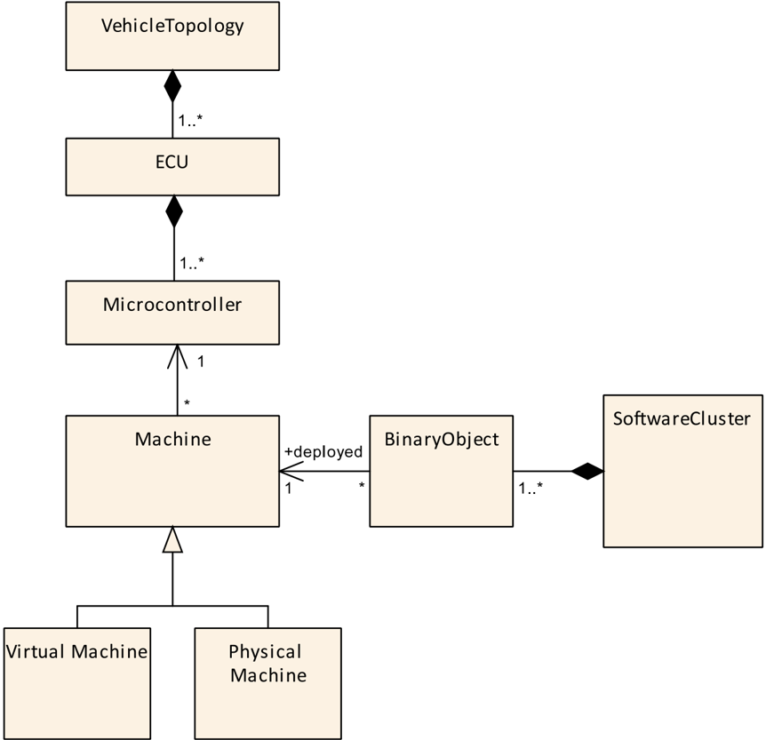
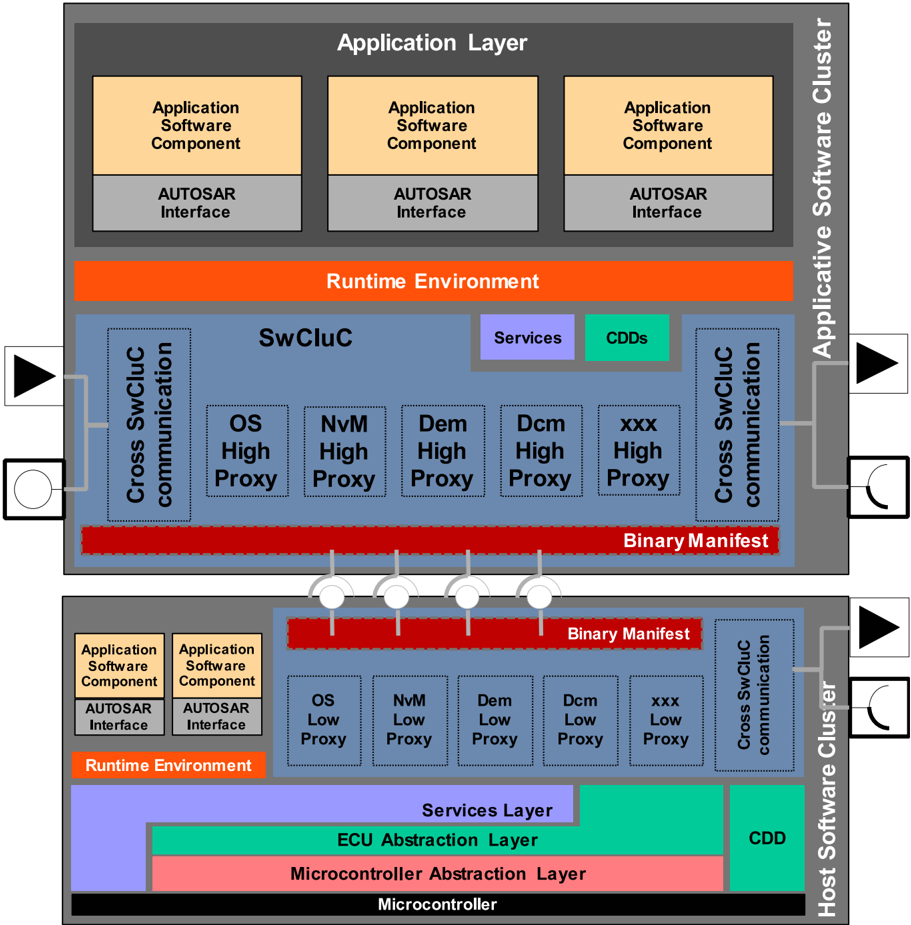
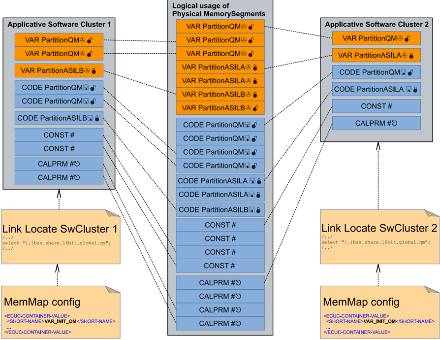
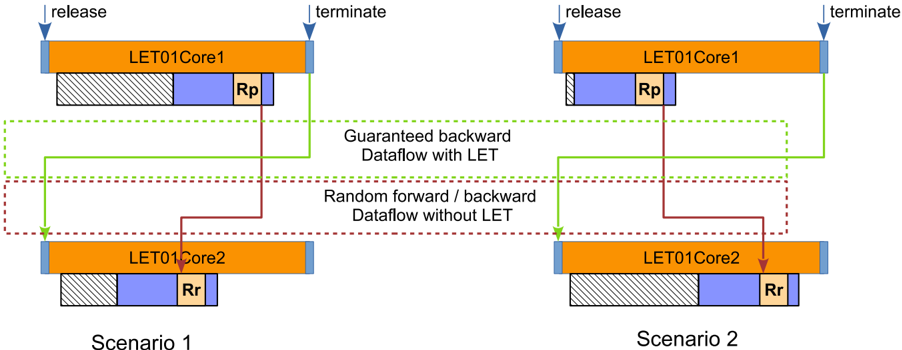
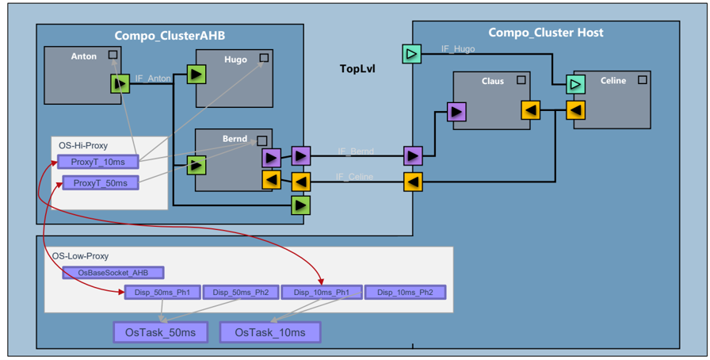
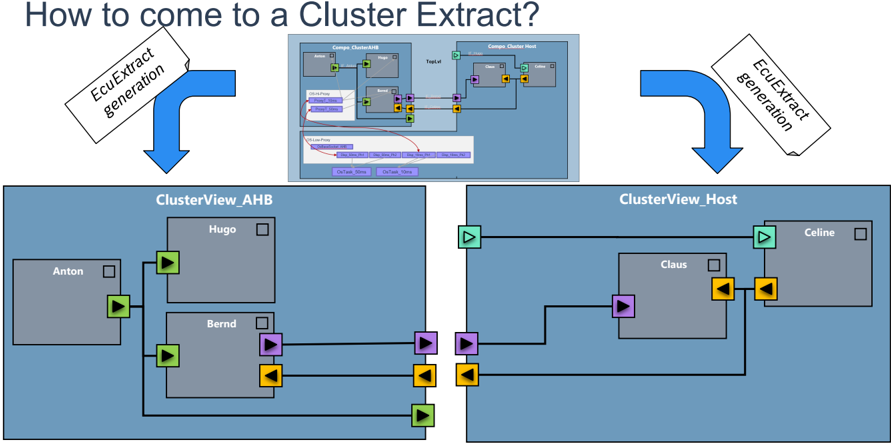

<!-- 源文档 AUTOSAR_CP_EXP_SwClusterDesignAndIntegrationGuideline（R23-11），讲述型指南（EXP），不受 Type A 七章骨架约束；章节结构镜像源文档自身编号（1–6 + 附录 A–D）。代码示例逐字保留（转换断行已重建）；附录 A 的 ARXML 清单按 R23-11 转换逐行保留并去除页眉/页脚（转换在长清单中携带行序伪影，权威来源为 Concept-670 附加文件夹）。 -->

## 1. 引言

本说明性文档为 AUTOSAR 标准的软件集群（Software Clusters）提供附加信息。

### 1.1. 目标

本文档的目标是：

- 给出技术方法「软件集群」的概览
- 解释软件集群在 AUTOSAR 经典平台中的使用
- 列出设计与特性限制
- 提供一些示例

### 1.2. 范围

本文档只讨论 AUTOSAR 经典平台中的软件集群！

## 2. 缩略语与缩写

下表术语表包含「软件集群连接需求（Requirements on Software Cluster Connection）」相关的、AUTOSAR 术语表 [\[1\]](#ref-1) 中未包含的缩略语与缩写。

表2.1：缩略语与缩写（**Acronyms and Abbreviations**）

| 缩写/缩略语 | 说明 |
| --- | --- |
| SwCluC | Software Cluster Connection（软件集群连接） |

表2.2：术语（**Terms**）

| 术语 | 描述 |
| --- | --- |
| 软件集群（Software Cluster） | 软件集群将在一台机器上部署软件相关的所有 AUTOSAR 产物分组在一起。完整定义见文档 [\[1\]](#ref-1)。 |
| 软件集群连接（Software Cluster Connection） | 软件集群连接是一个 BSW 模块，它提供以下特性：连接部署在同一台机器上的二进制对象；在应用软件集群中，用所谓的代理模块（Proxy Module）替代本地不可用、但其接口为所集成软件所必需的 BSW 模块；与 RTE 一起，借助 RTE 实现插件（RTE Implementation Plug-In）实现软件集群之间的 VFB 通信特性。 |
| 机器（machine） | 一台机器由一组计算资源——如微控制器核心、内存或外设（例如通信）设备——组成，并具有执行软件应用的能力。在 AUTOSAR 经典平台中，机器可以用 EcuInstance 表示，但注意该语义目前仍在澄清中。更多信息见文档 [\[1\]](#ref-1)。 |
| 二进制一致（binary-identical） | 逐位（Bit for Bit）一致。 |
| 二进制对象（Binary Object） | 一组文件的集合，包含二进制可执行代码与数据。在编程到目标 ECU 之前，这些二进制可执行代码与数据不会再被修改。 |
| 二进制清单（Binary Manifest） | 二进制清单是软件集群的二进制对象的定义良好的接口，提供资源的元信息与访问此类资源的信息——即所谓的句柄（handle）。 |
| 应用软件集群（Application Software Cluster） | 主要包含软件组件、并且只包含选定 BSW 模块（例如服务模块、转换器等）的软件集群。 |
| 宿主软件集群（Host Software Cluster） | 包含 BSW 主要部分——尤其是微控制器相关的较低层 BSW 模块（例如 OS 与 MCAL）——的单一软件集群。 |
| 替代软件集群（Substitution Software Cluster） | 出于缺陷修复目的、可以覆盖其他软件集群所提供资源的单一软件集群。 |
| 代理模块（Proxy Module） | 代理模块替代应用软件集群中的一个 BSW 模块。代理模块本身拆分为高代理模块（High Proxy Module）与低代理模块（Low Proxy Module）。高代理模块为较高层或同一层中的模块提供专用接口，以及经由二进制清单将它们连接到宿主软件集群中低代理模块的功能。 |
| 高代理模块（High Proxy Module） | 驻留在应用软件集群中的代理模块部分。 |
| 低代理模块（Low Proxy Module） | 驻留在宿主软件集群中的代理模块部分。 |
| Os 高代理（Os High Proxy） | 在应用软件集群中实现 Os API 的一种代理模块。 |
| Os 低代理（Os Low Proxy） | 在宿主软件集群中实现 Os 抽象的一种代理模块。 |
| NvM 高代理（NvM High Proxy） | 在应用软件集群中替代 NVRAM 管理器的一种代理模块。 |
| NvM 低代理（NvM Low Proxy） | 将 NvM 高代理连接到宿主软件集群中 NVRAM 管理器的一种代理模块。 |
| RTE 实现插件（RTE Implementation Plug-In） | RTE 实现插件是整个 RTE 实现的一部分，它不由 RTE 生成器提供，而是来自附加来源（例如插件生成器或手动实现的源代码）。 |
| 本地软件集群通信插件（Local Software Cluster Communication Plug-In） | 本地软件集群通信插件是处理软件集群内部本地通信的 RTE 实现插件。如果相应通信图（Communication Graph）存在数据映射（DataMapping），则这包括转换器处理。 |
| 跨软件集群通信插件（Cross Software Cluster Communication Plug-In） | 跨软件集群通信插件是处理通向其他软件集群的通信的 RTE 实现插件。如果配置了 ECU 内转换，则这包括转换器处理。 |
| 通信图（Communication Graph） | 实例化在相互连接的端口原型（PortPrototype）中的、到端口接口（PortInterface）元素的 AbstractAccessPoint 的总和；或 BSW 模块描述（BswModuleDescription）中相互连接的 BswModuleEntity 到接口元素的全部访问的总和。 |
| 数据通信图（Data Communication Graph） | 实例化在相互连接的端口原型中的、到变量数据原型（VariableDataPrototype）的 VariableAccess 的总和；或内部行为（InternalBehavior）中对 VariableDataPrototype 的 VariableAccess 的总和；或相互连接的 BSW 模块描述中对 VariableDataPrototype 的 BswVariableAccess 的总和。 |
| 参数通信图（Parameter Graph） | 实例化在相互连接的端口原型中的、到参数数据原型（ParameterDataPrototype）的 ParameterAccess 的总和；或内部行为中对参数数据原型的 ParameterAccess 的总和。 |
| 客户端通信图（Client Graph） | 实例化在相互连接的端口原型中的、到操作（operation）的 ServerCallPoint 的总和，包括关联的服务器 runnable。 |
| 触发通信图（Trigger Communication Graph） | 实例化在相互连接的端口原型中的、用于触发器（trigger）的 ExternalTriggeringPoint 的总和，包括关联的被触发 runnable。 |
| 模式通信图（Mode Communication Graph） | 实例化在相互连接的端口原型中的、到模式声明组原型（ModeDeclarationGroupPrototype）的 ModeAccessPoint 与 ModeSwitchPoint 的总和；或相互连接的 BSW 模块描述中对模式声明组原型的 managedModeGroup 与 accessedModeGroup 的总和。 |
| 模式管理器（mode manager） | 进入与离开模式由模式管理器发起。模式管理器要么是提供一个由 ModeSwitchInterface 类型化的 p 端口的软件组件，要么是在其 BSW 模块描述中以 providedModeGroup 角色定义 ModeDeclarationGroupPrototype 的 BSW 模块。 |
| 模式切换通知（mode switch notification） | 从模式管理器到模式用户（mode user）的模式切换通信，使用 ModeSwitchInterface 或 providedModeGroup 与 requiredModeGroup 模式声明组原型。 |
| 模式切换端口（mode switch port） | 用于接收（或发送）模式切换通知的端口。为此，模式切换端口由 ModeSwitchInterface 类型化。 |
| 模式用户（mode user） | 依赖于模式的 AUTOSAR SW-C 或 AUTOSAR 基础软件模块称为模式用户。该依赖可以经由 SwcModeSwitchEvent/BswModeSwitchEvent、针对提供/必需模式切换端口的 ModeAccessPoint、或针对 providedModeGroup/requiredModeGroup 模式声明组原型的 accessedModeGroup 出现。 |
| on-entry 可执行实体（on-entry ExecutableEntity） | 由 ModeActivationKind 为「entry」的 SwcModeSwitchEvent 触发的 RunnableEntity；或由 ModeActivationKind 为「entry」的 BswModeSwitchEvent 触发的 BswSchedulableEntity。 |
| on-exit 可执行实体（on-exit ExecutableEntity） | 由 ModeActivationKind 为「exit」的 SwcModeSwitchEvent 触发的 RunnableEntity；或由 ModeActivationKind 为「exit」的 BswModeSwitchEvent 触发的 BswSchedulableEntity。 |
| on-transition 可执行实体（on-transition ExecutableEntity） | 由 ModeActivationKind 为「transition」的 SwcModeSwitchEvent 触发的 RunnableEntity；或由 ModeActivationKind 为「transition」的 BswModeSwitchEvent 触发的 BswSchedulableEntity。 |
| 触发端口（trigger port） | 由 TriggerInterface 类型化的 PortPrototype。 |
| 触发接收器（trigger sink） | 如果引发特定的触发器（Trigger），触发接收器依赖 RunnableEntity 或 BswSchedulableEntity 的激活。触发接收器具有专用的必需触发端口和/或 requiredTrigger 触发器，以与触发源通信。 |
| 触发源（trigger source） | 触发源管理特定的触发器，并在触发器被引发时通知 RTE 或基础软件调度器。触发源具有专用的提供触发端口和/或 releasedTrigger 触发器，以与触发接收器通信。 |
| 被触发 BswSchedulableEntity（triggered BswSchedulableEntity） | 至少被一个 BswExternalTriggerOccurredEvent 或 BswInternalTriggerOccurredEvent 触发的 BswSchedulableEntity。在特定情况下，触发器事件通信或基础软件可调度实体间触发由基础软件调度器实现为：由触发可执行实体对被触发可执行实体的直接或受信任函数调用。 |
| 被触发可执行实体（triggered ExecutableEntity） | 至少被一个 ExternalTriggerOccurredEvent/InternalTriggerOccurredEvent 触发的 RunnableEntity；或至少被一个 BswExternalTriggerOccurredEvent/BswInternalTriggerOccurredEvent 触发的 BswSchedulableEntity。在特定情况下，触发器事件通信或 runnable 间触发由 RTE 或基础软件调度器实现为：由触发可执行实体对被触发可执行实体的直接或受信任函数调用。 |
| 被触发 runnable（triggered runnable） | 至少被一个 ExternalTriggerOccurredEvent 或 InternalTriggerOccurredEvent 触发的 RunnableEntity。在特定情况下，触发器事件通信或 runnable 间触发由 RTE 实现为：由触发 runnable 对被触发 runnable 的直接或受信任函数调用。 |
| SomeIPEvent | SomeIPEvent——由实现服务实例的 ECU 发送给使用该服务实例的 ECU 的消息（发布/订阅）。 |
| SomeIPMethod | SomeIPMethod——可以经由消息调用的远程函数，该消息由实现服务实例的 ECU 发送给使用该服务实例的 ECU。ECU 可以处于提供者角色（提供一个方法）和/或消费者角色（调用一个远程方法）。 |
| SomeIPService | SomeIPService 是一种操作类型，它具有已发布的接口与行为规格，涉及能力提供者与潜在客户端之间的契约。 |

## 3. 相关文档

<a id="ref-1"></a>[1] 术语表
> AUTOSAR_FO_TR_Glossary

<a id="ref-2"></a>[2] 内存映射规范
> AUTOSAR_CP_SWS_MemoryMapping

<a id="ref-3"></a>[3] ISO 26262:2018 (all parts) - Road vehicles - Functional Safety https://www.iso.org

<a id="ref-4"></a>[4] 经典平台时序扩展规范
> AUTOSAR_CP_TPS_TimingExtensions

<a id="ref-5"></a>[5] RTE 软件规范
> AUTOSAR_CP_SWS_RTE

<a id="ref-6"></a>[6] 操作系统规范
> AUTOSAR_CP_SWS_OS

<a id="ref-7"></a>[7] ISO 17356-3:Road vehicles - Open interface for embedded automotive applications - Part 3:OSEK/VDX Operating System (OS)

## 4. 经典平台中的软件集群

### 4.1. 软件集群概述

本节提供关于总体解决方案方法的简明概览。请谅解更多细节只在详细阐述具体解决方案的章节中给出。

AUTOSAR 经典平台中的软件集群方法，考虑了这样一个事实：多个 ECU 具有对软件系统至关重要的内部结构。图 4.1 阐明了这一点，它展示了概念元模型：



车辆的拓扑结构包含若干 ECU。一个 ECU 可以有 1 到 N 个微控制器。由于微处理器属于 AUTOSAR 自适应平台的范围，这里不予考虑。在一个微控制器上，驻留 1 到 N 台机器。在 N &gt; 1 的情况下，它们是虚拟的，并共享微控制器的资源。此外，每台机器拥有一个 BSW 协议栈，例如从 AUTOSAR 的视角看，它是一个经典平台架构的实例！

这被视为业界现状，即使 AUTOSAR 方法论可能无法描述这类设置的所有细节——更不用说管理程序（hypervisor）并未被 AUTOSAR 标准化。

借助软件集群，经典平台架构的整个软件被拆分为独立的部分。每个软件集群都是一个独立的构建单元（Build Unit），集群特定构建过程的结果就是二进制对象（Binary Object）。



如图 4.2 所示，在集群化的软件系统中，现有的分层架构被一个新的构建块扩展：软件集群连接（Software Cluster Connection）。

该软件集群连接又包含三个主要的子块：

- 二进制清单（Binary Manifest）
- 跨集群通信（Cross Cluster Communication）
- 代理模块（Proxy Module）

二进制清单提供连接部署在同一台机器上的二进制对象的手段。

跨集群通信提供软件集群之间的 VFB 通信特性。注意服务接口不在范围内，因为对 BSW 模块的访问经由代理模块提供。

高代理模块替代应用软件集群中非本地的 BSW 模块，并实现到宿主软件集群中低代理模块的连接，后者再连接到真正的 BSW 模块。高代理模块暴露与真正 BSW 模块相同的接口。

宿主软件集群包含 BSW 协议栈的主要部分，尤其是微控制器相关的模块，包括操作系统。这意味着机器的动态行为主要由实现调度的宿主软件集群决定。不过，应用软件集群的实现需要符合宿主软件集群的调度策略。

在一个应用软件集群中，可以集成应用软件组件与 BSW 模块（有很强的限制）。应用软件集群中本地不可用、但其接口为所集成软件所必需的基础软件模块，由代理模块替代。

某些 RTE 特性可能受限，因为这些特性的实现不可扩展，或可能对其他软件集群产生非预期的副作用。例如，跨软件集群的同步客户端-服务器调用需要完整的上下文解耦，其对整体调度的影响在单个软件集群范围内难以预见。

BSW 软件仍然可以通过同步客户端-服务器调用访问。多核基础软件分布概念的实现被视为应用软件集群的软件系统获得可扩展性与良好性能的前提。

#### 4.1.1 设计理念、目标与非目标

软件集群的目标是为 AUTOSAR 系统的设计与实现提供灵活性，并通过模块化使一个集群中的变更影响可以被局部化。一些架构变更可以逐步引入，某些实现变更不再需要重新构建完整的软件。明确而言，支持所有可能的用例并解决所有可能的问题、或重新发明自适应平台，并不是目标。

虽然软件集群使降低变更率成为可能，但仍然可以重新构建每个软件集群，包括宿主软件集群。一些用例只会被该概念部分地解决（或完全不被解决），并且仍然需要更改 BSW 并重新构建宿主软件集群。该概念中的特性将使对 BSW 的修改变得更容易，所以甚至可能出现宿主软件集群比以前更频繁地被重新构建的情况。但与对 BSW 的罕见大型修改不同，该概念支持的是频繁的小型修改。

### 4.2. 与 EcucPartition 的关系

软件集群概念面向通常资源非常受限的微控制器。因此，该概念尽可能少地增加开销非常重要。简单地说：只为所使用的内容付费，但同样也只能得到所付费的内容。软件集群与 EcucPartition 之间的关系正是体现这一点的一个领域。

EcucPartition 提供分离功能的可能性。由于它们使用 OsApplication 实现，内存访问与运行时行为的分离可以在一定程度上实现。另一方面，多个 OsApplication 的执行也会造成相对较大的开销，需要任务切换（可能占用数百个处理器周期）以及额外的管理开销（取决于当前与下一个任务，可能需要更改执行层级、重新配置 MPU 等）。随着 EcucPartition 数量的增长，这种开销可能变得显著。因此，可以在多个软件集群中复用一个 EcucPartition。

同时，系统设计者希望在一个集群内组合来自不同 EcucPartition 的功能。大型特性可能就是这种情况，其中某些部分承载不同的 ASIL 需求；或者应将 OBD 相关部分与非 OBD 相关部分分开。例如，一个制动功能集群可能包含来自不同 ASIL 等级的功能。一些功能执行制动并且是安全相关的，但另一些功能（如评估行驶平稳性的功能）与安全无关。因此，一个软件集群可以包含多个 EcucPartition。

为了同时满足这两个需求，可以在一个软件集群中放入多个 EcucPartition，并在若干软件集群之间共享一个 EcucPartition（n:m 关系）。

如果一个 EcucPartition 在软件集群之间共享，那么在运行时无法强制其包含的来自不同软件集群的软件组件之间的分离。但仍然有一个轻微的好处：软件集群在逻辑上以及按内存地址区域是分离的。某些违规可能不是在运行时检测到，而是在 ECU 之外通过静态检查检测到。对于给定的代码，允许的内存区域与所用特性的范围要小得多。如果静态检查工具考虑到这一点，将使关于软件的静态检查或证明更容易。

如果受限资源允许，最好不要在软件集群之间共享 EcucPartition，因为这提供了软件集群之间更好的分离。遗憾的是，实践中这往往无法避免，因此目标应当是尽可能最小化这种共享。

### 4.3. 对适用目标 ECU 的假设

经典平台架构的集群化应能在业界先进的微控制器上工作。这一方面意味着存在足够的资源，特别是 RAM、ROM 与 CPU 核心及其计算能力。这也可能意味着 32 位或更高的架构。

另一方面，在当今现有平台上使用这些概念与特性也在范围内，并支持各种优化。例如，应当避免软件集群按硬件特性进行的一般性软件分离，因为这通常会占用微控制器的稀缺资源。

配备内存管理单元（MMU）的目标不在范围内，或者至少不被标准化解决方案特别考虑。

### 4.4. 对安全机制的假设

AUTOSAR CP 架构假定利用 RAM 的 ECU 本地通信是安全的。因此，同一台机器上软件集群之间的通信也被认为是安全的。机器本地通信的完整性通过使用（带内存保护的）分区以及足够可靠的硬件（ECC RAM、合适的 FID 率等）来保证。

这意味着软件的空间与时间分离需要在目标微控制器上实现，基于 AUTOSAR 经典平台架构中已经引入的分区概念。本概念不引入确保这种分离的附加方法。

### 4.5. 对待集群化软件系统的假设

注意：本章给出的数字仅用于表达粗略量级以指示某种复杂性。该框架在概念开发期间用于对子特性、优化能力排定优先级，并讨论解决方案可接受的限制。不过，在被接受的限制的情况下，那些限制将成为所制定规范的约束。

映射到不同软件集群的软件组件应以松耦合为目标。

「在计算与系统设计中，松耦合系统是指其每个组件拥有或利用其他独立组件定义的很少或没有知识的系统。子领域包括类、接口、数据与服务的耦合。」（参见维基百科「松耦合是紧耦合的对立面」。）

该概念假定跨软件集群的接口数量远小于软件组件之间的接口总数。

这可以归结为一个粗略的估计：软件集群的接口数据应至少比内部数据流小一个数量级（约 3k/机器）。接口最好定义良好且相当稳定；不过，开发期间接口的变更受到本概念的明确支持。

除静态接口外，不同软件集群之间应只有松散的时序依赖。基本上，与并行化及多核设计相同的设计目标适用。例如：

- 避免严格的顺序
- 避免同步交互
- 避免软件集群之间严格的执行顺序

一般而言，系统设计者必须记住：软件集群之间的任何依赖都必须在更高的层级上解决。例如：

- 接口需要协商
- 所需的执行顺序需要在软件集群提供者之间商定，并在机器上的软件集群集成期间得到保证
- 所需的执行顺序需要由机器上的软件集群集成来保证

但这些跨软件集群的依赖与软件集群独立开发、测试与发布的目标相矛盾！

物理微控制器上软件集群的数量应在 2 到 20 的范围内。但随着软件集群数量的增长——考虑到没有虚拟内存（MMU）——内存碎片将增加。这种碎片只取决于软件集群的数量及其所需分区的数量，而与机器的数量无关。无论如何，精确的数量需要与物理硬件的能力交叉核对。

应用软件集群内的软件不使用也不实现中断。

假定它主要是控制回路软件——通常由时间驱动，但也可能对有限数量的偶发事件作出反应。

### 4.6. 为软件集群分配内存

通常，微控制器的整体内存由不同的内存类型组成，每种类型用于特定目的（例如 RAM、FLASH 程序 ROM、FLASH 数据 ROM）。此外，一种内存类型的特定段对于不同用例可能具有不同的性能（例如访问速度对不同的微控制器核心可能不同）。将单一的整体 CP 软件架构拆分为各自可构建的单元，要求每个软件集群提供者对哪种内存可用于哪种目的有清晰的概念。由于微控制器通常不支持内存虚拟化，不仅需要就内存数量达成一致，还需要就具体的地址范围达成一致。

建议的方法学如下：

机器架构师将整体内存拆分为逻辑内存槽及其所属的用途指示，说明此类内存槽可以用于什么。这些指示对应此类内存槽的物理属性（例如 RAM 或 FLASH），也对应软件分区（例如通过 MPU 的空间分离）、功能分组（例如标定数据集的内存）与性能目标。



图 4.3 阐明了将不同内存分配给软件集群的原理。

现在，根据所包含功能的预测内存消耗与所需的内存类型，为每个软件集群分配不同的内存槽。这样的分配可以直接转移到链接定位文件以及 AUTOSAR 内存映射的初始配置中。软件集群特定的链接定位文件确保软件集群特定的构建只分配为该软件集群保留的内存。AUTOSAR 内存映射的初始配置进而可以定义 MemMapAddressingModeSet，其中包含控制代码与变量到链接器段分配的 pragma 配置。

更多细节见文档 [\[2\]](#ref-2)。

除静态内存使用外，还需要考虑栈的使用。请注意，宿主软件集群调用应用软件集群的「代理」OS 任务，后者又可能调用宿主软件集群中 BSW 的函数。由于这一公共调用图，栈的估算与容量设计必须共同考虑宿主软件集群与各个应用软件集群的软件架构。

### 4.7. 为软件集群分配运行时

首先请注意，集群化系统中「免受非预期副作用」的用例不同于作为 ISO 26262 [\[3\]](#ref-3) 安全目标的「免受干扰」。安全考量通常首先假定为共存而设计，随后应用措施以避免干扰，或至少在发生干扰时具有安全的检测与失效反应。

凭借 AUTOSAR OS 的原生手段，几乎不可能创建一个保证各个软件子系统之间完全「免受非预期副作用」的调度。在纯基于优先级的调度中，在给定优先级层级上占用超过同一或更低优先级上其他功能可接受的计算时间总是可能的。这只有通过为每个软件子系统在专用核心上分配一组独特的 OS 任务才能严格避免，而这在资源上很可能无法承受。

因此，使用软件集群管理分布式开发，需要预先设计整体调度，并管理该调度中的计算时间预算。在实际使用中，还需要在开发期间维护这样的设计，以应对变化的调度需求或识别出的问题。

借助代理任务的概念，应用软件集群已经拥有定义良好的入口点，称为分发入口点（dispatch entry point）。这些分发入口点需要用时序属性限定，如触发条件（例如周期性出现）、抖动（jitter）或最大执行时间。由于这些分发入口点可以用 AUTOSAR 时序扩展 [\[4\]](#ref-4) 描述，因此可以对这些时序属性进行形式化描述。

借助这种方法，可以为不同的软件集群提供者提供一个动态的框架架构，他们可以据此证明其集成。该证明可以通过静态代码分析与真实的运行时测量完成。基于静态代码分析的运行时估算的优点是：动态架构边界（例如代理任务的时间预算）的首次证明可以在没有任何运行软件的情况下完成。

这些运行时预算的在线监控当前未在 AUTOSAR 中标准化，但可以通过 CDD 作为供应商特定的功能实现。

尽管如此，如果软件被集成到一个公共的 AUTOSAR OS 调度中，软件设计与实现需要支持这种共存。例如，RunnableEntity 的最大运行时应小于非抢占调度中预期的最小响应时间。

除软件调度的方面外，还需要考虑通信行为的功能影响。取决于所执行的算法，采用来自本次计算（N）的输入信号还是来自上一次计算（N-1）的输入信号，可能对输出有严重影响。最坏的情况下，行为甚至在这两种情况之间波动，这又会给计算出的输出增加抖动。

在集群化系统中（假定任务系统是共享的），OS 任务的总运行时以及特定 Runnable 在 OS 任务中执行的确切时间点，随着每次新软件集群版本的集成而频繁变化。这危及将功能影响局部化到被更改软件集群的方法。

逻辑执行时间（Logical Execution Time，LET）可以通过抽象物理执行来帮助确保稳定的软件行为。简言之，LET 概念将整体调度拆分为所谓的逻辑执行时间帧。一个 LET 帧从其释放点开始，到其终止点结束。位于不同 LET 帧的软件之间的通信仅在发送 LET 帧的终止点与接收 LET 帧的释放点执行。



图 4.4 阐明了两个 Runnable R<sub>p</sub> 与 R<sub>r</sub> 之间的简单数据流。为简单起见，假定两者都在不同核心上执行的 OS 任务中运行，但在同一核心的抢占式系统中也可能出现类似情况。它们完成执行的时间点会抖动，由阴影区域显示。在场景 1 中，R<sub>p</sub> 在 R<sub>r</sub> 之后执行。因此，R<sub>c</sub> 观察到 R<sub>p</sub> 第 N-1 次执行的值（也称为后向数据流）。在场景 2 中，R<sub>p</sub> 在 R<sub>r</sub> 之前执行。因此，R<sub>c</sub> 观察到 R<sub>p</sub> 本次第 N 次执行的值（也称为前向数据流）。应用 LET 后，两种场景都保证确定性的后向数据流。

### 4.8. 软件集群中的面向服务通信

变更的需求或一般的软件返工可能要求软件集群提供和/或消费额外的或不同的 SomeIPEvent 或 SomeIPMethod。与传统的基于信号的通信相反，包含序列化的 SomeIPEvent/SomeIPMethod 参数及返回值的 PDU 由模式管理主动控制。这意味着只有在请求服务之后，PDU 才真正经由 BSW 协议栈从应用 SWC 发出并到达应用 SWC。因此，软件集群提供或消费的 SomeIPEvent 或 SomeIPMethod 集合的变更需要模式管理的变更。当无法或不希望构建新版本的宿主软件集群时，变更也可以通过预先准备的配置元素与宿主软件集群的 post-build 配置相结合的方式引入。由于模式管理中的一般模式对所有面向服务的通信都是相同的，部分内容可以复用。在初始配置（pre-compile）期间就必须创建的配置元素有：

- 一组用于新 SomeIPEvent 或 SomeIPMethod 的通配 BswMModeRequest 端口与 BswMSwitchPort。这些端口的存在是为了从一开始就具备发出与接收模式变更的可能性。最初它们不被使用。稍后，绑定到特定 SomeIPEvent 或 SomeIPMethod 的模式被分配给它们。
- 对通配 BswMModeRequestPort 设置的模式进行求值的 BswMRule 与 BswMLogicalExpression
- 用于请求与释放 Sd SomeIPEvent 或 SomeIPMethod 状态的所有潜在 BswMAction
- 与面向服务通信相关的 BswM 模式声明组

实际的修改是对 BswMActionList 的 post-build 修改。可以在此添加和/或移除以下 BswM 动作：

- 请求 SomeIPEvent 或 SomeIPMethod。
- 将模式变更绑定到某个通配 BswMSwitchPort

### 4.9. 集群化系统的设计提示

由于软件集群概念建立在现有的技术与概念之上，引入它们只会增加少量的额外设计考量。

如果跨集群接口无法连接，RTE 方法调用（例如 Rte_IRead）将返回 RTE_E_UNCONNECTED，并且输出值将为 ComSpec.initValue（例如 NonqueuedSenderComSpec 的 initValue）。

「必需端口可能未连接」这一概念在不使用软件集群的系统中已经存在。然而，在某些领域中并不使用这一行为，一些开发者可能假设他们需要的接口总是存在。因此，评估未连接接口对参与跨集群通信的那些软件组件的影响非常重要。

这可能以三种方式影响软件组件：

1. 如果输入值是初始值时 SW-C 不受影响。在这种情况下，SW-C 可以按原样使用。示例：初始值是具有中性行为的保留值。
2. SW-C 可以在该输入值下工作，但必须区分初始值与其他值。在这种情况下，SW-C 应对 RTE_E_UNCONNECTED 返回值作出反应。示例：初始值是最大值，而组件不应在其计算中使用该值。
3. SW-C 没有该输入值就无法工作。在这种情况下，应为相应的资源设置属性 CpSoftwareClusterResource.isMandatory。

在最后一种情况下，[SWS_SwCluC_00050] 规定：如果软件组件上的单个强制接口无法连接，则包含该软件组件的整个集群将保持未连接。这避免了软件集群中集成的软件组件使用「部分存活」接口的情形。它还避免了连锁故障，例如读取软件组件计算出一个错误的输出值，随后又被另一个软件组件读取。

CpSoftwareClusterResource.isMandatory 属性在系统设计时、将软件组件分配到集群时设置。在组件设计或实现时传达这一信息可能也是必需的。为指示这一点，VariableAccess.scope 可以设置为 communicationIntraPartition。

建议架构工具在 VariableAccess.scope 设置为 communicationIntraPartition 但 CpSoftwareClusterResource.isMandatory 未设置时发出警告。

旁注：由于软件集群可以共享 EcucPartition，某些跨集群通信可能发生在同一分区内（跨集群但在分区内）。因此，跨分区与跨集群之间存在细微的语义差异。然而，由于软件集群引入的灵活性，通常无法保证跨集群接口永远不会跨越分区边界。因此应当假定跨集群通信也可能潜在地是跨分区的。因此，决定使用现有的值 communicationIntraPartition，而不是为集群内通信引入一个特殊值。

## 5. 软件集群示例

### 5.1. 示例系统概览

与本示例对应的系统模型可以在 Concept-670 的附加文件夹中找到。

**集群定义（Cluster Definition）**

AUTOSAR 概念 CONC_670 经典平台灵活性。图 5.1：示例模型概览。



该示例由 2 个软件组合组成：

- Compo_AHB，包含 3 个软件组件：Anton、Hugo 与 Bernd
- Compo_Host，包含 2 个软件组件：Claus 与 Celine

它们各自具有提供端口与必需端口，其中一些在顶层视图中连接。

存在 2 个软件集群：

- SwClu_AHB，包含 Compo_AHB
- SwClu_Host，包含 Compo_Host

它们基于必要的系统元素分别描述。当然，在真实系统中，一个集群通常包含若干软件组合。

如图 5.1 所示，这两个软件集群具有以下接口：

- IF_Celine；端口从 SwClu_Host 连接到 SwClu_AHB
- IF_Bernd；端口从 SwClu_AHB 连接到 SwClu_Host
- IF_Hugo；SwClu_Host 上的开放必需端口
- IF_Anton；SwClu_AHB 上的开放提供端口

图 5.1 还展示了相关的服务依赖，通过它们，配置恰当的宿主软件集群及其操作系统可以运行软件集群 AHB。

对于所需的 Os 服务，使用 Os 的代理模式。在该示例中，基础配置由 2 个 OsTask 组成：OsTask_50ms 与 OsTask_10ms。每个任务有 2 个入口点，供应用软件集群中所谓的分发器（dispatcher）使用：

- OsTask_10ms：
  - Disp_10ms_Ph1（10ms 任务的分发器，相位 1）
  - Disp_10ms_Ph2（10ms 任务的分发器，相位 2）
- OsTask_50ms：
  - Disp_50ms_Ph1（50ms 任务的分发器，相位 1）
  - Disp_50ms_Ph2（50ms 任务的分发器，相位 2）

在软件集群 AHB 中，存在 Os 的本地实现，遵循 Os 高代理模式，带有 2 个代理任务：ProxyT_10ms 与 ProxyT_50ms。来自软件组件 TimingEvents 的匹配时序事件被映射到这 2 个代理任务。

图 5.1 中未显示的是 OsBaseSocket_AHB 与 BaseConfigCheck_AHB。OsBaseSocket_AHB 用于软件集群 AHB 本地 OsProxy 的初始建立。BaseConfigCheck_AHB 用于确保宿主软件集群实现的配置满足软件集群 AHB 的需求。

软件集群之间的所有依赖都在资源池（Ressource Pool）中描述。在本例中，存在基于 S/R 端口的通信资源、用于 Os 的服务资源以及配置依赖。

有了所有这些设置，本示例的系统设计就完成了。如开头所述，对应的系统模型可以在 Concept-670 的附加文件夹中找到。

### 5.2. 软件集群的示例提取

基于示例系统模型，可以为两个软件集群 SwClu_Host 与 SwClu_AHB 生成集群提取（cluster extract）。通过这一步骤，系统将被拆分为两个独立的部分：



类似于 EcuExtract 机制，每个软件集群将从系统中提取出来并独立描述。除此之外，依赖项从公共资源池（RessourcePool）引用。此类提取的主要部分有：

- 软件组件
- 软件组合
- 顶层根组合（Toplevel Root Composition）
- 软件集群
- COM 资源
- CP-SOFTWARE-CLUSTER-SERVICE-RESOURCE
- 服务需求（Service-Needs）

以及它们对应的映射。前三项对于 EcuExtract 已经存在，而其余部分是软件集群特有的。

该概念使用与 EcuExtract 机制的类比，因为任务基本相同。其目标是：只需少量修改即可复用当前可用于配置与生成的工具与工具链。

在示例模型中，可以找到每个软件集群的 ARXML 示例。

### 5.3. ECUC 的示例配置

为了支持软件集群服务层的生成与实现，该概念还引入了新的 ECU 配置元素（EcuC）。在本示例中，该配置描述了 Os 高代理与二进制清单的设置，以及软件集群本身的属性。此类属性可以是：软件集群的类型、其连接设置，或构建环境所需的设置（如编译器标志）。它还配置软件集群通信层，例如是否经由 RIPS 插件实现。

### 5.4. Os 高代理的 ECUC 配置

示例 ARXML 展示了 Os 高代理的基本配置，它由代理任务 ProxyT_10ms 与 ProxyT_50ms 的 Os 任务配置及其优先级、周期、调度与激活设置组成。此外，还在其中配置了一个 OsApplication「Core1QM」，以给两个任务定义相同的上下文。

### 5.5. 文件概览

为了便于示例的创建与维护，模型被拆分为若干文件。此外，这一文件拆分用于将模型组合成方法学中的不同步骤。该表描述了为获得方法学某一步骤的完整模型需要使用哪些文件。

表5.1：文件到方法学步骤的映射（**Mapping of files to methodology steps**）

| | 组件模型 | 资源池 | ECU_SYSTEM_DESCRIPTION | SW_CLUSTER_SYSTEM_DESCRIPTION Host | SW_CLUSTER_SYSTEM_DESCRIPTION AHB | ECU 配置 AHB |
| --- | --- | --- | --- | --- | --- | --- |
| PlatformBase_Types.arxml | x | | x | x | x | |
| Platform_Types.arxml | x | | x | x | x | |
| DOC_SwCluC_SwcAnton_SWCD.arxml | x | | x | x | x | |
| DOC_SwCluC_SwcBernd_SWCD.arxml | x | | x | x | x | |
| DOC_SwCluC_SwcHugo_SWCD.arxml | x | | x | x | x | |
| DOC_SwCluC_SwcCeline_SWCD.arxml | x | | x | x | x | |
| DOC_SwCluC_SwcClaus_SWCD.arxml | x | | x | x | x | |
| DOC_SwCluC_SwcCompoAHB_SWCD.arxml | x | | x | x | x | |
| DOC_SwCluC_SwcCompoHost_SWCD.arxml | x | | x | x | x | |
| DOC_SwCluC_Sys_TopLvl_SWCD.arxml | x | | x | x | x | |
| DOC_SwCluC_Sys_SwClusters.arxml | | | x | x | x | |
| DOC_SwCluC_Sys_Descr_TopLvl.arxml | | | x | | | |
| DOC_SwCluC_Sys_HWT.arxml | | | x | x | x | |
| DOC_SwCluC_Sys_ResPoolCommunicationResources.arxml | | x | x | x | x | |
| DOC_SwCluC_Sys_ResPoolServiceResources.arxml | | x | x | x | x | |
| DOC_SwCluC_Sys_ResPoolServiceResourceNeeds.arxml | | x | x | x | x | |
| DOC_SwCluC_Sys_Extr_Host.arxml | | | | x | | |
| DOC_SwCluC_Sys_Extr_TopLvl_SWCD_Host.arxml | | | | x | | |
| DOC_SwCluC_Sys_Extr_AHB.arxml | | | | | x | |
| DOC_SwCluC_Sys_Extr_TopLvl_SWCD_AHB.arxml | | | | | x | |
| DOC_SwCluC_Ecuc_EcuC_AHB.arxml | | | | | | x |
| DOC_SwCluC_Ecuc_Os_AHB.arxml | | | | | | x |
| DOC_SwCluC_Ecuc_SwCluC_AHB.arxml | | | | | | x |
| AUTOSAR_MOD_ECUConfigurationParameters.arxml | | x | x | x | x | x |

### 5.6. 从模型到代码

本节应阐明软件集群的 AUTOSAR 模型如何在不同方法学步骤中被处理，并最终在代码中被加工。

如前所述，三个软件组件被集成到软件集群 AHB 中：

- SwcAnton（DOC_SwCluC_SwcAnton_SWCD.arxml）
- SwcBernd（DOC_SwCluC_SwcBernd_SWCD.arxml）
- SwcHugo（DOC_SwCluC_SwcHugo_SWCD.arxml）

它们都实例化在 CompositionSwComponentType SwcCompoAHB（DOC_SwCluC_SwcCompoAHB_SWCD.arxml）中，后者用于描述 AHB 的应用软件。SwClu_AHB 存在 CpSoftwareCluster.swComponentAssignment（DOC_SwCluC_Sys_SwClusters.arxml）。

从这些软件组件中，端口里的三个数据元素：

- RP_Celine，数据元素 Celine
- PP_Bernd，数据元素 Bernd
- PP_Anton，数据元素 Anton

由 SwcCompoAHB 委托。

对于每个数据元素，一个 CpSoftwareClusterCommunicationResource（DOC_SwCluC_Sys_ResPoolServiceResources.arxml）描述软件集群相关的属性。

在 ECU_SYSTEM_DESCRIPTION System_TopLvl（DOC_SwCluC_Sys_Descr_TopLvl.arxml）中，相应的数据元素实例经由 PortElementToCommunicationResourceMapping 映射。在 ECU_SYSTEM_DESCRIPTION System_TopLvl 中，如果数据通信图中存在 PPortPrototype，则映射一致地定义在 PPortPrototype 一侧。

请注意数据元素 Celine，它映射在 SwcCompoHost 的 PP_Celine 上。

在 SW_CLUSTER_SYSTEM_DESCRIPTION AHB（DOC_SwCluC_Sys_Extr_Host.arxml）——它是 ECU_SYSTEM_DESCRIPTION System_TopLvl 的提取——中，映射被变换到软件集群 AHB 范围内可用的端口原型上。

请注意数据元素 Celine，现在映射在 SwcCompoAHB 的 RP_Celine 上。

在软件集群 AHB 的 ECU 配置阶段，数据元素 Celine、Bernd 与 Anton 的数据通信图被分配给跨软件集群通信插件 Gr8Xcc。

由于这一配置，相应的 RTE API 在跨软件集群通信时使用 RTE 实现插件服务（RTE Implementation Plug-In Services）。

**示例 5.1**

软件组件 SwcAnton 中的 Rte_Write：

```
Std_ReturnType Rte_Write_SwcAnton_PP_Anton_Anton(Type_Anton data)
{
  Std_ReturnType status = RTE_E_OK;

  /* write to Software Cluster local communication buffer */
  Rte_Buffer_000000_Anton = data;

  /* write to Xcc Plug-In */
  status = Rte_Rips_Gr8Xcc_Write_SwcAnton_CGI_Anton(data);

  return status;
}
```

或

**示例 5.2**

软件组件 SwcBernd 中的 Rte_DRead：

```
Type_Celine Rte_DRead_SwcBernd_RP_Celine_Celine(void)
{
  return Rte_Rips_Gr8Xcc_DRead_SwcBernd_CGI_Celine();
}
```

Gr8Xcc 跨软件集群通信插件可以如下实现相关的 RTE 实现插件服务：

**示例 5.3**

跨软件集群通信插件 Gr8Xcc 中的 Rte_Rips_Write：

```
Std_ReturnType Rte_Rips_Gr8Xcc_Write_SwcAnton_CGI_Anton(
    Rte_Rips_GlobalCopy_CGI_Anton_Type data)
{
  Std_ReturnType status = RTE_E_OK;

  /* sendIndication = none, no indication of send operations */
  SwCluC_Xcc_Buffer_Anton = data;
  /* writing data is always successful */
  return status;
}
```

Rte_Rips_Write 更新用于跨集群通信的数据缓冲区：

**示例 5.4**

```
Rte_Rips_GlobalCopy_CGI_Bernd_Type SwCluC_Xcc_Buffer_Bernd = 123u;
```

在读取数据的情况下，与二进制清单的关系也在源代码中显现：

**示例 5.5**

跨软件集群通信插件 Gr8Xcc 中的 Rte_Rips_DRead：

```
Rte_Rips_GlobalCopy_CGI_Celine_Type Rte_Rips_Gr8Xcc_DRead_SwcBernd_CGI_Celine()
{
  return *((Rte_Rips_GlobalCopy_CGI_Celine_Type *)
      SwCluC_BManif_GetHandle_rXccBasicSR_Celine_dataBuffer());
}
```

请注意，Rte_Rips_DRead 只是从二进制清单中获取数据引用，而不检查二进制清单中相关的资源条目是否连接到另一个软件集群。

这是可能的，因为跨软件集群通信插件创建一个默认数据实例，并将其作为默认数据值放入二进制清单。

**示例 5.6**

跨软件集群通信插件 Gr8Xcc 的默认数据实例：

```
const Rte_Rips_GlobalCopy_CGI_Celine_Type SwCluC_Xcc_Default_Celine = 42;
```

因此，SwCluC_BManif_GetHandle API 要么返回连接的软件集群中数据缓冲区的引用，要么——在无法建立连接的情况下——返回本软件集群 AHB 的默认数据实例的引用。

配置二进制清单中所需的资源条目，使跨软件集群通信得以工作，是跨软件集群通信插件功能的任务。这样的配置展示在 DOC_SwCluC_Ecuc_SwCluC_AHB.arxml 中。

**示例 5.7**

以下内容的接口描述符表：

- 发送/接收端口 Anton、Bernd、Celine
- OsTask OsTask_10ms、OsTask_50ms
- OsTask_10ms 与 OsTask_50ms 的分发器

```
const SwCluC_BManif_ResourcePropertiesType
    SwCluC_BManif_ResourcePropertiesDescriptorColumn[
        SWCLUC_BMANIF_NO_OF_DESCRIPTORS] =
{
  0x80, /* PROVIDED (Anton),      N/A, S/R,          GID = 0xDA1A0001 */
  0x80, /* PROVIDED (Bernd),      N/A, S/R,          GID = 0xDA1A0002 */
  0x00, /* REQUIRED (Celine),     N/A, S/R,          GID = 0xDA1A0003 */
  0x40, /* REQUIRED (OsTask_10ms),    MANDATORY, OsTask,       GID = 0x05000004 */
  0x40, /* REQUIRED (OsTask_50ms),    MANDATORY, OsTask,       GID = 0x05000003 */
  0x40, /* REQUIRED (Disp_10ms_Ph1),  MANDATORY, OsDispatcher, GID = 0x0500000a */
  0x40  /* REQUIRED (Disp_50ms_Ph1),  MANDATORY, OsDispatcher, GID = 0x05000008 */
};

/* descriptor table column for resource type Ids */
const SwCluC_BManif_ResourceTypeIdType
    SwCluC_BManif_ResourceTypeIdDescriptorColumn[
        SWCLUC_BMANIF_NO_OF_DESCRIPTORS] =
{
  0x01u, /* PROVIDED (Anton),      N/A, S/R,          GID = 0xDA1A0001 */
  0x01u, /* PROVIDED (Bernd),      N/A, S/R,          GID = 0xDA1A0002 */
  0x01u, /* REQUIRED (Celine),     N/A, S/R,          GID = 0xDA1A0003 */
  0x03u, /* REQUIRED (OsTask_10ms),    MANDATORY, OsTask,       GID = 0x05000004 */
  0x03u, /* REQUIRED (OsTask_50ms),    MANDATORY, OsTask,       GID = 0x05000003 */
  0x04u, /* REQUIRED (Disp_10ms_Ph1),  MANDATORY, OsDispatcher, GID = 0x0500000a */
  0x04u  /* REQUIRED (Disp_50ms_Ph1),  MANDATORY, OsDispatcher, GID = 0x05000008 */
};

const SwCluC_BManif_GlobalResourceIdType
    SwCluC_BManif_GlobalResourceIdDescriptorColumn[
        SWCLUC_BMANIF_NO_OF_DESCRIPTORS] =
{
  0xDA1A0001, /* PROVIDED (Anton),      N/A, S/R,          GID = 0xDA1A0001 */
  0xDA1A0002, /* PROVIDED (Bernd),      N/A, S/R,          GID = 0xDA1A0002 */
  0xDA1A0003, /* REQUIRED (Celine),     N/A, S/R,          GID = 0xDA1A0003 */
  0x05000004, /* REQUIRED (OsTask_10ms),    MANDATORY, OsTask,       GID = 0x05000004 */
  0x05000003, /* REQUIRED (OsTask_50ms),    MANDATORY, OsTask,       GID = 0x05000003 */
  0x0500000a, /* REQUIRED (Disp_10ms_Ph1),  MANDATORY, OsDispatcher, GID = 0x0500000a */
  0x05000008  /* REQUIRED (Disp_50ms_Ph1),  MANDATORY, OsDispatcher, GID = 0x05000008 */
};

const SwCluC_BManif_ResourceGuardValueType
    SwCluC_BManif_ResourceGuardValueDescriptorColumn[
        SWCLUC_BMANIF_NO_OF_DESCRIPTORS] =
{
  0x0001DD21, /* PROVIDED (Anton),      N/A, S/R,          GID = 0xDA1A0001 */
  0x0001E2FD, /* PROVIDED (Bernd),      N/A, S/R,          GID = 0xDA1A0002 */
  0x19D1C26F, /* REQUIRED (Celine),     N/A, S/R,          GID = 0xDA1A0003 */
  0x0006F83F, /* REQUIRED (OsTask_10ms),    MANDATORY, OsTask,       GID = 0x05000004 */
  0x0006F855, /* REQUIRED (OsTask_50ms),    MANDATORY, OsTask,       GID = 0x05000003 */
  0x0006F83F, /* REQUIRED (Disp_10ms_Ph1),  MANDATORY, OsDispatcher, GID = 0x0500000a */
  0x0006F855  /* REQUIRED (Disp_50ms_Ph1),  MANDATORY, OsDispatcher, GID = 0x05000008 */
};

const SwCluC_BManif_TableIndexType
    SwCluC_BManif_OfferedInterfaceIndexDescriptorColumn[
        SWCLUC_BMANIF_NO_OF_DESCRIPTORS] =
{
  0,                          /* PROVIDED (Anton),      N/A, S/R,          GID = 0xDA1A0001 */
  1,                          /* PROVIDED (Bernd),      N/A, S/R,          GID = 0xDA1A0002 */
  SWCLUC_BMANIF_NO_TABLE_ENTRY, /* REQUIRED (Celine),   N/A, S/R,          GID = 0xDA1A0003 */
  SWCLUC_BMANIF_NO_TABLE_ENTRY, /* REQUIRED (OsTask_10ms),  MANDATORY, OsTask,      GID = 0x05000004 */
  SWCLUC_BMANIF_NO_TABLE_ENTRY, /* REQUIRED (OsTask_50ms),  MANDATORY, OsTask,      GID = 0x05000003 */
  2,                          /* REQUIRED (Disp_10ms_Ph1),  MANDATORY, OsDispatcher, GID = 0x0500000a */
  3                           /* REQUIRED (Disp_50ms_Ph1),  MANDATORY, OsDispatcher, GID = 0x05000008 */
};

const SwCluC_BManif_HandleIndexType
    SwCluC_BManif_OfferedInterfaceNoOfHandlesDescriptorColumn[
        SWCLUC_BMANIF_NO_OF_DESCRIPTORS] =
{
  0x01u, /* PROVIDED (Anton),      N/A, S/R,          GID = 0xDA1A0001 */
  0x01u, /* PROVIDED (Bernd),      N/A, S/R,          GID = 0xDA1A0002 */
  0x00u, /* REQUIRED (Celine),     N/A, S/R,          GID = 0xDA1A0003 */
  0x00u, /* REQUIRED (OsTask_10ms),    MANDATORY, OsTask,       GID = 0x05000004 */
  0x00u, /* REQUIRED (OsTask_50ms),    MANDATORY, OsTask,       GID = 0x05000003 */
  0x01u, /* REQUIRED (Disp_10ms_Ph1),  MANDATORY, OsDispatcher, GID = 0x0500000a */
  0x01u  /* REQUIRED (Disp_50ms_Ph1),  MANDATORY, OsDispatcher, GID = 0x05000008 */
};

const SwCluC_BManif_TableIndexType
    SwCluC_BManif_SubscribedInterfaceIndexDescriptorColumn[
        SWCLUC_BMANIF_NO_OF_DESCRIPTORS] =
{
  SWCLUC_BMANIF_NO_TABLE_ENTRY, /* PROVIDED (Anton),  N/A, S/R,          GID = 0xDA1A0001 */
  SWCLUC_BMANIF_NO_TABLE_ENTRY, /* PROVIDED (Bernd),  N/A, S/R,          GID = 0xDA1A0002 */
  0x00u, /* REQUIRED (Celine),     N/A, S/R,          GID = 0xDA1A0003 */
  0x01u, /* REQUIRED (OsTask_10ms),    MANDATORY, OsTask,       GID = 0x05000004 */
  0x02u, /* REQUIRED (OsTask_50ms),    MANDATORY, OsTask,       GID = 0x05000003 */
  SWCLUC_BMANIF_NO_TABLE_ENTRY, /* REQUIRED (Disp_10ms_Ph1), MANDATORY, OsDispatcher, GID = 0x0500000a */
  SWCLUC_BMANIF_NO_TABLE_ENTRY /* REQUIRED (Disp_50ms_Ph1), MANDATORY, OsDispatcher, GID = 0x05000008 */
};

const SwCluC_BManif_HandleIndexType
    SwCluC_BManif_SubscribedInterfaceNoOfHandlesDescriptorColumn[
        SWCLUC_BMANIF_NO_OF_DESCRIPTORS] =
{
  0x00, /* PROVIDED (Anton),      N/A, S/R,          GID = 0xDA1A0001 */
  0x00, /* PROVIDED (Bernd),      N/A, S/R,          GID = 0xDA1A0001 */
  0x01, /* REQUIRED (Celine),     N/A, S/R,          GID = 0xDA1A0003 */
  0x01, /* REQUIRED (OsTask_10ms),    MANDATORY, OsTask,       GID = 0x05000004 */
  0x01, /* REQUIRED (OsTask_50ms),    MANDATORY, OsTask,       GID = 0x05000003 */
  0x00, /* REQUIRED (Disp_10ms_Ph1),  MANDATORY, OsDispatcher, GID = 0x0500000a */
  0x00  /* REQUIRED (Disp_50ms_Ph1),  MANDATORY, OsDispatcher, GID = 0x05000008 */
};

const SwCluC_BManif_HandleIndexType
    SwCluC_BManif_SubscribedInterfaceNoOfHandleSetsDescriptorColumn[
        SWCLUC_BMANIF_NO_OF_DESCRIPTORS] =
{
  0x00, /* PROVIDED (Anton),      N/A, S/R,          GID = 0xDA1A0001 */
  0x00, /* PROVIDED (Bernd),      N/A, S/R,          GID = 0xDA1A0002 */
  0x00, /* REQUIRED (Celine),     N/A, S/R,          GID = 0xDA1A0003 */
  0x00, /* REQUIRED (OsTask_10ms),    MANDATORY, OsTask,       GID = 0x05000004 */
  0x00, /* REQUIRED (OsTask_50ms),    MANDATORY, OsTask,       GID = 0x05000003 */
  0x00, /* REQUIRED (Disp_10ms_Ph1),  MANDATORY, OsDispatcher, GID = 0x0500000a */
  0x00  /* REQUIRED (Disp_50ms_Ph1),  MANDATORY, OsDispatcher, GID = 0x05000008 */
};
```

请注意接口描述符表到提供接口表与订阅接口表相关行的寻址。

**在本示例中：**

- 资源 Anton
  - 被提供（第 3 行），且类型为发送/接收（第 15 行）
  - 在提供接口（OfferedInterface）中有一个句柄（第 59 行），它占据提供接口表的第一行（第 48 行，OfferedInterfaceIndex = 0）
  - 在订阅接口中没有句柄（SubscribedInterfaceNoOfHandles = 0，第 81 行，且 SubscribedInterfaceIndex = SWCLUC_BMANIF_NO_TABLE_ENTRY，第 70 行）。
- 资源 Celine
  - 被需要（第 5 行），且类型为发送/接收（第 17 行）
  - 在提供接口中没有句柄（OfferedInterfaceNoOfHandles = 0，第 61 行，且 OfferedInterfaceIndex = SWCLUC_BMANIF_NO_TABLE_ENTRY，第 50 行）
  - 在订阅接口（SubscribedInterface）中有一个句柄（第 83 行），它占据订阅接口表的第一行（第 72 行）。

**示例 5.8**

Anton、Bernd、OsTask_10ms 的分发器以及 OsTask_50ms 的分发器的提供接口表：

```
const SwCluC_BManif_HandleType
    SwCluC_BManif_OfferedInterfaceHandleColumn[
        SWCLUC_BMANIF_NO_OF_OFFERED_HANDLES] =
{
  { .dptr = (void *) &SwCluC_Xcc_Buffer_Anton }, /* PROVIDED (Anton),      N/A, S/R,          GID = 0xDA1A0001 */
  { .dptr = (void *) &SwCluC_Xcc_Buffer_Bernd }, /* PROVIDED (Bernd),      N/A, S/R,          GID = 0xDA1A0002 */
  { .fptr = (SwCluC_BManif_VoidFncPtrType) SwCluC_OsProxy_ProxyT_10ms }, /* REQUIRED (Disp_10ms_Ph1),  MANDATORY, OsDispatcher, GID = 0x0500000a */
  { .fptr = (SwCluC_BManif_VoidFncPtrType) SwCluC_OsProxy_ProxyT_50ms }  /* REQUIRED (Disp_50ms_Ph1),  MANDATORY, OsDispatcher, GID = 0x05000008 */
};
```

在提供接口表中，Anton 与 Bernd 的数据缓冲区被提供给其他软件集群。

**示例 5.9**

Celine、OsTask_10ms 与 OsTask_50ms 的订阅接口表：

```
const SwCluC_BManif_HandleType
    SwCluC_BManif_SubscribedInterfaceDefaultHandleColumn[
        SWCLUC_BMANIF_NO_OF_SUBSCRIBED_HANDLES] =
{
  { .dptr = (void *) &SwCluC_Xcc_Default_Celine }, /* REQUIRED (Celine),    N/A, S/R,          GID = 0xDA1A0003 */
  { .fptr = (SwCluC_BManif_VoidFncPtrType) SwCluC_OsProxy_ActivateTaskDefault }, /* REQUIRED (OsTask_10ms), MANDATORY, OsTask, GID = 0x05000004 */
  { .fptr = (SwCluC_BManif_VoidFncPtrType) SwCluC_OsProxy_ActivateTaskDefault }  /* REQUIRED (OsTask_50ms), MANDATORY, OsTask, GID = 0x05000003 */
};

const SwCluC_BManif_HandleType
    SwCluC_BManif_SubscribedInterfaceHandleColumn[
        SWCLUC_BMANIF_NO_OF_SUBSCRIBED_HANDLES] =
{
  { .dptr = (void *) &SwCluC_Xcc_Default_Celine }, /* REQUIRED (Celine),    N/A, S/R,          GID = 0xDA1A0003 */
  { .fptr = (SwCluC_BManif_VoidFncPtrType) SwCluC_OsProxy_ActivateTaskDefault }, /* REQUIRED (OsTask_10ms), MANDATORY, OsTask, GID = 0x05000004 */
  { .fptr = (SwCluC_BManif_VoidFncPtrType) SwCluC_OsProxy_ActivateTaskDefault }  /* REQUIRED (OsTask_50ms), MANDATORY, OsTask, GID = 0x05000003 */
};

const SwCluC_BManif_SwClusterIdType
    SwCluC_BManif_SubscribedInterfaceConnectedSwClusterIdColumn[
        SWCLUC_BMANIF_NO_OF_SUBSCRIBED_HANDLES] =
{
  SWCLUC_BMANIF_SWCL_ID_UNCONNECTED, /* REQUIRED (Celine),    N/A, S/R,          GID = 0xDA1A0003 */
  SWCLUC_BMANIF_SWCL_ID_UNCONNECTED, /* REQUIRED (OsTask_10ms), MANDATORY, OsTask, GID = 0x05000004 */
  SWCLUC_BMANIF_SWCL_ID_UNCONNECTED  /* REQUIRED (OsTask_50ms), MANDATORY, OsTask, GID = 0x05000003 */
};
```

在订阅接口表中，设置了 Celine 的默认数据实例。这确保了在无法建立到另一个软件集群的连接时读取初始值。

## 6. 限制与约束

### 6.1. 范围外主题

#### 6.1.1 保护二进制对象

保护二进制对象免受未授权修改（例如刷写期间的签名检查）。

理由：这一般不在 CP 平台的范围内。

#### 6.1.2 管理程序解决方案的标准化

用于在一个微控制器上实现多台机器的管理程序解决方案的标准化。

理由：市场上已有现成的解决方案。

#### 6.1.3 单纯的构建时间优化

该概念不面向只希望做构建时间优化的项目。虽然可以使用该概念复用已构建的部分从而缩短构建时间，但它的设计并非以这一用例为出发点。「本地集成只把软件集群当作独立的构建单元使用，但保留它们之间完整的静态与动态依赖」这一场景不被考虑。

构建时间的缩短将伴随内存消耗与运行时的一些开销，因为该概念必须解决分布式且独立的开发与集成的附加需求。如果不需要软件集群引入的灵活性，而目标只是复用构建的一部分，则可以设计出运行时开销更小（甚至没有）的其他解决方案。

总结：以这种方式使用该概念是可能的，但不推荐。

#### 6.1.4 软件集群的轻松停用

支持经典平台软件集群的 AUTOASR 解决方案在设计上不允许停用集群，也不允许把集群化系统轻松地转变回非集群系统。简单地说：没有关闭开关。

理由：这是不可能的，因为独立的构建单元支持：

- 不同的库版本
- 编译器/链接器的独立命名空间
- 常规 BSW 模块的多实例（例如 Dem/Dcm/Fim）

如果使用了这些好处，在技术上就不可能简单地回退到普通的大型集成。

示例：如果一个项目在不同的集群中使用某个库的不同版本，该项目就不能再作为一个单一构建单元进行编译与链接，因为单一定义规则被违反。如果要把这样的项目转变回非集群系统，首先必须把不同的库版本合并为单一版本。

尽管如此，通过在宿主软件集群上设置 [SWS_SwCluC_00056] 中定义的位 SWCLUC_BMANIF_DISABLE_ON_ECU_CONNECTION，可以为所有集群冻结软件集群连接。设置该位之后，就无法再刷写单个集群。重新编程只能针对整个 ECU 进行。

### 6.2. RTE 特性的使用

软件集群中的 SWC 不能使用 RTE 的阻塞式 API。

理由：若干软件集群共享同一个基础软件（包括操作系统）。这要求软件集群表现出「温和」的行为，以避免单个软件集群阻塞调度。

应用软件集群之间不能有同步客户端-服务器调用。

理由：软件集群彼此独立构建。几乎不可能创建一个可以从完全未知上下文调用的软件函数。解决该问题的方案将涉及一个复杂且阻塞的 RPC 机制！

### 6.3. 可行解耦的约束

请注意，软件集群在任何情况下都不使用运行时措施来强制不同软件集群之间的严格分离。

这一设计决策考虑到：运行时保护需要一定的硬件支持（例如 MPU 区域）与 CPU 性能，而它们在实际现有微控制器上的可用性是有限的。为了达到 ECU 的特定安全目标或其他分离目标，软件集群支持基于分区的现有分离机制。不过，为了避免不必要的开销，也可以在应用软件集群之间共享分区。

尽管如此，在所选目标微控制器上，对具体软件而言，哪里需要哪种类型的分离、哪里可取且可负担，由具体项目决定。

很可能，达成独立型式认证/认证的目标需要使用虚拟机。

理由：不同的应用软件集群共享同一个 BSW 协议栈与执行环境。因此，将很难正式证明这些软件集群免受非预期的副作用！

**经典平台中虚拟机与软件集群的对比**

用虚拟机（每台各自包含自己的 BSW 协议栈）还是用软件集群将整个软件系统拆分为独立单元，是在软件单元的完全独立性与所需资源（RAM、ROM、运行时等）之间的权衡。

当前的概念设置聚焦于一种相当精简的软件集群方法，支持独立开发。需要硬分离的用例更适合采用带独立 BSW 协议栈的虚拟机。

### 6.4. 应用软件集群中的基础软件集成

即使 AUTOSAR 的解决方案基本上支持 BSW 模块的集成，它也没有为任何灵活的 BSW 模块分布与分离提供通用解决方案。标准化的解决方案聚焦于 RTE、转换器与库的独立使用。

在应用软件集群中集成 BSW 的基本动机，要么是在所集成的软件组件依赖 BSW 服务时将集成决策局部化，要么是通过避免跨集群接口跨越来提高性能。

另一个动机是可能的场景：把一组独立的诊断模块（Dcm、Dem、Fim）放入一个应用软件集群。这样做时，宿主软件集群中已存在的 BSW 模块也可以作为一个附加实例存在于一个或若干应用软件集群中。

但将 BSW 模块添加到多个软件集群会导致 BSW 总资源需求的显著增加。

本概念排除将任何任意 BSW 模块移入软件集群的用例。它也排除实现单个或较小组 BSW 模块的独立更新的目标。BSW 模块的实现必须支持集成到一个只提供受限环境的应用软件集群中：

- 硬件中断不可用（ISR 表驻留在宿主软件集群中）
- 不支持直接硬件访问，并强烈不鼓励。这排除了任何具有硬件访问的驱动！
- 一般而言，其他 BSW 模块的接口不可用，也无法调用其他 BSW 模块。唯一的例外是代理模块以及同一集群内其他本地 BSW 模块提供的接口。
- 软件集群内 BSW 模块的使用可能不容易分布到多个核心（或只能以一些性能损失为代价），因为分区/核心传递的低层机制只在宿主软件集群中可用！

理由：AUTOSAR 架构中的 BSW 模块具有强配置依赖性，很难将其拆分到不同的软件单元中。

### 6.5. 功能限制

在当前 AUTOSAR 版本中，软件集群（尤其是应用软件集群）对特性的使用被限制在一个基本集合。本节列出最突出的不受支持的功能。尽管如此，它并不声称完备。

- 软件集群接口的 post-build 变体性当前不在本概念范围内，将不受支持。
- 应用软件集群进行 ECU 内基于信号的通信不受支持。
- 应用软件集群进行 SOME/IP 通信不受支持。
- 应用软件集群对 BSW 服务的访问不受支持，OS 与 NvM 例外（例如 Dem、FiM、Dcm、WdgM、BswM 等不受支持）。

其中一些限制可能在未来的 AUTOSAR 版本中被移除。

### 6.6. 刷写与兼容性

本概念的目标之一是允许更改与更新单个集群，而不必重新构建并重新刷写完整的软件。这当然对刷写过程有一些影响。由于刷写编程通常不在 AUTOSAR 经典平台的范围内，这些点没有在规范文档中提及。不过，本节给出一些提示。

典型的编程会话通常由以下步骤组成：

- 检查就绪状态
- 启动刷写例程
- 检查兼容性
- 向 ECU 上传新数据
- 将新数据写入闪存
- 重启 ECU

#### 6.6.1 严重不兼容

在非集群化项目中，需要兼容性检查来确保新数据适合某个特定 ECU。没有这一检查，就可能刷写无法在给定 ECU 上运行的软件。

集群化软件同样需要这样的检查。一个集群可能与软件的其余部分完全不兼容，尤其是与宿主软件集群。例如，如果集群 hex 是为不同的内存布局构建的，刷写它可能覆盖分配给其他集群的地址，使系统处于未定义状态。还有许多其他例子，例如使用具有不同调用约定的编译器。

为了处理这些严重不兼容，规范文档定义了软件集群基础配置检查（Software Cluster Base Configuration Check）。它使用由两部分计算出的守卫值。一部分 SwCluCAutoBaseConfigDescriptor 是计算出来的，应将其实现为覆盖可以自动检测到的不兼容（例如内存布局的更改）。另一部分 SwCluCUserBaseConfigDescriptor 手动维护。每当引入无法自动检测到的不兼容（例如新编译器）时，都应更改它。

在严重不兼容的情况下，应在上传新数据之前中止刷写过程。

#### 6.6.2 严重连接错误

如果连接在板上进行，则在编程之后必须执行新的连接阶段。在此阶段，不兼容可能显现。规范文档的「软件集群连接期间的错误」一节列出了导致连接阶段中止的错误。在这种情况下，新编程的集群将不被启动。这可能对其他集群产生连锁效应，并且在某些情况下可能导致系统无法再启动。在这种情况下，系统应尽可能回滚到先前的状态，或进入一个允许诊断该问题并刷写修正后的集群的状态。

## A. 示例清单

> **译者注：** 附录 A 的 ARXML 清单按 R23-11 的 PDF→markdown 转换逐行保留（已去除页眉/页脚/图形占位并还原实体转义）。长清单中的行顺序可能带有转换伪影；权威来源为 Concept-670 的附加文件夹（见 5.1 节）。

### A.1 DOC_SwCluC_SwcAnton_SWCD.arxml

```xml
<AUTOSAR xmlns= "http://autosar.org/schema/r4.0" xmlns:xsi= "http://www.w3. org/2001/XMLSchema-instance" xsi:schemaLocation= "http://autosar.org/ schema/r4.0 AUTOSAR_00052.xsd" >
<AR-PACKAGES>
<AR-PACKAGE>
<SHORT-NAME> AUTOSAR </SHORT-NAME>
<AR-PACKAGES>
<AR-PACKAGE>
<SHORT-NAME> CONC_670 </SHORT-NAME>
<AR-PACKAGES>
<AR-PACKAGE>
<SHORT-NAME> SwcAnton </SHORT-NAME>
<AR-PACKAGES>
<AR-PACKAGE>
<SHORT-NAME> SwComponentTypes </SHORT-NAME>
<ELEMENTS>
<APPLICATION-SW-COMPONENT-TYPE>
<SHORT-NAME>
SwcAnton </SHORT-NAME>
<PORTS>
<P-PORT-PROTOTYPE>
<SHORT-NAME> PP_Anton </SHORT-NAME>
<PROVIDED-INTERFACE-TREF DEST=
INTERFACE" >
PortInterfaces/IF_Anton
"SENDER-RECEIVER/AUTOSAR/CONC_670/SwcAnton/ </PROVIDED-INTERFACE-
TREF>
</P-PORT-PROTOTYPE>
</PORTS>
<INTERNAL-BEHAVIORS>
<SWC-INTERNAL-BEHAVIOR>
<SHORT-NAME> IB_SwcAnton </SHORT-NAME>
<DATA-TYPE-MAPPING-REFS>
<DATA-TYPE-MAPPING-REF DEST= "DATA-TYPE-MAPPING-
SET" >
/AUTOSAR/CONC_670/SwcAnton/
DataTypeMappingSets/DTMS_SwcAnton </DATA-TYPE
-MAPPING-REF>
</DATA-TYPE-MAPPING-REFS>
<EVENTS>
<TIMING-EVENT>
<SHORT-NAME> TE_SwcAnton_10ms </SHORT-NAME>
<START-ON-EVENT-REF DEST= "RUNNABLE-ENTITY" > / AUTOSAR/CONC_670/SwcAnton/SwComponentTypes /SwcAnton/IB_SwcAnton/RE_SwcAnton_10ms </
START-ON-EVENT-REF>
<PERIOD> 0.01 </PERIOD>
</TIMING-EVENT>
</EVENTS>
<RUNNABLES>
<RUNNABLE-ENTITY>
<SHORT-NAME> RE_SwcAnton_10ms </SHORT-NAME>
<CAN-BE-INVOKED-CONCURRENTLY> false </CAN-BE-
INVOKED-CONCURRENTLY>
<DATA-SEND-POINTS>
<VARIABLE-ACCESS>
<SHORT-NAME> DSP_Anton_0 </SHORT-NAME>
<ACCESSED-VARIABLE>
<AUTOSAR-VARIABLE-IREF>
<PORT-PROTOTYPE-REF DEST= "P-PORT-
PROTOTYPE" > /AUTOSAR/CONC_670/
SwcAnton/SwComponentTypes/SwcAnton
/PP_Anton </PORT-PROTOTYPE-REF>
<TARGET-DATA-PROTOTYPE-REF DEST= "
VARIABLE-DATA-PROTOTYPE" > /AUTOSAR/ CONC_670/SwcAnton/PortInterfaces/
IF_Anton/Anton </TARGET-DATA-
PROTOTYPE-REF>
</AUTOSAR-VARIABLE-IREF>
</ACCESSED-VARIABLE>
</VARIABLE-ACCESS>
</DATA-SEND-POINTS>
<SYMBOL> RE_SwcAnton_10ms </SYMBOL>
</RUNNABLE-ENTITY>
</RUNNABLES>
<SUPPORTS-MULTIPLE-INSTANTIATION> false </SUPPORTS-
MULTIPLE-INSTANTIATION>
</SWC-INTERNAL-BEHAVIOR>
</INTERNAL-BEHAVIORS>
</APPLICATION-SW-COMPONENT-TYPE>
</ELEMENTS>
</AR-PACKAGE>
<AR-PACKAGE>
<SHORT-NAME> SwcImplementations </SHORT-NAME>
<ELEMENTS>
<SWC-IMPLEMENTATION>
<SHORT-NAME> IMPL_SwcAnton </SHORT-NAME>
<CODE-DESCRIPTORS>
<CODE>
<SHORT-NAME> Code </SHORT-NAME>
<ARTIFACT-DESCRIPTORS>
<AUTOSAR-ENGINEERING-OBJECT>
<SHORT-LABEL> AutosarEngineeringObject </SHORTLABEL>
<CATEGORY> SWSRC </CATEGORY>
</AUTOSAR-ENGINEERING-OBJECT>
</ARTIFACT-DESCRIPTORS>
</CODE>
</CODE-DESCRIPTORS>
<PROGRAMMING-LANGUAGE> C </PROGRAMMING-LANGUAGE>
<BEHAVIOR-REF DEST= "SWC-INTERNAL-BEHAVIOR" > /AUTOSAR/
CONC_670/SwcAnton/SwComponentTypes/SwcAnton/
IB_SwcAnton </BEHAVIOR-REF>
</SWC-IMPLEMENTATION>
</ELEMENTS>
</AR-PACKAGE>
<AR-PACKAGE>
<SHORT-NAME> ApplicationDataTypes </SHORT-NAME>
<ELEMENTS>
<APPLICATION-PRIMITIVE-DATA-TYPE>
<SHORT-NAME> Type_Anton </SHORT-NAME>
<CATEGORY> VALUE </CATEGORY>
<SW-DATA-DEF-PROPS>
<SW-DATA-DEF-PROPS-VARIANTS>
<SW-DATA-DEF-PROPS-CONDITIONAL>
<SW-CALIBRATION-ACCESS> READ-ONLY </SW-
CALIBRATION-ACCESS>
<COMPU-METHOD-REF DEST= "COMPU-METHOD" > /AUTOSAR/
CONC_670/SwcAnton/CompuMethods/Identical </
COMPU-METHOD-REF>
<SW-IMPL-POLICY> STANDARD </SW-IMPL-POLICY>
</SW-DATA-DEF-PROPS-CONDITIONAL>
</SW-DATA-DEF-PROPS-VARIANTS>
</SW-DATA-DEF-PROPS>
</APPLICATION-PRIMITIVE-DATA-TYPE>
</ELEMENTS>
</AR-PACKAGE>
<AR-PACKAGE>
<SHORT-NAME> PortInterfaces </SHORT-NAME>
<ELEMENTS>
<SENDER-RECEIVER-INTERFACE>
<SHORT-NAME> IF_Anton </SHORT-NAME>
<IS-SERVICE> false
</IS-SERVICE>
<SERVICE-KIND> VENDOR-SPECIFIC </SERVICE-KIND>
<DATA-ELEMENTS>
<VARIABLE-DATA-PROTOTYPE>
<SHORT-NAME> Anton </SHORT-NAME>
<CATEGORY> VALUE </CATEGORY>
<SW-DATA-DEF-PROPS>
<SW-DATA-DEF-PROPS-VARIANTS>
<SW-DATA-DEF-PROPS-CONDITIONAL>
<SW-CALIBRATION-ACCESS> READ-ONLY </SW-
CALIBRATION-ACCESS>
</SW-DATA-DEF-PROPS-CONDITIONAL>
</SW-DATA-DEF-PROPS-VARIANTS>
</SW-DATA-DEF-PROPS>
<TYPE-TREF DEST= "APPLICATION-PRIMITIVE-DATA-TYPE"
> /AUTOSAR/CONC_670/SwcAnton/
ApplicationDataTypes/Type_Anton </TYPE-TREF>
</VARIABLE-DATA-PROTOTYPE>
</DATA-ELEMENTS>
</SENDER-RECEIVER-INTERFACE>
</ELEMENTS>
</AR-PACKAGE>
<AR-PACKAGE>
<SHORT-NAME>
<ELEMENTS>
<IMPLEMENTATION-DATA-TYPE>
<SHORT-NAME> Type_Anton </SHORT-NAME>
<CATEGORY> TYPE_REFERENCE </CATEGORY>
<SW-DATA-DEF-PROPS>
<SW-DATA-DEF-PROPS-VARIANTS>
<SW-DATA-DEF-PROPS-CONDITIONAL>
ImplementationDataTypes
</SHORT-NAME>
<IMPLEMENTATION-DATA-TYPE-REF DEST= "
IMPLEMENTATION-DATA-TYPE" > /AUTOSAR_Platform/ ImplementationDataTypes/uint16 </
</
IMPLEMENTATION-DATA-TYPE-REF> </SW-DATA-DEF-PROPS-CONDITIONAL> </SW-DATA-DEF-PROPS-VARIANTS> </SW-DATA-DEF-PROPS> </IMPLEMENTATION-DATA-TYPE> </ELEMENTS> </AR-PACKAGE> <AR-PACKAGE> <SHORT-NAME> DataTypeMappingSets </SHORT-NAME> <ELEMENTS> <DATA-TYPE-MAPPING-SET> <SHORT-NAME> DTMS_SwcAnton </SHORT-NAME> <DATA-TYPE-MAPS> <DATA-TYPE-MAP> <APPLICATION-DATA-TYPE-REF DEST= "APPLICATIONPRIMITIVE-DATA-TYPE" > /AUTOSAR/CONC_670/ SwcAnton/ApplicationDataTypes/Type_Anton </ APPLICATION-DATA-TYPE-REF> <IMPLEMENTATION-DATA-TYPE-REF DEST= " IMPLEMENTATION-DATA-TYPE" > /AUTOSAR/CONC_670/ SwcAnton/ImplementationDataTypes/Type_Anton IMPLEMENTATION-DATA-TYPE-REF> </DATA-TYPE-MAP> </DATA-TYPE-MAPS> </DATA-TYPE-MAPPING-SET> </ELEMENTS> </AR-PACKAGE> <AR-PACKAGE> <SHORT-NAME> Units </SHORT-NAME> <ELEMENTS> <UNIT> <SHORT-NAME> No_Unit </SHORT-NAME> <FACTOR-SI-TO-UNIT> 1.0 </FACTOR-SI-TO-UNIT> <OFFSET-SI-TO-UNIT> 0.0 </OFFSET-SI-TO-UNIT> </UNIT> </ELEMENTS> </AR-PACKAGE> <AR-PACKAGE> <SHORT-NAME> CompuMethods </SHORT-NAME> <ELEMENTS> <COMPU-METHOD> <SHORT-NAME> Identical </SHORT-NAME> <CATEGORY> IDENTICAL </CATEGORY> <UNIT-REF DEST= "UNIT" > /AUTOSAR/CONC_670/SwcAnton/ Units/No_Unit </UNIT-REF> </COMPU-METHOD>
</ELEMENTS> </AR-PACKAGE> </AR-PACKAGES> </AR-PACKAGE> </AR-PACKAGES> </AR-PACKAGE> </AR-PACKAGES>
</AR-PACKAGE> </AR-PACKAGES> </AUTOSAR>
Listing A.1: DOC_SwCluC_SwcAnton_SWCD.arxml
```

### A.2 DOC_SwCluC_SwcBernd_SWCD.arxml

```xml
```
<AUTOSAR xmlns= "http://autosar.org/schema/r4.0" xmlns:xsi= "http://www.w3. org/2001/XMLSchema-instance" xsi:schemaLocation= "http://autosar.org/ schema/r4.0 AUTOSAR_00052.xsd" > <AR-PACKAGES> <AR-PACKAGE> <SHORT-NAME> AUTOSAR </SHORT-NAME> <AR-PACKAGES> <AR-PACKAGE> <SHORT-NAME> CONC_670 </SHORT-NAME> <AR-PACKAGES> <AR-PACKAGE> <SHORT-NAME> SwcBernd </SHORT-NAME> <AR-PACKAGES> <AR-PACKAGE> <SHORT-NAME> SwComponentTypes </SHORT-NAME> <ELEMENTS> <APPLICATION-SW-COMPONENT-TYPE> <SHORT-NAME> SwcBernd </SHORT-NAME> <ADMIN-DATA> <SDGS> <SDG GID= "Master" > <SD> true </SD> </SDG> </SDGS> </ADMIN-DATA> <PORTS> <P-PORT-PROTOTYPE> <SHORT-NAME> PP_Bernd </SHORT-NAME> <PROVIDED-INTERFACE-TREF DEST= "SENDER-RECEIVERINTERFACE" > /AUTOSAR/CONC_670/SwcBernd/ PortInterfaces/IF_Bernd </PROVIDED-INTERFACETREF> </P-PORT-PROTOTYPE> <R-PORT-PROTOTYPE> <SHORT-NAME> RP_Anton </SHORT-NAME> <REQUIRED-INTERFACE-TREF DEST= "SENDER-RECEIVERINTERFACE" > /AUTOSAR/CONC_670/SwcBernd/ PortInterfaces/IF_Anton </REQUIRED-INTERFACETREF> </R-PORT-PROTOTYPE> <R-PORT-PROTOTYPE> <SHORT-NAME> RP_Celine </SHORT-NAME>
```
<REQUIRED-INTERFACE-TREF DEST= "SENDER-RECEIVERINTERFACE" > /AUTOSAR/CONC_670/SwcBernd/
PortInterfaces/IF_Celine </REQUIRED-INTERFACE-
TREF>
</R-PORT-PROTOTYPE>
</PORTS>
<INTERNAL-BEHAVIORS>
<SWC-INTERNAL-BEHAVIOR>
<SHORT-NAME> IB_SwcBernd </SHORT-NAME>
<DATA-TYPE-MAPPING-REFS>
<DATA-TYPE-MAPPING-REF DEST= "DATA-TYPE-MAPPING-
SET" > /AUTOSAR/CONC_670/SwcBernd/ DataTypeMappingSets/DTMS_SwcBernd </DATA-TYPE
-MAPPING-REF>
</DATA-TYPE-MAPPING-REFS>
<EVENTS>
<TIMING-EVENT>
<SHORT-NAME> TE_SwcBernd_10ms </SHORT-NAME>
<START-ON-EVENT-REF DEST= "RUNNABLE-ENTITY" > /
AUTOSAR/CONC_670/SwcBernd/SwComponentTypes /SwcBernd/IB_SwcBernd/RE_SwcBernd_10ms </
START-ON-EVENT-REF>
<PERIOD> 0.01 </PERIOD>
</TIMING-EVENT>
<TIMING-EVENT>
<SHORT-NAME> TE_SwcBernd_50ms </SHORT-NAME>
<START-ON-EVENT-REF DEST= "RUNNABLE-ENTITY" > /
AUTOSAR/CONC_670/SwcBernd/SwComponentTypes /SwcBernd/IB_SwcBernd/RE_SwcBernd_50ms </
START-ON-EVENT-REF>
<PERIOD> 0.05 </PERIOD>
</TIMING-EVENT>
</EVENTS>
<RUNNABLES>
<RUNNABLE-ENTITY>
<SHORT-NAME> RE_SwcBernd_10ms </SHORT-NAME>
<CAN-BE-INVOKED-CONCURRENTLY> false </CAN-BEINVOKED-CONCURRENTLY>
<DATA-SEND-POINTS>
<VARIABLE-ACCESS>
<SHORT-NAME> DSP_Bernd_0 </SHORT-NAME>
<ACCESSED-VARIABLE>
<AUTOSAR-VARIABLE-IREF>
<PORT-PROTOTYPE-REF DEST= "P-PORT-
PROTOTYPE" > /AUTOSAR/CONC_670/
SwcBernd/SwComponentTypes/SwcBernd
/PP_Bernd </PORT-PROTOTYPE-REF>
<TARGET-DATA-PROTOTYPE-REF DEST= "
VARIABLE-DATA-PROTOTYPE" > /AUTOSAR/ CONC_670/SwcBernd/PortInterfaces/ IF_Bernd/Bernd </TARGET-DATA-
PROTOTYPE-REF>
</AUTOSAR-VARIABLE-IREF> </ACCESSED-VARIABLE> </VARIABLE-ACCESS> </DATA-SEND-POINTS>
<SYMBOL> RE_SwcBernd_10ms </SYMBOL> </RUNNABLE-ENTITY> <RUNNABLE-ENTITY> <SHORT-NAME> RE_SwcBernd_50ms </SHORT-NAME> <DATA-RECEIVE-POINT-BY-ARGUMENTS> <VARIABLE-ACCESS> <SHORT-NAME> DRPA_Anton_0 </SHORT-NAME> <ACCESSED-VARIABLE> <AUTOSAR-VARIABLE-IREF> <PORT-PROTOTYPE-REF DEST= "R-PORTPROTOTYPE" > /AUTOSAR/CONC_670/ SwcBernd/SwComponentTypes/SwcBernd /RP_Anton </PORT-PROTOTYPE-REF> <TARGET-DATA-PROTOTYPE-REF DEST= " VARIABLE-DATA-PROTOTYPE" > /AUTOSAR/ CONC_670/SwcBernd/PortInterfaces/ IF_Anton/Anton </TARGET-DATAPROTOTYPE-REF> </AUTOSAR-VARIABLE-IREF> </ACCESSED-VARIABLE> </VARIABLE-ACCESS> </DATA-RECEIVE-POINT-BY-ARGUMENTS> <DATA-RECEIVE-POINT-BY-VALUES> <VARIABLE-ACCESS> <SHORT-NAME> DRPV_Celine_0 </SHORT-NAME> <ACCESSED-VARIABLE> <AUTOSAR-VARIABLE-IREF> <PORT-PROTOTYPE-REF DEST= "R-PORTPROTOTYPE" > /AUTOSAR/CONC_670/ SwcBernd/SwComponentTypes/SwcBernd /RP_Celine </PORT-PROTOTYPE-REF> <TARGET-DATA-PROTOTYPE-REF DEST= " VARIABLE-DATA-PROTOTYPE" > /AUTOSAR/ CONC_670/SwcBernd/PortInterfaces/ IF_Celine/Celine </TARGET-DATAPROTOTYPE-REF> </AUTOSAR-VARIABLE-IREF> </ACCESSED-VARIABLE> </VARIABLE-ACCESS> </DATA-RECEIVE-POINT-BY-VALUES> <SYMBOL> RE_SwcBernd_50ms </SYMBOL> </RUNNABLE-ENTITY> </RUNNABLES> <SUPPORTS-MULTIPLE-INSTANTIATION> false </SUPPORTSMULTIPLE-INSTANTIATION> </SWC-INTERNAL-BEHAVIOR> </INTERNAL-BEHAVIORS> </APPLICATION-SW-COMPONENT-TYPE> </ELEMENTS> </AR-PACKAGE> <AR-PACKAGE> <SHORT-NAME> SwcImplementations </SHORT-NAME> <ELEMENTS> <SWC-IMPLEMENTATION> <SHORT-NAME> IMPL_SwcBernd </SHORT-NAME> <CODE-DESCRIPTORS>
<CODE>
<SHORT-NAME> Code </SHORT-NAME>
<ARTIFACT-DESCRIPTORS>
<AUTOSAR-ENGINEERING-OBJECT>
<SHORT-LABEL> AutosarEngineeringObject </SHORT-
LABEL>
<CATEGORY> SWSRC </CATEGORY> </AUTOSAR-ENGINEERING-OBJECT> </ARTIFACT-DESCRIPTORS>
</CODE>
</CODE-DESCRIPTORS>
<PROGRAMMING-LANGUAGE> C </PROGRAMMING-LANGUAGE>
<BEHAVIOR-REF DEST=
"SWC-INTERNAL-BEHAVIOR"
>
/AUTOSAR/
CONC_670/SwcBernd/SwComponentTypes/SwcBernd/
IB_SwcBernd </BEHAVIOR-REF>
</SWC-IMPLEMENTATION>
</ELEMENTS>
</AR-PACKAGE>
<AR-PACKAGE>
<SHORT-NAME> ApplicationDataTypes </SHORT-NAME>
<ELEMENTS>
<APPLICATION-PRIMITIVE-DATA-TYPE>
<SHORT-NAME> Type_Anton </SHORT-NAME>
<CATEGORY> VALUE </CATEGORY>
<SW-DATA-DEF-PROPS>
<SW-DATA-DEF-PROPS-VARIANTS>
<SW-DATA-DEF-PROPS-CONDITIONAL>
<SW-CALIBRATION-ACCESS> READ-ONLY </SW-
CALIBRATION-ACCESS>
<COMPU-METHOD-REF DEST= "COMPU-METHOD" > /AUTOSAR/
CONC_670/SwcBernd/CompuMethods/Identical </
COMPU-METHOD-REF>
<SW-IMPL-POLICY> STANDARD </SW-IMPL-POLICY>
</SW-DATA-DEF-PROPS-CONDITIONAL>
</SW-DATA-DEF-PROPS-VARIANTS>
</SW-DATA-DEF-PROPS>
</APPLICATION-PRIMITIVE-DATA-TYPE>
<APPLICATION-PRIMITIVE-DATA-TYPE>
<SHORT-NAME> Type_Hugo </SHORT-NAME>
<CATEGORY> VALUE </CATEGORY>
<SW-DATA-DEF-PROPS>
<SW-DATA-DEF-PROPS-VARIANTS>
<SW-DATA-DEF-PROPS-CONDITIONAL>
<SW-CALIBRATION-ACCESS>
CALIBRATION-ACCESS>
<COMPU-METHOD-REF DEST= "COMPU-METHOD" > /AUTOSAR/
CONC_670/SwcBernd/CompuMethods/Identical </
COMPU-METHOD-REF> <SW-IMPL-POLICY> STANDARD </SW-IMPL-POLICY> </SW-DATA-DEF-PROPS-CONDITIONAL> </SW-DATA-DEF-PROPS-VARIANTS> </SW-DATA-DEF-PROPS> </APPLICATION-PRIMITIVE-DATA-TYPE> <APPLICATION-PRIMITIVE-DATA-TYPE> <SHORT-NAME> Type_Bernd </SHORT-NAME>
<CATEGORY> VALUE </CATEGORY>
READ-ONLY
</SW-
<SW-DATA-DEF-PROPS> <SW-DATA-DEF-PROPS-VARIANTS> <SW-DATA-DEF-PROPS-CONDITIONAL> <SW-CALIBRATION-ACCESS> READ-ONLY </SWCALIBRATION-ACCESS>
<COMPU-METHOD-REF DEST= "COMPU-METHOD" > /AUTOSAR/
CONC_670/SwcBernd/CompuMethods/Identical </
COMPU-METHOD-REF>
<SW-IMPL-POLICY> STANDARD </SW-IMPL-POLICY>
</SW-DATA-DEF-PROPS-CONDITIONAL>
</SW-DATA-DEF-PROPS-VARIANTS>
</SW-DATA-DEF-PROPS>
</APPLICATION-PRIMITIVE-DATA-TYPE>
<APPLICATION-PRIMITIVE-DATA-TYPE>
<SHORT-NAME> Type_Celine </SHORT-NAME>
<CATEGORY> VALUE </CATEGORY>
<SW-DATA-DEF-PROPS>
<SW-DATA-DEF-PROPS-VARIANTS>
<SW-DATA-DEF-PROPS-CONDITIONAL>
<SW-CALIBRATION-ACCESS>
CALIBRATION-ACCESS>
<COMPU-METHOD-REF DEST= "COMPU-METHOD" > /AUTOSAR/
CONC_670/SwcBernd/CompuMethods/Identical </
COMPU-METHOD-REF>
<SW-IMPL-POLICY> STANDARD </SW-IMPL-POLICY>
</SW-DATA-DEF-PROPS-CONDITIONAL>
</SW-DATA-DEF-PROPS-VARIANTS>
</SW-DATA-DEF-PROPS>
</APPLICATION-PRIMITIVE-DATA-TYPE>
</ELEMENTS>
</AR-PACKAGE>
<AR-PACKAGE>
<SHORT-NAME> CompuMethods </SHORT-NAME>
<ELEMENTS>
<COMPU-METHOD>
<SHORT-NAME> Identical </SHORT-NAME>
<CATEGORY> IDENTICAL </CATEGORY>
<UNIT-REF DEST= "UNIT" > /AUTOSAR/CONC_670/SwcBernd/
Units/No_Unit </UNIT-REF>
</COMPU-METHOD>
</ELEMENTS>
</AR-PACKAGE>
<AR-PACKAGE>
<SHORT-NAME> Units </SHORT-NAME>
<ELEMENTS>
<UNIT>
<SHORT-NAME> No_Unit </SHORT-NAME>
<FACTOR-SI-TO-UNIT> 1.0 </FACTOR-SI-TO-UNIT>
<OFFSET-SI-TO-UNIT> 0.0 </OFFSET-SI-TO-UNIT>
</UNIT>
</ELEMENTS>
</AR-PACKAGE>
<AR-PACKAGE>
<SHORT-NAME> DataTypeMappingSets </SHORT-NAME>
<ELEMENTS>
<DATA-TYPE-MAPPING-SET>
READ-ONLY
</SW-
<SHORT-NAME> DTMS_SwcBernd </SHORT-NAME> <DATA-TYPE-MAPS> <DATA-TYPE-MAP>
<APPLICATION-DATA-TYPE-REF DEST= "APPLICATIONPRIMITIVE-DATA-TYPE" > /AUTOSAR/CONC_670/ SwcBernd/ApplicationDataTypes/Type_Anton </
APPLICATION-DATA-TYPE-REF> <IMPLEMENTATION-DATA-TYPE-REF DEST= "
IMPLEMENTATION-DATA-TYPE" > /AUTOSAR/CONC_670/ SwcBernd/ImplementationDataTypes/Type_Anton </
IMPLEMENTATION-DATA-TYPE-REF>
</DATA-TYPE-MAP>
<DATA-TYPE-MAP>
<APPLICATION-DATA-TYPE-REF DEST= "APPLICATIONPRIMITIVE-DATA-TYPE" > /AUTOSAR/CONC_670/ SwcBernd/ApplicationDataTypes/Type_Hugo </
APPLICATION-DATA-TYPE-REF>
<IMPLEMENTATION-DATA-TYPE-REF DEST= "
IMPLEMENTATION-DATA-TYPE" > /AUTOSAR/CONC_670/ SwcBernd/ImplementationDataTypes/Type_Hugo </
IMPLEMENTATION-DATA-TYPE-REF>
</DATA-TYPE-MAP>
<DATA-TYPE-MAP>
<APPLICATION-DATA-TYPE-REF DEST= "APPLICATIONPRIMITIVE-DATA-TYPE" > /AUTOSAR/CONC_670/ SwcBernd/ApplicationDataTypes/Type_Bernd </
APPLICATION-DATA-TYPE-REF> <IMPLEMENTATION-DATA-TYPE-REF DEST= "
</
</
IMPLEMENTATION-DATA-TYPE" > /AUTOSAR/CONC_670/ SwcBernd/ImplementationDataTypes/Type_Bernd
IMPLEMENTATION-DATA-TYPE-REF> </DATA-TYPE-MAP> <DATA-TYPE-MAP>
<APPLICATION-DATA-TYPE-REF DEST= "APPLICATIONPRIMITIVE-DATA-TYPE" > /AUTOSAR/CONC_670/ SwcBernd/ApplicationDataTypes/Type_Celine
APPLICATION-DATA-TYPE-REF> <IMPLEMENTATION-DATA-TYPE-REF DEST= "
IMPLEMENTATION-DATA-TYPE" > /AUTOSAR/CONC_670/ SwcBernd/ImplementationDataTypes/Type_Celine </
IMPLEMENTATION-DATA-TYPE-REF>
</DATA-TYPE-MAP>
</DATA-TYPE-MAPS>
</DATA-TYPE-MAPPING-SET>
</ELEMENTS>
</AR-PACKAGE>
<AR-PACKAGE>
<SHORT-NAME> </SHORT-NAME>
ImplementationDataTypes <ELEMENTS>
<IMPLEMENTATION-DATA-TYPE>
<SHORT-NAME> Type_Anton </SHORT-NAME> <CATEGORY> TYPE_REFERENCE </CATEGORY> <SW-DATA-DEF-PROPS> <SW-DATA-DEF-PROPS-VARIANTS> <SW-DATA-DEF-PROPS-CONDITIONAL>
<IMPLEMENTATION-DATA-TYPE-REF DEST= "
IMPLEMENTATION-DATA-TYPE" > /AUTOSAR_Platform/ ImplementationDataTypes/uint16 </
IMPLEMENTATION-DATA-TYPE-REF>
</SW-DATA-DEF-PROPS-CONDITIONAL>
</SW-DATA-DEF-PROPS-VARIANTS>
</SW-DATA-DEF-PROPS>
</IMPLEMENTATION-DATA-TYPE>
<IMPLEMENTATION-DATA-TYPE>
<SHORT-NAME>
Type_Hugo </SHORT-NAME>
<CATEGORY>
TYPE_REFERENCE </CATEGORY>
<SW-DATA-DEF-PROPS>
<SW-DATA-DEF-PROPS-VARIANTS>
<SW-DATA-DEF-PROPS-CONDITIONAL>
<IMPLEMENTATION-DATA-TYPE-REF DEST= "
IMPLEMENTATION-DATA-TYPE" > /AUTOSAR_Platform/ ImplementationDataTypes/uint32 </
IMPLEMENTATION-DATA-TYPE-REF>
</SW-DATA-DEF-PROPS-CONDITIONAL>
</SW-DATA-DEF-PROPS-VARIANTS>
</SW-DATA-DEF-PROPS>
</IMPLEMENTATION-DATA-TYPE>
<IMPLEMENTATION-DATA-TYPE>
<SHORT-NAME> Type_Bernd </SHORT-NAME>
<CATEGORY> TYPE_REFERENCE </CATEGORY>
<SW-DATA-DEF-PROPS>
<SW-DATA-DEF-PROPS-VARIANTS>
<SW-DATA-DEF-PROPS-CONDITIONAL>
<IMPLEMENTATION-DATA-TYPE-REF DEST= "
IMPLEMENTATION-DATA-TYPE" > /AUTOSAR_Platform/ ImplementationDataTypes/uint8 </
IMPLEMENTATION-DATA-TYPE-REF>
</SW-DATA-DEF-PROPS-CONDITIONAL>
</SW-DATA-DEF-PROPS-VARIANTS>
</SW-DATA-DEF-PROPS>
</IMPLEMENTATION-DATA-TYPE>
<IMPLEMENTATION-DATA-TYPE>
<SHORT-NAME> Type_Celine
</SHORT-NAME>
<CATEGORY> TYPE_REFERENCE </CATEGORY>
<SW-DATA-DEF-PROPS>
<SW-DATA-DEF-PROPS-VARIANTS>
<SW-DATA-DEF-PROPS-CONDITIONAL>
<IMPLEMENTATION-DATA-TYPE-REF DEST= "
IMPLEMENTATION-DATA-TYPE" > /AUTOSAR_Platform/ ImplementationDataTypes/sint16 </
IMPLEMENTATION-DATA-TYPE-REF>
</SW-DATA-DEF-PROPS-CONDITIONAL> </SW-DATA-DEF-PROPS-VARIANTS> </SW-DATA-DEF-PROPS> </IMPLEMENTATION-DATA-TYPE> </ELEMENTS> </AR-PACKAGE> <AR-PACKAGE> <SHORT-NAME> PortInterfaces </SHORT-NAME> <ELEMENTS>
<SENDER-RECEIVER-INTERFACE>
<SHORT-NAME>
IF_Anton </SHORT-NAME>
<IS-SERVICE> false </IS-SERVICE>
<SERVICE-KIND> VENDOR-SPECIFIC </SERVICE-KIND>
<DATA-ELEMENTS>
<VARIABLE-DATA-PROTOTYPE>
<SHORT-NAME> Anton </SHORT-NAME>
<CATEGORY> VALUE </CATEGORY>
<SW-DATA-DEF-PROPS>
<SW-DATA-DEF-PROPS-VARIANTS>
<SW-DATA-DEF-PROPS-CONDITIONAL>
<SW-CALIBRATION-ACCESS> READ-ONLY </SWCALIBRATION-ACCESS>
</SW-DATA-DEF-PROPS-CONDITIONAL>
</SW-DATA-DEF-PROPS-VARIANTS>
</SW-DATA-DEF-PROPS>
<TYPE-TREF DEST= "APPLICATION-PRIMITIVE-DATA-TYPE"
> /AUTOSAR/CONC_670/SwcBernd/
ApplicationDataTypes/Type_Anton </TYPE-TREF>
</VARIABLE-DATA-PROTOTYPE>
</DATA-ELEMENTS>
</SENDER-RECEIVER-INTERFACE>
<SENDER-RECEIVER-INTERFACE>
<SHORT-NAME> IF_Hugo </SHORT-NAME>
<IS-SERVICE> false </IS-SERVICE>
<SERVICE-KIND>
VENDOR-SPECIFIC
<DATA-ELEMENTS>
<VARIABLE-DATA-PROTOTYPE>
<SHORT-NAME> Anton </SHORT-NAME>
<CATEGORY> VALUE </CATEGORY>
<SW-DATA-DEF-PROPS>
<SW-DATA-DEF-PROPS-VARIANTS>
<SW-DATA-DEF-PROPS-CONDITIONAL>
<SW-CALIBRATION-ACCESS> READ-ONLY </SWCALIBRATION-ACCESS>
</SW-DATA-DEF-PROPS-CONDITIONAL>
</SW-DATA-DEF-PROPS-VARIANTS>
</SW-DATA-DEF-PROPS>
<TYPE-TREF DEST= "APPLICATION-PRIMITIVE-DATA-TYPE"
> /AUTOSAR/CONC_670/SwcBernd/
ApplicationDataTypes/Type_Hugo </TYPE-TREF>
</VARIABLE-DATA-PROTOTYPE>
</DATA-ELEMENTS>
</SENDER-RECEIVER-INTERFACE>
<SENDER-RECEIVER-INTERFACE>
<SHORT-NAME> IF_Bernd
</SHORT-NAME>
<IS-SERVICE> false </IS-SERVICE>
<SERVICE-KIND> VENDOR-SPECIFIC </SERVICE-KIND>
<DATA-ELEMENTS>
<VARIABLE-DATA-PROTOTYPE>
<SHORT-NAME> Bernd </SHORT-NAME>
<CATEGORY> VALUE </CATEGORY>
<SW-DATA-DEF-PROPS>
<SW-DATA-DEF-PROPS-VARIANTS>
<SW-DATA-DEF-PROPS-CONDITIONAL>
<SW-CALIBRATION-ACCESS> READ-ONLY </SW-
CALIBRATION-ACCESS>
</SERVICE-KIND>
</SW-DATA-DEF-PROPS-CONDITIONAL> </SW-DATA-DEF-PROPS-VARIANTS> </SW-DATA-DEF-PROPS>
<TYPE-TREF DEST= "APPLICATION-PRIMITIVE-DATA-TYPE" > /AUTOSAR/CONC_670/SwcBernd/ ApplicationDataTypes/Type_Bernd </TYPE-TREF> </VARIABLE-DATA-PROTOTYPE> </DATA-ELEMENTS> </SENDER-RECEIVER-INTERFACE> <SENDER-RECEIVER-INTERFACE> <SHORT-NAME> IF_Celine </SHORT-NAME> <IS-SERVICE> false </IS-SERVICE> <SERVICE-KIND> VENDOR-SPECIFIC </SERVICE-KIND> <DATA-ELEMENTS> <VARIABLE-DATA-PROTOTYPE> <SHORT-NAME> Celine </SHORT-NAME> <CATEGORY> VALUE </CATEGORY> <SW-DATA-DEF-PROPS> <SW-DATA-DEF-PROPS-VARIANTS> <SW-DATA-DEF-PROPS-CONDITIONAL> <SW-CALIBRATION-ACCESS> READ-ONLY </SWCALIBRATION-ACCESS> </SW-DATA-DEF-PROPS-CONDITIONAL> </SW-DATA-DEF-PROPS-VARIANTS> </SW-DATA-DEF-PROPS> <TYPE-TREF DEST= "APPLICATION-PRIMITIVE-DATA-TYPE" > /AUTOSAR/CONC_670/SwcBernd/ ApplicationDataTypes/Type_Celine </TYPE-TREF> </VARIABLE-DATA-PROTOTYPE>
</DATA-ELEMENTS> </SENDER-RECEIVER-INTERFACE> </ELEMENTS> </AR-PACKAGE> </AR-PACKAGES> </AR-PACKAGE> </AR-PACKAGES> </AR-PACKAGE> </AR-PACKAGES> </AR-PACKAGE> </AR-PACKAGES> </AUTOSAR>
Listing A.2: DOC_SwCluC_SwcBernd_SWCD.arxml
```

### A.3 DOC_SwCluC_SwcHugo_SWCD.arxml

```xml
<AUTOSAR xmlns= "http://autosar.org/schema/r4.0" xmlns:xsi= "http://www.w3. org/2001/XMLSchema-instance" xsi:schemaLocation= "http://autosar.org/ schema/r4.0 AUTOSAR_00052.xsd" >
<AR-PACKAGES> <AR-PACKAGE> <SHORT-NAME> AUTOSAR </SHORT-NAME>
<AR-PACKAGES>
<AR-PACKAGE>
<SHORT-NAME> CONC_670 </SHORT-NAME>
<AR-PACKAGES>
<AR-PACKAGE>
<SHORT-NAME> SwcHugo
<AR-PACKAGES>
<AR-PACKAGE>
<SHORT-NAME> SwComponentTypes </SHORT-NAME> <ELEMENTS>
<APPLICATION-SW-COMPONENT-TYPE>
<SHORT-NAME> SwcHugo </SHORT-NAME>
<PORTS>
<P-PORT-PROTOTYPE>
<SHORT-NAME> PP_Hugo </SHORT-NAME>
<PROVIDED-INTERFACE-TREF DEST= "SENDER-RECEIVER-
INTERFACE" >
PortInterfaces/IF_Hugo
/AUTOSAR/CONC_670/SwcHugo/ </PROVIDED-INTERFACE-
TREF>
</P-PORT-PROTOTYPE>
<R-PORT-PROTOTYPE>
<SHORT-NAME> RP_Anton </SHORT-NAME>
<REQUIRED-INTERFACE-TREF DEST= "SENDER-RECEIVER-
INTERFACE" >
/AUTOSAR/CONC_670/SwcHugo/
PortInterfaces/IF_Anton </REQUIRED-INTERFACE-
TREF>
</R-PORT-PROTOTYPE>
</PORTS>
<INTERNAL-BEHAVIORS>
<SWC-INTERNAL-BEHAVIOR>
<SHORT-NAME> IB_SwcHugo </SHORT-NAME>
<DATA-TYPE-MAPPING-REFS>
<DATA-TYPE-MAPPING-REF DEST= "DATA-TYPE-MAPPING-
SET" > /AUTOSAR/CONC_670/SwcHugo/
DataTypeMappingSets/DTMS_SwcHugo </DATA-TYPE-
MAPPING-REF>
</DATA-TYPE-MAPPING-REFS>
<EVENTS>
<TIMING-EVENT>
<SHORT-NAME> TE_SwcHugo_10ms </SHORT-NAME> <START-ON-EVENT-REF DEST= "RUNNABLE-ENTITY" > / AUTOSAR/CONC_670/SwcHugo/SwComponentTypes/ SwcHugo/IB_SwcHugo/RE_SwcHugo_10ms </START-
ON-EVENT-REF>
<PERIOD> 0.01 </PERIOD>
</TIMING-EVENT>
</EVENTS>
<RUNNABLES>
<RUNNABLE-ENTITY>
<SHORT-NAME> RE_SwcHugo_10ms </SHORT-NAME>
<CAN-BE-INVOKED-CONCURRENTLY> false </CAN-BE-
INVOKED-CONCURRENTLY>
<DATA-RECEIVE-POINT-BY-VALUES>
<VARIABLE-ACCESS>
<SHORT-NAME> DRPV_Anton_0 </SHORT-NAME>
<ACCESSED-VARIABLE>
</SHORT-NAME>
<AUTOSAR-VARIABLE-IREF>
<PORT-PROTOTYPE-REF DEST= "R-PORTPROTOTYPE" > /AUTOSAR/CONC_670/ SwcHugo/SwComponentTypes/SwcHugo/ RP_Anton </PORT-PROTOTYPE-REF> <TARGET-DATA-PROTOTYPE-REF DEST= " VARIABLE-DATA-PROTOTYPE" > /AUTOSAR/ CONC_670/SwcHugo/PortInterfaces/ IF_Anton/Anton </TARGET-DATAPROTOTYPE-REF> </AUTOSAR-VARIABLE-IREF> </ACCESSED-VARIABLE> </VARIABLE-ACCESS> </DATA-RECEIVE-POINT-BY-VALUES> <DATA-SEND-POINTS> <VARIABLE-ACCESS> <SHORT-NAME> DSP_Hugo_0 </SHORT-NAME> <ACCESSED-VARIABLE> <AUTOSAR-VARIABLE-IREF> <PORT-PROTOTYPE-REF DEST= "P-PORTPROTOTYPE" > /AUTOSAR/CONC_670/ SwcHugo/SwComponentTypes/SwcHugo/ PP_Hugo </PORT-PROTOTYPE-REF> <TARGET-DATA-PROTOTYPE-REF DEST= " VARIABLE-DATA-PROTOTYPE" > /AUTOSAR/ CONC_670/SwcHugo/PortInterfaces/ IF_Hugo/Hugo </TARGET-DATAPROTOTYPE-REF> </AUTOSAR-VARIABLE-IREF> </ACCESSED-VARIABLE> </VARIABLE-ACCESS> </DATA-SEND-POINTS> <SYMBOL> RE_SwcHugo_10ms </SYMBOL> </RUNNABLE-ENTITY> </RUNNABLES> <SUPPORTS-MULTIPLE-INSTANTIATION> false </SUPPORTSMULTIPLE-INSTANTIATION> </SWC-INTERNAL-BEHAVIOR> </INTERNAL-BEHAVIORS> </APPLICATION-SW-COMPONENT-TYPE> </ELEMENTS> </AR-PACKAGE> <AR-PACKAGE> <SHORT-NAME> SwcImplementations </SHORT-NAME> <ELEMENTS> <SWC-IMPLEMENTATION> <SHORT-NAME> IMPL_SwcHugo </SHORT-NAME> <CODE-DESCRIPTORS> <CODE> <SHORT-NAME> Code </SHORT-NAME> <ARTIFACT-DESCRIPTORS> <AUTOSAR-ENGINEERING-OBJECT> <SHORT-LABEL> AutosarEngineeringObject </SHORTLABEL>
<CATEGORY> SWSRC </CATEGORY>
</AUTOSAR-ENGINEERING-OBJECT>
</ARTIFACT-DESCRIPTORS>
</CODE>
</CODE-DESCRIPTORS>
<PROGRAMMING-LANGUAGE> C </PROGRAMMING-LANGUAGE>
<BEHAVIOR-REF DEST= "SWC-INTERNAL-BEHAVIOR" > /AUTOSAR/ CONC_670/SwcHugo/SwComponentTypes/SwcHugo/
IB_SwcHugo </BEHAVIOR-REF>
</SWC-IMPLEMENTATION>
</ELEMENTS>
</AR-PACKAGE>
<AR-PACKAGE>
<SHORT-NAME> ApplicationDataTypes </SHORT-NAME>
<ELEMENTS>
<APPLICATION-PRIMITIVE-DATA-TYPE>
<SHORT-NAME> Type_Anton </SHORT-NAME>
<CATEGORY> VALUE </CATEGORY>
<SW-DATA-DEF-PROPS>
<SW-DATA-DEF-PROPS-VARIANTS>
<SW-DATA-DEF-PROPS-CONDITIONAL>
<SW-CALIBRATION-ACCESS> READ-ONLY </SW-
CALIBRATION-ACCESS>
<COMPU-METHOD-REF DEST= "COMPU-METHOD" > /AUTOSAR/
CONC_670/SwcHugo/CompuMethods/Identical </
COMPU-METHOD-REF>
<SW-IMPL-POLICY> STANDARD </SW-IMPL-POLICY>
</SW-DATA-DEF-PROPS-CONDITIONAL>
</SW-DATA-DEF-PROPS-VARIANTS>
</SW-DATA-DEF-PROPS>
</APPLICATION-PRIMITIVE-DATA-TYPE>
<APPLICATION-PRIMITIVE-DATA-TYPE>
<SHORT-NAME> Type_Hugo </SHORT-NAME>
<CATEGORY> VALUE </CATEGORY>
<SW-DATA-DEF-PROPS>
<SW-DATA-DEF-PROPS-VARIANTS>
<SW-DATA-DEF-PROPS-CONDITIONAL>
<SW-CALIBRATION-ACCESS> READ-ONLY </SW-
CALIBRATION-ACCESS>
<COMPU-METHOD-REF DEST= "COMPU-METHOD" > /AUTOSAR/
CONC_670/SwcHugo/CompuMethods/Identical </
COMPU-METHOD-REF>
<SW-IMPL-POLICY> STANDARD </SW-IMPL-POLICY>
</SW-DATA-DEF-PROPS-CONDITIONAL>
</SW-DATA-DEF-PROPS-VARIANTS>
</SW-DATA-DEF-PROPS>
</APPLICATION-PRIMITIVE-DATA-TYPE>
</ELEMENTS>
</AR-PACKAGE>
<AR-PACKAGE>
<SHORT-NAME> CompuMethods </SHORT-NAME>
<ELEMENTS>
<COMPU-METHOD>
<SHORT-NAME> Identical </SHORT-NAME>
<CATEGORY> IDENTICAL </CATEGORY>
<UNIT-REF DEST= "UNIT" > /AUTOSAR/CONC_670/SwcHugo/Units
/No_Unit </UNIT-REF>
</COMPU-METHOD>
</ELEMENTS>
</AR-PACKAGE>
<AR-PACKAGE>
<SHORT-NAME> Units </SHORT-NAME>
<ELEMENTS>
<UNIT>
<SHORT-NAME>
<FACTOR-SI-TO-UNIT> 1.0
<OFFSET-SI-TO-UNIT> 0.0
</UNIT>
</ELEMENTS>
</AR-PACKAGE>
<AR-PACKAGE>
<SHORT-NAME> DataTypeMappingSets </SHORT-NAME>
<ELEMENTS>
<DATA-TYPE-MAPPING-SET>
<SHORT-NAME> DTMS_SwcHugo </SHORT-NAME>
<DATA-TYPE-MAPS>
<DATA-TYPE-MAP>
<APPLICATION-DATA-TYPE-REF DEST= "APPLICATION-
PRIMITIVE-DATA-TYPE" > /AUTOSAR/CONC_670/SwcHugo /ApplicationDataTypes/Type_Anton </APPLICATION-
DATA-TYPE-REF>
<IMPLEMENTATION-DATA-TYPE-REF DEST= "
IMPLEMENTATION-DATA-TYPE" > /AUTOSAR/CONC_670/ SwcHugo/ImplementationDataTypes/Type_Anton </
IMPLEMENTATION-DATA-TYPE-REF>
</DATA-TYPE-MAP>
<DATA-TYPE-MAP>
<APPLICATION-DATA-TYPE-REF DEST= "APPLICATION-
PRIMITIVE-DATA-TYPE" > /AUTOSAR/CONC_670/SwcHugo /ApplicationDataTypes/Type_Hugo </APPLICATION-
DATA-TYPE-REF>
<IMPLEMENTATION-DATA-TYPE-REF DEST= "
IMPLEMENTATION-DATA-TYPE" > /AUTOSAR/CONC_670/ SwcHugo/ImplementationDataTypes/Type_Hugo </
IMPLEMENTATION-DATA-TYPE-REF>
</DATA-TYPE-MAP>
</DATA-TYPE-MAPS>
</DATA-TYPE-MAPPING-SET>
</ELEMENTS>
</AR-PACKAGE>
<AR-PACKAGE>
<SHORT-NAME> ImplementationDataTypes </SHORT-NAME> <ELEMENTS>
<IMPLEMENTATION-DATA-TYPE>
<SHORT-NAME>
<CATEGORY> TYPE_REFERENCE
Type_Anton </SHORT-NAME> </CATEGORY>
<SW-DATA-DEF-PROPS>
<SW-DATA-DEF-PROPS-VARIANTS>
<SW-DATA-DEF-PROPS-CONDITIONAL> <IMPLEMENTATION-DATA-TYPE-REF DEST= "
/AUTOSAR_Platform/
IMPLEMENTATION-DATA-TYPE" > ImplementationDataTypes/uint16 </
IMPLEMENTATION-DATA-TYPE-REF>
</SW-DATA-DEF-PROPS-CONDITIONAL>
No_Unit </SHORT-NAME> </FACTOR-SI-TO-UNIT> </OFFSET-SI-TO-UNIT>
</SW-DATA-DEF-PROPS-VARIANTS> </SW-DATA-DEF-PROPS> </IMPLEMENTATION-DATA-TYPE> <IMPLEMENTATION-DATA-TYPE>
<SHORT-NAME>
Type_Hugo </SHORT-NAME>
<CATEGORY>
TYPE_REFERENCE </CATEGORY>
<SW-DATA-DEF-PROPS>
<SW-DATA-DEF-PROPS-VARIANTS>
<SW-DATA-DEF-PROPS-CONDITIONAL>
<IMPLEMENTATION-DATA-TYPE-REF DEST= "
IMPLEMENTATION-DATA-TYPE" > /AUTOSAR_Platform/ ImplementationDataTypes/uint32 </
IMPLEMENTATION-DATA-TYPE-REF>
</SW-DATA-DEF-PROPS-CONDITIONAL>
</SW-DATA-DEF-PROPS-VARIANTS>
</SW-DATA-DEF-PROPS>
</IMPLEMENTATION-DATA-TYPE>
</ELEMENTS>
</AR-PACKAGE>
<AR-PACKAGE>
<SHORT-NAME> PortInterfaces </SHORT-NAME>
<ELEMENTS>
<SENDER-RECEIVER-INTERFACE>
<SHORT-NAME> IF_Anton </SHORT-NAME>
<IS-SERVICE> false </IS-SERVICE>
<SERVICE-KIND> VENDOR-SPECIFIC </SERVICE-KIND>
<DATA-ELEMENTS>
<VARIABLE-DATA-PROTOTYPE>
<SHORT-NAME> Anton </SHORT-NAME>
<CATEGORY> VALUE </CATEGORY>
<SW-DATA-DEF-PROPS>
<SW-DATA-DEF-PROPS-VARIANTS>
<SW-DATA-DEF-PROPS-CONDITIONAL>
<SW-CALIBRATION-ACCESS> READ-ONLY </SW-
CALIBRATION-ACCESS>
</SW-DATA-DEF-PROPS-CONDITIONAL>
</SW-DATA-DEF-PROPS-VARIANTS>
</SW-DATA-DEF-PROPS>
<TYPE-TREF DEST= "APPLICATION-PRIMITIVE-DATA-TYPE"
> /AUTOSAR/CONC_670/SwcHugo/
ApplicationDataTypes/Type_Anton </TYPE-TREF>
</VARIABLE-DATA-PROTOTYPE>
</DATA-ELEMENTS>
</SENDER-RECEIVER-INTERFACE>
<SENDER-RECEIVER-INTERFACE>
<SHORT-NAME> IF_Hugo </SHORT-NAME>
<IS-SERVICE> false </IS-SERVICE>
<SERVICE-KIND>
VENDOR-SPECIFIC
<DATA-ELEMENTS>
<VARIABLE-DATA-PROTOTYPE>
<SHORT-NAME> Hugo </SHORT-NAME>
<CATEGORY> VALUE </CATEGORY>
<SW-DATA-DEF-PROPS>
<SW-DATA-DEF-PROPS-VARIANTS>
<SW-DATA-DEF-PROPS-CONDITIONAL>
</SERVICE-KIND>
<SW-CALIBRATION-ACCESS> READ-ONLY </SWCALIBRATION-ACCESS> </SW-DATA-DEF-PROPS-CONDITIONAL> </SW-DATA-DEF-PROPS-VARIANTS> </SW-DATA-DEF-PROPS>
<TYPE-TREF DEST= "APPLICATION-PRIMITIVE-DATA-TYPE" > /AUTOSAR/CONC_670/SwcHugo/ ApplicationDataTypes/Type_Hugo </TYPE-TREF>
</VARIABLE-DATA-PROTOTYPE>
</DATA-ELEMENTS>
</SENDER-RECEIVER-INTERFACE>
<CLIENT-SERVER-INTERFACE>
<SHORT-NAME> IF_OpHugo </SHORT-NAME>
<IS-SERVICE> false </IS-SERVICE>
<OPERATIONS>
<CLIENT-SERVER-OPERATION>
<SHORT-NAME> OpHugo </SHORT-NAME>
<ARGUMENTS>
<ARGUMENT-DATA-PROTOTYPE>
<SHORT-NAME> ArgIn_8 </SHORT-NAME>
<TYPE-TREF DEST= "IMPLEMENTATION-DATA-TYPE" > /
AUTOSAR_Platform/ImplementationDataTypes/
uint8 </TYPE-TREF>
<DIRECTION> IN </DIRECTION> </ARGUMENT-DATA-PROTOTYPE> <ARGUMENT-DATA-PROTOTYPE>
<SHORT-NAME> ArgIn_16 </SHORT-NAME>
<TYPE-TREF DEST= "IMPLEMENTATION-DATA-TYPE" > /
AUTOSAR_Platform/ImplementationDataTypes/
uint16 </TYPE-TREF>
<DIRECTION> IN </DIRECTION>
</ARGUMENT-DATA-PROTOTYPE>
<ARGUMENT-DATA-PROTOTYPE>
<SHORT-NAME> ArgOut_16 </SHORT-NAME>
<TYPE-TREF DEST= "IMPLEMENTATION-DATA-TYPE" > /
AUTOSAR_Platform/ImplementationDataTypes/
uint16 </TYPE-TREF>
<DIRECTION> OUT </DIRECTION>
</ARGUMENT-DATA-PROTOTYPE> </ARGUMENTS> </CLIENT-SERVER-OPERATION> </OPERATIONS> </CLIENT-SERVER-INTERFACE> </ELEMENTS> </AR-PACKAGE> </AR-PACKAGES> </AR-PACKAGE> </AR-PACKAGES> </AR-PACKAGE> </AR-PACKAGES> </AR-PACKAGE> </AR-PACKAGES> </AUTOSAR>
Listing A.3: DOC_SwCluC_SwcHugo_SWCD.arxml
```

### A.4 DOC_SwCluC_SwcCeline_SWCD.arxml

```xml
```
<AUTOSAR xmlns= "http://autosar.org/schema/r4.0" xmlns:xsi= "http://www.w3. org/2001/XMLSchema-instance" xsi:schemaLocation= "http://autosar.org/ schema/r4.0 AUTOSAR_00052.xsd" > <AR-PACKAGES> <AR-PACKAGE> <SHORT-NAME> AUTOSAR </SHORT-NAME> <AR-PACKAGES> <AR-PACKAGE> <SHORT-NAME> CONC_670 </SHORT-NAME> <AR-PACKAGES> <AR-PACKAGE> <SHORT-NAME> SwcCeline </SHORT-NAME> <AR-PACKAGES> <AR-PACKAGE> <SHORT-NAME> SwComponentTypes </SHORT-NAME> <ELEMENTS> <APPLICATION-SW-COMPONENT-TYPE> <SHORT-NAME> SwcCeline </SHORT-NAME> <ADMIN-DATA> <SDGS> <SDG GID= "Master" > <SD> true </SD> </SDG> </SDGS> </ADMIN-DATA> <PORTS> <P-PORT-PROTOTYPE> <SHORT-NAME> PP_Celine </SHORT-NAME> <PROVIDED-INTERFACE-TREF DEST= "SENDER-RECEIVERINTERFACE" > /AUTOSAR/CONC_670/SwcCeline/ PortInterfaces/IF_Celine </PROVIDED-INTERFACETREF> </P-PORT-PROTOTYPE> <R-PORT-PROTOTYPE> <SHORT-NAME> RP_Hugo </SHORT-NAME> <REQUIRED-INTERFACE-TREF DEST= "SENDER-RECEIVERINTERFACE" > /AUTOSAR/CONC_670/SwcHugo/ PortInterfaces/IF_Hugo </REQUIRED-INTERFACETREF> </R-PORT-PROTOTYPE> </PORTS> <INTERNAL-BEHAVIORS> <SWC-INTERNAL-BEHAVIOR> <SHORT-NAME> IB_SwcCeline </SHORT-NAME> <DATA-TYPE-MAPPING-REFS> <DATA-TYPE-MAPPING-REF DEST= "DATA-TYPE-MAPPINGSET" > /AUTOSAR/CONC_670/SwcCeline/ DataTypeMappingSets/DTMS_SwcCeline </DATATYPE-MAPPING-REF> </DATA-TYPE-MAPPING-REFS> <EVENTS> <TIMING-EVENT>
```
<SHORT-NAME> TE_SwcCeline_10ms
</SHORT-NAME>
<START-ON-EVENT-REF DEST= "RUNNABLE-ENTITY" > /
AUTOSAR/CONC_670/SwcCeline/ SwComponentTypes/SwcCeline/IB_SwcCeline/ RE_SwcCeline_10ms </START-ON-EVENT-REF>
<PERIOD> 1.0
</PERIOD>
</TIMING-EVENT>
<TIMING-EVENT>
<SHORT-NAME> TE_SwcCeline_50ms </SHORT-NAME> <START-ON-EVENT-REF DEST= "RUNNABLE-ENTITY" >
/
AUTOSAR/CONC_670/SwcCeline/ SwComponentTypes/SwcCeline/IB_SwcCeline/ RE_SwcCeline_50ms </START-ON-EVENT-REF>
<PERIOD> 0.5 </PERIOD>
</TIMING-EVENT>
</EVENTS>
<IMPLICIT-INTER-RUNNABLE-VARIABLES>
<VARIABLE-DATA-PROTOTYPE>
<SHORT-NAME> IIRV_Celine </SHORT-NAME>
<TYPE-TREF DEST= "APPLICATION-PRIMITIVE-DATATYPE" > /AUTOSAR/CONC_670/SwcCeline/ ApplicationDataTypes/Type_Celine </TYPE-
TREF>
</VARIABLE-DATA-PROTOTYPE>
</IMPLICIT-INTER-RUNNABLE-VARIABLES>
<RUNNABLES>
<RUNNABLE-ENTITY>
<SHORT-NAME> RE_SwcCeline_10ms </SHORT-NAME>
<CAN-BE-INVOKED-CONCURRENTLY> false </CAN-BE-
INVOKED-CONCURRENTLY>
<DATA-WRITE-ACCESSS>
<VARIABLE-ACCESS>
<SHORT-NAME>
DWA_Celine </SHORT-NAME>
<ACCESSED-VARIABLE>
<AUTOSAR-VARIABLE-IREF>
<PORT-PROTOTYPE-REF DEST= "P-PORT-
PROTOTYPE" > /AUTOSAR/CONC_670/ SwcCeline/SwComponentTypes/ SwcCeline/PP_Celine </PORT-
PROTOTYPE-REF>
<TARGET-DATA-PROTOTYPE-REF DEST= "
VARIABLE-DATA-PROTOTYPE" > /AUTOSAR/ CONC_670/SwcCeline/PortInterfaces/
IF_Celine/Celine </TARGET-DATA-
PROTOTYPE-REF>
</AUTOSAR-VARIABLE-IREF>
</ACCESSED-VARIABLE>
</VARIABLE-ACCESS>
</DATA-WRITE-ACCESSS>
<READ-LOCAL-VARIABLES>
<VARIABLE-ACCESS>
<SHORT-NAME> RLV_IIRV_Celine </SHORT-NAME>
<ACCESSED-VARIABLE>
<LOCAL-VARIABLE-REF DEST= "VARIABLE-DATA -PROTOTYPE" > /AUTOSAR/CONC_670/ SwcCeline/SwComponentTypes/SwcCeline /IB_SwcCeline/IIRV_Celine </LOCAL-
VARIABLE-REF>
</ACCESSED-VARIABLE>
</VARIABLE-ACCESS>
</READ-LOCAL-VARIABLES>
<SYMBOL> RE_SwcCeline_10ms </SYMBOL>
</RUNNABLE-ENTITY>
<RUNNABLE-ENTITY>
<SHORT-NAME> RE_SwcCeline_50ms </SHORT-NAME>
<READ-LOCAL-VARIABLES>
<VARIABLE-ACCESS>
<SHORT-NAME> RLV_IIRV_Celine </SHORT-NAME>
<ACCESSED-VARIABLE>
<LOCAL-VARIABLE-REF DEST= "VARIABLE-DATA
-PROTOTYPE" > /AUTOSAR/CONC_670/ SwcCeline/SwComponentTypes/SwcCeline /IB_SwcCeline/IIRV_Celine </LOCAL-
VARIABLE-REF>
</ACCESSED-VARIABLE>
</VARIABLE-ACCESS>
</READ-LOCAL-VARIABLES>
<SYMBOL> RE_SwcCeline_50ms </SYMBOL>
<WRITTEN-LOCAL-VARIABLES>
<VARIABLE-ACCESS>
<SHORT-NAME> WLV_IIRV_Celine </SHORT-NAME>
<ACCESSED-VARIABLE>
<LOCAL-VARIABLE-REF DEST= "VARIABLE-DATA
-PROTOTYPE" > /AUTOSAR/CONC_670/ SwcCeline/SwComponentTypes/SwcCeline /IB_SwcCeline/IIRV_Celine </LOCAL-
VARIABLE-REF>
</ACCESSED-VARIABLE>
</VARIABLE-ACCESS>
</WRITTEN-LOCAL-VARIABLES>
</RUNNABLE-ENTITY>
</RUNNABLES>
<SUPPORTS-MULTIPLE-INSTANTIATION> false </SUPPORTS-
MULTIPLE-INSTANTIATION>
</SWC-INTERNAL-BEHAVIOR>
</INTERNAL-BEHAVIORS>
</APPLICATION-SW-COMPONENT-TYPE>
</ELEMENTS>
</AR-PACKAGE>
<AR-PACKAGE>
<SHORT-NAME> SwcImplementations </SHORT-NAME>
<ELEMENTS>
<SWC-IMPLEMENTATION>
<SHORT-NAME> IMPL_SwcCeline </SHORT-NAME>
<CODE-DESCRIPTORS>
<CODE>
<SHORT-NAME> Code </SHORT-NAME> <ARTIFACT-DESCRIPTORS>
<AUTOSAR-ENGINEERING-OBJECT>
<SHORT-LABEL> AutosarEngineeringObject </SHORTLABEL>
<CATEGORY> SWSRC </CATEGORY>
</AUTOSAR-ENGINEERING-OBJECT>
</ARTIFACT-DESCRIPTORS>
</CODE>
</CODE-DESCRIPTORS>
<PROGRAMMING-LANGUAGE> C </PROGRAMMING-LANGUAGE>
<BEHAVIOR-REF DEST= "SWC-INTERNAL-BEHAVIOR" > /AUTOSAR/ CONC_670/SwcCeline/SwComponentTypes/SwcCeline/
IB_SwcCeline </BEHAVIOR-REF>
</SWC-IMPLEMENTATION>
</ELEMENTS>
</AR-PACKAGE>
<AR-PACKAGE>
<SHORT-NAME> ApplicationDataTypes </SHORT-NAME>
<ELEMENTS>
<APPLICATION-PRIMITIVE-DATA-TYPE>
<SHORT-NAME> Type_Anton </SHORT-NAME>
<CATEGORY> VALUE </CATEGORY>
<SW-DATA-DEF-PROPS>
<SW-DATA-DEF-PROPS-VARIANTS>
<SW-DATA-DEF-PROPS-CONDITIONAL>
<SW-CALIBRATION-ACCESS> READ-ONLY </SW-
CALIBRATION-ACCESS>
<COMPU-METHOD-REF DEST= "COMPU-METHOD" > /AUTOSAR/
CONC_670/SwcCeline/CompuMethods/Identical </
COMPU-METHOD-REF>
<SW-IMPL-POLICY> STANDARD </SW-IMPL-POLICY>
</SW-DATA-DEF-PROPS-CONDITIONAL>
</SW-DATA-DEF-PROPS-VARIANTS>
</SW-DATA-DEF-PROPS>
</APPLICATION-PRIMITIVE-DATA-TYPE>
<APPLICATION-PRIMITIVE-DATA-TYPE>
<SHORT-NAME> Type_Hugo </SHORT-NAME>
<CATEGORY> VALUE </CATEGORY>
<SW-DATA-DEF-PROPS>
<SW-DATA-DEF-PROPS-VARIANTS>
<SW-DATA-DEF-PROPS-CONDITIONAL>
<SW-CALIBRATION-ACCESS>
CALIBRATION-ACCESS>
<COMPU-METHOD-REF DEST= "COMPU-METHOD" > /AUTOSAR/
CONC_670/SwcCeline/CompuMethods/Identical </
COMPU-METHOD-REF> <SW-IMPL-POLICY> STANDARD </SW-IMPL-POLICY> </SW-DATA-DEF-PROPS-CONDITIONAL> </SW-DATA-DEF-PROPS-VARIANTS> </SW-DATA-DEF-PROPS> </APPLICATION-PRIMITIVE-DATA-TYPE> <APPLICATION-PRIMITIVE-DATA-TYPE> <SHORT-NAME> Type_Bernd </SHORT-NAME> <CATEGORY> VALUE </CATEGORY> <SW-DATA-DEF-PROPS> <SW-DATA-DEF-PROPS-VARIANTS>
<SW-DATA-DEF-PROPS-CONDITIONAL>
READ-ONLY
</SW-
<SW-CALIBRATION-ACCESS> READ-ONLY </SWCALIBRATION-ACCESS> <COMPU-METHOD-REF DEST= "COMPU-METHOD" > /AUTOSAR/ CONC_670/SwcCeline/CompuMethods/Identical </
COMPU-METHOD-REF>
```
<SW-IMPL-POLICY> STANDARD </SW-IMPL-POLICY> </SW-DATA-DEF-PROPS-CONDITIONAL> </SW-DATA-DEF-PROPS-VARIANTS> </SW-DATA-DEF-PROPS> </APPLICATION-PRIMITIVE-DATA-TYPE> <APPLICATION-PRIMITIVE-DATA-TYPE> <SHORT-NAME> Type_Celine </SHORT-NAME> <CATEGORY> VALUE </CATEGORY> <SW-DATA-DEF-PROPS> <SW-DATA-DEF-PROPS-VARIANTS> <SW-DATA-DEF-PROPS-CONDITIONAL> <SW-CALIBRATION-ACCESS> READ-ONLY </SWCALIBRATION-ACCESS> <COMPU-METHOD-REF DEST= "COMPU-METHOD" > /AUTOSAR/ CONC_670/SwcCeline/CompuMethods/Identical </ COMPU-METHOD-REF> <SW-IMPL-POLICY> STANDARD </SW-IMPL-POLICY> </SW-DATA-DEF-PROPS-CONDITIONAL> </SW-DATA-DEF-PROPS-VARIANTS> </SW-DATA-DEF-PROPS> </APPLICATION-PRIMITIVE-DATA-TYPE> </ELEMENTS> </AR-PACKAGE> <AR-PACKAGE> <SHORT-NAME> CompuMethods </SHORT-NAME> <ELEMENTS> <COMPU-METHOD> <SHORT-NAME> Identical </SHORT-NAME> <CATEGORY> IDENTICAL </CATEGORY> <UNIT-REF DEST= "UNIT" > /AUTOSAR/CONC_670/SwcCeline/ Units/No_Unit </UNIT-REF> </COMPU-METHOD> </ELEMENTS> </AR-PACKAGE> <AR-PACKAGE> <SHORT-NAME> Units </SHORT-NAME> <ELEMENTS> <UNIT> <SHORT-NAME> No_Unit </SHORT-NAME> <FACTOR-SI-TO-UNIT> 1.0 </FACTOR-SI-TO-UNIT> <OFFSET-SI-TO-UNIT> 0.0 </OFFSET-SI-TO-UNIT> </UNIT> </ELEMENTS> </AR-PACKAGE> <AR-PACKAGE> <SHORT-NAME> DataTypeMappingSets </SHORT-NAME> <ELEMENTS> <DATA-TYPE-MAPPING-SET> <SHORT-NAME> DTMS_SwcCeline </SHORT-NAME> <DATA-TYPE-MAPS> <DATA-TYPE-MAP>
```
<APPLICATION-DATA-TYPE-REF DEST= "APPLICATION-
PRIMITIVE-DATA-TYPE" > /AUTOSAR/CONC_670/ SwcCeline/ApplicationDataTypes/Type_Anton </
APPLICATION-DATA-TYPE-REF> <IMPLEMENTATION-DATA-TYPE-REF DEST= "
IMPLEMENTATION-DATA-TYPE" > /AUTOSAR/CONC_670/ SwcCeline/ImplementationDataTypes/Type_Anton </
IMPLEMENTATION-DATA-TYPE-REF> </DATA-TYPE-MAP> <DATA-TYPE-MAP>
<APPLICATION-DATA-TYPE-REF DEST= "APPLICATIONPRIMITIVE-DATA-TYPE" > /AUTOSAR/CONC_670/ SwcCeline/ApplicationDataTypes/Type_Hugo </
APPLICATION-DATA-TYPE-REF> <IMPLEMENTATION-DATA-TYPE-REF DEST= "
IMPLEMENTATION-DATA-TYPE" > /AUTOSAR/CONC_670/ SwcCeline/ImplementationDataTypes/Type_Hugo </
IMPLEMENTATION-DATA-TYPE-REF>
</DATA-TYPE-MAP>
<DATA-TYPE-MAP>
<APPLICATION-DATA-TYPE-REF DEST= "APPLICATION-
PRIMITIVE-DATA-TYPE" > /AUTOSAR/CONC_670/ SwcCeline/ApplicationDataTypes/Type_Bernd </
APPLICATION-DATA-TYPE-REF> <IMPLEMENTATION-DATA-TYPE-REF DEST= "
IMPLEMENTATION-DATA-TYPE" > /AUTOSAR/CONC_670/ SwcCeline/ImplementationDataTypes/Type_Bernd </
IMPLEMENTATION-DATA-TYPE-REF>
</DATA-TYPE-MAP>
<DATA-TYPE-MAP>
<APPLICATION-DATA-TYPE-REF DEST=
PRIMITIVE-DATA-TYPE" > /AUTOSAR/CONC_670/ SwcCeline/ApplicationDataTypes/Type_Celine
"APPLICATION-</
APPLICATION-DATA-TYPE-REF> <IMPLEMENTATION-DATA-TYPE-REF DEST= "
IMPLEMENTATION-DATA-TYPE" > /AUTOSAR/CONC_670/ SwcCeline/ImplementationDataTypes/Type_Celine <
/IMPLEMENTATION-DATA-TYPE-REF>
</DATA-TYPE-MAP>
</DATA-TYPE-MAPS>
</DATA-TYPE-MAPPING-SET>
</ELEMENTS>
</AR-PACKAGE>
<AR-PACKAGE>
<SHORT-NAME> ImplementationDataTypes </SHORT-NAME>
<ELEMENTS>
<IMPLEMENTATION-DATA-TYPE>
<SHORT-NAME> Type_Anton </SHORT-NAME> <CATEGORY> TYPE_REFERENCE </CATEGORY>
<SW-DATA-DEF-PROPS>
<SW-DATA-DEF-PROPS-VARIANTS> <SW-DATA-DEF-PROPS-CONDITIONAL> <IMPLEMENTATION-DATA-TYPE-REF DEST= "
/AUTOSAR_Platform/
IMPLEMENTATION-DATA-TYPE" > ImplementationDataTypes/uint16 </
IMPLEMENTATION-DATA-TYPE-REF>
</SW-DATA-DEF-PROPS-CONDITIONAL>
</SW-DATA-DEF-PROPS-VARIANTS>
</SW-DATA-DEF-PROPS>
</IMPLEMENTATION-DATA-TYPE>
<IMPLEMENTATION-DATA-TYPE>
<SHORT-NAME>
Type_Hugo </SHORT-NAME>
<CATEGORY>
TYPE_REFERENCE </CATEGORY>
<SW-DATA-DEF-PROPS>
<SW-DATA-DEF-PROPS-VARIANTS> <SW-DATA-DEF-PROPS-CONDITIONAL> <IMPLEMENTATION-DATA-TYPE-REF DEST= "
IMPLEMENTATION-DATA-TYPE" > /AUTOSAR_Platform/ ImplementationDataTypes/uint32 </
IMPLEMENTATION-DATA-TYPE-REF>
</SW-DATA-DEF-PROPS-CONDITIONAL>
</SW-DATA-DEF-PROPS-VARIANTS>
</SW-DATA-DEF-PROPS>
</IMPLEMENTATION-DATA-TYPE>
<IMPLEMENTATION-DATA-TYPE>
<SHORT-NAME>
Type_Bernd </SHORT-NAME>
<CATEGORY>
TYPE_REFERENCE </CATEGORY>
<SW-DATA-DEF-PROPS>
<SW-DATA-DEF-PROPS-VARIANTS>
<SW-DATA-DEF-PROPS-CONDITIONAL>
<IMPLEMENTATION-DATA-TYPE-REF DEST= "
IMPLEMENTATION-DATA-TYPE" > /AUTOSAR_Platform/ ImplementationDataTypes/uint8 </
IMPLEMENTATION-DATA-TYPE-REF>
</SW-DATA-DEF-PROPS-CONDITIONAL>
</SW-DATA-DEF-PROPS-VARIANTS>
</SW-DATA-DEF-PROPS>
</IMPLEMENTATION-DATA-TYPE>
<IMPLEMENTATION-DATA-TYPE>
<SHORT-NAME>
Type_Celine
<CATEGORY>
</SHORT-NAME>
TYPE_REFERENCE
</CATEGORY>
<SW-DATA-DEF-PROPS>
<SW-DATA-DEF-PROPS-VARIANTS>
<SW-DATA-DEF-PROPS-CONDITIONAL>
<IMPLEMENTATION-DATA-TYPE-REF DEST= "
/AUTOSAR_Platform/
IMPLEMENTATION-DATA-TYPE" > ImplementationDataTypes/sint16 </
IMPLEMENTATION-DATA-TYPE-REF> </SW-DATA-DEF-PROPS-CONDITIONAL> </SW-DATA-DEF-PROPS-VARIANTS> </SW-DATA-DEF-PROPS> </IMPLEMENTATION-DATA-TYPE> </ELEMENTS> </AR-PACKAGE> <AR-PACKAGE> <SHORT-NAME> PortInterfaces </SHORT-NAME> <ELEMENTS>
<SENDER-RECEIVER-INTERFACE>
<SHORT-NAME> IF_Anton </SHORT-NAME> <IS-SERVICE> false </IS-SERVICE> <SERVICE-KIND> VENDOR-SPECIFIC </SERVICE-KIND> <DATA-ELEMENTS>
<VARIABLE-DATA-PROTOTYPE>
<SHORT-NAME> Anton </SHORT-NAME>
<CATEGORY> VALUE </CATEGORY>
<SW-DATA-DEF-PROPS>
<SW-DATA-DEF-PROPS-VARIANTS>
<SW-DATA-DEF-PROPS-CONDITIONAL>
<SW-CALIBRATION-ACCESS> READ-ONLY </SWCALIBRATION-ACCESS>
</SW-DATA-DEF-PROPS-CONDITIONAL>
</SW-DATA-DEF-PROPS-VARIANTS> </SW-DATA-DEF-PROPS>
<TYPE-TREF DEST= "APPLICATION-PRIMITIVE-DATA-TYPE" > /AUTOSAR/CONC_670/SwcCeline/ ApplicationDataTypes/Type_Anton </TYPE-TREF>
</VARIABLE-DATA-PROTOTYPE>
</DATA-ELEMENTS>
</SENDER-RECEIVER-INTERFACE>
<SENDER-RECEIVER-INTERFACE>
<SHORT-NAME> IF_Hugo </SHORT-NAME>
<IS-SERVICE> false </IS-SERVICE>
<SERVICE-KIND> VENDOR-SPECIFIC </SERVICE-KIND>
<DATA-ELEMENTS>
<VARIABLE-DATA-PROTOTYPE>
<SHORT-NAME> Anton </SHORT-NAME>
<CATEGORY> VALUE </CATEGORY>
<SW-DATA-DEF-PROPS>
<SW-DATA-DEF-PROPS-VARIANTS>
<SW-DATA-DEF-PROPS-CONDITIONAL>
<SW-CALIBRATION-ACCESS> READ-ONLY </SW-
CALIBRATION-ACCESS>
</SW-DATA-DEF-PROPS-CONDITIONAL>
</SW-DATA-DEF-PROPS-VARIANTS>
</SW-DATA-DEF-PROPS>
<TYPE-TREF DEST= "APPLICATION-PRIMITIVE-DATA-TYPE"
> /AUTOSAR/CONC_670/SwcCeline/
ApplicationDataTypes/Type_Hugo </TYPE-TREF>
</VARIABLE-DATA-PROTOTYPE> </DATA-ELEMENTS> </SENDER-RECEIVER-INTERFACE> <SENDER-RECEIVER-INTERFACE> <SHORT-NAME> IF_Bernd </SHORT-NAME> <IS-SERVICE> false </IS-SERVICE> <SERVICE-KIND> VENDOR-SPECIFIC </SERVICE-KIND> <DATA-ELEMENTS> <VARIABLE-DATA-PROTOTYPE> <SHORT-NAME> Bernd </SHORT-NAME> <CATEGORY> VALUE </CATEGORY> <SW-DATA-DEF-PROPS> <SW-DATA-DEF-PROPS-VARIANTS> <SW-DATA-DEF-PROPS-CONDITIONAL> <SW-CALIBRATION-ACCESS> READ-ONLY </SWCALIBRATION-ACCESS> </SW-DATA-DEF-PROPS-CONDITIONAL> </SW-DATA-DEF-PROPS-VARIANTS>
</SW-DATA-DEF-PROPS>
<TYPE-TREF DEST= "APPLICATION-PRIMITIVE-DATA-TYPE" > /AUTOSAR/CONC_670/SwcCeline/ ApplicationDataTypes/Type_Bernd </TYPE-TREF>
</VARIABLE-DATA-PROTOTYPE>
</DATA-ELEMENTS>
</SENDER-RECEIVER-INTERFACE>
<SENDER-RECEIVER-INTERFACE>
<SHORT-NAME>
IF_Celine </SHORT-NAME>
<IS-SERVICE> false </IS-SERVICE>
<SERVICE-KIND> VENDOR-SPECIFIC </SERVICE-KIND>
<DATA-ELEMENTS>
<VARIABLE-DATA-PROTOTYPE>
<SHORT-NAME> Celine </SHORT-NAME>
<CATEGORY> VALUE </CATEGORY>
<SW-DATA-DEF-PROPS>
<SW-DATA-DEF-PROPS-VARIANTS>
<SW-DATA-DEF-PROPS-CONDITIONAL>
<SW-CALIBRATION-ACCESS>
READ-ONLY
CALIBRATION-ACCESS>
</SW-DATA-DEF-PROPS-CONDITIONAL>
</SW-DATA-DEF-PROPS-VARIANTS>
</SW-DATA-DEF-PROPS>
<TYPE-TREF DEST= "APPLICATION-PRIMITIVE-DATA-TYPE"
> /AUTOSAR/CONC_670/SwcCeline/
ApplicationDataTypes/Type_Celine
</VARIABLE-DATA-PROTOTYPE> </DATA-ELEMENTS> </SENDER-RECEIVER-INTERFACE> </ELEMENTS> </AR-PACKAGE> </AR-PACKAGES> </AR-PACKAGE> </AR-PACKAGES> </AR-PACKAGE> </AR-PACKAGES> </AR-PACKAGE> </AR-PACKAGES> </AUTOSAR>
Listing A.4: DOC_SwCluC_SwcCeline_SWCD.arxml
```

### A.5 DOC_SwCluC_SwcClaus_SWCD.arxml

```xml
```
<AUTOSAR xmlns= "http://autosar.org/schema/r4.0" xmlns:xsi= "http://www.w3. org/2001/XMLSchema-instance" xsi:schemaLocation= "http://autosar.org/ schema/r4.0 AUTOSAR_00052.xsd" > <AR-PACKAGES> <AR-PACKAGE> <SHORT-NAME> AUTOSAR </SHORT-NAME> <AR-PACKAGES> <AR-PACKAGE> <SHORT-NAME> CONC_670 </SHORT-NAME>
```
</SW-
</TYPE-TREF>
<AR-PACKAGES> <AR-PACKAGE> <SHORT-NAME> SwcClaus </SHORT-NAME> <AR-PACKAGES> <AR-PACKAGE> <SHORT-NAME> SwComponentTypes </SHORT-NAME> <ELEMENTS> <APPLICATION-SW-COMPONENT-TYPE> <SHORT-NAME> SwcClaus </SHORT-NAME> <ADMIN-DATA> <SDGS> <SDG GID= "Master" > <SD> true </SD> </SDG> </SDGS> </ADMIN-DATA> <PORTS> <R-PORT-PROTOTYPE> <SHORT-NAME> RP_Celine </SHORT-NAME> <REQUIRED-INTERFACE-TREF DEST= "SENDER-RECEIVERINTERFACE" > /AUTOSAR/CONC_670/SwcClaus/ PortInterfaces/IF_Celine </REQUIRED-INTERFACETREF> </R-PORT-PROTOTYPE> <R-PORT-PROTOTYPE> <SHORT-NAME> RP_Bernd </SHORT-NAME> <REQUIRED-INTERFACE-TREF DEST= "SENDER-RECEIVERINTERFACE" > /AUTOSAR/CONC_670/SwcClaus/ PortInterfaces/IF_Bernd </REQUIRED-INTERFACETREF> </R-PORT-PROTOTYPE> <P-PORT-PROTOTYPE> <SHORT-NAME> PP_OpClaus </SHORT-NAME> <PROVIDED-INTERFACE-TREF DEST= "CLIENT-SERVERINTERFACE" > /AUTOSAR/CONC_670/SwcClaus/ PortInterfaces/IF_OpClaus </PROVIDED-INTERFACETREF> </P-PORT-PROTOTYPE> </PORTS> <INTERNAL-BEHAVIORS> <SWC-INTERNAL-BEHAVIOR> <SHORT-NAME> IB_SwcClaus </SHORT-NAME> <DATA-TYPE-MAPPING-REFS> <DATA-TYPE-MAPPING-REF DEST= "DATA-TYPE-MAPPINGSET" > /AUTOSAR/CONC_670/SwcClaus/ DataTypeMappingSets/DTMS_SwcClaus </DATA-TYPE -MAPPING-REF> </DATA-TYPE-MAPPING-REFS> <EVENTS> <TIMING-EVENT> <SHORT-NAME> TE_SwcClaus_10ms </SHORT-NAME> <START-ON-EVENT-REF DEST= "RUNNABLE-ENTITY" > / AUTOSAR/CONC_670/SwcClaus/SwComponentTypes /SwcClaus/IB_SwcClaus/RE_SwcClaus_10ms </ START-ON-EVENT-REF>
<PERIOD> 1.0 </PERIOD>
</TIMING-EVENT>
<OPERATION-INVOKED-EVENT>
<SHORT-NAME> OIE_OpClaus </SHORT-NAME>
<START-ON-EVENT-REF DEST= "RUNNABLE-ENTITY" > / AUTOSAR/CONC_670/SwcClaus/SwComponentTypes /SwcClaus/IB_SwcClaus/RE_SwcClaus_Claus </
START-ON-EVENT-REF>
<OPERATION-IREF>
<CONTEXT-P-PORT-REF DEST=
"P-PORT-PROTOTYPE"
> /AUTOSAR/CONC_670/SwcClaus/ SwComponentTypes/SwcClaus/PP_OpClaus </
CONTEXT-P-PORT-REF>
<TARGET-PROVIDED-OPERATION-REF DEST= "CLIENT
-SERVER-OPERATION" > /AUTOSAR/CONC_670/ SwcClaus/PortInterfaces/IF_OpClaus/
OpClaus </TARGET-PROVIDED-OPERATION-REF>
</OPERATION-IREF>
</OPERATION-INVOKED-EVENT>
</EVENTS>
<RUNNABLES>
<RUNNABLE-ENTITY>
<SHORT-NAME> RE_SwcClaus_10ms </SHORT-NAME>
<CAN-BE-INVOKED-CONCURRENTLY> false </CAN-BE-
INVOKED-CONCURRENTLY>
<DATA-READ-ACCESSS>
<VARIABLE-ACCESS>
<SHORT-NAME> DRA_Celine </SHORT-NAME>
<ACCESSED-VARIABLE>
<AUTOSAR-VARIABLE-IREF>
<PORT-PROTOTYPE-REF DEST= "R-PORT-
PROTOTYPE" > /AUTOSAR/CONC_670/ SwcClaus/SwComponentTypes/SwcClaus
/RP_Celine </PORT-PROTOTYPE-REF>
<TARGET-DATA-PROTOTYPE-REF DEST= "
VARIABLE-DATA-PROTOTYPE" > /AUTOSAR/ CONC_670/SwcClaus/PortInterfaces/ IF_Celine/Celine </TARGET-DATA-
PROTOTYPE-REF>
</AUTOSAR-VARIABLE-IREF>
</ACCESSED-VARIABLE>
</VARIABLE-ACCESS>
<VARIABLE-ACCESS>
<SHORT-NAME> DRA_Bernd_0 </SHORT-NAME>
<ACCESSED-VARIABLE>
<AUTOSAR-VARIABLE-IREF>
<PORT-PROTOTYPE-REF DEST= "R-PORT-
PROTOTYPE" > /AUTOSAR/CONC_670/ SwcClaus/SwComponentTypes/SwcClaus
/RP_Bernd </PORT-PROTOTYPE-REF>
<TARGET-DATA-PROTOTYPE-REF DEST= "
VARIABLE-DATA-PROTOTYPE" > /AUTOSAR/ CONC_670/SwcClaus/PortInterfaces/ IF_Bernd/Bernd </TARGET-DATA-
PROTOTYPE-REF> </AUTOSAR-VARIABLE-IREF>
</ACCESSED-VARIABLE>
</VARIABLE-ACCESS>
</DATA-READ-ACCESSS>
<SYMBOL> RE_SwcClaus_10ms </SYMBOL>
</RUNNABLE-ENTITY>
<RUNNABLE-ENTITY>
<SHORT-NAME> RE_SwcClaus_Claus </SHORT-NAME>
<SYMBOL> RE_SwcClaus_Claus </SYMBOL>
</RUNNABLE-ENTITY>
</RUNNABLES>
<SUPPORTS-MULTIPLE-INSTANTIATION> false </SUPPORTS-
MULTIPLE-INSTANTIATION>
</SWC-INTERNAL-BEHAVIOR>
</INTERNAL-BEHAVIORS>
</APPLICATION-SW-COMPONENT-TYPE>
</ELEMENTS>
</AR-PACKAGE>
<AR-PACKAGE>
<SHORT-NAME> SwcImplementations </SHORT-NAME>
<ELEMENTS>
<SWC-IMPLEMENTATION>
<SHORT-NAME> IMPL_SwcClaus </SHORT-NAME>
<CODE-DESCRIPTORS>
<CODE>
<SHORT-NAME> Code </SHORT-NAME>
<ARTIFACT-DESCRIPTORS>
<AUTOSAR-ENGINEERING-OBJECT>
<SHORT-LABEL> AutosarEngineeringObject </SHORTLABEL>
<CATEGORY> SWSRC </CATEGORY> </AUTOSAR-ENGINEERING-OBJECT> </ARTIFACT-DESCRIPTORS>
</CODE>
</CODE-DESCRIPTORS>
<PROGRAMMING-LANGUAGE> C </PROGRAMMING-LANGUAGE>
<BEHAVIOR-REF DEST=
"SWC-INTERNAL-BEHAVIOR"
>
/AUTOSAR/
CONC_670/SwcClaus/SwComponentTypes/SwcClaus/
IB_SwcClaus </BEHAVIOR-REF>
</SWC-IMPLEMENTATION>
</ELEMENTS>
</AR-PACKAGE>
<AR-PACKAGE>
<SHORT-NAME> ApplicationDataTypes </SHORT-NAME>
<ELEMENTS>
<APPLICATION-PRIMITIVE-DATA-TYPE>
<SHORT-NAME> Type_Claus </SHORT-NAME>
<CATEGORY> VALUE </CATEGORY>
<SW-DATA-DEF-PROPS>
<SW-DATA-DEF-PROPS-VARIANTS>
<SW-DATA-DEF-PROPS-CONDITIONAL>
<SW-CALIBRATION-ACCESS> READ-ONLY </SW-
CALIBRATION-ACCESS>
<COMPU-METHOD-REF DEST= "COMPU-METHOD" > /AUTOSAR/
CONC_670/SwcClaus/CompuMethods/Identical </
COMPU-METHOD-REF>
<SW-IMPL-POLICY> STANDARD </SW-IMPL-POLICY>
</SW-DATA-DEF-PROPS-CONDITIONAL>
</SW-DATA-DEF-PROPS-VARIANTS>
</SW-DATA-DEF-PROPS>
</APPLICATION-PRIMITIVE-DATA-TYPE>
<APPLICATION-PRIMITIVE-DATA-TYPE>
<SHORT-NAME>
Type_Hugo
<CATEGORY>
VALUE
</SHORT-NAME>
</CATEGORY>
<SW-DATA-DEF-PROPS>
<SW-DATA-DEF-PROPS-VARIANTS>
<SW-DATA-DEF-PROPS-CONDITIONAL>
<SW-CALIBRATION-ACCESS> READ-ONLY </SW-
CALIBRATION-ACCESS>
<COMPU-METHOD-REF DEST= "COMPU-METHOD" > /AUTOSAR/
CONC_670/SwcClaus/CompuMethods/Identical </
COMPU-METHOD-REF>
<SW-IMPL-POLICY> STANDARD </SW-IMPL-POLICY>
</SW-DATA-DEF-PROPS-CONDITIONAL>
</SW-DATA-DEF-PROPS-VARIANTS>
</SW-DATA-DEF-PROPS>
</APPLICATION-PRIMITIVE-DATA-TYPE>
<APPLICATION-PRIMITIVE-DATA-TYPE>
<SHORT-NAME> Type_Bernd </SHORT-NAME>
<CATEGORY>
VALUE </CATEGORY>
<SW-DATA-DEF-PROPS>
<SW-DATA-DEF-PROPS-VARIANTS>
<SW-DATA-DEF-PROPS-CONDITIONAL>
<SW-CALIBRATION-ACCESS>
CALIBRATION-ACCESS>
<COMPU-METHOD-REF DEST= "COMPU-METHOD" > /AUTOSAR/
CONC_670/SwcClaus/CompuMethods/Identical </
COMPU-METHOD-REF>
<SW-IMPL-POLICY> STANDARD </SW-IMPL-POLICY>
</SW-DATA-DEF-PROPS-CONDITIONAL>
</SW-DATA-DEF-PROPS-VARIANTS>
</SW-DATA-DEF-PROPS>
</APPLICATION-PRIMITIVE-DATA-TYPE>
<APPLICATION-PRIMITIVE-DATA-TYPE>
<SHORT-NAME> Type_Celine </SHORT-NAME>
<CATEGORY>
VALUE </CATEGORY>
<SW-DATA-DEF-PROPS>
<SW-DATA-DEF-PROPS-VARIANTS>
<SW-DATA-DEF-PROPS-CONDITIONAL>
<SW-CALIBRATION-ACCESS>
CALIBRATION-ACCESS>
<COMPU-METHOD-REF DEST= "COMPU-METHOD" > /AUTOSAR/
CONC_670/SwcClaus/CompuMethods/Identical </
COMPU-METHOD-REF>
<SW-IMPL-POLICY> STANDARD </SW-IMPL-POLICY>
</SW-DATA-DEF-PROPS-CONDITIONAL> </SW-DATA-DEF-PROPS-VARIANTS> </SW-DATA-DEF-PROPS> </APPLICATION-PRIMITIVE-DATA-TYPE> </ELEMENTS> </AR-PACKAGE> <AR-PACKAGE> <SHORT-NAME> CompuMethods </SHORT-NAME> <ELEMENTS>
READ-ONLY
READ-ONLY
</SW-
</SW-
<COMPU-METHOD>
<SHORT-NAME> Identical </SHORT-NAME>
<CATEGORY> IDENTICAL </CATEGORY>
<UNIT-REF DEST= "UNIT" > /AUTOSAR/CONC_670/SwcClaus/
Units/No_Unit </UNIT-REF>
</COMPU-METHOD>
</ELEMENTS>
</AR-PACKAGE>
<AR-PACKAGE>
<SHORT-NAME> Units </SHORT-NAME>
<ELEMENTS>
<UNIT>
<SHORT-NAME> No_Unit </SHORT-NAME> <FACTOR-SI-TO-UNIT> 1.0 </FACTOR-SI-TO-UNIT> <OFFSET-SI-TO-UNIT> 0.0 </OFFSET-SI-TO-UNIT>
</UNIT>
</ELEMENTS>
</AR-PACKAGE>
<AR-PACKAGE>
<SHORT-NAME> DataTypeMappingSets </SHORT-NAME>
<ELEMENTS>
<DATA-TYPE-MAPPING-SET> <SHORT-NAME> DTMS_SwcClaus </SHORT-NAME> <DATA-TYPE-MAPS> <DATA-TYPE-MAP>
<APPLICATION-DATA-TYPE-REF DEST= "APPLICATIONPRIMITIVE-DATA-TYPE" > /AUTOSAR/CONC_670/ SwcClaus/ApplicationDataTypes/Type_Claus </
APPLICATION-DATA-TYPE-REF> <IMPLEMENTATION-DATA-TYPE-REF DEST= "
</
IMPLEMENTATION-DATA-TYPE" > /AUTOSAR/CONC_670/ SwcClaus/ImplementationDataTypes/Type_Claus
IMPLEMENTATION-DATA-TYPE-REF>
</DATA-TYPE-MAP> <DATA-TYPE-MAP>
<APPLICATION-DATA-TYPE-REF DEST= "APPLICATIONPRIMITIVE-DATA-TYPE" > /AUTOSAR/CONC_670/ SwcClaus/ApplicationDataTypes/Type_Hugo </
APPLICATION-DATA-TYPE-REF>
<IMPLEMENTATION-DATA-TYPE-REF DEST= "
IMPLEMENTATION-DATA-TYPE" > /AUTOSAR/CONC_670/ SwcClaus/ImplementationDataTypes/Type_Hugo </
IMPLEMENTATION-DATA-TYPE-REF>
</DATA-TYPE-MAP>
<DATA-TYPE-MAP>
<APPLICATION-DATA-TYPE-REF DEST= "APPLICATIONPRIMITIVE-DATA-TYPE" > /AUTOSAR/CONC_670/ SwcClaus/ApplicationDataTypes/Type_Bernd </
APPLICATION-DATA-TYPE-REF> <IMPLEMENTATION-DATA-TYPE-REF DEST= "
</
IMPLEMENTATION-DATA-TYPE" > /AUTOSAR/CONC_670/ SwcClaus/ImplementationDataTypes/Type_Bernd
IMPLEMENTATION-DATA-TYPE-REF>
</DATA-TYPE-MAP>
<DATA-TYPE-MAP>
<APPLICATION-DATA-TYPE-REF DEST= "APPLICATION-
PRIMITIVE-DATA-TYPE" > /AUTOSAR/CONC_670/ SwcClaus/ApplicationDataTypes/Type_Celine </
APPLICATION-DATA-TYPE-REF> <IMPLEMENTATION-DATA-TYPE-REF DEST= "
IMPLEMENTATION-DATA-TYPE" > /AUTOSAR/CONC_670/ SwcClaus/ImplementationDataTypes/Type_Celine </
IMPLEMENTATION-DATA-TYPE-REF>
</DATA-TYPE-MAP>
</DATA-TYPE-MAPS>
</DATA-TYPE-MAPPING-SET>
</ELEMENTS>
</AR-PACKAGE>
<AR-PACKAGE>
<SHORT-NAME> ImplementationDataTypes </SHORT-NAME>
<ELEMENTS>
<IMPLEMENTATION-DATA-TYPE>
<SHORT-NAME>
<CATEGORY> TYPE_REFERENCE
Type_Claus </SHORT-NAME> </CATEGORY>
<SW-DATA-DEF-PROPS>
<SW-DATA-DEF-PROPS-VARIANTS> <SW-DATA-DEF-PROPS-CONDITIONAL> <IMPLEMENTATION-DATA-TYPE-REF DEST= "
IMPLEMENTATION-DATA-TYPE" > /AUTOSAR_Platform/ ImplementationDataTypes/uint16 </
IMPLEMENTATION-DATA-TYPE-REF>
</SW-DATA-DEF-PROPS-CONDITIONAL>
</SW-DATA-DEF-PROPS-VARIANTS>
</SW-DATA-DEF-PROPS>
</IMPLEMENTATION-DATA-TYPE>
<IMPLEMENTATION-DATA-TYPE>
<SHORT-NAME> Type_Hugo
</SHORT-NAME>
<CATEGORY> TYPE_REFERENCE </CATEGORY>
<SW-DATA-DEF-PROPS>
<SW-DATA-DEF-PROPS-VARIANTS>
<SW-DATA-DEF-PROPS-CONDITIONAL>
<IMPLEMENTATION-DATA-TYPE-REF DEST= "
IMPLEMENTATION-DATA-TYPE" > /AUTOSAR_Platform/ ImplementationDataTypes/uint32 </
IMPLEMENTATION-DATA-TYPE-REF>
</SW-DATA-DEF-PROPS-CONDITIONAL>
</SW-DATA-DEF-PROPS-VARIANTS>
</SW-DATA-DEF-PROPS>
</IMPLEMENTATION-DATA-TYPE>
<IMPLEMENTATION-DATA-TYPE>
<SHORT-NAME> Type_Bernd </SHORT-NAME>
<CATEGORY> TYPE_REFERENCE </CATEGORY>
<SW-DATA-DEF-PROPS>
<SW-DATA-DEF-PROPS-VARIANTS>
<SW-DATA-DEF-PROPS-CONDITIONAL>
<IMPLEMENTATION-DATA-TYPE-REF DEST= "
IMPLEMENTATION-DATA-TYPE" > /AUTOSAR_Platform/
ImplementationDataTypes/uint8 </
IMPLEMENTATION-DATA-TYPE-REF>
</SW-DATA-DEF-PROPS-CONDITIONAL>
</SW-DATA-DEF-PROPS-VARIANTS>
</SW-DATA-DEF-PROPS> </IMPLEMENTATION-DATA-TYPE> <IMPLEMENTATION-DATA-TYPE>
<SHORT-NAME> Type_Celine </SHORT-NAME>
<CATEGORY> TYPE_REFERENCE
</CATEGORY>
<SW-DATA-DEF-PROPS>
<SW-DATA-DEF-PROPS-VARIANTS>
<SW-DATA-DEF-PROPS-CONDITIONAL>
<IMPLEMENTATION-DATA-TYPE-REF DEST= "
IMPLEMENTATION-DATA-TYPE" > /AUTOSAR_Platform/ ImplementationDataTypes/sint16 </
IMPLEMENTATION-DATA-TYPE-REF>
</SW-DATA-DEF-PROPS-CONDITIONAL>
</SW-DATA-DEF-PROPS-VARIANTS>
</SW-DATA-DEF-PROPS>
</IMPLEMENTATION-DATA-TYPE>
</ELEMENTS>
</AR-PACKAGE>
<AR-PACKAGE>
<SHORT-NAME> PortInterfaces </SHORT-NAME>
<ELEMENTS>
<SENDER-RECEIVER-INTERFACE>
<SHORT-NAME> IF_Claus </SHORT-NAME>
<IS-SERVICE> false </IS-SERVICE>
<SERVICE-KIND>
VENDOR-SPECIFIC
<DATA-ELEMENTS>
<VARIABLE-DATA-PROTOTYPE>
<SHORT-NAME> Claus </SHORT-NAME>
<CATEGORY> VALUE </CATEGORY>
<SW-DATA-DEF-PROPS>
<SW-DATA-DEF-PROPS-VARIANTS>
<SW-DATA-DEF-PROPS-CONDITIONAL>
</SW-
<SW-CALIBRATION-ACCESS> READ-ONLY CALIBRATION-ACCESS>
</SW-DATA-DEF-PROPS-CONDITIONAL>
</SW-DATA-DEF-PROPS-VARIANTS>
</SW-DATA-DEF-PROPS>
<TYPE-TREF DEST= "APPLICATION-PRIMITIVE-DATA-TYPE"
> /AUTOSAR/CONC_670/SwcClaus/
ApplicationDataTypes/Type_Claus </TYPE-TREF>
</VARIABLE-DATA-PROTOTYPE>
</DATA-ELEMENTS>
</SENDER-RECEIVER-INTERFACE>
<SENDER-RECEIVER-INTERFACE>
<SHORT-NAME> IF_Hugo </SHORT-NAME>
<IS-SERVICE> false </IS-SERVICE>
<SERVICE-KIND> VENDOR-SPECIFIC </SERVICE-KIND>
<DATA-ELEMENTS>
<VARIABLE-DATA-PROTOTYPE>
<SHORT-NAME> Claus </SHORT-NAME>
<CATEGORY> VALUE </CATEGORY>
<SW-DATA-DEF-PROPS>
<SW-DATA-DEF-PROPS-VARIANTS>
<SW-DATA-DEF-PROPS-CONDITIONAL>
<SW-CALIBRATION-ACCESS> READ-ONLY </SW-
CALIBRATION-ACCESS>
</SERVICE-KIND>
</SW-DATA-DEF-PROPS-CONDITIONAL> </SW-DATA-DEF-PROPS-VARIANTS> </SW-DATA-DEF-PROPS>
<TYPE-TREF DEST= "APPLICATION-PRIMITIVE-DATA-TYPE"
> /AUTOSAR/CONC_670/SwcClaus/
ApplicationDataTypes/Type_Hugo </TYPE-TREF>
</VARIABLE-DATA-PROTOTYPE>
</DATA-ELEMENTS>
</SENDER-RECEIVER-INTERFACE>
<SENDER-RECEIVER-INTERFACE>
<SHORT-NAME> IF_Bernd </SHORT-NAME>
<IS-SERVICE> false
</IS-SERVICE>
<SERVICE-KIND> VENDOR-SPECIFIC </SERVICE-KIND>
<DATA-ELEMENTS>
<VARIABLE-DATA-PROTOTYPE>
<SHORT-NAME> Bernd </SHORT-NAME>
<CATEGORY> VALUE </CATEGORY>
<SW-DATA-DEF-PROPS>
<SW-DATA-DEF-PROPS-VARIANTS>
<SW-DATA-DEF-PROPS-CONDITIONAL>
<SW-CALIBRATION-ACCESS> READ-ONLY </SWCALIBRATION-ACCESS>
</SW-DATA-DEF-PROPS-CONDITIONAL>
</SW-DATA-DEF-PROPS-VARIANTS>
</SW-DATA-DEF-PROPS>
<TYPE-TREF DEST= "APPLICATION-PRIMITIVE-DATA-TYPE" > /AUTOSAR/CONC_670/SwcClaus/ ApplicationDataTypes/Type_Bernd </TYPE-TREF>
</VARIABLE-DATA-PROTOTYPE>
</DATA-ELEMENTS>
</SENDER-RECEIVER-INTERFACE>
<SENDER-RECEIVER-INTERFACE>
<SHORT-NAME> IF_Celine </SHORT-NAME>
<IS-SERVICE> false
</IS-SERVICE>
<SERVICE-KIND> VENDOR-SPECIFIC </SERVICE-KIND>
<DATA-ELEMENTS>
<VARIABLE-DATA-PROTOTYPE>
<SHORT-NAME> Celine </SHORT-NAME>
<CATEGORY> VALUE </CATEGORY>
<SW-DATA-DEF-PROPS>
<SW-DATA-DEF-PROPS-VARIANTS>
<SW-DATA-DEF-PROPS-CONDITIONAL>
<SW-CALIBRATION-ACCESS> READ-ONLY </SW-
CALIBRATION-ACCESS>
</SW-DATA-DEF-PROPS-CONDITIONAL>
</SW-DATA-DEF-PROPS-VARIANTS>
</SW-DATA-DEF-PROPS>
<TYPE-TREF DEST= "APPLICATION-PRIMITIVE-DATA-TYPE"
> /AUTOSAR/CONC_670/SwcClaus/
ApplicationDataTypes/Type_Celine </TYPE-TREF>
</VARIABLE-DATA-PROTOTYPE> </DATA-ELEMENTS> </SENDER-RECEIVER-INTERFACE> <CLIENT-SERVER-INTERFACE> <SHORT-NAME> IF_OpClaus </SHORT-NAME>
<IS-SERVICE> false </IS-SERVICE>
<OPERATIONS>
```
<CLIENT-SERVER-OPERATION> <SHORT-NAME> OpClaus </SHORT-NAME> <ARGUMENTS> <ARGUMENT-DATA-PROTOTYPE> <SHORT-NAME> ArgIn_8 </SHORT-NAME> <TYPE-TREF DEST= "IMPLEMENTATION-DATA-TYPE" > / AUTOSAR_Platform/ImplementationDataTypes/ uint8 </TYPE-TREF> <DIRECTION> IN </DIRECTION> </ARGUMENT-DATA-PROTOTYPE> <ARGUMENT-DATA-PROTOTYPE> <SHORT-NAME> ArgIn_16 </SHORT-NAME> <TYPE-TREF DEST= "IMPLEMENTATION-DATA-TYPE" > / AUTOSAR_Platform/ImplementationDataTypes/ uint16 </TYPE-TREF> <DIRECTION> IN </DIRECTION> </ARGUMENT-DATA-PROTOTYPE> <ARGUMENT-DATA-PROTOTYPE> <SHORT-NAME> ArgOut_16 </SHORT-NAME> <TYPE-TREF DEST= "IMPLEMENTATION-DATA-TYPE" > / AUTOSAR_Platform/ImplementationDataTypes/ uint16 </TYPE-TREF> <DIRECTION> OUT </DIRECTION> </ARGUMENT-DATA-PROTOTYPE> </ARGUMENTS> </CLIENT-SERVER-OPERATION> </OPERATIONS> </CLIENT-SERVER-INTERFACE> </ELEMENTS> </AR-PACKAGE> </AR-PACKAGES> </AR-PACKAGE> </AR-PACKAGES> </AR-PACKAGE> </AR-PACKAGES> </AR-PACKAGE> </AR-PACKAGES> </AUTOSAR>
```
Listing A.5: DOC_SwCluC_SwcClaus_SWCD.arxml
```

### A.6 DOC_SwCluC_SwcCompoAHB_SWCD.arxml

```xml
<AUTOSAR xmlns= "http://autosar.org/schema/r4.0" xmlns:xsi= "http://www.w3. org/2001/XMLSchema-instance" xsi:schemaLocation= "http://autosar.org/ schema/r4.0 AUTOSAR_00052.xsd" > <AR-PACKAGES> <AR-PACKAGE> <SHORT-NAME> AUTOSAR </SHORT-NAME> <AR-PACKAGES> <AR-PACKAGE>
<SHORT-NAME> CONC_670 </SHORT-NAME>
<AR-PACKAGES>
<AR-PACKAGE>
<SHORT-NAME> SwcCompoAHB </SHORT-NAME>
<AR-PACKAGES>
<AR-PACKAGE>
<SHORT-NAME> SwComponentTypes </SHORT-NAME>
<ELEMENTS>
<COMPOSITION-SW-COMPONENT-TYPE>
<SHORT-NAME> SwcCompoAHB </SHORT-NAME>
<PORTS>
<R-PORT-PROTOTYPE>
<SHORT-NAME> RP_Celine </SHORT-NAME>
<REQUIRED-COM-SPECS>
<NONQUEUED-RECEIVER-COM-SPEC>
<DATA-ELEMENT-REF DEST= "VARIABLE-DATA-
PROTOTYPE" > /AUTOSAR/CONC_670/SwcCompoAHB/ PortInterfaces/IF_Celine/Celine </DATA-
ELEMENT-REF>
<HANDLE-OUT-OF-RANGE> NONE </HANDLE-OUT-OFRANGE>
<ALIVE-TIMEOUT> 0.0 </ALIVE-TIMEOUT>
<HANDLE-DATA-STATUS> false </HANDLE-DATA-STATUS
>
- <HANDLE-NEVER-RECEIVED> false </HANDLE-NEVERRECEIVED>
- <HANDLE-TIMEOUT-TYPE> NONE </HANDLE-TIMEOUTTYPE>
<INIT-VALUE>
<APPLICATION-VALUE-SPECIFICATION>
<CATEGORY> VALUE </CATEGORY>
<SW-VALUE-CONT>
<UNIT-REF DEST= "UNIT" > /AUTOSAR/CONC_670
/SwcCompoAHB/Units/No_Unit </UNIT-REF
>
<SW-VALUES-PHYS>
<V> 42 </V>
</SW-VALUES-PHYS>
</SW-VALUE-CONT>
</APPLICATION-VALUE-SPECIFICATION>
</INIT-VALUE>
</NONQUEUED-RECEIVER-COM-SPEC>
</REQUIRED-COM-SPECS>
<REQUIRED-INTERFACE-TREF DEST= "SENDER-RECEIVER-
INTERFACE" > /AUTOSAR/CONC_670/SwcCompoAHB/
PortInterfaces/IF_Celine </REQUIRED-INTERFACE-
TREF>
</R-PORT-PROTOTYPE>
<P-PORT-PROTOTYPE>
<SHORT-NAME> PP_Bernd </SHORT-NAME>
<PROVIDED-COM-SPECS>
<NONQUEUED-SENDER-COM-SPEC>
<DATA-ELEMENT-REF DEST= "VARIABLE-DATA-
PROTOTYPE" >
/AUTOSAR/CONC_670/SwcCompoAHB/
PortInterfaces/IF_Bernd/Bernd </DATA-
ELEMENT-REF>
<HANDLE-OUT-OF-RANGE> NONE </HANDLE-OUT-OF-
RANGE>
<INIT-VALUE>
<APPLICATION-VALUE-SPECIFICATION>
<SW-VALUE-CONT>
<UNIT-REF DEST= "UNIT" > /AUTOSAR/CONC_670
/SwcCompoAHB/Units/No_Unit </UNIT-REF
>
<SW-VALUES-PHYS> <V> 123 </V>
</SW-VALUES-PHYS>
</SW-VALUE-CONT>
</APPLICATION-VALUE-SPECIFICATION>
</INIT-VALUE>
</NONQUEUED-SENDER-COM-SPEC>
</PROVIDED-COM-SPECS>
<PROVIDED-INTERFACE-TREF DEST= "SENDER-RECEIVER-
INTERFACE" >
/AUTOSAR/CONC_670/SwcCompoAHB/
PortInterfaces/IF_Bernd </PROVIDED-INTERFACE-
TREF>
</P-PORT-PROTOTYPE>
<P-PORT-PROTOTYPE>
<SHORT-NAME> PP_Anton </SHORT-NAME>
<PROVIDED-COM-SPECS>
<NONQUEUED-SENDER-COM-SPEC>
<DATA-ELEMENT-REF DEST= "VARIABLE-DATAPROTOTYPE" > /AUTOSAR/CONC_670/SwcCompoAHB/
PortInterfaces/IF_Bernd/Bernd </DATA-
ELEMENT-REF>
<HANDLE-OUT-OF-RANGE> NONE </HANDLE-OUT-OFRANGE>
<INIT-VALUE>
<APPLICATION-VALUE-SPECIFICATION>
<SW-VALUE-CONT>
<UNIT-REF DEST= "UNIT" > /AUTOSAR/CONC_670 /SwcCompoAHB/Units/No_Unit </UNIT-REF
>
<SW-VALUES-PHYS>
<V> 456 </V>
</SW-VALUES-PHYS>
</SW-VALUE-CONT>
</APPLICATION-VALUE-SPECIFICATION>
</INIT-VALUE>
</NONQUEUED-SENDER-COM-SPEC>
</PROVIDED-COM-SPECS>
<PROVIDED-INTERFACE-TREF DEST= "SENDER-RECEIVER-
INTERFACE" >
/AUTOSAR/CONC_670/SwcCompoAHB/
PortInterfaces/IF_Anton </PROVIDED-INTERFACE-
TREF>
</P-PORT-PROTOTYPE>
</PORTS>
<COMPONENTS>
<SW-COMPONENT-PROTOTYPE>
<SHORT-NAME> CPT_SwcAnton </SHORT-NAME>
<TYPE-TREF DEST= "APPLICATION-SW-COMPONENT-TYPE" > / AUTOSAR/CONC_670/SwcAnton/SwComponentTypes/
SwcAnton </TYPE-TREF>
</SW-COMPONENT-PROTOTYPE>
<SW-COMPONENT-PROTOTYPE>
<SHORT-NAME>
CPT_SwcBernd </SHORT-NAME>
<TYPE-TREF DEST= "APPLICATION-SW-COMPONENT-TYPE" > / AUTOSAR/CONC_670/SwcBernd/SwComponentTypes/
SwcBernd </TYPE-TREF>
</SW-COMPONENT-PROTOTYPE>
<SW-COMPONENT-PROTOTYPE>
<SHORT-NAME> CPT_SwcHugo </SHORT-NAME> /
<TYPE-TREF DEST= "APPLICATION-SW-COMPONENT-TYPE" > AUTOSAR/CONC_670/SwcHugo/SwComponentTypes/
SwcHugo </TYPE-TREF>
</SW-COMPONENT-PROTOTYPE>
</COMPONENTS>
<CONNECTORS>
<ASSEMBLY-SW-CONNECTOR>
<SHORT-NAME>
ASC_CPT_SwcAnton_PP_Anton_CPT_SwcHugo_RP_Anton
</SHORT-NAME>
<PROVIDER-IREF>
<CONTEXT-COMPONENT-REF DEST= "SW-COMPONENTPROTOTYPE" > /AUTOSAR/CONC_670/SwcCompoAHB/ SwComponentTypes/SwcCompoAHB/CPT_SwcAnton </
CONTEXT-COMPONENT-REF>
<TARGET-P-PORT-REF DEST= "P-PORT-PROTOTYPE" > / AUTOSAR/CONC_670/SwcAnton/SwComponentTypes/ SwcAnton/PP_Anton </TARGET-P-PORT-REF>
</PROVIDER-IREF> <REQUESTER-IREF>
<CONTEXT-COMPONENT-REF DEST= "SW-COMPONENTPROTOTYPE" > /AUTOSAR/CONC_670/SwcCompoAHB/ SwComponentTypes/SwcCompoAHB/CPT_SwcHugo </
CONTEXT-COMPONENT-REF>
<TARGET-R-PORT-REF DEST= "R-PORT-PROTOTYPE" >
/
AUTOSAR/CONC_670/SwcHugo/SwComponentTypes/ SwcHugo/RP_Anton </TARGET-R-PORT-REF>
</REQUESTER-IREF> </ASSEMBLY-SW-CONNECTOR> <ASSEMBLY-SW-CONNECTOR>
<SHORT-NAME>
ASC_CPT_SwcAnton_PP_Anton_CPT_SwcBernd_RP_Anton
</SHORT-NAME>
<PROVIDER-IREF>
<CONTEXT-COMPONENT-REF DEST= "SW-COMPONENTPROTOTYPE" > /AUTOSAR/CONC_670/SwcCompoAHB/ SwComponentTypes/SwcCompoAHB/CPT_SwcAnton </
CONTEXT-COMPONENT-REF>
<TARGET-P-PORT-REF DEST= "P-PORT-PROTOTYPE" >
/
AUTOSAR/CONC_670/SwcAnton/SwComponentTypes/ SwcAnton/PP_Anton </TARGET-P-PORT-REF>
</PROVIDER-IREF> <REQUESTER-IREF>
<CONTEXT-COMPONENT-REF DEST= "SW-COMPONENT-
PROTOTYPE" > /AUTOSAR/CONC_670/SwcCompoAHB/ SwComponentTypes/SwcCompoAHB/CPT_SwcBernd
CONTEXT-COMPONENT-REF>
<TARGET-R-PORT-REF DEST= "R-PORT-PROTOTYPE" > /
AUTOSAR/CONC_670/SwcBernd/SwComponentTypes/
SwcBernd/RP_Anton
</TARGET-R-PORT-REF>
</REQUESTER-IREF> </ASSEMBLY-SW-CONNECTOR> <DELEGATION-SW-CONNECTOR>
<SHORT-NAME> DSC_RP_Celine_CPT_SwcBernd_RP_Celine < /SHORT-NAME>
<INNER-PORT-IREF>
<R-PORT-IN-COMPOSITION-INSTANCE-REF> <CONTEXT-COMPONENT-REF DEST= "SW-COMPONENT-
PROTOTYPE" > /AUTOSAR/CONC_670/SwcCompoAHB/ SwComponentTypes/SwcCompoAHB/CPT_SwcBernd <
/CONTEXT-COMPONENT-REF>
<TARGET-R-PORT-REF DEST= "R-PORT-PROTOTYPE" > /
AUTOSAR/CONC_670/SwcBernd/SwComponentTypes
/SwcBernd/RP_Celine </TARGET-R-PORT-REF>
</R-PORT-IN-COMPOSITION-INSTANCE-REF>
</INNER-PORT-IREF>
<OUTER-PORT-REF DEST= "R-PORT-PROTOTYPE" > /AUTOSAR/ CONC_670/SwcCompoAHB/SwComponentTypes/ SwcCompoAHB/RP_Celine </OUTER-PORT-REF>
</DELEGATION-SW-CONNECTOR>
<DELEGATION-SW-CONNECTOR>
<SHORT-NAME> DSC_PP_Bernd_CPT_SwcBernd_PP_Bernd </ SHORT-NAME>
<INNER-PORT-IREF>
<P-PORT-IN-COMPOSITION-INSTANCE-REF>
<CONTEXT-COMPONENT-REF DEST= "SW-COMPONENTPROTOTYPE" > /AUTOSAR/CONC_670/SwcCompoAHB/ SwComponentTypes/SwcCompoAHB/CPT_SwcBernd
/CONTEXT-COMPONENT-REF>
<TARGET-P-PORT-REF DEST= "P-PORT-PROTOTYPE" > /
AUTOSAR/CONC_670/SwcBernd/SwComponentTypes /SwcBernd/PP_Bernd </TARGET-P-PORT-REF>
</P-PORT-IN-COMPOSITION-INSTANCE-REF>
</INNER-PORT-IREF>
<OUTER-PORT-REF DEST= "P-PORT-PROTOTYPE" > /AUTOSAR/
CONC_670/SwcCompoAHB/SwComponentTypes/
SwcCompoAHB/PP_Bernd
</OUTER-PORT-REF>
</DELEGATION-SW-CONNECTOR>
<DELEGATION-SW-CONNECTOR>
<SHORT-NAME> DSC_PP_Anton_CPT_SwcAnton_PP_Antone </ SHORT-NAME>
<INNER-PORT-IREF>
<P-PORT-IN-COMPOSITION-INSTANCE-REF>
<CONTEXT-COMPONENT-REF DEST= "SW-COMPONENTPROTOTYPE" > /AUTOSAR/CONC_670/SwcCompoAHB/
SwComponentTypes/SwcCompoAHB/CPT_SwcAnton <
/CONTEXT-COMPONENT-REF>
</
<
<TARGET-P-PORT-REF DEST= "P-PORT-PROTOTYPE" > /
AUTOSAR/CONC_670/SwcAnton/SwComponentTypes
/SwcAnton/PP_Anton </TARGET-P-PORT-REF>
</P-PORT-IN-COMPOSITION-INSTANCE-REF>
</INNER-PORT-IREF>
<OUTER-PORT-REF DEST= "P-PORT-PROTOTYPE" > /AUTOSAR/
CONC_670/SwcCompoAHB/SwComponentTypes/
SwcCompoAHB/PP_Anton </OUTER-PORT-REF>
</DELEGATION-SW-CONNECTOR>
</CONNECTORS>
<DATA-TYPE-MAPPING-REFS>
<DATA-TYPE-MAPPING-REF DEST= "DATA-TYPE-MAPPING-SET"
>
/AUTOSAR/CONC_670/SwcCompoAHB/
DataTypeMappingSets/DTMS_SwcCompoAHB </DATA-TYPE-
MAPPING-REF>
</DATA-TYPE-MAPPING-REFS>
</COMPOSITION-SW-COMPONENT-TYPE>
</ELEMENTS>
</AR-PACKAGE>
<AR-PACKAGE>
<SHORT-NAME> ApplicationDataTypes </SHORT-NAME>
<ELEMENTS>
<APPLICATION-PRIMITIVE-DATA-TYPE>
<SHORT-NAME> Type_Anton </SHORT-NAME>
<CATEGORY> VALUE </CATEGORY>
<SW-DATA-DEF-PROPS>
<SW-DATA-DEF-PROPS-VARIANTS>
<SW-DATA-DEF-PROPS-CONDITIONAL>
<SW-CALIBRATION-ACCESS> READ-ONLY </SW-
CALIBRATION-ACCESS>
<COMPU-METHOD-REF DEST= "COMPU-METHOD" > /AUTOSAR/
CONC_670/SwcCompoAHB/CompuMethods/Identical
/COMPU-METHOD-REF>
<SW-IMPL-POLICY> STANDARD </SW-IMPL-POLICY>
</SW-DATA-DEF-PROPS-CONDITIONAL>
</SW-DATA-DEF-PROPS-VARIANTS>
</SW-DATA-DEF-PROPS>
</APPLICATION-PRIMITIVE-DATA-TYPE>
<APPLICATION-PRIMITIVE-DATA-TYPE>
<SHORT-NAME> Type_Hugo </SHORT-NAME>
<CATEGORY> VALUE </CATEGORY>
<SW-DATA-DEF-PROPS>
<SW-DATA-DEF-PROPS-VARIANTS>
<SW-DATA-DEF-PROPS-CONDITIONAL>
<SW-CALIBRATION-ACCESS> READ-ONLY </SW-
CALIBRATION-ACCESS>
<COMPU-METHOD-REF DEST= "COMPU-METHOD" >
/AUTOSAR/
CONC_670/SwcCompoAHB/CompuMethods/Identical <
/COMPU-METHOD-REF>
<SW-IMPL-POLICY> STANDARD </SW-IMPL-POLICY> </SW-DATA-DEF-PROPS-CONDITIONAL> </SW-DATA-DEF-PROPS-VARIANTS> </SW-DATA-DEF-PROPS> </APPLICATION-PRIMITIVE-DATA-TYPE> <APPLICATION-PRIMITIVE-DATA-TYPE> <SHORT-NAME> Type_Bernd </SHORT-NAME>
<
<CATEGORY> VALUE </CATEGORY> <SW-DATA-DEF-PROPS> <SW-DATA-DEF-PROPS-VARIANTS> <SW-DATA-DEF-PROPS-CONDITIONAL> <SW-CALIBRATION-ACCESS> READ-ONLY </SWCALIBRATION-ACCESS>
<COMPU-METHOD-REF DEST= "COMPU-METHOD" > /AUTOSAR/
CONC_670/SwcCompoAHB/CompuMethods/Identical <
/COMPU-METHOD-REF>
<SW-IMPL-POLICY> STANDARD </SW-IMPL-POLICY>
</SW-DATA-DEF-PROPS-CONDITIONAL>
</SW-DATA-DEF-PROPS-VARIANTS>
</SW-DATA-DEF-PROPS>
</APPLICATION-PRIMITIVE-DATA-TYPE>
<APPLICATION-PRIMITIVE-DATA-TYPE>
<SHORT-NAME> Type_Celine </SHORT-NAME>
<CATEGORY> VALUE </CATEGORY>
<SW-DATA-DEF-PROPS>
<SW-DATA-DEF-PROPS-VARIANTS>
<SW-DATA-DEF-PROPS-CONDITIONAL>
<SW-CALIBRATION-ACCESS> READ-ONLY </SW-
CALIBRATION-ACCESS>
<COMPU-METHOD-REF DEST= "COMPU-METHOD" > /AUTOSAR/
CONC_670/SwcCompoAHB/CompuMethods/Identical <
/COMPU-METHOD-REF>
<SW-IMPL-POLICY> STANDARD </SW-IMPL-POLICY>
</SW-DATA-DEF-PROPS-CONDITIONAL>
</SW-DATA-DEF-PROPS-VARIANTS>
</SW-DATA-DEF-PROPS>
</APPLICATION-PRIMITIVE-DATA-TYPE>
</ELEMENTS>
</AR-PACKAGE>
<AR-PACKAGE>
<SHORT-NAME> CompuMethods </SHORT-NAME>
<ELEMENTS>
<COMPU-METHOD>
<SHORT-NAME> Identical </SHORT-NAME>
<CATEGORY> IDENTICAL </CATEGORY>
<UNIT-REF DEST= "UNIT" > /AUTOSAR/CONC_670/SwcCompoAHB/
Units/No_Unit </UNIT-REF>
</COMPU-METHOD>
</ELEMENTS>
</AR-PACKAGE>
<AR-PACKAGE>
<SHORT-NAME> DataTypeMappingSets </SHORT-NAME>
<ELEMENTS>
<DATA-TYPE-MAPPING-SET>
<SHORT-NAME> DTMS_SwcCompoAHB </SHORT-NAME>
<DATA-TYPE-MAPS>
<DATA-TYPE-MAP>
<APPLICATION-DATA-TYPE-REF DEST= "APPLICATION-
PRIMITIVE-DATA-TYPE" >
SwcCompoAHB/ApplicationDataTypes/Type_Hugo
/AUTOSAR/CONC_670/ </
APPLICATION-DATA-TYPE-REF>
<IMPLEMENTATION-DATA-TYPE-REF DEST= "
IMPLEMENTATION-DATA-TYPE" > /AUTOSAR/CONC_670/ SwcCompoAHB/ImplementationDataTypes/Type_Hugo <
/IMPLEMENTATION-DATA-TYPE-REF>
</DATA-TYPE-MAP>
<DATA-TYPE-MAP>
<APPLICATION-DATA-TYPE-REF DEST= "APPLICATION-
PRIMITIVE-DATA-TYPE" > /AUTOSAR/CONC_670/ SwcCompoAHB/ApplicationDataTypes/Type_Bernd </
APPLICATION-DATA-TYPE-REF>
<IMPLEMENTATION-DATA-TYPE-REF DEST= "
IMPLEMENTATION-DATA-TYPE" > /AUTOSAR/CONC_670/ SwcCompoAHB/ImplementationDataTypes/Type_Bernd
</IMPLEMENTATION-DATA-TYPE-REF>
</DATA-TYPE-MAP>
<DATA-TYPE-MAP>
<APPLICATION-DATA-TYPE-REF DEST= "APPLICATIONPRIMITIVE-DATA-TYPE" > /AUTOSAR/CONC_670/ SwcCompoAHB/ApplicationDataTypes/Type_Celine
APPLICATION-DATA-TYPE-REF> <IMPLEMENTATION-DATA-TYPE-REF DEST= "
IMPLEMENTATION-DATA-TYPE" > /AUTOSAR/CONC_670/ SwcCompoAHB/ImplementationDataTypes/
Type_Celine </IMPLEMENTATION-DATA-TYPE-REF>
</DATA-TYPE-MAP>
<DATA-TYPE-MAP>
<APPLICATION-DATA-TYPE-REF DEST= "APPLICATIONPRIMITIVE-DATA-TYPE" > /AUTOSAR/CONC_670/ SwcCompoAHB/ApplicationDataTypes/Type_Anton
</
APPLICATION-DATA-TYPE-REF> <IMPLEMENTATION-DATA-TYPE-REF DEST= "
IMPLEMENTATION-DATA-TYPE" > /AUTOSAR/CONC_670/ SwcCompoAHB/ImplementationDataTypes/Type_Anton
</IMPLEMENTATION-DATA-TYPE-REF>
</DATA-TYPE-MAP>
</DATA-TYPE-MAPS>
</DATA-TYPE-MAPPING-SET>
</ELEMENTS>
</AR-PACKAGE>
<AR-PACKAGE>
<SHORT-NAME> ImplementationDataTypes </SHORT-NAME>
<ELEMENTS>
<IMPLEMENTATION-DATA-TYPE>
<SHORT-NAME> Type_Anton </SHORT-NAME> <CATEGORY> TYPE_REFERENCE </CATEGORY>
<SW-DATA-DEF-PROPS>
<SW-DATA-DEF-PROPS-VARIANTS>
<SW-DATA-DEF-PROPS-CONDITIONAL> <IMPLEMENTATION-DATA-TYPE-REF DEST= "
IMPLEMENTATION-DATA-TYPE" > /AUTOSAR_Platform/ ImplementationDataTypes/uint16 </
IMPLEMENTATION-DATA-TYPE-REF>
</SW-DATA-DEF-PROPS-CONDITIONAL> </SW-DATA-DEF-PROPS-VARIANTS> </SW-DATA-DEF-PROPS>
</IMPLEMENTATION-DATA-TYPE>
</
<IMPLEMENTATION-DATA-TYPE>
<SHORT-NAME> Type_Hugo </SHORT-NAME>
<CATEGORY> TYPE_REFERENCE </CATEGORY>
<SW-DATA-DEF-PROPS>
<SW-DATA-DEF-PROPS-VARIANTS>
<SW-DATA-DEF-PROPS-CONDITIONAL>
<IMPLEMENTATION-DATA-TYPE-REF DEST= "
IMPLEMENTATION-DATA-TYPE" >
ImplementationDataTypes/uint32
/AUTOSAR_Platform/ </
IMPLEMENTATION-DATA-TYPE-REF>
</SW-DATA-DEF-PROPS-CONDITIONAL>
</SW-DATA-DEF-PROPS-VARIANTS>
</SW-DATA-DEF-PROPS>
</IMPLEMENTATION-DATA-TYPE>
<IMPLEMENTATION-DATA-TYPE>
<SHORT-NAME> Type_Bernd </SHORT-NAME>
<CATEGORY> TYPE_REFERENCE </CATEGORY>
<SW-DATA-DEF-PROPS>
<SW-DATA-DEF-PROPS-VARIANTS>
<SW-DATA-DEF-PROPS-CONDITIONAL>
<IMPLEMENTATION-DATA-TYPE-REF DEST= "
IMPLEMENTATION-DATA-TYPE" > /AUTOSAR_Platform/ ImplementationDataTypes/uint8 </
IMPLEMENTATION-DATA-TYPE-REF>
</SW-DATA-DEF-PROPS-CONDITIONAL>
</SW-DATA-DEF-PROPS-VARIANTS>
</SW-DATA-DEF-PROPS>
</IMPLEMENTATION-DATA-TYPE>
<IMPLEMENTATION-DATA-TYPE>
<SHORT-NAME> Type_Celine </SHORT-NAME>
<CATEGORY> TYPE_REFERENCE </CATEGORY>
<SW-DATA-DEF-PROPS>
<SW-DATA-DEF-PROPS-VARIANTS> <SW-DATA-DEF-PROPS-CONDITIONAL> <IMPLEMENTATION-DATA-TYPE-REF DEST= "
IMPLEMENTATION-DATA-TYPE" > /AUTOSAR_Platform/ ImplementationDataTypes/sint16 </
IMPLEMENTATION-DATA-TYPE-REF>
</SW-DATA-DEF-PROPS-CONDITIONAL>
</SW-DATA-DEF-PROPS-VARIANTS>
</SW-DATA-DEF-PROPS>
</IMPLEMENTATION-DATA-TYPE>
</ELEMENTS>
</AR-PACKAGE>
<AR-PACKAGE>
<SHORT-NAME> PortInterfaces </SHORT-NAME>
<ELEMENTS>
<SENDER-RECEIVER-INTERFACE>
<SHORT-NAME> IF_Hugo
</SHORT-NAME>
<IS-SERVICE> false </IS-SERVICE>
<SERVICE-KIND> VENDOR-SPECIFIC </SERVICE-KIND>
<DATA-ELEMENTS>
<VARIABLE-DATA-PROTOTYPE>
<SHORT-NAME> Claus </SHORT-NAME>
<CATEGORY> VALUE </CATEGORY>
<SW-DATA-DEF-PROPS>
<SW-DATA-DEF-PROPS-VARIANTS> <SW-DATA-DEF-PROPS-CONDITIONAL> <SW-CALIBRATION-ACCESS> READ-ONLY </SWCALIBRATION-ACCESS> </SW-DATA-DEF-PROPS-CONDITIONAL> </SW-DATA-DEF-PROPS-VARIANTS> </SW-DATA-DEF-PROPS>
<TYPE-TREF DEST=
"APPLICATION-PRIMITIVE-DATA-TYPE" > /AUTOSAR/CONC_670/SwcCompoAHB/ ApplicationDataTypes/Type_Hugo </TYPE-TREF>
</VARIABLE-DATA-PROTOTYPE>
</DATA-ELEMENTS>
</SENDER-RECEIVER-INTERFACE>
<SENDER-RECEIVER-INTERFACE>
<SHORT-NAME>
IF_Bernd </SHORT-NAME>
<IS-SERVICE> false </IS-SERVICE>
<SERVICE-KIND> VENDOR-SPECIFIC </SERVICE-KIND>
<DATA-ELEMENTS>
<VARIABLE-DATA-PROTOTYPE>
<SHORT-NAME> Bernd </SHORT-NAME>
<CATEGORY> VALUE </CATEGORY>
<SW-DATA-DEF-PROPS>
<SW-DATA-DEF-PROPS-VARIANTS>
<SW-DATA-DEF-PROPS-CONDITIONAL>
<SW-CALIBRATION-ACCESS>
READ-ONLY
CALIBRATION-ACCESS>
</SW-DATA-DEF-PROPS-CONDITIONAL>
</SW-DATA-DEF-PROPS-VARIANTS>
</SW-DATA-DEF-PROPS>
<TYPE-TREF DEST=
"APPLICATION-PRIMITIVE-DATA-TYPE" > /AUTOSAR/CONC_670/SwcCompoAHB/ ApplicationDataTypes/Type_Bernd </TYPE-TREF>
</VARIABLE-DATA-PROTOTYPE>
</DATA-ELEMENTS>
</SENDER-RECEIVER-INTERFACE>
<SENDER-RECEIVER-INTERFACE>
<SHORT-NAME> IF_Celine </SHORT-NAME>
<IS-SERVICE> false
<SERVICE-KIND>
</IS-SERVICE>
VENDOR-SPECIFIC
</SERVICE-KIND>
<DATA-ELEMENTS>
<VARIABLE-DATA-PROTOTYPE>
<SHORT-NAME> Celine </SHORT-NAME>
<CATEGORY> VALUE </CATEGORY>
<SW-DATA-DEF-PROPS>
<SW-DATA-DEF-PROPS-VARIANTS>
<SW-DATA-DEF-PROPS-CONDITIONAL>
<SW-CALIBRATION-ACCESS> READ-ONLY </SW-
CALIBRATION-ACCESS>
</SW-DATA-DEF-PROPS-CONDITIONAL>
</SW-DATA-DEF-PROPS-VARIANTS>
</SW-DATA-DEF-PROPS>
<TYPE-TREF DEST= "APPLICATION-PRIMITIVE-DATA-TYPE"
> /AUTOSAR/CONC_670/SwcCompoAHB/
ApplicationDataTypes/Type_Celine </TYPE-TREF>
</VARIABLE-DATA-PROTOTYPE> </DATA-ELEMENTS>
</SW-
</SENDER-RECEIVER-INTERFACE>
<CLIENT-SERVER-INTERFACE>
<SHORT-NAME> IF_OpHugo </SHORT-NAME>
<IS-SERVICE> false </IS-SERVICE>
<OPERATIONS>
<CLIENT-SERVER-OPERATION>
<SHORT-NAME> OpHugo </SHORT-NAME>
<ARGUMENTS>
<ARGUMENT-DATA-PROTOTYPE>
<SHORT-NAME> ArgIn_8 </SHORT-NAME>
<TYPE-TREF DEST= "IMPLEMENTATION-DATA-TYPE" > / AUTOSAR_Platform/ImplementationDataTypes/
uint8 </TYPE-TREF>
<DIRECTION> IN </DIRECTION> </ARGUMENT-DATA-PROTOTYPE> <ARGUMENT-DATA-PROTOTYPE>
<SHORT-NAME> ArgIn_16 </SHORT-NAME>
<TYPE-TREF DEST= "IMPLEMENTATION-DATA-TYPE" > / AUTOSAR_Platform/ImplementationDataTypes/
uint16 </TYPE-TREF>
<DIRECTION> IN </DIRECTION> </ARGUMENT-DATA-PROTOTYPE> <ARGUMENT-DATA-PROTOTYPE>
<SHORT-NAME> ArgOut_16 </SHORT-NAME>
<TYPE-TREF DEST= "IMPLEMENTATION-DATA-TYPE" > /
AUTOSAR_Platform/ImplementationDataTypes/
uint16 </TYPE-TREF>
<DIRECTION> OUT </DIRECTION>
</ARGUMENT-DATA-PROTOTYPE>
</ARGUMENTS>
</CLIENT-SERVER-OPERATION>
</OPERATIONS>
</CLIENT-SERVER-INTERFACE>
<SENDER-RECEIVER-INTERFACE>
<SHORT-NAME> IF_Anton </SHORT-NAME>
<IS-SERVICE> false
<SERVICE-KIND>
</IS-SERVICE>
VENDOR-SPECIFIC
</SERVICE-KIND>
<DATA-ELEMENTS>
<VARIABLE-DATA-PROTOTYPE>
<SHORT-NAME> Anton </SHORT-NAME>
<CATEGORY> VALUE </CATEGORY>
<SW-DATA-DEF-PROPS>
<SW-DATA-DEF-PROPS-VARIANTS>
<SW-DATA-DEF-PROPS-CONDITIONAL>
<SW-CALIBRATION-ACCESS> READ-ONLY CALIBRATION-ACCESS>
</SW-DATA-DEF-PROPS-CONDITIONAL>
</SW-DATA-DEF-PROPS-VARIANTS> </SW-DATA-DEF-PROPS>
<TYPE-TREF DEST= "APPLICATION-PRIMITIVE-DATA-TYPE" > /AUTOSAR/CONC_670/SwcCompoAHB/ ApplicationDataTypes/Type_Anton </TYPE-TREF>
</VARIABLE-DATA-PROTOTYPE>
</DATA-ELEMENTS> </SENDER-RECEIVER-INTERFACE>
</ELEMENTS>
</SW-
```
</AR-PACKAGE> <AR-PACKAGE> <SHORT-NAME> Units </SHORT-NAME> <ELEMENTS> <UNIT> <SHORT-NAME> No_Unit </SHORT-NAME> <FACTOR-SI-TO-UNIT> 1.0 </FACTOR-SI-TO-UNIT> <OFFSET-SI-TO-UNIT> 0.0 </OFFSET-SI-TO-UNIT> </UNIT> </ELEMENTS> </AR-PACKAGE> </AR-PACKAGES> </AR-PACKAGE> </AR-PACKAGES> </AR-PACKAGE> </AR-PACKAGES> </AR-PACKAGE> </AR-PACKAGES> </AUTOSAR>
```
Listing A.6: DOC_SwCluC_SwcCompoAHB_SWCD.arxml
```

### A.7 DOC_SwCluC_SwcCompoHost_SWCD.arxml

```xml
```
<AUTOSAR xmlns= "http://autosar.org/schema/r4.0" xmlns:xsi= "http://www.w3. org/2001/XMLSchema-instance" xsi:schemaLocation= "http://autosar.org/ schema/r4.0 AUTOSAR_00052.xsd" > <AR-PACKAGES> <AR-PACKAGE> <SHORT-NAME> AUTOSAR </SHORT-NAME> <AR-PACKAGES> <AR-PACKAGE> <SHORT-NAME> CONC_670 </SHORT-NAME> <AR-PACKAGES> <AR-PACKAGE> <SHORT-NAME> SwcCompoHost </SHORT-NAME> <AR-PACKAGES> <AR-PACKAGE> <SHORT-NAME> SwComponentTypes </SHORT-NAME> <ELEMENTS> <COMPOSITION-SW-COMPONENT-TYPE> <SHORT-NAME> SwcCompoHost </SHORT-NAME> <PORTS> <P-PORT-PROTOTYPE> <SHORT-NAME> PP_Celine </SHORT-NAME> <PROVIDED-INTERFACE-TREF DEST= "SENDER-RECEIVERINTERFACE" > /AUTOSAR/CONC_670/SwcCompoHost/ PortInterfaces/IF_Celine </PROVIDED-INTERFACETREF> </P-PORT-PROTOTYPE> <R-PORT-PROTOTYPE> <SHORT-NAME> RP_Bernd </SHORT-NAME>
```
<REQUIRED-INTERFACE-TREF DEST=
INTERFACE" >
"SENDER-RECEIVER-
/AUTOSAR/CONC_670/SwcCompoHost/
PortInterfaces/IF_Bernd </REQUIRED-INTERFACE-
TREF>
</R-PORT-PROTOTYPE>
<R-PORT-PROTOTYPE>
<SHORT-NAME> RP_Hugo </SHORT-NAME>
<REQUIRED-INTERFACE-TREF DEST= "SENDER-RECEIVER-
INTERFACE" > /AUTOSAR/CONC_670/SwcCompoHost/ PortInterfaces/IF_Hugo </REQUIRED-INTERFACE-
TREF>
</R-PORT-PROTOTYPE>
</PORTS>
<COMPONENTS>
<SW-COMPONENT-PROTOTYPE>
<SHORT-NAME> CPT_SwcClaus </SHORT-NAME>
<TYPE-TREF DEST= "APPLICATION-SW-COMPONENT-TYPE" > / AUTOSAR/CONC_670/SwcClaus/SwComponentTypes/
SwcClaus </TYPE-TREF>
</SW-COMPONENT-PROTOTYPE>
<SW-COMPONENT-PROTOTYPE>
<SHORT-NAME> CPT_SwcCeline </SHORT-NAME>
<TYPE-TREF DEST= "APPLICATION-SW-COMPONENT-TYPE" > /
AUTOSAR/CONC_670/SwcCeline/SwComponentTypes/
SwcCeline </TYPE-TREF>
</SW-COMPONENT-PROTOTYPE>
</COMPONENTS>
<CONNECTORS>
<ASSEMBLY-SW-CONNECTOR>
<SHORT-NAME>
ASC_CPT_SwcCeline_PP_Celine_CPT_SwcClaus_RP_Celine </SHORT-NAME>
<PROVIDER-IREF>
<CONTEXT-COMPONENT-REF DEST= "SW-COMPONENT-
PROTOTYPE" > /AUTOSAR/CONC_670/SwcCompoHost/ SwComponentTypes/SwcCompoHost/CPT_SwcCeline
/CONTEXT-COMPONENT-REF>
<TARGET-P-PORT-REF DEST= "P-PORT-PROTOTYPE" > /
AUTOSAR/CONC_670/SwcCeline/SwComponentTypes/
SwcCeline/PP_Celine
</PROVIDER-IREF>
<REQUESTER-IREF>
<CONTEXT-COMPONENT-REF DEST= "SW-COMPONENTPROTOTYPE" > /AUTOSAR/CONC_670/SwcCompoHost/ SwComponentTypes/SwcCompoHost/CPT_SwcClaus
CONTEXT-COMPONENT-REF>
<TARGET-R-PORT-REF DEST= "R-PORT-PROTOTYPE" > / AUTOSAR/CONC_670/SwcClaus/SwComponentTypes/ SwcClaus/RP_Celine </TARGET-R-PORT-REF>
</REQUESTER-IREF>
</ASSEMBLY-SW-CONNECTOR>
<DELEGATION-SW-CONNECTOR>
<SHORT-NAME> DSC_PP_Celine_CPT_SwcCeline_PP_Celine
</SHORT-NAME>
<INNER-PORT-IREF>
<P-PORT-IN-COMPOSITION-INSTANCE-REF>
</TARGET-P-PORT-REF>
<
</
<CONTEXT-COMPONENT-REF DEST= "SW-COMPONENT-
PROTOTYPE" > /AUTOSAR/CONC_670/SwcCompoHost/ SwComponentTypes/SwcCompoHost/
CPT_SwcCeline </CONTEXT-COMPONENT-REF>
<TARGET-P-PORT-REF DEST= "P-PORT-PROTOTYPE" > /
AUTOSAR/CONC_670/SwcCeline/
SwComponentTypes/SwcCeline/PP_Celine </
TARGET-P-PORT-REF>
</P-PORT-IN-COMPOSITION-INSTANCE-REF>
</INNER-PORT-IREF>
<OUTER-PORT-REF DEST= "P-PORT-PROTOTYPE" > /AUTOSAR/
CONC_670/SwcCompoHost/SwComponentTypes/
SwcCompoHost/PP_Celine </OUTER-PORT-REF>
</DELEGATION-SW-CONNECTOR>
<DELEGATION-SW-CONNECTOR>
<SHORT-NAME> DSC_RP_Bernd_CPT_SwcClaus_RP_Bernd </
SHORT-NAME>
<INNER-PORT-IREF>
<R-PORT-IN-COMPOSITION-INSTANCE-REF>
<CONTEXT-COMPONENT-REF DEST= "SW-COMPONENT-
PROTOTYPE" > /AUTOSAR/CONC_670/SwcCompoHost/ SwComponentTypes/SwcCompoHost/CPT_SwcClaus
</CONTEXT-COMPONENT-REF>
<TARGET-R-PORT-REF DEST= "R-PORT-PROTOTYPE" > /
AUTOSAR/CONC_670/SwcClaus/SwComponentTypes
/SwcClaus/RP_Bernd </TARGET-R-PORT-REF>
</R-PORT-IN-COMPOSITION-INSTANCE-REF>
</INNER-PORT-IREF>
<OUTER-PORT-REF DEST= "R-PORT-PROTOTYPE" > /AUTOSAR/
CONC_670/SwcCompoHost/SwComponentTypes/
SwcCompoHost/RP_Bernd </OUTER-PORT-REF>
</DELEGATION-SW-CONNECTOR>
<DELEGATION-SW-CONNECTOR>
<SHORT-NAME> DSC_RP_Hugo_CPT_SwcCeline_RP_Hugo </
SHORT-NAME>
<INNER-PORT-IREF>
<R-PORT-IN-COMPOSITION-INSTANCE-REF>
<CONTEXT-COMPONENT-REF DEST= "SW-COMPONENT-
PROTOTYPE" > /AUTOSAR/CONC_670/SwcCompoHost/ SwComponentTypes/SwcCompoHost/
CPT_SwcCeline </CONTEXT-COMPONENT-REF>
<TARGET-R-PORT-REF DEST= "R-PORT-PROTOTYPE" > /
AUTOSAR/CONC_670/SwcCeline/
SwComponentTypes/SwcCeline/RP_Hugo </TARGET
-R-PORT-REF>
</R-PORT-IN-COMPOSITION-INSTANCE-REF>
</INNER-PORT-IREF>
<OUTER-PORT-REF DEST= "R-PORT-PROTOTYPE" > /AUTOSAR/
CONC_670/SwcCompoHost/SwComponentTypes/
SwcCompoHost/RP_Hugo </OUTER-PORT-REF>
</DELEGATION-SW-CONNECTOR>
</CONNECTORS>
<DATA-TYPE-MAPPING-REFS>
<DATA-TYPE-MAPPING-REF DEST= "DATA-TYPE-MAPPING-SET" > /AUTOSAR/CONC_670/SwcCompoHost/ DataTypeMappingSets/DTMS_SwcCompoHost </DATA-TYPE
-MAPPING-REF>
</DATA-TYPE-MAPPING-REFS>
</COMPOSITION-SW-COMPONENT-TYPE>
</ELEMENTS>
</AR-PACKAGE>
<AR-PACKAGE>
<SHORT-NAME> ApplicationDataTypes </SHORT-NAME> <ELEMENTS>
<APPLICATION-PRIMITIVE-DATA-TYPE>
<SHORT-NAME>
Type_Claus </SHORT-NAME>
<CATEGORY> VALUE </CATEGORY>
<SW-DATA-DEF-PROPS>
<SW-DATA-DEF-PROPS-VARIANTS>
<SW-DATA-DEF-PROPS-CONDITIONAL>
<SW-CALIBRATION-ACCESS> READ-ONLY </SW-
CALIBRATION-ACCESS>
<COMPU-METHOD-REF DEST= "COMPU-METHOD" > /AUTOSAR/
CONC_670/SwcCompoHost/CompuMethods/Identical
</COMPU-METHOD-REF>
<SW-IMPL-POLICY> STANDARD </SW-IMPL-POLICY>
</SW-DATA-DEF-PROPS-CONDITIONAL>
</SW-DATA-DEF-PROPS-VARIANTS>
</SW-DATA-DEF-PROPS>
</APPLICATION-PRIMITIVE-DATA-TYPE>
<APPLICATION-PRIMITIVE-DATA-TYPE>
<SHORT-NAME> Type_Bernd </SHORT-NAME>
<CATEGORY> VALUE </CATEGORY>
<SW-DATA-DEF-PROPS>
<SW-DATA-DEF-PROPS-VARIANTS>
<SW-DATA-DEF-PROPS-CONDITIONAL>
<SW-CALIBRATION-ACCESS>
CALIBRATION-ACCESS>
<COMPU-METHOD-REF DEST= "COMPU-METHOD" > /AUTOSAR/
CONC_670/SwcCompoHost/CompuMethods/Identical
</COMPU-METHOD-REF>
<SW-IMPL-POLICY> STANDARD </SW-IMPL-POLICY> </SW-DATA-DEF-PROPS-CONDITIONAL> </SW-DATA-DEF-PROPS-VARIANTS> </SW-DATA-DEF-PROPS> </APPLICATION-PRIMITIVE-DATA-TYPE> <APPLICATION-PRIMITIVE-DATA-TYPE> <SHORT-NAME> Type_Celine </SHORT-NAME> <CATEGORY> VALUE </CATEGORY> <SW-DATA-DEF-PROPS> <SW-DATA-DEF-PROPS-VARIANTS> <SW-DATA-DEF-PROPS-CONDITIONAL> <SW-CALIBRATION-ACCESS> READ-ONLY </SWCALIBRATION-ACCESS>
<COMPU-METHOD-REF DEST= "COMPU-METHOD" > /AUTOSAR/
CONC_670/SwcCompoHost/CompuMethods/Identical
</COMPU-METHOD-REF>
<SW-IMPL-POLICY> STANDARD
</SW-IMPL-POLICY>
</SW-DATA-DEF-PROPS-CONDITIONAL>
READ-ONLY
</SW-
</SW-DATA-DEF-PROPS-VARIANTS>
</SW-DATA-DEF-PROPS>
</APPLICATION-PRIMITIVE-DATA-TYPE>
<APPLICATION-PRIMITIVE-DATA-TYPE>
<SHORT-NAME> Type_Hugo </SHORT-NAME>
<CATEGORY> VALUE </CATEGORY>
<SW-DATA-DEF-PROPS>
<SW-DATA-DEF-PROPS-VARIANTS>
<SW-DATA-DEF-PROPS-CONDITIONAL>
<SW-CALIBRATION-ACCESS> READ-ONLY </SW-
CALIBRATION-ACCESS>
<COMPU-METHOD-REF DEST= "COMPU-METHOD" > /AUTOSAR/
CONC_670/SwcCompoHost/CompuMethods/Identical
</COMPU-METHOD-REF>
<SW-IMPL-POLICY> STANDARD </SW-IMPL-POLICY>
</SW-DATA-DEF-PROPS-CONDITIONAL>
</SW-DATA-DEF-PROPS-VARIANTS>
</SW-DATA-DEF-PROPS>
</APPLICATION-PRIMITIVE-DATA-TYPE>
</ELEMENTS>
</AR-PACKAGE>
<AR-PACKAGE>
<SHORT-NAME> CompuMethods </SHORT-NAME>
<ELEMENTS>
<COMPU-METHOD>
<SHORT-NAME>
<CATEGORY>
Identical </SHORT-NAME> IDENTICAL </CATEGORY>
<UNIT-REF DEST= "UNIT" > /AUTOSAR/CONC_670/SwcCompoHost/
Units/No_Unit </UNIT-REF>
</COMPU-METHOD>
</ELEMENTS>
</AR-PACKAGE>
<AR-PACKAGE>
<SHORT-NAME> DataTypeMappingSets </SHORT-NAME>
<ELEMENTS>
<DATA-TYPE-MAPPING-SET>
<SHORT-NAME> DTMS_SwcCompoHost </SHORT-NAME>
<DATA-TYPE-MAPS>
<DATA-TYPE-MAP>
<APPLICATION-DATA-TYPE-REF DEST= "APPLICATIONPRIMITIVE-DATA-TYPE" > /AUTOSAR/CONC_670/ SwcCompoHost/ApplicationDataTypes/Type_Claus </
APPLICATION-DATA-TYPE-REF> <IMPLEMENTATION-DATA-TYPE-REF DEST= "
IMPLEMENTATION-DATA-TYPE" > /AUTOSAR/CONC_670/ SwcCompoHost/ImplementationDataTypes/
Type_Claus </IMPLEMENTATION-DATA-TYPE-REF>
</DATA-TYPE-MAP>
<DATA-TYPE-MAP>
<APPLICATION-DATA-TYPE-REF DEST= "APPLICATIONPRIMITIVE-DATA-TYPE" > /AUTOSAR/CONC_670/ SwcCompoHost/ApplicationDataTypes/Type_Bernd </
APPLICATION-DATA-TYPE-REF>
<IMPLEMENTATION-DATA-TYPE-REF DEST= "
IMPLEMENTATION-DATA-TYPE" > /AUTOSAR/CONC_670/ SwcCompoHost/ImplementationDataTypes/
Type_Bernd
</IMPLEMENTATION-DATA-TYPE-REF>
</DATA-TYPE-MAP>
<DATA-TYPE-MAP>
<APPLICATION-DATA-TYPE-REF DEST= "APPLICATION-
PRIMITIVE-DATA-TYPE" > /AUTOSAR/CONC_670/
SwcCompoHost/ApplicationDataTypes/Type_Celine <
/APPLICATION-DATA-TYPE-REF>
<IMPLEMENTATION-DATA-TYPE-REF DEST= "
IMPLEMENTATION-DATA-TYPE" > /AUTOSAR/CONC_670/ SwcCompoHost/ImplementationDataTypes/
Type_Celine
</IMPLEMENTATION-DATA-TYPE-REF>
</DATA-TYPE-MAP>
<DATA-TYPE-MAP>
<APPLICATION-DATA-TYPE-REF DEST= "APPLICATIONPRIMITIVE-DATA-TYPE" > /AUTOSAR/CONC_670/ SwcCompoHost/ApplicationDataTypes/Type_Hugo </
APPLICATION-DATA-TYPE-REF> <IMPLEMENTATION-DATA-TYPE-REF DEST= "
IMPLEMENTATION-DATA-TYPE" > /AUTOSAR/CONC_670/
SwcCompoHost/ImplementationDataTypes/Type_Hugo
</IMPLEMENTATION-DATA-TYPE-REF>
</DATA-TYPE-MAP>
</DATA-TYPE-MAPS>
</DATA-TYPE-MAPPING-SET>
</ELEMENTS>
</AR-PACKAGE>
<AR-PACKAGE>
<SHORT-NAME> ImplementationDataTypes </SHORT-NAME> <ELEMENTS>
<IMPLEMENTATION-DATA-TYPE>
<SHORT-NAME> Type_Bernd
<CATEGORY> TYPE_REFERENCE
<SW-DATA-DEF-PROPS>
<SW-DATA-DEF-PROPS-VARIANTS> <SW-DATA-DEF-PROPS-CONDITIONAL> <IMPLEMENTATION-DATA-TYPE-REF DEST= "
/AUTOSAR_Platform/
IMPLEMENTATION-DATA-TYPE" > ImplementationDataTypes/uint8 </
IMPLEMENTATION-DATA-TYPE-REF>
</SW-DATA-DEF-PROPS-CONDITIONAL>
</SW-DATA-DEF-PROPS-VARIANTS>
</SW-DATA-DEF-PROPS>
</IMPLEMENTATION-DATA-TYPE>
<IMPLEMENTATION-DATA-TYPE>
<SHORT-NAME> Type_Celine </SHORT-NAME> <CATEGORY> TYPE_REFERENCE </CATEGORY>
<SW-DATA-DEF-PROPS>
<SW-DATA-DEF-PROPS-VARIANTS> <SW-DATA-DEF-PROPS-CONDITIONAL> <IMPLEMENTATION-DATA-TYPE-REF DEST= "
/AUTOSAR_Platform/
IMPLEMENTATION-DATA-TYPE" > ImplementationDataTypes/sint16 </
IMPLEMENTATION-DATA-TYPE-REF>
</SHORT-NAME> </CATEGORY>
</SW-DATA-DEF-PROPS-CONDITIONAL>
</SW-DATA-DEF-PROPS-VARIANTS>
</SW-DATA-DEF-PROPS>
</IMPLEMENTATION-DATA-TYPE>
<IMPLEMENTATION-DATA-TYPE>
<SHORT-NAME>
Type_Claus </SHORT-NAME>
<CATEGORY>
TYPE_REFERENCE </CATEGORY>
<SW-DATA-DEF-PROPS>
<SW-DATA-DEF-PROPS-VARIANTS> <SW-DATA-DEF-PROPS-CONDITIONAL> <IMPLEMENTATION-DATA-TYPE-REF DEST= "
IMPLEMENTATION-DATA-TYPE" > /AUTOSAR_Platform/ ImplementationDataTypes/uint16 </
IMPLEMENTATION-DATA-TYPE-REF>
</SW-DATA-DEF-PROPS-CONDITIONAL>
</SW-DATA-DEF-PROPS-VARIANTS>
</SW-DATA-DEF-PROPS>
</IMPLEMENTATION-DATA-TYPE>
<IMPLEMENTATION-DATA-TYPE>
<SHORT-NAME>
Type_Hugo
</SHORT-NAME>
<CATEGORY> TYPE_REFERENCE </CATEGORY>
<SW-DATA-DEF-PROPS>
<SW-DATA-DEF-PROPS-VARIANTS>
<SW-DATA-DEF-PROPS-CONDITIONAL>
<IMPLEMENTATION-DATA-TYPE-REF DEST= "
IMPLEMENTATION-DATA-TYPE" > /AUTOSAR_Platform/ ImplementationDataTypes/uint32 </
IMPLEMENTATION-DATA-TYPE-REF>
</SW-DATA-DEF-PROPS-CONDITIONAL>
</SW-DATA-DEF-PROPS-VARIANTS>
</SW-DATA-DEF-PROPS>
</IMPLEMENTATION-DATA-TYPE>
</ELEMENTS>
</AR-PACKAGE>
<AR-PACKAGE>
<SHORT-NAME> PortInterfaces </SHORT-NAME>
<ELEMENTS>
<SENDER-RECEIVER-INTERFACE>
<SHORT-NAME> IF_Claus </SHORT-NAME>
<IS-SERVICE> false
<SERVICE-KIND>
</IS-SERVICE>
VENDOR-SPECIFIC
</SERVICE-KIND>
<DATA-ELEMENTS>
<VARIABLE-DATA-PROTOTYPE>
<SHORT-NAME> Claus </SHORT-NAME>
<CATEGORY> VALUE </CATEGORY>
<SW-DATA-DEF-PROPS>
<SW-DATA-DEF-PROPS-VARIANTS>
<SW-DATA-DEF-PROPS-CONDITIONAL>
<SW-CALIBRATION-ACCESS> READ-ONLY </SW-
CALIBRATION-ACCESS>
</SW-DATA-DEF-PROPS-CONDITIONAL> </SW-DATA-DEF-PROPS-VARIANTS> </SW-DATA-DEF-PROPS>
<TYPE-TREF DEST= "APPLICATION-PRIMITIVE-DATA-TYPE"
> /AUTOSAR/CONC_670/SwcCompoHost/ ApplicationDataTypes/Type_Claus </TYPE-TREF>
</VARIABLE-DATA-PROTOTYPE>
</DATA-ELEMENTS>
</SENDER-RECEIVER-INTERFACE>
<SENDER-RECEIVER-INTERFACE>
<SHORT-NAME> IF_Bernd </SHORT-NAME>
<IS-SERVICE> false </IS-SERVICE>
<SERVICE-KIND>
VENDOR-SPECIFIC
<DATA-ELEMENTS>
<VARIABLE-DATA-PROTOTYPE>
<SHORT-NAME> Bernd </SHORT-NAME>
<CATEGORY> VALUE </CATEGORY>
<SW-DATA-DEF-PROPS>
<SW-DATA-DEF-PROPS-VARIANTS>
<SW-DATA-DEF-PROPS-CONDITIONAL>
<SW-CALIBRATION-ACCESS> READ-ONLY </SWCALIBRATION-ACCESS>
</SW-DATA-DEF-PROPS-CONDITIONAL> </SW-DATA-DEF-PROPS-VARIANTS> </SW-DATA-DEF-PROPS>
<TYPE-TREF DEST= "APPLICATION-PRIMITIVE-DATA-TYPE" > /AUTOSAR/CONC_670/SwcCompoHost/ ApplicationDataTypes/Type_Bernd </TYPE-TREF>
</VARIABLE-DATA-PROTOTYPE>
</DATA-ELEMENTS>
</SENDER-RECEIVER-INTERFACE>
<SENDER-RECEIVER-INTERFACE>
<SHORT-NAME> IF_Celine </SHORT-NAME>
<IS-SERVICE> false </IS-SERVICE>
<SERVICE-KIND> VENDOR-SPECIFIC </SERVICE-KIND>
<DATA-ELEMENTS>
<VARIABLE-DATA-PROTOTYPE>
<SHORT-NAME> Celine </SHORT-NAME>
<CATEGORY> VALUE </CATEGORY>
<SW-DATA-DEF-PROPS>
<SW-DATA-DEF-PROPS-VARIANTS>
<SW-DATA-DEF-PROPS-CONDITIONAL>
<SW-CALIBRATION-ACCESS> READ-ONLY </SWCALIBRATION-ACCESS>
</SW-DATA-DEF-PROPS-CONDITIONAL>
</SW-DATA-DEF-PROPS-VARIANTS>
</SW-DATA-DEF-PROPS>
<TYPE-TREF DEST= "APPLICATION-PRIMITIVE-DATA-TYPE" > /AUTOSAR/CONC_670/SwcCompoHost/ ApplicationDataTypes/Type_Celine </TYPE-TREF>
</VARIABLE-DATA-PROTOTYPE> </DATA-ELEMENTS> </SENDER-RECEIVER-INTERFACE> <CLIENT-SERVER-INTERFACE> <SHORT-NAME> IF_OpClaus </SHORT-NAME> <IS-SERVICE> false </IS-SERVICE> <OPERATIONS> <CLIENT-SERVER-OPERATION> <SHORT-NAME> OpClaus </SHORT-NAME> <ARGUMENTS> <ARGUMENT-DATA-PROTOTYPE>
<SHORT-NAME> ArgIn_8 </SHORT-NAME>
</SERVICE-KIND>
<TYPE-TREF DEST= "IMPLEMENTATION-DATA-TYPE" > /
AUTOSAR_Platform/ImplementationDataTypes/
uint8 </TYPE-TREF>
<DIRECTION> IN </DIRECTION> </ARGUMENT-DATA-PROTOTYPE> <ARGUMENT-DATA-PROTOTYPE>
<SHORT-NAME> ArgIn_16 </SHORT-NAME>
<TYPE-TREF DEST= "IMPLEMENTATION-DATA-TYPE" > /
AUTOSAR_Platform/ImplementationDataTypes/
uint16 </TYPE-TREF>
<DIRECTION> IN </DIRECTION> </ARGUMENT-DATA-PROTOTYPE> <ARGUMENT-DATA-PROTOTYPE>
<SHORT-NAME> ArgOut_16 </SHORT-NAME>
<TYPE-TREF DEST= "IMPLEMENTATION-DATA-TYPE" >
/
AUTOSAR_Platform/ImplementationDataTypes/
uint16 </TYPE-TREF>
<DIRECTION>
OUT
</DIRECTION>
</ARGUMENT-DATA-PROTOTYPE>
</ARGUMENTS>
</CLIENT-SERVER-OPERATION>
</OPERATIONS>
</CLIENT-SERVER-INTERFACE>
<SENDER-RECEIVER-INTERFACE>
<SHORT-NAME> IF_Hugo </SHORT-NAME>
<IS-SERVICE> false </IS-SERVICE>
<SERVICE-KIND>
VENDOR-SPECIFIC
<DATA-ELEMENTS>
<VARIABLE-DATA-PROTOTYPE>
<SHORT-NAME> Hugo </SHORT-NAME>
<CATEGORY> VALUE </CATEGORY>
<SW-DATA-DEF-PROPS>
<SW-DATA-DEF-PROPS-VARIANTS>
<SW-DATA-DEF-PROPS-CONDITIONAL>
<SW-CALIBRATION-ACCESS> READ-ONLY </SW-
CALIBRATION-ACCESS>
</SW-DATA-DEF-PROPS-CONDITIONAL> </SW-DATA-DEF-PROPS-VARIANTS> </SW-DATA-DEF-PROPS>
<TYPE-TREF DEST= "APPLICATION-PRIMITIVE-DATA-TYPE"
> /AUTOSAR/CONC_670/SwcHugo/
ApplicationDataTypes/Type_Hugo </TYPE-TREF>
</VARIABLE-DATA-PROTOTYPE>
</DATA-ELEMENTS>
</SENDER-RECEIVER-INTERFACE>
</ELEMENTS>
</AR-PACKAGE>
<AR-PACKAGE>
<SHORT-NAME> Units </SHORT-NAME>
<ELEMENTS>
<UNIT>
<SHORT-NAME> No_Unit </SHORT-NAME>
<FACTOR-SI-TO-UNIT> 1.0 </FACTOR-SI-TO-UNIT>
<OFFSET-SI-TO-UNIT> 0.0 </OFFSET-SI-TO-UNIT>
</UNIT>
</ELEMENTS>
</SERVICE-KIND>
</AR-PACKAGE> </AR-PACKAGES> </AR-PACKAGE> </AR-PACKAGES> </AR-PACKAGE> </AR-PACKAGES> </AR-PACKAGE> </AR-PACKAGES> </AUTOSAR>
Listing A.7: DOC_SwCluC_SwcCompoHost_SWCD.arxml
```

### A.8 DOC_SwCluC_Sys_TopLvl_SWCD.arxml

```xml
<AUTOSAR xmlns= "http://autosar.org/schema/r4.0" xmlns:xsi= "http://www.w3. org/2001/XMLSchema-instance" xsi:schemaLocation= "http://autosar.org/ schema/r4.0 AUTOSAR_00052.xsd" > <AR-PACKAGES> <AR-PACKAGE> <SHORT-NAME> AUTOSAR </SHORT-NAME> <AR-PACKAGES> <AR-PACKAGE> <SHORT-NAME> CONC_670 </SHORT-NAME> <AR-PACKAGES> <AR-PACKAGE> <SHORT-NAME> PCT_TopLvl </SHORT-NAME> <AR-PACKAGES> <AR-PACKAGE> <SHORT-NAME> SwComponentTypes </SHORT-NAME> <ELEMENTS> <COMPOSITION-SW-COMPONENT-TYPE> <SHORT-NAME> TopLvl </SHORT-NAME> <COMPONENTS> <SW-COMPONENT-PROTOTYPE> <SHORT-NAME> CPT_SwcCompoAHB </SHORT-NAME> <TYPE-TREF DEST= "COMPOSITION-SW-COMPONENT-TYPE" > / AUTOSAR/CONC_670/SwcCompoAHB/SwComponentTypes/ SwcCompoAHB </TYPE-TREF> </SW-COMPONENT-PROTOTYPE> <SW-COMPONENT-PROTOTYPE> <SHORT-NAME> CPT_SwcCompoHost </SHORT-NAME> <TYPE-TREF DEST= "COMPOSITION-SW-COMPONENT-TYPE" > / AUTOSAR/CONC_670/SwcCompoHost/SwComponentTypes /SwcCompoHost </TYPE-TREF> </SW-COMPONENT-PROTOTYPE> </COMPONENTS> <CONNECTORS> <ASSEMBLY-SW-CONNECTOR> <SHORT-NAME> ASC_PP_Celine_RP_Celine </SHORT-NAME> <PROVIDER-IREF>
```
<CONTEXT-COMPONENT-REF DEST= "SW-COMPONENTPROTOTYPE" > /AUTOSAR/CONC_670/PCT_TopLvl/ SwComponentTypes/TopLvl/CPT_SwcCompoHost CONTEXT-COMPONENT-REF> <TARGET-P-PORT-REF DEST= "P-PORT-PROTOTYPE" > / AUTOSAR/CONC_670/SwcCompoHost/ SwComponentTypes/SwcCompoHost/PP_Celine </ TARGET-P-PORT-REF> </PROVIDER-IREF> <REQUESTER-IREF> <CONTEXT-COMPONENT-REF DEST= "SW-COMPONENTPROTOTYPE" > /AUTOSAR/CONC_670/PCT_TopLvl/ SwComponentTypes/TopLvl/CPT_SwcCompoAHB </ CONTEXT-COMPONENT-REF> <TARGET-R-PORT-REF DEST= "R-PORT-PROTOTYPE" > / AUTOSAR/CONC_670/SwcCompoAHB/ SwComponentTypes/SwcCompoAHB/RP_Celine </ TARGET-R-PORT-REF> </REQUESTER-IREF> </ASSEMBLY-SW-CONNECTOR> <ASSEMBLY-SW-CONNECTOR> <SHORT-NAME> ASC_PP_Bernd_RP_Bernd </SHORT-NAME> <PROVIDER-IREF> <CONTEXT-COMPONENT-REF DEST= "SW-COMPONENTPROTOTYPE" > /AUTOSAR/CONC_670/PCT_TopLvl/ SwComponentTypes/TopLvl/CPT_SwcCompoAHB </ CONTEXT-COMPONENT-REF> <TARGET-P-PORT-REF DEST= "P-PORT-PROTOTYPE" > / AUTOSAR/CONC_670/SwcCompoAHB/ SwComponentTypes/SwcCompoAHB/PP_Bernd </ TARGET-P-PORT-REF> </PROVIDER-IREF> <REQUESTER-IREF> <CONTEXT-COMPONENT-REF DEST= "SW-COMPONENTPROTOTYPE" > /AUTOSAR/CONC_670/PCT_TopLvl/ SwComponentTypes/TopLvl/CPT_SwcCompoHost CONTEXT-COMPONENT-REF> <TARGET-R-PORT-REF DEST= "R-PORT-PROTOTYPE" > / AUTOSAR/CONC_670/SwcCompoHost/ SwComponentTypes/SwcCompoHost/RP_Bernd </ TARGET-R-PORT-REF> </REQUESTER-IREF> </ASSEMBLY-SW-CONNECTOR> </CONNECTORS> </COMPOSITION-SW-COMPONENT-TYPE> </ELEMENTS> </AR-PACKAGE> </AR-PACKAGES> </AR-PACKAGE> </AR-PACKAGES> </AR-PACKAGE> </AR-PACKAGES> </AR-PACKAGE> </AR-PACKAGES>
```
</
</
</AUTOSAR>
Listing A.8: DOC_SwCluC_Sys_TopLvl_SWCD.arxml
```

### A.9 DOC_SwCluC_Sys_SwClusters.arxml

```xml
<AUTOSAR xmlns= "http://autosar.org/schema/r4.0" xmlns:xsi= "http://www.w3.org/2001/XMLSchema-instance" xsi:schemaLocation= "http://autosar.org/schema/r4.0 AUTOSAR_00052.xsd" >
<ADMIN-DATA>
<USED-LANGUAGES></USED-LANGUAGES>
</ADMIN-DATA>
<AR-PACKAGES>
<AR-PACKAGE>
<SHORT-NAME> AUTOSAR </SHORT-NAME>
<AR-PACKAGES>
<AR-PACKAGE>
<SHORT-NAME> CONC_670 </SHORT-NAME>
<AR-PACKAGES>
<AR-PACKAGE>
<SHORT-NAME> PCFG_SYS </SHORT-NAME>
<AR-PACKAGES>
<AR-PACKAGE>
<SHORT-NAME> </SHORT-NAME>
CpSoftwareClusters <ELEMENTS>
<CP-SOFTWARE-CLUSTER>
<SHORT-NAME> SwClu_Host </SHORT-NAME>
<CATEGORY> HOST_SOFTWARE_CLUSTER </CATEGORY>
<SW-COMPONENT-ASSIGNMENTS>
<SW-COMPONENT-PROTOTYPE-ASSIGNMENT>
<SW-COMPONENT-IREF>
<CONTEXT-COMPOSITION-REF DEST= "ROOT-SW-
</CONTEXT-
COMPOSITION-PROTOTYPE" > /AUTOSAR/CONC_670/ PCFG_SYS/Systems/System/CPT_TopLvl
COMPOSITION-REF>
<TARGET-COMPONENT-REF DEST= "SW-COMPONENT-
PROTOTYPE" > /AUTOSAR/CONC_670/PCT_TopLvl/
SwComponentTypes/TopLvl/CPT_SwcCompoHost </
TARGET-COMPONENT-REF>
</SW-COMPONENT-IREF>
</SW-COMPONENT-PROTOTYPE-ASSIGNMENT>
</SW-COMPONENT-ASSIGNMENTS>
</CP-SOFTWARE-CLUSTER>
<CP-SOFTWARE-CLUSTER>
<SHORT-NAME> SwClu_AHB </SHORT-NAME>
<CATEGORY> APPLICATION_SOFTWARE_CLUSTER </CATEGORY>
<SW-COMPONENT-ASSIGNMENTS>
<SW-COMPONENT-PROTOTYPE-ASSIGNMENT> <SW-COMPONENT-IREF>
```
<CONTEXT-COMPOSITION-REF DEST= "ROOT-SWCOMPOSITION-PROTOTYPE" > /AUTOSAR/CONC_670/ PCFG_SYS/Systems/System/CPT_TopLvl </CONTEXTCOMPOSITION-REF> <TARGET-COMPONENT-REF DEST= "SW-COMPONENTPROTOTYPE" > /AUTOSAR/CONC_670/PCT_TopLvl/ SwComponentTypes/TopLvl/CPT_SwcCompoAHB </ TARGET-COMPONENT-REF> </SW-COMPONENT-IREF> </SW-COMPONENT-PROTOTYPE-ASSIGNMENT> </SW-COMPONENT-ASSIGNMENTS> </CP-SOFTWARE-CLUSTER> </ELEMENTS> </AR-PACKAGE> </AR-PACKAGES> </AR-PACKAGE> </AR-PACKAGES> </AR-PACKAGE> </AR-PACKAGES> </AR-PACKAGE> </AR-PACKAGES> </AUTOSAR>
```
Listing A.9: DOC_SwCluC_Sys_SwClusters.arxml
```

### A.10 DOC_SwCluC_Sys_Descr_TopLvl.arxml

```xml
```
<AUTOSAR xmlns= "http://autosar.org/schema/r4.0" xmlns:xsi= "http://www.w3. org/2001/XMLSchema-instance" xsi:schemaLocation= "http://autosar.org/ schema/r4.0 AUTOSAR_00052.xsd" > <AR-PACKAGES> <AR-PACKAGE> <SHORT-NAME> AUTOSAR </SHORT-NAME> <AR-PACKAGES> <AR-PACKAGE> <SHORT-NAME> CONC_670 </SHORT-NAME> <AR-PACKAGES> <AR-PACKAGE> <SHORT-NAME> PCT_TopLvl </SHORT-NAME> <AR-PACKAGES> <AR-PACKAGE> <SHORT-NAME> Systems </SHORT-NAME> <ELEMENTS> <SYSTEM> <SHORT-NAME> System_TopLvl </SHORT-NAME> <CATEGORY> ECU_SYSTEM_DESCRIPTION </CATEGORY> <MAPPINGS> <SYSTEM-MAPPING> <SHORT-NAME> Sys_TopLvl_Maps </SHORT-NAME> <PORT-ELEMENT-TO-COM-RESOURCE-MAPPINGS> <PORT-ELEMENT-TO-COMMUNICATION-RESOURCE-MAPPING >
```
<SHORT-NAME> Res_Map_DE_Anton </SHORT-NAME>
<COMMUNICATION-RESOURCE-REF DEST= "CP-SOFTWARE
-CLUSTER-COMMUNICATION-RESOURCE" > /AUTOSAR/ CONC_670/SysResPool/
CpSoftwareClusterResourcePools/
ComResourcePool/Anton </COMMUNICATION-
RESOURCE-REF>
<VARIABLE-DATA-PROTOTYPE-IREF>
<CONTEXT-COMPONENT-REF DEST= "SW-COMPONENT-
PROTOTYPE" > /AUTOSAR/CONC_670/PCT_TopLvl/
SwComponentTypes/TopLvl/CPT_SwcCompoAHB <
/CONTEXT-COMPONENT-REF>
<CONTEXT-COMPOSITION-REF DEST= "ROOT-SW-
COMPOSITION-PROTOTYPE" > /AUTOSAR/CONC_670 /PCT_TopLvl/Systems/System_TopLvl/
Sys_TopLvl </CONTEXT-COMPOSITION-REF>
<CONTEXT-PORT-REF
DEST=
"P-PORT-PROTOTYPE"
>
/
AUTOSAR/CONC_670/SwcCompoAHB/
SwComponentTypes/SwcCompoAHB/PP_Anton </
CONTEXT-PORT-REF>
<TARGET-DATA-PROTOTYPE-REF DEST= "VARIABLE-
DATA-PROTOTYPE" > /AUTOSAR/CONC_670/
SwcCompoAHB/PortInterfaces/IF_Anton/
Anton </TARGET-DATA-PROTOTYPE-REF>
</VARIABLE-DATA-PROTOTYPE-IREF>
</PORT-ELEMENT-TO-COMMUNICATION-RESOURCE-
MAPPING>
<PORT-ELEMENT-TO-COMMUNICATION-RESOURCE-MAPPING
>
<SHORT-NAME> Res_Map_DE_Bernd </SHORT-NAME>
<COMMUNICATION-RESOURCE-REF DEST= "CP-SOFTWARE
-CLUSTER-COMMUNICATION-RESOURCE" > /AUTOSAR/ CONC_670/SysResPool/
CpSoftwareClusterResourcePools/
ComResourcePool/Bernd </COMMUNICATION-
RESOURCE-REF>
<VARIABLE-DATA-PROTOTYPE-IREF>
<CONTEXT-COMPONENT-REF DEST= "SW-COMPONENT-
PROTOTYPE" > /AUTOSAR/CONC_670/PCT_TopLvl/ SwComponentTypes/TopLvl/CPT_SwcCompoAHB <
/CONTEXT-COMPONENT-REF>
<CONTEXT-COMPOSITION-REF DEST= "ROOT-SW-
COMPOSITION-PROTOTYPE" > /AUTOSAR/CONC_670
/PCT_TopLvl/Systems/System_TopLvl/
Sys_TopLvl </CONTEXT-COMPOSITION-REF>
<CONTEXT-PORT-REF DEST= "P-PORT-PROTOTYPE" > /
AUTOSAR/CONC_670/SwcCompoAHB/
SwComponentTypes/SwcCompoAHB/PP_Bernd </
CONTEXT-PORT-REF>
<TARGET-DATA-PROTOTYPE-REF DEST= "VARIABLE-
DATA-PROTOTYPE" > /AUTOSAR/CONC_670/
SwcCompoAHB/PortInterfaces/IF_Bernd/
Bernd </TARGET-DATA-PROTOTYPE-REF>
</VARIABLE-DATA-PROTOTYPE-IREF>
</PORT-ELEMENT-TO-COMMUNICATION-RESOURCEMAPPING>
<PORT-ELEMENT-TO-COMMUNICATION-RESOURCE-MAPPING
>
<SHORT-NAME> Res_Map_DE_Celine </SHORT-NAME>
<COMMUNICATION-RESOURCE-REF DEST= "CP-SOFTWARE
-CLUSTER-COMMUNICATION-RESOURCE" > /AUTOSAR/
CONC_670/SysResPool/
CpSoftwareClusterResourcePools/
ComResourcePool/Celine </COMMUNICATION-
RESOURCE-REF>
<VARIABLE-DATA-PROTOTYPE-IREF>
<CONTEXT-COMPONENT-REF DEST= "SW-COMPONENT-
PROTOTYPE" > /AUTOSAR/CONC_670/PCT_TopLvl/ SwComponentTypes/TopLvl/CPT_SwcCompoHost
</CONTEXT-COMPONENT-REF>
<CONTEXT-COMPOSITION-REF DEST= "ROOT-SW-
COMPOSITION-PROTOTYPE" > /AUTOSAR/CONC_670 /PCT_TopLvl/Systems/System_TopLvl/
Sys_TopLvl </CONTEXT-COMPOSITION-REF>
<CONTEXT-PORT-REF DEST= "P-PORT-PROTOTYPE" > /
AUTOSAR/CONC_670/SwcCompoHost/
SwComponentTypes/SwcCompoHost/PP_Celine <
/CONTEXT-PORT-REF>
<TARGET-DATA-PROTOTYPE-REF DEST= "VARIABLE-
DATA-PROTOTYPE" > /AUTOSAR/CONC_670/
SwcCompoHost/PortInterfaces/IF_Celine/
Celine </TARGET-DATA-PROTOTYPE-REF>
</VARIABLE-DATA-PROTOTYPE-IREF>
</PORT-ELEMENT-TO-COMMUNICATION-RESOURCEMAPPING>
<PORT-ELEMENT-TO-COMMUNICATION-RESOURCE-MAPPING
>
<SHORT-NAME>
Res_Map_DE_Hugo
</SHORT-NAME>
<COMMUNICATION-RESOURCE-REF DEST= "CP-SOFTWARE
-CLUSTER-COMMUNICATION-RESOURCE" > /AUTOSAR/ CONC_670/SysResPool/
CpSoftwareClusterResourcePools/
ComResourcePool/Celine </COMMUNICATION-
RESOURCE-REF>
<VARIABLE-DATA-PROTOTYPE-IREF>
<CONTEXT-COMPONENT-REF DEST= "SW-COMPONENTPROTOTYPE" > /AUTOSAR/CONC_670/PCT_TopLvl/ SwComponentTypes/TopLvl/CPT_SwcCompoHost
</CONTEXT-COMPONENT-REF>
<CONTEXT-COMPOSITION-REF DEST= "ROOT-SW-
COMPOSITION-PROTOTYPE" > /AUTOSAR/CONC_670 /PCT_TopLvl/Systems/System_TopLvl/
Sys_TopLvl </CONTEXT-COMPOSITION-REF>
<CONTEXT-PORT-REF DEST= "R-PORT-PROTOTYPE" > /
AUTOSAR/CONC_670/SwcCompoHost/
SwComponentTypes/SwcCompoHost/RP_Hugo </
CONTEXT-PORT-REF>
<TARGET-DATA-PROTOTYPE-REF DEST= "VARIABLE-
DATA-PROTOTYPE" > /AUTOSAR/CONC_670/ SwcCompoHost/PortInterfaces/IF_Hugo/Hugo
</TARGET-DATA-PROTOTYPE-REF>
</VARIABLE-DATA-PROTOTYPE-IREF>
</PORT-ELEMENT-TO-COMMUNICATION-RESOURCEMAPPING> </PORT-ELEMENT-TO-COM-RESOURCE-MAPPINGS> <SOFTWARE-CLUSTER-TO-RESOURCE-MAPPINGS> <CP-SOFTWARE-CLUSTER-TO-RESOURCE-MAPPING> <SHORT-NAME> Res_Map_BaseConfigCheck_AHB </ SHORT-NAME> <DESC> <L-2 L= "EN" > Software Cluster resource mapping Base Config Check AHB for the complete ECU </L-2> </DESC> <PROVIDER-REF DEST= "CP-SOFTWARE-CLUSTER" > / AUTOSAR/CONC_670/PCFG_SYS/ CpSoftwareClusters/SwClu_Host </PROVIDERREF> <REQUESTER-REFS> <REQUESTER-REF DEST= "CP-SOFTWARE-CLUSTER" > / AUTOSAR/CONC_670/PCFG_SYS/ CpSoftwareClusters/SwClu_AHB </REQUESTERREF> </REQUESTER-REFS> <SERVICE-RESOURCE-REF DEST= "CP-SOFTWARECLUSTER-SERVICE-RESOURCE" > /AUTOSAR/ CONC_670/SysResPool/ CpSoftwareClusterResourcePools/ SwClusCResourcePool/BaseConfigCheck_AHB </ SERVICE-RESOURCE-REF> </CP-SOFTWARE-CLUSTER-TO-RESOURCE-MAPPING> <CP-SOFTWARE-CLUSTER-TO-RESOURCE-MAPPING> <SHORT-NAME> Res_Map_XccBaseSocket_AHB </SHORTNAME> <DESC> <L-2 L= "EN" > Software Cluster resource mapping Xcc Base Socket AHB for the complete ECU </L-2> </DESC> <PROVIDER-REF DEST= "CP-SOFTWARE-CLUSTER" > / AUTOSAR/CONC_670/PCFG_SYS/ CpSoftwareClusters/SwClu_Host </PROVIDERREF> <REQUESTER-REFS> <REQUESTER-REF DEST= "CP-SOFTWARE-CLUSTER" > / AUTOSAR/CONC_670/PCFG_SYS/ CpSoftwareClusters/SwClu_AHB </REQUESTERREF> </REQUESTER-REFS> <SERVICE-RESOURCE-REF DEST= "CP-SOFTWARECLUSTER-SERVICE-RESOURCE" > /AUTOSAR/ CONC_670/SysResPool/ CpSoftwareClusterResourcePools/ SwClusCResourcePool/XccBaseSocket_AHB </ SERVICE-RESOURCE-REF> </CP-SOFTWARE-CLUSTER-TO-RESOURCE-MAPPING>
<CP-SOFTWARE-CLUSTER-TO-RESOURCE-MAPPING>
<SHORT-NAME> Res_Map_OsBaseSocket_AHB </SHORTNAME> <DESC> <L-2 L= "EN" > Software Cluster resource mapping Xcc Base Socket AHB for the complete ECU </L-2> </DESC> <PROVIDER-REF DEST= "CP-SOFTWARE-CLUSTER" > / AUTOSAR/CONC_670/PCFG_SYS/ CpSoftwareClusters/SwClu_Host </PROVIDERREF> <REQUESTER-REFS> <REQUESTER-REF DEST= "CP-SOFTWARE-CLUSTER" > / AUTOSAR/CONC_670/PCFG_SYS/ CpSoftwareClusters/SwClu_AHB </REQUESTERREF> </REQUESTER-REFS> <SERVICE-RESOURCE-REF DEST= "CP-SOFTWARECLUSTER-SERVICE-RESOURCE" > /AUTOSAR/ CONC_670/SysResPool/ CpSoftwareClusterResourcePools/ OsResourcePool/OsBaseSocket_AHB </SERVICERESOURCE-REF> </CP-SOFTWARE-CLUSTER-TO-RESOURCE-MAPPING> <CP-SOFTWARE-CLUSTER-TO-RESOURCE-MAPPING> <SHORT-NAME> Res_Map_OsTask_50ms </SHORT-NAME> <DESC> <L-2 L= "EN" > Software Cluster resource mapping OsTask_50ms for the complete ECU </L-2> </DESC> <PROVIDER-REF DEST= "CP-SOFTWARE-CLUSTER" > / AUTOSAR/CONC_670/PCFG_SYS/ CpSoftwareClusters/SwClu_Host </PROVIDERREF> <REQUESTER-REFS> <REQUESTER-REF DEST= "CP-SOFTWARE-CLUSTER" > / AUTOSAR/CONC_670/PCFG_SYS/ CpSoftwareClusters/SwClu_AHB </REQUESTERREF> </REQUESTER-REFS> <SERVICE-RESOURCE-REF DEST= "CP-SOFTWARECLUSTER-SERVICE-RESOURCE" > /AUTOSAR/ CONC_670/SysResPool/ CpSoftwareClusterResourcePools/ OsResourcePool/OsTask_50ms </SERVICERESOURCE-REF> </CP-SOFTWARE-CLUSTER-TO-RESOURCE-MAPPING> <CP-SOFTWARE-CLUSTER-TO-RESOURCE-MAPPING> <SHORT-NAME> Res_Map_OsTask_10ms </SHORT-NAME> <DESC>
<L-2 L= "EN" > Software Cluster resource mapping OsTask_10ms for the complete ECU </L-2> </DESC>
<PROVIDER-REF DEST= "CP-SOFTWARE-CLUSTER" > / AUTOSAR/CONC_670/PCFG_SYS/
CpSoftwareClusters/SwClu_Host </PROVIDERREF> <REQUESTER-REFS> <REQUESTER-REF DEST= "CP-SOFTWARE-CLUSTER" > / AUTOSAR/CONC_670/PCFG_SYS/ CpSoftwareClusters/SwClu_AHB </REQUESTERREF> </REQUESTER-REFS> <SERVICE-RESOURCE-REF DEST= "CP-SOFTWARECLUSTER-SERVICE-RESOURCE" > /AUTOSAR/ CONC_670/SysResPool/ CpSoftwareClusterResourcePools/ OsResourcePool/OsTask_10ms </SERVICERESOURCE-REF> </CP-SOFTWARE-CLUSTER-TO-RESOURCE-MAPPING> <CP-SOFTWARE-CLUSTER-TO-RESOURCE-MAPPING> <SHORT-NAME> Res_Map_Disp_50ms_Ph1 </SHORT-NAME > <DESC> <L-2 L= "EN" > Software Cluster resource mapping Disp_50ms_Ph1 for the complete ECU </L-2> </DESC> <PROVIDER-REF DEST= "CP-SOFTWARE-CLUSTER" > / AUTOSAR/CONC_670/PCFG_SYS/ CpSoftwareClusters/SwClu_Host </PROVIDERREF> <REQUESTER-REFS> <REQUESTER-REF DEST= "CP-SOFTWARE-CLUSTER" > / AUTOSAR/CONC_670/PCFG_SYS/ CpSoftwareClusters/SwClu_AHB </REQUESTERREF> </REQUESTER-REFS> <SERVICE-RESOURCE-REF DEST= "CP-SOFTWARECLUSTER-SERVICE-RESOURCE" > /AUTOSAR/ CONC_670/SysResPool/ CpSoftwareClusterResourcePools/ OsResourcePool/Disp_50ms_Ph1 </SERVICERESOURCE-REF> </CP-SOFTWARE-CLUSTER-TO-RESOURCE-MAPPING> <CP-SOFTWARE-CLUSTER-TO-RESOURCE-MAPPING> <SHORT-NAME> Res_Map_Disp_10ms_Ph1 </SHORT-NAME > <DESC> <L-2 L= "EN" > Software Cluster resource mapping Disp_50ms_Ph1 for the complete ECU </L-2> </DESC> <PROVIDER-REF DEST= "CP-SOFTWARE-CLUSTER" > / AUTOSAR/CONC_670/PCFG_SYS/ CpSoftwareClusters/SwClu_Host </PROVIDERREF> <REQUESTER-REFS>
<REQUESTER-REF DEST= "CP-SOFTWARE-CLUSTER" > / AUTOSAR/CONC_670/PCFG_SYS/
```
CpSoftwareClusters/SwClu_AHB </REQUESTERREF> </REQUESTER-REFS> <SERVICE-RESOURCE-REF DEST= "CP-SOFTWARECLUSTER-SERVICE-RESOURCE" > /AUTOSAR/ CONC_670/SysResPool/ CpSoftwareClusterResourcePools/ OsResourcePool/Disp_10ms_Ph1 </SERVICERESOURCE-REF> </CP-SOFTWARE-CLUSTER-TO-RESOURCE-MAPPING> </SOFTWARE-CLUSTER-TO-RESOURCE-MAPPINGS> <SW-MAPPINGS> <SWC-TO-ECU-MAPPING> <SHORT-NAME> SWC_TopLvl_Map </SHORT-NAME> <COMPONENT-IREFS> <COMPONENT-IREF> <CONTEXT-COMPOSITION-REF DEST= "ROOT-SWCOMPOSITION-PROTOTYPE" > /AUTOSAR/ CONC_670/PCT_TopLvl/Systems/ System_TopLvl/Sys_TopLvl </CONTEXTCOMPOSITION-REF> <TARGET-COMPONENT-REF DEST= "SW-COMPONENTPROTOTYPE" > /AUTOSAR/CONC_670/ PCT_TopLvl/SwComponentTypes/TopLvl/ CPT_SwcCompoHost </TARGET-COMPONENT-REF > </COMPONENT-IREF> <COMPONENT-IREF> <CONTEXT-COMPOSITION-REF DEST= "ROOT-SWCOMPOSITION-PROTOTYPE" > /AUTOSAR/ CONC_670/PCT_TopLvl/Systems/ System_TopLvl/Sys_TopLvl </CONTEXTCOMPOSITION-REF> <TARGET-COMPONENT-REF DEST= "SW-COMPONENTPROTOTYPE" > /AUTOSAR/CONC_670/ PCT_TopLvl/SwComponentTypes/TopLvl/ CPT_SwcCompoAHB </TARGET-COMPONENT-REF> </COMPONENT-IREF> </COMPONENT-IREFS> <ECU-INSTANCE-REF DEST= "ECU-INSTANCE" > / AUTOSAR/CONC_670/PCFG_SYS/EcuInstances/ Machine_Host_AHB </ECU-INSTANCE-REF> </SWC-TO-ECU-MAPPING> </SW-MAPPINGS> </SYSTEM-MAPPING> </MAPPINGS> <ROOT-SOFTWARE-COMPOSITIONS> <ROOT-SW-COMPOSITION-PROTOTYPE> <SHORT-NAME> Sys_TopLvl </SHORT-NAME> <SOFTWARE-COMPOSITION-TREF DEST= "COMPOSITION-SWCOMPONENT-TYPE" > /AUTOSAR/CONC_670/PCT_TopLvl/ SwComponentTypes/TopLvl </SOFTWARE-COMPOSITIONTREF> </ROOT-SW-COMPOSITION-PROTOTYPE>
```
</ROOT-SOFTWARE-COMPOSITIONS>
<SW-CLUSTERS>
```
<CP-SOFTWARE-CLUSTER-REF-CONDITIONAL> <CP-SOFTWARE-CLUSTER-REF DEST= "CP-SOFTWARECLUSTER" > /AUTOSAR/CONC_670/PCFG_SYS/ CpSoftwareClusters/SwClu_Host </CP-SOFTWARECLUSTER-REF> </CP-SOFTWARE-CLUSTER-REF-CONDITIONAL> <CP-SOFTWARE-CLUSTER-REF-CONDITIONAL> <CP-SOFTWARE-CLUSTER-REF DEST= "CP-SOFTWARECLUSTER" > /AUTOSAR/CONC_670/PCFG_SYS/ CpSoftwareClusters/SwClu_AHB </CP-SOFTWARECLUSTER-REF> </CP-SOFTWARE-CLUSTER-REF-CONDITIONAL> </SW-CLUSTERS> <SYSTEM-VERSION> 1.0.0 </SYSTEM-VERSION> </SYSTEM> </ELEMENTS> </AR-PACKAGE> </AR-PACKAGES> </AR-PACKAGE> </AR-PACKAGES> </AR-PACKAGE> </AR-PACKAGES> </AR-PACKAGE> </AR-PACKAGES> </AUTOSAR>
```
Listing A.10: DOC_SwCluC_Sys_Descr_TopLvl.arxml
```

### A.11 DOC_SwCluC_Sys_HWT.arxml

```xml
```
<AUTOSAR xmlns= "http://autosar.org/schema/r4.0" xmlns:xsi= "http://www.w3. org/2001/XMLSchema-instance" xsi:schemaLocation= "http://autosar.org/ schema/r4.0 AUTOSAR_00052.xsd" > <AR-PACKAGES> <AR-PACKAGE> <SHORT-NAME> AUTOSAR </SHORT-NAME> <AR-PACKAGES> <AR-PACKAGE> <SHORT-NAME> CONC_670 </SHORT-NAME> <AR-PACKAGES> <AR-PACKAGE> <SHORT-NAME> PCFG_SYS </SHORT-NAME> <AR-PACKAGES> <AR-PACKAGE> <SHORT-NAME> EcuInstances </SHORT-NAME> <ELEMENTS> <ECU-INSTANCE> <SHORT-NAME> Machine_Host_AHB </SHORT-NAME> </ECU-INSTANCE> </ELEMENTS>
```
</AR-PACKAGE> </AR-PACKAGES> </AR-PACKAGE> </AR-PACKAGES> </AR-PACKAGE> </AR-PACKAGES> </AR-PACKAGE> </AR-PACKAGES> </AUTOSAR>
Listing A.11: DOC_SwCluC_Sys_HWT.arxml
```

### A.12 DOC_SwCluC_Sys_ResPoolCommunicationResources.arxml

```xml
```
<AUTOSAR xmlns= "http://autosar.org/schema/r4.0" xmlns:xsi= "http://www.w3. org/2001/XMLSchema-instance" xsi:schemaLocation= "http://autosar.org/ schema/r4.0 AUTOSAR_00052.xsd" > <AR-PACKAGES> <AR-PACKAGE> <SHORT-NAME> AUTOSAR </SHORT-NAME> <AR-PACKAGES> <AR-PACKAGE> <SHORT-NAME> CONC_670 </SHORT-NAME> <AR-PACKAGES> <AR-PACKAGE> <SHORT-NAME> SysResPool </SHORT-NAME> <AR-PACKAGES> <AR-PACKAGE> <SHORT-NAME> CpSoftwareClusterResourcePools </SHORT-NAME> <ELEMENTS> <CP-SOFTWARE-CLUSTER-RESOURCE-POOL> <SHORT-NAME> ComResourcePool </SHORT-NAME> <RESOURCES> <CP-SOFTWARE-CLUSTER-COMMUNICATION-RESOURCE> <SHORT-NAME> Anton </SHORT-NAME> <GLOBAL-RESOURCE-ID> 0xda1a0001 </GLOBAL-RESOURCEID> <IS-MANDATORY> false </IS-MANDATORY> <COM-PROPS> <SEND-INDICATION> NONE </SEND-INDICATION> </COM-PROPS> </CP-SOFTWARE-CLUSTER-COMMUNICATION-RESOURCE> <CP-SOFTWARE-CLUSTER-COMMUNICATION-RESOURCE> <SHORT-NAME> Bernd </SHORT-NAME> <GLOBAL-RESOURCE-ID> 0xda1a0002 </GLOBAL-RESOURCEID> <IS-MANDATORY> false </IS-MANDATORY> <COM-PROPS> <SEND-INDICATION> NONE </SEND-INDICATION> </COM-PROPS> </CP-SOFTWARE-CLUSTER-COMMUNICATION-RESOURCE>
```
<CP-SOFTWARE-CLUSTER-COMMUNICATION-RESOURCE>
```
<SHORT-NAME> Celine </SHORT-NAME> <GLOBAL-RESOURCE-ID> 0xda1a0003 </GLOBAL-RESOURCEID> <IS-MANDATORY> false </IS-MANDATORY> <COM-PROPS> <SEND-INDICATION> NONE </SEND-INDICATION> </COM-PROPS> </CP-SOFTWARE-CLUSTER-COMMUNICATION-RESOURCE> <CP-SOFTWARE-CLUSTER-COMMUNICATION-RESOURCE> <SHORT-NAME> Hugo </SHORT-NAME> <GLOBAL-RESOURCE-ID> 0xda1a0004 </GLOBAL-RESOURCEID> <IS-MANDATORY> false </IS-MANDATORY> <COM-PROPS> <SEND-INDICATION> NONE </SEND-INDICATION> </COM-PROPS> </CP-SOFTWARE-CLUSTER-COMMUNICATION-RESOURCE> </RESOURCES> </CP-SOFTWARE-CLUSTER-RESOURCE-POOL> </ELEMENTS> </AR-PACKAGE> </AR-PACKAGES> </AR-PACKAGE> </AR-PACKAGES> </AR-PACKAGE> </AR-PACKAGES> </AR-PACKAGE> </AR-PACKAGES> </AUTOSAR>
```
Listing A.12: DOC_SwCluC_Sys_ResPoolCommunicationResources.arxml
```

### A.13 DOC_SwCluC_Sys_ResPoolServiceResources.arxml

```xml
```
<AUTOSAR xmlns= "http://autosar.org/schema/r4.0" xmlns:xsi= "http://www.w3. org/2001/XMLSchema-instance" xsi:schemaLocation= "http://autosar.org/ schema/r4.0 AUTOSAR_00052.xsd" > <AR-PACKAGES> <AR-PACKAGE> <SHORT-NAME> AUTOSAR </SHORT-NAME> <AR-PACKAGES> <AR-PACKAGE> <SHORT-NAME> CONC_670 </SHORT-NAME> <AR-PACKAGES> <AR-PACKAGE> <SHORT-NAME> SysResPool </SHORT-NAME> <AR-PACKAGES> <AR-PACKAGE> <SHORT-NAME> CpSoftwareClusterResourcePools </SHORT-NAME> <ELEMENTS> <CP-SOFTWARE-CLUSTER-RESOURCE-POOL> <SHORT-NAME> OsResourcePool </SHORT-NAME>
```
```
<RESOURCES> <CP-SOFTWARE-CLUSTER-SERVICE-RESOURCE> <SHORT-NAME> OsBaseSocket_AHB </SHORT-NAME> <DESC> <L-2 L= "EN" > OsTask resource according SWS_SwCluC_90002 </L-2> </DESC> <CATEGORY> SWCLUSTER_RES_OS_BASE_SOCKET </CATEGORY> <GLOBAL-RESOURCE-ID> 0x05000000 </GLOBAL-RESOURCEID> <IS-MANDATORY> true </IS-MANDATORY> </CP-SOFTWARE-CLUSTER-SERVICE-RESOURCE> <CP-SOFTWARE-CLUSTER-SERVICE-RESOURCE> <SHORT-NAME> OsTask_1ms </SHORT-NAME> <DESC> <L-2 L= "EN" > OsTask resource according SWS_SwCluC_90004 </L-2> </DESC> <CATEGORY> SWCLUSTER_RES_OS_TASK </CATEGORY> <GLOBAL-RESOURCE-ID> 0x05000001 </GLOBAL-RESOURCEID> <IS-MANDATORY> true </IS-MANDATORY> <RESOURCE-NEEDS-REFS> <RESOURCE-NEEDS-REF DEST= "ECUC-CONTAINER-VALUE" > /AUTOSAR/CONC_670/SysResPool/ EcucModuleConfigurationValuess/ OsResourceNeeds/OsTask_1ms </RESOURCE-NEEDSREF> </RESOURCE-NEEDS-REFS> </CP-SOFTWARE-CLUSTER-SERVICE-RESOURCE> <CP-SOFTWARE-CLUSTER-SERVICE-RESOURCE> <SHORT-NAME> OsTask_5ms </SHORT-NAME> <DESC> <L-2 L= "EN" > OsTask resource according SWS_SwCluC_90004 </L-2> </DESC> <CATEGORY> SWCLUSTER_RES_OS_TASK </CATEGORY> <GLOBAL-RESOURCE-ID> 0x05000002 </GLOBAL-RESOURCEID> <IS-MANDATORY> true </IS-MANDATORY> <RESOURCE-NEEDS-REFS> <RESOURCE-NEEDS-REF DEST= "ECUC-CONTAINER-VALUE" > /AUTOSAR/CONC_670/SysResPool/ EcucModuleConfigurationValuess/ OsResourceNeeds/OsTask_5ms </RESOURCE-NEEDSREF> </RESOURCE-NEEDS-REFS> </CP-SOFTWARE-CLUSTER-SERVICE-RESOURCE> <CP-SOFTWARE-CLUSTER-SERVICE-RESOURCE> <SHORT-NAME> OsTask_50ms </SHORT-NAME> <DESC> <L-2 L= "EN" > OsTask resource according SWS_SwCluC_90004 </L-2> </DESC> <CATEGORY> SWCLUSTER_RES_OS_TASK </CATEGORY>
```
```
<GLOBAL-RESOURCE-ID> 0x05000003 </GLOBAL-RESOURCEID> <IS-MANDATORY> true </IS-MANDATORY> <RESOURCE-NEEDS-REFS> <RESOURCE-NEEDS-REF DEST= "ECUC-CONTAINER-VALUE" > /AUTOSAR/CONC_670/SysResPool/ EcucModuleConfigurationValuess/ OsResourceNeeds/OsTask_50ms </RESOURCE-NEEDSREF> </RESOURCE-NEEDS-REFS> </CP-SOFTWARE-CLUSTER-SERVICE-RESOURCE> <CP-SOFTWARE-CLUSTER-SERVICE-RESOURCE> <SHORT-NAME> OsTask_10ms </SHORT-NAME> <DESC> <L-2 L= "EN" > OsTask resource according SWS_SwCluC_90004 </L-2> </DESC> <CATEGORY> SWCLUSTER_RES_OS_TASK </CATEGORY> <GLOBAL-RESOURCE-ID> 0x05000004 </GLOBAL-RESOURCEID> <IS-MANDATORY> true </IS-MANDATORY> <RESOURCE-NEEDS-REFS> <RESOURCE-NEEDS-REF DEST= "ECUC-CONTAINER-VALUE" > /AUTOSAR/CONC_670/SysResPool/ EcucModuleConfigurationValuess/ OsResourceNeeds/OsTask_10ms </RESOURCE-NEEDSREF> </RESOURCE-NEEDS-REFS> </CP-SOFTWARE-CLUSTER-SERVICE-RESOURCE> <CP-SOFTWARE-CLUSTER-SERVICE-RESOURCE> <SHORT-NAME> Disp_1ms_Ph1 </SHORT-NAME> <DESC> <L-2 L= "EN" > Task dispatcher resource according SWS_SwCluC_90007 </L-2> </DESC> <CATEGORY> SWCLUSTER_RES_OS_TASK_DISPATCHER </ CATEGORY> <GLOBAL-RESOURCE-ID> 0x05000005 </GLOBAL-RESOURCEID> <IS-MANDATORY> true </IS-MANDATORY> <RESOURCE-NEEDS-REFS> <RESOURCE-NEEDS-REF DEST= "ECUC-CONTAINER-VALUE" > /AUTOSAR/CONC_670/SysResPool/ EcucModuleConfigurationValuess/ OsResourceNeeds/OsTask_1ms </RESOURCE-NEEDSREF> </RESOURCE-NEEDS-REFS> </CP-SOFTWARE-CLUSTER-SERVICE-RESOURCE> <CP-SOFTWARE-CLUSTER-SERVICE-RESOURCE> <SHORT-NAME> Disp_5ms_Ph1 </SHORT-NAME> <DESC> <L-2 L= "EN" > Task dispatcher resource according SWS_SwCluC_90007 </L-2> </DESC> <CATEGORY> SWCLUSTER_RES_OS_TASK_DISPATCHER </ CATEGORY>
```
```
<GLOBAL-RESOURCE-ID> 0x05000006 </GLOBAL-RESOURCEID> <IS-MANDATORY> true </IS-MANDATORY> <RESOURCE-NEEDS-REFS> <RESOURCE-NEEDS-REF DEST= "ECUC-CONTAINER-VALUE" > /AUTOSAR/CONC_670/SysResPool/ EcucModuleConfigurationValuess/ OsResourceNeeds/OsTask_5ms </RESOURCE-NEEDSREF> </RESOURCE-NEEDS-REFS> </CP-SOFTWARE-CLUSTER-SERVICE-RESOURCE> <CP-SOFTWARE-CLUSTER-SERVICE-RESOURCE> <SHORT-NAME> Disp_5ms_Ph2 </SHORT-NAME> <DESC> <L-2 L= "EN" > Task dispatcher resource according SWS_SwCluC_90007 </L-2> </DESC> <CATEGORY> SWCLUSTER_RES_OS_TASK_DISPATCHER </ CATEGORY> <GLOBAL-RESOURCE-ID> 0x05000007 </GLOBAL-RESOURCEID> <IS-MANDATORY> true </IS-MANDATORY> <RESOURCE-NEEDS-REFS> <RESOURCE-NEEDS-REF DEST= "ECUC-CONTAINER-VALUE" > /AUTOSAR/CONC_670/SysResPool/ EcucModuleConfigurationValuess/ OsResourceNeeds/OsTask_5ms </RESOURCE-NEEDSREF> </RESOURCE-NEEDS-REFS> </CP-SOFTWARE-CLUSTER-SERVICE-RESOURCE> <CP-SOFTWARE-CLUSTER-SERVICE-RESOURCE> <SHORT-NAME> Disp_50ms_Ph1 </SHORT-NAME> <DESC> <L-2 L= "EN" > Task dispatcher resource according SWS_SwCluC_90007 </L-2> </DESC> <CATEGORY> SWCLUSTER_RES_OS_TASK_DISPATCHER </ CATEGORY> <GLOBAL-RESOURCE-ID> 0x05000008 </GLOBAL-RESOURCEID> <IS-MANDATORY> true </IS-MANDATORY> <RESOURCE-NEEDS-REFS> <RESOURCE-NEEDS-REF DEST= "ECUC-CONTAINER-VALUE" > /AUTOSAR/CONC_670/SysResPool/ EcucModuleConfigurationValuess/ OsResourceNeeds/OsTask_50ms </RESOURCE-NEEDSREF> </RESOURCE-NEEDS-REFS> </CP-SOFTWARE-CLUSTER-SERVICE-RESOURCE> <CP-SOFTWARE-CLUSTER-SERVICE-RESOURCE> <SHORT-NAME> Disp_50ms_Ph2 </SHORT-NAME> <DESC> <L-2 L= "EN" > Task dispatcher resource according SWS_SwCluC_90007 </L-2>
```
</DESC>
```
<CATEGORY> SWCLUSTER_RES_OS_TASK_DISPATCHER </ CATEGORY> <GLOBAL-RESOURCE-ID> 0x05000009 </GLOBAL-RESOURCEID> <IS-MANDATORY> true </IS-MANDATORY> <RESOURCE-NEEDS-REFS> <RESOURCE-NEEDS-REF DEST= "ECUC-CONTAINER-VALUE" > /AUTOSAR/CONC_670/SysResPool/ EcucModuleConfigurationValuess/ OsResourceNeeds/OsTask_50ms </RESOURCE-NEEDSREF> </RESOURCE-NEEDS-REFS> </CP-SOFTWARE-CLUSTER-SERVICE-RESOURCE> <CP-SOFTWARE-CLUSTER-SERVICE-RESOURCE> <SHORT-NAME> Disp_10ms_Ph1 </SHORT-NAME> <DESC> <L-2 L= "EN" > Task dispatcher resource according SWS_SwCluC_90007 </L-2> </DESC> <CATEGORY> SWCLUSTER_RES_OS_TASK_DISPATCHER </ CATEGORY> <GLOBAL-RESOURCE-ID> 0x0500000a </GLOBAL-RESOURCEID> <IS-MANDATORY> true </IS-MANDATORY> <RESOURCE-NEEDS-REFS> <RESOURCE-NEEDS-REF DEST= "ECUC-CONTAINER-VALUE" > /AUTOSAR/CONC_670/SysResPool/ EcucModuleConfigurationValuess/ OsResourceNeeds/OsTask_10ms </RESOURCE-NEEDSREF> </RESOURCE-NEEDS-REFS> </CP-SOFTWARE-CLUSTER-SERVICE-RESOURCE> <CP-SOFTWARE-CLUSTER-SERVICE-RESOURCE> <SHORT-NAME> Disp_10ms_Ph2 </SHORT-NAME> <DESC> <L-2 L= "EN" > Task dispatcher resource according SWS_SwCluC_90007 </L-2> </DESC> <CATEGORY> SWCLUSTER_RES_OS_TASK_DISPATCHER </ CATEGORY> <GLOBAL-RESOURCE-ID> 0x0500000b </GLOBAL-RESOURCEID> <IS-MANDATORY> true </IS-MANDATORY> <RESOURCE-NEEDS-REFS> <RESOURCE-NEEDS-REF DEST= "ECUC-CONTAINER-VALUE" > /AUTOSAR/CONC_670/SysResPool/ EcucModuleConfigurationValuess/ OsResourceNeeds/OsTask_10ms </RESOURCE-NEEDSREF> </RESOURCE-NEEDS-REFS> </CP-SOFTWARE-CLUSTER-SERVICE-RESOURCE> </RESOURCES> </CP-SOFTWARE-CLUSTER-RESOURCE-POOL> <CP-SOFTWARE-CLUSTER-RESOURCE-POOL> <SHORT-NAME> SwClusCResourcePool </SHORT-NAME> <RESOURCES>
```
```
<CP-SOFTWARE-CLUSTER-SERVICE-RESOURCE> <SHORT-NAME> BaseConfigCheck_AHB </SHORT-NAME> <DESC> <L-2 L= "EN" > Base Configuration Check for AHB according SWS_SwCluC_90000 </L-2> </DESC> <CATEGORY> SWCLUSTER_RES_BASE_CNF </CATEGORY> <GLOBAL-RESOURCE-ID> 0xba5e0001 </GLOBAL-RESOURCEID> <IS-MANDATORY> true </IS-MANDATORY> </CP-SOFTWARE-CLUSTER-SERVICE-RESOURCE> <CP-SOFTWARE-CLUSTER-SERVICE-RESOURCE> <SHORT-NAME> XccBaseSocket_AHB </SHORT-NAME> <DESC> <L-2 L= "EN" > Xcc Base Socket for AHB according SWS_SwCluC_90008 </L-2> </DESC> <CATEGORY> SWCLUSTER_RES_XCC_BASE_SOCKET </CATEGORY > <GLOBAL-RESOURCE-ID> 0xba5e0002 </GLOBAL-RESOURCEID> <IS-MANDATORY> true </IS-MANDATORY> </CP-SOFTWARE-CLUSTER-SERVICE-RESOURCE> </RESOURCES> </CP-SOFTWARE-CLUSTER-RESOURCE-POOL> </ELEMENTS> </AR-PACKAGE> </AR-PACKAGES> </AR-PACKAGE> </AR-PACKAGES> </AR-PACKAGE> </AR-PACKAGES> </AR-PACKAGE> </AR-PACKAGES> </AUTOSAR>
```
Listing A.13: DOC_SwCluC_Sys_ResPoolServiceResources.arxml
```

### A.14 DOC_SwCluC_Sys_ResPoolServiceResourceNeeds.arxml

```xml
```
<AUTOSAR xmlns= "http://autosar.org/schema/r4.0" xmlns:xsi= "http://www.w3. org/2001/XMLSchema-instance" xsi:schemaLocation= "http://autosar.org/ schema/r4.0 AUTOSAR_00052.xsd" > <AR-PACKAGES> <AR-PACKAGE> <SHORT-NAME> AUTOSAR </SHORT-NAME> <AR-PACKAGES> <AR-PACKAGE> <SHORT-NAME> CONC_670 </SHORT-NAME> <AR-PACKAGES> <AR-PACKAGE> <SHORT-NAME> SysResPool </SHORT-NAME>
```
<AR-PACKAGES>
<AR-PACKAGE>
<SHORT-NAME> EcucModuleConfigurationValuess </SHORT-NAME> <ELEMENTS>
<ECUC-MODULE-CONFIGURATION-VALUES>
<SHORT-NAME> OsResourceNeeds </SHORT-NAME>
<DEFINITION-REF DEST= "ECUC-MODULE-DEF" > /AUTOSAR/
EcucDefs/Os </DEFINITION-REF>
<ECUC-DEF-EDITION> 1.0.0
</ECUC-DEF-EDITION>
<CONTAINERS>
<ECUC-CONTAINER-VALUE>
<SHORT-NAME> OsTask_1ms </SHORT-NAME>
<DEFINITION-REF DEST= "ECUC-PARAM-CONF-CONTAINER-
DEF" > /AUTOSAR/EcucDefs/Os/OsTask </DEFINITION-
REF>
<PARAMETER-VALUES>
<ECUC-NUMERICAL-PARAM-VALUE>
<DEFINITION-REF DEST= "ECUC-INTEGER-PARAM-DEF"
> /AUTOSAR/EcucDefs/Os/OsTask/
OsTaskPriority </DEFINITION-REF>
<VALUE> 1 </VALUE>
</ECUC-NUMERICAL-PARAM-VALUE>
<ECUC-TEXTUAL-PARAM-VALUE>
<DEFINITION-REF DEST= "ECUC-ENUMERATION-PARAM-
DEF" > /AUTOSAR/EcucDefs/Os/OsTask/
OsTaskSchedule </DEFINITION-REF>
<VALUE> NON </VALUE>
</ECUC-TEXTUAL-PARAM-VALUE>
</PARAMETER-VALUES>
</ECUC-CONTAINER-VALUE>
<ECUC-CONTAINER-VALUE>
<SHORT-NAME> OsTask_5ms </SHORT-NAME>
<DEFINITION-REF DEST= "ECUC-PARAM-CONF-CONTAINER-
DEF" > /AUTOSAR/EcucDefs/Os/OsTask </DEFINITION-
REF>
<PARAMETER-VALUES>
<ECUC-NUMERICAL-PARAM-VALUE>
<DEFINITION-REF DEST= "ECUC-INTEGER-PARAM-DEF"
> /AUTOSAR/EcucDefs/Os/OsTask/
OsTaskPriority </DEFINITION-REF>
<VALUE> 5 </VALUE>
</ECUC-NUMERICAL-PARAM-VALUE>
<ECUC-TEXTUAL-PARAM-VALUE>
<DEFINITION-REF DEST=
DEF" >
"ECUC-ENUMERATION-PARAM/AUTOSAR/EcucDefs/Os/OsTask/
OsTaskSchedule </DEFINITION-REF>
<VALUE> FULL </VALUE>
</ECUC-TEXTUAL-PARAM-VALUE>
</PARAMETER-VALUES>
</ECUC-CONTAINER-VALUE>
<ECUC-CONTAINER-VALUE>
<SHORT-NAME> OsTask_10ms </SHORT-NAME>
<DEFINITION-REF DEST= "ECUC-PARAM-CONF-CONTAINER-
DEF" > /AUTOSAR/EcucDefs/Os/OsTask </DEFINITION-
REF>
<PARAMETER-VALUES>
<ECUC-NUMERICAL-PARAM-VALUE>
<DEFINITION-REF DEST= "ECUC-INTEGER-PARAM-DEF" > /AUTOSAR/EcucDefs/Os/OsTask/ OsTaskPriority </DEFINITION-REF> <VALUE> 10 </VALUE> </ECUC-NUMERICAL-PARAM-VALUE> <ECUC-TEXTUAL-PARAM-VALUE> <DEFINITION-REF DEST= "ECUC-ENUMERATION-PARAMDEF" > /AUTOSAR/EcucDefs/Os/OsTask/ OsTaskSchedule </DEFINITION-REF> <VALUE> FULL </VALUE> </ECUC-TEXTUAL-PARAM-VALUE> </PARAMETER-VALUES> </ECUC-CONTAINER-VALUE> <ECUC-CONTAINER-VALUE> <SHORT-NAME> OsTask_50ms </SHORT-NAME> <DEFINITION-REF DEST= "ECUC-PARAM-CONF-CONTAINERDEF" > /AUTOSAR/EcucDefs/Os/OsTask </DEFINITIONREF> <PARAMETER-VALUES> <ECUC-NUMERICAL-PARAM-VALUE> <DEFINITION-REF DEST= "ECUC-INTEGER-PARAM-DEF" > /AUTOSAR/EcucDefs/Os/OsTask/ OsTaskPriority </DEFINITION-REF> <VALUE> 50 </VALUE> </ECUC-NUMERICAL-PARAM-VALUE> <ECUC-TEXTUAL-PARAM-VALUE> <DEFINITION-REF DEST= "ECUC-ENUMERATION-PARAMDEF" > /AUTOSAR/EcucDefs/Os/OsTask/ OsTaskSchedule </DEFINITION-REF>
<VALUE> FULL </VALUE> </ECUC-TEXTUAL-PARAM-VALUE> </PARAMETER-VALUES> </ECUC-CONTAINER-VALUE> </CONTAINERS> </ECUC-MODULE-CONFIGURATION-VALUES> </ELEMENTS> </AR-PACKAGE> </AR-PACKAGES> </AR-PACKAGE> </AR-PACKAGES> </AR-PACKAGE> </AR-PACKAGES> </AR-PACKAGE> </AR-PACKAGES> </AUTOSAR>
Listing A.14: DOC_SwCluC_Sys_ResPoolServiceResourceNeeds.arxml
```

### A.15 DOC_SwCluC_Sys_Extr_Host.arxml

```xml
<AUTOSAR xmlns= "http://autosar.org/schema/r4.0"
xmlns:xsi= "http://www.w3.org/2001/XMLSchema-instance" xsi:schemaLocation= "http://autosar.org/schema/r4.0 AUTOSAR_00052.xsd" >
<ADMIN-DATA>
<USED-LANGUAGES></USED-LANGUAGES>
</ADMIN-DATA>
<AR-PACKAGES>
<AR-PACKAGE>
<SHORT-NAME> AUTOSAR </SHORT-NAME>
<AR-PACKAGES>
<AR-PACKAGE>
<SHORT-NAME> CONC_670 </SHORT-NAME>
<AR-PACKAGES>
<AR-PACKAGE>
<SHORT-NAME> PCFG_SYS </SHORT-NAME>
<AR-PACKAGES>
<AR-PACKAGE>
<SHORT-NAME> Systems </SHORT-NAME>
<ELEMENTS>
<SYSTEM>
<SHORT-NAME> System_Host </SHORT-NAME>
<CATEGORY> SW_CLUSTER_SYSTEM_DESCRIPTION </CATEGORY> <MAPPINGS>
<SYSTEM-MAPPING>
<SHORT-NAME> Sys_Host_Maps </SHORT-NAME> <PORT-ELEMENT-TO-COM-RESOURCE-MAPPINGS> <PORT-ELEMENT-TO-COMMUNICATION-RESOURCE-MAPPING
>
<SHORT-NAME> Res_Map_DE_Bernd </SHORT-NAME>
<COMMUNICATION-RESOURCE-REF DEST= "CP-SOFTWARE
-CLUSTER-COMMUNICATION-RESOURCE" > /AUTOSAR/ CONC_670/SysResPool/
CpSoftwareClusterResourcePools/
ComResourcePool/Bernd </COMMUNICATION-
RESOURCE-REF>
<VARIABLE-DATA-PROTOTYPE-IREF>
<CONTEXT-COMPONENT-REF DEST= "SW-COMPONENT-
PROTOTYPE" > /AUTOSAR/CONC_670/PCT_TopLvl/ SwComponentTypes/TopLvl/CPT_SwcCompoHost
</CONTEXT-COMPONENT-REF>
<CONTEXT-COMPOSITION-REF DEST= "ROOT-SW-
/AUTOSAR/CONC_670
COMPOSITION-PROTOTYPE" > /PCFG_SYS/Systems/System_Host/
Sys_SWCluster_Host </CONTEXT-COMPOSITION-
REF>
<CONTEXT-PORT-REF DEST= "R-PORT-PROTOTYPE" > / AUTOSAR/CONC_670/SwcCompoHost/
SwComponentTypes/SwcCompoHost/RP_Bernd </
CONTEXT-PORT-REF>
<TARGET-DATA-PROTOTYPE-REF DEST= "VARIABLE-
DATA-PROTOTYPE" > /AUTOSAR/CONC_670/ SwcCompoHost/PortInterfaces/IF_Bernd/
Bernd
</TARGET-DATA-PROTOTYPE-REF>
</VARIABLE-DATA-PROTOTYPE-IREF> </PORT-ELEMENT-TO-COMMUNICATION-RESOURCE-
MAPPING>
<PORT-ELEMENT-TO-COMMUNICATION-RESOURCE-MAPPING >
<SHORT-NAME> Res_Map_DE_Celine </SHORT-NAME>
<COMMUNICATION-RESOURCE-REF DEST= "CP-SOFTWARE
-CLUSTER-COMMUNICATION-RESOURCE" > /AUTOSAR/ CONC_670/SysResPool/
CpSoftwareClusterResourcePools/ ComResourcePool/Celine </COMMUNICATION-
RESOURCE-REF>
<VARIABLE-DATA-PROTOTYPE-IREF>
<CONTEXT-COMPONENT-REF DEST= "SW-COMPONENT-
PROTOTYPE" > /AUTOSAR/CONC_670/PCT_TopLvl/ SwComponentTypes/TopLvl/CPT_SwcCompoHost
</CONTEXT-COMPONENT-REF>
<CONTEXT-COMPOSITION-REF DEST= "ROOT-SW-
COMPOSITION-PROTOTYPE" > /AUTOSAR/CONC_670 /PCFG_SYS/Systems/System_Host/
Sys_SWCluster_Host </CONTEXT-COMPOSITION-
REF>
<CONTEXT-PORT-REF
DEST=
"P-PORT-PROTOTYPE"
>
/
AUTOSAR/CONC_670/SwcCompoHost/
SwComponentTypes/SwcCompoHost/PP_Celine <
/CONTEXT-PORT-REF>
<TARGET-DATA-PROTOTYPE-REF DEST= "VARIABLEDATA-PROTOTYPE" > /AUTOSAR/CONC_670/ SwcCompoHost/PortInterfaces/IF_Celine/
Celine </TARGET-DATA-PROTOTYPE-REF>
</VARIABLE-DATA-PROTOTYPE-IREF>
</PORT-ELEMENT-TO-COMMUNICATION-RESOURCEMAPPING>
- <PORT-ELEMENT-TO-COMMUNICATION-RESOURCE-MAPPING >
<SHORT-NAME> Res_Map_DE_Hugo </SHORT-NAME>
<COMMUNICATION-RESOURCE-REF DEST= "CP-SOFTWARE
-CLUSTER-COMMUNICATION-RESOURCE" > /AUTOSAR/ CONC_670/SysResPool/
CpSoftwareClusterResourcePools/
ComResourcePool/Celine </COMMUNICATION-
RESOURCE-REF>
<VARIABLE-DATA-PROTOTYPE-IREF>
<CONTEXT-COMPONENT-REF DEST= "SW-COMPONENT-
PROTOTYPE" > /AUTOSAR/CONC_670/PCT_TopLvl/ SwComponentTypes/TopLvl/CPT_SwcCompoHost
</CONTEXT-COMPONENT-REF>
<CONTEXT-COMPOSITION-REF DEST= "ROOT-SW-
COMPOSITION-PROTOTYPE" > /AUTOSAR/CONC_670 /PCFG_SYS/Systems/System_Host/
Sys_SWCluster_Host </CONTEXT-COMPOSITION-
REF>
<CONTEXT-PORT-REF DEST= "R-PORT-PROTOTYPE" > AUTOSAR/CONC_670/SwcCompoHost/ SwComponentTypes/SwcCompoHost/RP_Hugo </ CONTEXT-PORT-REF>
/
<TARGET-DATA-PROTOTYPE-REF DEST= "VARIABLEDATA-PROTOTYPE" > /AUTOSAR/CONC_670/ SwcCompoHost/PortInterfaces/IF_Hugo/Hugo
</TARGET-DATA-PROTOTYPE-REF> </VARIABLE-DATA-PROTOTYPE-IREF>
</PORT-ELEMENT-TO-COMMUNICATION-RESOURCE-
MAPPING> </PORT-ELEMENT-TO-COM-RESOURCE-MAPPINGS> <SOFTWARE-CLUSTER-TO-RESOURCE-MAPPINGS> <CP-SOFTWARE-CLUSTER-TO-RESOURCE-MAPPING> <SHORT-NAME> Res_Map_BaseConfigCheck_AHB </ SHORT-NAME> <DESC> <L-2 L= "EN" > Software Cluster resource mapping Base Config Check AHB for the complete ECU </L-2> </DESC> <PROVIDER-REF DEST= "CP-SOFTWARE-CLUSTER" > / AUTOSAR/CONC_670/PCFG_SYS/ CpSoftwareClusters/SwClu_Host </PROVIDERREF> <SERVICE-RESOURCE-REF DEST= "CP-SOFTWARECLUSTER-SERVICE-RESOURCE" > /AUTOSAR/ CONC_670/SysResPool/ CpSoftwareClusterResourcePools/ SwClusCResourcePool/BaseConfigCheck_AHB </ SERVICE-RESOURCE-REF> </CP-SOFTWARE-CLUSTER-TO-RESOURCE-MAPPING> <CP-SOFTWARE-CLUSTER-TO-RESOURCE-MAPPING> <SHORT-NAME> Res_Map_XccBaseSocket_AHB </SHORTNAME> <DESC> <L-2 L= "EN" > Software Cluster resource mapping Xcc Base Socket AHB for the complete ECU </L-2> </DESC> <PROVIDER-REF DEST= "CP-SOFTWARE-CLUSTER" > / AUTOSAR/CONC_670/PCFG_SYS/ CpSoftwareClusters/SwClu_Host </PROVIDERREF> <SERVICE-RESOURCE-REF DEST= "CP-SOFTWARECLUSTER-SERVICE-RESOURCE" > /AUTOSAR/ CONC_670/SysResPool/ CpSoftwareClusterResourcePools/ SwClusCResourcePool/XccBaseSocket_AHB </ SERVICE-RESOURCE-REF> </CP-SOFTWARE-CLUSTER-TO-RESOURCE-MAPPING> <CP-SOFTWARE-CLUSTER-TO-RESOURCE-MAPPING> <SHORT-NAME> Res_Map_OsBaseSocket_AHB </SHORTNAME> <DESC> the
<L-2 L= "EN" > Software Cluster resource mapping Xcc Base Socket AHB for complete ECU </L-2>
</DESC>
<PROVIDER-REF DEST= "CP-SOFTWARE-CLUSTER" > / AUTOSAR/CONC_670/PCFG_SYS/ CpSoftwareClusters/SwClu_Host </PROVIDER-
REF>
<SERVICE-RESOURCE-REF DEST= "CP-SOFTWARE-
CLUSTER-SERVICE-RESOURCE" > /AUTOSAR/ CONC_670/SysResPool/ CpSoftwareClusterResourcePools/ OsResourcePool/OsBaseSocket_AHB </SERVICERESOURCE-REF>
</CP-SOFTWARE-CLUSTER-TO-RESOURCE-MAPPING>
- <CP-SOFTWARE-CLUSTER-TO-RESOURCE-MAPPING> <SHORT-NAME> Res_Map_OsTask_50ms </SHORT-NAME> <DESC>
<L-2 L= "EN" > Software Cluster resource mapping OsTask_50ms for the complete ECU </L-2>
</DESC>
<PROVIDER-REF DEST= "CP-SOFTWARE-CLUSTER" > / AUTOSAR/CONC_670/PCFG_SYS/
CpSoftwareClusters/SwClu_Host </PROVIDER-
REF>
<SERVICE-RESOURCE-REF DEST= "CP-SOFTWARE-
CLUSTER-SERVICE-RESOURCE" > /AUTOSAR/ CONC_670/SysResPool/ CpSoftwareClusterResourcePools/ OsResourcePool/OsTask_50ms </SERVICE-
RESOURCE-REF>
</CP-SOFTWARE-CLUSTER-TO-RESOURCE-MAPPING> <CP-SOFTWARE-CLUSTER-TO-RESOURCE-MAPPING>
<SHORT-NAME> Res_Map_OsTask_10ms </SHORT-NAME> <DESC>
<L-2 L= "EN" > Software Cluster resource mapping OsTask_10ms for the complete ECU </L-2>
</DESC>
<PROVIDER-REF
DEST=
"CP-SOFTWARE-CLUSTER"
>
/
AUTOSAR/CONC_670/PCFG_SYS/
CpSoftwareClusters/SwClu_Host </PROVIDER-
REF>
<SERVICE-RESOURCE-REF DEST= "CP-SOFTWARE-
CLUSTER-SERVICE-RESOURCE" > /AUTOSAR/ CONC_670/SysResPool/ CpSoftwareClusterResourcePools/ OsResourcePool/OsTask_10ms </SERVICE-
RESOURCE-REF>
</CP-SOFTWARE-CLUSTER-TO-RESOURCE-MAPPING> <CP-SOFTWARE-CLUSTER-TO-RESOURCE-MAPPING> <SHORT-NAME> Res_Map_Disp_50ms_Ph1 </SHORT-NAME
>
<DESC>
<L-2 L= "EN" > Software Cluster resource mapping Disp_50ms_Ph1 for the complete ECU </L-2>
</DESC>
<PROVIDER-REF DEST= "CP-SOFTWARE-CLUSTER" > / AUTOSAR/CONC_670/PCFG_SYS/ CpSoftwareClusters/SwClu_Host </PROVIDER-
REF>
<SERVICE-RESOURCE-REF DEST= "CP-SOFTWARE-
CLUSTER-SERVICE-RESOURCE" > /AUTOSAR/ CONC_670/SysResPool/ CpSoftwareClusterResourcePools/ OsResourcePool/Disp_50ms_Ph1 </SERVICE-
RESOURCE-REF>
</CP-SOFTWARE-CLUSTER-TO-RESOURCE-MAPPING> <CP-SOFTWARE-CLUSTER-TO-RESOURCE-MAPPING> <SHORT-NAME> Res_Map_Disp_10ms_Ph1 </SHORT-NAME
>
<DESC>
<L-2 L= "EN" > Software Cluster resource mapping Disp_50ms_Ph1 for the complete ECU </L-2>
</DESC>
<PROVIDER-REF DEST= "CP-SOFTWARE-CLUSTER" > / AUTOSAR/CONC_670/PCFG_SYS/
CpSoftwareClusters/SwClu_Host </PROVIDER-
REF>
<SERVICE-RESOURCE-REF DEST= "CP-SOFTWARE-
CLUSTER-SERVICE-RESOURCE" > /AUTOSAR/ CONC_670/SysResPool/ CpSoftwareClusterResourcePools/ OsResourcePool/Disp_10ms_Ph1 </SERVICE-
RESOURCE-REF>
</CP-SOFTWARE-CLUSTER-TO-RESOURCE-MAPPING> </SOFTWARE-CLUSTER-TO-RESOURCE-MAPPINGS> <SW-MAPPINGS>
<SWC-TO-ECU-MAPPING>
<SHORT-NAME> SWC_Host_Map </SHORT-NAME>
<COMPONENT-IREFS>
<COMPONENT-IREF>
<CONTEXT-COMPOSITION-REF DEST= "ROOT-SW-
COMPOSITION-PROTOTYPE" > /AUTOSAR/
CONC_670/PCFG_SYS/Systems/System/
CPT_TopLvl </CONTEXT-COMPOSITION-REF>
<TARGET-COMPONENT-REF DEST= "SW-COMPONENT-
PROTOTYPE" > /AUTOSAR/CONC_670/ PCT_TopLvl/SwComponentTypes/TopLvl/ CPT_SwcCompoHost </TARGET-COMPONENT-REF
>
</COMPONENT-IREF>
</COMPONENT-IREFS>
<ECU-INSTANCE-REF DEST= "ECU-INSTANCE" > /
AUTOSAR/CONC_670/PCFG_SYS/EcuInstances/ Machine_Host_AHB </ECU-INSTANCE-REF>
</SWC-TO-ECU-MAPPING>
</SW-MAPPINGS>
</SYSTEM-MAPPING>
</MAPPINGS> <ROOT-SOFTWARE-COMPOSITIONS> <ROOT-SW-COMPOSITION-PROTOTYPE>
```
<SHORT-NAME> Sys_SWCluster_Host </SHORT-NAME> <SOFTWARE-COMPOSITION-TREF DEST= "COMPOSITION-SWCOMPONENT-TYPE" > /AUTOSAR/CONC_670/PCT_TopLvl/ SwComponentTypes/TopLvl </SOFTWARE-COMPOSITIONTREF> </ROOT-SW-COMPOSITION-PROTOTYPE> </ROOT-SOFTWARE-COMPOSITIONS> <SW-CLUSTERS> <CP-SOFTWARE-CLUSTER-REF-CONDITIONAL> <CP-SOFTWARE-CLUSTER-REF DEST= "CP-SOFTWARECLUSTER" > /AUTOSAR/CONC_670/PCFG_SYS/ CpSoftwareClusters/SwClu_Host </CP-SOFTWARECLUSTER-REF> </CP-SOFTWARE-CLUSTER-REF-CONDITIONAL> </SW-CLUSTERS> </SYSTEM> </ELEMENTS> </AR-PACKAGE> </AR-PACKAGES> </AR-PACKAGE> </AR-PACKAGES> </AR-PACKAGE> </AR-PACKAGES> </AR-PACKAGE> </AR-PACKAGES> </AUTOSAR>
```
Listing A.15: DOC_SwCluC_Sys_Extr_Host.arxml
```

### A.16 DOC_SwCluC_Sys_Extr_TopLvl_SWCD_Host.arxml

```xml
```
<AUTOSAR xmlns= "http://autosar.org/schema/r4.0" xmlns:xsi= "http://www.w3. org/2001/XMLSchema-instance" xsi:schemaLocation= "http://autosar.org/ schema/r4.0 AUTOSAR_00052.xsd" > <AR-PACKAGES> <AR-PACKAGE> <SHORT-NAME> AUTOSAR </SHORT-NAME> <AR-PACKAGES> <AR-PACKAGE> <SHORT-NAME> CONC_670 </SHORT-NAME> <AR-PACKAGES> <AR-PACKAGE> <SHORT-NAME> PCT_TopLvl </SHORT-NAME> <AR-PACKAGES> <AR-PACKAGE> <SHORT-NAME> SwComponentTypes </SHORT-NAME> <ELEMENTS> <COMPOSITION-SW-COMPONENT-TYPE> <SHORT-NAME> TopLvl </SHORT-NAME> <COMPONENTS> <SW-COMPONENT-PROTOTYPE> <SHORT-NAME> CPT_SwcCompoHost </SHORT-NAME>
```
<TYPE-TREF DEST= >
AUTOSAR/CONC_670/SwcCompoHost/SwComponentTypes
```
/SwcCompoHost </SW-COMPONENT-PROTOTYPE> </COMPONENTS> </COMPOSITION-SW-COMPONENT-TYPE> </ELEMENTS> </AR-PACKAGE> </AR-PACKAGES> </AR-PACKAGE> </AR-PACKAGES> </AR-PACKAGE> </AR-PACKAGES> </AR-PACKAGE> </AR-PACKAGES> </AUTOSAR>
```
```
"COMPOSITION-SW-COMPONENT-TYPE" / </TYPE-TREF>
```
Listing A.16: DOC_SwCluC_Sys_Extr_TopLvl_SWCD_Host.arxml
```

### A.17 DOC_SwCluC_Sys_Extr_AHB.arxml

```xml
```
<AUTOSAR xmlns= "http://autosar.org/schema/r4.0" xmlns:xsi= "http://www.w3. org/2001/XMLSchema-instance" xsi:schemaLocation= "http://autosar.org/ schema/r4.0 AUTOSAR_00052.xsd" > <ADMIN-DATA> <USED-LANGUAGES/> </ADMIN-DATA> <AR-PACKAGES> <AR-PACKAGE> <SHORT-NAME> AUTOSAR </SHORT-NAME> <AR-PACKAGES> <AR-PACKAGE> <SHORT-NAME> CONC_670 </SHORT-NAME> <AR-PACKAGES> <AR-PACKAGE> <SHORT-NAME> PCFG_SYS </SHORT-NAME> <AR-PACKAGES> <AR-PACKAGE> <SHORT-NAME> Systems </SHORT-NAME> <ELEMENTS> <SYSTEM> <SHORT-NAME> System_AHB </SHORT-NAME> <CATEGORY> SW_CLUSTER_SYSTEM_DESCRIPTION </CATEGORY> <MAPPINGS> <SYSTEM-MAPPING> <SHORT-NAME> Sys_AHB_Maps </SHORT-NAME> <PORT-ELEMENT-TO-COM-RESOURCE-MAPPINGS> <PORT-ELEMENT-TO-COMMUNICATION-RESOURCE-MAPPING > <SHORT-NAME> Res_Map_DE_Anton </SHORT-NAME>
```
<COMMUNICATION-RESOURCE-REF DEST= "CP-SOFTWARE
-CLUSTER-COMMUNICATION-RESOURCE" > /AUTOSAR/ CONC_670/SysResPool/
CpSoftwareClusterResourcePools/
ComResourcePool/Anton </COMMUNICATION-
RESOURCE-REF>
<VARIABLE-DATA-PROTOTYPE-IREF>
<CONTEXT-COMPONENT-REF DEST= "SW-COMPONENT-
PROTOTYPE" > /AUTOSAR/CONC_670/PCT_TopLvl/ SwComponentTypes/TopLvl/CPT_SwcCompoAHB <
/CONTEXT-COMPONENT-REF>
<CONTEXT-COMPOSITION-REF DEST= "ROOT-SW-
COMPOSITION-PROTOTYPE" > /AUTOSAR/CONC_670
/PCFG_SYS/Systems/System_AHB/
Sys_SWCluster_AHB
REF>
<CONTEXT-PORT-REF DEST= "P-PORT-PROTOTYPE" > /
AUTOSAR/CONC_670/SwcCompoAHB/
SwComponentTypes/SwcCompoAHB/PP_Anton </
CONTEXT-PORT-REF>
<TARGET-DATA-PROTOTYPE-REF DEST= "VARIABLE-
DATA-PROTOTYPE" > /AUTOSAR/CONC_670/
SwcCompoAHB/PortInterfaces/IF_Anton/
Anton </TARGET-DATA-PROTOTYPE-REF>
</VARIABLE-DATA-PROTOTYPE-IREF>
</PORT-ELEMENT-TO-COMMUNICATION-RESOURCE-
MAPPING>
<PORT-ELEMENT-TO-COMMUNICATION-RESOURCE-MAPPING
>
<SHORT-NAME> Res_Map_DE_Bernd </SHORT-NAME>
<COMMUNICATION-RESOURCE-REF DEST=
"CP-SOFTWARE
-CLUSTER-COMMUNICATION-RESOURCE" > /AUTOSAR/ CONC_670/SysResPool/
CpSoftwareClusterResourcePools/
ComResourcePool/Bernd </COMMUNICATION-
RESOURCE-REF>
<VARIABLE-DATA-PROTOTYPE-IREF>
<CONTEXT-COMPONENT-REF DEST= "SW-COMPONENT-
PROTOTYPE" > /AUTOSAR/CONC_670/PCT_TopLvl/ SwComponentTypes/TopLvl/CPT_SwcCompoAHB <
/CONTEXT-COMPONENT-REF>
<CONTEXT-COMPOSITION-REF DEST= "ROOT-SW-
/AUTOSAR/CONC_670
COMPOSITION-PROTOTYPE" > /PCFG_SYS/Systems/System_AHB/
Sys_SWCluster_AHB
REF>
<CONTEXT-PORT-REF DEST= "P-PORT-PROTOTYPE" > /
AUTOSAR/CONC_670/SwcCompoAHB/
SwComponentTypes/SwcCompoAHB/PP_Bernd </
CONTEXT-PORT-REF>
<TARGET-DATA-PROTOTYPE-REF DEST= "VARIABLE-
DATA-PROTOTYPE" > /AUTOSAR/CONC_670/
SwcCompoAHB/PortInterfaces/IF_Bernd/
Bernd </TARGET-DATA-PROTOTYPE-REF>
</VARIABLE-DATA-PROTOTYPE-IREF>
</CONTEXT-COMPOSITION-
</CONTEXT-COMPOSITION-
- </PORT-ELEMENT-TO-COMMUNICATION-RESOURCEMAPPING>
- <PORT-ELEMENT-TO-COMMUNICATION-RESOURCE-MAPPING >
<SHORT-NAME> Res_Map_DE_Celine </SHORT-NAME>
<COMMUNICATION-RESOURCE-REF DEST= "CP-SOFTWARE
-CLUSTER-COMMUNICATION-RESOURCE" > /AUTOSAR/ CONC_670/SysResPool/
CpSoftwareClusterResourcePools/
ComResourcePool/Celine </COMMUNICATION-
RESOURCE-REF>
<VARIABLE-DATA-PROTOTYPE-IREF>
<CONTEXT-COMPONENT-REF DEST= "SW-COMPONENT-
PROTOTYPE" > /AUTOSAR/CONC_670/PCT_TopLvl/ SwComponentTypes/TopLvl/CPT_SwcCompoAHB <
/CONTEXT-COMPONENT-REF>
<CONTEXT-COMPOSITION-REF DEST= "ROOT-SW-
COMPOSITION-PROTOTYPE" > /AUTOSAR/CONC_670 /PCFG_SYS/Systems/System_AHB/
Sys_SWCluster_AHB </CONTEXT-COMPOSITION-
REF>
<CONTEXT-PORT-REF
DEST=
"R-PORT-PROTOTYPE"
>
/
AUTOSAR/CONC_670/SwcCompoAHB/
SwComponentTypes/SwcCompoAHB/RP_Celine </
CONTEXT-PORT-REF>
<TARGET-DATA-PROTOTYPE-REF DEST= "VARIABLEDATA-PROTOTYPE" > /AUTOSAR/CONC_670/ SwcCompoAHB/PortInterfaces/IF_Celine/
Celine </TARGET-DATA-PROTOTYPE-REF>
</VARIABLE-DATA-PROTOTYPE-IREF>
</PORT-ELEMENT-TO-COMMUNICATION-RESOURCE-
MAPPING>
</PORT-ELEMENT-TO-COM-RESOURCE-MAPPINGS> <SOFTWARE-CLUSTER-TO-RESOURCE-MAPPINGS> <CP-SOFTWARE-CLUSTER-TO-RESOURCE-MAPPING> <SHORT-NAME> Res_Map_BaseConfigCheck_AHB </ SHORT-NAME>
<DESC>
<L-2 L= "EN" > Software Cluster resource mapping Base Config Check AHB for the complete ECU </L-2>
</DESC>
<REQUESTER-REFS>
<REQUESTER-REF DEST= "CP-SOFTWARE-CLUSTER" > / AUTOSAR/CONC_670/PCFG_SYS/
CpSoftwareClusters/SwClu_AHB </REQUESTER-
REF>
</REQUESTER-REFS>
<SERVICE-RESOURCE-REF DEST=
"CP-SOFTWARE-
CLUSTER-SERVICE-RESOURCE" > /AUTOSAR/ CONC_670/SysResPool/ CpSoftwareClusterResourcePools/ SwClusCResourcePool/BaseConfigCheck_AHB </
SERVICE-RESOURCE-REF>
</CP-SOFTWARE-CLUSTER-TO-RESOURCE-MAPPING> <CP-SOFTWARE-CLUSTER-TO-RESOURCE-MAPPING>
<SHORT-NAME> Res_Map_XccBaseSocket_AHB </SHORTNAME> <DESC> <L-2 L= "EN" > Software Cluster resource mapping Xcc Base Socket AHB for the complete ECU </L-2> </DESC> <REQUESTER-REFS> <REQUESTER-REF DEST= "CP-SOFTWARE-CLUSTER" > / AUTOSAR/CONC_670/PCFG_SYS/ CpSoftwareClusters/SwClu_AHB </REQUESTERREF> </REQUESTER-REFS> <SERVICE-RESOURCE-REF DEST= "CP-SOFTWARECLUSTER-SERVICE-RESOURCE" > /AUTOSAR/ CONC_670/SysResPool/ CpSoftwareClusterResourcePools/ SwClusCResourcePool/XccBaseSocket_AHB </ SERVICE-RESOURCE-REF> </CP-SOFTWARE-CLUSTER-TO-RESOURCE-MAPPING> <CP-SOFTWARE-CLUSTER-TO-RESOURCE-MAPPING> <SHORT-NAME> Res_Map_OsBaseSocket_AHB </SHORTNAME> <DESC> <L-2 L= "EN" > Software Cluster resource mapping Xcc Base Socket AHB for the complete ECU </L-2> </DESC> <REQUESTER-REFS> <REQUESTER-REF DEST= "CP-SOFTWARE-CLUSTER" > / AUTOSAR/CONC_670/PCFG_SYS/ CpSoftwareClusters/SwClu_AHB </REQUESTERREF> </REQUESTER-REFS> <SERVICE-RESOURCE-REF DEST= "CP-SOFTWARECLUSTER-SERVICE-RESOURCE" > /AUTOSAR/ CONC_670/SysResPool/ CpSoftwareClusterResourcePools/ OsResourcePool/OsBaseSocket_AHB </SERVICERESOURCE-REF> </CP-SOFTWARE-CLUSTER-TO-RESOURCE-MAPPING> <CP-SOFTWARE-CLUSTER-TO-RESOURCE-MAPPING> <SHORT-NAME> Res_Map_OsTask_50ms </SHORT-NAME> <DESC> <L-2 L= "EN" > Software Cluster resource mapping OsTask_50ms for the complete ECU </L-2> </DESC> <REQUESTER-REFS> <REQUESTER-REF DEST= "CP-SOFTWARE-CLUSTER" > / AUTOSAR/CONC_670/PCFG_SYS/ CpSoftwareClusters/SwClu_AHB </REQUESTERREF> </REQUESTER-REFS>
<SERVICE-RESOURCE-REF DEST= "CP-SOFTWARECLUSTER-SERVICE-RESOURCE" > /AUTOSAR/ CONC_670/SysResPool/ CpSoftwareClusterResourcePools/ OsResourcePool/OsTask_50ms </SERVICERESOURCE-REF> </CP-SOFTWARE-CLUSTER-TO-RESOURCE-MAPPING> <CP-SOFTWARE-CLUSTER-TO-RESOURCE-MAPPING> <SHORT-NAME> Res_Map_OsTask_10ms </SHORT-NAME> <DESC> <L-2 L= "EN" > Software Cluster resource mapping OsTask_10ms for the complete ECU </L-2> </DESC> <REQUESTER-REFS> <REQUESTER-REF DEST= "CP-SOFTWARE-CLUSTER" > / AUTOSAR/CONC_670/PCFG_SYS/ CpSoftwareClusters/SwClu_AHB </REQUESTERREF> </REQUESTER-REFS> <SERVICE-RESOURCE-REF DEST= "CP-SOFTWARECLUSTER-SERVICE-RESOURCE" > /AUTOSAR/ CONC_670/SysResPool/ CpSoftwareClusterResourcePools/ OsResourcePool/OsTask_10ms </SERVICERESOURCE-REF> </CP-SOFTWARE-CLUSTER-TO-RESOURCE-MAPPING> <CP-SOFTWARE-CLUSTER-TO-RESOURCE-MAPPING> <SHORT-NAME> Res_Map_Disp_50ms_Ph1 </SHORT-NAME > <DESC> <L-2 L= "EN" > Software Cluster resource mapping Disp_50ms_Ph1 for the complete ECU </L-2> </DESC> <REQUESTER-REFS> <REQUESTER-REF DEST= "CP-SOFTWARE-CLUSTER" > / AUTOSAR/CONC_670/PCFG_SYS/ CpSoftwareClusters/SwClu_AHB </REQUESTERREF> </REQUESTER-REFS> <SERVICE-RESOURCE-REF DEST= "CP-SOFTWARECLUSTER-SERVICE-RESOURCE" > /AUTOSAR/ CONC_670/SysResPool/ CpSoftwareClusterResourcePools/ OsResourcePool/Disp_50ms_Ph1 </SERVICERESOURCE-REF> </CP-SOFTWARE-CLUSTER-TO-RESOURCE-MAPPING> <CP-SOFTWARE-CLUSTER-TO-RESOURCE-MAPPING> <SHORT-NAME> Res_Map_Disp_10ms_Ph1 </SHORT-NAME > <DESC> complete
<L-2 L= "EN" > Software Cluster resource mapping Disp_50ms_Ph1 for the ECU </L-2>
</DESC>
<REQUESTER-REFS>
<REQUESTER-REF DEST= "CP-SOFTWARE-CLUSTER" > /
AUTOSAR/CONC_670/PCFG_SYS/
CpSoftwareClusters/SwClu_AHB </REQUESTER-
REF>
</REQUESTER-REFS>
<SERVICE-RESOURCE-REF DEST= "CP-SOFTWARE-
CLUSTER-SERVICE-RESOURCE" > /AUTOSAR/ CONC_670/SysResPool/ CpSoftwareClusterResourcePools/ OsResourcePool/Disp_10ms_Ph1 </SERVICE-
RESOURCE-REF>
</CP-SOFTWARE-CLUSTER-TO-RESOURCE-MAPPING> </SOFTWARE-CLUSTER-TO-RESOURCE-MAPPINGS>
<SW-MAPPINGS>
<SWC-TO-ECU-MAPPING>
<SHORT-NAME> SWC_AHB_Map </SHORT-NAME>
<COMPONENT-IREFS>
<COMPONENT-IREF>
<CONTEXT-COMPOSITION-REF DEST= "ROOT-SW-
COMPOSITION-PROTOTYPE" > /AUTOSAR/ CONC_670/PCFG_SYS/Systems/System/
CPT_TopLvl </CONTEXT-COMPOSITION-REF>
<TARGET-COMPONENT-REF DEST= "SW-COMPONENTPROTOTYPE" > /AUTOSAR/CONC_670/ PCT_TopLvl/SwComponentTypes/TopLvl/ CPT_SwcCompoAHB </TARGET-COMPONENT-REF>
</COMPONENT-IREF>
</COMPONENT-IREFS>
<ECU-INSTANCE-REF DEST= "ECU-INSTANCE" > / AUTOSAR/CONC_670/PCFG_SYS/EcuInstances/
Machine_Host_AHB </ECU-INSTANCE-REF>
</SWC-TO-ECU-MAPPING>
</SW-MAPPINGS>
</SYSTEM-MAPPING>
</MAPPINGS>
<ROOT-SOFTWARE-COMPOSITIONS> <ROOT-SW-COMPOSITION-PROTOTYPE>
<SHORT-NAME> Sys_SWCluster_AHB </SHORT-NAME>
<SOFTWARE-COMPOSITION-TREF DEST= "COMPOSITION-SWCOMPONENT-TYPE" > /AUTOSAR/CONC_670/PCT_TopLvl/ SwComponentTypes/TopLvl </SOFTWARE-COMPOSITION-
TREF>
</ROOT-SW-COMPOSITION-PROTOTYPE> </ROOT-SOFTWARE-COMPOSITIONS> <SW-CLUSTERS>
<CP-SOFTWARE-CLUSTER-REF-CONDITIONAL>
<CP-SOFTWARE-CLUSTER-REF DEST= "CP-SOFTWARE-
</CP-SOFTWARE-
CLUSTER" > /AUTOSAR/CONC_670/PCFG_SYS/ CpSoftwareClusters/SwClu_AHB
CLUSTER-REF>
</CP-SOFTWARE-CLUSTER-REF-CONDITIONAL>
</SW-CLUSTERS>
- </SYSTEM>
- </ELEMENTS>
- </AR-PACKAGE>
</AR-PACKAGES> </AR-PACKAGE> </AR-PACKAGES> </AR-PACKAGE> </AR-PACKAGES> </AR-PACKAGE> </AR-PACKAGES> </AUTOSAR>
Listing A.17: DOC_SwCluC_Sys_Extr_AHB.arxml
```

### A.18 DOC_SwCluC_Sys_Extr_TopLvl_SWCD_AHB.arxml

```xml
```
<AUTOSAR xmlns= "http://autosar.org/schema/r4.0" xmlns:xsi= "http://www.w3. org/2001/XMLSchema-instance" xsi:schemaLocation= "http://autosar.org/ schema/r4.0 AUTOSAR_00052.xsd" > <AR-PACKAGES> <AR-PACKAGE> <SHORT-NAME> AUTOSAR </SHORT-NAME> <AR-PACKAGES> <AR-PACKAGE> <SHORT-NAME> CONC_670 </SHORT-NAME> <AR-PACKAGES> <AR-PACKAGE> <SHORT-NAME> PCT_TopLvl </SHORT-NAME> <AR-PACKAGES> <AR-PACKAGE> <SHORT-NAME> SwComponentTypes </SHORT-NAME> <ELEMENTS> <COMPOSITION-SW-COMPONENT-TYPE> <SHORT-NAME> TopLvl </SHORT-NAME> <COMPONENTS> <SW-COMPONENT-PROTOTYPE> <SHORT-NAME> CPT_SwcCompoAHB </SHORT-NAME> <TYPE-TREF DEST= "COMPOSITION-SW-COMPONENT-TYPE" > / AUTOSAR/CONC_670/SwcCompoAHB/SwComponentTypes/ SwcCompoAHB </TYPE-TREF> </SW-COMPONENT-PROTOTYPE> </COMPONENTS> </COMPOSITION-SW-COMPONENT-TYPE> </ELEMENTS> </AR-PACKAGE> </AR-PACKAGES> </AR-PACKAGE> </AR-PACKAGES> </AR-PACKAGE> </AR-PACKAGES> </AR-PACKAGE> </AR-PACKAGES> </AUTOSAR>
```
Listing A.18: DOC_SwCluC_Sys_Extr_TopLvl_SWCD_AHB.arxml
```

### A.19 DOC_SwCluC_Ecuc_EcuC_AHB.arxml

```xml
<AUTOSAR xmlns= "http://autosar.org/schema/r4.0" xmlns:xsi= "http://www.w3. org/2001/XMLSchema-instance" xsi:schemaLocation= "http://autosar.org/ schema/r4.0 AUTOSAR_00052.xsd" >
<AR-PACKAGES>
<AR-PACKAGE>
<SHORT-NAME> AUTOSAR_EcuC </SHORT-NAME>
<AR-PACKAGES>
<AR-PACKAGE>
<SHORT-NAME> EcucModuleConfigurationValuess </SHORT-NAME> <ELEMENTS>
<ECUC-MODULE-CONFIGURATION-VALUES>
<SHORT-NAME> EcuC </SHORT-NAME>
<DEFINITION-REF DEST= "ECUC-MODULE-DEF" > /AUTOSAR/EcucDefs/EcuC </DEFINITION-REF>
<ECUC-DEF-EDITION> 1.0.0 </ECUC-DEF-EDITION>
<CONTAINERS>
<ECUC-CONTAINER-VALUE>
<SHORT-NAME> EcucPartitionCollection </SHORT-NAME> <DEFINITION-REF DEST= "ECUC-PARAM-CONF-CONTAINER-DEF" > /
AUTOSAR/EcucDefs/EcuC/EcucPartitionCollection </
DEFINITION-REF>
<SUB-CONTAINERS>
<ECUC-CONTAINER-VALUE>
<SHORT-NAME> PartitionCore1QM </SHORT-NAME>
<DEFINITION-REF DEST= "ECUC-PARAM-CONF-CONTAINER-DEF" > /AUTOSAR/EcucDefs/EcuC/EcucPartitionCollection/
EcucPartition </DEFINITION-REF>
<PARAMETER-VALUES>
<ECUC-NUMERICAL-PARAM-VALUE>
<DEFINITION-REF DEST= "ECUC-BOOLEAN-PARAM-DEF" > / AUTOSAR/EcucDefs/EcuC/EcucPartitionCollection/ EcucPartition/PartitionCanBeRestarted </
DEFINITION-REF>
<VALUE> false </VALUE> </ECUC-NUMERICAL-PARAM-VALUE> <ECUC-NUMERICAL-PARAM-VALUE>
<DEFINITION-REF DEST= "ECUC-BOOLEAN-PARAM-DEF" > / AUTOSAR/EcucDefs/EcuC/EcucPartitionCollection/ EcucPartition/EcucDefaultBswPartition </
DEFINITION-REF>
</ECUC-NUMERICAL-PARAM-VALUE>
<VALUE> true </VALUE> </PARAMETER-VALUES> </ECUC-CONTAINER-VALUE> </SUB-CONTAINERS> </ECUC-CONTAINER-VALUE> </CONTAINERS> </ECUC-MODULE-CONFIGURATION-VALUES> </ELEMENTS> </AR-PACKAGE> </AR-PACKAGES> </AR-PACKAGE>
</AR-PACKAGES> </AUTOSAR>
Listing A.19: DOC_SwCluC_Ecuc_EcuC_AHB.arxml
```

### A.20 DOC_SwCluC_Ecuc_Os_AHB.arxml

```xml
<AUTOSAR xmlns= "http://autosar.org/schema/r4.0" xmlns:xsi= "http://www.w3. org/2001/XMLSchema-instance" xsi:schemaLocation= "http://autosar.org/ schema/r4.0 AUTOSAR_00052.xsd" >
<AR-PACKAGES>
<AR-PACKAGE>
<SHORT-NAME> AUTOSAR_Os </SHORT-NAME>
<AR-PACKAGES>
<AR-PACKAGE>
<SHORT-NAME> EcucModuleConfigurationValuess </SHORT-NAME>
<ELEMENTS>
<ECUC-MODULE-CONFIGURATION-VALUES>
<SHORT-NAME> Os </SHORT-NAME>
<DEFINITION-REF DEST= "ECUC-MODULE-DEF" > /AUTOSAR/EcucDefs/Os </ DEFINITION-REF>
<ECUC-DEF-EDITION> 1.0.0 </ECUC-DEF-EDITION>
<CONTAINERS>
<ECUC-CONTAINER-VALUE>
<SHORT-NAME> Core1QM </SHORT-NAME>
<DEFINITION-REF DEST= "ECUC-PARAM-CONF-CONTAINER-DEF" > /
AUTOSAR/EcucDefs/Os/OsApplication
<REFERENCE-VALUES>
<ECUC-REFERENCE-VALUE>
<DEFINITION-REF DEST= "ECUC-REFERENCE-DEF" > /AUTOSAR/
EcucDefs/Os/OsApplication/OsAppTaskRef </DEFINITION -REF>
<VALUE-REF DEST= "ECUC-CONTAINER-VALUE" > /AUTOSAR_Os/ EcucModuleConfigurationValuess/Os/ProxyT_10ms </
VALUE-REF>
</ECUC-REFERENCE-VALUE>
<ECUC-REFERENCE-VALUE>
<DEFINITION-REF DEST= >
"ECUC-REFERENCE-DEF" /AUTOSAR/
EcucDefs/Os/OsApplication/OsAppTaskRef </DEFINITION
-REF>
<VALUE-REF DEST= "ECUC-CONTAINER-VALUE" > /AUTOSAR_Os/ EcucModuleConfigurationValuess/Os/ProxyT_50ms </
VALUE-REF>
</ECUC-REFERENCE-VALUE>
</REFERENCE-VALUES>
</ECUC-CONTAINER-VALUE> <ECUC-CONTAINER-VALUE>
<SHORT-NAME> ProxyT_10ms </SHORT-NAME>
<DEFINITION-REF DEST= "ECUC-PARAM-CONF-CONTAINER-DEF" > /
AUTOSAR/EcucDefs/Os/OsTask </DEFINITION-REF>
<PARAMETER-VALUES>
<ECUC-NUMERICAL-PARAM-VALUE>
</DEFINITION-REF>
<DEFINITION-REF DEST= "ECUC-INTEGER-PARAM-DEF" > / AUTOSAR/EcucDefs/Os/OsTask/OsTaskPriority </ DEFINITION-REF> <VALUE> 10 </VALUE> </ECUC-NUMERICAL-PARAM-VALUE> <ECUC-NUMERICAL-PARAM-VALUE> <DEFINITION-REF DEST= "ECUC-FLOAT-PARAM-DEF" > /AUTOSAR/ EcucDefs/Os/OsTask/OsTaskPeriod </DEFINITION-REF> <VALUE> 0.01 </VALUE> </ECUC-NUMERICAL-PARAM-VALUE> <ECUC-TEXTUAL-PARAM-VALUE> <DEFINITION-REF DEST= "ECUC-ENUMERATION-PARAM-DEF" > / AUTOSAR/EcucDefs/Os/OsTask/OsTaskSchedule </ DEFINITION-REF> <VALUE> FULL </VALUE> </ECUC-TEXTUAL-PARAM-VALUE> <ECUC-NUMERICAL-PARAM-VALUE> <DEFINITION-REF DEST= "ECUC-INTEGER-PARAM-DEF" > / AUTOSAR/EcucDefs/Os/OsTask/OsTaskActivation </ DEFINITION-REF> <VALUE> 1 </VALUE> </ECUC-NUMERICAL-PARAM-VALUE> </PARAMETER-VALUES> </ECUC-CONTAINER-VALUE> <ECUC-CONTAINER-VALUE> <SHORT-NAME> ProxyT_50ms </SHORT-NAME> <DEFINITION-REF DEST= "ECUC-PARAM-CONF-CONTAINER-DEF" > / AUTOSAR/EcucDefs/Os/OsTask </DEFINITION-REF> <PARAMETER-VALUES> <ECUC-NUMERICAL-PARAM-VALUE> <DEFINITION-REF DEST= "ECUC-INTEGER-PARAM-DEF" > / AUTOSAR/EcucDefs/Os/OsTask/OsTaskPriority </ DEFINITION-REF> <VALUE> 50 </VALUE> </ECUC-NUMERICAL-PARAM-VALUE> <ECUC-NUMERICAL-PARAM-VALUE> <DEFINITION-REF DEST= "ECUC-FLOAT-PARAM-DEF" > /AUTOSAR/ EcucDefs/Os/OsTask/OsTaskPeriod </DEFINITION-REF> <VALUE> 0.05 </VALUE> </ECUC-NUMERICAL-PARAM-VALUE> <ECUC-TEXTUAL-PARAM-VALUE> <DEFINITION-REF DEST= "ECUC-ENUMERATION-PARAM-DEF" > / AUTOSAR/EcucDefs/Os/OsTask/OsTaskSchedule </ DEFINITION-REF> <VALUE> FULL </VALUE> </ECUC-TEXTUAL-PARAM-VALUE> <ECUC-NUMERICAL-PARAM-VALUE> <DEFINITION-REF DEST= "ECUC-INTEGER-PARAM-DEF" > / AUTOSAR/EcucDefs/Os/OsTask/OsTaskActivation </ DEFINITION-REF> <VALUE> 1 </VALUE> </ECUC-NUMERICAL-PARAM-VALUE> </PARAMETER-VALUES> </ECUC-CONTAINER-VALUE> </CONTAINERS> </ECUC-MODULE-CONFIGURATION-VALUES>
</ELEMENTS> </AR-PACKAGE> </AR-PACKAGES> </AR-PACKAGE> </AR-PACKAGES> </AUTOSAR>
Listing A.20: DOC_SwCluC_Ecuc_Os_AHB.arxml
```

### A.21 DOC_SwCluC_Ecuc_SwCluC_AHB.arxml

```xml
<AUTOSAR xmlns= "http://autosar.org/schema/r4.0" xmlns:xsi= "http://www.w3. org/2001/XMLSchema-instance" xsi:schemaLocation= "http://autosar.org/ schema/r4.0 AUTOSAR_00052.xsd" >
<AR-PACKAGES>
<AR-PACKAGE>
<SHORT-NAME> AUTOSAR_SwCluC </SHORT-NAME>
<AR-PACKAGES>
<AR-PACKAGE>
<SHORT-NAME> EcucModuleConfigurationValuess
<ELEMENTS>
<ECUC-MODULE-CONFIGURATION-VALUES>
<SHORT-NAME>
SwCluC </SHORT-NAME>
<DEFINITION-REF DEST= "ECUC-MODULE-DEF" >
SwCluC
/AUTOSAR/EcucDefs/ </DEFINITION-REF>
<ECUC-DEF-EDITION> 1.0.0 </ECUC-DEF-EDITION>
<CONTAINERS>
<ECUC-CONTAINER-VALUE>
<SHORT-NAME> SwCluCDefinitionSet </SHORT-NAME> <DEFINITION-REF DEST= "ECUC-PARAM-CONF-CONTAINER-DEF" > /
AUTOSAR/EcucDefs/SwCluC/SwCluCDefinitionSet </
DEFINITION-REF>
<SUB-CONTAINERS>
<ECUC-CONTAINER-VALUE>
<SHORT-NAME> ClusterHost </SHORT-NAME>
<DEFINITION-REF DEST= "ECUC-PARAM-CONF-CONTAINER-DEF" /AUTOSAR/EcucDefs/SwCluC/SwCluCDefinitionSet/
SwCluCDefinition </DEFINITION-REF>
<PARAMETER-VALUES>
<ECUC-TEXTUAL-PARAM-VALUE>
<DEFINITION-REF DEST= "ECUC-ENUMERATION-PARAM-DEF"
> /AUTOSAR/EcucDefs/SwCluC/SwCluCDefinitionSet/
SwCluCDefinition/ SwCluCBManifDescriptorTreatment </DEFINITION-
REF>
<VALUE> EMBED_DESCRIPTORS </VALUE> </ECUC-TEXTUAL-PARAM-VALUE> <ECUC-TEXTUAL-PARAM-VALUE>
</SHORT-NAME>
>
<DEFINITION-REF DEST= "ECUC-ENUMERATION-PARAM-DEF"
> /AUTOSAR/EcucDefs/SwCluC/SwCluCDefinitionSet/ SwCluCDefinition/
SwCluCBManifOnBoardConnectorControl </
DEFINITION-REF>
<VALUE> ENABLE_ON_ECU_CONNECTOR </VALUE>
</ECUC-TEXTUAL-PARAM-VALUE>
<ECUC-NUMERICAL-PARAM-VALUE>
<DEFINITION-REF DEST= "ECUC-INTEGER-PARAM-DEF" > / AUTOSAR/EcucDefs/SwCluC/SwCluCDefinitionSet/ SwCluCDefinition/SwCluCMachineId </DEFINITION-
REF>
<VALUE> 0 </VALUE>
</ECUC-NUMERICAL-PARAM-VALUE> <ECUC-NUMERICAL-PARAM-VALUE>
<DEFINITION-REF DEST= "ECUC-INTEGER-PARAM-DEF" > /
AUTOSAR/EcucDefs/SwCluC/SwCluCDefinitionSet/ SwCluCDefinition/SwCluCSoftwareClusterId </
DEFINITION-REF> <VALUE> 0 </VALUE>
</ECUC-NUMERICAL-PARAM-VALUE>
<ECUC-TEXTUAL-PARAM-VALUE>
<DEFINITION-REF DEST=
> SwCluCDefinition/SwCluCSoftwareClusterType </
"ECUC-ENUMERATION-PARAM-DEF" /AUTOSAR/EcucDefs/SwCluC/SwCluCDefinitionSet/
DEFINITION-REF>
<VALUE> HOST_SW_CLUSTER </VALUE>
</ECUC-TEXTUAL-PARAM-VALUE>
</PARAMETER-VALUES> </ECUC-CONTAINER-VALUE> <ECUC-CONTAINER-VALUE>
<SHORT-NAME> ClusterAHB </SHORT-NAME>
<DEFINITION-REF DEST= "ECUC-PARAM-CONF-CONTAINER-DEF" > /AUTOSAR/EcucDefs/SwCluC/SwCluCDefinitionSet/
SwCluCDefinition </DEFINITION-REF>
<PARAMETER-VALUES>
<ECUC-TEXTUAL-PARAM-VALUE>
<DEFINITION-REF DEST=
> /AUTOSAR/EcucDefs/SwCluC/SwCluCDefinitionSet/ SwCluCDefinition/
SwCluCBManifDescriptorTreatment
REF>
<VALUE> EMBED_DESCRIPTORS </VALUE>
</ECUC-TEXTUAL-PARAM-VALUE> <ECUC-TEXTUAL-PARAM-VALUE>
<DEFINITION-REF DEST= "ECUC-ENUMERATION-PARAM-DEF"
> /AUTOSAR/EcucDefs/SwCluC/SwCluCDefinitionSet/ SwCluCDefinition/
SwCluCBManifOnBoardConnectorControl </
DEFINITION-REF>
<VALUE> ENABLE_ON_ECU_CONNECTOR </VALUE>
</ECUC-TEXTUAL-PARAM-VALUE> <ECUC-NUMERICAL-PARAM-VALUE>
"ECUC-ENUMERATION-PARAM-DEF" </DEFINITION-
<DEFINITION-REF DEST= "ECUC-INTEGER-PARAM-DEF" > / AUTOSAR/EcucDefs/SwCluC/SwCluCDefinitionSet/ SwCluCDefinition/SwCluCMachineId </DEFINITION-
REF>
<VALUE> 0 </VALUE>
</ECUC-NUMERICAL-PARAM-VALUE>
<ECUC-NUMERICAL-PARAM-VALUE>
<DEFINITION-REF DEST= "ECUC-INTEGER-PARAM-DEF" > / AUTOSAR/EcucDefs/SwCluC/SwCluCDefinitionSet/ SwCluCDefinition/SwCluCSoftwareClusterId </
DEFINITION-REF> <VALUE> 1 </VALUE> </ECUC-NUMERICAL-PARAM-VALUE> <ECUC-TEXTUAL-PARAM-VALUE>
<DEFINITION-REF DEST= "ECUC-ENUMERATION-PARAM-DEF" > /AUTOSAR/EcucDefs/SwCluC/SwCluCDefinitionSet/ SwCluCDefinition/SwCluCSoftwareClusterType </
DEFINITION-REF>
<VALUE> APPLICATION_SW_CLUSTER </VALUE>
</ECUC-TEXTUAL-PARAM-VALUE> </PARAMETER-VALUES> </ECUC-CONTAINER-VALUE> </SUB-CONTAINERS> </ECUC-CONTAINER-VALUE> <ECUC-CONTAINER-VALUE>
<SHORT-NAME> SwCluCGeneral </SHORT-NAME> <DEFINITION-REF DEST= "ECUC-PARAM-CONF-CONTAINER-DEF" > /
AUTOSAR/EcucDefs/SwCluC/SwCluCGeneral </DEFINITION-REF>
<REFERENCE-VALUES>
<ECUC-REFERENCE-VALUE>
<DEFINITION-REF DEST= "ECUC-REFERENCE-DEF" > /AUTOSAR/
EcucDefs/SwCluC/SwCluCGeneral/
SwCluCDefinitionSelection </DEFINITION-REF>
<VALUE-REF DEST= "ECUC-CONTAINER-VALUE" > /
AUTOSAR_SwCluC/EcucModuleConfigurationValuess/
SwCluC/SwCluCDefinitionSet/ClusterAHB </VALUE-REF>
</ECUC-REFERENCE-VALUE>
</REFERENCE-VALUES>
</ECUC-CONTAINER-VALUE>
<ECUC-CONTAINER-VALUE>
<SHORT-NAME> SwCluCBaseConfigurationCheck </SHORT-NAME>
<DEFINITION-REF DEST= "ECUC-PARAM-CONF-CONTAINER-DEF" > /
AUTOSAR/EcucDefs/SwCluC/SwCluCBaseConfigurationCheck </
DEFINITION-REF>
<PARAMETER-VALUES>
<ECUC-TEXTUAL-PARAM-VALUE>
<DEFINITION-REF DEST= "ECUC-MULTILINE-STRING-PARAM-DEF
" > /AUTOSAR/EcucDefs/SwCluC/
SwCluCBaseConfigurationCheck/
SwCluCAutoBaseConfigDescriptor </DEFINITION-REF>
<VALUE> compiler flags= -O3 -w -std=c99 </VALUE>
</ECUC-TEXTUAL-PARAM-VALUE>
<ECUC-TEXTUAL-PARAM-VALUE>
<DEFINITION-REF DEST= "ECUC-MULTILINE-STRING-PARAM-DEF
" > /AUTOSAR/EcucDefs/SwCluC/
SwCluCBaseConfigurationCheck/
SwCluCUserBaseConfigDescriptor </DEFINITION-REF>
<VALUE> Integration according Architecture
Specification 1.0.2 </VALUE>
</ECUC-TEXTUAL-PARAM-VALUE> </PARAMETER-VALUES> <REFERENCE-VALUES> <ECUC-REFERENCE-VALUE>
<DEFINITION-REF DEST= "ECUC-FOREIGN-REFERENCE-DEF" > /
AUTOSAR/EcucDefs/SwCluC/
SwCluCBaseConfigurationCheck/SwCluCResourceRef </
DEFINITION-REF>
<VALUE-REF DEST= "CP-SOFTWARE-CLUSTER-SERVICE-RESOURCE " > /AUTOSAR/CONC_670/SysResPool/
CpSoftwareClusterResourcePools/SwClusCResourcePool /BaseConfigCheck_AHB </VALUE-REF>
</ECUC-REFERENCE-VALUE>
</REFERENCE-VALUES>
</ECUC-CONTAINER-VALUE>
<ECUC-CONTAINER-VALUE>
<SHORT-NAME> SwCluCXcc </SHORT-NAME>
<DEFINITION-REF DEST= "ECUC-PARAM-CONF-CONTAINER-DEF" > /
AUTOSAR/EcucDefs/SwCluC/SwCluCXcc </DEFINITION-REF>
<PARAMETER-VALUES>
<ECUC-TEXTUAL-PARAM-VALUE>
<DEFINITION-REF DEST= "ECUC-ENUMERATION-PARAM-DEF" > /
AUTOSAR/EcucDefs/SwCluC/SwCluCXcc/
SwCluCXccDefaultDataHandling </DEFINITION-REF> <VALUE> DEFAULTS_AS_CALPRMS </VALUE>
</ECUC-TEXTUAL-PARAM-VALUE>
</PARAMETER-VALUES>
<SUB-CONTAINERS>
<ECUC-CONTAINER-VALUE>
<SHORT-NAME> Gr8Xcc </SHORT-NAME>
<DEFINITION-REF DEST= "ECUC-PARAM-CONF-CONTAINER-DEF" > /AUTOSAR/EcucDefs/SwCluC/SwCluCXcc/
RteRipsPluginProps </DEFINITION-REF>
<PARAMETER-VALUES>
<ECUC-NUMERICAL-PARAM-VALUE>
<DEFINITION-REF DEST= "ECUC-BOOLEAN-PARAM-DEF" > /
AUTOSAR/EcucDefs/SwCluC/SwCluCXcc/
RteRipsPluginProps/
RtePluginSupportsIReadIWrite </DEFINITION-REF>
<VALUE> true </VALUE>
</ECUC-NUMERICAL-PARAM-VALUE>
<ECUC-TEXTUAL-PARAM-VALUE>
<DEFINITION-REF DEST= "ECUC-ENUMERATION-PARAM-DEF"
> /AUTOSAR/EcucDefs/SwCluC/SwCluCXcc/ RteRipsPluginProps/ RteRipsGlobalCopyInstantiationPolicy </
DEFINITION-REF>
<VALUE> RTE_RIPS_INSTANTIATION_BY_PLUGIN </VALUE> </ECUC-TEXTUAL-PARAM-VALUE> <ECUC-TEXTUAL-PARAM-VALUE>
<DEFINITION-REF DEST=
"ECUC-ENUMERATION-PARAM-DEF"
> /AUTOSAR/EcucDefs/SwCluC/SwCluCXcc/ RteRipsPluginProps/
RteRipsPluginCommunicationScope </DEFINITION-
REF>
<VALUE> RTE_RIPS_CROSS_SW_CLUSTER_COM </VALUE>
</ECUC-TEXTUAL-PARAM-VALUE>
</PARAMETER-VALUES> </ECUC-CONTAINER-VALUE> <ECUC-CONTAINER-VALUE>
<SHORT-NAME> SwCluCXccBaseSocket </SHORT-NAME>
<DEFINITION-REF DEST= "ECUC-PARAM-CONF-CONTAINER-DEF" > /AUTOSAR/EcucDefs/SwCluC/SwCluCXcc/
SwCluCXccBaseSocket </DEFINITION-REF>
<REFERENCE-VALUES>
<ECUC-REFERENCE-VALUE>
<DEFINITION-REF DEST= "ECUC-REFERENCE-DEF" > / AUTOSAR/EcucDefs/SwCluC/SwCluCXcc/
SwCluCXccBaseSocket/SwCluCXccEcucPartitionRef <
/DEFINITION-REF>
<VALUE-REF DEST= "ECUC-CONTAINER-VALUE" > / AUTOSAR_EcuC/EcucModuleConfigurationValuess/ EcuC/EcucPartitionCollection/PartitionCore1QM
/VALUE-REF> </ECUC-REFERENCE-VALUE> <ECUC-REFERENCE-VALUE>
<DEFINITION-REF DEST= "ECUC-FOREIGN-REFERENCE-DEF" > /AUTOSAR/EcucDefs/SwCluC/SwCluCXcc/
SwCluCXccBaseSocket/SwCluCResourceRef </
DEFINITION-REF>
<VALUE-REF DEST= "CP-SOFTWARE-CLUSTER-SERVICERESOURCE" > /AUTOSAR/CONC_670/SysResPool/ CpSoftwareClusterResourcePools/
SwClusCResourcePool/XccBaseSocket_AHB </VALUE-
REF>
</ECUC-REFERENCE-VALUE>
</REFERENCE-VALUES>
</ECUC-CONTAINER-VALUE>
</SUB-CONTAINERS>
</ECUC-CONTAINER-VALUE>
<ECUC-CONTAINER-VALUE>
<SHORT-NAME> SwCluCProxies </SHORT-NAME>
<DEFINITION-REF DEST= "ECUC-PARAM-CONF-CONTAINER-DEF" > /
AUTOSAR/EcucDefs/SwCluC/SwCluCProxies </DEFINITION-REF>
<PARAMETER-VALUES>
<ECUC-TEXTUAL-PARAM-VALUE>
<DEFINITION-REF DEST= "ECUC-ENUMERATION-PARAM-DEF" > / AUTOSAR/EcucDefs/SwCluC/SwCluCProxies/ SwCluCProxyGenerationNvM </DEFINITION-REF>
<VALUE> PROXY_DISABLED </VALUE>
</ECUC-TEXTUAL-PARAM-VALUE>
<ECUC-TEXTUAL-PARAM-VALUE>
<DEFINITION-REF DEST= "ECUC-ENUMERATION-PARAM-DEF" > /
AUTOSAR/EcucDefs/SwCluC/SwCluCProxies/ SwCluCProxyGenerationOs </DEFINITION-REF> </VALUE>
<VALUE> HIGH_PROXY
<
</ECUC-TEXTUAL-PARAM-VALUE> </PARAMETER-VALUES> <SUB-CONTAINERS>
<ECUC-CONTAINER-VALUE>
<SHORT-NAME> SwCluCOsProxy </SHORT-NAME>
<DEFINITION-REF DEST= "ECUC-PARAM-CONF-CONTAINER-DEF" > /AUTOSAR/EcucDefs/SwCluC/SwCluCProxies/
SwCluCOsProxy </DEFINITION-REF>
<SUB-CONTAINERS>
<ECUC-CONTAINER-VALUE>
<SHORT-NAME> OsBaseSocket_AHB </SHORT-NAME>
<DEFINITION-REF DEST= "ECUC-PARAM-CONF-CONTAINER/AUTOSAR/EcucDefs/SwCluC/SwCluCProxies/
DEF" > SwCluCOsProxy/SwCluCOsProxyOsBaseSocket </
DEFINITION-REF>
<REFERENCE-VALUES>
<ECUC-REFERENCE-VALUE>
<DEFINITION-REF DEST= "ECUC-FOREIGN-REFERENCE-
DEF" > /AUTOSAR/EcucDefs/SwCluC/
SwCluCProxies/SwCluCOsProxy/
SwCluCOsProxyOsBaseSocket/
SwCluCResourceRef </DEFINITION-REF>
<VALUE-REF DEST=
"CP-SOFTWARE-CLUSTER-SERVICERESOURCE" > /AUTOSAR/CONC_670/SysResPool/ CpSoftwareClusterResourcePools/
OsResourcePool/OsBaseSocket_AHB </VALUE-REF
>
</ECUC-REFERENCE-VALUE> </REFERENCE-VALUES> </ECUC-CONTAINER-VALUE> <ECUC-CONTAINER-VALUE>
<SHORT-NAME> ProxyT_10ms_2_OsTask_10ms </SHORT-NAME
>
<DEFINITION-REF DEST= "ECUC-PARAM-CONF-CONTAINERDEF" > /AUTOSAR/EcucDefs/SwCluC/SwCluCProxies/
SwCluCOsProxy/SwCluCOsProxyOsTask </DEFINITION-
REF>
<PARAMETER-VALUES>
<ECUC-TEXTUAL-PARAM-VALUE>
<DEFINITION-REF DEST= "ECUC-ENUMERATION-PARAMDEF" > /AUTOSAR/EcucDefs/SwCluC/ SwCluCProxies/SwCluCOsProxy/ SwCluCOsProxyOsTask/ SwCluCOsProxyTaskActivation </DEFINITION-
REF>
<VALUE> OMIT_TASK_ACTIVATION </VALUE>
</ECUC-TEXTUAL-PARAM-VALUE>
</PARAMETER-VALUES>
<REFERENCE-VALUES>
<ECUC-REFERENCE-VALUE>
<DEFINITION-REF DEST= "ECUC-REFERENCE-DEF" > / AUTOSAR/EcucDefs/SwCluC/SwCluCProxies/ SwCluCOsProxy/SwCluCOsProxyOsTask/ SwCluCOsProxyOsTaskRef </DEFINITION-REF>
<VALUE-REF DEST= "ECUC-CONTAINER-VALUE" > /
AUTOSAR_Os/EcucModuleConfigurationValuess/
Os/ProxyT_10ms </VALUE-REF>
</ECUC-REFERENCE-VALUE>
<ECUC-REFERENCE-VALUE>
<DEFINITION-REF DEST= "ECUC-FOREIGN-REFERENCE-
DEF" > /AUTOSAR/EcucDefs/SwCluC/ SwCluCProxies/SwCluCOsProxy/ SwCluCOsProxyOsTask/SwCluCResourceRef </
DEFINITION-REF>
<VALUE-REF DEST= "CP-SOFTWARE-CLUSTER-SERVICERESOURCE" > /AUTOSAR/CONC_670/SysResPool/ CpSoftwareClusterResourcePools/ OsResourcePool/OsTask_10ms </VALUE-REF>
</ECUC-REFERENCE-VALUE>
</REFERENCE-VALUES> <SUB-CONTAINERS> <ECUC-CONTAINER-VALUE>
<SHORT-NAME> Disp_10ms_Ph1 </SHORT-NAME>
<DEFINITION-REF DEST= "ECUC-PARAM-CONF-
CONTAINER-DEF" > /AUTOSAR/EcucDefs/SwCluC/ SwCluCProxies/SwCluCOsProxy/ SwCluCOsProxyOsTask/
SwCluCOsProxyOsTaskDispatcher </DEFINITION-
REF>
<REFERENCE-VALUES>
<ECUC-REFERENCE-VALUE>
<DEFINITION-REF DEST= "ECUC-FOREIGN-
REFERENCE-DEF" > /AUTOSAR/EcucDefs/ SwCluC/SwCluCProxies/SwCluCOsProxy/ SwCluCOsProxyOsTask/ SwCluCOsProxyOsTaskDispatcher/ SwCluCResourceRef </DEFINITION-REF>
<VALUE-REF DEST= "CP-SOFTWARE-CLUSTER-
SERVICE-RESOURCE" > /AUTOSAR/CONC_670/ SysResPool/
CpSoftwareClusterResourcePools/
OsResourcePool/Disp_10ms_Ph1 </VALUE-
REF>
</ECUC-REFERENCE-VALUE>
</REFERENCE-VALUES>
</ECUC-CONTAINER-VALUE>
</SUB-CONTAINERS>
</ECUC-CONTAINER-VALUE> <ECUC-CONTAINER-VALUE>
<SHORT-NAME> ProxyT_50ms_2_OsTask_50ms </SHORT-NAME
>
<DEFINITION-REF DEST= "ECUC-PARAM-CONF-CONTAINERDEF" > /AUTOSAR/EcucDefs/SwCluC/SwCluCProxies/ SwCluCOsProxy/SwCluCOsProxyOsTask </DEFINITION-
REF>
<PARAMETER-VALUES>
<ECUC-TEXTUAL-PARAM-VALUE>
<DEFINITION-REF DEST= "ECUC-ENUMERATION-PARAM-
DEF" > /AUTOSAR/EcucDefs/SwCluC/ SwCluCProxies/SwCluCOsProxy/ SwCluCOsProxyOsTask/ SwCluCOsProxyTaskActivation </DEFINITION-
REF>
<VALUE> OMIT_TASK_ACTIVATION </VALUE>
</ECUC-TEXTUAL-PARAM-VALUE>
</PARAMETER-VALUES> <REFERENCE-VALUES>
<ECUC-REFERENCE-VALUE>
<DEFINITION-REF DEST= "ECUC-REFERENCE-DEF" > /
AUTOSAR/EcucDefs/SwCluC/SwCluCProxies/
SwCluCOsProxy/SwCluCOsProxyOsTask/
SwCluCOsProxyOsTaskRef </DEFINITION-REF>
<VALUE-REF DEST= "ECUC-CONTAINER-VALUE" > /
AUTOSAR_Os/EcucModuleConfigurationValuess/ Os/ProxyT_50ms </VALUE-REF>
</ECUC-REFERENCE-VALUE>
<ECUC-REFERENCE-VALUE>
<DEFINITION-REF DEST= "ECUC-FOREIGN-REFERENCE-
DEF" > /AUTOSAR/EcucDefs/SwCluC/ SwCluCProxies/SwCluCOsProxy/
SwCluCOsProxyOsTask/SwCluCResourceRef </
DEFINITION-REF>
<VALUE-REF DEST= "CP-SOFTWARE-CLUSTER-SERVICERESOURCE" > /AUTOSAR/CONC_670/SysResPool/ CpSoftwareClusterResourcePools/
OsResourcePool/OsTask_50ms </VALUE-REF>
</ECUC-REFERENCE-VALUE>
</REFERENCE-VALUES>
<SUB-CONTAINERS>
<ECUC-CONTAINER-VALUE>
<SHORT-NAME> Disp_50ms_Ph1 </SHORT-NAME>
<DEFINITION-REF DEST= "ECUC-PARAM-CONF-
CONTAINER-DEF" > /AUTOSAR/EcucDefs/SwCluC/ SwCluCProxies/SwCluCOsProxy/ SwCluCOsProxyOsTask/
SwCluCOsProxyOsTaskDispatcher </DEFINITION-
REF>
<REFERENCE-VALUES>
<ECUC-REFERENCE-VALUE>
<DEFINITION-REF DEST= "ECUC-FOREIGN-
REFERENCE-DEF" > /AUTOSAR/EcucDefs/ SwCluC/SwCluCProxies/SwCluCOsProxy/ SwCluCOsProxyOsTask/ SwCluCOsProxyOsTaskDispatcher/ SwCluCResourceRef </DEFINITION-REF>
<VALUE-REF DEST= "CP-SOFTWARE-CLUSTER-
SERVICE-RESOURCE" > /AUTOSAR/CONC_670/ SysResPool/ CpSoftwareClusterResourcePools/
OsResourcePool/Disp_50ms_Ph1 </VALUE-
REF>
</ECUC-REFERENCE-VALUE>
</REFERENCE-VALUES>
</ECUC-CONTAINER-VALUE> </SUB-CONTAINERS> </ECUC-CONTAINER-VALUE> </SUB-CONTAINERS> </ECUC-CONTAINER-VALUE> </SUB-CONTAINERS> </ECUC-CONTAINER-VALUE> <ECUC-CONTAINER-VALUE>
<SHORT-NAME> SwCluCBManif </SHORT-NAME>
<DEFINITION-REF DEST= "ECUC-PARAM-CONF-CONTAINER-DEF" > /
AUTOSAR/EcucDefs/SwCluC/SwCluCBManif </DEFINITION-REF>
<PARAMETER-VALUES>
<ECUC-NUMERICAL-PARAM-VALUE>
<DEFINITION-REF DEST= "ECUC-INTEGER-PARAM-DEF" > / AUTOSAR/EcucDefs/SwCluC/SwCluCBManif/
SwCluCBManifImmutableTablesChecksum </DEFINITION-
REF>
<VALUE> 3235822270 </VALUE>
</ECUC-NUMERICAL-PARAM-VALUE>
<ECUC-NUMERICAL-PARAM-VALUE>
<DEFINITION-REF DEST= "ECUC-INTEGER-PARAM-DEF" > / AUTOSAR/EcucDefs/SwCluC/SwCluCBManif/
SwCluCBManifModifiableInterfaceValidityMarker </
DEFINITION-REF>
<VALUE> 4294967295 </VALUE>
</ECUC-NUMERICAL-PARAM-VALUE>
<ECUC-NUMERICAL-PARAM-VALUE>
<DEFINITION-REF DEST= "ECUC-INTEGER-PARAM-DEF" > /
AUTOSAR/EcucDefs/SwCluC/SwCluCBManif/
SwCluCBManifTotalManifestChecksum </DEFINITION-REF>
<VALUE> 4294967295 </VALUE>
</ECUC-NUMERICAL-PARAM-VALUE>
</PARAMETER-VALUES>
<SUB-CONTAINERS>
<ECUC-CONTAINER-VALUE>
<SHORT-NAME>
rBaseConfigCheck </SHORT-NAME>
<DEFINITION-REF DEST= "ECUC-PARAM-CONF-CONTAINER-DEF" > /AUTOSAR/EcucDefs/SwCluC/SwCluCBManif/
SwCluCBManifRequireResourceEntryGroup </DEFINITION-
REF>
<REFERENCE-VALUES>
<ECUC-REFERENCE-VALUE>
<DEFINITION-REF DEST= "ECUC-REFERENCE-DEF" > /
AUTOSAR/EcucDefs/SwCluC/SwCluCBManif/ SwCluCBManifRequireResourceEntryGroup/
SwCluCBManifResourceTypeRef </DEFINITION-REF>
<VALUE-REF DEST= "ECUC-CONTAINER-VALUE" > / AUTOSAR_SwCluC/EcucModuleConfigurationValuess/ SwCluC/SwCluCBManif/BaseConfigCheck </VALUE-REF >
</ECUC-REFERENCE-VALUE>
</REFERENCE-VALUES> <SUB-CONTAINERS> <ECUC-CONTAINER-VALUE>
<SHORT-NAME> BaseConfigCheck_AHB </SHORT-NAME>
<DEFINITION-REF DEST= "ECUC-PARAM-CONF-CONTAINERDEF" > /AUTOSAR/EcucDefs/SwCluC/SwCluCBManif/ SwCluCBManifRequireResourceEntryGroup/ SwCluCBManifRequireResourceEntry </DEFINITION-
REF>
<PARAMETER-VALUES>
<ECUC-TEXTUAL-PARAM-VALUE>
<DEFINITION-REF DEST= "ECUC-STRING-PARAM-DEF" > /AUTOSAR/EcucDefs/SwCluC/SwCluCBManif/ SwCluCBManifRequireResourceEntryGroup/
SwCluCBManifRequireResourceEntry/ SwCluCBManifDefaultProvideSymbol </
DEFINITION-REF>
<VALUE> Checksum </VALUE> </ECUC-TEXTUAL-PARAM-VALUE> <ECUC-NUMERICAL-PARAM-VALUE>
<DEFINITION-REF DEST= "ECUC-BOOLEAN-PARAM-DEF"
> /AUTOSAR/EcucDefs/SwCluC/SwCluCBManif/ SwCluCBManifRequireResourceEntryGroup/ SwCluCBManifRequireResourceEntry/
SwCluCBManifIsMandatory </DEFINITION-REF>
<VALUE> true </VALUE>
</ECUC-NUMERICAL-PARAM-VALUE>
<ECUC-NUMERICAL-PARAM-VALUE>
<DEFINITION-REF DEST= "ECUC-INTEGER-PARAM-DEF" > /AUTOSAR/EcucDefs/SwCluC/SwCluCBManif/ SwCluCBManifRequireResourceEntryGroup/ SwCluCBManifRequireResourceEntry/
SwCluCBManifResourceGuardValue </DEFINITION
-REF>
<VALUE> 98217643 </VALUE>
</ECUC-NUMERICAL-PARAM-VALUE>
</PARAMETER-VALUES>
<REFERENCE-VALUES>
<ECUC-REFERENCE-VALUE>
<DEFINITION-REF DEST= "ECUC-FOREIGN-REFERENCE-
DEF" > /AUTOSAR/EcucDefs/SwCluC/SwCluCBManif /SwCluCBManifRequireResourceEntryGroup/ SwCluCBManifRequireResourceEntry/ SwCluCBManifResourceRef </DEFINITION-REF>
<VALUE-REF DEST= "CP-SOFTWARE-CLUSTER-SERVICERESOURCE" > /AUTOSAR/CONC_670/SysResPool/ CpSoftwareClusterResourcePools/
SwClusCResourcePool/BaseConfigCheck_AHB </
VALUE-REF>
</ECUC-REFERENCE-VALUE> </REFERENCE-VALUES> </ECUC-CONTAINER-VALUE> </SUB-CONTAINERS> </ECUC-CONTAINER-VALUE> <ECUC-CONTAINER-VALUE>
<SHORT-NAME> rXccBaseSocket </SHORT-NAME>
<DEFINITION-REF DEST= "ECUC-PARAM-CONF-CONTAINER-DEF" > /AUTOSAR/EcucDefs/SwCluC/SwCluCBManif/
SwCluCBManifRequireResourceEntryGroup </DEFINITION-
REF>
<REFERENCE-VALUES>
<ECUC-REFERENCE-VALUE>
<DEFINITION-REF DEST= "ECUC-REFERENCE-DEF" > /
AUTOSAR/EcucDefs/SwCluC/SwCluCBManif/
SwCluCBManifRequireResourceEntryGroup/
SwCluCBManifResourceTypeRef </DEFINITION-REF>
<VALUE-REF DEST= "ECUC-CONTAINER-VALUE" > /
AUTOSAR_SwCluC/EcucModuleConfigurationValuess/ SwCluC/SwCluCBManif/XccBaseSocket </VALUE-REF>
</ECUC-REFERENCE-VALUE>
</REFERENCE-VALUES> <SUB-CONTAINERS> <ECUC-CONTAINER-VALUE>
<SHORT-NAME> XccBaseSocket_AHB </SHORT-NAME>
<DEFINITION-REF DEST= "ECUC-PARAM-CONF-CONTAINERDEF" > /AUTOSAR/EcucDefs/SwCluC/SwCluCBManif/ SwCluCBManifRequireResourceEntryGroup/ SwCluCBManifRequireResourceEntry </DEFINITION-
REF>
<PARAMETER-VALUES>
<ECUC-TEXTUAL-PARAM-VALUE>
<DEFINITION-REF DEST= "ECUC-STRING-PARAM-DEF" > /AUTOSAR/EcucDefs/SwCluC/SwCluCBManif/ SwCluCBManifRequireResourceEntryGroup/
SwCluCBManifRequireResourceEntry/ SwCluCBManifDefaultProvideSymbol </
DEFINITION-REF>
<VALUE> SwCluC_Xcc_SysCallDefault </VALUE>
</ECUC-TEXTUAL-PARAM-VALUE>
<ECUC-TEXTUAL-PARAM-VALUE>
<DEFINITION-REF DEST= "ECUC-STRING-PARAM-DEF" > /AUTOSAR/EcucDefs/SwCluC/SwCluCBManif/ SwCluCBManifRequireResourceEntryGroup/ SwCluCBManifRequireResourceEntry/ SwCluCBManifNotifierSymbol </DEFINITION-REF
>
<VALUE> SwCluC_Xcc_SysCallNotifier </VALUE>
</ECUC-TEXTUAL-PARAM-VALUE>
<ECUC-NUMERICAL-PARAM-VALUE>
<DEFINITION-REF
DEST= "ECUC-INTEGER-PARAM-DEF" > /AUTOSAR/EcucDefs/SwCluC/SwCluCBManif/ SwCluCBManifRequireResourceEntryGroup/ SwCluCBManifRequireResourceEntry/ SwCluCBManifResourceGuardValue </DEFINITION
-REF>
<VALUE> 12345678 </VALUE>
</ECUC-NUMERICAL-PARAM-VALUE>
<ECUC-NUMERICAL-PARAM-VALUE>
<DEFINITION-REF DEST= "ECUC-BOOLEAN-PARAM-DEF"
> /AUTOSAR/EcucDefs/SwCluC/SwCluCBManif/ SwCluCBManifRequireResourceEntryGroup/ SwCluCBManifRequireResourceEntry/
SwCluCBManifIsMandatory </DEFINITION-REF>
<VALUE> true </VALUE> </ECUC-NUMERICAL-PARAM-VALUE> </PARAMETER-VALUES>
<REFERENCE-VALUES>
<ECUC-REFERENCE-VALUE>
<DEFINITION-REF DEST= "ECUC-FOREIGN-REFERENCE-
DEF" > /AUTOSAR/EcucDefs/SwCluC/SwCluCBManif /SwCluCBManifRequireResourceEntryGroup/ SwCluCBManifRequireResourceEntry/
SwCluCBManifResourceRef </DEFINITION-REF>
<VALUE-REF DEST= "CP-SOFTWARE-CLUSTER-SERVICERESOURCE" > /AUTOSAR/CONC_670/SysResPool/ CpSoftwareClusterResourcePools/ SwClusCResourcePool/XccBaseSocket_AHB </
VALUE-REF>
</ECUC-REFERENCE-VALUE> </REFERENCE-VALUES> </ECUC-CONTAINER-VALUE> </SUB-CONTAINERS> </ECUC-CONTAINER-VALUE> <ECUC-CONTAINER-VALUE>
<SHORT-NAME> pXccBasicSR </SHORT-NAME>
<DEFINITION-REF DEST= "ECUC-PARAM-CONF-CONTAINER-DEF" > /AUTOSAR/EcucDefs/SwCluC/SwCluCBManif/
SwCluCBManifProvideResourceEntryGroup </DEFINITION-
REF>
<PARAMETER-VALUES>
<ECUC-TEXTUAL-PARAM-VALUE>
<DEFINITION-REF DEST= "ECUC-ENUMERATION-PARAM-DEF" > /AUTOSAR/EcucDefs/SwCluC/SwCluCBManif/ SwCluCBManifProvideResourceEntryGroup/ SwCluCBManifMultipleNotifierSupport </
DEFINITION-REF>
<VALUE> SINGLE_NOTIFIER_SET </VALUE>
</ECUC-TEXTUAL-PARAM-VALUE>
</PARAMETER-VALUES>
<REFERENCE-VALUES>
<ECUC-REFERENCE-VALUE>
<DEFINITION-REF DEST= "ECUC-REFERENCE-DEF" > /
AUTOSAR/EcucDefs/SwCluC/SwCluCBManif/ SwCluCBManifProvideResourceEntryGroup/
SwCluCBManifResourceTypeRef </DEFINITION-REF> <VALUE-REF DEST= "ECUC-CONTAINER-VALUE" > / AUTOSAR_SwCluC/EcucModuleConfigurationValuess/ SwCluC/SwCluCBManif/XccBasicSR </VALUE-REF>
</ECUC-REFERENCE-VALUE>
</REFERENCE-VALUES>
<SUB-CONTAINERS>
<ECUC-CONTAINER-VALUE>
<SHORT-NAME> Anton </SHORT-NAME>
- <DEFINITION-REF DEST= "ECUC-PARAM-CONF-CONTAINERDEF" > /AUTOSAR/EcucDefs/SwCluC/SwCluCBManif/ SwCluCBManifProvideResourceEntryGroup/
SwCluCBManifProvideResourceEntry </DEFINITION-
REF>
<PARAMETER-VALUES>
<ECUC-NUMERICAL-PARAM-VALUE>
<DEFINITION-REF DEST=
"ECUC-INTEGER-PARAM-DEF"
> /AUTOSAR/EcucDefs/SwCluC/SwCluCBManif/ SwCluCBManifProvideResourceEntryGroup/ SwCluCBManifProvideResourceEntry/
SwCluCBManifResourceGuardValue </DEFINITION
-REF>
<VALUE> 122145 </VALUE>
</ECUC-NUMERICAL-PARAM-VALUE>
<ECUC-TEXTUAL-PARAM-VALUE>
<DEFINITION-REF DEST= "ECUC-STRING-PARAM-DEF" >
/AUTOSAR/EcucDefs/SwCluC/SwCluCBManif/
SwCluCBManifProvideResourceEntryGroup/
SwCluCBManifProvideResourceEntry/
SwCluCBManifProvideSymbol
<VALUE> SwCluC_Xcc_Buffer_Anton
</DEFINITION-REF> </VALUE>
</ECUC-TEXTUAL-PARAM-VALUE>
</PARAMETER-VALUES>
<REFERENCE-VALUES>
<ECUC-REFERENCE-VALUE>
<DEFINITION-REF DEST= "ECUC-FOREIGN-REFERENCE-
DEF" > /AUTOSAR/EcucDefs/SwCluC/SwCluCBManif /SwCluCBManifProvideResourceEntryGroup/ SwCluCBManifProvideResourceEntry/
SwCluCBManifResourceRef </DEFINITION-REF>
<VALUE-REF DEST= "CP-SOFTWARE-CLUSTER-
COMMUNICATION-RESOURCE" > /AUTOSAR/CONC_670/ SysResPool/CpSoftwareClusterResourcePools/ ComResourcePool/Anton </VALUE-REF>
</ECUC-REFERENCE-VALUE>
</REFERENCE-VALUES>
</ECUC-CONTAINER-VALUE>
<ECUC-CONTAINER-VALUE>
<SHORT-NAME> Bernd </SHORT-NAME>
<DEFINITION-REF DEST= "ECUC-PARAM-CONF-CONTAINERDEF" > /AUTOSAR/EcucDefs/SwCluC/SwCluCBManif/ SwCluCBManifProvideResourceEntryGroup/
SwCluCBManifProvideResourceEntry </DEFINITION-
REF>
<PARAMETER-VALUES>
<ECUC-NUMERICAL-PARAM-VALUE>
<DEFINITION-REF DEST= "ECUC-INTEGER-PARAM-DEF" > /AUTOSAR/EcucDefs/SwCluC/SwCluCBManif/ SwCluCBManifProvideResourceEntryGroup/ SwCluCBManifProvideResourceEntry/
SwCluCBManifResourceGuardValue </DEFINITION
-REF>
<VALUE> 123645 </VALUE> </ECUC-NUMERICAL-PARAM-VALUE> <ECUC-TEXTUAL-PARAM-VALUE>
<DEFINITION-REF DEST= "ECUC-STRING-PARAM-DEF" >
/AUTOSAR/EcucDefs/SwCluC/SwCluCBManif/
SwCluCBManifProvideResourceEntryGroup/
SwCluCBManifProvideResourceEntry/
SwCluCBManifProvideSymbol
</DEFINITION-REF>
<VALUE> SwCluC_Xcc_Buffer_Bernd </VALUE>
</ECUC-TEXTUAL-PARAM-VALUE>
</PARAMETER-VALUES>
<REFERENCE-VALUES>
<ECUC-REFERENCE-VALUE>
<DEFINITION-REF DEST= "ECUC-FOREIGN-REFERENCE-
DEF" > /AUTOSAR/EcucDefs/SwCluC/SwCluCBManif /SwCluCBManifProvideResourceEntryGroup/ SwCluCBManifProvideResourceEntry/
SwCluCBManifResourceRef </DEFINITION-REF>
<VALUE-REF DEST= "CP-SOFTWARE-CLUSTER-
COMMUNICATION-RESOURCE" > /AUTOSAR/CONC_670/ SysResPool/CpSoftwareClusterResourcePools/ ComResourcePool/Bernd </VALUE-REF>
</ECUC-REFERENCE-VALUE> </REFERENCE-VALUES> </ECUC-CONTAINER-VALUE> </SUB-CONTAINERS> </ECUC-CONTAINER-VALUE> <ECUC-CONTAINER-VALUE>
<SHORT-NAME> rXccBasicSR </SHORT-NAME>
<DEFINITION-REF DEST= "ECUC-PARAM-CONF-CONTAINER-DEF" > /AUTOSAR/EcucDefs/SwCluC/SwCluCBManif/
SwCluCBManifRequireResourceEntryGroup </DEFINITION-
REF>
<REFERENCE-VALUES>
<ECUC-REFERENCE-VALUE>
<DEFINITION-REF DEST= "ECUC-REFERENCE-DEF" > /
AUTOSAR/EcucDefs/SwCluC/SwCluCBManif/
SwCluCBManifRequireResourceEntryGroup/
SwCluCBManifResourceTypeRef </DEFINITION-REF>
<VALUE-REF DEST= "ECUC-CONTAINER-VALUE" > / AUTOSAR_SwCluC/EcucModuleConfigurationValuess/
SwCluC/SwCluCBManif/XccBasicSR
</ECUC-REFERENCE-VALUE> </REFERENCE-VALUES> <SUB-CONTAINERS>
<ECUC-CONTAINER-VALUE>
<SHORT-NAME> Celine </SHORT-NAME>
<DEFINITION-REF DEST= "ECUC-PARAM-CONF-CONTAINERDEF" > /AUTOSAR/EcucDefs/SwCluC/SwCluCBManif/ SwCluCBManifRequireResourceEntryGroup/ SwCluCBManifRequireResourceEntry </DEFINITION-
REF>
<PARAMETER-VALUES>
<ECUC-NUMERICAL-PARAM-VALUE>
<DEFINITION-REF DEST=
"ECUC-BOOLEAN-PARAM-DEF"
> /AUTOSAR/EcucDefs/SwCluC/SwCluCBManif/ SwCluCBManifRequireResourceEntryGroup/ SwCluCBManifRequireResourceEntry/
SwCluCBManifIsMandatory </DEFINITION-REF>
<VALUE> false </VALUE> </ECUC-NUMERICAL-PARAM-VALUE> <ECUC-NUMERICAL-PARAM-VALUE>
</VALUE-REF>
<DEFINITION-REF
DEST= "ECUC-INTEGER-PARAM-DEF" > /AUTOSAR/EcucDefs/SwCluC/SwCluCBManif/ SwCluCBManifRequireResourceEntryGroup/ SwCluCBManifRequireResourceEntry/
SwCluCBManifResourceGuardValue </DEFINITION
-REF> <VALUE> 433177199 </VALUE> </ECUC-NUMERICAL-PARAM-VALUE> <ECUC-TEXTUAL-PARAM-VALUE> <DEFINITION-REF DEST= "ECUC-STRING-PARAM-DEF" > /AUTOSAR/EcucDefs/SwCluC/SwCluCBManif/ SwCluCBManifRequireResourceEntryGroup/ SwCluCBManifRequireResourceEntry/ SwCluCBManifDefaultProvideSymbol </ DEFINITION-REF> <VALUE> SwCluC_Xcc_Default_Celine </VALUE> </ECUC-TEXTUAL-PARAM-VALUE> </PARAMETER-VALUES> <REFERENCE-VALUES> <ECUC-REFERENCE-VALUE> <DEFINITION-REF DEST= "ECUC-FOREIGN-REFERENCEDEF" > /AUTOSAR/EcucDefs/SwCluC/SwCluCBManif /SwCluCBManifRequireResourceEntryGroup/ SwCluCBManifRequireResourceEntry/ SwCluCBManifResourceRef </DEFINITION-REF> <VALUE-REF DEST= "CP-SOFTWARE-CLUSTERCOMMUNICATION-RESOURCE" > /AUTOSAR/CONC_670/ SysResPool/CpSoftwareClusterResourcePools/ ComResourcePool/Celine </VALUE-REF> </ECUC-REFERENCE-VALUE> </REFERENCE-VALUES> </ECUC-CONTAINER-VALUE> </SUB-CONTAINERS> </ECUC-CONTAINER-VALUE> <ECUC-CONTAINER-VALUE> <SHORT-NAME> rOsBaseSocket </SHORT-NAME> <DEFINITION-REF DEST= "ECUC-PARAM-CONF-CONTAINER-DEF" > /AUTOSAR/EcucDefs/SwCluC/SwCluCBManif/ SwCluCBManifRequireResourceEntryGroup </DEFINITIONREF> <REFERENCE-VALUES> <ECUC-REFERENCE-VALUE> <DEFINITION-REF DEST= "ECUC-REFERENCE-DEF" > / AUTOSAR/EcucDefs/SwCluC/SwCluCBManif/ SwCluCBManifRequireResourceEntryGroup/ SwCluCBManifResourceTypeRef </DEFINITION-REF> <VALUE-REF DEST= "ECUC-CONTAINER-VALUE" > / AUTOSAR_SwCluC/EcucModuleConfigurationValuess/ SwCluC/SwCluCBManif/OsBaseSocket </VALUE-REF> </ECUC-REFERENCE-VALUE> </REFERENCE-VALUES> <SUB-CONTAINERS> <ECUC-CONTAINER-VALUE> <SHORT-NAME> OsBaseSocket_AHB </SHORT-NAME>
<DEFINITION-REF DEST= "ECUC-PARAM-CONF-CONTAINERDEF" > /AUTOSAR/EcucDefs/SwCluC/SwCluCBManif/ SwCluCBManifRequireResourceEntryGroup/ SwCluCBManifRequireResourceEntry </DEFINITION-
REF>
<PARAMETER-VALUES>
<ECUC-TEXTUAL-PARAM-VALUE>
<DEFINITION-REF DEST= "ECUC-STRING-PARAM-DEF" > /AUTOSAR/EcucDefs/SwCluC/SwCluCBManif/ SwCluCBManifRequireResourceEntryGroup/
SwCluCBManifRequireResourceEntry/ SwCluCBManifDefaultProvideSymbol </
DEFINITION-REF>
<VALUE> SwCluC_OsProxy_SysCallDefault </VALUE>
</ECUC-TEXTUAL-PARAM-VALUE>
<ECUC-TEXTUAL-PARAM-VALUE>
<DEFINITION-REF DEST= "ECUC-STRING-PARAM-DEF" > /AUTOSAR/EcucDefs/SwCluC/SwCluCBManif/ SwCluCBManifRequireResourceEntryGroup/ SwCluCBManifRequireResourceEntry/ SwCluCBManifNotifierSymbol </DEFINITION-REF >
<VALUE>
SwCluC_OsProxy_SysCallNotifier
</ECUC-TEXTUAL-PARAM-VALUE>
<ECUC-NUMERICAL-PARAM-VALUE>
<DEFINITION-REF DEST= "ECUC-BOOLEAN-PARAM-DEF" > /AUTOSAR/EcucDefs/SwCluC/SwCluCBManif/ SwCluCBManifRequireResourceEntryGroup/ SwCluCBManifRequireResourceEntry/ SwCluCBManifIsMandatory </DEFINITION-REF>
<VALUE> true
</VALUE>
</ECUC-NUMERICAL-PARAM-VALUE>
<ECUC-NUMERICAL-PARAM-VALUE>
<DEFINITION-REF DEST= "ECUC-INTEGER-PARAM-DEF" > /AUTOSAR/EcucDefs/SwCluC/SwCluCBManif/ SwCluCBManifRequireResourceEntryGroup/ SwCluCBManifRequireResourceEntry/ SwCluCBManifResourceGuardValue </DEFINITION
-REF>
<VALUE> 89127834 </VALUE> </ECUC-NUMERICAL-PARAM-VALUE> </PARAMETER-VALUES> <REFERENCE-VALUES>
<ECUC-REFERENCE-VALUE>
<DEFINITION-REF DEST= "ECUC-FOREIGN-REFERENCE-
DEF" > /AUTOSAR/EcucDefs/SwCluC/SwCluCBManif /SwCluCBManifRequireResourceEntryGroup/ SwCluCBManifRequireResourceEntry/
SwCluCBManifResourceRef </DEFINITION-REF>
<VALUE-REF DEST= "CP-SOFTWARE-CLUSTER-SERVICERESOURCE" > /AUTOSAR/CONC_670/SysResPool/ CpSoftwareClusterResourcePools/ OsResourcePool/OsBaseSocket_AHB </VALUE-REF >
</ECUC-REFERENCE-VALUE> </REFERENCE-VALUES>
</VALUE>
</ECUC-CONTAINER-VALUE> </SUB-CONTAINERS> </ECUC-CONTAINER-VALUE> <ECUC-CONTAINER-VALUE>
<SHORT-NAME> rOsTask </SHORT-NAME>
<DEFINITION-REF DEST= "ECUC-PARAM-CONF-CONTAINER-DEF" > /AUTOSAR/EcucDefs/SwCluC/SwCluCBManif/
SwCluCBManifRequireResourceEntryGroup </DEFINITION-
REF>
<REFERENCE-VALUES>
<ECUC-REFERENCE-VALUE>
<DEFINITION-REF DEST= "ECUC-REFERENCE-DEF" > /
AUTOSAR/EcucDefs/SwCluC/SwCluCBManif/
SwCluCBManifRequireResourceEntryGroup/
SwCluCBManifResourceTypeRef </DEFINITION-REF>
<VALUE-REF DEST= "ECUC-CONTAINER-VALUE" > /
AUTOSAR_SwCluC/EcucModuleConfigurationValuess/ SwCluC/SwCluCBManif/OsTask </VALUE-REF>
</ECUC-REFERENCE-VALUE> </REFERENCE-VALUES>
<SUB-CONTAINERS>
<ECUC-CONTAINER-VALUE>
<SHORT-NAME> ProxyT_10ms </SHORT-NAME>
<DEFINITION-REF DEST= "ECUC-PARAM-CONF-CONTAINERDEF" > /AUTOSAR/EcucDefs/SwCluC/SwCluCBManif/ SwCluCBManifRequireResourceEntryGroup/ SwCluCBManifRequireResourceEntry </DEFINITION-
REF>
<PARAMETER-VALUES>
<ECUC-NUMERICAL-PARAM-VALUE>
<DEFINITION-REF DEST= "ECUC-BOOLEAN-PARAM-DEF"
> /AUTOSAR/EcucDefs/SwCluC/SwCluCBManif/ SwCluCBManifRequireResourceEntryGroup/ SwCluCBManifRequireResourceEntry/
SwCluCBManifIsMandatory </DEFINITION-REF>
<VALUE> true </VALUE>
</ECUC-NUMERICAL-PARAM-VALUE>
<ECUC-NUMERICAL-PARAM-VALUE>
<DEFINITION-REF DEST= "ECUC-INTEGER-PARAM-DEF" > /AUTOSAR/EcucDefs/SwCluC/SwCluCBManif/ SwCluCBManifRequireResourceEntryGroup/ SwCluCBManifRequireResourceEntry/ SwCluCBManifResourceGuardValue </DEFINITION
-REF>
<VALUE> 456767 </VALUE> </ECUC-NUMERICAL-PARAM-VALUE> <ECUC-TEXTUAL-PARAM-VALUE>
<DEFINITION-REF DEST= "ECUC-STRING-PARAM-DEF" > /AUTOSAR/EcucDefs/SwCluC/SwCluCBManif/ SwCluCBManifRequireResourceEntryGroup/ SwCluCBManifRequireResourceEntry/ SwCluCBManifDefaultProvideSymbol </
DEFINITION-REF>
<VALUE> SwCluC_OsProxy_ActivateTaskDefault </ VALUE> </ECUC-TEXTUAL-PARAM-VALUE>
</PARAMETER-VALUES> <REFERENCE-VALUES> <ECUC-REFERENCE-VALUE> <DEFINITION-REF DEST= "ECUC-FOREIGN-REFERENCEDEF" > /AUTOSAR/EcucDefs/SwCluC/SwCluCBManif /SwCluCBManifRequireResourceEntryGroup/ SwCluCBManifRequireResourceEntry/ SwCluCBManifResourceRef </DEFINITION-REF> <VALUE-REF DEST= "CP-SOFTWARE-CLUSTER-SERVICERESOURCE" > /AUTOSAR/CONC_670/SysResPool/ CpSoftwareClusterResourcePools/ OsResourcePool/OsTask_10ms </VALUE-REF> </ECUC-REFERENCE-VALUE> </REFERENCE-VALUES> </ECUC-CONTAINER-VALUE> <ECUC-CONTAINER-VALUE> <SHORT-NAME> ProxyT_50ms </SHORT-NAME> <DEFINITION-REF DEST= "ECUC-PARAM-CONF-CONTAINERDEF" > /AUTOSAR/EcucDefs/SwCluC/SwCluCBManif/ SwCluCBManifRequireResourceEntryGroup/ SwCluCBManifRequireResourceEntry </DEFINITIONREF> <PARAMETER-VALUES> <ECUC-NUMERICAL-PARAM-VALUE> <DEFINITION-REF DEST= "ECUC-BOOLEAN-PARAM-DEF" > /AUTOSAR/EcucDefs/SwCluC/SwCluCBManif/ SwCluCBManifRequireResourceEntryGroup/ SwCluCBManifRequireResourceEntry/ SwCluCBManifIsMandatory </DEFINITION-REF> <VALUE> true </VALUE> </ECUC-NUMERICAL-PARAM-VALUE> <ECUC-NUMERICAL-PARAM-VALUE> <DEFINITION-REF DEST= "ECUC-INTEGER-PARAM-DEF" > /AUTOSAR/EcucDefs/SwCluC/SwCluCBManif/ SwCluCBManifRequireResourceEntryGroup/ SwCluCBManifRequireResourceEntry/ SwCluCBManifResourceGuardValue </DEFINITION -REF> <VALUE> 456789 </VALUE> </ECUC-NUMERICAL-PARAM-VALUE> <ECUC-TEXTUAL-PARAM-VALUE> <DEFINITION-REF DEST= "ECUC-STRING-PARAM-DEF" > /AUTOSAR/EcucDefs/SwCluC/SwCluCBManif/ SwCluCBManifRequireResourceEntryGroup/ SwCluCBManifRequireResourceEntry/ SwCluCBManifDefaultProvideSymbol </ DEFINITION-REF> <VALUE> SwCluC_OsProxy_ActivateTaskDefault </ VALUE> </ECUC-TEXTUAL-PARAM-VALUE> </PARAMETER-VALUES> <REFERENCE-VALUES>
<ECUC-REFERENCE-VALUE>
<DEFINITION-REF DEST= "ECUC-FOREIGN-REFERENCEDEF" > /AUTOSAR/EcucDefs/SwCluC/SwCluCBManif /SwCluCBManifRequireResourceEntryGroup/ SwCluCBManifRequireResourceEntry/ SwCluCBManifResourceRef </DEFINITION-REF>
<VALUE-REF DEST= "CP-SOFTWARE-CLUSTER-SERVICERESOURCE" > /AUTOSAR/CONC_670/SysResPool/ CpSoftwareClusterResourcePools/ OsResourcePool/OsTask_50ms </VALUE-REF>
</ECUC-REFERENCE-VALUE> </REFERENCE-VALUES> </ECUC-CONTAINER-VALUE> </SUB-CONTAINERS> </ECUC-CONTAINER-VALUE> <ECUC-CONTAINER-VALUE>
<SHORT-NAME> rOsDispatcher </SHORT-NAME>
<DEFINITION-REF DEST= "ECUC-PARAM-CONF-CONTAINER-DEF" > /AUTOSAR/EcucDefs/SwCluC/SwCluCBManif/ SwCluCBManifRequireResourceEntryGroup </DEFINITION-
REF>
<REFERENCE-VALUES>
<ECUC-REFERENCE-VALUE>
<DEFINITION-REF DEST= "ECUC-REFERENCE-DEF" > /
AUTOSAR/EcucDefs/SwCluC/SwCluCBManif/
SwCluCBManifRequireResourceEntryGroup/
SwCluCBManifResourceTypeRef </DEFINITION-REF>
<VALUE-REF DEST= "ECUC-CONTAINER-VALUE" > / AUTOSAR_SwCluC/EcucModuleConfigurationValuess/ SwCluC/SwCluCBManif/OsDispatcher </VALUE-REF>
</ECUC-REFERENCE-VALUE>
</REFERENCE-VALUES> <SUB-CONTAINERS>
<ECUC-CONTAINER-VALUE>
<SHORT-NAME> Disp_10ms_Ph1 </SHORT-NAME>
<DEFINITION-REF DEST= "ECUC-PARAM-CONF-CONTAINER-
DEF" > /AUTOSAR/EcucDefs/SwCluC/SwCluCBManif/ SwCluCBManifRequireResourceEntryGroup/
SwCluCBManifRequireResourceEntry </DEFINITION-
REF>
<PARAMETER-VALUES>
<ECUC-NUMERICAL-PARAM-VALUE>
<DEFINITION-REF DEST= "ECUC-BOOLEAN-PARAM-DEF" > /AUTOSAR/EcucDefs/SwCluC/SwCluCBManif/ SwCluCBManifRequireResourceEntryGroup/ SwCluCBManifRequireResourceEntry/ SwCluCBManifIsMandatory </DEFINITION-REF>
<VALUE> true </VALUE>
</ECUC-NUMERICAL-PARAM-VALUE>
<ECUC-NUMERICAL-PARAM-VALUE>
<DEFINITION-REF DEST= "ECUC-INTEGER-PARAM-DEF" > /AUTOSAR/EcucDefs/SwCluC/SwCluCBManif/ SwCluCBManifRequireResourceEntryGroup/ SwCluCBManifRequireResourceEntry/
SwCluCBManifResourceGuardValue </DEFINITION
-REF>
<VALUE> 456767 </VALUE>
</ECUC-NUMERICAL-PARAM-VALUE>
<ECUC-TEXTUAL-PARAM-VALUE>
<DEFINITION-REF DEST= "ECUC-STRING-PARAM-DEF" > /AUTOSAR/EcucDefs/SwCluC/SwCluCBManif/ SwCluCBManifRequireResourceEntryGroup/ SwCluCBManifRequireResourceEntry/ SwCluCBManifNotifierSymbol </DEFINITION-REF >
<VALUE> SwCluC_OsProxy_OsTask_10ms </VALUE>
</ECUC-TEXTUAL-PARAM-VALUE>
</PARAMETER-VALUES>
<REFERENCE-VALUES>
<ECUC-REFERENCE-VALUE>
<DEFINITION-REF DEST= "ECUC-FOREIGN-REFERENCE-
DEF" > /AUTOSAR/EcucDefs/SwCluC/SwCluCBManif /SwCluCBManifRequireResourceEntryGroup/ SwCluCBManifRequireResourceEntry/
SwCluCBManifResourceRef </DEFINITION-REF>
<VALUE-REF DEST= "CP-SOFTWARE-CLUSTER-SERVICERESOURCE" > /AUTOSAR/CONC_670/SysResPool/ CpSoftwareClusterResourcePools/ OsResourcePool/Disp_10ms_Ph1 </VALUE-REF>
</ECUC-REFERENCE-VALUE>
</REFERENCE-VALUES>
</ECUC-CONTAINER-VALUE>
<ECUC-CONTAINER-VALUE>
<SHORT-NAME> Disp_50ms_Ph1 </SHORT-NAME>
<DEFINITION-REF DEST= "ECUC-PARAM-CONF-CONTAINER-
DEF" > /AUTOSAR/EcucDefs/SwCluC/SwCluCBManif/ SwCluCBManifRequireResourceEntryGroup/
SwCluCBManifRequireResourceEntry </DEFINITION-
REF>
<PARAMETER-VALUES>
<ECUC-NUMERICAL-PARAM-VALUE>
<DEFINITION-REF DEST= "ECUC-BOOLEAN-PARAM-DEF" > /AUTOSAR/EcucDefs/SwCluC/SwCluCBManif/ SwCluCBManifRequireResourceEntryGroup/ SwCluCBManifRequireResourceEntry/ SwCluCBManifIsMandatory </DEFINITION-REF>
<VALUE> true </VALUE>
</ECUC-NUMERICAL-PARAM-VALUE>
<ECUC-NUMERICAL-PARAM-VALUE>
<DEFINITION-REF DEST= "ECUC-INTEGER-PARAM-DEF" > /AUTOSAR/EcucDefs/SwCluC/SwCluCBManif/ SwCluCBManifRequireResourceEntryGroup/ SwCluCBManifRequireResourceEntry/ SwCluCBManifResourceGuardValue </DEFINITION
-REF>
<VALUE> 456789 </VALUE> </ECUC-NUMERICAL-PARAM-VALUE>
<ECUC-TEXTUAL-PARAM-VALUE>
<DEFINITION-REF
DEST= "ECUC-STRING-PARAM-DEF" >
/AUTOSAR/EcucDefs/SwCluC/SwCluCBManif/ SwCluCBManifRequireResourceEntryGroup/ SwCluCBManifRequireResourceEntry/
SwCluCBManifNotifierSymbol </DEFINITION-REF
>
<VALUE> SwCluC_OsProxy_ProxyT_50ms </VALUE>
</ECUC-TEXTUAL-PARAM-VALUE>
</PARAMETER-VALUES>
<REFERENCE-VALUES>
<ECUC-REFERENCE-VALUE>
<DEFINITION-REF DEST= "ECUC-FOREIGN-REFERENCE-
DEF" > /AUTOSAR/EcucDefs/SwCluC/SwCluCBManif /SwCluCBManifRequireResourceEntryGroup/ SwCluCBManifRequireResourceEntry/
SwCluCBManifResourceRef </DEFINITION-REF>
<VALUE-REF DEST= "CP-SOFTWARE-CLUSTER-SERVICERESOURCE" > /AUTOSAR/CONC_670/SysResPool/ CpSoftwareClusterResourcePools/
OsResourcePool/Disp_50ms_Ph1 </VALUE-REF>
</ECUC-REFERENCE-VALUE> </ECUC-CONTAINER-VALUE>
</REFERENCE-VALUES> </SUB-CONTAINERS> </ECUC-CONTAINER-VALUE> <ECUC-CONTAINER-VALUE>
<SHORT-NAME> BaseConfigCheck </SHORT-NAME>
<DEFINITION-REF DEST= "ECUC-PARAM-CONF-CONTAINER-DEF" > /AUTOSAR/EcucDefs/SwCluC/SwCluCBManif/
SwCluCBManifResourceType </DEFINITION-REF>
<PARAMETER-VALUES>
<ECUC-NUMERICAL-PARAM-VALUE>
<DEFINITION-REF DEST= "ECUC-INTEGER-PARAM-DEF" > / AUTOSAR/EcucDefs/SwCluC/SwCluCBManif/ SwCluCBManifResourceType/ SwCluCBManifResourceId </DEFINITION-REF>
<VALUE> 255 </VALUE>
</ECUC-NUMERICAL-PARAM-VALUE>
</PARAMETER-VALUES>
<SUB-CONTAINERS>
<ECUC-CONTAINER-VALUE>
<SHORT-NAME> dummy </SHORT-NAME>
<DEFINITION-REF DEST= "ECUC-PARAM-CONF-CONTAINERDEF" > /AUTOSAR/EcucDefs/SwCluC/SwCluCBManif/ SwCluCBManifResourceType/
SwCluCBManifProvideHandle </DEFINITION-REF>
<PARAMETER-VALUES>
<ECUC-TEXTUAL-PARAM-VALUE>
<DEFINITION-REF DEST= "ECUC-ENUMERATION-PARAM-
DEF" > /AUTOSAR/EcucDefs/SwCluC/SwCluCBManif
/SwCluCBManifResourceType/ SwCluCBManifProvideHandle/ SwCluCBManifNativeHandleType </DEFINITION-
REF>
<VALUE> VALUE
</VALUE>
</ECUC-TEXTUAL-PARAM-VALUE>
</PARAMETER-VALUES> </ECUC-CONTAINER-VALUE> </SUB-CONTAINERS> </ECUC-CONTAINER-VALUE> <ECUC-CONTAINER-VALUE>
<SHORT-NAME> XccBaseSocket </SHORT-NAME>
<DEFINITION-REF DEST= "ECUC-PARAM-CONF-CONTAINER-DEF" > /AUTOSAR/EcucDefs/SwCluC/SwCluCBManif/
SwCluCBManifResourceType </DEFINITION-REF>
<PARAMETER-VALUES>
<ECUC-NUMERICAL-PARAM-VALUE>
<DEFINITION-REF DEST= "ECUC-INTEGER-PARAM-DEF" > /
AUTOSAR/EcucDefs/SwCluC/SwCluCBManif/ SwCluCBManifResourceType/
SwCluCBManifResourceId </DEFINITION-REF>
<VALUE> 254 </VALUE>
</ECUC-NUMERICAL-PARAM-VALUE>
</PARAMETER-VALUES>
<SUB-CONTAINERS>
<ECUC-CONTAINER-VALUE>
<SHORT-NAME> TransAction </SHORT-NAME>
<DEFINITION-REF DEST= "ECUC-PARAM-CONF-CONTAINERDEF" > /AUTOSAR/EcucDefs/SwCluC/SwCluCBManif/ SwCluCBManifResourceType/
SwCluCBManifProvideHandle </DEFINITION-REF>
<PARAMETER-VALUES>
<ECUC-TEXTUAL-PARAM-VALUE>
<DEFINITION-REF DEST= "ECUC-ENUMERATION-PARAM-
DEF" > /AUTOSAR/EcucDefs/SwCluC/SwCluCBManif
/SwCluCBManifResourceType/ SwCluCBManifProvideHandle/ SwCluCBManifNativeHandleType </DEFINITION-
REF>
<VALUE> FUNCTION_REFERENCE </VALUE>
</ECUC-TEXTUAL-PARAM-VALUE>
</PARAMETER-VALUES>
</ECUC-CONTAINER-VALUE>
<ECUC-CONTAINER-VALUE>
<SHORT-NAME> TransActionNotifier </SHORT-NAME>
<DEFINITION-REF DEST= "ECUC-PARAM-CONF-CONTAINERDEF" > /AUTOSAR/EcucDefs/SwCluC/SwCluCBManif/ SwCluCBManifResourceType/
SwCluCBManifNotifierHandle </DEFINITION-REF>
<PARAMETER-VALUES>
<ECUC-TEXTUAL-PARAM-VALUE>
<DEFINITION-REF DEST= "ECUC-ENUMERATION-PARAMDEF" > /AUTOSAR/EcucDefs/SwCluC/SwCluCBManif /SwCluCBManifResourceType/ SwCluCBManifNotifierHandle/ SwCluCBManifNativeHandleType </DEFINITION-
REF>
<VALUE> FUNCTION_REFERENCE </VALUE> </ECUC-TEXTUAL-PARAM-VALUE> </PARAMETER-VALUES> </ECUC-CONTAINER-VALUE> </SUB-CONTAINERS>
</ECUC-CONTAINER-VALUE> <ECUC-CONTAINER-VALUE>
<SHORT-NAME> XccBasicSR </SHORT-NAME>
<DEFINITION-REF DEST= "ECUC-PARAM-CONF-CONTAINER-DEF" >
/AUTOSAR/EcucDefs/SwCluC/SwCluCBManif/
SwCluCBManifResourceType </DEFINITION-REF>
<PARAMETER-VALUES>
<ECUC-NUMERICAL-PARAM-VALUE>
<DEFINITION-REF DEST= "ECUC-INTEGER-PARAM-DEF" > /
AUTOSAR/EcucDefs/SwCluC/SwCluCBManif/ SwCluCBManifResourceType/ SwCluCBManifResourceId </DEFINITION-REF>
<VALUE> 1 </VALUE>
</ECUC-NUMERICAL-PARAM-VALUE>
</PARAMETER-VALUES>
<SUB-CONTAINERS>
<ECUC-CONTAINER-VALUE>
<SHORT-NAME> dataBuffer </SHORT-NAME>
<DEFINITION-REF DEST= "ECUC-PARAM-CONF-CONTAINERDEF" > /AUTOSAR/EcucDefs/SwCluC/SwCluCBManif/ SwCluCBManifResourceType/
SwCluCBManifProvideHandle </DEFINITION-REF>
<PARAMETER-VALUES>
<ECUC-TEXTUAL-PARAM-VALUE>
<DEFINITION-REF DEST= "ECUC-ENUMERATION-PARAMDEF" > /AUTOSAR/EcucDefs/SwCluC/SwCluCBManif /SwCluCBManifResourceType/ SwCluCBManifProvideHandle/ SwCluCBManifNativeHandleType </DEFINITION-
REF>
<VALUE> DATA_REFERENCE </VALUE>
</ECUC-TEXTUAL-PARAM-VALUE> </PARAMETER-VALUES> </ECUC-CONTAINER-VALUE> </SUB-CONTAINERS> </ECUC-CONTAINER-VALUE> <ECUC-CONTAINER-VALUE>
<SHORT-NAME> OsTask
</SHORT-NAME>
<DEFINITION-REF DEST= "ECUC-PARAM-CONF-CONTAINER-DEF" >
/AUTOSAR/EcucDefs/SwCluC/SwCluCBManif/ SwCluCBManifResourceType </DEFINITION-REF>
<PARAMETER-VALUES>
<ECUC-NUMERICAL-PARAM-VALUE>
<DEFINITION-REF DEST= "ECUC-INTEGER-PARAM-DEF" > /
AUTOSAR/EcucDefs/SwCluC/SwCluCBManif/ SwCluCBManifResourceType/
SwCluCBManifResourceId </DEFINITION-REF>
<VALUE> 3 </VALUE> </ECUC-NUMERICAL-PARAM-VALUE> </PARAMETER-VALUES> <SUB-CONTAINERS> <ECUC-CONTAINER-VALUE> <SHORT-NAME> ActivateTask </SHORT-NAME>
<DEFINITION-REF DEST= "ECUC-PARAM-CONF-CONTAINERDEF" > /AUTOSAR/EcucDefs/SwCluC/SwCluCBManif/ SwCluCBManifResourceType/ SwCluCBManifProvideHandle </DEFINITION-REF>
<PARAMETER-VALUES>
<ECUC-TEXTUAL-PARAM-VALUE>
<DEFINITION-REF DEST= "ECUC-ENUMERATION-PARAM-
DEF" > /AUTOSAR/EcucDefs/SwCluC/SwCluCBManif
/SwCluCBManifResourceType/ SwCluCBManifProvideHandle/ SwCluCBManifNativeHandleType </DEFINITION-
REF>
<VALUE> FUNCTION_REFERENCE </VALUE>
</ECUC-TEXTUAL-PARAM-VALUE>
</PARAMETER-VALUES>
</ECUC-CONTAINER-VALUE>
</SUB-CONTAINERS>
</ECUC-CONTAINER-VALUE>
<ECUC-CONTAINER-VALUE>
<SHORT-NAME> OsBaseSocket </SHORT-NAME>
<DEFINITION-REF DEST= "ECUC-PARAM-CONF-CONTAINER-DEF" > /AUTOSAR/EcucDefs/SwCluC/SwCluCBManif/
SwCluCBManifResourceType </DEFINITION-REF>
<PARAMETER-VALUES>
<ECUC-NUMERICAL-PARAM-VALUE>
<DEFINITION-REF DEST= "ECUC-INTEGER-PARAM-DEF" > /
AUTOSAR/EcucDefs/SwCluC/SwCluCBManif/ SwCluCBManifResourceType/
SwCluCBManifResourceId </DEFINITION-REF>
<VALUE> 253 </VALUE>
</ECUC-NUMERICAL-PARAM-VALUE>
</PARAMETER-VALUES>
<SUB-CONTAINERS>
<ECUC-CONTAINER-VALUE>
<SHORT-NAME> SysCall </SHORT-NAME>
<DEFINITION-REF DEST=
DEF" >
"ECUC-PARAM-CONF-CONTAINER/AUTOSAR/EcucDefs/SwCluC/SwCluCBManif/
SwCluCBManifResourceType/
SwCluCBManifProvideHandle </DEFINITION-REF>
<PARAMETER-VALUES>
<ECUC-TEXTUAL-PARAM-VALUE>
<DEFINITION-REF DEST= "ECUC-ENUMERATION-PARAM-
DEF" > /AUTOSAR/EcucDefs/SwCluC/SwCluCBManif
/SwCluCBManifResourceType/ SwCluCBManifProvideHandle/ SwCluCBManifNativeHandleType </DEFINITION-
REF>
<VALUE> FUNCTION_REFERENCE </VALUE>
</ECUC-TEXTUAL-PARAM-VALUE>
</PARAMETER-VALUES>
</ECUC-CONTAINER-VALUE>
<ECUC-CONTAINER-VALUE>
<SHORT-NAME> Notifier </SHORT-NAME>
<DEFINITION-REF DEST= "ECUC-PARAM-CONF-CONTAINERDEF" > /AUTOSAR/EcucDefs/SwCluC/SwCluCBManif/ SwCluCBManifResourceType/ SwCluCBManifNotifierHandle </DEFINITION-REF>
<PARAMETER-VALUES>
<ECUC-TEXTUAL-PARAM-VALUE>
<DEFINITION-REF DEST= "ECUC-ENUMERATION-PARAM-
DEF" > /AUTOSAR/EcucDefs/SwCluC/SwCluCBManif
/SwCluCBManifResourceType/ SwCluCBManifNotifierHandle/ SwCluCBManifNativeHandleType </DEFINITION-
REF>
<VALUE> FUNCTION_REFERENCE </VALUE>
</ECUC-TEXTUAL-PARAM-VALUE>
</PARAMETER-VALUES>
</ECUC-CONTAINER-VALUE>
</SUB-CONTAINERS>
</ECUC-CONTAINER-VALUE>
<ECUC-CONTAINER-VALUE>
<SHORT-NAME> OsDispatcher </SHORT-NAME>
<DEFINITION-REF DEST= "ECUC-PARAM-CONF-CONTAINER-DEF" > /AUTOSAR/EcucDefs/SwCluC/SwCluCBManif/
SwCluCBManifResourceType </DEFINITION-REF>
<PARAMETER-VALUES>
<ECUC-NUMERICAL-PARAM-VALUE>
<DEFINITION-REF DEST= "ECUC-INTEGER-PARAM-DEF" > / AUTOSAR/EcucDefs/SwCluC/SwCluCBManif/ SwCluCBManifResourceType/
SwCluCBManifResourceId </DEFINITION-REF>
<VALUE> 4 </VALUE>
</ECUC-NUMERICAL-PARAM-VALUE>
</PARAMETER-VALUES>
<SUB-CONTAINERS>
<ECUC-CONTAINER-VALUE>
<SHORT-NAME> SwCluCBManifNotifierHandle </SHORTNAME>
<DEFINITION-REF DEST= "ECUC-PARAM-CONF-CONTAINERDEF" > /AUTOSAR/EcucDefs/SwCluC/SwCluCBManif/ SwCluCBManifResourceType/ SwCluCBManifNotifierHandle </DEFINITION-REF>
<PARAMETER-VALUES>
<ECUC-TEXTUAL-PARAM-VALUE>
<DEFINITION-REF DEST= "ECUC-ENUMERATION-PARAMDEF" > /AUTOSAR/EcucDefs/SwCluC/SwCluCBManif /SwCluCBManifResourceType/ SwCluCBManifNotifierHandle/ SwCluCBManifNativeHandleType </DEFINITION-
REF>
<VALUE> FUNCTION_REFERENCE </VALUE>
</ECUC-TEXTUAL-PARAM-VALUE>
</PARAMETER-VALUES> </ECUC-CONTAINER-VALUE> </SUB-CONTAINERS> </ECUC-CONTAINER-VALUE> </SUB-CONTAINERS> </ECUC-CONTAINER-VALUE>
</CONTAINERS> </ECUC-MODULE-CONFIGURATION-VALUES> </ELEMENTS> </AR-PACKAGE> </AR-PACKAGES> </AR-PACKAGE> </AR-PACKAGES> </AUTOSAR>
Listing A.21: DOC_SwCluC_Ecuc_SwCluC_AHB.arxml
B Referenced Meta Classes
| Class                 | AbstractAccessPoint (abstract)                                                                                                                                                      | AbstractAccessPoint (abstract)                                                                                                                                                      | AbstractAccessPoint (abstract)                                                                                                                                                      | AbstractAccessPoint (abstract)                                                                                                                                                      |
|-----------------------|-------------------------------------------------------------------------------------------------------------------------------------------------------------------------------------|-------------------------------------------------------------------------------------------------------------------------------------------------------------------------------------|-------------------------------------------------------------------------------------------------------------------------------------------------------------------------------------|-------------------------------------------------------------------------------------------------------------------------------------------------------------------------------------|
| Package               | M2::AUTOSARTemplates::SWComponentTemplate::SwcInternalBehavior::AccessCount                                                                                                         | M2::AUTOSARTemplates::SWComponentTemplate::SwcInternalBehavior::AccessCount                                                                                                         | M2::AUTOSARTemplates::SWComponentTemplate::SwcInternalBehavior::AccessCount                                                                                                         | M2::AUTOSARTemplates::SWComponentTemplate::SwcInternalBehavior::AccessCount                                                                                                         |
| Note                  | Abstract class indicating an access point from an ExecutableEntity.                                                                                                                 | Abstract class indicating an access point from an ExecutableEntity.                                                                                                                 | Abstract class indicating an access point from an ExecutableEntity.                                                                                                                 | Abstract class indicating an access point from an ExecutableEntity.                                                                                                                 |
| Base                  | ARObject , AtpClassifier , AtpFeature , AtpStructureElement , Identifiable , MultilanguageReferrable , Referrable                                                                   | ARObject , AtpClassifier , AtpFeature , AtpStructureElement , Identifiable , MultilanguageReferrable , Referrable                                                                   | ARObject , AtpClassifier , AtpFeature , AtpStructureElement , Identifiable , MultilanguageReferrable , Referrable                                                                   | ARObject , AtpClassifier , AtpFeature , AtpStructureElement , Identifiable , MultilanguageReferrable , Referrable                                                                   |
| Subclasses            | AsynchronousServerCallResultPoint, ExternalTriggeringPointIdent, InternalTriggeringPoint, ModeAccess PointIdent, ModeSwitchPoint, ParameterAccess, ServerCallPoint , VariableAccess | AsynchronousServerCallResultPoint, ExternalTriggeringPointIdent, InternalTriggeringPoint, ModeAccess PointIdent, ModeSwitchPoint, ParameterAccess, ServerCallPoint , VariableAccess | AsynchronousServerCallResultPoint, ExternalTriggeringPointIdent, InternalTriggeringPoint, ModeAccess PointIdent, ModeSwitchPoint, ParameterAccess, ServerCallPoint , VariableAccess | AsynchronousServerCallResultPoint, ExternalTriggeringPointIdent, InternalTriggeringPoint, ModeAccess PointIdent, ModeSwitchPoint, ParameterAccess, ServerCallPoint , VariableAccess |
| Aggregated by         | AtpClassifier .atpFeature                                                                                                                                                           | AtpClassifier .atpFeature                                                                                                                                                           | AtpClassifier .atpFeature                                                                                                                                                           | AtpClassifier .atpFeature                                                                                                                                                           |
| Attribute             | Type                                                                                                                                                                                | Mult.                                                                                                                                                                               | Kind                                                                                                                                                                                | Note                                                                                                                                                                                |
| returnValue Provision | RteApiReturnValue ProvisionEnum                                                                                                                                                     | 0..1                                                                                                                                                                                | attr                                                                                                                                                                                | This attribute controls the provision of return values for RTE APIs that correspond to the enclosing access point.                                                                  |
Table B.1: AbstractAccessPoint
| Class         | BswExternalTriggerOccurredEvent                                                                              | BswExternalTriggerOccurredEvent                                                                              | BswExternalTriggerOccurredEvent                                                                              | BswExternalTriggerOccurredEvent                                                                              |
|---------------|--------------------------------------------------------------------------------------------------------------|--------------------------------------------------------------------------------------------------------------|--------------------------------------------------------------------------------------------------------------|--------------------------------------------------------------------------------------------------------------|
| Package       | M2::AUTOSARTemplates::BswModuleTemplate::BswBehavior                                                         | M2::AUTOSARTemplates::BswModuleTemplate::BswBehavior                                                         | M2::AUTOSARTemplates::BswModuleTemplate::BswBehavior                                                         | M2::AUTOSARTemplates::BswModuleTemplate::BswBehavior                                                         |
| Note          | A BswEvent resulting from a trigger released by another module or cluster.                                   | A BswEvent resulting from a trigger released by another module or cluster.                                   | A BswEvent resulting from a trigger released by another module or cluster.                                   | A BswEvent resulting from a trigger released by another module or cluster.                                   |
| Base          | ARObject , AbstractEvent , BswEvent , BswScheduleEvent , Identifiable , MultilanguageReferrable , Referrable | ARObject , AbstractEvent , BswEvent , BswScheduleEvent , Identifiable , MultilanguageReferrable , Referrable | ARObject , AbstractEvent , BswEvent , BswScheduleEvent , Identifiable , MultilanguageReferrable , Referrable | ARObject , AbstractEvent , BswEvent , BswScheduleEvent , Identifiable , MultilanguageReferrable , Referrable |
| Aggregated by | BswInternalBehavior.event                                                                                    | BswInternalBehavior.event                                                                                    | BswInternalBehavior.event                                                                                    | BswInternalBehavior.event                                                                                    |
| Attribute     | Type                                                                                                         | Mult.                                                                                                        | Kind                                                                                                         | Note                                                                                                         |
| trigger       | Trigger                                                                                                      | 0..1                                                                                                         | ref                                                                                                          | The trigger associated with this event. The trigger is external to this module.                              |
Table B.2: BswExternalTriggerOccurredEvent
| Class         | BswInternalTriggerOccurredEvent                                                                                                                                                                                                                                                                                       | BswInternalTriggerOccurredEvent                                                                                                                                                                                                                                                                                       | BswInternalTriggerOccurredEvent                                                                                                                                                                                                                                                                                       | BswInternalTriggerOccurredEvent                                                                                                                                                                                                                                                                                       |
|---------------|-----------------------------------------------------------------------------------------------------------------------------------------------------------------------------------------------------------------------------------------------------------------------------------------------------------------------|-----------------------------------------------------------------------------------------------------------------------------------------------------------------------------------------------------------------------------------------------------------------------------------------------------------------------|-----------------------------------------------------------------------------------------------------------------------------------------------------------------------------------------------------------------------------------------------------------------------------------------------------------------------|-----------------------------------------------------------------------------------------------------------------------------------------------------------------------------------------------------------------------------------------------------------------------------------------------------------------------|
| Package       | M2::AUTOSARTemplates::BswModuleTemplate::BswBehavior                                                                                                                                                                                                                                                                  | M2::AUTOSARTemplates::BswModuleTemplate::BswBehavior                                                                                                                                                                                                                                                                  | M2::AUTOSARTemplates::BswModuleTemplate::BswBehavior                                                                                                                                                                                                                                                                  | M2::AUTOSARTemplates::BswModuleTemplate::BswBehavior                                                                                                                                                                                                                                                                  |
| Note          | A BswEvent, which can happen sporadically. The event is activated by explicit calls from the module to the BSW Scheduler. The main purpose for such an event is to cause a context switch, e.g. from an ISR context into a task context. Activation and switching are handled within the same module or cluster only. | A BswEvent, which can happen sporadically. The event is activated by explicit calls from the module to the BSW Scheduler. The main purpose for such an event is to cause a context switch, e.g. from an ISR context into a task context. Activation and switching are handled within the same module or cluster only. | A BswEvent, which can happen sporadically. The event is activated by explicit calls from the module to the BSW Scheduler. The main purpose for such an event is to cause a context switch, e.g. from an ISR context into a task context. Activation and switching are handled within the same module or cluster only. | A BswEvent, which can happen sporadically. The event is activated by explicit calls from the module to the BSW Scheduler. The main purpose for such an event is to cause a context switch, e.g. from an ISR context into a task context. Activation and switching are handled within the same module or cluster only. |
| Base          | ARObject , AbstractEvent , BswEvent , BswScheduleEvent , Identifiable , MultilanguageReferrable , Referrable                                                                                                                                                                                                          | ARObject , AbstractEvent , BswEvent , BswScheduleEvent , Identifiable , MultilanguageReferrable , Referrable                                                                                                                                                                                                          | ARObject , AbstractEvent , BswEvent , BswScheduleEvent , Identifiable , MultilanguageReferrable , Referrable                                                                                                                                                                                                          | ARObject , AbstractEvent , BswEvent , BswScheduleEvent , Identifiable , MultilanguageReferrable , Referrable                                                                                                                                                                                                          |
| Aggregated by | BswInternalBehavior.event                                                                                                                                                                                                                                                                                             | BswInternalBehavior.event                                                                                                                                                                                                                                                                                             | BswInternalBehavior.event                                                                                                                                                                                                                                                                                             | BswInternalBehavior.event                                                                                                                                                                                                                                                                                             |
| Attribute     | Type                                                                                                                                                                                                                                                                                                                  | Mult.                                                                                                                                                                                                                                                                                                                 | Kind                                                                                                                                                                                                                                                                                                                  | Note                                                                                                                                                                                                                                                                                                                  |
| eventSource   | BswInternalTriggering Point                                                                                                                                                                                                                                                                                           | 0..1                                                                                                                                                                                                                                                                                                                  | ref                                                                                                                                                                                                                                                                                                                   | The activation point is the source of this event.                                                                                                                                                                                                                                                                     |
Table B.3: BswInternalTriggerOccurredEvent
| Class         | BswModeSwitchEvent                                                                                         | BswModeSwitchEvent                                                                                         | BswModeSwitchEvent                                                                                         | BswModeSwitchEvent                                                                                         |
|---------------|------------------------------------------------------------------------------------------------------------|------------------------------------------------------------------------------------------------------------|------------------------------------------------------------------------------------------------------------|------------------------------------------------------------------------------------------------------------|
| Package       | M2::AUTOSARTemplates::BswModuleTemplate::BswBehavior                                                       | M2::AUTOSARTemplates::BswModuleTemplate::BswBehavior                                                       | M2::AUTOSARTemplates::BswModuleTemplate::BswBehavior                                                       | M2::AUTOSARTemplates::BswModuleTemplate::BswBehavior                                                       |
| Note          | A BswEvent resulting from a mode switch.                                                                   | A BswEvent resulting from a mode switch.                                                                   | A BswEvent resulting from a mode switch.                                                                   | A BswEvent resulting from a mode switch.                                                                   |
| Base          | ARObject , AbstractEvent , BswEvent , BswScheduleEvent , Identifiable , MultilanguageReferrable Referrable | ARObject , AbstractEvent , BswEvent , BswScheduleEvent , Identifiable , MultilanguageReferrable Referrable | ARObject , AbstractEvent , BswEvent , BswScheduleEvent , Identifiable , MultilanguageReferrable Referrable | ARObject , AbstractEvent , BswEvent , BswScheduleEvent , Identifiable , MultilanguageReferrable Referrable |
| Aggregated by | BswInternalBehavior.event                                                                                  | BswInternalBehavior.event                                                                                  | BswInternalBehavior.event                                                                                  | BswInternalBehavior.event                                                                                  |
| Attribute     | Type                                                                                                       | Mult.                                                                                                      | Kind                                                                                                       | Note                                                                                                       |
glyph[triangle]
| Class          | BswModeSwitchEvent   | BswModeSwitchEvent   | BswModeSwitchEvent   | BswModeSwitchEvent                                                                                                                    |
|----------------|----------------------|----------------------|----------------------|---------------------------------------------------------------------------------------------------------------------------------------|
| activation     | ModeActivationKind   | 0..1                 | attr                 | Kind of activation w.r.t. to the referred mode.                                                                                       |
| mode (ordered) | ModeDeclaration      | 0..2                 | iref                 | Reference to one or two Modes that initiate the Mode Switch Event. InstanceRef implemented by: ModeInBswModule DescriptionInstanceRef |
Table B.4: BswModeSwitchEvent
| Class                   | BswModuleDescription                                                                                                                                                                                                            | BswModuleDescription                                                                                                                                                                                                            | BswModuleDescription                                                                                                                                                                                                            | BswModuleDescription                                                                                                                                                                                                                                                                                                                                                            |
|-------------------------|---------------------------------------------------------------------------------------------------------------------------------------------------------------------------------------------------------------------------------|---------------------------------------------------------------------------------------------------------------------------------------------------------------------------------------------------------------------------------|---------------------------------------------------------------------------------------------------------------------------------------------------------------------------------------------------------------------------------|---------------------------------------------------------------------------------------------------------------------------------------------------------------------------------------------------------------------------------------------------------------------------------------------------------------------------------------------------------------------------------|
| Package                 | M2::AUTOSARTemplates::BswModuleTemplate::BswOverview                                                                                                                                                                            | M2::AUTOSARTemplates::BswModuleTemplate::BswOverview                                                                                                                                                                            | M2::AUTOSARTemplates::BswModuleTemplate::BswOverview                                                                                                                                                                            | M2::AUTOSARTemplates::BswModuleTemplate::BswOverview                                                                                                                                                                                                                                                                                                                            |
| Note                    | Root element for the description of a single BSW module or BSW cluster. In case it describes a BSW module, the short name of this element equals the name of the BSW module. Tags: atp.recommendedPackage=BswModuleDescriptions | Root element for the description of a single BSW module or BSW cluster. In case it describes a BSW module, the short name of this element equals the name of the BSW module. Tags: atp.recommendedPackage=BswModuleDescriptions | Root element for the description of a single BSW module or BSW cluster. In case it describes a BSW module, the short name of this element equals the name of the BSW module. Tags: atp.recommendedPackage=BswModuleDescriptions | Root element for the description of a single BSW module or BSW cluster. In case it describes a BSW module, the short name of this element equals the name of the BSW module. Tags: atp.recommendedPackage=BswModuleDescriptions                                                                                                                                                 |
| Base                    | ARElement , ARObject , AtpBlueprint , AtpBlueprintable , AtpClassifier , AtpFeature , AtpStructureElement , CollectableElement , Identifiable , MultilanguageReferrable , PackageableElement , Referrable                       | ARElement , ARObject , AtpBlueprint , AtpBlueprintable , AtpClassifier , AtpFeature , AtpStructureElement , CollectableElement , Identifiable , MultilanguageReferrable , PackageableElement , Referrable                       | ARElement , ARObject , AtpBlueprint , AtpBlueprintable , AtpClassifier , AtpFeature , AtpStructureElement , CollectableElement , Identifiable , MultilanguageReferrable , PackageableElement , Referrable                       | ARElement , ARObject , AtpBlueprint , AtpBlueprintable , AtpClassifier , AtpFeature , AtpStructureElement , CollectableElement , Identifiable , MultilanguageReferrable , PackageableElement , Referrable                                                                                                                                                                       |
| Aggregated by           | ARPackage.element, AtpClassifier .atpFeature                                                                                                                                                                                    | ARPackage.element, AtpClassifier .atpFeature                                                                                                                                                                                    | ARPackage.element, AtpClassifier .atpFeature                                                                                                                                                                                    | ARPackage.element, AtpClassifier .atpFeature                                                                                                                                                                                                                                                                                                                                    |
| Attribute               | Type                                                                                                                                                                                                                            | Mult.                                                                                                                                                                                                                           | Kind                                                                                                                                                                                                                            | Note                                                                                                                                                                                                                                                                                                                                                                            |
| bswModule Dependency    | BswModuleDependency                                                                                                                                                                                                             | *                                                                                                                                                                                                                               | aggr                                                                                                                                                                                                                            | Describes the dependency to another BSW module. Stereotypes: atpSplitable; atpVariation Tags: atp.Splitkey=bswModuleDependency.shortName, bsw ModuleDependency.variationPoint.shortLabel vh.latestBindingTime=preCompileTime xml.sequenceOffset=20                                                                                                                              |
| bswModule Documentation | SwComponent Documentation                                                                                                                                                                                                       | 0..1                                                                                                                                                                                                                            | aggr                                                                                                                                                                                                                            | This adds a documentation to the BSW module. Stereotypes: atpSplitable; atpVariation Tags: atp.Splitkey=bswModuleDocumentation, bswModule Documentation.variationPoint.shortLabel vh.latestBindingTime=preCompileTime xml.sequenceOffset=6                                                                                                                                      |
| expectedEntry           | BswModuleEntry                                                                                                                                                                                                                  | *                                                                                                                                                                                                                               | ref                                                                                                                                                                                                                             | Indicates an entry which is required by this module. Replacement of outgoingCallback / requiredEntry. Stereotypes: atpSplitable; atpVariation Tags: atp.Splitkey=expectedEntry.bswModuleEntry, expected Entry.variationPoint.shortLabel vh.latestBindingTime=preCompileTime                                                                                                     |
| implemented Entry       | BswModuleEntry                                                                                                                                                                                                                  | *                                                                                                                                                                                                                               | ref                                                                                                                                                                                                                             | Specifies an entry provided by this module which can be called by other modules. This includes "main" functions, interrupt routines, and callbacks. Replacement of providedEntry / expectedCallback. Stereotypes: atpSplitable; atpVariation Tags: atp.Splitkey=implementedEntry.bswModuleEntry, implementedEntry.variationPoint.shortLabel vh.latestBindingTime=preCompileTime |
| Class                      | BswModuleDescription           | BswModuleDescription   | BswModuleDescription   | BswModuleDescription                                                                                                                                                                                                                                                                                                                                                                                                                                                                                                                                                  |
|----------------------------|--------------------------------|------------------------|------------------------|-----------------------------------------------------------------------------------------------------------------------------------------------------------------------------------------------------------------------------------------------------------------------------------------------------------------------------------------------------------------------------------------------------------------------------------------------------------------------------------------------------------------------------------------------------------------------|
| internalBehavior           | BswInternalBehavior            | *                      | aggr                   | The various BswInternalBehaviors associated with a Bsw ModuleDescription can be distributed over several physical files. Therefore the aggregation is <<atp Splitable>>. Stereotypes: atpSplitable Tags: atp.Splitkey=internalBehavior.shortName xml.sequenceOffset=65                                                                                                                                                                                                                                                                                                |
| moduleId                   | PositiveInteger                | 0..1                   | attr                   | Refers to the BSW Module Identifier defined by the AUTOSAR standard. For non-standardized modules, a proprietary identifier can be optionally chosen. Tags: xml.sequenceOffset=5                                                                                                                                                                                                                                                                                                                                                                                      |
| providedClient ServerEntry | BswModuleClientServer Entry    | *                      | aggr                   | Specifies that this module provides a client server entry which can be called from another partition or core.This entry is declared locally to this context and will be connected to the requiredClientServerEntry of another or the same module via the configuration of the BSW Scheduler. Stereotypes: atpSplitable; atpVariation Tags: atp.Splitkey=providedClientServerEntry.shortName, providedClientServerEntry.variationPoint.shortLabel vh.latestBindingTime=preCompileTime xml.sequenceOffset=45                                                            |
| providedData               | VariableDataPrototype          | *                      | aggr                   | Specifies a data prototype provided by this module in order to be read from another partition or core.The providedData is declared locally to this context and will be connected to the requiredData of another or the same module via the configuration of the BSW Scheduler. Stereotypes: atpSplitable; atpVariation Tags: atp.Splitkey=providedData.shortName, provided Data.variationPoint.shortLabel vh.latestBindingTime=preCompileTime xml.sequenceOffset=55                                                                                                   |
| providedMode Group         | ModeDeclarationGroup Prototype | *                      | aggr                   | A set of modes which is owned and provided by this module or cluster. It can be connected to the required ModeGroups of other modules or clusters via the configuration of the BswScheduler. It can also be synchronized with modes provided via ports by an associated ServiceSwComponentType, EcuAbstraction SwComponentType or ComplexDeviceDriverSw ComponentType. Stereotypes: atpSplitable; atpVariation Tags: atp.Splitkey=providedModeGroup.shortName, provided ModeGroup.variationPoint.shortLabel vh.latestBindingTime=preCompileTime xml.sequenceOffset=25 |
Table B.5: BswModuleDescription
| Class                      | BswModuleDescription           | BswModuleDescription   | BswModuleDescription   | BswModuleDescription                                                                                                                                                                                                                                                                                                                                                                                                                                                                                                                      |
|----------------------------|--------------------------------|------------------------|------------------------|-------------------------------------------------------------------------------------------------------------------------------------------------------------------------------------------------------------------------------------------------------------------------------------------------------------------------------------------------------------------------------------------------------------------------------------------------------------------------------------------------------------------------------------------|
| releasedTrigger            | Trigger                        | *                      | aggr                   | A Trigger released by this module or cluster. It can be connected to the requiredTriggers of other modules or clusters via the configuration of the BswScheduler. It can also be synchronized with Triggers provided via ports by an associated ServiceSwComponentType, Ecu AbstractionSwComponentType or ComplexDeviceDriver SwComponentType. Stereotypes: atpSplitable; atpVariation Tags: atp.Splitkey=releasedTrigger.shortName, released Trigger.variationPoint.shortLabel vh.latestBindingTime=preCompileTime xml.sequenceOffset=35 |
| requiredClient ServerEntry | BswModuleClientServer Entry    | *                      | aggr                   | Specifies that this module requires a client server entry which can be implemented on another partition or core.This entry is declared locally to this context and will be connected to the providedClientServerEntry of another or the same module via the configuration of the BSW Scheduler. Stereotypes: atpSplitable; atpVariation Tags: atp.Splitkey=requiredClientServerEntry.shortName, requiredClientServerEntry.variationPoint.shortLabel vh.latestBindingTime=preCompileTime xml.sequenceOffset=50                             |
| requiredData               | VariableDataPrototype          | *                      | aggr                   | Specifies a data prototype required by this module in oder to be provided from another partition or core.The required Data is declared locally to this context and will be connected to the providedData of another or the same module via the configuration of the BswScheduler. Stereotypes: atpSplitable; atpVariation Tags: atp.Splitkey=requiredData.shortName, required Data.variationPoint.shortLabel vh.latestBindingTime=preCompileTime xml.sequenceOffset=60                                                                    |
| requiredMode Group         | ModeDeclarationGroup Prototype | *                      | aggr                   | Specifies that this module or cluster depends on a certain mode group. The requiredModeGroup is local to this context and will be connected to the providedModeGroup of another module or cluster via the configuration of the BswScheduler. Stereotypes: atpSplitable; atpVariation Tags: atp.Splitkey=requiredModeGroup.shortName, required ModeGroup.variationPoint.shortLabel vh.latestBindingTime=preCompileTime                                                                                                                     |
| requiredTrigger            | Trigger                        | *                      | aggr                   | Specifies that this module or cluster reacts upon an external trigger.This requiredTrigger is declared locally to this context and will be connected to the providedTrigger of another module or cluster via the configuration of the BswScheduler. Stereotypes: atpSplitable; atpVariation Tags: atp.Splitkey=requiredTrigger.shortName, required Trigger.variationPoint.shortLabel vh.latestBindingTime=preCompileTime xml.sequenceOffset=40                                                                                            |
| Class              | BswModuleEntity (abstract)                                                                              | BswModuleEntity (abstract)                                                                              | BswModuleEntity (abstract)                                                                              |                                                                                                                                                                                                                                                                                                                                                                                               |
|--------------------|---------------------------------------------------------------------------------------------------------|---------------------------------------------------------------------------------------------------------|---------------------------------------------------------------------------------------------------------|-----------------------------------------------------------------------------------------------------------------------------------------------------------------------------------------------------------------------------------------------------------------------------------------------------------------------------------------------------------------------------------------------|
| Package            | M2::AUTOSARTemplates::BswModuleTemplate::BswBehavior                                                    | M2::AUTOSARTemplates::BswModuleTemplate::BswBehavior                                                    | M2::AUTOSARTemplates::BswModuleTemplate::BswBehavior                                                    | M2::AUTOSARTemplates::BswModuleTemplate::BswBehavior                                                                                                                                                                                                                                                                                                                                          |
| Note               | Specifies the smallest code fragment which can be described for a BSW module or cluster within AUTOSAR. | Specifies the smallest code fragment which can be described for a BSW module or cluster within AUTOSAR. | Specifies the smallest code fragment which can be described for a BSW module or cluster within AUTOSAR. | Specifies the smallest code fragment which can be described for a BSW module or cluster within AUTOSAR.                                                                                                                                                                                                                                                                                       |
| Base               | ARObject , ExecutableEntity , Identifiable , MultilanguageReferrable , Referrable                       | ARObject , ExecutableEntity , Identifiable , MultilanguageReferrable , Referrable                       | ARObject , ExecutableEntity , Identifiable , MultilanguageReferrable , Referrable                       | ARObject , ExecutableEntity , Identifiable , MultilanguageReferrable , Referrable                                                                                                                                                                                                                                                                                                             |
| Subclasses         | BswCalledEntity, BswInterruptEntity, BswSchedulableEntity                                               | BswCalledEntity, BswInterruptEntity, BswSchedulableEntity                                               | BswCalledEntity, BswInterruptEntity, BswSchedulableEntity                                               | BswCalledEntity, BswInterruptEntity, BswSchedulableEntity                                                                                                                                                                                                                                                                                                                                     |
| Aggregated by      | BswInternalBehavior.entity                                                                              | BswInternalBehavior.entity                                                                              | BswInternalBehavior.entity                                                                              | BswInternalBehavior.entity                                                                                                                                                                                                                                                                                                                                                                    |
| Attribute          | Type                                                                                                    | Mult.                                                                                                   | Kind                                                                                                    | Note                                                                                                                                                                                                                                                                                                                                                                                          |
| accessedMode Group | ModeDeclarationGroup Prototype                                                                          | *                                                                                                       | ref                                                                                                     | A mode group which is accessed via API call by this entity. It shall be a ModeDeclarationGroupPrototype required by this module or cluster. Stereotypes: atpSplitable; atpVariation Tags: atp.Splitkey=accessedModeGroup.modeDeclaration GroupPrototype, accessedModeGroup.variation Point.shortLabel vh.latestBindingTime=preCompileTime                                                     |
| activationPoint    | BswInternalTriggering Point                                                                             | *                                                                                                       | ref                                                                                                     | Activation point used by the module entity to activate one or more internal triggers. Stereotypes: atpSplitable; atpVariation Tags: atp.Splitkey=activationPoint.bswInternalTriggeringPoint, activationPoint.variationPoint.shortLabel vh.latestBindingTime=preCompileTime                                                                                                                    |
| callPoint          | BswModuleCallPoint                                                                                      | *                                                                                                       | aggr                                                                                                    | A call point used in the code of this entity. The variability of this association is especially targeted at debug scenarios: It is possible to have one variant calling into the AUTOSAR debug module and another one which doesn't. Stereotypes: atpSplitable; atpVariation Tags: atp.Splitkey=callPoint.shortName, callPoint.variation Point.shortLabel vh.latestBindingTime=preCompileTime |
| dataReceive Point  | BswVariableAccess                                                                                       | *                                                                                                       | aggr                                                                                                    | The data is received via the BSW Scheduler. Stereotypes: atpSplitable; atpVariation Tags: atp.Splitkey=dataReceivePoint.shortName, dataReceive Point.variationPoint.shortLabel vh.latestBindingTime=preCompileTime                                                                                                                                                                            |
| dataSendPoint      | BswVariableAccess                                                                                       | *                                                                                                       | aggr                                                                                                    | The data is sent via the BSW Scheduler. Stereotypes: atpSplitable; atpVariation Tags: atp.Splitkey=dataSendPoint.shortName, dataSend Point.variationPoint.shortLabel vh.latestBindingTime=preCompileTime                                                                                                                                                                                      |
| implemented Entry  | BswModuleEntry                                                                                          | 0..1                                                                                                    | ref                                                                                                     | The entry which is implemented by this module entity.                                                                                                                                                                                                                                                                                                                                         |
| issuedTrigger      | Trigger                                                                                                 | *                                                                                                       | ref                                                                                                     | A trigger issued by this entity via BSW Scheduler API call. It shall be a BswTrigger released (i.e. owned) by this module or cluster. Stereotypes: atpSplitable; atpVariation Tags: atp.Splitkey=issuedTrigger.trigger, issuedTrigger.variation Point.shortLabel vh.latestBindingTime=preCompileTime                                                                                          |
| Class                | BswModuleEntity (abstract)     | BswModuleEntity (abstract)   | BswModuleEntity (abstract)   | BswModuleEntity (abstract)                                                                                                                                                                                                                                                                                                |
|----------------------|--------------------------------|------------------------------|------------------------------|---------------------------------------------------------------------------------------------------------------------------------------------------------------------------------------------------------------------------------------------------------------------------------------------------------------------------|
| managedMode Group    | ModeDeclarationGroup Prototype | *                            | ref                          | A mode group which is managed by this entity. It shall be a ModeDeclarationGroupPrototype provided by this module or cluster. Stereotypes: atpSplitable; atpVariation Tags: atp.Splitkey=managedModeGroup.modeDeclaration GroupPrototype, managedModeGroup.variation Point.shortLabel vh.latestBindingTime=preCompileTime |
| schedulerName Prefix | BswSchedulerName Prefix        | 0..1                         | ref                          | A prefix to be used in generated names for the Bsw ModuleScheduler in the context of this BswModuleEntity, for example entry point prototypes, macros for dealing with exclusive areas, header file names. Details are defined in the SWS RTE. The prefix supersedes default rules for the prefix of those names.         |
Table B.6: BswModuleEntity
Table B.7: BswSchedulableEntity
| Class         | BswSchedulableEntity                                                                                                             | BswSchedulableEntity                                                                                                             | BswSchedulableEntity                                                                                                             | BswSchedulableEntity                                                                                                             |
|---------------|----------------------------------------------------------------------------------------------------------------------------------|----------------------------------------------------------------------------------------------------------------------------------|----------------------------------------------------------------------------------------------------------------------------------|----------------------------------------------------------------------------------------------------------------------------------|
| Package       | M2::AUTOSARTemplates::BswModuleTemplate::BswBehavior                                                                             | M2::AUTOSARTemplates::BswModuleTemplate::BswBehavior                                                                             | M2::AUTOSARTemplates::BswModuleTemplate::BswBehavior                                                                             | M2::AUTOSARTemplates::BswModuleTemplate::BswBehavior                                                                             |
| Note          | BSW module entity, which is designed for control by the BSW Scheduler. It may for example implement a so-called "main" function. | BSW module entity, which is designed for control by the BSW Scheduler. It may for example implement a so-called "main" function. | BSW module entity, which is designed for control by the BSW Scheduler. It may for example implement a so-called "main" function. | BSW module entity, which is designed for control by the BSW Scheduler. It may for example implement a so-called "main" function. |
| Base          | ARObject , BswModuleEntity , ExecutableEntity , Identifiable , MultilanguageReferrable , Referrable                              | ARObject , BswModuleEntity , ExecutableEntity , Identifiable , MultilanguageReferrable , Referrable                              | ARObject , BswModuleEntity , ExecutableEntity , Identifiable , MultilanguageReferrable , Referrable                              | ARObject , BswModuleEntity , ExecutableEntity , Identifiable , MultilanguageReferrable , Referrable                              |
| Aggregated by | BswInternalBehavior.entity                                                                                                       | BswInternalBehavior.entity                                                                                                       | BswInternalBehavior.entity                                                                                                       | BswInternalBehavior.entity                                                                                                       |
| Attribute     | Type                                                                                                                             | Mult.                                                                                                                            | Kind                                                                                                                             | Note                                                                                                                             |
| -             | -                                                                                                                                | -                                                                                                                                | -                                                                                                                                | -                                                                                                                                |
Table B.8: BswVariableAccess
| Class              | BswVariableAccess                                                                                                                                                                                          | BswVariableAccess                                                                                                                                                                                          | BswVariableAccess                                                                                                                                                                                          | BswVariableAccess                                                                                                                                                                                          |
|--------------------|------------------------------------------------------------------------------------------------------------------------------------------------------------------------------------------------------------|------------------------------------------------------------------------------------------------------------------------------------------------------------------------------------------------------------|------------------------------------------------------------------------------------------------------------------------------------------------------------------------------------------------------------|------------------------------------------------------------------------------------------------------------------------------------------------------------------------------------------------------------|
| Package            | M2::AUTOSARTemplates::BswModuleTemplate::BswBehavior                                                                                                                                                       | M2::AUTOSARTemplates::BswModuleTemplate::BswBehavior                                                                                                                                                       | M2::AUTOSARTemplates::BswModuleTemplate::BswBehavior                                                                                                                                                       | M2::AUTOSARTemplates::BswModuleTemplate::BswBehavior                                                                                                                                                       |
| Note               | The presence of a BswVariableAccess implies that a BswModuleEntity needs access to a VariableData Prototype via the BSW Scheduler. The kind of access is specified by the role in which the class is used. | The presence of a BswVariableAccess implies that a BswModuleEntity needs access to a VariableData Prototype via the BSW Scheduler. The kind of access is specified by the role in which the class is used. | The presence of a BswVariableAccess implies that a BswModuleEntity needs access to a VariableData Prototype via the BSW Scheduler. The kind of access is specified by the role in which the class is used. | The presence of a BswVariableAccess implies that a BswModuleEntity needs access to a VariableData Prototype via the BSW Scheduler. The kind of access is specified by the role in which the class is used. |
| Base               | ARObject , Referrable                                                                                                                                                                                      | ARObject , Referrable                                                                                                                                                                                      | ARObject , Referrable                                                                                                                                                                                      | ARObject , Referrable                                                                                                                                                                                      |
| Aggregated by      | BswModuleEntity .dataReceivePoint, BswModuleEntity .dataSendPoint                                                                                                                                          | BswModuleEntity .dataReceivePoint, BswModuleEntity .dataSendPoint                                                                                                                                          | BswModuleEntity .dataReceivePoint, BswModuleEntity .dataSendPoint                                                                                                                                          | BswModuleEntity .dataReceivePoint, BswModuleEntity .dataSendPoint                                                                                                                                          |
| Attribute          | Type                                                                                                                                                                                                       | Mult.                                                                                                                                                                                                      | Kind                                                                                                                                                                                                       | Note                                                                                                                                                                                                       |
| accessed Variable  | VariableDataPrototype                                                                                                                                                                                      | 0..1                                                                                                                                                                                                       | ref                                                                                                                                                                                                        | The data accessed via the BSW Scheduler.                                                                                                                                                                   |
| context Limitation | BswDistinguished Partition                                                                                                                                                                                 | *                                                                                                                                                                                                          | ref                                                                                                                                                                                                        | The existence of this reference indicates that the variable is received resp. sent only in the context of the referred BswDistinguishedPartitions.                                                         |
| Class         | ClientServerInterface                                                                                                                                                                            | ClientServerInterface                                                                                                                                                                            | ClientServerInterface                                                                                                                                                                            | ClientServerInterface                                                                                                                                                                                                     |
|---------------|--------------------------------------------------------------------------------------------------------------------------------------------------------------------------------------------------|--------------------------------------------------------------------------------------------------------------------------------------------------------------------------------------------------|--------------------------------------------------------------------------------------------------------------------------------------------------------------------------------------------------|---------------------------------------------------------------------------------------------------------------------------------------------------------------------------------------------------------------------------|
| Package       | M2::AUTOSARTemplates::SWComponentTemplate::PortInterface                                                                                                                                         | M2::AUTOSARTemplates::SWComponentTemplate::PortInterface                                                                                                                                         | M2::AUTOSARTemplates::SWComponentTemplate::PortInterface                                                                                                                                         | M2::AUTOSARTemplates::SWComponentTemplate::PortInterface                                                                                                                                                                  |
| Note          | A client/server interface declares a number of operations that can be invoked on a server by a client. Tags: atp.recommendedPackage=PortInterfaces                                               | A client/server interface declares a number of operations that can be invoked on a server by a client. Tags: atp.recommendedPackage=PortInterfaces                                               | A client/server interface declares a number of operations that can be invoked on a server by a client. Tags: atp.recommendedPackage=PortInterfaces                                               | A client/server interface declares a number of operations that can be invoked on a server by a client. Tags: atp.recommendedPackage=PortInterfaces                                                                        |
| Base          | ARElement , ARObject , AtpBlueprint , AtpBlueprintable , AtpClassifier , AtpType , CollectableElement , Identifiable , MultilanguageReferrable , PackageableElement , PortInterface , Referrable | ARElement , ARObject , AtpBlueprint , AtpBlueprintable , AtpClassifier , AtpType , CollectableElement , Identifiable , MultilanguageReferrable , PackageableElement , PortInterface , Referrable | ARElement , ARObject , AtpBlueprint , AtpBlueprintable , AtpClassifier , AtpType , CollectableElement , Identifiable , MultilanguageReferrable , PackageableElement , PortInterface , Referrable | ARElement , ARObject , AtpBlueprint , AtpBlueprintable , AtpClassifier , AtpType , CollectableElement , Identifiable , MultilanguageReferrable , PackageableElement , PortInterface , Referrable                          |
| Aggregated by | ARPackage.element                                                                                                                                                                                | ARPackage.element                                                                                                                                                                                | ARPackage.element                                                                                                                                                                                | ARPackage.element                                                                                                                                                                                                         |
| Attribute     | Type                                                                                                                                                                                             | Mult.                                                                                                                                                                                            | Kind                                                                                                                                                                                             | Note                                                                                                                                                                                                                      |
| operation     | ClientServerOperation                                                                                                                                                                            | *                                                                                                                                                                                                | aggr                                                                                                                                                                                             | ClientServerOperation(s) of this ClientServerInterface. Stereotypes: atpSplitable; atpVariation Tags: atp.Splitkey=operation.shortName, operation.variation Point.shortLabel vh.latestBindingTime=blueprintDerivationTime |
| possibleError | ApplicationError                                                                                                                                                                                 | *                                                                                                                                                                                                | aggr                                                                                                                                                                                             | Application errors that are defined as part of this interface.                                                                                                                                                            |
Table B.9: ClientServerInterface
| Class         | CompositionSwComponentType                                                                                                                                                                                                                                                                                                                                                                        | CompositionSwComponentType                                                                                                                                                                                                                                                                                                                                                                        | CompositionSwComponentType                                                                                                                                                                                                                                                                                                                                                                        | CompositionSwComponentType                                                                                                                                                                                                                                                                                                                                                                                                                                                                                                                                                                                                                                                                                                                                                                                                                                                                                                                                             |
|---------------|---------------------------------------------------------------------------------------------------------------------------------------------------------------------------------------------------------------------------------------------------------------------------------------------------------------------------------------------------------------------------------------------------|---------------------------------------------------------------------------------------------------------------------------------------------------------------------------------------------------------------------------------------------------------------------------------------------------------------------------------------------------------------------------------------------------|---------------------------------------------------------------------------------------------------------------------------------------------------------------------------------------------------------------------------------------------------------------------------------------------------------------------------------------------------------------------------------------------------|------------------------------------------------------------------------------------------------------------------------------------------------------------------------------------------------------------------------------------------------------------------------------------------------------------------------------------------------------------------------------------------------------------------------------------------------------------------------------------------------------------------------------------------------------------------------------------------------------------------------------------------------------------------------------------------------------------------------------------------------------------------------------------------------------------------------------------------------------------------------------------------------------------------------------------------------------------------------|
| Package       | M2::AUTOSARTemplates::SWComponentTemplate::Composition                                                                                                                                                                                                                                                                                                                                            | M2::AUTOSARTemplates::SWComponentTemplate::Composition                                                                                                                                                                                                                                                                                                                                            | M2::AUTOSARTemplates::SWComponentTemplate::Composition                                                                                                                                                                                                                                                                                                                                            | M2::AUTOSARTemplates::SWComponentTemplate::Composition                                                                                                                                                                                                                                                                                                                                                                                                                                                                                                                                                                                                                                                                                                                                                                                                                                                                                                                 |
| Note          | A CompositionSwComponentType aggregates SwComponentPrototype s (that in turn are typed by SwComponentTypes ) as well as SwConnector s for primarily connecting SwComponentPrototype s among each others and towards the surface of the CompositionSwComponentType . By this means, a hierarchical structures of software-components can be created. Tags: atp.recommendedPackage=SwComponentTypes | A CompositionSwComponentType aggregates SwComponentPrototype s (that in turn are typed by SwComponentTypes ) as well as SwConnector s for primarily connecting SwComponentPrototype s among each others and towards the surface of the CompositionSwComponentType . By this means, a hierarchical structures of software-components can be created. Tags: atp.recommendedPackage=SwComponentTypes | A CompositionSwComponentType aggregates SwComponentPrototype s (that in turn are typed by SwComponentTypes ) as well as SwConnector s for primarily connecting SwComponentPrototype s among each others and towards the surface of the CompositionSwComponentType . By this means, a hierarchical structures of software-components can be created. Tags: atp.recommendedPackage=SwComponentTypes | A CompositionSwComponentType aggregates SwComponentPrototype s (that in turn are typed by SwComponentTypes ) as well as SwConnector s for primarily connecting SwComponentPrototype s among each others and towards the surface of the CompositionSwComponentType . By this means, a hierarchical structures of software-components can be created. Tags: atp.recommendedPackage=SwComponentTypes                                                                                                                                                                                                                                                                                                                                                                                                                                                                                                                                                                      |
| Base          | ARElement , ARObject , AtpBlueprint , AtpBlueprintable , AtpClassifier , AtpType , CollectableElement , Identifiable , MultilanguageReferrable , PackageableElement , Referrable , SwComponentType                                                                                                                                                                                                | ARElement , ARObject , AtpBlueprint , AtpBlueprintable , AtpClassifier , AtpType , CollectableElement , Identifiable , MultilanguageReferrable , PackageableElement , Referrable , SwComponentType                                                                                                                                                                                                | ARElement , ARObject , AtpBlueprint , AtpBlueprintable , AtpClassifier , AtpType , CollectableElement , Identifiable , MultilanguageReferrable , PackageableElement , Referrable , SwComponentType                                                                                                                                                                                                | ARElement , ARObject , AtpBlueprint , AtpBlueprintable , AtpClassifier , AtpType , CollectableElement , Identifiable , MultilanguageReferrable , PackageableElement , Referrable , SwComponentType                                                                                                                                                                                                                                                                                                                                                                                                                                                                                                                                                                                                                                                                                                                                                                     |
| Aggregated by | ARPackage.element                                                                                                                                                                                                                                                                                                                                                                                 | ARPackage.element                                                                                                                                                                                                                                                                                                                                                                                 | ARPackage.element                                                                                                                                                                                                                                                                                                                                                                                 | ARPackage.element                                                                                                                                                                                                                                                                                                                                                                                                                                                                                                                                                                                                                                                                                                                                                                                                                                                                                                                                                      |
| Attribute     | Type                                                                                                                                                                                                                                                                                                                                                                                              | Mult.                                                                                                                                                                                                                                                                                                                                                                                             | Kind                                                                                                                                                                                                                                                                                                                                                                                              | Note                                                                                                                                                                                                                                                                                                                                                                                                                                                                                                                                                                                                                                                                                                                                                                                                                                                                                                                                                                   |
| component     | SwComponent Prototype                                                                                                                                                                                                                                                                                                                                                                             | *                                                                                                                                                                                                                                                                                                                                                                                                 | aggr                                                                                                                                                                                                                                                                                                                                                                                              | The instantiated components that are part of this composition. The aggregation of SwComponentPrototype is subject to variability with the purpose to support the conditional existence of a SwComponentPrototype . Please be aware: if the conditional existence of SwComponentPrototype s is resolved post-build, the deselected SwComponentPrototype s are still contained in the ECUs build but the instances are inactive in that they are not scheduled by the RTE. The aggregation is marked as atpSplitable in order to allow the addition of service components to the ECU extract during the ECU integration. The use case for having 0 components owned by the CompositionSwComponentType could be to deliver an empty CompositionSwComponentType to e.g. a supplier for filling the internal structure. Stereotypes: atpSplitable; atpVariation Tags: atp.Splitkey=component.shortName, component.variation Point.shortLabel vh.latestBindingTime=postBuild |
| Class                       | CompositionSwComponentType       | CompositionSwComponentType   | CompositionSwComponentType   | CompositionSwComponentType                                                                                                                                                                                                                                                                                                                                                                                                                                                                                                                                                                                                                                                                                                                                                                              |
|-----------------------------|----------------------------------|------------------------------|------------------------------|---------------------------------------------------------------------------------------------------------------------------------------------------------------------------------------------------------------------------------------------------------------------------------------------------------------------------------------------------------------------------------------------------------------------------------------------------------------------------------------------------------------------------------------------------------------------------------------------------------------------------------------------------------------------------------------------------------------------------------------------------------------------------------------------------------|
| connector                   | SwConnector                      | *                            | aggr                         | SwConnector s have the principal ability to establish a connection among PortPrototype s. They can have many roles in the context of a CompositionSwComponentType . Details are refined by subclasses. The aggregation of SwConnector s is subject to variability with the purpose to support variant data flow. The aggregation is marked as atpSplitable in order to allow the extension of the ECU extract with AssemblySwConnector s between ApplicationSwComponentType s and ServiceSwComponentType s during the ECU integration. Stereotypes: atpSplitable; atpVariation Tags: atp.Splitkey=connector.shortName, connector.variation Point.shortLabel vh.latestBindingTime=postBuild                                                                                                              |
| constantValue Mapping       | ConstantSpecification MappingSet | *                            | ref                          | Reference to the ConstantSpecificationMapping to be applied for initValues of PPortComSpec s and RPortComSpec . Stereotypes: atpSplitable Tags: atp.Splitkey=constantValueMapping                                                                                                                                                                                                                                                                                                                                                                                                                                                                                                                                                                                                                       |
| dataType Mapping            | DataTypeMappingSet               | *                            | ref                          | Reference to the DataTypeMappingSet to be applied for the used ApplicationDataType s in PortInterface s. Background: when developing subsystems it may happen that ApplicationDataType s are used on the surface of CompositionSwComponentType s. In this case it would be reasonable to be able to also provide the intended mapping to the ImplementationDataType s. However, this mapping shall be informal and not technically binding for the implementors mainly because the RTE generator is not concerned about the CompositionSwComponentType s. Rationale: if the mapping of ApplicationDataType s on the delegated and inner PortPrototype matches then the mapping to ImplementationDataType s is not impacting compatibility. Stereotypes: atpSplitable Tags: atp.Splitkey=dataTypeMapping |
| instantiation RTEEventProps | InstantiationRTEEvent Props      | *                            | aggr                         | This allows to define instantiation specific properties for RTE Events, in particular for instance specific scheduling. Stereotypes: atpSplitable; atpVariation Tags: atp.Splitkey=instantiationRTEEventProps.shortLabel, instantiationRTEEventProps.variationPoint.shortLabel vh.latestBindingTime=codeGenerationTime                                                                                                                                                                                                                                                                                                                                                                                                                                                                                  |
glyph[triangle]
| Class                      | CompositionSwComponentType   | CompositionSwComponentType   | CompositionSwComponentType   | CompositionSwComponentType                                                                                                                                                                                                                                                                                                                                                                                             |
|----------------------------|------------------------------|------------------------------|------------------------------|------------------------------------------------------------------------------------------------------------------------------------------------------------------------------------------------------------------------------------------------------------------------------------------------------------------------------------------------------------------------------------------------------------------------|
| physical Dimension Mapping | PhysicalDimension MappingSet | 0..1                         | ref                          | This reference identifies the PhysicalDimensionMappingSet that is applicable in the context of the enclosing CompositionSwComponentType . The PhysicalDimensionMapping s contained in the PhysicalDimensionMappingSet shall be taken into account for the assessment of the compatibility of PhysicalDimension s in the context of creation of a PortInterfaceMapping in the scope of the CompositionSwComponentType . |
Table B.10: CompositionSwComponentType
| Class                  | CpSoftwareCluster                                                                                                                                                                                                                                                                                                                                                                                     | CpSoftwareCluster                                                                                                                                                                                                                                                                                                                                                                                     | CpSoftwareCluster                                                                                                                                                                                                                                                                                                                                                                                     | CpSoftwareCluster                                                                                                                                                                                                                                                                                                                                                                                                                                                     |
|------------------------|-------------------------------------------------------------------------------------------------------------------------------------------------------------------------------------------------------------------------------------------------------------------------------------------------------------------------------------------------------------------------------------------------------|-------------------------------------------------------------------------------------------------------------------------------------------------------------------------------------------------------------------------------------------------------------------------------------------------------------------------------------------------------------------------------------------------------|-------------------------------------------------------------------------------------------------------------------------------------------------------------------------------------------------------------------------------------------------------------------------------------------------------------------------------------------------------------------------------------------------------|-----------------------------------------------------------------------------------------------------------------------------------------------------------------------------------------------------------------------------------------------------------------------------------------------------------------------------------------------------------------------------------------------------------------------------------------------------------------------|
| Package                | M2::AUTOSARTemplates::SystemTemplate::SoftwareCluster                                                                                                                                                                                                                                                                                                                                                 | M2::AUTOSARTemplates::SystemTemplate::SoftwareCluster                                                                                                                                                                                                                                                                                                                                                 | M2::AUTOSARTemplates::SystemTemplate::SoftwareCluster                                                                                                                                                                                                                                                                                                                                                 | M2::AUTOSARTemplates::SystemTemplate::SoftwareCluster                                                                                                                                                                                                                                                                                                                                                                                                                 |
| Note                   | This meta class provides the ability to define a CP Software Cluster. Each CP Software Cluster can be integrated and build individually. It defines the sub-set of hierarchical tree(s) of Software Components belonging to this CP Software Cluster. Resources required or provided by this CP Software Cluster are given in the according mappings. Tags: atp.recommendedPackage=CpSoftwareClusters | This meta class provides the ability to define a CP Software Cluster. Each CP Software Cluster can be integrated and build individually. It defines the sub-set of hierarchical tree(s) of Software Components belonging to this CP Software Cluster. Resources required or provided by this CP Software Cluster are given in the according mappings. Tags: atp.recommendedPackage=CpSoftwareClusters | This meta class provides the ability to define a CP Software Cluster. Each CP Software Cluster can be integrated and build individually. It defines the sub-set of hierarchical tree(s) of Software Components belonging to this CP Software Cluster. Resources required or provided by this CP Software Cluster are given in the according mappings. Tags: atp.recommendedPackage=CpSoftwareClusters | This meta class provides the ability to define a CP Software Cluster. Each CP Software Cluster can be integrated and build individually. It defines the sub-set of hierarchical tree(s) of Software Components belonging to this CP Software Cluster. Resources required or provided by this CP Software Cluster are given in the according mappings. Tags: atp.recommendedPackage=CpSoftwareClusters                                                                 |
| Base                   | ARElement , ARObject , CollectableElement , Identifiable , MultilanguageReferrable , Packageable Element , Referrable                                                                                                                                                                                                                                                                                 | ARElement , ARObject , CollectableElement , Identifiable , MultilanguageReferrable , Packageable Element , Referrable                                                                                                                                                                                                                                                                                 | ARElement , ARObject , CollectableElement , Identifiable , MultilanguageReferrable , Packageable Element , Referrable                                                                                                                                                                                                                                                                                 | ARElement , ARObject , CollectableElement , Identifiable , MultilanguageReferrable , Packageable Element , Referrable                                                                                                                                                                                                                                                                                                                                                 |
| Aggregated by          | ARPackage.element                                                                                                                                                                                                                                                                                                                                                                                     | ARPackage.element                                                                                                                                                                                                                                                                                                                                                                                     | ARPackage.element                                                                                                                                                                                                                                                                                                                                                                                     | ARPackage.element                                                                                                                                                                                                                                                                                                                                                                                                                                                     |
| Attribute              | Type                                                                                                                                                                                                                                                                                                                                                                                                  | Mult.                                                                                                                                                                                                                                                                                                                                                                                                 | Kind                                                                                                                                                                                                                                                                                                                                                                                                  | Note                                                                                                                                                                                                                                                                                                                                                                                                                                                                  |
| softwareCluster Id     | PositiveInteger                                                                                                                                                                                                                                                                                                                                                                                       | 0..1                                                                                                                                                                                                                                                                                                                                                                                                  | attr                                                                                                                                                                                                                                                                                                                                                                                                  | This attribute represents the value of the id of the corresponding CP software cluster.                                                                                                                                                                                                                                                                                                                                                                               |
| swComponent Assignment | SwComponent PrototypeAssignment                                                                                                                                                                                                                                                                                                                                                                       | *                                                                                                                                                                                                                                                                                                                                                                                                     | aggr                                                                                                                                                                                                                                                                                                                                                                                                  | This is the collection of SwComponentPrototype Assignments Stereotypes: atpSplitable; atpVariation Tags: atp.Splitkey=swComponentAssignment, swComponent Assignment.variationPoint.shortLabel vh.latestBindingTime=postBuild                                                                                                                                                                                                                                          |
| swComposition          | CompositionSw ComponentType                                                                                                                                                                                                                                                                                                                                                                           | *                                                                                                                                                                                                                                                                                                                                                                                                     | ref                                                                                                                                                                                                                                                                                                                                                                                                   | Software Components in the context of a CompositionSw ComponentType belonging to this CP Software Cluster. This reference can be used to describe the belonging SWCs when the CP Software Cluster is described out of the context of a System, e.g. reusable CP Software Cluster. Stereotypes: atpSplitable; atpVariation Tags: atp.Splitkey=swComposition.compositionSwComponent Type, swComposition.variationPoint.shortLabel vh.latestBindingTime=systemDesignTime |
Table B.11: CpSoftwareCluster
| Class         | CpSoftwareClusterCommunicationResource                                                                                                 |
|---------------|----------------------------------------------------------------------------------------------------------------------------------------|
| Package       | M2::AUTOSARTemplates::SystemTemplate::SoftwareCluster                                                                                  |
| Note          | Represents a single resource required or provided by a CP Software Cluster which relates to the port based communication on VFB level. |
| Base          | ARObject , CpSoftwareClusterResource , Identifiable , MultilanguageReferrable , Referrable                                             |
| Aggregated by | CpSoftwareClusterResourcePool.resource                                                                                                 |
| Class                       | CpSoftwareClusterCommunicationResource        | CpSoftwareClusterCommunicationResource   | CpSoftwareClusterCommunicationResource   | CpSoftwareClusterCommunicationResource                                                                                                                                                                               |
|-----------------------------|-----------------------------------------------|------------------------------------------|------------------------------------------|----------------------------------------------------------------------------------------------------------------------------------------------------------------------------------------------------------------------|
| Attribute                   | Type                                          | Mult.                                    | Kind                                     | Note                                                                                                                                                                                                                 |
| communication ResourceProps | CpSoftwareCluster Communication ResourceProps | 0..1                                     | aggr                                     | This aggregation supports the further qualification of the enclosing CpSoftwareClusterCommunicationRecource by means of additional attributes depending on the nature of the CpSoftwareClusterCommunicationRecource. |
Table B.12: CpSoftwareClusterCommunicationResource
Table B.13: CpSoftwareClusterResource
| Class              | CpSoftwareClusterResource (abstract)                                                                               | CpSoftwareClusterResource (abstract)                                                                               | CpSoftwareClusterResource (abstract)                                                                               | CpSoftwareClusterResource (abstract)                                                                                                                                                                                                                                                |
|--------------------|--------------------------------------------------------------------------------------------------------------------|--------------------------------------------------------------------------------------------------------------------|--------------------------------------------------------------------------------------------------------------------|-------------------------------------------------------------------------------------------------------------------------------------------------------------------------------------------------------------------------------------------------------------------------------------|
| Package            | M2::AUTOSARTemplates::SystemTemplate::SoftwareCluster                                                              | M2::AUTOSARTemplates::SystemTemplate::SoftwareCluster                                                              | M2::AUTOSARTemplates::SystemTemplate::SoftwareCluster                                                              | M2::AUTOSARTemplates::SystemTemplate::SoftwareCluster                                                                                                                                                                                                                               |
| Note               | Represents a single resource required or provided by a CP Software Cluster. Tags: atp.recommendedPackage=Resources | Represents a single resource required or provided by a CP Software Cluster. Tags: atp.recommendedPackage=Resources | Represents a single resource required or provided by a CP Software Cluster. Tags: atp.recommendedPackage=Resources | Represents a single resource required or provided by a CP Software Cluster. Tags: atp.recommendedPackage=Resources                                                                                                                                                                  |
| Base               | ARObject , Identifiable , MultilanguageReferrable , Referrable                                                     | ARObject , Identifiable , MultilanguageReferrable , Referrable                                                     | ARObject , Identifiable , MultilanguageReferrable , Referrable                                                     | ARObject , Identifiable , MultilanguageReferrable , Referrable                                                                                                                                                                                                                      |
| Subclasses         | CpSoftwareClusterCommunicationResource, CpSoftwareClusterServiceResource                                           | CpSoftwareClusterCommunicationResource, CpSoftwareClusterServiceResource                                           | CpSoftwareClusterCommunicationResource, CpSoftwareClusterServiceResource                                           | CpSoftwareClusterCommunicationResource, CpSoftwareClusterServiceResource                                                                                                                                                                                                            |
| Aggregated by      | CpSoftwareClusterResourcePool.resource                                                                             | CpSoftwareClusterResourcePool.resource                                                                             | CpSoftwareClusterResourcePool.resource                                                                             | CpSoftwareClusterResourcePool.resource                                                                                                                                                                                                                                              |
| Attribute          | Type                                                                                                               | Mult.                                                                                                              | Kind                                                                                                               | Note                                                                                                                                                                                                                                                                                |
| dependent Resource | RoleBasedResource Dependency                                                                                       | *                                                                                                                  | aggr                                                                                                               | Link to a resource which depends on this resource to implement them.                                                                                                                                                                                                                |
| globalResource Id  | PositiveInteger                                                                                                    | 0..1                                                                                                               | attr                                                                                                               | A unique identifiers per resource used for the connection process. The identifier is required to be unique in the scope of a single machine. If software clusters are designed to be reused on multiple machines the uniqueness requirements applies for all the intended machines. |
| isMandatory        | Boolean                                                                                                            | 0..1                                                                                                               | attr                                                                                                               | This attribute indicates, that the resource is mandatory to operate the Software Cluster. If the resource is not provided on the machine the connection process of any Software Cluster requiring this resource gets aborted.                                                       |
Table B.14: DataMapping
| Class         | DataMapping (abstract)                                                                                                                                                 | DataMapping (abstract)                                                                                                                                                 | DataMapping (abstract)                                                                                                                                                 | DataMapping (abstract)                                                                                                                                                 |
|---------------|------------------------------------------------------------------------------------------------------------------------------------------------------------------------|------------------------------------------------------------------------------------------------------------------------------------------------------------------------|------------------------------------------------------------------------------------------------------------------------------------------------------------------------|------------------------------------------------------------------------------------------------------------------------------------------------------------------------|
| Package       | M2::AUTOSARTemplates::SystemTemplate::DataMapping                                                                                                                      | M2::AUTOSARTemplates::SystemTemplate::DataMapping                                                                                                                      | M2::AUTOSARTemplates::SystemTemplate::DataMapping                                                                                                                      | M2::AUTOSARTemplates::SystemTemplate::DataMapping                                                                                                                      |
| Note          | Mapping of port elements (data elements and parameters) to frames and signals.                                                                                         | Mapping of port elements (data elements and parameters) to frames and signals.                                                                                         | Mapping of port elements (data elements and parameters) to frames and signals.                                                                                         | Mapping of port elements (data elements and parameters) to frames and signals.                                                                                         |
| Base          | ARObject                                                                                                                                                               | ARObject                                                                                                                                                               | ARObject                                                                                                                                                               | ARObject                                                                                                                                                               |
| Subclasses    | ClientServerToSignalMapping, SenderReceiverCompositeElementToSignalMapping, SenderReceiverTo SignalGroupMapping, SenderReceiverToSignalMapping, TriggerToSignalMapping | ClientServerToSignalMapping, SenderReceiverCompositeElementToSignalMapping, SenderReceiverTo SignalGroupMapping, SenderReceiverToSignalMapping, TriggerToSignalMapping | ClientServerToSignalMapping, SenderReceiverCompositeElementToSignalMapping, SenderReceiverTo SignalGroupMapping, SenderReceiverToSignalMapping, TriggerToSignalMapping | ClientServerToSignalMapping, SenderReceiverCompositeElementToSignalMapping, SenderReceiverTo SignalGroupMapping, SenderReceiverToSignalMapping, TriggerToSignalMapping |
| Aggregated by | SystemMapping.dataMapping                                                                                                                                              | SystemMapping.dataMapping                                                                                                                                              | SystemMapping.dataMapping                                                                                                                                              | SystemMapping.dataMapping                                                                                                                                              |
| Attribute     | Type                                                                                                                                                                   | Mult.                                                                                                                                                                  | Kind                                                                                                                                                                   | Note                                                                                                                                                                   |
| introduction  | DocumentationBlock                                                                                                                                                     | 0..1                                                                                                                                                                   | aggr                                                                                                                                                                   | This represents introductory documentation about the data mapping.                                                                                                     |
| Class                                              | EcuInstance                                                                                                                                                         | EcuInstance                                                                                                                                                         | EcuInstance                                                                                                                                                         | EcuInstance                                                                                                                                                                                                                                                                                                                                                                                                                                          |
|----------------------------------------------------|---------------------------------------------------------------------------------------------------------------------------------------------------------------------|---------------------------------------------------------------------------------------------------------------------------------------------------------------------|---------------------------------------------------------------------------------------------------------------------------------------------------------------------|------------------------------------------------------------------------------------------------------------------------------------------------------------------------------------------------------------------------------------------------------------------------------------------------------------------------------------------------------------------------------------------------------------------------------------------------------|
| Package                                            | M2::AUTOSARTemplates::SystemTemplate::Fibex::FibexCore::CoreTopology                                                                                                | M2::AUTOSARTemplates::SystemTemplate::Fibex::FibexCore::CoreTopology                                                                                                | M2::AUTOSARTemplates::SystemTemplate::Fibex::FibexCore::CoreTopology                                                                                                | M2::AUTOSARTemplates::SystemTemplate::Fibex::FibexCore::CoreTopology                                                                                                                                                                                                                                                                                                                                                                                 |
| Note                                               | ECUInstances are used to define the ECUs used in the topology. The type of the ECU is defined by a reference to an ECU specified with the ECU resource description. | ECUInstances are used to define the ECUs used in the topology. The type of the ECU is defined by a reference to an ECU specified with the ECU resource description. | ECUInstances are used to define the ECUs used in the topology. The type of the ECU is defined by a reference to an ECU specified with the ECU resource description. | ECUInstances are used to define the ECUs used in the topology. The type of the ECU is defined by a reference to an ECU specified with the ECU resource description.                                                                                                                                                                                                                                                                                  |
|                                                    | Tags: atp.recommendedPackage=EcuInstances                                                                                                                           | Tags: atp.recommendedPackage=EcuInstances                                                                                                                           | Tags: atp.recommendedPackage=EcuInstances                                                                                                                           | Tags: atp.recommendedPackage=EcuInstances                                                                                                                                                                                                                                                                                                                                                                                                            |
| Base                                               | ARObject , CollectableElement , FibexElement , Identifiable , MultilanguageReferrable , Packageable Element , Referrable                                            | ARObject , CollectableElement , FibexElement , Identifiable , MultilanguageReferrable , Packageable Element , Referrable                                            | ARObject , CollectableElement , FibexElement , Identifiable , MultilanguageReferrable , Packageable Element , Referrable                                            | ARObject , CollectableElement , FibexElement , Identifiable , MultilanguageReferrable , Packageable Element , Referrable                                                                                                                                                                                                                                                                                                                             |
| Aggregated by Attribute                            | ARPackage.element Type                                                                                                                                              | Mult.                                                                                                                                                               | Kind                                                                                                                                                                | Note                                                                                                                                                                                                                                                                                                                                                                                                                                                 |
| associatedCom IPduGroup                            | ISignalIPduGroup                                                                                                                                                    | *                                                                                                                                                                   | ref                                                                                                                                                                 | With this reference it is possible to identify which ISignal IPduGroups are applicable for which Communication Connector/ ECU. Only top level ISignalIPduGroups shall be referenced by an EcuInstance. If an ISignalIPduGroup contains other ISignalIPduGroups than these contained ISignalIPdu Groups shall not be referenced by the EcuInstance. Contained ISignalIPduGroups are associated to an Ecu Instance via the top level ISignalIPduGroup. |
| associated Consumed Provided ServiceInstance Group | ConsumedProvided ServiceInstanceGroup                                                                                                                               | *                                                                                                                                                                   | ref                                                                                                                                                                 | With this reference it is possible to identify which ConsumedProvidedServiceInstanceGroups are applicable for which ECUInstance. Stereotypes: atpSplitable; atpVariation Tags: atp.Splitkey=associatedConsumedProvidedService InstanceGroup.consumedProvidedServiceInstanceGroup, associatedConsumedProvidedServiceInstance Group.variationPoint.shortLabel                                                                                          |
| associatedPdur IPduGroup                           | PdurIPduGroup                                                                                                                                                       | *                                                                                                                                                                   | ref                                                                                                                                                                 | With this reference it is possible to identify which PduR IPdu Groups are applicable for which Communication Connector/ ECU.                                                                                                                                                                                                                                                                                                                         |
| channel Synchronous Wakeup                         | Boolean                                                                                                                                                             | 0..1                                                                                                                                                                | attr                                                                                                                                                                | If this parameter is available and set to true, then all available channels will be woken up as soon as at least one channel wakeup occurs. If PNCs are configured, then all PNCs will be requested upon a channel wakeup.                                                                                                                                                                                                                           |
| clientIdRange                                      | ClientIdRange                                                                                                                                                       | 0..1                                                                                                                                                                | aggr                                                                                                                                                                | Restriction of the Client Identifier for this Ecu to an allowed range of numerical values. The Client Identifier of the transaction handle is generated by the client RTE for inter-Ecu Client/Server communication.                                                                                                                                                                                                                                 |
| com Configuration GwTimeBase                       | TimeValue                                                                                                                                                           | 0..1                                                                                                                                                                | attr                                                                                                                                                                | The period between successive calls to Com_Main FunctionRouteSignals of the AUTOSAR COM module in seconds.                                                                                                                                                                                                                                                                                                                                           |
| com ConfigurationRx TimeBase                       | TimeValue                                                                                                                                                           | 0..1                                                                                                                                                                | attr                                                                                                                                                                | The period between successive calls to Com_Main FunctionRx of the AUTOSAR COM module in seconds.                                                                                                                                                                                                                                                                                                                                                     |
| com ConfigurationTx TimeBase                       | TimeValue                                                                                                                                                           | 0..1                                                                                                                                                                | attr                                                                                                                                                                | The period between successive calls to Com_Main FunctionTx of the AUTOSAR COM module in seconds.                                                                                                                                                                                                                                                                                                                                                     |
| comEnable MDTForCyclic Transmission                | Boolean                                                                                                                                                             | 0..1                                                                                                                                                                | attr                                                                                                                                                                | Enables for the Com module of this EcuInstance the minimum delay time monitoring for cyclic and repeated transmissions (TransmissionModeTiming has cyclic Timing assigned or eventControlledTiming with numberOf Repetitions > 0).                                                                                                                                                                                                                   |
| commController                                     | Communication Controller                                                                                                                                            | *                                                                                                                                                                   | aggr                                                                                                                                                                | CommunicationControllers of the ECU. Stereotypes: atpSplitable; atpVariation Tags: atp.Splitkey=commController.shortName, comm Controller.variationPoint.shortLabel vh.latestBindingTime=postBuild                                                                                                                                                                                                                                                   |
Table B.15: EcuInstance
| Class                          | EcuInstance             | EcuInstance   | EcuInstance   | EcuInstance                                                                                                                                                                                                           |
|--------------------------------|-------------------------|---------------|---------------|-----------------------------------------------------------------------------------------------------------------------------------------------------------------------------------------------------------------------|
| connector                      | Communication Connector | *             | aggr          | All channels controlled by a single controller. Stereotypes: atpSplitable; atpVariation Tags: atp.Splitkey=connector.shortName, connector.variation Point.shortLabel vh.latestBindingTime=postBuild                   |
| dltConfig                      | DltConfig               | 0..1          | aggr          | Describes the Dlt configuration on this EcuInstance.                                                                                                                                                                  |
| doIpConfig                     | DoIpConfig              | 0..1          | aggr          | DoIp configuration on this EcuInstance. Tags: atp.Status=draft                                                                                                                                                        |
| ecuTaskProxy                   | OsTaskProxy             | *             | ref           | Reference to OsTaskProxies assigned to the Ecu Instance. Stereotypes: atpSplitable Tags: atp.Splitkey=ecuTaskProxy                                                                                                    |
| ethSwitchPort Group Derivation | Boolean                 | 0..1          | attr          | Defines whether the derivation of SwitchPortGroups based on VLAN and/or CouplingPort.pncMapping shall be performed for this EcuInstance. If not defined the derivation shall not be done.                             |
| firewallRule                   | StateDependentFirewall  | *             | ref           | Firewall rules defined in the context of an EcuInstance. Tags: atp.Status=candidate                                                                                                                                   |
| partition                      | EcuPartition            | *             | aggr          | Optional definition of Partitions within an Ecu.                                                                                                                                                                      |
| pncNmRequest                   | Boolean                 | 0..1          | attr          | Defines if this EcuInstance shall request Nm on all its PhysicalChannels which have Nm variant set to FULL each time a PNC is requested.                                                                              |
| pncPrepare SleepTimer          | TimeValue               | 0..1          | attr          | Time in seconds the PNC state machine shall wait in PNC_PREPARE_SLEEP.                                                                                                                                                |
| pnc Synchronous Wakeup         | Boolean                 | 0..1          | attr          | If this parameter is available and set to true then all available PNCs will be woken up as soon as a channel wakeup occurs. This is ensured by adding all PNCs to all channel wakeup sources during upstream mapping. |
| pnResetTime                    | TimeValue               | 0..1          | attr          | Specifies the runtime of the reset timer in seconds. This reset time is valid for the reset of PN requests in the EIRA and in the ERA.                                                                                |
| sleepMode Supported            | Boolean                 | 0..1          | attr          | Specifies whether the ECU instance may be put to a "low power mode" • true: sleep mode is supported • false: sleep mode is not supported Note: This flag may only be set to "true" if the feature is                  |
| tcpIpIcmpProps                 | EthTcpIpIcmpProps       | 0..1          | ref           | EcuInstance specific ICMP (Internet Control Message Protocol) attributes                                                                                                                                              |
| tcpIpProps                     | EthTcpIpProps           | 0..1          | ref           | EcuInstance specific TcpIp Stack attributes.                                                                                                                                                                          |
| v2xSupported                   | V2xSupportEnum          | 0..1          | attr          | This attribute is used to control the existence of the V2X stack on the given EcuInstance.                                                                                                                            |
| wakeUpOver BusSupported        | Boolean                 | 0..1          | attr          | Driver support for wakeup over Bus.                                                                                                                                                                                   |
| Class                      | ExecutableEntity (abstract)                                    | ExecutableEntity (abstract)                                    | ExecutableEntity (abstract)                                    |                                                                                                                                                                                                                                                                                                                                             |
|----------------------------|----------------------------------------------------------------|----------------------------------------------------------------|----------------------------------------------------------------|---------------------------------------------------------------------------------------------------------------------------------------------------------------------------------------------------------------------------------------------------------------------------------------------------------------------------------------------|
| Package                    | M2::AUTOSARTemplates::CommonStructure::InternalBehavior        | M2::AUTOSARTemplates::CommonStructure::InternalBehavior        | M2::AUTOSARTemplates::CommonStructure::InternalBehavior        | M2::AUTOSARTemplates::CommonStructure::InternalBehavior                                                                                                                                                                                                                                                                                     |
| Note                       | Abstraction of executable code.                                | Abstraction of executable code.                                | Abstraction of executable code.                                | Abstraction of executable code.                                                                                                                                                                                                                                                                                                             |
| Base                       | ARObject , Identifiable , MultilanguageReferrable , Referrable | ARObject , Identifiable , MultilanguageReferrable , Referrable | ARObject , Identifiable , MultilanguageReferrable , Referrable | ARObject , Identifiable , MultilanguageReferrable , Referrable                                                                                                                                                                                                                                                                              |
| Subclasses                 | BswModuleEntity , RunnableEntity                               | BswModuleEntity , RunnableEntity                               | BswModuleEntity , RunnableEntity                               | BswModuleEntity , RunnableEntity                                                                                                                                                                                                                                                                                                            |
| Attribute                  | Type                                                           | Mult.                                                          | Kind                                                           | Note                                                                                                                                                                                                                                                                                                                                        |
| activation Reason          | ExecutableEntity ActivationReason                              | *                                                              | aggr                                                           | If the ExecutableEntity provides at least one activation Reason element the RTE resp. BSW Scheduler shall provide means to read the activation vector of this executable entity execution. If no activationReason element is provided the feature of being able to determine the activating RTEEvent is disabled for this ExecutableEntity. |
| canEnter                   | ExclusiveArea                                                  | *                                                              | ref                                                            | This means that the executable entity can enter/leave the referenced exclusive area through explicit API calls. Stereotypes: atpSplitable; atpVariation Tags: atp.Splitkey=canEnter.exclusiveArea, canEnter.variation Point.shortLabel vh.latestBindingTime=preCompileTime                                                                  |
| exclusiveArea NestingOrder | ExclusiveAreaNesting Order                                     | *                                                              | ref                                                            | This represents the set of ExclusiveAreaNestingOrders recognized by this ExecutableEntity.                                                                                                                                                                                                                                                  |
| minimumStart Interval      | TimeValue                                                      | 0..1                                                           | attr                                                           | Specifies the time in seconds by which two consecutive starts of an ExecutableEntity are guaranteed to be separated.                                                                                                                                                                                                                        |
| reentrancyLevel            | ReentrancyLevelEnum                                            | 0..1                                                           | attr                                                           | The reentrancy level of this ExecutableEntity. See the documentation of the enumeration type ReentrancyLevel Enum for details. Please note that nonReentrant interfaces can have also reentrant or multicoreReentrant implementations, and reentrant interfaces can also have multicoreReentrant implementations.                           |
| runsInside                 | ExclusiveArea                                                  | *                                                              | ref                                                            | The executable entity runs completely inside the referenced exclusive area. Stereotypes: atpSplitable; atpVariation Tags: atp.Splitkey=runsInside.exclusiveArea, runs Inside.variationPoint.shortLabel vh.latestBindingTime=preCompileTime                                                                                                  |
| swAddrMethod               | SwAddrMethod                                                   | 0..1                                                           | ref                                                            | Addressing method related to this code entity. Via an association to the same SwAddrMethod, it can be specified that several code entities (even of different modules or components) shall be located in the same memory without already specifying the memory section itself.                                                              |
Table B.16: ExecutableEntity
| Class         | ExternalTriggerOccurredEvent                                                                                                                  | ExternalTriggerOccurredEvent                                                                                                                  | ExternalTriggerOccurredEvent                                                                                                                  | ExternalTriggerOccurredEvent                                                                                                                  |
|---------------|-----------------------------------------------------------------------------------------------------------------------------------------------|-----------------------------------------------------------------------------------------------------------------------------------------------|-----------------------------------------------------------------------------------------------------------------------------------------------|-----------------------------------------------------------------------------------------------------------------------------------------------|
| Package       | M2::AUTOSARTemplates::SWComponentTemplate::SwcInternalBehavior::RTEEvents                                                                     | M2::AUTOSARTemplates::SWComponentTemplate::SwcInternalBehavior::RTEEvents                                                                     | M2::AUTOSARTemplates::SWComponentTemplate::SwcInternalBehavior::RTEEvents                                                                     | M2::AUTOSARTemplates::SWComponentTemplate::SwcInternalBehavior::RTEEvents                                                                     |
| Note          | This event is raised when the referenced Trigger has occurred.                                                                                | This event is raised when the referenced Trigger has occurred.                                                                                | This event is raised when the referenced Trigger has occurred.                                                                                | This event is raised when the referenced Trigger has occurred.                                                                                |
| Base          | ARObject , AbstractEvent , AtpClassifier , AtpFeature , AtpStructureElement , Identifiable , Multilanguage Referrable , RTEEvent , Referrable | ARObject , AbstractEvent , AtpClassifier , AtpFeature , AtpStructureElement , Identifiable , Multilanguage Referrable , RTEEvent , Referrable | ARObject , AbstractEvent , AtpClassifier , AtpFeature , AtpStructureElement , Identifiable , Multilanguage Referrable , RTEEvent , Referrable | ARObject , AbstractEvent , AtpClassifier , AtpFeature , AtpStructureElement , Identifiable , Multilanguage Referrable , RTEEvent , Referrable |
| Aggregated by | AtpClassifier .atpFeature, SwcInternalBehavior.event                                                                                          | AtpClassifier .atpFeature, SwcInternalBehavior.event                                                                                          | AtpClassifier .atpFeature, SwcInternalBehavior.event                                                                                          | AtpClassifier .atpFeature, SwcInternalBehavior.event                                                                                          |
| Attribute     | Type                                                                                                                                          | Mult.                                                                                                                                         | Kind                                                                                                                                          | Note                                                                                                                                          |
| Class   | ExternalTriggerOccurredEvent   | ExternalTriggerOccurredEvent   | ExternalTriggerOccurredEvent   | ExternalTriggerOccurredEvent                                                                                                  |
|---------|--------------------------------|--------------------------------|--------------------------------|-------------------------------------------------------------------------------------------------------------------------------|
| trigger | Trigger                        | 0..1                           | iref                           | The referenced Trigger raises this ExternalTrigger OccurredEvent. InstanceRef implemented by: RTriggerInAtomicSwc InstanceRef |
Table B.17: ExternalTriggerOccurredEvent
| Class         | ExternalTriggeringPoint                                                                                       | ExternalTriggeringPoint                                                                                       | ExternalTriggeringPoint                                                                                       | ExternalTriggeringPoint                                                                                                                                                                                                                                                                                                                                                                                                                      |
|---------------|---------------------------------------------------------------------------------------------------------------|---------------------------------------------------------------------------------------------------------------|---------------------------------------------------------------------------------------------------------------|----------------------------------------------------------------------------------------------------------------------------------------------------------------------------------------------------------------------------------------------------------------------------------------------------------------------------------------------------------------------------------------------------------------------------------------------|
| Package       | M2::AUTOSARTemplates::SWComponentTemplate::SwcInternalBehavior::Trigger                                       | M2::AUTOSARTemplates::SWComponentTemplate::SwcInternalBehavior::Trigger                                       | M2::AUTOSARTemplates::SWComponentTemplate::SwcInternalBehavior::Trigger                                       | M2::AUTOSARTemplates::SWComponentTemplate::SwcInternalBehavior::Trigger                                                                                                                                                                                                                                                                                                                                                                      |
| Note          | If a RunnableEntity owns an ExternalTriggeringPoint it is entitled to raise an ExternalTriggerOccurred Event. | If a RunnableEntity owns an ExternalTriggeringPoint it is entitled to raise an ExternalTriggerOccurred Event. | If a RunnableEntity owns an ExternalTriggeringPoint it is entitled to raise an ExternalTriggerOccurred Event. | If a RunnableEntity owns an ExternalTriggeringPoint it is entitled to raise an ExternalTriggerOccurred Event.                                                                                                                                                                                                                                                                                                                                |
| Base          | ARObject                                                                                                      | ARObject                                                                                                      | ARObject                                                                                                      | ARObject                                                                                                                                                                                                                                                                                                                                                                                                                                     |
| Aggregated by | RunnableEntity.externalTriggeringPoint                                                                        | RunnableEntity.externalTriggeringPoint                                                                        | RunnableEntity.externalTriggeringPoint                                                                        | RunnableEntity.externalTriggeringPoint                                                                                                                                                                                                                                                                                                                                                                                                       |
| Attribute     | Type                                                                                                          | Mult.                                                                                                         | Kind                                                                                                          | Note                                                                                                                                                                                                                                                                                                                                                                                                                                         |
| ident         | ExternalTriggeringPoint Ident                                                                                 | 0..1                                                                                                          | aggr                                                                                                          | The aggregation in the role ident provides the ability to make the ExternalTriggeringPoint identifiable. From the semantical point of view, the ExternalTriggering Point is considered a first-class Identifiable and therefore the aggregation in the role ident shall always exist (until it may be possible to let ModeAccessPoint directly inherit from Identifiable). Stereotypes: atpIdentityContributor Tags: xml.sequenceOffset=-100 |
| trigger       | Trigger                                                                                                       | 0..1                                                                                                          | iref                                                                                                          | The trigger taken for the ExternalTriggeringPoint. Tags: xml.namePlural=TRIGGER-IREF xml.roleElement=false xml.roleWrapperElement=true xml.typeElement=true xml.typeWrapperElement=false InstanceRef implemented by: PTriggerInAtomicSwc TypeInstanceRef                                                                                                                                                                                     |
Table B.18: ExternalTriggeringPoint
| Class         | InternalBehavior (abstract)                                                                                             | InternalBehavior (abstract)                                                                                             | InternalBehavior (abstract)                                                                                             | InternalBehavior (abstract)                                                                                             |
|---------------|-------------------------------------------------------------------------------------------------------------------------|-------------------------------------------------------------------------------------------------------------------------|-------------------------------------------------------------------------------------------------------------------------|-------------------------------------------------------------------------------------------------------------------------|
| Package       | M2::AUTOSARTemplates::CommonStructure::InternalBehavior                                                                 | M2::AUTOSARTemplates::CommonStructure::InternalBehavior                                                                 | M2::AUTOSARTemplates::CommonStructure::InternalBehavior                                                                 | M2::AUTOSARTemplates::CommonStructure::InternalBehavior                                                                 |
| Note          | Common base class (abstract) for the internal behavior of both software components and basic software modules/clusters. | Common base class (abstract) for the internal behavior of both software components and basic software modules/clusters. | Common base class (abstract) for the internal behavior of both software components and basic software modules/clusters. | Common base class (abstract) for the internal behavior of both software components and basic software modules/clusters. |
| Base          | ARObject , AtpClassifier , AtpFeature , AtpStructureElement , Identifiable , MultilanguageReferrable Referrable         | ARObject , AtpClassifier , AtpFeature , AtpStructureElement , Identifiable , MultilanguageReferrable Referrable         | ARObject , AtpClassifier , AtpFeature , AtpStructureElement , Identifiable , MultilanguageReferrable Referrable         | ARObject , AtpClassifier , AtpFeature , AtpStructureElement , Identifiable , MultilanguageReferrable Referrable         |
| Subclasses    | BswInternalBehavior, SwcInternalBehavior                                                                                | BswInternalBehavior, SwcInternalBehavior                                                                                | BswInternalBehavior, SwcInternalBehavior                                                                                | BswInternalBehavior, SwcInternalBehavior                                                                                |
| Aggregated by | AtpClassifier .atpFeature                                                                                               | AtpClassifier .atpFeature                                                                                               | AtpClassifier .atpFeature                                                                                               | AtpClassifier .atpFeature                                                                                               |
| Attribute     | Type                                                                                                                    | Mult.                                                                                                                   | Kind                                                                                                                    | Note                                                                                                                    |
| Class                      | InternalBehavior (abstract)      | InternalBehavior (abstract)   | InternalBehavior (abstract)   | InternalBehavior (abstract)                                                                                                                                                                                                                                                                                                                                                                                                                                                                                                                                                                                                                                                                                                                                       |
|----------------------------|----------------------------------|-------------------------------|-------------------------------|-------------------------------------------------------------------------------------------------------------------------------------------------------------------------------------------------------------------------------------------------------------------------------------------------------------------------------------------------------------------------------------------------------------------------------------------------------------------------------------------------------------------------------------------------------------------------------------------------------------------------------------------------------------------------------------------------------------------------------------------------------------------|
| constant Memory            | ParameterData Prototype          | *                             | aggr                          | Describes a read only memory object containing characteristic value(s) implemented by this Internal Behavior. The shortName of ParameterDataPrototype has to be equal to the 'C' identifier of the described constant. The characteristic value(s) might be shared between Sw ComponentPrototypes of the same SwComponentType. The aggregation of constantMemory is subject to variability with the purpose to support variability in the software component or module implementations. Typically different algorithms in the implementation are requiring different number of memory objects. Stereotypes: atpSplitable; atpVariation Tags: atp.Splitkey=constantMemory.shortName, constant Memory.variationPoint.shortLabel vh.latestBindingTime=preCompileTime |
| constantValue Mapping      | ConstantSpecification MappingSet | *                             | ref                           | Reference to the ConstantSpecificationMapping to be applied for the particular InternalBehavior Stereotypes: atpSplitable Tags: atp.Splitkey=constantValueMapping                                                                                                                                                                                                                                                                                                                                                                                                                                                                                                                                                                                                 |
| dataType Mapping           | DataTypeMappingSet               | *                             | ref                           | Reference to the DataTypeMapping to be applied for the particular InternalBehavior Stereotypes: atpSplitable Tags: atp.Splitkey=dataTypeMapping                                                                                                                                                                                                                                                                                                                                                                                                                                                                                                                                                                                                                   |
| exclusiveArea              | ExclusiveArea                    | *                             | aggr                          | This specifies an ExclusiveArea for this InternalBehavior. The exclusiveArea is local to the component resp. module. The aggregation of ExclusiveAreas is subject to variability. Note: the number of ExclusiveAreas might vary due to the conditional existence of RunnableEntities or BswModuleEntities. Stereotypes: atpSplitable; atpVariation Tags: atp.Splitkey=exclusiveArea.shortName, exclusive Area.variationPoint.shortLabel                                                                                                                                                                                                                                                                                                                           |
| exclusiveArea NestingOrder | ExclusiveAreaNesting Order       | *                             | aggr                          | This represents the set of ExclusiveAreaNestingOrder owned by the InternalBehavior. Stereotypes: atpSplitable; atpVariation Tags: atp.Splitkey=exclusiveAreaNestingOrder.shortName, exclusiveAreaNestingOrder.variationPoint.shortLabel vh.latestBindingTime=preCompileTime                                                                                                                                                                                                                                                                                                                                                                                                                                                                                       |
| Class        | InternalBehavior (abstract)   | InternalBehavior (abstract)   | InternalBehavior (abstract)   | InternalBehavior (abstract)                                                                                                                                                                                                                                                                                                                                                                                                                                                                                                                                                                                                                                                                                                                                                                                                                                              |
|--------------|-------------------------------|-------------------------------|-------------------------------|--------------------------------------------------------------------------------------------------------------------------------------------------------------------------------------------------------------------------------------------------------------------------------------------------------------------------------------------------------------------------------------------------------------------------------------------------------------------------------------------------------------------------------------------------------------------------------------------------------------------------------------------------------------------------------------------------------------------------------------------------------------------------------------------------------------------------------------------------------------------------|
| staticMemory | VariableDataPrototype         | *                             | aggr                          | Describes a read and writeable static memory object representing measurerment variables implemented by this software component. The term "static" is used in the meaning of "non-temporary" and does not necessarily specify a linker encapsulation. This kind of memory is only supported if supportsMultipleInstantiation is FALSE. The shortName of the VariableDataPrototype has to be equal with the 'C' identifier of the described variable. The aggregation of staticMemory is subject to variability with the purpose to support variability in the software component's implementations. Typically different algorithms in the implementation are requiring different number of memory objects. Stereotypes: atpSplitable; atpVariation Tags: atp.Splitkey=staticMemory.shortName, static Memory.variationPoint.shortLabel vh.latestBindingTime=preCompileTime |
Table B.19: InternalBehavior
| Class         | InternalTriggerOccurredEvent                                                                                                                  | InternalTriggerOccurredEvent                                                                                                                  | InternalTriggerOccurredEvent                                                                                                                  | InternalTriggerOccurredEvent                                                                                                                  |
|---------------|-----------------------------------------------------------------------------------------------------------------------------------------------|-----------------------------------------------------------------------------------------------------------------------------------------------|-----------------------------------------------------------------------------------------------------------------------------------------------|-----------------------------------------------------------------------------------------------------------------------------------------------|
| Package       | M2::AUTOSARTemplates::SWComponentTemplate::SwcInternalBehavior::RTEEvents                                                                     | M2::AUTOSARTemplates::SWComponentTemplate::SwcInternalBehavior::RTEEvents                                                                     | M2::AUTOSARTemplates::SWComponentTemplate::SwcInternalBehavior::RTEEvents                                                                     | M2::AUTOSARTemplates::SWComponentTemplate::SwcInternalBehavior::RTEEvents                                                                     |
| Note          | This event is raised when the referenced InternalTriggeringPoint has occurred.                                                                | This event is raised when the referenced InternalTriggeringPoint has occurred.                                                                | This event is raised when the referenced InternalTriggeringPoint has occurred.                                                                | This event is raised when the referenced InternalTriggeringPoint has occurred.                                                                |
| Base          | ARObject , AbstractEvent , AtpClassifier , AtpFeature , AtpStructureElement , Identifiable , Multilanguage Referrable , RTEEvent , Referrable | ARObject , AbstractEvent , AtpClassifier , AtpFeature , AtpStructureElement , Identifiable , Multilanguage Referrable , RTEEvent , Referrable | ARObject , AbstractEvent , AtpClassifier , AtpFeature , AtpStructureElement , Identifiable , Multilanguage Referrable , RTEEvent , Referrable | ARObject , AbstractEvent , AtpClassifier , AtpFeature , AtpStructureElement , Identifiable , Multilanguage Referrable , RTEEvent , Referrable |
| Aggregated by | AtpClassifier .atpFeature, SwcInternalBehavior.event                                                                                          | AtpClassifier .atpFeature, SwcInternalBehavior.event                                                                                          | AtpClassifier .atpFeature, SwcInternalBehavior.event                                                                                          | AtpClassifier .atpFeature, SwcInternalBehavior.event                                                                                          |
| Attribute     | Type                                                                                                                                          | Mult.                                                                                                                                         | Kind                                                                                                                                          | Note                                                                                                                                          |
| eventSource   | InternalTriggeringPoint                                                                                                                       | 0..1                                                                                                                                          | ref                                                                                                                                           | The referenced InternalTriggeringPoint raises this Internal TriggerOccurredEvent.                                                             |
Table B.20: InternalTriggerOccurredEvent
| Class         | ModeAccessPoint                                                                                                                                                                                                                        | ModeAccessPoint                                                                                                                                                                                                                        | ModeAccessPoint                                                                                                                                                                                                                        | ModeAccessPoint                                                                                                                                                                                                                                                                                                                                                                                                             |
|---------------|----------------------------------------------------------------------------------------------------------------------------------------------------------------------------------------------------------------------------------------|----------------------------------------------------------------------------------------------------------------------------------------------------------------------------------------------------------------------------------------|----------------------------------------------------------------------------------------------------------------------------------------------------------------------------------------------------------------------------------------|-----------------------------------------------------------------------------------------------------------------------------------------------------------------------------------------------------------------------------------------------------------------------------------------------------------------------------------------------------------------------------------------------------------------------------|
| Package       | M2::AUTOSARTemplates::SWComponentTemplate::SwcInternalBehavior::ModeDeclarationGroup                                                                                                                                                   | M2::AUTOSARTemplates::SWComponentTemplate::SwcInternalBehavior::ModeDeclarationGroup                                                                                                                                                   | M2::AUTOSARTemplates::SWComponentTemplate::SwcInternalBehavior::ModeDeclarationGroup                                                                                                                                                   | M2::AUTOSARTemplates::SWComponentTemplate::SwcInternalBehavior::ModeDeclarationGroup                                                                                                                                                                                                                                                                                                                                        |
| Note          | A ModeAccessPoint is required by a RunnableEntity owned by a Mode Manager or Mode User. Its semantics implies the ability to access the current mode (provided by the RTE) of a ModeDeclaration GroupPrototype's ModeDeclarationGroup. | A ModeAccessPoint is required by a RunnableEntity owned by a Mode Manager or Mode User. Its semantics implies the ability to access the current mode (provided by the RTE) of a ModeDeclaration GroupPrototype's ModeDeclarationGroup. | A ModeAccessPoint is required by a RunnableEntity owned by a Mode Manager or Mode User. Its semantics implies the ability to access the current mode (provided by the RTE) of a ModeDeclaration GroupPrototype's ModeDeclarationGroup. | A ModeAccessPoint is required by a RunnableEntity owned by a Mode Manager or Mode User. Its semantics implies the ability to access the current mode (provided by the RTE) of a ModeDeclaration GroupPrototype's ModeDeclarationGroup.                                                                                                                                                                                      |
| Base          | ARObject                                                                                                                                                                                                                               | ARObject                                                                                                                                                                                                                               | ARObject                                                                                                                                                                                                                               | ARObject                                                                                                                                                                                                                                                                                                                                                                                                                    |
| Aggregated by | RunnableEntity.modeAccessPoint                                                                                                                                                                                                         | RunnableEntity.modeAccessPoint                                                                                                                                                                                                         | RunnableEntity.modeAccessPoint                                                                                                                                                                                                         | RunnableEntity.modeAccessPoint                                                                                                                                                                                                                                                                                                                                                                                              |
| Attribute     | Type                                                                                                                                                                                                                                   | Mult.                                                                                                                                                                                                                                  | Kind                                                                                                                                                                                                                                   | Note                                                                                                                                                                                                                                                                                                                                                                                                                        |
| ident         | ModeAccessPointIdent                                                                                                                                                                                                                   | 0..1                                                                                                                                                                                                                                   | aggr                                                                                                                                                                                                                                   | The aggregation in the role ident provides the ability to make the ModeAccessPoint identifiable. From the semantical point of view, the ModeAccessPoint is considered a first-class Identifiable and therefore the aggregation in the role ident shall always exist (until it may be possible to let ModeAccessPoint directly inherit from Identifiable). Stereotypes: atpIdentityContributor Tags: xml.sequenceOffset=-100 |
| Class     | ModeAccessPoint                | ModeAccessPoint   | ModeAccessPoint   | ModeAccessPoint                                                                                                                                       |
|-----------|--------------------------------|-------------------|-------------------|-------------------------------------------------------------------------------------------------------------------------------------------------------|
| modeGroup | ModeDeclarationGroup Prototype | 0..1              | iref              | The mode declaration group that is accessed by this runnable. Tags: xml.typeElement=true InstanceRef implemented by: ModeGroupInAtomicSwc InstanceRef |
Table B.21: ModeAccessPoint
| Class                | ModeDeclarationGroupPrototype                                                                                                                                                                                                                                                                              | ModeDeclarationGroupPrototype                                                                                                                                                                                                                                                                              | ModeDeclarationGroupPrototype                                                                                                                                                                                                                                                                              | ModeDeclarationGroupPrototype                                                                                                                                                                                                                                                                              |
|----------------------|------------------------------------------------------------------------------------------------------------------------------------------------------------------------------------------------------------------------------------------------------------------------------------------------------------|------------------------------------------------------------------------------------------------------------------------------------------------------------------------------------------------------------------------------------------------------------------------------------------------------------|------------------------------------------------------------------------------------------------------------------------------------------------------------------------------------------------------------------------------------------------------------------------------------------------------------|------------------------------------------------------------------------------------------------------------------------------------------------------------------------------------------------------------------------------------------------------------------------------------------------------------|
| Package              | M2::AUTOSARTemplates::CommonStructure::ModeDeclaration                                                                                                                                                                                                                                                     | M2::AUTOSARTemplates::CommonStructure::ModeDeclaration                                                                                                                                                                                                                                                     | M2::AUTOSARTemplates::CommonStructure::ModeDeclaration                                                                                                                                                                                                                                                     | M2::AUTOSARTemplates::CommonStructure::ModeDeclaration                                                                                                                                                                                                                                                     |
| Note                 | The ModeDeclarationGroupPrototype specifies a set of Modes (ModeDeclarationGroup) which is provided or required in the given context.                                                                                                                                                                      | The ModeDeclarationGroupPrototype specifies a set of Modes (ModeDeclarationGroup) which is provided or required in the given context.                                                                                                                                                                      | The ModeDeclarationGroupPrototype specifies a set of Modes (ModeDeclarationGroup) which is provided or required in the given context.                                                                                                                                                                      | The ModeDeclarationGroupPrototype specifies a set of Modes (ModeDeclarationGroup) which is provided or required in the given context.                                                                                                                                                                      |
| Base                 | ARObject , AtpFeature , AtpPrototype , Identifiable , MultilanguageReferrable , Referrable                                                                                                                                                                                                                 | ARObject , AtpFeature , AtpPrototype , Identifiable , MultilanguageReferrable , Referrable                                                                                                                                                                                                                 | ARObject , AtpFeature , AtpPrototype , Identifiable , MultilanguageReferrable , Referrable                                                                                                                                                                                                                 | ARObject , AtpFeature , AtpPrototype , Identifiable , MultilanguageReferrable , Referrable                                                                                                                                                                                                                 |
| Aggregated by        | AtpClassifier .atpFeature, BswModuleDescription.providedModeGroup, BswModuleDescription.required ModeGroup, FirewallStateSwitchInterface.firewallStateMachine, FunctionGroupSet.functionGroup, Mode SwitchInterface.modeGroup, Process.processStateMachine, StateManagementStateNotification.state Machine | AtpClassifier .atpFeature, BswModuleDescription.providedModeGroup, BswModuleDescription.required ModeGroup, FirewallStateSwitchInterface.firewallStateMachine, FunctionGroupSet.functionGroup, Mode SwitchInterface.modeGroup, Process.processStateMachine, StateManagementStateNotification.state Machine | AtpClassifier .atpFeature, BswModuleDescription.providedModeGroup, BswModuleDescription.required ModeGroup, FirewallStateSwitchInterface.firewallStateMachine, FunctionGroupSet.functionGroup, Mode SwitchInterface.modeGroup, Process.processStateMachine, StateManagementStateNotification.state Machine | AtpClassifier .atpFeature, BswModuleDescription.providedModeGroup, BswModuleDescription.required ModeGroup, FirewallStateSwitchInterface.firewallStateMachine, FunctionGroupSet.functionGroup, Mode SwitchInterface.modeGroup, Process.processStateMachine, StateManagementStateNotification.state Machine |
| Attribute            | Type                                                                                                                                                                                                                                                                                                       | Mult.                                                                                                                                                                                                                                                                                                      | Kind                                                                                                                                                                                                                                                                                                       | Note                                                                                                                                                                                                                                                                                                       |
| swCalibration Access | SwCalibrationAccess Enum                                                                                                                                                                                                                                                                                   | 0..1                                                                                                                                                                                                                                                                                                       | attr                                                                                                                                                                                                                                                                                                       | This allows for specifying whether or not the enclosing ModeDeclarationGroupPrototype can be measured at run-time.                                                                                                                                                                                         |
| type                 | ModeDeclarationGroup                                                                                                                                                                                                                                                                                       | 0..1                                                                                                                                                                                                                                                                                                       | tref                                                                                                                                                                                                                                                                                                       | The "collection of ModeDeclarations" ( = ModeDeclaration Group) supported by a component Stereotypes: isOfType                                                                                                                                                                                             |
Table B.22: ModeDeclarationGroupPrototype
| Class         | ModeSwitchInterface                                                                                                                                                                              | ModeSwitchInterface                                                                                                                                                                              | ModeSwitchInterface                                                                                                                                                                              | ModeSwitchInterface                                                                                                                                                                              |
|---------------|--------------------------------------------------------------------------------------------------------------------------------------------------------------------------------------------------|--------------------------------------------------------------------------------------------------------------------------------------------------------------------------------------------------|--------------------------------------------------------------------------------------------------------------------------------------------------------------------------------------------------|--------------------------------------------------------------------------------------------------------------------------------------------------------------------------------------------------|
| Package       | M2::AUTOSARTemplates::SWComponentTemplate::PortInterface                                                                                                                                         | M2::AUTOSARTemplates::SWComponentTemplate::PortInterface                                                                                                                                         | M2::AUTOSARTemplates::SWComponentTemplate::PortInterface                                                                                                                                         | M2::AUTOSARTemplates::SWComponentTemplate::PortInterface                                                                                                                                         |
| Note          | A mode switch interface declares a ModeDeclarationGroupPrototype to be sent and received. Tags: atp.recommendedPackage=PortInterfaces                                                            | A mode switch interface declares a ModeDeclarationGroupPrototype to be sent and received. Tags: atp.recommendedPackage=PortInterfaces                                                            | A mode switch interface declares a ModeDeclarationGroupPrototype to be sent and received. Tags: atp.recommendedPackage=PortInterfaces                                                            | A mode switch interface declares a ModeDeclarationGroupPrototype to be sent and received. Tags: atp.recommendedPackage=PortInterfaces                                                            |
| Base          | ARElement , ARObject , AtpBlueprint , AtpBlueprintable , AtpClassifier , AtpType , CollectableElement , Identifiable , MultilanguageReferrable , PackageableElement , PortInterface , Referrable | ARElement , ARObject , AtpBlueprint , AtpBlueprintable , AtpClassifier , AtpType , CollectableElement , Identifiable , MultilanguageReferrable , PackageableElement , PortInterface , Referrable | ARElement , ARObject , AtpBlueprint , AtpBlueprintable , AtpClassifier , AtpType , CollectableElement , Identifiable , MultilanguageReferrable , PackageableElement , PortInterface , Referrable | ARElement , ARObject , AtpBlueprint , AtpBlueprintable , AtpClassifier , AtpType , CollectableElement , Identifiable , MultilanguageReferrable , PackageableElement , PortInterface , Referrable |
| Aggregated by | ARPackage.element                                                                                                                                                                                | ARPackage.element                                                                                                                                                                                | ARPackage.element                                                                                                                                                                                | ARPackage.element                                                                                                                                                                                |
| Attribute     | Type                                                                                                                                                                                             | Mult.                                                                                                                                                                                            | Kind                                                                                                                                                                                             | Note                                                                                                                                                                                             |
| modeGroup     | ModeDeclarationGroup Prototype                                                                                                                                                                   | 0..1                                                                                                                                                                                             | aggr                                                                                                                                                                                             | The ModeDeclarationGroupPrototype of this mode interface.                                                                                                                                        |
Table B.23: ModeSwitchInterface
| Class         | ModeSwitchPoint                                                                                                                         | ModeSwitchPoint                                                                                                                         | ModeSwitchPoint                                                                                                                         | ModeSwitchPoint                                                                                                                         |
|---------------|-----------------------------------------------------------------------------------------------------------------------------------------|-----------------------------------------------------------------------------------------------------------------------------------------|-----------------------------------------------------------------------------------------------------------------------------------------|-----------------------------------------------------------------------------------------------------------------------------------------|
| Package       | M2::AUTOSARTemplates::SWComponentTemplate::SwcInternalBehavior::ModeDeclarationGroup                                                    | M2::AUTOSARTemplates::SWComponentTemplate::SwcInternalBehavior::ModeDeclarationGroup                                                    | M2::AUTOSARTemplates::SWComponentTemplate::SwcInternalBehavior::ModeDeclarationGroup                                                    | M2::AUTOSARTemplates::SWComponentTemplate::SwcInternalBehavior::ModeDeclarationGroup                                                    |
| Note          | A ModeSwitchPoint is required by a RunnableEntity owned a Mode Manager. Its semantics implies ability to initiate a mode switch.        | A ModeSwitchPoint is required by a RunnableEntity owned a Mode Manager. Its semantics implies ability to initiate a mode switch.        | A ModeSwitchPoint is required by a RunnableEntity owned a Mode Manager. Its semantics implies ability to initiate a mode switch.        | A ModeSwitchPoint is required by a RunnableEntity owned a Mode Manager. Its semantics implies ability to initiate a mode switch.        |
| Base          | ARObject , AbstractAccessPoint , AtpClassifier , AtpFeature , AtpStructureElement , Identifiable , MultilanguageReferrable , Referrable | ARObject , AbstractAccessPoint , AtpClassifier , AtpFeature , AtpStructureElement , Identifiable , MultilanguageReferrable , Referrable | ARObject , AbstractAccessPoint , AtpClassifier , AtpFeature , AtpStructureElement , Identifiable , MultilanguageReferrable , Referrable | ARObject , AbstractAccessPoint , AtpClassifier , AtpFeature , AtpStructureElement , Identifiable , MultilanguageReferrable , Referrable |
| Aggregated by | AtpClassifier .atpFeature, RunnableEntity.modeSwitchPoint                                                                               | AtpClassifier .atpFeature, RunnableEntity.modeSwitchPoint                                                                               | AtpClassifier .atpFeature, RunnableEntity.modeSwitchPoint                                                                               | AtpClassifier .atpFeature, RunnableEntity.modeSwitchPoint                                                                               |
| Attribute     | Type                                                                                                                                    | Mult.                                                                                                                                   | Kind                                                                                                                                    | Note                                                                                                                                    |
| Class     | ModeSwitchPoint                | ModeSwitchPoint   | ModeSwitchPoint   | ModeSwitchPoint                                                                                                             |
|-----------|--------------------------------|-------------------|-------------------|-----------------------------------------------------------------------------------------------------------------------------|
| modeGroup | ModeDeclarationGroup Prototype | 0..1              | iref              | The mode declaration group that is switched by this runnable. InstanceRef implemented by: PModeGroupInAtomic SwcInstanceRef |
Table B.24: ModeSwitchPoint
| Class         | NonqueuedSenderComSpec                                                                 | NonqueuedSenderComSpec                                                                 | NonqueuedSenderComSpec                                                                 | NonqueuedSenderComSpec                                                                                      |
|---------------|----------------------------------------------------------------------------------------|----------------------------------------------------------------------------------------|----------------------------------------------------------------------------------------|-------------------------------------------------------------------------------------------------------------|
| Package       | M2::AUTOSARTemplates::SWComponentTemplate::Communication                               | M2::AUTOSARTemplates::SWComponentTemplate::Communication                               | M2::AUTOSARTemplates::SWComponentTemplate::Communication                               | M2::AUTOSARTemplates::SWComponentTemplate::Communication                                                    |
| Note          | Communication attributes for non-queued sender/receiver communication (sender side)    | Communication attributes for non-queued sender/receiver communication (sender side)    | Communication attributes for non-queued sender/receiver communication (sender side)    | Communication attributes for non-queued sender/receiver communication (sender side)                         |
| Base          | ARObject , PPortComSpec , SenderComSpec                                                | ARObject , PPortComSpec , SenderComSpec                                                | ARObject , PPortComSpec , SenderComSpec                                                | ARObject , PPortComSpec , SenderComSpec                                                                     |
| Aggregated by | AbstractProvidedPortPrototype .providedComSpec, PortPrototypeBlueprint.providedComSpec | AbstractProvidedPortPrototype .providedComSpec, PortPrototypeBlueprint.providedComSpec | AbstractProvidedPortPrototype .providedComSpec, PortPrototypeBlueprint.providedComSpec | AbstractProvidedPortPrototype .providedComSpec, PortPrototypeBlueprint.providedComSpec                      |
| Attribute     | Type                                                                                   | Mult.                                                                                  | Kind                                                                                   | Note                                                                                                        |
| dataFilter    | DataFilter                                                                             | 0..1                                                                                   | aggr                                                                                   | The applicable filter algorithm for filtering the value of the corresponding dataElement.                   |
| initValue     | ValueSpecification                                                                     | 0..1                                                                                   | aggr                                                                                   | Initial value to be sent if sender component is not yet fully initialized, but receiver needs data already. |
Table B.25: NonqueuedSenderComSpec
Table B.26: PPortPrototype
| Class              | PPortPrototype                                                                                                                                                | PPortPrototype                                                                                                                                                | PPortPrototype                                                                                                                                                | PPortPrototype                                                                                                                                                |
|--------------------|---------------------------------------------------------------------------------------------------------------------------------------------------------------|---------------------------------------------------------------------------------------------------------------------------------------------------------------|---------------------------------------------------------------------------------------------------------------------------------------------------------------|---------------------------------------------------------------------------------------------------------------------------------------------------------------|
| Package            | M2::AUTOSARTemplates::SWComponentTemplate::Components                                                                                                         | M2::AUTOSARTemplates::SWComponentTemplate::Components                                                                                                         | M2::AUTOSARTemplates::SWComponentTemplate::Components                                                                                                         | M2::AUTOSARTemplates::SWComponentTemplate::Components                                                                                                         |
| Note               | Component port providing a certain port interface.                                                                                                            | Component port providing a certain port interface.                                                                                                            | Component port providing a certain port interface.                                                                                                            | Component port providing a certain port interface.                                                                                                            |
| Base               | ARObject , AbstractProvidedPortPrototype , AtpBlueprintable , AtpFeature , AtpPrototype , Identifiable , MultilanguageReferrable , PortPrototype , Referrable | ARObject , AbstractProvidedPortPrototype , AtpBlueprintable , AtpFeature , AtpPrototype , Identifiable , MultilanguageReferrable , PortPrototype , Referrable | ARObject , AbstractProvidedPortPrototype , AtpBlueprintable , AtpFeature , AtpPrototype , Identifiable , MultilanguageReferrable , PortPrototype , Referrable | ARObject , AbstractProvidedPortPrototype , AtpBlueprintable , AtpFeature , AtpPrototype , Identifiable , MultilanguageReferrable , PortPrototype , Referrable |
| Aggregated by      | AtpClassifier .atpFeature, SwComponentType .port                                                                                                              | AtpClassifier .atpFeature, SwComponentType .port                                                                                                              | AtpClassifier .atpFeature, SwComponentType .port                                                                                                              | AtpClassifier .atpFeature, SwComponentType .port                                                                                                              |
| Attribute          | Type                                                                                                                                                          | Mult.                                                                                                                                                         | Kind                                                                                                                                                          | Note                                                                                                                                                          |
| provided Interface | PortInterface                                                                                                                                                 | 0..1                                                                                                                                                          | tref                                                                                                                                                          | The interface that this port provides. Stereotypes: isOfType                                                                                                  |
Table B.27: ParameterAccess
| Class              | ParameterAccess                                                                                                                         | ParameterAccess                                                                                                                         | ParameterAccess                                                                                                                         | ParameterAccess                                                                                                                                              |
|--------------------|-----------------------------------------------------------------------------------------------------------------------------------------|-----------------------------------------------------------------------------------------------------------------------------------------|-----------------------------------------------------------------------------------------------------------------------------------------|--------------------------------------------------------------------------------------------------------------------------------------------------------------|
| Package            | M2::AUTOSARTemplates::SWComponentTemplate::SwcInternalBehavior::DataElements                                                            | M2::AUTOSARTemplates::SWComponentTemplate::SwcInternalBehavior::DataElements                                                            | M2::AUTOSARTemplates::SWComponentTemplate::SwcInternalBehavior::DataElements                                                            | M2::AUTOSARTemplates::SWComponentTemplate::SwcInternalBehavior::DataElements                                                                                 |
| Note               | The presence of a ParameterAccess implies that a RunnableEntity needs access to a ParameterData Prototype.                              | The presence of a ParameterAccess implies that a RunnableEntity needs access to a ParameterData Prototype.                              | The presence of a ParameterAccess implies that a RunnableEntity needs access to a ParameterData Prototype.                              | The presence of a ParameterAccess implies that a RunnableEntity needs access to a ParameterData Prototype.                                                   |
| Base               | ARObject , AbstractAccessPoint , AtpClassifier , AtpFeature , AtpStructureElement , Identifiable , MultilanguageReferrable , Referrable | ARObject , AbstractAccessPoint , AtpClassifier , AtpFeature , AtpStructureElement , Identifiable , MultilanguageReferrable , Referrable | ARObject , AbstractAccessPoint , AtpClassifier , AtpFeature , AtpStructureElement , Identifiable , MultilanguageReferrable , Referrable | ARObject , AbstractAccessPoint , AtpClassifier , AtpFeature , AtpStructureElement , Identifiable , MultilanguageReferrable , Referrable                      |
| Aggregated by      | AtpClassifier .atpFeature, RunnableEntity.parameterAccess                                                                               | AtpClassifier .atpFeature, RunnableEntity.parameterAccess                                                                               | AtpClassifier .atpFeature, RunnableEntity.parameterAccess                                                                               | AtpClassifier .atpFeature, RunnableEntity.parameterAccess                                                                                                    |
| Attribute          | Type                                                                                                                                    | Mult.                                                                                                                                   | Kind                                                                                                                                    | Note                                                                                                                                                         |
| accessed Parameter | AutosarParameterRef                                                                                                                     | 0..1                                                                                                                                    | aggr                                                                                                                                    | Reference to the accessed calibration parameter.                                                                                                             |
| swDataDef Props    | SwDataDefProps                                                                                                                          | 0..1                                                                                                                                    | aggr                                                                                                                                    | This allows denote instance and access specific properties, mainly input values and common axis. Stereotypes: atpSplitable Tags: atp.Splitkey=swDataDefProps |
Table B.28: ParameterDataPrototype
| Class         | ParameterDataPrototype                                                                                                                                                                                                                                                                                                                               | ParameterDataPrototype                                                                                                                                                                                                                                                                                                                               | ParameterDataPrototype                                                                                                                                                                                                                                                                                                                               | ParameterDataPrototype                                                                                                                                                                                                                                                                                                                               |
|---------------|------------------------------------------------------------------------------------------------------------------------------------------------------------------------------------------------------------------------------------------------------------------------------------------------------------------------------------------------------|------------------------------------------------------------------------------------------------------------------------------------------------------------------------------------------------------------------------------------------------------------------------------------------------------------------------------------------------------|------------------------------------------------------------------------------------------------------------------------------------------------------------------------------------------------------------------------------------------------------------------------------------------------------------------------------------------------------|------------------------------------------------------------------------------------------------------------------------------------------------------------------------------------------------------------------------------------------------------------------------------------------------------------------------------------------------------|
| Package       | M2::AUTOSARTemplates::SWComponentTemplate::Datatype::DataPrototypes                                                                                                                                                                                                                                                                                  | M2::AUTOSARTemplates::SWComponentTemplate::Datatype::DataPrototypes                                                                                                                                                                                                                                                                                  | M2::AUTOSARTemplates::SWComponentTemplate::Datatype::DataPrototypes                                                                                                                                                                                                                                                                                  | M2::AUTOSARTemplates::SWComponentTemplate::Datatype::DataPrototypes                                                                                                                                                                                                                                                                                  |
| Note          | A ParameterDataPrototype represents a formalized generic piece of information that is typically immutable by the application software layer, but mutable by measurement and calibration tools. ParameterDataPrototype is used in various contexts and the specific context gives the otherwise generic ParameterDataPrototype a dedicated semantics. | A ParameterDataPrototype represents a formalized generic piece of information that is typically immutable by the application software layer, but mutable by measurement and calibration tools. ParameterDataPrototype is used in various contexts and the specific context gives the otherwise generic ParameterDataPrototype a dedicated semantics. | A ParameterDataPrototype represents a formalized generic piece of information that is typically immutable by the application software layer, but mutable by measurement and calibration tools. ParameterDataPrototype is used in various contexts and the specific context gives the otherwise generic ParameterDataPrototype a dedicated semantics. | A ParameterDataPrototype represents a formalized generic piece of information that is typically immutable by the application software layer, but mutable by measurement and calibration tools. ParameterDataPrototype is used in various contexts and the specific context gives the otherwise generic ParameterDataPrototype a dedicated semantics. |
| Base          | ARObject , AtpFeature , AtpPrototype , AutosarDataPrototype , DataPrototype , Identifiable , Multilanguage Referrable , Referrable                                                                                                                                                                                                                   | ARObject , AtpFeature , AtpPrototype , AutosarDataPrototype , DataPrototype , Identifiable , Multilanguage Referrable , Referrable                                                                                                                                                                                                                   | ARObject , AtpFeature , AtpPrototype , AutosarDataPrototype , DataPrototype , Identifiable , Multilanguage Referrable , Referrable                                                                                                                                                                                                                   | ARObject , AtpFeature , AtpPrototype , AutosarDataPrototype , DataPrototype , Identifiable , Multilanguage Referrable , Referrable                                                                                                                                                                                                                   |
| Aggregated by | AtpClassifier .atpFeature, BswInternalBehavior.perInstanceParameter, InternalBehavior .constant Memory, NvBlockDescriptor.romBlock, ParameterInterface.parameter, SwcInternalBehavior.perInstance Parameter, SwcInternalBehavior.sharedParameter                                                                                                     | AtpClassifier .atpFeature, BswInternalBehavior.perInstanceParameter, InternalBehavior .constant Memory, NvBlockDescriptor.romBlock, ParameterInterface.parameter, SwcInternalBehavior.perInstance Parameter, SwcInternalBehavior.sharedParameter                                                                                                     | AtpClassifier .atpFeature, BswInternalBehavior.perInstanceParameter, InternalBehavior .constant Memory, NvBlockDescriptor.romBlock, ParameterInterface.parameter, SwcInternalBehavior.perInstance Parameter, SwcInternalBehavior.sharedParameter                                                                                                     | AtpClassifier .atpFeature, BswInternalBehavior.perInstanceParameter, InternalBehavior .constant Memory, NvBlockDescriptor.romBlock, ParameterInterface.parameter, SwcInternalBehavior.perInstance Parameter, SwcInternalBehavior.sharedParameter                                                                                                     |
| Attribute     | Type                                                                                                                                                                                                                                                                                                                                                 | Mult.                                                                                                                                                                                                                                                                                                                                                | Kind                                                                                                                                                                                                                                                                                                                                                 | Note                                                                                                                                                                                                                                                                                                                                                 |
| initValue     | ValueSpecification                                                                                                                                                                                                                                                                                                                                   | 0..1                                                                                                                                                                                                                                                                                                                                                 | aggr                                                                                                                                                                                                                                                                                                                                                 | Specifies initial value(s) of the ParameterDataPrototype                                                                                                                                                                                                                                                                                             |
Table B.29: PortElementToCommunicationResourceMapping
| Class                           | PortElementToCommunicationResourceMapping                                                                                                                                                        | PortElementToCommunicationResourceMapping                                                                                                                                                        | PortElementToCommunicationResourceMapping                                                                                                                                                        | PortElementToCommunicationResourceMapping                                                                                                                                                        |
|---------------------------------|--------------------------------------------------------------------------------------------------------------------------------------------------------------------------------------------------|--------------------------------------------------------------------------------------------------------------------------------------------------------------------------------------------------|--------------------------------------------------------------------------------------------------------------------------------------------------------------------------------------------------|--------------------------------------------------------------------------------------------------------------------------------------------------------------------------------------------------|
| Package                         | M2::AUTOSARTemplates::SystemTemplate                                                                                                                                                             | M2::AUTOSARTemplates::SystemTemplate                                                                                                                                                             | M2::AUTOSARTemplates::SystemTemplate                                                                                                                                                             | M2::AUTOSARTemplates::SystemTemplate                                                                                                                                                             |
| Note                            | This meta class maps a communication resource to CP Software Clusters. In this case the kind of Port Prototype specified whether the Software Cluster has to provide or to require the resource. | This meta class maps a communication resource to CP Software Clusters. In this case the kind of Port Prototype specified whether the Software Cluster has to provide or to require the resource. | This meta class maps a communication resource to CP Software Clusters. In this case the kind of Port Prototype specified whether the Software Cluster has to provide or to require the resource. | This meta class maps a communication resource to CP Software Clusters. In this case the kind of Port Prototype specified whether the Software Cluster has to provide or to require the resource. |
| Base                            | ARObject , Identifiable , MultilanguageReferrable , Referrable                                                                                                                                   | ARObject , Identifiable , MultilanguageReferrable , Referrable                                                                                                                                   | ARObject , Identifiable , MultilanguageReferrable , Referrable                                                                                                                                   | ARObject , Identifiable , MultilanguageReferrable , Referrable                                                                                                                                   |
| Aggregated by                   | CpSoftwareClusterMappingSet.portElementToComResourceMapping, SystemMapping.portElementTo ComResourceMapping                                                                                      | CpSoftwareClusterMappingSet.portElementToComResourceMapping, SystemMapping.portElementTo ComResourceMapping                                                                                      | CpSoftwareClusterMappingSet.portElementToComResourceMapping, SystemMapping.portElementTo ComResourceMapping                                                                                      | CpSoftwareClusterMappingSet.portElementToComResourceMapping, SystemMapping.portElementTo ComResourceMapping                                                                                      |
| Attribute                       | Type                                                                                                                                                                                             | Mult.                                                                                                                                                                                            | Kind                                                                                                                                                                                             | Note                                                                                                                                                                                             |
| clientServer Operation          | ClientServerOperation                                                                                                                                                                            | 0..1                                                                                                                                                                                             | iref                                                                                                                                                                                             | ClientServerOperation instance qualifying the communication resource InstanceRef implemented by: OperationInSystem InstanceRef                                                                   |
| communication Resource          | CpSoftwareCluster Communication Resource                                                                                                                                                         | 0..1                                                                                                                                                                                             | ref                                                                                                                                                                                              | Communication resource for which the mapping applies.                                                                                                                                            |
| mode Declaration GroupPrototype | ModeDeclarationGroup Prototype                                                                                                                                                                   | 0..1                                                                                                                                                                                             | iref                                                                                                                                                                                             | ModeDeclarationGroupPrototype instance qualifying the communication resource InstanceRef implemented by: ModeDeclarationGroup PrototypeInSystemInstanceRef                                       |
| parameterData Prototype         | ParameterData Prototype                                                                                                                                                                          | 0..1                                                                                                                                                                                             | iref                                                                                                                                                                                             | ParameterDataPrototype instance qualifying the communication resource. InstanceRef implemented by: ParameterDataPrototype InSystemInstanceRef                                                    |
| trigger                         | Trigger                                                                                                                                                                                          | 0..1                                                                                                                                                                                             | iref                                                                                                                                                                                             | Trigger instance qualifying the communication resource. InstanceRef implemented by: TriggerInSystemInstance Ref                                                                                  |
| variableData Prototype          | VariableDataPrototype                                                                                                                                                                            | 0..1                                                                                                                                                                                             | iref                                                                                                                                                                                             | VariableDataPrototype instance qualifying the communication resource InstanceRef implemented by: VariableDataPrototypeIn SystemInstanceRef                                                       |
Table B.30: PortInterface
| Class         | PortInterface (abstract)                                                                                                                                                         | PortInterface (abstract)                                                                                                                                                         | PortInterface (abstract)                                                                                                                                                         | PortInterface (abstract)                                                                                                                                                                                                                                                                                                                                                                                                                                                         |
|---------------|----------------------------------------------------------------------------------------------------------------------------------------------------------------------------------|----------------------------------------------------------------------------------------------------------------------------------------------------------------------------------|----------------------------------------------------------------------------------------------------------------------------------------------------------------------------------|----------------------------------------------------------------------------------------------------------------------------------------------------------------------------------------------------------------------------------------------------------------------------------------------------------------------------------------------------------------------------------------------------------------------------------------------------------------------------------|
| Package       | M2::AUTOSARTemplates::SWComponentTemplate::PortInterface                                                                                                                         | M2::AUTOSARTemplates::SWComponentTemplate::PortInterface                                                                                                                         | M2::AUTOSARTemplates::SWComponentTemplate::PortInterface                                                                                                                         | M2::AUTOSARTemplates::SWComponentTemplate::PortInterface                                                                                                                                                                                                                                                                                                                                                                                                                         |
| Note          | Abstract base class for an interface that is either provided or required by a port of a software component.                                                                      | Abstract base class for an interface that is either provided or required by a port of a software component.                                                                      | Abstract base class for an interface that is either provided or required by a port of a software component.                                                                      | Abstract base class for an interface that is either provided or required by a port of a software component.                                                                                                                                                                                                                                                                                                                                                                      |
| Base          | ARElement , ARObject , AtpBlueprint , AtpBlueprintable , AtpClassifier , AtpType , CollectableElement , Identifiable , MultilanguageReferrable , PackageableElement , Referrable | ARElement , ARObject , AtpBlueprint , AtpBlueprintable , AtpClassifier , AtpType , CollectableElement , Identifiable , MultilanguageReferrable , PackageableElement , Referrable | ARElement , ARObject , AtpBlueprint , AtpBlueprintable , AtpClassifier , AtpType , CollectableElement , Identifiable , MultilanguageReferrable , PackageableElement , Referrable | ARElement , ARObject , AtpBlueprint , AtpBlueprintable , AtpClassifier , AtpType , CollectableElement , Identifiable , MultilanguageReferrable , PackageableElement , Referrable                                                                                                                                                                                                                                                                                                 |
| Subclasses    | ClientServerInterface, DataInterface , ModeSwitchInterface, TriggerInterface                                                                                                     | ClientServerInterface, DataInterface , ModeSwitchInterface, TriggerInterface                                                                                                     | ClientServerInterface, DataInterface , ModeSwitchInterface, TriggerInterface                                                                                                     | ClientServerInterface, DataInterface , ModeSwitchInterface, TriggerInterface                                                                                                                                                                                                                                                                                                                                                                                                     |
| Aggregated by | ARPackage.element                                                                                                                                                                | ARPackage.element                                                                                                                                                                | ARPackage.element                                                                                                                                                                | ARPackage.element                                                                                                                                                                                                                                                                                                                                                                                                                                                                |
| Attribute     | Type                                                                                                                                                                             | Mult.                                                                                                                                                                            | Kind                                                                                                                                                                             | Note                                                                                                                                                                                                                                                                                                                                                                                                                                                                             |
| isService     | Boolean                                                                                                                                                                          | 0..1                                                                                                                                                                             | attr                                                                                                                                                                             | This flag is set if the PortInterface is to be used for communication between an • ApplicationSwComponentType or • ServiceProxySwComponentType or • SensorActuatorSwComponentType or • ComplexDeviceDriverSwComponentType • ServiceSwComponentType • EcuAbstractionSwComponentType and a ServiceSwComponentType (namely an AUTOSAR Service) located on the same ECU. Otherwise the flag is not set. Stereotypes: atpVariation Tags: vh.latestBindingTime=blueprintDerivationTime |
| serviceKind   | ServiceProviderEnum                                                                                                                                                              | 0..1                                                                                                                                                                             | attr                                                                                                                                                                             | This attribute provides further details about the nature of the applied service.                                                                                                                                                                                                                                                                                                                                                                                                 |
Table B.31: PortPrototype
| Class                             | PortPrototype (abstract)                                                                                                                                                               | PortPrototype (abstract)                                                                                                                                                               | PortPrototype (abstract)                                                                                                                                                               | PortPrototype (abstract)                                                                                                                                                               |
|-----------------------------------|----------------------------------------------------------------------------------------------------------------------------------------------------------------------------------------|----------------------------------------------------------------------------------------------------------------------------------------------------------------------------------------|----------------------------------------------------------------------------------------------------------------------------------------------------------------------------------------|----------------------------------------------------------------------------------------------------------------------------------------------------------------------------------------|
| Package                           | M2::AUTOSARTemplates::SWComponentTemplate::Components                                                                                                                                  | M2::AUTOSARTemplates::SWComponentTemplate::Components                                                                                                                                  | M2::AUTOSARTemplates::SWComponentTemplate::Components                                                                                                                                  | M2::AUTOSARTemplates::SWComponentTemplate::Components                                                                                                                                  |
| Note                              | Base class for the ports of an AUTOSAR software component. The aggregation of PortPrototypes is subject to variability with the purpose to support the conditional existence of ports. | Base class for the ports of an AUTOSAR software component. The aggregation of PortPrototypes is subject to variability with the purpose to support the conditional existence of ports. | Base class for the ports of an AUTOSAR software component. The aggregation of PortPrototypes is subject to variability with the purpose to support the conditional existence of ports. | Base class for the ports of an AUTOSAR software component. The aggregation of PortPrototypes is subject to variability with the purpose to support the conditional existence of ports. |
| Base                              | ARObject , AtpBlueprintable , AtpFeature , AtpPrototype , Identifiable , MultilanguageReferrable , Referrable                                                                          | ARObject , AtpBlueprintable , AtpFeature , AtpPrototype , Identifiable , MultilanguageReferrable , Referrable                                                                          | ARObject , AtpBlueprintable , AtpFeature , AtpPrototype , Identifiable , MultilanguageReferrable , Referrable                                                                          | ARObject , AtpBlueprintable , AtpFeature , AtpPrototype , Identifiable , MultilanguageReferrable , Referrable                                                                          |
| Subclasses                        | AbstractProvidedPortPrototype , AbstractRequiredPortPrototype                                                                                                                          | AbstractProvidedPortPrototype , AbstractRequiredPortPrototype                                                                                                                          | AbstractProvidedPortPrototype , AbstractRequiredPortPrototype                                                                                                                          | AbstractProvidedPortPrototype , AbstractRequiredPortPrototype                                                                                                                          |
| Aggregated by                     | AtpClassifier .atpFeature, SwComponentType .port                                                                                                                                       | AtpClassifier .atpFeature, SwComponentType .port                                                                                                                                       | AtpClassifier .atpFeature, SwComponentType .port                                                                                                                                       | AtpClassifier .atpFeature, SwComponentType .port                                                                                                                                       |
| Attribute                         | Type                                                                                                                                                                                   | Mult.                                                                                                                                                                                  | Kind                                                                                                                                                                                   | Note                                                                                                                                                                                   |
| clientServer Annotation           | ClientServerAnnotation                                                                                                                                                                 | *                                                                                                                                                                                      | aggr                                                                                                                                                                                   | Annotation of this PortPrototype with respect to client/ server communication.                                                                                                         |
| delegatedPort Annotation          | DelegatedPort Annotation                                                                                                                                                               | 0..1                                                                                                                                                                                   | aggr                                                                                                                                                                                   | Annotations on this delegated port.                                                                                                                                                    |
| ioHwAbstraction Server Annotation | IoHwAbstractionServer Annotation                                                                                                                                                       | *                                                                                                                                                                                      | aggr                                                                                                                                                                                   | Annotations on this IO Hardware Abstraction port.                                                                                                                                      |
| modePort Annotation               | ModePortAnnotation                                                                                                                                                                     | *                                                                                                                                                                                      | aggr                                                                                                                                                                                   | Annotations on this mode port.                                                                                                                                                         |
| nvDataPort Annotation             | NvDataPortAnnotation                                                                                                                                                                   | *                                                                                                                                                                                      | aggr                                                                                                                                                                                   | Annotations on this non voilatile data port.                                                                                                                                           |
| parameterPort Annotation          | ParameterPort Annotation                                                                                                                                                               | *                                                                                                                                                                                      | aggr                                                                                                                                                                                   | Annotations on this parameter port.                                                                                                                                                    |
| senderReceiver Annotation         | SenderReceiver Annotation                                                                                                                                                              | *                                                                                                                                                                                      | aggr                                                                                                                                                                                   | Collection of annotations of this ports sender/receiver communication.                                                                                                                 |
| triggerPort Annotation            | TriggerPortAnnotation                                                                                                                                                                  | *                                                                                                                                                                                      | aggr                                                                                                                                                                                   | Annotations on this trigger port.                                                                                                                                                      |
| Class                               | RunnableEntity                                                                                                                                                                                                                                             | RunnableEntity                                                                                                                                                                                                                                             | RunnableEntity                                                                                                                                                                                                                                             | RunnableEntity                                                                                                                                                                                                                                                                                                                                                                                                                                                                                                                                                                                                                                                                                       |
|-------------------------------------|------------------------------------------------------------------------------------------------------------------------------------------------------------------------------------------------------------------------------------------------------------|------------------------------------------------------------------------------------------------------------------------------------------------------------------------------------------------------------------------------------------------------------|------------------------------------------------------------------------------------------------------------------------------------------------------------------------------------------------------------------------------------------------------------|------------------------------------------------------------------------------------------------------------------------------------------------------------------------------------------------------------------------------------------------------------------------------------------------------------------------------------------------------------------------------------------------------------------------------------------------------------------------------------------------------------------------------------------------------------------------------------------------------------------------------------------------------------------------------------------------------|
| Package                             | M2::AUTOSARTemplates::SWComponentTemplate::SwcInternalBehavior                                                                                                                                                                                             | M2::AUTOSARTemplates::SWComponentTemplate::SwcInternalBehavior                                                                                                                                                                                             | M2::AUTOSARTemplates::SWComponentTemplate::SwcInternalBehavior                                                                                                                                                                                             | M2::AUTOSARTemplates::SWComponentTemplate::SwcInternalBehavior                                                                                                                                                                                                                                                                                                                                                                                                                                                                                                                                                                                                                                       |
| Note                                | A RunnableEntity represents the smallest code-fragment that is provided by an AtomicSwComponent Type and are executed under control of the RTE. RunnableEntities are for instance set up to respond to data reception or operation invocation on a server. | A RunnableEntity represents the smallest code-fragment that is provided by an AtomicSwComponent Type and are executed under control of the RTE. RunnableEntities are for instance set up to respond to data reception or operation invocation on a server. | A RunnableEntity represents the smallest code-fragment that is provided by an AtomicSwComponent Type and are executed under control of the RTE. RunnableEntities are for instance set up to respond to data reception or operation invocation on a server. | A RunnableEntity represents the smallest code-fragment that is provided by an AtomicSwComponent Type and are executed under control of the RTE. RunnableEntities are for instance set up to respond to data reception or operation invocation on a server.                                                                                                                                                                                                                                                                                                                                                                                                                                           |
| Base                                | ARObject , AtpClassifier , AtpFeature , AtpStructureElement , ExecutableEntity , Identifiable , Multilanguage Referrable , Referrable                                                                                                                      | ARObject , AtpClassifier , AtpFeature , AtpStructureElement , ExecutableEntity , Identifiable , Multilanguage Referrable , Referrable                                                                                                                      | ARObject , AtpClassifier , AtpFeature , AtpStructureElement , ExecutableEntity , Identifiable , Multilanguage Referrable , Referrable                                                                                                                      | ARObject , AtpClassifier , AtpFeature , AtpStructureElement , ExecutableEntity , Identifiable , Multilanguage Referrable , Referrable                                                                                                                                                                                                                                                                                                                                                                                                                                                                                                                                                                |
| Aggregated by                       | AtpClassifier .atpFeature, SwcInternalBehavior.runnable                                                                                                                                                                                                    | AtpClassifier .atpFeature, SwcInternalBehavior.runnable                                                                                                                                                                                                    | AtpClassifier .atpFeature, SwcInternalBehavior.runnable                                                                                                                                                                                                    | AtpClassifier .atpFeature, SwcInternalBehavior.runnable                                                                                                                                                                                                                                                                                                                                                                                                                                                                                                                                                                                                                                              |
| Attribute                           | Type                                                                                                                                                                                                                                                       | Mult.                                                                                                                                                                                                                                                      | Kind                                                                                                                                                                                                                                                       | Note                                                                                                                                                                                                                                                                                                                                                                                                                                                                                                                                                                                                                                                                                                 |
| argument (ordered)                  | RunnableEntity Argument                                                                                                                                                                                                                                    | *                                                                                                                                                                                                                                                          | aggr                                                                                                                                                                                                                                                       | This represents the formal definition of a an argument to a RunnableEntity.                                                                                                                                                                                                                                                                                                                                                                                                                                                                                                                                                                                                                          |
| asynchronous ServerCall ResultPoint | AsynchronousServer CallResultPoint                                                                                                                                                                                                                         | *                                                                                                                                                                                                                                                          | aggr                                                                                                                                                                                                                                                       | The server call result point admits a runnable to fetch the result of an asynchronous server call. The aggregation of AsynchronousServerCallResultPoint is subject to variability with the purpose to support the conditional existence of client server PortPrototypes and the variant existence of server call result points in the implementation. Stereotypes: atpSplitable; atpVariation Tags: atp.Splitkey=asynchronousServerCallResultPoint.short Name, asynchronousServerCallResultPoint.variation Point.shortLabel vh.latestBindingTime=preCompileTime                                                                                                                                      |
| canBeInvoked Concurrently           | Boolean                                                                                                                                                                                                                                                    | 0..1                                                                                                                                                                                                                                                       | attr                                                                                                                                                                                                                                                       | If the value of this attribute is set to "true" the enclosing RunnableEntity can be invoked concurrently (even for one instance of the corresponding AtomicSwComponent Type). This implies that it is the responsibility of the implementation of the RunnableEntity to take care of this form of concurrency.                                                                                                                                                                                                                                                                                                                                                                                       |
| dataRead Access                     | VariableAccess                                                                                                                                                                                                                                             | *                                                                                                                                                                                                                                                          | aggr                                                                                                                                                                                                                                                       | RunnableEntity has implicit read access to dataElement of a sender-receiver PortPrototype or nv data of a nv data PortPrototype. The aggregation of dataReadAccess is subject to variability with the purpose to support the conditional existence of sender receiver ports or the variant existence of dataReadAccess in the implementation. Stereotypes: atpSplitable; atpVariation Tags:                                                                                                                                                                                                                                                                                                          |
| dataReceive PointBy Argument        | VariableAccess                                                                                                                                                                                                                                             | *                                                                                                                                                                                                                                                          | aggr                                                                                                                                                                                                                                                       | vh.latestBindingTime=preCompileTime RunnableEntity has explicit read access to dataElement of a sender-receiver PortPrototype or nv data of a nv data PortPrototype. The result is passed back to the application by means of an argument in the function signature. The aggregation of dataReceivePointByArgument is subject to variability with the purpose to support the conditional existence of sender receiver PortPrototype or the variant existence of data receive points in the implementation. Stereotypes: atpSplitable; atpVariation Tags: atp.Splitkey=dataReceivePointByArgument.shortName, dataReceivePointByArgument.variationPoint.shortLabel vh.latestBindingTime=preCompileTime |
| Class                    | RunnableEntity          | RunnableEntity   | RunnableEntity   | RunnableEntity                                                                                                                                                                                                                                                                                                                                                                                                                                                                                                                                                                                                               |
|--------------------------|-------------------------|------------------|------------------|------------------------------------------------------------------------------------------------------------------------------------------------------------------------------------------------------------------------------------------------------------------------------------------------------------------------------------------------------------------------------------------------------------------------------------------------------------------------------------------------------------------------------------------------------------------------------------------------------------------------------|
| dataReceive PointByValue | VariableAccess          | *                | aggr             | RunnableEntity has explicit read access to dataElement of a sender-receiver PortPrototype or nv data of a nv data PortPrototype. The result is passed back to the application by means of the return value. The aggregation of dataReceivePointBy Value is subject to variability with the purpose to support the conditional existence of sender receiver ports or the variant existence of data receive points in the implementation. Stereotypes: atpSplitable; atpVariation Tags: atp.Splitkey=dataReceivePointByValue.shortName, data ReceivePointByValue.variationPoint.shortLabel vh.latestBindingTime=preCompileTime |
| dataSendPoint            | VariableAccess          | *                | aggr             | RunnableEntity has explicit write access to dataElement of a sender-receiver PortPrototype or nv data of a nv data PortPrototype. The aggregation of dataSendPoint is subject to variability with the purpose to support the conditional existence of sender receiver PortPrototype or the variant existence of data send points in the implementation. Stereotypes: atpSplitable; atpVariation Tags: atp.Splitkey=dataSendPoint.shortName, dataSend Point.variationPoint.shortLabel vh.latestBindingTime=preCompileTime                                                                                                     |
| dataWrite Access         | VariableAccess          | *                | aggr             | RunnableEntity has implicit write access to dataElement of a sender-receiver PortPrototype or nv data of a nv data PortPrototype. The aggregation of dataWriteAccess is subject to variability with the purpose to support the conditional existence of sender receiver ports or the variant existence of dataWriteAccess in the implementation. Stereotypes: atpSplitable; atpVariation Tags: atp.Splitkey=dataWriteAccess.shortName, dataWrite Access.variationPoint.shortLabel vh.latestBindingTime=preCompileTime                                                                                                        |
| external TriggeringPoint | ExternalTriggeringPoint | *                | aggr             | The aggregation of ExternalTriggeringPoint is subject to variability with the purpose to support the conditional existence of trigger ports or the variant existence of external triggering points in the implementation. Stereotypes: atpSplitable; atpVariation Tags: atp.Splitkey=externalTriggeringPoint.ident.shortName, externalTriggeringPoint.variationPoint.shortLabel vh.latestBindingTime=preCompileTime                                                                                                                                                                                                          |
| internal TriggeringPoint | InternalTriggeringPoint | *                | aggr             | The aggregation of InternalTriggeringPoint is subject to variability with the purpose to support the variant existence of internal triggering points in the implementation. Stereotypes: atpSplitable; atpVariation Tags: atp.Splitkey=internalTriggeringPoint.shortName, internal TriggeringPoint.variationPoint.shortLabel vh.latestBindingTime=preCompileTime                                                                                                                                                                                                                                                             |
| Class              | RunnableEntity   | RunnableEntity   | RunnableEntity   | RunnableEntity                                                                                                                                                                                                                                                                                                                                                                                                                                                                                                                                                                                                                                  |
|--------------------|------------------|------------------|------------------|-------------------------------------------------------------------------------------------------------------------------------------------------------------------------------------------------------------------------------------------------------------------------------------------------------------------------------------------------------------------------------------------------------------------------------------------------------------------------------------------------------------------------------------------------------------------------------------------------------------------------------------------------|
| modeAccess Point   | ModeAccessPoint  | *                | aggr             | The runnable has a mode access point. The aggregation of ModeAccessPoint is subject to variability with the purpose to support the conditional existence of mode ports or the variant existence of mode access points in the implementation. Stereotypes: atpSplitable; atpVariation Tags: atp.Splitkey=modeAccessPoint.ident.shortName, mode AccessPoint.variationPoint.shortLabel vh.latestBindingTime=preCompileTime                                                                                                                                                                                                                         |
| modeSwitch Point   | ModeSwitchPoint  | *                | aggr             | The runnable has a mode switch point. The aggregation of ModeSwitchPoint is subject to variability with the purpose to support the conditional existence of mode ports or the variant existence of mode switch points in the implementation. Stereotypes: atpSplitable; atpVariation Tags: atp.Splitkey=modeSwitchPoint.shortName, modeSwitch Point.variationPoint.shortLabel vh.latestBindingTime=preCompileTime                                                                                                                                                                                                                               |
| parameter Access   | ParameterAccess  | *                | aggr             | The presence of a ParameterAccess implies that a RunnableEntity needs read only access to a Parameter DataPrototype which may either be local or within a Port Prototype. The aggregation of ParameterAccess is subject to variability with the purpose to support the conditional existence of parameter ports and component local parameters as well as the variant existence of Parameter Access (points) in the implementation. Stereotypes: atpSplitable; atpVariation Tags: atp.Splitkey=parameterAccess.shortName, parameter Access.variationPoint.shortLabel vh.latestBindingTime=preCompileTime                                        |
| readLocal Variable | VariableAccess   | *                | aggr             | The presence of a readLocalVariable implies that a RunnableEntity needs read access to a VariableData Prototype in the role of implicitInterRunnableVariable or explicitInterRunnableVariable. The aggregation of readLocalVariable is subject to variability with the purpose to support the conditional existence of implicitInterRunnableVariable and explicit InterRunnableVariable or the variant existence of read LocalVariable (points) in the implementation. Stereotypes: atpSplitable; atpVariation Tags: atp.Splitkey=readLocalVariable.shortName, readLocal Variable.variationPoint.shortLabel vh.latestBindingTime=preCompileTime |
| serverCallPoint    | ServerCallPoint  | *                | aggr             | The RunnableEntity has a ServerCallPoint. The aggregation of ServerCallPoint is subject to variability with the purpose to support the conditional existence of client server PortPrototypes or the variant existence of server call points in the implementation. Stereotypes: atpSplitable; atpVariation Tags: atp.Splitkey=serverCallPoint.shortName, serverCall Point.variationPoint.shortLabel vh.latestBindingTime=preCompileTime                                                                                                                                                                                                         |
| Class                 | RunnableEntity   | RunnableEntity   | RunnableEntity   | RunnableEntity                                                                                                                                                                                                                                                                                                                                                                                                                                                                                                                                                                                                                                                  |
|-----------------------|------------------|------------------|------------------|-----------------------------------------------------------------------------------------------------------------------------------------------------------------------------------------------------------------------------------------------------------------------------------------------------------------------------------------------------------------------------------------------------------------------------------------------------------------------------------------------------------------------------------------------------------------------------------------------------------------------------------------------------------------|
| symbol                | CIdentifier      | 0..1             | attr             | The symbol describing this RunnableEntity's entry point. This is considered the API of the RunnableEntity and is required during the RTE contract phase.                                                                                                                                                                                                                                                                                                                                                                                                                                                                                                        |
| waitPoint             | WaitPoint        | *                | aggr             | The WaitPoint associated with the RunnableEntity.                                                                                                                                                                                                                                                                                                                                                                                                                                                                                                                                                                                                               |
| writtenLocal Variable | VariableAccess   | *                | aggr             | The presence of a writtenLocalVariable implies that a RunnableEntity needs write access to a VariableData Prototype in the role of implicitInterRunnableVariable or explicitInterRunnableVariable. The aggregation of writtenLocalVariable is subject to variability with the purpose to support the conditional existence of implicitInterRunnableVariable and explicit InterRunnableVariable or the variant existence of written LocalVariable (points) in the implementation. Stereotypes: atpSplitable; atpVariation Tags: atp.Splitkey=writtenLocalVariable.shortName, written LocalVariable.variationPoint.shortLabel vh.latestBindingTime=preCompileTime |
Table B.32: RunnableEntity
| Class               | SenderReceiverInterface                                                                                                                                                                                          | SenderReceiverInterface                                                                                                                                                                                          | SenderReceiverInterface                                                                                                                                                                                          | SenderReceiverInterface                                                                                                                                                                                          |
|---------------------|------------------------------------------------------------------------------------------------------------------------------------------------------------------------------------------------------------------|------------------------------------------------------------------------------------------------------------------------------------------------------------------------------------------------------------------|------------------------------------------------------------------------------------------------------------------------------------------------------------------------------------------------------------------|------------------------------------------------------------------------------------------------------------------------------------------------------------------------------------------------------------------|
| Package             | M2::AUTOSARTemplates::SWComponentTemplate::PortInterface                                                                                                                                                         | M2::AUTOSARTemplates::SWComponentTemplate::PortInterface                                                                                                                                                         | M2::AUTOSARTemplates::SWComponentTemplate::PortInterface                                                                                                                                                         | M2::AUTOSARTemplates::SWComponentTemplate::PortInterface                                                                                                                                                         |
| Note                | A sender/receiver interface declares a number of data elements to be sent and received. Tags: atp.recommendedPackage=PortInterfaces                                                                              | A sender/receiver interface declares a number of data elements to be sent and received. Tags: atp.recommendedPackage=PortInterfaces                                                                              | A sender/receiver interface declares a number of data elements to be sent and received. Tags: atp.recommendedPackage=PortInterfaces                                                                              | A sender/receiver interface declares a number of data elements to be sent and received. Tags: atp.recommendedPackage=PortInterfaces                                                                              |
| Base                | ARElement , ARObject , AtpBlueprint , AtpBlueprintable , AtpClassifier , AtpType , CollectableElement , DataInterface , Identifiable , MultilanguageReferrable , PackageableElement , PortInterface , Referrable | ARElement , ARObject , AtpBlueprint , AtpBlueprintable , AtpClassifier , AtpType , CollectableElement , DataInterface , Identifiable , MultilanguageReferrable , PackageableElement , PortInterface , Referrable | ARElement , ARObject , AtpBlueprint , AtpBlueprintable , AtpClassifier , AtpType , CollectableElement , DataInterface , Identifiable , MultilanguageReferrable , PackageableElement , PortInterface , Referrable | ARElement , ARObject , AtpBlueprint , AtpBlueprintable , AtpClassifier , AtpType , CollectableElement , DataInterface , Identifiable , MultilanguageReferrable , PackageableElement , PortInterface , Referrable |
| Aggregated by       | ARPackage.element                                                                                                                                                                                                | ARPackage.element                                                                                                                                                                                                | ARPackage.element                                                                                                                                                                                                | ARPackage.element                                                                                                                                                                                                |
| Attribute           | Type                                                                                                                                                                                                             | Mult.                                                                                                                                                                                                            | Kind                                                                                                                                                                                                             | Note                                                                                                                                                                                                             |
| dataElement         | VariableDataPrototype                                                                                                                                                                                            | *                                                                                                                                                                                                                | aggr                                                                                                                                                                                                             | The data elements of this SenderReceiverInterface.                                                                                                                                                               |
| invalidation Policy | InvalidationPolicy                                                                                                                                                                                               | *                                                                                                                                                                                                                | aggr                                                                                                                                                                                                             | InvalidationPolicy for a particular dataElement                                                                                                                                                                  |
| metaDataItem Set    | MetaDataItemSet                                                                                                                                                                                                  | *                                                                                                                                                                                                                | aggr                                                                                                                                                                                                             | This aggregation defines fixed sets of meta-data items associated with dataElements of the enclosing Sender ReceiverInterface                                                                                    |
Table B.33: SenderReceiverInterface
| Class         | ServerCallPoint (abstract)                                                                                                                                                     | ServerCallPoint (abstract)                                                                                                                                                     | ServerCallPoint (abstract)                                                                                                                                                     | ServerCallPoint (abstract)                                                                                                                                                     |
|---------------|--------------------------------------------------------------------------------------------------------------------------------------------------------------------------------|--------------------------------------------------------------------------------------------------------------------------------------------------------------------------------|--------------------------------------------------------------------------------------------------------------------------------------------------------------------------------|--------------------------------------------------------------------------------------------------------------------------------------------------------------------------------|
| Package       | M2::AUTOSARTemplates::SWComponentTemplate::SwcInternalBehavior::ServerCall                                                                                                     | M2::AUTOSARTemplates::SWComponentTemplate::SwcInternalBehavior::ServerCall                                                                                                     | M2::AUTOSARTemplates::SWComponentTemplate::SwcInternalBehavior::ServerCall                                                                                                     | M2::AUTOSARTemplates::SWComponentTemplate::SwcInternalBehavior::ServerCall                                                                                                     |
| Note          | If a RunnableEntity owns a ServerCallPoint it is entitled to invoke a particular ClientServerOperation of a specific RPortPrototype of the corresponding AtomicSwComponentType | If a RunnableEntity owns a ServerCallPoint it is entitled to invoke a particular ClientServerOperation of a specific RPortPrototype of the corresponding AtomicSwComponentType | If a RunnableEntity owns a ServerCallPoint it is entitled to invoke a particular ClientServerOperation of a specific RPortPrototype of the corresponding AtomicSwComponentType | If a RunnableEntity owns a ServerCallPoint it is entitled to invoke a particular ClientServerOperation of a specific RPortPrototype of the corresponding AtomicSwComponentType |
| Base          | ARObject , AbstractAccessPoint , AtpClassifier , AtpFeature , AtpStructureElement , Identifiable , MultilanguageReferrable , Referrable                                        | ARObject , AbstractAccessPoint , AtpClassifier , AtpFeature , AtpStructureElement , Identifiable , MultilanguageReferrable , Referrable                                        | ARObject , AbstractAccessPoint , AtpClassifier , AtpFeature , AtpStructureElement , Identifiable , MultilanguageReferrable , Referrable                                        | ARObject , AbstractAccessPoint , AtpClassifier , AtpFeature , AtpStructureElement , Identifiable , MultilanguageReferrable , Referrable                                        |
| Subclasses    | AsynchronousServerCallPoint, SynchronousServerCallPoint                                                                                                                        | AsynchronousServerCallPoint, SynchronousServerCallPoint                                                                                                                        | AsynchronousServerCallPoint, SynchronousServerCallPoint                                                                                                                        | AsynchronousServerCallPoint, SynchronousServerCallPoint                                                                                                                        |
| Aggregated by | AtpClassifier .atpFeature, RunnableEntity.serverCallPoint                                                                                                                      | AtpClassifier .atpFeature, RunnableEntity.serverCallPoint                                                                                                                      | AtpClassifier .atpFeature, RunnableEntity.serverCallPoint                                                                                                                      | AtpClassifier .atpFeature, RunnableEntity.serverCallPoint                                                                                                                      |
| Attribute     | Type                                                                                                                                                                           | Mult.                                                                                                                                                                          | Kind                                                                                                                                                                           | Note                                                                                                                                                                           |
| operation     | ClientServerOperation                                                                                                                                                          | 0..1                                                                                                                                                                           | iref                                                                                                                                                                           | The operation that is called by this runnable. InstanceRef implemented by: ROperationInAtomicSwc InstanceRef                                                                   |
| Class   | ServerCallPoint (abstract)   | ServerCallPoint (abstract)   | ServerCallPoint (abstract)   | ServerCallPoint (abstract)                                                                                                                                          |
|---------|------------------------------|------------------------------|------------------------------|---------------------------------------------------------------------------------------------------------------------------------------------------------------------|
| timeout | TimeValue                    | 0..1                         | attr                         | Time in seconds before the server call times out and returns with an error message. It depends on the call type (synchronous or asynchronous) how this is reported. |
Table B.34: ServerCallPoint
| Class          | SwcModeSwitchEvent                                                                                                                            | SwcModeSwitchEvent                                                                                                                            | SwcModeSwitchEvent                                                                                                                            | SwcModeSwitchEvent                                                                                                                               |
|----------------|-----------------------------------------------------------------------------------------------------------------------------------------------|-----------------------------------------------------------------------------------------------------------------------------------------------|-----------------------------------------------------------------------------------------------------------------------------------------------|--------------------------------------------------------------------------------------------------------------------------------------------------|
| Package        | M2::AUTOSARTemplates::SWComponentTemplate::SwcInternalBehavior::RTEEvents                                                                     | M2::AUTOSARTemplates::SWComponentTemplate::SwcInternalBehavior::RTEEvents                                                                     | M2::AUTOSARTemplates::SWComponentTemplate::SwcInternalBehavior::RTEEvents                                                                     | M2::AUTOSARTemplates::SWComponentTemplate::SwcInternalBehavior::RTEEvents                                                                        |
| Note           | This event is raised when the specified mode change occurs.                                                                                   | This event is raised when the specified mode change occurs.                                                                                   | This event is raised when the specified mode change occurs.                                                                                   | This event is raised when the specified mode change occurs.                                                                                      |
| Base           | ARObject , AbstractEvent , AtpClassifier , AtpFeature , AtpStructureElement , Identifiable , Multilanguage Referrable , RTEEvent , Referrable | ARObject , AbstractEvent , AtpClassifier , AtpFeature , AtpStructureElement , Identifiable , Multilanguage Referrable , RTEEvent , Referrable | ARObject , AbstractEvent , AtpClassifier , AtpFeature , AtpStructureElement , Identifiable , Multilanguage Referrable , RTEEvent , Referrable | ARObject , AbstractEvent , AtpClassifier , AtpFeature , AtpStructureElement , Identifiable , Multilanguage Referrable , RTEEvent , Referrable    |
| Aggregated by  | AtpClassifier .atpFeature, SwcInternalBehavior.event                                                                                          | AtpClassifier .atpFeature, SwcInternalBehavior.event                                                                                          | AtpClassifier .atpFeature, SwcInternalBehavior.event                                                                                          | AtpClassifier .atpFeature, SwcInternalBehavior.event                                                                                             |
| Attribute      | Type                                                                                                                                          | Mult.                                                                                                                                         | Kind                                                                                                                                          | Note                                                                                                                                             |
| activation     | ModeActivationKind                                                                                                                            | 0..1                                                                                                                                          | attr                                                                                                                                          | Specifies if the event is raised on entering or exiting a specific mode or is raised on the transition between two modes.                        |
| mode (ordered) | ModeDeclaration                                                                                                                               | 0..2                                                                                                                                          | iref                                                                                                                                          | The referenced mode or the transition between two modes raises this SwcModeSwitchEvent. InstanceRef implemented by: RModeInAtomicSwc InstanceRef |
Table B.35: SwcModeSwitchEvent
Table B.36: Trigger
| Class         | Trigger                                                                                                                                                    | Trigger                                                                                                                                                    | Trigger                                                                                                                                                    | Trigger                                                                                                                                                    |
|---------------|------------------------------------------------------------------------------------------------------------------------------------------------------------|------------------------------------------------------------------------------------------------------------------------------------------------------------|------------------------------------------------------------------------------------------------------------------------------------------------------------|------------------------------------------------------------------------------------------------------------------------------------------------------------|
| Package       | M2::AUTOSARTemplates::CommonStructure::TriggerDeclaration                                                                                                  | M2::AUTOSARTemplates::CommonStructure::TriggerDeclaration                                                                                                  | M2::AUTOSARTemplates::CommonStructure::TriggerDeclaration                                                                                                  | M2::AUTOSARTemplates::CommonStructure::TriggerDeclaration                                                                                                  |
| Note          | A trigger which is provided (i.e. released) or required (i.e. used to activate something) in the given context.                                            | A trigger which is provided (i.e. released) or required (i.e. used to activate something) in the given context.                                            | A trigger which is provided (i.e. released) or required (i.e. used to activate something) in the given context.                                            | A trigger which is provided (i.e. released) or required (i.e. used to activate something) in the given context.                                            |
| Base          | ARObject , AtpClassifier , AtpFeature , AtpStructureElement , Identifiable , MultilanguageReferrable , Referrable                                          | ARObject , AtpClassifier , AtpFeature , AtpStructureElement , Identifiable , MultilanguageReferrable , Referrable                                          | ARObject , AtpClassifier , AtpFeature , AtpStructureElement , Identifiable , MultilanguageReferrable , Referrable                                          | ARObject , AtpClassifier , AtpFeature , AtpStructureElement , Identifiable , MultilanguageReferrable , Referrable                                          |
| Aggregated by | AtpClassifier .atpFeature, BswModuleDescription.releasedTrigger, BswModuleDescription.required Trigger, ServiceInterface.trigger, TriggerInterface.trigger | AtpClassifier .atpFeature, BswModuleDescription.releasedTrigger, BswModuleDescription.required Trigger, ServiceInterface.trigger, TriggerInterface.trigger | AtpClassifier .atpFeature, BswModuleDescription.releasedTrigger, BswModuleDescription.required Trigger, ServiceInterface.trigger, TriggerInterface.trigger | AtpClassifier .atpFeature, BswModuleDescription.releasedTrigger, BswModuleDescription.required Trigger, ServiceInterface.trigger, TriggerInterface.trigger |
| Attribute     | Type                                                                                                                                                       | Mult.                                                                                                                                                      | Kind                                                                                                                                                       | Note                                                                                                                                                       |
| swImplPolicy  | SwImplPolicyEnum                                                                                                                                           | 0..1                                                                                                                                                       | attr                                                                                                                                                       | This attribute, when set to value queued, allows for a queued processing of Triggers.                                                                      |
| triggerPeriod | MultidimensionalTime                                                                                                                                       | 0..1                                                                                                                                                       | aggr                                                                                                                                                       | Optional definition of a period in case of a periodically (time or angle) driven external trigger.                                                         |
Table B.37: TriggerInterface
| Class         | TriggerInterface                                                                                                                                                                                 | TriggerInterface                                                                                                                                                                                 | TriggerInterface                                                                                                                                                                                 | TriggerInterface                                                                                                                                                                                 |
|---------------|--------------------------------------------------------------------------------------------------------------------------------------------------------------------------------------------------|--------------------------------------------------------------------------------------------------------------------------------------------------------------------------------------------------|--------------------------------------------------------------------------------------------------------------------------------------------------------------------------------------------------|--------------------------------------------------------------------------------------------------------------------------------------------------------------------------------------------------|
| Package       | M2::AUTOSARTemplates::SWComponentTemplate::PortInterface                                                                                                                                         | M2::AUTOSARTemplates::SWComponentTemplate::PortInterface                                                                                                                                         | M2::AUTOSARTemplates::SWComponentTemplate::PortInterface                                                                                                                                         | M2::AUTOSARTemplates::SWComponentTemplate::PortInterface                                                                                                                                         |
| Note          | A trigger interface declares a number of triggers that can be sent by an trigger source. Tags: atp.recommendedPackage=PortInterfaces                                                             | A trigger interface declares a number of triggers that can be sent by an trigger source. Tags: atp.recommendedPackage=PortInterfaces                                                             | A trigger interface declares a number of triggers that can be sent by an trigger source. Tags: atp.recommendedPackage=PortInterfaces                                                             | A trigger interface declares a number of triggers that can be sent by an trigger source. Tags: atp.recommendedPackage=PortInterfaces                                                             |
| Base          | ARElement , ARObject , AtpBlueprint , AtpBlueprintable , AtpClassifier , AtpType , CollectableElement , Identifiable , MultilanguageReferrable , PackageableElement , PortInterface , Referrable | ARElement , ARObject , AtpBlueprint , AtpBlueprintable , AtpClassifier , AtpType , CollectableElement , Identifiable , MultilanguageReferrable , PackageableElement , PortInterface , Referrable | ARElement , ARObject , AtpBlueprint , AtpBlueprintable , AtpClassifier , AtpType , CollectableElement , Identifiable , MultilanguageReferrable , PackageableElement , PortInterface , Referrable | ARElement , ARObject , AtpBlueprint , AtpBlueprintable , AtpClassifier , AtpType , CollectableElement , Identifiable , MultilanguageReferrable , PackageableElement , PortInterface , Referrable |
| Aggregated by | ARPackage.element                                                                                                                                                                                | ARPackage.element                                                                                                                                                                                | ARPackage.element                                                                                                                                                                                | ARPackage.element                                                                                                                                                                                |
| Attribute     | Type                                                                                                                                                                                             | Mult.                                                                                                                                                                                            | Kind                                                                                                                                                                                             | Note                                                                                                                                                                                             |
| trigger       | Trigger                                                                                                                                                                                          | *                                                                                                                                                                                                | aggr                                                                                                                                                                                             | The Trigger of this trigger interface.                                                                                                                                                           |
Table B.38: VariableAccess
| Class             | VariableAccess                                                                                                                                                                                                                                                                                                    | VariableAccess                                                                                                                                                                                                                                                                                                    | VariableAccess                                                                                                                                                                                                                                                                                                    | VariableAccess                                                                                                                                                                                                                                                                                                    |
|-------------------|-------------------------------------------------------------------------------------------------------------------------------------------------------------------------------------------------------------------------------------------------------------------------------------------------------------------|-------------------------------------------------------------------------------------------------------------------------------------------------------------------------------------------------------------------------------------------------------------------------------------------------------------------|-------------------------------------------------------------------------------------------------------------------------------------------------------------------------------------------------------------------------------------------------------------------------------------------------------------------|-------------------------------------------------------------------------------------------------------------------------------------------------------------------------------------------------------------------------------------------------------------------------------------------------------------------|
| Package           | M2::AUTOSARTemplates::SWComponentTemplate::SwcInternalBehavior::DataElements                                                                                                                                                                                                                                      | M2::AUTOSARTemplates::SWComponentTemplate::SwcInternalBehavior::DataElements                                                                                                                                                                                                                                      | M2::AUTOSARTemplates::SWComponentTemplate::SwcInternalBehavior::DataElements                                                                                                                                                                                                                                      | M2::AUTOSARTemplates::SWComponentTemplate::SwcInternalBehavior::DataElements                                                                                                                                                                                                                                      |
| Note              | The presence of a VariableAccess implies that a RunnableEntity needs access to a VariableData Prototype. The kind of access is specified by the role in which the class is used.                                                                                                                                  | The presence of a VariableAccess implies that a RunnableEntity needs access to a VariableData Prototype. The kind of access is specified by the role in which the class is used.                                                                                                                                  | The presence of a VariableAccess implies that a RunnableEntity needs access to a VariableData Prototype. The kind of access is specified by the role in which the class is used.                                                                                                                                  | The presence of a VariableAccess implies that a RunnableEntity needs access to a VariableData Prototype. The kind of access is specified by the role in which the class is used.                                                                                                                                  |
| Base              | ARObject , AbstractAccessPoint , AtpClassifier , AtpFeature , AtpStructureElement , Identifiable , MultilanguageReferrable , Referrable                                                                                                                                                                           | ARObject , AbstractAccessPoint , AtpClassifier , AtpFeature , AtpStructureElement , Identifiable , MultilanguageReferrable , Referrable                                                                                                                                                                           | ARObject , AbstractAccessPoint , AtpClassifier , AtpFeature , AtpStructureElement , Identifiable , MultilanguageReferrable , Referrable                                                                                                                                                                           | ARObject , AbstractAccessPoint , AtpClassifier , AtpFeature , AtpStructureElement , Identifiable , MultilanguageReferrable , Referrable                                                                                                                                                                           |
| Aggregated by     | AtpClassifier .atpFeature, ReceiverComSpec .replaceWith, RunnableEntity.dataReadAccess, Runnable Entity.dataReceivePointByArgument, RunnableEntity.dataReceivePointByValue, RunnableEntity.data SendPoint, RunnableEntity.dataWriteAccess, RunnableEntity.readLocalVariable, RunnableEntity.written LocalVariable | AtpClassifier .atpFeature, ReceiverComSpec .replaceWith, RunnableEntity.dataReadAccess, Runnable Entity.dataReceivePointByArgument, RunnableEntity.dataReceivePointByValue, RunnableEntity.data SendPoint, RunnableEntity.dataWriteAccess, RunnableEntity.readLocalVariable, RunnableEntity.written LocalVariable | AtpClassifier .atpFeature, ReceiverComSpec .replaceWith, RunnableEntity.dataReadAccess, Runnable Entity.dataReceivePointByArgument, RunnableEntity.dataReceivePointByValue, RunnableEntity.data SendPoint, RunnableEntity.dataWriteAccess, RunnableEntity.readLocalVariable, RunnableEntity.written LocalVariable | AtpClassifier .atpFeature, ReceiverComSpec .replaceWith, RunnableEntity.dataReadAccess, Runnable Entity.dataReceivePointByArgument, RunnableEntity.dataReceivePointByValue, RunnableEntity.data SendPoint, RunnableEntity.dataWriteAccess, RunnableEntity.readLocalVariable, RunnableEntity.written LocalVariable |
| Attribute         | Type                                                                                                                                                                                                                                                                                                              | Mult.                                                                                                                                                                                                                                                                                                             | Kind                                                                                                                                                                                                                                                                                                              | Note                                                                                                                                                                                                                                                                                                              |
| accessed Variable | AutosarVariableRef                                                                                                                                                                                                                                                                                                | 0..1                                                                                                                                                                                                                                                                                                              | aggr                                                                                                                                                                                                                                                                                                              | This denotes the accessed variable.                                                                                                                                                                                                                                                                               |
| scope             | VariableAccessScope Enum                                                                                                                                                                                                                                                                                          | 0..1                                                                                                                                                                                                                                                                                                              | attr                                                                                                                                                                                                                                                                                                              | This attribute allows for constraining the scope of the corresponding communication. For example, it possible to express whether the communication is intended to cross the boundary of an ECU or whether it is intended not to cross the boundary of a single partition.                                         |
Table B.39: VariableDataPrototype
| Class         | VariableDataPrototype                                                                                                                                                                                                                                                                                                                                                                                                                                                                                                      | VariableDataPrototype                                                                                                                                                                                                                                                                                                                                                                                                                                                                                                      | VariableDataPrototype                                                                                                                                                                                                                                                                                                                                                                                                                                                                                                      | VariableDataPrototype                                                                                                                                                                                                                                                                                                                                                                                                                                                                                                      |
|---------------|----------------------------------------------------------------------------------------------------------------------------------------------------------------------------------------------------------------------------------------------------------------------------------------------------------------------------------------------------------------------------------------------------------------------------------------------------------------------------------------------------------------------------|----------------------------------------------------------------------------------------------------------------------------------------------------------------------------------------------------------------------------------------------------------------------------------------------------------------------------------------------------------------------------------------------------------------------------------------------------------------------------------------------------------------------------|----------------------------------------------------------------------------------------------------------------------------------------------------------------------------------------------------------------------------------------------------------------------------------------------------------------------------------------------------------------------------------------------------------------------------------------------------------------------------------------------------------------------------|----------------------------------------------------------------------------------------------------------------------------------------------------------------------------------------------------------------------------------------------------------------------------------------------------------------------------------------------------------------------------------------------------------------------------------------------------------------------------------------------------------------------------|
| Package       | M2::AUTOSARTemplates::SWComponentTemplate::Datatype::DataPrototypes                                                                                                                                                                                                                                                                                                                                                                                                                                                        | M2::AUTOSARTemplates::SWComponentTemplate::Datatype::DataPrototypes                                                                                                                                                                                                                                                                                                                                                                                                                                                        | M2::AUTOSARTemplates::SWComponentTemplate::Datatype::DataPrototypes                                                                                                                                                                                                                                                                                                                                                                                                                                                        | M2::AUTOSARTemplates::SWComponentTemplate::Datatype::DataPrototypes                                                                                                                                                                                                                                                                                                                                                                                                                                                        |
| Note          | A VariableDataPrototype represents a formalized generic piece of information that is typically mutable by the application software layer. VariableDataPrototype is used in various contexts and the specific context gives the otherwise generic VariableDataPrototype a dedicated semantics.                                                                                                                                                                                                                              | A VariableDataPrototype represents a formalized generic piece of information that is typically mutable by the application software layer. VariableDataPrototype is used in various contexts and the specific context gives the otherwise generic VariableDataPrototype a dedicated semantics.                                                                                                                                                                                                                              | A VariableDataPrototype represents a formalized generic piece of information that is typically mutable by the application software layer. VariableDataPrototype is used in various contexts and the specific context gives the otherwise generic VariableDataPrototype a dedicated semantics.                                                                                                                                                                                                                              | A VariableDataPrototype represents a formalized generic piece of information that is typically mutable by the application software layer. VariableDataPrototype is used in various contexts and the specific context gives the otherwise generic VariableDataPrototype a dedicated semantics.                                                                                                                                                                                                                              |
| Base          | ARObject , AtpFeature , AtpPrototype , AutosarDataPrototype , DataPrototype , Identifiable , Multilanguage Referrable , Referrable                                                                                                                                                                                                                                                                                                                                                                                         | ARObject , AtpFeature , AtpPrototype , AutosarDataPrototype , DataPrototype , Identifiable , Multilanguage Referrable , Referrable                                                                                                                                                                                                                                                                                                                                                                                         | ARObject , AtpFeature , AtpPrototype , AutosarDataPrototype , DataPrototype , Identifiable , Multilanguage Referrable , Referrable                                                                                                                                                                                                                                                                                                                                                                                         | ARObject , AtpFeature , AtpPrototype , AutosarDataPrototype , DataPrototype , Identifiable , Multilanguage Referrable , Referrable                                                                                                                                                                                                                                                                                                                                                                                         |
| Aggregated by | ApplicationInterface.indication, AtpClassifier .atpFeature, BswInternalBehavior.arTypedPerInstance Memory, BswModuleDescription.providedData, BswModuleDescription.requiredData, BulkNvData Descriptor.bulkNvBlock, InternalBehavior .staticMemory, NvBlockDescriptor.ramBlock, NvDataInterface. nvData, SenderReceiverInterface.dataElement, ServiceInterface.event, SwcInternalBehavior.arTypedPer InstanceMemory, SwcInternalBehavior.explicitInterRunnableVariable, SwcInternalBehavior.implicitInter RunnableVariable | ApplicationInterface.indication, AtpClassifier .atpFeature, BswInternalBehavior.arTypedPerInstance Memory, BswModuleDescription.providedData, BswModuleDescription.requiredData, BulkNvData Descriptor.bulkNvBlock, InternalBehavior .staticMemory, NvBlockDescriptor.ramBlock, NvDataInterface. nvData, SenderReceiverInterface.dataElement, ServiceInterface.event, SwcInternalBehavior.arTypedPer InstanceMemory, SwcInternalBehavior.explicitInterRunnableVariable, SwcInternalBehavior.implicitInter RunnableVariable | ApplicationInterface.indication, AtpClassifier .atpFeature, BswInternalBehavior.arTypedPerInstance Memory, BswModuleDescription.providedData, BswModuleDescription.requiredData, BulkNvData Descriptor.bulkNvBlock, InternalBehavior .staticMemory, NvBlockDescriptor.ramBlock, NvDataInterface. nvData, SenderReceiverInterface.dataElement, ServiceInterface.event, SwcInternalBehavior.arTypedPer InstanceMemory, SwcInternalBehavior.explicitInterRunnableVariable, SwcInternalBehavior.implicitInter RunnableVariable | ApplicationInterface.indication, AtpClassifier .atpFeature, BswInternalBehavior.arTypedPerInstance Memory, BswModuleDescription.providedData, BswModuleDescription.requiredData, BulkNvData Descriptor.bulkNvBlock, InternalBehavior .staticMemory, NvBlockDescriptor.ramBlock, NvDataInterface. nvData, SenderReceiverInterface.dataElement, ServiceInterface.event, SwcInternalBehavior.arTypedPer InstanceMemory, SwcInternalBehavior.explicitInterRunnableVariable, SwcInternalBehavior.implicitInter RunnableVariable |
| Attribute     | Type                                                                                                                                                                                                                                                                                                                                                                                                                                                                                                                       | Mult.                                                                                                                                                                                                                                                                                                                                                                                                                                                                                                                      | Kind                                                                                                                                                                                                                                                                                                                                                                                                                                                                                                                       | Note                                                                                                                                                                                                                                                                                                                                                                                                                                                                                                                       |
| initValue     | ValueSpecification                                                                                                                                                                                                                                                                                                                                                                                                                                                                                                         | 0..1                                                                                                                                                                                                                                                                                                                                                                                                                                                                                                                       | aggr                                                                                                                                                                                                                                                                                                                                                                                                                                                                                                                       | Specifies initial value(s) of the VariableDataPrototype                                                                                                                                                                                                                                                                                                                                                                                                                                                                    |
C Referenced ECUC Configuration Parameters
C.1 BswM
C.1.1 BswMRule
| SWS Item                         | [ECUC_BswM_00806]                                                                                                                                                                                                                                                               | [ECUC_BswM_00806]                                                                                                                                                                                                                                                               | [ECUC_BswM_00806]                                                                                                                                                                                                                                                               |
|----------------------------------|---------------------------------------------------------------------------------------------------------------------------------------------------------------------------------------------------------------------------------------------------------------------------------|---------------------------------------------------------------------------------------------------------------------------------------------------------------------------------------------------------------------------------------------------------------------------------|---------------------------------------------------------------------------------------------------------------------------------------------------------------------------------------------------------------------------------------------------------------------------------|
| Container Name                   | BswMRule                                                                                                                                                                                                                                                                        | BswMRule                                                                                                                                                                                                                                                                        | BswMRule                                                                                                                                                                                                                                                                        |
| Parent Container                 | BswMArbitration                                                                                                                                                                                                                                                                 | BswMArbitration                                                                                                                                                                                                                                                                 | BswMArbitration                                                                                                                                                                                                                                                                 |
| Description                      | Each instance of this container describes a BswM arbitration rule. The rule either consists of a simple mode condition or a more complex logical expression. This container also references the action lists that shall be invoked when the rule is evaluated to True or False. | Each instance of this container describes a BswM arbitration rule. The rule either consists of a simple mode condition or a more complex logical expression. This container also references the action lists that shall be invoked when the rule is evaluated to True or False. | Each instance of this container describes a BswM arbitration rule. The rule either consists of a simple mode condition or a more complex logical expression. This container also references the action lists that shall be invoked when the rule is evaluated to True or False. |
| Post-Build Variant Multiplicity  | true                                                                                                                                                                                                                                                                            | true                                                                                                                                                                                                                                                                            | true                                                                                                                                                                                                                                                                            |
| Multiplicity Configuration Class | Pre-compile time                                                                                                                                                                                                                                                                | X                                                                                                                                                                                                                                                                               | VARIANT-PRE-COMPILE                                                                                                                                                                                                                                                             |
| Multiplicity Configuration Class | Link time                                                                                                                                                                                                                                                                       | X                                                                                                                                                                                                                                                                               | VARIANT-LINK-TIME                                                                                                                                                                                                                                                               |
| Multiplicity Configuration Class | Post-build time                                                                                                                                                                                                                                                                 | X                                                                                                                                                                                                                                                                               | VARIANT-POST-BUILD                                                                                                                                                                                                                                                              |
| Configuration Parameters         | Configuration Parameters                                                                                                                                                                                                                                                        | Configuration Parameters                                                                                                                                                                                                                                                        | Configuration Parameters                                                                                                                                                                                                                                                        |
| SWS Item                  | [ECUC_BswM_00935]                                                                                                                                                                                                                                                                                                                                                                               | [ECUC_BswM_00935]                                                                                                                                                                                                                                                                                                                                                                               | [ECUC_BswM_00935]                                                                                                                                                                                                                                                                                                                                                                               |
|---------------------------|-------------------------------------------------------------------------------------------------------------------------------------------------------------------------------------------------------------------------------------------------------------------------------------------------------------------------------------------------------------------------------------------------|-------------------------------------------------------------------------------------------------------------------------------------------------------------------------------------------------------------------------------------------------------------------------------------------------------------------------------------------------------------------------------------------------|-------------------------------------------------------------------------------------------------------------------------------------------------------------------------------------------------------------------------------------------------------------------------------------------------------------------------------------------------------------------------------------------------|
| Parameter Name            | BswMNestedExecutionOnly                                                                                                                                                                                                                                                                                                                                                                         | BswMNestedExecutionOnly                                                                                                                                                                                                                                                                                                                                                                         | BswMNestedExecutionOnly                                                                                                                                                                                                                                                                                                                                                                         |
| Parent Container          | BswMRule                                                                                                                                                                                                                                                                                                                                                                                        | BswMRule                                                                                                                                                                                                                                                                                                                                                                                        | BswMRule                                                                                                                                                                                                                                                                                                                                                                                        |
| Description               | This parameter defines for its related Rule if the Rule is an Independent rule or a Subordinate rule; false: an Independent rule, i.e. to be evaluated each time applicable (both as standalone Rule driven by its own BswMModeRequestSource and when referenced by another Rule). true: a Subordinated rule, to be evaluated ONLY as a result of being referenced in one or more Action Lists. | This parameter defines for its related Rule if the Rule is an Independent rule or a Subordinate rule; false: an Independent rule, i.e. to be evaluated each time applicable (both as standalone Rule driven by its own BswMModeRequestSource and when referenced by another Rule). true: a Subordinated rule, to be evaluated ONLY as a result of being referenced in one or more Action Lists. | This parameter defines for its related Rule if the Rule is an Independent rule or a Subordinate rule; false: an Independent rule, i.e. to be evaluated each time applicable (both as standalone Rule driven by its own BswMModeRequestSource and when referenced by another Rule). true: a Subordinated rule, to be evaluated ONLY as a result of being referenced in one or more Action Lists. |
| Multiplicity              | 1                                                                                                                                                                                                                                                                                                                                                                                               | 1                                                                                                                                                                                                                                                                                                                                                                                               | 1                                                                                                                                                                                                                                                                                                                                                                                               |
| Type                      | EcucBooleanParamDef                                                                                                                                                                                                                                                                                                                                                                             | EcucBooleanParamDef                                                                                                                                                                                                                                                                                                                                                                             | EcucBooleanParamDef                                                                                                                                                                                                                                                                                                                                                                             |
| Default value             | false                                                                                                                                                                                                                                                                                                                                                                                           | false                                                                                                                                                                                                                                                                                                                                                                                           | false                                                                                                                                                                                                                                                                                                                                                                                           |
| Post-Build Variant Value  | false                                                                                                                                                                                                                                                                                                                                                                                           | false                                                                                                                                                                                                                                                                                                                                                                                           | false                                                                                                                                                                                                                                                                                                                                                                                           |
| Value Configuration Class | Pre-compile time                                                                                                                                                                                                                                                                                                                                                                                | X                                                                                                                                                                                                                                                                                                                                                                                               | VARIANT-PRE-COMPILE                                                                                                                                                                                                                                                                                                                                                                             |
| Value Configuration Class | Link time                                                                                                                                                                                                                                                                                                                                                                                       | X                                                                                                                                                                                                                                                                                                                                                                                               | VARIANT-LINK-TIME, VARIANT-POST-BUILD                                                                                                                                                                                                                                                                                                                                                           |
| Value Configuration Class | Post-build time                                                                                                                                                                                                                                                                                                                                                                                 | -                                                                                                                                                                                                                                                                                                                                                                                               |                                                                                                                                                                                                                                                                                                                                                                                                 |
| Scope / Dependency        | scope: local                                                                                                                                                                                                                                                                                                                                                                                    | scope: local                                                                                                                                                                                                                                                                                                                                                                                    | scope: local                                                                                                                                                                                                                                                                                                                                                                                    |
| SWS Item         | [ECUC_BswM_00888]   |
|------------------|---------------------|
| Parameter Name   | BswMRuleInitState   |
| Parent Container | BswMRule            |
| Description               | This parameter is a part of the reset/initialization behavior of BswM. Action lists are executed when the result of a rule evaluation have changed since the last evaluation. This parameter defines the "previous evaluation result" of a rule to be used after initialization of the BswM. If this parameter is set to BSWM_UNDEFINED, the evaluation result is always treated as changed at the first evaluation of the rule after initialization. If this parameter is set to BSWM_TRUE, the evaluation result is treated as changed if the rule is evaluated to false. If this parameter is set to BSWM_FALSE, the evaluation result is treated as changed the rule is evaluated to true.   | This parameter is a part of the reset/initialization behavior of BswM. Action lists are executed when the result of a rule evaluation have changed since the last evaluation. This parameter defines the "previous evaluation result" of a rule to be used after initialization of the BswM. If this parameter is set to BSWM_UNDEFINED, the evaluation result is always treated as changed at the first evaluation of the rule after initialization. If this parameter is set to BSWM_TRUE, the evaluation result is treated as changed if the rule is evaluated to false. If this parameter is set to BSWM_FALSE, the evaluation result is treated as changed the rule is evaluated to true.   | This parameter is a part of the reset/initialization behavior of BswM. Action lists are executed when the result of a rule evaluation have changed since the last evaluation. This parameter defines the "previous evaluation result" of a rule to be used after initialization of the BswM. If this parameter is set to BSWM_UNDEFINED, the evaluation result is always treated as changed at the first evaluation of the rule after initialization. If this parameter is set to BSWM_TRUE, the evaluation result is treated as changed if the rule is evaluated to false. If this parameter is set to BSWM_FALSE, the evaluation result is treated as changed the rule is evaluated to true.   |
|---------------------------|--------------------------------------------------------------------------------------------------------------------------------------------------------------------------------------------------------------------------------------------------------------------------------------------------------------------------------------------------------------------------------------------------------------------------------------------------------------------------------------------------------------------------------------------------------------------------------------------------------------------------------------------------------------------------------------------------|--------------------------------------------------------------------------------------------------------------------------------------------------------------------------------------------------------------------------------------------------------------------------------------------------------------------------------------------------------------------------------------------------------------------------------------------------------------------------------------------------------------------------------------------------------------------------------------------------------------------------------------------------------------------------------------------------|--------------------------------------------------------------------------------------------------------------------------------------------------------------------------------------------------------------------------------------------------------------------------------------------------------------------------------------------------------------------------------------------------------------------------------------------------------------------------------------------------------------------------------------------------------------------------------------------------------------------------------------------------------------------------------------------------|
| Multiplicity              | 1                                                                                                                                                                                                                                                                                                                                                                                                                                                                                                                                                                                                                                                                                                | 1                                                                                                                                                                                                                                                                                                                                                                                                                                                                                                                                                                                                                                                                                                | 1                                                                                                                                                                                                                                                                                                                                                                                                                                                                                                                                                                                                                                                                                                |
| Type                      | EcucEnumerationParamDef                                                                                                                                                                                                                                                                                                                                                                                                                                                                                                                                                                                                                                                                          | EcucEnumerationParamDef                                                                                                                                                                                                                                                                                                                                                                                                                                                                                                                                                                                                                                                                          | EcucEnumerationParamDef                                                                                                                                                                                                                                                                                                                                                                                                                                                                                                                                                                                                                                                                          |
| Range                     | BSWM_FALSE                                                                                                                                                                                                                                                                                                                                                                                                                                                                                                                                                                                                                                                                                       | -                                                                                                                                                                                                                                                                                                                                                                                                                                                                                                                                                                                                                                                                                                |                                                                                                                                                                                                                                                                                                                                                                                                                                                                                                                                                                                                                                                                                                  |
| Range                     | BSWM_TRUE                                                                                                                                                                                                                                                                                                                                                                                                                                                                                                                                                                                                                                                                                        | -                                                                                                                                                                                                                                                                                                                                                                                                                                                                                                                                                                                                                                                                                                |                                                                                                                                                                                                                                                                                                                                                                                                                                                                                                                                                                                                                                                                                                  |
| Range                     | BSWM_UNDEFINED                                                                                                                                                                                                                                                                                                                                                                                                                                                                                                                                                                                                                                                                                   | -                                                                                                                                                                                                                                                                                                                                                                                                                                                                                                                                                                                                                                                                                                |                                                                                                                                                                                                                                                                                                                                                                                                                                                                                                                                                                                                                                                                                                  |
| Post-Build Variant Value  | false                                                                                                                                                                                                                                                                                                                                                                                                                                                                                                                                                                                                                                                                                            | false                                                                                                                                                                                                                                                                                                                                                                                                                                                                                                                                                                                                                                                                                            | false                                                                                                                                                                                                                                                                                                                                                                                                                                                                                                                                                                                                                                                                                            |
| Value Configuration Class | Pre-compile time                                                                                                                                                                                                                                                                                                                                                                                                                                                                                                                                                                                                                                                                                 | X                                                                                                                                                                                                                                                                                                                                                                                                                                                                                                                                                                                                                                                                                                | VARIANT-PRE-COMPILE                                                                                                                                                                                                                                                                                                                                                                                                                                                                                                                                                                                                                                                                              |
| Value Configuration Class | Link time                                                                                                                                                                                                                                                                                                                                                                                                                                                                                                                                                                                                                                                                                        | X                                                                                                                                                                                                                                                                                                                                                                                                                                                                                                                                                                                                                                                                                                | VARIANT-LINK-TIME, VARIANT-POST-BUILD                                                                                                                                                                                                                                                                                                                                                                                                                                                                                                                                                                                                                                                            |
| Value Configuration Class | Post-build time                                                                                                                                                                                                                                                                                                                                                                                                                                                                                                                                                                                                                                                                                  | -                                                                                                                                                                                                                                                                                                                                                                                                                                                                                                                                                                                                                                                                                                |                                                                                                                                                                                                                                                                                                                                                                                                                                                                                                                                                                                                                                                                                                  |
| Scope / Dependency        | scope: local                                                                                                                                                                                                                                                                                                                                                                                                                                                                                                                                                                                                                                                                                     | scope: local                                                                                                                                                                                                                                                                                                                                                                                                                                                                                                                                                                                                                                                                                     | scope: local                                                                                                                                                                                                                                                                                                                                                                                                                                                                                                                                                                                                                                                                                     |
| SWS Item                  | [ECUC_BswM_00819]                                                              | [ECUC_BswM_00819]                                                              | [ECUC_BswM_00819]                                                              |
|---------------------------|--------------------------------------------------------------------------------|--------------------------------------------------------------------------------|--------------------------------------------------------------------------------|
| Parameter Name            | BswMRuleExpressionRef                                                          | BswMRuleExpressionRef                                                          | BswMRuleExpressionRef                                                          |
| Parent Container          | BswMRule                                                                       | BswMRule                                                                       | BswMRule                                                                       |
| Description               | This is a reference to the logical expression that is evaluated for each rule. | This is a reference to the logical expression that is evaluated for each rule. | This is a reference to the logical expression that is evaluated for each rule. |
| Multiplicity              | 1                                                                              | 1                                                                              | 1                                                                              |
| Type                      | Reference to BswMLogicalExpression                                             | Reference to BswMLogicalExpression                                             | Reference to BswMLogicalExpression                                             |
| Post-Build Variant Value  | false                                                                          | false                                                                          | false                                                                          |
| Value Configuration Class | Pre-compile time                                                               | X                                                                              | VARIANT-PRE-COMPILE                                                            |
| Value Configuration Class | Link time                                                                      | X                                                                              | VARIANT-LINK-TIME, VARIANT-POST-BUILD                                          |
| Value Configuration Class | Post-build time                                                                | -                                                                              |                                                                                |
| Scope / Dependency        | scope: local                                                                   | scope: local                                                                   | scope: local                                                                   |
| SWS Item                         | [ECUC_BswM_00818]                                                                                 | [ECUC_BswM_00818]                                                                                 | [ECUC_BswM_00818]                                                                                 |
|----------------------------------|---------------------------------------------------------------------------------------------------|---------------------------------------------------------------------------------------------------|---------------------------------------------------------------------------------------------------|
| Parameter Name                   | BswMRuleFalseActionList                                                                           | BswMRuleFalseActionList                                                                           | BswMRuleFalseActionList                                                                           |
| Parent Container                 | BswMRule                                                                                          | BswMRule                                                                                          | BswMRule                                                                                          |
| Description                      | This is a reference to the action list that shall be executed when the rule is evaluated to False | This is a reference to the action list that shall be executed when the rule is evaluated to False | This is a reference to the action list that shall be executed when the rule is evaluated to False |
| Multiplicity                     | 0..1                                                                                              | 0..1                                                                                              | 0..1                                                                                              |
| Type                             | Reference to BswMActionList                                                                       | Reference to BswMActionList                                                                       | Reference to BswMActionList                                                                       |
| Post-Build Variant Multiplicity  | true                                                                                              | true                                                                                              | true                                                                                              |
| Post-Build Variant Value         | true                                                                                              | true                                                                                              | true                                                                                              |
| Multiplicity Configuration Class | Pre-compile time                                                                                  | X                                                                                                 | VARIANT-PRE-COMPILE                                                                               |
| Multiplicity Configuration Class | Link time                                                                                         | X                                                                                                 | VARIANT-LINK-TIME                                                                                 |
| Multiplicity Configuration Class | Post-build time                                                                                   | X                                                                                                 | VARIANT-POST-BUILD                                                                                |
| Value Configuration Class        | Pre-compile time                                                                                  | X                                                                                                 | VARIANT-PRE-COMPILE                                                                               |
| Value Configuration Class        | Link time                                                                                         | X                                                                                                 | VARIANT-LINK-TIME                                                                                 |
|                    | Post-build time   | X   | VARIANT-POST-BUILD   |
|--------------------|-------------------|-----|----------------------|
| Scope / Dependency | scope: local      |     |                      |
| SWS Item                         | [ECUC_BswM_00817]                                                                                | [ECUC_BswM_00817]                                                                                | [ECUC_BswM_00817]                                                                                |
|----------------------------------|--------------------------------------------------------------------------------------------------|--------------------------------------------------------------------------------------------------|--------------------------------------------------------------------------------------------------|
| Parameter Name                   | BswMRuleTrueActionList                                                                           | BswMRuleTrueActionList                                                                           | BswMRuleTrueActionList                                                                           |
| Parent Container                 | BswMRule                                                                                         | BswMRule                                                                                         | BswMRule                                                                                         |
| Description                      | This is a reference to the action list that shall be executed when the rule is evaluated to True | This is a reference to the action list that shall be executed when the rule is evaluated to True | This is a reference to the action list that shall be executed when the rule is evaluated to True |
| Multiplicity                     | 0..1                                                                                             | 0..1                                                                                             | 0..1                                                                                             |
| Type                             | Reference to BswMActionList                                                                      | Reference to BswMActionList                                                                      | Reference to BswMActionList                                                                      |
| Post-Build Variant Multiplicity  | true                                                                                             | true                                                                                             | true                                                                                             |
| Post-Build Variant Value         | true                                                                                             | true                                                                                             | true                                                                                             |
| Multiplicity Configuration Class | Pre-compile time                                                                                 | X                                                                                                | VARIANT-PRE-COMPILE                                                                              |
| Multiplicity Configuration Class | Link time                                                                                        | X                                                                                                | VARIANT-LINK-TIME                                                                                |
| Multiplicity Configuration Class | Post-build time                                                                                  | X                                                                                                | VARIANT-POST-BUILD                                                                               |
| Value Configuration Class        | Pre-compile time                                                                                 | X                                                                                                | VARIANT-PRE-COMPILE                                                                              |
| Value Configuration Class        | Link time                                                                                        | X                                                                                                | VARIANT-LINK-TIME                                                                                |
| Value Configuration Class        | Post-build time                                                                                  | X                                                                                                | VARIANT-POST-BUILD                                                                               |
| Scope / Dependency               | scope: local                                                                                     | scope: local                                                                                     | scope: local                                                                                     |
No Included Containers
C.1.2 BswMLogicalExpression
| SWS Item                         | [ECUC_BswM_00808]                                                                                                                                                                                                                                                                                                                                                                                                                                    | [ECUC_BswM_00808]                                                                                                                                                                                                                                                                                                                                                                                                                                    | [ECUC_BswM_00808]                                                                                                                                                                                                                                                                                                                                                                                                                                    |
|----------------------------------|------------------------------------------------------------------------------------------------------------------------------------------------------------------------------------------------------------------------------------------------------------------------------------------------------------------------------------------------------------------------------------------------------------------------------------------------------|------------------------------------------------------------------------------------------------------------------------------------------------------------------------------------------------------------------------------------------------------------------------------------------------------------------------------------------------------------------------------------------------------------------------------------------------------|------------------------------------------------------------------------------------------------------------------------------------------------------------------------------------------------------------------------------------------------------------------------------------------------------------------------------------------------------------------------------------------------------------------------------------------------------|
| Container Name                   | BswMLogicalExpression                                                                                                                                                                                                                                                                                                                                                                                                                                | BswMLogicalExpression                                                                                                                                                                                                                                                                                                                                                                                                                                | BswMLogicalExpression                                                                                                                                                                                                                                                                                                                                                                                                                                |
| Parent Container                 | BswMArbitration                                                                                                                                                                                                                                                                                                                                                                                                                                      | BswMArbitration                                                                                                                                                                                                                                                                                                                                                                                                                                      | BswMArbitration                                                                                                                                                                                                                                                                                                                                                                                                                                      |
| Description                      | This container describes the logical expressions that can be used for the mode arbitration. The logical expressions are built of a set of arguments and a logical operator. Each argument can either be a mode condition or a sub-expression to allow definition of more complex logical expressions. There may be an unlimited number of arguments in each logical expression. Note that the order of evaluation of the expressions is not defined. | This container describes the logical expressions that can be used for the mode arbitration. The logical expressions are built of a set of arguments and a logical operator. Each argument can either be a mode condition or a sub-expression to allow definition of more complex logical expressions. There may be an unlimited number of arguments in each logical expression. Note that the order of evaluation of the expressions is not defined. | This container describes the logical expressions that can be used for the mode arbitration. The logical expressions are built of a set of arguments and a logical operator. Each argument can either be a mode condition or a sub-expression to allow definition of more complex logical expressions. There may be an unlimited number of arguments in each logical expression. Note that the order of evaluation of the expressions is not defined. |
| Post-Build Variant Multiplicity  | false                                                                                                                                                                                                                                                                                                                                                                                                                                                | false                                                                                                                                                                                                                                                                                                                                                                                                                                                | false                                                                                                                                                                                                                                                                                                                                                                                                                                                |
| Multiplicity Configuration Class | Pre-compile time                                                                                                                                                                                                                                                                                                                                                                                                                                     | X                                                                                                                                                                                                                                                                                                                                                                                                                                                    | VARIANT-PRE-COMPILE, VARIANT-LINK-TIME, VARIANT-POST-BUILD                                                                                                                                                                                                                                                                                                                                                                                           |
| Multiplicity Configuration Class | Link time                                                                                                                                                                                                                                                                                                                                                                                                                                            | -                                                                                                                                                                                                                                                                                                                                                                                                                                                    |                                                                                                                                                                                                                                                                                                                                                                                                                                                      |
| Multiplicity Configuration Class | Post-build time                                                                                                                                                                                                                                                                                                                                                                                                                                      | -                                                                                                                                                                                                                                                                                                                                                                                                                                                    |                                                                                                                                                                                                                                                                                                                                                                                                                                                      |
| Configuration Parameters         | Configuration Parameters                                                                                                                                                                                                                                                                                                                                                                                                                             | Configuration Parameters                                                                                                                                                                                                                                                                                                                                                                                                                             | Configuration Parameters                                                                                                                                                                                                                                                                                                                                                                                                                             |
| SWS Item         | [ECUC_BswM_00814]                                                                                                                                                                                                                                     |
|------------------|-------------------------------------------------------------------------------------------------------------------------------------------------------------------------------------------------------------------------------------------------------|
| Parameter Name   | BswMLogicalOperator                                                                                                                                                                                                                                   |
| Parent Container | BswMLogicalExpression                                                                                                                                                                                                                                 |
| Description      | This parameter specifies the logical operator to be used in the logical expression. If the logical operator is set to something other than BSWM_NOT, and the expression only consists of a single condition, then this parameter will have no effect. |
glyph[triangle]
| Multiplicity                     | 0..1                    | 0..1                    | 0..1                                  |
|----------------------------------|-------------------------|-------------------------|---------------------------------------|
| Type                             | EcucEnumerationParamDef | EcucEnumerationParamDef | EcucEnumerationParamDef               |
| Range                            | BSWM_AND                | -                       | -                                     |
| Range                            | BSWM_NAND               | -                       | -                                     |
| Range                            | BSWM_NOT                | -                       | -                                     |
| Range                            | BSWM_OR                 | -                       | -                                     |
| Range                            | BSWM_XOR                | -                       | -                                     |
| Post-Build Variant Multiplicity  | false                   | false                   | false                                 |
| Post-Build Variant Value         | false                   | false                   | false                                 |
| Multiplicity Configuration Class | Pre-compile time        | X                       | VARIANT-PRE-COMPILE                   |
| Multiplicity Configuration Class | Link time               | X                       | VARIANT-LINK-TIME, VARIANT-POST-BUILD |
| Multiplicity Configuration Class | Post-build time         | -                       |                                       |
| Value Configuration Class        | Pre-compile time        | X                       | VARIANT-PRE-COMPILE                   |
| Value Configuration Class        | Link time               | X                       | VARIANT-LINK-TIME, VARIANT-POST-BUILD |
| Value Configuration Class        | Post-build time         | -                       |                                       |
| Scope / Dependency               | scope: local            | scope: local            | scope: local                          |
| SWS Item                         | [ECUC_BswM_00820]                                                                                                                                                                                                                                                                        | [ECUC_BswM_00820]                                                                                                                                                                                                                                                                        | [ECUC_BswM_00820]                                                                                                                                                                                                                                                                        |
|----------------------------------|------------------------------------------------------------------------------------------------------------------------------------------------------------------------------------------------------------------------------------------------------------------------------------------|------------------------------------------------------------------------------------------------------------------------------------------------------------------------------------------------------------------------------------------------------------------------------------------|------------------------------------------------------------------------------------------------------------------------------------------------------------------------------------------------------------------------------------------------------------------------------------------|
| Parameter Name                   | BswMArgumentRef                                                                                                                                                                                                                                                                          | BswMArgumentRef                                                                                                                                                                                                                                                                          | BswMArgumentRef                                                                                                                                                                                                                                                                          |
| Parent Container                 | BswMLogicalExpression                                                                                                                                                                                                                                                                    | BswMLogicalExpression                                                                                                                                                                                                                                                                    | BswMLogicalExpression                                                                                                                                                                                                                                                                    |
| Description                      | This is a choice reference either to a mode condition or a sub-expression. In case the BswMLogicalExpression.BswMLogicalOperator equals BSWM_NAND only two operands are supported. In case the BswMLogicalExpression.BswMLogical Operator equals BSWM_NOT only one operand is supported. | This is a choice reference either to a mode condition or a sub-expression. In case the BswMLogicalExpression.BswMLogicalOperator equals BSWM_NAND only two operands are supported. In case the BswMLogicalExpression.BswMLogical Operator equals BSWM_NOT only one operand is supported. | This is a choice reference either to a mode condition or a sub-expression. In case the BswMLogicalExpression.BswMLogicalOperator equals BSWM_NAND only two operands are supported. In case the BswMLogicalExpression.BswMLogical Operator equals BSWM_NOT only one operand is supported. |
| Multiplicity                     | 1..*                                                                                                                                                                                                                                                                                     | 1..*                                                                                                                                                                                                                                                                                     | 1..*                                                                                                                                                                                                                                                                                     |
| Type                             | Choice reference to [ BswMLogicalExpression, BswMModeCondition ]                                                                                                                                                                                                                         | Choice reference to [ BswMLogicalExpression, BswMModeCondition ]                                                                                                                                                                                                                         | Choice reference to [ BswMLogicalExpression, BswMModeCondition ]                                                                                                                                                                                                                         |
| Post-Build Variant Multiplicity  | false                                                                                                                                                                                                                                                                                    | false                                                                                                                                                                                                                                                                                    | false                                                                                                                                                                                                                                                                                    |
| Post-Build Variant Value         | false                                                                                                                                                                                                                                                                                    | false                                                                                                                                                                                                                                                                                    | false                                                                                                                                                                                                                                                                                    |
| Multiplicity Configuration Class | Pre-compile time                                                                                                                                                                                                                                                                         | X                                                                                                                                                                                                                                                                                        | VARIANT-PRE-COMPILE                                                                                                                                                                                                                                                                      |
| Multiplicity Configuration Class | Link time                                                                                                                                                                                                                                                                                | X                                                                                                                                                                                                                                                                                        | VARIANT-LINK-TIME, VARIANT-POST-BUILD                                                                                                                                                                                                                                                    |
| Multiplicity Configuration Class | Post-build time                                                                                                                                                                                                                                                                          | -                                                                                                                                                                                                                                                                                        |                                                                                                                                                                                                                                                                                          |
| Value Configuration Class        | Pre-compile time                                                                                                                                                                                                                                                                         | X                                                                                                                                                                                                                                                                                        | VARIANT-PRE-COMPILE                                                                                                                                                                                                                                                                      |
| Value Configuration Class        | Link time                                                                                                                                                                                                                                                                                | X                                                                                                                                                                                                                                                                                        | VARIANT-LINK-TIME, VARIANT-POST-BUILD                                                                                                                                                                                                                                                    |
| Value Configuration Class        | Post-build time                                                                                                                                                                                                                                                                          | -                                                                                                                                                                                                                                                                                        |                                                                                                                                                                                                                                                                                          |
| Scope / Dependency               | scope: local                                                                                                                                                                                                                                                                             | scope: local                                                                                                                                                                                                                                                                             | scope: local                                                                                                                                                                                                                                                                             |
No Included Containers
C.1.3 BswMModeRequestPort
| SWS Item                         | [ECUC_BswM_00805]                                                                                                                                                                                                                                                                                                                                                                                                                                                                                                                                                                        | [ECUC_BswM_00805]                                                                                                                                                                                                                                                                                                                                                                                                                                                                                                                                                                        | [ECUC_BswM_00805]                                                                                                                                                                                                                                                                                                                                                                                                                                                                                                                                                                        |
|----------------------------------|------------------------------------------------------------------------------------------------------------------------------------------------------------------------------------------------------------------------------------------------------------------------------------------------------------------------------------------------------------------------------------------------------------------------------------------------------------------------------------------------------------------------------------------------------------------------------------------|------------------------------------------------------------------------------------------------------------------------------------------------------------------------------------------------------------------------------------------------------------------------------------------------------------------------------------------------------------------------------------------------------------------------------------------------------------------------------------------------------------------------------------------------------------------------------------------|------------------------------------------------------------------------------------------------------------------------------------------------------------------------------------------------------------------------------------------------------------------------------------------------------------------------------------------------------------------------------------------------------------------------------------------------------------------------------------------------------------------------------------------------------------------------------------------|
| Container Name                   | BswMModeRequestPort                                                                                                                                                                                                                                                                                                                                                                                                                                                                                                                                                                      | BswMModeRequestPort                                                                                                                                                                                                                                                                                                                                                                                                                                                                                                                                                                      | BswMModeRequestPort                                                                                                                                                                                                                                                                                                                                                                                                                                                                                                                                                                      |
| Parent Container                 | BswMArbitration                                                                                                                                                                                                                                                                                                                                                                                                                                                                                                                                                                          | BswMArbitration                                                                                                                                                                                                                                                                                                                                                                                                                                                                                                                                                                          | BswMArbitration                                                                                                                                                                                                                                                                                                                                                                                                                                                                                                                                                                          |
| Description                      | Each instance of this container defines a mode request interface that is used to requests or indicate modes from/to the BswM. These interfaces are implemented as ports or as ordinary C-functions based upon if the request is made by an SW-C or a BSW module. There are different types of mode requests: 1. Mode requests from the SW-C:s 2. Mode Requests from other BSW modules such as the DCM. 3. State/mode indications from the RTE or other BSW modules such as the bus specific State Managers. Note that the BswM treats all request and indications in the exact same way. | Each instance of this container defines a mode request interface that is used to requests or indicate modes from/to the BswM. These interfaces are implemented as ports or as ordinary C-functions based upon if the request is made by an SW-C or a BSW module. There are different types of mode requests: 1. Mode requests from the SW-C:s 2. Mode Requests from other BSW modules such as the DCM. 3. State/mode indications from the RTE or other BSW modules such as the bus specific State Managers. Note that the BswM treats all request and indications in the exact same way. | Each instance of this container defines a mode request interface that is used to requests or indicate modes from/to the BswM. These interfaces are implemented as ports or as ordinary C-functions based upon if the request is made by an SW-C or a BSW module. There are different types of mode requests: 1. Mode requests from the SW-C:s 2. Mode Requests from other BSW modules such as the DCM. 3. State/mode indications from the RTE or other BSW modules such as the bus specific State Managers. Note that the BswM treats all request and indications in the exact same way. |
| Post-Build Variant Multiplicity  | false                                                                                                                                                                                                                                                                                                                                                                                                                                                                                                                                                                                    | false                                                                                                                                                                                                                                                                                                                                                                                                                                                                                                                                                                                    | false                                                                                                                                                                                                                                                                                                                                                                                                                                                                                                                                                                                    |
| Multiplicity Configuration Class | Pre-compile time                                                                                                                                                                                                                                                                                                                                                                                                                                                                                                                                                                         | X                                                                                                                                                                                                                                                                                                                                                                                                                                                                                                                                                                                        | VARIANT-PRE-COMPILE, VARIANT-LINK-TIME, VARIANT-POST-BUILD                                                                                                                                                                                                                                                                                                                                                                                                                                                                                                                               |
| Multiplicity Configuration Class | Link time                                                                                                                                                                                                                                                                                                                                                                                                                                                                                                                                                                                | -                                                                                                                                                                                                                                                                                                                                                                                                                                                                                                                                                                                        |                                                                                                                                                                                                                                                                                                                                                                                                                                                                                                                                                                                          |
| Multiplicity Configuration Class | Post-build time                                                                                                                                                                                                                                                                                                                                                                                                                                                                                                                                                                          | -                                                                                                                                                                                                                                                                                                                                                                                                                                                                                                                                                                                        |                                                                                                                                                                                                                                                                                                                                                                                                                                                                                                                                                                                          |
| Configuration Parameters         | Configuration Parameters                                                                                                                                                                                                                                                                                                                                                                                                                                                                                                                                                                 | Configuration Parameters                                                                                                                                                                                                                                                                                                                                                                                                                                                                                                                                                                 | Configuration Parameters                                                                                                                                                                                                                                                                                                                                                                                                                                                                                                                                                                 |
| SWS Item                  | [ECUC_BswM_00822]                                                                                                                                                                                     | [ECUC_BswM_00822]                                                                                                                                                                                     | [ECUC_BswM_00822]                                                                                                                                                                                     |
|---------------------------|-------------------------------------------------------------------------------------------------------------------------------------------------------------------------------------------------------|-------------------------------------------------------------------------------------------------------------------------------------------------------------------------------------------------------|-------------------------------------------------------------------------------------------------------------------------------------------------------------------------------------------------------|
| Parameter Name            | BswMRequestProcessing                                                                                                                                                                                 | BswMRequestProcessing                                                                                                                                                                                 | BswMRequestProcessing                                                                                                                                                                                 |
| Parent Container          | BswMModeRequestPort                                                                                                                                                                                   | BswMModeRequestPort                                                                                                                                                                                   | BswMModeRequestPort                                                                                                                                                                                   |
| Description               | This parameter defines if the processing of the mode arbitration shall be done immediately when a mode request is received or if it shall be deferred to the processing of the main function of BswM. | This parameter defines if the processing of the mode arbitration shall be done immediately when a mode request is received or if it shall be deferred to the processing of the main function of BswM. | This parameter defines if the processing of the mode arbitration shall be done immediately when a mode request is received or if it shall be deferred to the processing of the main function of BswM. |
| Multiplicity              | 1                                                                                                                                                                                                     | 1                                                                                                                                                                                                     | 1                                                                                                                                                                                                     |
| Type                      | EcucEnumerationParamDef                                                                                                                                                                               | EcucEnumerationParamDef                                                                                                                                                                               | EcucEnumerationParamDef                                                                                                                                                                               |
| Range                     | BSWM_DEFERRED                                                                                                                                                                                         | -                                                                                                                                                                                                     | -                                                                                                                                                                                                     |
| Range                     | BSWM_IMMEDIATE                                                                                                                                                                                        | -                                                                                                                                                                                                     | -                                                                                                                                                                                                     |
| Post-Build Variant Value  | false                                                                                                                                                                                                 | false                                                                                                                                                                                                 | false                                                                                                                                                                                                 |
| Value Configuration Class | Pre-compile time                                                                                                                                                                                      | X                                                                                                                                                                                                     | VARIANT-PRE-COMPILE                                                                                                                                                                                   |
| Value Configuration Class | Link time                                                                                                                                                                                             | X                                                                                                                                                                                                     | VARIANT-LINK-TIME, VARIANT-POST-BUILD                                                                                                                                                                 |
| Value Configuration Class | Post-build time                                                                                                                                                                                       | -                                                                                                                                                                                                     |                                                                                                                                                                                                       |
| Scope / Dependency        | scope: local                                                                                                                                                                                          | scope: local                                                                                                                                                                                          | scope: local                                                                                                                                                                                          |
| Included Containers   | Included Containers   | Included Containers                                                                                                                                                                                                                                                |
|-----------------------|-----------------------|--------------------------------------------------------------------------------------------------------------------------------------------------------------------------------------------------------------------------------------------------------------------|
| Container Name        | Multiplicity          | Scope / Dependency                                                                                                                                                                                                                                                 |
| BswMModeInitValue     | 0..1                  | This container defines the initial mode value that is used by Bsw M for the corresponding mode request after initialization. The initial mode value is defined by configuring either BswMBsw ModeInitValue or BswMCompuScaleModeValue. This container is optional. |
| BswMModeRequestSource | 1                     | This choice container specifies the source of the mode request or state/mode indication. The requester of a mode can be both SW-C:s and other BSW Modules, such as the bus specific State Managers.                                                                |
C.1.4 BswMActionList
| SWS Item                         | [ECUC_BswM_00809]                                                                                                                                                                                                            | [ECUC_BswM_00809]                                                                                                                                                                                                            | [ECUC_BswM_00809]                                                                                                                                                                                                            |
|----------------------------------|------------------------------------------------------------------------------------------------------------------------------------------------------------------------------------------------------------------------------|------------------------------------------------------------------------------------------------------------------------------------------------------------------------------------------------------------------------------|------------------------------------------------------------------------------------------------------------------------------------------------------------------------------------------------------------------------------|
| Container Name                   | BswMActionList                                                                                                                                                                                                               | BswMActionList                                                                                                                                                                                                               | BswMActionList                                                                                                                                                                                                               |
| Parent Container                 | BswMModeControl                                                                                                                                                                                                              | BswMModeControl                                                                                                                                                                                                              | BswMModeControl                                                                                                                                                                                                              |
| Description                      | Each instance of this container defines an action list that is invoked based on the BswM Rules. An action list contains a list of numbered action items to be processed. An action list can also include other action lists. | Each instance of this container defines an action list that is invoked based on the BswM Rules. An action list contains a list of numbered action items to be processed. An action list can also include other action lists. | Each instance of this container defines an action list that is invoked based on the BswM Rules. An action list contains a list of numbered action items to be processed. An action list can also include other action lists. |
| Post-Build Variant Multiplicity  | true                                                                                                                                                                                                                         | true                                                                                                                                                                                                                         | true                                                                                                                                                                                                                         |
| Multiplicity Configuration Class | Pre-compile time                                                                                                                                                                                                             | X                                                                                                                                                                                                                            | VARIANT-PRE-COMPILE                                                                                                                                                                                                          |
| Multiplicity Configuration Class | Link time                                                                                                                                                                                                                    | X                                                                                                                                                                                                                            | VARIANT-LINK-TIME                                                                                                                                                                                                            |
| Multiplicity Configuration Class | Post-build time                                                                                                                                                                                                              | X                                                                                                                                                                                                                            | VARIANT-POST-BUILD                                                                                                                                                                                                           |
| Configuration Parameters         | Configuration Parameters                                                                                                                                                                                                     | Configuration Parameters                                                                                                                                                                                                     | Configuration Parameters                                                                                                                                                                                                     |
| SWS Item                  | [ECUC_BswM_00894]                                                                                                                                                                                                                                                   | [ECUC_BswM_00894]                                                                                                                                                                                                                                                   | [ECUC_BswM_00894]                                                                                                                                                                                                                                                   |
|---------------------------|---------------------------------------------------------------------------------------------------------------------------------------------------------------------------------------------------------------------------------------------------------------------|---------------------------------------------------------------------------------------------------------------------------------------------------------------------------------------------------------------------------------------------------------------------|---------------------------------------------------------------------------------------------------------------------------------------------------------------------------------------------------------------------------------------------------------------------|
| Parameter Name            | BswMActionListExecution                                                                                                                                                                                                                                             | BswMActionListExecution                                                                                                                                                                                                                                             | BswMActionListExecution                                                                                                                                                                                                                                             |
| Parent Container          | BswMActionList                                                                                                                                                                                                                                                      | BswMActionList                                                                                                                                                                                                                                                      | BswMActionList                                                                                                                                                                                                                                                      |
| Description               | This parameter controls if the corresponding action list shall be executed every time the rule is evaluated or only when the result of the evaluation changes. This parameter does not have an effect when this action list is executed within another action list. | This parameter controls if the corresponding action list shall be executed every time the rule is evaluated or only when the result of the evaluation changes. This parameter does not have an effect when this action list is executed within another action list. | This parameter controls if the corresponding action list shall be executed every time the rule is evaluated or only when the result of the evaluation changes. This parameter does not have an effect when this action list is executed within another action list. |
| Multiplicity              | 1                                                                                                                                                                                                                                                                   | 1                                                                                                                                                                                                                                                                   | 1                                                                                                                                                                                                                                                                   |
| Type                      | EcucEnumerationParamDef                                                                                                                                                                                                                                             | EcucEnumerationParamDef                                                                                                                                                                                                                                             | EcucEnumerationParamDef                                                                                                                                                                                                                                             |
| Range                     | BSWM_CONDITION                                                                                                                                                                                                                                                      | Action list shall be executed every time the rule is evaluated.                                                                                                                                                                                                     | Action list shall be executed every time the rule is evaluated.                                                                                                                                                                                                     |
| Range                     | BSWM_TRIGGER                                                                                                                                                                                                                                                        | Action list shall be executed every time the result of the evaluation changes.                                                                                                                                                                                      | Action list shall be executed every time the result of the evaluation changes.                                                                                                                                                                                      |
| Post-Build Variant Value  | false                                                                                                                                                                                                                                                               | false                                                                                                                                                                                                                                                               | false                                                                                                                                                                                                                                                               |
| Value Configuration Class | Pre-compile time                                                                                                                                                                                                                                                    | X                                                                                                                                                                                                                                                                   | VARIANT-PRE-COMPILE                                                                                                                                                                                                                                                 |
| Value Configuration Class | Link time                                                                                                                                                                                                                                                           | X                                                                                                                                                                                                                                                                   | VARIANT-LINK-TIME, VARIANT-POST-BUILD                                                                                                                                                                                                                               |
| Value Configuration Class | Post-build time                                                                                                                                                                                                                                                     | -                                                                                                                                                                                                                                                                   |                                                                                                                                                                                                                                                                     |
| Scope / Dependency        | scope: local                                                                                                                                                                                                                                                        | scope: local                                                                                                                                                                                                                                                        | scope: local                                                                                                                                                                                                                                                        |
| SWS Item                  | [ECUC_BswM_01076]                                                                                                                                                                                                                            | [ECUC_BswM_01076]                                                                                                                                                                                                                            | [ECUC_BswM_01076]                                                                                                                                                                                                                            |
|---------------------------|----------------------------------------------------------------------------------------------------------------------------------------------------------------------------------------------------------------------------------------------|----------------------------------------------------------------------------------------------------------------------------------------------------------------------------------------------------------------------------------------------|----------------------------------------------------------------------------------------------------------------------------------------------------------------------------------------------------------------------------------------------|
| Parameter Name            | BswMActionListPriority                                                                                                                                                                                                                       | BswMActionListPriority                                                                                                                                                                                                                       | BswMActionListPriority                                                                                                                                                                                                                       |
| Parent Container          | BswMActionList                                                                                                                                                                                                                               | BswMActionList                                                                                                                                                                                                                               | BswMActionList                                                                                                                                                                                                                               |
| Description               | This controls the order of execution, in the case when multiple action lists are executed during a single mode control cycle. Highest priority action list will be executed first. Zero (0) is lowest priority, and 255 is highest priority. | This controls the order of execution, in the case when multiple action lists are executed during a single mode control cycle. Highest priority action list will be executed first. Zero (0) is lowest priority, and 255 is highest priority. | This controls the order of execution, in the case when multiple action lists are executed during a single mode control cycle. Highest priority action list will be executed first. Zero (0) is lowest priority, and 255 is highest priority. |
| Multiplicity              | 0..1                                                                                                                                                                                                                                         | 0..1                                                                                                                                                                                                                                         | 0..1                                                                                                                                                                                                                                         |
| Type                      | EcucIntegerParamDef                                                                                                                                                                                                                          | EcucIntegerParamDef                                                                                                                                                                                                                          | EcucIntegerParamDef                                                                                                                                                                                                                          |
| Range                     | 0 .. 255                                                                                                                                                                                                                                     |                                                                                                                                                                                                                                              |                                                                                                                                                                                                                                              |
| Default value             | 0                                                                                                                                                                                                                                            | 0                                                                                                                                                                                                                                            | 0                                                                                                                                                                                                                                            |
| Post-Build Variant Value  | false                                                                                                                                                                                                                                        | false                                                                                                                                                                                                                                        | false                                                                                                                                                                                                                                        |
| Value Configuration Class | Pre-compile time                                                                                                                                                                                                                             | X                                                                                                                                                                                                                                            | VARIANT-PRE-COMPILE                                                                                                                                                                                                                          |
| Value Configuration Class | Link time                                                                                                                                                                                                                                    | X                                                                                                                                                                                                                                            | VARIANT-LINK-TIME, VARIANT-POST-BUILD                                                                                                                                                                                                        |
| Value Configuration Class | Post-build time                                                                                                                                                                                                                              | -                                                                                                                                                                                                                                            |                                                                                                                                                                                                                                              |
| Scope / Dependency        | scope: local                                                                                                                                                                                                                                 | scope: local                                                                                                                                                                                                                                 | scope: local                                                                                                                                                                                                                                 |
| Included Containers   |      | Scope / Dependency                                |
|-----------------------|------|---------------------------------------------------|
| BswMActionListItem    | 1..* | This container defines an item in an action list. |
C.1.5 BswMAction
| SWS Item                         | [ECUC_BswM_00810]                                                                                        | [ECUC_BswM_00810]                                                                                        | [ECUC_BswM_00810]                                                                                        |
|----------------------------------|----------------------------------------------------------------------------------------------------------|----------------------------------------------------------------------------------------------------------|----------------------------------------------------------------------------------------------------------|
| Container Name                   | BswMAction                                                                                               | BswMAction                                                                                               | BswMAction                                                                                               |
| Parent Container                 | BswMModeControl                                                                                          | BswMModeControl                                                                                          | BswMModeControl                                                                                          |
| Description                      | Each container of this type defines an action. These actions can be part of one or several action lists. | Each container of this type defines an action. These actions can be part of one or several action lists. | Each container of this type defines an action. These actions can be part of one or several action lists. |
| Post-Build Variant Multiplicity  | false                                                                                                    | false                                                                                                    | false                                                                                                    |
| Multiplicity Configuration Class | Pre-compile time                                                                                         | X                                                                                                        | VARIANT-PRE-COMPILE, VARIANT-LINK-TIME, VARIANT-POST-BUILD                                               |
| Multiplicity Configuration Class | Link time                                                                                                | -                                                                                                        |                                                                                                          |
| Multiplicity Configuration Class | Post-build time                                                                                          | -                                                                                                        |                                                                                                          |
| Configuration Parameters         | Configuration Parameters                                                                                 | Configuration Parameters                                                                                 | Configuration Parameters                                                                                 |
| Included Containers   |    |                                                                                  |
|-----------------------|----|----------------------------------------------------------------------------------|
| BswMAvailableActions  |  1 | Choice container including the available actions to be used in the action lists. |
C.1.6 BswMSwitchPort
| SWS Item                         | [ECUC_BswM_00950]                                                                                                                                                                                                                                                                                                                                                                                                                                                                                                                                                          | [ECUC_BswM_00950]                                                                                                                                                                                                                                                                                                                                                                                                                                                                                                                                                          | [ECUC_BswM_00950]                                                                                                                                                                                                                                                                                                                                                                                                                                                                                                                                                          |
|----------------------------------|----------------------------------------------------------------------------------------------------------------------------------------------------------------------------------------------------------------------------------------------------------------------------------------------------------------------------------------------------------------------------------------------------------------------------------------------------------------------------------------------------------------------------------------------------------------------------|----------------------------------------------------------------------------------------------------------------------------------------------------------------------------------------------------------------------------------------------------------------------------------------------------------------------------------------------------------------------------------------------------------------------------------------------------------------------------------------------------------------------------------------------------------------------------|----------------------------------------------------------------------------------------------------------------------------------------------------------------------------------------------------------------------------------------------------------------------------------------------------------------------------------------------------------------------------------------------------------------------------------------------------------------------------------------------------------------------------------------------------------------------------|
| Container Name                   | BswMSwitchPort                                                                                                                                                                                                                                                                                                                                                                                                                                                                                                                                                             | BswMSwitchPort                                                                                                                                                                                                                                                                                                                                                                                                                                                                                                                                                             | BswMSwitchPort                                                                                                                                                                                                                                                                                                                                                                                                                                                                                                                                                             |
| Parent Container                 | BswMModeControl                                                                                                                                                                                                                                                                                                                                                                                                                                                                                                                                                            | BswMModeControl                                                                                                                                                                                                                                                                                                                                                                                                                                                                                                                                                            | BswMModeControl                                                                                                                                                                                                                                                                                                                                                                                                                                                                                                                                                            |
| Description                      | Represents an output mode-switch port to be generated by the BswM. If BswMMode SwitchInterfaceRef is configured then a PPortPrototype is generated in the SWCD. If BswMSchMModeDeclarationGroupRef is configured then a ModeDeclarationGroup Prototype is generated in the ProvidedModeGroups of the BSWMD. If both BswMMode SwitchInterfaceRef and BswMSchMModeDeclarationGroupRef are configured then an SwcBswSynchronizedModeGroupPrototype is also generated in the BSWMD (see Chapter 6.11 of the BSW Module Description Template SWS and EXP ModemanagementGuide).. | Represents an output mode-switch port to be generated by the BswM. If BswMMode SwitchInterfaceRef is configured then a PPortPrototype is generated in the SWCD. If BswMSchMModeDeclarationGroupRef is configured then a ModeDeclarationGroup Prototype is generated in the ProvidedModeGroups of the BSWMD. If both BswMMode SwitchInterfaceRef and BswMSchMModeDeclarationGroupRef are configured then an SwcBswSynchronizedModeGroupPrototype is also generated in the BSWMD (see Chapter 6.11 of the BSW Module Description Template SWS and EXP ModemanagementGuide).. | Represents an output mode-switch port to be generated by the BswM. If BswMMode SwitchInterfaceRef is configured then a PPortPrototype is generated in the SWCD. If BswMSchMModeDeclarationGroupRef is configured then a ModeDeclarationGroup Prototype is generated in the ProvidedModeGroups of the BSWMD. If both BswMMode SwitchInterfaceRef and BswMSchMModeDeclarationGroupRef are configured then an SwcBswSynchronizedModeGroupPrototype is also generated in the BSWMD (see Chapter 6.11 of the BSW Module Description Template SWS and EXP ModemanagementGuide).. |
| Post-Build Variant Multiplicity  | false                                                                                                                                                                                                                                                                                                                                                                                                                                                                                                                                                                      | false                                                                                                                                                                                                                                                                                                                                                                                                                                                                                                                                                                      | false                                                                                                                                                                                                                                                                                                                                                                                                                                                                                                                                                                      |
| Multiplicity Configuration Class | Pre-compile time                                                                                                                                                                                                                                                                                                                                                                                                                                                                                                                                                           | X                                                                                                                                                                                                                                                                                                                                                                                                                                                                                                                                                                          | VARIANT-PRE-COMPILE, VARIANT-LINK-TIME, VARIANT-POST-BUILD                                                                                                                                                                                                                                                                                                                                                                                                                                                                                                                 |
| Multiplicity Configuration Class | Link time                                                                                                                                                                                                                                                                                                                                                                                                                                                                                                                                                                  | -                                                                                                                                                                                                                                                                                                                                                                                                                                                                                                                                                                          |                                                                                                                                                                                                                                                                                                                                                                                                                                                                                                                                                                            |
| Multiplicity Configuration Class | Post-build time                                                                                                                                                                                                                                                                                                                                                                                                                                                                                                                                                            | -                                                                                                                                                                                                                                                                                                                                                                                                                                                                                                                                                                          |                                                                                                                                                                                                                                                                                                                                                                                                                                                                                                                                                                            |
| Configuration Parameters         | Configuration Parameters                                                                                                                                                                                                                                                                                                                                                                                                                                                                                                                                                   | Configuration Parameters                                                                                                                                                                                                                                                                                                                                                                                                                                                                                                                                                   | Configuration Parameters                                                                                                                                                                                                                                                                                                                                                                                                                                                                                                                                                   |
| SWS Item                  | [ECUC_BswM_00951]                                                                         | [ECUC_BswM_00951]                                                                         | [ECUC_BswM_00951]                                                                         |
|---------------------------|-------------------------------------------------------------------------------------------|-------------------------------------------------------------------------------------------|-------------------------------------------------------------------------------------------|
| Parameter Name            | BswMModeSwitchInterfaceRef                                                                | BswMModeSwitchInterfaceRef                                                                | BswMModeSwitchInterfaceRef                                                                |
| Parent Container          | BswMSwitchPort                                                                            | BswMSwitchPort                                                                            | BswMSwitchPort                                                                            |
| Description               | Reference to the ModeSwitchInterface from which the BswM will generate a PPort Prototype. | Reference to the ModeSwitchInterface from which the BswM will generate a PPort Prototype. | Reference to the ModeSwitchInterface from which the BswM will generate a PPort Prototype. |
| Multiplicity              | 0..1                                                                                      | 0..1                                                                                      | 0..1                                                                                      |
| Type                      | Foreign reference to MODE-SWITCH-INTERFACE                                                | Foreign reference to MODE-SWITCH-INTERFACE                                                | Foreign reference to MODE-SWITCH-INTERFACE                                                |
| Post-Build Variant Value  | false                                                                                     | false                                                                                     | false                                                                                     |
| Value Configuration Class | Pre-compile time                                                                          | X                                                                                         | VARIANT-PRE-COMPILE                                                                       |
| Value Configuration Class | Link time                                                                                 | X                                                                                         | VARIANT-LINK-TIME, VARIANT-POST-BUILD                                                     |
| Value Configuration Class | Post-build time                                                                           | -                                                                                         |                                                                                           |
| Scope / Dependency        | scope: local                                                                              | scope: local                                                                              | scope: local                                                                              |
| SWS Item                  | [ECUC_BswM_01031]                                                                                         | [ECUC_BswM_01031]                                                                                         | [ECUC_BswM_01031]                                                                                         |
|---------------------------|-----------------------------------------------------------------------------------------------------------|-----------------------------------------------------------------------------------------------------------|-----------------------------------------------------------------------------------------------------------|
| Parameter Name            | BswMSchMModeDeclarationGroupRef                                                                           | BswMSchMModeDeclarationGroupRef                                                                           | BswMSchMModeDeclarationGroupRef                                                                           |
| Parent Container          | BswMSwitchPort                                                                                            | BswMSwitchPort                                                                                            | BswMSwitchPort                                                                                            |
| Description               | Reference to the ModeDeclarationGroup from which the BswM will generate a Mode DeclarationGroupPrototype. | Reference to the ModeDeclarationGroup from which the BswM will generate a Mode DeclarationGroupPrototype. | Reference to the ModeDeclarationGroup from which the BswM will generate a Mode DeclarationGroupPrototype. |
| Multiplicity              | 0..1                                                                                                      | 0..1                                                                                                      | 0..1                                                                                                      |
| Type                      | Foreign reference to MODE-DECLARATION-GROUP                                                               | Foreign reference to MODE-DECLARATION-GROUP                                                               | Foreign reference to MODE-DECLARATION-GROUP                                                               |
| Post-Build Variant Value  | false                                                                                                     | false                                                                                                     | false                                                                                                     |
| Value Configuration Class | Pre-compile time                                                                                          | X                                                                                                         | VARIANT-PRE-COMPILE                                                                                       |
| Value Configuration Class | Link time                                                                                                 | X                                                                                                         | VARIANT-LINK-TIME, VARIANT-POST-BUILD                                                                     |
| Value Configuration Class | Post-build time                                                                                           | -                                                                                                         |                                                                                                           |
| Scope / Dependency        | scope: local                                                                                              | scope: local                                                                                              | scope: local                                                                                              |
No Included Containers
C.2 MemMap
C.2.1 MemMapAddressingModeSet
| SWS Item                 | [ECUC_MemMap_00002]                                                    |
|--------------------------|------------------------------------------------------------------------|
| Container Name           | MemMapAddressingModeSet                                                |
| Parent Container         | MemMap                                                                 |
| Description              | Defines a set of addressing modes which might apply to a SwAddrMethod. |
| Configuration Parameters | Configuration Parameters                                               |
| SWS Item         | [ECUC_MemMap_00009]                   |
|------------------|---------------------------------------|
| Parameter Name   | MemMapSupportedAddressingMethodOption |
| Parent Container | MemMapAddressingModeSet               |
glyph[triangle]
| Description                      | This constrains the usage of this addressing mode set for Generic Mappings to swAddr Methods. The attribute option of a swAddrMethod mapped via MemMapGenericMapping to this MemMapAddressingModeSet shall be equal to one of the configured MemMap SupportedAddressMethodOption's   | This constrains the usage of this addressing mode set for Generic Mappings to swAddr Methods. The attribute option of a swAddrMethod mapped via MemMapGenericMapping to this MemMapAddressingModeSet shall be equal to one of the configured MemMap SupportedAddressMethodOption's   | This constrains the usage of this addressing mode set for Generic Mappings to swAddr Methods. The attribute option of a swAddrMethod mapped via MemMapGenericMapping to this MemMapAddressingModeSet shall be equal to one of the configured MemMap SupportedAddressMethodOption's   |
|----------------------------------|--------------------------------------------------------------------------------------------------------------------------------------------------------------------------------------------------------------------------------------------------------------------------------------|--------------------------------------------------------------------------------------------------------------------------------------------------------------------------------------------------------------------------------------------------------------------------------------|--------------------------------------------------------------------------------------------------------------------------------------------------------------------------------------------------------------------------------------------------------------------------------------|
| Multiplicity                     | 0..*                                                                                                                                                                                                                                                                                 | 0..*                                                                                                                                                                                                                                                                                 | 0..*                                                                                                                                                                                                                                                                                 |
| Type                             | EcucStringParamDef                                                                                                                                                                                                                                                                   | EcucStringParamDef                                                                                                                                                                                                                                                                   | EcucStringParamDef                                                                                                                                                                                                                                                                   |
| Default value                    | -                                                                                                                                                                                                                                                                                    | -                                                                                                                                                                                                                                                                                    | -                                                                                                                                                                                                                                                                                    |
| Regular Expression               | [a-zA-Z]([a-zA-Z0-9]&#124;_[a-zA-Z0-9])*_?                                                                                                                                                                                                                                           | [a-zA-Z]([a-zA-Z0-9]&#124;_[a-zA-Z0-9])*_?                                                                                                                                                                                                                                           | [a-zA-Z]([a-zA-Z0-9]&#124;_[a-zA-Z0-9])*_?                                                                                                                                                                                                                                           |
| Post-Build Variant Multiplicity  | false                                                                                                                                                                                                                                                                                | false                                                                                                                                                                                                                                                                                | false                                                                                                                                                                                                                                                                                |
| Post-Build Variant Value         | false                                                                                                                                                                                                                                                                                | false                                                                                                                                                                                                                                                                                | false                                                                                                                                                                                                                                                                                |
| Multiplicity Configuration Class | Pre-compile time                                                                                                                                                                                                                                                                     | X                                                                                                                                                                                                                                                                                    |                                                                                                                                                                                                                                                                                      |
| Multiplicity Configuration Class | Link time                                                                                                                                                                                                                                                                            | -                                                                                                                                                                                                                                                                                    |                                                                                                                                                                                                                                                                                      |
| Multiplicity Configuration Class | Post-build time                                                                                                                                                                                                                                                                      | -                                                                                                                                                                                                                                                                                    |                                                                                                                                                                                                                                                                                      |
| Value Configuration Class        | Pre-compile time                                                                                                                                                                                                                                                                     | X                                                                                                                                                                                                                                                                                    |                                                                                                                                                                                                                                                                                      |
| Value Configuration Class        | Link time                                                                                                                                                                                                                                                                            | -                                                                                                                                                                                                                                                                                    |                                                                                                                                                                                                                                                                                      |
| Value Configuration Class        | Post-build time                                                                                                                                                                                                                                                                      | -                                                                                                                                                                                                                                                                                    |                                                                                                                                                                                                                                                                                      |
| Scope / Dependency               | scope: ECU                                                                                                                                                                                                                                                                           | scope: ECU                                                                                                                                                                                                                                                                           | scope: ECU                                                                                                                                                                                                                                                                           |
| SWS Item                         | [ECUC_MemMap_00017]                                                                                                                                                                                                                                                                                                 | [ECUC_MemMap_00017]                                                                                                                                                                                                                                                                                                 | [ECUC_MemMap_00017]                                                                                                                                                                                                                                                                                                 |
|----------------------------------|---------------------------------------------------------------------------------------------------------------------------------------------------------------------------------------------------------------------------------------------------------------------------------------------------------------------|---------------------------------------------------------------------------------------------------------------------------------------------------------------------------------------------------------------------------------------------------------------------------------------------------------------------|---------------------------------------------------------------------------------------------------------------------------------------------------------------------------------------------------------------------------------------------------------------------------------------------------------------------|
| Parameter Name                   | MemMapSupportedMemoryAllocationKeywordPolicy                                                                                                                                                                                                                                                                        | MemMapSupportedMemoryAllocationKeywordPolicy                                                                                                                                                                                                                                                                        | MemMapSupportedMemoryAllocationKeywordPolicy                                                                                                                                                                                                                                                                        |
| Parent Container                 | MemMapAddressingModeSet                                                                                                                                                                                                                                                                                             | MemMapAddressingModeSet                                                                                                                                                                                                                                                                                             | MemMapAddressingModeSet                                                                                                                                                                                                                                                                                             |
| Description                      | This constrains the usage of this addressing mode set for Generic Mappings to swAddr Methods. The attribute MemoryAllocationKeywordPolicy of a swAddrMethod mapped via Mem MapGenericMapping to this MemMapAddressingModeSet shall be equal to one of the configured MemMapSupportedMemoryAllocationKeywordPolicy's | This constrains the usage of this addressing mode set for Generic Mappings to swAddr Methods. The attribute MemoryAllocationKeywordPolicy of a swAddrMethod mapped via Mem MapGenericMapping to this MemMapAddressingModeSet shall be equal to one of the configured MemMapSupportedMemoryAllocationKeywordPolicy's | This constrains the usage of this addressing mode set for Generic Mappings to swAddr Methods. The attribute MemoryAllocationKeywordPolicy of a swAddrMethod mapped via Mem MapGenericMapping to this MemMapAddressingModeSet shall be equal to one of the configured MemMapSupportedMemoryAllocationKeywordPolicy's |
| Multiplicity                     | 0..*                                                                                                                                                                                                                                                                                                                | 0..*                                                                                                                                                                                                                                                                                                                | 0..*                                                                                                                                                                                                                                                                                                                |
| Type                             | EcucEnumerationParamDef                                                                                                                                                                                                                                                                                             | EcucEnumerationParamDef                                                                                                                                                                                                                                                                                             | EcucEnumerationParamDef                                                                                                                                                                                                                                                                                             |
| Range                            | MEMMAP_ALLOCATION_ KEYWORD_POLICY_ADDR_ METHOD_SHORT_NAME                                                                                                                                                                                                                                                           | The Memory Allocation Keyword is build with the short name of the SwAddrMethod. This is the default value if the atttribute does not exist in the SwAddrMethod.                                                                                                                                                     | The Memory Allocation Keyword is build with the short name of the SwAddrMethod. This is the default value if the atttribute does not exist in the SwAddrMethod.                                                                                                                                                     |
| Range                            | MEMMAP_ALLOCATION_ KEYWORD_POLICY_ADDR_ METHOD_SHORT_NAME_AND_ ALIGNMENT                                                                                                                                                                                                                                            | The Memory Allocation Keyword is build with the the short name of the SwAddrMethod and the alignment attribute of the MemorySection. This requests a separation of objects in memory dependent from the alignment and is not applicable for RunnableEntitys and Bsw SchedulableEntitys.                             | The Memory Allocation Keyword is build with the the short name of the SwAddrMethod and the alignment attribute of the MemorySection. This requests a separation of objects in memory dependent from the alignment and is not applicable for RunnableEntitys and Bsw SchedulableEntitys.                             |
| Post-Build Variant Multiplicity  | false                                                                                                                                                                                                                                                                                                               | false                                                                                                                                                                                                                                                                                                               | false                                                                                                                                                                                                                                                                                                               |
| Post-Build Variant Value         | false                                                                                                                                                                                                                                                                                                               | false                                                                                                                                                                                                                                                                                                               | false                                                                                                                                                                                                                                                                                                               |
| Multiplicity Configuration Class | Pre-compile time                                                                                                                                                                                                                                                                                                    | X                                                                                                                                                                                                                                                                                                                   | All Variants                                                                                                                                                                                                                                                                                                        |
| Multiplicity Configuration Class | Link time                                                                                                                                                                                                                                                                                                           | -                                                                                                                                                                                                                                                                                                                   |                                                                                                                                                                                                                                                                                                                     |
| Multiplicity Configuration Class | Post-build time                                                                                                                                                                                                                                                                                                     | -                                                                                                                                                                                                                                                                                                                   |                                                                                                                                                                                                                                                                                                                     |
| Value Configuration Class        | Pre-compile time                                                                                                                                                                                                                                                                                                    | X                                                                                                                                                                                                                                                                                                                   | All Variants                                                                                                                                                                                                                                                                                                        |
| Value Configuration Class        | Link time                                                                                                                                                                                                                                                                                                           | -                                                                                                                                                                                                                                                                                                                   |                                                                                                                                                                                                                                                                                                                     |
| Value Configuration Class        | Post-build time                                                                                                                                                                                                                                                                                                     | -                                                                                                                                                                                                                                                                                                                   |                                                                                                                                                                                                                                                                                                                     |
| Scope / Dependency               | scope: ECU                                                                                                                                                                                                                                                                                                          | scope: ECU                                                                                                                                                                                                                                                                                                          | scope: ECU                                                                                                                                                                                                                                                                                                          |
| SWS Item                         | [ECUC_MemMap_00008]                                                                                                                                                                                                                                                                                                                                                                                                                                                                                                                                                                                                                                                                                                                                                                                                     | [ECUC_MemMap_00008]                                                                                                                                                                                                                                                                                                                                                                                                                                                                                                                                                                                                                                                                                                                                                                                                     | [ECUC_MemMap_00008]                                                                                                                                                                                                                                                                                                                                                                                                                                                                                                                                                                                                                                                                                                                                                                                                     |
|----------------------------------|-------------------------------------------------------------------------------------------------------------------------------------------------------------------------------------------------------------------------------------------------------------------------------------------------------------------------------------------------------------------------------------------------------------------------------------------------------------------------------------------------------------------------------------------------------------------------------------------------------------------------------------------------------------------------------------------------------------------------------------------------------------------------------------------------------------------------|-------------------------------------------------------------------------------------------------------------------------------------------------------------------------------------------------------------------------------------------------------------------------------------------------------------------------------------------------------------------------------------------------------------------------------------------------------------------------------------------------------------------------------------------------------------------------------------------------------------------------------------------------------------------------------------------------------------------------------------------------------------------------------------------------------------------------|-------------------------------------------------------------------------------------------------------------------------------------------------------------------------------------------------------------------------------------------------------------------------------------------------------------------------------------------------------------------------------------------------------------------------------------------------------------------------------------------------------------------------------------------------------------------------------------------------------------------------------------------------------------------------------------------------------------------------------------------------------------------------------------------------------------------------|
| Parameter Name                   | MemMapSupportedSectionInitializationPolicy                                                                                                                                                                                                                                                                                                                                                                                                                                                                                                                                                                                                                                                                                                                                                                              | MemMapSupportedSectionInitializationPolicy                                                                                                                                                                                                                                                                                                                                                                                                                                                                                                                                                                                                                                                                                                                                                                              | MemMapSupportedSectionInitializationPolicy                                                                                                                                                                                                                                                                                                                                                                                                                                                                                                                                                                                                                                                                                                                                                                              |
| Parent Container                 | MemMapAddressingModeSet                                                                                                                                                                                                                                                                                                                                                                                                                                                                                                                                                                                                                                                                                                                                                                                                 | MemMapAddressingModeSet                                                                                                                                                                                                                                                                                                                                                                                                                                                                                                                                                                                                                                                                                                                                                                                                 | MemMapAddressingModeSet                                                                                                                                                                                                                                                                                                                                                                                                                                                                                                                                                                                                                                                                                                                                                                                                 |
| Description                      | This constrains the usage of this addressing mode set for Generic Mappings to swAddr Methods. The sectionIntializationPolicy attribute value of a swAddrMethod mapped via MemMap GenericMapping to this MemMapAddressingModeSet shall be equal to one of the configured MemMapSupportedSectionIntializationPolicy's. Please note that SectionInitializationPolicyType describes the intended initialization of MemorySections. The following values are standardized in AUTOSAR Methodology (see chapter 7.2.1): • INIT • CLEARED • POWER-ON-CLEARED Note: The values NO-INIT and POWER-ON-INIT are still supported but deprecated and will be removed in one of the next releases. Note: The values are defined similar to the representation of enumeration types in the XML schema to ensure backward compatibility. | This constrains the usage of this addressing mode set for Generic Mappings to swAddr Methods. The sectionIntializationPolicy attribute value of a swAddrMethod mapped via MemMap GenericMapping to this MemMapAddressingModeSet shall be equal to one of the configured MemMapSupportedSectionIntializationPolicy's. Please note that SectionInitializationPolicyType describes the intended initialization of MemorySections. The following values are standardized in AUTOSAR Methodology (see chapter 7.2.1): • INIT • CLEARED • POWER-ON-CLEARED Note: The values NO-INIT and POWER-ON-INIT are still supported but deprecated and will be removed in one of the next releases. Note: The values are defined similar to the representation of enumeration types in the XML schema to ensure backward compatibility. | This constrains the usage of this addressing mode set for Generic Mappings to swAddr Methods. The sectionIntializationPolicy attribute value of a swAddrMethod mapped via MemMap GenericMapping to this MemMapAddressingModeSet shall be equal to one of the configured MemMapSupportedSectionIntializationPolicy's. Please note that SectionInitializationPolicyType describes the intended initialization of MemorySections. The following values are standardized in AUTOSAR Methodology (see chapter 7.2.1): • INIT • CLEARED • POWER-ON-CLEARED Note: The values NO-INIT and POWER-ON-INIT are still supported but deprecated and will be removed in one of the next releases. Note: The values are defined similar to the representation of enumeration types in the XML schema to ensure backward compatibility. |
| Multiplicity                     | 0..*                                                                                                                                                                                                                                                                                                                                                                                                                                                                                                                                                                                                                                                                                                                                                                                                                    | 0..*                                                                                                                                                                                                                                                                                                                                                                                                                                                                                                                                                                                                                                                                                                                                                                                                                    | 0..*                                                                                                                                                                                                                                                                                                                                                                                                                                                                                                                                                                                                                                                                                                                                                                                                                    |
| Type                             | EcucStringParamDef                                                                                                                                                                                                                                                                                                                                                                                                                                                                                                                                                                                                                                                                                                                                                                                                      | EcucStringParamDef                                                                                                                                                                                                                                                                                                                                                                                                                                                                                                                                                                                                                                                                                                                                                                                                      | EcucStringParamDef                                                                                                                                                                                                                                                                                                                                                                                                                                                                                                                                                                                                                                                                                                                                                                                                      |
| Default value                    | -                                                                                                                                                                                                                                                                                                                                                                                                                                                                                                                                                                                                                                                                                                                                                                                                                       | -                                                                                                                                                                                                                                                                                                                                                                                                                                                                                                                                                                                                                                                                                                                                                                                                                       | -                                                                                                                                                                                                                                                                                                                                                                                                                                                                                                                                                                                                                                                                                                                                                                                                                       |
| Regular Expression               | -                                                                                                                                                                                                                                                                                                                                                                                                                                                                                                                                                                                                                                                                                                                                                                                                                       | -                                                                                                                                                                                                                                                                                                                                                                                                                                                                                                                                                                                                                                                                                                                                                                                                                       | -                                                                                                                                                                                                                                                                                                                                                                                                                                                                                                                                                                                                                                                                                                                                                                                                                       |
| Post-Build Variant Multiplicity  | false                                                                                                                                                                                                                                                                                                                                                                                                                                                                                                                                                                                                                                                                                                                                                                                                                   | false                                                                                                                                                                                                                                                                                                                                                                                                                                                                                                                                                                                                                                                                                                                                                                                                                   | false                                                                                                                                                                                                                                                                                                                                                                                                                                                                                                                                                                                                                                                                                                                                                                                                                   |
| Post-Build Variant Value         | false                                                                                                                                                                                                                                                                                                                                                                                                                                                                                                                                                                                                                                                                                                                                                                                                                   | false                                                                                                                                                                                                                                                                                                                                                                                                                                                                                                                                                                                                                                                                                                                                                                                                                   | false                                                                                                                                                                                                                                                                                                                                                                                                                                                                                                                                                                                                                                                                                                                                                                                                                   |
| Multiplicity Configuration Class | Pre-compile time                                                                                                                                                                                                                                                                                                                                                                                                                                                                                                                                                                                                                                                                                                                                                                                                        | All Variants                                                                                                                                                                                                                                                                                                                                                                                                                                                                                                                                                                                                                                                                                                                                                                                                            |                                                                                                                                                                                                                                                                                                                                                                                                                                                                                                                                                                                                                                                                                                                                                                                                                         |
| Multiplicity Configuration Class | Link time                                                                                                                                                                                                                                                                                                                                                                                                                                                                                                                                                                                                                                                                                                                                                                                                               | -                                                                                                                                                                                                                                                                                                                                                                                                                                                                                                                                                                                                                                                                                                                                                                                                                       |                                                                                                                                                                                                                                                                                                                                                                                                                                                                                                                                                                                                                                                                                                                                                                                                                         |
| Multiplicity Configuration Class | Post-build time                                                                                                                                                                                                                                                                                                                                                                                                                                                                                                                                                                                                                                                                                                                                                                                                         | -                                                                                                                                                                                                                                                                                                                                                                                                                                                                                                                                                                                                                                                                                                                                                                                                                       |                                                                                                                                                                                                                                                                                                                                                                                                                                                                                                                                                                                                                                                                                                                                                                                                                         |
| Value Configuration Class        | Pre-compile time                                                                                                                                                                                                                                                                                                                                                                                                                                                                                                                                                                                                                                                                                                                                                                                                        | All Variants                                                                                                                                                                                                                                                                                                                                                                                                                                                                                                                                                                                                                                                                                                                                                                                                            |                                                                                                                                                                                                                                                                                                                                                                                                                                                                                                                                                                                                                                                                                                                                                                                                                         |
| Value Configuration Class        | Link time                                                                                                                                                                                                                                                                                                                                                                                                                                                                                                                                                                                                                                                                                                                                                                                                               | -                                                                                                                                                                                                                                                                                                                                                                                                                                                                                                                                                                                                                                                                                                                                                                                                                       |                                                                                                                                                                                                                                                                                                                                                                                                                                                                                                                                                                                                                                                                                                                                                                                                                         |
| Value Configuration Class        | Post-build time                                                                                                                                                                                                                                                                                                                                                                                                                                                                                                                                                                                                                                                                                                                                                                                                         | -                                                                                                                                                                                                                                                                                                                                                                                                                                                                                                                                                                                                                                                                                                                                                                                                                       |                                                                                                                                                                                                                                                                                                                                                                                                                                                                                                                                                                                                                                                                                                                                                                                                                         |
| Scope / Dependency               | scope: ECU                                                                                                                                                                                                                                                                                                                                                                                                                                                                                                                                                                                                                                                                                                                                                                                                              | scope: ECU                                                                                                                                                                                                                                                                                                                                                                                                                                                                                                                                                                                                                                                                                                                                                                                                              | scope: ECU                                                                                                                                                                                                                                                                                                                                                                                                                                                                                                                                                                                                                                                                                                                                                                                                              |
| SWS Item         | [ECUC_MemMap_00007]                                                                                                                                                                                                                                                                                             | [ECUC_MemMap_00007]                                                                                                                                                                                                                                                                                             |
|------------------|-----------------------------------------------------------------------------------------------------------------------------------------------------------------------------------------------------------------------------------------------------------------------------------------------------------------|-----------------------------------------------------------------------------------------------------------------------------------------------------------------------------------------------------------------------------------------------------------------------------------------------------------------|
| Parameter Name   | MemMapSupportedSectionType                                                                                                                                                                                                                                                                                      | MemMapSupportedSectionType                                                                                                                                                                                                                                                                                      |
| Parent Container | MemMapAddressingModeSet                                                                                                                                                                                                                                                                                         | MemMapAddressingModeSet                                                                                                                                                                                                                                                                                         |
| Description      | This constrains the usage of this addressing mode set for Generic Mappings to swAddr Methods. The attribute sectionType of a swAddrMethod mapped via MemMapGenericMapping or MemMapSectionSpecificMapping to this MemMapAddressingModeSet shall be equal to one of the configured MemMapSupportedSectionType's. | This constrains the usage of this addressing mode set for Generic Mappings to swAddr Methods. The attribute sectionType of a swAddrMethod mapped via MemMapGenericMapping or MemMapSectionSpecificMapping to this MemMapAddressingModeSet shall be equal to one of the configured MemMapSupportedSectionType's. |
| Multiplicity     | 0..*                                                                                                                                                                                                                                                                                                            | 0..*                                                                                                                                                                                                                                                                                                            |
| Type             | EcucEnumerationParamDef                                                                                                                                                                                                                                                                                         | EcucEnumerationParamDef                                                                                                                                                                                                                                                                                         |
| Range            | MEMMAP_SECTION_TYPE_ CAL_PRM                                                                                                                                                                                                                                                                                    | To be used for calibratable constants of ECU-functions.                                                                                                                                                                                                                                                         |
| Range            | MEMMAP_SECTION_TYPE_ CODE                                                                                                                                                                                                                                                                                       | To be used for mapping code to application block, boot block, external flash etc.                                                                                                                                                                                                                               |
| Range            | MEMMAP_SECTION_TYPE_ CONFIG_DATA                                                                                                                                                                                                                                                                                | Constants with attributes that show that they reside in one segment for module configuration.                                                                                                                                                                                                                   |
| Range            | MEMMAP_SECTION_TYPE_ CONST                                                                                                                                                                                                                                                                                      | To be used for global or static constants.                                                                                                                                                                                                                                                                      |
glyph[triangle]
|                                  | MEMMAP_SECTION_TYPE_ EXCLUDE_FROM_FLASH   | Values existing in the ECU but not dropped down in the binary file. No upload should be needed to obtain access to the ECU data. The ECU will never be touched by the instrumentation tool, with the exception of upload. These are memory areas which are not overwritten by downloading the executable.   | Values existing in the ECU but not dropped down in the binary file. No upload should be needed to obtain access to the ECU data. The ECU will never be touched by the instrumentation tool, with the exception of upload. These are memory areas which are not overwritten by downloading the executable.   |
|----------------------------------|-------------------------------------------|-------------------------------------------------------------------------------------------------------------------------------------------------------------------------------------------------------------------------------------------------------------------------------------------------------------|-------------------------------------------------------------------------------------------------------------------------------------------------------------------------------------------------------------------------------------------------------------------------------------------------------------|
|                                  | MEMMAP_SECTION_TYPE_ VAR                  | To be used for global or static variables. The expected initialization is specified with the attribute sectionInitializationPolicy.                                                                                                                                                                         | To be used for global or static variables. The expected initialization is specified with the attribute sectionInitializationPolicy.                                                                                                                                                                         |
| Post-Build Variant Multiplicity  | false                                     | false                                                                                                                                                                                                                                                                                                       | false                                                                                                                                                                                                                                                                                                       |
| Post-Build Variant Value         | false                                     | false                                                                                                                                                                                                                                                                                                       | false                                                                                                                                                                                                                                                                                                       |
| Multiplicity Configuration Class | Pre-compile time                          | X                                                                                                                                                                                                                                                                                                           | All Variants                                                                                                                                                                                                                                                                                                |
| Multiplicity Configuration Class | Link time                                 | -                                                                                                                                                                                                                                                                                                           |                                                                                                                                                                                                                                                                                                             |
| Multiplicity Configuration Class | Post-build time                           | -                                                                                                                                                                                                                                                                                                           |                                                                                                                                                                                                                                                                                                             |
| Value Configuration Class        | Pre-compile time                          | X                                                                                                                                                                                                                                                                                                           | All Variants                                                                                                                                                                                                                                                                                                |
| Value Configuration Class        | Link time                                 | -                                                                                                                                                                                                                                                                                                           |                                                                                                                                                                                                                                                                                                             |
| Value Configuration Class        | Post-build time                           | -                                                                                                                                                                                                                                                                                                           |                                                                                                                                                                                                                                                                                                             |
| Scope / Dependency               | scope: ECU                                | scope: ECU                                                                                                                                                                                                                                                                                                  | scope: ECU                                                                                                                                                                                                                                                                                                  |
| Included Containers   |      |                                                                                                              |
|-----------------------|------|--------------------------------------------------------------------------------------------------------------|
| MemMapAddressingMode  | 1..* | Defines a addressing mode with a set of #pragma statements implementing the start and the stop of a section. |
C.3 Ecuc
C.3.1 EcucPartition
| SWS Item                         | [ECUC_EcuC_00005]                                                                                    | [ECUC_EcuC_00005]                                                                                    | [ECUC_EcuC_00005]                                                                                    |
|----------------------------------|------------------------------------------------------------------------------------------------------|------------------------------------------------------------------------------------------------------|------------------------------------------------------------------------------------------------------|
| Container Name                   | EcucPartition                                                                                        | EcucPartition                                                                                        | EcucPartition                                                                                        |
| Parent Container                 | EcucPartitionCollection                                                                              | EcucPartitionCollection                                                                              | EcucPartitionCollection                                                                              |
| Description                      | Definition of one Partition on this ECU. One Partition will be implemented using one Os-Application. | Definition of one Partition on this ECU. One Partition will be implemented using one Os-Application. | Definition of one Partition on this ECU. One Partition will be implemented using one Os-Application. |
| Post-Build Variant Multiplicity  | false                                                                                                | false                                                                                                | false                                                                                                |
| Multiplicity Configuration Class | Pre-compile time                                                                                     | X                                                                                                    | VARIANT-PRE-COMPILE, VARIANT-POST-BUILD                                                              |
| Multiplicity Configuration Class | Link time                                                                                            | -                                                                                                    |                                                                                                      |
| Multiplicity Configuration Class | Post-build time                                                                                      | -                                                                                                    |                                                                                                      |
| Configuration Parameters         | Configuration Parameters                                                                             | Configuration Parameters                                                                             | Configuration Parameters                                                                             |
| SWS Item         | [ECUC_EcuC_00037]                                                                                                                                                                                                         |
|------------------|---------------------------------------------------------------------------------------------------------------------------------------------------------------------------------------------------------------------------|
| Parameter Name   | EcucDefaultBswPartition                                                                                                                                                                                                   |
| Parent Container | EcucPartition                                                                                                                                                                                                             |
| Description      | Denotes the default BSW partition. This partition will host all BSW Modules, which are not explicitly mapped to a different partition. For partitions other than the default BSW partition this parameter can be omitted. |
glyph[triangle]
| Multiplicity                     | 0..1                | 0..1                | 0..1                |
|----------------------------------|---------------------|---------------------|---------------------|
| Type                             | EcucBooleanParamDef | EcucBooleanParamDef | EcucBooleanParamDef |
| Default value                    | -                   | -                   | -                   |
| Post-Build Variant Multiplicity  | false               | false               | false               |
| Post-Build Variant Value         | false               | false               | false               |
| Multiplicity Configuration Class | Pre-compile time    | X                   | All Variants        |
| Multiplicity Configuration Class | Link time           | -                   |                     |
| Multiplicity Configuration Class | Post-build time     | -                   |                     |
| Value Configuration Class        | Pre-compile time    | X                   | All Variants        |
| Value Configuration Class        | Link time           | -                   |                     |
| Value Configuration Class        | Post-build time     | -                   |                     |
| Scope / Dependency               |                     |                     |                     |
| SWS Item                  | [ECUC_EcuC_00085]    | [ECUC_EcuC_00085]    | [ECUC_EcuC_00085]    |
|---------------------------|----------------------|----------------------|----------------------|
| Parameter Name            | EcucPartitionId      | EcucPartitionId      | EcucPartitionId      |
| Parent Container          | EcucPartition        | EcucPartition        | EcucPartition        |
| Description               | ID of the partition. | ID of the partition. | ID of the partition. |
| Multiplicity              | 1                    | 1                    | 1                    |
| Type                      | EcucIntegerParamDef  | EcucIntegerParamDef  | EcucIntegerParamDef  |
| Range                     | 0 .. 65535           |                      |                      |
| Default value             | -                    | -                    | -                    |
| Post-Build Variant Value  | false                | false                | false                |
| Value Configuration Class | Pre-compile time     | X                    | All Variants         |
| Value Configuration Class | Link time            | -                    |                      |
| Value Configuration Class | Post-build time      | -                    |                      |
| Scope / Dependency        | scope: ECU           | scope: ECU           | scope: ECU           |
| SWS Item                  | [ECUC_EcuC_00006]                                                                                                                                                 | [ECUC_EcuC_00006]                                                                                                                                                 | [ECUC_EcuC_00006]                                                                                                                                                 |
|---------------------------|-------------------------------------------------------------------------------------------------------------------------------------------------------------------|-------------------------------------------------------------------------------------------------------------------------------------------------------------------|-------------------------------------------------------------------------------------------------------------------------------------------------------------------|
| Parameter Name            | PartitionCanBeRestarted                                                                                                                                           | PartitionCanBeRestarted                                                                                                                                           | PartitionCanBeRestarted                                                                                                                                           |
| Parent Container          | EcucPartition                                                                                                                                                     | EcucPartition                                                                                                                                                     | EcucPartition                                                                                                                                                     |
| Description               | Specifies the requirement whether the Partition can be restarted. If set to true all software executing in this partition shall be capable of handling a restart. | Specifies the requirement whether the Partition can be restarted. If set to true all software executing in this partition shall be capable of handling a restart. | Specifies the requirement whether the Partition can be restarted. If set to true all software executing in this partition shall be capable of handling a restart. |
| Multiplicity              | 1                                                                                                                                                                 | 1                                                                                                                                                                 | 1                                                                                                                                                                 |
| Type                      | EcucBooleanParamDef                                                                                                                                               | EcucBooleanParamDef                                                                                                                                               | EcucBooleanParamDef                                                                                                                                               |
| Default value             | -                                                                                                                                                                 | -                                                                                                                                                                 | -                                                                                                                                                                 |
| Post-Build Variant Value  | false                                                                                                                                                             | false                                                                                                                                                             | false                                                                                                                                                             |
| Value Configuration Class | Pre-compile time                                                                                                                                                  | X                                                                                                                                                                 | All Variants                                                                                                                                                      |
| Value Configuration Class | Link time                                                                                                                                                         | -                                                                                                                                                                 |                                                                                                                                                                   |
| Value Configuration Class | Post-build time                                                                                                                                                   | -                                                                                                                                                                 |                                                                                                                                                                   |
| Scope / Dependency        |                                                                                                                                                                   |                                                                                                                                                                   |                                                                                                                                                                   |
| SWS Item         | [ECUC_EcuC_00083]                                                                                                             |
|------------------|-------------------------------------------------------------------------------------------------------------------------------|
| Parameter Name   | EcucEcuPartitionRef                                                                                                           |
| Parent Container | EcucPartition                                                                                                                 |
| Description      | Reference to the EcuPartition to define the link to the partition described in the System description. Tags: atp.Status=draft |
glyph[triangle]
| Multiplicity                     | 0..1                               | 0..1                               | 0..1                               |
|----------------------------------|------------------------------------|------------------------------------|------------------------------------|
| Type                             | Foreign reference to ECU-PARTITION | Foreign reference to ECU-PARTITION | Foreign reference to ECU-PARTITION |
| Multiplicity Configuration Class | Pre-compile time                   | X                                  | All Variants                       |
| Multiplicity Configuration Class | Link time                          | -                                  |                                    |
| Multiplicity Configuration Class | Post-build time                    | -                                  |                                    |
| Value Configuration Class        | Pre-compile time                   | X                                  | All Variants                       |
| Value Configuration Class        | Link time                          | -                                  |                                    |
| Value Configuration Class        | Post-build time                    | -                                  |                                    |
| Scope / Dependency               | scope: ECU                         | scope: ECU                         | scope: ECU                         |
| SWS Item                         | [ECUC_EcuC_00068]                                                                               | [ECUC_EcuC_00068]                                                                               | [ECUC_EcuC_00068]                                                                               |
|----------------------------------|-------------------------------------------------------------------------------------------------|-------------------------------------------------------------------------------------------------|-------------------------------------------------------------------------------------------------|
| Parameter Name                   | EcucPartitionBswModuleDistinguishedPartition                                                    | EcucPartitionBswModuleDistinguishedPartition                                                    | EcucPartitionBswModuleDistinguishedPartition                                                    |
| Parent Container                 | EcucPartition                                                                                   | EcucPartition                                                                                   | EcucPartition                                                                                   |
| Description                      | This maps the abstract partition of the Bsw Module to a concrete Partition existing in the ECU. | This maps the abstract partition of the Bsw Module to a concrete Partition existing in the ECU. | This maps the abstract partition of the Bsw Module to a concrete Partition existing in the ECU. |
| Multiplicity                     | 0..*                                                                                            | 0..*                                                                                            | 0..*                                                                                            |
| Type                             | Foreign reference to BSW-DISTINGUISHED-PARTITION                                                | Foreign reference to BSW-DISTINGUISHED-PARTITION                                                | Foreign reference to BSW-DISTINGUISHED-PARTITION                                                |
| Post-Build Variant Multiplicity  | false                                                                                           | false                                                                                           | false                                                                                           |
| Post-Build Variant Value         | false                                                                                           | false                                                                                           | false                                                                                           |
| Multiplicity Configuration Class | Pre-compile time                                                                                | All Variants                                                                                    |                                                                                                 |
| Multiplicity Configuration Class | Link time                                                                                       | -                                                                                               |                                                                                                 |
| Multiplicity Configuration Class | Post-build time                                                                                 | -                                                                                               |                                                                                                 |
| Value Configuration Class        | Pre-compile time                                                                                | All Variants                                                                                    |                                                                                                 |
| Value Configuration Class        | Link time                                                                                       | -                                                                                               |                                                                                                 |
| Value Configuration Class        | Post-build time                                                                                 | -                                                                                               |                                                                                                 |
| Scope / Dependency               |                                                                                                 |                                                                                                 |                                                                                                 |
| SWS Item                         | [ECUC_EcuC_00086]                                                                                              | [ECUC_EcuC_00086]                                                                                              | [ECUC_EcuC_00086]                                                                                              |
|----------------------------------|----------------------------------------------------------------------------------------------------------------|----------------------------------------------------------------------------------------------------------------|----------------------------------------------------------------------------------------------------------------|
| Parameter Name                   | EcucPartitionCoreRef                                                                                           | EcucPartitionCoreRef                                                                                           | EcucPartitionCoreRef                                                                                           |
| Parent Container                 | EcucPartition                                                                                                  | EcucPartition                                                                                                  | EcucPartition                                                                                                  |
| Description                      | Reference to the core definition. This reference is used to describe to which core the EcucPartition is bound. | Reference to the core definition. This reference is used to describe to which core the EcucPartition is bound. | Reference to the core definition. This reference is used to describe to which core the EcucPartition is bound. |
| Multiplicity                     | 1                                                                                                              | 1                                                                                                              | 1                                                                                                              |
| Type                             | Reference to EcucCoreDefinition                                                                                | Reference to EcucCoreDefinition                                                                                | Reference to EcucCoreDefinition                                                                                |
| Post-Build Variant Multiplicity  | false                                                                                                          | false                                                                                                          | false                                                                                                          |
| Post-Build Variant Value         | false                                                                                                          | false                                                                                                          | false                                                                                                          |
| Multiplicity Configuration Class | Pre-compile time                                                                                               | X                                                                                                              |                                                                                                                |
| Multiplicity Configuration Class | Link time                                                                                                      | -                                                                                                              |                                                                                                                |
| Multiplicity Configuration Class | Post-build time                                                                                                | -                                                                                                              |                                                                                                                |
| Value Configuration Class        | Pre-compile time                                                                                               | X                                                                                                              |                                                                                                                |
| Value Configuration Class        | Link time                                                                                                      | -                                                                                                              |                                                                                                                |
| Value Configuration Class        | Post-build time                                                                                                | -                                                                                                              |                                                                                                                |
| Scope / Dependency               | scope: ECU                                                                                                     | scope: ECU                                                                                                     | scope: ECU                                                                                                     |
| SWS Item         | [ECUC_EcuC_00036]                         |
|------------------|-------------------------------------------|
| Parameter Name   | EcucPartitionSoftwareComponentInstanceRef |
| Parent Container | EcucPartition                             |
| Description                      | References the SW Component instances from the Ecu Extract that shall be executed in this partition.   | References the SW Component instances from the Ecu Extract that shall be executed in this partition.   | References the SW Component instances from the Ecu Extract that shall be executed in this partition.   |
|----------------------------------|--------------------------------------------------------------------------------------------------------|--------------------------------------------------------------------------------------------------------|--------------------------------------------------------------------------------------------------------|
| Multiplicity                     | 0..*                                                                                                   | 0..*                                                                                                   | 0..*                                                                                                   |
| Type                             | Instance reference to SW-COMPONENT-PROTOTYPE context: ROOT-SW-COMPOSITION-PROTOTYPE                    | Instance reference to SW-COMPONENT-PROTOTYPE context: ROOT-SW-COMPOSITION-PROTOTYPE                    | Instance reference to SW-COMPONENT-PROTOTYPE context: ROOT-SW-COMPOSITION-PROTOTYPE                    |
| Post-Build Variant Multiplicity  | false                                                                                                  | false                                                                                                  | false                                                                                                  |
| Post-Build Variant Value         | false                                                                                                  | false                                                                                                  | false                                                                                                  |
| Multiplicity Configuration Class | Pre-compile time                                                                                       | X                                                                                                      | All Variants                                                                                           |
| Multiplicity Configuration Class | Link time                                                                                              | -                                                                                                      |                                                                                                        |
| Multiplicity Configuration Class | Post-build time                                                                                        | -                                                                                                      |                                                                                                        |
| Value Configuration Class        | Pre-compile time                                                                                       | X                                                                                                      | All Variants                                                                                           |
| Value Configuration Class        | Link time                                                                                              | -                                                                                                      |                                                                                                        |
| Value Configuration Class        | Post-build time                                                                                        | -                                                                                                      |                                                                                                        |
| Scope / Dependency               |                                                                                                        |                                                                                                        |                                                                                                        |
No Included Containers
C.4 Os
C.4.1 OsAlarm
| SWS Item                 | [ECUC_Os_00003]                                                                                                                                                                 |
|--------------------------|---------------------------------------------------------------------------------------------------------------------------------------------------------------------------------|
| Container Name           | OsAlarm                                                                                                                                                                         |
| Parent Container         | Os                                                                                                                                                                              |
| Description              | An OsAlarm may be used to asynchronously inform or activate a specific task. It is possible to start alarms automatically at system start-up depending on the application mode. |
| Configuration Parameters | Configuration Parameters                                                                                                                                                        |
| SWS Item                         | [ECUC_Os_00004]                                                | [ECUC_Os_00004]                                                | [ECUC_Os_00004]                                                |
|----------------------------------|----------------------------------------------------------------|----------------------------------------------------------------|----------------------------------------------------------------|
| Parameter Name                   | OsAlarmAccessingApplication                                    | OsAlarmAccessingApplication                                    | OsAlarmAccessingApplication                                    |
| Parent Container                 | OsAlarm                                                        | OsAlarm                                                        | OsAlarm                                                        |
| Description                      | Reference to applications which have an access to this object. | Reference to applications which have an access to this object. | Reference to applications which have an access to this object. |
| Multiplicity                     | 0..*                                                           | 0..*                                                           | 0..*                                                           |
| Type                             | Reference to OsApplication                                     | Reference to OsApplication                                     | Reference to OsApplication                                     |
| Post-Build Variant Multiplicity  | false                                                          | false                                                          | false                                                          |
| Post-Build Variant Value         | false                                                          | false                                                          | false                                                          |
| Multiplicity Configuration Class | Pre-compile time                                               | X                                                              |                                                                |
| Multiplicity Configuration Class | Link time                                                      | -                                                              |                                                                |
| Multiplicity Configuration Class | Post-build time                                                | -                                                              |                                                                |
| Value Configuration Class        | Pre-compile time                                               | X                                                              |                                                                |
| Value Configuration Class        | Link time                                                      | -                                                              |                                                                |
| Value Configuration Class        | Post-build time                                                | -                                                              |                                                                |
| Scope / Dependency               |                                                                |                                                                |                                                                |
| SWS Item                  | [ECUC_Os_00005]                                  | [ECUC_Os_00005]                                  | [ECUC_Os_00005]                                  |
|---------------------------|--------------------------------------------------|--------------------------------------------------|--------------------------------------------------|
| Parameter Name            | OsAlarmCounterRef                                | OsAlarmCounterRef                                | OsAlarmCounterRef                                |
| Parent Container          | OsAlarm                                          | OsAlarm                                          | OsAlarm                                          |
| Description               | Reference to the assigned counter for that alarm | Reference to the assigned counter for that alarm | Reference to the assigned counter for that alarm |
| Multiplicity              | 1                                                | 1                                                | 1                                                |
| Type                      | Reference to OsCounter                           | Reference to OsCounter                           | Reference to OsCounter                           |
| Post-Build Variant Value  | false                                            | false                                            | false                                            |
| Value Configuration Class | Pre-compile time                                 | X                                                | All Variants                                     |
| Value Configuration Class | Link time                                        | -                                                |                                                  |
| Value Configuration Class | Post-build time                                  | -                                                |                                                  |
| Scope / Dependency        | scope: local                                     | scope: local                                     | scope: local                                     |
| Included Containers   | Included Containers   | Included Containers                                                                                                          |
|-----------------------|-----------------------|------------------------------------------------------------------------------------------------------------------------------|
| Container Name        | Multiplicity          | Scope / Dependency                                                                                                           |
| OsAlarmAction         | 1                     | This container defines which type of notification is used when the alarm expires.                                            |
| OsAlarmAutostart      | 0..1                  | If present this container defines if an alarm is started automatically at system start-up depending on the application mode. |
C.4.2 OsApplication
| SWS Item                 | [ECUC_Os_00114]                                                                                                                                                                                                                                                                                                                                                                                                     |
|--------------------------|---------------------------------------------------------------------------------------------------------------------------------------------------------------------------------------------------------------------------------------------------------------------------------------------------------------------------------------------------------------------------------------------------------------------|
| Container Name           | OsApplication                                                                                                                                                                                                                                                                                                                                                                                                       |
| Parent Container         | Os                                                                                                                                                                                                                                                                                                                                                                                                                  |
| Description              | An AUTOSAR OS must be capable of supporting a collection of OS objects (tasks, interrupts, alarms, hooks etc.) that form a cohesive functional unit. This collection of objects is termed an OS-Application. All objects which belong to the same OS-Application have access to each other. Access means to allow to use these objects within API services. Access by other applications can be granted separately. |
| Configuration Parameters | Configuration Parameters                                                                                                                                                                                                                                                                                                                                                                                            |
| SWS Item                  | [ECUC_Os_00115]                                                                                                                             | [ECUC_Os_00115]                                                                                                                             | [ECUC_Os_00115]                                                                                                                             |
|---------------------------|---------------------------------------------------------------------------------------------------------------------------------------------|---------------------------------------------------------------------------------------------------------------------------------------------|---------------------------------------------------------------------------------------------------------------------------------------------|
| Parameter Name            | OsTrusted                                                                                                                                   | OsTrusted                                                                                                                                   | OsTrusted                                                                                                                                   |
| Parent Container          | OsApplication                                                                                                                               | OsApplication                                                                                                                               | OsApplication                                                                                                                               |
| Description               | Parameter to specify if an OS-Application is trusted or not. true: OS-Application is trusted false: OS-Application is not trusted (default) | Parameter to specify if an OS-Application is trusted or not. true: OS-Application is trusted false: OS-Application is not trusted (default) | Parameter to specify if an OS-Application is trusted or not. true: OS-Application is trusted false: OS-Application is not trusted (default) |
| Multiplicity              | 1                                                                                                                                           | 1                                                                                                                                           | 1                                                                                                                                           |
| Type                      | EcucBooleanParamDef                                                                                                                         | EcucBooleanParamDef                                                                                                                         | EcucBooleanParamDef                                                                                                                         |
| Default value             | false                                                                                                                                       | false                                                                                                                                       | false                                                                                                                                       |
| Post-Build Variant Value  | false                                                                                                                                       | false                                                                                                                                       | false                                                                                                                                       |
| Value Configuration Class | Pre-compile time                                                                                                                            | X                                                                                                                                           | All Variants                                                                                                                                |
| Value Configuration Class | Link time                                                                                                                                   | -                                                                                                                                           |                                                                                                                                             |
| Value Configuration Class | Post-build time                                                                                                                             | -                                                                                                                                           |                                                                                                                                             |
glyph[triangle]
| Scope / Dependency   | scope: ECU dependency: Required for scalability class 3 and 4.   |
|----------------------|------------------------------------------------------------------|
| SWS Item                  | [ECUC_Os_00395]                                                                                                                                                                                                                                                                                                                                                | [ECUC_Os_00395]                                                                                                                                                                                                                                                                                                                                                | [ECUC_Os_00395]                                                                                                                                                                                                                                                                                                                                                |
|---------------------------|----------------------------------------------------------------------------------------------------------------------------------------------------------------------------------------------------------------------------------------------------------------------------------------------------------------------------------------------------------------|----------------------------------------------------------------------------------------------------------------------------------------------------------------------------------------------------------------------------------------------------------------------------------------------------------------------------------------------------------------|----------------------------------------------------------------------------------------------------------------------------------------------------------------------------------------------------------------------------------------------------------------------------------------------------------------------------------------------------------------|
| Parameter Name            | OsTrustedApplicationDelayTimingViolationCall                                                                                                                                                                                                                                                                                                                   | OsTrustedApplicationDelayTimingViolationCall                                                                                                                                                                                                                                                                                                                   | OsTrustedApplicationDelayTimingViolationCall                                                                                                                                                                                                                                                                                                                   |
| Parent Container          | OsApplication                                                                                                                                                                                                                                                                                                                                                  | OsApplication                                                                                                                                                                                                                                                                                                                                                  | OsApplication                                                                                                                                                                                                                                                                                                                                                  |
| Description               | Parameter to specify if a timing violation which occurs within an trusted OS-Application is raised immediately of if it is delayed until the current task returns to the calling OS-Application (return of CallTrustedFunction) true: violation / call to ProtectionHook() is delayed false: timing violation cause an immediate call to the ProtectionHook(). | Parameter to specify if a timing violation which occurs within an trusted OS-Application is raised immediately of if it is delayed until the current task returns to the calling OS-Application (return of CallTrustedFunction) true: violation / call to ProtectionHook() is delayed false: timing violation cause an immediate call to the ProtectionHook(). | Parameter to specify if a timing violation which occurs within an trusted OS-Application is raised immediately of if it is delayed until the current task returns to the calling OS-Application (return of CallTrustedFunction) true: violation / call to ProtectionHook() is delayed false: timing violation cause an immediate call to the ProtectionHook(). |
| Multiplicity              | 1                                                                                                                                                                                                                                                                                                                                                              | 1                                                                                                                                                                                                                                                                                                                                                              | 1                                                                                                                                                                                                                                                                                                                                                              |
| Type                      | EcucBooleanParamDef                                                                                                                                                                                                                                                                                                                                            | EcucBooleanParamDef                                                                                                                                                                                                                                                                                                                                            | EcucBooleanParamDef                                                                                                                                                                                                                                                                                                                                            |
| Default value             | true                                                                                                                                                                                                                                                                                                                                                           | true                                                                                                                                                                                                                                                                                                                                                           | true                                                                                                                                                                                                                                                                                                                                                           |
| Post-Build Variant Value  | false                                                                                                                                                                                                                                                                                                                                                          | false                                                                                                                                                                                                                                                                                                                                                          | false                                                                                                                                                                                                                                                                                                                                                          |
| Value Configuration Class | Pre-compile time                                                                                                                                                                                                                                                                                                                                               | X                                                                                                                                                                                                                                                                                                                                                              | All Variants                                                                                                                                                                                                                                                                                                                                                   |
| Value Configuration Class | Link time                                                                                                                                                                                                                                                                                                                                                      | -                                                                                                                                                                                                                                                                                                                                                              |                                                                                                                                                                                                                                                                                                                                                                |
| Value Configuration Class | Post-build time                                                                                                                                                                                                                                                                                                                                                | -                                                                                                                                                                                                                                                                                                                                                              |                                                                                                                                                                                                                                                                                                                                                                |
| Scope / Dependency        | scope: ECU                                                                                                                                                                                                                                                                                                                                                     | scope: ECU                                                                                                                                                                                                                                                                                                                                                     | scope: ECU                                                                                                                                                                                                                                                                                                                                                     |
| SWS Item                  | [ECUC_Os_00394]                                                                                                                                                                                                                                      | [ECUC_Os_00394]                                                                                                                                                                                                                                      | [ECUC_Os_00394]                                                                                                                                                                                                                                      |
|---------------------------|------------------------------------------------------------------------------------------------------------------------------------------------------------------------------------------------------------------------------------------------------|------------------------------------------------------------------------------------------------------------------------------------------------------------------------------------------------------------------------------------------------------|------------------------------------------------------------------------------------------------------------------------------------------------------------------------------------------------------------------------------------------------------|
| Parameter Name            | OsTrustedApplicationWithProtection                                                                                                                                                                                                                   | OsTrustedApplicationWithProtection                                                                                                                                                                                                                   | OsTrustedApplicationWithProtection                                                                                                                                                                                                                   |
| Parent Container          | OsApplication                                                                                                                                                                                                                                        | OsApplication                                                                                                                                                                                                                                        | OsApplication                                                                                                                                                                                                                                        |
| Description               | Parameter to specify if a trusted OS-Application is executed with memory protection or not. true: OS-Application runs within a protected environment. This means that write access is limited. false: OS-Application has full write access (default) | Parameter to specify if a trusted OS-Application is executed with memory protection or not. true: OS-Application runs within a protected environment. This means that write access is limited. false: OS-Application has full write access (default) | Parameter to specify if a trusted OS-Application is executed with memory protection or not. true: OS-Application runs within a protected environment. This means that write access is limited. false: OS-Application has full write access (default) |
| Multiplicity              | 1                                                                                                                                                                                                                                                    | 1                                                                                                                                                                                                                                                    | 1                                                                                                                                                                                                                                                    |
| Type                      | EcucBooleanParamDef                                                                                                                                                                                                                                  | EcucBooleanParamDef                                                                                                                                                                                                                                  | EcucBooleanParamDef                                                                                                                                                                                                                                  |
| Default value             | false                                                                                                                                                                                                                                                | false                                                                                                                                                                                                                                                | false                                                                                                                                                                                                                                                |
| Post-Build Variant Value  | false                                                                                                                                                                                                                                                | false                                                                                                                                                                                                                                                | false                                                                                                                                                                                                                                                |
| Value Configuration Class | Pre-compile time                                                                                                                                                                                                                                     | X                                                                                                                                                                                                                                                    | All Variants                                                                                                                                                                                                                                         |
| Value Configuration Class | Link time                                                                                                                                                                                                                                            | -                                                                                                                                                                                                                                                    |                                                                                                                                                                                                                                                      |
| Value Configuration Class | Post-build time                                                                                                                                                                                                                                      | -                                                                                                                                                                                                                                                    |                                                                                                                                                                                                                                                      |
| Scope / Dependency        | scope: ECU                                                                                                                                                                                                                                           | scope: ECU                                                                                                                                                                                                                                           | scope: ECU                                                                                                                                                                                                                                           |
| SWS Item                         | [ECUC_Os_00231]                                          | [ECUC_Os_00231]                                          | [ECUC_Os_00231]                                          |
|----------------------------------|----------------------------------------------------------|----------------------------------------------------------|----------------------------------------------------------|
| Parameter Name                   | OsAppAlarmRef                                            | OsAppAlarmRef                                            | OsAppAlarmRef                                            |
| Parent Container                 | OsApplication                                            | OsApplication                                            | OsApplication                                            |
| Description                      | Specifies the OsAlarms that belong to the OsApplication. | Specifies the OsAlarms that belong to the OsApplication. | Specifies the OsAlarms that belong to the OsApplication. |
| Multiplicity                     | 0..*                                                     | 0..*                                                     | 0..*                                                     |
| Type                             | Reference to OsAlarm                                     | Reference to OsAlarm                                     | Reference to OsAlarm                                     |
| Post-Build Variant Multiplicity  | false                                                    | false                                                    | false                                                    |
| Post-Build Variant Value         | false                                                    | false                                                    | false                                                    |
| Multiplicity Configuration Class | Pre-compile time                                         | X                                                        | All Variants                                             |
| Multiplicity Configuration Class | Link time                                                | -                                                        |                                                          |
| Multiplicity Configuration Class | Post-build time                                          | -                                                        |                                                          |
| Value Configuration Class        | Pre-compile time                                         | X                                                        | All Variants                                             |
| Value Configuration Class        | Link time                                                | -                                                        |                                                          |
glyph[triangle]
|                    | Post-build time   | -   |
|--------------------|-------------------|-----|
| Scope / Dependency | scope: ECU        |     |
| SWS Item                         | [ECUC_Os_00234]                                             | [ECUC_Os_00234]                                             | [ECUC_Os_00234]                                             |
|----------------------------------|-------------------------------------------------------------|-------------------------------------------------------------|-------------------------------------------------------------|
| Parameter Name                   | OsAppCounterRef                                             | OsAppCounterRef                                             | OsAppCounterRef                                             |
| Parent Container                 | OsApplication                                               | OsApplication                                               | OsApplication                                               |
| Description                      | References the OsCounters that belong to the OsApplication. | References the OsCounters that belong to the OsApplication. | References the OsCounters that belong to the OsApplication. |
| Multiplicity                     | 0..*                                                        | 0..*                                                        | 0..*                                                        |
| Type                             | Reference to OsCounter                                      | Reference to OsCounter                                      | Reference to OsCounter                                      |
| Post-Build Variant Multiplicity  | false                                                       | false                                                       | false                                                       |
| Post-Build Variant Value         | false                                                       | false                                                       | false                                                       |
| Multiplicity Configuration Class | Pre-compile time                                            | All Variants                                                |                                                             |
| Multiplicity Configuration Class | Link time                                                   | -                                                           |                                                             |
| Multiplicity Configuration Class | Post-build time                                             | -                                                           |                                                             |
| Value Configuration Class        | Pre-compile time                                            | All Variants                                                |                                                             |
| Value Configuration Class        | Link time                                                   | -                                                           |                                                             |
| Value Configuration Class        | Post-build time                                             | -                                                           |                                                             |
| Scope / Dependency               | scope: ECU                                                  | scope: ECU                                                  | scope: ECU                                                  |
| SWS Item                         | [ECUC_Os_00392]                                                       | [ECUC_Os_00392]                                                       | [ECUC_Os_00392]                                                       |
|----------------------------------|-----------------------------------------------------------------------|-----------------------------------------------------------------------|-----------------------------------------------------------------------|
| Parameter Name                   | OsAppEcucPartitionRef                                                 | OsAppEcucPartitionRef                                                 | OsAppEcucPartitionRef                                                 |
| Parent Container                 | OsApplication                                                         | OsApplication                                                         | OsApplication                                                         |
| Description                      | Denotes which "EcucPartition" is implemented by this "OSApplication". | Denotes which "EcucPartition" is implemented by this "OSApplication". | Denotes which "EcucPartition" is implemented by this "OSApplication". |
| Multiplicity                     | 1                                                                     | 1                                                                     | 1                                                                     |
| Type                             | Reference to EcucPartition                                            | Reference to EcucPartition                                            | Reference to EcucPartition                                            |
| Post-Build Variant Multiplicity  | false                                                                 | false                                                                 | false                                                                 |
| Post-Build Variant Value         | false                                                                 | false                                                                 | false                                                                 |
| Multiplicity Configuration Class | Pre-compile time                                                      | All Variants                                                          |                                                                       |
| Multiplicity Configuration Class | Link time                                                             | -                                                                     |                                                                       |
| Multiplicity Configuration Class | Post-build time                                                       | -                                                                     |                                                                       |
| Value Configuration Class        | Pre-compile time                                                      | All Variants                                                          |                                                                       |
| Value Configuration Class        | Link time                                                             | -                                                                     |                                                                       |
| Value Configuration Class        | Post-build time                                                       | -                                                                     |                                                                       |
| Scope / Dependency               | scope: ECU                                                            | scope: ECU                                                            | scope: ECU                                                            |
| SWS Item                         | [ECUC_Os_00221]                                     | [ECUC_Os_00221]                                     | [ECUC_Os_00221]                                     |
|----------------------------------|-----------------------------------------------------|-----------------------------------------------------|-----------------------------------------------------|
| Parameter Name                   | OsAppIsrRef                                         | OsAppIsrRef                                         | OsAppIsrRef                                         |
| Parent Container                 | OsApplication                                       | OsApplication                                       | OsApplication                                       |
| Description                      | references which OsIsrs belong to the OsApplication | references which OsIsrs belong to the OsApplication | references which OsIsrs belong to the OsApplication |
| Multiplicity                     | 0..*                                                | 0..*                                                | 0..*                                                |
| Type                             | Reference to OsIsr                                  | Reference to OsIsr                                  | Reference to OsIsr                                  |
| Post-Build Variant Multiplicity  | false                                               | false                                               | false                                               |
| Post-Build Variant Value         | false                                               | false                                               | false                                               |
| Multiplicity Configuration Class | Pre-compile time                                    | X                                                   | All Variants                                        |
| Multiplicity Configuration Class | Link time                                           | -                                                   |                                                     |
| Multiplicity Configuration Class | Post-build time                                     | -                                                   |                                                     |
glyph[triangle]
| Value Configuration Class   | Pre-compile time   | X          | All Variants   |
|-----------------------------|--------------------|------------|----------------|
| Value Configuration Class   | Link time          | -          |                |
| Value Configuration Class   | Post-build time    | -          |                |
| Scope / Dependency          | scope: ECU         | scope: ECU | scope: ECU     |
| SWS Item                         | [ECUC_Os_00230]                                                   | [ECUC_Os_00230]                                                   | [ECUC_Os_00230]                                                   |
|----------------------------------|-------------------------------------------------------------------|-------------------------------------------------------------------|-------------------------------------------------------------------|
| Parameter Name                   | OsAppScheduleTableRef                                             | OsAppScheduleTableRef                                             | OsAppScheduleTableRef                                             |
| Parent Container                 | OsApplication                                                     | OsApplication                                                     | OsApplication                                                     |
| Description                      | References the OsScheduleTables that belong to the OsApplication. | References the OsScheduleTables that belong to the OsApplication. | References the OsScheduleTables that belong to the OsApplication. |
| Multiplicity                     | 0..*                                                              | 0..*                                                              | 0..*                                                              |
| Type                             | Reference to OsScheduleTable                                      | Reference to OsScheduleTable                                      | Reference to OsScheduleTable                                      |
| Post-Build Variant Multiplicity  | false                                                             | false                                                             | false                                                             |
| Post-Build Variant Value         | false                                                             | false                                                             | false                                                             |
| Multiplicity Configuration Class | Pre-compile time                                                  | X                                                                 |                                                                   |
| Multiplicity Configuration Class | Link time                                                         | -                                                                 |                                                                   |
| Multiplicity Configuration Class | Post-build time                                                   | -                                                                 |                                                                   |
| Value Configuration Class        | Pre-compile time                                                  | X                                                                 |                                                                   |
| Value Configuration Class        | Link time                                                         | -                                                                 |                                                                   |
| Value Configuration Class        | Post-build time                                                   | -                                                                 |                                                                   |
| Scope / Dependency               | scope: ECU                                                        | scope: ECU                                                        | scope: ECU                                                        |
| SWS Item                         | [ECUC_Os_00116]                                      | [ECUC_Os_00116]                                      | [ECUC_Os_00116]                                      |
|----------------------------------|------------------------------------------------------|------------------------------------------------------|------------------------------------------------------|
| Parameter Name                   | OsAppTaskRef                                         | OsAppTaskRef                                         | OsAppTaskRef                                         |
| Parent Container                 | OsApplication                                        | OsApplication                                        | OsApplication                                        |
| Description                      | references which OsTasks belong to the OsApplication | references which OsTasks belong to the OsApplication | references which OsTasks belong to the OsApplication |
| Multiplicity                     | 0..*                                                 | 0..*                                                 | 0..*                                                 |
| Type                             | Reference to OsTask                                  | Reference to OsTask                                  | Reference to OsTask                                  |
| Post-Build Variant Multiplicity  | false                                                | false                                                | false                                                |
| Post-Build Variant Value         | false                                                | false                                                | false                                                |
| Multiplicity Configuration Class | Pre-compile time                                     | X                                                    |                                                      |
| Multiplicity Configuration Class | Link time                                            | -                                                    |                                                      |
| Multiplicity Configuration Class | Post-build time                                      | -                                                    |                                                      |
| Value Configuration Class        | Pre-compile time                                     | X                                                    |                                                      |
| Value Configuration Class        | Link time                                            | -                                                    |                                                      |
| Value Configuration Class        | Post-build time                                      | -                                                    |                                                      |
| Scope / Dependency               | scope: ECU                                           | scope: ECU                                           | scope: ECU                                           |
| SWS Item                  | [ECUC_Os_00402]                                                                                | [ECUC_Os_00402]                                                                                | [ECUC_Os_00402]                                                                                |
|---------------------------|------------------------------------------------------------------------------------------------|------------------------------------------------------------------------------------------------|------------------------------------------------------------------------------------------------|
| Parameter Name            | OsMemoryMappingCodeLocationRef                                                                 | OsMemoryMappingCodeLocationRef                                                                 | OsMemoryMappingCodeLocationRef                                                                 |
| Parent Container          | OsApplication                                                                                  | OsApplication                                                                                  | OsApplication                                                                                  |
| Description               | Reference to the memory mapping containing details about the section where the code is placed. | Reference to the memory mapping containing details about the section where the code is placed. | Reference to the memory mapping containing details about the section where the code is placed. |
| Multiplicity              | 0..1                                                                                           | 0..1                                                                                           | 0..1                                                                                           |
| Type                      | Foreign reference to SW-ADDR-METHOD                                                            | Foreign reference to SW-ADDR-METHOD                                                            | Foreign reference to SW-ADDR-METHOD                                                            |
| Post-Build Variant Value  | false                                                                                          | false                                                                                          | false                                                                                          |
| Value Configuration Class | Pre-compile time                                                                               | X                                                                                              | All Variants                                                                                   |
glyph[triangle]
|                    | Link time       | -          |            |
|--------------------|-----------------|------------|------------|
|                    | Post-build time | -          |            |
| Scope / Dependency | scope: ECU      | scope: ECU | scope: ECU |
| SWS Item                         | [ECUC_Os_00120]                                                                                                                                                                                                                                                        | [ECUC_Os_00120]                                                                                                                                                                                                                                                        | [ECUC_Os_00120]                                                                                                                                                                                                                                                        |
|----------------------------------|------------------------------------------------------------------------------------------------------------------------------------------------------------------------------------------------------------------------------------------------------------------------|------------------------------------------------------------------------------------------------------------------------------------------------------------------------------------------------------------------------------------------------------------------------|------------------------------------------------------------------------------------------------------------------------------------------------------------------------------------------------------------------------------------------------------------------------|
| Parameter Name                   | OsRestartTask                                                                                                                                                                                                                                                          | OsRestartTask                                                                                                                                                                                                                                                          | OsRestartTask                                                                                                                                                                                                                                                          |
| Parent Container                 | OsApplication                                                                                                                                                                                                                                                          | OsApplication                                                                                                                                                                                                                                                          | OsApplication                                                                                                                                                                                                                                                          |
| Description                      | Optionally one task of an OS-Application may be defined as Restart Task. Multiplicity = 1: Restart Task is activated by the Operating System if the protection hook requests it. Multiplicity = 0: No task is automatically started after a protection error happened. | Optionally one task of an OS-Application may be defined as Restart Task. Multiplicity = 1: Restart Task is activated by the Operating System if the protection hook requests it. Multiplicity = 0: No task is automatically started after a protection error happened. | Optionally one task of an OS-Application may be defined as Restart Task. Multiplicity = 1: Restart Task is activated by the Operating System if the protection hook requests it. Multiplicity = 0: No task is automatically started after a protection error happened. |
| Multiplicity                     | 0..1                                                                                                                                                                                                                                                                   | 0..1                                                                                                                                                                                                                                                                   | 0..1                                                                                                                                                                                                                                                                   |
| Type                             | Reference to OsTask                                                                                                                                                                                                                                                    | Reference to OsTask                                                                                                                                                                                                                                                    | Reference to OsTask                                                                                                                                                                                                                                                    |
| Post-Build Variant Multiplicity  | false                                                                                                                                                                                                                                                                  | false                                                                                                                                                                                                                                                                  | false                                                                                                                                                                                                                                                                  |
| Post-Build Variant Value         | false                                                                                                                                                                                                                                                                  | false                                                                                                                                                                                                                                                                  | false                                                                                                                                                                                                                                                                  |
| Multiplicity Configuration Class | Pre-compile time                                                                                                                                                                                                                                                       | X                                                                                                                                                                                                                                                                      |                                                                                                                                                                                                                                                                        |
| Multiplicity Configuration Class | Link time                                                                                                                                                                                                                                                              | -                                                                                                                                                                                                                                                                      |                                                                                                                                                                                                                                                                        |
| Multiplicity Configuration Class | Post-build time                                                                                                                                                                                                                                                        | -                                                                                                                                                                                                                                                                      |                                                                                                                                                                                                                                                                        |
| Value Configuration Class        | Pre-compile time                                                                                                                                                                                                                                                       | X                                                                                                                                                                                                                                                                      |                                                                                                                                                                                                                                                                        |
| Value Configuration Class        | Link time                                                                                                                                                                                                                                                              | -                                                                                                                                                                                                                                                                      |                                                                                                                                                                                                                                                                        |
| Value Configuration Class        | Post-build time                                                                                                                                                                                                                                                        | -                                                                                                                                                                                                                                                                      |                                                                                                                                                                                                                                                                        |
| Scope / Dependency               | scope: ECU dependency: Required for scalability class 3 and 4.                                                                                                                                                                                                         | scope: ECU dependency: Required for scalability class 3 and 4.                                                                                                                                                                                                         | scope: ECU dependency: Required for scalability class 3 and 4.                                                                                                                                                                                                         |
| Included Containers          | Included Containers   | Included Containers                                                      |
|------------------------------|-----------------------|--------------------------------------------------------------------------|
| Container Name               | Multiplicity          | Scope / Dependency                                                       |
| OsApplicationHooks           | 1                     | Container to structure the OS-Application-specific hooks                 |
| OsApplicationTrustedFunction | 0..*                  | Container to structure the configuration parameters of trusted functions |
C.4.3 OsCounter
| SWS Item                 | [ECUC_Os_00026]                                                              |
|--------------------------|------------------------------------------------------------------------------|
| Container Name           | OsCounter                                                                    |
| Parent Container         | Os                                                                           |
| Description              | Configuration information for the counters that belong to the OsApplication. |
| Configuration Parameters | Configuration Parameters                                                     |
| SWS Item         | [ECUC_Os_00027]                                                |
|------------------|----------------------------------------------------------------|
| Parameter Name   | OsCounterMaxAllowedValue                                       |
| Parent Container | OsCounter                                                      |
| Description      | Maximum possible allowed value of the system counter in ticks. |
| Multiplicity     | 1                                                              |
| Type             | EcucIntegerParamDef                                            |
glyph[triangle]
| Range                     | 1 .. 18446744073709551615   |              |              |
|---------------------------|-----------------------------|--------------|--------------|
| Default value             | -                           | -            | -            |
| Post-Build Variant Value  | false                       | false        | false        |
| Value Configuration Class | Pre-compile time            | X            | All Variants |
| Value Configuration Class | Link time                   | -            |              |
| Value Configuration Class | Post-build time             | -            |              |
| Scope / Dependency        | scope: local                | scope: local | scope: local |
| SWS Item                  | [ECUC_Os_00028]                                                                                                        | [ECUC_Os_00028]                                                                                                        | [ECUC_Os_00028]                                                                                                        |
|---------------------------|------------------------------------------------------------------------------------------------------------------------|------------------------------------------------------------------------------------------------------------------------|------------------------------------------------------------------------------------------------------------------------|
| Parameter Name            | OsCounterMinCycle                                                                                                      | OsCounterMinCycle                                                                                                      | OsCounterMinCycle                                                                                                      |
| Parent Container          | OsCounter                                                                                                              | OsCounter                                                                                                              | OsCounter                                                                                                              |
| Description               | The MINCYCLE attribute specifies the minimum allowed number of counter ticks for a cyclic alarm linked to the counter. | The MINCYCLE attribute specifies the minimum allowed number of counter ticks for a cyclic alarm linked to the counter. | The MINCYCLE attribute specifies the minimum allowed number of counter ticks for a cyclic alarm linked to the counter. |
| Multiplicity              | 1                                                                                                                      | 1                                                                                                                      | 1                                                                                                                      |
| Type                      | EcucIntegerParamDef                                                                                                    | EcucIntegerParamDef                                                                                                    | EcucIntegerParamDef                                                                                                    |
| Range                     | 1 .. 18446744073709551615                                                                                              | 1 .. 18446744073709551615                                                                                              | 1 .. 18446744073709551615                                                                                              |
| Default value             | -                                                                                                                      | -                                                                                                                      | -                                                                                                                      |
| Post-Build Variant Value  | false                                                                                                                  | false                                                                                                                  | false                                                                                                                  |
| Value Configuration Class | Pre-compile time                                                                                                       | X                                                                                                                      | All Variants                                                                                                           |
| Value Configuration Class | Link time                                                                                                              | -                                                                                                                      |                                                                                                                        |
| Value Configuration Class | Post-build time                                                                                                        | -                                                                                                                      |                                                                                                                        |
| Scope / Dependency        | scope: local                                                                                                           | scope: local                                                                                                           | scope: local                                                                                                           |
| SWS Item                  | [ECUC_Os_00029]                                                                                                                                   | [ECUC_Os_00029]                                                                                                                                   | [ECUC_Os_00029]                                                                                                                                   |
|---------------------------|---------------------------------------------------------------------------------------------------------------------------------------------------|---------------------------------------------------------------------------------------------------------------------------------------------------|---------------------------------------------------------------------------------------------------------------------------------------------------|
| Parameter Name            | OsCounterTicksPerBase                                                                                                                             | OsCounterTicksPerBase                                                                                                                             | OsCounterTicksPerBase                                                                                                                             |
| Parent Container          | OsCounter                                                                                                                                         | OsCounter                                                                                                                                         | OsCounter                                                                                                                                         |
| Description               | The TICKSPERBASE attribute specifies the number of ticks required to reach a counterspecific unit. The interpretation is implementation-specific. | The TICKSPERBASE attribute specifies the number of ticks required to reach a counterspecific unit. The interpretation is implementation-specific. | The TICKSPERBASE attribute specifies the number of ticks required to reach a counterspecific unit. The interpretation is implementation-specific. |
| Multiplicity              | 1                                                                                                                                                 | 1                                                                                                                                                 | 1                                                                                                                                                 |
| Type                      | EcucIntegerParamDef                                                                                                                               | EcucIntegerParamDef                                                                                                                               | EcucIntegerParamDef                                                                                                                               |
| Range                     | 1 .. 4294967295                                                                                                                                   |                                                                                                                                                   |                                                                                                                                                   |
| Default value             | -                                                                                                                                                 | -                                                                                                                                                 | -                                                                                                                                                 |
| Post-Build Variant Value  | false                                                                                                                                             | false                                                                                                                                             | false                                                                                                                                             |
| Value Configuration Class | Pre-compile time                                                                                                                                  | X                                                                                                                                                 | All Variants                                                                                                                                      |
| Value Configuration Class | Link time                                                                                                                                         | -                                                                                                                                                 |                                                                                                                                                   |
| Value Configuration Class | Post-build time                                                                                                                                   | -                                                                                                                                                 |                                                                                                                                                   |
| Scope / Dependency        | scope: local                                                                                                                                      | scope: local                                                                                                                                      | scope: local                                                                                                                                      |
| SWS Item         | [ECUC_Os_00255]                                                  | [ECUC_Os_00255]                                                                  |
|------------------|------------------------------------------------------------------|----------------------------------------------------------------------------------|
| Parameter Name   | OsCounterType                                                    | OsCounterType                                                                    |
| Parent Container | OsCounter                                                        | OsCounter                                                                        |
| Description      | This parameter contains the natural type or unit of the counter. | This parameter contains the natural type or unit of the counter.                 |
| Multiplicity     | 1                                                                | 1                                                                                |
| Type             | EcucEnumerationParamDef                                          | EcucEnumerationParamDef                                                          |
| Range            | HARDWARE                                                         | This counter is driven by some hardware e.g. a hardware timer unit.              |
| Range            | SOFTWARE                                                         | The counter is driven by some software which calls the IncrementCounter service. |
glyph[triangle]
| Post-Build Variant Value   | false            | false      | false        |
|----------------------------|------------------|------------|--------------|
| Value Configuration Class  | Pre-compile time | X          | All Variants |
| Value Configuration Class  | Link time        | -          |              |
| Value Configuration Class  | Post-build time  | -          |              |
| Scope / Dependency         | scope: ECU       | scope: ECU | scope: ECU   |
| SWS Item                         | [ECUC_Os_00030]                      | [ECUC_Os_00030]                      | [ECUC_Os_00030]                      |
|----------------------------------|--------------------------------------|--------------------------------------|--------------------------------------|
| Parameter Name                   | OsSecondsPerTick                     | OsSecondsPerTick                     | OsSecondsPerTick                     |
| Parent Container                 | OsCounter                            | OsCounter                            | OsCounter                            |
| Description                      | Time of one counter tick in seconds. | Time of one counter tick in seconds. | Time of one counter tick in seconds. |
| Multiplicity                     | 0..1                                 | 0..1                                 | 0..1                                 |
| Type                             | EcucFloatParamDef                    | EcucFloatParamDef                    | EcucFloatParamDef                    |
| Range                            | [0 .. INF]                           | [0 .. INF]                           | [0 .. INF]                           |
| Default value                    | -                                    | -                                    | -                                    |
| Post-Build Variant Multiplicity  | false                                | false                                | false                                |
| Post-Build Variant Value         | false                                | false                                | false                                |
| Multiplicity Configuration Class | Pre-compile time                     | X                                    |                                      |
| Multiplicity Configuration Class | Link time                            | -                                    |                                      |
| Multiplicity Configuration Class | Post-build time                      | -                                    |                                      |
| Value Configuration Class        | Pre-compile time                     | X                                    |                                      |
| Value Configuration Class        | Link time                            | -                                    |                                      |
| Value Configuration Class        | Post-build time                      | -                                    |                                      |
| Scope / Dependency               | scope: ECU                           | scope: ECU                           | scope: ECU                           |
| SWS Item                         | [ECUC_Os_00031]                                                | [ECUC_Os_00031]                                                | [ECUC_Os_00031]                                                |
|----------------------------------|----------------------------------------------------------------|----------------------------------------------------------------|----------------------------------------------------------------|
| Parameter Name                   | OsCounterAccessingApplication                                  | OsCounterAccessingApplication                                  | OsCounterAccessingApplication                                  |
| Parent Container                 | OsCounter                                                      | OsCounter                                                      | OsCounter                                                      |
| Description                      | Reference to applications which have an access to this object. | Reference to applications which have an access to this object. | Reference to applications which have an access to this object. |
| Multiplicity                     | 0..*                                                           | 0..*                                                           | 0..*                                                           |
| Type                             | Reference to OsApplication                                     | Reference to OsApplication                                     | Reference to OsApplication                                     |
| Post-Build Variant Multiplicity  | false                                                          | false                                                          | false                                                          |
| Post-Build Variant Value         | false                                                          | false                                                          | false                                                          |
| Multiplicity Configuration Class | Pre-compile time                                               | X                                                              |                                                                |
| Multiplicity Configuration Class | Link time                                                      | -                                                              |                                                                |
| Multiplicity Configuration Class | Post-build time                                                | -                                                              |                                                                |
| Value Configuration Class        | Pre-compile time                                               | X                                                              |                                                                |
| Value Configuration Class        | Link time                                                      | -                                                              |                                                                |
| Value Configuration Class        | Post-build time                                                | -                                                              |                                                                |
| Scope / Dependency               | scope: local                                                   | scope: local                                                   | scope: local                                                   |
| Included Containers   | Included Containers   | Included Containers                                                                                                                                                                                                                                                                                                                                                                                                                                                                                                                        |
|-----------------------|-----------------------|--------------------------------------------------------------------------------------------------------------------------------------------------------------------------------------------------------------------------------------------------------------------------------------------------------------------------------------------------------------------------------------------------------------------------------------------------------------------------------------------------------------------------------------------|
| Container Name        | Multiplicity          | Scope / Dependency                                                                                                                                                                                                                                                                                                                                                                                                                                                                                                                         |
| OsDriver              | 0..1                  | This Container contains the information who will drive the counter. This configuration is only valid if the counter has Os CounterType set to HARDWARE. If the container does not exist (multiplicity=0) the timer is managed by the OS internally (OSINTERNAL). If the container exists the OS can use the GPT interface to manage the timer. The user have to supply the GPT channel. If the counter is driven by some other (external to the OS) source (like a TPU for example) this must be described as a vendor specific extension. |
| OsTimeConstant        | 0..*                  | Allows the user to define constants which can be e.g. used to compare time values with timer tick values. A time value will be converted to a timer tick value during generation and can later on accessed via the OsConstName. The conversation is done by rounding time values to the nearest fitting tick value.                                                                                                                                                                                                                        |
C.4.4 OsEvent
| SWS Item                 | [ECUC_Os_00033]                                                                                       |
|--------------------------|-------------------------------------------------------------------------------------------------------|
| Container Name           | OsEvent                                                                                               |
| Parent Container         | Os                                                                                                    |
| Description              | Representation of OS events in the configuration context. Adopted from the ISO 17356-6 specification. |
| Configuration Parameters | Configuration Parameters                                                                              |
| SWS Item                         | [ECUC_Os_00034]                                                                   | [ECUC_Os_00034]                                                                   | [ECUC_Os_00034]                                                                   |
|----------------------------------|-----------------------------------------------------------------------------------|-----------------------------------------------------------------------------------|-----------------------------------------------------------------------------------|
| Parameter Name                   | OsEventMask                                                                       | OsEventMask                                                                       | OsEventMask                                                                       |
| Parent Container                 | OsEvent                                                                           | OsEvent                                                                           | OsEvent                                                                           |
| Description                      | If event mask would be set to AUTO in OIL, this parameter should be omitted here. | If event mask would be set to AUTO in OIL, this parameter should be omitted here. | If event mask would be set to AUTO in OIL, this parameter should be omitted here. |
| Multiplicity                     | 0..1                                                                              | 0..1                                                                              | 0..1                                                                              |
| Type                             | EcucIntegerParamDef                                                               | EcucIntegerParamDef                                                               | EcucIntegerParamDef                                                               |
| Range                            | 0 .. 18446744073709551615                                                         | 0 .. 18446744073709551615                                                         | 0 .. 18446744073709551615                                                         |
| Default value                    | -                                                                                 | -                                                                                 | -                                                                                 |
| Post-Build Variant Multiplicity  | false                                                                             | false                                                                             | false                                                                             |
| Post-Build Variant Value         | false                                                                             | false                                                                             | false                                                                             |
| Multiplicity Configuration Class | Pre-compile time                                                                  | X                                                                                 |                                                                                   |
| Multiplicity Configuration Class | Link time                                                                         | -                                                                                 |                                                                                   |
| Multiplicity Configuration Class | Post-build time                                                                   | -                                                                                 |                                                                                   |
| Value Configuration Class        | Pre-compile time                                                                  | X                                                                                 |                                                                                   |
| Value Configuration Class        | Link time                                                                         | -                                                                                 |                                                                                   |
| Value Configuration Class        | Post-build time                                                                   | -                                                                                 |                                                                                   |
| Scope / Dependency               | scope: local                                                                      | scope: local                                                                      | scope: local                                                                      |
| No Included Containers   |
|--------------------------|
C.4.5 OsScheduleTable
| SWS Item                 | [ECUC_Os_00141]                                                                                                                                                |
|--------------------------|----------------------------------------------------------------------------------------------------------------------------------------------------------------|
| Container Name           | OsScheduleTable                                                                                                                                                |
| Parent Container         | Os                                                                                                                                                             |
| Description              | An OsScheduleTable addresses the synchronization issue by providing an encapsulation of a statically defined set of alarms that cannot be modified at runtime. |
| Configuration Parameters | Configuration Parameters                                                                                                                                       |
| SWS Item                  | [ECUC_Os_00053]                                                      | [ECUC_Os_00053]                                                      | [ECUC_Os_00053]                                                      |
|---------------------------|----------------------------------------------------------------------|----------------------------------------------------------------------|----------------------------------------------------------------------|
| Parameter Name            | OsScheduleTableDuration                                              | OsScheduleTableDuration                                              | OsScheduleTableDuration                                              |
| Parent Container          | OsScheduleTable                                                      | OsScheduleTable                                                      | OsScheduleTable                                                      |
| Description               | This parameter defines the modulus of the schedule table (in ticks). | This parameter defines the modulus of the schedule table (in ticks). | This parameter defines the modulus of the schedule table (in ticks). |
| Multiplicity              | 1                                                                    | 1                                                                    | 1                                                                    |
| Type                      | EcucIntegerParamDef                                                  | EcucIntegerParamDef                                                  | EcucIntegerParamDef                                                  |
| Range                     | 0 .. 18446744073709551615                                            |                                                                      |                                                                      |
| Default value             | -                                                                    | -                                                                    | -                                                                    |
| Post-Build Variant Value  | false                                                                | false                                                                | false                                                                |
| Value Configuration Class | Pre-compile time                                                     | X                                                                    | All Variants                                                         |
| Value Configuration Class | Link time                                                            | -                                                                    |                                                                      |
| Value Configuration Class | Post-build time                                                      | -                                                                    |                                                                      |
| Scope / Dependency        | scope: local                                                         | scope: local                                                         | scope: local                                                         |
| SWS Item                  | [ECUC_Os_00144]                                                                                                                                                                                                                     | [ECUC_Os_00144]                                                                                                                                                                                                                     | [ECUC_Os_00144]                                                                                                                                                                                                                     |
|---------------------------|-------------------------------------------------------------------------------------------------------------------------------------------------------------------------------------------------------------------------------------|-------------------------------------------------------------------------------------------------------------------------------------------------------------------------------------------------------------------------------------|-------------------------------------------------------------------------------------------------------------------------------------------------------------------------------------------------------------------------------------|
| Parameter Name            | OsScheduleTableRepeating                                                                                                                                                                                                            | OsScheduleTableRepeating                                                                                                                                                                                                            | OsScheduleTableRepeating                                                                                                                                                                                                            |
| Parent Container          | OsScheduleTable                                                                                                                                                                                                                     | OsScheduleTable                                                                                                                                                                                                                     | OsScheduleTable                                                                                                                                                                                                                     |
| Description               | true: first expiry point on the schedule table shall be processed at final expiry point delay ticks after the final expiry point is processed. false: the schedule table processing stops when the final expiry point is processed. | true: first expiry point on the schedule table shall be processed at final expiry point delay ticks after the final expiry point is processed. false: the schedule table processing stops when the final expiry point is processed. | true: first expiry point on the schedule table shall be processed at final expiry point delay ticks after the final expiry point is processed. false: the schedule table processing stops when the final expiry point is processed. |
| Multiplicity              | 1                                                                                                                                                                                                                                   | 1                                                                                                                                                                                                                                   | 1                                                                                                                                                                                                                                   |
| Type                      | EcucBooleanParamDef                                                                                                                                                                                                                 | EcucBooleanParamDef                                                                                                                                                                                                                 | EcucBooleanParamDef                                                                                                                                                                                                                 |
| Default value             | -                                                                                                                                                                                                                                   | -                                                                                                                                                                                                                                   | -                                                                                                                                                                                                                                   |
| Post-Build Variant Value  | false                                                                                                                                                                                                                               | false                                                                                                                                                                                                                               | false                                                                                                                                                                                                                               |
| Value Configuration Class | Pre-compile time                                                                                                                                                                                                                    | X                                                                                                                                                                                                                                   | All Variants                                                                                                                                                                                                                        |
| Value Configuration Class | Link time                                                                                                                                                                                                                           | -                                                                                                                                                                                                                                   |                                                                                                                                                                                                                                     |
| Value Configuration Class | Post-build time                                                                                                                                                                                                                     | -                                                                                                                                                                                                                                   |                                                                                                                                                                                                                                     |
| Scope / Dependency        | scope: ECU                                                                                                                                                                                                                          | scope: ECU                                                                                                                                                                                                                          | scope: ECU                                                                                                                                                                                                                          |
| SWS Item                  | [ECUC_Os_00145]                                                                     | [ECUC_Os_00145]                                                                     | [ECUC_Os_00145]                                                                     |
|---------------------------|-------------------------------------------------------------------------------------|-------------------------------------------------------------------------------------|-------------------------------------------------------------------------------------|
| Parameter Name            | OsScheduleTableCounterRef                                                           | OsScheduleTableCounterRef                                                           | OsScheduleTableCounterRef                                                           |
| Parent Container          | OsScheduleTable                                                                     | OsScheduleTable                                                                     | OsScheduleTable                                                                     |
| Description               | This parameter contains a reference to the counter which drives the schedule table. | This parameter contains a reference to the counter which drives the schedule table. | This parameter contains a reference to the counter which drives the schedule table. |
| Multiplicity              | 1                                                                                   | 1                                                                                   | 1                                                                                   |
| Type                      | Reference to OsCounter                                                              | Reference to OsCounter                                                              | Reference to OsCounter                                                              |
| Post-Build Variant Value  | false                                                                               | false                                                                               | false                                                                               |
| Value Configuration Class | Pre-compile time                                                                    | X                                                                                   | All Variants                                                                        |
| Value Configuration Class | Link time                                                                           | -                                                                                   |                                                                                     |
| Value Configuration Class | Post-build time                                                                     | -                                                                                   |                                                                                     |
| Scope / Dependency   | scope: ECU   |
|----------------------|--------------|
| SWS Item                         | [ECUC_Os_00054]                                                | [ECUC_Os_00054]                                                | [ECUC_Os_00054]                                                |
|----------------------------------|----------------------------------------------------------------|----------------------------------------------------------------|----------------------------------------------------------------|
| Parameter Name                   | OsSchTblAccessingApplication                                   | OsSchTblAccessingApplication                                   | OsSchTblAccessingApplication                                   |
| Parent Container                 | OsScheduleTable                                                | OsScheduleTable                                                | OsScheduleTable                                                |
| Description                      | Reference to applications which have an access to this object. | Reference to applications which have an access to this object. | Reference to applications which have an access to this object. |
| Multiplicity                     | 0..*                                                           | 0..*                                                           | 0..*                                                           |
| Type                             | Reference to OsApplication                                     | Reference to OsApplication                                     | Reference to OsApplication                                     |
| Post-Build Variant Multiplicity  | false                                                          | false                                                          | false                                                          |
| Post-Build Variant Value         | false                                                          | false                                                          | false                                                          |
| Multiplicity Configuration Class | Pre-compile time                                               | All Variants                                                   |                                                                |
| Multiplicity Configuration Class | Link time                                                      | -                                                              |                                                                |
| Multiplicity Configuration Class | Post-build time                                                | -                                                              |                                                                |
| Value Configuration Class        | Pre-compile time                                               | All Variants                                                   |                                                                |
| Value Configuration Class        | Link time                                                      | -                                                              |                                                                |
| Value Configuration Class        | Post-build time                                                | -                                                              |                                                                |
| Scope / Dependency               | scope: local                                                   | scope: local                                                   | scope: local                                                   |
| Included Containers        | Included Containers   | Included Containers                                                                                                                                                                                              |
|----------------------------|-----------------------|------------------------------------------------------------------------------------------------------------------------------------------------------------------------------------------------------------------|
| Container Name             | Multiplicity          | Scope / Dependency                                                                                                                                                                                               |
| OsScheduleTableAutostart   | 0..1                  | This container specifies if and how the schedule table is started on startup of the Operating System. The options to start a schedule table correspond to the API calls to start schedule tables during runtime. |
| OsScheduleTableExpiryPoint | 1..*                  | The point on a Schedule Table at which the OS activates tasks and/or sets events                                                                                                                                 |
| OsScheduleTableSync        | 0..1                  | This container specifies the synchronization parameters of the schedule table.                                                                                                                                   |
C.4.6 OsScheduleTableExpiryPoint
| SWS Item                 | [ECUC_Os_00143]                                                                  |
|--------------------------|----------------------------------------------------------------------------------|
| Container Name           | OsScheduleTableExpiryPoint                                                       |
| Parent Container         | OsScheduleTable                                                                  |
| Description              | The point on a Schedule Table at which the OS activates tasks and/or sets events |
| Configuration Parameters | Configuration Parameters                                                         |
| SWS Item         | [ECUC_Os_00062]                 | [ECUC_Os_00062]                 |
|------------------|---------------------------------|---------------------------------|
| Parameter Name   | OsScheduleTblExpPointOffset     |                                 |
| Parent Container | OsScheduleTableExpiryPoint      |                                 |
| Description      | The offset from zero (in ticks) | The offset from zero (in ticks) |
| Multiplicity     | 1                               |                                 |
| Type             | EcucIntegerParamDef             |                                 |
|                  | 0 .. 18446744073709551615       | Range                           |
| Default value    | -                               |                                 |
glyph[triangle]
| Post-Build Variant Value   | false            | false   | false        |
|----------------------------|------------------|---------|--------------|
| Value Configuration Class  | Pre-compile time | X       | All Variants |
| Value Configuration Class  | Link time        | -       |              |
| Value Configuration Class  | Post-build time  | -       |              |
| Scope / Dependency         |                  |         |              |
| Included Containers             | Included Containers   | Included Containers                             |
|---------------------------------|-----------------------|-------------------------------------------------|
| Container Name                  | Multiplicity          | Scope / Dependency                              |
| OsScheduleTableEventSetting     | 0..*                  | Event that is triggered by that schedule table. |
| OsScheduleTableTaskActivation   | 0..*                  | Task that is triggered by that schedule table.  |
| OsScheduleTblAdjustableExpPoint | 0..1                  | Adjustable expiry point                         |
C.4.7 OsTask
| SWS Item                 | [ECUC_Os_00073]                              |
|--------------------------|----------------------------------------------|
| Container Name           | OsTask                                       |
| Parent Container         | Os                                           |
| Description              | This container represents an ISO 17356 task. |
| Configuration Parameters | Configuration Parameters                     |
| SWS Item                  | [ECUC_Os_00074]                                                                                                                                                                                                                                    | [ECUC_Os_00074]                                                                                                                                                                                                                                    | [ECUC_Os_00074]                                                                                                                                                                                                                                    |
|---------------------------|----------------------------------------------------------------------------------------------------------------------------------------------------------------------------------------------------------------------------------------------------|----------------------------------------------------------------------------------------------------------------------------------------------------------------------------------------------------------------------------------------------------|----------------------------------------------------------------------------------------------------------------------------------------------------------------------------------------------------------------------------------------------------|
| Parameter Name            | OsTaskActivation                                                                                                                                                                                                                                   | OsTaskActivation                                                                                                                                                                                                                                   | OsTaskActivation                                                                                                                                                                                                                                   |
| Parent Container          | OsTask                                                                                                                                                                                                                                             | OsTask                                                                                                                                                                                                                                             | OsTask                                                                                                                                                                                                                                             |
| Description               | This attribute defines the maximum number of queued activation requests for the task. A value equal to "1" means that at any time only a single activation is permitted for this task. Note that the value must be a natural number starting at 1. | This attribute defines the maximum number of queued activation requests for the task. A value equal to "1" means that at any time only a single activation is permitted for this task. Note that the value must be a natural number starting at 1. | This attribute defines the maximum number of queued activation requests for the task. A value equal to "1" means that at any time only a single activation is permitted for this task. Note that the value must be a natural number starting at 1. |
| Multiplicity              | 1                                                                                                                                                                                                                                                  | 1                                                                                                                                                                                                                                                  | 1                                                                                                                                                                                                                                                  |
| Type                      | EcucIntegerParamDef                                                                                                                                                                                                                                | EcucIntegerParamDef                                                                                                                                                                                                                                | EcucIntegerParamDef                                                                                                                                                                                                                                |
| Range                     | 1 .. 4294967295                                                                                                                                                                                                                                    |                                                                                                                                                                                                                                                    |                                                                                                                                                                                                                                                    |
| Default value             | -                                                                                                                                                                                                                                                  | -                                                                                                                                                                                                                                                  | -                                                                                                                                                                                                                                                  |
| Post-Build Variant Value  | false                                                                                                                                                                                                                                              | false                                                                                                                                                                                                                                              | false                                                                                                                                                                                                                                              |
| Value Configuration Class | Pre-compile time                                                                                                                                                                                                                                   | X                                                                                                                                                                                                                                                  | All Variants                                                                                                                                                                                                                                       |
| Value Configuration Class | Link time                                                                                                                                                                                                                                          | -                                                                                                                                                                                                                                                  |                                                                                                                                                                                                                                                    |
| Value Configuration Class | Post-build time                                                                                                                                                                                                                                    | -                                                                                                                                                                                                                                                  |                                                                                                                                                                                                                                                    |
| Scope / Dependency        | scope: local                                                                                                                                                                                                                                       | scope: local                                                                                                                                                                                                                                       | scope: local                                                                                                                                                                                                                                       |
| SWS Item         | [ECUC_Os_00404]   |
|------------------|-------------------|
| Parameter Name   | OsTaskPeriod      |
| Parent Container | OsTask            |
| Description                      | This parameter specifies the period in seconds of this task in case of a cyclically activated task. If this parameter is not given the task can be activated sporadicly or cyclically with a unknown period value. This value is information, e.g. for time base calculations in the RTE in case Timing Events are mapped onto this OsTask.Be aware, that this parameter is not supposed to be relevant for the OS! This information is given as part of the OS configuration to   | This parameter specifies the period in seconds of this task in case of a cyclically activated task. If this parameter is not given the task can be activated sporadicly or cyclically with a unknown period value. This value is information, e.g. for time base calculations in the RTE in case Timing Events are mapped onto this OsTask.Be aware, that this parameter is not supposed to be relevant for the OS! This information is given as part of the OS configuration to   | This parameter specifies the period in seconds of this task in case of a cyclically activated task. If this parameter is not given the task can be activated sporadicly or cyclically with a unknown period value. This value is information, e.g. for time base calculations in the RTE in case Timing Events are mapped onto this OsTask.Be aware, that this parameter is not supposed to be relevant for the OS! This information is given as part of the OS configuration to   |
|----------------------------------|------------------------------------------------------------------------------------------------------------------------------------------------------------------------------------------------------------------------------------------------------------------------------------------------------------------------------------------------------------------------------------------------------------------------------------------------------------------------------------|------------------------------------------------------------------------------------------------------------------------------------------------------------------------------------------------------------------------------------------------------------------------------------------------------------------------------------------------------------------------------------------------------------------------------------------------------------------------------------|------------------------------------------------------------------------------------------------------------------------------------------------------------------------------------------------------------------------------------------------------------------------------------------------------------------------------------------------------------------------------------------------------------------------------------------------------------------------------------|
| Multiplicity                     | 0..1                                                                                                                                                                                                                                                                                                                                                                                                                                                                               | 0..1                                                                                                                                                                                                                                                                                                                                                                                                                                                                               | 0..1                                                                                                                                                                                                                                                                                                                                                                                                                                                                               |
| Type                             | EcucFloatParamDef                                                                                                                                                                                                                                                                                                                                                                                                                                                                  | EcucFloatParamDef                                                                                                                                                                                                                                                                                                                                                                                                                                                                  | EcucFloatParamDef                                                                                                                                                                                                                                                                                                                                                                                                                                                                  |
| Range                            | [-INF .. INF]                                                                                                                                                                                                                                                                                                                                                                                                                                                                      | [-INF .. INF]                                                                                                                                                                                                                                                                                                                                                                                                                                                                      | [-INF .. INF]                                                                                                                                                                                                                                                                                                                                                                                                                                                                      |
| Default value                    | -                                                                                                                                                                                                                                                                                                                                                                                                                                                                                  | -                                                                                                                                                                                                                                                                                                                                                                                                                                                                                  | -                                                                                                                                                                                                                                                                                                                                                                                                                                                                                  |
| Post-Build Variant Multiplicity  | false                                                                                                                                                                                                                                                                                                                                                                                                                                                                              | false                                                                                                                                                                                                                                                                                                                                                                                                                                                                              | false                                                                                                                                                                                                                                                                                                                                                                                                                                                                              |
| Post-Build Variant Value         | false                                                                                                                                                                                                                                                                                                                                                                                                                                                                              | false                                                                                                                                                                                                                                                                                                                                                                                                                                                                              | false                                                                                                                                                                                                                                                                                                                                                                                                                                                                              |
| Multiplicity Configuration Class | Pre-compile time                                                                                                                                                                                                                                                                                                                                                                                                                                                                   | X                                                                                                                                                                                                                                                                                                                                                                                                                                                                                  |                                                                                                                                                                                                                                                                                                                                                                                                                                                                                    |
| Multiplicity Configuration Class | Link time                                                                                                                                                                                                                                                                                                                                                                                                                                                                          | -                                                                                                                                                                                                                                                                                                                                                                                                                                                                                  |                                                                                                                                                                                                                                                                                                                                                                                                                                                                                    |
| Multiplicity Configuration Class | Post-build time                                                                                                                                                                                                                                                                                                                                                                                                                                                                    | -                                                                                                                                                                                                                                                                                                                                                                                                                                                                                  |                                                                                                                                                                                                                                                                                                                                                                                                                                                                                    |
| Value Configuration Class        | Pre-compile time                                                                                                                                                                                                                                                                                                                                                                                                                                                                   | X                                                                                                                                                                                                                                                                                                                                                                                                                                                                                  |                                                                                                                                                                                                                                                                                                                                                                                                                                                                                    |
| Value Configuration Class        | Link time                                                                                                                                                                                                                                                                                                                                                                                                                                                                          | -                                                                                                                                                                                                                                                                                                                                                                                                                                                                                  |                                                                                                                                                                                                                                                                                                                                                                                                                                                                                    |
| Value Configuration Class        | Post-build time                                                                                                                                                                                                                                                                                                                                                                                                                                                                    | -                                                                                                                                                                                                                                                                                                                                                                                                                                                                                  |                                                                                                                                                                                                                                                                                                                                                                                                                                                                                    |
| Scope / Dependency               | scope: ECU                                                                                                                                                                                                                                                                                                                                                                                                                                                                         | scope: ECU                                                                                                                                                                                                                                                                                                                                                                                                                                                                         | scope: ECU                                                                                                                                                                                                                                                                                                                                                                                                                                                                         |
| SWS Item                  | [ECUC_Os_00075]                                                                                                                                                                                                                                                                          | [ECUC_Os_00075]                                                                                                                                                                                                                                                                          | [ECUC_Os_00075]                                                                                                                                                                                                                                                                          |
|---------------------------|------------------------------------------------------------------------------------------------------------------------------------------------------------------------------------------------------------------------------------------------------------------------------------------|------------------------------------------------------------------------------------------------------------------------------------------------------------------------------------------------------------------------------------------------------------------------------------------|------------------------------------------------------------------------------------------------------------------------------------------------------------------------------------------------------------------------------------------------------------------------------------------|
| Parameter Name            | OsTaskPriority                                                                                                                                                                                                                                                                           | OsTaskPriority                                                                                                                                                                                                                                                                           | OsTaskPriority                                                                                                                                                                                                                                                                           |
| Parent Container          | OsTask                                                                                                                                                                                                                                                                                   | OsTask                                                                                                                                                                                                                                                                                   | OsTask                                                                                                                                                                                                                                                                                   |
| Description               | The priority of a task is defined by the value of this attribute. This value has to be understood as a relative value, i.e. the values show only the relative ordering of the tasks. ISO 17356-3 defines the lowest priority as zero (0); larger values correspond to higher priorities. | The priority of a task is defined by the value of this attribute. This value has to be understood as a relative value, i.e. the values show only the relative ordering of the tasks. ISO 17356-3 defines the lowest priority as zero (0); larger values correspond to higher priorities. | The priority of a task is defined by the value of this attribute. This value has to be understood as a relative value, i.e. the values show only the relative ordering of the tasks. ISO 17356-3 defines the lowest priority as zero (0); larger values correspond to higher priorities. |
| Multiplicity              | 1                                                                                                                                                                                                                                                                                        | 1                                                                                                                                                                                                                                                                                        | 1                                                                                                                                                                                                                                                                                        |
| Type                      | EcucIntegerParamDef                                                                                                                                                                                                                                                                      | EcucIntegerParamDef                                                                                                                                                                                                                                                                      | EcucIntegerParamDef                                                                                                                                                                                                                                                                      |
| Range                     | 0 .. 4294967295                                                                                                                                                                                                                                                                          | 0 .. 4294967295                                                                                                                                                                                                                                                                          | 0 .. 4294967295                                                                                                                                                                                                                                                                          |
| Default value             | -                                                                                                                                                                                                                                                                                        | -                                                                                                                                                                                                                                                                                        | -                                                                                                                                                                                                                                                                                        |
| Post-Build Variant Value  | false                                                                                                                                                                                                                                                                                    | false                                                                                                                                                                                                                                                                                    | false                                                                                                                                                                                                                                                                                    |
| Value Configuration Class | Pre-compile time                                                                                                                                                                                                                                                                         | X                                                                                                                                                                                                                                                                                        | All Variants                                                                                                                                                                                                                                                                             |
| Value Configuration Class | Link time                                                                                                                                                                                                                                                                                | -                                                                                                                                                                                                                                                                                        |                                                                                                                                                                                                                                                                                          |
| Value Configuration Class | Post-build time                                                                                                                                                                                                                                                                          | -                                                                                                                                                                                                                                                                                        |                                                                                                                                                                                                                                                                                          |
| Scope / Dependency        | scope: local                                                                                                                                                                                                                                                                             | scope: local                                                                                                                                                                                                                                                                             | scope: local                                                                                                                                                                                                                                                                             |
| SWS Item         | [ECUC_Os_00076]                                                                                                                                           | [ECUC_Os_00076]                                                                                                                                           |
|------------------|-----------------------------------------------------------------------------------------------------------------------------------------------------------|-----------------------------------------------------------------------------------------------------------------------------------------------------------|
| Parameter Name   | OsTaskSchedule                                                                                                                                            | OsTaskSchedule                                                                                                                                            |
| Parent Container | OsTask                                                                                                                                                    | OsTask                                                                                                                                                    |
| Description      | The OsTaskSchedule attribute defines the preemptability of the task. If this attribute is set to NON, no internal resources may be assigned to this task. | The OsTaskSchedule attribute defines the preemptability of the task. If this attribute is set to NON, no internal resources may be assigned to this task. |
| Multiplicity     | 1                                                                                                                                                         | 1                                                                                                                                                         |
| Type             | EcucEnumerationParamDef                                                                                                                                   | EcucEnumerationParamDef                                                                                                                                   |
| Range            | FULL                                                                                                                                                      | Task is preemptable.                                                                                                                                      |
| Range            | NON                                                                                                                                                       | Task is not preemptable.                                                                                                                                  |
glyph[triangle]
| Post-Build Variant Value   | false            | false        | false        |
|----------------------------|------------------|--------------|--------------|
| Value Configuration Class  | Pre-compile time | X            | All Variants |
| Value Configuration Class  | Link time        | -            |              |
| Value Configuration Class  | Post-build time  | -            |              |
| Scope / Dependency         | scope: local     | scope: local | scope: local |
| SWS Item                  | [ECUC_Os_00402]                                                                                | [ECUC_Os_00402]                                                                                | [ECUC_Os_00402]                                                                                |
|---------------------------|------------------------------------------------------------------------------------------------|------------------------------------------------------------------------------------------------|------------------------------------------------------------------------------------------------|
| Parameter Name            | OsMemoryMappingCodeLocationRef                                                                 | OsMemoryMappingCodeLocationRef                                                                 | OsMemoryMappingCodeLocationRef                                                                 |
| Parent Container          | OsTask                                                                                         | OsTask                                                                                         | OsTask                                                                                         |
| Description               | Reference to the memory mapping containing details about the section where the code is placed. | Reference to the memory mapping containing details about the section where the code is placed. | Reference to the memory mapping containing details about the section where the code is placed. |
| Multiplicity              | 0..1                                                                                           | 0..1                                                                                           | 0..1                                                                                           |
| Type                      | Foreign reference to SW-ADDR-METHOD                                                            | Foreign reference to SW-ADDR-METHOD                                                            | Foreign reference to SW-ADDR-METHOD                                                            |
| Post-Build Variant Value  | false                                                                                          | false                                                                                          | false                                                                                          |
| Value Configuration Class | Pre-compile time                                                                               | X                                                                                              | All Variants                                                                                   |
| Value Configuration Class | Link time                                                                                      | -                                                                                              |                                                                                                |
| Value Configuration Class | Post-build time                                                                                | -                                                                                              |                                                                                                |
| Scope / Dependency        | scope: ECU                                                                                     | scope: ECU                                                                                     | scope: ECU                                                                                     |
| SWS Item                         | [ECUC_Os_00077]                                                | [ECUC_Os_00077]                                                | [ECUC_Os_00077]                                                |
|----------------------------------|----------------------------------------------------------------|----------------------------------------------------------------|----------------------------------------------------------------|
| Parameter Name                   | OsTaskAccessingApplication                                     | OsTaskAccessingApplication                                     | OsTaskAccessingApplication                                     |
| Parent Container                 | OsTask                                                         | OsTask                                                         | OsTask                                                         |
| Description                      | Reference to applications which have an access to this object. | Reference to applications which have an access to this object. | Reference to applications which have an access to this object. |
| Multiplicity                     | 0..*                                                           | 0..*                                                           | 0..*                                                           |
| Type                             | Reference to OsApplication                                     | Reference to OsApplication                                     | Reference to OsApplication                                     |
| Post-Build Variant Multiplicity  | false                                                          | false                                                          | false                                                          |
| Post-Build Variant Value         | false                                                          | false                                                          | false                                                          |
| Multiplicity Configuration Class | Pre-compile time                                               | X                                                              |                                                                |
| Multiplicity Configuration Class | Link time                                                      | -                                                              |                                                                |
| Multiplicity Configuration Class | Post-build time                                                | -                                                              |                                                                |
| Value Configuration Class        | Pre-compile time                                               | X                                                              |                                                                |
| Value Configuration Class        | Link time                                                      | -                                                              |                                                                |
| Value Configuration Class        | Post-build time                                                | -                                                              |                                                                |
| Scope / Dependency               | scope: local                                                   | scope: local                                                   | scope: local                                                   |
| SWS Item                         | [ECUC_Os_00078]                                                           | [ECUC_Os_00078]                                                           | [ECUC_Os_00078]                                                           |
|----------------------------------|---------------------------------------------------------------------------|---------------------------------------------------------------------------|---------------------------------------------------------------------------|
| Parameter Name                   | OsTaskEventRef                                                            | OsTaskEventRef                                                            | OsTaskEventRef                                                            |
| Parent Container                 | OsTask                                                                    | OsTask                                                                    | OsTask                                                                    |
| Description                      | This reference defines the list of events the extended task may react on. | This reference defines the list of events the extended task may react on. | This reference defines the list of events the extended task may react on. |
| Multiplicity                     | 0..*                                                                      | 0..*                                                                      | 0..*                                                                      |
| Type                             | Reference to OsEvent                                                      | Reference to OsEvent                                                      | Reference to OsEvent                                                      |
| Post-Build Variant Multiplicity  | false                                                                     | false                                                                     | false                                                                     |
| Post-Build Variant Value         | false                                                                     | false                                                                     | false                                                                     |
| Multiplicity Configuration Class | Pre-compile time                                                          | X                                                                         | All Variants                                                              |
| Multiplicity Configuration Class | Link time                                                                 | -                                                                         |                                                                           |
| Multiplicity Configuration Class | Post-build time                                                           | -                                                                         |                                                                           |
| Value Configuration Class        | Pre-compile time                                                          | X                                                                         | All Variants                                                              |
glyph[triangle]
|                    | Link time       | -            |              |
|--------------------|-----------------|--------------|--------------|
|                    | Post-build time | -            |              |
| Scope / Dependency | scope: local    | scope: local | scope: local |
| SWS Item                         | [ECUC_Os_00079]                                                   | [ECUC_Os_00079]                                                   | [ECUC_Os_00079]                                                   |
|----------------------------------|-------------------------------------------------------------------|-------------------------------------------------------------------|-------------------------------------------------------------------|
| Parameter Name                   | OsTaskResourceRef                                                 | OsTaskResourceRef                                                 | OsTaskResourceRef                                                 |
| Parent Container                 | OsTask                                                            | OsTask                                                            | OsTask                                                            |
| Description                      | This reference defines a list of resources accessed by this task. | This reference defines a list of resources accessed by this task. | This reference defines a list of resources accessed by this task. |
| Multiplicity                     | 0..*                                                              | 0..*                                                              | 0..*                                                              |
| Type                             | Reference to OsResource                                           | Reference to OsResource                                           | Reference to OsResource                                           |
| Post-Build Variant Multiplicity  | false                                                             | false                                                             | false                                                             |
| Post-Build Variant Value         | false                                                             | false                                                             | false                                                             |
| Multiplicity Configuration Class | Pre-compile time                                                  | All Variants                                                      |                                                                   |
| Multiplicity Configuration Class | Link time                                                         | -                                                                 |                                                                   |
| Multiplicity Configuration Class | Post-build time                                                   | -                                                                 |                                                                   |
| Value Configuration Class        | Pre-compile time                                                  | All Variants                                                      |                                                                   |
| Value Configuration Class        | Link time                                                         | -                                                                 |                                                                   |
| Value Configuration Class        | Post-build time                                                   | -                                                                 |                                                                   |
| Scope / Dependency               | scope: local                                                      | scope: local                                                      | scope: local                                                      |
| Included Containers    | Included Containers   | Included Containers                                                                                                                                                                                                                                                                                                |
|------------------------|-----------------------|--------------------------------------------------------------------------------------------------------------------------------------------------------------------------------------------------------------------------------------------------------------------------------------------------------------------|
| Container Name         | Multiplicity          | Scope / Dependency                                                                                                                                                                                                                                                                                                 |
| OsTaskAutostart        | 0..1                  | This container determines whether the task is activated during the system start-up procedure or not for some specific application modes. If the task shall be activated during the system start-up, this container is present and holds the references to the application modes in which the task is auto-started. |
| OsTaskTimingProtection | 0..1                  | This container contains all parameters regarding timing protection of the task.                                                                                                                                                                                                                                    |
D Referenced C-API
D.1 RTE
D.1.1 RTE Lifecycle API Reference
D.1.1.1 Rte_Init
| Service Name       | Rte_Init_<InitContainer>                                                                                                                           |
|--------------------|----------------------------------------------------------------------------------------------------------------------------------------------------|
| Syntax             | void Rte_Init_<InitContainer> ( void )                                                                                                             |
| Service ID [hex]   | 0x75                                                                                                                                               |
| Sync/Async         | Synchronous                                                                                                                                        |
| Reentrancy         | Non Reentrant                                                                                                                                      |
| Parameters (in)    | None                                                                                                                                               |
| Parameters (inout) | None                                                                                                                                               |
| Parameters (out)   | None                                                                                                                                               |
| Return value       | None                                                                                                                                               |
| Description        | Rte_Init is intended schedule RunnableEntitys for initialization purpose which are mapped to the related RteInitializationRunnableBatch container. |
| Available via      | Rte.h                                                                                                                                              |
D.1.1.2 Rte_Start
| Service Name       | Rte_Start                                                                                                      | Rte_Start                                                                                                                          |
|--------------------|----------------------------------------------------------------------------------------------------------------|------------------------------------------------------------------------------------------------------------------------------------|
| Syntax             | Std_ReturnType Rte_Start ( void )                                                                              | Std_ReturnType Rte_Start ( void )                                                                                                  |
| Service ID [hex]   | 0x70                                                                                                           | 0x70                                                                                                                               |
| Sync/Async         | Synchronous                                                                                                    | Synchronous                                                                                                                        |
| Reentrancy         | Non Reentrant                                                                                                  | Non Reentrant                                                                                                                      |
| Parameters (in)    | None                                                                                                           | None                                                                                                                               |
| Parameters (inout) | None                                                                                                           | None                                                                                                                               |
| Parameters (out)   | None                                                                                                           | None                                                                                                                               |
| Return value       | Std_ReturnType                                                                                                 | RTE_E_OK : No error occurred. RTE_E_LIMIT : An internal limit has been exceeded. The allocation of a required resource has failed. |
| Description        | Rte_Start is intended to allocate and initialize system resources and communication resources used by the RTE. | Rte_Start is intended to allocate and initialize system resources and communication resources used by the RTE.                     |
| Available via      | Rte.h                                                                                                          | Rte.h                                                                                                                              |
D.1.2 RTE RIPS API Reference
D.1.2.1 Rte_Rips_DataIsUpdated
| Service Name       | Rte_Rips_<PlugIn>_DataIsUpdated_<SwcBswI>_<CGI>                                            | Rte_Rips_<PlugIn>_DataIsUpdated_<SwcBswI>_<CGI>                                            |
|--------------------|--------------------------------------------------------------------------------------------|--------------------------------------------------------------------------------------------|
| Syntax             | boolean Rte_Rips_<PlugIn>_DataIsUpdated_<SwcBswI>_<CGI> ( void )                           | boolean Rte_Rips_<PlugIn>_DataIsUpdated_<SwcBswI>_<CGI> ( void )                           |
| Service ID [hex]   | 0xB4                                                                                       | 0xB4                                                                                       |
| Sync/Async         | Synchronous                                                                                | Synchronous                                                                                |
| Reentrancy         | Reentrant                                                                                  | Reentrant                                                                                  |
| Parameters (in)    | None                                                                                       | None                                                                                       |
| Parameters (inout) | None                                                                                       | None                                                                                       |
| Parameters (out)   | None                                                                                       | None                                                                                       |
| Return value       | boolean                                                                                    | The return value is used to indicate if the data has been updated or not.                  |
| Description        | The Rte_Rips_DataIsUpdated API provides access to the update flag for an explicit receiver | The Rte_Rips_DataIsUpdated API provides access to the update flag for an explicit receiver |
| Available via      | Rte_Rips_<PlugIn>_<SwcBswI>.h                                                              | Rte_Rips_<PlugIn>_<SwcBswI>.h                                                              |
D.1.2.2 Rte_Rips_DRead
| Service Name       | Rte_Rips_<PlugIn>_DRead_<SwcBswI>[Partition][_<ExE>]_<CGI>                                                                 | Rte_Rips_<PlugIn>_DRead_<SwcBswI>[Partition][_<ExE>]_<CGI>                                                                                      |
|--------------------|----------------------------------------------------------------------------------------------------------------------------|-------------------------------------------------------------------------------------------------------------------------------------------------|
| Syntax             | <return> Rte_Rips_<PlugIn>_DRead_<SwcBswI>[Partition][_<ExE>]_<CGI> ( void )                                               | <return> Rte_Rips_<PlugIn>_DRead_<SwcBswI>[Partition][_<ExE>]_<CGI> ( void )                                                                    |
| Service ID [hex]   | 0xFF                                                                                                                       | 0xFF                                                                                                                                            |
| Sync/Async         | Synchronous                                                                                                                | Synchronous                                                                                                                                     |
| Reentrancy         | Reentrant                                                                                                                  | Reentrant                                                                                                                                       |
| Parameters (in)    | None                                                                                                                       | None                                                                                                                                            |
| Parameters (inout) | None                                                                                                                       | None                                                                                                                                            |
| Parameters (out)   | None                                                                                                                       | None                                                                                                                                            |
| Return value       | <return>                                                                                                                   | Return value provides access to the data value of the Variable DataPrototype. For details of the <return> value definition see section 5.2.6.6. |
| Description        | Rte_Rips_DRead Performs an "explicit" read on a sender-receiver communication data element typed by a primitive data type. | Rte_Rips_DRead Performs an "explicit" read on a sender-receiver communication data element typed by a primitive data type.                      |
| Available via      | Rte_Rips_<PlugIn>_<SwcBswI>.h                                                                                              | Rte_Rips_<PlugIn>_<SwcBswI>.h                                                                                                                   |
D.1.2.3 Rte_Rips_DataIsUpdated_EventActivation
| Service Name       | Rte_Rips_<PlugIn>_DataIsUpdatedEventActivation_<SwcBswI>_<DR>_<CGI>                                                                                                                     | Rte_Rips_<PlugIn>_DataIsUpdatedEventActivation_<SwcBswI>_<DR>_<CGI>                                                                                                                     |
|--------------------|-----------------------------------------------------------------------------------------------------------------------------------------------------------------------------------------|-----------------------------------------------------------------------------------------------------------------------------------------------------------------------------------------|
| Syntax             | boolean Rte_Rips_<PlugIn>_DataIsUpdatedEventActivation_<SwcBsw I>_<DR>_<CGI> ( void )                                                                                                   | boolean Rte_Rips_<PlugIn>_DataIsUpdatedEventActivation_<SwcBsw I>_<DR>_<CGI> ( void )                                                                                                   |
| Service ID [hex]   | 0xB5                                                                                                                                                                                    | 0xB5                                                                                                                                                                                    |
| Sync/Async         | Synchronous                                                                                                                                                                             | Synchronous                                                                                                                                                                             |
| Reentrancy         | Reentrant                                                                                                                                                                               | Reentrant                                                                                                                                                                               |
| Parameters (in)    | None                                                                                                                                                                                    | None                                                                                                                                                                                    |
| Parameters (inout) | None                                                                                                                                                                                    | None                                                                                                                                                                                    |
| Parameters (out)   | None                                                                                                                                                                                    | None                                                                                                                                                                                    |
| Return value       | boolean                                                                                                                                                                                 | The return value is used to indicate if the Runnable shall be activated or not.                                                                                                         |
| Description        | The Rte_Rips_DataIsUpdated_EventActivation API indicates the RTE to activate the Runnable Entity triggered by DataReceivedEvent when the related VariableDataPrototype has been updated | The Rte_Rips_DataIsUpdated_EventActivation API indicates the RTE to activate the Runnable Entity triggered by DataReceivedEvent when the related VariableDataPrototype has been updated |
| Available via      | Rte_Rips_<PlugIn>.h                                                                                                                                                                     | Rte_Rips_<PlugIn>.h                                                                                                                                                                     |
D.1.2.4 Rte_Rips_Feedback
| Service Name       | Rte_Rips_<PlugIn>_Feedback_[<SwcBswI>][Partition]_<CGI>                                                                                                                                           | Rte_Rips_<PlugIn>_Feedback_[<SwcBswI>][Partition]_<CGI>                                                                                                                                           |
|--------------------|---------------------------------------------------------------------------------------------------------------------------------------------------------------------------------------------------|---------------------------------------------------------------------------------------------------------------------------------------------------------------------------------------------------|
| Syntax             | Std_ReturnType Rte_Rips_<PlugIn>_Feedback_[<SwcBswI>][Partition]_<CGI> ( void )                                                                                                                   | Std_ReturnType Rte_Rips_<PlugIn>_Feedback_[<SwcBswI>][Partition]_<CGI> ( void )                                                                                                                   |
| Service ID [hex]   | 0xB6                                                                                                                                                                                              | 0xB6                                                                                                                                                                                              |
| Sync/Async         | Synchronous                                                                                                                                                                                       | Synchronous                                                                                                                                                                                       |
| Reentrancy         | Reentrant                                                                                                                                                                                         | Reentrant                                                                                                                                                                                         |
| Parameters (in)    | None                                                                                                                                                                                              | None                                                                                                                                                                                              |
| Parameters (inout) | None                                                                                                                                                                                              | None                                                                                                                                                                                              |
| Parameters (out)   | None                                                                                                                                                                                              | None                                                                                                                                                                                              |
| Return value       | Std_ReturnType                                                                                                                                                                                    | The return value is used to pass error notifications.                                                                                                                                             |
| Description        | The Rte_Rips_Feedback API provides access to acknowledgment notifications for explicit and implicit sender-receiver communication and to pass error notification to senders in a Software Cluster | The Rte_Rips_Feedback API provides access to acknowledgment notifications for explicit and implicit sender-receiver communication and to pass error notification to senders in a Software Cluster |
| Available via      | Rte_Rips_<PlugIn>_<SwcBswI>.h                                                                                                                                                                     | Rte_Rips_<PlugIn>_<SwcBswI>.h                                                                                                                                                                     |
D.1.2.5 Rte_Rips_Invoke
| Service Name       | Rte_Rips_<PlugIn>_Invoke_<SwcBswI>_<CGI>                                                                                                                                                                 | Rte_Rips_<PlugIn>_Invoke_<SwcBswI>_<CGI>                                                                                                                                                                 |
|--------------------|----------------------------------------------------------------------------------------------------------------------------------------------------------------------------------------------------------|----------------------------------------------------------------------------------------------------------------------------------------------------------------------------------------------------------|
| Syntax             | Std_ReturnType Rte_Rips_<PlugIn>_Invoke_<SwcBswI>_<CGI> ( [IN&#124;IN/OUT&#124;OUT] <data_1>, [IN&#124;IN/OUT&#124;OUT] ..., [IN&#124;IN/OUT&#124;OUT] <data_n>, [Std_TransformerError transformerError] | Std_ReturnType Rte_Rips_<PlugIn>_Invoke_<SwcBswI>_<CGI> ( [IN&#124;IN/OUT&#124;OUT] <data_1>, [IN&#124;IN/OUT&#124;OUT] ..., [IN&#124;IN/OUT&#124;OUT] <data_n>, [Std_TransformerError transformerError] |
| Service ID [hex]   | 0xEC                                                                                                                                                                                                     | 0xEC                                                                                                                                                                                                     |
| Sync/Async         | Synchronous                                                                                                                                                                                              | Synchronous                                                                                                                                                                                              |
| Reentrancy         | Reentrant                                                                                                                                                                                                | Reentrant                                                                                                                                                                                                |
| Parameters (in)    | <data_1>                                                                                                                                                                                                 | The Rte_Rips_Invoke API includes zero or more IN, IN/OUT and OUT parameters according SWS_Rte_01102 and none in case of triggers                                                                         |
| Parameters (inout) | ...                                                                                                                                                                                                      | The Rte_Rips_Invoke API includes zero or more IN, IN/OUT and OUT parameters according SWS_Rte_01102 and none in case of triggers                                                                         |
| Parameters (out)   | <data_n>                                                                                                                                                                                                 | The Rte_Rips_Invoke API includes zero or more IN, IN/OUT and OUT parameters according SWS_Rte_01102 and none in case of triggers                                                                         |
| Parameters (out)   | transformerError                                                                                                                                                                                         | The OUT parameter transformerError contains the transformer error which occurred during execution of the transformer chain.                                                                              |
| Return value       | Std_ReturnType                                                                                                                                                                                           | The return value is used to indicate communication errors.                                                                                                                                               |
| Description        | Rte_Rips_Invoke performs a transformer or cross cluster invocation for clients or trigger sources.                                                                                                       | Rte_Rips_Invoke performs a transformer or cross cluster invocation for clients or trigger sources.                                                                                                       |
| Available via      | Rte_Rips_<PlugIn>_<SwcBswI>.h                                                                                                                                                                            | Rte_Rips_<PlugIn>_<SwcBswI>.h                                                                                                                                                                            |
D.1.2.6 Rte_Rips_InvocationHandler
| Service Name       | <name of the Invocation Handler>                                                                                          |
|--------------------|---------------------------------------------------------------------------------------------------------------------------|
| Syntax             | void <name of the Invocation Handler> ( void )                                                                            |
| Service ID [hex]   | 0xEE                                                                                                                      |
| Sync/Async         | Synchronous                                                                                                               |
| Reentrancy         | Conditional Reentrant                                                                                                     |
| Parameters (in)    | None                                                                                                                      |
| Parameters (inout) | None                                                                                                                      |
| Parameters (out)   | None                                                                                                                      |
| Return value       | None                                                                                                                      |
| Description        | Performs invocation of server runnables, hard error runnables, ASCR runnables and triggered runnables via a transformer". |
| Available via      | Rte_Rips_<PlugIn>.h                                                                                                       |
D.1.2.7 Rte_Rips_Prm
| Service Name       | Rte_Rips_<PlugIn>_Prm_<CGI>                                                              | Rte_Rips_<PlugIn>_Prm_<CGI>                                                                                                                                                                 |
|--------------------|------------------------------------------------------------------------------------------|---------------------------------------------------------------------------------------------------------------------------------------------------------------------------------------------|
| Syntax             | <return> Rte_Rips_<PlugIn>_Prm_<CGI> ( void )                                            | <return> Rte_Rips_<PlugIn>_Prm_<CGI> ( void )                                                                                                                                               |
| Service ID [hex]   | 0x100                                                                                    | 0x100                                                                                                                                                                                       |
| Sync/Async         | Synchronous                                                                              | Synchronous                                                                                                                                                                                 |
| Reentrancy         | Reentrant                                                                                | Reentrant                                                                                                                                                                                   |
| Parameters (in)    | None                                                                                     | None                                                                                                                                                                                        |
| Parameters (inout) | None                                                                                     | None                                                                                                                                                                                        |
| Parameters (out)   | None                                                                                     | None                                                                                                                                                                                        |
| Return value       | <return>                                                                                 | For primitive data types, the Rte_Rips_Prm API returns the parameter value. For composite data types, the Rte_Rips_Prm API returns a reference (in C, a pointer) to the constant parameter. |
| Description        | The Rte_Rips_Prm API provides access to a parameter provided by another Software Cluster | The Rte_Rips_Prm API provides access to a parameter provided by another Software Cluster                                                                                                    |
| Available via      | Rte_Rips_<PlugIn>_<SwcBswI>.h                                                            | Rte_Rips_<PlugIn>_<SwcBswI>.h                                                                                                                                                               |
D.1.2.8 Rte_Rips_Read
| Service Name       | Rte_Rips_<PlugIn>_Read_[<SwcBswI>][Partition][_<ExE>]_<CGI>                                                                         | Rte_Rips_<PlugIn>_Read_[<SwcBswI>][Partition][_<ExE>]_<CGI>                                                                         |
|--------------------|-------------------------------------------------------------------------------------------------------------------------------------|-------------------------------------------------------------------------------------------------------------------------------------|
| Syntax             | Std_ReturnType Rte_Rips_<PlugIn>_Read_[<SwcBswI>][Partition][_<Ex E>]_<CGI> ( OUT <data>, [Std_TransformerError transformerError] ) | Std_ReturnType Rte_Rips_<PlugIn>_Read_[<SwcBswI>][Partition][_<Ex E>]_<CGI> ( OUT <data>, [Std_TransformerError transformerError] ) |
| Service ID [hex]   | 0xEA                                                                                                                                | 0xEA                                                                                                                                |
| Sync/Async         | Synchronous                                                                                                                         | Synchronous                                                                                                                         |
| Reentrancy         | Reentrant                                                                                                                           | Reentrant                                                                                                                           |
| Parameters (in)    | None                                                                                                                                | None                                                                                                                                |
| Parameters (inout) | None                                                                                                                                | None                                                                                                                                |
| Parameters (out)   | <data>                                                                                                                              | The OUT parameter <data> pass back the received data.                                                                               |
| Parameters (out)   | transformerError                                                                                                                    | The OUT parameter transformerError contains the transformer error which occurred during execution of the transformer chain.         |
| Return value       | Std_ReturnType                                                                                                                      | The return value is used to indicate communication errors.                                                                          |
| Description        | Rte_Rips_Read Performs an "explicit" read on a sender-receiver communication data element.                                          | Rte_Rips_Read Performs an "explicit" read on a sender-receiver communication data element.                                          |
| Available via      | Rte_Rips_<PlugIn>_<SwcBswI>.h                                                                                                       | Rte_Rips_<PlugIn>_<SwcBswI>.h                                                                                                       |
D.1.2.9 Rte_Rips_ReturnResult
| Service Name       | Rte_Rips_<PlugIn>_ReturnResult_<SwcBswI>_<CGI>                                                                                                                    | Rte_Rips_<PlugIn>_ReturnResult_<SwcBswI>_<CGI>                                                                                                                    |
|--------------------|-------------------------------------------------------------------------------------------------------------------------------------------------------------------|-------------------------------------------------------------------------------------------------------------------------------------------------------------------|
| Syntax             | Std_ReturnType Rte_Rips_<PlugIn>_ReturnResult_<SwcBswI>_<CGI> ( [IN/OUT&#124;OUT] <param_1>, [IN/OUT&#124;OUT] <param_n>, [Std_TransformerError transformerError] | Std_ReturnType Rte_Rips_<PlugIn>_ReturnResult_<SwcBswI>_<CGI> ( [IN/OUT&#124;OUT] <param_1>, [IN/OUT&#124;OUT] <param_n>, [Std_TransformerError transformerError] |
| Service ID [hex]   | 0xED                                                                                                                                                              | 0xED                                                                                                                                                              |
| Sync/Async         | Synchronous                                                                                                                                                       | Synchronous                                                                                                                                                       |
| Reentrancy         | Reentrant                                                                                                                                                         | Reentrant                                                                                                                                                         |
| Parameters (in)    | None                                                                                                                                                              | None                                                                                                                                                              |
| Parameters (inout) | <param_1>                                                                                                                                                         | The Rte_Rips_ReturnResult API includes zero or more IN/OUT and OUT parameters according SWS_Rte_01111.                                                            |
| Parameters (out)   | <param_n>                                                                                                                                                         | The Rte_Rips_ReturnResult API includes zero or more IN/OUT and OUT parameters according SWS_Rte_01111.                                                            |
| Parameters (out)   | transformerError                                                                                                                                                  | The OUT parameter transformerError contains the transformer error which occurred during execution of the transformer chain.                                       |
| Return value       | Std_ReturnType                                                                                                                                                    | The return value is used to indicate communication errors                                                                                                         |
| Description        | Rte_Rips_ReturnResult get the server results of a performed a transformer or cross cluster invocation for clients.                                                | Rte_Rips_ReturnResult get the server results of a performed a transformer or cross cluster invocation for clients.                                                |
| Available via      | Rte_Rips_<PlugIn>_<SwcBswI>.h                                                                                                                                     | Rte_Rips_<PlugIn>_<SwcBswI>.h                                                                                                                                     |
D.1.2.10 Rte_Rips_Start
| Service Name       | Rte_Rips_<PlugIn>_Rte_Start                                                                                             |
|--------------------|-------------------------------------------------------------------------------------------------------------------------|
| Syntax             | void Rte_Rips_<PlugIn>_Rte_Start ( void )                                                                               |
| Service ID [hex]   | 0xF1                                                                                                                    |
| Sync/Async         | Synchronous                                                                                                             |
| Reentrancy         | Non Reentrant                                                                                                           |
| Parameters (in)    | None                                                                                                                    |
| Parameters (inout) | None                                                                                                                    |
| Parameters (out)   | None                                                                                                                    |
| Return value       | None                                                                                                                    |
| Description        | Rte_Rips_Rte_Start initializes those RTE Implementation Plug-In parts which are relevant for the RTE related operation. |
| Available via      | Rte_Rips_<PlugIn>.h                                                                                                     |
D.1.2.11 Rte_Rips_Stop
| Service Name       | Rte_Rips_<PlugIn>_Rte_Stop                                                                                               |
|--------------------|--------------------------------------------------------------------------------------------------------------------------|
| Syntax             | void Rte_Rips_<PlugIn>_Rte_Stop ( void )                                                                                 |
| Service ID [hex]   | 0xF2                                                                                                                     |
| Sync/Async         | Synchronous                                                                                                              |
| Reentrancy         | Non Reentrant                                                                                                            |
| Parameters (in)    | None                                                                                                                     |
| Parameters (inout) | None                                                                                                                     |
| Parameters (out)   | None                                                                                                                     |
| Return value       | None                                                                                                                     |
| Description        | Rte_Rips_Rte_Stop deinitializes those RTE Implementation Plug-In parts which are relevant for the RTE related operation. |
| Available via      | Rte_Rips_<PlugIn>.h                                                                                                      |
D.1.2.12 Rte_Rips_SchM_Deinit
| Service Name       | Rte_Rips_SchM_Deinit                                                                                                          |
|--------------------|-------------------------------------------------------------------------------------------------------------------------------|
| Syntax             | void Rte_Rips_SchM_Deinit ( void )                                                                                            |
| Service ID [hex]   | 0xF3                                                                                                                          |
| Sync/Async         | Synchronous                                                                                                                   |
| Reentrancy         | Non Reentrant                                                                                                                 |
| Parameters (in)    | None                                                                                                                          |
| Parameters (inout) | None                                                                                                                          |
| Parameters (out)   | None                                                                                                                          |
| Return value       | None                                                                                                                          |
| Description        | Rte_Rips_SchM_Deinit deinitializes those RTE Implementation Plug-In parts which are relevant for the SchM related operations. |
| Available via      | Rte_Rips_<PlugIn>.h                                                                                                           |
D.1.2.13 Rte_Rips_SchM_Init
| Service Name     | Rte_Rips_<PlugIn>_SchM_Init               |
|------------------|-------------------------------------------|
| Syntax           | void Rte_Rips_<PlugIn>_SchM_Init ( void ) |
| Service ID [hex] | 0xF0                                      |
| Sync/Async       | Synchronous                               |
| Reentrancy       | Non Reentrant                             |
| Parameters (in)    | None                                                                                                                      |
|--------------------|---------------------------------------------------------------------------------------------------------------------------|
| Parameters (inout) | None                                                                                                                      |
| Parameters (out)   | None                                                                                                                      |
| Return value       | None                                                                                                                      |
| Description        | Rte_Rips_SchM_Init initializes those RTE Implementation Plug-In parts which are relevant for the SchM related operations. |
| Available via      | Rte_Rips_<PlugIn>.h                                                                                                       |
D.1.2.14 Rte_Rips_SwitchNotificationStatusType
| Name          | Rte_Rips_SwitchNotificationStatusType                   | Rte_Rips_SwitchNotificationStatusType                   | Rte_Rips_SwitchNotificationStatusType                                                                     |
|---------------|---------------------------------------------------------|---------------------------------------------------------|-----------------------------------------------------------------------------------------------------------|
| Kind          | Type                                                    | Type                                                    | Type                                                                                                      |
| Derived from  | uint8                                                   | uint8                                                   | uint8                                                                                                     |
| Range         | RTE_SWITCH_ NOTIFICATION_SKIP                           | 0x00                                                    | mode switch notification cannot be dequeued                                                               |
| Range         | RTE_SWITCH_ NOTIFICATION_ ENQUEUED_FIRST                | 0x01                                                    | mode switch notification is enqueued into an empty mode queue                                             |
| Range         | RTE_SWITCH_ NOTIFICATION_ ENQUEUED_NOT_FIRST            | 0x02                                                    | mode switch notification is enqueued into a non empty mode queue                                          |
| Range         | RTE_SWITCH_ NOTIFICATION_ ENQUEUE_FAILED                | 0x03                                                    | enqueue operation into a non empty mode queue failed                                                      |
| Range         | RTE_SWITCH_ NOTIFICATION_ DEQUEUED_LAST                 | 0x04                                                    | last mode switch notification was enqueued from mode queue                                                |
| Range         | RTE_SWITCH_ NOTIFICATION_ DEQUEUED_NOT_LAST             | 0x05                                                    | mode switch notification was enqueued from mode queue, further mode switch notifications are in the queue |
| Description   | Status of the en- and dequeue operation on a mode queue | Status of the en- and dequeue operation on a mode queue | Status of the en- and dequeue operation on a mode queue                                                   |
| Available via | Rte_Type.h                                              | Rte_Type.h                                              | Rte_Type.h                                                                                                |
D.1.2.15 Rte_Rips_Switch
| Service Name     | Rte_Rips_<PlugIn>_Switch_<BswSwcI>_<MMI>                                                                                                               |
|------------------|--------------------------------------------------------------------------------------------------------------------------------------------------------|
| Syntax           | void Rte_Rips_<PlugIn>_Switch_<BswSwcI>_<MMI> ( Rte_Rips_SwitchNotificationStatusType switchNotificationStatus, uint32 previousmode, uint32 nextmode ) |
| Service ID [hex] | 0xB0                                                                                                                                                   |
| Sync/Async       | Synchronous                                                                                                                                            |
| Reentrancy         | Reentrant                                                                                                    | Reentrant                                                                                                    |
|--------------------|--------------------------------------------------------------------------------------------------------------|--------------------------------------------------------------------------------------------------------------|
| Parameters (in)    | switchNotificationStatus                                                                                     | Status of the enqueue operation                                                                              |
| Parameters (in)    | previousmode                                                                                                 | The value of the ModeDeclaration of the mode being left                                                      |
| Parameters (in)    | nextmode                                                                                                     | The value of the ModeDeclaration of the mode being entered                                                   |
| Parameters (inout) | None                                                                                                         | None                                                                                                         |
| Parameters (out)   | None                                                                                                         | None                                                                                                         |
| Return value       | None                                                                                                         | None                                                                                                         |
| Description        | Rte_Rips_StartModeSwitch notifies the RTE Implementation Plug-In about an enqueue operation in a mode queue. | Rte_Rips_StartModeSwitch notifies the RTE Implementation Plug-In about an enqueue operation in a mode queue. |
| Available via      | Rte_Rips_<PlugIn>.h                                                                                          | Rte_Rips_<PlugIn>.h                                                                                          |
D.1.2.16 Rte_Rips_DequeueModeSwitch
| Service Name       | Rte_Rips_<PlugIn>_DequeueModeSwitch_<MMI>_<OsTask>                                                                                                        | Rte_Rips_<PlugIn>_DequeueModeSwitch_<MMI>_<OsTask>                                                                                                        |
|--------------------|-----------------------------------------------------------------------------------------------------------------------------------------------------------|-----------------------------------------------------------------------------------------------------------------------------------------------------------|
| Syntax             | Rte_Rips_SwitchNotificationStatusType Rte_Rips_<PlugIn>_DequeueMode Switch_<MMI>_<OsTask> ( void )                                                        | Rte_Rips_SwitchNotificationStatusType Rte_Rips_<PlugIn>_DequeueMode Switch_<MMI>_<OsTask> ( void )                                                        |
| Service ID [hex]   | 0xB1                                                                                                                                                      | 0xB1                                                                                                                                                      |
| Sync/Async         | Synchronous                                                                                                                                               | Synchronous                                                                                                                                               |
| Reentrancy         | Reentrant                                                                                                                                                 | Reentrant                                                                                                                                                 |
| Parameters (in)    | None                                                                                                                                                      | None                                                                                                                                                      |
| Parameters (inout) | None                                                                                                                                                      | None                                                                                                                                                      |
| Parameters (out)   | None                                                                                                                                                      | None                                                                                                                                                      |
| Return value       | Rte_Rips_Switch NotificationStatusType                                                                                                                    | The return value is used indicate the status of the dequeue operation in a mode queue                                                                     |
| Description        | Rte_Rips_DequeueModeSwitch dequeues a mode switch notification from the mode queue when it is called after the last on-entry ExecutableEntity terminated. | Rte_Rips_DequeueModeSwitch dequeues a mode switch notification from the mode queue when it is called after the last on-entry ExecutableEntity terminated. |
| Available via      | Rte_Buffers.h                                                                                                                                             | Rte_Buffers.h                                                                                                                                             |
D.1.2.17 Rte_Rips_Trigger
| Service Name       | Rte_Rips_<PlugIn>_Trigger_<BswSwcI>_<MMI>               |
|--------------------|---------------------------------------------------------|
| Syntax             | void Rte_Rips_<PlugIn>_Trigger_<BswSwcI>_<MMI> ( void ) |
| Service ID [hex]   | 0xB2                                                    |
| Sync/Async         | Synchronous                                             |
| Reentrancy         | Reentrant                                               |
| Parameters (in)    | None                                                    |
| Parameters (inout) | None                                                    |
| Parameters (out)   | None                                                    |
| Return value   | None                                                                             |
|----------------|----------------------------------------------------------------------------------|
| Description    | Rte_Rips_Trigger notifies the RTE Implementation Plug-In about a raised trigger. |
| Available via  | Rte_Rips_<PlugIn>.h                                                              |
D.1.2.18 Rte_Rips_Write
| Service Name       | Rte_Rips_<PlugIn>_Write_[<SwcBswI>][Partition][_<ExE>]_<CGI>                                                                        | Rte_Rips_<PlugIn>_Write_[<SwcBswI>][Partition][_<ExE>]_<CGI>                                                                        |
|--------------------|-------------------------------------------------------------------------------------------------------------------------------------|-------------------------------------------------------------------------------------------------------------------------------------|
| Syntax             | Std_ReturnType Rte_Rips_<PlugIn>_Write_[<SwcBswI>][Partition][_<Ex E>]_<CGI> ( IN <data>, [Std_TransformerError transformerError] ) | Std_ReturnType Rte_Rips_<PlugIn>_Write_[<SwcBswI>][Partition][_<Ex E>]_<CGI> ( IN <data>, [Std_TransformerError transformerError] ) |
| Service ID [hex]   | 0xEB                                                                                                                                | 0xEB                                                                                                                                |
| Sync/Async         | Synchronous                                                                                                                         | Synchronous                                                                                                                         |
| Reentrancy         | Reentrant                                                                                                                           | Reentrant                                                                                                                           |
| Parameters (in)    | <data>                                                                                                                              | The IN parameter <data> pass the received data.                                                                                     |
| Parameters (inout) | None                                                                                                                                | None                                                                                                                                |
| Parameters (out)   | transformerError                                                                                                                    | The OUT parameter transformerError contains the transformer error which occurred during execution of the transformer chain.         |
| Return value       | Std_ReturnType                                                                                                                      | The return value is used to indicate communication errors.                                                                          |
| Description        | Rte_Rips_Write Performs an "explicit" write on a sender-receiver communication data element.                                        | Rte_Rips_Write Performs an "explicit" write on a sender-receiver communication data element.                                        |
| Available via      | Rte_Rips_<PlugIn>_<SwcBswI>.h                                                                                                       | Rte_Rips_<PlugIn>_<SwcBswI>.h                                                                                                       |
D.1.3 RTE API Reference
See document [5]:
- Rte_Read
- Rte_DRead
- Rte_IRead
- Rte_Write
- Rte_Call
- Rte_Switch
- Rte_Trigger
D.2 OS
See document [6] and [7] as reference for Os .
- TASK
- ActivateTask
- ChainTask
- TerminateTask
- GetResource
- ReleaseResource
- SuspendOSInterrupts
- ResumeOSInterrupts
- GetSpinlock
- ReleaseSpinlock
- GetApplicationID
- StartScheduleTable
- StopScheduleTable
- Schedule
- DisableAllInterrupts
- EnableAllInterrupts
- SuspendAllInterrupts
- ResumeAllInterrupts
- CallTrustedFunction
- GetCoreID
D.2.1 OS API Reference
D.2.1.1 SwCluC_BManif_GetHandle
| Service Name     | SwCluC_BManif_GetHandle_<ResourceEntryGroup>_<ResourceEntry>_<Handle>                                                                  |
|------------------|----------------------------------------------------------------------------------------------------------------------------------------|
| Syntax           | <handleType> SwCluC_BManif_GetHandle_<ResourceEntryGroup>_<Resource Entry>_<Handle> ( SwCluC_BManif_HandleIndexType notifierSetIndex ) |
| Service ID [hex] | 0x10                                                                                                                                   |
| Sync/Async       | Synchronous                                                                                                                            |
| Reentrancy       | Reentrant                                                                                                                              |
glyph[triangle]
| Parameters (in)    | notifierSetIndex                                               | Optional parameter for the notifier set index in the range 0.. SWCLUC_BMANIF_MAX_NO_OF_NOTIFIER_ SETS_<Resource Entry Group>_<Resource Entry> -1 It exists if for a notifier handle of a provided resource multiple notifier sets are supported   |
|--------------------|----------------------------------------------------------------|---------------------------------------------------------------------------------------------------------------------------------------------------------------------------------------------------------------------------------------------------|
| Parameters (inout) | None                                                           | None                                                                                                                                                                                                                                              |
| Parameters (out)   | None                                                           | None                                                                                                                                                                                                                                              |
| Return value       | <handleType>                                                   | Pointer or value stored in Binary Manifest for this handle                                                                                                                                                                                        |
| Description        | Returns a handle of a Resource Entry in a Resource Entry Group | Returns a handle of a Resource Entry in a Resource Entry Group                                                                                                                                                                                    |
| Available via      | SwCluC_BManif.h                                                | SwCluC_BManif.h                                                                                                                                                                                                                                   |
```


> **译者注：** 附录 B–D 为引用性参考表，分别复述元模型、ECUC 配置定义与 RTE/OS 的 API 内容。表格已整体翻译；元属性尾注（Stereotypes: / Tags: / InstanceRef implemented by: 等）与标识符按 AUTOSAR 惯例保留原文。

## B 引用的元类（Referenced Meta Classes）

| 类 | AbstractAccessPoint (abstract) |  |  |  |
| --- | --- | --- | --- | --- |
| 包 | M2::AUTOSARTemplates::SWComponentTemplate::SwcInternalBehavior::AccessCount |  |  |  |
| 说明 | 表示来自可执行实体的访问点的抽象类。 |  |  |  |
| 基类 | ARObject , AtpClassifier , AtpFeature , AtpStructureElement , Identifiable , MultilanguageReferrable , Referrable |  |  |  |
| 子类 | AsynchronousServerCallResultPoint, ExternalTriggeringPointIdent, InternalTriggeringPoint, ModeAccess PointIdent, ModeSwitchPoint, ParameterAccess, ServerCallPoint , VariableAccess |  |  |  |
| 被聚合于 | AtpClassifier .atpFeature |  |  |  |
| 属性 | 类型 | 多重性 | 种类 | 说明 |
| returnValue Provision | RteApiReturnValue ProvisionEnum | 0..1 | attr | 该属性控制与外层访问点对应的 RTE API 的返回值提供。 |


| 类 | BswExternalTriggerOccurredEvent |  |  |  |
| --- | --- | --- | --- | --- |
| 包 | M2::AUTOSARTemplates::BswModuleTemplate::BswBehavior |  |  |  |
| 说明 | 由另一个模块或集群释放的触发器引发的 BswEvent。 |  |  |  |
| 基类 | ARObject , AbstractEvent , BswEvent , BswScheduleEvent , Identifiable , MultilanguageReferrable , Referrable |  |  |  |
| 被聚合于 | BswInternalBehavior.event |  |  |  |
| 属性 | 类型 | 多重性 | 种类 | 说明 |
| trigger | Trigger | 0..1 | ref | 与该事件关联的触发器。该触发器位于本模块之外。 |


| 类 | BswInternalTriggerOccurredEvent |  |  |  |
| --- | --- | --- | --- | --- |
| 包 | M2::AUTOSARTemplates::BswModuleTemplate::BswBehavior |  |  |  |
| 说明 | 可以偶发发生的 BswEvent。该事件由模块对 BSW 调度器的显式调用激活。这类事件的主要目的是引发上下文切换，例如从 ISR 上下文切换到任务上下文。激活与切换只在同一模块或集群内处理。 |  |  |  |
| 基类 | ARObject , AbstractEvent , BswEvent , BswScheduleEvent , Identifiable , MultilanguageReferrable , Referrable |  |  |  |
| 被聚合于 | BswInternalBehavior.event |  |  |  |
| 属性 | 类型 | 多重性 | 种类 | 说明 |
| eventSource | BswInternalTriggering Point | 0..1 | ref | 激活点是该事件的来源。 |


| 类 | BswModeSwitchEvent |  |  |  |
| --- | --- | --- | --- | --- |
| 包 | M2::AUTOSARTemplates::BswModuleTemplate::BswBehavior |  |  |  |
| 说明 | 由模式切换引发的 BswEvent。 |  |  |  |
| 基类 | ARObject , AbstractEvent , BswEvent , BswScheduleEvent , Identifiable , MultilanguageReferrable Referrable |  |  |  |
| 被聚合于 | BswInternalBehavior.event |  |  |  |
| 属性 | 类型 | 多重性 | 种类 | 说明 |


| 类 | BswModeSwitchEvent |  |  |  |
| --- | --- | --- | --- | --- |
| activation | ModeActivationKind | 0..1 | attr | 相对于所引用模式的激活种类。 |
| mode (ordered) | ModeDeclaration | 0..2 | iref | 对引发模式切换事件的一个或两个模式的引用。实例引用由 ModeInBswModuleDescriptionInstanceRef 实现。 |


| 类 | BswModuleDescription |  |  |  |
| --- | --- | --- | --- | --- |
| 包 | M2::AUTOSARTemplates::BswModuleTemplate::BswOverview |  |  |  |
| 说明 | 用于描述单个 BSW 模块或 BSW 集群的根元素。当它描述一个 BSW 模块时，该元素的短名称等于该 BSW 模块的名称。 |  |  |  |
| 基类 | ARElement , ARObject , AtpBlueprint , AtpBlueprintable , AtpClassifier , AtpFeature , AtpStructureElement , CollectableElement , Identifiable , MultilanguageReferrable , PackageableElement , Referrable |  |  |  |
| 被聚合于 | ARPackage.element, AtpClassifier .atpFeature |  |  |  |
| 属性 | 类型 | 多重性 | 种类 | 说明 |
| bswModule Dependency | BswModuleDependency | * | aggr | 描述对另一个 BSW 模块的依赖。 Stereotypes: atpSplitable; atpVariation Tags: atp.Splitkey=bswModuleDependency.shortName, bsw ModuleDependency.variationPoint.shortLabel vh.latestBindingTime=preCompileTime xml.sequenceOffset=20 |
| bswModule Documentation | SwComponent Documentation | 0..1 | aggr | 这为 BSW 模块添加一份文档。 Stereotypes: atpSplitable; atpVariation Tags: atp.Splitkey=bswModuleDocumentation, bswModule Documentation.variationPoint.shortLabel vh.latestBindingTime=preCompileTime xml.sequenceOffset=6 |
| expectedEntry | BswModuleEntry | * | ref | 指示本模块所需要的一个入口。outgoingCallback / requiredEntry 的替代。 Stereotypes: atpSplitable; atpVariation Tags: atp.Splitkey=expectedEntry.bswModuleEntry, expected Entry.variationPoint.shortLabel vh.latestBindingTime=preCompileTime |
| implemented Entry | BswModuleEntry | * | ref | 规定本模块提供的、可被其他模块调用的一个入口。这包括「main」函数、中断例程与回调。providedEntry / expectedCallback 的替代。 Stereotypes: atpSplitable; atpVariation Tags: atp.Splitkey=implementedEntry.bswModuleEntry, implementedEntry.variationPoint.shortLabel vh.latestBindingTime=preCompileTime |


| 类 | BswModuleDescription |  |  |  |
| --- | --- | --- | --- | --- |
| internalBehavior | BswInternalBehavior | * | aggr | 与 BSW 模块描述关联的各个 BswInternalBehavior 可以分布在若干物理文件上。因此该聚合是 <<atpSplitable>>。 Stereotypes: atpSplitable Tags: atp.Splitkey=internalBehavior.shortName xml.sequenceOffset=65 |
| moduleId | PositiveInteger | 0..1 | attr | 引用由 AUTOSAR 标准定义的 BSW 模块标识符。对于未标准化的模块，可以选择性地使用专有标识符。 Tags: xml.sequenceOffset=5 |
| providedClient ServerEntry | BswModuleClientServer Entry | * | aggr | 规定本模块提供一个可从另一个分区或核心调用的客户端-服务器入口。 该入口在本地声明于此上下文，并将通过 BSW 调度器的配置连接到另一个或同一模块的 requiredClientServerEntry。 Stereotypes: atpSplitable; atpVariation Tags: atp.Splitkey=providedClientServerEntry.shortName, providedClientServerEntry.variationPoint.shortLabel vh.latestBindingTime=preCompileTime xml.sequenceOffset=45 |
| providedData | VariableDataPrototype | * | aggr | 规定本模块提供的一个数据原型，以便从另一个分区或核心读取。 providedData 在本地声明于此上下文，并将通过 BSW 调度器的配置连接到另一个或同一模块的 requiredData。 Stereotypes: atpSplitable; atpVariation Tags: atp.Splitkey=providedData.shortName, provided Data.variationPoint.shortLabel vh.latestBindingTime=preCompileTime xml.sequenceOffset=55 |
| providedMode Group | ModeDeclarationGroup Prototype | * | aggr | 由本模块或集群拥有并提供的一组模式。它可以通过 BswScheduler 的配置连接到其他模块或集群的 requiredModeGroup。它还可以与关联的 ServiceSwComponentType、EcuAbstractionSwComponentType 或 ComplexDeviceDriverSwComponentType 经由端口提供的模式同步。 Stereotypes: atpSplitable; atpVariation Tags: atp.Splitkey=providedModeGroup.shortName, provided ModeGroup.variationPoint.shortLabel vh.latestBindingTime=preCompileTime xml.sequenceOffset=25 |


| 类 | BswModuleDescription |  |  |  |
| --- | --- | --- | --- | --- |
| releasedTrigger | Trigger | * | aggr | 由本模块或集群释放的触发器。它可以通过 BswScheduler 的配置连接到其他模块或集群的 requiredTrigger。它还可以与关联的 ServiceSwComponentType、EcuAbstractionSwComponentType 或 ComplexDeviceDriverSwComponentType 经由端口提供的触发器同步。 Stereotypes: atpSplitable; atpVariation Tags: atp.Splitkey=releasedTrigger.shortName, released Trigger.variationPoint.shortLabel vh.latestBindingTime=preCompileTime xml.sequenceOffset=35 |
| requiredClient ServerEntry | BswModuleClientServer Entry | * | aggr | 规定本模块需要一个可在另一个分区或核心上实现的客户端-服务器入口。 该入口在本地声明于此上下文，并将通过 BSW 调度器的配置连接到另一个或同一模块的 providedClientServerEntry。 Stereotypes: atpSplitable; atpVariation Tags: atp.Splitkey=requiredClientServerEntry.shortName, requiredClientServerEntry.variationPoint.shortLabel vh.latestBindingTime=preCompileTime xml.sequenceOffset=50 |
| requiredData | VariableDataPrototype | * | aggr | 规定本模块所需要的一个数据原型，以便由另一个分区或核心提供。 requiredData 在本地声明于此上下文，并将通过 BswScheduler 的配置连接到另一个或同一模块的 providedData。 Stereotypes: atpSplitable; atpVariation Tags: atp.Splitkey=requiredData.shortName, required Data.variationPoint.shortLabel vh.latestBindingTime=preCompileTime xml.sequenceOffset=60 |
| requiredMode Group | ModeDeclarationGroup Prototype | * | aggr | 规定本模块或集群依赖于某个模式组。 requiredModeGroup 对此上下文是本地的，并将通过 BswScheduler 的配置连接到另一个模块或集群的 providedModeGroup。 Stereotypes: atpSplitable; atpVariation Tags: atp.Splitkey=requiredModeGroup.shortName, required ModeGroup.variationPoint.shortLabel vh.latestBindingTime=preCompileTime |
| requiredTrigger | Trigger | * | aggr | 规定本模块或集群对外部触发器作出反应。 requiredTrigger 在本地声明于此上下文，并将通过 BswScheduler 的配置连接到另一个模块或集群的 providedTrigger。 Stereotypes: atpSplitable; atpVariation Tags: atp.Splitkey=requiredTrigger.shortName, required Trigger.variationPoint.shortLabel vh.latestBindingTime=preCompileTime xml.sequenceOffset=40 |


| 类 | BswModuleEntity (abstract) |  |  |  |
| --- | --- | --- | --- | --- |
| 包 | M2::AUTOSARTemplates::BswModuleTemplate::BswBehavior |  |  |  |
| 说明 | 规定在 AUTOSAR 内可以为 BSW 模块或集群描述的最小代码片段。 |  |  |  |
| 基类 | ARObject , ExecutableEntity , Identifiable , MultilanguageReferrable , Referrable |  |  |  |
| 子类 | BswCalledEntity, BswInterruptEntity, BswSchedulableEntity |  |  |  |
| 被聚合于 | BswInternalBehavior.entity |  |  |  |
| 属性 | 类型 | 多重性 | 种类 | 说明 |
| accessedMode Group | ModeDeclarationGroup Prototype | * | ref | 由该实体经由 API 调用访问的模式组。它应是本模块或集群所需要的一个 ModeDeclarationGroupPrototype。 Stereotypes: atpSplitable; atpVariation Tags: atp.Splitkey=accessedModeGroup.modeDeclaration GroupPrototype, accessedModeGroup.variation Point.shortLabel vh.latestBindingTime=preCompileTime |
| activationPoint | BswInternalTriggering Point | * | ref | 模块实体用于激活一个或多个内部触发器的激活点。 Stereotypes: atpSplitable; atpVariation Tags: atp.Splitkey=activationPoint.bswInternalTriggeringPoint, activationPoint.variationPoint.shortLabel vh.latestBindingTime=preCompileTime |
| callPoint | BswModuleCallPoint | * | aggr | 该实体代码中使用的调用点。该关联的变体性尤其面向调试场景：可以让一个变体调用 AUTOSAR 调试模块，而另一个变体不调用。 Stereotypes: atpSplitable; atpVariation Tags: atp.Splitkey=callPoint.shortName, callPoint.variation Point.shortLabel vh.latestBindingTime=preCompileTime |
| dataReceive Point | BswVariableAccess | * | aggr | 数据经由 BSW 调度器接收。 Stereotypes: atpSplitable; atpVariation Tags: atp.Splitkey=dataReceivePoint.shortName, dataReceive Point.variationPoint.shortLabel vh.latestBindingTime=preCompileTime |
| dataSendPoint | BswVariableAccess | * | aggr | 数据经由 BSW 调度器发送。 Stereotypes: atpSplitable; atpVariation Tags: atp.Splitkey=dataSendPoint.shortName, dataSend Point.variationPoint.shortLabel vh.latestBindingTime=preCompileTime |
| implemented Entry | BswModuleEntry | 0..1 | ref | 由该模块实体实现的入口。 |
| issuedTrigger | Trigger | * | ref | 该实体经由 BSW 调度器 API 调用发出的触发器。它应是本模块或集群释放（即拥有）的一个 BswTrigger。 Stereotypes: atpSplitable; atpVariation Tags: atp.Splitkey=issuedTrigger.trigger, issuedTrigger.variation Point.shortLabel vh.latestBindingTime=preCompileTime |


| 类 | BswModuleEntity (abstract) |  |  |  |
| --- | --- | --- | --- | --- |
| managedMode Group | ModeDeclarationGroup Prototype | * | ref | 由该实体管理的模式组。它应是本模块或集群提供的一个 ModeDeclarationGroupPrototype。 Stereotypes: atpSplitable; atpVariation Tags: atp.Splitkey=managedModeGroup.modeDeclaration GroupPrototype, managedModeGroup.variation Point.shortLabel vh.latestBindingTime=preCompileTime |
| schedulerName Prefix | BswSchedulerName Prefix | 0..1 | ref | 在该 BswModuleEntity 的语境下，用于为 BSW 模块调度器生成名称的前缀，例如入口点原型、处理独占区的宏、头文件名。细节在 SWS RTE 中定义。该前缀取代这些名称前缀的默认规则。 |


| 类 | BswSchedulableEntity |  |  |  |
| --- | --- | --- | --- | --- |
| 包 | M2::AUTOSARTemplates::BswModuleTemplate::BswBehavior |  |  |  |
| 说明 | 为 BSW 调度器控制而设计的 BSW 模块实体。例如，它可以实现所谓的「main」函数。 |  |  |  |
| 基类 | ARObject , BswModuleEntity , ExecutableEntity , Identifiable , MultilanguageReferrable , Referrable |  |  |  |
| 被聚合于 | BswInternalBehavior.entity |  |  |  |
| 属性 | 类型 | 多重性 | 种类 | 说明 |


| 类 | BswVariableAccess |  |  |  |
| --- | --- | --- | --- | --- |
| 包 | M2::AUTOSARTemplates::BswModuleTemplate::BswBehavior |  |  |  |
| 说明 | BswVariableAccess 的存在意味着 BswModuleEntity 需要经由 BSW 调度器访问一个 VariableDataPrototype。访问的种类由该类被使用的角色规定。 |  |  |  |
| 基类 | ARObject , Referrable |  |  |  |
| 被聚合于 | BswModuleEntity .dataReceivePoint, BswModuleEntity .dataSendPoint |  |  |  |
| 属性 | 类型 | 多重性 | 种类 | 说明 |
| accessed Variable | VariableDataPrototype | 0..1 | ref | 经由 BSW 调度器访问的数据。 |
| context Limitation | BswDistinguished Partition | * | ref | 该引用的存在表示该变量只在所引用的 BswDistinguishedPartition 的上下文中被接收或发送。 |


| 类 | ClientServerInterface |  |  |  |
| --- | --- | --- | --- | --- |
| 包 | M2::AUTOSARTemplates::SWComponentTemplate::PortInterface |  |  |  |
| 说明 | 客户端/服务器接口声明若干可以由客户端在服务器上调用的操作。 Tags: atp.recommendedPackage=PortInterfaces |  |  |  |
| 基类 | ARElement , ARObject , AtpBlueprint , AtpBlueprintable , AtpClassifier , AtpType , CollectableElement , Identifiable , MultilanguageReferrable , PackageableElement , PortInterface , Referrable |  |  |  |
| 被聚合于 | ARPackage.element |  |  |  |
| 属性 | 类型 | 多重性 | 种类 | 说明 |
| operation | ClientServerOperation | * | aggr | 该 ClientServerInterface 的 ClientServerOperation。 Stereotypes: atpSplitable; atpVariation Tags: atp.Splitkey=operation.shortName, operation.variation Point.shortLabel vh.latestBindingTime=blueprintDerivationTime |
| possibleError | ApplicationError | * | aggr | 作为该接口一部分定义的应用错误。 |


| 类 | CompositionSwComponentType |  |  |  |
| --- | --- | --- | --- | --- |
| 包 | M2::AUTOSARTemplates::SWComponentTemplate::Composition |  |  |  |
| 说明 | CompositionSwComponentType 聚合 SwComponentPrototype（它们又由 SwComponentType 类型化）以及 SwConnector，主要用于将 SwComponentPrototype 彼此连接并连接到 CompositionSwComponentType 的表面。借助这种方式，可以创建软件组件的层次化结构。 Tags: atp.recommendedPackage=SwComponentTypes |  |  |  |
| 基类 | ARElement , ARObject , AtpBlueprint , AtpBlueprintable , AtpClassifier , AtpType , CollectableElement , Identifiable , MultilanguageReferrable , PackageableElement , Referrable , SwComponentType |  |  |  |
| 被聚合于 | ARPackage.element |  |  |  |
| 属性 | 类型 | 多重性 | 种类 | 说明 |
| component | SwComponent Prototype | * | aggr | 作为该组合一部分的实例化组件。 SwComponentPrototype 的聚合受变体性支配，以支持 SwComponentPrototype 的条件性存在。 请注意：如果 SwComponentPrototype 的条件性存在以 post-build 方式解决，被取消选择的 SwComponentPrototype 仍然包含在 ECU 的构建中，但实例是不活动的，因为它们不被 RTE 调度。 该聚合被标记为 atpSplitable，以便允许在 ECU 集成期间向 ECU 提取中添加服务组件。 让 CompositionSwComponentType 拥有 0 个组件的用例可能是：向例如供应商交付一个空的 CompositionSwComponentType 以填充内部结构。 Stereotypes: atpSplitable; atpVariation Tags: atp.Splitkey=component.shortName, component.variation Point.shortLabel vh.latestBindingTime=postBuild |


| 类 | CompositionSwComponentType |  |  |  |
| --- | --- | --- | --- | --- |
| connector | SwConnector | * | aggr | SwConnector 具有在端口原型之间建立连接的基本能力。在 CompositionSwComponentType 的语境中它们可以扮演多种角色。细节由子类细化。 SwConnector 的聚合受变体性支配，以支持变体数据流。 该聚合被标记为 atpSplitable，以便允许在 ECU 集成期间，用应用软件组件类型与服务软件组件类型之间的 AssemblySwConnector 扩展 ECU 提取。 Stereotypes: atpSplitable; atpVariation Tags: atp.Splitkey=connector.shortName, connector.variation Point.shortLabel vh.latestBindingTime=postBuild |
| constantValue Mapping | ConstantSpecification MappingSet | * | ref | 对要应用于 PPortComSpec 与 RPortComSpec 的 initValue 的 ConstantSpecificationMapping 的引用。 Stereotypes: atpSplitable Tags: atp.Splitkey=constantValueMapping |
| dataType Mapping | DataTypeMappingSet | * | ref | 对要应用于端口接口中所使用 ApplicationDataType 的 DataTypeMappingSet 的引用。 背景：在开发子系统时，ApplicationDataType 可能被用在 CompositionSwComponentType 的表面上。 在这种情况下，能够同时提供到 ImplementationDataType 的预期映射是合理的。 不过，该映射应是非正式的、对实现者在技术上无约束力的，主要因为 RTE 生成器不关心 CompositionSwComponentType。 理由：如果委托端口与内部端口原型上的 ApplicationDataType 映射一致，那么到 ImplementationDataType 的映射就不会影响兼容性。 Stereotypes: atpSplitable Tags: atp.Splitkey=dataTypeMapping |
| instantiation RTEEventProps | InstantiationRTEEvent Props | * | aggr | 这允许为 RTE 事件定义实例化特定的属性，尤其是实例特定的调度。 Stereotypes: atpSplitable; atpVariation Tags: atp.Splitkey=instantiationRTEEventProps.shortLabel, instantiationRTEEventProps.variationPoint.shortLabel vh.latestBindingTime=codeGenerationTime |


| 类 | CompositionSwComponentType |  |  |  |
| --- | --- | --- | --- | --- |
| physical Dimension Mapping | PhysicalDimension MappingSet | 0..1 | ref | 该引用标识在外层 CompositionSwComponentType 语境下适用的 PhysicalDimensionMappingSet。 在 CompositionSwComponentType 范围内创建 PortInterfaceMapping 的语境下，评估物理量纲的兼容性时应考虑 PhysicalDimensionMappingSet 中包含的 PhysicalDimensionMapping。 |


| 类 | CpSoftwareCluster |  |  |  |
| --- | --- | --- | --- | --- |
| 包 | M2::AUTOSARTemplates::SystemTemplate::SoftwareCluster |  |  |  |
| 说明 | 该元类提供定义 CP 软件集群的能力。每个 CP 软件集群都可以单独集成与构建。它定义属于该 CP 软件集群的软件组件层次树的子集。该 CP 软件集群需要或提供的资源在相应的映射中给出。 Tags: atp.recommendedPackage=CpSoftwareClusters |  |  |  |
| 基类 | ARElement , ARObject , CollectableElement , Identifiable , MultilanguageReferrable , Packageable Element , Referrable |  |  |  |
| 被聚合于 | ARPackage.element |  |  |  |
| 属性 | 类型 | 多重性 | 种类 | 说明 |
| softwareCluster Id | PositiveInteger | 0..1 | attr | 该属性表示相应 CP 软件集群的 id 值。 |
| swComponent Assignment | SwComponent PrototypeAssignment | * | aggr | 这是 SwComponentPrototype 分配的集合。 Stereotypes: atpSplitable; atpVariation Tags: atp.Splitkey=swComponentAssignment, swComponent Assignment.variationPoint.shortLabel vh.latestBindingTime=postBuild |
| swComposition | CompositionSw ComponentType | * | ref | 属于该 CP 软件集群的组合软件组件类型语境下的软件组件。 当在系统上下文之外描述 CP 软件集群（例如可复用的 CP 软件集群）时，该引用可用于描述所属的 SWC。 Stereotypes: atpSplitable; atpVariation Tags: atp.Splitkey=swComposition.compositionSwComponent Type, swComposition.variationPoint.shortLabel vh.latestBindingTime=systemDesignTime |


| 类 | CpSoftwareClusterCommunicationResource |
| --- | --- |
| 包 | M2::AUTOSARTemplates::SystemTemplate::SoftwareCluster |
| 说明 | 表示 CP 软件集群需要或提供的、与 VFB 层级基于端口的通信相关的单个资源。 |
| 基类 | ARObject , CpSoftwareClusterResource , Identifiable , MultilanguageReferrable , Referrable |
| 被聚合于 | CpSoftwareClusterResourcePool.resource |


| 类 | CpSoftwareClusterCommunicationResource |  |  |  |
| --- | --- | --- | --- | --- |
| 属性 | 类型 | 多重性 | 种类 | 说明 |
| communication ResourceProps | CpSoftwareCluster Communication ResourceProps | 0..1 | aggr | 该聚合通过取决于 CpSoftwareClusterCommunicationRecource 性质的附加属性，支持对外层 CpSoftwareClusterCommunicationRecource 的进一步限定。 |


| 类 | CpSoftwareClusterResource (abstract) |  |  |  |
| --- | --- | --- | --- | --- |
| 包 | M2::AUTOSARTemplates::SystemTemplate::SoftwareCluster |  |  |  |
| 说明 | 表示 CP 软件集群需要或提供的单个资源。 Tags: atp.recommendedPackage=Resources |  |  |  |
| 基类 | ARObject , Identifiable , MultilanguageReferrable , Referrable |  |  |  |
| 子类 | CpSoftwareClusterCommunicationResource, CpSoftwareClusterServiceResource |  |  |  |
| 被聚合于 | CpSoftwareClusterResourcePool.resource |  |  |  |
| 属性 | 类型 | 多重性 | 种类 | 说明 |
| dependent Resource | RoleBasedResource Dependency | * | aggr | 指向为实现它们而依赖本资源的资源的链接。 |
| globalResource Id | PositiveInteger | 0..1 | attr | 用于连接过程的每个资源的唯一标识符。该标识符要求在单台机器的范围内唯一。如果软件集群被设计为在多台机器上复用，则唯一性要求适用于所有目标机器。 |
| isMandatory | Boolean | 0..1 | attr | 该属性指示：该资源是运行软件集群所强制必需的。如果机器上未提供该资源，任何需要该资源的软件集群的连接过程都会被中止。 |


| 类 | DataMapping (abstract) |  |  |  |
| --- | --- | --- | --- | --- |
| 包 | M2::AUTOSARTemplates::SystemTemplate::DataMapping |  |  |  |
| 说明 | 端口元素（数据元素与参数）到帧与信号的映射。 |  |  |  |
| 基类 | ARObject |  |  |  |
| 子类 | ClientServerToSignalMapping, SenderReceiverCompositeElementToSignalMapping, SenderReceiverTo SignalGroupMapping, SenderReceiverToSignalMapping, TriggerToSignalMapping |  |  |  |
| 被聚合于 | SystemMapping.dataMapping |  |  |  |
| 属性 | 类型 | 多重性 | 种类 | 说明 |
| introduction | DocumentationBlock | 0..1 | aggr | 这表示关于数据映射的介绍性文档。 |


| 类 | EcuInstance |  |  |  |
| --- | --- | --- | --- | --- |
| 包 | M2::AUTOSARTemplates::SystemTemplate::Fibex::FibexCore::CoreTopology |  |  |  |
| 说明 | ECUInstance 用于定义拓扑中使用的 ECU。ECU 的类型通过对 ECU 资源描述中所规定 ECU 的引用来定义。 |  |  |  |
|  | Tags: atp.recommendedPackage=EcuInstances |  |  |  |
| 基类 | ARObject , CollectableElement , FibexElement , Identifiable , MultilanguageReferrable , Packageable Element , Referrable |  |  |  |
| Aggregated by Attribute | ARPackage.element Type | 多重性 | 种类 | 说明 |
| associatedCom IPduGroup | ISignalIPduGroup | * | ref | 借助该引用可以识别哪些 ISignalIPduGroup 适用于哪个通信连接器/ECU。 只有顶层 ISignalIPduGroup 才应被 EcuInstance 引用。 如果一个 ISignalIPduGroup 包含其他 ISignalIPduGroup，则这些被包含的 ISignalIPduGroup 不应被 EcuInstance 引用。 被包含的 ISignalIPduGroup 经由顶层 ISignalIPduGroup 关联到 EcuInstance。 |
| associated Consumed Provided ServiceInstance Group | ConsumedProvided ServiceInstanceGroup | * | ref | 借助该引用可以识别哪些 ConsumedProvidedServiceInstanceGroup 适用于哪个 EcuInstance。 Stereotypes: atpSplitable; atpVariation Tags: atp.Splitkey=associatedConsumedProvidedService InstanceGroup.consumedProvidedServiceInstanceGroup, associatedConsumedProvidedServiceInstance Group.variationPoint.shortLabel |
| associatedPdur IPduGroup | PdurIPduGroup | * | ref | 借助该引用可以识别哪些 PduR IPduGroup 适用于哪个通信连接器/ECU。 |
| channel Synchronous Wakeup | Boolean | 0..1 | attr | 如果该参数可用且设置为 true，那么一旦发生至少一个通道唤醒，所有可用通道都会被唤醒。如果配置了 PNC，那么通道唤醒时会请求所有 PNC。 |
| clientIdRange | ClientIdRange | 0..1 | aggr | 将本 ECU 的客户端标识符限制到允许的数值范围。事务句柄的客户端标识符由客户端 RTE 为 ECU 间客户端/服务器通信生成。 |
| com Configuration GwTimeBase | TimeValue | 0..1 | attr | 对 AUTOSAR COM 模块 Com_MainFunctionRouteSignals 相继调用之间的周期，单位为秒。 |
| com ConfigurationRx TimeBase | TimeValue | 0..1 | attr | 对 AUTOSAR COM 模块 Com_MainFunctionRx 相继调用之间的周期，单位为秒。 |
| com ConfigurationTx TimeBase | TimeValue | 0..1 | attr | 对 AUTOSAR COM 模块 Com_MainFunctionTx 相继调用之间的周期，单位为秒。 |
| comEnable MDTForCyclic Transmission | Boolean | 0..1 | attr | 为本 EcuInstance 的 Com 模块启用对周期性与重复传输的最小延迟时间监控（TransmissionModeTiming 分配了 cyclicTiming，或 eventControlledTiming 的 numberOfRepetitions > 0）。 |
| commController | Communication Controller | * | aggr | ECU 的通信控制器。 Stereotypes: atpSplitable; atpVariation Tags: atp.Splitkey=commController.shortName, comm Controller.variationPoint.shortLabel vh.latestBindingTime=postBuild |


| 类 | EcuInstance |  |  |  |
| --- | --- | --- | --- | --- |
| connector | Communication Connector | * | aggr | 由单个控制器控制的所有通道。 Stereotypes: atpSplitable; atpVariation Tags: atp.Splitkey=connector.shortName, connector.variation Point.shortLabel vh.latestBindingTime=postBuild |
| dltConfig | DltConfig | 0..1 | aggr | 描述本 EcuInstance 上的 Dlt 配置。 |
| doIpConfig | DoIpConfig | 0..1 | aggr | DoIp configuration on this EcuInstance. Tags: atp.Status=draft |
| ecuTaskProxy | OsTaskProxy | * | ref | 对分配给该 EcuInstance 的 OsTaskProxy 的引用。 Stereotypes: atpSplitable Tags: atp.Splitkey=ecuTaskProxy |
| ethSwitchPort Group Derivation | Boolean | 0..1 | attr | 定义是否为本 EcuInstance 执行基于 VLAN 和/或 CouplingPort.pncMapping 的 SwitchPortGroup 推导。若未定义，则不执行推导。 |
| firewallRule | StateDependentFirewall | * | ref | 在 EcuInstance 语境下定义的防火墙规则。 Tags: atp.Status=candidate |
| partition | EcuPartition | * | aggr | ECU 内分区的可选定义。 |
| pncNmRequest | Boolean | 0..1 | attr | 定义每当请求一个 PNC 时，本 EcuInstance 是否应在其所有 Nm 变体设为 FULL 的物理通道上请求 Nm。 |
| pncPrepare SleepTimer | TimeValue | 0..1 | attr | PNC 状态机应在 PNC_PREPARE_SLEEP 中等待的时间，单位为秒。 |
| pnc Synchronous Wakeup | Boolean | 0..1 | attr | 如果该参数可用且设置为 true，那么一旦发生通道唤醒，所有可用 PNC 都会被唤醒。这通过在上行映射期间将所有 PNC 加入所有通道唤醒源来保证。 |
| pnResetTime | TimeValue | 0..1 | attr | 规定复位定时器的运行时间，单位为秒。该复位时间对 EIRA 与 ERA 中 PN 请求的复位有效。 |
| sleepMode Supported | Boolean | 0..1 | attr | 规定该 ECU 实例是否可以进入「低功耗模式」 • true：支持休眠模式 • false：不支持休眠模式。注意：仅当该特性〔存在时〕……此标志才可以设置为「true」〔转换截断〕 |
| tcpIpIcmpProps | EthTcpIpIcmpProps | 0..1 | ref | EcuInstance specific ICMP (Internet Control Message Protocol) attributes |
| tcpIpProps | EthTcpIpProps | 0..1 | ref | EcuInstance specific TcpIp Stack attributes. |
| v2xSupported | V2xSupportEnum | 0..1 | attr | 该属性用于控制给定 EcuInstance 上 V2X 协议栈的存在性。 |
| wakeUpOver BusSupported | Boolean | 0..1 | attr | 驱动对经总线唤醒的支持。 |


| 类 | ExecutableEntity (abstract) |  |  |  |
| --- | --- | --- | --- | --- |
| 包 | M2::AUTOSARTemplates::CommonStructure::InternalBehavior |  |  |  |
| 说明 | 可执行代码的抽象。 |  |  |  |
| 基类 | ARObject , Identifiable , MultilanguageReferrable , Referrable |  |  |  |
| 子类 | BswModuleEntity , RunnableEntity |  |  |  |
| 属性 | 类型 | 多重性 | 种类 | 说明 |
| activation Reason | ExecutableEntity ActivationReason | * | aggr | 如果可执行实体提供至少一个 activationReason 元素，RTE 或 BSW 调度器应提供读取该可执行实体执行的激活向量的手段。如果未提供 activationReason 元素，则该可执行实体的「确定激活 RTEEvent」特性被禁用。 |
| canEnter | ExclusiveArea | * | ref | 这意味着可执行实体可以通过显式 API 调用进入/离开被引用的独占区。 Stereotypes: atpSplitable; atpVariation Tags: atp.Splitkey=canEnter.exclusiveArea, canEnter.variation Point.shortLabel vh.latestBindingTime=preCompileTime |
| exclusiveArea NestingOrder | ExclusiveAreaNesting Order | * | ref | 这表示该可执行实体识别的 ExclusiveAreaNestingOrder 集合。 |
| minimumStart Interval | TimeValue | 0..1 | attr | 规定保证可执行实体两次相继启动之间分隔的时间，单位为秒。 |
| reentrancyLevel | ReentrancyLevelEnum | 0..1 | attr | 该可执行实体的可重入级别。细节参见枚举类型 ReentrancyLevelEnum 的文档。请注意：nonReentrant 接口也可以有 reentrant 或 multicoreReentrant 实现，reentrant 接口也可以有 multicoreReentrant 实现。 |
| runsInside | ExclusiveArea | * | ref | 可执行实体完全在被引用的独占区内运行。 Stereotypes: atpSplitable; atpVariation Tags: atp.Splitkey=runsInside.exclusiveArea, runs Inside.variationPoint.shortLabel vh.latestBindingTime=preCompileTime |
| swAddrMethod | SwAddrMethod | 0..1 | ref | 与该代码实体相关的寻址方法。通过与同一 SwAddrMethod 的关联，可以规定若干代码实体（甚至来自不同模块或组件）应位于同一内存中，而无需预先规定内存段本身。 |


| 类 | ExternalTriggerOccurredEvent |  |  |  |
| --- | --- | --- | --- | --- |
| 包 | M2::AUTOSARTemplates::SWComponentTemplate::SwcInternalBehavior::RTEEvents |  |  |  |
| 说明 | 当被引用的触发器发生时引发该事件。 |  |  |  |
| 基类 | ARObject , AbstractEvent , AtpClassifier , AtpFeature , AtpStructureElement , Identifiable , Multilanguage Referrable , RTEEvent , Referrable |  |  |  |
| 被聚合于 | AtpClassifier .atpFeature, SwcInternalBehavior.event |  |  |  |
| 属性 | 类型 | 多重性 | 种类 | 说明 |


| 类 | ExternalTriggerOccurredEvent |  |  |  |
| --- | --- | --- | --- | --- |
| trigger | Trigger | 0..1 | iref | The referenced Trigger raises this ExternalTrigger OccurredEvent. InstanceRef implemented by: RTriggerInAtomicSwc InstanceRef |


| 类 | ExternalTriggeringPoint |  |  |  |
| --- | --- | --- | --- | --- |
| 包 | M2::AUTOSARTemplates::SWComponentTemplate::SwcInternalBehavior::Trigger |  |  |  |
| 说明 | 如果 RunnableEntity 拥有一个 ExternalTriggeringPoint，它有权引发一个 ExternalTriggerOccurredEvent。 |  |  |  |
| 基类 | ARObject |  |  |  |
| 被聚合于 | RunnableEntity.externalTriggeringPoint |  |  |  |
| 属性 | 类型 | 多重性 | 种类 | 说明 |
| ident | ExternalTriggeringPoint Ident | 0..1 | aggr | 角色 ident 中的聚合提供了使 ExternalTriggeringPoint 可被标识的能力。 从语义的角度看，ExternalTriggeringPoint 被视为第一类可标识元素，因此角色 ident 中的聚合应始终存在（直到 ModeAccessPoint 可以直接继承自 Identifiable 为止）。 Stereotypes: atpIdentityContributor Tags: xml.sequenceOffset=-100 |
| trigger | Trigger | 0..1 | iref | 该 ExternalTriggeringPoint 所采用的触发器。 Tags: xml.namePlural=TRIGGER-IREF xml.roleElement=false xml.roleWrapperElement=true xml.typeElement=true xml.typeWrapperElement=false InstanceRef implemented by: PTriggerInAtomicSwc TypeInstanceRef |


| 类 | InternalBehavior (abstract) |  |  |  |
| --- | --- | --- | --- | --- |
| 包 | M2::AUTOSARTemplates::CommonStructure::InternalBehavior |  |  |  |
| 说明 | 软件组件与基础软件模块/集群内部行为的公共基类（抽象）。 |  |  |  |
| 基类 | ARObject , AtpClassifier , AtpFeature , AtpStructureElement , Identifiable , MultilanguageReferrable Referrable |  |  |  |
| 子类 | BswInternalBehavior, SwcInternalBehavior |  |  |  |
| 被聚合于 | AtpClassifier .atpFeature |  |  |  |
| 属性 | 类型 | 多重性 | 种类 | 说明 |


| 类 | InternalBehavior (abstract) |  |  |  |
| --- | --- | --- | --- | --- |
| constant Memory | ParameterData Prototype | * | aggr | 描述包含由该内部行为实现的标定值的只读内存对象。 ParameterDataPrototype 的短名称必须等于所述常量的 C 标识符。 标定值可以在同一软件组件类型的 SwComponentPrototype 之间共享。 constantMemory 的聚合受变体性支配，以支持软件组件或模块实现中的变体性。通常，实现中的不同算法需要不同数量的内存对象。 Stereotypes: atpSplitable; atpVariation Tags: atp.Splitkey=constantMemory.shortName, constant Memory.variationPoint.shortLabel vh.latestBindingTime=preCompileTime |
| constantValue Mapping | ConstantSpecification MappingSet | * | ref | 对要应用于该特定内部行为的 ConstantSpecificationMapping 的引用 Stereotypes: atpSplitable Tags: atp.Splitkey=constantValueMapping |
| dataType Mapping | DataTypeMappingSet | * | ref | 对要应用于该特定内部行为的 DataTypeMapping 的引用 Stereotypes: atpSplitable Tags: atp.Splitkey=dataTypeMapping |
| exclusiveArea | ExclusiveArea | * | aggr | 这为该内部行为规定一个独占区。独占区对组件或模块是本地的。 独占区的聚合受变体性支配。注意：由于 RunnableEntity 或 BswModuleEntity 的条件性存在，独占区的数量可能变化。 Stereotypes: atpSplitable; atpVariation Tags: atp.Splitkey=exclusiveArea.shortName, exclusive Area.variationPoint.shortLabel |
| exclusiveArea NestingOrder | ExclusiveAreaNesting Order | * | aggr | 这表示该内部行为拥有的 ExclusiveAreaNestingOrder 集合。 Stereotypes: atpSplitable; atpVariation Tags: atp.Splitkey=exclusiveAreaNestingOrder.shortName, exclusiveAreaNestingOrder.variationPoint.shortLabel vh.latestBindingTime=preCompileTime |


| 类 | InternalBehavior (abstract) |  |  |  |
| --- | --- | --- | --- | --- |
| staticMemory | VariableDataPrototype | * | aggr | 描述表示该软件组件实现的测量变量的可读写静态内存对象。 术语「static」在「非临时」的意义上使用，并不一定规定链接器封装。 仅当 supportsMultipleInstantiation 为 FALSE 时才支持这类内存。 VariableDataPrototype 的短名称必须等于所述变量的 C 标识符。 staticMemory 的聚合受变体性支配，以支持软件组件实现中的变体性。通常，实现中的不同算法需要不同数量的内存对象。 Stereotypes: atpSplitable; atpVariation Tags: atp.Splitkey=staticMemory.shortName, static Memory.variationPoint.shortLabel vh.latestBindingTime=preCompileTime |


| 类 | InternalTriggerOccurredEvent |  |  |  |
| --- | --- | --- | --- | --- |
| 包 | M2::AUTOSARTemplates::SWComponentTemplate::SwcInternalBehavior::RTEEvents |  |  |  |
| 说明 | 当被引用的 InternalTriggeringPoint 发生时引发该事件。 |  |  |  |
| 基类 | ARObject , AbstractEvent , AtpClassifier , AtpFeature , AtpStructureElement , Identifiable , Multilanguage Referrable , RTEEvent , Referrable |  |  |  |
| 被聚合于 | AtpClassifier .atpFeature, SwcInternalBehavior.event |  |  |  |
| 属性 | 类型 | 多重性 | 种类 | 说明 |
| eventSource | InternalTriggeringPoint | 0..1 | ref | The referenced InternalTriggeringPoint raises this Internal TriggerOccurredEvent. |


| 类 | ModeAccessPoint |  |  |  |
| --- | --- | --- | --- | --- |
| 包 | M2::AUTOSARTemplates::SWComponentTemplate::SwcInternalBehavior::ModeDeclarationGroup |  |  |  |
| 说明 | 模式管理器或模式用户拥有的 RunnableEntity 需要一个 ModeAccessPoint。其语义意味着能够访问模式声明组原型的模式声明组的当前模式（由 RTE 提供）。 |  |  |  |
| 基类 | ARObject |  |  |  |
| 被聚合于 | RunnableEntity.modeAccessPoint |  |  |  |
| 属性 | 类型 | 多重性 | 种类 | 说明 |
| ident | ModeAccessPointIdent | 0..1 | aggr | 角色 ident 中的聚合提供了使 ModeAccessPoint 可被标识的能力。 从语义的角度看，ModeAccessPoint 被视为第一类可标识元素，因此角色 ident 中的聚合应始终存在（直到 ModeAccessPoint 可以直接继承自 Identifiable 为止）。 Stereotypes: atpIdentityContributor Tags: xml.sequenceOffset=-100 |


| 类 | ModeAccessPoint |  |  |  |
| --- | --- | --- | --- | --- |
| modeGroup | ModeDeclarationGroup Prototype | 0..1 | iref | 该 runnable 访问的模式声明组。 Tags: xml.typeElement=true InstanceRef implemented by: ModeGroupInAtomicSwc InstanceRef |


| 类 | ModeDeclarationGroupPrototype |  |  |  |
| --- | --- | --- | --- | --- |
| 包 | M2::AUTOSARTemplates::CommonStructure::ModeDeclaration |  |  |  |
| 说明 | ModeDeclarationGroupPrototype 规定在给定上下文中被提供或被需要的一组模式（ModeDeclarationGroup）。 |  |  |  |
| 基类 | ARObject , AtpFeature , AtpPrototype , Identifiable , MultilanguageReferrable , Referrable |  |  |  |
| 被聚合于 | AtpClassifier .atpFeature, BswModuleDescription.providedModeGroup, BswModuleDescription.required ModeGroup, FirewallStateSwitchInterface.firewallStateMachine, FunctionGroupSet.functionGroup, Mode SwitchInterface.modeGroup, Process.processStateMachine, StateManagementStateNotification.state Machine |  |  |  |
| 属性 | 类型 | 多重性 | 种类 | 说明 |
| swCalibration Access | SwCalibrationAccess Enum | 0..1 | attr | 这允许规定外层的 ModeDeclarationGroupPrototype 是否可以在运行时被测量。 |
| type | ModeDeclarationGroup | 0..1 | tref | 组件支持的「模式声明的集合」（= ModeDeclarationGroup）。 Stereotypes: isOfType |


| 类 | ModeSwitchInterface |  |  |  |
| --- | --- | --- | --- | --- |
| 包 | M2::AUTOSARTemplates::SWComponentTemplate::PortInterface |  |  |  |
| 说明 | 模式切换接口声明一个要发送与接收的 ModeDeclarationGroupPrototype。 Tags: atp.recommendedPackage=PortInterfaces |  |  |  |
| 基类 | ARElement , ARObject , AtpBlueprint , AtpBlueprintable , AtpClassifier , AtpType , CollectableElement , Identifiable , MultilanguageReferrable , PackageableElement , PortInterface , Referrable |  |  |  |
| 被聚合于 | ARPackage.element |  |  |  |
| 属性 | 类型 | 多重性 | 种类 | 说明 |
| modeGroup | ModeDeclarationGroup Prototype | 0..1 | aggr | 该模式接口的 ModeDeclarationGroupPrototype。 |


| 类 | ModeSwitchPoint |  |  |  |
| --- | --- | --- | --- | --- |
| 包 | M2::AUTOSARTemplates::SWComponentTemplate::SwcInternalBehavior::ModeDeclarationGroup |  |  |  |
| 说明 | 模式管理器拥有的 RunnableEntity 需要一个 ModeSwitchPoint。其语义意味着能够发起一次模式切换。 |  |  |  |
| 基类 | ARObject , AbstractAccessPoint , AtpClassifier , AtpFeature , AtpStructureElement , Identifiable , MultilanguageReferrable , Referrable |  |  |  |
| 被聚合于 | AtpClassifier .atpFeature, RunnableEntity.modeSwitchPoint |  |  |  |
| 属性 | 类型 | 多重性 | 种类 | 说明 |


| 类 | ModeSwitchPoint |  |  |  |
| --- | --- | --- | --- | --- |
| modeGroup | ModeDeclarationGroup Prototype | 0..1 | iref | 由该 runnable 切换的模式声明组。 InstanceRef implemented by: PModeGroupInAtomic SwcInstanceRef |


| 类 | NonqueuedSenderComSpec |  |  |  |
| --- | --- | --- | --- | --- |
| 包 | M2::AUTOSARTemplates::SWComponentTemplate::Communication |  |  |  |
| 说明 | 非排队发送/接收通信的通信属性（发送方） |  |  |  |
| 基类 | ARObject , PPortComSpec , SenderComSpec |  |  |  |
| 被聚合于 | AbstractProvidedPortPrototype .providedComSpec, PortPrototypeBlueprint.providedComSpec |  |  |  |
| 属性 | 类型 | 多重性 | 种类 | 说明 |
| dataFilter | DataFilter | 0..1 | aggr | 用于过滤相应数据元素值的适用过滤算法。 |
| initValue | ValueSpecification | 0..1 | aggr | 在发送组件尚未完全初始化但接收器已经需要数据时发送的初始值。 |


| 类 | PPortPrototype |  |  |  |
| --- | --- | --- | --- | --- |
| 包 | M2::AUTOSARTemplates::SWComponentTemplate::Components |  |  |  |
| 说明 | 提供某个端口接口的组件端口。 |  |  |  |
| 基类 | ARObject , AbstractProvidedPortPrototype , AtpBlueprintable , AtpFeature , AtpPrototype , Identifiable , MultilanguageReferrable , PortPrototype , Referrable |  |  |  |
| 被聚合于 | AtpClassifier .atpFeature, SwComponentType .port |  |  |  |
| 属性 | 类型 | 多重性 | 种类 | 说明 |
| provided Interface | PortInterface | 0..1 | tref | The interface that this port provides. Stereotypes: isOfType |


| 类 | ParameterAccess |  |  |  |
| --- | --- | --- | --- | --- |
| 包 | M2::AUTOSARTemplates::SWComponentTemplate::SwcInternalBehavior::DataElements |  |  |  |
| 说明 | ParameterAccess 的存在意味着 RunnableEntity 需要访问一个 ParameterDataPrototype。 |  |  |  |
| 基类 | ARObject , AbstractAccessPoint , AtpClassifier , AtpFeature , AtpStructureElement , Identifiable , MultilanguageReferrable , Referrable |  |  |  |
| 被聚合于 | AtpClassifier .atpFeature, RunnableEntity.parameterAccess |  |  |  |
| 属性 | 类型 | 多重性 | 种类 | 说明 |
| accessed Parameter | AutosarParameterRef | 0..1 | aggr | 对被访问标定参数的引用。 |
| swDataDef Props | SwDataDefProps | 0..1 | aggr | 这允许表示实例与访问特定的属性，主要是输入值与公共坐标轴。 Stereotypes: atpSplitable Tags: atp.Splitkey=swDataDefProps |


| 类 | ParameterDataPrototype |  |  |  |
| --- | --- | --- | --- | --- |
| 包 | M2::AUTOSARTemplates::SWComponentTemplate::Datatype::DataPrototypes |  |  |  |
| 说明 | ParameterDataPrototype 表示一个形式化的通用信息片段，它通常不可被应用软件层修改，但可被测量与标定工具修改。ParameterDataPrototype 用于多种语境，特定语境为 otherwise 通用的 ParameterDataPrototype 赋予专门的语义。 |  |  |  |
| 基类 | ARObject , AtpFeature , AtpPrototype , AutosarDataPrototype , DataPrototype , Identifiable , Multilanguage Referrable , Referrable |  |  |  |
| 被聚合于 | AtpClassifier .atpFeature, BswInternalBehavior.perInstanceParameter, InternalBehavior .constant Memory, NvBlockDescriptor.romBlock, ParameterInterface.parameter, SwcInternalBehavior.perInstance Parameter, SwcInternalBehavior.sharedParameter |  |  |  |
| 属性 | 类型 | 多重性 | 种类 | 说明 |
| initValue | ValueSpecification | 0..1 | aggr | 规定 ParameterDataPrototype 的初始值。 |


| 类 | PortElementToCommunicationResourceMapping |  |  |  |
| --- | --- | --- | --- | --- |
| 包 | M2::AUTOSARTemplates::SystemTemplate |  |  |  |
| 说明 | 该元类将通信资源映射到 CP 软件集群。在这种情况下，端口原型的种类规定软件集群必须提供还是需要该资源。 |  |  |  |
| 基类 | ARObject , Identifiable , MultilanguageReferrable , Referrable |  |  |  |
| 被聚合于 | CpSoftwareClusterMappingSet.portElementToComResourceMapping, SystemMapping.portElementTo ComResourceMapping |  |  |  |
| 属性 | 类型 | 多重性 | 种类 | 说明 |
| clientServer Operation | ClientServerOperation | 0..1 | iref | 限定该通信资源的 ClientServerOperation 实例 InstanceRef implemented by: OperationInSystem InstanceRef |
| communication Resource | CpSoftwareCluster Communication Resource | 0..1 | ref | 该映射适用的通信资源。 |
| mode Declaration GroupPrototype | ModeDeclarationGroup Prototype | 0..1 | iref | 限定该通信资源的 ModeDeclarationGroupPrototype 实例 InstanceRef implemented by: ModeDeclarationGroup PrototypeInSystemInstanceRef |
| parameterData Prototype | ParameterData Prototype | 0..1 | iref | 限定该通信资源的 ParameterDataPrototype 实例。 InstanceRef implemented by: ParameterDataPrototype InSystemInstanceRef |
| trigger | Trigger | 0..1 | iref | 限定该通信资源的触发器实例。 InstanceRef implemented by: TriggerInSystemInstance Ref |
| variableData Prototype | VariableDataPrototype | 0..1 | iref | 限定该通信资源的 VariableDataPrototype 实例 InstanceRef implemented by: VariableDataPrototypeIn SystemInstanceRef |


| 类 | PortInterface (abstract) |  |  |  |
| --- | --- | --- | --- | --- |
| 包 | M2::AUTOSARTemplates::SWComponentTemplate::PortInterface |  |  |  |
| 说明 | 由软件组件的端口提供或需要的接口的抽象基类。 |  |  |  |
| 基类 | ARElement , ARObject , AtpBlueprint , AtpBlueprintable , AtpClassifier , AtpType , CollectableElement , Identifiable , MultilanguageReferrable , PackageableElement , Referrable |  |  |  |
| 子类 | ClientServerInterface, DataInterface , ModeSwitchInterface, TriggerInterface |  |  |  |
| 被聚合于 | ARPackage.element |  |  |  |
| 属性 | 类型 | 多重性 | 种类 | 说明 |
| isService | Boolean | 0..1 | attr | 如果该端口接口要用于以下组件与位于同一 ECU 上的 ServiceSwComponentType（即 AUTOSAR 服务）之间的通信，则设置该标志： • ApplicationSwComponentType、• ServiceProxySwComponentType、• SensorActuatorSwComponentType、• ComplexDeviceDriverSwComponentType、• ServiceSwComponentType 或 • EcuAbstractionSwComponentType，与位于同一 ECU 上的 ServiceSwComponentType（即 AUTOSAR 服务）之间。否则不设置该标志。 Stereotypes: atpVariation Tags: vh.latestBindingTime=blueprintDerivationTime |
| serviceKind | ServiceProviderEnum | 0..1 | attr | 该属性提供关于所应用服务性质的进一步细节。 |


| 类 | PortPrototype (abstract) |  |  |  |
| --- | --- | --- | --- | --- |
| 包 | M2::AUTOSARTemplates::SWComponentTemplate::Components |  |  |  |
| 说明 | AUTOSAR 软件组件端口的基类。端口原型的聚合受变体性支配，以支持端口的条件性存在。 |  |  |  |
| 基类 | ARObject , AtpBlueprintable , AtpFeature , AtpPrototype , Identifiable , MultilanguageReferrable , Referrable |  |  |  |
| 子类 | AbstractProvidedPortPrototype , AbstractRequiredPortPrototype |  |  |  |
| 被聚合于 | AtpClassifier .atpFeature, SwComponentType .port |  |  |  |
| 属性 | 类型 | 多重性 | 种类 | 说明 |
| clientServer Annotation | ClientServerAnnotation | * | aggr | 该端口原型关于客户端/服务器通信的注解。 |
| delegatedPort Annotation | DelegatedPort Annotation | 0..1 | aggr | Annotations on this delegated port. |
| ioHwAbstraction Server Annotation | IoHwAbstractionServer Annotation | * | aggr | Annotations on this IO Hardware Abstraction port. |
| modePort Annotation | ModePortAnnotation | * | aggr | Annotations on this mode port. |
| nvDataPort Annotation | NvDataPortAnnotation | * | aggr | Annotations on this non voilatile data port. |
| parameterPort Annotation | ParameterPort Annotation | * | aggr | Annotations on this parameter port. |
| senderReceiver Annotation | SenderReceiver Annotation | * | aggr | 该端口发送/接收通信注解的集合。 |
| triggerPort Annotation | TriggerPortAnnotation | * | aggr | Annotations on this trigger port. |


| 类 | RunnableEntity |  |  |  |
| --- | --- | --- | --- | --- |
| 包 | M2::AUTOSARTemplates::SWComponentTemplate::SwcInternalBehavior |  |  |  |
| 说明 | RunnableEntity 表示由原子软件组件类型提供的、在 RTE 控制下执行的最小代码片段。RunnableEntity 例如被设置为响应数据接收或服务器上的操作调用。 |  |  |  |
| 基类 | ARObject , AtpClassifier , AtpFeature , AtpStructureElement , ExecutableEntity , Identifiable , Multilanguage Referrable , Referrable |  |  |  |
| 被聚合于 | AtpClassifier .atpFeature, SwcInternalBehavior.runnable |  |  |  |
| 属性 | 类型 | 多重性 | 种类 | 说明 |
| argument (ordered) | RunnableEntity Argument | * | aggr | 这表示 RunnableEntity 参数的形式化定义。 |
| asynchronous ServerCall ResultPoint | AsynchronousServer CallResultPoint | * | aggr | 服务器调用结果点允许 runnable 获取异步服务器调用的结果。 AsynchronousServerCallResultPoint 的聚合受变体性支配，以支持客户端-服务器端口原型的条件性存在或实现中服务器调用结果点的变体存在。 Stereotypes: atpSplitable; atpVariation Tags: atp.Splitkey=asynchronousServerCallResultPoint.short Name, asynchronousServerCallResultPoint.variation Point.shortLabel vh.latestBindingTime=preCompileTime |
| canBeInvoked Concurrently | Boolean | 0..1 | attr | 如果该属性的值设置为「true」，外层的 RunnableEntity 可以被并发调用（即使对于相应原子软件组件类型的一个实例也是如此）。这意味着处理这种并发形式是 RunnableEntity 实现的责任。 |
| dataRead Access | VariableAccess | * | aggr | RunnableEntity 对发送-接收端口原型的数据元素或 NvData 端口原型的 NvData 具有隐式读取访问。 dataReadAccess 的聚合受变体性支配，以支持发送-接收端口的条件性存在或实现中 dataReadAccess 的变体存在。 Stereotypes: atpSplitable; atpVariation Tags: |
| dataReceive PointBy Argument | VariableAccess | * | aggr | vh.latestBindingTime=preCompileTime RunnableEntity 对发送-接收端口原型的数据元素或 NvData 端口原型的 NvData 具有显式读取访问。 结果通过函数签名中的参数传回应用。 dataReceivePointByArgument 的聚合受变体性支配，以支持发送-接收端口原型的条件性存在或实现中数据接收点的变体存在。 Stereotypes: atpSplitable; atpVariation Tags: atp.Splitkey=dataReceivePointByArgument.shortName, dataReceivePointByArgument.variationPoint.shortLabel vh.latestBindingTime=preCompileTime |


| 类 | RunnableEntity |  |  |  |
| --- | --- | --- | --- | --- |
| dataReceive PointByValue | VariableAccess | * | aggr | RunnableEntity 对发送-接收端口原型的数据元素或 NvData 端口原型的 NvData 具有显式读取访问。 结果通过返回值传回应用。 dataReceivePointByValue 的聚合受变体性支配，以支持发送-接收端口的条件性存在或实现中数据接收点的变体存在。 Stereotypes: atpSplitable; atpVariation Tags: atp.Splitkey=dataReceivePointByValue.shortName, data ReceivePointByValue.variationPoint.shortLabel vh.latestBindingTime=preCompileTime |
| dataSendPoint | VariableAccess | * | aggr | RunnableEntity has explicit write access to dataElement of a sender-receiver PortPrototype or nv data of a nv data PortPrototype. dataSendPoint 的聚合受变体性支配，以支持发送-接收端口原型的条件性存在或实现中数据发送点的变体存在。 Stereotypes: atpSplitable; atpVariation Tags: atp.Splitkey=dataSendPoint.shortName, dataSend Point.variationPoint.shortLabel vh.latestBindingTime=preCompileTime |
| dataWrite Access | VariableAccess | * | aggr | RunnableEntity has implicit write access to dataElement of a sender-receiver PortPrototype or nv data of a nv data PortPrototype. dataWriteAccess 的聚合受变体性支配，以支持发送-接收端口的条件性存在或实现中 dataWriteAccess 的变体存在。 Stereotypes: atpSplitable; atpVariation Tags: atp.Splitkey=dataWriteAccess.shortName, dataWrite Access.variationPoint.shortLabel vh.latestBindingTime=preCompileTime |
| external TriggeringPoint | ExternalTriggeringPoint | * | aggr | ExternalTriggeringPoint 的聚合受变体性支配，以支持触发端口的条件性存在或实现中外部触发点的变体存在。 Stereotypes: atpSplitable; atpVariation Tags: atp.Splitkey=externalTriggeringPoint.ident.shortName, externalTriggeringPoint.variationPoint.shortLabel vh.latestBindingTime=preCompileTime |
| internal TriggeringPoint | InternalTriggeringPoint | * | aggr | InternalTriggeringPoint 的聚合受变体性支配，以支持实现中内部触发点的变体存在。 Stereotypes: atpSplitable; atpVariation Tags: atp.Splitkey=internalTriggeringPoint.shortName, internal TriggeringPoint.variationPoint.shortLabel vh.latestBindingTime=preCompileTime |


| 类 | RunnableEntity |  |  |  |
| --- | --- | --- | --- | --- |
| modeAccess Point | ModeAccessPoint | * | aggr | 该 runnable 有一个模式访问点。 ModeAccessPoint 的聚合受变体性支配，以支持模式端口的条件性存在或实现中模式访问点的变体存在。 Stereotypes: atpSplitable; atpVariation Tags: atp.Splitkey=modeAccessPoint.ident.shortName, mode AccessPoint.variationPoint.shortLabel vh.latestBindingTime=preCompileTime |
| modeSwitch Point | ModeSwitchPoint | * | aggr | 该 runnable 有一个模式切换点。 ModeSwitchPoint 的聚合受变体性支配，以支持模式端口的条件性存在或实现中模式切换点的变体存在。 Stereotypes: atpSplitable; atpVariation Tags: atp.Splitkey=modeSwitchPoint.shortName, modeSwitch Point.variationPoint.shortLabel vh.latestBindingTime=preCompileTime |
| parameter Access | ParameterAccess | * | aggr | ParameterAccess 的存在意味着 RunnableEntity 需要对一个 ParameterDataPrototype 的只读访问，后者可以是组件本地的，也可以位于端口原型内。 ParameterAccess 的聚合受变体性支配，以支持参数端口与组件本地参数的条件性存在，以及实现中 ParameterAccess（点）的变体存在。 Stereotypes: atpSplitable; atpVariation Tags: atp.Splitkey=parameterAccess.shortName, parameter Access.variationPoint.shortLabel vh.latestBindingTime=preCompileTime |
| readLocal Variable | VariableAccess | * | aggr | readLocalVariable 的存在意味着 RunnableEntity 需要以 implicitInterRunnableVariable 或 explicitInterRunnableVariable 角色对一个 VariableDataPrototype 的读取访问。 readLocalVariable 的聚合受变体性支配，以支持 implicitInterRunnableVariable 与 explicitInterRunnableVariable 的条件性存在，或实现中 readLocalVariable（点）的变体存在。 Stereotypes: atpSplitable; atpVariation Tags: atp.Splitkey=readLocalVariable.shortName, readLocal Variable.variationPoint.shortLabel vh.latestBindingTime=preCompileTime |
| serverCallPoint | ServerCallPoint | * | aggr | 该 RunnableEntity 有一个 ServerCallPoint。 ServerCallPoint 的聚合受变体性支配，以支持客户端-服务器端口原型的条件性存在或实现中服务器调用点的变体存在。 Stereotypes: atpSplitable; atpVariation Tags: atp.Splitkey=serverCallPoint.shortName, serverCall Point.variationPoint.shortLabel vh.latestBindingTime=preCompileTime |


| 类 | RunnableEntity |  |  |  |
| --- | --- | --- | --- | --- |
| symbol | CIdentifier | 0..1 | attr | 描述该 RunnableEntity 入口点的符号。它被视为 RunnableEntity 的 API，在 RTE 契约阶段需要。 |
| waitPoint | WaitPoint | * | aggr | 与该 RunnableEntity 关联的 WaitPoint。 |
| writtenLocal Variable | VariableAccess | * | aggr | writtenLocalVariable 的存在意味着 RunnableEntity 需要以 implicitInterRunnableVariable 或 explicitInterRunnableVariable 角色对一个 VariableDataPrototype 的写入访问。 writtenLocalVariable 的聚合受变体性支配，以支持 implicitInterRunnableVariable 与 explicitInterRunnableVariable 的条件性存在，或实现中 writtenLocalVariable（点）的变体存在。 Stereotypes: atpSplitable; atpVariation Tags: atp.Splitkey=writtenLocalVariable.shortName, written LocalVariable.variationPoint.shortLabel vh.latestBindingTime=preCompileTime |


| 类 | SenderReceiverInterface |  |  |  |
| --- | --- | --- | --- | --- |
| 包 | M2::AUTOSARTemplates::SWComponentTemplate::PortInterface |  |  |  |
| 说明 | 发送/接收接口声明若干要发送与接收的数据元素。 Tags: atp.recommendedPackage=PortInterfaces |  |  |  |
| 基类 | ARElement , ARObject , AtpBlueprint , AtpBlueprintable , AtpClassifier , AtpType , CollectableElement , DataInterface , Identifiable , MultilanguageReferrable , PackageableElement , PortInterface , Referrable |  |  |  |
| 被聚合于 | ARPackage.element |  |  |  |
| 属性 | 类型 | 多重性 | 种类 | 说明 |
| dataElement | VariableDataPrototype | * | aggr | 该 SenderReceiverInterface 的数据元素。 |
| invalidation Policy | InvalidationPolicy | * | aggr | 特定数据元素的失效策略（InvalidationPolicy） |
| metaDataItem Set | MetaDataItemSet | * | aggr | 该聚合定义与外层发送/接收接口的数据元素关联的固定元数据项集合。 |


| 类 | ServerCallPoint (abstract) |  |  |  |
| --- | --- | --- | --- | --- |
| 包 | M2::AUTOSARTemplates::SWComponentTemplate::SwcInternalBehavior::ServerCall |  |  |  |
| 说明 | 如果 RunnableEntity 拥有一个 ServerCallPoint，它有权调用相应原子软件组件类型的特定 RPortPrototype 的某个 ClientServerOperation。 |  |  |  |
| 基类 | ARObject , AbstractAccessPoint , AtpClassifier , AtpFeature , AtpStructureElement , Identifiable , MultilanguageReferrable , Referrable |  |  |  |
| 子类 | AsynchronousServerCallPoint, SynchronousServerCallPoint |  |  |  |
| 被聚合于 | AtpClassifier .atpFeature, RunnableEntity.serverCallPoint |  |  |  |
| 属性 | 类型 | 多重性 | 种类 | 说明 |
| operation | ClientServerOperation | 0..1 | iref | 由该 runnable 调用的操作。 InstanceRef implemented by: ROperationInAtomicSwc InstanceRef |


| 类 | ServerCallPoint (abstract) |  |  |  |
| --- | --- | --- | --- | --- |
| timeout | TimeValue | 0..1 | attr | 服务器调用超时并返回错误消息之前的时间，单位为秒。如何报告取决于调用类型（同步或异步）。 |


| 类 | SwcModeSwitchEvent |  |  |  |
| --- | --- | --- | --- | --- |
| 包 | M2::AUTOSARTemplates::SWComponentTemplate::SwcInternalBehavior::RTEEvents |  |  |  |
| 说明 | 当指定的模式变更发生时引发该事件。 |  |  |  |
| 基类 | ARObject , AbstractEvent , AtpClassifier , AtpFeature , AtpStructureElement , Identifiable , Multilanguage Referrable , RTEEvent , Referrable |  |  |  |
| 被聚合于 | AtpClassifier .atpFeature, SwcInternalBehavior.event |  |  |  |
| 属性 | 类型 | 多重性 | 种类 | 说明 |
| activation | ModeActivationKind | 0..1 | attr | 规定事件是在进入或退出某个特定模式时引发，还是在两个模式之间的迁移时引发。 |
| mode (ordered) | ModeDeclaration | 0..2 | iref | 被引用的模式或两个模式之间的迁移引发该 SwcModeSwitchEvent。 InstanceRef implemented by: RModeInAtomicSwc InstanceRef |


| 类 | Trigger |  |  |  |
| --- | --- | --- | --- | --- |
| 包 | M2::AUTOSARTemplates::CommonStructure::TriggerDeclaration |  |  |  |
| 说明 | 在给定上下文中被提供（即释放）或被需要（即用于激活某物）的触发器。 |  |  |  |
| 基类 | ARObject , AtpClassifier , AtpFeature , AtpStructureElement , Identifiable , MultilanguageReferrable , Referrable |  |  |  |
| 被聚合于 | AtpClassifier .atpFeature, BswModuleDescription.releasedTrigger, BswModuleDescription.required Trigger, ServiceInterface.trigger, TriggerInterface.trigger |  |  |  |
| 属性 | 类型 | 多重性 | 种类 | 说明 |
| swImplPolicy | SwImplPolicyEnum | 0..1 | attr | 该属性在设置为值 queued 时，允许对触发器进行排队处理。 |
| triggerPeriod | MultidimensionalTime | 0..1 | aggr | 在周期性（按时间或角度）驱动的外部触发器的情况下，周期的可选定义。 |


| 类 | TriggerInterface |  |  |  |
| --- | --- | --- | --- | --- |
| 包 | M2::AUTOSARTemplates::SWComponentTemplate::PortInterface |  |  |  |
| 说明 | 触发器接口声明若干可以由触发源发送的触发器。 Tags: atp.recommendedPackage=PortInterfaces |  |  |  |
| 基类 | ARElement , ARObject , AtpBlueprint , AtpBlueprintable , AtpClassifier , AtpType , CollectableElement , Identifiable , MultilanguageReferrable , PackageableElement , PortInterface , Referrable |  |  |  |
| 被聚合于 | ARPackage.element |  |  |  |
| 属性 | 类型 | 多重性 | 种类 | 说明 |
| trigger | Trigger | * | aggr | 该触发器接口的触发器。 |


| 类 | VariableAccess |  |  |  |
| --- | --- | --- | --- | --- |
| 包 | M2::AUTOSARTemplates::SWComponentTemplate::SwcInternalBehavior::DataElements |  |  |  |
| 说明 | VariableAccess 的存在意味着 RunnableEntity 需要访问一个 VariableDataPrototype。访问的种类由该类被使用的角色规定。 |  |  |  |
| 基类 | ARObject , AbstractAccessPoint , AtpClassifier , AtpFeature , AtpStructureElement , Identifiable , MultilanguageReferrable , Referrable |  |  |  |
| 被聚合于 | AtpClassifier .atpFeature, ReceiverComSpec .replaceWith, RunnableEntity.dataReadAccess, Runnable Entity.dataReceivePointByArgument, RunnableEntity.dataReceivePointByValue, RunnableEntity.data SendPoint, RunnableEntity.dataWriteAccess, RunnableEntity.readLocalVariable, RunnableEntity.written LocalVariable |  |  |  |
| 属性 | 类型 | 多重性 | 种类 | 说明 |
| accessed Variable | AutosarVariableRef | 0..1 | aggr | 这表示被访问的变量。 |
| scope | VariableAccessScope Enum | 0..1 | attr | 该属性允许约束相应通信的范围。 例如，可以表达通信是否预期跨越 ECU 边界，或者是否预期不跨越单个分区的边界。 |


| 类 | VariableDataPrototype |  |  |  |
| --- | --- | --- | --- | --- |
| 包 | M2::AUTOSARTemplates::SWComponentTemplate::Datatype::DataPrototypes |  |  |  |
| 说明 | VariableDataPrototype 表示一个形式化的通用信息片段，它通常可被应用软件层修改。VariableDataPrototype 用于多种语境，特定语境为 otherwise 通用的 VariableDataPrototype 赋予专门的语义。 |  |  |  |
| 基类 | ARObject , AtpFeature , AtpPrototype , AutosarDataPrototype , DataPrototype , Identifiable , Multilanguage Referrable , Referrable |  |  |  |
| 被聚合于 | ApplicationInterface.indication, AtpClassifier .atpFeature, BswInternalBehavior.arTypedPerInstance Memory, BswModuleDescription.providedData, BswModuleDescription.requiredData, BulkNvData Descriptor.bulkNvBlock, InternalBehavior .staticMemory, NvBlockDescriptor.ramBlock, NvDataInterface. nvData, SenderReceiverInterface.dataElement, ServiceInterface.event, SwcInternalBehavior.arTypedPer InstanceMemory, SwcInternalBehavior.explicitInterRunnableVariable, SwcInternalBehavior.implicitInter RunnableVariable |  |  |  |
| 属性 | 类型 | 多重性 | 种类 | 说明 |
| initValue | ValueSpecification | 0..1 | aggr | 规定 VariableDataPrototype 的初始值。 |


### C.1 BswM

### C.1.1 BswMRule

| 参数名称 | BswMNestedExecutionOnly |  |  |
| --- | --- | --- | --- |
| Parent Container | BswMRule |  |  |
| 描述 | 该参数为其相关规则定义该规则是独立规则还是从属规则； true：从属规则，只作为被一个或多个动作列表引用的结果而求值。false：独立规则，即每次适用时都求值（既作为由自身 BswMModeRequestSource 驱动的独立规则，也在被另一条规则引用时求值）。 true：从属规则，只作为被一个或多个动作列表引用的结果而求值。 |  |  |
| 多重性 | 1 |  |  |
| 类型 | EcucBooleanParamDef |  |  |
| Default value | false |  |  |
| Post-Build Variant Value | false |  |  |
| Value Configuration Class | Pre-compile time | X | VARIANT-PRE-COMPILE |
| Value Configuration Class | Link time | X | VARIANT-LINK-TIME, VARIANT-POST-BUILD |
| Value Configuration Class | Post-build time | - |  |
| Scope / Dependency | scope: local |  |  |


| 参数名称 | BswMRuleInitState |
| --- | --- |
| Parent Container | BswMRule |


| 参数名称 | BswMRuleExpressionRef |  |  |
| --- | --- | --- | --- |
| Parent Container | BswMRule |  |  |
| 描述 | 这是对为每条规则求值的逻辑表达式的引用。 |  |  |
| 多重性 | 1 |  |  |
| 类型 | 对 BswMLogicalExpression 的引用 |  |  |
| Post-Build Variant Value | false |  |  |
| Value Configuration Class | Pre-compile time | X | VARIANT-PRE-COMPILE |
| Value Configuration Class | Link time | X | VARIANT-LINK-TIME, VARIANT-POST-BUILD |
| Value Configuration Class | Post-build time | - |  |
| Scope / Dependency | scope: local |  |  |


| 参数名称 | BswMRuleFalseActionList |  |  |
| --- | --- | --- | --- |
| Parent Container | BswMRule |  |  |
| 描述 | 这是对当规则被求值为 False 时应执行的动作列表的引用 |  |  |
| 多重性 | 0..1 |  |  |
| 类型 | 对 BswMActionList 的引用 |  |  |
| Post-Build Variant Multiplicity | true |  |  |
| Post-Build Variant Value | true |  |  |
| Multiplicity Configuration Class | Pre-compile time | X | VARIANT-PRE-COMPILE |
| Multiplicity Configuration Class | Link time | X | VARIANT-LINK-TIME |
| Multiplicity Configuration Class | Post-build time | X | VARIANT-POST-BUILD |
| Value Configuration Class | Pre-compile time | X | VARIANT-PRE-COMPILE |
| Value Configuration Class | Link time | X | VARIANT-LINK-TIME |


| 参数名称 | BswMRuleTrueActionList |  |  |
| --- | --- | --- | --- |
| Parent Container | BswMRule |  |  |
| 描述 | 这是对当规则被求值为 True 时应执行的动作列表的引用 |  |  |
| 多重性 | 0..1 |  |  |
| 类型 | 对 BswMActionList 的引用 |  |  |
| Post-Build Variant Multiplicity | true |  |  |
| Post-Build Variant Value | true |  |  |
| Multiplicity Configuration Class | Pre-compile time | X | VARIANT-PRE-COMPILE |
| Multiplicity Configuration Class | Link time | X | VARIANT-LINK-TIME |
| Multiplicity Configuration Class | Post-build time | X | VARIANT-POST-BUILD |
| Value Configuration Class | Pre-compile time | X | VARIANT-PRE-COMPILE |
| Value Configuration Class | Link time | X | VARIANT-LINK-TIME |
| Value Configuration Class | Post-build time | X | VARIANT-POST-BUILD |
| Scope / Dependency | scope: local |  |  |


### C.1.2 BswMLogicalExpression

| 参数名称 | BswMLogicalOperator |
| --- | --- |
| Parent Container | BswMLogicalExpression |
| 描述 | 该参数规定要在逻辑表达式中使用的逻辑运算符。如果逻辑运算符设置为 BSWM_NOT 以外的值，且表达式只包含单个条件，则该参数不起作用。 |


| 参数名称 | BswMArgumentRef |  |  |
| --- | --- | --- | --- |
| Parent Container | BswMLogicalExpression |  |  |
| 描述 | 这是对模式条件或子表达式的选择引用。当 BswMLogicalExpression.BswMLogicalOperator 等于 BSWM_NAND 时，只支持两个操作数。当 BswMLogicalExpression.BswMLogicalOperator 等于 BSWM_NOT 时，只支持一个操作数。 |  |  |
| 多重性 | 1..* |  |  |
| 类型 | 对 [BswMLogicalExpression、BswMModeCondition] 的选择引用 |  |  |
| Post-Build Variant Multiplicity | false |  |  |
| Post-Build Variant Value | false |  |  |
| Multiplicity Configuration Class | Pre-compile time | X | VARIANT-PRE-COMPILE |
| Multiplicity Configuration Class | Link time | X | VARIANT-LINK-TIME, VARIANT-POST-BUILD |
| Multiplicity Configuration Class | Post-build time | - |  |
| Value Configuration Class | Pre-compile time | X | VARIANT-PRE-COMPILE |
| Value Configuration Class | Link time | X | VARIANT-LINK-TIME, VARIANT-POST-BUILD |
| Value Configuration Class | Post-build time | - |  |
| Scope / Dependency | scope: local |  |  |


### C.1.3 BswMModeRequestPort

| 参数名称 | BswMRequestProcessing |  |  |
| --- | --- | --- | --- |
| Parent Container | BswMModeRequestPort |  |  |
| 描述 | 该参数定义模式仲裁的处理是在收到模式请求时立即执行，还是推迟到 BswM 主函数的处理中执行。 |  |  |
| 多重性 | 1 |  |  |
| 类型 | EcucEnumerationParamDef |  |  |
| 取值范围 | BSWM_DEFERRED | - |  |
| 取值范围 | BSWM_IMMEDIATE | - |  |
| Post-Build Variant Value | false |  |  |
| Value Configuration Class | Pre-compile time | X | VARIANT-PRE-COMPILE |
| Value Configuration Class | Link time | X | VARIANT-LINK-TIME, VARIANT-POST-BUILD |
| Value Configuration Class | Post-build time | - |  |
| Scope / Dependency | scope: local |  |  |


### C.1.4 BswMActionList

| 参数名称 | BswMActionListExecution |  |  |
| --- | --- | --- | --- |
| Parent Container | BswMActionList |  |  |
| 描述 | 该参数控制相应动作列表是每次规则被求值时都执行，还是仅在求值结果变化时执行。当该动作列表在另一个动作列表内执行时，该参数不起作用。 |  |  |
| 多重性 | 1 |  |  |
| 类型 | EcucEnumerationParamDef |  |  |
| 取值范围 | BSWM_CONDITION | 动作列表应在每次规则被求值时执行。 |  |
| 取值范围 | BSWM_TRIGGER | 动作列表应在求值结果每次变化时执行。 |  |
| Post-Build Variant Value | false |  |  |
| Value Configuration Class | Pre-compile time | X | VARIANT-PRE-COMPILE |
| Value Configuration Class | Link time | X | VARIANT-LINK-TIME, VARIANT-POST-BUILD |
| Value Configuration Class | Post-build time | - |  |
| Scope / Dependency | scope: local |  |  |


| 参数名称 | BswMActionListPriority |  |  |
| --- | --- | --- | --- |
| Parent Container | BswMActionList |  |  |
| 描述 | 当单个模式控制周期内执行多个动作列表时，该参数控制执行顺序。最高优先级的动作列表最先执行。零（0）是最低优先级，255 是最高优先级。 |  |  |
| 多重性 | 0..1 |  |  |
| 类型 | EcucIntegerParamDef |  |  |
| 取值范围 | 0 .. 255 |  |  |
| Default value | 0 |  |  |
| Post-Build Variant Value | false |  |  |
| Value Configuration Class | Pre-compile time | X | VARIANT-PRE-COMPILE |
| Value Configuration Class | Link time | X | VARIANT-LINK-TIME, VARIANT-POST-BUILD |
| Value Configuration Class | Post-build time | - |  |
| Scope / Dependency | scope: local |  |  |


### C.1.5 BswMAction

### C.1.6 BswMSwitchPort

| 参数名称 | BswMModeSwitchInterfaceRef |  |  |
| --- | --- | --- | --- |
| Parent Container | BswMSwitchPort |  |  |
| 描述 | 对 BswM 将从中生成 P 端口原型的 ModeSwitchInterface 的引用。 |  |  |
| 多重性 | 0..1 |  |  |
| 类型 | 对 MODE-SWITCH-INTERFACE 的外部引用 |  |  |
| Post-Build Variant Value | false |  |  |
| Value Configuration Class | Pre-compile time | X | VARIANT-PRE-COMPILE |
| Value Configuration Class | Link time | X | VARIANT-LINK-TIME, VARIANT-POST-BUILD |
| Value Configuration Class | Post-build time | - |  |
| Scope / Dependency | scope: local |  |  |


| 参数名称 | BswMSchMModeDeclarationGroupRef |  |  |
| --- | --- | --- | --- |
| Parent Container | BswMSwitchPort |  |  |
| 描述 | 对 BswM 将从中生成 ModeDeclarationGroupPrototype 的 ModeDeclarationGroup 的引用。 |  |  |
| 多重性 | 0..1 |  |  |
| 类型 | 对 MODE-DECLARATION-GROUP 的外部引用 |  |  |
| Post-Build Variant Value | false |  |  |
| Value Configuration Class | Pre-compile time | X | VARIANT-PRE-COMPILE |
| Value Configuration Class | Link time | X | VARIANT-LINK-TIME, VARIANT-POST-BUILD |
| Value Configuration Class | Post-build time | - |  |
| Scope / Dependency | scope: local |  |  |


### C.2 MemMap

### C.2.1 MemMapAddressingModeSet

| 参数名称 | MemMapSupportedAddressingMethodOption |
| --- | --- |
| Parent Container | MemMapAddressingModeSet |


| 参数名称 | MemMapSupportedMemoryAllocationKeywordPolicy |  |  |
| --- | --- | --- | --- |
| Parent Container | MemMapAddressingModeSet |  |  |
| 描述 | 这约束了将本寻址模式集用于通用映射到 swAddrMethod 的方式。经由 MemMapGenericMapping 映射到本 MemMapAddressingModeSet 的 swAddrMethod 的 MemoryAllocationKeywordPolicy 属性应等于已配置的 MemMapSupportedMemoryAllocationKeywordPolicy 之一。 |  |  |
| 多重性 | 0..* |  |  |
| 类型 | EcucEnumerationParamDef |  |  |
| 取值范围 | MEMMAP_ALLOCATION_ KEYWORD_POLICY_ADDR_ METHOD_SHORT_NAME | 内存分配关键字由 SwAddrMethod 的短名称构建。如果该属性在 SwAddrMethod 中不存在，这是默认值。 |  |
| 取值范围 | MEMMAP_ALLOCATION_ KEYWORD_POLICY_ADDR_ METHOD_SHORT_NAME_AND_ ALIGNMENT | 内存分配关键字由 SwAddrMethod 的短名称与内存段的 alignment 属性构建。这要求对象在内存中按对齐分离，且不适用于 RunnableEntity 与 BswSchedulableEntity。 |  |
| Post-Build Variant Multiplicity | false |  |  |
| Post-Build Variant Value | false |  |  |
| Multiplicity Configuration Class | Pre-compile time | X | All Variants |
| Multiplicity Configuration Class | Link time | - |  |
| Multiplicity Configuration Class | Post-build time | - |  |
| Value Configuration Class | Pre-compile time | X | All Variants |
| Value Configuration Class | Link time | - |  |
| Value Configuration Class | Post-build time | - |  |
| Scope / Dependency | scope: ECU |  |  |


| 参数名称 | MemMapSupportedSectionInitializationPolicy |  |
| --- | --- | --- |
| Parent Container | MemMapAddressingModeSet |  |
| 描述 | 这约束了将本寻址模式集用于通用映射到 swAddrMethod 的方式。经由 MemMapGenericMapping 映射到本 MemMapAddressingModeSet 的 swAddrMethod 的 sectionIntializationPolicy 属性值应等于已配置的 MemMapSupportedSectionIntializationPolicy 之一。 请注意 SectionInitializationPolicyType 描述内存段的预期初始化方式。 以下值在 AUTOSAR 方法论中标准化（见第 7.2.1 章）： • INIT • CLEARED • POWER-ON-CLEARED 注意：值 NO-INIT 与 POWER-ON-INIT 仍受支持但已废弃，将在后续某个版本中移除。 注意：这些值的定义类似于 XML 模式中枚举类型的表示，以确保向后兼容。 |  |
| 多重性 | 0..* |  |
| 类型 | EcucStringParamDef |  |
| Default value | - |  |
| Regular Expression | - |  |
| Post-Build Variant Multiplicity | false |  |
| Post-Build Variant Value | false |  |
| Multiplicity Configuration Class | Pre-compile time | All Variants |
| Multiplicity Configuration Class | Link time | - |
| Multiplicity Configuration Class | Post-build time | - |
| Value Configuration Class | Pre-compile time | All Variants |
| Value Configuration Class | Link time | - |
| Value Configuration Class | Post-build time | - |
| Scope / Dependency | scope: ECU |  |


| 参数名称 | MemMapSupportedSectionType |  |
| --- | --- | --- |
| Parent Container | MemMapAddressingModeSet |  |
| 描述 | 这约束了将本寻址模式集用于通用映射到 swAddrMethod 的方式。经由 MemMapGenericMapping 或 MemMapSectionSpecificMapping 映射到本 MemMapAddressingModeSet 的 swAddrMethod 的 sectionType 属性应等于已配置的 MemMapSupportedSectionType 之一。 |  |
| 多重性 | 0..* |  |
| 类型 | EcucEnumerationParamDef |  |
| 取值范围 | MEMMAP_SECTION_TYPE_ CAL_PRM | 用于 ECU 功能的可标定常量。 |
| 取值范围 | MEMMAP_SECTION_TYPE_ CODE | 用于将代码映射到应用块、引导块、外部闪存等。 |
| 取值范围 | MEMMAP_SECTION_TYPE_ CONFIG_DATA | 带有表明其驻留在模块配置的一个段中的属性的常量。 |
| 取值范围 | MEMMAP_SECTION_TYPE_ CONST | 用于全局或静态常量。 |


### C.3 Ecuc

### C.3.1 EcucPartition

| 参数名称 | EcucDefaultBswPartition |
| --- | --- |
| Parent Container | EcucPartition |
| 描述 | 表示默认 BSW 分区。该分区将承载所有未显式映射到不同分区的 BSW 模块。对于默认 BSW 分区以外的分区，可以省略该参数。 |


| 参数名称 | EcucPartitionId |  |  |
| --- | --- | --- | --- |
| Parent Container | EcucPartition |  |  |
| 描述 | 分区的 ID。 |  |  |
| 多重性 | 1 |  |  |
| 类型 | EcucIntegerParamDef |  |  |
| 取值范围 | 0 .. 65535 |  |  |
| Default value | - |  |  |
| Post-Build Variant Value | false |  |  |
| Value Configuration Class | Pre-compile time | X | All Variants |
| Value Configuration Class | Link time | - |  |
| Value Configuration Class | Post-build time | - |  |
| Scope / Dependency | scope: ECU |  |  |


| 参数名称 | PartitionCanBeRestarted |  |  |
| --- | --- | --- | --- |
| Parent Container | EcucPartition |  |  |
| 描述 | 规定分区是否可以重启的需求。如果设置为 true，则在该分区中执行的所有软件都应能够处理重启。 |  |  |
| 多重性 | 1 |  |  |
| 类型 | EcucBooleanParamDef |  |  |
| Default value | - |  |  |
| Post-Build Variant Value | false |  |  |
| Value Configuration Class | Pre-compile time | X | All Variants |
| Value Configuration Class | Link time | - |  |
| Value Configuration Class | Post-build time | - |  |
| Scope / Dependency |  |  |  |


| 参数名称 | EcucEcuPartitionRef |
| --- | --- |
| Parent Container | EcucPartition |
| 描述 | 对 EcuPartition 的引用，用于定义到系统描述中所述分区的链接。 Tags: atp.Status=draft |


| 参数名称 | EcucPartitionBswModuleDistinguishedPartition |  |
| --- | --- | --- |
| Parent Container | EcucPartition |  |
| 描述 | 这将 BSW 模块的抽象分区映射到 ECU 中存在的具体分区。 |  |
| 多重性 | 0..* |  |
| 类型 | 对 BSW-DISTINGUISHED-PARTITION 的外部引用 |  |
| Post-Build Variant Multiplicity | false |  |
| Post-Build Variant Value | false |  |
| Multiplicity Configuration Class | Pre-compile time | All Variants |
| Multiplicity Configuration Class | Link time | - |
| Multiplicity Configuration Class | Post-build time | - |
| Value Configuration Class | Pre-compile time | All Variants |
| Value Configuration Class | Link time | - |
| Value Configuration Class | Post-build time | - |
| Scope / Dependency |  |  |


| 参数名称 | EcucPartitionCoreRef |  |
| --- | --- | --- |
| Parent Container | EcucPartition |  |
| 描述 | 对核心定义的引用。该引用用于描述 EcucPartition 绑定到哪个核心。 |  |
| 多重性 | 1 |  |
| 类型 | 对 EcucCoreDefinition 的引用 |  |
| Post-Build Variant Multiplicity | false |  |
| Post-Build Variant Value | false |  |
| Multiplicity Configuration Class | Pre-compile time | X |
| Multiplicity Configuration Class | Link time | - |
| Multiplicity Configuration Class | Post-build time | - |
| Value Configuration Class | Pre-compile time | X |
| Value Configuration Class | Link time | - |
| Value Configuration Class | Post-build time | - |
| Scope / Dependency | scope: ECU |  |


| 参数名称 | EcucPartitionSoftwareComponentInstanceRef |
| --- | --- |
| Parent Container | EcucPartition |


### C.4 Os

### C.4.1 OsAlarm

| 参数名称 | OsAlarmAccessingApplication |  |
| --- | --- | --- |
| Parent Container | OsAlarm |  |
| 描述 | 对有权访问该对象的应用（OS-Application）的引用。 |  |
| 多重性 | 0..* |  |
| 类型 | 对 OsApplication 的引用 |  |
| Post-Build Variant Multiplicity | false |  |
| Post-Build Variant Value | false |  |
| Multiplicity Configuration Class | Pre-compile time | X |
| Multiplicity Configuration Class | Link time | - |
| Multiplicity Configuration Class | Post-build time | - |
| Value Configuration Class | Pre-compile time | X |
| Value Configuration Class | Link time | - |
| Value Configuration Class | Post-build time | - |
| Scope / Dependency |  |  |


| 参数名称 | OsAlarmCounterRef |  |  |
| --- | --- | --- | --- |
| Parent Container | OsAlarm |  |  |
| 描述 | 对该报警所分配计数器的引用 |  |  |
| 多重性 | 1 |  |  |
| 类型 | 对 OsCounter 的引用 |  |  |
| Post-Build Variant Value | false |  |  |
| Value Configuration Class | Pre-compile time | X | All Variants |
| Value Configuration Class | Link time | - |  |
| Value Configuration Class | Post-build time | - |  |
| Scope / Dependency | scope: local |  |  |


### C.4.2 OsApplication

| 参数名称 | OsTrusted |  |  |
| --- | --- | --- | --- |
| Parent Container | OsApplication |  |  |
| 描述 | 规定 OS-Application 是否可信的参数。 true：OS-Application 可信。false：OS-Application 不可信（默认）。 |  |  |
| 多重性 | 1 |  |  |
| 类型 | EcucBooleanParamDef |  |  |
| Default value | false |  |  |
| Post-Build Variant Value | false |  |  |
| Value Configuration Class | Pre-compile time | X | All Variants |
| Value Configuration Class | Link time | - |  |
| Value Configuration Class | Post-build time | - |  |


| 参数名称 | OsTrustedApplicationDelayTimingViolationCall |  |  |
| --- | --- | --- | --- |
| Parent Container | OsApplication |  |  |
| 描述 | 规定发生在可信 OS-Application 内的时序违规是立即引发，还是推迟到当前任务返回调用方 OS-Application（CallTrustedFunction 返回）时才引发。 true：违规/对 ProtectionHook() 的调用被延迟。false：时序违规导致立即调用 ProtectionHook()。 |  |  |
| 多重性 | 1 |  |  |
| 类型 | EcucBooleanParamDef |  |  |
| Default value | true |  |  |
| Post-Build Variant Value | false |  |  |
| Value Configuration Class | Pre-compile time | X | All Variants |
| Value Configuration Class | Link time | - |  |
| Value Configuration Class | Post-build time | - |  |
| Scope / Dependency | scope: ECU |  |  |


| 参数名称 | OsTrustedApplicationWithProtection |  |  |
| --- | --- | --- | --- |
| Parent Container | OsApplication |  |  |
| 描述 | 规定可信 OS-Application 是否在内存保护下执行的参数。 true：OS-Application 在受保护的环境中运行。这意味着写访问受限。false：OS-Application 拥有完全的写访问权限（默认）。 |  |  |
| 多重性 | 1 |  |  |
| 类型 | EcucBooleanParamDef |  |  |
| Default value | false |  |  |
| Post-Build Variant Value | false |  |  |
| Value Configuration Class | Pre-compile time | X | All Variants |
| Value Configuration Class | Link time | - |  |
| Value Configuration Class | Post-build time | - |  |
| Scope / Dependency | scope: ECU |  |  |


| 参数名称 | OsAppAlarmRef |  |  |
| --- | --- | --- | --- |
| Parent Container | OsApplication |  |  |
| 描述 | 规定属于该 OsApplication 的 OsAlarm。 |  |  |
| 多重性 | 0..* |  |  |
| 类型 | 对 OsAlarm 的引用 |  |  |
| Post-Build Variant Multiplicity | false |  |  |
| Post-Build Variant Value | false |  |  |
| Multiplicity Configuration Class | Pre-compile time | X | All Variants |
| Multiplicity Configuration Class | Link time | - |  |
| Multiplicity Configuration Class | Post-build time | - |  |
| Value Configuration Class | Pre-compile time | X | All Variants |
| Value Configuration Class | Link time | - |  |


| 参数名称 | OsAppCounterRef |  |
| --- | --- | --- |
| Parent Container | OsApplication |  |
| 描述 | 引用属于该 OsApplication 的 OsCounter。 |  |
| 多重性 | 0..* |  |
| 类型 | 对 OsCounter 的引用 |  |
| Post-Build Variant Multiplicity | false |  |
| Post-Build Variant Value | false |  |
| Multiplicity Configuration Class | Pre-compile time | All Variants |
| Multiplicity Configuration Class | Link time | - |
| Multiplicity Configuration Class | Post-build time | - |
| Value Configuration Class | Pre-compile time | All Variants |
| Value Configuration Class | Link time | - |
| Value Configuration Class | Post-build time | - |
| Scope / Dependency | scope: ECU |  |


| 参数名称 | OsAppEcucPartitionRef |  |
| --- | --- | --- |
| Parent Container | OsApplication |  |
| 描述 | 表示该「OSApplication」实现哪个「EcucPartition」。 |  |
| 多重性 | 1 |  |
| 类型 | 对 EcucPartition 的引用 |  |
| Post-Build Variant Multiplicity | false |  |
| Post-Build Variant Value | false |  |
| Multiplicity Configuration Class | Pre-compile time | All Variants |
| Multiplicity Configuration Class | Link time | - |
| Multiplicity Configuration Class | Post-build time | - |
| Value Configuration Class | Pre-compile time | All Variants |
| Value Configuration Class | Link time | - |
| Value Configuration Class | Post-build time | - |
| Scope / Dependency | scope: ECU |  |


| 参数名称 | OsAppIsrRef |  |  |
| --- | --- | --- | --- |
| Parent Container | OsApplication |  |  |
| 描述 | 引用哪些 OsIsr 属于该 OsApplication |  |  |
| 多重性 | 0..* |  |  |
| 类型 | 对 OsIsr 的引用 |  |  |
| Post-Build Variant Multiplicity | false |  |  |
| Post-Build Variant Value | false |  |  |
| Multiplicity Configuration Class | Pre-compile time | X | All Variants |
| Multiplicity Configuration Class | Link time | - |  |
| Multiplicity Configuration Class | Post-build time | - |  |


| 参数名称 | OsAppScheduleTableRef |  |
| --- | --- | --- |
| Parent Container | OsApplication |  |
| 描述 | 引用属于该 OsApplication 的 OsScheduleTable。 |  |
| 多重性 | 0..* |  |
| 类型 | 对 OsScheduleTable 的引用 |  |
| Post-Build Variant Multiplicity | false |  |
| Post-Build Variant Value | false |  |
| Multiplicity Configuration Class | Pre-compile time | X |
| Multiplicity Configuration Class | Link time | - |
| Multiplicity Configuration Class | Post-build time | - |
| Value Configuration Class | Pre-compile time | X |
| Value Configuration Class | Link time | - |
| Value Configuration Class | Post-build time | - |
| Scope / Dependency | scope: ECU |  |


| 参数名称 | OsAppTaskRef |  |
| --- | --- | --- |
| Parent Container | OsApplication |  |
| 描述 | 引用哪些 OsTask 属于该 OsApplication |  |
| 多重性 | 0..* |  |
| 类型 | 对 OsTask 的引用 |  |
| Post-Build Variant Multiplicity | false |  |
| Post-Build Variant Value | false |  |
| Multiplicity Configuration Class | Pre-compile time | X |
| Multiplicity Configuration Class | Link time | - |
| Multiplicity Configuration Class | Post-build time | - |
| Value Configuration Class | Pre-compile time | X |
| Value Configuration Class | Link time | - |
| Value Configuration Class | Post-build time | - |
| Scope / Dependency | scope: ECU |  |


| 参数名称 | OsMemoryMappingCodeLocationRef |  |  |
| --- | --- | --- | --- |
| Parent Container | OsApplication |  |  |
| 描述 | 对包含代码放置位置所在段详情的内存映射的引用。 |  |  |
| 多重性 | 0..1 |  |  |
| 类型 | 对 SW-ADDR-METHOD 的外部引用 |  |  |
| Post-Build Variant Value | false |  |  |
| Value Configuration Class | Pre-compile time | X | All Variants |


| 参数名称 | OsRestartTask |  |
| --- | --- | --- |
| Parent Container | OsApplication |  |
| 描述 | 可选地将 OS-Application 的一个任务定义为重启任务（Restart Task）。 多重性 = 1：如果保护钩子要求，操作系统将激活重启任务。多重性 = 0：保护错误发生后不会自动启动任何任务。 |  |
| 多重性 | 0..1 |  |
| 类型 | 对 OsTask 的引用 |  |
| Post-Build Variant Multiplicity | false |  |
| Post-Build Variant Value | false |  |
| Multiplicity Configuration Class | Pre-compile time | X |
| Multiplicity Configuration Class | Link time | - |
| Multiplicity Configuration Class | Post-build time | - |
| Value Configuration Class | Pre-compile time | X |
| Value Configuration Class | Link time | - |
| Value Configuration Class | Post-build time | - |
| Scope / Dependency | 范围：ECU。依赖性：可扩展性类别 3 与 4 需要。 |  |


### C.4.3 OsCounter

| 参数名称 | OsCounterMaxAllowedValue |
| --- | --- |
| Parent Container | OsCounter |
| 描述 | 系统计数器以 tick 计的最大允许值。 |
| 多重性 | 1 |
| 类型 | EcucIntegerParamDef |


| 参数名称 | OsCounterMinCycle |  |  |
| --- | --- | --- | --- |
| Parent Container | OsCounter |  |  |
| 描述 | MINCYCLE 属性规定链接到该计数器的周期性报警所允许的最小计数器 tick 数。 |  |  |
| 多重性 | 1 |  |  |
| 类型 | EcucIntegerParamDef |  |  |
| 取值范围 | 1 .. 18446744073709551615 |  |  |
| Default value | - |  |  |
| Post-Build Variant Value | false |  |  |
| Value Configuration Class | Pre-compile time | X | All Variants |
| Value Configuration Class | Link time | - |  |
| Value Configuration Class | Post-build time | - |  |
| Scope / Dependency | scope: local |  |  |


| 参数名称 | OsCounterTicksPerBase |  |  |
| --- | --- | --- | --- |
| Parent Container | OsCounter |  |  |
| 描述 | TICKSPERBASE 属性规定达到计数器特定单位所需的 tick 数。其解释由实现决定。 |  |  |
| 多重性 | 1 |  |  |
| 类型 | EcucIntegerParamDef |  |  |
| 取值范围 | 1 .. 4294967295 |  |  |
| Default value | - |  |  |
| Post-Build Variant Value | false |  |  |
| Value Configuration Class | Pre-compile time | X | All Variants |
| Value Configuration Class | Link time | - |  |
| Value Configuration Class | Post-build time | - |  |
| Scope / Dependency | scope: local |  |  |


| 参数名称 | OsCounterType |  |
| --- | --- | --- |
| Parent Container | OsCounter |  |
| 描述 | 该参数包含计数器的自然类型或单位。 |  |
| 多重性 | 1 |  |
| 类型 | EcucEnumerationParamDef |  |
| 取值范围 | HARDWARE | 该计数器由某些硬件驱动，例如硬件定时器单元。 |
| 取值范围 | SOFTWARE | 该计数器由调用 IncrementCounter 服务的某些软件驱动。 |


| 参数名称 | OsSecondsPerTick |  |
| --- | --- | --- |
| Parent Container | OsCounter |  |
| 描述 | 一个计数器 tick 的时间，单位为秒。 |  |
| 多重性 | 0..1 |  |
| 类型 | EcucFloatParamDef |  |
| 取值范围 | [0 .. INF] |  |
| Default value | - |  |
| Post-Build Variant Multiplicity | false |  |
| Post-Build Variant Value | false |  |
| Multiplicity Configuration Class | Pre-compile time | X |
| Multiplicity Configuration Class | Link time | - |
| Multiplicity Configuration Class | Post-build time | - |
| Value Configuration Class | Pre-compile time | X |
| Value Configuration Class | Link time | - |
| Value Configuration Class | Post-build time | - |
| Scope / Dependency | scope: ECU |  |


| 参数名称 | OsCounterAccessingApplication |  |
| --- | --- | --- |
| Parent Container | OsCounter |  |
| 描述 | 对有权访问该对象的应用（OS-Application）的引用。 |  |
| 多重性 | 0..* |  |
| 类型 | 对 OsApplication 的引用 |  |
| Post-Build Variant Multiplicity | false |  |
| Post-Build Variant Value | false |  |
| Multiplicity Configuration Class | Pre-compile time | X |
| Multiplicity Configuration Class | Link time | - |
| Multiplicity Configuration Class | Post-build time | - |
| Value Configuration Class | Pre-compile time | X |
| Value Configuration Class | Link time | - |
| Value Configuration Class | Post-build time | - |
| Scope / Dependency | scope: local |  |


### C.4.4 OsEvent

| 参数名称 | OsEventMask |  |
| --- | --- | --- |
| Parent Container | OsEvent |  |
| 描述 | 如果事件掩码在 OIL 中被设置为 AUTO，则此处应省略该参数。 |  |
| 多重性 | 0..1 |  |
| 类型 | EcucIntegerParamDef |  |
| 取值范围 | 0 .. 18446744073709551615 |  |
| Default value | - |  |
| Post-Build Variant Multiplicity | false |  |
| Post-Build Variant Value | false |  |
| Multiplicity Configuration Class | Pre-compile time | X |
| Multiplicity Configuration Class | Link time | - |
| Multiplicity Configuration Class | Post-build time | - |
| Value Configuration Class | Pre-compile time | X |
| Value Configuration Class | Link time | - |
| Value Configuration Class | Post-build time | - |
| Scope / Dependency | scope: local |  |


### C.4.5 OsScheduleTable

| 参数名称 | OsScheduleTableDuration |  |  |
| --- | --- | --- | --- |
| Parent Container | OsScheduleTable |  |  |
| 描述 | 该参数定义调度表的模数（以 tick 计）。 |  |  |
| 多重性 | 1 |  |  |
| 类型 | EcucIntegerParamDef |  |  |
| 取值范围 | 0 .. 18446744073709551615 |  |  |
| Default value | - |  |  |
| Post-Build Variant Value | false |  |  |
| Value Configuration Class | Pre-compile time | X | All Variants |
| Value Configuration Class | Link time | - |  |
| Value Configuration Class | Post-build time | - |  |
| Scope / Dependency | scope: local |  |  |


| 参数名称 | OsScheduleTableRepeating |  |  |
| --- | --- | --- | --- |
| Parent Container | OsScheduleTable |  |  |
| 描述 | true：在终止到期点被处理之后，调度表上的第一个到期点应在终止到期点延迟 tick 处被处理。false：当终止到期点被处理时，调度表的处理停止。 |  |  |
| 多重性 | 1 |  |  |
| 类型 | EcucBooleanParamDef |  |  |
| Default value | - |  |  |
| Post-Build Variant Value | false |  |  |
| Value Configuration Class | Pre-compile time | X | All Variants |
| Value Configuration Class | Link time | - |  |
| Value Configuration Class | Post-build time | - |  |
| Scope / Dependency | scope: ECU |  |  |


| 参数名称 | OsScheduleTableCounterRef |  |  |
| --- | --- | --- | --- |
| Parent Container | OsScheduleTable |  |  |
| 描述 | 该参数包含对驱动调度表的计数器的引用。 |  |  |
| 多重性 | 1 |  |  |
| 类型 | 对 OsCounter 的引用 |  |  |
| Post-Build Variant Value | false |  |  |
| Value Configuration Class | Pre-compile time | X | All Variants |
| Value Configuration Class | Link time | - |  |
| Value Configuration Class | Post-build time | - |  |


| 参数名称 | OsSchTblAccessingApplication |  |
| --- | --- | --- |
| Parent Container | OsScheduleTable |  |
| 描述 | 对有权访问该对象的应用（OS-Application）的引用。 |  |
| 多重性 | 0..* |  |
| 类型 | 对 OsApplication 的引用 |  |
| Post-Build Variant Multiplicity | false |  |
| Post-Build Variant Value | false |  |
| Multiplicity Configuration Class | Pre-compile time | All Variants |
| Multiplicity Configuration Class | Link time | - |
| Multiplicity Configuration Class | Post-build time | - |
| Value Configuration Class | Pre-compile time | All Variants |
| Value Configuration Class | Link time | - |
| Value Configuration Class | Post-build time | - |
| Scope / Dependency | scope: local |  |


### C.4.6 OsScheduleTableExpiryPoint

| 参数名称 | OsScheduleTblExpPointOffset |  |
| --- | --- | --- |
| Parent Container | OsScheduleTableExpiryPoint |  |
| 描述 | 自零起的偏移（以 tick 计） |  |
| 多重性 | 1 |  |
| 类型 | EcucIntegerParamDef |  |
|  | 0 .. 18446744073709551615 | 取值范围 |
| Default value | - |  |


### C.4.7 OsTask

| 参数名称 | OsTaskActivation |  |  |
| --- | --- | --- | --- |
| Parent Container | OsTask |  |  |
| 描述 | 该属性定义该任务排队的最大激活请求数。 值等于「1」意味着任何时候该任务只允许单次激活。注意该值必须是从 1 开始的自然数。 |  |  |
| 多重性 | 1 |  |  |
| 类型 | EcucIntegerParamDef |  |  |
| 取值范围 | 1 .. 4294967295 |  |  |
| Default value | - |  |  |
| Post-Build Variant Value | false |  |  |
| Value Configuration Class | Pre-compile time | X | All Variants |
| Value Configuration Class | Link time | - |  |
| Value Configuration Class | Post-build time | - |  |
| Scope / Dependency | scope: local |  |  |


| 参数名称 | OsTaskPeriod |
| --- | --- |
| Parent Container | OsTask |


| 参数名称 | OsTaskPriority |  |  |
| --- | --- | --- | --- |
| Parent Container | OsTask |  |  |
| 描述 | 任务的优先级由该属性的值定义。 该值必须被理解为相对值，即这些值只表示任务之间的相对顺序。ISO 17356-3 将最低优先级定义为零（0）；更大的值对应更高的优先级。 |  |  |
| 多重性 | 1 |  |  |
| 类型 | EcucIntegerParamDef |  |  |
| 取值范围 | 0 .. 4294967295 |  |  |
| Default value | - |  |  |
| Post-Build Variant Value | false |  |  |
| Value Configuration Class | Pre-compile time | X | All Variants |
| Value Configuration Class | Link time | - |  |
| Value Configuration Class | Post-build time | - |  |
| Scope / Dependency | scope: local |  |  |


| 参数名称 | OsTaskSchedule |  |
| --- | --- | --- |
| Parent Container | OsTask |  |
| 描述 | OsTaskSchedule 属性定义任务的可抢占性。如果该属性设置为 NON，则不能为该任务分配内部资源。 |  |
| 多重性 | 1 |  |
| 类型 | EcucEnumerationParamDef |  |
| 取值范围 | FULL | 任务可抢占。 |
| 取值范围 | NON | 任务不可抢占。 |


| 参数名称 | OsMemoryMappingCodeLocationRef |  |  |
| --- | --- | --- | --- |
| Parent Container | OsTask |  |  |
| 描述 | 对包含代码放置位置所在段详情的内存映射的引用。 |  |  |
| 多重性 | 0..1 |  |  |
| 类型 | 对 SW-ADDR-METHOD 的外部引用 |  |  |
| Post-Build Variant Value | false |  |  |
| Value Configuration Class | Pre-compile time | X | All Variants |
| Value Configuration Class | Link time | - |  |
| Value Configuration Class | Post-build time | - |  |
| Scope / Dependency | scope: ECU |  |  |


| 参数名称 | OsTaskAccessingApplication |  |
| --- | --- | --- |
| Parent Container | OsTask |  |
| 描述 | 对有权访问该对象的应用（OS-Application）的引用。 |  |
| 多重性 | 0..* |  |
| 类型 | 对 OsApplication 的引用 |  |
| Post-Build Variant Multiplicity | false |  |
| Post-Build Variant Value | false |  |
| Multiplicity Configuration Class | Pre-compile time | X |
| Multiplicity Configuration Class | Link time | - |
| Multiplicity Configuration Class | Post-build time | - |
| Value Configuration Class | Pre-compile time | X |
| Value Configuration Class | Link time | - |
| Value Configuration Class | Post-build time | - |
| Scope / Dependency | scope: local |  |


| 参数名称 | OsTaskEventRef |  |  |
| --- | --- | --- | --- |
| Parent Container | OsTask |  |  |
| 描述 | 该引用定义扩展任务可以响应的事件列表。 |  |  |
| 多重性 | 0..* |  |  |
| 类型 | 对 OsEvent 的引用 |  |  |
| Post-Build Variant Multiplicity | false |  |  |
| Post-Build Variant Value | false |  |  |
| Multiplicity Configuration Class | Pre-compile time | X | All Variants |
| Multiplicity Configuration Class | Link time | - |  |
| Multiplicity Configuration Class | Post-build time | - |  |
| Value Configuration Class | Pre-compile time | X | All Variants |


| 参数名称 | OsTaskResourceRef |  |
| --- | --- | --- |
| Parent Container | OsTask |  |
| 描述 | 该引用定义该任务访问的资源列表。 |  |
| 多重性 | 0..* |  |
| 类型 | 对 OsResource 的引用 |  |
| Post-Build Variant Multiplicity | false |  |
| Post-Build Variant Value | false |  |
| Multiplicity Configuration Class | Pre-compile time | All Variants |
| Multiplicity Configuration Class | Link time | - |
| Multiplicity Configuration Class | Post-build time | - |
| Value Configuration Class | Pre-compile time | All Variants |
| Value Configuration Class | Link time | - |
| Value Configuration Class | Post-build time | - |
| Scope / Dependency | scope: local |  |


### D.1 RTE

### D.1.1 RTE Lifecycle API Reference

### D.1.1.1 Rte_Init

| 服务名称 | Rte_Init_<InitContainer> |
| --- | --- |
| 语法 | void Rte_Init_<InitContainer> ( void ) |
| 服务 ID [hex] | 0x75 |
| 同步/异步 | 同步 |
| 可重入性 | 不可重入 |
| 输入参数 | 无 |
| 输入/输出参数 | 无 |
| 输出参数 | 无 |
| 返回值 | 无 |
| 描述 | Rte_Init is intended schedule RunnableEntitys for initialization purpose which are mapped to the related RteInitializationRunnableBatch container. |
| 可通过……获得 | Rte.h |


### D.1.1.2 Rte_Start

| 服务名称 | Rte_Start |  |
| --- | --- | --- |
| 语法 | Std_ReturnType Rte_Start ( void ) |  |
| 服务 ID [hex] | 0x70 |  |
| 同步/异步 | 同步 |  |
| 可重入性 | 不可重入 |  |
| 输入参数 | 无 |  |
| 输入/输出参数 | 无 |  |
| 输出参数 | 无 |  |
| 返回值 | Std_ReturnType | RTE_E_OK：未发生错误。RTE_E_LIMIT：已超过内部限制。所需资源的分配失败。 |
| 描述 | Rte_Start is intended to allocate and initialize system resources and communication resources used by the RTE. |  |
| 可通过……获得 | Rte.h |  |


### D.1.2 RTE RIPS API Reference

### D.1.2.1 Rte_Rips_DataIsUpdated

| 服务名称 | Rte_Rips_<PlugIn>_DataIsUpdated_<SwcBswI>_<CGI> |  |
| --- | --- | --- |
| 语法 | boolean Rte_Rips_<PlugIn>_DataIsUpdated_<SwcBswI>_<CGI> ( void ) |  |
| 服务 ID [hex] | 0xB4 |  |
| 同步/异步 | 同步 |  |
| 可重入性 | 可重入 |  |
| 输入参数 | 无 |  |
| 输入/输出参数 | 无 |  |
| 输出参数 | 无 |  |
| 返回值 | boolean | 返回值用于指示数据是否已被更新。 |
| 描述 | Rte_Rips_DataIsUpdated API 为显式接收者提供对更新标志的访问。 |  |
| 可通过……获得 | Rte_Rips_<PlugIn>_<SwcBswI>.h |  |


### D.1.2.2 Rte_Rips_DRead

| 服务名称 | Rte_Rips_<PlugIn>_DRead_<SwcBswI>[Partition][_<ExE>]_<CGI> |  |
| --- | --- | --- |
| 语法 | <return> Rte_Rips_<PlugIn>_DRead_<SwcBswI>[Partition][_<ExE>]_<CGI> ( void ) |  |
| 服务 ID [hex] | 0xFF |  |
| 同步/异步 | 同步 |  |
| 可重入性 | 可重入 |  |
| 输入参数 | 无 |  |
| 输入/输出参数 | 无 |  |
| 输出参数 | 无 |  |
| 返回值 | <return> | 返回值提供对 VariableDataPrototype 数据值的访问。 &lt;return&gt; 值定义的细节见 5.2.6.6 节。 |
| 描述 | Rte_Rips_DRead Performs an "explicit" read on a sender-receiver communication data element typed by a primitive data type. |  |
| 可通过……获得 | Rte_Rips_<PlugIn>_<SwcBswI>.h |  |


### D.1.2.3 Rte_Rips_DataIsUpdated_EventActivation

| 服务名称 | Rte_Rips_<PlugIn>_DataIsUpdatedEventActivation_<SwcBswI>_<DR>_<CGI> |  |
| --- | --- | --- |
| 语法 | boolean Rte_Rips_<PlugIn>_DataIsUpdatedEventActivation_<SwcBsw I>_<DR>_<CGI> ( void ) |  |
| 服务 ID [hex] | 0xB5 |  |
| 同步/异步 | 同步 |  |
| 可重入性 | 可重入 |  |
| 输入参数 | 无 |  |
| 输入/输出参数 | 无 |  |
| 输出参数 | 无 |  |
| 返回值 | boolean | 返回值用于指示是否应激活 Runnable。 |
| 描述 | Rte_Rips_DataIsUpdated_EventActivation API 指示 RTE：当相关 VariableDataPrototype 已被更新时，激活由 DataReceivedEvent 触发的 Runnable 实体。 |  |
| 可通过……获得 | Rte_Rips_<PlugIn>.h |  |


### D.1.2.4 Rte_Rips_Feedback

| 服务名称 | Rte_Rips_<PlugIn>_Feedback_[<SwcBswI>][Partition]_<CGI> |  |
| --- | --- | --- |
| 语法 | Std_ReturnType Rte_Rips_<PlugIn>_Feedback_[<SwcBswI>][Partition]_<CGI> ( void ) |  |
| 服务 ID [hex] | 0xB6 |  |
| 同步/异步 | 同步 |  |
| 可重入性 | 可重入 |  |
| 输入参数 | 无 |  |
| 输入/输出参数 | 无 |  |
| 输出参数 | 无 |  |
| 返回值 | Std_ReturnType | 返回值用于传递错误通知。 |
| 描述 | Rte_Rips_Feedback API 为显式与隐式发送-接收通信提供对接收确认通知的访问，并在软件集群中向发送者传递错误通知。 |  |
| 可通过……获得 | Rte_Rips_<PlugIn>_<SwcBswI>.h |  |


### D.1.2.5 Rte_Rips_Invoke

| 服务名称 | Rte_Rips_<PlugIn>_Invoke_<SwcBswI>_<CGI> |  |
| --- | --- | --- |
| 语法 | Std_ReturnType Rte_Rips_<PlugIn>_Invoke_<SwcBswI>_<CGI> ( [IN&#124;IN/OUT&#124;OUT] <data_1>, [IN&#124;IN/OUT&#124;OUT] ..., [IN&#124;IN/OUT&#124;OUT] <data_n>, [Std_TransformerError transformerError] |  |
| 服务 ID [hex] | 0xEC |  |
| 同步/异步 | 同步 |  |
| 可重入性 | 可重入 |  |
| 输入参数 | <data_1> | Rte_Rips_Invoke API 依照 SWS_Rte_01102 包含零个或多个 IN、IN/OUT 与 OUT 参数，对触发器则没有参数。 |
| 输入/输出参数 | ... | Rte_Rips_Invoke API 依照 SWS_Rte_01102 包含零个或多个 IN、IN/OUT 与 OUT 参数，对触发器则没有参数。 |
| 输出参数 | <data_n> | Rte_Rips_Invoke API 依照 SWS_Rte_01102 包含零个或多个 IN、IN/OUT 与 OUT 参数，对触发器则没有参数。 |
| 输出参数 | transformerError | OUT 参数 transformerError 包含在转换器链执行期间发生的转换器错误。 |
| 返回值 | Std_ReturnType | 返回值用于指示通信错误。 |
| 描述 | Rte_Rips_Invoke performs a transformer or cross cluster invocation for clients or trigger sources. |  |
| 可通过……获得 | Rte_Rips_<PlugIn>_<SwcBswI>.h |  |


### D.1.2.6 Rte_Rips_InvocationHandler

| 服务名称 | <调用处理器的名称> |
| --- | --- |
| 语法 | void <调用处理器的名称> ( void ) |
| 服务 ID [hex] | 0xEE |
| 同步/异步 | 同步 |
| 可重入性 | Conditional Reentrant |
| 输入参数 | 无 |
| 输入/输出参数 | 无 |
| 输出参数 | 无 |
| 返回值 | 无 |
| 描述 | 经由转换器执行服务器 runnable、硬错误 runnable、ASCR runnable 与被触发 runnable 的调用。 |
| 可通过……获得 | Rte_Rips_<PlugIn>.h |


### D.1.2.7 Rte_Rips_Prm

| 服务名称 | Rte_Rips_<PlugIn>_Prm_<CGI> |  |
| --- | --- | --- |
| 语法 | <return> Rte_Rips_<PlugIn>_Prm_<CGI> ( void ) |  |
| 服务 ID [hex] | 0x100 |  |
| 同步/异步 | 同步 |  |
| 可重入性 | 可重入 |  |
| 输入参数 | 无 |  |
| 输入/输出参数 | 无 |  |
| 输出参数 | 无 |  |
| 返回值 | <return> | 对原始数据类型，Rte_Rips_Prm API 返回参数值。对组合数据类型，Rte_Rips_Prm API 返回对常量参数的引用（C 中为指针）。 |
| 描述 | Rte_Rips_Prm API 提供对由另一个软件集群提供的参数的访问。 |  |
| 可通过……获得 | Rte_Rips_<PlugIn>_<SwcBswI>.h |  |


### D.1.2.8 Rte_Rips_Read

| 服务名称 | Rte_Rips_<PlugIn>_Read_[<SwcBswI>][Partition][_<ExE>]_<CGI> |  |
| --- | --- | --- |
| 语法 | Std_ReturnType Rte_Rips_<PlugIn>_Read_[<SwcBswI>][Partition][_<Ex E>]_<CGI> ( OUT <data>, [Std_TransformerError transformerError] ) |  |
| 服务 ID [hex] | 0xEA |  |
| 同步/异步 | 同步 |  |
| 可重入性 | 可重入 |  |
| 输入参数 | 无 |  |
| 输入/输出参数 | 无 |  |
| 输出参数 | <data> | OUT 参数 <data> 传回接收到的数据。 |
| 输出参数 | transformerError | OUT 参数 transformerError 包含在转换器链执行期间发生的转换器错误。 |
| 返回值 | Std_ReturnType | 返回值用于指示通信错误。 |
| 描述 | Rte_Rips_Read Performs an "explicit" read on a sender-receiver communication data element. |  |
| 可通过……获得 | Rte_Rips_<PlugIn>_<SwcBswI>.h |  |


### D.1.2.9 Rte_Rips_ReturnResult

| 服务名称 | Rte_Rips_<PlugIn>_ReturnResult_<SwcBswI>_<CGI> |  |
| --- | --- | --- |
| 语法 | Std_ReturnType Rte_Rips_<PlugIn>_ReturnResult_<SwcBswI>_<CGI> ( [IN/OUT&#124;OUT] <param_1>, [IN/OUT&#124;OUT] <param_n>, [Std_TransformerError transformerError] |  |
| 服务 ID [hex] | 0xED |  |
| 同步/异步 | 同步 |  |
| 可重入性 | 可重入 |  |
| 输入参数 | 无 |  |
| 输入/输出参数 | <param_1> | Rte_Rips_ReturnResult API 依照 SWS_Rte_01111 包含零个或多个 IN/OUT 与 OUT 参数。 |
| 输出参数 | <param_n> | Rte_Rips_ReturnResult API 依照 SWS_Rte_01111 包含零个或多个 IN/OUT 与 OUT 参数。 |
| 输出参数 | transformerError | OUT 参数 transformerError 包含在转换器链执行期间发生的转换器错误。 |
| 返回值 | Std_ReturnType | 返回值用于指示通信错误。 |
| 描述 | Rte_Rips_ReturnResult get the server results of a performed a transformer or cross cluster invocation for clients. |  |
| 可通过……获得 | Rte_Rips_<PlugIn>_<SwcBswI>.h |  |


### D.1.2.10 Rte_Rips_Start

| 服务名称 | Rte_Rips_<PlugIn>_Rte_Start |
| --- | --- |
| 语法 | void Rte_Rips_<PlugIn>_Rte_Start ( void ) |
| 服务 ID [hex] | 0xF1 |
| 同步/异步 | 同步 |
| 可重入性 | 不可重入 |
| 输入参数 | 无 |
| 输入/输出参数 | 无 |
| 输出参数 | 无 |
| 返回值 | 无 |
| 描述 | Rte_Rips_Rte_Start initializes those RTE Implementation Plug-In parts which are relevant for the RTE related operation. |
| 可通过……获得 | Rte_Rips_<PlugIn>.h |


### D.1.2.11 Rte_Rips_Stop

| 服务名称 | Rte_Rips_<PlugIn>_Rte_Stop |
| --- | --- |
| 语法 | void Rte_Rips_<PlugIn>_Rte_Stop ( void ) |
| 服务 ID [hex] | 0xF2 |
| 同步/异步 | 同步 |
| 可重入性 | 不可重入 |
| 输入参数 | 无 |
| 输入/输出参数 | 无 |
| 输出参数 | 无 |
| 返回值 | 无 |
| 描述 | Rte_Rips_Rte_Stop deinitializes those RTE Implementation Plug-In parts which are relevant for the RTE related operation. |
| 可通过……获得 | Rte_Rips_<PlugIn>.h |


### D.1.2.12 Rte_Rips_SchM_Deinit

| 服务名称 | Rte_Rips_SchM_Deinit |
| --- | --- |
| 语法 | void Rte_Rips_SchM_Deinit ( void ) |
| 服务 ID [hex] | 0xF3 |
| 同步/异步 | 同步 |
| 可重入性 | 不可重入 |
| 输入参数 | 无 |
| 输入/输出参数 | 无 |
| 输出参数 | 无 |
| 返回值 | 无 |
| 描述 | Rte_Rips_SchM_Deinit deinitializes those RTE Implementation Plug-In parts which are relevant for the SchM related operations. |
| 可通过……获得 | Rte_Rips_<PlugIn>.h |


### D.1.2.13 Rte_Rips_SchM_Init

| 服务名称 | Rte_Rips_<PlugIn>_SchM_Init |
| --- | --- |
| 语法 | void Rte_Rips_<PlugIn>_SchM_Init ( void ) |
| 服务 ID [hex] | 0xF0 |
| 同步/异步 | 同步 |
| 可重入性 | 不可重入 |


### D.1.2.14 Rte_Rips_SwitchNotificationStatusType

### D.1.2.15 Rte_Rips_Switch

| 服务名称 | Rte_Rips_<PlugIn>_Switch_<BswSwcI>_<MMI> |
| --- | --- |
| 语法 | void Rte_Rips_<PlugIn>_Switch_<BswSwcI>_<MMI> ( Rte_Rips_SwitchNotificationStatusType switchNotificationStatus, uint32 previousmode, uint32 nextmode ) |
| 服务 ID [hex] | 0xB0 |
| 同步/异步 | 同步 |


### D.1.2.16 Rte_Rips_DequeueModeSwitch

| 服务名称 | Rte_Rips_<PlugIn>_DequeueModeSwitch_<MMI>_<OsTask> |  |
| --- | --- | --- |
| 语法 | Rte_Rips_SwitchNotificationStatusType Rte_Rips_<PlugIn>_DequeueMode Switch_<MMI>_<OsTask> ( void ) |  |
| 服务 ID [hex] | 0xB1 |  |
| 同步/异步 | 同步 |  |
| 可重入性 | 可重入 |  |
| 输入参数 | 无 |  |
| 输入/输出参数 | 无 |  |
| 输出参数 | 无 |  |
| 返回值 | Rte_Rips_Switch NotificationStatusType | 返回值用于指示模式队列中出队操作的状态。 |
| 描述 | Rte_Rips_DequeueModeSwitch dequeues a mode switch notification from the mode queue when it is called after the last on-entry ExecutableEntity terminated. |  |
| 可通过……获得 | Rte_Buffers.h |  |


### D.1.2.17 Rte_Rips_Trigger

| 服务名称 | Rte_Rips_<PlugIn>_Trigger_<BswSwcI>_<MMI> |
| --- | --- |
| 语法 | void Rte_Rips_<PlugIn>_Trigger_<BswSwcI>_<MMI> ( void ) |
| 服务 ID [hex] | 0xB2 |
| 同步/异步 | 同步 |
| 可重入性 | 可重入 |
| 输入参数 | 无 |
| 输入/输出参数 | 无 |
| 输出参数 | 无 |


### D.1.2.18 Rte_Rips_Write

| 服务名称 | Rte_Rips_<PlugIn>_Write_[<SwcBswI>][Partition][_<ExE>]_<CGI> |  |
| --- | --- | --- |
| 语法 | Std_ReturnType Rte_Rips_<PlugIn>_Write_[<SwcBswI>][Partition][_<Ex E>]_<CGI> ( IN <data>, [Std_TransformerError transformerError] ) |  |
| 服务 ID [hex] | 0xEB |  |
| 同步/异步 | 同步 |  |
| 可重入性 | 可重入 |  |
| 输入参数 | <data> | IN 参数 <data> 传入接收到的数据。 |
| 输入/输出参数 | 无 |  |
| 输出参数 | transformerError | OUT 参数 transformerError 包含在转换器链执行期间发生的转换器错误。 |
| 返回值 | Std_ReturnType | 返回值用于指示通信错误。 |
| 描述 | Rte_Rips_Write Performs an "explicit" write on a sender-receiver communication data element. |  |
| 可通过……获得 | Rte_Rips_<PlugIn>_<SwcBswI>.h |  |


### D.1.3 RTE API Reference

### D.2 OS

### D.2.1 OS API Reference

### D.2.1.1 SwCluC_BManif_GetHandle

| 服务名称 | SwCluC_BManif_GetHandle_<ResourceEntryGroup>_<ResourceEntry>_<Handle> |
| --- | --- |
| 语法 | <handleType> SwCluC_BManif_GetHandle_<ResourceEntryGroup>_<Resource Entry>_<Handle> ( SwCluC_BManif_HandleIndexType notifierSetIndex ) |
| 服务 ID [hex] | 0x10 |
| 同步/异步 | 同步 |
| 可重入性 | 可重入 |
