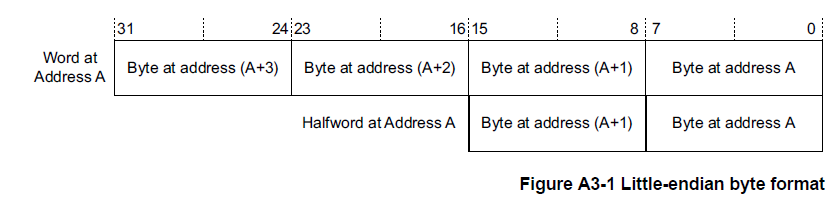
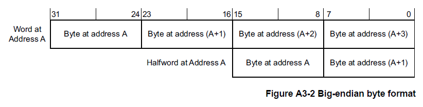
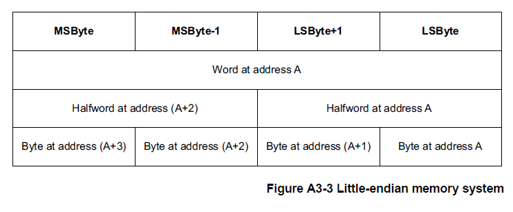
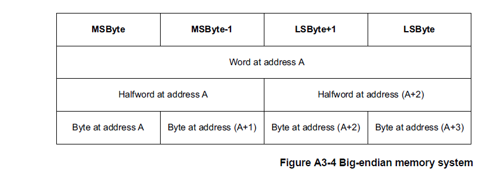
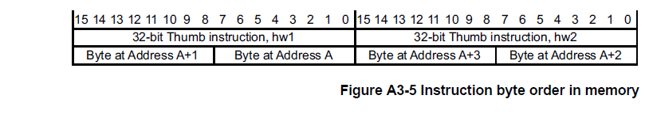
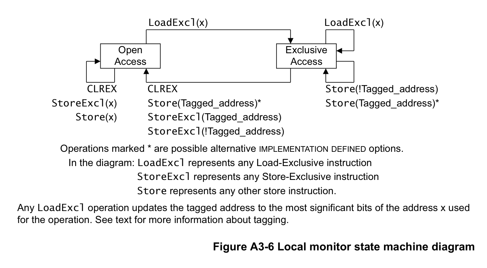
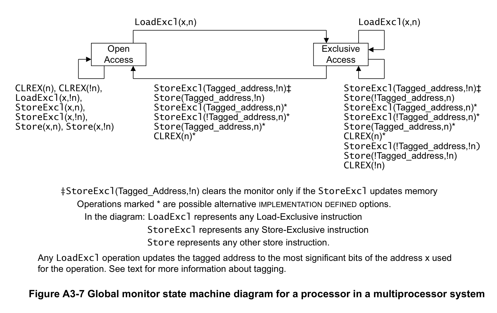
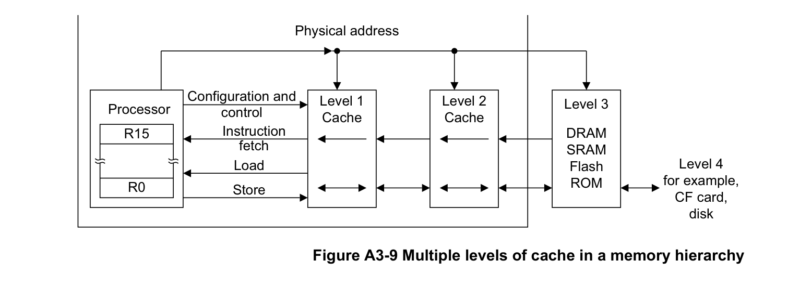

本文译自 Part A《应用程序级架构》（Application level architecture） Chapter A3《ARM 架构内存模型》（Arm Architecture Memory Model）。

## 1. Arm架构内存模式介绍

### 1.1. 地址空间

**Armv7-M** 是一种内存映射架构。**B3**章节的系统地址映射描述了 **Armv7-M** 地址映射。

**Armv7-M** 架构使用 2<sup>32</sup> 个**8**位字节的单一平坦地址空间。字节地址被视为无符号数，范围从0到2<sup>32</sup> - 1。

该地址空间被视为由 2<sup>30</sup>个32位字组成，每个字的地址都是字对齐的，这意味着地址可以被4整除。字对齐地址为A的字，由四个带地址的字节组成：**A**、**A+1**、**A+2**和**A+3**。地址空间也可以认为是由2<sup>31</sup>个16位半字组成，每个半字的地址都是半字对齐的，也就是说地址可以被2整除。半字对齐地址为A的半字，由两个带地址的字节组成：**A**和**A+1**。

虽然取指总是半字对齐，但一些加载和存储指令支持非对齐地址。这会影响访问地址**A**，所以在字访问情况下的 A[1:0] 和在半字访问情况下的 A[0] 可以具有非零值。

地址计算通常使用普通整数指令来执行。这意味着如果它们溢出或下溢地址空间，它们通常会回绕。描述这一点的另一种方式是任何地址计算都以2<sup>32</sup>为模减少。

指令的正常顺序执行有效地计算：
(address_of_current_instruction) + (2 or 4) /*16 位和 32 位指令混合*/

在每条指令之后确定接下来要执行的指令。如果这个计算溢出地址空间的顶部，结果是不可预测的。在 **Armv7-M** 中，这种情况不会发生，因为内存顶部被定义为始终具有与其关联的 Execute Never (XN) 内存属性。有关详细信息，请参阅第 B3-592 页的系统地址映射。如果发生这种情况，将报告访问冲突。

以上仅适用于执行的指令，包括那些未通过条件代码检查的指令。大多数 Arm 实现在当前执行的指令之前预取指令。

LDC、LDM、LDRD、POP、PUSH、STC、STRD、STM、VLDM、VPOP、VPUSH、VSTM、VLDR.64 和 VSTR.64 指令访问内存地址递增的字序列，有效地将内存地址增加4对于每个寄存器加载或存储。如果此计算溢出地址空间的顶部，则结果是不可预测的。

任何未对齐的加载或存储，其计算地址使得它可以访问 **0xFFFFFFFF** 处的字节和地址 **0x00000000** 处的字节作为指令的一部分是不可预测的。

**Armv7-M** 中使用的所有内存地址都是物理地址PA(**physical addresses**)。为了与其他 Arm 架构参考手册保持一致，尽管 Armv7-M 没有虚拟地址VA(**virtual addresses**)的概念，但本手册始终使用术语修改虚拟地址MVA(**Modified Virtual Address**)。对于 Armv7-M 架构配置文件，在所有情况下，MVA、VA 和 PA 具有相同的值。

### 1.2. 对齐支持

系统架构为 **Armv7-M** 中的对齐检查提供了两种策略：

* 支持非对齐访问。
* 发生未对齐访问时生成故障。

该策略因访问类型而异。可以将实现配置为对所有未对齐的访问强制对齐错误。

根据第 A5-126 页使用 0b1111 作为寄存器说明符中概述的规则限制对 PC 的写入。

#### 1.2.1. 对齐行为

地址对齐会影响数据访问以及 PC 的更新。

**对齐与数据访问**

下列数据访问总是产生对齐故障：

* 非半字对齐的 **LDREXH** 和 **STREXH**。
* 非字对齐的 **LDREX** 和 **STREX**。
* 非字对齐的 **LDRD**、**LDMIA**、**LDMDB**、**POP**、**LDC**、**VLDR**、**VLDM** 和 **VPOP**。
* 非字对齐的 **STRD**、**STMIA**、**STMDB**、**PUSH**、**STC**、**VSTR**、**VSTM** 和 **VPUSH**。

下列数据访问支持未对齐寻址，只有当 **CCR.UNALIGN_TRP** 位为 1 时才产生对齐故障，请参见第 B3-604 页的配置和控制寄存器 **CCR**：

* 非半字对齐的 **LDR{S}H{T}** 和 **STRH{T}**。
* 非半字对齐的 **TBH**。
* 非字对齐的 **LDR{T}** 和 **STR{T}**。

**注意：**

* **Armv7-M** 中不支持 **LDREXD** 和 **STREXD**。
* 对强秩序（**Strongly Ordered**）和设备（**Device**）内存类型的访问必须始终自然对齐，请参见第 A3-83 页的内存访问限制。

**Armv7-M** 的对齐行为由以下伪代码描述：

关于寄存器定义请参见附录 D8 寄存器索引。关于 ExceptionTaken() 请参见第 B1-531 页的异常进入行为。其他函数仅为局部描述性函数。关于实际的内存访问功能，请参见指令定义中使用的 MemU[] 和 MemA[]（见第 A7 章指令详细信息），它们定义在第 B2-582 页的通用内存系统操作的伪代码细节中。

```arm
if IsUnaligned(Address) then          // 数据访问的地址未对齐
    if AlignedAccessInstr() then      // 该指令不支持未对齐访问
        UFSR.UNALIGNED = '1';
        ExceptionTaken(UsageFault);
    else
        if CCR.UNALIGN_TRP then       // 捕获所有未对齐访问
            UFSR.UNALIGNED = '1';
            ExceptionTaken(UsageFault);
        else
            UnalignedAccess(Address); // 执行未对齐访问
else
    AlignedAccess(Address);           // 执行对齐访问
```

**对齐与 PC 的更新**

所有指令提取必须是半字对齐的。任何异常返回的不规则行为都会被异常返回机制捕获为 **INVSTATE** 或 **INVPC** 用法故障（**UsageFault**）。请参见第 B1-551 页的故障行为。

对于异常进入和返回：

* 使用位 [0] 为 0 的向量进行异常进入，会将 **EPSR.T** 置 0。
* 保留的 **EXC_RETURN** 值会导致 **INVPC** 用法故障。
* 在异常返回时从堆栈向 PC 加载未对齐的值是 **UNPREDICTABLE** 的。

对于 PC 被更新的所有其他情况：

* 使用 **ADD** 或 **MOV** 指令加载 PC 时，该值的位 [0] 被忽略。

**注意：** 这仅适用于 **ADD**（寄存器）和 **MOV**（寄存器）指令的 16 位形式，否则加载 PC 是 **UNPREDICTABLE** 的。

* 下列指令会导致 **EPSR.T** 被置为加载到 PC 的值的位 [0]：
  * **BLX** 或 **BX**。
  * 对 PC 的 **LDR**。
  * 包含 PC 的 **POP** 或 **LDM**。
* 从地址不是字对齐的内存位置向 PC 加载值是 **UNPREDICTABLE** 的。

**注意：** 在 **EPSR.T == 0** 时尝试执行指令会导致 **INVSTATE** 用法故障。

### 1.3. 字节序支持

按[地址空间](#11-地址空间)规则要求地址**A**：

* 地址**A**处的字(**word**)由地址**A**、**A+1**、**A+2**和**A+3**的字节组成。
* 地址**A**的半字(**halfword**)由地址**A**和**A+1**的字节组成。
* 地址**A+2**的半字(**halfword**)由地址**A+2**和**A+3**的字节组成。
* 地址**A**处的字(**word**)可可以理解成由地址**A**和**A+2**处的半字(**halfword**)组成。

但是，这并没有完全指定字、半字和字节之间的映射。存储系统使用以下映射方案之一。这种选择被称为内存系统的字节序(**the endianness of the memory system**)。

在小端存储器系统中，来自存储器的字节与 Arm 寄存器中的解释值之间的映射如图 A3-1 所示。

* 地址**A**处的字节或半字是该地址处字内的最低有效字节或半字。
* 半字地址**A**的字节是该地址半字内的最低有效字节。



在大端存储器系统中，来自存储器的字节与 Arm 寄存器中的解释值之间的映射如图 A3-2 所示。

* 地址**A**处的字节或半字是该地址处字内的最高有效字节或半字。
* 半字地址**A**的字节是该地址半字内的最高有效字节。



对于字地址 A，第 A3-68 页的图 A3-3 和图 A3-4 显示了地址 A 处的字、地址 A 和 A+2 处的半字以及地址 A、A+1、A 处的字节 +2 和 A+3 为每个字节序映射到彼此。





大端(**big-endian**)和小端(**little-endian**)映射方案确定解释字或半字的字节的顺序。

例如：从地址 0x1000 加载一个字(4 个字节)将导致访问包含在内存位置 0x1000、0x1001、0x1002 和 0x1003 中的字节，而不管使用的映射方案如何。映射方案决定了这些字节的重要性。

#### 1.3.1. Armv7-M 中的字节序控制

**Armv7-M** 支持可选字节序模型(**selectable endian mode**)。在该模型中，在复位时，控制输入确定字节序是大端字节序 (BE) 还是小端字节序 (LE)。这种字节序映射有以下限制：

* 字节序设置仅适用于数据访问。取指令总是小端。
* 所有对 **SCS** 的访问都是小端的，请参阅[系统控制空间 (SCS)](../system_address_map/index.md#2-系统控制空间-scs)。

**AIRCR.ENDIANNESS** 位指示字节顺序，请参见应用程序中断和复位控制寄存器**AIRCR**。

如果实现需要支持大端指令提取，它可以在总线结构中实现。有关详细信息，请参阅第D5-799页的 Endian 支持。

**指令对齐和字节排序**

**Thumb**指令执行对所有指令强制执行16位对齐。这意味着32位指令被视为两个半字，**hw1**和**hw2**，其中**hw1**位于较低地址。

在指令编码图中，**hw1**显示在**hw2**的左侧。这导致编码图读起来更自然。32位Thumb指令的字节顺序如图 **A3-5** 所示。



**字节序的伪代码细节**

BigEndian() 伪代码函数测试数据访问是大端还是小端：

```C++
// BigEndian()
// ===========
boolean BigEndian()
    return (AIRCR.ENDIANNESS == ‘1’);
```


#### 1.3.2. 元素大小和字节序

字节序映射对数据的影响适用于在加载和存储指令中传输的元素的大小。表 A3-1 显示了每个加载和存储指令的元素大小：

| 指令类别 | 指令 | 元素大小 |
| --- | --- | --- |
| 加载或存储字节 | LDR{S}B{T}、STRB{T}、TBB、LDREXB、STREXB | 字节 |
| 加载或存储半字 | LDR{S}H{T}、STRH{T}、TBH、LDREXH、STREXH | 半字 |
| 加载或存储字 | LDR{T}、STR{T}、LDREX、STREX、VLDR.F32、VSTR.F32 | 字 |
| 加载或存储两个字 | LDRD、STRD、VLDR.F64、VSTR.F64 | 字 |
| 加载或存储多个字 | LDM{IA,DB}、STM{IA,DB}、PUSH、POP、LDC、STC、VLDM、VSTM、VPUSH、VPOP | 字 |

#### 1.3.3. 在通用寄存器中反转字节的指令

当应用程序或设备驱动程序必须与与内部数据结构的字节序或操作系统的字节序不同的内存映射外围寄存器或共享内存结构进行接口时，需要一种能够显式转换数据字节顺序的有效方法。

**Armv7-M** 支持以下字节转换指令：

* **REV**: 反转字(四字节)寄存器，用于转换32位表示。
* **REVSH**：反向半字和符号扩展，用于转换有符号的16位表示。
* **REV16**：反转寄存器中的压缩半字，用于转换无符号16位表示。

有关详细信息，请参阅第 A7 章指令详细信息中的指令定义。

### 1.4. 同步和信号量

独占访问指令支持非阻塞共享内存同步原语，允许在读取和写入阶段之间的信号量上执行计算，并为多处理器系统设计进行扩展。

在 **Armv7-M** 中，提供的同步原语是：

* 加载独占(**Load Exclusive**)：
  - LDREX，参见第 A7-261 页的 LDREX。
  - LDREXB，参见第 A7-262 页的 LDREXB。
  - LDREXH，参见第 A7-263 页的 LDREXH。
* 存储独占(**Store Exclusive**):
  - STREX，参见第 A7-394 页的 STREX。
  - STREXB，参见第 A7-395 页的 STREXB。
  - STREXH，参见第 A7-396 页的 STREXH。
* 清楚独占(**Clear-Exclusive**)
  - CLREX，参见 A7-219 页上的 CLREX。

**注意：**
此章节使用 **LDREX** 和 **STREX** 指令来作为示范，描述了一对同步原语的 Load-Exclusive/Store-Exclusive 的操作。相同的描述适用于任何其他同步原语对：

* **LDREXB** 与 **STREXB** 一起使用。
* **LDREXH** 与 **STREXH** 一起使用。

每个加载独占(**Load Exclusive**)指令只能与相应的存储独占(**Store Exclusive**)指令一起使用。

**Armv7-M** 不支持 **STREXD** 和 **LDREXD**。

使用加载独占(**Load Exclusive**)/ 存储独占(**Store Exclusive**)指令对访问内存地址 x 的模型是：

* 加载独占(**Load Exclusive**)指令总是成功地从内存地址x读取一个值。
* 仅当没有其他处理器或进程对地址x执行更新的存储时，相应的存储独占(**Store Exclusive**)指令才能成功写回内存地址x。存储独占(**Store Exclusive**)操作返回一个状态位，指示内存写入是否成功。

加载独占指令标记一小块内存以进行独占访问。标记块的大小由实现定义(**IMPLEMENTATION DEFINED**)，请参阅第 A3-75 页的标记和标记内存块的大小。对同一地址的存储独占指令清除标签。

#### 1.4.1. 独占访问指令与不可共享内存区域

对于不具有可共享属性的内存区域，独占访问指令依赖一个本地监视器（**local monitor**），它标记处理器执行加载独占时所使用的任何地址。同一处理器使用存储独占修改任何地址的任何未被中止的尝试，都保证会清除该标记。

加载独占执行从内存的加载，并且：

* 执行处理器将该物理内存地址标记为独占访问。
* 执行处理器的本地监视器转换到独占访问状态（**Exclusive Access state**）。

存储独占执行对内存的条件存储，其结果取决于本地监视器的状态：

若本地监视器处于独占访问状态：

* 若存储独占的地址与先前加载独占在监视器中标记的地址相同，则存储发生；否则存储是否发生由实现定义（**IMPLEMENTATION DEFINED**）。
* 状态值被返回至寄存器：
  * 若存储发生，状态值为 0。
  * 否则，状态值为 1。
* 执行处理器的本地监视器转换到开放访问状态（**Open Access state**）。

若本地监视器处于开放访问状态：

* 不发生存储。
* 状态值 1 被返回至寄存器。
* 本地监视器保持开放访问状态。

存储独占指令定义状态值所返回的寄存器。

当处理器使用除存储独占之外的任何指令执行写入时：

* 若写入的物理地址不被其本地监视器覆盖，则该写入不影响本地监视器的状态。
* 若写入的物理地址被其本地监视器覆盖，则该写入是否影响本地监视器的状态由实现定义。

若本地监视器处于独占访问状态，而处理器对除其最后执行加载独占之外的任何地址执行存储独占，则存储是否成功由实现定义，但在所有情况下本地监视器都会复位为开放访问状态。在 **Armv7-M** 中，这种存储必须被视为软件编程错误。

**注意：** 如果对已标记物理地址的存储是由引起该物理地址被标记的观察者之外的观察者执行，则该存储是否清除本地监视器中的标记是 **UNPREDICTABLE** 的。

图 A3-6 显示了本地监视器的状态机。表 A3-2 显示了该图所示各项操作的效果。



关于标记的更多信息请参见第 A3-75 页的标记和标记内存块的大小。

**注意：**

* 本地监视器的实现定义选项与本地监视器的一种构造方式一致：该监视器不保存任何物理地址，而是将任何访问都视为与先前 **LDREX** 的地址匹配。在这样的实现中，第 A3-75 页的标记和标记内存块的大小所定义的独占保留粒度（**Exclusives reservation granule**）就是整个内存地址范围。
* 本地监视器的实现可以不感知来自其他处理器的加载独占和存储独占操作。
* 若 **STR** 或 **STREX** 来自另一个观察者，则是否发生从独占访问状态到开放访问状态的转换是 **UNPREDICTABLE** 的。

表 A3-2 显示了图 A3-6 所示各项操作的效果。

| 初始状态 | 操作 | 效果 | 最终状态 |
| --- | --- | --- | --- |
| Open Access | CLREX | 无影响。 | Open Access。 |
| Open Access | StoreExcl(x) | 不更新内存，返回状态值 1。 | Open Access。 |
| Open Access | LoadExcl(x) | 从内存加载值，标记地址 x。 | Exclusive Access。 |
| Open Access | Store(x) | 更新内存，对监视器无影响。 | Open Access。 |
| Exclusive Access | CLREX | 清除已标记的地址。 | Open Access。 |
| Exclusive Access | StoreExcl(t) | 更新内存，返回状态值 0。 | Open Access。 |
| Exclusive Access | StoreExcl(!t) | 更新内存，返回状态值 0ᵇ；或不更新内存，返回状态值 1ᵇ。 | Open Access。 |
| Exclusive Access | LoadExcl(x) | 从内存加载值，将标记改变为地址 x。 | Exclusive Access。 |
| Exclusive Access | Store(!t) | 更新内存，对监视器无影响。 | Exclusive Access。 |
| Exclusive Access | Store(t) | 更新内存。 | Exclusive Accessᵇ 或 Open Accessᵇ。 |

a. 表中：LoadExcl 表示任意加载独占指令；StoreExcl 表示任意存储独占指令；Store 表示除存储独占操作之外的任意存储操作。t 为已标记的地址，即最后一条加载独占指令地址的位 [31:a]。更多信息请参见第 A3-75 页的标记和标记内存块的大小。

b. 由实现定义（**IMPLEMENTATION DEFINED**）的可选行为。

#### 1.4.2. 独占访问指令与可共享内存区域

对于具有可共享属性的内存区域，独占访问指令依赖：

* 系统中每个处理器各自的本地监视器，它标记处理器执行加载独占时所使用的任何地址。该本地监视器的操作如[独占访问指令与不可共享内存区域](#141-独占访问指令与不可共享内存区域)中所述，只是对于可共享内存，该节中描述的更新内存和返回状态值 0 中的任一或两者，随后都要受到全局监视器的检查。本地监视器可以忽略系统中来自其他处理器的独占访问。
* 全局监视器（**global monitor**），它把某个物理地址标记为特定处理器的独占访问。该标记随后用于判定对该已标记地址的存储独占（未被本地监视器判定失败）是否可以发生。可共享域（**Shareability domain**）内任何其他观察者对已标记地址的任何成功写入，都保证会清除该标记。

对于系统中的每个处理器，全局监视器：

* 保存单个已标记地址。
* 维护一个状态机。

全局监视器既可以位于处理器模块内，也可以作为内存接口处的二级监视器存在。

实现可以将全局监视器和本地监视器的功能合并为单个单元。

**全局监视器的操作**

对可共享内存的加载独占执行从内存的加载，并使该访问的物理地址被标记为请求处理器的独占访问。该访问还会使请求处理器已标记的任何其他物理地址上的独占访问标记被移除。全局监视器对每个处理器只支持一个未完成的、对可共享内存的独占访问。

存储独占执行对内存的条件存储：

* 仅当所访问的物理地址被标记为请求处理器的独占访问，且请求处理器的本地监视器与全局监视器状态机都处于独占访问状态时，存储才保证成功。此时：
  * 状态值 0 被返回至寄存器，以确认存储成功。
  * 请求处理器的全局监视器状态机的最终状态由实现定义（**IMPLEMENTATION DEFINED**）。
  * 若所访问的地址在任何其他处理器的全局监视器状态机中被标记为独占访问，则该状态机转换到开放访问状态。
* 若没有地址被标记为请求处理器的独占访问，则存储不成功：
  * 状态值 1 被返回至寄存器，表示存储失败。
  * 全局监视器不受影响，并对请求处理器保持开放访问状态。
* 若被标记为请求处理器独占访问的是另一个物理地址，则存储是否成功由实现定义：
  * 若存储成功则返回状态值 0，否则返回值 1。
  * 若该处理器的全局监视器状态机在存储独占之前处于独占访问状态，则该状态机是否转换到开放访问状态由实现定义。

存储独占指令定义状态值所返回的寄存器。

在共享内存系统中，全局监视器为系统中每个处理器实现各自的状态机。处理器 (n) 对可共享内存访问的状态机可以响应对其可见的所有可共享内存访问。这意味着它会响应：

* 由关联处理器 (n) 生成的访问。
* 由共享内存系统中其他观察者 (!n) 生成的访问。

在共享内存系统中，全局监视器为系统中每个可生成加载独占或存储独占的观察者实现各自的状态机。

图 A3-7 显示了多处理器系统中全局监视器内处理器 (n) 的状态机。表 A3-3 显示了该图所示各项操作的效果。



关于标记的更多信息请参见第 A3-75 页的标记和标记内存块的大小。

**注意：**

* 存储独占是否成功更新内存，取决于所访问的地址是否与发出该存储独占指令的处理器的已标记可共享内存地址相匹配。因此，图 A3-7 和表 A3-3 只显示 (!n) 条目如何导致处理器 (n) 状态机的状态转换。
* 加载独占只能更新发出该加载独占指令的处理器的已标记可共享内存地址。
* **CLREX** 指令对全局监视器的影响由实现定义。
* 对不可共享内存位置的修改是否会导致全局监视器从独占访问转换到开放访问，由实现定义。
* 对不可共享内存位置的加载独占是否会导致全局监视器从开放访问转换到独占访问，由实现定义。

表 A3-3 显示了图 A3-7 所示各项操作的效果。

| 初始状态 | 操作 | 效果 | 最终状态 |
| --- | --- | --- | --- |
| Open | CLREX(n)、CLREX(!n) | 无。 | Open |
| Open | StoreExcl(x,n) | 不更新内存，返回状态值 1。 | Open |
| Open | LoadExcl(x,!n) | 从内存加载值，对处理器 (n) 的标记地址无影响。 | Open |
| Open | StoreExcl(x,!n) | 取决于发出 **STREX** 的处理器的状态机和标记地址。ᶜ | Open |
| Open | STR(x,n)、STR(x,!n) | 更新内存，对监视器无影响。 | Open |
| Open | LoadExcl(x,n) | 从内存加载值，标记地址 x。 | Exclusive |
| Exclusive | LoadExcl(x,n) | 从内存加载值，标记地址 x。 | Exclusive |
| Exclusive | CLREX(n) | 无。对最终状态的影响由实现定义。 | Exclusiveᵉ 或 Openᵉ |
| Exclusive | CLREX(!n) | 无。 | Exclusive |
| Exclusive | StoreExcl(t,!n) | 更新内存，返回状态值 0。ᶜ | Open |
| Exclusive | StoreExcl(t,!n) | 不更新内存，返回状态值 1。ᶜ | Exclusive |
| Exclusive | StoreExcl(t,n) | 更新内存，返回状态值 0。ᵈ | Open |
| Exclusive | StoreExcl(!t,n) | 更新内存，返回状态值 0。ᵉ | Open |
| Exclusive | StoreExcl(!t,n) | 不更新内存，返回状态值 1。ᵉ | Open |
| Exclusive | StoreExcl(!t,!n) | 取决于发出 **STREX** 的处理器的状态机和标记地址。 | Exclusive |
| Exclusive | Store(t,n) | 更新内存。 | Exclusiveᵉ 或 Openᵉ |
| Exclusive | Store(t,!n) | 更新内存。 | Open |
| Exclusive | Store(!t,n)、Store(!t,!n) | 更新内存，对监视器无影响。 | Exclusive |

a. Open = 开放访问状态（**Open Access state**），Exclusive = 独占访问状态（**Exclusive Access state**）。

b. 表中：LoadExcl 表示任意加载独占指令；StoreExcl 表示任意存储独占指令；Store 表示除存储独占操作之外的任意存储操作。t 为处理器 (n) 的已标记地址，即处理器 (n) 发出的最后一条加载独占指令地址的位 [31:a]，请参见标记和标记内存块的大小。

c. **STREX(x,!n)** 或 **STREX(t,!n)** 操作的结果取决于发出该 **STREX** 指令的处理器的状态机和已标记地址。本表显示了每种可能结果对处理器 (n) 状态机的影响。

d. 成功执行对已标记地址的 **STREX** 之后，状态机的状态由实现定义。但该状态对全局监视器的后续操作没有影响。

e. 效果由实现定义。本表列出了所有允许的实现方式。

#### 1.4.3. 标记与标记内存块的大小

如图 A3-6 和图 A3-7 所示，当执行 **LDREX** 指令时，结果标记地址会忽略内存地址的最低有效位：

Tagged_address == Memory_address[31:a]

该赋值中 a 的值由实现定义（**IMPLEMENTATION DEFINED**），在最小值 2 与最大值 11 之间。例如：在 a = 4 的实现中，对地址 0x000341B4 成功执行 **LDREX** 得到的标记值为该地址的位 [31:4]，即 0x000341B。这意味着从 0x000341B0 到 0x000341BF 的四个字的内存都被标记为独占访问。随后对该块中任何地址的合法 **STREX** 都会移除该标记。

标记内存块的大小称为独占保留粒度（**Exclusives reservation granule**）。独占保留粒度的实现定义范围介于：

* 一个字，在 a == 2 的实现中。
* 512 个字，在 a == 11 的实现中。

**注意：** 对于本地监视器，实现定义的选项之一是让监视器将任何访问都视为与先前加载独占访问的地址匹配。在这样的实现中，独占保留粒度就是整个内存地址范围。

#### 1.4.4. 上下文切换支持

必须确保上下文切换之后本地监视器处于开放访问状态。在 **Armv7-M** 中，本地监视器会作为异常进入或退出序列的一部分自动变为开放访问状态。也可以通过 **CLREX** 指令强制本地监视器进入开放访问状态。

**注意：** 上下文切换不是应用层操作。但此处包含该信息是为了完整描述独占操作。

上下文切换可能导致随后的存储独占失败，从而需要重放加载 … 存储序列。为尽量减少这种情况发生的可能性，**Arm** 建议存储独占指令尽可能靠近与其关联的加载独占指令，请参见[加载独占和存储独占的使用限制](#145-加载独占和存储独占的使用限制)。

#### 1.4.5. 加载独占和存储独占的使用限制

加载独占和存储独占指令被设计为成对协同工作，例如 **LDREX**/**STREX** 对或 **LDREXB**/**STREXB** 对。如上下文切换支持中所述，**Arm** 建议存储独占指令始终在其关联的加载独占指令之后的少数指令内出现。为支持这些功能的不同实现，软件必须遵循此处给出的说明和限制。

这些说明描述 **LDREX**/**STREX** 对的使用，但它们同样适用于任何其他加载独占/存储独占对：

* 独占操作对每个被执行的处理器线程只支持一个未完成的独占访问。架构利用这一点，不要求 IsExclusiveLocal() 函数执行地址或大小检查。若 **STREX** 的目标地址与同一执行线程中先前的 **LDREX** 不同，则行为可能是 **UNPREDICTABLE** 的。因此，只有当 **LDREX**/**STREX** 对使用相同地址执行时，才能指望它最终成功。
* 对内存的显式存储可能导致清除与其他处理器关联的独占监视器，因此，在 **LDREX** 与 **STREX** 之间执行存储可能导致活锁（**livelock**）情形。因此，代码必须避免在单个代码序列中于 **LDREX** 与 **STREX** 之间放置显式存储。
* 若在没有插入 **LDREX** 的情况下执行两条 **STREX** 指令，则第二条 **STREX** 返回状态值 1。这意味着：
  * 在给定执行线程中，每条 **STREX** 都必须有位于其之前的关联 **LDREX**。
  * 并非每条 **LDREX** 都必须有随后的 **STREX**。
* 加载独占和存储独占指令的实现可以要求：在任何执行线程中，存储独占的事务大小与同一线程中先前执行的加载独占的事务大小相同。若存储独占的事务大小与同一执行线程中先前的加载独占不同，则行为可能是 **UNPREDICTABLE** 的。因此，只有当加载独占/存储独占对使用相同地址执行时，软件才能指望它最终成功。
* 实现可能在与应用程序无关的原因下，于 **LDREX** 与 **STREX** 之间清除独占监视器。例如：这可能因缓存逐出而发生。针对此类实现编写的代码必须避免在 **LDREX** 与 **STREX** 指令之间进行任何显式内存访问或缓存维护操作。
* 实现可以从在单个代码序列中使 **LDREX** 与 **STREX** 操作保持接近中获益。这可将指令之间独占监视器状态被清除的可能性降到最低。因此，**Arm** 强烈建议在单个代码序列中 **LDREX** 与 **STREX** 指令之间不超过 128 字节，以获得最佳性能。
* 实现了一致性协议或只有一个请求者的实现，可以合并给定处理器的本地监视器和全局监视器。第 B2-586 页的独占监视器操作的伪代码细节中定义里的实现定义和 **UNPREDICTABLE** 部分，正是为覆盖该行为而提供的。
* 架构对被标记为独占的区域大小设定了 2048 字节的上限。因此，出于性能考虑，**Arm** 建议软件将以独占访问的对象的间隔至少设为 2048 字节。这是性能指导而非功能要求。
* **LDREX** 和 **STREX** 操作必须仅对具有普通内存属性的内存执行。
* 若 **LDREX**/**STREX** 对所访问内存的内存属性在 **LDREX** 与 **STREX** 之间被改变，则行为是 **UNPREDICTABLE** 的。
* 数据或统一缓存失效、缓存清理或缓存清理并失效指令，对处于独占访问状态的本地或全局独占监视器的影响是 **UNPREDICTABLE** 的。执行该指令可能清除监视器，也可能使其保持独占访问状态。对于基于地址的维护指令，这也适用于与执行该缓存维护指令的处理器处于同一可共享域的其他处理器的监视器，具体取决于所维护地址的可共享域。

#### 1.4.6. 同步原语与内存顺序模型

同步原语遵循指令所访问内存类型的内存顺序模型。因此：

* 用于获取自旋锁的可移植代码，必须在获取自旋锁与任何使用该自旋锁的访问之间包含一条 **DMB** 指令。
* 用于释放自旋锁的可移植代码，必须在写入以清除自旋锁之前包含一条 **DMB** 指令。

该要求适用于使用加载独占/存储独占指令对的代码，例如 **LDREX**/**STREX**。

### 1.5. 内存类型和属性以及内存顺序模型

Armv7 定义了一组内存属性，这些属性具有支持系统内存映射中的内存和设备所需的特性。

内存区域的访问顺序(称为内存顺序模型)由内存属性定义。 此模型在以下部分中进行描述：

* 内存类型(**Memory types**)。
* Armv7 内存属性摘要。
* Arm 架构中的原子性(**Atomicity in the Arm architecture**)。
* 普通内存(**Normal memory**)。
* 设备内存(**Device memory**)。
* 强秩序内存(**Strongly-ordered memory**)。
* 内存访问限制(**Memory access restrictions**)。

#### 1.5.1. 内存类型 

对于每个内存区域，最重要的内存属性指定内存类型。 共有三种互斥内存类型：

* 普通内存(**Normal memory**)。
* 设备内存(**Device memory**)。
* 强秩序内存(**Strongly-ordered memory**)。

普通内存和设备内存的区域有额外的属性。

通常，用于程序代码(**program code**)和数据存储(**data storage**)的内存属于普通内存。一般使用普通内存技术的例子包括：

* 可编程闪存只读存储器(**Programmed Flash ROM**)。
* 只读存储器(**ROM**)。
* SRAM。
* **DRAM** 和 **DDR** 内存。

**注意：**

在编程过程中，Flash存储器可以比普通内存按更严格地方式进行排序。

系统周边设备 (I/O) 通常符合采用和普通内存不同的访问规则。例如：对应**I/O** 访问可包含如下情况：

* 连续地址访问的先进先出(**FIFO**)方式：
  * 在写入访问时，添加队列数值(**queued values**)。
  * 在读取访问时，删除队列数值(**queued values**)。
* 中断控制器寄存器，其中访问可用作中断确认，用于改变控制器本身的状态。
* 内存控制器配置寄存器，用于设置普通内存(**Normal memory**)区域的时序和正确性。
* 内存映射外设，访问此内存地址会导致系统的一些副作用。

在 **Armv7** 中，这些访问的内存映射区域被定义为设备或强秩序内存(**Device or Strongly-ordered memory**)。为确保系统正确性，设备内存和强秩序内存的访问规则比普通内存的访问规则更严格：

* 读和写访问都可能有副作用。
* 不得重复访问，例如：从异常返回时。
* 访问的数量、顺序和大小必须被维护。

另外，对于强秩序内存，所有的内存访问都严格按照内存访问指令的程序顺序进行排序。

#### 1.5.2. Armv7内存属性总结

表 A3-4 总结了内存属性。有关这些属性的更多信息，请参见：

* [普通内存](#154-普通内存normal-memory)和[设备内存](#155-设备内存device-memory)的内存区域的可共享属性，用于可共享性属性(**Shareability attribute**)。
* [普通内存](#154-普通内存normal-memory)的直写可缓存(**Write-Through cacheable**)、回写可缓存(**Write-back cacheable**)和不可缓存(**Non-cacheable**)普通内存，用于可缓存的属性(**Cacheability attribute**)。

| 内存类型属性 | 可共享性 | 其他属性 | 描述 |
| --- | --- | --- | --- |
| Strongly-ordered | Shareable | - | 对强序内存的所有内存访问都按程序顺序发生。所有强序区域都是可共享的。 |
| Device | Shareable | - | 用于处理由多个处理器共享的内存映射外设。 |
| Device | Non-shareable | - | 用于处理仅由单个处理器使用的内存映射外设。 |
| Normal | Shareable | 可缓存性，以下之一：ᵃ非缓存、直写可缓存、回写写分配可缓存、回写无写分配可缓存 | 用于处理多个处理器之间共享的普通内存。 |
| Normal | Non-shareable | - | 用于处理仅由单个处理器使用的普通内存。 |

a. 可缓存性属性是分别为内部和外部缓存区域定义的。

#### 1.5.3. Arm架构中的原子性

原子性是内存访问的一个特征，被描述为原子访问。**Arm** 架构描述指的是以下两种类型的原子性，包括了：

* 单副本原子性(**Single-copy atomicity**)。
* 多副本原子性(**Multi-copy atomicity**)。

**单副本(Single-copy)原子性**

如果以下条件都为真，则读取或写入操作都是单副本原子的：

1. 在对操作数(**operand**)进行任意次数的写操作之后，但操作数的值是由其中一次写操作写入的值。也就是说：操作数的数值的一部分不能来自一个写操作，而数值的其他部分来自不同的写操作。
2. 当对同一个操作数进行一次读操作和一次写操作时，但读操作获得的值必须是以下情况中的一种：
  * 写操作前操作数的值。
  * 写操作后操作数的值。
  
也就是说：永远不会出现读操作的值，部分是写操作之前操作数的值，而部分是写操作之后操作数的值的情况。

在 **Armv7-M** 中，单副本原子处理器访问包括：

1. 所有字节访问。
2. 对半字对齐位置的所有半字访问。
3. 对字对齐位置的所有字访问。

**LDM**、**LDC**、**LDC2**、**LDRD**、**STM**、**STC**、**STC2**、**STRD**、**PUSH**、**POP**、**VLDR**、**VSTR**、**VLDM**、**VSTM**、**VPUSH** 和 **VPOP** 指令作为字对齐字访问序列执行。每个**32**位字访问都保证是单副本原子。但对于两个字或者多个字的序列访问的子序列，可能是无法表现出单副本原子性。当访问不是单副本原子时，它将作为一系列的较小访问来执行。但这些访问至少在字节级别，都是单副本原子。

如果一条指令按照这些规则作为访问序列执行，则序列中可能会出现一些异常并导致该指令的执行被放弃。因为在异常返回时，生成访问序列的指令被重新执行，所以在发生异常之前已经执行的任何访问都可能被重复。另请参阅第 B1-543 页的加载多个和存储多个操作中的异常。

**注意：**

这些多访问指令的异常行为意味着它们不适合用于出于软件同步目的而写入内存。

对于隐式访问：

* 缓存行填充(**linefills**)和逐出(**evictions**)对显式事务或指令提取的单副本原子性没有影响。
* 指令提取是16 位粒度的单拷贝原子。

**多副本(Multi-copy)原子性**

在一个多处理(**multiprocessing**)系统中，如果以下条件都为真，则对内存位置的写入是多副本原子的：

* 对同一位置的所有写入都是序列化的，这意味着所有观察者以相同的顺序观察它们，尽管有些观察者可能不会观察到所有写入。
* 在所有观察者都观察到该写入之前，对某个位置的读取不会返回写入的值。

对于普通内存的写入不是多副本原子的。

所有对设备和强秩序内存的单副本原子写入也是多副本原子的。

对同一位置的所有写访问都被序列化。可以对普通内存重复的写访问，直到观察到对同一地址的另一次写入。

对于普通内存，写入的序列化不会禁止写入的合并。

#### 1.5.4. 普通内存(Normal memory)

普通内存是幂等的，这也意味着它表现出以下属性：

* 可以重复读取访问而没有副作用。
* 重复读取访问会返回写入到正在读取的资源的最后一个值。
* 读取访问可以预取额外的内存位置7而没有副作用。
* 可以重复写访问而没有副作用，前提是位置的内容在重复写入之间保持不变。
* 可以支持未对齐的访问。
* 在访问目标内存系统之前可以合并访问。

普通内存可以是可读可写的类型(**read/write**)，或者是只读的类型(**read-only**)。同时普通内存区域也可被定义为可共享型(**shareable**)，或者不可共享型(**Non-shareable**)。

普通内存类型属性适用于系统中使用的大部分内存。

对普通内存的访问具有弱一致的内存秩序模型。有关弱一致性内存模型的描述，请参阅描述内存秩序问题的标准文本，例如共享内存多处理器的内存一致性模型的第2章，Kourosh Gharachorloo，斯坦福大学技术报告 CSL-TR-95-685。一般来说，对于普通内存，在必须控制其他观察者观察到的内存访问顺序的情况下，需要屏障操作(**barrier operations**)。无论普通内存区域的可缓存性(**Cacheability**)和可共享性(**Shareability**)属性如何，此需求都适用。

[内存访问的顺序](#172-内存访问的顺序要求)要求中描述的访问顺序需求适用于所有显式访问。

[Arm 架构中的原子性](#153-arm架构中的原子性)中所述，生成访问序列的指令可能会因为在访问序列期间发生异常而被放弃。因为从异常返回时，指令会重新启动，所以可能会多次访问一个或多个内存位置。这可能导致对在写访问之间已更改的位置，进行了重复写访问。

**注意：**

对于 **Armv7-M** 来说，**LDM**、**STM**、**PUSH**、**POP**、**VLDM**、**VSTM**、**VPUSH** 和 **VPOP** 指令可以在异常返回时重新启动或继续，请参阅第 B1-543 页的加载多个和存储多个操作中的异常。

**不可共享的普通内存**

对于普通内存区域，不可共享属性标识可能只会被单个处理器访问的普通内存。

标记为不可共享正常的内存区域，不需要使缓存的效果对数据或指令访问透明。如果其他观察者共享内存系统，如果缓存的存在可能导致观察者之间通信时出现一致性问题，则软件必须使用缓存维护操作。此缓存维护需求是对确保内存顺序所需的屏障操作的补充。

对于不可共享的普通内存，加载独占(**Load Exclusive**)和存储独占(**Store Exclusive**)同步原语不考虑多个观察者访问的可能性。

**可共享的普通内存**

对于普通内存，可共享内存属性描述了预期由多个处理器或其他系统请求者访问的普通内存。

具有可共享属性的普通内存区域是在内存系统上插入一个或多个缓存的效果对于同一可共享域中的数据访问完全透明。需要显性的软件管理来确保指令缓存的一致性。
 
实现可以使用多种机制来支持此管理需求，从简单地不在可共享区域中缓存访问到用于这些区域的缓存一致性的更复杂的硬件方案。

对于可共享的普通内存，加载独占(**Load Exclusive**)和存储独占**Store Exclusive**)同步原语考虑了同一共享域中多个观察者访问的可能性。

**注意：**

可共享概念使系统设计人员能够指定普通内存中必须具有一致性要求的位置。然而，为了促进软件的移植，软件开发人员不得假设将内存区域指定为不可共享允许软件对共享内存系统中不同处理器之间的内存位置的不一致性做出假设。这样的假设在使用可共享概念的不同多处理实现之间是不可移植的。任何多处理实现都可能实现缓存，这些缓存本质上是在不同处理元素之间共享的。

**直写可缓存、回写可缓存和不可缓存普通内存**

除了可共享或不可共享之外，普通内存的每个区域都可以标记为以下之一：
* 直写可缓存(**Write-Through cacheable**)。
* 可回写缓存(**Write-Back cacheable**)，带有一个附加限定符，将其标记为以下之一：
  * 回写、写分配(**Write-Back, Write-Allocate**)。
  * 回写，没有写分配(**Write-Back, no Write-Allocate**)。
* 不可缓存(**Non-cacheable**)。
  
区域的可缓存性属性独立于该区域的可共享性属性。如果数据区域用于处理共享数据以外的目的，Cacheability属性指示所需的数据区域处理。这种独立性意味着，例如：在可共享区域不缓存其数据的实现中，标记为可缓存和可共享的内存区域可能不会保存在缓存中。

#### 1.5.5. 设备内存(Device memory)

设备内存类型属性定义了以下含义的内存位置：

1. 对该位置的访问可能会导致副作用
2. 或者为加载返回的值可能会因执行的加载次数而异。
   
内存映射外设(**memory-mapped peripherals**)和 I/O 位置(**I/O locations**)是通常标记为设备的内存区域的示例。

对于从处理器到标记为设备的内存的显式访问：

* 所有访问都以其程序大小发生。
* 访问次数是程序指定的次数。

如果程序只允许访问该位置一次的权限，则代码实现不得重复访问设备内存位置。换句话说，对设备内存的位置访问是不可重新启动的。

体系架构不允许对标记为设备的内存进行推测性访问。

标记为设备的地址位置是不可缓存的。虽然可以缓冲对设备内存的写入，但只能在合并保持的地方合并写入：

* 访问次数。
* 访问的顺序。
* 每个访问的大小。

对同一地址的多次访问不得改变对该地址的访问次数。对设备内存的访问不允许合并访问。

当设备内存操作具有适用于普通内存区域的副作用时，软件必须使用内存屏障来确保正确执行。一个示例是针对其控制的存储器访问对存储器控制器的配置寄存器进行编程。

所有对设备内存的显式访问都必须符合第 A3-91 页的内存访问的顺序xuq中描述的访问顺序需求。

如 A3-79 页的 Arm 体系结构中的原子性中所述，生成访问序列的指令可能会因为在访问序列期间发生异常而被放弃。从异常返回时，指令会重新启动，因此可能会多次访问一个或多个内存位置。这可能导致对在写访问之间已更改的位置进行重复写访问。

**注意：**

如果指令可能在异常后重新启动并重复任何写访问，请不要使用生成访问序列的指令来访问设备内存，有关详细信息，请参阅第 B1-543 页的加载多个和存储多个操作中的异常。

任何未受对齐限制故障并访问设备内存的未对齐访问都具有不可预测的行为。

**设备内存区域的可共享属性**

设备内存区域可以被赋予可共享属性。这意味着设备内存的区域可以描述为：

* 可共享的设备内存。
* 不可共享的设备内存。

不可共享的设备内存被定义为只能由单个处理器访问。一个支持可共享和不可共享设备内存的系统的实例就是是同时支持两者的实现：

* 用于其私有外围设备的本地总线。
* 在主共享系统总线上实现的系统外设。

这样的系统可能对本地外围设备(例如看门狗定时器或中断控制器)具有更可预测的访问时间。特别是，不可共享设备内存区域中的特定地址可能会访问每个处理器的不同物理外围设备。

#### 1.5.6. 强秩序内存(Strongly-ordered memory)

强秩序内存类型属性以下含义的内存位置：
1. 对该位置的访问可能会导致副作用
2. 或者为加载返回的值可能会因执行的加载次数而异。

通常标记为强序的内存区域的示例是内存映射外设和 I/O 位置。

对于从处理器到标记为强序的内存的显式访问：

* 所有访问都以其程序大小发生。
* 访问次数是程序指定的次数。

实现对强秩序内存位置的访问不得超过程序的简单顺序执行所指定的访问次数，除非是异常的结果。本节描述了例外的这种允许效果。

该体系结构不允许对标记为强序的内存进行推测性数据访问。

强秩序内存中的地址位置不保存在缓存中，并且始终被视为可共享的内存位置。

对强秩序内存的所有显式访问都必须符合第 A3-91 页内存访问的秩序要求中描述的访问秩序要求。

如 A3-79 页的 Arm 架构中的原子性中所述，生成访问序列的指令可能会因为在访问序列期间发生异常而被放弃。从异常返回时，指令会重新启动，因此可能会访问一个或多个内存位置
多次。这可能导致对在写访问之间已更改的位置进行重复写访问。

#### 1.5.7. 内存访问限制

内存访问有以下限制：

对于任何访问**X**，**X**访问的字节必须全部具有相同的内存类型属性，否则访问行为将无法预测。也就是说，跨越不同内存类型边界的未对齐访问将无法预测。

对于由相同指令生成的任何两个内存访问**X**和**Y**，**X**和**Y**访问的字节必须全部具有相同的内存类型属性，否则结果将无法预测。例如：跨越普通内存和设备内存边界的 **LDC**、**LDM**、**LDRD**、**STC**、**STM**、**STRD**、**VSTM**、**VLDM**、**VPUSH**、**VPOP**、**VLDR** 或 **VSTR** 将无法预测。

生成对设备内存（**Device**）或强排序内存（**Strongly-ordered memory**）的未对齐内存访问的指令将无法预测。

对于生成对设备内存（**Device**）或强排序内存（**Strongly-ordered memory**）的访问的指令，实现不得更改指令伪代码指定的访问顺序。这包括不更改：

* 有多少次访问。
* 任何特定内存映射外设的访问时间顺序。
* 每次访问的数据大小和其他属性。
  
此外，处理器实现期望任何附加的内存系统能够识别访问的内存类型，并遵守有关访问的数量、时间顺序、数据大小和其他属性的类似限制。

此规则的例外情况如下：

* 处理器实现可以违反此规则，前提是它提供给内存系统的信息能够重建访问的原始数量、时间顺序和其他详细信息。此外，当访问设备或强序内存时，实现必须要求连接的内存系统进行此重建。例如，具有 64 位总线的实现可能会将 LDM 生成的字加载配对为 64 位访问。这是因为指令语义确保 64 位访问始终是从较低地址加载字，然后从较高地址加载字。但是，当访问设备或强序内存时，实现必须允许内存系统解压两个字加载。
* 任何产生与上述结果无法观察到不同的结果的实现技术都是合法的。

与 **IT** 指令一起使用的 **LDM**、**STM**、**PUSH**、**POP**、**VLDM** 和 **VSTM** 指令如果在执行期间中断，则可以重新启动。重新启动加载或存储指令与设备和强排序内存访问规则不兼容。有关异常模型中与这些指令相关的架构约束的详细信息，请参阅第 B1-543 页的加载多个和存储多个操作中的异常。

加载或存储 **PC** 的任何多访问指令都必须仅访问普通内存。如果指令访问设备或强排序内存，则结果不可预测。

任何指令提取都必须仅访问普通内存。如果它访问设备或强排序内存，则结果不可预测。例如：不得对包含读取敏感设备的内存区域执行指令提取，因为指令提取和显式访问之间没有排序要求。

为了确保正确性，读敏感位置必须标记为不可执行（请参阅第 A3-87 页的指令访问的特权级别访问控制）。

**不匹配的内存属性（Mismatched memory attributes）**

如果对物理内存位置的所有访问，未能使用以下一致定义（**common definition**）属性时，则该位置的访问属性将会不匹配（**mismatched attributes**）:

* 内存类型：强序（**Strongly-ordered**）、设备（**Device**）或者 正常（**Normal**）。
* 可共享性。
* 可缓存性：适用于缓存的内部和外部级别（**inner and outer levels of cache**），但不包括任何缓存分配提示（**cache allocation hints**）。

当使用不匹配的属性访问物理内存位置时，以下的规则会被应用：

当使用不匹配的属性访问内存位置时，软件唯一可见的影响是以下一个或多个：

* 对该内存位置的读写的单处理器语义可能会丢失。这意味着：
  * 执行线程对内存位置的读取可能不会返回该执行线程最近写入该内存位置的值。
  * 执行线程对内存位置的多次写入（使用不同的内存属性）可能未按程序顺序排序。
* 当多个执行线程尝试访问内存位置时，可能会失去一致性。
* 可能会丢失从内存类型派生的属性，请参阅规则 2。
* 如果多个执行线程尝试使用 Load-Exclusive 或 Store-Exclusive 指令访问具有不同内存属性的位置，则独占监视器状态将变为**UNKNOWN**。

与内存类型属性不匹配相关的属性丢失仅指强序或设备内存的以下属性，这些属性是普通内存属性之外额外具备的：

* 禁止推测访问。
* 保持访问的大小。
* 保持访问的顺序。
* 写确认来自访问的端点的保证。

如果唯一的内存类型不匹配发生在强序内存与设备内存之间，那么可能丢失的属性只有：

* 写确认来自访问的端点的保证。

3. 如果某个内存位置的所有允许对该位置进行写访问的别名（**alias**）都为该位置分配相同的可共享性和可缓存性属性，并且所有这些别名都使用一个包含所有可访问该位置的执行线程的可共享性属性定义，那么任何使用这些可共享性和可缓存性属性读取该内存位置的执行线程，都会在该内存属性的通用定义所要求的程度上一致地访问它。

4. 如果所有不匹配的属性都将该内存位置定义为以下之一，则属性不匹配可能造成的属性丢失可被更精确地定义：

* 强序内存。
* 设备内存。
* 普通内部不可缓存、外部不可缓存的内存。

在这些情况下，属性不匹配可能造成的唯一软件可见影响是以下一个或多个：

* 当多个执行线程尝试访问该内存位置时，可能丢失从内存类型派生的属性。
* 使用不同内存属性的对该内存位置的存储器事务可能被重排序，从而可能导致一致性或单处理器语义的丢失。通过在使用可能具有不同属性的对同一内存位置的访问之间插入 **DMB** 屏障指令，可以避免任何可能的一致性或单处理器语义丢失。

5. 如果某个内存位置的不匹配属性都为其分配相同的可共享性属性，则可以避免可共享域内的一致性丢失。为此，软件必须使用在不同可共享域中的执行线程之间对可缓存位置的一致性进行软件管理所需的技术。这意味着：

* 如果任何执行线程可能已使用回写（**writeback**）属性写入该位置，则在不再使用回写属性写入该位置之前，该执行线程必须从缓存中使该位置失效或清理该位置。这可以避免用陈旧数据覆盖该位置的可能。
* 在使用回写属性写入该位置之后，执行线程必须从缓存中清理该位置，以使该写入对外部内存可见。
* 在使用可缓存属性读取该位置之前，执行线程必须从缓存中使该位置失效，以确保缓存中保存的任何值都反映在外部内存中可见的最新值。

在所有情况下：

* 位置指当前一致性粒度内的任何字节。
* 可以使用清理并失效操作代替清理操作或代替失效操作。
* 为确保一致性，所有缓存维护和内存事务都必须完成，或通过屏障操作进行排序。

6. 如果某个位置的不匹配属性意味着可能以不同的可共享性属性对该位置进行多次可缓存访问，则只有在每个以可缓存属性访问该位置的执行线程都对该位置执行清理并失效操作时，才保证一致性。

**注意：** 对于规则 5 和规则 6，在软件管理一致性时，竞态条件可能导致数据丢失。当不同的执行线程同时写入同一位置中的字节，且一个线程的（失效或清理）、写入、清理序列与另一线程的等效序列重叠时，就会发生竞态条件。

此外，如果多个线程尝试使用加载独占或存储独占指令访问具有不同内存属性的位置，则独占监视器状态变为 **UNKNOWN**。

**Arm** 强烈建议软件不要对同一位置的别名使用不匹配的属性。实现可能不会对使用不匹配别名的系统进行性能优化。

### 1.6. 访问权限

**Armv7** 为内存区域增加了额外的属性。这些属性使以下功能成为可能：

* 基于访问的特权级限制数据访问，请参见数据访问的特权级访问控制。
* 基于执行取指的进程或线程的特权级限制指令提取，请参见指令访问的特权级访问控制。

#### 1.6.1. 数据访问的特权级访问控制

内存属性可以定义某个内存区域为：

* 不可被任何访问访问。
* 仅可被特权访问访问。
* 可被特权和非特权访问访问。

访问特权级分别针对显式读访问和显式写访问定义。然而，定义内存属性的系统并不需要支持读访问和写访问的所有内存属性组合。

特权访问（**Privileged access**）是在特权执行期间进行的访问，它由 **LDRT**、**STRT**、**LDRBT**、**STRBT**、**LDRHT**、**STRHT**、**LDRSHT** 或 **LDRSBT** 之外的加载或存储操作产生。

非特权访问（**Unprivileged access**）是在下列情况之一中执行加载或存储操作而产生的访问：

* 当前执行模式被配置为仅非特权访问时。
* 处理器处于任何模式，且该访问由 **LDRT**、**STRT**、**LDRBT**、**STRBT**、**LDRHT**、**STRHT**、**LDRSHT** 或 **LDRSBT** 指令产生时。

如果处理器尝试的访问是访问权限不允许的访问，则会发生异常。例如：若处理器模式为非特权，而处理器尝试访问被标记为仅可被特权访问的内存区域，则会发生 **MemManage** 异常。

**注意：** 只有在实现了并使能内存保护单元（**MPU**）时才支持数据访问控制，请参见第 B3-632 页的保护内存系统架构 PMSAv7。

#### 1.6.2. 指令访问的特权级访问控制

内存属性可以定义某个内存区域为：

* 不可执行。
* 仅可被特权进程执行。
* 可被特权和非特权进程执行。

为定义对某个内存区域的指令访问权限，内存属性分别描述该区域的：

* 其读访问权限。
* 该区域是否为永不执行（**Execute Never**，**XN**），即软件不能从该区域执行。

例如：一个可被特权进程执行的内存区域具有以下内存属性：

* 仅可被特权读访问访问。
* 适合执行。

这意味着定义某个区域对显式内存访问的可访问性的内存属性，与定义该区域可被执行的内存属性之间存在某种联系。

如果处理器尝试从属性不允许代码执行的内存位置执行代码，则会发生 **MemManage** 异常。

**注意：** 在实现了并使能 **MPU** 时，指令访问控制得到完全支持，请参见第 B3-632 页的保护内存系统架构 PMSAv7。

指令执行的访问控制也受默认地址映射支持，请参见第 B3-592 页的系统地址映射。

### 1.7. 内存访问顺序

**Armv7** 提供了一组三种内存类型：普通（**Normal**）、设备（**Device**）和强秩序（**Strongly-ordered**），它们具有定义良好的内存访问属性。

**Armv7** 对内存属性的应用层视图在以下章节中描述：

* 内存类型和属性以及内存顺序模型。
* 访问权限。

在考虑内存访问顺序时，一个重要特性是可共享内存属性，它指示某个内存区域是否可以在多个处理器之间共享，因而在顺序模型中需要表现出缓存透明性。

内存顺序模型的关键问题取决于目标读者：

* 对于软件程序员，在应用层考虑该模型时，关键因素是：对于普通内存的访问，在必须控制其他观察者所观察到的访问顺序的某些情形下需要屏障（**barrier**）。
* 对于芯片实现者，在系统层考虑该模型时，强秩序和设备内存属性在可构建的内容以及何时指示访问完成方面，对系统设计者施加了某些限制。

**注意：** 实现仍然可以自由选择实现内存模型功能所需的机制。

有关内存顺序模型的更多信息在以下小节中给出：

* 读取和写入。
* 内存访问的顺序要求。
* 内存壁垒。

与内存系统架构相关的其他属性和行为定义在本手册的系统级章节中，请参见第 B3-632 页的保护内存系统架构 PMSAv7。

#### 1.7.1. 读取和写入

每次内存访问要么是读取，要么是写入。显式内存访问（**explicit memory access**）是指令功能所要求的内存访问。以下情况可能导致非显式的内存访问：

* 指令提取。
* 缓存加载和回写。

除另有说明外，内存顺序要求仅适用于显式内存访问。

**读取**

读取被定义为具有加载语义的内存操作。

下列指令的内存访问是读取：

* **LDR**、**LDRB**、**LDRH**、**LDRSB** 和 **LDRSH**。
* **LDRT**、**LDRBT**、**LDRHT**、**LDRSBT** 和 **LDRSHT**。
* **LDREX**、**LDREXB** 和 **LDREXH**。
* **LDM{IA,DB}**、**LDRD**、**POP**、**VLDM**、**VLDR** 和 **VPOP**。
* **LDC** 和 **LDC2**。
* **STREX**、**STREXB** 和 **STREXH** 返回的状态值。
* **TBB** 和 **TBH**。

**写入**

写入被定义为具有存储语义的内存操作。

下列指令的内存访问是写入：

* **STR**、**STRB** 和 **STRH**。
* **STRT**、**STRBT** 和 **STRHT**。
* **STREX**、**STREXB** 和 **STREXH**。
* **STM{IA,DB}**、**STRD**、**PUSH**、**VSTR**、**VSTM** 和 **VPUSH**。
* **STC** 和 **STC2**。

**同步原语**

同步原语必须确保系统信号量在内存顺序模型中正确工作。同步原语指令被定义为用于确保内存同步的那些指令：

* **LDREX**、**STREX**、**LDREXB**、**STREXB**、**LDREXH**、**STREXH**。

关于加载独占、存储独占和清除独占指令的详细信息，请参见[同步和信号量](#14-同步和信号量)。

加载独占和存储独占指令同时支持可共享内存和不可共享内存。不可共享内存可用于在同一处理器上运行的进程之间进行同步。可共享内存必须用于可能在**不同处理器**上运行的进程之间进行同步。

**可观察性和完成**

可观察到某次内存访问的观察者集合由系统定义。

对于所有内存：

* 当同一观察者对某内存位置的后续读取将返回该写入所写入的值时，称对该内存位置的写入被该观察者观察到（**observed**）。
* 当可共享域内任何有能力观察到该写入的观察者对某内存位置的后续读取将返回该写入所写入的值时，称对该内存位置的写入对该可共享域是全局可观察的（**globally observed**）。
* 当同一观察者对某内存位置的后续写入不会影响该读取所返回的值时，称对该内存位置的读取被该观察者观察到。
* 当可共享域内任何有能力观察到该读取的观察者对某内存位置的后续写入不会影响该读取所返回的值时，称对该内存位置的读取对该可共享域是全局可观察的。

此外，对于强秩序内存：

* 对具有副作用的外设中内存映射位置的读取或写入，只有在满足以下条件时才称为被观察到、以及全局可观察：
  * 满足上面所列的一般条件。
  * 能够开始影响该内存映射外设的状态。
  * 能够触发所有相关副作用，无论这些副作用影响的是其他外设、处理器还是内存。

对于所有内存，**Armv7-M** 的完成规则定义为：

* 当以下条件全部为真时，读取或写入对某个可共享域是完成的：
  * 该读取或写入对该可共享域是全局可观察的。
  * 该可共享域内观察者的任何指令提取都已观察到该读取或写入。
* 当缓存或分支预测器维护操作的效果对某个可共享域全局可观察时，该操作对该可共享域是完成的。

**强秩序和设备内存中的副作用完成**

**强秩序**或**设备**内存中内存访问的完成，并不足以确定该内存访问的副作用对所有观察者可见。确保内存访问副作用可见性的机制由实现定义（**IMPLEMENTATION DEFINED**），例如提供一个可轮询的状态寄存器。

#### 1.7.2. 内存访问的顺序要求

**Armv7-M** 对所允许的内存访问顺序定义了访问限制。这些限制取决于所涉及访问的内存属性。

描述内存访问顺序要求时使用两个术语：

**地址依赖（Address dependency）**

当读取访问返回的值被用于计算后续读取或写入访问的地址时，就存在地址依赖。即使第一次读取访问所读的值不改变第二次读取或写入访问的地址，也存在地址依赖。这种情况可能出现在返回值在被使用之前被屏蔽，或者它对该第二次访问所预测的地址值没有影响时。

**控制依赖（Control dependency）**

当读取访问返回的数据值被用于确定条件标志，且这些标志的值被用于条件码评估以确定后续读取访问的地址时，就存在控制依赖。这种地址确定可以通过条件执行实现，也可以通过分支的评估实现。

图 A3-8 显示了程序顺序中 A1 早于 A2 的两个显式访问 A1 与 A2 之间的内存顺序。该图中使用的符号如下：

* **<**：访问必须按程序顺序全局可观察，即 A1 必须严格先于 A2 被全局可观察到。
* **-**：只要维持单处理器语义的要求（例如遵守单处理器内指令间的依赖关系），访问可以按任意顺序全局可观察。

以下附加限制适用于带该符号的内存访问顺序：

* 如果存在地址依赖，则两次内存访问按程序顺序被观察到。如果两次读取访问之间仅存在控制依赖，则该顺序限制不适用。如果两次读取访问之间同时存在地址依赖和控制依赖，则适用地址依赖的顺序要求。
* 如果读取访问返回的值被用作后续写入访问所写入的数据，则两次内存访问按程序顺序被观察到。
* 观察者不可能观察到对某内存位置的写入访问，如果该位置在程序的顺序执行中不会被写入。
* 观察者不可能观察到对某内存位置的写值，如果该值在程序的顺序执行中不会被写入。

在图 A3-8 中，一次访问指对指定内存类型的一次读取或写入访问。例如：设备访问、不可共享指对不可共享设备内存的一次读取或写入访问。

| A1 \ A2 | Normal access | Device access, Non-shareable | Device access, Shareable | Strongly-ordered access |
| --- | --- | --- | --- | --- |
| Normal access | - | - | - | - |
| Device access, Non-shareable | - | < | - | < |
| Device access, Shareable | - | - | < | < |
| Strongly-ordered access | - | < | < | < |

对任何类型内存的隐式访问没有顺序要求。

**指令执行的程序顺序**

指令执行的程序顺序是控制流跟踪中指令的顺序。一次执行中的显式内存访问可以是：

**Strictly Ordered（严格有序）**

由 < 表示。必须严格按顺序发生。

**Ordered（有序）**

由 <= 表示。可以按顺序或同时发生。

**LDC**、**LDC2**、**LDMDB**、**LDMIA**、**LDRD**、**POP**、**PUSH**、**STC**、**STC2**、**STMDB**、**STMIA**、**STRD**、**VLDR.F64**、**VSTR.F64**、**VLDM**、**VPUSH**、**VSTM** 和 **VPOP** 等多条加载和存储指令会生成多个字访问，为确定顺序，其中每一次字访问都是独立的访问。

确定两次访问 A1 和 A2 的程序顺序的规则如下：

如果 A1 和 A2 由两条不同的指令生成：

* 如果生成 A1 的指令在程序顺序中先于生成 A2 的指令，则 A1 < A2。
* 如果生成 A2 的指令在程序顺序中先于生成 A1 的指令，则 A2 < A1。

如果 A1 和 A2 由同一条指令生成：

* 如果 A1 和 A2 是由 **LDC**、**LDC2**、**LDMDB**、**LDMIA** 或 **POP** 指令生成的两个字加载，或由 **PUSH**、**STC**、**STC2**、**STMDB** 或 **STMIA** 指令生成的两个字存储（不包括寄存器列表包含 PC 的 **LDMDB**、**LDMIA** 或 **POP** 指令）：
  * 如果 A1 的地址小于 A2 的地址，则 A1 <= A2。
  * 如果 A2 的地址小于 A1 的地址，则 A2 <= A1。
* 如果 A1 和 A2 是由寄存器列表包含 PC 的 **LDMDB**、**LDMIA** 或 **POP** 指令生成的两个字加载，则内存访问的程序顺序未定义。
* 如果 A1 和 A2 是由 **LDRD** 指令生成的两个字加载，或由 **STRD** 指令生成的两个字存储，则内存访问的程序顺序未定义。
* 对于本节未明确提及的任何指令或操作，如果[单副本原子性](#153-arm架构中的原子性)中所描述的单副本原子性规则意味着该操作成为一系列访问，则这些访问的时间顺序未定义。

#### 1.7.3. 内存壁垒

内存壁垒（**Memory barrier**）是用于强制处理器在退役（**retiring**）加载和存储指令方面产生同步事件的一条指令或指令序列的通用术语。内存壁垒用于保证两点：

* 前面的加载和存储指令对程序员模型的完成。
* 内存壁垒事件之前任何已预取的指令被清空。

**Armv7-M** 要求六个显式内存壁垒来支持本章描述的内存顺序模型：

* 推测数据消费壁垒（**Consumption of Speculative Data Barrier**，**CSDB**）。
* 数据内存壁垒（**Data Memory Barrier**，**DMB**）。
* 数据同步壁垒（**Data Synchronization Barrier**，**DSB**）。
* 指令同步壁垒（**Instruction Synchronization Barrier**，**ISB**）。
* 物理推测存储旁路壁垒（**Physical Speculative Store Bypass Barrier**，**PSSBB**）。
* 推测存储旁路壁垒（**Speculative Store Bypass Barrier**，**SSBB**）。

**消耗推测数据壁垒（CSDB）**

**CSDB** 指令是一种内存壁垒，它阻止在内存壁垒完成之后出现在程序顺序中的指令，判定任何由在程序顺序中出现于 **CSDB** 指令完成之前、被推测执行的加载指令所派生的数据的任何部分。

当执行了 **CSDB** 指令但在其完成之前，且存在以下三条指令时：

* 一条在壁垒之前按程序顺序被推测执行、可能被执行也可能不被架构执行的加载指令。
* 一条已通过其条件码检查、且其某个输入寄存器相对于该被推测执行的加载没有地址依赖的条件移动（**Conditional Move**）指令。
* 一条在壁垒之后按程序顺序出现、且对该条件移动指令具有地址依赖的加载、存储、数据预取或指令预取。

则该加载、存储、数据预取或指令预取的**推测执行**，不会通过对已分配或已逐出的缓存项的评估来影响缓存项的分配，从而判定该被推测执行的加载指令值的任何部分。

当执行了 **CSDB** 指令但在其完成之前，且存在以下三条指令时：

* 一条在壁垒之前按程序顺序被推测执行、可能被执行也可能不被架构执行的加载指令。
* 一条已通过其条件码检查、且其某个输入寄存器相对于该被推测执行的加载没有地址依赖的条件移动指令。
* 一条在壁垒之后按程序顺序出现、且其间接分支的目标地址依赖于该条件移动指令的间接分支指令。

则该间接分支的**推测执行**，不会通过对已分配或已逐出的缓存项的评估来影响缓存项的分配，从而判定该被推测执行的加载指令值的任何部分。

**CSDB** 指令不能被**推测执行**，但当已知该指令不是**推测性**的时，它可以被插入程序顺序并完成。

**数据内存壁垒（DMB）**

**DMB** 指令是一种数据内存壁垒。执行 **DMB** 指令的处理器被称为执行处理器 **Pe**。**DMB** 指令接受所需的可共享域和所需的访问类型作为参数。

**注意：** **Armv7-M** 只支持系统级壁垒，不支持可共享域或访问类型限制。

**DMB** 创建两组内存访问：**Group A** 和 **Group B**：

**Group A** 包含：

* 与 **Pe** 处于同一可共享域内的观察者所发出的、属于所需访问类型的、**Pe** 在执行 **DMB** 指令之前已观察到的所有显式内存访问。这包括由 **Pe** 执行的属于所需访问类型和所需可共享域的任何访问。
* 与 **Pe** 处于同一所需可共享域内的观察者所发出的、属于所需访问类型的所有加载，这些加载已被该所需可共享域内的任意给定观察者 **Py** 观察到，且发生在 **Py** 执行某个属于 **Group A** 的内存访问之前。

**Group B** 包含：

* 由 **Pe** 执行的、在程序顺序中出现在 **DMB** 指令之后的所有显式内存访问。
* 由与 **Pe** 处于同一所需可共享域内的任意给定观察者 **Px** 执行的、且只有在 **Px** 观察到某个属于 **Group B** 的存储之后才可能发生的所有显式内存访问。

与 **Pe** 处于同一所需可共享域的任何观察者，都会在观察到 **Group B** 的任何成员之前观察到 **Group A** 的所有成员。当 **Group A** 和 **Group B** 的成员访问同一内存映射外设时，**Group A** 的所有成员会在 **Group B** 的任何成员在该外设可见之前，先在该内存映射外设处可见。

**注意：**

* 某次内存访问可能既不属于 **Group A** 也不属于 **Group B**。**DMB** 不影响此类内存访问的观察顺序。
* **Group A** 定义的第二部分是递归的。最终，**Group A** 的成员资格源自 **Py** 在执行某个因 **Group A** 定义第一部分而属于 **Group A** 的访问之前，对某次加载的观察。
* **Group B** 定义的第二部分是递归的。最终，**Group B** 的成员资格源自任意观察者观察到 **Pe** 执行的、因 **Group B** 定义第一部分而属于 **Group B** 的访问。

**DMB** 只影响内存访问。它对处理器上执行的其他指令的顺序没有影响。

**数据同步壁垒（DSB）**

**DSB** 指令是一种特殊的内存壁垒，它使执行流与内存访问同步。**DSB** 指令接受所需的可共享域和所需的访问类型作为参数。**DSB** 的行为相当于带相同参数的 **DMB**，并且还具有此处定义的额外属性。

**注意：** **Armv7-M** 只支持系统级壁垒，不支持可共享域或访问类型限制。

**DSB** 在以下两者都满足时完成：

* 在 **DSB** 被执行之前被 **Pe** 观察到的、属于所需访问类型且来自与 **Pe** 处于同一所需可共享域的观察者的所有显式内存访问，对所需可共享域内的观察者集合而言都已完成。
* 在 **DSB** 之前由 **Pe** 发出的、导致上下文改变操作的所有对系统控制空间（**SCS**）的显式访问都已完成。

此外，在程序顺序中出现在 **DSB** 指令之后的任何指令，都不能在 **DSB** 完成之前执行。

**指令同步壁垒（ISB）**

**ISB** 指令会清空处理器中的流水线，使得在程序顺序中出现在该 **ISB** 指令之后的所有指令，只有在 **ISB** 指令完成之后才从缓存或内存中提取。使用 **ISB** 可确保在 **ISB** 之前执行的上下文改变操作的效果，对在 **ISB** 指令之后提取的指令可见。可能需要插入 **ISB** 指令以确保其完成的上下文改变操作的示例：

* 确保系统控制更新已经发生。
* 重新分配具有可配置优先级的异常的优先级。

此外，在程序顺序中出现在 **ISB** 指令之后的任何分支，都会以 **ISB** 指令之后可见的上下文写入分支预测逻辑。这是确保指令流正确执行所必需的。

在程序顺序中出现在 **ISB** 指令之后的任何上下文改变操作，只有在 **ISB** 被执行之后才生效。

**Armv7-M** 实现必须选择在当前执行点之前多远预取指令。这可以是固定数量，也可以是动态变化的数量。除选择预取多少条指令外，实现还可以选择沿哪条可能的未来执行路径预取。例如，在分支指令之后，它可以预取在程序顺序中出现在该分支之后的指令，或预取分支目标处的指令。这被称为分支预测。

所有形式的指令预取都存在一个潜在问题：内存中的指令可能在预取之后、执行之前被修改。若发生这种情况，对内存中指令的修改通常不会阻止已预取的指令副本执行至完成。内存壁垒指令（**ISB**、**DMB** 或 **DSB**，视情况而定）用于在必要时强制执行的顺序。

**物理推测存储旁路壁垒（PSSBB）**

**PSSBB** 指令阻止推测加载：

* 返回比在程序顺序中出现在该加载之前、同一物理地址的最近一次存储更旧的数据。
* 返回使用在程序顺序中出现在该加载之后、同一物理地址的存储所写入的数据。

**推测存储旁路壁垒（SSBB）**

**SSBB** 指令阻止推测加载：

* 返回比在程序顺序中出现在该加载之前、同一虚拟地址的最近一次存储更旧的数据。
* 返回使用在程序顺序中出现在该加载之后、同一虚拟地址的存储所写入的数据。

**系统控制空间更新的同步要求**

架构将 **SCS** 定义为**强秩序**内存。除强秩序内存的行为规则外，架构还要求：任何对 **SCS** 执行上下文改变操作的访问的副作用，在该访问完成时生效。软件可以发出 **DSB** 指令以保证先前 **SCS** 访问的完成。

架构只对在执行上下文改变操作的 **SCS** 访问完成之后提取的指令，保证该上下文改变操作的效果可见。执行 **ISB** 指令，或执行异常进入或异常返回，可保证重新提取任何已提取但尚未执行的指令。

为保证先前 **SCS** 访问的副作用可见，软件可以在 **DSB** 指令之后执行 **ISB** 指令。

### 1.8. 缓存和内存层次结构

Armv7-M 在架构层面以及通过内存属性定义了对缓存的支持。 内存属性可以通过 **AMBA**（**AHB** 或 **AXI** 协议）等支持的总线协议输出，以支持系统级缓存。 在可能出现一致性破坏的情况下，软件必须使用内存映射且实现定义的缓存维护操作来管理缓存。

#### 1.8.1. 缓存介绍

缓存是一块高速存储器，同时包含地址信息（通常称为 **TAG**）与关联数据，目的是提高内存访问的平均速度。 缓存基于两条局部性原理工作：

* 空间局部性：对一个位置的访问很可能紧随其后访问相邻位置，例如顺序执行指令或使用数据结构。
* 时间局部性：对某块内存的访问很可能在短时间窗口内重复，例如执行代码循环。

为尽量减少存储的控制信息，空间局部性被用于把多个位置归入同一个 **TAG** 之下，这一逻辑块通常称为缓存行（**cache line**）。 数据被装入缓存后，后续加载与存储的访问时间降低，从而带来整体性能收益。 访问已在缓存中的信息称为缓存命中（**cache hit**），其他访问称为缓存未命中（**cache miss**）。

通常情况下缓存自行管理，更新自动进行。 处理器访问可缓存位置时会检查缓存：命中则立即完成访问，否则分配一个位置并从内存装入缓存行。 不同的缓存拓扑与访问策略都是可能的，但必须符合底层架构的内存一致性模型。

缓存会带来一些潜在问题，主要由于：

* 内存访问发生的时刻可能不是程序员通常预期的时刻。
* 同一数据项可能存在于多个物理位置。

#### 1.8.2. 内存层次结构

靠近处理器的内存延迟极低，但容量受限且实现成本高；离处理器越远，越容易实现更大的内存块，但延迟随之增加。 为优化整体性能，Armv7 内存系统可以在层次化内存系统中包含多级缓存。图 A3-9 显示了这样一个系统。



**注意：** 在本手册中，层次化内存系统里的 **Level 1** 指最靠近处理器的一级，如图 A3-9 所示。

#### 1.8.3. 缓存对应用程序程序员的影响

缓存对应用程序员基本不可见，但一致性破坏会使其变得可见。 这类破坏可能发生在：

* 内存位置被系统中的其他代理更新。
* 应用程序代码所做的内存更新需要被系统中的其他代理看到。

例如：在使用 **DMA** 读取处理器数据缓存中内存位置的系统中，若处理器已把新数据写入数据缓存而 **DMA** 仍读取内存中的旧数据，就会发生一致性破坏。 在哈佛结构的缓存中，若新指令数据被写入数据缓存和内存（之一或两者），而指令缓存仍持有旧指令数据，也会发生一致性破坏。

软件可以通过以下方式保证缓存的数据一致性：

* 在可能出现一致性问题的场景下不使用缓存，这可以通过以下方式实现：
  * 使用不可缓存，或在某些情况下使用直写可缓存（**Write-Through Cacheable**）内存。
  * 不使能系统中的缓存。
* 使用缓存维护操作在软件中管理一致性问题，其中许多操作仅对系统软件可用。
* 使用硬件一致性机制，保证不同**可共享域**内观察者对可缓存位置的数据访问一致性。

硬件一致性机制的性能高度依赖具体实现：某些实现会抑制对可共享位置进行缓存的能力，另一些实现则可以在管理可共享域内观察者之间一致性时把数据保存在缓存中。

关于指令一致性：处理器提前取指的数量是实现定义的，预取可以是固定或动态变化的指令数量，并可沿任一或全部可能的后续执行路径进行。 对任何类型的内存：

* 处理器可能自上次上下文同步事件以来任意时刻已从内存取指。
* 以这种方式取得的指令可能被多次执行而无需从内存重新取指。

**注意：** 关于该术语的定义，请参见术语表中的上下文同步事件（**Context synchronization event**）。

此外，Arm 架构不要求硬件保证指令缓存与内存之间的一致性，即使对具有可共享属性的内存区域也是如此。 这意味着对可缓存内存区域，指令缓存可能持有在上次上下文同步事件之前从内存取得的指令。 若软件要求指令执行与内存之间的一致性，必须使用 **ISB** 与 **DSB** 内存壁垒以及缓存维护操作来管理，其中许多操作仅对系统软件可用。

#### 1.8.4. 预加载缓存

Arm 架构提供内存系统提示 **PLD**（**Preload Data**）与 **PLI**（**Preload Instruction**），允许软件向硬件传达对内存位置的预期使用。 内存系统可以据此采取措施，在访问真正发生时加快内存访问。 这些提示的效果是实现定义的：典型实现会利用该信息把数据或指令位置装入访问速度比普通内存更快的缓存。

预加载指令只是提示，实现可以将其视为 **NOP** 而不影响设备的功能行为。 这些指令不会产生异常，但内存系统操作可能因内存访问而产生非精确故障（异步异常）。

## 2. 参考文献

1. [STM32H7的CACHE和MPU](https://www.freesion.com/article/6133190980/)