本文译自 Part B《系统级架构》（System level architecture） Chapter B4《CPUID 方案》（The CPUID Scheme）。

**CPUID** 方案描述 Arm 处理器实现所具备的特性。本章定义所有 **Armv7** 体系结构配置文件的通用寄存器集合，并给出 **Armv7-M** 中这些寄存器的字段定义。

## 1. 关于 CPUID 方案

**CPUID** 方案提供对 Arm 处理器实现特性的描述。它为 **Armv7** 体系结构的所有配置文件定义了一组通用寄存器，参见 **Arm Architecture Reference Manual，Armv7-A and Armv7-R edition**。

在 **Main ID Register** 中指定体系结构变体为 0xF 表示使用 CPUID 方案。在 **Armv7-M** 配置文件中，**Main ID Register** 称为 **CPUID base register**，参见第 B3-598 页的 **CPUID Base Register**。

**Armv7-A** 和 **Armv7-R** 配置文件允许许多实现选项。因此在那些配置文件中，许多 CPUID 字段的值是 **IMPLEMENTATION DEFINED** 的，可以取一定范围的值。在 **Armv7-M** 配置文件中，**Armv7-M** 基础体系结构以及所实现的任何体系结构扩展定义了 CPUID 字段的值。

除 CSSELR 之外，CPUID 寄存器是只读的，且仅支持特权访问。处理器忽略特权写操作，任何非特权数据访问都会导致 **BusFault** 错误。

CSSELR 仅可由特权软件访问，并支持读取和写入。

### 1.1. CPUID 属性描述的约定

**Armv7-M** 配置文件中的 CPUID 选项是 **Armv7-A** 和 **Armv7-R** 配置文件中选项的子集，因此这些寄存器中的某些字段在 **Armv7-M** 配置文件中不能取任何值。在本手册中，Armv7 CPUID 寄存器字段的描述使用以下术语：

Armv7-M reserved

该字段在 **Armv7-M** 配置文件中保留，但在其他配置文件中已定义。

Reserved

该字段在所有 Armv7 配置文件中均保留。

保留字段以及 Armv7-M 保留字段均为 **Read-As-Zero**（RAZ）。

在任何字段描述中，未列出的字段值均为保留值。

如果某字段的可能值显示为 **Armv7-M reserved**，则表示 **Armv7-M** 实现不能使用该字段值。

### 1.2. CPUID 寄存器汇总

表 B4-1 列出了 CPUID 寄存器。这些寄存器位于 **System Control Space** 中。

表 B4-1 SCS 中处理器特性 ID 寄存器的支持情况：

| 地址 | 类型 | 复位值 | 描述 |
| --- | --- | --- | --- |
| 0xE000ED00 | RO | IMPLEMENTATION DEFINED | 第 B3-598 页的 **CPUID Base Register** |
| 0xE000ED40 | RO | IMPLEMENTATION DEFINED | 第 B4-646 页的 **Processor Feature Register 0，ID_PFR0** |
| 0xE000ED44 | RO | IMPLEMENTATION DEFINED | 第 B4-646 页的 **Processor Feature Register 1，ID_PFR1** |
| 0xE000ED48 | RO | IMPLEMENTATION DEFINED | 第 B4-648 页的 **Debug Feature Register 0，ID_DFR0** |
| 0xE000ED4C | RO | IMPLEMENTATION DEFINED | 第 B4-649 页的 **Auxiliary Feature Register 0，ID_AFR0** |
| 0xE000ED50 | RO | IMPLEMENTATION DEFINED | 第 B4-650 页的 **Memory Model Feature Register 0，ID_MMFR0** |
| 0xE000ED54 | RO | IMPLEMENTATION DEFINED | 第 B4-651 页的 **Memory Model Feature Register 1，ID_MMFR1** |
| 0xE000ED58 | RO | IMPLEMENTATION DEFINED | 第 B4-651 页的 **Memory Model Feature Register 2，ID_MMFR2** |
| 0xE000ED5C | RO | IMPLEMENTATION DEFINED | 第 B4-652 页的 **Memory Model Feature Register 3，ID_MMFR3** |
| 0xE000ED60 | RO | IMPLEMENTATION DEFINED | 第 B4-654 页的 **Instruction Set Attribute Register 0，ID_ISAR0** |
| 0xE000ED64 | RO | IMPLEMENTATION DEFINED | 第 B4-655 页的 **Instruction Set Attribute Register 1，ID_ISAR1** |
| 0xE000ED68 | RO | IMPLEMENTATION DEFINED | 第 B4-657 页的 **Instruction Set Attribute Register 2，ID_ISAR2** |
| 0xE000ED6C | RO | IMPLEMENTATION DEFINED | 第 B4-658 页的 **Instruction Set Attribute Register 3，ID_ISAR3** |
| 0xE000ED70 | RO | IMPLEMENTATION DEFINED | 第 B4-659 页的 **Instruction Set Attribute Register 4，ID_ISAR4** |
| 0xE000ED74 | RO | IMPLEMENTATION DEFINED | ID_ISAR5：保留，RAZ |
| 0xE000ED78 | RO | IMPLEMENTATION DEFINED | 第 B4-665 页的 **Cache Level ID Register，CLIDR** |
| 0xE000ED7C | RO | IMPLEMENTATION DEFINED | 第 B4-667 页的 **Cache Type Register，CTR** |
| 0xE000ED80 | RO | IMPLEMENTATION DEFINED | 第 B4-666 页的 **Cache Size ID Registers，CCSIDR** |
| 0xE000ED84 | RO | IMPLEMENTATION DEFINED | 第 B4-667 页的 **Cache Size Selection Register，CSSELR** |

这些寄存器中所用字段描述的一般信息，参见第 B4-644 页的 **CPUID 属性描述的约定**。

## 2. 处理器特性 ID 寄存器

以下小节描述处理器特性 ID 寄存器。字段描述的信息参见第 B4-644 页的 **CPUID 属性描述的约定**。

### 2.1. 处理器特性寄存器 0（Processor Feature Register 0, ID_PFR0）

**ID_PFR0** 的特性如下：

**用途**

给出处理器所支持指令集的顶层信息。该寄存器属于 **Identification registers** 功能组。

**使用限制**

只能从特权代码访问。该寄存器必须与 ID_PFR1 结合解读。

**配置**

始终实现。

**属性**

请参见第 B4-644 页的表 B4-1。

**ID_PFR0** 的位分配如下：

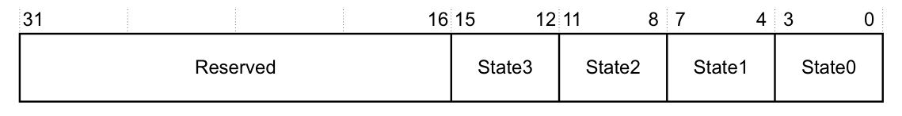

| 位 | 名称 | 值 | 功能 |
| --- | --- | --- | --- |
| [31:16] | - | - | 保留。 |
| [15:12] | State3 | - | Armv7-M reserved。 |
| [11:8] | State2 | - | Armv7-M reserved。 |
| [7:4] | State1 | 0-2 | Armv7-M reserved。 |
| [7:4] | State1 | 3 | 支持 **Thumb** 编码，包括 **Thumb-2** 技术，具备所有基本 16 位和 32 位指令。 |
| [3:0] | State0 | 0 | 处理器不支持 Arm 指令集。 |
| [3:0] | State0 | 1 | Armv7-M reserved。 |

### 2.2. 处理器特性寄存器 1（Processor Feature Register 1, ID_PFR1）

**ID_PFR1** 的特性如下：

**用途**

给出处理器所支持指令集的顶层信息。该寄存器属于 **Identification registers** 功能组。

**使用限制**

只能从特权代码访问。该寄存器必须与 ID_PFR0 结合解读。

**配置**

始终实现。

**属性**

请参见第 B4-644 页的表 B4-1。

**ID_PFR1** 的位分配如下：

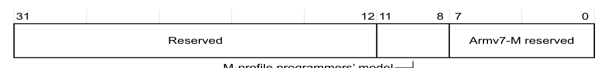

| 位 | 名称 | 值 | 功能 |
| --- | --- | --- | --- |
| [31:12] | - | - | 保留。 |
| [11:8] | M profile programmers' model | 0 | Armv7-M reserved。 |
| [11:8] | M profile programmers' model | 1 | 保留。 |
| [11:8] | M profile programmers' model | 2 | 支持两栈程序员模型。 |
| [7:0] | - | - | Armv7-M reserved。 |

## 3. 调试特性 ID 寄存器

以下小节描述调试特性 ID 寄存器，它给出调试实现的顶层视图。调试实现包含提供实现特性更多信息的寄存器，参见 C1 章 **Armv7-M Debug**。字段描述的信息参见第 B4-644 页的 **CPUID 属性描述的约定**。

### 3.1. 调试特性寄存器 0（Debug Feature Register 0, ID_DFR0）

**ID_DFR0** 的特性如下：

**用途**

给出处理器中所用调试系统的顶层信息。该寄存器属于 **Identification registers** 功能组。

**使用限制**

只能从特权代码访问。

**配置**

始终实现。

**属性**

请参见第 B4-644 页的表 B4-1。

**ID_DFR0** 的位分配如下：

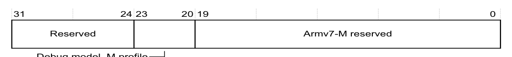

| 位 | 名称 | 值 | 功能 |
| --- | --- | --- | --- |
| [31:24] | - | - | 保留。 |
| [23:20] | Debug model, M profile | 0 | 不支持 M profile 处理器的内存映射调试模型。 |
| [23:20] | Debug model, M profile | 1 | 支持 M profile 调试体系结构，且采用内存映射访问。 |
| [19:0] | - | - | Armv7-M reserved。 |

## 4. 辅助特性 ID 寄存器

以下小节给出 **IMPLEMENTATION DEFINED** 的辅助特性 ID 寄存器的体系结构描述。字段描述的信息参见第 B4-644 页的 **CPUID 属性描述的约定**。

### 4.1. 辅助特性寄存器 0（Auxiliary Feature Register 0, ID_AFR0）

**ID_AFR0** 的特性如下：

**用途**

给出处理器实现中 **IMPLEMENTATION DEFINED** 特性的信息。**ID_AFR0** 有四个 **IMPLEMENTATION DEFINED** 字段。这些字段由设计的实现者定义，实现者由 **CPUID base register** 的 **Implementer** 字段标识，参见第 B3-598 页的 **CPUID Base Register**。

**ID_AFR0** 中的字段定义可能：

* 在不同的实现者之间有所不同。
* 发生变化。
* 随时间迁移，例如被纳入主体系结构。

该寄存器属于 **Identification registers** 功能组。

**使用限制**

只能从特权代码访问。

**配置**

始终实现。

**属性**

请参见第 B4-644 页的表 B4-1。

**ID_AFR0** 的位分配如下：

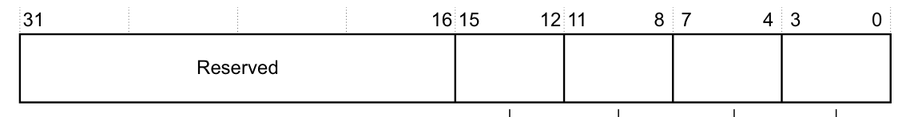

| 位 | 名称 | 值 | 功能 |
| --- | --- | --- | --- |
| [31:16] | - | - | 保留。 |
| [15:12] | - | - | IMPLEMENTATION DEFINED。 |
| [11:8] | - | - | IMPLEMENTATION DEFINED。 |
| [7:4] | - | - | IMPLEMENTATION DEFINED。 |
| [3:0] | - | - | IMPLEMENTATION DEFINED。 |

## 5. 内存模型特性寄存器

内存模型特性寄存器（**Memory Model Feature Registers**，MMFR）给出内存模型和内存管理支持的一般信息。字段描述的信息参见第 B4-644 页的 **CPUID 属性描述的约定**。以下小节描述这些 MMFR：

* **Memory Model Feature Register 0，ID_MMFR0**。
* 第 B4-651 页的 **Memory Model Feature Register 1，ID_MMFR1**。
* 第 B4-651 页的 **Memory Model Feature Register 2，ID_MMFR2**。
* 第 B4-652 页的 **Memory Model Feature Register 3，ID_MMFR3**。

### 5.1. 内存模型特性寄存器 0（Memory Model Feature Register 0, ID_MMFR0）

**ID_MMFR0** 的特性如下：

**用途**

给出所实现的内存模型和内存管理支持的信息。该寄存器属于 **Identification registers** 功能组。

**使用限制**

只能从特权代码访问。该寄存器必须与 ID_MMFR1、ID_MMFR2 和 ID_MMFR3 结合解读。

**配置**

始终实现。

**属性**

请参见第 B4-644 页的表 B4-1。

**ID_MMFR0** 的位分配如下：

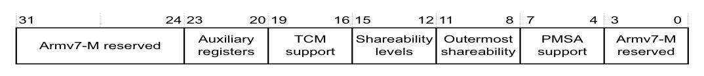

| 位 | 名称 | 值 | 功能 |
| --- | --- | --- | --- |
| [31:24] | - | - | Armv7-M reserved。 |
| [23:20] | Auxiliary registers | 0 | 不支持辅助寄存器。 |
| [23:20] | Auxiliary registers | 1 | 仅支持 **Auxiliary Control Register**。 |
| [23:20] | Auxiliary registers | 2 | Armv7-M reserved。 |
| [19:16] | TCM support | 0 | 未实现紧密耦合存储器。 |
| [19:16] | TCM support | 1 | 实现紧密耦合存储器，控制方式为 IMPLEMENTATION DEFINED。 |
| [19:16] | TCM support | 2 | Armv7-M reserved。 |
| [15:12] | Shareability levels | 0 | 实现一级 Shareability。 |
| [15:12] | Shareability levels | 1 | Armv7-M reserved。 |
| [11:8] | Outermost Shareability | 0 | 实现为 Non-cacheable。 |
| [11:8] | Outermost Shareability | 1 | Armv7-M reserved。 |
| [11:8] | Outermost Shareability | 15 | 忽略 Shareability。 |
| [7:4] | PMSA support | 0 | 不支持 PMSA。 |
| [7:4] | PMSA support | 1, 2 | Armv7-M reserved。 |
| [7:4] | PMSA support | 3 | PMSAv7，支持基区域和子区域。 |
| [3:0] | - | - | Armv7-M reserved。 |

### 5.2. 内存模型特性寄存器 1（Memory Model Feature Register 1, ID_MMFR1）

**ID_MMFR1** 的特性如下：

**用途**

给出所实现的内存模型和内存管理支持的信息。该寄存器属于 **Identification registers** 功能组。

**使用限制**

只能从特权代码访问。该寄存器必须与 ID_MMFR0、ID_MMFR2 和 ID_MMFR3 结合解读。

**配置**

始终实现。

**属性**

请参见第 B4-644 页的表 B4-1。

**ID_MMFR1** 的位分配如下：

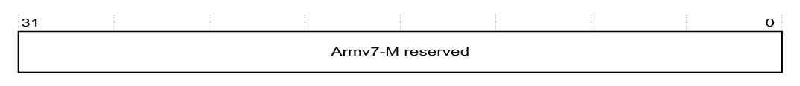

| 位 | 名称 | 值 | 功能 |
| --- | --- | --- | --- |
| [31:0] | - | - | Armv7-M reserved。 |

### 5.3. 内存模型特性寄存器 2（Memory Model Feature Register 2, ID_MMFR2）

**ID_MMFR2** 的特性如下：

**用途**

给出所实现的内存模型和内存管理支持的信息。该寄存器属于 **Identification registers** 功能组。

**使用限制**

只能从特权代码访问。该寄存器必须与 ID_MMFR0、ID_MMFR1 和 ID_MMFR3 结合解读。

**配置**

始终实现。

**属性**

请参见第 B4-644 页的表 B4-1。

**ID_MMFR2** 的位分配如下：

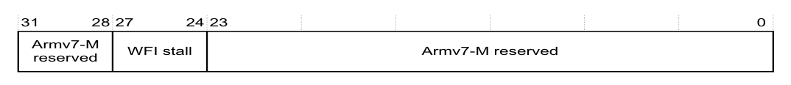

| 位 | 名称 | 值 | 功能 |
| --- | --- | --- | --- |
| [31:28] | - | - | Armv7-M reserved。 |
| [27:24] | WFI stall | 0 | 不支持 **Wait For Interrupt**（WFI）停驻。 |
| [27:24] | WFI stall | 1 | 支持 WFI 停驻。 |
| [23:0] | - | - | Armv7-M reserved。 |

### 5.4. 内存模型特性寄存器 3（Memory Model Feature Register 3, ID_MMFR3）

**ID_MMFR3** 的字段如下：

| 位 | 名称 | 值 | 功能 |
| --- | --- | --- | --- |
| [31:28] | - | - | Armv7-M reserved。 |
| [27:24] | - | - | 保留。 |
| [23:20] | - | - | Armv7-M reserved。 |
| [19:16] | - | - | 保留。 |
| [15:0] | - | - | Armv7-M reserved。 |

## 6. 指令集属性寄存器

指令集属性寄存器（**Instruction Set Attribute Registers**，ISAR）提供处理器所支持指令集的信息。字段描述的信息参见第 B4-644 页的 **CPUID 属性描述的约定**。

就 ISAR 描述而言，指令集划分为：

* **Thumb** 指令集的基本指令。**Armv7-M** 实现必须包含所有这些指令。
* **Thumb** 指令集的非基本指令。ISAR 指出其中哪些指令已实现。

第 B4-653 页的 **关于指令集属性寄存器的描述** 给出 ISAR 如何表示指令集的信息。

以下小节描述这些 ISAR：

* 第 B4-654 页的 **Instruction Set Attribute Register 0，ID_ISAR0**。
* 第 B4-655 页的 **Instruction Set Attribute Register 1，ID_ISAR1**。
* 第 B4-657 页的 **Instruction Set Attribute Register 2，ID_ISAR2**。
* 第 B4-658 页的 **Instruction Set Attribute Register 3，ID_ISAR3**。
* 第 B4-659 页的 **Instruction Set Attribute Register 4，ID_ISAR4**。

### 6.1. 关于指令集属性寄存器的描述

本节给出构成基本指令集的指令的信息，以及指令在指令集属性寄存器各属性字段中的分配方式。

**基本指令集**

这些指令仅取决于 CPUID 寄存器中的一个指令编码属性。这意味着，如果存在某种指令编码，则该指令集中具有该编码的所有基本指令都必须实现。由于 **Armv7-M** 实现必须包含 **Thumb** 指令集，因此它必须包含 **Thumb** 指令集中的所有基本指令。

**通用规则**

关于某条指令是否为基本指令的规则，并不保证该指令在任何特定指令集中都可用。例如，按本节给出的规则 `MOV R0,#123456789` 是基本指令，但在 **Thumb** 指令集的任何实现中都不可用。

指令是条件执行还是无条件执行，从不会影响它是否为基本指令。

**Q 标志支持**

当满足以下条件时，APSR 实现 Q 标志：

```arm
(ID_ISAR2.MultS_instrs >1) OR (ID_ISAR3.Saturate_instrs >0) OR (ID_ISAR3.SIMD_instrs >0)
```

**MOV 指令**

如果源操作数是立即数或未移位的寄存器，则这些指令属于基本指令集。

如果它们的第二个操作数是移位寄存器，则应把它们视为 `ASR`、`LSL`、`LSR`、`ROR` 或 `RRX` 指令，参见下一节。

**非 MOV 数据处理指令**

这些指令是 `ADC`、`ADD`、`AND`、`ASR`、`BIC`、`CMN`、`CMP`、`EOR`、`LSL`、`LSR`、`MVN`、`NEG`、`ORN`、`ORR`、`ROR`、`RRX`、`RSB`、`RSC`、`SBC`、`SUB`、`TEQ` 和 `TST`。

对于 **Armv7-M**，如果第二个源操作数（对于 `MVN` 则是唯一的源操作数）是立即数或未移位的寄存器，则这些指令属于基本指令集。

如果该条件不成立，则它们是非基本指令，由 `PSR_instrs` 属性与 `WithShifts_instrs` 属性中的任意一个或两者控制。

**乘法指令**

`MUL` 指令始终是基本指令；所有其他乘法指令以及所有乘累加指令都是非基本指令。

**分支**

所有 `B` 和 `BL` 指令都是基本指令。

**加载单个和存储单个指令**

这些指令是 `LDR`、`LDRB`、`LDRH`、`LDRSB`、`LDRSH`、`STR`、`STRB`、`STRH`。

如果寻址模式为下列形式之一，则这些指令属于基本指令集：

```arm
[Rn, #immediate]
[Rn, #-immediate]
[Rn, Rm]
[Rn, -Rm]
```

采用任何其他寻址模式的加载单个或存储单个指令，由 `WithShifts_instrs`、`Writeback_instrs` 或 `Unpriv_instrs` 属性中的一个或多个控制。

**加载多个和存储多个指令**

这些指令是 `LDM<mode>`、`STM<mode>`、`PUSH`、`POP`，其中 `<mode>` 是 `IA Rn`、`IA Rn!`、`DB Rn`、`DB Rn!` 之一，或它们对应的 `FD` 或 `EA` 同义形式。

它们之所以是基本指令，是因为它们是良好代码生成的基础。特别是 `PUSH` 具有隐含寻址模式 `DB R13!`，`POP` 具有隐含寻址模式 `IA R13!`。这些指令对于良好的过程序言和尾声是必不可少的。所列的其他寻址模式可以显著影响结构复制、加载和存储的代码密度，也会显著影响它们在低端实现上的性能。

### 6.2. 指令集属性寄存器 0（Instruction Set Attribute Register 0, ID_ISAR0）

**ID_ISAR0** 的特性如下：

**用途**

给出处理器所实现指令集的信息。该寄存器属于 **Identification registers** 功能组。

**使用限制**

只能从特权代码访问。该寄存器必须与 ID_ISAR1、ID_ISAR2、ID_ISAR3 和 ID_ISAR4 结合解读。

**配置**

始终实现。

**属性**

请参见第 B4-644 页的表 B4-1。

**ID_ISAR0** 的位分配如下：

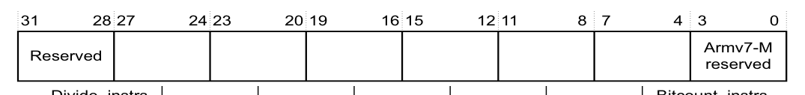

| 位 | 名称 | 值 | 功能 |
| --- | --- | --- | --- |
| [31:28] | - | - | 保留。 |
| [27:24] | Divide_instrs | 0 | 不支持任何指令，Armv7-M reserved。 |
| [27:24] | Divide_instrs | 1 | 增加对 `SDIV` 和 `UDIV` 指令的支持。 |
| [23:20] | Debug_instrs | 0 | 不支持任何指令，Armv7-M reserved。 |
| [23:20] | Debug_instrs | 1 | 增加对 `BKPT` 指令的支持。 |
| [19:16] | Coproc_instrs | 0 | 不支持任何指令，但单独归属的体系结构（例如浮点扩展）除外。 |
| [19:16] | Coproc_instrs | 1 | 增加对通用 `CDP`、`LDC`、`MCR`、`MRC` 和 `STC` 指令的支持。 |
| [19:16] | Coproc_instrs | 2 | 同 1，并增加对通用 `CDP2`、`LDC2`、`MCR2`、`MRC2` 和 `STC2` 指令的支持。 |
| [19:16] | Coproc_instrs | 3 | 同 2，并增加对通用 `MCRR` 和 `MRRC` 指令的支持。 |
| [19:16] | Coproc_instrs | 4 | 同 3，并增加对通用 `MCRR2` 和 `MRRC2` 指令的支持。 |
| [15:12] | CmpBranch_instrs | 0 | 不支持任何指令，Armv7-M reserved。 |
| [15:12] | CmpBranch_instrs | 1 | 增加对 `CBNZ` 和 `CBZ` 指令的支持。 |
| [11:8] | Bitfield_instrs | 0 | 不支持任何指令，Armv7-M reserved。 |
| [11:8] | Bitfield_instrs | 1 | 增加对 `BFC`、`BFI`、`SBFX` 和 `UBFX` 指令的支持。 |
| [7:4] | BitCount_instrs | 0 | 不支持任何指令，Armv7-M reserved。 |
| [7:4] | BitCount_instrs | 1 | 增加对 `CLZ` 指令的支持。 |
| [3:0] | - | - | Armv7-M reserved。 |

### 6.3. 指令集属性寄存器 1（Instruction Set Attribute Register 1, ID_ISAR1）

**ID_ISAR1** 的特性如下：

**用途**

给出处理器所实现指令集的信息。该寄存器属于 **Identification registers** 功能组。

**使用限制**

只能从特权代码访问。该寄存器必须与 ID_ISAR0、ID_ISAR2、ID_ISAR3 和 ID_ISAR4 结合解读。

**配置**

始终实现。

**属性**

请参见第 B4-644 页的表 B4-1。

**ID_ISAR1** 的位分配如下：

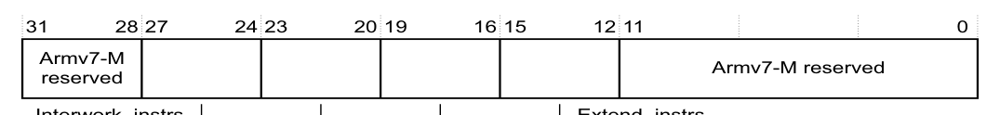

| 位 | 名称 | 值 | 功能 |
| --- | --- | --- | --- |
| [31:28] | - | - | Armv7-M reserved。 |
| [27:24] | Interwork_instrs | 0 | 不支持任何指令，Armv7-M reserved。 |
| [27:24] | Interwork_instrs | 1 | 增加对 `BX` 指令以及 PSR 中 T 位的支持。 |
| [27:24] | Interwork_instrs | 2 | 同 1，并增加对 `BLX` 指令的支持，且 PC 加载具有类似 `BX` 的行为。 |
| [27:24] | Interwork_instrs | 3 | Armv7-M reserved。 |
| [23:20] | Immediate_instrs | 0 | 不支持任何指令，Armv7-M reserved。 |
| [23:20] | Immediate_instrs | 1 | 增加对 `ADDW`、`MOVW`、`MOVT` 和 `SUBW` 指令的支持。 |
| [19:16] | IfThen_instrs | 0 | 不支持任何指令，Armv7-M reserved。 |
| [19:16] | IfThen_instrs | 1 | 增加对 `IT` 指令以及 PSR 中 IT 位的支持。 |
| [15:12] | Extend_instrs | 0 | 不支持任何指令，Armv7-M reserved。 |
| [15:12] | Extend_instrs | 1 | 增加对 `SXTB`、`SXTH`、`UXTB` 和 `UXTH` 指令的支持。 |
| [15:12] | Extend_instrs | 2 | 同 1，并增加对 `SXTAB`、`SXTAB16`、`SXTAH`、`SXTB16`、`UXTAB`、`UXTAB16`、`UXTAH` 和 `UXTB16` 指令的支持。 |
| [11:0] | - | - | Armv7-M reserved。 |

**注意：**

* 仅当 `ID_ISAR4.WithShifts` 的值大于 2 时，才支持这些指令的移位选项。
* 仅当同时满足以下两个条件时才支持 `SXTAB16`、`SXTB16`、`UXTAB16` 和 `UXTB16` 指令：
  — 该字段大于 1。
  — `ID_ISAR3.SIMD_instrs` 字段大于 2。

### 6.4. 指令集属性寄存器 2（Instruction Set Attribute Register 2, ID_ISAR2）

**ID_ISAR2** 的特性如下：

**用途**

给出处理器所实现指令集的信息。该寄存器属于 **Identification registers** 功能组。

**使用限制**

只能从特权代码访问。该寄存器必须与 ID_ISAR0、ID_ISAR1、ID_ISAR3 和 ID_ISAR4 结合解读。

**配置**

始终实现。

**属性**

请参见第 B4-644 页的表 B4-1。

**ID_ISAR2** 的位分配如下：

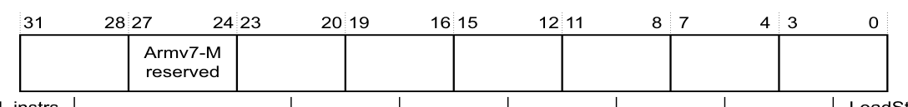

| 位 | 名称 | 值 | 功能 |
| --- | --- | --- | --- |
| [31:28] | Reversal_instrs | 0 | 不支持任何指令，Armv7-M reserved。 |
| [31:28] | Reversal_instrs | 1 | 增加对 `REV`、`REV16` 和 `REVSH` 指令的支持，Armv7-M reserved。 |
| [31:28] | Reversal_instrs | 2 | 同 1，并增加对 `RBIT` 指令的支持。 |
| [27:24] | - | - | Armv7-M reserved。 |
| [23:20] | MultU_instrs | 0 | 不支持任何指令，Armv7-M reserved。 |
| [23:20] | MultU_instrs | 1 | 增加对 `UMULL` 和 `UMLAL` 指令的支持。 |
| [23:20] | MultU_instrs | 2 | 同 1，并增加对 `UMAAL` 指令的支持。 |
| [19:16] | MultS_instrs | 0 | 不支持任何指令，Armv7-M reserved。 |
| [19:16] | MultS_instrs | 1 | 增加对 `SMULL` 和 `SMLAL` 指令的支持。 |
| [19:16] | MultS_instrs | 2 | 同 1，并增加对 `SMLABB`、`SMLABT`、`SMLALBB`、`SMLALBT`、`SMLALTB`、`SMLALTT`、`SMLATB`、`SMLATT`、`SMLAWB`、`SMLAWT`、`SMULBB`、`SMULBT`、`SMULTB`、`SMULTT`、`SMULWB` 和 `SMULWT` 指令的支持。<br>还增加对 PSR 中 Q 位的支持。Armv7-M reserved。 |
| [19:16] | MultS_instrs | 3 | 同 2，并增加对 `SMLAD`、`SMLADX`、`SMLALD`、`SMLALDX`、`SMLSD`、`SMLSDX`、`SMLSLD`、`SMLSLDX`、`SMMLA`、`SMMLAR`、`SMMLS`、`SMMLSR`、`SMMUL`、`SMMULR`、`SMUAD`、`SMUADX`、`SMUSD` 和 `SMUSDX` 指令的支持。 |
| [15:12] | Mult_instrs | 0 | 不支持任何附加指令。这意味着仅支持 `MUL`。Armv7-M reserved。 |
| [15:12] | Mult_instrs | 1 | 增加对 `MLA` 指令的支持，Armv7-M reserved。 |
| [15:12] | Mult_instrs | 2 | 同 1，并增加对 `MLS` 指令的支持。 |
| [11:8] | MultiAccessInt_instrs | 0 | 不支持任何指令。这意味着 `LDM` 和 `STM` 指令不可中断。Armv7-M reserved。 |
| [11:8] | MultiAccessInt_instrs | 1 | `LDM` 和 `STM` 指令可重启。 |
| [11:8] | MultiAccessInt_instrs | 2 | `LDM` 和 `STM` 指令可继续。 |
| [7:4] | MemHint_instrs | 0 | 不支持任何指令，Armv7-M reserved。 |
| [7:4] | MemHint_instrs | 1 或 2 | 增加对 `PLD` 指令的支持。<br>这两个值的含义相同，且都属于 Armv7-M reserved。 |
| [7:4] | MemHint_instrs | 3 | 同 1 或 2，并增加对 `PLI` 指令的支持。 |
| [3:0] | LoadStore_instrs | 0 | 不支持任何指令，Armv7-M reserved。 |
| [3:0] | LoadStore_instrs | 1 | 增加对 `LDRD` 和 `STRD` 指令的支持。 |

### 6.5. 指令集属性寄存器 3（Instruction Set Attribute Register 3, ID_ISAR3）

**ID_ISAR3** 的特性如下：

**用途**

给出处理器所实现指令集的信息。该寄存器属于 **Identification registers** 功能组。

**使用限制**

只能从特权代码访问。该寄存器必须与 ID_ISAR0、ID_ISAR1、ID_ISAR2 和 ID_ISAR4 结合解读。

**配置**

始终实现。

**属性**

请参见第 B4-644 页的表 B4-1。

**ID_ISAR3** 的位分配如下：

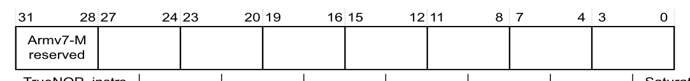

| 位 | 名称 | 值 | 功能 |
| --- | --- | --- | --- |
| [31:28] | - | - | Armv7-M reserved。 |
| [27:24] | TrueNOP_instrs | 0 | 不支持任何指令，Armv7-M reserved。 |
| [27:24] | TrueNOP_instrs | 1 | 增加对真 `NOP` 指令的支持。 |
| [23:20] | ThumbCopy_instrs | 0 | 不支持任何指令，Armv7-M reserved。 |
| [23:20] | ThumbCopy_instrs | 1 | 增加对 `MOV`（寄存器）指令编码 T1 的支持，即从低寄存器复制到低寄存器。 |
| [19:16] | TabBranch_instrs | 0 | 不支持任何指令，Armv7-M reserved。 |
| [19:16] | TabBranch_instrs | 1 | 增加对 `TBB` 和 `TBH` 指令的支持。 |
| [15:12] | SynchPrim_instrs | - | 必须与 `ID_ISAR4.SynchPrim_instrs_frac` 字段结合解读，以确定所支持的同步原语，参见第 B4-661 页的 **同步原语支持**。 |
| [11:8] | SVC_instrs | 0 | 不支持任何指令，Armv7-M reserved。 |
| [11:8] | SVC_instrs | 1 | 增加对 `SVC` 指令的支持。 |
| [7:4] | SIMD_instrs | 0 | 不支持任何指令，Armv7-M reserved。 |
| [7:4] | SIMD_instrs | 1 | 增加对 `SSAT` 和 `USAT` 指令以及 PSR 中 Q 位的支持。 |
| [7:4] | SIMD_instrs | 2 | 保留。 |
| [7:4] | SIMD_instrs | 3 | 同 1，并增加对 `PKHBT`、`PKHTB`、`QADD16`、`QADD8`、`QASX`、`QSUB16`、`QSUB8`、`QSAX`、`SADD16`、`SADD8`、`SASX`、`SEL`、`SHADD16`、`SHADD8`、`SHASX`、`SHSUB16`、`SHSUB8`、`SHSAX`、`SSAT16`、`SSUB16`、`SSUB8`、`SSAX`、`SXTAB16`、`SXTB16`、`UADD16`、`UADD8`、`UASX`、`UHADD16`、`UHADD8`、`UHASX`、`UHSUB16`、`UHSUB8`、`UHSAX`、`UQADD16`、`UQADD8`、`UQASX`、`UQSUB16`、`UQSUB8`、`UQSAX`、`USAD8`、`USADA8`、`USAT16`、`USUB16`、`USUB8`、`USAX`、`UXTAB16` 和 `UXTB16` 指令的支持。<br>还增加对 PSR 中 GE[3:0] 位的支持。 |
| [3:0] | Saturate_instrs | 0 | 不支持任何指令。 |
| [3:0] | Saturate_instrs | 1 | 增加对 `QADD`、`QDADD`、`QDSUB` 和 `QSUB` 指令以及 PSR 中 Q 位的支持。 |

**注意：** 仅当 `ID_ISAR1.Extend_instrs` 属性为 2 或更大时，值 3 才增加对 `SXTAB16`、`SXTB16`、`UXTAB16` 和 `UXTB16` 指令的支持。

### 6.6. 指令集属性寄存器 4（Instruction Set Attribute Register 4, ID_ISAR4）

**ID_ISAR4** 的特性如下：

**用途**

给出处理器所实现指令集的信息。该寄存器属于 **Identification registers** 功能组。

**使用限制**

只能从特权代码访问。该寄存器必须与 ID_ISAR0、ID_ISAR1、ID_ISAR2 和 ID_ISAR3 结合解读。

**配置**

始终实现。

**属性**

请参见第 B4-644 页的表 B4-1。

**ID_ISAR4** 的位分配如下：

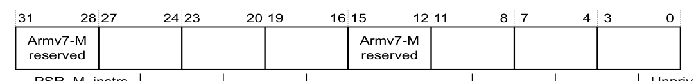

| 位 | 名称 | 值 | 功能 |
| --- | --- | --- | --- |
| [31:28] | - | - | Armv7-M reserved。 |
| [27:24] | PSR_M_instrs | 0 | 不支持任何指令，Armv7-M reserved。 |
| [27:24] | PSR_M_instrs | 1 | 增加对 `CPS`、`MRS` 和 `MSR` 指令的 M-profile 形式支持，以访问 PSR。 |
| [23:20] | SynchPrim_instrs_frac | - | 必须与 `ID_ISAR3.SynchPrim_instrs` 字段结合解读，以确定所支持的同步原语，参见第 B4-661 页的 **同步原语支持**。 |
| [19:16] | Barrier_instrs | 0 | 不支持任何指令，Armv7-M reserved。 |
| [19:16] | Barrier_instrs | 1 | 增加对 `DMB`、`DSB` 和 `ISB` 屏障指令的支持。 |
| [15:12] | - | - | Armv7-M reserved。 |
| [11:8] | Writeback_instrs | 0 | 基本支持。只有 `LDM`、`STM`、`PUSH` 和 `POP` 指令支持回写寻址模式。Armv7-M reserved。 |
| [11:8] | Writeback_instrs | 1 | 增加对 **Armv7-M** 体系结构中定义的所有回写寻址模式的支持。 |
| [7:4] | WithShifts_instrs | 0 | 仅在 `MOV` 和移位指令中支持非零移位。 |
| [7:4] | WithShifts_instrs | 1 | 增加对加载和存储指令在 LSL 0-3 范围内移位的支持。 |
| [7:4] | WithShifts_instrs | 2 | 保留。 |
| [7:4] | WithShifts_instrs | 3 | 同 1，并增加对加载、存储及其他指令上其他常量移位选项的支持。 |
| [7:4] | WithShifts_instrs | 4 | Armv7-M reserved。 |
| [3:0] | Unpriv_instrs | 0 | 不支持任何指令，Armv7-M reserved。 |
| [3:0] | Unpriv_instrs | 1 | 增加对 `LDRBT`、`LDRT`、`STRBT` 和 `STRT` 指令的支持。 |
| [3:0] | Unpriv_instrs | 2 | 同 1，并增加对 `LDRHT`、`LDRSBT`、`LDRSHT` 和 `STRHT` 指令的支持。 |

**注意：**

* 值 0 所表示的基本支持的附加内容，仅适用于支持它们的编码。
* 带有移位选项的 `MOV` 指令被视为 `ASR`、`LSL`、`LSR`、`ROR` 或 `RRX` 指令，参见第 B4-653 页的 **非 MOV 数据处理指令**。

**同步原语支持**

`ID_ISAR3.SynchPrim_instrs` 与 `ID_ISAR4.SynchPrim_instrs_frac` 共同表示所支持的同步原语，如表 B4-2 所示。

表 B4-2 中未列出的 `ID_ISAR3.SynchPrim_instrs` 与 `ID_ISAR4.SynchPrim_instrs_frac` 的所有组合均为保留。

表 B4-2 支持的同步原语：

| SynchPrim_instrsᵃ | SynchPrim_instrs_fracᵇ | 支持的同步原语 |
| --- | --- | --- |
| 0 | 0 | 不支持任何指令。 |
| 1 | 0 | 增加对 `LDREX` 和 `STREX` 指令的支持。 |
| 1 | 3 | 同 [1, 0]，并增加对 `CLREX`、`LDREXB`、`LDREXH`、`STREXB` 和 `STREXH` 指令的支持。 |
| 2 | 0 | Armv7-M reserved。 |

a. 位于 ID_ISAR3 中。

b. 位于 ID_ISAR4 中。

## 7. 浮点特性标识寄存器

当实现包含可选的浮点扩展时，该扩展的特性标识寄存器实现为 **System Control Block**（SCB）中的内存映射寄存器，参见第 B3-597 页的表 B3-5，以及第 B3-596 页的 **系统控制与 ID 寄存器**。

**注意：** **Armv7-M** 实现的 FP 特性标识寄存器位于内存映射的 SCB 中。这与 **Armv7-A** 和 **Armv7-R** 配置文件不同——在那些配置文件中，这些寄存器实现在 CP10 和 CP11 扩展系统寄存器空间中。

以下小节描述 FP 特性标识寄存器：

* **关于 Media and FP Feature 寄存器**。
* **Media and FP Feature Register 0，MVFR0**。
* 第 B4-663 页的 **Media and FP Feature Register 1，MVFR1**。
* 第 B4-664 页的 **Media and FP Feature Register 2，MVFR2**。

### 7.1. 关于 Media and FP Feature 寄存器

当实现包含 FP 扩展时，**Media and FP Feature** 寄存器描述该扩展提供的特性。在 **Armv7-A** 和 **Armv7-R** 配置文件中，这些寄存器是实现中 **IMPLEMENTATION DEFINED** 的只读寄存器；但在 **Armv7-M** 配置文件中，它们由体系结构定义。所定义的值范围参见 **Arm Architecture Reference Manual，Armv7-A and Armv7-R edition**。

### 7.2. Media and FP Feature 寄存器 0（Media and FP Feature Register 0, MVFR0）

**MVFR0** 的特性如下：

**用途**

描述浮点扩展提供的特性。

**使用限制**

必须与 MVFR1 结合解读。

**配置**

仅当实现包含 FP 扩展时实现。

**属性**

请参见第 B3-597 页的表 B3-5 以及寄存器字段描述。

**MVFR0** 的位分配如下：

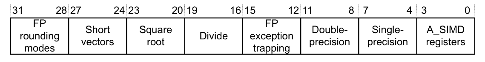

| 位 | 名称 | 值 | 功能 |
| --- | --- | --- | --- |
| [31:28] | FP rounding modes | 0b0001 | 支持所有舍入模式。 |
| [27:24] | Short vectors | 0b0000 | 在 **Armv7-M** 中不支持。 |
| [23:20] | Square root | 0b0001 | 支持。 |
| [19:16] | Divide | 0b0001 | 支持。 |
| [15:12] | FP exception trapping | 0b0000 | 在 **Armv7-M** 中不支持。 |
| [11:8] | Double-precision | 0b0000 | 不支持。 |
| [11:8] | Double-precision | 0b0010 | 支持。 |
| [7:4] | Single-precision | 0b0010 | 支持。 |
| [3:0] | A_SIMD registers | 0b0001 | 支持，16 个 64 位寄存器。 |

**注意：**

* `VSQRT.F32` 指令还需要单精度 FP 属性，即位[7:4]。
* `VDIV.F32` 指令还需要单精度 FP 属性，即位[7:4]。

**对单精度字段值的说明**

FP 增加了一条加载单精度浮点常量的指令，以及单精度值与定点值之间的转换。

值 0b0010 表示支持所有 FP 单精度指令，但另外还有以下限制：

* 仅当 **Square root** 字段为 0b0001 时才可用 `VSQRT.F32`。
* 仅当 **Divide** 字段为 0b0001 时才可用 `VDIV.F32`。
* 仅当 **double-precision** 字段非零时才支持双精度与单精度之间的转换。

### 7.3. Media and FP Feature 寄存器 1（Media and FP Feature Register 1, MVFR1）

**MVFR1** 的特性如下：

**用途**

描述浮点扩展提供的特性。

**使用限制**

必须与 MVFR0 结合解读。

在通用的 MVFR1 定义中，MVFR1[23:8] 保存描述 **Advanced SIMD** 特性的字段。在 **Armv7-M** 实现中，这些位为保留位，RAZ。

**配置**

仅当实现包含 FP 扩展时实现。

**属性**

请参见第 B3-597 页的表 B3-5 以及寄存器字段描述。

**MVFR1** 的位分配如下：

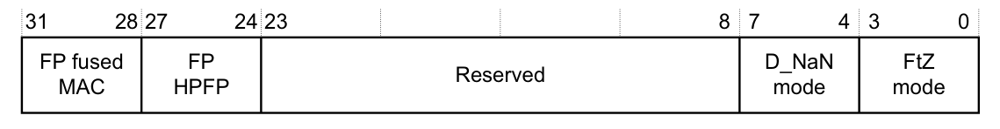

| 位 | 名称 | 值 | 功能 |
| --- | --- | --- | --- |
| [31:28] | FP fused MAC | 0b0001 | 支持。 |
| [27:24] | FP HPFP | 0b0001 | 支持半精度与单精度之间的转换。 |
| [27:24] | FP HPFP | 0b0010 | 同 0b0001，并且还支持半精度与双精度之间的转换。 |
| [23:8] | - | - | 保留，RAZ。 |
| [7:4] | D_NaN mode | 0b0001 | 硬件支持 NaN 值的传播。 |
| [3:0] | FtZ mode | 0b0001 | 硬件支持完整的非规格化数算术。 |

**字段说明**

**FP fused MAC** 表示 FP 是否支持融合乘累加运算。

**FP HPFP** 表示 FP 扩展是否实现半精度与双精度浮点转换指令，许可值为 0b0001 和 0b0010。

**D_NaN mode** 表示 FP 硬件实现是否仅支持 **Default NaN** 模式。

**FtZ mode** 表示 FP 硬件实现是否仅支持 **Flush-to-zero** 运算模式。

### 7.4. Media and FP Feature 寄存器 2（Media and FP Feature Register 2, MVFR2）

**MVFR2** 的特性如下：

**用途**

描述浮点扩展提供的特性。

**使用限制**

必须与 MVFR1 和 MVFR0 结合解读。

**配置**

仅当实现包含 FP 扩展时实现。

**属性**

请参见第 B3-597 页的表 B3-5 以及寄存器字段描述。

**MVFR2** 的位分配如下：

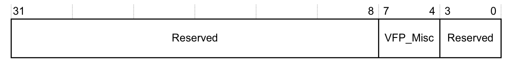

| 位 | 名称 | 值 | 功能 |
| --- | --- | --- | --- |
| [31:8] | - | - | 保留。 |
| [7:4] | VFP_Misc | 0b0000 | 不支持杂项特性。 |
| [7:4] | VFP_Misc | 0b0100 | 支持浮点选择、带直接舍入模式的浮点到整数转换、浮点舍入为整数浮点，以及浮点最大数与最小数。 |
| [3:0] | - | - | 保留。 |

## 8. 缓存控制标识寄存器

缓存控制标识寄存器用于确定是否实现了紧耦合缓存，以及确定缓存的特性。

这些寄存器实现在 **System Control Block**（SCB）中，参见第 B3-597 页的表 B3-5，以及第 B3-596 页的 **系统控制与 ID 寄存器**。

### 8.1. 缓存级别 ID 寄存器（Cache Level ID Register, CLIDR）

**CLIDR** 的特性如下：

**用途**

**CLIDR** 标识：

* 每一级上实现的缓存（最多七级）的类型。
* 缓存层次的 **Level of Coherency** 和 **Level of Unification**。

**使用限制**

仅可由特权软件访问。

**配置**

**Armv7** 之前的体系结构版本中不实现该寄存器。

**属性**

一个 32 位只读寄存器，其值为 IMPLEMENTATION DEFINED。

**CLIDR** 的位分配如下：

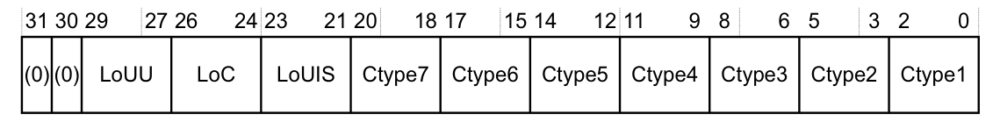

| 位 | 名称 | 值 | 功能 |
| --- | --- | --- | --- |
| [31:30] | - | - | 保留，UNK。 |
| [29:27] | LoUU | - | 缓存层次的 **Level of Unification Uniprocessor**，参见第 B2-575 页的 **描述 Clean、Invalidate 以及 Clean and Invalidate 操作的术语**。 |
| [26:24] | LoC | - | 缓存层次的 **Level of Coherency**。 |
| [23:21] | LoUIS | - | 缓存层次的 **Level of Unification Inner Shareable**。该字段为 RAZ。 |
| [3(n - 1) + 2:3(n - 1)]，n = 1 至 7 | Ctype\<n\> | - | 缓存类型字段。指示各级实现的缓存类型，从 Level 1 直到最多七级缓存层次。Level 1 缓存字段 **Ctype1** 为位[2:0]，参见寄存器图。 |

表 B4-3 列出了 CtypeX 位的取值含义。

表 B4-3 CtypeX 位分配值：

| Ctype\<n\> 值 | 该级实现的缓存的含义 |
| --- | --- |
| 000 | 无缓存 |
| 001 | 仅指令缓存 |
| 010 | 仅数据缓存 |
| 011 | 独立的指令缓存和数据缓存 |
| 100 | 统一缓存 |
| 101、11X | 保留 |

如果软件从 Ctype1 开始向上读取缓存类型字段，当遇到值 0b000 时，层次中更外侧的级别不存在缓存。例如，如果 Ctype3 是第一个值为 0b000 的缓存类型字段，则 Ctype4 到 Ctype7 的值必须忽略。

**CLIDR** 仅描述处理器控制之下的缓存。

### 8.2. 缓存大小 ID 寄存器（Cache Size ID Registers, CCSIDR）

**CCSIDR** 的特性如下：

**用途**

**CCSIDR** 提供缓存体系结构的信息。

**使用限制**

仅可由特权软件访问。

如果 CSSELR 指示的缓存未实现，则读取 CCSIDR 的结果为 **UNPREDICTABLE**。

**配置**

实现包含每个可访问缓存的一个 CCSIDR。CSSELR 选择当前可访问的 **Cache Size ID register**。

**Armv7** 之前的体系结构版本中不实现这些寄存器。

**属性**

32 位只读寄存器，其值为 IMPLEMENTATION DEFINED。第 B4-644 页的表 B4-1 列出了所有 CPUID 寄存器。

**CCSIDR** 的位分配如下：

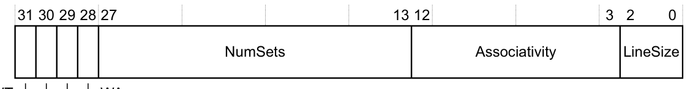

| 位 | 名称 | 值 | 功能 |
| --- | --- | --- | --- |
| [31] | WT | - | 指示该缓存级别是否支持 **Write-Through**，参见表 B4-4。 |
| [30] | WB | - | 指示该缓存级别是否支持 write-back，参见表 B4-4。 |
| [29] | RA | - | 指示该缓存级别是否支持 read-allocation，参见表 B4-4。 |
| [28] | WA | - | 指示该缓存级别是否支持 write-allocation，参见表 B4-4。 |
| [27:13] | NumSets | - | (缓存中的组数) – 1，因此值 0 表示缓存中有 1 个组。组数不必是 2 的幂。 |
| [12:3] | Associativity | - | (缓存的关联度) – 1，因此值 0 表示关联度为 1。关联度不必是 2 的幂。 |
| [2:0] | LineSize | - | (Log2(缓存行中的字数)) – 2。例如：<br>• 行长为 4 个字时：Log2(4) = 2，LineSize 项为 0。这是最小行长。<br>• 行长为 8 个字时：Log2(8) = 3，LineSize 项为 1。 |

表 B4-4 WT、WB、RA 和 WA 位的取值：

| WT、WB、RA 或 WA 位的值 | 含义 |
| --- | --- |
| 0 | 不支持该特性 |
| 1 | 支持该特性 |

**访问当前选定的 CCSIDR**

CSSELR 选择一个 CCSIDR。要访问当前选定的 CCSIDR，软件读取地址 0xE000ED84 处的寄存器。

当 CSSELR 中的值对应的缓存未实现时，任何对 CCSIDR 的访问都返回 **UNKNOWN** 值。

### 8.3. 缓存大小选择寄存器（Cache Size Selection Register, CSSELR）

**CSSELR** 的特性如下：

**用途**

**CSSELR** 通过指定下列内容来选择当前 CCSIDR：

* 所需的缓存级别。
* 缓存类型，为下列之一：
  — 指令缓存，前提是内存系统实现了独立的指令缓存和数据缓存。
  — 数据缓存。对于统一缓存，必须使用数据缓存参数。

**使用限制**

仅可由特权软件访问。

**配置**

**Armv7** 之前的体系结构版本中不实现这些寄存器。

**属性**

32 位读写寄存器，复位值为 UNKNOWN。第 B4-644 页的表 B4-1 列出了所有 CPUID 寄存器。

**CSSELR** 的位分配如下：

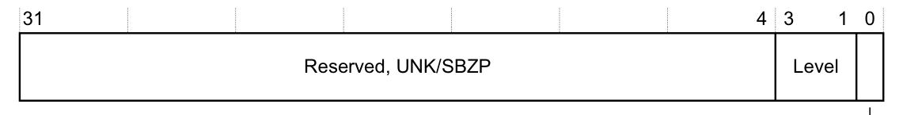

| 位 | 名称 | 值 | 功能 |
| --- | --- | --- | --- |
| [31:4] | - | - | 保留，UNK/SBZP。 |
| [3:1] | Level | - | 所需缓存的缓存级别。许可值为 0b000（表示 Level 1 缓存）到 0b110（表示 Level 7 缓存）。 |
| [0] | InD | 0 | 数据缓存或统一缓存。 |
| [0] | InD | 1 | 指令缓存。 |

### 8.4. 缓存类型寄存器（Cache Type Register, CTR）

**CTR** 的特性如下：

**用途**

**CTR** 提供缓存体系结构的信息。

**使用限制**

仅可由特权软件访问。

**配置**

始终实现。

**属性**

一个 32 位只读寄存器，其值为 IMPLEMENTATION DEFINED。第 B4-644 页的表 B4-1 列出了所有 CPUID 寄存器。

**CTR** 的位分配如下：

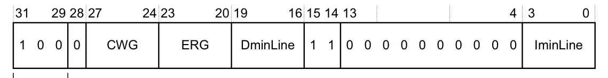

| 位 | 名称 | 值 | 功能 |
| --- | --- | --- | --- |
| [31:29] | Format | 0b000 | 未实现缓存，也未提供缓存类型信息。该寄存器的所有剩余字段均为 RAZ，包括标记为 RAO 的字段。 |
| [31:29] | Format | 0b100 | **Armv7** 格式。即本节描述的格式。 |
| [28] | - | - | RAZ。 |
| [27:24] | CWG | - | **Cache write-back Granule**。因逐出某缓存条目（该条目中有内存位置被修改）而可被覆盖的内存最大大小，以字数的 Log2 编码。值 0b0000 表示 **CTR** 不提供 **Cache write-back Granule** 信息，并且必须按下列之一处理：<br>• 必须假定体系结构最大值 512 字（2KB）。<br>• 可根据 **Cache Size ID Registers** 中编码的最大缓存行大小确定 **Cache write-back Granule**。<br>大于 0b1001 的值保留。 |
| [23:20] | ERG | - | **Exclusives Reservation Granule**。为 **Load-Exclusive** 和 **Store-Exclusive** 指令实现的保留颗粒的最大大小，以字数的 Log2 编码。更多信息参见第 A3-75 页的 **标记与标记内存块的大小**。值 0b0000 表示 **CTR** 不提供 **Exclusives Reservation Granule** 信息，必须假定体系结构最大值 512 字（2KB）。大于 0b1001 的值保留。 |
| [19:16] | DminLine | - | 处理器所控制的所有数据缓存和统一缓存中最小缓存行的字数之 Log2。 |
| [15:14] | - | - | RAO。 |
| [13:4] | - | - | RAZ。 |
| [3:0] | IminLine | - | 处理器所控制的所有指令缓存中最小缓存行的字数之 Log2。 |

**注意：** **Format** 字段的所有其他取值均为保留。
