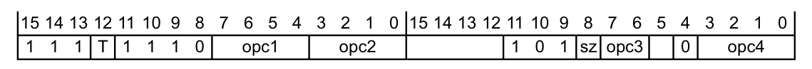
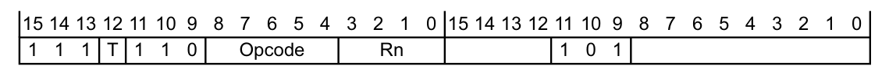
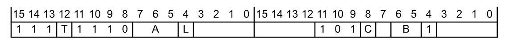
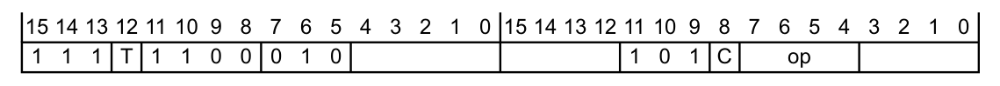

本文译自 Part A《应用程序级架构》（Application level architecture） Chapter A6《浮点指令集编码》（The Floating-point Instruction Set Encoding）。

本章介绍 **Armv7-M** 浮点扩展向 **Thumb** 指令集添加的浮点（FP）指令，并说明这些指令的编码。以下小节给出关于浮点指令的一般信息，然后按类别描述 FP 扩展添加的指令。

## 1. 概述

**Armv7-M** 浮点扩展向 **Thumb** 指令集添加浮点（FP）指令。实现该扩展不会影响处理器的运行状态。参见第 A2-34 页的 **可选浮点扩展**。

以下小节给出关于浮点指令的一般信息：

* 第 A6-161 页的 **浮点指令语法**。
* 第 A6-164 页的 **寄存器编码**。

以下小节描述 FP 扩展添加的各类指令：

* 第 A6-165 页的 **浮点数据处理指令**。
* 第 A6-167 页的 **扩展寄存器加载或存储指令**。
* 第 A6-168 页的 **Arm 内核与扩展寄存器之间的 32 位传送**。
* 第 A6-169 页的 **Arm 内核与扩展寄存器之间的 64 位传送**。

## 2. 浮点指令语法

浮点指令使用 **Thumb** 指令集的一般约定。浮点数据处理指令使用以下通用格式：

```arm
V<operation>{<c>}{<q>}{.<dt>}
{<dest>,} <src1>, <src2>
```

所有浮点指令都以 V 开头。这使浮点指令集中的指令与 **Thumb** 指令相区别。

主要操作在 `<operation>` 字段中指定。它通常是一个三字母助记符，与对应的 **Thumb** 整数指令相同或相似。

`<c>` 和 `<q>` 字段是标准的汇编器语法字段。详细信息参见第 A7-177 页的 **标准汇编器语法字段**。

### 2.1. 数据类型说明符

`<dt>` 字段通常包含一个数据类型说明符。它指示下列内容中所包含的数据类型：

* 第二个操作数（如果有）。
* 该操作数（如果没有第二个操作数）。
* 该结果（如果没有操作数寄存器）。

其他操作数和结果的数据类型由 `<dt>` 字段与指令形态共同隐含。

在 A7 章 **指令详情** 的指令语法描述中，`<dt>` 字段通常被指定为单个字段。但在更方便时，它有时被指定为两个字段的拼接，即 `<type><size>`。

**语法灵活性**

数据类型说明符语法具有一定灵活性：

* 一条指令可以指定两个数据类型，分别指定单个操作数和结果的数据类型。
* 当一条指令需要较不具体的数据类型时，它可以改而指定更具体的类型，如表 A6-1 所示。
* 当一条指令不需要数据类型时，它可以提供一个。
* **F32** 数据类型可以缩写为 **F**。
* **F64** 数据类型可以缩写为 **D**。

在所有情况下，如果一条指令提供了附加信息，该附加信息必须与该指令形态匹配。反汇编不会重新生成该附加信息。

表 A6-1 数据类型说明的灵活性：

| 指定的数据类型 | 允许的更具体的数据类型 |
| --- | --- |
| 无 | 任意 |
| .16 | `.S16`、`.U16`、`.F16` |
| .32 | `.S32`、`.U32`、`.F32` 或 `.F` |
| .64 | -、-、`.F64` 或 `.D` |

### 2.2. 寄存器说明符

`<dest>`、`<src1>` 和 `<src2>` 字段包含寄存器说明符，某些情况下还包含寄存器列表，参见第 A6-163 页的 **寄存器列表**。表 A6-2 列出了指令描述中出现的寄存器说明符格式。

如果省略 `<dest>`，则它与 `<src1>` 相同。

表 A6-2 浮点寄存器说明符格式：

| `<说明符>` | 通常含义ᵃ |
| --- | --- |
| `<Dd>` | 结果的双精度目标寄存器。 |
| `<Dn>` | 第一个操作数的双精度源寄存器。 |
| `<Dm>` | 第二个操作数的双精度源寄存器。 |
| `<Sd>` | 结果的单精度目标寄存器。 |
| `<Sn>` | 第一个操作数的单精度源寄存器。 |
| `<Sm>` | 第二个操作数的单精度源寄存器。 |
| `<Rn>` | 一个 Arm 内核寄存器，用作地址。 |
| `<Rt>` | 一个 Arm 内核寄存器，用作源寄存器或目标寄存器。 |
| `<Rt2>` | 一个 Arm 内核寄存器，用作源寄存器或目标寄存器。 |

a. 在某些指令中，寄存器的角色有所不同。

### 2.3. 寄存器列表

寄存器列表是用逗号分隔、并用花括号 `{` 和 `}` 括起来的寄存器说明符列表。寄存器列表中可出现的寄存器存在限制。各指令描述中说明了这些限制。表 A6-3 列出了一些寄存器列表格式，以及与该格式对应的实际寄存器列表示例。

**注意：** 寄存器列表不得跨越寄存器组的末尾回绕。

**语法灵活性**

寄存器列表语法具有一定灵活性：

* 当寄存器列表包含连续寄存器时，可以将它们指定为一个范围，而不必逐一列出每个寄存器，例如用 `{S0-S3}` 代替 `{S0,S1,S2,S3}`。
* 当寄存器列表包含偶数个以偶数编号寄存器开头的连续双字寄存器时，可以改写成四字寄存器列表，例如用 `{Q1,Q2}` 代替 `{D2-D5}`。
* 当寄存器列表仅包含一个寄存器时，可以省略外层花括号，例如用 `VLDM.32 R2, S5` 代替 `VLDM.32 R2, {S5}`。

表 A6-3 寄存器列表示例：

| 格式 | 示例 | 替代形式 |
| --- | --- | --- |
| `{<Sd>}` | `{S3}` | `S3` |
| `{<Sd>,<Sd+1>,<Sd+2>}` | `{S3,S4,S5}` | `{S3-S5}` |
| `{<Dd[x]>,<Dd+2[x]}` | `{D0[3],D2[3]}` | - |
| `{<Dd[]>}` | `{D7[]}` | `D7[]` |

## 3. 寄存器编码

FP 扩展寄存器是下列之一：

* 双精度寄存器，即 64 位宽。
* 单精度寄存器，即 32 位宽。

**注意：** 尽管 FP 扩展仅支持单精度算术，但它支持某些双字数据传送指令，例如 move、pop 和 push。

**Thumb** 浮点指令中浮点寄存器的编码为：


在适当时，`sz` 字段（bit[8]）编码寄存器宽度：`sz == 1` 表示双精度运算，`sz == 0` 表示单精度运算。大多数 **FPv4-SP** 指令仅支持单精度，对于这些指令 bit[8] 为 0。

表 A6-4 列出了此指令中各寄存器的编码：

| 寄存器助记符 | 通常用法 | 编码所在的寄存器编号 |
| --- | --- | --- |
| `<Dd>` | 目标，双精度 | `D:Vd`，bits[22,15:12] |
| `<Dn>` | 第一个操作数，双精度 | `N:Vn`，bits[7,19:16] |
| `<Dm>` | 第二个操作数，双精度 | `M:Vm`，bits[5,3:0] |
| `<Sd>` | 目标，单精度 | `Vd:D`，bits[15:12,22] |
| `<Sn>` | 第一个操作数，单精度 | `Vn: N`，bits[19:16,7] |
| `<Sm>` | 第二个操作数，单精度 | `Vm: M`，bits[3:0,5] |

有些指令只使用一个或两个寄存器，并把未使用的寄存器字段用作附加操作码位。

## 4. 浮点数据处理指令

浮点数据处理指令的编码为：



表 A6-5 列出了三寄存器浮点数据处理指令的编码。此空间中的其他编码为 **UNDEFINED**。

第 A6-166 页的表 A6-6 列出了 `VMOV`（立即数）指令中可用的立即数常量。

这些指令是协处理器 10 和 11 的 `CDP` 指令，参见第 A7-217 页的 `CDP`、`CDP2`。

表 A6-5 三寄存器浮点数据处理指令：

| T | opc1 | opc2 | opc3 | 指令 | 参见 |
| --- | --- | --- | --- | --- | --- |
| 1 | 0xxx | - | - | 浮点选择 | `VSEL`（第 A7-497 页） |
| 0 | 0x00 | - | - | 浮点乘累加或乘减 | `VMLA`、`VMLS`（第 A7-476 页） |
| 0 | 0x01 | - | - | 浮点取负乘累加或乘减 | `VNMLA`、`VNMLS`、`VNMUL`（第 A7-489 页） |
| 0 | 0x10 | - | `x1`<br>`x0` | 浮点乘法 | `VMUL`（第 A7-487 页） |
| 0 | 0x11 | - | x0 | 浮点加法 | `VADD`（第 A7-456 页） |
| 0 | 0x11 | - | x1 | 浮点减法 | `VSUB`（第 A7-503 页） |
| 0 | 1x00 | - | x0 | 浮点除法 | `VDIV`（第 A7-468 页） |
| 1 | 1x00 | - | x0 | 浮点最大数与最小数 | `VMAXNM`、`VMINNM`（第 A7-475 页） |
| 0 | 1x11 | - | x0 | 浮点移动 | `VMOV`（立即数）（第 A7-478 页） |
| 0 | 1x11 | 0000 | 01 | 浮点移动 | `VMOV`（寄存器）（第 A7-479 页） |
| 0 | 1x11 | 0000 | 11 | 浮点绝对值 | `VABS`（第 A7-455 页） |
| 0 | 1x11 | 0001 | 01 | 浮点取负 | `VNEG`（第 A7-488 页） |
| 0 | 1x11 | 0001 | 11 | 浮点平方根 | `VSQRT`（第 A7-498 页） |
| 0 | 001x | - | x1 | 浮点转换 | `VCVTB`、`VCVTT`（第 A7-466 页） |
| 0 | 010x | - | x1 | 浮点比较 | `VCMP`、`VCMPE`（第 A7-457 页） |
| 0 | 011x | - | x1 | 浮点舍入为整数 | `VRINTZ`、`VRINTR`（第 A7-496 页） |
| 0 | 0111 | - | 11 | 浮点转换 | `VCVT`（双精度与单精度之间）（第 A7-465 页） |
| 0 | 1x11 | 1000 | x1 | 浮点转换 | `VCVT`、`VCVTR`（浮点与整数之间）（第 A7-461 页） |
| 1 | 10xx | - | 01 | 浮点舍入为整数 | `VRINTA`、`VRINTN`、`VRINTP`、`VRINTM`（第 A7-493 页） |
| 1 | 11xx | - | x1 | 带舍入的浮点转换 | `VCVTA`、`VCVTN`、`VCVTP`、`VCVTM`（第 A7-459 页） |
| 0 | 1x1x | - | x1 | 浮点转换 | `VCVT`（浮点与定点之间）（第 A7-463 页） |
| 0 | 110x | - | x1 | 浮点转换 | `VCVT`、`VCVTR`（浮点与整数之间）（第 A7-461 页） |

### 4.1. 浮点指令中修改立即数常量的运算

`VFPExpandImm()` 伪代码函数展开浮点运算中的修改立即数常量：

```arm
// VFPExpandImm()
// ==============
bits(N) VFPExpandImm(bits(8) imm8, integer N)
    assert N IN {32,64};
    if N == 32 then
        E = 8;
    else
        E = 11;
    F = N - E - 1;
    sign = imm8<7>;
    exp = NOT(imm8<6>):Replicate(imm8<6>,E-3):imm8<5:4>;
    frac = imm8<3:0>:Zeros(F-4);
    return sign:exp:frac;
```

表 A6-6 浮点修改立即数常量：

| 数据类型 | opc2 | opc4 | 常量ᵃ |
| --- | --- | --- | --- |
| F32 | abcd | efgh | aBbbbbbc defgh000 00000000 00000000 |
| F64 | abcd | efgh | aBbbbbbb bbcdefgh 00000000 00000000 00000000 00000000 00000000 00000000 |

a. 在此列中，B = NOT(b)。该位模式表示的浮点数为 (–1)ˢ * 2ᵉˣᵖ * 尾数，其中 S = UInt(a)、exp = UInt(NOT(b):c:d)-3、尾数 = (16+UInt(e:f:g:h))/16。

## 5. 扩展寄存器加载或存储指令

FP 扩展寄存器加载或存储指令的编码为：



如果 T == 1，则该指令为 **UNDEFINED**。

否则，表 A6-7 列出了此空间中编码的分配情况。此空间中的其他编码为 **UNDEFINED**。

这些指令是协处理器 10 和 11 的 `LDC` 和 `STC` 指令，参见第 A7-238 页的 `LDC`、`LDC2`（立即数），第 A7-240 页的 `LDC`、`LDC2`（字面量），以及第 A7-381 页的 `STC`、`STC2`。

表 A6-7 FP 扩展寄存器加载和存储指令：

| Opcode | Rn | 指令 | 参见 |
| --- | --- | --- | --- |
| 0010x | - | - | 第 A6-169 页的 **Arm 内核与扩展寄存器之间的 64 位传送** |
| 01x00 | - | 浮点存储多个（增量后，无回写） | `VSTM`（第 A7-499 页） |
| 01x10 | - | 浮点存储多个（增量后，回写） | `VSTM`（第 A7-499 页） |
| 1xx00 | - | 浮点存储寄存器 | `VSTR`（第 A7-501 页） |
| 10x10 | not 1101 | 浮点存储多个（减量前，回写） | `VSTM`（第 A7-499 页） |
| 10x10 | 1101 | 浮点压栈寄存器 | `VPUSH`（第 A7-492 页） |
| 01x01 | - | 浮点加载多个（增量后，无回写） | `VLDM`（第 A7-471 页） |
| 01x11 | not 1101 | 浮点加载多个（增量后，回写） | `VLDM`（第 A7-471 页） |
| 01x11 | 1101 | 浮点出栈寄存器 | `VPOP`（第 A7-491 页） |
| 1xx01 | - | 浮点加载寄存器 | `VLDR`（第 A7-473 页） |
| 10x11 | - | 浮点加载多个（减量前，回写） | `VLDM`（第 A7-471 页） |

## 6. Arm 内核与扩展寄存器之间的 32 位传送

浮点 8 位、16 位和 32 位寄存器数据传送指令的编码为：



如果 T == 1，则该指令为 **UNDEFINED**。

否则，表 A6-8 列出了此空间中编码的分配情况。此空间中的其他编码为 **UNDEFINED**。

这些指令是协处理器 10 和 11 的 `MRC` 和 `MCR` 指令，参见第 A7-297 页的 `MRC`、`MRC2` 和第 A7-286 页的 `MCR`、`MCR2`。

表 A6-8 与 FP 扩展寄存器之间进行 32 位数据传送的指令：

| L | C | A | B | 指令 | 参见 |
| --- | --- | --- | --- | --- | --- |
| 0 | 0 | 000 | - | 浮点移动 | `VMOV`（Arm 内核寄存器与单精度寄存器之间）（第 A7-482 页） |
| 0 | 0 | 111 | - | 从 Arm 内核寄存器传送到 FP 特殊寄存器 | `VMSR`（第 A7-486 页） |
| 0 | 1 | 00x | 00 | 浮点移动 | `VMOV`（Arm 内核寄存器到标量）（第 A7-480 页） |
| 1 | 0 | 000 | - | 浮点移动 | `VMOV`（Arm 内核寄存器与单精度寄存器之间）（第 A7-482 页） |
| 1 | 0 | 111 | - | 从 FP 特殊寄存器传送到 Arm 内核寄存器 | `VMRS`（第 A7-485 页） |
| 1 | 1 | 00x | 00 | 浮点移动 | `VMOV`（标量到 Arm 内核寄存器）（第 A7-481 页） |

## 7. Arm 内核与扩展寄存器之间的 64 位传送

FP 扩展 64 位寄存器数据传送指令的编码为：



如果 T == 1，则该指令为 **UNDEFINED**。

否则，表 A6-9 列出了此空间中编码的分配情况。此空间中的其他编码为 **UNDEFINED**。

这些指令是协处理器 10 和 11 的 `MRRC` 和 `MCRR` 指令，参见第 A7-299 页的 `MRRC`、`MRRC2` 和第 A7-288 页的 `MCRR`、`MCRR2`。

表 A6-9 64 位数据传送指令：

| C | op | 指令 |
| --- | --- | --- |
| 0 | 00x1 | 第 A7-483 页的 `VMOV`（两个 Arm 内核寄存器与两个单精度寄存器之间）。 |
| 1 | 00x1 | 第 A7-484 页的 `VMOV`（两个 Arm 内核寄存器与一个双字寄存器之间）。 |
