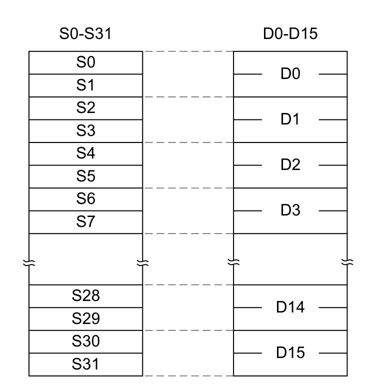
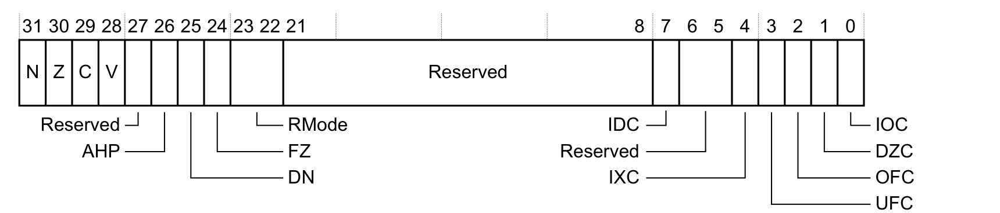
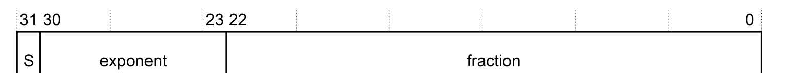
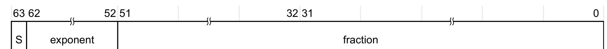

本文译自 Part A《应用程序级架构》（Application level architecture） Chapter A2《应用程序级程序员模型》（Application Level Programmers' Model）。

本章给出 **Armv7-M** 程序员模型的应用级视图。本章的应用级信息与在操作系统下服务和支持应用程序执行所需的系统级信息不同，后者见 Chapter B1《系统级程序员模型》。本章包含以下小节：

* 关于应用程序级程序员模型。
* Arm 处理器数据类型与运算。
* 寄存器与执行状态。
* 异常、故障与中断。
* 可选的浮点扩展。
* 协处理器支持。

## 1. 关于应用程序级程序员模型

本章包含应用程序开发所需的程序员模型信息。这些信息不同于在操作系统下服务和支持应用程序执行所需的系统级信息，后者见 Chapter B1《系统级程序员模型》。

系统级支持需要访问架构的所有特性与功能，这种访问级别通常称为特权操作。系统代码决定应用程序以特权还是非特权方式运行。操作系统同时支持特权与非特权操作，但应用程序通常以非特权方式运行。

应用程序以非特权方式运行意味着：

* 操作系统可以为该应用程序分配系统资源，作为私有或共享资源。
* 提供一定程度的与其他进程和任务的隔离，从而有助于保护操作系统免受故障应用程序的影响。

非特权运行意味着处理器处于 Thread 模式，参见「与系统级架构的交互」。

### 1.1. 与系统级架构的交互

Thread 模式是 **Armv7-M** 中应用程序执行的基本模式，在复位时被选择。Thread 模式下的执行可以是非特权的或特权的。Thread 模式可以使用 `SVC` 指令发出超级用户调用，产生一个 **SVCall** 异常，由处理器在 Handler 模式下处理。Thread 模式也可以直接处理系统访问与控制。

所有异常都在 Handler 模式下执行。**SVCall** 处理程序代表应用程序管理资源，例如与外设的交互、内存分配与软件栈管理。

本章只提供理解应用级操作所需的系统级信息。在适当之处，本章：

* 给出系统级信息的概述。
* 给出 Chapter B1《系统级程序员模型》及其他位置中系统级描述的引用。

## 2. Arm 处理器数据类型与运算

**Armv7-M** 架构支持内存中的以下数据类型：

**Byte**

8 位。

**Halfword**

16 位。

**Word**

32 位。

寄存器大小为 32 位。指令集包含支持寄存器中以下数据类型的指令：

* 32 位指针。
* 无符号或有符号 32 位整数。
* 无符号 16 位或 8 位整数，以零扩展形式保存。
* 有符号 16 位或 8 位整数，以符号扩展形式保存。
* 无符号或有符号 64 位整数，保存在两个寄存器中。

加载与存储操作可以在内存与寄存器之间传送字节、半字或字。字节或半字的加载在加载时按相应加载指令的规定进行零扩展或符号扩展。

指令集包含在内存中传送两个或更多字的加载与存储操作。可以使用这些指令加载和存储 64 位整数。

当上述任一数据类型被描述为无符号时，N 位数据值使用普通二进制格式表示 0 到 2^N-1 范围内的非负整数。

当上述任一数据类型被描述为有符号时，N 位数据值使用二进制补码格式表示 -2^(N-1) 到 +2^(N-1)-1 范围内的整数。

对 64 位整数的直接指令支持有限，多数 64 位运算需要两条或更多指令序列来合成。

### 2.1. 整数运算

指令集提供对寄存器中值的运算，包括按位逻辑运算、移位、加法、减法和乘法。本手册使用伪代码描述这些运算，通常采用以下方式之一：

* 直接使用第 D6-813 页「运算符与内置函数」中定义的伪代码运算符与内置函数。
* 使用正文中定义的伪代码辅助函数。
* 使用以下形式的序列：
  1. 使用 `SInt()`、`UInt()` 与 `Int()` 内置函数，将指令操作数的位串内容转换为它们所代表的二进制补码或无符号无界整数。第 D6-815 页「将位串转换为整数」定义了这些函数。
  2. 对这些无界整数使用数学运算符、内置函数与辅助函数，计算出其他二进制补码或无符号整数。
  3. 使用以下之一将无界整数结果转换为可写入寄存器的位串结果：
     * 第 D6-814 页「位串提取」中定义的位串提取运算符。
     * 「饱和的伪代码细节」中描述的饱和辅助函数。

附录 D6《伪代码定义》给出 Arm 伪代码的一般描述。

**移位与循环移位操作**

指令中使用以下类型的移位与循环移位操作：

**Logical Shift Left (LSL)**

将位串的每一位左移指定位数，在位串右端移入零。从位串左端移出的位被丢弃，但最后一个这样的位可以作为进位输出产生。

**Logical Shift Right (LSR)**

将位串的每一位右移指定位数，在位串左端移入零。从位串右端移出的位被丢弃，但最后一个这样的位可以作为进位输出产生。

**Arithmetic Shift Right (ASR)**

将位串的每一位右移指定位数，在位串左端移入最左位的副本。从位串右端移出的位被丢弃，但最后一个这样的位可以作为进位输出产生。

**Rotate Right (ROR)**

将位串的每一位右移指定位数，从位串右端移出的每一位重新从左侧移入。最后一个从右端移出的位可以作为进位输出产生。

**Rotate Right with Extend (RRX)**

将位串的每一位右移一位，在位串左端移入进位输入。从位串右端移出的位可以作为进位输出产生。

**移位与循环移位操作的伪代码细节**

这些移位与循环移位操作在伪代码中由以下函数支持：

```arm
// LSL_C()
// =======
(bits(N), bit) LSL_C(bits(N) x, integer shift)
    assert shift > 0;
    extended_x = x : Zeros(shift);
    result = extended_x<N-1:0>;
    carry_out = extended_x<N>;
    return (result, carry_out);

// LSL()
// =====
bits(N) LSL(bits(N) x, integer shift)
    assert shift >= 0;
    if shift == 0 then
        result = x;
    else
        (result, -) = LSL_C(x, shift);
    return result;

// LSR_C()
// =======
(bits(N), bit) LSR_C(bits(N) x, integer shift)
    assert shift > 0;
    extended_x = ZeroExtend(x, shift+N);
    result = extended_x<shift+N-1:shift>;
    carry_out = extended_x<shift-1>;
    return (result, carry_out);

// LSR()
// =====
bits(N) LSR(bits(N) x, integer shift)
    assert shift >= 0;
    if shift == 0 then
        result = x;
    else
        (result, -) = LSR_C(x, shift);
    return result;

// ASR_C()
// =======
(bits(N), bit) ASR_C(bits(N) x, integer shift)
    assert shift > 0;
    extended_x = SignExtend(x, shift+N);
    result = extended_x<shift+N-1:shift>;
    carry_out = extended_x<shift-1>;
    return (result, carry_out);

// ASR()
// =====
bits(N) ASR(bits(N) x, integer shift)
    assert shift >= 0;
    if shift == 0 then
        result = x;
    else
        (result, -) = ASR_C(x, shift);
    return result;

// ROR_C()
// =======
(bits(N), bit) ROR_C(bits(N) x, integer shift)
    assert shift != 0;
    m = shift MOD N;
    result = LSR(x,m) OR LSL(x,N-m);
    carry_out = result<N-1>;
    return (result, carry_out);

// ROR()
// =====
bits(N) ROR(bits(N) x, integer shift)
    if shift == 0 then
        result = x;
    else
        (result, -) = ROR_C(x, shift);
    return result;

// RRX_C()
// =======
(bits(N), bit) RRX_C(bits(N) x, bit carry_in)
    result = carry_in : x<N-1:1>;
    carry_out = x<0>;
    return (result, carry_out);

// RRX()
// =====
bits(N) RRX(bits(N) x, bit carry_in)
    (result, -) = RRX_C(x, carry_in);
    return result;
```

**加法和减法的伪代码细节**

在伪代码中，加法和减法可以对无界整数与位串的任意组合执行，前提是如果对两个位串执行，这两个位串长度必须相同。如果两个操作数都是无界整数，结果是另一个无界整数；否则结果是长度与位串操作数相同的位串。这些操作的精确定义见第 D6-816 页「加法与减法」。

主要加减法指令可以产生无符号进位与有符号溢出两种状态信息。这些状态信息可用于合成多字加法与减法。在伪代码中，`AddWithCarry()` 函数提供带进位输入以及进位和溢出输出的加法：

```arm
// AddWithCarry()
// ==============
(bits(N), bit, bit) AddWithCarry(bits(N) x, bits(N) y, bit carry_in)
    unsigned_sum = UInt(x) + UInt(y) + UInt(carry_in);
    signed_sum   = SInt(x) + SInt(y) + UInt(carry_in);
    result       = unsigned_sum<N-1:0>;  // 与 signed_sum<N-1:0> 的值相同
    carry_out    = if UInt(result) == unsigned_sum then '0' else '1';
    overflow     = if SInt(result) == signed_sum then '0' else '1';
    return (result, carry_out, overflow);
```

`AddWithCarry()` 函数的一个重要性质是，如果：

```arm
(result, carry_out, overflow) = AddWithCarry(x, NOT(y), carry_in)
```

那么：

* 如果 `carry_in == '1'`，则 `result == x-y`，若减法期间发生有符号溢出则 `overflow == '1'`，若减法期间未发生无符号借位（即 x ≥ y）则 `carry_out == '1'`。
* 如果 `carry_in == '0'`，则 `result == x-y-1`，若减法期间发生有符号溢出则 `overflow == '1'`，若减法期间未发生无符号借位（即 x > y）则 `carry_out == '1'`。

综合来看，这意味着 `AddWithCarry()` 调用中的 `carry_in` 与 `carry_out` 位既可以作为加法的进位标志，也可以作为减法的非借位标志。

**饱和的伪代码细节**

某些指令执行饱和运算，即如果运算结果超出目标有符号或无符号 N 位整数范围，产生的结果是该范围内的最大值或最小值，而不是按 2^N 取模回绕。伪代码中由 `SignedSatQ()` 与 `UnsignedSatQ()` 函数支持，它们返回一个布尔结果表示是否发生饱和；由 `SignedSat()` 与 `UnsignedSat()` 函数支持只需要饱和结果的情形：

```arm
// SignedSatQ()
// ============
(bits(N), boolean) SignedSatQ(integer i, integer N)
    if i > 2^(N-1) - 1 then
        result = 2^(N-1) - 1;  saturated = TRUE;
    elsif i < -(2^(N-1)) then
        result = -(2^(N-1));  saturated = TRUE;
    else
        result = i;  saturated = FALSE;
    return (result<N-1:0>, saturated);

// UnsignedSatQ()
// ==============
(bits(N), boolean) UnsignedSatQ(integer i, integer N)
    if i > 2^N - 1 then
        result = 2^N - 1;  saturated = TRUE;
    elsif i < 0 then
        result = 0;  saturated = TRUE;
    else
        result = i;  saturated = FALSE;
    return (result<N-1:0>, saturated);

// SignedSat()
// ===========
bits(N) SignedSat(integer i, integer N)
    (result, -) = SignedSatQ(i, N);
    return result;

// UnsignedSat()
// =============
bits(N) UnsignedSat(integer i, integer N)
    (result, -) = UnsignedSatQ(i, N);
    return result;
```

`SatQ(i, N, unsigned)` 根据第三个参数的值返回 `UnsignedSatQ(i, N)` 或 `SignedSatQ(i, N)`，`Sat(i, N, unsigned)` 根据第三个参数的值返回 `UnsignedSat(i, N)` 或 `SignedSat(i, N)`：

```arm
// SatQ()
// ======
(bits(N), boolean) SatQ(integer i, integer N, boolean unsigned)
    (result, sat) = if unsigned then UnsignedSatQ(i, N) else SignedSatQ(i, N);
    return (result, sat);

// Sat()
// =====
bits(N) Sat(integer i, integer N, boolean unsigned)
    result = if unsigned then UnsignedSat(i, N) else SignedSat(i, N);
    return result;
```

## 3. 寄存器与执行状态

应用程序级程序员模型给出应用程序编程人员可见的通用寄存器与特殊用途寄存器的细节、Arm 内存模型，以及用于从内存加载寄存器、向内存存储寄存器或在寄存器内处理数据（数据运算）的指令集。

应用程序经常与外部事件交互。架构中识别的事件类型概述及架构提供的与事件交互的机制，见「异常、故障与中断」。事件如何处理是系统级主题，见第 B1-523 页的「Armv7-M 异常模型」。

### 3.1. Arm 核心寄存器

有十三个 32 位通用寄存器 R0-R12，以及另外三个具有特殊名称与使用模型的 32 位寄存器。

**SP**

栈指针，用作指向当前活动栈的指针。使用限制参见第 A5-127 页的「将 0b1101 用作寄存器说明符」。复位时它预置为主栈顶部。更多信息参见第 B1-516 页的「SP 寄存器」。SP 有时称为 R13。

**LR**

链接寄存器，用于保存返回链接（Return Link）。该值与被调用子程序的返回地址相关，子程序通过带链接的分支指令进入。复位将该寄存器设置为 `0xFFFFFFFF`。如果处理器在尝试子程序返回时使用该复位值，会引发故障条件。LR 在异常进入时也会更新，参见第 B1-531 页的「异常进入行为」。LR 有时称为 R14。

**注意：** 当不需要支持从子程序返回时，LR 可用于其他目的。

**PC**

程序计数器。PC 使用模型的细节参见第 A5-126 页的「将 0b1111 用作寄存器说明符」。复位时 PC 装入复位处理程序起始地址。PC 有时称为 R15。

**Arm 核心寄存器运算的伪代码细节**

在伪代码中，`R[]` 函数用于：

* 读写 R0-R12、SP 与 LR，分别使用 n == 0-12、13 与 14。
* 读取 PC，使用 n == 15。

该函数具有以下原型：

```arm
bits(32) R[integer n]
    assert n >= 0 && n <= 15;
R[integer n] = bits(32) value
    assert n >= 0 && n <= 14;
```

关于 `R[]` 函数的更多信息，参见第 B1-521 页的「Arm 核心寄存器访问的伪代码细节」。

向 PC 写入地址会导致一个简单分支，或一个交互工作分支——在 **Armv7-M** 中，后者必须选择分支之后要执行的 **Thumb** 指令集。

**注意：** 以下伪代码定义 **Armv7-M** 中的行为。它比适用于较早 Arm 架构变体和其他 Armv7 配置文件的等效伪代码函数定义简单得多。

`BranchWritePC()` 函数执行简单分支：

```arm
// BranchWritePC()
// ===============
BranchWritePC(bits(32) address)
    BranchTo(address<31:1>:'0');
```

`BXWritePC()` 与 `BLXWritePC()` 函数各自执行交互工作分支：

```arm
// BXWritePC()
// ===========
BXWritePC(bits(32) address)
    if CurrentMode == Mode_Handler && address<31:28> == '1111' then
        ExceptionReturn(address<27:0>);
    else
        EPSR.T = address<0>;  // 若 EPSR.T == 0，下一条指令取 UsageFault('Invalid State')
        BranchTo(address<31:1>:'0');

// BLXWritePC()
// ============
BLXWritePC(bits(32) address)
    EPSR.T = address<0>;  // 若 EPSR.T == 0，下一条指令取 UsageFault('Invalid State')
    BranchTo(address<31:1>:'0');
```

`LoadWritePC()` 与 `ALUWritePC()` 函数用于两个其行为在不同架构版本之间被系统性修改的情形。这些函数在 M-profile 架构变体中简化为分支函数的别名：

```arm
// LoadWritePC()
// =============
LoadWritePC(bits(32) address)
    BXWritePC(address);

// ALUWritePC()
// ============
ALUWritePC(bits(32) address)
    BranchWritePC(address);
```

### 3.2. 应用程序状态寄存器 APSR

程序状态在 32 位应用程序状态寄存器（APSR）中报告。APSR 的位分配如图 A2-2 所示。


APSR 位域属于以下类别：

* 保留位分配给系统特性或留待未来扩展。有关当前已分配的保留位的信息，参见第 B1-516 页的「特殊用途程序状态寄存器 xPSR」。应用级软件必须忽略从保留位读取的值，并在写入时保持其值不变。这些位定义为 UNK/SBZP。
* 可由许多指令更新的标志：
  * **N，位[31]** 负条件标志。设置为指令结果的位[31]。如果结果被视为二进制补码有符号整数，则当结果为负时 N == 1，当结果为正或零时 N == 0。
  * **Z，位[30]** 零条件标志。如果指令结果为零则置 1，否则置 0。结果为零通常表示比较结果相等。
  * **C，位[29]** 进位条件标志。如果指令产生进位条件则置 1，例如加法中的无符号溢出。
  * **V，位[28]** 溢出条件标志。如果指令产生溢出条件则置 1，例如加法中的有符号溢出。
  * **Q，位[27]** 如果 `SSAT` 或 `USAT` 指令使输入值改变为结果的有符号或无符号范围则置 1。在实现 DSP 扩展的处理器中，处理器在某些乘法溢出时将该位置 1。将该位置 1 称为饱和。
  * **GE[3:0]，位[19:16]，仅 DSP 扩展** 大于或等于标志。SIMD 指令更新这些标志，以指示运算中各个字节或半字的结果。软件可以使用这些标志控制后续的 `SEL` 指令。更多信息参见第 A7-351 页的 `SEL`。在不实现 DSP 扩展的处理器中，这些位是保留的。

### 3.3. 执行状态支持

**Armv7-M** 只执行 **Thumb** 指令，因此始终在 Thumb 状态下执行指令。所支持指令的列表参见 Chapter A7《指令详情》。

除正常程序执行外，处理器还可以在调试状态下运行，见 Chapter C1《Armv7-M 调试》。

### 3.4. 特权执行

良好的系统设计要求应用程序开发者对底层系统架构及其提供的服务有一定了解。系统支持需要一种通常称为特权操作的访问级别。系统支持代码决定应用程序以特权还是非特权方式运行。当操作系统同时提供特权与非特权支持时，应用程序通常以非特权方式运行，使操作系统能够为应用程序分配私有或共享使用的系统资源，并针对其他进程与任务提供一定程度的保护。

Thread 模式是 **Armv7-M** 中应用程序执行的基本模式。Thread 模式在复位时被选择，并可根据系统环境以特权或非特权方式执行。许多情况下管理系统资源需要特权执行。当代码以非特权方式执行时，Thread 模式可以执行 `SVC` 指令产生超级用户调用异常。Thread 模式下的特权执行可以使用 `SVC` 发出超级用户调用，或直接处理系统访问与控制。

所有异常都以 Handler 模式下的特权代码执行。细节参见第 B1-523 页的「Armv7-M 异常模型」。超级用户调用处理程序代表应用程序管理资源，例如与外设的交互、内存分配与软件栈管理。

## 4. 异常、故障与中断

异常可以由执行异常产生指令引起，也可以作为对系统行为（例如中断、内存管理保护违规、对齐或总线故障，或调试事件）的响应而触发。架构内可以发生同步与异步异常。

事件如何处理是系统级主题，见第 B1-523 页的「Armv7-M 异常模型」。

### 4.1. 与系统相关的事件

以下类型的异常与系统相关。在与指令有直接对应关系之处，给出相关指令的引用。

超级用户调用由应用程序代码用于请求底层操作系统提供服务。使用 `SVC` 指令，应用程序可以为需要特权访问系统的服务发起超级用户调用。

故障可以有以下几种形式：

* 与指令执行相关的错误。
* 数据内存访问错误，可在任何加载或存储时发生。
* 由各种执行状态相关错误引起的使用故障。尝试执行未定义指令是引发 **UsageFault** 异常的一个示例原因。
* 调试事件可以产生 **DebugMonitor** 异常。

故障通常与所执行的指令同步。某些系统错误可以引起不精确异常，其报告时间与引发它的指令没有固定关系。

处理器始终将中断视为相对于程序流异步。

**Armv7-M** 实现包含：

* 系统定时器 **SysTick** 及关联中断，参见第 B3-620 页的「系统定时器 SysTick」。
* 延迟超级用户调用 **PendSV**。处理程序在需要超级用户（通常是底层操作系统）提供服务时使用它。**PendSV** 处理程序在处理器取该关联异常时执行。**PendSV** 由 ICSR 支持，参见第 B3-599 页的「中断控制与状态寄存器 ICSR」。更多信息参见第 B1-530 页的「使用 SVCall 与 PendSV 避免临界代码区」。

**注意：**

* 该异常的名称 **PendSV** 表明，处理器必须将 `ICSR.PENDSVSET` 位置 1 才能使关联异常挂起。之后异常优先级模型决定处理器何时取该异常。这是处理器进入 **PendSV** 异常处理程序的唯一方式。
* 有关挂起（Pending）异常的定义，参见第 B1-513 页的「异常」。
* 如果应用程序需要与程序执行同步执行的超级用户调用，则使用 `SVC` 指令。

此外还包含：

* 外部中断控制器，参见第 B3-624 页的「嵌套向量中断控制器 NVIC」。
* `BKPT` 指令，它产生调试事件，参见第 C1-694 页的「调试事件行为」。

出于功耗或性能原因，软件可能希望通知系统某个操作已完成，或向系统提供可以挂起当前任务运行的提示。**Armv7-M** 架构为以下指令提供支持：

* Send Event 与 Wait for Event 指令，参见第 A7-352 页的 `SEV` 与第 A7-504 页的 `WFE`。
* Wait For Interrupt 指令，参见第 A7-505 页的 `WFI`。

## 5. 可选的浮点扩展

浮点（Floating Point, FP）扩展是 **Armv7-M** 的可选扩展。它有两个版本，称为 FPv4-SP 与 FPv5。两个版本都定义一个支持单精度（32 位）算术的浮点单元（Floating Point Unit, FPU），FPv5 还提供附加指令以及对双精度（64 位）算术的可选支持。

FPv4-SP FPU 支持：

* FP 扩展寄存器，软件可以将它们视为 32 个单精度寄存器或 16 个双精度寄存器。
* 单精度浮点算术。
* 整数、单精度浮点与半精度浮点格式之间的转换。
* 单精度与双精度寄存器的数据传输。

FPv5 FPU 包含 FPv4-SP 的全部功能，并增加：

* 可选的双精度浮点算术。
* 整数、单精度浮点、双精度浮点与半精度浮点格式之间的转换。
* 新指令：
  * 浮点选择，参见第 A7-497 页的 `VSEL`。
  * 浮点最大值与最小值，参见第 A7-475 页的 `VMAXNM`、`VMINNM`。
  * 带定向舍入模式的浮点整数转换，参见第 A7-459 页的 `VCVTA`、`VCVTN`、`VCVTP` 与 `VCVTM`。
  * 浮点取整为整数浮点值，参见第 A7-493 页的 `VRINTA`、`VRINTN`、`VRINTP`、`VRINTM` 与第 A7-496 页的 `VRINTZ`、`VRINTR`。

**注意：**

* FPv4-SP 是 **Armv7-A** 与 **Armv7-R** 架构配置文件的 VFPv4-D16 扩展的仅单精度变体，参见《Arm Architecture Reference Manual, Armv7-A and Armv7-R edition》。
* 在 **Armv7-A** 与 **Armv7-R** 架构配置文件中，浮点指令称为 VFP 指令，助记符以 V 开头。由于 Arm 汇编器在各架构版本与配置文件之间高度一致，**Armv7-M** 保留这些助记符，但通常将这些指令描述为浮点指令或 FP 指令。
* 描述浮点运算的伪代码中有相当一部分与 **Armv7-A** 和 **Armv7-R** 架构配置文件通用，因此使用 VFP 指代浮点运算。

该扩展支持对浮点异常（例如溢出或除零）的非陷入处理。以这种方式处理时，浮点异常将相应的累积状态寄存器位置 1，并且 FP 运算返回一个已定义的结果。在适当情况下，例如不精确与下溢异常，该已定义结果是精度降低的有效结果。

关于 FP 扩展的系统级信息参见：

* 第 B1-564 页的「FP 扩展系统寄存器」。
* 第 B1-564 页的「浮点支持」。

### 5.1. 浮点标准与术语

Arm 最初的浮点实现基于 1985 年版的 IEEE 二进制浮点算术标准。因此，本手册中的一些术语基于该标准的 1985 年版：

* Arm 浮点术语通常使用 IEEE 754-1985 的术语。本节概述 IEEE 754-2008 如何改变这些术语。
* 未给出发布年份的 IEEE 754 引用适用于该标准的任一版本。

表 A2-1 给出本手册术语与 IEEE 754-2008 术语的差异。

| 本手册 | IEEE 754-2008 |
| --- | --- |
| Normalized<sup>a</sup> | Normal |
| Denormal, or denormalized | Subnormal |
| Round towards Minus Infinity (RM) | roundTowardsNegative |
| Round towards Plus Infinity (RP) | roundTowardsPositive |
| Round towards Zero (RZ) | roundTowardZero |
| Round to Nearest (RN) | roundTiesToEven |
| Round to Nearest with Ties to Away | roundTiesToAway |
| Rounding mode | Rounding-direction attribute |

> a. 本手册使用 Normalized 而非 normal，因为 normal 在本手册中还有其他特定用途。

### 5.2. FP 扩展寄存器

软件可以按以下方式访问 FP 扩展寄存器组：

* 32 个 32 位单精度寄存器 S0-S31。
* 16 个 64 位双精度寄存器 D0-D15。

该扩展可以同时使用这两种视图。图 A2-1 显示两种视图之间的关系。

复位后，FP 扩展寄存器的值为 UNKNOWN。

保存 FP 上下文后，寄存器 S0-S15 的值是未知的，参见第 B1-537 页的「带 FP 扩展的异常进入时的上下文状态压栈」。保存 FP 上下文不会保存寄存器 S16-S31 的值，也不影响这些寄存器的值。



FP 扩展提供操作寄存器 S0-S31 的单精度浮点数据处理指令，以及可选地提供操作寄存器 D0-D15 的双精度浮点数据处理指令。本手册将这些寄存器描述为浮点寄存器。它还提供操作寄存器 S0-S31 或寄存器 D0-D15 的数据传输指令。

**注意：**

* 寄存器 S0-S31 有时被描述为单字寄存器。
* 寄存器 D0-D15 有时被描述为双精度寄存器。

其他 Arm 浮点实现可以支持 32 个双精度寄存器 D0-D31。在 **Armv7-M** FP 扩展以及其他仅支持 D0-D15 的实现中，任何尝试访问 D16-D31 范围内寄存器的指令都是 `UNDEFINED`。

**注意：** 某些 FP 伪代码函数与所有 Armv7 实现通用。因此它们可能包含在 **Armv7-M** FP 扩展中不会出现的情形。

**FP 扩展寄存器的伪代码细节**

如果 FP 实现仅提供对双精度寄存器 D0-D15 的访问，伪代码函数 `VFPSmallRegisterBank()` 返回 TRUE。在 **Armv7-M** 实现中该函数始终返回 TRUE。

以下函数提供寄存器的 S0-S31 与 D0-D15 视图：

```arm
// The 32-bit extension register bank for the FP extension.

array bits(64) _D[0..15];

// S[] - non-assignment form
// =========================

bits(32) S[integer n]
    assert n >= 0 && n <= 31;
    if (n MOD 2) == 0 then
        result = D[n DIV 2]<31:0>;
    else
        result = D[n DIV 2]<63:32>;
    return result;

// S[] - assignment form
// =====================

S[integer n] = bits(32) value
    assert n >= 0 && n <= 31;
    if (n MOD 2) == 0 then
        D[n DIV 2]<31:0> = value;
    else
        D[n DIV 2]<63:32> = value;
    return;

// D[] - non-assignment form
// =========================

bits(64) D[integer n]
    assert n >= 0 && n <= 31;
    if n >= 16 && VFPSmallRegisterBank() then UNDEFINED;
    return _D[n];

// D[] - assignment form
// =====================

D[integer n] = bits(64) value
    assert n >= 0 && n <= 31;
    if n >= 16 && VFPSmallRegisterBank() then UNDEFINED;
    _D[n] = value;
    return;
```

### 5.3. 浮点状态与控制寄存器 FPSCR

FPSCR 的特性如下：

* **用途**：提供对浮点系统的应用级控制。
* **使用限制**：仅当软件已使能对 CP10 与 CP11 的访问时才可访问，参见第 B3-614 页的「协处理器访问控制寄存器 CPACR」。
  * 创建新的浮点上下文时，会将 FPSCR 的 AHP、DN、FZ 与 RMode 字段设置为 FPDSCR 中指定的值，参见第 B3-617 页的「浮点默认状态控制寄存器 FPDSCR」。更多信息参见第 B1-537 页的「带 FP 扩展的异常进入时的上下文状态压栈」。
* **配置**：仅当实现包含 FP 扩展时才实现。
* **属性**：32 位读/写寄存器，可由非特权与特权软件访问。FPSCR 的复位值为 UNKNOWN。

FPSCR 的位分配如图 A2-3 所示。



**N，位[31]** 负条件标志。浮点比较运算更新该标志。

**Z，位[30]** 零条件标志。浮点比较运算更新该标志。

**C，位[29]** 进位条件标志。浮点比较运算更新该标志。

**V，位[28]** 溢出条件标志。浮点比较运算更新该标志。

**位[27]** 保留。

**AHP，位[26]** 替代半精度控制位：

* 0：选择 IEEE 754-2008 半精度格式。
* 1：选择替代半精度格式。

更多信息参见第 A2-41 页的「浮点半精度格式」。

**DN，位[25]** 默认 NaN 模式控制位：

* 0：NaN 操作数传播到浮点运算的输出。
* 1：涉及一个或多个 NaN 的任何运算都返回 Default NaN。

更多信息参见第 A2-43 页的「NaN 处理与 Default NaN」。

**FZ，位[24]** 清零模式控制位：

* 0：清零模式禁用。浮点系统的行为完全符合 IEEE 754 标准。
* 1：清零模式使能。

更多信息参见第 A2-43 页的「清零」。

**RMode，位[23:22]** 舍入模式控制字段。该字段的编码为：

* `0b00`：Round to Nearest（RN）模式。
* `0b01`：Round towards Plus Infinity（RP）模式。
* `0b10`：Round towards Minus Infinity（RM）模式。
* `0b11`：Round towards Zero（RZ）模式。

指定的舍入模式被几乎所有浮点指令使用。

**位[21:8]** 保留。

**IDC，位[7]** 输入非规格化累积异常位。将该位置 1 表示自上次写入 0 以来已发生相应异常。关于该位所指示异常的更多信息参见第 A2-44 页的「浮点异常」。

**位[6:5]** 保留。

**IXC，位[4]** 不精确累积异常位。将该位置 1 表示自上次写入 0 以来已发生相应异常。关于该位所指示异常的更多信息参见第 A2-44 页的「浮点异常」。

**UFC，位[3]** 下溢累积异常位。将该位置 1 表示自上次写入 0 以来已发生相应异常。关于该位所指示异常的更多信息参见第 A2-44 页的「浮点异常」。

**OFC，位[2]** 上溢累积异常位。将该位置 1 表示自上次写入 0 以来已发生相应异常。关于该位所指示异常的更多信息参见第 A2-44 页的「浮点异常」。

**DZC，位[1]** 除零累积异常位。将该位置 1 表示自上次写入 0 以来已发生相应异常。关于该位所指示异常的更多信息参见第 A2-44 页的「浮点异常」。

**IOC，位[0]** 无效操作累积异常位。将该位置 1 表示自上次写入 0 以来已发生相应异常。关于该位所指示异常的更多信息参见第 A2-44 页的「浮点异常」。

对 FPSCR 的写入可能对处理器运行的若干方面产生副作用。这些副作用都与 FPSCR 写入同步。这意味着它们保证对执行流中更早的指令不可见，并且保证对执行流中更晚的指令可见。

**访问 FPSCR**

软件使用 `VMRS` 与 `VMSR` 指令读取或写入 FPSCR，或将 FPSCR 标志传送到对应的 APSR 标志。更多信息参见第 A7-485 页的 `VMRS` 与第 A7-486 页的 `VMSR`。例如：

```arm
VMRS <Rt>, FPSCR
; Read Floating-point System Control Register
VMSR FPSCR, <Rt>
; Write Floating-point System Control Register
```

### 5.4. 浮点数据类型与算术

FP 扩展支持 IEEE 754 浮点标准所定义的单精度（32 位）与双精度（64 位）浮点数据类型与算术。它还支持第 A2-43 页「清零」与第 A2-43 页「NaN 处理与 Default NaN」中描述的 Arm 标准对该算术的修改。

Arm 标准浮点算术指带有 Arm 标准修改并选择 Round to Nearest 舍入模式的 IEEE 754 浮点算术。

#### 5.4.1. Arm 标准浮点输入与输出值

Arm 标准浮点算术支持 IEEE 754 浮点标准所定义的以下输入格式：

* 零。
* 规格化数。
* 非规格化数在浮点运算前被清零。更多信息参见第 A2-43 页的「清零」。
* NaN。
* 无穷。

Arm 标准浮点算术支持 IEEE 754 标准所定义的 Round to Nearest 舍入模式。

Arm 标准浮点算术支持 IEEE 754 标准所定义的以下输出结果格式：

* 零。
* 规格化数。
* 小于最小规格化数的结果被清零，参见第 A2-43 页的「清零」。
* 浮点运算中产生的 NaN 始终是 Default NaN，参见第 A2-43 页的「NaN 处理与 Default NaN」。
* 无穷。

#### 5.4.2. 浮点单精度格式

FP 扩展使用的单精度浮点格式由 IEEE 754 标准定义。

该描述包含标准留待开放的 Arm 专有细节。它仅作为格式及其可包含值的介绍。完整细节，尤其是无穷、NaN 与带符号零的处理，参见 IEEE 754 标准。

单精度值是 32 位字，保存在内存中时必须按字对齐。其格式如图 A2-4 所示。



格式的解释取决于指数字段位[30:23] 的值：

**0 < exponent < 0xFF**

值为规格化数，等于：

```arm
-1^S × 2^(exponent - 127) × (1.fraction)
```

最小正规格化数是 2^-126，约为 1.175 × 10^-38。

最大正规格化数是 (2 - 2^-23) × 2^127，约为 3.403 × 10^38。

**exponent == 0**

值要么是零，要么是非规格化数，取决于小数位：

**fraction == 0**

值为零。存在两个不同的零：

* +0：当 S==0 时。
* -0：当 S==1 时。

这两个零通常行为相同。特别是，作为浮点数比较 +0 与 -0 时结果相等。但在某些情况下它们产生不同结果。例如，除以零所产生的无穷的符号取决于该零的符号。可以通过对两个字执行整数比较来区分这两个零。

**fraction != 0**

值为非规格化数，等于：

```arm
-1^S × 2^-126 × (0.fraction)
```

最小正非规格化数是 2^-149，约为 1.401 × 10^-45。

在 FP 扩展中，非规格化数可选地被清零。细节参见第 A2-43 页的「清零」。

**exponent == 0xFF**

值要么是无穷，要么是 NaN，取决于小数位：

**fraction == 0**

值为无穷。存在两个不同的无穷：

* +∞：当 S==0 时。它表示所有大到无法准确表示为规格化数的正数。
* -∞：当 S==1 时。它表示所有绝对值大到无法准确表示为规格化数的负数。

**fraction != 0**

值为 NaN，且要么是 quiet NaN，要么是 signaling NaN。

在 FP 架构中，两类 NaN 按其最高有效小数位位[22] 区分：

* `bit[22] == 0`：该 NaN 是 signaling NaN。符号位可取任意值，其余小数位可取除全零以外的任意值。
* `bit[22] == 1`：该 NaN 是 quiet NaN。符号位与其余小数位可取任意值。

关于 Default NaN 的细节参见第 A2-43 页的「NaN 处理与 Default NaN」。

**注意：** 符号或小数位不同的 NaN 是不同的 NaN，但这并不意味着可以使用浮点比较指令区分它们。这是因为 IEEE 754 标准规定 NaN 与一切（包括其自身）比较都是无序的。不过可以使用整数比较区分不同的 NaN。

#### 5.4.3. 浮点双精度格式

FP 扩展使用的双精度浮点格式由 IEEE 754 标准定义。

该描述包含标准留待开放的 FP 扩展专有细节。它仅作为格式及其可包含值的介绍。完整细节，尤其是无穷、NaN 与带符号零的处理，参见 IEEE 754 标准。

双精度值是 64 位双字，格式如图 A2-5 所示。



双精度值以类似单精度值的方式表示数、无穷与 NaN，格式的解释取决于指数的值：

**0 < exponent < 0x7FF**

值为规格化数，等于：

```arm
(-1)^S × 2^(exponent-1023) × (1.fraction)
```

最小正规格化数是 2^-1022，约为 2.225 × 10^-308。

最大正规格化数是 (2 - 2^-52) × 2^1023，约为 1.798 × 10^308。

**exponent == 0**

值要么是零，要么是非规格化数，取决于小数位：

**fraction == 0**

值为零。存在两个不同的零，其行为类似于两个单精度零：

* +0：当 S==0 时。
* -0：当 S==1 时。

**fraction != 0**

值为非规格化数，等于：

```arm
(-1)^S × 2^-1022 × (0.fraction)
```

最小正非规格化数是 2^-1074，约为 4.941 × 10^-324。

在 FP 扩展中，非规格化数可选地被清零。细节参见第 A2-43 页的「清零」。

**exponent == 0x7FF**

值要么是无穷，要么是 NaN，取决于小数位：

**fraction == 0**

值为无穷。与单精度相同，存在两个无穷：

* +无穷：当 S==0 时。
* -无穷：当 S==1 时。

**fraction != 0**

值为 NaN，且要么是 quiet NaN，要么是 signaling NaN。

在 FP 扩展中，两类 NaN 按其最高有效字中的最高有效小数位，即位[19] 区分：

* `bit[19] == 0`：该 NaN 是 signaling NaN。符号位可取任意值，其余小数位可取除全零以外的任意值。
* `bit[19] == 1`：该 NaN 是 quiet NaN。符号位与其余小数位可取任意值。

关于 Default NaN 的细节参见第 A2-43 页的「NaN 处理与 Default NaN」。

**注意：** 符号或小数位不同的 NaN 是不同的 NaN，但这并不意味着软件可以使用浮点比较指令区分它们。这是因为 IEEE 754 标准规定 NaN 与一切（包括其自身）比较都是无序的。

#### 5.4.4. 浮点半精度格式

Arm 半精度浮点实现使用两种半精度浮点格式：

* IEEE 半精度，如 IEEE 754-2008 标准所述。
* 替代半精度。

IEEE 半精度的描述包含标准留待开放的 Arm 专有细节，仅作为格式及其可包含值的介绍。更多信息，尤其是无穷、NaN 与带符号零的处理，参见 IEEE 754-2008 标准。

对于两种半精度浮点格式，16 位数的布局相同。格式如图 A2-6 所示。


格式的解释取决于指数字段位[14:10] 的值以及所使用的半精度格式。

**0 < exponent < 0x1F**

值为规格化数，等于：

```arm
-1^S × 2^(exponent-15) × (1.fraction)
```

最小正规格化数是 2^-14，约为 6.104 × 10^-5。

最大正规格化数是 (2 - 2^-10) × 2^15，即 65504。

当 exponent == 0x1F 时，可以用替代格式表示更大的规格化数。

**exponent == 0**

值要么是零，要么是非规格化数，取决于小数位：

**fraction == 0**

值为零。存在两个不同的零：

* +0：当 S==0 时。
* -0：当 S==1 时。

**fraction != 0**

值为非规格化数，等于：

```arm
-1^S × 2^-14 × (0.fraction)
```

最小正非规格化数是 2^-24，约为 5.960 × 10^-8。

**exponent == 0x1F**

值取决于所使用的半精度格式：

**IEEE 半精度**

值要么是无穷，要么是 NaN，取决于小数位：

**fraction == 0**

值为无穷。存在两个不同的无穷：

* +无穷：当 S==0 时。它表示所有大到无法准确表示为规格化数的正数。
* -无穷：当 S==1 时。它表示所有绝对值大到无法准确表示为规格化数的负数。

**fraction != 0**

值为 NaN，且要么是 quiet NaN，要么是 signaling NaN。两类 NaN 按其最高有效小数位位[9] 区分：

* `bit[9] == 0`：该 NaN 是 signaling NaN。符号位可取任意值，其余小数位可取除全零以外的任意值。
* `bit[9] == 1`：该 NaN 是 quiet NaN。符号位与其余小数位可取任意值。

**替代半精度**

值为规格化数，等于：

```arm
-1^S × 2^16 × (1.fraction)
```

最大正规格化数是 (2-2^-10) × 2^16，即 131008。

#### 5.4.5. 清零

清零模式下的行为在以下方面不同于常规 IEEE 754 算术：

* 浮点运算中所有为单精度非规格化数的输入都按零处理。这会引起 **Input Denormal** 异常，但不会引起 **Inexact** 异常。**Input Denormal** 异常仅出现在清零模式下。

  FPSCR 包含与 **Input Denormal** 异常对应的累积异常位 `FPSCR.IDC`。更多信息参见第 A2-37 页的「浮点状态与控制寄存器 FPSCR」。

  除 **Input Denormal** 以外的所有异常是否发生，都使用清零处理之后的输入值来判断。

* 如果运算在舍入前的结果满足 0 < Abs(result) < MinNorm，则该浮点运算的结果被清零，其中 MinNorm 对单精度算术为 2^-126。

  这会将 `FPSCR.UFC` 位置 1，并阻止该运算产生任何 **Inexact** 异常。

  下溢异常仅在结果被清零时发生。

* 即使最终结果为零并不等价于以无界精度与指数范围执行该运算所会产生的值，结果被清零时也不会发生 **Inexact** 异常。

关于 FPSCR 位的信息参见第 A2-37 页的「浮点状态与控制寄存器 FPSCR」。

当输入或结果被清零时，该零的符号位值被保留。即该零的符号位与被清零的输入或结果的符号位一致。

清零模式对作为浮点运算输入或输出的半精度数没有影响。

**注意：** 清零模式与 IEEE 754 标准不兼容，在要求 IEEE 754 兼容性时不得使用。清零模式必须谨慎对待。尽管它在许多算法上可以带来显著的性能提升，但其使用有重要限制，这些限制与应用相关：

* 在许多算法上它没有明显影响，因为该算法通常不使用非规格化数。
* 在其他算法上它可能引起异常，或严重降低算法结果的精度。

#### 5.4.6. NaN 处理与 Default NaN

IEEE 754 标准规定：

* 产生 **Invalid Operation** 浮点异常的运算，其结果生成 quiet NaN。
* 涉及 quiet NaN 操作数（但不涉及 signaling NaN 操作数）的运算，返回某个输入 NaN 作为其结果。

Default NaN 模式禁用时的 FP 行为遵循上述规定，并有以下额外细节，其中第一个操作数指描述该运算的伪代码函数调用的第一个实参：

* 如果因某个操作数是 signaling NaN 而产生 **Invalid Operation** 浮点异常，则 quiet NaN 结果等于将该 signaling NaN 的最高有效小数位置 1 后的值。如果两个操作数都是 signaling NaN，则按这种方式从第一个操作数产生结果。
* 如果因其他原因产生 **Invalid Operation** 浮点异常，则 quiet NaN 结果为 Default NaN。
* 如果两个操作数都是 quiet NaN，则结果为第一个操作数。

Default NaN 模式使能时的 FP 行为是：以下浮点运算的结果为 Default NaN：

* 产生 **Invalid Operation** 浮点异常的运算。
* 有一个或多个 quiet NaN 输入的运算。

表 A2-2 给出 Arm 浮点处理器 Default NaN 的格式。

| 命名字段 | 半精度 IEEE 格式 | 单精度 | 双精度 |
| --- | --- | --- | --- |
| 符号位 | 0 | 0 | 0 |
| 指数 | `0x1F` | `0xFF` | `0x7FF` |
| 小数 | `bit[9] == 1`，`bits[8:0] == 0` | `bit[22] == 1`，`bits[21:0] == 0` | `bit[51] == 1`，`bits[50:0] == 0` |

FP 的 Default NaN 模式通过将 `FPSCR.DN` 位置 1 来选择，参见第 A2-37 页的「浮点状态与控制寄存器 FPSCR」。

**Invalid Operation** 异常会令 `FPSCR.IOC` 位置 1。这不受 Default NaN 模式影响。

#### 5.4.7. 浮点异常

FP 扩展在 FPSCR 累积位中记录以下浮点异常，参见第 A2-37 页的「浮点状态与控制寄存器 FPSCR」：

**IOC** 无效操作。如果运算结果没有数学值或无法表示，则将该位置 1。情形包括 infinity * 0、+infinity + (-infinity) 等。这些判断在清零处理之后进行。例如，若选择了清零模式，非规格化数与无穷相乘会被按 0 * infinity 处理，从而引起 **Invalid Operation** 浮点异常。

对于操作数中含有一个或多个 signaling NaN 的任何浮点运算，IOC 也会置 1，但第 A2-47 页「FP 取负与绝对值」中描述的取负与取绝对值运算除外。

**DZC** 除零。如果除法运算的除数为零且被除数不是零、无穷或 NaN，则将该位置 1。这些判断在清零处理之后进行，因此若选择了清零处理，非规格化被除数会被按零处理并阻止发生除零，而非规格化除数会被按零处理，并在被除数为规格化数时引起除零。

对于倒数与倒数平方根估算函数，被除数被视为 +1.0。这意味着向这些函数传入零或非规格化操作数会置位 DZC。

**OFC** 上溢。如果运算在舍入之后产生的结果的绝对值大于目标精度的最大正规格化数，则将该位置 1。

**UFC** 下溢。如果运算在舍入之前产生的结果的绝对值小于目标精度的最小正规格化数，且舍入后的结果不精确，则将该位置 1。

下溢异常发生的判据在清零模式下不同。细节参见第 A2-43 页的「清零」。

**IXC** 不精确。如果运算结果并不等价于以无界精度与指数范围执行该运算所会产生的值，则将该位置 1。

不精确异常发生的判据在清零模式下不同。细节参见第 A2-43 页的「清零」。

**IDC** 输入非规格化。如果计算中某个非规格化输入操作数被零替代，则将该位置 1，如第 A2-43 页的「清零」所述。

表 A2-3 给出浮点异常的默认结果：

| 异常类型 | 正号默认结果 | 负号默认结果 |
| --- | --- | --- |
| IOC，无效操作 | Quiet NaN | Quiet NaN |
| DZC，除零 | +∞（正无穷） | -∞（负无穷） |
| OFC，上溢 | RN、RP：+∞（正无穷）；RM、RZ：+MaxNorm | RN、RM：-∞（负无穷）；RP、RZ：-MaxNorm |
| UFC，下溢 | 正常舍入结果 | 正常舍入结果 |
| IXC，不精确 | 正常舍入结果 | 正常舍入结果 |
| IDC，输入非规格化 | 正常舍入结果 | 正常舍入结果 |

表 A2-3 中：

* **MaxNorm**：目标精度的最大规格化数。
* **RM**：Round towards Minus Infinity 模式，如 IEEE 754 标准所定义。
* **RN**：Round to Nearest 模式，如 IEEE 754 标准所定义。
* **RP**：Round towards Plus Infinity 模式，如 IEEE 754 标准所定义。
* **RZ**：Round towards Zero 模式，如 IEEE 754 标准所定义。

* 对于 **Invalid Operation** 异常，作为默认结果产生的 quiet NaN 的细节参见第 A2-43 页的「NaN 处理与 Default NaN」。
* 对于除零异常，默认结果的符号位按除法的常规规则确定。这意味着它是两个操作数符号位的异或。
* 对于上溢异常，默认结果的符号位按发生上溢的运算的常规规则确定。

#### 5.4.8. 异常组合

以下伪代码函数执行浮点运算：

* `FixedToFP()`
* `FPAbs()`
* `FPAdd()`
* `FPCompare()`
* `FPDiv()`
* `FPDoubleToSingle()`
* `FPHalfToSingle()`
* `FPMul()`
* `FPMulAdd()`
* `FPNeg()`
* `FPSingleToDouble()`
* `FPSingleToHalf()`
* `FPSqrt()`
* `FPSub()`
* `FPToFixed()`

除 `FPAbs()` 与 `FPNeg()` 外，所有这些运算都可能产生浮点异常。

同一运算中可能发生多个异常。可能发生的异常组合只有：

* 上溢与不精确。
* 下溢与不精确。
* 输入非规格化与其他异常。

任何发生的异常都会将 FPSCR 中相应的累积位置 1。

某些浮点指令指定多个浮点运算，如指令的伪代码描述所示。在这种情况下，如果第二个异常的发生取决于第一个运算的结果，则该运算上的异常被视为比另一运算上的异常优先级更高。否则，哪个异常被视为更高优先级是 `UNPREDICTABLE`。

例如，`VMLA` 指令指定一次浮点乘法后跟一次浮点加法。加法可能产生上溢、下溢与不精确异常，这些都取决于加法的两个操作数，因此被视为比乘法上的任何异常优先级更低。加法因相加符号相反的无穷而产生的 **Invalid Operation** 异常也是如此。加法还可能因清零模式下被加数为非规格化数而产生 **Input Denormal** 异常。由于 **Input Denormal** 异常的发生不取决于乘法的结果，加法上的 **Input Denormal** 异常与乘法上的异常哪个被视为更高优先级是 `UNPREDICTABLE`。加法因被加数为 signaling NaN 而产生的 **Invalid Operation** 异常也是如此。

#### 5.4.9. 生成特定浮点值

以下函数生成特定的浮点值。`FPZero()`、`FPMaxNormal()` 与 `FPInfinity()` 的 sign 实参对正值版本为 '0'，对负值版本为 '1'。

```arm
// FPZero()
// ========
bits(N) FPZero(bit sign, integer N)
    assert N IN {16,32,64};
    if N == 16 then
        E = 5;
    elsif N == 32 then
        E = 8;
    else E = 11;
    F = N - E - 1;
    exp  = Zeros(E);
    frac = Zeros(F);
    return sign:exp:frac;

// FPInfinity()
// ============
bits(N) FPInfinity(bit sign, integer N)
    assert N IN {16,32,64};
    if N == 16 then
        E = 5;
    elsif N == 32 then
        E = 8;
    else E = 11;
    F = N - E - 1;
    exp  = Ones(E);
    frac = Zeros(F);
    return sign:exp:frac;

// FPMaxNormal()
// =============
bits(N) FPMaxNormal(bit sign, integer N)
    assert N IN {16,32,64};
    if N == 16 then
        E = 5;
    elsif N == 32 then
        E = 8;
    else E = 11;
    F = N - E - 1;
    exp  = Ones(E-1):'0';
    frac = Ones(F);
    return sign:exp:frac;

// FPDefaultNaN()
// ==============
bits(N) FPDefaultNaN(integer N)
    assert N IN {16,32,64};
    if N == 16 then
        E = 5;
    elsif N == 32 then
        E = 8;
    else E = 11;

    F = N - E - 1;
    sign = '0';
    exp  = Ones(E);
    frac = '1':Zeros(F-1);
    return sign:exp:frac;
```

#### 5.4.10. FP 取负与绝对值

浮点取负与取绝对值运算只影响符号位。它们不对以下情形施加特殊处理：

* NaN 操作数。
* 选择清零时的非规格化数操作数。

```arm
// FPNeg()
// =======
bits(N) FPNeg(bits(N) operand)
    assert N IN {32,64};
    return NOT(operand<N-1>) : operand<N-2:0>;

// FPAbs()
// =======
bits(N) FPAbs(bits(N) operand)
    assert N IN {32,64};
    return '0' : operand<N-2:0>;
```

#### 5.4.11. FP 值解包

`FPUnpack()` 函数确定浮点数的类型与数值。它还对输入操作数执行清零处理。

```arm
enumeration FPType {FPType_Nonzero, FPType_Zero, FPType_Infinity, FPType_QNaN, FPType_SNaN};

// FPUnpack()
// ==========
//
// Unpack a floating-point number into its type, sign bit and the real number
// that it represents. The real number result has the correct sign for numbers
// and infinities, is very large in magnitude for infinities, and is 0.0 for
// NaNs. (These values are chosen to simplify the description of comparisons
// and conversions.)
//
// The 'fpscr_val' argument supplies FPSCR control bits. Status information is
// updated directly in the FPSCR where appropriate.
(FPType, bit, real) FPUnpack(bits(N) fpval, bits(32) fpscr_val)
    assert N IN {16,32,64};
    if N == 16 then
        sign   = fpval<15>;
        exp16  = fpval<14:10>;
        frac16 = fpval<9:0>;
        if IsZero(exp16) then
            // Produce zero if value is zero
            if IsZero(frac16) then
                type = FPType_Zero;  value = 0.0;
            else
                type = FPType_Nonzero;  value = 2.0^-14 * (UInt(frac16) * 2.0^-10);
        elsif IsOnes(exp16) && fpscr_val<26> == '0' then  // Infinity or NaN in IEEE format
            if IsZero(frac16) then
                type = FPType_Infinity;  value = 2.0^1000000;
            else
                type = if frac16<9> == '1' then FPType_QNaN else FPType_SNaN;
                value = 0.0;
        else
            type = FPType_Nonzero;  value = 2.0^(UInt(exp16)-15) * (1.0 + UInt(frac16) * 2.0^-10);
    elsif N == 32 then
        sign   = fpval<31>;
        exp32  = fpval<30:23>;
        frac32 = fpval<22:0>;
        if IsZero(exp32) then
            // Produce zero if value is zero or flush-to-zero is selected.
            if IsZero(frac32) || fpscr_val<24> == '1' then
                type = FPType_Zero;  value = 0.0;
                if !IsZero(frac32) then  // Denormalized input flushed to zero
                    FPProcessException(FPExc_InputDenorm, fpscr_val);
            else
                type = FPType_Nonzero;  value = 2.0^-126 * (UInt(frac32) * 2.0^-23);
        elsif IsOnes(exp32) then
            if IsZero(frac32) then
                type = FPType_Infinity;  value = 2.0^1000000;
            else
                type = if frac32<22> == '1' then FPType_QNaN else FPType_SNaN;
                value = 0.0;
        else
            type = FPType_Nonzero;  value = 2.0^(UInt(exp32)-127) * (1.0 + UInt(frac32) * 2.0^-23);
    else // N == 64

        sign   = fpval<63>;
        exp64  = fpval<62:52>;
        frac64 = fpval<51:0>;
        if IsZero(exp64) then
            // Produce zero if value is zero or flush-to-zero is selected.
            if IsZero(frac64) || fpscr_val<24> == '1' then
                type = FPType_Zero;  value = 0.0;
                if !IsZero(frac64) then  // Denormalized input flushed to zero
                    FPProcessException(FPExc_InputDenorm, fpscr_val);
            else
                type = FPType_Nonzero;  value = 2.0^-1022 * (UInt(frac64) * 2.0^-52);
        elsif IsOnes(exp64) then
            if IsZero(frac64) then
                type = FPType_Infinity;  value = 2.0^1000000;
            else
                type = if frac64<51> == '1' then FPType_QNaN else FPType_SNaN;
                value = 0.0;
        else
            type = FPType_Nonzero;  value = 2.0^(UInt(exp64)-1023) * (1.0 + UInt(frac64) * 2.0^-52);
    if sign == '1' then value = -value;
    return (type, sign, value);
```

#### 5.4.12. FP 异常与 NaN 处理

`FPProcessException()` 过程检查浮点异常是否被陷入，并相应处理：

```arm
enumeration FPType {FPType_Nonzero, FPType_Zero, FPType_Infinity, FPType_QNaN, FPType_SNaN};

// FPProcessException()
// ====================
//
// The 'fpscr_val' argument supplies FPSCR control bits. Status information is
// updated directly in the FPSCR where appropriate.
FPProcessException(FPExc exception, bits(32) fpscr_val)
    // Get appropriate FPSCR bit numbers
    case exception of
        when FPExc_InvalidOp     enable = 8;   cumul = 0;
        when FPExc_DivideByZero  enable = 9;   cumul = 1;
        when FPExc_Overflow      enable = 10;  cumul = 2;
        when FPExc_Underflow     enable = 11;  cumul = 3;
        when FPExc_Inexact       enable = 12;  cumul = 4;
        when FPExc_InputDenorm   enable = 15;  cumul = 7;
    if fpscr_val<enable> == '1' then
        IMPLEMENTATION_DEFINED floating-point trap handling;
    else
        FPSCR<cumul> = '1';
    return;
```

`FPProcessNaN()` 函数处理 NaN 操作数，产生正确的结果值，并在必要时产生 **Invalid Operation** 异常：

```arm
// FPProcessNaN()
// ==============
//
// The 'fpscr_val' argument supplies FPSCR control bits. Status information is
// updated directly in the FPSCR where appropriate.
bits(N) FPProcessNaN(FPType type, bits(N) operand, bits(32) fpscr_val)
    assert N IN {32,64};
    topfrac = if N == 32 then 22 else 51;
    result = operand;
    if type == FPType_SNaN then
        result<topfrac> = '1';
        FPProcessException(FPExc_InvalidOp, fpscr_val);
    if fpscr_val<25> == '1' then  // DefaultNaN requested
        result = FPDefaultNaN(N);
    return result;
```

`FPProcessNaNs()` 函数执行双操作数运算的标准 NaN 处理：

```arm
// FPProcessNaNs()
// ===============
//
// The boolean part of the return value says whether a NaN has been found and
// processed. The bits(N) part is only relevant if it has and supplies the
// result of the operation.
//
// The 'fpscr_val' argument supplies FPSCR control bits. Status information is
// updated directly in the FPSCR where appropriate.
(boolean, bits(N)) FPProcessNaNs(FPType type1, FPType type2,
                                 bits(N) op1, bits(N) op2,
                                 bits(32) fpscr_val)
    assert N IN {32,64};
    if type1 == FPType_SNaN then
        done = TRUE;  result = FPProcessNaN(type1, op1, fpscr_val);
    elsif type2 == FPType_SNaN then
        done = TRUE;  result = FPProcessNaN(type2, op2, fpscr_val);
    elsif type1 == FPType_QNaN then
        done = TRUE;  result = FPProcessNaN(type1, op1, fpscr_val);
    elsif type2 == FPType_QNaN then
        done = TRUE;  result = FPProcessNaN(type2, op2, fpscr_val);
    else
        done = FALSE;  result = Zeros(N);  // 'Don't care' result
    return (done, result);
```

`FPProcessNaNs3()` 函数执行三操作数运算的标准 NaN 处理：

```arm
// FPProcessNaNs3()
// ===============
//
// The boolean part of the return value says whether a NaN has been found and
// processed. The bits(N) part is only relevant if it has and supplies the
// result of the operation.
//
// The 'fpscr_val' argument supplies FPSCR control bits. Status information is
// updated directly in the FPSCR where appropriate.
(boolean, bits(N)) FPProcessNaNs3(FPType type1, FPType type2, FPType type3,
                                  bits(N) op1, bits(N) op2, bits(N) op3,
                                  bits(32) fpscr_val)
    assert N IN {32,64};
    if type1 == FPType_SNaN then
        done = TRUE;  result = FPProcessNaN(type1, op1, fpscr_val);
    elsif type2 == FPType_SNaN then
        done = TRUE;  result = FPProcessNaN(type2, op2, fpscr_val);
    elsif type3 == FPType_SNaN then
        done = TRUE;  result = FPProcessNaN(type3, op3, fpscr_val);
    elsif type1 == FPType_QNaN then
        done = TRUE;  result = FPProcessNaN(type1, op1, fpscr_val);
    elsif type2 == FPType_QNaN then
        done = TRUE;  result = FPProcessNaN(type2, op2, fpscr_val);
    elsif type3 == FPType_QNaN then
        done = TRUE;  result = FPProcessNaN(type3, op3, fpscr_val);
    else
        done = FALSE;  result = Zeros(N);  // 'Don't care' result
    return (done, result);
```

#### 5.4.13. FP 舍入

`FPRound()` 函数将单精度浮点结果值舍入并编码为指定目标格式。这包括处理上溢、下溢与不精确浮点异常，以及对结果值执行清零处理。

```arm
// FPRound()
// =========
//
// The 'fpscr_val' argument supplies FPSCR control bits. Status information is
// updated directly in the FPSCR where appropriate.
bits(N) FPRound(real value, integer N, bits(32) fpscr_val)
    assert N IN {16,32,64};
    assert value != 0.0;
    // Obtain format parameters - minimum exponent, numbers of exponent and fraction bits.
    if N == 16 then
        E = 5;
    elsif N == 32 then
        E = 8;
    else E = 11;

    minimum_exp = 2 - 2^(E-1);
    F = N - E - 1;
    // Split value into sign, unrounded mantissa and exponent.
    if value < 0.0 then
        sign = '1';  mantissa = -value;
    else
        sign = '0';  mantissa = value;
    exponent = 0;
    while mantissa < 1.0 do
        mantissa = mantissa * 2.0;  exponent = exponent - 1;
    while mantissa >= 2.0 do
        mantissa = mantissa / 2.0;  exponent = exponent + 1;
    // Deal with flush-to-zero.
    if fpscr_val<24> == '1' && N != 16 && exponent < minimum_exp then
        result = FPZero(sign, N);
        FPSCR.UFC = '1';  // Flush-to-zero never generates a trapped exception

    else
        // Start creating the exponent value for the result. Start by biasing the actual exponent
        // so that the minimum exponent becomes 1, lower values 0 (indicating possible underflow).
        biased_exp = Max(exponent - minimum_exp + 1, 0);
        if biased_exp == 0 then mantissa = mantissa / 2^(minimum_exp - exponent);
        // Get the unrounded mantissa as an integer, and the "units in last place" rounding error.
        int_mant = RoundDown(mantissa * 2^F);  // < 2^F if biased_exp == 0, >= 2^F if not
        error = mantissa * 2^F - int_mant;
        // Underflow occurs if exponent is too small before rounding, and result is inexact or
        // the Underflow exception is trapped.
        if biased_exp == 0 && (error != 0.0 || fpscr_val<11> == '1') then
            FPProcessException(FPExc_Underflow, fpscr_val);
        // Round result according to rounding mode.
        case fpscr_val<23:22> of
            when '00'  // Round to Nearest (rounding to even if exactly halfway)
                round_up = (error > 0.5 || (error == 0.5 && int_mant<0> == '1'));
                overflow_to_inf = TRUE;
            when '01'  // Round towards Plus Infinity
                round_up = (error != 0.0 && sign == '0');
                overflow_to_inf = (sign == '0');
            when '10'  // Round towards Minus Infinity
                round_up = (error != 0.0 && sign == '1');
                overflow_to_inf = (sign == '1');
            when '11'  // Round towards Zero
                round_up = FALSE;
                overflow_to_inf = FALSE;
        if round_up then
            int_mant = int_mant + 1;
            if int_mant == 2^F then      // Rounded up from denormalized to normalized
                biased_exp = 1;
            if int_mant == 2^(F+1) then  // Rounded up to next exponent
                biased_exp = biased_exp + 1;
                int_mant = int_mant DIV 2;
        // Deal with overflow and generate result.
        if N != 16 || fpscr_val<26> == '0' then  // Single, double or IEEE half precision
            if biased_exp >= 2^E - 1 then
                result = if overflow_to_inf then FPInfinity(sign, N) else FPMaxNormal(sign, N);
                FPProcessException(FPExc_Overflow, fpscr_val);
                error = 1.0;  // Ensure that an Inexact exception occurs
            else
                result = sign:biased_exp<E-1:0>:int_mant<F-1:0>;
        else                                     // Alternative half precision (with N==16)
            if biased_exp >= 2^E then
                result = sign : Ones(15);
                FPProcessException(FPExc_InvalidOp, fpscr_val);
                error = 0.0;  // Ensure that an Inexact exception does not occur
            else
                result = sign:biased_exp<E-1:0>:int_mant<F-1:0>;
        // Deal with Inexact exception.
        if error != 0.0 then
            FPProcessException(FPExc_Inexact, fpscr_val);
    return result;
```

`FPRoundInt()` 函数将单精度或双精度浮点值舍入为浮点格式的整数。

```arm
// FPRoundInt()
// ============
//
// Round floating-point value to nearest integral floating point value
// using given rounding mode. If exact is TRUE, set inexact flag if result
// is not numerically equal to given value.
bits(N) FPRoundInt(bits(N) op, bits(2) rmode, boolean away, boolean exact)
    assert N IN {32,64};
    // Unpack using FPSCR to determine if subnormals are flushed-to-zero
    (type,sign,value) = FPUnpack(op, FPSCR);
    if type == FPType_SNaN || type == FPType_QNaN then
        result = FPProcessNaN(type, op, FPSCR);
    elsif type == FPType_Infinity then
        result = FPInfinity(sign);
    elsif type == FPType_Zero then
        result = FPZero(sign);
    else
        // extract integer component
        int_result = RoundDown(value);
        error = value - int_result;
        // Determine whether supplied rounding mode requires an increment
        case rmode of
            when '00'  // Round to nearest, ties to even
                round_up = (error > 0.5 || (error == 0.5 && int_result<0> == '1'));
            when '01'  // Round towards Plus Infinity
                round_up = (error != 0.0);
            when '10'  // Round towards Minus Infinity
                round_up = FALSE;
            when '11'  // Round towards Zero
                round_up = (error != 0.0 && int_result < 0);
        if away then  // Round towards Zero, ties away
            round_up = (error > 0.5 || (error == 0.5 && int_result >= 0));
        if round_up then int_result = int_result + 1;
        // Convert integer value into an equivalent real value
        real_result = 1.0 * int_result;
        // Re-encode as a floating-point value, result is always exact
        if real_result == 0.0 then
            result = FPZero(sign);
        else
            result = FPRound(real_result, N, FPSCR);
        // Generate inexact exceptions
        if error != 0.0 && exact then
            FPProcessException(FPExc_Inexact, FPSCR);
    return result;
```

#### 5.4.14. Arm 标准浮点算术的选择

`StandardFPSCRValue()` 函数返回一个选择 Arm 标准浮点算术的 FPSCR 值。大多数 FP 算术函数都有一个布尔实参 `fpscr_controlled`，用于在选择真实 FPSCR 值与该值之间进行选择。

```arm
// StandardFPSCRValue()
// ====================
bits(32) StandardFPSCRValue()
    return '00000' : FPSCR<26> : '11000000000000000000000000';
```

#### 5.4.15. FP 比较

`FPCompare()` 函数比较两个浮点数，产生 (N,Z,C,V) 标志结果，如表 A2-4 所示。

在 FP 扩展中，该结果定义 `VCMP` 指令。`VCMP` 指令将这些标志值写入 FPSCR。软件可以使用 `VMRS` 指令将它们传送到 APSR，随后由它们控制条件执行，如表 A7-1 所示。

| 比较结果 | N | Z | C | V |
| --- | --- | --- | --- | --- |
| 相等 | 0 | 1 | 1 | 0 |
| 小于 | 1 | 0 | 0 | 0 |
| 大于 | 0 | 0 | 1 | 0 |
| 无序 | 0 | 0 | 1 | 1 |

```arm
// FPCompare()
// ===========
(bit, bit, bit, bit) FPCompare(bits(N) op1, bits(N) op2, boolean quiet_nan_exc,
                               boolean fpscr_controlled)
    assert N IN {32,64};
    fpscr_val = if fpscr_controlled then FPSCR else StandardFPSCRValue();
    (type1,sign1,value1) = FPUnpack(op1, fpscr_val);
    (type2,sign2,value2) = FPUnpack(op2, fpscr_val);
    if type1==FPType_SNaN || type1==FPType_QNaN || type2==FPType_SNaN || type2==FPType_QNaN then
        result = ('0','0','1','1');
        if type1==FPType_SNaN || type2==FPType_SNaN || quiet_nan_exc then
            FPProcessException(FPExc_InvalidOp, fpscr_val);
    else
        // All non-NaN cases can be evaluated on the values produced by FPUnpack()
        if value1 == value2 then
            result = ('0','1','1','0');
        elsif value1 < value2 then
            result = ('1','0','0','0');
        else  // value1 > value2
            result = ('0','0','1','0');
    return result;
```

#### 5.4.16. FP 加法与减法

以下函数执行浮点加法与减法。

```arm
// FPAdd()
// =======
bits(N) FPAdd(bits(N) op1, bits(N) op2, boolean fpscr_controlled)
    assert N IN {32,64};
    fpscr_val = if fpscr_controlled then FPSCR else StandardFPSCRValue();
    (type1,sign1,value1) = FPUnpack(op1, fpscr_val);
    (type2,sign2,value2) = FPUnpack(op2, fpscr_val);
    (done,result) = FPProcessNaNs(type1, type2, op1, op2, fpscr_val);
    if !done then
        inf1 = (type1 == FPType_Infinity);  inf2 = (type2 == FPType_Infinity);
        zero1 = (type1 == FPType_Zero);     zero2 = (type2 == FPType_Zero);
        if inf1 && inf2 && sign1 == NOT(sign2) then
            result = FPDefaultNaN(N);
            FPProcessException(FPExc_InvalidOp, fpscr_val);
        elsif (inf1 && sign1 == '0') || (inf2 && sign2 == '0') then
            result = FPInfinity('0', N);
        elsif (inf1 && sign1 == '1') || (inf2 && sign2 == '1') then
            result = FPInfinity('1', N);
        elsif zero1 && zero2 && sign1 == sign2 then
            result = FPZero(sign1, N);
        else
            result_value = value1 + value2;
            if result_value == 0.0 then  // Sign of exact zero result depends on rounding mode
                result_sign = if fpscr_val<23:22> == '10' then '1' else '0';
                result = FPZero(result_sign, N);
            else
                result = FPRound(result_value, N, fpscr_val);
    return result;

// FPSub()
// =======
bits(N) FPSub(bits(N) op1, bits(N) op2, boolean fpscr_controlled)
    assert N IN {32,64};
    fpscr_val = if fpscr_controlled then FPSCR else StandardFPSCRValue();
    (type1,sign1,value1) = FPUnpack(op1, fpscr_val);
    (type2,sign2,value2) = FPUnpack(op2, fpscr_val);
    (done,result) = FPProcessNaNs(type1, type2, op1, op2, fpscr_val);
    if !done then
        inf1 = (type1 == FPType_Infinity);  inf2 = (type2 == FPType_Infinity);
        zero1 = (type1 == FPType_Zero);     zero2 = (type2 == FPType_Zero);
        if inf1 && inf2 && sign1 == sign2 then
            result = FPDefaultNaN(N);
            FPProcessException(FPExc_InvalidOp, fpscr_val);
        elsif (inf1 && sign1 == '0') || (inf2 && sign2 == '1') then
            result = FPInfinity('0', N);
        elsif (inf1 && sign1 == '1') || (inf2 && sign2 == '0') then
            result = FPInfinity('1', N);
        elsif zero1 && zero2 && sign1 == NOT(sign2) then
            result = FPZero(sign1, N);
        else
            result_value = value1 - value2;
            if result_value == 0.0 then  // Sign of exact zero result depends on rounding mode
                result_sign = if fpscr_val<23:22> == '10' then '1' else '0';
                result = FPZero(result_sign, N);
            else
                result = FPRound(result_value, N, fpscr_val);
    return result;
```

#### 5.4.17. FP 乘法与除法

以下函数执行浮点乘法与除法。

```arm
// FPMul()
// =======
bits(N) FPMul(bits(N) op1, bits(N) op2, boolean fpscr_controlled)
    assert N IN {32,64};
    fpscr_val = if fpscr_controlled then FPSCR else StandardFPSCRValue();
    (type1,sign1,value1) = FPUnpack(op1, fpscr_val);
    (type2,sign2,value2) = FPUnpack(op2, fpscr_val);
    (done,result) = FPProcessNaNs(type1, type2, op1, op2, fpscr_val);
    if !done then
        inf1 = (type1 == FPType_Infinity);  inf2 = (type2 == FPType_Infinity);
        zero1 = (type1 == FPType_Zero);     zero2 = (type2 == FPType_Zero);
        if (inf1 && zero2) || (zero1 && inf2) then
            result = FPDefaultNaN(N);
            FPProcessException(FPExc_InvalidOp, fpscr_val);
        elsif inf1 || inf2 then
            result_sign = if sign1 == sign2 then '0' else '1';
            result = FPInfinity(result_sign, N);
        elsif zero1 || zero2 then
            result_sign = if sign1 == sign2 then '0' else '1';
            result = FPZero(result_sign, N);
        else
            result = FPRound(value1*value2, N, fpscr_val);
    return result;

// FPDiv()
// =======
bits(N) FPDiv(bits(N) op1, bits(N) op2, boolean fpscr_controlled)
    assert N IN {32,64};
    fpscr_val = if fpscr_controlled then FPSCR else StandardFPSCRValue();
    (type1,sign1,value1) = FPUnpack(op1, fpscr_val);
    (type2,sign2,value2) = FPUnpack(op2, fpscr_val);
    (done,result) = FPProcessNaNs(type1, type2, op1, op2, fpscr_val);
    if !done then
        inf1 = (type1 == FPType_Infinity);  inf2 = (type2 == FPType_Infinity);
        zero1 = (type1 == FPType_Zero);     zero2 = (type2 == FPType_Zero);
        if (inf1 && inf2) || (zero1 && zero2) then
            result = FPDefaultNaN(N);
            FPProcessException(FPExc_InvalidOp, fpscr_val);
        elsif inf1 || zero2 then
            result_sign = if sign1 == sign2 then '0' else '1';
            result = FPInfinity(result_sign, N);
            if !inf1 then FPProcessException(FPExc_DivideByZero, fpscr_val);
        elsif zero1 || inf2 then
            result_sign = if sign1 == sign2 then '0' else '1';
            result = FPZero(result_sign, N);
        else
            result = FPRound(value1/value2, N, fpscr_val);
    return result;
```

#### 5.4.18. FP 乘加

`FPMulAdd()` 函数以单次舍入执行 A*B+C 计算，因此比先乘后加的精度更高：

```arm
// FPMulAdd()
// ==========
//
// Calculates addend + op1*op2 with a single rounding.
bits(N) FPMulAdd(bits(N) addend, bits(N) op1, bits(N) op2,
                 boolean fpscr_controlled)
    assert N IN {32,64};
    fpscr_val = if fpscr_controlled then FPSCR else StandardFPSCRValue();
    (typeA,signA,valueA) = FPUnpack(addend, fpscr_val);
    (type1,sign1,value1) = FPUnpack(op1, fpscr_val);
    (type2,sign2,value2) = FPUnpack(op2, fpscr_val);
    inf1 = (type1 == FPType_Infinity); zero1 = (type1 == FPType_Zero);
    inf2 = (type2 == FPType_Infinity); zero2 = (type2 == FPType_Zero);
    (done,result) = FPProcessNaNs3(typeA, type1, type2, addend, op1, op2, fpscr_val);
    if typeA == FPType_QNaN && ((inf1 && zero2) || (zero1 && inf2)) then
        result = FPDefaultNaN(N);
        FPProcessException(FPExc_InvalidOp, fpscr_val);
    if !done then
        infA = (typeA == FPType_Infinity);  zeroA = (typeA == FPType_Zero);
        // Determine sign and type product will have if it does not cause an Invalid
        // Operation.
        signP = if sign1 == sign2 then '0' else '1';
        infP  = inf1 || inf2;
        zeroP = zero1 || zero2;
        // Non SNaN-generated Invalid Operation cases are multiplies of zero by infinity and
        // additions of opposite-signed infinities.
        if (inf1 && zero2) || (zero1 && inf2) || (infA && infP && signA == NOT(signP)) then
            result = FPDefaultNaN(N);
            FPProcessException(FPExc_InvalidOp, fpscr_val);
        // Other cases involving infinities produce an infinity of the same sign.
        elsif (infA && signA == '0') || (infP && signP == '0') then
            result = FPInfinity('0', N);
        elsif (infA && signA == '1') || (infP && signP == '1') then
            result = FPInfinity('1', N);
        // Cases where the result is exactly zero and its sign is not determined by the
        // rounding mode are additions of same-signed zeros.
        elsif zeroA && zeroP && signA == signP then
            result = FPZero(signA, N);
        // Otherwise calculate numerical result and round it.
        else
            result_value = valueA + (value1 * value2);
            if result_value == 0.0 then  // Sign of exact zero result depends on rounding mode
                result_sign = if fpscr_val<23:22> == '10' then '1' else '0';
                result = FPZero(result_sign, N);
            else
                result = FPRound(result_value, N, fpscr_val);
    return result;
```

#### 5.4.19. FP 平方根

`FPSqrt()` 函数执行浮点平方根计算：

```arm
// FPSqrt()
// ========
bits(N) FPSqrt(bits(N) operand)
    assert N IN {32,64};
    (type,sign,value) = FPUnpack(operand, FPSCR);
    if type == FPType_SNaN || type == FPType_QNaN then
        result = FPProcessNaN(type, operand, FPSCR);
    elsif type == FPType_Zero then
        result = FPZero(sign, N);
    elsif type == FPType_Infinity && sign == '0' then
        result = FPInfinity(sign, N);
    elsif sign == '1' then
        result = FPDefaultNaN(N);
        FPProcessException(FPExc_InvalidOp, FPSCR);
    else
        result = FPRound(Sqrt(value), N, FPSCR);
    return result;
```

#### 5.4.20. FP 转换

以下函数执行半精度与单精度浮点数之间的转换。

```arm
// FPHalfToSingle()
// ================
bits(32) FPHalfToSingle(bits(16) operand, boolean fpscr_controlled)
    fpscr_val = if fpscr_controlled then FPSCR else StandardFPSCRValue();
    (type,sign,value) = FPUnpack(operand, fpscr_val);
    if type == FPType_SNaN || type == FPType_QNaN then
        if fpscr_val<25> == '1' then // DN bit set
            result = FPDefaultNaN(32);
        else
            result = sign : '11111111 1' : operand<8:0> : Zeros(13);
        if type == FPType_SNaN then
            FPProcessException(FPExc_InvalidOp, fpscr_val);
    elsif type == FPType_Infinity then
        result = FPInfinity(sign, 32);
    elsif type == FPType_Zero then
        result = FPZero(sign, 32);
    else
        result = FPRound(value, 32, fpscr_val); // Rounding will be exact
    return result;

// FPSingleToHalf()
// ================
bits(16) FPSingleToHalf(bits(32) operand, boolean fpscr_controlled)
    fpscr_val = if fpscr_controlled then FPSCR else StandardFPSCRValue();
    (type,sign,value) = FPUnpack(operand, fpscr_val);
    if type == FPType_SNaN || type == FPType_QNaN then
        if fpscr_val<26> == '1' then     // AH bit set
            result = FPZero(sign, 16);
        elsif fpscr_val<25> == '1' then  // DN bit set
            result = FPDefaultNaN(16);
        else
            result = sign : '11111 1' : operand<21:13>;
        if type == FPType_SNaN || fpscr_val<26> == '1' then
            FPProcessException(FPExc_InvalidOp, fpscr_val);
    elsif type == FPType_Infinity then
        if fpscr_val<26> == '1' then // AH bit set
            result = sign : Ones(15);
            FPProcessException(FPExc_InvalidOp, fpscr_val);
        else
            result = FPInfinity(sign, 16);
    elsif type == FPType_Zero then
        result = FPZero(sign, 16);
    else
        result = FPRound(value, 16, fpscr_val);
    return result;
```

以下函数执行半精度与双精度浮点数之间的转换。

```arm
// FPHalfToDouble()
// ================
bits(64) FPHalfToDouble(bits(16) operand, boolean fpscr_controlled)
    fpscr_val = if fpscr_controlled then FPSCR else StandardFPSCRValue();
    (type,sign,value) = FPUnpack(operand, fpscr_val);
    if type == FPType_SNaN || type == FPType_QNaN then
        if fpscr_val<25> == '1' then // DN bit set
            result = FPDefaultNaN(64);
        else
            result = sign : '11111111111 1' : operand<8:0> : Zeros(42);
        if type == FPType_SNaN then
            FPProcessException(FPExc_InvalidOp, fpscr_val);
    elsif type == FPType_Infinity then
        result = FPInfinity(sign, 64);
    elsif type == FPType_Zero then
        result = FPZero(sign, 64);
    else
        result = FPRound(value, 64, fpscr_val); // Rounding will be exact
    return result;

// FPDoubleToHalf()
// ================
bits(16) FPDoubleToHalf(bits(64) operand, boolean fpscr_controlled)
    fpscr_val = if fpscr_controlled then FPSCR else StandardFPSCRValue();
    (type,sign,value) = FPUnpack(operand, fpscr_val);
    if type == FPType_SNaN || type == FPType_QNaN then
        if fpscr_val<26> == '1' then // AH bit set
            result = FPZero(sign, 16);
        elsif fpscr_val<25> == '1' then // DN bit set
            result = FPDefaultNaN(16);
        else
            result = sign : '11111 1' : operand<50:42>;
        if type == FPType_SNaN || fpscr_val<26> == '1' then
            FPProcessException(FPExc_InvalidOp, fpscr_val);
    elsif type == FPType_Infinity then
        if fpscr_val<26> == '1' then // AH bit set
            result = sign : Ones(15);
            FPProcessException(FPExc_InvalidOp, fpscr_val);
        else
            result = FPInfinity(sign, 16);
    elsif type == FPType_Zero then
        result = FPZero(sign, 16);
    else
        result = FPRound(value, 16, fpscr_val);
    return result;
```

以下函数执行浮点数与整数或定点数之间的转换：

```arm
// FPToFixed()
// ===========
bits(M) FPToFixed(bits(N) operand, integer M, integer fraction_bits, boolean unsigned,
                  boolean round_towards_zero, boolean fpscr_controlled)
    assert N IN {32,64};
    fpscr_val = if fpscr_controlled then FPSCR else StandardFPSCRValue();
    if round_towards_zero then fpscr_val<23:22> = '11';
    (type,sign,value) = FPUnpack(operand, fpscr_val);
    // For NaNs and infinities, FPUnpack() has produced a value that will round to the
    // required result of the conversion. Also, the value produced for infinities will
    // cause the conversion to overflow and signal an Invalid Operation floating-point
    // exception as required. NaNs must also generate such a floating-point exception.
    if type == FPType_SNaN || type == FPType_QNaN then
        FPProcessException(FPExc_InvalidOp, fpscr_val);
    // Scale value by specified number of fraction bits, then start rounding to an integer
    // and determine the rounding error.
    value = value * 2^fraction_bits;
    int_result = RoundDown(value);
    error = value - int_result;
    // Apply the specified rounding mode.
    case fpscr_val<23:22> of
        when '00'  // Round to Nearest (rounding to even if exactly halfway)
            round_up = (error > 0.5 || (error == 0.5 && int_result<0> == '1'));
        when '01'  // Round towards Plus Infinity
            round_up = (error != 0.0);
        when '10'  // Round towards Minus Infinity
            round_up = FALSE;
        when '11'  // Round towards Zero
            round_up = (error != 0.0 && int_result < 0);
    if round_up then int_result = int_result + 1;
    // Bitstring result is the integer result saturated to the destination size, with
    // saturation indicating overflow of the conversion (signaled as an Invalid
    // Operation floating-point exception).
    (result, overflow) = SatQ(int_result, M, unsigned);
    if overflow then
        FPProcessException(FPExc_InvalidOp, fpscr_val);
    elsif error != 0.0 then
        FPProcessException(FPExc_Inexact, fpscr_val);
    return result;

// FixedToFP()
// ===========
bits(N) FixedToFP(bits(M) operand, integer N, integer fraction_bits, boolean unsigned,
                  boolean round_to_nearest, boolean fpscr_controlled)
    assert N IN {32,64};
    fpscr_val = if fpscr_controlled then FPSCR else StandardFPSCRValue();
    if round_to_nearest then fpscr_val<23:22> = '00';
    int_operand = if unsigned then UInt(operand) else SInt(operand);
    real_operand = int_operand / 2^fraction_bits;
    if real_operand == 0.0 then
        result = FPZero('0', N);
    else
        result = FPRound(real_operand, N, fpscr_val);
    return result;
```

以下函数执行带直接舍入的浮点数与整数之间的转换：

```arm
// FPToFixedDirected()
// ===================
bits(M) FPToFixedDirected(bits(N) op, integer fbits, boolean unsigned,
                          bits(2) round_mode, boolean fpscr_controlled)
    assert N IN {32,64};
    fpscr_val = if fpscr_controlled then FPSCR else StandardFPSCRValue();
    // Unpack using FPCR to determine if subnormals are flushed-to-zero
    (type,sign,value) = FPUnpack(op, fpscr_val);
    // If NaN, set cumulative flag or take exception
    if type == FPType_SNaN || type == FPType_QNaN then
        FPProcessException(FPExc_InvalidOp, FPCR);
    // Scale by fractional bits and produce integer rounded towards
    // minus-infinity
    value = value * 2^fbits;
    int_result = RoundDown(value);
    error = value - int_result;
    // Determine whether supplied rounding mode requires an increment
    case round_mode of
        when '00' // ties away
            round_up = (error > 0.5 || (error == 0.5 && int_result >= 0));
        when '01' // nearest even
            round_up = (error > 0.5 || (error == 0.5 && int_result<0> == '1'));
        when '10' // plus infinity
            round_up = (error != 0.0);
        when '11' // neg infinity
          round_up = FALSE;
    if round_up then int_result = int_result + 1;
    // Generate saturated result and exceptions
    (result, overflow) = SatQ(int_result, M, unsigned);
    if overflow then
        FPProcessException(FPExc_InvalidOp, fpscr_val);
    elsif error != 0.0 then
        FPProcessException(FPExc_Inexact, fpscr_val);
    return result;
```

#### 5.4.21. FP 最小值与最大值

`FPMinNum()` 函数按 IEEE754-2008 的规定，在含 NaN 处理的情况下确定两个浮点数的最小值。

```arm
// FPMinNum()
// ==========
bits(N) FPMinNum(bits(N) op1, bits(N) op2, boolean fpscr_controlled)
    assert N IN {32,64};
    fpscr_val = if fpscr_controlled then FPSCR else StandardFPSCRValue();
    (type1,-,-) = FPUnpack(op1, fpscr_val);
    (type2,-,-) = FPUnpack(op2, fpscr_val);
    // Treat a single quiet-NaN as +Infinity
    if type1 == FPType_QNaN && type2 != FPType_QNaN then
        op1 = FPInfinity('0', N);
    elsif type1 != FPType_QNaN && type2 == FPType_QNaN then
        op2 = FPInfinity('0', N);
    return FPMin(op1, op2, fpscr_controlled);
```

`FPMaxNum()` 函数按 IEEE754-2008 的规定，在含 NaN 处理的情况下确定两个浮点数的最大值。

```arm
// FPMaxNum()
// ==========
bits(N) FPMaxNum(bits(N) op1, bits(N) op2, boolean fpscr_controlled)
    assert N IN {32,64};
    fpscr_val = if fpscr_controlled then FPSCR else StandardFPSCRValue();
    (type1,-,-) = FPUnpack(op1, fpscr_val);
    (type2,-,-) = FPUnpack(op2, fpscr_val);
    // treat a single quiet-NaN as -Infinity
    if type1 == FPType_QNaN && type2 != FPType_QNaN then
        op1 = FPInfinity('1', N);
    elsif type1 != FPType_QNaN && type2 == FPType_QNaN then
        op2 = FPInfinity('1', N);
    return FPMax(op1, op2, fpscr_controlled);
```

## 6. 协处理器支持

**Armv7-M** 实现可以选择支持协处理器。如果不支持，则将全部协处理器视为不存在。协处理器编号为 0 到 15，称为 CP0-CP15。Arm 保留 CP8 到 CP15，CP0 到 CP7 由实现定义（IMPLEMENTATION DEFINED），并受协处理器指令约束的限制。

协处理器 10 与 11 支持 **Armv7-M** 浮点（FP）扩展，提供浮点运算。在包含 FP 扩展的 **Armv7-M** 实现上，软件必须先使能对 CP10 与 CP11 的访问，才能使用该扩展的任何特性。更多信息参见第 A2-34 页的「可选的浮点扩展」。

如果软件向不存在的或已禁用的协处理器发出协处理器指令，处理器产生 NOCP **UsageFault**，参见第 B1-551 页的「故障行为」。

如果软件向已使能的协处理器发出未知指令，处理器产生 UNDEFINSTR **UsageFault**。
