本文译自 Part A《应用程序级架构》（Application level architecture） Chapter A5《Thumb 指令集编码》（The Thumb Instruction Set Encoding）。

本章介绍 **Thumb** 指令集，并说明它如何使用 Arm 程序员模型。本章包含以下小节：

* 第 A5-126 页的 **Thumb 指令集编码**。
* 第 A5-129 页的 **16 位 Thumb 指令编码**。
* 第 A5-137 页的 **32 位 Thumb 指令编码**。

## 1. Thumb 指令集编码

**Thumb** 指令流是一串按半字对齐的连续半字。每条 **Thumb** 指令要么是该指令流中的一个 16 位半字，要么是由该指令流中两个连续半字组成的 32 位指令。

如果正在译码的半字的 bits[15:11] 取下列任一值，该半字就是一条 32 位指令的第一个半字：

* `0b11101`。
* `0b11110`。
* `0b11111`。

否则，该半字是一条 16 位指令。

16 位 **Thumb** 指令编码的详细信息参见第 A5-129 页的 **16 位 Thumb 指令编码**。32 位 **Thumb** 指令编码的详细信息参见第 A5-137 页的 **32 位 Thumb 指令编码**。

### 1.1. UNDEFINED 与 UNPREDICTABLE 指令集空间

尝试执行未分配的指令会导致下列情况之一：

* 不可预测的行为。该指令被描述为 **UNPREDICTABLE**。
* 未定义指令异常。该指令被描述为 **UNDEFINED**。

如果一条指令在指令描述中或在本章中被声明为 **UNDEFINED**，则它是 **UNDEFINED**。

如果满足下列条件之一，则一条指令是 **UNPREDICTABLE**：

* 指令编码图中标记为 (0) 或 (1) 的位分别不为 0 或 1，并且该编码的伪代码没有指示要应用不同的特殊情况。
* 该指令在指令描述中或在本章中被声明为 **UNPREDICTABLE**。

除非另有说明：

* 在某一体系结构变体中引入的 **Thumb** 指令，在更早的体系结构变体中要么是 **UNPREDICTABLE**，要么是 **UNDEFINED**。
* 由一个或多个体系结构扩展提供的 **Thumb** 指令，在不包含这些扩展的实现中要么是 **UNPREDICTABLE**，要么是 **UNDEFINED**。

在上述两种情况下，如果该指令是 **Armv6T2** 之前体系结构变体中的 32 位指令，则它是 **UNPREDICTABLE**；否则它是 **UNDEFINED**。

### 1.2. 使用 0b1111 作为寄存器说明符

在 **Thumb** 指令中通常不允许使用 `0b1111` 作为寄存器说明符。当允许使用 `0b1111` 时，它可以有多种含义。对于寄存器读取，这些含义是：

* 读取 PC 值，即当前指令的地址 + 4。表分支指令 `TBB` 和 `TBH` 的基址寄存器可以是 PC。这使得分支表可以放在紧邻该指令之后的内存中。（有些指令隐式读取 PC 值而不使用寄存器说明符，例如条件分支指令 `B<cond>`。）

注意

在 **Armv7** 中，在 `STC` 指令中使用 PC 作为基址寄存器已被弃用。

* 读取字对齐的 PC 值，即当前指令的地址 + 4，且 bits[1:0] 强制为零。`LDC`、`LDR`、`LDRB`、`LDRD`（前索引，无回写）、`LDRH`、`LDRSB` 和 `LDRSH` 指令的基址寄存器可以是字对齐的 PC。这使得 PC 相对的数据寻址成为可能。此外，`ADD` 和 `SUB` 指令的某些编码允许其源寄存器为 `0b1111`，用于相同目的。
* 读取零。当一条指令是另一条更通用指令的特殊情况、但其中一个操作数为零时，某些情况下会这样做。在这些情况下，这些指令列在单独的页面中，较通用指令伪代码中的特殊情况会交叉引用另一页面。

对于寄存器写入，这些含义是：

* PC 可以指定为 `LDR` 指令的目标寄存器。这是通过将 `Rt` 编码为 `0b1111` 实现的。加载的值被当作地址，执行的效果是分支到该地址。加载值的 bit[0] 选择分支后的执行状态，且其值必须为 1。

其他一些指令以类似方式写入 PC，可以是通过：

— 隐式方式，例如 `B<cond>`。

— 使用寄存器掩码而不是寄存器说明符，例如 `LDM`。

要分支到的地址可以是：

— 加载的值，例如 `LDM`。

— 寄存器值，例如 `BX`。

— 计算的结果，例如 `TBB` 或 `TBH`。

* 丢弃计算结果。当一条指令是另一条更通用指令的特殊情况、但结果被丢弃时，某些情况下会这样做。在这些情况下，这些指令列在单独的页面中，较通用指令伪代码中的特殊情况会交叉引用另一页面。
* 如果 `LDRB`、`LDRH`、`LDRSB` 或 `LDRSH` 指令的目标寄存器说明符为 `0b1111`，则该指令是内存提示而不是加载操作。
* 如果 `MRC` 指令的目标寄存器说明符为 `0b1111`，则从协处理器传送的值中的 bits[31:28] 会写入 **APSR** 中的 N、Z、C 和 V 标志，bits[27:0] 被丢弃。

### 1.3. 使用 0b1101 作为寄存器说明符

R13 在 **Thumb** 指令集中的定义使其主要用作栈指针，在 **Thumb** 指令中 R13 通常标识为 **SP**。在 32 位 **Thumb** 指令中，如果使用 **SP** 作为通用寄存器而超出本节所述体系结构定义的约束，则结果为 **UNPREDICTABLE**。

以下小节描述使用 **SP** 的限制：

* **SP**[1:0] 的定义。
* 32 位 **Thumb** 指令对 **SP** 的支持。

另请参见第 A5-128 页的 **16 位 Thumb 指令对 SP 的支持**。

#### 1.3.1. SP[1:0] 的定义

**SP** 的 bits[1:0] 必须被视为 **SBZP**（Should Be Zero or Preserved，应为零或保持不变）。向 bits[1:0] 写入非零值会导致 **UNPREDICTABLE** 行为。读取 bits[1:0] 返回零。

#### 1.3.2. 32 位 Thumb 指令对 SP 的支持

32 位 **Thumb** 指令对 **SP** 的支持仅限于下列情形：

* **SP** 作为 `MOV` 指令的源寄存器或目标寄存器。仅支持不带移位的寄存器到寄存器传送，且不设置标志：

```arm
MOV  SP, Rm
MOV  Rn, SP
```

* 以其对齐值的倍数向上或向下调整 **SP**：

```arm
ADD{W}  SP, SP, #N              ; N 为 4 的倍数
SUB{W}  SP, SP, #N              ; N 为 4 的倍数
ADD     SP, SP, Rm, LSL #shft   ; shft = 0、1、2、3
SUB     SP, SP, Rm, LSL #shft   ; shft = 0、1、2、3
```

* **SP** 作为任何加载或存储指令的基址寄存器 `Rn`。这支持加载、存储或内存提示指令基于 **SP** 的寻址，可带正值或负值偏移，可带或不带回写。
* **SP** 作为任何 `ADD{S}`、`CMN`、`CMP` 或 `SUB{S}` 指令中的第一个操作数 `Rn`。加减指令支持基于 **SP** 的地址生成，生成的地址进入通用寄存器。在某些情况下，`CMN` 和 `CMP` 可用于栈检查。
* **SP** 作为任何 `LDR` 或 `STR` 指令中被传送的寄存器 `Rt`。
* **SP** 作为 `POP` 或 `PUSH` 指令中的地址。

#### 1.3.3. 16 位 Thumb 指令对 SP 的支持

对于影响高寄存器的 16 位数据处理指令，**SP** 只能按第 A5-127 页的 **32 位 Thumb 指令对 SP 的支持** 中所述的方式使用。Arm 弃用任何其他用法。这影响 `CMP` 和 `ADD` 的高寄存器形式，其中 Arm 弃用将 **SP** 用作 `Rm`。

## 2. 16 位 Thumb 指令编码

16 位 **Thumb** 指令的编码为：

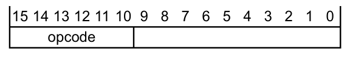

表 A5-1 列出了 16 位指令编码的分配情况。

| opcode | 指令或指令类别 |
| --- | --- |
| 00xxxx | 移位（立即数）、加、减、移动和比较（第 A5-130 页） |
| 010000 | 数据处理（第 A5-131 页） |
| 010001 | 特殊数据处理指令及分支与交换（第 A5-132 页） |
| 01001x | 从字面量池加载，参见 `LDR`（字面量）（第 A7-248 页） |
| 0101xx<br>011xxx<br>100xxx | 加载/存储单个数据项（第 A5-133 页） |
| 10100x | 生成 PC 相对地址，参见 `ADR`（第 A7-198 页） |
| 10101x | 生成 SP 相对地址，参见 `ADD`（SP 加立即数）（第 A7-194 页） |
| 1011xx | 杂项 16 位指令（第 A5-134 页） |
| 11000x | 存储多个寄存器，参见 `STM, STMIA, STMEA`（第 A7-383 页） |
| 11001x | 加载多个寄存器，参见 `LDM, LDMIA, LDMFD`（第 A7-242 页） |
| 1101xx | 条件分支与主管调用（第 A5-136 页） |
| 11100x | 无条件分支，参见 `B`（第 A7-205 页） |

### 2.1. 移位（立即数）、加、减、移动和比较

移位（立即数）、加、减、移动和比较指令的编码为：

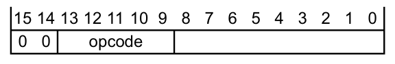

表 A5-2 列出了此空间中编码的分配情况。

| opcode | 指令 | 参见 |
| --- | --- | --- |
| 000xx | 逻辑左移ᵃ | `LSL`（立即数）（第 A7-282 页） |
| 001xx | 逻辑右移 | `LSR`（立即数）（第 A7-284 页） |
| 010xx | 算术右移 | `ASR`（立即数）（第 A7-203 页） |
| 01100 | 寄存器加法 | `ADD`（寄存器）（第 A7-192 页） |
| 01101 | 寄存器减法 | `SUB`（寄存器）（第 A7-404 页） |
| 01110 | 3 位立即数加法 | `ADD`（立即数）（第 A7-190 页） |
| 01111 | 3 位立即数减法 | `SUB`（立即数）（第 A7-402 页） |
| 100xx | 移动 | `MOV`（立即数）（第 A7-291 页） |
| 101xx | 比较 | `CMP`（立即数）（第 A7-223 页） |
| 110xx | 8 位立即数加法 | `ADD`（立即数）（第 A7-190 页） |
| 111xx | 8 位立即数减法 | `SUB`（立即数）（第 A7-402 页） |

a. 当 opcode 为 `0b00000` 且 bits[8:6] 为 `0b000` 时，此编码为 `MOV`（寄存器），参见第 A7-293 页的 `MOV`（寄存器）。

### 2.2. 数据处理

数据处理指令的编码为：

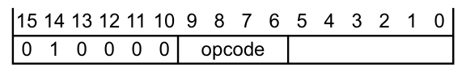

表 A5-3 列出了此空间中编码的分配情况。

| opcode | 指令 | 参见 |
| --- | --- | --- |
| 0000 | 按位与 | `AND`（寄存器）（第 A7-201 页） |
| 0001 | 按位异或 | `EOR`（寄存器）（第 A7-233 页） |
| 0010 | 逻辑左移 | `LSL`（寄存器）（第 A7-283 页） |
| 0011 | 逻辑右移 | `LSR`（寄存器）（第 A7-285 页） |
| 0100 | 算术右移 | `ASR`（寄存器）（第 A7-204 页） |
| 0101 | 带进位加法 | `ADC`（寄存器）（第 A7-188 页） |
| 0110 | 带借位减法 | `SBC`（寄存器）（第 A7-347 页） |
| 0111 | 循环右移 | `ROR`（寄存器）（第 A7-339 页） |
| 1000 | 设置按位与的标志 | `TST`（寄存器）（第 A7-420 页） |
| 1001 | 从 0 逆向减法 | `RSB`（立即数）（第 A7-341 页） |
| 1010 | 比较寄存器 | `CMP`（寄存器）（第 A7-224 页） |
| 1011 | 比较取负 | `CMN`（寄存器）（第 A7-222 页） |
| 1100 | 逻辑或 | `ORR`（寄存器）（第 A7-310 页） |
| 1101 | 两个寄存器相乘 | `MUL`（第 A7-302 页） |
| 1110 | 位清零 | `BIC`（寄存器）（第 A7-210 页） |
| 1111 | 按位取反 | `MVN`（寄存器）（第 A7-304 页） |

### 2.3. 特殊数据处理指令及分支与交换

特殊数据处理指令以及分支与交换指令的编码为：


表 A5-4 列出了此空间中编码的分配情况。

| opcode | 指令 | 参见 |
| --- | --- | --- |
| 00xx | 寄存器加法 | `ADD`（寄存器）（第 A7-192 页） |
| 0100 | UNPREDICTABLE | - |
| 0101 | 比较寄存器 | `CMP`（寄存器）（第 A7-224 页） |
| 011x<br>10xx | 移动寄存器 | `MOV`（寄存器）（第 A7-293 页） |
| 110x | 分支与交换 | `BX`（第 A7-215 页） |
| 111x | 带链接与交换的分支 | `BLX`（寄存器）（第 A7-214 页） |

### 2.4. 加载/存储单个数据项

加载/存储单个数据项指令的编码为：

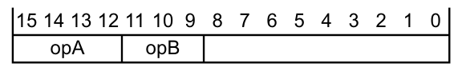

这些指令在 opA 中取下列值之一：

* `0b0101`。
* `0b011x`。
* `0b100x`。

表 A5-5 列出了此空间中编码的分配情况。

| opA | opB | 指令 | 参见 |
| --- | --- | --- | --- |
| 0101 | 000 | 存储寄存器 | `STR`（寄存器）（第 A7-388 页） |
| 0101 | 001 | 存储半字寄存器 | `STRH`（寄存器）（第 A7-399 页） |
| 0101 | 010 | 存储字节寄存器 | `STRB`（寄存器）（第 A7-391 页） |
| 0101 | 011 | 加载有符号字节寄存器 | `LDRSB`（寄存器）（第 A7-273 页） |
| 0101 | 100 | 加载寄存器 | `LDR`（寄存器）（第 A7-250 页） |
| 0101 | 101 | 加载半字寄存器 | `LDRH`（寄存器）（第 A7-267 页） |
| 0101 | 110 | 加载字节寄存器 | `LDRB`（寄存器）（第 A7-255 页） |
| 0101 | 111 | 加载有符号半字寄存器 | `LDRSH`（寄存器）（第 A7-278 页） |
| 0110 | 0xx | 存储寄存器 | `STR`（立即数）（第 A7-386 页） |
| 0110 | 1xx | 加载寄存器 | `LDR`（立即数）（第 A7-246 页） |
| 0111 | 0xx | 存储字节寄存器 | `STRB`（立即数）（第 A7-389 页） |
| 0111 | 1xx | 加载字节寄存器 | `LDRB`（立即数）（第 A7-252 页） |
| 1000 | 0xx | 存储半字寄存器 | `STRH`（立即数）（第 A7-397 页） |
| 1000 | 1xx | 加载半字寄存器 | `LDRH`（立即数）（第 A7-264 页） |
| 1001 | 0xx | SP 相对存储寄存器 | `STR`（立即数）（第 A7-386 页） |
| 1001 | 1xx | SP 相对加载寄存器 | `LDR`（立即数）（第 A7-246 页） |

### 2.5. 杂项 16 位指令

杂项 16 位指令的编码为：

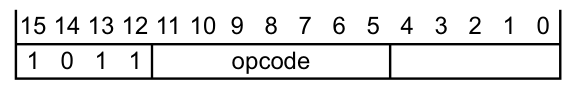

表 A5-6 列出了此空间中编码的分配情况。此空间中的其他编码为 **UNDEFINED**。

| opcode | 指令 | 参见 |
| --- | --- | --- |
| 0110011 | 更改处理器状态 | `CPS`（第 B5-673 页） |
| 00000xx | 立即数加到 SP | `ADD`（SP 加立即数）（第 A7-194 页） |
| 00001xx | 从 SP 减去立即数 | `SUB`（SP 减立即数）（第 A7-406 页） |
| 0001xxx | 为零则比较并分支 | `CBNZ, CBZ`（第 A7-216 页） |
| 001000x | 有符号半字扩展 | `SXTH`（第 A7-415 页） |
| 001001x | 有符号字节扩展 | `SXTB`（第 A7-413 页） |
| 001010x | 无符号半字扩展 | `UXTH`（第 A7-454 页） |
| 001011x | 无符号字节扩展 | `UXTB`（第 A7-452 页） |
| 0011xxx | 为零则比较并分支 | `CBNZ, CBZ`（第 A7-216 页） |
| 010xxxx | 压入多个寄存器 | `PUSH`（第 A7-322 页） |
| 1001xxx | 为非零则比较并分支 | `CBNZ, CBZ`（第 A7-216 页） |
| 101000x | 字内字节序反转 | `REV`（第 A7-335 页） |
| 101001x | 打包半字内字节序反转 | `REV16`（第 A7-336 页） |
| 101011x | 有符号半字字节序反转 | `REVSH`（第 A7-337 页） |
| 1011xxx | 为非零则比较并分支 | `CBNZ, CBZ`（第 A7-216 页） |
| 110xxxx | 弹出多个寄存器 | `POP`（第 A7-319 页） |
| 1110xxx | 断点 | `BKPT`（第 A7-212 页） |
| 1111xxx | If-Then 与提示 | If-Then 与提示（第 A5-135 页） |

#### 2.5.1. If-Then 与提示

If-Then 指令以及提示指令的编码为：

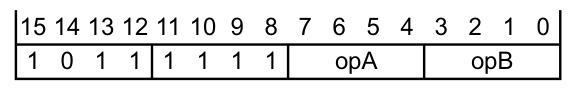

表 A5-7 列出了此空间中编码的分配情况。

此空间中的其他编码是未分配的提示。它们执行时表现为 `NOP`，但软件不得使用它们。

| opA | opB | 指令 | 参见 |
| --- | --- | --- | --- |
| xxxx | not 0000 | If-Then | `IT`（第 A7-236 页） |
| 0000 | 0000 | 空操作提示 | `NOP`（第 A7-306 页） |
| 0001 | 0000 | 让出提示 | `YIELD`（第 A7-506 页） |
| 0010 | 0000 | 等待事件提示 | `WFE`（第 A7-504 页） |
| 0011 | 0000 | 等待中断提示 | `WFI`（第 A7-505 页） |
| 0100 | 0000 | 发送事件提示 | `SEV`（第 A7-352 页） |

### 2.6. 条件分支与主管调用

条件分支和主管调用指令的编码为：

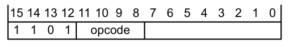

表 A5-8 列出了此空间中编码的分配情况。

| opcode | 指令 | 参见 |
| --- | --- | --- |
| not 111x | 条件分支 | `B`（第 A7-205 页） |
| 1110 | 永久 UNDEFINED | `UDF`（第 A7-425 页） |
| 1111 | 主管调用 | `SVC`（第 A7-409 页） |

## 3. 32 位 Thumb 指令编码

32 位 **Thumb** 指令的编码为：

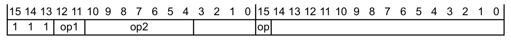

`op1 != 0b00`。如果 `op1 == 0b00`，则编码的是 16 位指令，参见第 A5-129 页的 **16 位 Thumb 指令编码**。

表 A5-9 列出了此空间中 **Armv7-M** Thumb 编码的分配情况。

| op1 | op2 | op | 指令类别 |
| --- | --- | --- | --- |
| 01 | 00xx0xx | x | 加载多个和存储多个（第 A5-144 页） |
| 01 | 00xx1xx | x | 加载/存储双字或独占、表分支（第 A5-145 页） |
| 01 | 01xxxxx | x | 数据处理（移位寄存器）（第 A5-150 页） |
| 01 | 1xxxxxx | x | 协处理器指令（第 A5-158 页） |
| 10 | x0xxxxx | 0 | 数据处理（修改的立即数）（第 A5-138 页） |
| 10 | x1xxxxx | 0 | 数据处理（纯二进制立即数）（第 A5-141 页） |
| 10 | xxxxxxx | 1 | 分支和杂项控制（第 A5-142 页） |
| 11 | 000xxx0 | x | 存储单个数据项（第 A5-149 页） |
| 11 | 00xx001 | x | 加载字节、内存提示（第 A5-148 页） |
| 11 | 00xx011 | x | 加载半字、内存提示（第 A5-147 页） |
| 11 | 00xx101 | x | 加载字（第 A5-146 页） |
| 11 | 00xx111 | x | UNDEFINED |
| 11 | 010xxxx | x | 数据处理（寄存器）（第 A5-152 页） |
| 11 | 0110xxx | x | 乘法、乘累加和绝对差（第 A5-156 页） |
| 11 | 0111xxx | x | 长乘法、长乘累加和除法（第 A5-156 页） |
| 11 | 1xxxxxx | x | 协处理器指令（第 A5-158 页） |

### 3.1. 数据处理（修改的立即数）

数据处理（修改的立即数）指令的编码为：

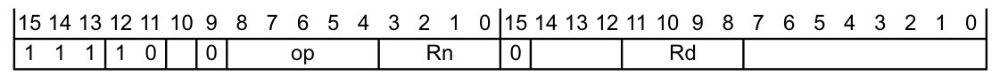

表 A5-10 列出了此空间中编码的分配情况。此空间中的其他编码为 **UNDEFINED**。

这些指令都使用修改的立即数常量，而不是简单的 12 位二进制数。这提供了更有用的取值范围。详细信息参见第 A5-139 页的 **Thumb 指令中的修改的立即数常量**。

| op | Rn | Rd | 指令 | 参见 |
| --- | --- | --- | --- | --- |
| 0000x | not 1111 |  | 按位与 | `AND`（立即数）（第 A7-200 页） |
| 0000x | 1111 |  | 测试 | `TST`（立即数）（第 A7-419 页） |
| 0001x |  |  | 位清零 | `BIC`（立即数）（第 A7-209 页） |
| 0010x | not 1111 |  | 按位或 | `ORR`（立即数）（第 A7-309 页） |
| 0010x | 1111 |  | 移动 | `MOV`（立即数）（第 A7-291 页） |
| 0011x | not 1111 |  | 按位或非 | `ORN`（立即数）（第 A7-307 页） |
| 0011x | 1111 |  | 按位取反 | `MVN`（立即数）（第 A7-303 页） |
| 0100x | not 1111 |  | 按位异或 | `EOR`（立即数）（第 A7-232 页） |
| 0100x | 1111 |  | 测试等价 | `TEQ`（立即数）（第 A7-417 页） |
| 1000x | not 1111 |  | 加法 | `ADD`（立即数）（第 A7-190 页） |
| 1000x | 1111 |  | 比较取负 | `CMN`（立即数）（第 A7-221 页） |
| 1010x |  |  | 带进位加法 | `ADC`（立即数）（第 A7-187 页） |
| 1011x |  |  | 带借位减法 | `SBC`（立即数）（第 A7-346 页） |
| 1101x | not 1111 |  | 减法 | `SUB`（立即数）（第 A7-402 页） |
| 1101x | 1111 |  | 比较 | `CMP`（立即数）（第 A7-223 页） |
| 1110x |  |  | 逆向减法 | `RSB`（立即数）（第 A7-341 页） |

### 3.2. Thumb 指令中的修改的立即数常量

**Thumb** 指令中修改的立即数常量的编码为：

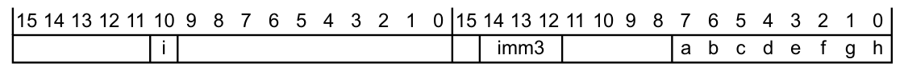

表 A5-11 列出了 **Thumb** 数据处理指令中可用的修改的立即数常量的范围，以及它们在指令的 a、b、c、d、e、f、g、h、i 和 imm3 字段中的编码方式。

| i:imm3:a | `<const>`ᵃ |
| --- | --- |
| 0000x | 00000000 00000000 00000000 abcdefgh |
| 0001x | 00000000 abcdefgh 00000000 abcdefghᵇ |
| 0010x | abcdefgh 00000000 abcdefgh 00000000ᵇ |
| 0011x | abcdefgh abcdefgh abcdefgh abcdefghᵇ |
| 01000 | 1bcdefgh 00000000 00000000 00000000 |
| 01001 | 01bcdefgh0000000 00000000 00000000 |
| 01010 | 001bcdefgh000000 00000000 00000000 |
| 01011 | 0001bcdefgh00000 00000000 00000000 |
| … | 8 位值移位到其他位置 |
| 11101 | 00000000 00000000 000001bc defgh000 |
| 11110 | 00000000 00000000 0000001b cdefgh00 |
| 11111 | 00000000 00000000 00000001 bcdefgh0 |

a. 本表中立即常量的值以二进制形式给出，以便将 abcdefgh 与编码图对应起来。在汇编语法中，立即数按常规方式指定（默认为十进制数）。

b. 如果 abcdefgh == 00000000，则为 **UNPREDICTABLE**。

**进位输出**

`i:imm3:a` 形式为 `00xxx` 的逻辑操作不影响进位标志。否则，设置标志的逻辑操作会将进位标志设置为修改的立即数常量的 bit[31]。

**修改的立即数常量的运算**

```arm
// ThumbExpandImm()
// ================

bits(32) ThumbExpandImm(bits(12) imm12)

    // 调用下列函数时传入的 APSR.C 参数不影响 imm32 结果。
    (imm32, -) = ThumbExpandImm_C(imm12, APSR.C);

    return imm32;

// ThumbExpandImm_C()
// ==================
(bits(32), bit) ThumbExpandImm_C(bits(12) imm12, bit carry_in)

    if imm12<11:10> == '00' then

        case imm12<9:8> of
            when '00'
                imm32 = ZeroExtend(imm12<7:0>, 32);
            when '01'
                if imm12<7:0> == '00000000' then UNPREDICTABLE;
                imm32 = '00000000' : imm12<7:0> : '00000000' : imm12<7:0>;
            when '10'
                if imm12<7:0> == '00000000' then UNPREDICTABLE;
                imm32 = imm12<7:0> : '00000000' : imm12<7:0> : '00000000';
            when '11'
                if imm12<7:0> == '00000000' then UNPREDICTABLE;
                imm32 = imm12<7:0> : imm12<7:0> : imm12<7:0> : imm12<7:0>;
        carry_out = carry_in;

    else

        unrotated_value = ZeroExtend('1':imm12<6:0>, 32);
        (imm32, carry_out) = ROR_C(unrotated_value, UInt(imm12<11:7>));

    return (imm32, carry_out);
```

### 3.3. 数据处理（纯二进制立即数）

数据处理（纯二进制立即数）指令的编码为：

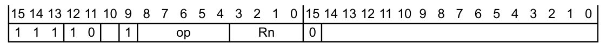

表 A5-12 列出了此空间中编码的分配情况。此空间中的其他编码为 **UNDEFINED**。

| op | Rn | 指令 | 参见 | Variant |
| --- | --- | --- | --- | --- |
| 00000 | not 1111 | 宽加法，12 位 | `ADD`（立即数）（第 A7-190 页） | 全部 |
| 00000 | 1111 | 生成 PC 相对地址 | `ADR`（第 A7-198 页） | 全部 |
| 00100 | - | 宽移动，16 位 | `MOV`（立即数）（第 A7-291 页） | 全部 |
| 01010 | not 1111 | 宽减法，12 位 | `SUB`（立即数）（第 A7-402 页） | 全部 |
| 01010 | 1111 | 生成 PC 相对地址 | `ADR`（第 A7-198 页） | 全部 |
| 01100 | - | 移动高半字，16 位 | `MOVT`（第 A7-296 页） | 全部 |
| 10000<br>10010ᵃ | - | 有符号饱和 | `SSAT`（第 A7-375 页） | 全部 |
| 10010ᵇ | - | 有符号饱和，两个 16 位 | `SSAT16`（第 A7-376 页） | v7E-M |
| 10100 | - | 有符号位段提取 | `SBFX`（第 A7-349 页） | 全部 |
| 10110 | not 1111 | 位段插入 | `BFI`（第 A7-208 页） | 全部 |
| 10110 | 1111 | 位段清零 | `BFC`（第 A7-207 页） | 全部 |
| 11000<br>11010ᵃ | - | 无符号饱和 | `USAT`（第 A7-444 页） | 全部 |
| 11010ᵇ | - | 无符号饱和 16 | `USAT16`（第 A7-445 页） | v7E-M |
| 11100 | - | 无符号位段提取 | `UBFX`（第 A7-424 页） | 全部 |

a. 在指令的第二个半字中，bits[14:12.7:6] != `0b00000`。

b. 在指令的第二个半字中，bits[14:12.7:6] == `0b00000`。

### 3.4. 分支和杂项控制

分支和杂项控制指令的行为为：

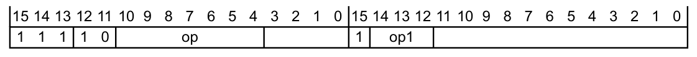

表 A5-13 列出了此空间中编码的分配情况。此空间中的其他编码为 **UNDEFINED**。

| op1 | op | 指令 | 参见 |
| --- | --- | --- | --- |
| 0x0 | not x111xxx | 条件分支 | `B`（第 A7-205 页） |
| 0x0 | 011100x | 移动到特殊寄存器 | `MSR`（第 A7-301 页） |
| 0x0 | 0111010 | - | 提示指令（第 A5-143 页） |
| 0x0 | 0111011 | - | 杂项控制指令（第 A5-143 页） |
| 0x0 | 011111x | 从特殊寄存器移动 | `MRS`（第 A7-300 页） |
| 010 | 1111111 | 永久 UNDEFINED | `UDF`（第 A7-425 页） |
| 0x1 | xxxxxxx | 分支 | `B`（第 A7-205 页） |
| 1x1 | xxxxxxx | 带链接的分支 | `BL`（第 A7-213 页） |

#### 3.4.1. 提示指令

32 位提示指令的编码为：

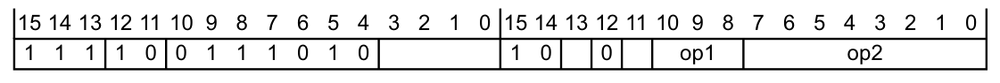

表 A5-14 列出了此空间中编码的分配情况。此空间中的其他编码是执行时表现为 `NOP` 的未分配提示。这些未分配的提示编码是保留的，软件不得使用它们。

| op1 | op2 | 指令 | 参见 |
| --- | --- | --- | --- |
| not 000 | xxxxxxxx | UNDEFINEDᵃ | - |
| 000 | 00000000 | 空操作提示 | `NOP`（第 A7-306 页） |
| 000 | 00000001 | 让出提示 | `YIELD`（第 A7-506 页） |
| 000 | 00000010 | 等待事件提示 | `WFE`（第 A7-504 页） |
| 000 | 00000011 | 等待中断提示 | `WFI`（第 A7-505 页） |
| 000 | 00000100 | 发送事件提示 | `SEV`（第 A7-352 页） |
| 000 | 00010100 | 推测数据消耗屏障 | `CSDB`（第 A7-228 页） |
| 000 | 1111xxxx | 调试提示 | `DBG`（第 A7-229 页） |

a. 在 **Armv7-A** 和 **Armv7-R** 体系结构配置中，这些编码提供 `CPS` 指令的 32 位形式。

#### 3.4.2. 杂项控制指令

杂项控制指令的编码为：

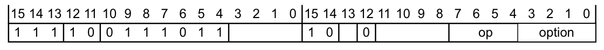

表 A5-15 列出了此空间中编码的分配情况。在 **Armv7-M** 中，此空间中的其他编码为 **UNDEFINED**。

| opc | option | 指令 | 参见 |
| --- | --- | --- | --- |
| 0010 |  | 清除独占 | `CLREX`（第 A7-219 页） |
| 0100 | !=0x00 | 数据同步屏障 | `DSB`（第 A7-231 页） |
| 0100 | 0000 | 推测存储绕过屏障 | `SSBB`（第 A7-378 页） |
| 0100 | 0100 | 物理推测存储绕过屏障 | `PSSBB`（第 A7-321 页） |
| 0101 |  | 数据内存屏障 | `DMB`（第 A7-230 页） |
| 0110 |  | 指令同步屏障 | `ISB`（第 A7-235 页） |

### 3.5. 加载多个和存储多个

加载多个或存储多个指令的编码为：

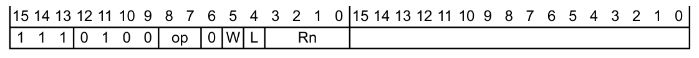

表 A5-16 列出了此空间中编码的分配情况。此空间中的其他编码为 **UNDEFINED**。

| op | L | W:Rn | 指令 | 参见 |
| --- | --- | --- | --- | --- |
| 01 | 0 |  | 存储多个（后增，空升序） | `STM, STMIA, STMEA`（第 A7-383 页） |
| 01 | 1 | not 11101 | 加载多个（后增，满降序） | `LDM, LDMIA, LDMFD`（第 A7-242 页） |
| 01 | 1 | 11101 | 从栈弹出多个寄存器 | `POP`（第 A7-319 页） |
| 10 | 0 | not 11101 | 存储多个（先减，满降序） | `STMDB, STMFD`（第 A7-385 页） |
| 10 | 0 | 11101 | 将多个寄存器压入栈 | `PUSH`（第 A7-322 页） |
| 10 | 1 | - | 加载多个（先减，空升序） | `LDMDB, LDMEA`（第 A7-244 页） |

### 3.6. 加载/存储双字或独占、表分支

加载/存储双字或独占指令以及表分支指令的编码为：

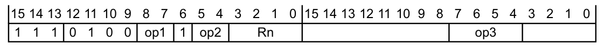

表 A5-17 列出了此空间中编码的分配情况。此空间中的其他编码为 **UNDEFINED**。

| op1 | op2 | op3 | 指令 | 参见 |
| --- | --- | --- | --- | --- |
| 00 | 00 | xxxx | 存储独占寄存器 | `STREX`（第 A7-394 页） |
| 00 | 01 | xxxx | 加载独占寄存器 | `LDREX`（第 A7-261 页） |
| 0x | 10 | xxxx | 存储双字寄存器 | `STRD`（立即数）（第 A7-393 页） |
| 1x | x0 | xxxx | 存储双字寄存器 | `STRD`（立即数）（第 A7-393 页） |
| 0x | 11 | xxxx | 加载双字寄存器 | `LDRD`（立即数）（第 A7-257 页）、`LDRD`（字面量）（第 A7-259 页） |
| 1x | x1 | xxxx | 加载双字寄存器 | `LDRD`（立即数）（第 A7-257 页）、`LDRD`（字面量）（第 A7-259 页） |
| 01 | 00 | 0100 | 存储独占字节寄存器 | `STREXB`（第 A7-395 页） |
| 01 | 00 | 0101 | 存储独占半字寄存器 | `STREXH`（第 A7-396 页） |
| 01 | 01 | 0000 | 表分支（字节） | `TBB, TBH`（第 A7-416 页） |
| 01 | 01 | 0001 | 表分支（半字） | `TBB, TBH`（第 A7-416 页） |
| 01 | 01 | 0100 | 加载独占字节寄存器 | `LDREXB`（第 A7-262 页） |
| 01 | 01 | 0101 | 加载独占半字寄存器 | `LDREXH`（第 A7-263 页） |

### 3.7. 加载字

加载字指令的编码为：

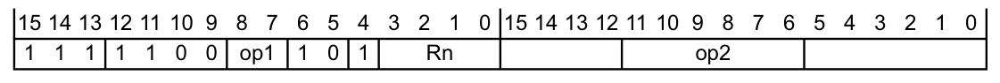

表 A5-18 列出了此空间中编码的分配情况。此空间中的其他编码为 **UNDEFINED**。

| op1 | op2 | Rn | 指令 | 参见 |
| --- | --- | --- | --- | --- |
| 01 | xxxxxx | not 1111 | 加载寄存器 | `LDR`（立即数）（第 A7-246 页） |
| 00 | 1xx1xx | not 1111 | 加载寄存器 | `LDR`（立即数）（第 A7-246 页） |
| 00 | 1100xx | not 1111 | 加载寄存器 | `LDR`（立即数）（第 A7-246 页） |
| 00 | 1110xx | not 1111 | 非特权加载寄存器 | `LDRT`（第 A7-281 页） |
| 00 | 000000 | not 1111 | 加载寄存器 | `LDR`（寄存器）（第 A7-250 页） |
| 0x | xxxxxx | 1111 | 加载寄存器 | `LDR`（字面量）（第 A7-248 页） |

### 3.8. 加载半字、内存提示

加载半字指令以及未分配的内存提示的编码为：

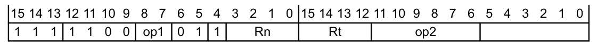

表 A5-19 列出了此空间中编码的分配情况。此空间中的其他编码为 **UNDEFINED**。

| op1 | op2 | Rn | Rt | 指令 | 参见 |
| --- | --- | --- | --- | --- | --- |
| 0x | xxxxxx | 1111 | not 1111 | 加载半字寄存器 | `LDRH`（字面量）（第 A7-266 页） |
| 00 | 1xx1xx | not 1111 | not 1111 | 加载半字寄存器 | `LDRH`（立即数）（第 A7-264 页） |
| 00 | 1100xx | not 1111 | not 1111 | 加载半字寄存器 | `LDRH`（立即数）（第 A7-264 页） |
| 01 | xxxxxx | not 1111 | not 1111 | 加载半字寄存器 | `LDRH`（立即数）（第 A7-264 页） |
| 00 | 000000 | not 1111 | not 1111 | 加载半字寄存器 | `LDRH`（寄存器）（第 A7-267 页） |
| 00 | 1110xx | not 1111 | not 1111 | 非特权加载半字寄存器 | `LDRHT`（第 A7-269 页） |
| 00 | 000000 | not 1111 | 1111 | 未分配的内存提示，视为 NOPᵃ | - |
| 00 | 1100xx | not 1111 | 1111 | 未分配的内存提示，视为 NOPᵃ | - |
| 01 | xxxxxx | not 1111 | 1111 | 未分配的内存提示，视为 NOPᵃ | - |
| 00 | 1xx1xx | not 1111 | 1111 | UNPREDICTABLE | - |
| 00 | 1110xx | not 1111 | 1111 | UNPREDICTABLE | - |
| 0x | xxxxxx | 1111 | 1111 | UNPREDICTABLE | - |
| 10 | 1xx1xx | not 1111 | not 1111 | 加载有符号半字寄存器 | `LDRSH`（立即数）（第 A7-275 页） |
| 10 | 1100xx | not 1111 | not 1111 | 加载有符号半字寄存器 | `LDRSH`（立即数）（第 A7-275 页） |
| 11 | xxxxxx | not 1111 | not 1111 | 加载有符号半字寄存器 | `LDRSH`（立即数）（第 A7-275 页） |
| 1x | xxxxxx | 1111 | not 1111 | 加载有符号半字寄存器 | `LDRSH`（字面量）（第 A7-277 页） |
| 10 | 000000 | not 1111 | not 1111 | 加载有符号半字寄存器 | `LDRSH`（寄存器）（第 A7-278 页） |
| 10 | 1110xx | not 1111 | not 1111 | 非特权加载有符号半字寄存器 | `LDRSHT`（第 A7-280 页） |
| 10 | 000000 | not 1111 | 1111 | 未分配的内存提示，视为 NOPᵃ | - |
| 10 | 1100xx | not 1111 | 1111 | 未分配的内存提示，视为 NOPᵃ | - |
| 1x | xxxxxx | 1111 | 1111 | 未分配的内存提示，视为 NOPᵃ | - |
| 10 | 1xx1xx | not 1111 | 1111 | unpredictable | - |
| 10 | 1110xx | not 1111 | 1111 | unpredictable | - |
| 11 | xxxxxx | not 1111 | 1111 | 未分配的内存提示，视为 NOPᵃ | - |

a. 软件不得使用这些编码。

### 3.9. 加载字节、内存提示

加载字节指令以及内存提示的编码为：

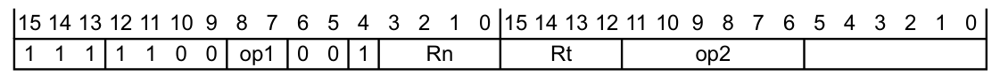

表 A5-20 列出了此空间中编码的分配情况。此空间中的其他编码为 **UNDEFINED**。

| op1 | op2 | Rn | Rt | 指令 | 参见 |
| --- | --- | --- | --- | --- | --- |
| 0x | xxxxxx | 1111 | not 1111 | 加载字节寄存器 | `LDRB`（字面量）（第 A7-254 页） |
| 01 | xxxxxx | not 1111 | not 1111 | 加载字节寄存器 | `LDRB`（立即数）（第 A7-252 页） |
| 00 | 1xx1xx | not 1111 | not 1111 | 加载字节寄存器 | `LDRB`（立即数）（第 A7-252 页） |
| 00 | 1100xx | not 1111 | not 1111 | 加载字节寄存器 | `LDRB`（立即数）（第 A7-252 页） |
| 00 | 1110xx | not 1111 | not 1111 | 非特权加载字节寄存器 | `LDRBT`（第 A7-256 页） |
| 00 | 000000 | not 1111 | not 1111 | 加载字节寄存器 | `LDRB`（寄存器）（第 A7-255 页） |
| 1x | xxxxxx | 1111 | not 1111 | 加载有符号字节寄存器 | `LDRSB`（字面量）（第 A7-272 页） |
| 11 | xxxxxx | not 1111 | not 1111 | 加载有符号字节寄存器 | `LDRSB`（立即数）（第 A7-270 页） |
| 10 | 1xx1xx | not 1111 | not 1111 | 加载有符号字节寄存器 | `LDRSB`（立即数）（第 A7-270 页） |
| 10 | 1100xx | not 1111 | not 1111 | 加载有符号字节寄存器 | `LDRSB`（立即数）（第 A7-270 页） |
| 10 | 1110xx | not 1111 | not 1111 | 非特权加载有符号字节寄存器 | `LDRSBT`（第 A7-274 页） |
| 10 | 000000 | not 1111 | not 1111 | 加载有符号字节寄存器 | `LDRSB`（寄存器）（第 A7-273 页） |
| 0x | xxxxxx | 1111 | 1111 | 预加载数据 | `PLD`（字面量）（第 A7-314 页） |
| 00 | 1100xx | not 1111 | 1111 | 预加载数据 | `PLD`（立即数）（第 A7-313 页） |
| 01 | xxxxxx | not 1111 | 1111 | 预加载数据 | `PLD`（立即数）（第 A7-313 页） |
| 00 | 000000 | not 1111 | 1111 | 预加载数据 | `PLD`（寄存器）（第 A7-315 页） |
| 00 | 1xx1xx | not 1111 | 1111 | UNPREDICTABLE | - |
| 00 | 1110xx | not 1111 | 1111 | UNPREDICTABLE | - |
| 1x | xxxxxx | 1111 | 1111 | 预加载指令 | `PLI`（立即数，字面量）（第 A7-316 页） |
| 11 | xxxxxx | not 1111 | 1111 | 预加载指令 | `PLI`（立即数，字面量）（第 A7-316 页） |
| 10 | 1100xx | not 1111 | 1111 | 预加载指令 | `PLI`（立即数，字面量）（第 A7-316 页） |
| 10 | 000000 | not 1111 | 1111 | 预加载指令 | `PLI`（寄存器）（第 A7-318 页） |
| 10 | 1xx1xx | not 1111 | 1111 | UNPREDICTABLE | - |
| 10 | 1110xx | not 1111 | 1111 | UNPREDICTABLE | - |

### 3.10. 存储单个数据项

存储单个数据项指令的编码为：

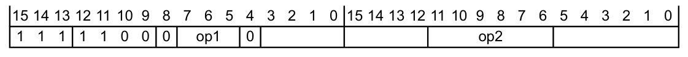

表 A5-21 列出了此空间中编码的分配情况。此空间中的其他编码为 **UNDEFINED**。

| op1 | op2 | 指令 | 参见 |
| --- | --- | --- | --- |
| 100 | xxxxxx | 存储字节寄存器 | `STRB`（立即数）（第 A7-389 页） |
| 000 | 1xxxxx | 存储字节寄存器 | `STRB`（立即数）（第 A7-389 页） |
| 000 | 0xxxxx | 存储字节寄存器 | `STRB`（寄存器）（第 A7-391 页） |
| 101 | xxxxxx | 存储半字寄存器 | `STRH`（立即数）（第 A7-397 页） |
| 001 | 1xxxxx | 存储半字寄存器 | `STRH`（立即数）（第 A7-397 页） |
| 001 | 0xxxxx | 存储半字寄存器 | `STRH`（寄存器）（第 A7-399 页） |
| 110 | xxxxxx | 存储寄存器 | `STR`（立即数）（第 A7-386 页） |
| 010 | 1xxxxx | 存储寄存器 | `STR`（立即数）（第 A7-386 页） |
| 010 | 0xxxxx | 存储寄存器 | `STR`（寄存器）（第 A7-388 页） |

### 3.11. 数据处理（移位寄存器）

数据处理（移位寄存器）指令的编码为：

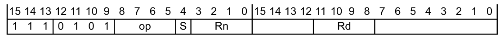

表 A5-22 列出了此空间中编码的分配情况。此空间中的其他编码为 **UNDEFINED**。

| op | Rn | Rd | S | 指令 | 参见 | Variant |
| --- | --- | --- | --- | --- | --- | --- |
| 0000 | - | not 1111 | x | 按位与 | `AND`（寄存器）（第 A7-201 页） | 全部 |
| 0000 | - | 1111 | 0 | UNPREDICTABLE | - | - |
| 0000 | - | 1111 | 1 | 测试 | `TST`（寄存器）（第 A7-420 页） | 全部 |
| 0001 | - | - | - | 位清零 | `BIC`（寄存器）（第 A7-210 页） | 全部 |
| 0010 | not 1111 | - | - | 按位或 | `ORR`（寄存器）（第 A7-310 页） | 全部 |
| 0010 | 1111 | - | - | **移动寄存器和立即数移位**（第 A5-150 页） | - | - |
| 0011 | not 1111 | - | - | 按位或非 | `ORN`（寄存器）（第 A7-308 页） | 全部 |
| 0011 | 1111 | - | - | 按位取反 | `MVN`（寄存器）（第 A7-304 页） | 全部 |
| 0100 | - | not 1111 | - | 按位异或 | `EOR`（寄存器）（第 A7-233 页） | 全部 |
| 0100 | - | 1111 | 0 | UNPREDICTABLE | - | - |
| 0100 | - | 1111 | 1 | 测试等价 | `TEQ`（寄存器）（第 A7-418 页） | 全部 |
| 0110 | - | - | - | 打包半字 | `PKHBT, PKHTB`（第 A7-312 页） | v7E-M |
| 1000 | - | not 1111 | - | 加法 | `ADD`（寄存器）（第 A7-192 页） | 全部 |
| 1000 | - | 1111 | 0 | UNPREDICTABLE | - | - |
| 1000 | - | 1111 | 1 | 比较取负 | `CMN`（寄存器）（第 A7-222 页） | 全部 |
| 1010 | - | - | - | 带进位加法 | `ADC`（寄存器）（第 A7-188 页） | 全部 |
| 1011 | - | - | - | 带借位减法 | `SBC`（寄存器）（第 A7-347 页） | 全部 |
| 1101 | - | not 1111 | - | 减法 | `SUB`（寄存器）（第 A7-404 页） | 全部 |
| 1101 | - | 1111 | 0 | UNPREDICTABLE | - | - |
| 1101 | - | 1111 | 1 | 比较 | `CMP`（寄存器）（第 A7-224 页） | 全部 |
| 1110 | - | - | - | 逆向减法 | `RSB`（寄存器）（第 A7-342 页） | 全部 |

#### 3.11.1. 移动寄存器和立即数移位

移动寄存器和立即数移位指令的编码为：

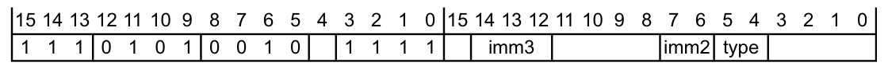

表 A5-23 列出了此空间中编码的分配情况。

| type | imm3:imm2 | 指令 | 参见 |
| --- | --- | --- | --- |
| 00 | 00000 | 移动 | `MOV`（寄存器）（第 A7-293 页） |
| 00 | not 00000 | 逻辑左移 | `LSL`（立即数）（第 A7-282 页） |
| 01 | - | 逻辑右移 | `LSR`（立即数）（第 A7-284 页） |
| 10 | - | 算术右移 | `ASR`（立即数）（第 A7-203 页） |
| 11 | 00000 | 带扩展的循环右移 | `RRX`（第 A7-340 页） |
| 11 | not 00000 | 循环右移 | `ROR`（立即数）（第 A7-338 页） |

### 3.12. 数据处理（寄存器）

数据处理（寄存器）指令的编码为：

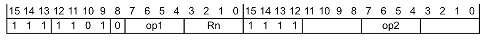

如果在指令的第二个半字中 bits[15:12] != `0b1111`，则该指令为 **UNDEFINED**。

表 A5-24 列出了此空间中编码的分配情况。此空间中的其他编码为 **UNDEFINED**。

| op1 | op2 | Rn | 指令 | 参见 | Variant |
| --- | --- | --- | --- | --- | --- |
| 000x | 0000 |  | 逻辑左移 | `LSL`（寄存器）（第 A7-283 页） | 全部 |
| 001x | 0000 |  | 逻辑右移 | `LSR`（寄存器）（第 A7-285 页） | 全部 |
| 010x | 0000 |  | 算术右移 | `ASR`（寄存器）（第 A7-204 页） | 全部 |
| 011x | 0000 |  | 循环右移 | `ROR`（寄存器）（第 A7-339 页） | 全部 |
| 0000 | 1xxx | not 1111 | 有符号半字扩展并相加 | `SXTAH`（第 A7-412 页） | v7E-M |
| 0000 | 1xxx | 1111 | 有符号半字扩展 | `SXTH`（第 A7-415 页） | 全部 |
| 0001 | 1xxx | not 1111 | 无符号半字扩展并相加 | `UXTAH`（第 A7-451 页） | v7E-M |
| 0001 | 1xxx | 1111 | 无符号半字扩展 | `UXTH`（第 A7-454 页） | 全部 |
| 0010 | 1xxx | not 1111 | 有符号字节 16 扩展并相加 | `SXTAB16`（第 A7-411 页） | v7E-M |
| 0010 | 1xxx | 1111 | 有符号字节 16 扩展 | `SXTB16`（第 A7-414 页） | v7E-M |
| 0011 | 1xxx | not 1111 | 无符号字节 16 扩展并相加 | `UXTAB16`（第 A7-450 页） | v7E-M |
| 0011 | 1xxx | 1111 | 无符号字节 16 扩展 | `UXTB16`（第 A7-453 页） | v7E-M |
| 0100 | 1xxx | not 1111 | 有符号字节扩展并相加 | `SXTAB`（第 A7-410 页） | v7E-M |
| 0100 | 1xxx | 1111 | 有符号字节扩展 | `SXTB`（第 A7-413 页） | 全部 |
| 0101 | 1xxx | not 1111 | 无符号字节扩展并相加 | `UXTAB`（第 A7-449 页） | v7E-M |
| 0101 | 1xxx | 1111 | 无符号字节扩展 | `UXTB`（第 A7-452 页） | 全部 |
| 1xxx | 00xx | - | **有符号并行加法和减法**（第 A5-152 页） | - | - |
| 1xxx | 01xx | - | **无符号并行加法和减法**（第 A5-153 页） | - | - |
| 10xx | 10xx | - | **杂项操作**（第 A5-155 页） | - | - |

### 3.13. 并行加法和减法，有符号

有符号并行加法和减法指令的编码为：

如果在指令的第二个半字中 bits[15:12] != `0b1111`，则该指令为 **UNDEFINED**。

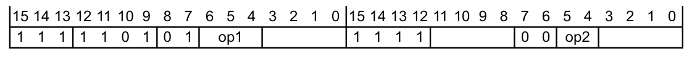

表 A5-25 列出了此空间中编码的分配情况。此空间中的其他编码为 **UNDEFINED**。

| op1 | op2 | 指令 | 参见 | Variant |
| --- | --- | --- | --- | --- |
| 001 | 00 | 16 位加法 | `SADD16`（第 A7-343 页） | v7E-M |
| 010 | 00 | 加减 | `SASX`（第 A7-345 页） | v7E-M |
| 110 | 00 | 减加 | `SSAX`（第 A7-377 页） | v7E-M |
| 101 | 00 | 16 位减法 | `SSUB16`（第 A7-379 页） | v7E-M |
| 000 | 00 | 8 位加法 | `SADD8`（第 A7-344 页） | v7E-M |
| 100 | 00 | 8 位减法 | `SSUB8`（第 A7-380 页） | v7E-M |
|  |  | **饱和指令** |  |  |
| 001 | 01 | 饱和 16 位加法 | `QADD16`（第 A7-325 页） | v7E-M |
| 010 | 01 | 饱和加减 | `QASX`（第 A7-327 页） | v7E-M |
| 110 | 01 | 饱和减加 | `QSAX`（第 A7-330 页） | v7E-M |
| 101 | 01 | 饱和 16 位减法 | `QSUB16`（第 A7-332 页） | v7E-M |
| 000 | 01 | 饱和 8 位加法 | `QADD8`（第 A7-326 页） | v7E-M |
| 100 | 01 | 饱和 8 位减法 | `QSUB8`（第 A7-333 页） | v7E-M |
|  |  | **减半指令** |  |  |
| 001 | 10 | 减半 16 位加法 | `SHADD16`（第 A7-353 页） | v7E-M |
| 010 | 10 | 减半加减 | `SHASX`（第 A7-355 页） | v7E-M |
| 110 | 10 | 减半减加 | `SHSAX`（第 A7-356 页） | v7E-M |
| 101 | 10 | 减半 16 位减法 | `SHSUB16`（第 A7-357 页） | v7E-M |
| 000 | 10 | 减半 8 位加法 | `SHADD8`（第 A7-354 页） | v7E-M |
| 100 | 10 | 减半 8 位减法 | `SHSUB8`（第 A7-358 页） | v7E-M |

### 3.14. 并行加法和减法，无符号

无符号并行加法和减法指令的编码为：

如果在指令的第二个半字中 bits[15:12] != `0b1111`，则该指令为 **UNDEFINED**。

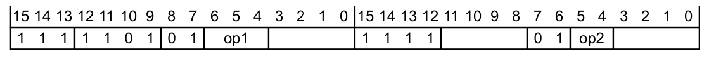

表 A5-26 列出了此空间中编码的分配情况。此空间中的其他编码为 **UNDEFINED**。

| op1 | op2 | 指令 | 参见 | Variant |
| --- | --- | --- | --- | --- |
| 001 | 00 | 16 位加法 | `UADD16`（第 A7-421 页） | v7E-M |
| 010 | 00 | 加减 | `UASX`（第 A7-423 页） | v7E-M |
| 110 | 00 | 减加 | `USAX`（第 A7-446 页） | v7E-M |
| 101 | 00 | 16 位减法 | `USUB16`（第 A7-447 页） | v7E-M |
| 000 | 00 | 8 位加法 | `UADD8`（第 A7-422 页） | v7E-M |
| 100 | 00 | 8 位减法 | `USUB8`（第 A7-448 页） | v7E-M |
|  |  | **饱和指令** |  |  |
| 001 | 01 | 饱和 16 位加法 | `UQADD16`（第 A7-436 页） | v7E-M |
| 010 | 01 | 饱和加减 | `UQASX`（第 A7-438 页） | v7E-M |
| 110 | 01 | 饱和减加 | `UQSAX`（第 A7-439 页） | v7E-M |
| 101 | 01 | 饱和 16 位减法 | `UQSUB16`（第 A7-440 页） | v7E-M |
| 000 | 01 | 饱和 8 位加法 | `UQADD8`（第 A7-437 页） | v7E-M |
| 100 | 01 | 饱和 8 位减法 | `UQSUB8`（第 A7-441 页） | v7E-M |
|  |  | **减半指令** |  |  |
| 001 | 10 | 减半 16 位加法 | `UHADD16`（第 A7-427 页） | v7E-M |
| 010 | 10 | 减半加减 | `UHASX`（第 A7-429 页） | v7E-M |
| 110 | 10 | 减半减加 | `UHSAX`（第 A7-430 页） | v7E-M |
| 101 | 10 | 减半 16 位减法 | `UHSUB16`（第 A7-431 页） | v7E-M |
| 000 | 10 | 减半 8 位加法 | `UHADD8`（第 A7-428 页） | v7E-M |
| 100 | 10 | 减半 8 位减法 | `UHSUB8`（第 A7-432 页） | v7E-M |

### 3.15. 杂项操作

某些杂项指令的编码为：

如果在指令的第二个半字中 bits[15:12] != `0b1111`，则该指令为 **UNDEFINED**。

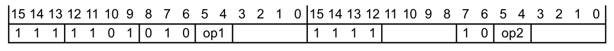

表 A5-27 列出了此空间中编码的分配情况。此空间中的其他编码为 **UNDEFINED**。

| op1 | op2 | 指令 | 参见 | Variant |
| --- | --- | --- | --- | --- |
| 00 | 00 | 饱和加法 | `QADD`（第 A7-324 页） | v7E-M |
| 00 | 01 | 饱和加倍加法 | `QDADD`（第 A7-328 页） | v7E-M |
| 00 | 10 | 饱和减法 | `QSUB`（第 A7-331 页） | v7E-M |
| 00 | 11 | 饱和加倍减法 | `QDSUB`（第 A7-329 页） | v7E-M |
| 01 | 00 | 字内字节序反转 | `REV`（第 A7-335 页） | 全部 |
| 01 | 01 | 打包半字内字节序反转 | `REV16`（第 A7-336 页） | 全部 |
| 01 | 10 | 位反转 | `RBIT`（第 A7-334 页） | 全部 |
| 01 | 11 | 有符号半字字节序反转 | `REVSH`（第 A7-337 页） | 全部 |
| 10 | 00 | 选择字节 | `SEL`（第 A7-351 页） | v7E-M |
| 11 | 00 | 统计前导零个数 | `CLZ`（第 A7-220 页） | 全部 |

### 3.16. 乘法、乘累加和绝对差

乘法、乘累加和绝对差指令的编码为：

如果在指令的第二个半字中 bits[7:6] != `0b00`，则该指令为 **UNDEFINED**。

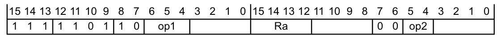

表 A5-28 列出了此空间中编码的分配情况。此空间中的其他编码为 **UNDEFINED**。

| op1 | op2 | Ra | 指令 | 参见 | Variant |
| --- | --- | --- | --- | --- | --- |
| 000 | 00 | not 1111 | 乘累加 | `MLA`（第 A7-289 页） | 全部 |
| 000 | 00 | 1111 | 乘法 | `MUL`（第 A7-302 页） | 全部 |
| 000 | 01 | - | 乘减 | `MLS`（第 A7-290 页） | 全部 |
| 001 | - | not 1111 | 半字有符号乘累加 | `SMLABB, SMLABT, SMLATB, SMLATT`（第 A7-359 页） | v7E-M |
| 001 | - | 1111 | 半字有符号乘法 | `SMULBB, SMULBT, SMULTB, SMULTT`（第 A7-371 页） | v7E-M |
| 010 | 0x | not 1111 | 双路有符号乘累加 | `SMLAD, SMLADX`（第 A7-360 页） | v7E-M |
| 010 | 0x | 1111 | 双路有符号乘加 | `SMUAD, SMUADX`（第 A7-370 页） | v7E-M |
| 011 | 0x | not 1111 | 半字有符号乘累加（字 × 半字） | `SMLAWB, SMLAWT`（第 A7-364 页） | v7E-M |
| 011 | 0x | 1111 | 半字有符号乘法（字 × 半字） | `SMULWB, SMULWT`（第 A7-373 页） | v7E-M |
| 100 | 0x | not 1111 | 双路有符号乘减 | `SMLSD, SMLSDX`（第 A7-365 页） | v7E-M |
| 100 | 0x | 1111 | 双路有符号乘减 | `SMUSD, SMUSDX`（第 A7-374 页） | v7E-M |
| 101 | 0x | not 1111 | 有符号最高字乘累加 | `SMMLA, SMMLAR`（第 A7-367 页） | v7E-M |
| 101 | 0x | 1111 | 有符号最高字乘法 | `SMMUL, SMMULR`（第 A7-369 页） | v7E-M |
| 110 | 0x | - | 有符号最高字乘减 | `SMMLS, SMMLSR`（第 A7-368 页） | v7E-M |
| 111 | 00 | 1111 | 无符号绝对差之和并累加 | `USADA8`（第 A7-443 页） | v7E-M |
| 111 | 00 | not 1111 | 无符号绝对差之和 | `USAD8`（第 A7-442 页） | v7E-M |

### 3.17. 长乘法、长乘累加和除法

长乘法、长乘累加和除法指令的编码为：

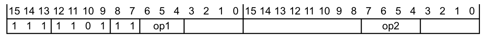

表 A5-29 列出了此空间中编码的分配情况。此空间中的其他编码为 **UNDEFINED**。

| op1 | op2 | 指令 | 参见 | Variant |
| --- | --- | --- | --- | --- |
| 000 | 0000 | 有符号长乘法 | `SMULL`（第 A7-372 页） | 全部 |
| 001 | 1111 | 有符号除法 | `SDIV`（第 A7-350 页） | 全部 |
| 010 | 0000 | 无符号长乘法 | `UMULL`（第 A7-435 页） | 全部 |
| 011 | 1111 | 无符号除法 | `UDIV`（第 A7-426 页） | 全部 |
| 100 | 0000 | 有符号长乘累加 | `SMLAL`（第 A7-361 页） | 全部 |
| 10xx |  | 半字有符号长乘累加 | `SMLALBB, SMLALBT, SMLALTB, SMLALTT`（第 A7-362 页） | v7E-M |
| 110x |  | 双路有符号长乘累加 | `SMLALD, SMLALDX`（第 A7-363 页） | v7E-M |
| 101 | 110x | 双路有符号长乘减 | `SMLSLD, SMLSLDX`（第 A7-366 页） | v7E-M |
| 110 | 0000 | 无符号长乘累加 | `UMLAL`（第 A7-434 页） | 全部 |
| 110 | 0110 | 无符号长乘双累加 | `UMAAL`（第 A7-433 页） | v7E-M |

### 3.18. 协处理器指令

协处理器指令的编码为：

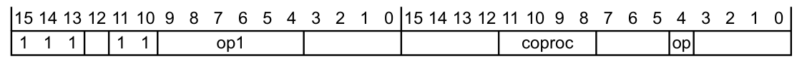

表 A5-30 列出了此空间中编码的分配情况。此空间中的其他编码为 **UNDEFINED**。

| op1 | op | coproc | 指令 | 参见 |
| --- | --- | --- | --- | --- |
| 0xxxx0ᵃ | x | xxxx | 存储协处理器 | `STC, STC2`（第 A7-381 页） |
| 0xxxx1ᵃ | x | xxxx | 加载协处理器 | `LDC, LDC2`（立即数）（第 A7-238 页）、`LDC, LDC2`（字面量）（第 A7-240 页） |
| 000100 | x | xxxx | 从两个 Arm 内核寄存器移动到协处理器 | `MCRR, MCRR2`（第 A7-288 页） |
| 000101 | x | xxxx | 从协处理器移动到两个 Arm 内核寄存器 | `MRRC, MRRC2`（第 A7-299 页） |
| 10xxxx | 0 | xxxx | 协处理器数据操作 | `CDP, CDP2`（第 A7-217 页） |
| 10xxx0 | 1 | xxxx | 从 Arm 内核寄存器移动到协处理器 | `MCR, MCR2`（第 A7-286 页） |
| 10xxx1 | 1 | xxxx | 从协处理器移动到 Arm 内核寄存器 | `MRC, MRC2`（第 A7-297 页） |

a. 但不包括 `000x0x`。

**注意：** 仅当目标协处理器存在并在相应特权级别上使能了访问时，协处理器指令才会成功执行，否则会产生未定义指令 UsageFault，参见第 B3-614 页的 **协处理器访问控制寄存器 CPACR**。在所有其他情况下，协处理器指令会产生 UsageFault 异常，且 UFSR.NOCP 位被置为 1，参见第 B3-611 页的 **UsageFault 状态寄存器 UFSR**。
