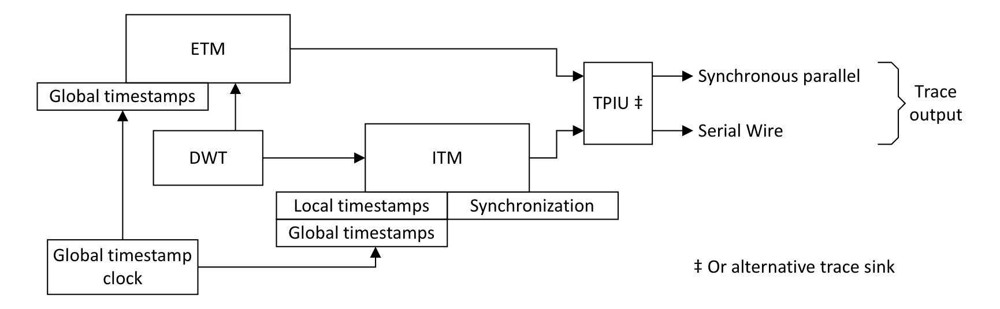

本文译自 Part C《调试架构》（Debug Architecture） Chapter C1《Armv7-M 调试》（Armv7-M Debug）。

本章描述 **Armv7-M** 调试架构，包括若干仅 M 配置文件支持的调试特性。处理器实现侧的组件说明参见 Cortex-M7 TRM 的[调试](../../../m7-trm/debug/index.md)、[ITM](../../../m7-trm/itm/index.md)、[DWT](../../../m7-trm/dwt/index.md) 与 [TPIU](../../../m7-trm/tpiu/index.md) 页面；本文给出体系结构侧的设施定义与行为。本章包含以下小节：

* 第 C1-682 页的 **Armv7-M 调试引言**。
* 第 C1-686 页的 **调试访问端口**。
* 第 C1-688 页的 **Armv7-M 调试特性**。
* 第 C1-693 页的 **调试与复位**。
* 第 C1-694 页的 **调试事件行为**。
* 第 C1-699 页的 **调试系统寄存器**。
* 第 C1-709 页的 **仪表化跟踪宏单元**。
* 第 C1-719 页的 **数据观察点与跟踪单元**。
* 第 C1-749 页的 **嵌入式跟踪宏单元支持**。
* 第 C1-750 页的 **跟踪端口接口单元**。
* 第 C1-755 页的 **闪存补丁与断点单元**。

## 1. Armv7-M 调试引言

本节描述 **Armv7-M** 体系结构配置文件的调试架构，其中包含若干仅在 M 配置文件中支持的调试特性。

调试支持是 Arm 架构的关键要素。**Armv7-M** 支持一系列侵入式（**invasive**）与非侵入式（**non-invasive**）调试机制。

侵入式调试机制包括：

* 暂停处理器（**halt**）的能力，例如在断点处暂停。这提供了运行-停止（**run-stop**）调试模型。
* 使用 **DebugMonitor** 异常执行调试代码。与暂停处理器相比，这种方式对系统的侵入更小。

非侵入式调试技术包括：

* 通过写**仪表化跟踪宏单元**（**Instrumentation Trace Macrocell**，**ITM**）实现应用跟踪（**application trace**），其侵入程度极低。
* 非侵入的程序跟踪与性能剖析（**profiling**）。

调试软件通常通过 **DAP** 访问处理器的调试特性，参见第 C1-686 页的**调试访问端口**。无论处理器处于运行、暂停还是被保持在复位状态，**DAP** 都提供对调试资源的访问。处理器暂停时处于 **Debug 状态**（**Debug state**），未暂停时处于 **Non-Debug 状态**（**Non-Debug state**）。

**Armv7-M** 调试架构支持以下特性：

* 使用 **ITM** 的高级跟踪（**high-level trace**）。
* 对多种系统事件进行性能剖析，包括相关的时间信息。这可以包括监视与中断和睡眠功能相关的处理器时钟计数。
* **PC 采样**（**PC sampling**），以及与加载和存储操作、指令折叠（**instruction folding**）相关的事件计数，以及基于每指令周期数（**CPI**）计数的性能统计。
* 数据跟踪（**data tracing**）。
* 使用**嵌入式跟踪宏单元**（**Embedded Trace Macrocell**，**ETM**）的指令跟踪。

在 **Armv7-M** 系统地址映射中，调试资源位于**私有外设总线**（**Private Peripheral Bus**，**PPB**）区域。除**系统控制空间**（**System Control Space**，**SCS**）中的资源外，每个调试组件占据固定的 4KB 地址区域。这些资源为：

* **SCS** 中的调试资源：
    * **调试控制块**（**Debug Control Block**，**DCB**）。
    * **系统控制块**（**System Control Block**，**SCB**）中的调试控制。
* 调试组件：
    * **仪表化跟踪宏单元**（**ITM**），用于对软件进行性能剖析。它使用非阻塞的寄存器访问，具有固定的低侵入开销，可被加入实时操作系统（**RTOS**）、应用或异常处理程序中。如有必要，产品代码可以保留寄存器访问指令，从而避免探针效应（**probe effects**）。
    * **数据观察点与跟踪**（**Debug Watchpoint and Trace**，**DWT**）单元。它提供观察点支持、用于性能监视的程序计数器采样，以及嵌入式跟踪触发控制。
    * **闪存补丁与断点**（**Flash Patch and Breakpoint**，**FPB**）单元。该单元可以把 ROM（通常是 Flash 存储器）的若干区域重映射到 RAM 区域，并可在 ROM 中的代码上设置断点。该单元可用于调试，也可用于向需要现场更新产品 ROM 的应用提供代码或数据补丁。
    * **嵌入式跟踪宏单元**（**ETM**）。它提供指令跟踪。
    * **跟踪端口接口单元**（**Trace Port Interface Unit**，**TPIU**）。它为 **ITM**、**DWT** 和 **ETM** 提供外部接口。
* **ROM 表**（**ROM table**）。一张表项表，提供识别实现所支持调试基础设施的机制。

**注意：** 实现可能不包含上面列出的全部调试特性，参见第 C1-683 页的 **Armv7-M 中的调试支持**。

表 C1-1 给出调试资源的地址。

表 C1-1 PPB 中与调试相关的区域：

| 调试资源 | 地址范围 | 参见 |
| --- | --- | --- |
| 仪表化跟踪宏单元（ITM） | 0xE0000000-0xE0000FFF | 第 C1-709 页的仪表化跟踪宏单元 |
| 数据观察点与跟踪（DWT）单元 | 0xE0001000-0xE0001FFF | 第 C1-719 页的数据观察点与跟踪单元 |
| 闪存补丁与断点（FPB）单元 | 0xE0002000-0xE0002FFF | 第 C1-755 页的闪存补丁与断点单元 |
| SCS | 0xE000ED00-0xE000EFFF | 第 B3-595 页的系统控制空间（SCS） |
| 系统控制块（SCB） | 0xE000ED00-0xE000ED8F | 第 B3-595 页的关于系统控制块 |
| 调试控制块（DCB） | 0xE000EDF0-0xE000EEFF | 第 C1-699 页的调试系统寄存器 |
| 跟踪端口接口单元（TPIU）ᵃ | 0xE0040000-0xE0040FFF | 第 C1-750 页的跟踪端口接口单元 |
| 嵌入式跟踪宏单元（ETM） | 0xE0041000-0xE0041FFF | 第 C1-749 页的嵌入式跟踪宏单元支持 |
| 实现定义（IMPLEMENTATION DEFINED） | 0xE0042000-0xE00FEFFF | - |
| ROM 表 | 0xE00FF000-0xE00FFFFF | 第 C1-686 页的调试访问端口 |

a. 访问不会引起不存在内存异常。

附录 D4 **调试 ITM 与 DWT 包协议**描述了 **ITM** 与 **DWT** 输出所用的协议，**ETM 体系结构规范**描述了 **ETM** 输出所用的协议。

输出 **ITM**、**DWT** 或 **ETM** 数据的调试实现需要一个跟踪汇聚点（**trace sink**），例如 **TPIU**，由它把跟踪数据从设备导出，从而提供数据跟踪、指令跟踪和性能剖析中的一项或多项。**TPIU** 可以是表 C1-1 所示的 **Armv7-M** **TPIU** 实现，也可以是外部系统资源，通常是 CoreSight **TPIU**。关于 CoreSight **TPIU** 的更多信息参见《Arm® CoreSight™ SoC-400 技术参考手册》。

许多调试组件是可选的，实现的调试配置为实现定义（**IMPLEMENTATION DEFINED**）。**Armv7-M 中的调试支持**描述了软件如何确定实现了哪些调试特性。

### 1.1. Armv7-M 中的调试支持

在任何 **Armv7-M** 架构的实现上：

* **ROM** 表项的 Bit[0] 指示实现是否包含相应单元，参见第 C1-686 页的 **Armv7-M ROM 表**。
* 若实现了某单元，调试寄存器可能给出该单元已实现特性的附加信息。

第 C1-684 页的表 C1-2 给出提供上述信息的位。表中引用的寄存器描述参见：

* 第 C1-706 页的**调试异常与监视控制寄存器，DEMCR**。
* 第 C1-737 页的**控制寄存器，DWT_CTRL**。
* 第 C1-758 页的**闪存补丁重映射寄存器，FP_REMAP**。
* 第 C1-756 页的**闪存补丁控制寄存器，FP_CTRL**。

表 C1-2 确定 **Armv7-M** 实现中的调试支持：

| ROM 表条目 | 含义及补充信息 |
| --- | --- |
| ROMDWT[0] | 若为 **0**，则不支持 **DWT**。否则，若 DEMCR.TRCENA 为 **1**，则：<br>• 若 DWT_CTRL.NOTRCPKT 为 **1**，则不支持 **DWT** 跟踪或异常跟踪。<br>• 若 DWT_CTRL.NOEXTTRIG 为 **1**，则不支持外部比较器匹配信号 CMPMATCH[N]。<br>• 若 DWT_CTRL.NOCYCCNT 为 **1**，则不支持周期计数器。<br>• 若 DWT_CTRL.NOPRFCNT 为 **1**，则不支持性能剖析计数器。<br>• DWT_CTRL.NUMCOMP 字段给出已实现的 **DWT** 比较器数量。 |
| ROMITM[0] | 若为 **0**，则不支持 **ITM**。 |
| ROMFPB[0] | 若为 **0**，则不支持 **FPB**。否则：<br>• 若 FP_REMAP.RMPSPT 为 **0**，则 **FPB** 仅支持断点功能。<br>• FP_CTRL.NUM_CODE 与 FP_CTRL.NUM_LIT 字段给出已实现的 **FPB** 比较器数量。 |
| ROMETM[0] | 若为 **0**，则不支持 **ETM**。 |

若 ROMDWT[0] 与 ROMITM[0] 均为 **0**，即实现既不包含 **DWT** 单元也不包含 **ITM** 单元，则 DEMCR.TRCENA 为 UNK/SBZP。

### 1.2. 推荐的调试级别

Arm 建议把 **Armv7-M** 调试实现为下列级别之一：

* 仅支持 **DebugMonitor** 异常的最低级别（**minimum level**）。
* 需要 **DAP** 并增加部分暂停调试（**Halting debug**）支持的基础级别（**basic level**）。
* 包含上述内容并具有完整 **ITM**、**DWT** 和 **FPB** 支持的完整级别（**comprehensive level**）。

**Armv7-M** 的最低调试级别仅支持处理器访问（不需要 **DAP**），以及具有下列能力的 **DebugMonitor** 异常：

* `BKPT` 指令。

**注意：** 若软件禁用 **DebugMonitor** 异常，则该事件升级为 **HardFault** 异常。

* 监视器单步（**monitor stepping**）。
* 由 **EDBGRQ** 进入监视器。

Arm 把下列配置（在最低调试级别之上增加）定义为调试支持的基础级别：

* 支持 **DAP** 与暂停调试。
* 不支持 **ITM**。

**注意：** 当 **ITM** 特性被禁用或不存在时，对 **ITM** 激励端口的写不得引起 **BusFault** 异常。这保证该特性对应用代码是透明的，参见第 C1-709 页的 **ITM 操作**。

* **FPB** 支持两个断点，不支持重映射。
* **DWT** 支持一个观察点，不支持跟踪、无周期计数器，也不实现外部匹配信号 CMPMATCH[N]。
* 调试监视器支持最低级别的调试特性，包括上面列出的 **FPB** 与 **DWT** 事件。

完整的调试支持级别要求：

* 支持 **DebugMonitor** 异常与暂停调试。
* 实现 **ITM** 单元，且至少支持 8 个**激励端口寄存器**（**Stimulus Port registers**）。
* 实现 **DWT** 单元，支持：
    * 至少 1 个观察点。
    * 全部 **DWT** 跟踪特性。
    * 周期计数。
    * 性能剖析计数器。

若实现包含 **ETM**，则 **DWT** 单元必须支持 CMPMATCH[N]，否则是否支持该信号为实现定义（**IMPLEMENTATION DEFINED**）。

* 实现 **FPB** 单元，且至少支持 2 个断点。

## 2. 调试访问端口

**调试访问端口**（**Debug Access Port**，**DAP**）是《Arm 调试接口 v5 体系结构规范》（**ADIv5**）的一种实现，它提供对 **Armv7-M** 实现中调试特性的访问。

关于 **DAP** 的更多信息参见《Arm 调试接口 v5 体系结构规范》。

**注意：** 通过 **DAP** 的访问可以在软件执行期间改变系统控制与配置字段，尤其是 **SCB** 中的寄存器。例如，这些访问可以修改用于动态更新的资源。若应用与调试器更新同一资源或相关资源，可能产生不良副作用。体系结构无法保证通过 **DAP** 更新运行中系统的后果，这类更新对系统行为的影响可能比 UNPREDICTABLE 更糟。Arm 强烈建议调试器一般不要在软件运行时执行 **MPU** 或 **FPB** 地址重映射，以免出现可能的上下文问题。

### 2.1. 调试寄存器访问的一般规则

**私有外设总线**（**PPB**）的地址范围为 **0xE0000000** 到 **0xE0100000**，它支持以下一般规则：

* 该区域定义为强序（**Strongly-ordered**）内存，参见第 A3-83 页的**强序内存**与第 A3-83 页的**内存访问限制**。
* 无论处理器的端序状态如何，寄存器始终按小端访问。
* 调试寄存器只能按字访问。字节与半字访问为 UNPREDICTABLE。
* 保留的寄存器或位字段取值为 UNK/SBZP。

对 **PPB** 的非特权访问会引起 **BusFault** 错误，除非另有说明。例外情况包括：

* 软件可以把**配置控制寄存器**中的某一位置 **1**，以启用对**软件触发中断寄存器**的非特权访问。
* 对 **ITM** 的非特权访问的行为。更多信息参见第 C1-709 页的 **ITM 操作**。

### 2.2. Armv7-M ROM 表

**Armv7-M** 系统包含一张 **ROM** 表，它指示已实现的调试组件及其在内存映射中的位置。**ROM** 表项的格式参见《Arm 调试接口 v5 体系结构规范》。

表 C1-3 给出 **ROM** 表的格式。

对 **Armv7-M ROM** 表，所有地址偏移均为负值。表项 **0x00000000** 是表结束标记。

表 C1-3 Armv7-M DAP 可访问的 ROM 表：

| 偏移 | 取值 | 名称 | 描述 |
| --- | --- | --- | --- |
| 0x000 | 0xFFF0F003 | ROMSCS | 指向 **0xE000E000** 处的 **SCS**。 |
| 0x004 | 0xFFF02002 或 0xFFF02003 | ROMDWT | 指向 **0xE0001000** 处的**数据观察点与跟踪**单元。若实现了 **DWT**，则 Bit[0] 置为 **1**。 |
| 0x008 | 0xFFF03002 或 0xFFF03003 | ROMFPB | 指向 **0xE0002000** 处的**闪存补丁与断点**单元。若实现了 **FPB**，则 Bit[0] 置为 **1**。 |
| 0x00C | 0xFFF01002 或 0xFFF01003 | ROMITM ᵃ | 指向 **0xE0000000** 处的仪表化跟踪单元。若实现了 **ITM**，则 Bit[0] 置为 **1**。 |
| 0x010 | 0xFFF41002 或 0xFFF41003 | ROMTPIU ᵇ | 指向**跟踪端口接口单元**。若实现了 **TPIU** 且其可在 **PPB** 上被处理器访问，则 Bit[0] 置为 **1**。 |
| 0x014 | 0xFFF42002 或 0xFFF42003 | ROMETM ᵇ | 指向**嵌入式跟踪宏单元**。若实现了 **ETM** 且其可在 **PPB** 上被处理器访问，则 Bit[0] 置为 **1**。 |
| 0x018 | 0x00000000 | End | 表结束标记。表是否以指向其他系统调试资源的指针扩展为实现定义（**IMPLEMENTATION DEFINED**）。表项总以空项终止。 |
| 0x020 - 0xEFC | - | 未使用 | 保留给附加的 **ROM** 表项。 |
| 0xF00 - 0xFC8 | - | 保留 | 保留，不得用于 **ROM** 表项。 |
| 0xFCC | 0x00000001 | MEMTYPE | Bit[0] 置为 **1** 表示除 **ROM** 表中列出的资源外，同一 32 位地址空间中还有可由 **DAP** 访问的其他资源。MEMTYPE 表项的 Bits[31:1] 为 UNKNOWN。 |
| 0xFD0 | IMP DEF | PID4 | **ROM** 表的 CIDx 取值已完全定义且符合 CoreSight 规范；PIDx 取值应符合 CoreSight 规范或为 RAZ。更多信息参见附录 D1 **Armv7-M CoreSight 基础设施 ID**。 |
| 0xFD4 | 0 | PID5 | 同上。 |
| 0xFD8 | 0 | PID6 | 同上。 |
| 0xFDC | 0 | PID7 | 同上。 |
| 0xFE0 | IMP DEF | PID0 | **ROM** 表的 CIDx 取值已完全定义且符合 CoreSight 规范；PIDx 取值应符合 CoreSight 规范或为 RAZ。更多信息参见附录 D1 **Armv7-M CoreSight 基础设施 ID**。 |
| 0xFE4 | IMP DEF | PID1 | 同上。 |
| 0xFE8 | IMP DEF | PID2 | 同上。 |
| 0xFEC | IMP DEF | PID3 | 同上。 |
| 0xFF0 | 0x0000000D | CID0 | **ROM** 表的 CIDx 取值已完全定义且符合 CoreSight 规范；PIDx 取值应符合 CoreSight 规范或为 RAZ。更多信息参见附录 D1 **Armv7-M CoreSight 基础设施 ID**。 |
| 0xFF4 | 0x00000010 | CID1 | 同上。 |
| 0xFF8 | 0x00000005 | CID2 | 同上。 |
| 0xFFC | 0x000000B1 | CID3 | 同上。 |

a. 访问不会引起不存在内存异常。

b. 共享资源由本地处理器还是其他资源管理为实现定义（**IMPLEMENTATION DEFINED**）。

调试器可以使用 **DAP** 接口查询系统中的内存访问端口（**MEM-AP**）。内存访问端口中的基址寄存器给出 **ROM** 表的地址，或 **ROM** 表层次结构中一系列 **ROM** 表中第一张表的地址。随后可用该内存访问端口读取 **ROM** 表项。更多信息参见《Arm 调试接口 v5 体系结构规范》。

## 3. Armv7-M 调试特性

**Armv7-M** 定义了一个专为该配置文件设计的调试模型。**Armv7-M** 调试模型的控制与配置集成在内存映射中。《Arm 调试接口 v5 体系结构规范》定义的**调试访问端口**提供到主机调试器的接口。**Armv7-M** 中的调试资源即第 C1-683 页的表 C1-1 所列内容。

**Armv7-M** 支持以下与调试相关的特性：

* 本地复位（**Local reset**），参见第 B1-523 页的**所支持异常概述**。该复位复位处理器，并支持对复位事件的调试。
* 处理器暂停。控制寄存器支持暂停处理器。这可以由外部信号置位、执行 `BKPT` 指令或由调试事件异步引起。调试器可以配置调试事件的发生时机，例如在复位时，或在进入或退出 **ISR** 时。
* 单步（**step**），可选择是否屏蔽中断。
* 运行（**run**），可选择是否屏蔽中断。
* 寄存器访问。软件执行暂停时，**DCB** 支持读写内核寄存器。
* 通过 **SCS** 资源访问与异常相关的信息。例如当前正在执行的异常（如有）、活动列表（**active list**）、未决列表（**pended list**）以及最高优先级未决异常。
* 软件断点。支持 `BKPT` 指令。
* 硬件断点、硬件观察点，以及代码内存位置重映射支持。
* 通过 **DAP** 访问全部内存。
* 性能剖析支持。提供 **PC** 采样支持。
* 指令跟踪支持，以及添加其他系统调试特性（如总线监视器或交叉触发设施）的能力。使用 **ETM** 指令跟踪会增加所需的跟踪带宽，支持 **ETM** 指令跟踪的实现通常使用带并行跟踪端口输出的 **TPIU**。
* 应用跟踪与数据跟踪，通常通过低引脚数的**串行线查看器**（**Serial Wire Viewer**，**SWV**）或并行跟踪端口支持。

**注意：** **Armv7-M** 不要求符合 CoreSight 架构。本规范中 **DWT**、**ITM**、**TPIU** 和 **FPB** 单元的寄存器定义与地址空间分配是兼容的。**Armv7-M** 允许这些单元通过扩展 CoreSight ID 与管理寄存器，按需增加对 CoreSight 拓扑检测与操作的支持。

### 3.1. 调试认证

本手册使用 CoreSight 架构信号 **DBGEN** 与 **NIDEN** 描述实现定义（**IMPLEMENTATION DEFINED**）的认证接口。若处理器处于 **Debug 状态**，则其行为如同 **DBGEN** 已置位。

可以把 **DBGEN** 视为永久使能，即 **DBGEN** = HIGH，而把控制交由该配置文件专用调试架构中的其他使能位，这是可接受的。

暂停调试认证有两种模式：

表 C1-4 暂停调试认证：

| DBGEN | DHCSR.S_HALT | 暂停调试认证模式 |
| --- | --- | --- |
| LOW | 0 | 禁止暂停 |
| LOW | 1 | 允许暂停 |
| HIGH | X | 允许暂停 |

当 DHCSR.C_DEBUGEN 清零为 **0**，或处理器处于禁止暂停的状态时，处理器不得进入 **Debug 状态**。

非侵入式调试认证有两种模式：

表 C1-5 非侵入式调试认证：

| NIDEN | DBGEN | 非侵入式调试认证 |
| --- | --- | --- |
| LOW | LOW | 禁止非侵入式调试 |
| LOW | HIGH | 允许非侵入式调试 |
| HIGH | X | 允许非侵入式调试 |

#### 3.1.1. DebugMonitor 认证

当 DEMCR.MON_PEND 置为 **1** 时，处理器按异常优先级模型接受 **DebugMonitor** 异常。无论 DEMCR.MON_EN 与实现定义（**IMPLEMENTATION DEFINED**）认证接口取何值，处理器都会接受 **DebugMonitor** 异常。

对 **DEMCR** 的直接写可以在任意时刻把 DEMCR.MON_PEND 置 **1**，使 **DebugMonitor** 异常变为未决；也可以把 DEMCR.MON_PEND 清 **0**，以撤销未决的 **DebugMonitor** 异常。

置 **1** 后，DEMCR.MON_PEND 保持为 **1**，直到接受 **DebugMonitor** 异常或由写操作把该字段清 **0**。

若 **DebugMonitor** 的组优先级高于当前执行优先级且 DEMCR.MON_EN 置 **1**，则不引起进入 **Debug 状态**的外部调试请求（由 **EDBGRQ** 信号控制）会把 DEMCR.MON_PEND 置 **1**。

#### 3.1.2. DAP 访问权限

当 **DBGEN** 置位或 DHCSR.S_HALT == 1，即全部调试均使能时，**DAP** 可以访问全部内存。第 C1-690 页的表 C1-6 与表 C1-7 给出外部调试被禁用或仅使能非侵入式调试时的访问权限。

**注意：** CoreSight 访问端口（**AP**）还具有一个 **DEVICEEN** 端口，当其被置为 LOW 时禁用来自该 **AP** 的全部访问。实现 **DEVICEEN** 端口可提供又一层访问控制。

表 C1-6 给出 **DBGEN** 未置位且 DHCSR.S_HALT == 0 时的 **DAP** 访问权限。

表 C1-6 DBGEN 未置位时的 DAP 访问权限：

| 地址范围 | 区域 | 非侵入式调试未使能 | 非侵入式调试已使能 |
| --- | --- | --- | --- |
| 0x00000000 - 0xDFFFFFFF | 其余内存 | 不可访问 | 不可访问 |
| 0xE0000000 - 0xE00FFFFF | PPB | 参见第 C1-690 页的表 C1-7 | 参见第 C1-690 页的表 C1-7 |
| 0xE1000000 - 0xFFFFFFFF | Vendor_SYS | 不可访问 | RW |

表 C1-7 给出 **DBGEN** 未置位且 DHCSR.S_HALT == 0 时的 **DAP** **PPB** 访问权限。

表 C1-7 DBGEN 未置位时的 DAP PPB 访问权限：

| 地址范围 | 区域或寄存器 | 非侵入式调试未使能 | 非侵入式调试已使能 |
| --- | --- | --- | --- |
| 0xE00xxFB0 - 0xE00xxFB7 ᵃ | 全部 CoreSight 软件锁寄存器 | 不可访问 | RW |
| 0xE00xxFD0 - 0xE00xxFFF ᵇ | 全部 CoreSight ID 寄存器 | RO | RO |
| 0xE0000000 - 0xE0000FCF | ITM | 不可访问 | RW |
| 0xE0001000 - 0xE0001FCF | DWT | 不可访问 | RW |
| 0xE0040000 - 0xE0040FFF | TPIU | 实现定义（IMPLEMENTATION DEFINED） | 实现定义（IMPLEMENTATION DEFINED） |
| 0xE0041000 - 0xE0041FFF | ETM | 实现定义（IMPLEMENTATION DEFINED） | 实现定义（IMPLEMENTATION DEFINED） |
| 0xE0042000 - 0xE00FEFFF | 实现定义（IMPLEMENTATION DEFINED） | 实现定义（IMPLEMENTATION DEFINED） | 实现定义（IMPLEMENTATION DEFINED） |
| 0xE00FF000 - 0xE00FFFFF | ROM 表 | RO | RO |
| - | 其余全部 PPB 区域与寄存器 | 不可访问 | 不可访问 |

a. 对于每个实现 CoreSight 软件锁寄存器的调试组件。这些寄存器是可选的。

b. 对于每个实现 CoreSight ID 寄存器的调试组件。这些寄存器是可选的。

被阻止的访问向 **DAP** 返回错误响应。

### 3.2. 调试功能

以下小节描述各调试功能。

#### 3.2.1. SCS

当 **DBGEN** 为 LOW 且 DHCSR.S_HALT == 0 时：

* 不会发生进入 **Debug 状态**的情况。
* DHCSR.{C_HALT, C_STEP, C_MASKINTS, C_SNAPSTALL} 无效果，处理器行为如同这些位为零。
* DEMCR.VC_* 位被忽略。
* **EDBGRQ** 不引起进入 **Debug 状态**；若未产生 **DebugMonitor** 异常，则该请求被忽略。
* `BKPT` 指令不引起进入 **Debug 状态**；若未产生 **DebugMonitor** 异常，则升级为 **HardFault** 或 **Lockup**。
* **FPB** 断点不引起进入 **Debug 状态**；若未产生 **DebugMonitor** 异常，则升级为 **HardFault**、**Lockup**，或被忽略。参见第 C1-694 页的**调试事件行为**。
* **DWT** 观察点不引起进入 **Debug 状态**；若未产生 **DebugMonitor** 异常，则被忽略。

**注意：** 在 **HardFault** 与 **Lockup** 之间如何选择由当前优先级级别决定。参见第 B1-514 页的**优先级级别、执行优先级、异常进入与执行抢占**。

当 **DBGEN** 为 LOW、DHCSR.S_HALT == 0 且 **NIDEN** 为 LOW 时，处理器的行为还必须如同 DEMCR.TRCENA == 0。

#### 3.2.2. DWT

**DWT** 同时支持侵入式与非侵入式调试特性。

当 **DBGEN** 为 LOW 且 DHCSR.S_HALT == 0 时，处理器与系统必须保证 CMPMATCH 事件（若支持）不影响处理器执行。

**注意：** CMPMATCH 可能连接到 **ETM** 并用于置位 **EDBGRQ**，但处理器会忽略该请求。

当 **DBGEN** 为 LOW、DHCSR.S_HALT == 0 且 **NIDEN** 为 LOW 时，**DWT** 必须被禁用，DWT_PCSR 的读取返回 **0xFFFFFFFF**，且计数器不计数。

#### 3.2.3. ITM

当 **DBGEN** 为 LOW、DHCSR.S_HALT == 0 且 **NIDEN** 为 LOW 时，**ITM** 必须被禁用。

#### 3.2.4. ETM

当 **DBGEN** 为 LOW、DHCSR.S_HALT == 0 且 **NIDEN** 为 LOW 时，**ETM** 必须被禁用。

### 3.3. 多处理器支持

支持多处理器调试的系统要求每个 **Armv7-M** 处理器支持：

* 外部调试请求（**external debug request**）。
* 交叉暂停事件（**cross-halt event**）。
* 外部重启请求（**external restart request**）。

这些特性使调试事件可以在处理器之间交叉触发。这些事件可以连接到**嵌入式交叉触发**（**Embedded Cross Trigger**，**ECT**），例如 CoreSight **交叉触发接口**（**Cross-Trigger Interface**，**CTI**）。

**注意：** 多个处理器可以位于单个设备内，也可以是更复杂系统中的异构处理器，例如为下列对象提供调试支持的集成系统：

* 多个 **Armv7-M** 处理器。
* 一个 **Armv7-M** 处理器与一个 **Armv7-A** 处理器。
* 一个 **Armv7-M** 处理器与一个 **DSP**。

在其他系统中，对这些特性的支持是**可选的**（**OPTIONAL**）。

#### 3.3.1. 外部调试请求

处理器处于 **Non-Debug 状态**时，外部代理可以发出外部调试请求信号。外部调试请求可以引起调试事件，该事件或者：

* 进入 **Debug 状态**。
* 产生 **DebugMonitor** 异常。

更多信息参见第 C1-694 页的**调试事件行为**。DFSR.EXTERNAL 状态位指示该调试事件，参见第 C1-699 页的**调试故障状态寄存器，DFSR**。

处理器处于 **Debug 状态**时忽略外部调试请求。

在多处理器系统中，外部调试请求是必需的，以便在处理器之间交叉触发调试事件。

在其他系统中，外部调试请求的支持是**可选的**。

**注意：** 外部调试请求如何通知处理器为实现定义（**IMPLEMENTATION DEFINED**），但可能包括：

* 由外部代理置位处理器的 **EDBGRQ** 输入。
* 作为 **ECT**（如 CoreSight **CTI**）的触发输出。

#### 3.3.2. 交叉暂停事件

处理器进入 **Debug 状态**时，会向外部代理发出正在进入 **Debug 状态**的信号。

在多处理器系统中，交叉暂停事件是必需的，以便在处理器之间交叉触发调试事件。

在其他系统中，交叉暂停事件的支持是**可选的**。

**注意：** 交叉暂停事件如何通知外部代理为实现定义（**IMPLEMENTATION DEFINED**），但可能包括：

* 由处理器置位 **HALTED** 输出，该输出反映 DHCSR.S_HALT 位，参见第 C1-700 页的**调试暂停控制与状态寄存器，DHCSR**。
* 作为 **ECT**（如 CoreSight **CTI**）的触发输入。

#### 3.3.3. 外部重启请求

处理器处于 **Debug 状态**时，外部代理可以发出外部重启请求信号，使处理器退出 **Debug 状态**。

处理器处于 **Non-Debug 状态**时忽略外部重启请求。

在多处理器系统中，外部重启请求是必需的，以便在处理器之间交叉触发调试事件。

在其他系统中，外部重启请求的支持是**可选的**。

**注意：** 外部重启请求如何通知处理器为实现定义（**IMPLEMENTATION DEFINED**），但可能包括：

* 由外部代理置位处理器的 **DBGRESTART** 输入。
* 作为 **ECT**（如 CoreSight **CTI**）的触发输出。

## 4. 调试与复位

如第 B1-523 页的**所支持异常概述**所述，**Armv7-M** 定义了两级复位：

* 上电复位（**power-on reset**）。
* 本地复位（**Local reset**）。

第 B1-559 页的**复位管理**描述软件如何发起复位。**在退出复位状态时进入 Debug 状态**描述软件如何配置处理器使其退出复位后进入 **Debug 状态**。

某些控制字段由上电复位复位，但不受本地复位影响。详情参见各寄存器描述。

本地复位会使处理器退出 **Debug 状态**。

**注意：** **Armv7-M** 未提供以下手段：

* 调试上电复位。
* 区分上电复位与本地复位。

与《Arm 调试接口 v5 体系结构规范》中所述调试逻辑复位与电源控制信号的关系为实现定义（**IMPLEMENTATION DEFINED**）。

### 4.1. 在退出复位状态时进入 Debug 状态

为强制处理器一退出复位就进入 **Debug 状态**，调试器把 DHCSR.C_DEBUGEN 置 **1** 以启用暂停调试，并把 DEMCR.VC_CORERESET 置 **1** 以启用 **Reset** 异常上的向量捕获。处理器退出复位后把 DHCSR.C_HALT 置 **1**，并进入 **Debug 状态**。更多信息参见第 C1-700 页的**调试暂停控制与状态寄存器，DHCSR**以及第 C1-706 页的**调试异常与监视控制寄存器，DEMCR**。

## 5. 调试事件行为

因调试原因触发的事件称为**调试事件**（**debug event**）。调试事件引起下列情形之一：

* 进入 **Debug 状态**。若暂停调试已使能，调试事件使处理器暂停于 **Debug 状态**。把 DHCSR.C_DEBUGEN 置 **1** 即启用暂停调试，参见第 C1-700 页的**调试暂停控制与状态寄存器，DHCSR**。

引起进入 **Debug 状态**的调试事件把 DHCSR.C_HALT 置 **1**。

* 产生 **DebugMonitor** 异常。若暂停调试被禁用且使能了 **DebugMonitor** 异常，那么当 **DebugMonitor** 异常的组优先级高于当前执行优先级时，调试事件引起 **DebugMonitor** 异常。

当 DHCSR.C_DEBUGEN 位清 **0** 或被调试认证接口禁用时，暂停调试被禁用，参见第 C1-700 页的**调试暂停控制与状态寄存器，DHCSR**与第 C1-688 页的**调试认证**；当 DEMCR.MON_EN 位置 **1** 时 **DebugMonitor** 异常被使能，参见第 C1-706 页的**调试异常与监视控制寄存器，DEMCR**。

若 **DebugMonitor** 的组优先级小于或等于当前执行优先级：

* 处理器把执行 `BKPT` 指令产生的断点调试事件升级为 **HardFault**。
* **FPB** 产生的断点是被升级为 **HardFault** 还是被忽略，为实现定义（**IMPLEMENTATION DEFINED**）。但只有当受该断点作用的指令表现出其体系结构行为时，处理器才可以忽略该 **FPB** 断点。
* 处理器忽略其他调试事件。这意味着忽略观察点与外部调试请求。

产生 **DebugMonitor** 异常的调试事件把 DEMCR.MON_PEND 置 **1**。

**注意：** 软件可以在任意时刻把 DEMCR.MON_PEND 置 **1**，使 **DebugMonitor** 异常变为未决。DEMCR.MON_PEND 置 **1** 时，无论 DEMCR.MON_EN 位取何值，处理器都按异常优先级规则接受 **DebugMonitor** 异常。

* 产生 **HardFault** 异常。若暂停调试与监视器均被禁用，断点调试事件升级为 **HardFault**，处理器忽略其他调试事件。
* 若在 **NMI** 或 **HardFault** 异常处理程序中发生断点且暂停调试被禁用，系统将以不可恢复错误锁死（**lock up**）。更多信息参见第 B1-555 页的**不可恢复异常情形**。该断点可以由 `BKPT` 指令或 **FPB** 产生，参见第 C1-755 页的**闪存补丁与断点单元**。

**注意：**

* 当 DHCSR.C_DEBUGEN 置 **0** 且 DEMCR.MON_EN 置 **0** 时 **FPB** 是否产生断点调试事件，为实现定义（**IMPLEMENTATION DEFINED**）。
* 引起 **HardFault** 或锁死的断点调试事件被视为不可恢复。

**HardFault** 与锁死情形由执行 `BKPT` 指令触发，此时处理器不会：

* 因禁止暂停而置位 DHCSR.C_HALT。
* 因 **DebugMonitor** 被禁用或处理器未以低于 **DebugMonitor** 的优先级执行，而置位 DEMCR.MON_PEND。

**DFSR** 为每个调试事件包含一个状态位，参见第 C1-699 页的**调试故障状态寄存器，DFSR**。当调试事件引起处理器暂停或产生异常时，这些位置 **1**，随后为写 1 清零（**write-one-to-clear**）。事件被忽略或引起锁死时这些位是否更新，为实现定义（**IMPLEMENTATION DEFINED**）。

表 C1-8 列出各调试事件。

表 C1-8 调试事件：

| 事件原因 | 异常支持 | DFSR 位 | 备注 |
| --- | --- | --- | --- |
| 内部暂停请求 | 暂停与 DebugMonitor | HALTED | 单步命令、处理器暂停请求及类似操作 |
| 断点 | 暂停与 DebugMonitor | BKPT | 来自 `BKPT` 指令或 **FPB** 匹配的断点 |
| 观察点 | 暂停与 DebugMonitor | DWTTRAP | **DWT** 中的观察点匹配，包括 **PC** 匹配观察点 |
| 向量捕获 | 仅暂停 | VCATCH | 一个或多个 DEMCR.VC_* 位置 **1**，且处理器接受了相应异常 |
| 外部 | 暂停与 DebugMonitor | EXTERNAL | 外部调试请求被置位 |

关于向量捕获特性的描述参见第 C1-697 页的**向量捕获**。

### 5.1. 调试单步

**Armv7-M** 在暂停调试与监视器调试两种方式下都支持调试单步，参见：

* 暂停调试单步。
* 第 C1-696 页的**调试监视器单步**。

#### 5.1.1. 暂停调试单步

调试器可以使用暂停调试单步退出 **Debug 状态**、执行一条指令，然后重新进入 **Debug 状态**。当下列条件全部成立时，暂停调试单步处于活动状态：

* DHCSR.C_DEBUGEN 置 **1**，暂停调试已使能，参见第 C1-700 页的**调试暂停控制与状态寄存器，DHCSR**。
* DHCSR.C_STEP 置 **1**，暂停单步已使能。
* 处理器处于 **Non-Debug 状态**。

当处理器退出 **Debug 状态**且暂停调试单步变为活动时，处理器按如下方式执行一次暂停调试单步：

1. 执行下列之一：
    * 不产生任何异常地执行下一条指令。
    * 接受任何具有足够优先级的未决异常进入。
    * 执行下一条指令并产生一个被接受的同步异常。

**注意：** 只能接受一个异常，即在单步序列中只能发生一次 `PushStack()` 更新。

2. 把 DFSR.HALTED 位置 **1**。
3. 返回 **Debug 状态**。

**注意：** 单步执行的指令读取 DFSR.HALTED 位会返回 UNKNOWN 值。

调试器可以选择把 DHCSR.C_MASKINTS 位置 **1**，以阻止接受 **PendSV**、**SysTick** 和外部可配置中断。当 DHCSR.C_MASKINTS 置 **1** 时，若某允许的异常变为活动，处理器将单步进入并在执行相应异常处理程序的第一条指令之前暂停。DHCSR.{C_HALT, C_STEP, C_MASKINTS} 可以在一次对 **DHCSR** 的写中同时写入，如表 C1-9 所示。

表 C1-9 使用 DHCSR 的调试单步控制：

| C_HALT | C_STEP | C_MASKINTS | 效果 |
| --- | --- | --- | --- |
| 0 | 0 | 0 | 退出 **Debug 状态**并开始执行指令。异常可以变为活动ᵇ。 |
| 0 | 0 | 1 | 退出 **Debug 状态**并开始执行指令。**PendSV**、**SysTick** 与外部可配置中断被禁用，除此之外异常可以变为活动ᵇ。 |
| 0 | 1 | 0 | 退出 **Debug 状态**，单步执行一条指令后暂停。异常可以变为活动ᵇ。 |
| 0 | 1 | 1 | 退出 **Debug 状态**，单步执行一条指令后暂停。**PendSV**、**SysTick** 与外部可配置中断被禁用，除此之外异常可以变为活动ᵇ。 |
| 1 | x | x | 停留在 **Debug 状态** |

a. 假定写操作发生时 DHCSR.C_DEBUGEN 与 DHCSR.S_HALT 均为 **1**，即系统处于暂停状态。

b. 即异常按异常优先级规则，根据其配置变为活动。

若出现下列任一情形，则对 **DHCSR** 写的效果为 UNPREDICTABLE：

* 该写改变了 DHCSR.C_MASKINTS，并且：
    * 写之前 DHCSR.C_HALT 为 **0**。
    * 该写把 DHCSR.C_HALT 由 **1** 改为 **0**。

除非下面两者同时成立：

* 写之前 DHCSR.C_DEBUGEN 为 **0**。
* 该写把 DHCSR.C_MASKINTS 置 **0**。
* 该写把 DHCSR.C_DEBUGEN 由 **0** 改为 **1** 并把 DHCSR.C_MASKINTS 置 **1**。

**注意：** 要把 DHCSR.C_MASKINTS 置 **1** 且把 DHCSR.C_HALT 置 **0**，调试器必须先写 **DHCSR** 把 DHCSR.C_MASKINTS 置 **1**，然后再写 **DHCSR** 把 DHCSR.C_HALT 置 **0**。

当 DHCSR.C_DEBUGEN 为 **1** 且 DHCSR.S_HALT 为 **0**，即系统在启用暂停调试支持的情况下运行时，修改 DHCSR.C_STEP 或 DHCSR.C_MASKINTS 的效果为 UNPREDICTABLE。

当 DHCSR.C_DEBUGEN 为 **0** 时，处理器忽略 DHCSR.C_HALT、DHCSR.C_STEP 与 DHCSR.C_MASKINTS 的取值，且读取 **DHCSR** 时这些值为 UNKNOWN。

#### 5.1.2. 调试监视器单步

调试器可以使用调试监视器单步从 **DebugMonitor** 异常处理程序返回、执行一条指令，然后重新进入 **DebugMonitor** 异常处理程序。当下列条件全部成立时，调试监视器单步处于活动状态：

* DHCSR.C_DEBUGEN 置 **0**，暂停调试已禁用，参见第 C1-700 页的**调试暂停控制与状态寄存器，DHCSR**。
* DEMCR.MON_EN 置 **1**，监视器调试已使能，参见第 C1-706 页的**调试异常与监视控制寄存器，DEMCR**。
* DEMCR.MON_STEP 置 **1**，监视器单步已使能。
* 执行优先级低于 **DebugMonitor** 异常的优先级。

当处理器从异常返回且调试监视器单步变为活动时，处理器按如下方式执行一次调试监视器单步：

1. 执行下列之一：
    * 不产生任何异常地执行下一条指令。
    * 接受任何具有足够优先级的未决异常进入。
    * 执行下一条指令并产生一个被接受的同步异常。

**注意：** 只能接受一个异常，即只能单步执行一次 `PushStack()`。

2. 若执行优先级仍低于 **DebugMonitor** 异常的优先级，则把 DEMCR.MON_PEND 位置 **1**。
3. 接受任何具有足够优先级的未决异常。

若在第 3 步存在 **DebugMonitor** 异常以外的未决异常，则适用正常的异常优先级规则。这意味着优先级高于 **DebugMonitor** 异常的另一个异常可能抢占执行。

否则，上述过程的第 3 步使 **DebugMonitor** 异常抢占执行，把控制权交回 **DebugMonitor** 处理程序。除非该处理程序把 DEMCR.MON_STEP 清 **0**，否则从该处理程序返回时会执行下一次调试监视器单步。

若在第 1 步或第 3 步之后，异常的接受使执行优先级不再低于 **DebugMonitor** 异常的优先级，则 DEMCR.MON_STEP 与 DEMCR.MON_PEND 的取值意味着：当执行优先级回落到 **DebugMonitor** 异常优先级之下时，调试监视器单步过程将继续。

### 5.2. 向量捕获

**向量捕获**（**Vector catch**）是在进入特定异常处理程序时产生调试事件并进入 **Debug 状态**的机制。向量捕获仅由暂停调试支持。向量捕获的条件为：

* DHCSR.C_DEBUGEN 置 **1**。参见第 C1-700 页的**调试暂停控制与状态寄存器，DHCSR**。
* 相应的故障状态寄存器状态位置 **1**。参见第 B1-526 页的**异常优先级与抢占**。
* 相应的向量捕获使能位（DEMCR[10:4,0] 之一）置 **1**。参见第 C1-706 页的**调试异常与监视控制寄存器，DEMCR**。
* 接受了到相应异常处理程序的异常。

当这些条件满足时，处理器在异常处理程序的第一条指令处暂停执行并进入 **Debug 状态**。

**注意：**

* 异常进入把故障状态位置 **1**。调试器可以使用这些位帮助确定错误来源。更多信息参见第 B3-609 页的**可配置优先级故障的状态寄存器**、第 B3-612 页的**硬故障状态寄存器，HFSR**以及第 C1-699 页的**调试故障状态寄存器，DFSR**。
* 向量捕获机制保证处理器在引起异常的指令之后不执行任何指令即进入 **Debug 状态**。不过，保存的上下文可能包含锁死情形或更高优先级未决异常的信息，例如复位时检测到的未决 **NMI** 异常。

迟到来（**late arrival**）与派生异常（**derived exception**）可能发生，从而推迟处理器暂停的时刻。更多信息参见第 B1-546 页的**迟到的异常**与第 B1-547 页的**异常进入时的派生异常**。

### 5.3. 调试事件优先级

调试事件可以是同步的或异步的：

* 下列为同步调试事件：
    * 断点调试事件，由执行 `BKPT` 指令或 **FPB** 中的匹配引起。
    * 向量捕获调试事件。
    * 单步调试事件，由 DHCSR.C_STEP 引起。
* 下列为异步调试事件：
    * 观察点调试事件，包括 **PC** 匹配观察点。
    * DHCSR.C_HALT 暂停请求调试事件。
    * **EDBGRQ** 外部暂停请求调试事件。

一条指令可以产生多个同步调试事件，也可以产生多个异步异常。下列原则适用于这些异常与调试事件的优先级：

* 产生 **MPU** 故障、由默认内存映射引起的 **XN** 故障或总线错误的取指，不能产生断点调试事件。

**注意：** 若取一条指令在多于一次取指上产生调试事件或中止，则体系结构不定义这些调试事件与中止之间的优先级。另参见第 A3-79 页的**单拷贝原子性**。

* 单步、断点与向量捕获调试事件替代指令执行而被接受。因此，当发生单步、断点或向量捕获调试事件时，处理器不产生本可能因执行该指令而产生的其他同步异常或调试事件。

**注意：** 单步调试事件在被单步的指令之后的指令上被接受。这意味着该事件的优先级是相对于后续指令的其他异常或调试事件而言，而不是相对于被单步的指令。

* 若一条指令关联下列多个调试事件，则接受哪一个为 UNPREDICTABLE：
    * 单步。
    * 断点。
    * 向量捕获。
* 未定义指令不引起任何内存访问，因此不能引起 **MPU** 故障或外部中止异常，也不能引起数据匹配观察点调试事件。
* 产生 **MPU** 故障的内存访问不能产生观察点调试事件。

除单步所需之外，Arm 架构不定义异步调试事件何时被接受。因此异步调试事件的优先级为实现定义（**IMPLEMENTATION DEFINED**）。

对异步调试事件：

* 若为暂停，处理器必须在有限时间内进入 **Debug 状态**。
* 若作为 **DebugMonitor** 异常接受，且当前优先级低于 **DebugMonitor** 组优先级，则必须在有限时间内接受 **DebugMonitor** 异常。

### 5.4. 退出 Debug 状态

处理器在下列情形退出 **Debug 状态**：

* 调试器向 DHCSR.C_HALT 写 **0**，参见第 C1-700 页的**调试暂停控制与状态寄存器，DHCSR**。
* 收到外部重启请求，参见第 C1-692 页的**外部重启请求**。

若处理器处于 **Debug 状态**时软件把 DHCSR.C_HALT 清 **0**，则随后读取 **DHCSR** 若同时返回 C_HALT 与 S_HALT 为 **1**，说明处理器因为检测到新的调试事件而已重新进入 **Debug 状态**。

## 6. 调试系统寄存器

**系统控制块**（**SCB**）中的调试设施包括：

* 两个与处理程序相关的标志位：ICSR.ISRPREEMPT 与 ICSR.ISRPENDING，参见第 B3-599 页的**中断控制与状态寄存器，ICSR**。
* **DFSR**，参见**调试故障状态寄存器，DFSR**。**DFSR** 虽然是 **SCB** 寄存器，但与其他调试寄存器一起在本节描述。

体系结构在**调试控制块**中定义了其他调试寄存器。表 C1-10 按地址顺序列出这些寄存器。所有寄存器均为 32 位宽。各 **RW** 寄存器的复位值详情参见各寄存器描述。

表 C1-10 调试寄存器汇总：

| 地址 | 名称 | 类型 | 功能 |
| --- | --- | --- | --- |
| 0xE000EDF0 | DHCSR | RW | 第 C1-700 页的调试暂停控制与状态寄存器，DHCSR |
| 0xE000EDF4 | DCRSR | WO | 第 C1-703 页的调试内核寄存器选择寄存器，DCRSR |
| 0xE000EDF8 | DCRDR | RW | 第 C1-704 页的调试内核寄存器数据寄存器，DCRDR |
| 0xE000EDFC | DEMCR | RW | 第 C1-706 页的调试异常与监视控制寄存器，DEMCR |
| 0xE000EE00 至 0xE000EEFF | - | - | 保留给调试扩展 |

### 6.1. 调试故障状态寄存器，DFSR

**DFSR** 的特性如下：

**目的**

指示发生了哪个调试事件。

**使用限制**

向寄存器某位写 **1** 会将该位清 **0**。

由单步执行的指令读取 HALTED 位会返回 UNKNOWN 值。更多信息参见第 C1-695 页的**调试单步**。

**配置**

始终实现。

**属性**

参见第 B3-596 页的表 B3-4。上电复位把已定义的寄存器位清 **0**。本地复位不影响该寄存器的值。

**DFSR** 的位分配如下：

**Bits[31:5]**

保留，UNK/SBZP。

**EXTERNAL，bit[4]**

指示因外部调试请求置位而产生的调试事件：

* **0**：无外部调试请求调试事件。
* **1**：外部调试请求调试事件。

**VCATCH，bit[3]**

指示触发了向量捕获：

* **0**：未触发向量捕获。
* **1**：触发了向量捕获。

相应的 **FSR** 给出该异常的主要原因。

**DWTTRAP，bit[2]**

指示 **DWT** 产生的调试事件：

* **0**：**DWT** 未产生调试事件。
* **1**：**DWT** 产生了至少一个调试事件。

**BKPT，bit[1]**

指示由 `BKPT` 指令执行或 **FPB** 中的断点匹配产生的调试事件：

* **0**：无断点调试事件。
* **1**：至少一个断点调试事件。

**HALTED，bit[0]**

指示由下列之一产生的调试事件：

* 由对 **DHCSR** 的写触发的 C_HALT 或 C_STEP 请求，参见**调试暂停控制与状态寄存器，DHCSR**。
* 由把 DEMCR.MON_STEP 置 **1** 触发的单步请求，参见第 C1-696 页的**调试监视器单步**。

* **0**：无暂停请求调试事件。
* **1**：暂停请求调试事件。

### 6.2. 调试暂停控制与状态寄存器，DHCSR

**DHCSR** 的特性如下：

**目的**

控制暂停调试。

**使用限制**

* 在暂停调试已使能的情况下，于 **Non-Debug 状态**修改 C_STEP 或 C_MASKINTS 位的效果为 UNPREDICTABLE。当 C_DEBUGEN 置 **1** 时暂停调试已使能。当 S_HALT 读为 **0** 时处理器处于 **Non-Debug 状态**。
* 当 C_DEBUGEN 置 **0** 时，处理器忽略本寄存器中其他所有位的取值。
* **DHCSR** 通常由调试器通过 **DAP** 访问。处理器上运行的软件可以更新本寄存器中除 C_DEBUGEN 之外的全部字段。
* 处理器上运行的软件对 **DHCSR** 的访问为实现定义（**IMPLEMENTATION DEFINED**）。
* 关于 **DHCSR** 用途的更多信息参见第 C1-695 页的**调试单步**。

**配置**

始终实现。

**属性**

参见第 C1-699 页的表 C1-10 以及各寄存器字段描述。

**DHCSR** 的位分配如下：

**DBGKEY，bits[31:16]**

调试密钥。调试器必须向该字段写入 **0xA05F** 才能启用对 bits[15:0] 的写访问，否则处理器忽略该写访问。

这些位为只写。

**S_RESET_ST，bit[25]**

指示自上次读取 **DHCSR** 以来处理器是否发生过复位：

* **0**：自上次读取 **DHCSR** 以来未复位。
* **1**：自上次读取 **DHCSR** 以来至少复位一次。

这是粘滞位，读取 **DHCSR** 时清 **0**。

该位为只读。

**S_RETIRE_ST，bit[24]**

每当处理器退役（**retire**）一条或多条指令时置 **1**：

* **0**：自上次读取 **DHCSR** 以来无指令退役。
* **1**：自上次读取 **DHCSR** 以来至少一条指令退役。

这是粘滞位，读取 **DHCSR** 时清 **0**。

体系结构不精确定义该位何时置 **1**，只要求在 **Non-Debug 状态**下周期性发生，以指示软件执行正在推进。

上电或本地复位后该位为 UNKNOWN，但处理器一旦执行并退役一条指令就立即置 **1**。

该位为只读。

**Bits[23:20]**

保留，UNK/SBZP。

**S_LOCKUP，bit[19]**

指示处理器是否因不可恢复异常而锁死：

* **0**：未锁死。
* **1**：已锁死。

更多信息参见第 B1-555 页的**不可恢复异常情形**。

只有远程调试器通过 **DAP** 才能读到该位为 **1**。取值 **1** 表示处理器正在运行但已锁死。

处理器进入 **Debug 状态**时该位清 **0**。

该位为只读。

**S_SLEEP，bit[18]**

指示处理器是否处于睡眠状态：

* **0**：未睡眠。
* **1**：睡眠中。

调试器必须把 C_HALT 位置 **1** 以取得控制权，或等待中断或其他唤醒事件唤醒系统。

该位为只读。

**S_HALT，bit[17]**

指示处理器是否处于 **Debug 状态**：

* **0**：处于 **Non-Debug 状态**。
* **1**：处于 **Debug 状态**。

该位为只读。

**S_REGRDY，bit[16]**

通过 **DCRDR** 传输的握手标志：

* 写 **DCRSR** 会将该位清 **0**。
* **DCRDR** 传输完成后该位置 **1**。

关于 **DCRDR** 传输的更多信息参见第 C1-704 页的**调试内核寄存器数据寄存器，DCRDR**。

* **0**：已发生对 **DCRDR** 的写，但传输未完成。
* **1**：到 **DCRDR** 或从 **DCRDR** 的传输已完成。

该位仅在处理器处于 **Debug 状态**时有效，否则为 UNKNOWN。

该位为只读。

**Bits[15:6]**

保留。

**C_SNAPSTALL，bit[5]**

允许不精确地进入 **Debug 状态**。对该位写入时的行为为：

* **0**：无动作。
* **1**：允许不精确地进入 **Debug 状态**，例如强制任何已停顿的加载或存储指令完成。

把该位置 **1** 允许调试器请求不精确地进入 **Debug 状态**。

除非对 **DHCSR** 的写同时把 C_DEBUGEN 与 C_HALT 置 **1**，否则把该位置 **1** 的效果为 UNPREDICTABLE。这意味着若处理器尚未处于 **Debug 状态**，则在停顿的指令完成时进入 **Debug 状态**。

向该位写 **1** 会使内存系统的状态变为 UNPREDICTABLE。因此，若调试器向该位写 **1**，它必须在退出 **Debug 状态**之前复位处理器。

**注意：**

* 调试器可以写 **DHCSR** 把该位清 **0**。但这不会消除把 C_SNAPSTALL 置 **1** 所造成的内存系统 UNPREDICTABLE 状态。
* 体系结构不保证把该位置 **1** 一定会强制进入 **Debug 状态**。
* Arm 强烈建议在处理器处于 **Debug 状态**时不要向 C_SNAPSTALL 写 **1**。

上电复位把该位清 **0**。

**Bits[4]**

保留，UNK/SBZP。

**C_MASKINTS，bit[3]**

调试使能时，调试器可以写该位以屏蔽 **PendSV**、**SysTick** 和外部可配置中断：

* **0**：不屏蔽。
* **1**：屏蔽 **PendSV**、**SysTick** 与外部可配置中断。

除非下面两者同时成立，否则任何改变该位取值的尝试效果为 UNPREDICTABLE：

* 写 **DHCSR** 之前，C_HALT 位的值为 **1**。
* 改变 C_MASKINTS 位的那次对 **DHCSR** 的写同时向 C_HALT 位写 **1**。

这意味着一次对 **DHCSR** 的写不能既把 C_HALT 清 **0** 又改变 C_MASKINTS 位的值。

该位不影响 **NMI**。当 DHCSR.C_DEBUGEN 置 **0** 时，该位的值为 UNKNOWN。

关于该位用途的更多信息参见第 C1-695 页的**暂停调试单步**。

上电复位后该位为 UNKNOWN。

**C_STEP，bit[2]**

处理器单步位。对该位写入的效果为：

* **0**：无效果。
* **1**：使能单步。

关于该位用途的更多信息参见第 C1-696 页的表 C1-9。

当 DHCSR.C_DEBUGEN 置 **0** 时，该位的值为 UNKNOWN。上电复位后该位为 UNKNOWN。

**C_HALT，bit[1]**

处理器暂停位。对该位写入的效果为：

* **0**：若处理器处于 **Debug 状态**，则使其退出 **Debug 状态**。
* **1**：暂停处理器。

第 C1-696 页的表 C1-9 给出处理器处于 **Debug 状态**时对该位写入的效果。

当 DHCSR.C_DEBUGEN 置 **0** 时，该位的值为 UNKNOWN。上电复位后该位为 UNKNOWN，本地复位后为 **0**。

**C_DEBUGEN，bit[0]**

暂停调试使能位：

* **0**：禁用。
* **1**：使能。

若调试器写 **DHCSR** 把该位由 **0** 改为 **1**，它还必须向 C_MASKINTS 位写 **0**，否则行为为 UNPREDICTABLE。

该位只能由 **DAP** 写入，它忽略来自软件的写。

上电复位后该位为 **0**。

关于该寄存器用途的更多信息（包括调试器如何强制处理器一退出复位就进入 **Debug 状态**）参见第 C1-695 页的**调试单步**。

### 6.3. 调试内核寄存器选择寄存器，DCRSR

**DCRSR** 的特性如下：

**目的**

与 **DCRDR**（参见第 C1-704 页的**调试内核寄存器数据寄存器，DCRDR**）配合，**DCRSR** 提供对 Arm 内核寄存器、特殊用途寄存器和浮点扩展寄存器的调试访问。对 **DCRSR** 的写指明要传输的寄存器、传输是读还是写，并启动传输。

**使用限制**

仅在 **Debug 状态**下可访问。

关于使用该寄存器的信息参见第 C1-705 页的**DCRSR 与 DCRDR 的用法**。

**配置**

始终实现。

**属性**

参见第 C1-699 页的表 C1-10。

**DCRSR** 的位分配如下：

**Bits[31:17]**

保留。

**REGWnR，bit[16]**

指定传输的访问类型：

* **0**：读。
* **1**：写。

**Bits[15:7]**

保留。

**REGSEL，bits[6:0]**

指定要传输的 Arm 内核寄存器、特殊用途寄存器或浮点扩展寄存器：

* **0b0000000 - 0b0001100**：Arm 内核寄存器 R0-R12。例如 **0b0000000** 指定 R0，**0b0000101** 指定 R5。
* **0b0001101**：当前 SP。另参见取值 **0b0010001** 与 **0b0010010**。
* **0b0001110**：LR。
* **0b0001111**：DebugReturnAddress，参见第 C1-704 页的 **DebugReturnAddress 的值**。
* **0b0010000**：xPSR。
* **0b0010001**：主栈指针，MSP。
* **0b0010010**：进程栈指针，PSP。
* **0b0010100**：打包的特殊用途寄存器：
    * Bits[31:24]：CONTROL。
    * Bits[23:16]：FAULTMASK。
    * Bits[15:8]：BASEPRI。
    * Bits[7:0]：PRIMASK。

在每个字段中，有效位以带前导零的方式打包。例如 FAULTMASK 始终为单个位，即 DCRDR[16]，而 DCRDR[23:17] 为 **0b0000000**。

* **0b0100001**：浮点状态与控制寄存器，FPSCR。
* **0b1000000 - 0b1011111**：浮点寄存器 S0-S31。例如 **0b1000000** 指定 S0，**0b1000101** 指定 S5。

其他所有取值为保留。

若处理器未实现浮点扩展，则 REGSEL 字段为 bits[4:0]，bits[6:5] 为保留，SBZ。

**注意：** 处理器处于 **Debug 状态**时，调试器必须保留 **IPSR** 中的异常号位，否则行为为 UNPREDICTABLE。

关于 **DCRSR** 用途的更多信息参见第 C1-705 页的**DCRSR 与 DCRDR 的用法**。

关于调试器可以通过 **DCRSR** 传输的取值，参见：

* 第 B1-516 页的 **Arm 内核寄存器**，用于 R0-R12、SP 与 LR。
* 第 B1-516 页的**特殊用途程序状态寄存器 xPSR**。
* 第 B1-519 页的**特殊用途屏蔽寄存器**，用于 FAULTMASK、BASEPRI 与 PRIMASK。
* 第 B1-519 页的**特殊用途 CONTROL 寄存器**，用于 CONTROL。
* 第 A2-37 页的**浮点状态与控制寄存器，FPSCR**。
* 第 A2-35 页的**浮点扩展寄存器**，用于 S0-S31。

#### 6.3.1. DebugReturnAddress 的值

**DebugReturnAddress** 是退出 **Debug 状态**时将要执行的第一条指令的地址。该地址指示调试事件在执行流中的触发点。对于硬件或软件断点，它是受断点作用的指令的地址。对于其他所有调试事件（包括 **PC** 匹配观察点），**DebugReturnAddress** 是同时满足下列条件的第一条指令的地址：

* 在程序的简单顺序执行中，位于引起调试事件的指令之后执行。
* 尚未被执行。

进入 **Debug 状态**之前，处理器已执行了在程序简单顺序执行中位于 **DebugReturnAddress** 所指指令之前的全部指令。

**DebugReturnAddress** 值的 Bit[0] 为 RAZ/SBZ。写入 **DebugReturnAddress** 时，写地址的 bit[0] 不影响 EPSR.T 位，参见第 B1-516 页的**特殊用途程序状态寄存器 xPSR**。

### 6.4. 调试内核寄存器数据寄存器，DCRDR

**DCRDR** 的特性如下：

**目的**

* 与 **DCRSR**（参见第 C1-703 页的**调试内核寄存器选择寄存器，DCRSR**）配合，**DCRDR** 提供对 Arm 内核寄存器、特殊用途寄存器和浮点扩展寄存器的调试访问。**DCRDR** 是这些访问的数据寄存器。
* 单独使用时，**DCRDR** 提供外部调试器与处理器上运行的调试代理之间的消息传递资源。

**注意：** 体系结构未定义 **DCRDR** 这种用途的任何握手机制。

**使用限制**

关于使用 **DCRSR** 与 **DCRDR** 进行特定传输所适用的限制，参见 **DCRSR 与 DCRDR 的用法**。

**配置**

始终实现。

**属性**

参见第 C1-699 页的表 C1-10。**DCRDR** 的复位值为 UNKNOWN。

**DCRDR** 的位分配如下：

**DBGTMP，bits[31:0]**

数据临时缓存，用于读写 Arm 内核寄存器、特殊用途寄存器与浮点扩展寄存器。

下列情形下该寄存器的值为 UNKNOWN：

* 复位时。
* 处理器处于 **Debug 状态**、调试器自进入 **Debug 状态**以来已写过 **DCRSR**，且 DHCSR.S_REGRDY 置 **0** 时。

#### 6.4.1. DCRSR 与 DCRDR 的用法

在 **Debug 状态**下，写 **DCRSR** 会把 DHCSR.S_REGRDY 位清 **0**，随后当 **DCRDR** 与 Arm 内核寄存器、特殊用途寄存器或浮点扩展寄存器之间的传输完成时，处理器把该位置 **1**。关于 DHCSR.S_REGRDY 位的更多信息参见第 C1-700 页的**调试暂停控制与状态寄存器，DHCSR**。

这意味着：

* 要把一个数据字传输到 Arm 内核寄存器、特殊用途寄存器或浮点扩展寄存器，调试器：
    1. 把所需的字写入 **DCRDR**。
    2. 写 **DCRSR**，其中 REGSEL 指明所需寄存器，REGWnR 位为 **1** 表示写访问。

该写把 DHCSR.S_REGRDY 位清 **0**。

    3. 如有必要，轮询 **DHCSR** 直到 DHCSR.S_REGRDY 读为一。这表明处理器已把 **DCRDR** 的值传输到所选寄存器。
* 要从 Arm 内核寄存器、特殊用途寄存器或浮点扩展寄存器传输一个数据字，调试器：
    1. 写 **DCRSR**，其中 REGSEL 指明所需寄存器，REGWnR 位为 **0** 表示读访问。

该写把 DHCSR.S_REGRDY 位清 **0**。

    2. 轮询 **DHCSR** 直到 DHCSR.S_REGRDY 读为一。这表明处理器已把所选寄存器的值传输到 **DCRDR**。
    3. 从 **DCRDR** 读取所需的值。

使用该机制写 Arm 内核寄存器、特殊用途寄存器或浮点扩展寄存器时：

* xPSR 寄存器的所有位完全可访问。写入非法值的效果为 UNPREDICTABLE。

**注意：** 这与 `MSR` 和 `MRS` 指令访问 xPSR 的行为不同，后者某些位为 RAZ，某些位在写入时被忽略。

* 调试器可以写 EPSR.IT 位。若这样做，写入的值必须与退出 **Debug 状态**后将执行的指令一致，否则指令执行将为 UNPREDICTABLE。更多信息参见第 A7-179 页的 **ITSTATE**。若 **DebugReturnAddress** 所指指令位于 IT 块之外，则退出 **Debug 状态**时 IT 位必须为零。
* 调试器可以写 EPSR.ICI 位，退出 **Debug 状态**后任何被中断的 `LDM` 或 `STM` 指令将使用这些新值。把 ICI 位清为零会使被中断的 `LDM` 或 `STM` 指令重新开始而非继续。更多信息参见第 B1-543 页的**加载多寄存器与存储多寄存器操作中的异常**。
* 调试器可以写 **DebugReturnAddress**，退出 **Debug 状态**后处理器从该更新后的地址开始执行。调试器必须确保 EPSR.IT 位与 EPSR.ICI 位与新的 **DebugReturnAddress** 一致，如本列表所述。
* 调试器始终可以把 FAULTMASK 置 **1**，这样做可能在退出 **Debug 状态**后引起意外行为。

**注意：** 当执行优先级为 -1 或更高时，`MSR` 指令不能把 FAULTMASK 置 **1**，参见第 B5-677 页的 **MSR**。

### 6.5. 调试异常与监视控制寄存器，DEMCR

**DEMCR** 的特性如下：

**目的**

在调试时管理向量捕获行为与 **DebugMonitor** 处理。

**使用限制**

* Bits[23:16] 提供 **DebugMonitor** 异常控制。
* Bits[15:0] 提供 **Debug 状态**与暂停调试控制。

**配置**

始终实现。

**属性**

参见第 C1-699 页的表 C1-10，此外：

* 上电复位把该寄存器的所有位复位为零。
* 本地复位仅把与 **DebugMonitor** 相关的位复位为零，即 bits[19:16]。第 B1-530 页的**复位行为**定义了本地复位。

**DEMCR** 的位分配如下：

**Bits[31:25]**

保留。

**TRCENA，bit[24]**

全部 **DWT** 与 **ITM** 特性的全局使能：

* **0**：**DWT** 与 **ITM** 单元被禁用。
* **1**：**DWT** 与 **ITM** 单元被使能。

若未实现 **DWT** 与 **ITM** 单元，则该位为 UNK/SBZP。

当 TRCENA 置 **0** 时：

* **DWT** 寄存器读取返回 UNKNOWN 值。处理器是否忽略对 **DWT** 单元的写为实现定义（**IMPLEMENTATION DEFINED**）。
* **ITM** 寄存器读取返回 UNKNOWN 值。处理器是否忽略对 **ITM** 单元的写为实现定义（**IMPLEMENTATION DEFINED**）。

把该位清 **0** 可能无法停止所有事件。为确保停止所有事件，软件必须把所有 **DWT** 与 **ITM** 特性使能位清 **0**，然后再把该位清 **0**。

该位对 **TPIU**、**ETM** 及其他系统跟踪组件的影响为实现定义（**IMPLEMENTATION DEFINED**）。

**Bits[23:20]**

保留。

**MON_REQ，bit[19]**

**DebugMonitor** 信号量位。处理器不使用该位。监视器软件定义该位的含义与用途。

**MON_STEP，bit[18]**

当 MON_EN 置 **0** 时，该特性被禁用，处理器忽略 MON_STEP。

当 MON_EN 置 **1** 时，MON_STEP 的含义为：

* **0**：不单步处理器。
* **1**：单步处理器。

把该位置 **1** 使单步请求变为未决。更多信息参见第 C1-696 页的**调试监视器单步**。

在执行优先级低于 **DebugMonitor** 异常优先级时改变该位的效果为 UNPREDICTABLE。

**MON_PEND，bit[17]**

设置或清除 **DebugMonitor** 异常的未决状态：

* **0**：把 **DebugMonitor** 异常的状态清为非未决。
* **1**：把 **DebugMonitor** 异常的状态置为未决。

**DebugMonitor** 异常未决时，按异常优先级规则变为活动。调试器可以使用该位通过 **DAP** 唤醒监视器。

把该位置 **1** 的效果不受 MON_EN 位取值的影响。即使 MON_EN 置 **0**，调试器也可以把 MON_PEND 置 **1**，强制处理器接受 **DebugMonitor** 异常。

**MON_EN，bit[16]**

使能 **DebugMonitor** 异常：

* **0**：**DebugMonitor** 异常被禁用。
* **1**：**DebugMonitor** 异常被使能。

若 DHCSR.C_DEBUGEN 置 **1**，处理器忽略该位的值。

关于 **DebugMonitor** 异常的更多信息参见第 B1-523 页的 **Armv7-M 异常模型**。

**Bits[15:11]**

保留。

**VC_HARDERR，bit[10]**

使能 **HardFault** 异常上的暂停调试陷阱。

* **0**：暂停调试陷阱被禁用。
* **1**：暂停调试陷阱被使能。

若 DHCSR.C_DEBUGEN 置 **0**，处理器忽略该位的值。

**VC_INTERR，bit[9]**

使能在异常进入或异常返回期间发生的故障上的暂停调试陷阱。

* **0**：暂停调试陷阱被禁用。
* **1**：暂停调试陷阱被使能。

若 DHCSR.C_DEBUGEN 置 **0**，处理器忽略该位的值。

**VC_BUSERR，bit[8]**

使能 **BusFault** 异常上的暂停调试陷阱。

* **0**：暂停调试陷阱被禁用。
* **1**：暂停调试陷阱被使能。

若 DHCSR.C_DEBUGEN 置 **0**，处理器忽略该位的值。

**VC_STATERR，bit[7]**

使能由状态信息错误（例如未定义指令异常）引起的 **UsageFault** 异常上的暂停调试陷阱。

* **0**：暂停调试陷阱被禁用。
* **1**：暂停调试陷阱被使能。

若 DHCSR.C_DEBUGEN 置 **0**，处理器忽略该位的值。

**VC_CHKERR，bit[6]**

使能由检查错误（例如对齐检查错误）引起的 **UsageFault** 异常上的暂停调试陷阱。

* **0**：暂停调试陷阱被禁用。
* **1**：暂停调试陷阱被使能。

若 DHCSR.C_DEBUGEN 置 **0**，处理器忽略该位的值。

**VC_NOCPERR，bit[5]**

使能由访问协处理器引起的 **UsageFault** 上的暂停调试陷阱。

* **0**：暂停调试陷阱被禁用。
* **1**：暂停调试陷阱被使能。

若 DHCSR.C_DEBUGEN 置 **0**，处理器忽略该位的值。

**VC_MMERR，bit[4]**

使能 **MemManage** 异常上的暂停调试陷阱。

* **0**：暂停调试陷阱被禁用。
* **1**：暂停调试陷阱被使能。

若 DHCSR.C_DEBUGEN 置 **0**，处理器忽略该位的值。

**Bits[3:1]**

保留。

**VC_CORERESET，bit[0]**

使能 **Reset 向量捕获**。这使本地复位能够暂停运行中的系统。

* **0**：**Reset 向量捕获**被禁用。
* **1**：**Reset 向量捕获**被使能。

若 DHCSR.C_DEBUGEN 置 **0**，处理器忽略该位的值。

第 B1-551 页的**故障行为**列出所有故障及其与向量捕获使能位的对应关系。

## 7. 仪表化跟踪宏单元

**仪表化跟踪宏单元**（**ITM**）提供一个内存映射的寄存器接口，应用可以用它把日志或事件字写入跟踪汇聚点，例如可选的**跟踪端口接口单元**（**TPIU**）。**ITM** 还提供时间戳包控制以及本地时间戳包的生成。

**ITM** 使用附录 D4 **调试 ITM 与 DWT 包协议**所述的包协议，把事件字与时间戳信息组成包，并与来自**数据观察点与跟踪**（**DWT**）单元的硬件事件包复用。更多信息参见第 C1-713 页的 **ITM 与其他调试组件的关系**。

### 7.1. ITM 操作

**ITM** 由下列部分组成：

* 最多 256 个激励寄存器，参见第 C1-714 页的**激励端口寄存器，ITM_STIM0-ITM_STIM255**。
* 最多 8 个使能寄存器，参见第 C1-714 页的**跟踪使能寄存器，ITM_TER0-ITM_TER7**。
* 一个访问控制寄存器，参见第 C1-715 页的**跟踪特权寄存器，ITM_TPR**。
* 一个通用控制寄存器，参见第 C1-716 页的**跟踪控制寄存器，ITM_TCR**。

**激励端口寄存器**的数量为实现定义（**IMPLEMENTATION DEFINED**）的 8 的倍数。软件可以向**跟踪特权寄存器**写入全 1，然后读取其中被置 **1** 的位数，以获得支持的激励端口数量。

若 **ITM** 被禁用或未实现，对激励端口的写不得引起 **BusFault** 异常。这保证 **ITM** 对应用软件是透明的。

**跟踪特权寄存器**定义每组 8 个**激励端口寄存器**及其对应的**跟踪使能寄存器**位能否被非特权访问写入。非特权代码始终可以读**激励端口寄存器**。

**激励端口寄存器**是 32 位寄存器，支持以下字对齐访问：

* 字节访问，访问寄存器 bits[7:0]。
* 半字访问，访问寄存器 bits[15:0]。
* 字访问，访问寄存器 bits[31:0]。

非字对齐访问为 UNPREDICTABLE。

ITM_TCR.ITMENA 是 **ITM** 的全局使能位。上电复位把该位清 **0**，从而禁用 **ITM**。**ITM_TER** 为每个激励端口提供一个使能位。

当软件写一个已使能的激励端口时，**ITM** 把端口的标识、写访问的大小以及写入的数据组合成一个包，写入 FIFO。**ITM** 把包从 FIFO 发送到跟踪汇聚点，例如 **TPIU**。

**ITM** 必须至少实现一个由所有**激励端口寄存器**共享的单表项激励端口输出缓冲。该输出缓冲的大小为实现定义（**IMPLEMENTATION DEFINED**）。当激励端口输出缓冲已满时，若软件写任一激励端口，**ITM** 忽略该写并产生一个 **Overflow 包**。

读取任一已使能激励端口的**激励端口寄存器**会指示输出缓冲状态。当 **ITM** 被禁用，或在相应**激励端口使能寄存器**中该激励端口被禁用时，读取**激励端口寄存器**返回指示输出缓冲已满的值。

**DWT** 单元产生的包使用单独的输出缓冲。因此，读取**激励端口寄存器**获得的输出缓冲状态不受 **DWT** 单元产生的跟踪影响。

**注意：** 为确保系统正确性，软件轮询方案可以使用独占访问，在写激励端口之前确认输出缓冲中有空间。

#### 7.1.1. ITM 访问权限

激励端口的访问权限为：

* 非特权与特权软件在任何时候都可以读全部 **ITM** 寄存器。
* 对全部激励端口的写访问，**ITM**：
    * 若 ITM_TCR.ITMENA 置 **0**，或该端口被相应**跟踪使能寄存器**禁用，则忽略该访问。
    * 若 ITM_TCR.ITMENA 置 **1** 且该端口被相应**跟踪使能寄存器**使能，则接受该访问。
* 对非特权写访问：
    * **ITM** 始终忽略对**跟踪控制寄存器**与**跟踪特权寄存器**的访问。
    * 对每个激励端口，相应**跟踪特权寄存器**中的设置决定 **ITM** 是接受还是忽略对相应**激励端口寄存器**或**跟踪使能寄存器**的访问，参见第 C1-715 页的**跟踪特权寄存器，ITM_TPR**。

#### 7.1.2. 时间戳支持

时间戳提供事件生成时刻相对于其在跟踪输出端口可见时刻的信息。**Armv7-M** 处理器可以实现下列一种或两种时间戳：

**本地时间戳（Local timestamps）**

这些时间戳提供增量（**delta**）时间戳值，即每个本地时间戳指示自上一个本地时间戳生成以来经过的时间。**ITM** 用 **ITM** 单元中的时间戳时钟生成它们。每次生成**本地时间戳包**时它复位该时钟，以实现增量功能。更多信息参见**本地时间戳**。

**全局时间戳（Global timestamps）**

这些时间戳提供基于系统全局时间戳时钟的绝对时间戳值。它们在系统中不同跟踪源之间提供同步。更多信息参见第 C1-711 页的**全局时间戳**。

#### 7.1.3. 本地时间戳

**ITM** 生成本地时间戳的下列特性为实现定义（**IMPLEMENTATION DEFINED**）：

* 时间戳计数器的宽度。
* 可用的时钟模式，即本地时间戳计数器能否由下列时钟驱动：

**同步时钟（Synchronous clocking）**

本地时间戳计数器由处理器时钟驱动。

**异步时钟（Asynchronous clocking）**

本地时间戳计数器由来自 **TPIU** 的异步时钟信号驱动。

* 实现异步时钟时，输入的时钟信号在驱动本地时间戳计数器之前能否被分频。

关于时间戳时钟选项的更多信息参见第 C1-711 页的**本地时间戳时钟选项**。

**ITM_TCR** 寄存器控制时间戳，参见第 C1-716 页的**跟踪控制寄存器，ITM_TCR**：

* ITM_TCR.TSENA 使能**本地时间戳包**生成。
* 若实现同时支持本地时间戳计数器的同步与异步时钟，ITM_TCR.SWOENA 选择时钟模式。
* 若实现支持对输入异步时钟信号分频，ITM_TCR.TSPrescale 设置预分频值。

本地时间戳是差分式的，即每个时间戳给出自上一个本地时间戳以来的时间。当本地时间戳已使能、**DWT** 或 **ITM** 事件把包传送到相应输出 FIFO 且时间戳计数器非零时，**ITM**：

* 生成一个**本地时间戳包**。
* 把时间戳计数器复位为零。

若时间戳计数器溢出，它从零继续计数，**ITM** 产生一个 **Overflow 包**并尽早发送一个相关的**本地时间戳包**。若更高优先级的跟踪包延迟了该**本地时间戳包**的发送，则该时间戳包带有相应的非零本地时间戳值。

**ITM** 可以生成与单个事件包相关的**本地时间戳包**，也可以生成与一连串背靠背包（多个事件在无空闲时间的情况下产生包流）相关的**本地时间戳包**。**本地时间戳包**包含状态信息，指示下列一种或两种延迟：

* 时间戳包相对于相应事件包的发送延迟。
* 相应事件包相对于事件本身的发送延迟。

若 **ITM** 无法与相应事件同步地生成**本地时间戳包**，则时间戳计数继续，直到 **ITM** 能采样它并把**本地时间戳包**送入 FIFO。**本地时间戳包**支持最大 28 位的计数字段。**ITM** 通过去掉前导零压缩计数值，并发送能容纳所需计数值的最小尺寸包。更多信息参见第 D4-783 页的**本地时间戳包**。

#### 7.1.4. 本地时间戳时钟选项

支持的时钟选项为实现定义（**IMPLEMENTATION DEFINED**）。本节假定全部选项均已实现。

当软件选择同步时钟选项且本地时间戳已使能时，系统时钟驱动时间戳计数器，计数器在每个时钟周期递增。使用该时钟选项时，**Debug 状态**下是否生成本地时间戳为实现定义（**IMPLEMENTATION DEFINED**），但 Arm 建议进入 **Debug 状态**时禁用本地时间戳，无论 ITM_TCR.TSENA 位取何值。

当软件选择异步时钟选项并使能本地时间戳时，来自 **TPIU** 接口的 lineout 时钟信号经可配置预分频器驱动时间戳计数器。使用该时钟选项时：

* 当 **TPIU** 异步接口空闲时，它把时间戳计数器保持在复位状态。这意味着 **ITM** 不会在异步接口空闲后的第一个包上生成本地时间戳。
* 由于经预分频器分频之前的时间戳参考时钟是来自 **TPIU** 异步接口的 lineout 时钟，其频率取决于接口所用的输出编码方案，即 **NRZ** 或 **Manchester**。更多信息参见第 C1-750 页的**跟踪端口接口单元**。

实现是否支持本地时间戳的异步时钟为实现定义（**IMPLEMENTATION DEFINED**）。支持该功能需要 **TPIU** 中具备相应能力。**Armv7-M** **TPIU** 可以提供该支持，参见第 C1-750 页的**跟踪端口接口单元**。

#### 7.1.5. 全局时间戳

当实现包含全局时间戳时，**ITM** 包括：

* 一个外部 **ITM** 时间戳接口，提供：
    * 48 位或 64 位的全局时间戳计数值。
    * 一个时钟变化信号，当全局时间戳时钟频率与处理器时钟频率之比发生变化时由系统置位。

时钟变化信号的实现与使用是可选的，且已废弃（**deprecated**）。

**注意：** 附录 D4 **调试 ITM 与 DWT 包协议**定义的协议支持 48 位或 64 位的全局时间戳。若实现的全局时间戳计数器大于 48 位，则 **DWT** 时间戳包必须携带时间戳值的最低有效位。

* 一个来自 **DWT** 单元的信号，该单元可以置位该信号以请求生成完整的 48 位全局时间戳。**DWT** 同步定时器驱动该信号，参见第 C1-733 页的**同步包定时器**。该请求保持未决，直到 **ITM** 发送所请求的时间戳。
* ITM_TCR.GTSFREQ 字段，用于设置生成全局时间戳的频率或禁用全局时间戳。更多信息参见第 C1-716 页的**跟踪控制寄存器，ITM_TCR**。

定义了两种全局时间戳格式：

* 第一个包，即 **Global timestamp 1 包**，携带时间戳 bits[25:0] 的值以及 **Wrap** 与 **Clock change** 指示。
* 第二个包，即 **Global timestamp 2 包**，携带高位部分的值：
    * 支持 48 位时间戳时为 bits[47:26]。
    * 支持 64 位时间戳时为 bits[63:26]。

**ITM** 生成的全局时间戳必须是完整的全局时间戳，当：

* 软件首次使能全局时间戳，即把 ITM_TCR.GTSFREQ 由零改为非零值时。
* 系统置位外部 **ITM** 时间戳接口中的时钟比变化信号时。
* 响应 **DWT** 单元的请求时，参见第 C1-733 页的**同步包定时器**。
* 在需要生成全局时间戳时，检测到全局时间戳高位部分的值已改变时。

**ITM** 生成全局时间戳时，它在非延迟的 **Instrumentation** 或 **Hardware Source** 包之后生成。**Global Timestamp 1 包**始终与最近输出的非延迟 **Instrumentation** 或 **Hardware Source** 包相关联。按照第 C1-713 页的**不同来源包之间的仲裁**所述优先级方案，**Global Timestamp 1 包**之前可能输出其他包。

当 **ITM** 必须生成完整的全局时间戳时：

* **ITM** 首先生成带时间戳 bits[25:0] 的 **Global timestamp 1 包**，并把该包中 **ClockCh** 与 **Wrap** 位中适用的一位置 **1**，以指示时间戳的高位部分也将输出。这是 **ITM** 在非延迟跟踪包之后输出的包。
* 由于包优先级，**ITM** 在输出包含时间戳高位部分的 **Global timestamp 2 包**之前，可能必须先输出其他跟踪包。它也可能需要生成另一个全局时间戳。若如此，它输出带时间戳 bits[25:0] 且 **Wrap** 位置 **1** 的 **Global timestamp 1 包**。
* **ITM** 随后为最近生成的 **Global timestamp 1 包**生成带高位部分的 **Global timestamp 2 包**。

否则，它只生成单个全局时间戳包，并在可能时通过省略未变的有效位来压缩该包。

关于全局时间戳包及其格式的更多信息参见第 D4-785 页的**全局时间戳包**。

#### 7.1.6. 同步支持

同步包独立于时间戳包。外部调试器使用**同步包**（**Synchronization packets**）恢复串行数据流中的位到字节对齐信息。下列实现要求 **ITM** 在数据流中插入同步包：

* 专用于 **Armv7-M** 处理器的并行跟踪端口。
* 把多个跟踪流格式化为单一输出的系统。

若软件使能同步包，**ITM** 会定期生成它们，它们可以用作系统心跳（**heartbeat**）。

若系统使用异步串行跟踪端口，Arm 建议禁能同步包以降低数据流带宽。

ITM_TCR.SYNCENA 位使能同步包生成，参见第 C1-716 页的**跟踪控制寄存器，ITM_TCR**。DWT_CTRL.SYNCTAP 字段控制生成频率，参见第 C1-737 页的**控制寄存器，DWT_CTRL**。

关于同步与跟踪格式化的更多信息参见《Arm® CoreSight™ 体系结构规范》。

#### 7.1.7. ITM 与其他调试组件的关系

**ITM** 把下列包合并为单一跟踪流：

* **ITM** 数据包。
* **Overflow 包**。
* 本地与全局时间戳包。
* 同步包。
* **DWT** 数据包，参见第 C1-719 页的**数据观察点与跟踪单元**。

图 C1-1 给出 **ITM** 与其他调试组件的关系。



#### 7.1.8. 不同来源包之间的仲裁

当多个来源同时产生数据时，**ITM** 使用下列优先级进行仲裁：

**同步，需要时**

优先级 -1，最高。

**Instrumentation Source**

优先级 0。

**Hardware Source**

优先级 1。

**本地时间戳**

优先级 2。

**全局时间戳**

优先级 3，最低。**GTS1** 包的优先级高于 **GTS2** 包，参见第 D4-785 页的**全局时间戳包**。

这保证 **ITM** 输出的服务质量最高。**ITM** 将其置于硬件产生的 **DWT** 事件包之上。**ITM** 仅在其他来源队列为空时才发送时间戳。

### 7.2. ITM 寄存器汇总

表 C1-11 按地址顺序列出 **ITM** 寄存器。所有寄存器均为 32 位宽。

表 C1-11 寄存器汇总：

| 地址 | 名称 | 类型 | 复位ᵃ | 描述 |
| --- | --- | --- | --- | --- |
| 0xE0000000 - 0xE00003FC | ITM_STIMx | RW | UNKNOWNᵇ | 第 C1-714 页的激励端口寄存器，ITM_STIM0-ITM_STIM255 |
| 0xE0000E00 - 0xE0000E1C | ITM_TERx | RW | 0x00000000 | 第 C1-714 页的跟踪使能寄存器，ITM_TER0-ITM_TER7 |
| 0xE0000E40 | ITM_TPR | RW | 0x00000000 | 第 C1-715 页的跟踪特权寄存器，ITM_TPR |
| 0xE0000E80 | ITM_TCR | RW | -ᵇ | 第 C1-716 页的跟踪控制寄存器，ITM_TCR |
| 0xE0000FD0 - 0xE0000FFC | - | - | - | 可选的 CoreSight 管理与 ID 寄存器。更多信息参见附录 D1 **Armv7-M CoreSight 基础设施 ID**。 |

a. 复位值仅适用于上电复位，不适用于本地复位。

b. 更多信息参见寄存器描述。

### 7.3. 激励端口寄存器，ITM_STIM0-ITM_STIM255

**ITM_STIMx** 寄存器的特性如下：

**目的**

提供生成仪表化消息的接口。

**使用限制**

* 可由字对齐的字节、半字与字访问访问。
* ITM_STIM 寄存器的数量为实现定义（**IMPLEMENTATION DEFINED**）的 8 的倍数，参见第 C1-715 页的**跟踪特权寄存器，ITM_TPR**。
* 当 DEMCR.TRCENA 为 **0** 时，ITM_STIM 寄存器读取为 UNKNOWN，且忽略写。

**配置**

始终实现。

**属性**

参见第 C1-713 页的表 C1-11 以及各寄存器字段描述。ITM_STIM n 的地址为 **0xE0000000 + 4n**。

**ITM_STIMx** 的位分配如下：

**STIMULUS，bits[31:0]**

写入激励端口 FIFO 的数据，作为软件事件包转发。这些位为只写。

**Bits[31:1]**

保留。这些位为只读。

**FIFOREADY，bit[0]**

指示激励端口 FIFO 能否接受数据。

* **0**：激励端口 FIFO 已满。
* **1**：激励端口 FIFO 至少可接受一个字。

上电复位后该位为 UNKNOWN。该位为只读。

### 7.4. 跟踪使能寄存器，ITM_TER0-ITM_TER7

**ITM_TERx** 寄存器的特性如下：

**目的**

为每个 ITM_STIM 寄存器提供一个独立的使能位。

**使用限制**

* 每个 ITM_TER 为 32 个 ITM_STIM 寄存器提供使能位。
* 与未实现 ITM_STIM 寄存器对应的位为 RAZ/WI。关于已实现 ITM_STIM 寄存器数量的信息参见第 C1-715 页的**跟踪特权寄存器，ITM_TPR**。
* 若相应 ITM_TPR.PRIVMASK 位置 **1**，处理器忽略对 ITM_TERx 位的任何非特权写，参见**跟踪特权寄存器，ITM_TPR**。

**配置**

始终实现。

**属性**

参见第 C1-713 页的表 C1-11。

**ITM_TERx** 的位分配如下：

**STIMENA，bits[31:0]**

对于寄存器 ITM_TER x 中的位 STIMENA[n]：

* **0**：激励端口 (32x + n) 被禁用。
* **1**：激励端口 (32x + n) 被使能。

表 C1-12 ITM_TER、激励端口与 ITM_STIM 之间的对应关系：

| ITM_TER | 激励端口 | ITM_STIM |
| --- | --- | --- |
| ITM_TER0 | 0-31 | ITM_STIM0-ITM_STIM31 |
| ITM_TER1 | 32-63 | ITM_STIM32-ITM_STIM63 |
| ITM_TER2 | 64-95 | ITM_STIM64-ITM_STIM95 |
| ITM_TER3 | 96-127 | ITM_STIM96-ITM_STIM127 |
| ITM_TER4 | 128-159 | ITM_STIM128-ITM_STIM159 |
| ITM_TER5 | 160-191 | ITM_STIM160-ITM_STIM191 |
| ITM_TER6 | 192-223 | ITM_STIM192-ITM_STIM223 |
| ITM_TER7 | 224-255 | ITM_STIM224-ITM_STIM255 |

### 7.5. 跟踪特权寄存器，ITM_TPR

**ITM_TPR** 的特性如下：

**目的**

控制哪些激励端口可以由非特权代码访问。

**使用限制**

* 每个寄存器位控制对 8 个激励端口的访问。
* 已实现激励端口的数量是 8 的倍数。已实现的激励端口从 0 开始连续编号。
* 与未实现激励端口对应的位为 RAZ/WI。

**配置**

始终实现。

**属性**

参见第 C1-713 页的表 C1-11。

**ITM_TPR** 的位分配如下：

**PRIVMASK，bits[31:0]**

用于使能对 **ITM** 激励端口非特权访问的位屏蔽。

PRIVMASK 的 Bit[n] 控制激励端口 8n 至 8n+7：

* **0**：允许非特权访问。
* **1**：仅允许特权访问。

关于使用 ITM_TPR 确定已实现激励端口数量的描述参见第 C1-709 页的 **ITM 操作**。

### 7.6. 跟踪控制寄存器，ITM_TCR

**ITM_TCR** 的特性如下：

**目的**

配置并控制通过 **ITM** 接口的传输。

**使用限制**

关于在支持多跟踪流的系统中所适用的限制，参见第 C1-718 页的 **TraceBusID 字段的 CoreSight 要求**。

**配置**

始终实现。

**属性**

参见第 C1-713 页的表 C1-11 以及各寄存器字段描述。

**注意：** 本规范的早期版本把 ITM_TCR.TXENA 位称为 DWTENA 位。新名称更准确地指示了把该位置 **1** 的效果。

**Bits[31:24]**

保留。

**BUSY，bit[23]**

指示 **ITM** 当前是否正在处理事件：

* **0**：**ITM** 未在处理任何事件。
* **1**：存在 **ITM** 事件且正在被排空（**drained**）。

这些位为只读。

**TraceBusID，bits[22:16]**

用于多源跟踪流格式化的标识符。若使用多源跟踪，调试器必须向该字段写入非零值。更多信息参见第 C1-718 页的 **TraceBusID 字段的 CoreSight 要求**。

上电复位后该字段的值为 UNKNOWN。

**Bits[15:12]**

保留。

**GTSFREQ，bits[11:10]**

全局时间戳频率。基于全局时间戳时钟频率定义 **ITM** 生成全局时间戳的频率，或禁用全局时间戳生成。可能取值为：

* **00**：禁用全局时间戳生成。
* **01**：每当 **ITM** 检测到全局时间戳计数器 bits[N:7] 变化时生成时间戳请求。这大约每 128 个周期一次。
* **10**：每当 **ITM** 检测到全局时间戳计数器 bits[N:13] 变化时生成时间戳请求。这大约每 8192 个周期一次。
* **11**：若输出 FIFO 为空，则在每个包之后生成一个时间戳。

N 为全局时间戳计数器的宽度减 1。

更多信息参见第 C1-711 页的**全局时间戳**。

上电复位把该字段清为零。

若实现不支持全局时间戳，则这些位为保留，RAZ/WI。

**TSPrescale，bits[9:8]**

本地时间戳预分频值，与跟踪包参考时钟配合使用。可能取值为：

* **00**：不分频。
* **01**：除以 4。
* **10**：除以 16。
* **11**：除以 64。

若已实现，上电复位把该字段清为零。

若处理器未实现时间戳预分频器，则这些位为保留，RAZ/WI。

**Bits[7:5]**

保留。

**SWOENA，bit[4]**

使能时间戳计数器的异步时钟：

* **0**：时间戳计数器使用处理器系统时钟。
* **1**：时间戳计数器使用来自 **TPIU** 接口的异步时钟。输出线路空闲时时间戳计数器保持在复位状态。

实现了哪些时钟模式为实现定义（**IMPLEMENTATION DEFINED**）。若实现不支持两种模式，则该位或为 RAZ 或为 RAO，以指示所实现的模式。

当该位为 RW 时，上电复位后其值为 UNKNOWN。

**TXENA，bit[3]**

使能把来自 **DWT** 单元的硬件事件包转发给 **ITM**，以输出到 **TPIU**：

* **0**：禁用。
* **1**：使能。

**DWT** 是否丢弃无法转发给 **ITM** 的包，为实现定义（**IMPLEMENTATION DEFINED**）。

**注意：** 若调试器把该位由 **0** 改为 **1**，**DWT** 可能转发它此前已生成的硬件事件包。

上电复位把该位清 **0**。

**SYNCENA，bit[2]**

使能面向同步 **TPIU** 的同步包发送：

* **0**：禁用。
* **1**：使能。

上电复位把该位清 **0**。

**注意：** 若调试器把该位置 **1**，它还必须把 DWT_CTRL.SYNCTAP 配置为正确的同步速率，参见第 C1-737 页的**控制寄存器，DWT_CTRL**。

**TSENA，bit[1]**

使能本地时间戳生成：

* **0**：禁用。
* **1**：使能。

上电复位把该位清 **0**。

**ITMENA，bit[0]**

使能 **ITM**：

* **0**：禁用。
* **1**：使能。

这是 **ITM** 单元的使能控制。调试器必须把该位置 **1** 才允许写全部**激励端口寄存器**。

上电复位把该位清 **0**。

关于 **ITM** 操作与 ITM_TCR 字段的更多信息参见第 C1-709 页的 **ITM 操作**。

#### 7.6.1. TraceBusID 字段的 CoreSight 要求

若系统支持多个跟踪流，调试器必须向 ITM_TCR.TraceBusID 字段写入非零值。关于符合 CoreSight 的实现中该字段允许取值的信息，参见《Arm® CoreSight™ 体系结构规范》。系统使用该值识别 **ITM** 与 **DWT** 跟踪流。为避免跟踪流损坏，修改 ITM_TCR.TraceBusID 之前调试器必须：

1. 把 ITM_TCR.ITMENA 位清 **0**，以禁用 **ITM**。
2. 轮询 ITM_TCR.BUSY 位直到其返回 **0**，指示 **ITM** 已不活动。

具有多个跟踪流的系统的一个例子是带 **ETM** 的 **Armv7-M** 内核。此种情况下，调试器必须为 **ETM** 跟踪流向 **ETM** 的 **TraceBusID** 寄存器编程一个不同的非零标识符。更多信息参见适用的《Arm 嵌入式跟踪宏单元体系结构规范》。

## 8. 数据观察点与跟踪单元

**数据观察点与跟踪**（**DWT**）单元提供：

* 比较器，支持：
    * 观察点（**watchpoint**），使处理器进入 **Debug 状态**或接受 **DebugMonitor** 异常。
    * 数据跟踪。
    * **PC** 值跟踪。
    * 周期计数匹配。
* 附加的 **PC** 采样：
    * 由周期计数事件产生的 **PC** 采样跟踪输出。
    * 使用 **PC** 采样寄存器进行的外部 **PC** 采样。
* 异常跟踪。
* 性能剖析计数器。

支持哪些 **DWT** 特性为实现定义（**IMPLEMENTATION DEFINED**）。关于如何确定实现中 **DWT** 支持级别，参见第 C1-683 页的 **Armv7-M 中的调试支持**。

许多 **DWT** 操作使用附录 D4 **调试 ITM 与 DWT 包协议**所述的包协议生成 **DWT** 跟踪数据。**DWT** 把这些包转发给 **ITM** 以便发送，参见第 C1-713 页的 **ITM 与其他调试组件的关系**。软件必须把 ITM_TCR.TXENA 位置 **1** 才能发送这些 **DWT** 包，参见第 C1-716 页的**跟踪控制寄存器，ITM_TCR**。

**注意：** 发送由 **ITM** 或 **DWT** 单元产生的包，要求处理器实现并使能周期计数器，即 DWT_CTRL.NOCYCCNT 为 RAZ，且 DWT_CTRL.CYCCNTENA 置为 **1**，参见第 C1-737 页的**控制寄存器，DWT_CTRL**。

以下小节描述 **DWT** 单元各特性的操作：

* **DWT 比较器**。
* 第 C1-731 页的**异常跟踪支持**。
* 第 C1-731 页的 **CYCCNT 周期计数器及相关定时器**。
* 第 C1-734 页的**性能剖析计数器支持**。

第 C1-736 页的 **DWT 寄存器汇总**汇总 **DWT** 单元的寄存器，本节其余小节描述各 **DWT** 寄存器。

### 8.1. DWT 比较器

**DWT** 单元可以包含 0 到 15 个比较器。DWT_CTRL.NUMCOMP 字段指示已实现的比较器数量，参见第 C1-737 页的**控制寄存器，DWT_CTRL**。

当 **DWT** 实现包含一个或多个比较器时，支持哪些比较器特性为实现定义（**IMPLEMENTATION DEFINED**）。第 C1-730 页的**检查 DWT 比较器已实现的特性**描述软件如何确定支持哪些特性。本概述其余部分描述包含全部特性的实现。

**DWT** 比较器把下列之一与其 DWT_COMP 寄存器中保存的值进行比较：

* 数据地址。
* 指令地址。
* 数据值。
* 周期计数值，仅适用于比较器 0。

对于地址匹配，比较器可以使用屏蔽，从而匹配一个地址范围。

匹配成功时，比较器产生下列之一：

* 一个或多个 **DWT 数据跟踪包**，包含下列一项或多项：
    * 引起数据访问的指令的地址。
    * 数据访问地址的 bits[15:0]。
    * 匹配的数据值。
* 观察点调试事件，基于 **PC** 值或被访问的数据地址。
* **CMPMATCH[N]** 事件，向 **DWT** 单元外发出匹配信号。

观察点调试事件或者产生 **DebugMonitor** 异常，或者使处理器暂停执行并进入 **Debug 状态**。

对每个已实现的比较器，由一组寄存器定义该比较器的操作。对于比较器 n：

* DWT_COMP n 保存用于比较的值，参见第 C1-745 页的**比较器寄存器，DWT_COMPn**。
* 对于地址比较，DWT_MASK n 保存与 DWT_COMP n 的值比较时使用的屏蔽，参见第 C1-745 页的**比较器屏蔽寄存器，DWT_MASKn**。使用屏蔽意味着比较器匹配一个地址范围，该范围由地址中未被屏蔽的最高有效位定义。
* DWT_FUNCTION n 定义比较器的操作，参见第 C1-746 页的**比较器功能寄存器，DWT_FUNCTIONn**。该定义包括：
    * 比较是访问地址比较、数据值比较，还是（仅比较器 0）周期计数比较。
    * 对于数据值比较，所比较数据单元的大小：字节、半字或字。
    * 该比较器是否与另一个比较器链接，以定义更复杂的比较，例如同时比较指令地址与相关数据值。
    * 对于已实现的比较器（直至并包括比较器 3），成功的地址比较是否生成 **DWT 数据跟踪包**。关于这些包的更多信息参见第 D4-793 页的**数据跟踪包判别符 ID 8-23**。
    * 比较器功能，即要执行的比较类型以及比较成功时采取的动作。更多信息参见 **DWT 比较器功能汇总**。

当执行一条指令发生多个比较器匹配时，**DWT** 始终生成所需的观察点事件或 **CMPMATCH[N]** 事件。但它是否生成数据跟踪包为 UNPREDICTABLE。

若比较器匹配要求 **DWT** 生成数据跟踪包，但因 **DWT** 输出缓冲已满而无法生成，则由 **ITM** 生成 **Overflow 包**，参见第 D4-783 页的 **Overflow 包**。

#### 8.1.1. DWT 比较器功能汇总

DWT_FUNCTION 寄存器定义比较器所需执行的操作。下列字段共同定义所需功能：

* DATAVMATCH，bit[8]。
* CYCMATCH，bit[7]。在除比较器 0 之外的所有比较器上，CYCMATCH 位为 UNK/SBZP。
* FUNCTION，bits[3:0]。

对于某些功能，DWT_FUNCTION 寄存器中的其他字段给出所需操作的更多信息。表 C1-13 给出 DATAVMATCH 与 CYCMATCH 字段如何定义所需的比较类型、相应 DWT_MASK 与 DWT_COMP 寄存器的用途，并引用描述 FUNCTION 字段如何定义该类型所支持比较的小节。

表 C1-13 DWT_FUNCTION 寄存器的比较类型定义：

| DATAVMATCH | CYCMATCH | 比较类型与 DWT_COMP 用途 | DWT_MASK 用途 | 功能 |
| --- | --- | --- | --- | --- |
| 0 | 0 | 地址 | 屏蔽值 | 参见地址比较函数 |
| 0 | 1ᵃ | 周期计数 | SBZ | 参见第 C1-724 页的周期计数比较函数 |
| 1ᵇ | 0 | 数据值 | SBZ | 参见第 C1-725 页的数据值比较函数 |
| 1ᵇ | 1ᵃ | - | - | 操作为 UNPREDICTABLE |

a. 仅适用于比较器 0。在其他比较器上，CYCMATCH 为 UNK/SBZP。

b. 仅当比较器支持数据值匹配。否则 DWT_FUNCTION.DATAVMATCH 为 RAZ/WI。

#### 8.1.2. 地址比较函数

软件通过把 DWT_FUNCTION n.DATAVMATCH 置 **0**，并对比较器 0 把 DWT_FUNCTION0.CYCMATCH 置 **0** 来选择这些功能。

对于这些功能：

* DWT_FUNCTION n.FUNCTION 字段定义要比较的访问类型：
    * 数据访问或指令访问。
    * 读访问、写访问或读写访问。

它还定义成功匹配时执行的动作。

* 对于某些功能，DWT_FUNCTION n.EMITRANGE 位影响成功匹配时执行的动作。
* 比较器把每个由 FUNCTION 字段所指定类型的内存访问的地址与相应 DWT_COMP 寄存器中保存的值进行比较。若值匹配则执行指定操作。
* 软件可以通过下列方式编程比较器以匹配一个地址范围：
    * 向 DWT_COMP 编程匹配所需的最高有效地址位，最低有效位编程为零。
    * 向 DWT_MASK 编程相应的屏蔽大小，在比较时应用于访问地址。

例如，要匹配一个 16 字节的地址块，软件必须：

* 向 DWT_COMP 的 bits[31:4] 编程所需地址的最高有效位值，bits[3:0] 编程为 **0b0000**。
* 向 DWT_MASK 编程值 4，以便在比较中屏蔽地址 bits[3:0]。
* DWT_FUNCTION n 的 DATAVADDR1、DATAVADDR0 与 DATAVSIZE 字段均为 SBZ。若软件向这些字段编程非零值，操作为 UNPREDICTABLE。

作为异常处理一部分执行的向量表读在观察点匹配时是否被视为内存读访问，为实现定义（**IMPLEMENTATION DEFINED**）。

第 C1-722 页的表 C1-14 给出支持的地址比较功能。在该表的“比较的访问”列中：

* **Daddr** 表示比较器比较数据访问的地址。
* **Iaddr** 表示比较器比较指令取指的地址。
* **RO** 表示比较器仅对读访问比较地址。
* **WO** 表示比较器仅对写访问比较地址。
* **RW** 表示比较器对读写访问比较地址。

表 C1-14 DWT 地址比较功能：

| FUNCTION | EMITRANGE | 比较的访问 | 比较的访问 | 成功匹配时的动作 |
| --- | --- | --- | --- | --- |
| 0000 | x | - | - | 比较器禁用，或作为 **LinkAddr** 比较的一部分ᵃ |
| 0001 | 0 | Daddr | RW | 生成 **Data trace PC value 包**ᵇ |
| 0001 | 1 | Daddr | RW | 生成 **Data trace address 包**ᵇ |
| 0010 | 0 | Daddr | RW | 生成 **Data trace data value 包**ᵇ |
| 0010 | 1 | Daddr | RW | 生成 **Data trace address 与 data value 包**ᵇ |
| 0011 | 0 | Daddr | RW | 生成 **Data trace PC value 与 data value 包**ᵇ |
| 0011 | 1 | Daddr | RW | 生成 **Data trace address 与 data value 包**ᵇ |
| 0100 | x | Iaddr | - | 生成 **PC 观察点调试事件**ᶜ |
| 0101 | x | Daddr | RO | 生成观察点调试事件ᶜ |
| 0110 | x | Daddr | WO | 生成观察点调试事件ᶜ |
| 0111 | x | Daddr | RW | 生成观察点调试事件ᶜ |
| 1000 | x | Iaddr | - | 生成 **CMPMATCH[N]** 事件ᵈ |
| 1001 | x | Daddr | RO | 生成 **CMPMATCH[N]** 事件ᵈ |
| 1010 | x | Daddr | WO | 生成 **CMPMATCH[N]** 事件ᵈ |
| 1011 | x | Daddr | RW | 生成 **CMPMATCH[N]** 事件ᵈ |
| 1100 | 0 | Daddr | RO | 生成 **Data trace data value 包**ᵇ |
| 1100 | 1 | Daddr | RO | 生成 **Data trace address 包**ᵇ |
| 1101 | 0 | Daddr | WO | 生成 **Data trace data value 包**ᵇ |
| 1101 | 1 | Daddr | WO | 生成 **Data trace address 包**ᵇ |
| 1110 | 0 | Daddr | RO | 生成 **Data trace PC value 与 data value 包**ᵇ |
| 1110 | 1 | Daddr | RO | 生成 **Data trace address 与 data value 包**ᵇ |
| 1111 | 0 | Daddr | WO | 生成 **Data trace PC value 与 data value 包**ᵇ |
| 1111 | 1 | Daddr | WO | 生成 **Data trace address 与 data value 包**ᵇ |

a. 更多信息参见第 C1-728 页的 **LinkAddr 支持**。此种情况下，该比较器比较数据访问地址，链接的数据值比较器定义两个比较器都匹配时采取的动作。

b. 更多信息参见第 C1-729 页的**数据跟踪包生成**。

c. 更多信息参见第 C1-729 页的**观察点调试事件生成**。

d. 更多信息参见第 C1-730 页的 **CMPMATCH[N] 事件生成**。

#### 8.1.3. 指令地址匹配的比较器行为

所有比较器都支持指令地址匹配。除非满足下列条件，否则比较器操作为 UNPREDICTABLE：

* 若未使用屏蔽，则 DWT_COMP n 的值为半字对齐。
* 若使用屏蔽，则 DWT_COMP n 的值为用于比较的已屏蔽地址。

若软件在 `NOP` 或 `IT` 指令的地址上设置匹配，则事件是否发生为 UNPREDICTABLE。

下列伪代码给出指令地址匹配的比较器行为：

```arm
// InstructionAddressMatch()
// =========================
boolean InstructionAddressMatch(integer N, bits(32) Iaddr)
    assert N < UInt(DWT_CTRL.NUMCOMP);
    valid = ((DWT_FUNCTION[N].FUNCTION == '0100' ||
              DWT_FUNCTION[N].FUNCTION == '1000') &&
             DWT_FUNCTION[N].DATAVMATCH == '0' &&
             (N != 0 || DWT_FUNCTION[N].CYCMATCH == '0'));
    if valid then
        mask = ZeroExtend(Ones(UInt(DWT_MASK[N].MASK)), 32);
        // UNPREDICTABLE if COMP does not meet alignment and masking conditions
        if !IsZero(DWT_COMP[N] AND mask) || !IsZero(DWT_COMP[N]<0>) then
            UNPREDICTABLE;
        match = ((Iaddr AND NOT(mask)) == DWT_COMP[N]);
    else
        match = FALSE;
    return match;
```

#### 8.1.4. 数据地址匹配的比较器行为

数据地址比较可以链接到数据值比较，参见第 C1-728 页的 **LinkAddr 支持**。若如此，则只有数据地址比较与数据值比较都成功时才发生匹配，本小节只定义数据地址比较的行为。

对于数据地址比较，实现必须测试所有指定类型（RO、WO 或 RW）的内存访问的地址，这些访问的被观察地址范围位于事务起始地址与下一个字对齐地址之间。对于跨字边界访问被观察位置的某些或全部非对齐内存访问，比较是否匹配为实现定义（**IMPLEMENTATION DEFINED**）。

下列伪代码给出数据地址匹配的比较器行为：

```arm
// DataAddressMatch()
// ==================
boolean DataAddressMatch(integer N, bits(32) Daddr,
                         integer size, boolean read, boolean is_linked)
    assert N < UInt(DWT_CTRL.NUMCOMP);
    assert size == 1 || size == 2 || size == 4;
    if is_linked then
        if DWT_FUNCTION[N].FUNCTION != '0000' then UNPREDICTABLE;
        valid = TRUE;
    elsif DWT_FUNCTION[N].FUNCTION == '0000' ||
          DWT_FUNCTION[N].DATAVMATCH == '1' ||
          (N == 0 && DWT_FUNCTION[N].CYCMATCH == '1') then
        valid = FALSE;
    else
        case DWT_FUNCTION[N].FUNCTION of
            when '0100','1000'        // See InstructionAddressMatch()
                valid = FALSE;
            when '0101','1001','11x0' // Reads
                valid = read;
            when '0110','1010','11x1' // Writes
                valid = !read;
            otherwise                 // Reads and writes
                valid = TRUE;
    if valid then
        // UNPREDICTABLE if the base compare address is not properly aligned
        mask = ZeroExtend(Ones(UInt(DWT_MASK[N].MASK)), 32);
        if !IsZero(DWT_COMP[N] AND mask) then UNPREDICTABLE;
        // compute start and end addresses of compared region
        comp_start = UInt(DWT_COMP[N]);
        comp_end = comp_start + UInt(mask);
        // compute start and end addresses of access
        access_start = UInt(Daddr);
        access_end = UInt(Daddr) + size - 1;
        // Implementations can terminate matching at the word address boundary
        if IMPLEMENTATION_DEFINED 'condition' then
            if access_end<31:2> != access_start<31:2> then
                access_end = UInt(access_start<31:2>:'11');
        match = ((access_start >= comp_start && access_start <= comp_end) ||
                 (access_end   >= comp_start && access_end   <= comp_end) ||
                 (access_start <= comp_start && access_end   >= comp_end));
    else
        match = FALSE;
    return match;
```

#### 8.1.5. 周期计数比较函数

仅当 DWT_CTRL.NOCYCCNT 位为 RAZ（参见第 C1-737 页的**控制寄存器，DWT_CTRL**）时，比较器 0 才支持周期计数比较。其他比较器从不支持周期计数比较。

当比较器 0 支持周期计数比较时，软件通过把 DWT_FUNCTION0.DATAVMATCH 置 **0**、DWT_FUNCTION0.CYCMATCH 置 **1** 来选择这些功能。

对于这些功能：

* DWT_FUNCTION0.FUNCTION 字段定义成功匹配时执行的动作。
* 对于每条提交执行的指令，比较器把当前周期计数值与 DWT_COMP0 寄存器中的值进行比较。若值匹配则执行所需功能。
* DWT_FUNCTION0 的 DATAVADDR1、DATAVADDR0、DATAVSIZE 与 EMITRANGE 字段均为 SBZ。若软件向这些字段编程非零值且发生匹配，操作为 UNPREDICTABLE。
* DWT_MASK 寄存器为 SBZ。若软件向该寄存器编程非零值且发生匹配，操作为 UNPREDICTABLE。

表 C1-15 给出周期计数比较功能。

当 DWT_FUNCTION0.DATAVMATCH 置 **0**、DWT_FUNCTION0.CYCMATCH 置 **1** 时，软件必须把 FUNCTION 字段编程为表 C1-15 所示具有效果的取值，该取值不应为 UNPREDICTABLE 的取值。

表 C1-15 DWT 周期计数比较功能：

| DWT_FUNCTION0.FUNCTION | 成功匹配时的动作 |
| --- | --- |
| 0000 | 比较器禁用 |
| 0001 | 生成 **Data trace PC value 包**ᵃ |
| 001x | UNPREDICTABLE |
| 0100 | 生成观察点调试事件ᵇ |
| 0101 | UNPREDICTABLE |
| 011x | UNPREDICTABLE |
| 1000 | 生成 **CMPMATCH[N]** 事件ᶜ |
| 1001 | UNPREDICTABLE |
| 101x | UNPREDICTABLE |
| 11xx | UNPREDICTABLE |

a. 更多信息参见第 C1-729 页的**数据跟踪包生成**。

b. 更多信息参见第 C1-729 页的**观察点调试事件生成**。

c. 更多信息参见第 C1-730 页的 **CMPMATCH[N] 事件生成**。

#### 8.1.6. 周期计数匹配的比较器行为

下列伪代码给出周期计数匹配的比较器行为：

**注意：** 当实现不支持周期计数器比较时，DWT_CTRL.NOCYCCNT 位字段为 RAO。此时 validCYCMATCH 始终为 FALSE。

```arm
// CycCountMatch
// =============
boolean CycCountMatch(integer N)
    assert N < UInt(DWT_CTRL.NUMCOMP) && DWT_CTRL.NOCYCCNT == '0';
    valid = N == 0 && DWT_FUNCTION[N].CYCMATCH == '1' &&
            DWT_FUNCTION[0].FUNCTION != '0000';
    if valid then
        if DWT_FUNCTION[N].DATAVMATCH == '1' then UNPREDICTABLE;
        if DWT_FUNCTION[N].FUNCTION IN
           {'001x','0101','011x','1001','101x','11xx'} then
            UNPREDICTABLE;
        match = (CYCCNT == DWT_COMP[N]);
    else
        match = FALSE;
    return match;
```

#### 8.1.7. 数据值比较函数

软件通过把 DWT_FUNCTION n.DATAVMATCH 置 **1**，并对比较器 0 把 DWT_FUNCTION0.CYCMATCH 置 **0** 来选择这些功能。并非所有比较器都支持数据值比较。若某比较器不支持数据值比较，则 DWT_FUNCTION n.DATAVMATCH 为 RAZ/WI。

支持数据值比较的寄存器（如有）必须是从比较器 1 开始连续编号的比较器。除非所有其他比较器都支持数据值比较，否则比较器 0 不得支持数据值比较。

对于这些功能：

* DWT_FUNCTION n.FUNCTION 字段定义比较是针对读访问、写访问还是读写访问。它还定义成功匹配时执行的动作。
* DWT_FUNCTION n.DATAVSIZE 字段指定所需数据比较的大小：字、半字或字节：
    * 软件必须按小端顺序向 DWT_COMP n 编程所需的数据匹配值。
    * 对于半字比较，软件必须把所需匹配值编程到 DWT_COMP n 的两个半字中。
    * 对于字节比较，软件必须把所需匹配值编程到 DWT_COMP n 的每个字节中。
* 比较器把由 FUNCTION 字段指定类型的内存访问的值与相应 DWT_COMP 寄存器中保存的值进行比较。若值匹配则执行指定操作。

软件可以使用 **LinkAddr** 特性把数据值比较限制在特定内存地址上，参见第 C1-728 页的 **LinkAddr 支持**。否则，比较器测试指定类型的所有数据访问的数据值。

第 C1-728 页的 **LinkAddr 支持**还描述 DWT_FUNCTION n.LNK1ENA 如何指示 DATAVADDR0 与 DATAVADDR1 字段的编程选项。

* DWT_FUNCTION n.EMITRANGE 位为 SBZ。若软件把该位置 **1** 且发生匹配，操作为 UNPREDICTABLE。
* DWT_MASK n 寄存器为 SBZ。若软件向该寄存器编程非零值且发生匹配，操作为 UNPREDICTABLE。

表 C1-16 给出支持的数据值比较功能。在该表的“比较的访问”列中：

* **RO** 表示比较器仅对读访问比较。
* **WO** 表示比较器仅对写访问比较。
* **RW** 表示比较器对读写访问比较。

表 C1-16 DWT 数据值比较功能：

| DWT_FUNCTION n.FUNCTION | 比较的访问 | 成功匹配时的动作 |
| --- | --- | --- |
| 0000 | - | 禁用 |
| 00x1 | - | UNPREDICTABLE |
| 001x | - | UNPREDICTABLE |
| 0100 | - | UNPREDICTABLE |
| 0101 | RO | 生成观察点调试事件ᵃ |
| 0110 | WO | 生成观察点调试事件ᵃ |
| 0111 | RW | 生成观察点调试事件ᵃ |
| 1000 | - | UNPREDICTABLE |
| 1001 | RO | 生成 **CMPMATCH[N]** 事件ᵇ |
| 1010 | WO | 生成 **CMPMATCH[N]** 事件ᵇ |
| 1011 | RW | 生成 **CMPMATCH[N]** 事件ᵇ |
| 11xx | - | UNPREDICTABLE |

a. 更多信息参见第 C1-729 页的**观察点调试事件生成**。

b. 更多信息参见第 C1-730 页的 **CMPMATCH[N] 事件生成**。

#### 8.1.8. 数据值匹配的比较器行为

数据值匹配在 DWT_COMP n 寄存器中的数据值与数据访问值相同时产生匹配；若数据访问的大小大于 DWT_FUNCTION n.DATAVSIZE 字段所指定的大小，则产生部分匹配。

数据值比较可以链接到地址比较，参见第 C1-728 页的 **LinkAddr 支持**。若如此，数据值匹配是否在数据地址上精确匹配为实现定义（**IMPLEMENTATION DEFINED**）。若为精确匹配，则只有 DWT_COMP n 中的数据值与链接地址比较器 DWT_COMP m 所指定地址处的内存值完全一致时才产生匹配。在允许非精确匹配的实现中，产生非精确匹配的条件为实现定义（**IMPLEMENTATION DEFINED**）。例 C1-1 给出精确匹配与非精确匹配的区别。

**例 C1-1 对链接地址比较的精确与非精确依赖**

若 DWT_FUNCTION n.DATAVSIZE 指定半字比较，且链接地址比较器 DWT_COMP m 定义了一个半字对齐地址、DWT_MASK m 指定 1 位地址屏蔽，则：

* 精确匹配只匹配这样的访问：地址 DWT_COMP m 处的半字被访问且值为 DWT_COMP n。
* 非精确匹配可以匹配这样的字访问：
    * 访问了 [DWT_COMP m]:[(DWT_COMP m)+1] 的任一个或两个字节。
    * 传输的值中 bits[15:0]、bits[23:8] 或 bits[31:16] 与 DWT_COMP n 匹配，即使该值不是内存地址 DWT_COMP m 处的值。

下列伪代码给出非精确数据匹配的比较器行为：

```arm
// DataValueMatch
// ==============
boolean DataValueMatch(integer N, bits(32) Daddr, integer size, boolean read)
    assert N < UInt(DWT_CTRL.NUMCOMP);
    assert size == 1 || size == 2 || size == 4;
    if DWT_FUNCTION[N].FUNCTION == '0000' ||
       DWT_FUNCTION[N].DATAVMATCH == '0' then
        valid = FALSE;
    elsif N == 0 && DWT_FUNCTION[N].CYCMATCH == '1' then
        UNPREDICTABLE;
    else
        case DWT_FUNCTION[N].FUNCTION of
            when '0101','1001'  // Reads
                valid = read;
            when '0110','1010'  // Writes
                valid = !read;
            when '0111','1111'  // Reads and writes
                valid = TRUE;
            otherwise           // Reserved
                UNPREDICTABLE;
    if valid then
        bits(8*size) data = MemU[Daddr, size];
        // The value passed to the DWT must be in little-endian format.
        case DWT_FUNCTION[N].DATAVSIZE of
            when '00'
                case size of
                    when 1
                        data_match = (DWT_COMP[N]<7:0> == data<7:0>);
                    when 2
                        data_match = (DWT_COMP[N]<7:0> == data<7:0> ||
                                      DWT_COMP[N]<7:0> == data<15:8>);
                    when 4
                        data_match = (DWT_COMP[N]<7:0> == data<7:0>  ||
                                      DWT_COMP[N]<7:0> == data<15:8> ||
                                      DWT_COMP[N]<7:0> == data<23:16> ||
                                      DWT_COMP[N]<7:0> == data<31:24>);
            when '01'
                case size of
                    when 1
                        data_match = FALSE;
                    when 2
                        data_match = (DWT_COMP[N]<15:0> == data<15:0>);
                    when 4
                        data_match = (DWT_COMP[N]<15:0> == data<15:0>  ||
                                      DWT_COMP[N]<15:0> == data<23:8>  ||
                                      DWT_COMP[N]<15:0> == data<31:16>);
            when '10'
                case size of
                    when 1,2
                        data_match = FALSE;
                    when 4
                        data_match = (DWT_COMP[N]<31:0> == data<31:0>);
            when '11'
                data_match = boolean UNKNOWN;
    doaddrmatch1 = (DWT_FUNCTION[N].LNK1ENA == '1' &&
                    UInt(DWT_FUNCTION[N].DATAVADDR1) != N);
    if doaddrmatch1 then
        if UInt(DWT_FUNCTION[N].DATAVADDR1) >= UInt(DWT_CTRL.NUMCOMP) then
            UNPREDICTABLE;
        addrmatch1 = DataAddressMatch(UInt(DWT_FUNCTION[N].DATAVADDR1),
                                      Daddr, size, read, TRUE);
    else
        addrmatch1 = FALSE;
    doaddrmatch2 = (UInt(DWT_FUNCTION[N].DATAVADDR0) != N);
    if doaddrmatch2 then
        if UInt(DWT_FUNCTION[N].DATAVADDR0) >= UInt(DWT_CTRL.NUMCOMP) then
            UNPREDICTABLE;
        addrmatch2 = DataAddressMatch(UInt(DWT_FUNCTION[N].DATAVADDR0),
                                      Daddr, size, read, TRUE);
    else
        addrmatch2 = FALSE;
    if doaddrmatch1 || doaddrmatch2 then
        match = (addrmatch1 || addrmatch2) && data_match;
    else
        match = data_match;
    else
        match = FALSE;
    return match;
```

#### 8.1.9. LinkAddr 支持

若某比较器支持并配置为数据值比较，则它在何时测试匹配上有两种选择：

* 在所有数据访问上，或在所有读或写访问上（若配置为 RO 或 WO 比较）。
* 仅当访问地址与另一个比较器所指定的地址匹配，或与另外两个比较器之一所指定的地址匹配时。这就是 **LinkAddr** 选项。

若比较器 n 支持并配置为数据值比较，软件可以设置 DWT_FUNCTION n.DATAVADDR0 字段，以指定与数据匹配配合使用的地址匹配比较器的编号。只有两个比较器都匹配时，**DWT** 单元才执行 DWT_FUNCTION n.FUNCTION 字段所指定的动作。

此外，若 DWT_FUNCTION n.LNK1ENA 位为 RAO，软件可以设置 DWT_FUNCTION n.DATAVADDR1 字段，以指定定义第二个地址匹配的另一个比较器的编号，与数据匹配配合使用。此时，若数据比较器匹配且两个地址比较器中任一匹配，**DWT** 单元就执行 DWT_FUNCTION n.FUNCTION 字段所指定的动作。

**注意：** 对于支持数据地址比较的比较器，DWT_FUNCTION n.LNK1ENA 为 RO 位。对于其他任何比较器，DWT_FUNCTION m.LNK1ENA 为 RAZ/WI。

若 m 是为数据值比较定义链接地址比较的比较器，软件必须把 DWT_FUNCTION m.FUNCTION 字段编程为零。它还可以把 DWT_MASKm.MASK 编程为非零值，以便链接地址比较器匹配一个地址值范围。

当比较器 n 支持并配置为数据值比较，且 DWT_FUNCTION n.LNK1ENA 位为 RAZ 时，编程选项为：

**要匹配指定类型（RO、WO 或 RW）的任意访问**

把 DWT_FUNCTION n.DATAVADDR0 编程为 n。

**要仅在地址比较也匹配时匹配指定类型的访问**

把 DWT_FUNCTION n.DATAVADDR0 编程为 m，即指定所需地址匹配的比较器编号。

当比较器 n 支持并配置为数据值比较，且 DWT_FUNCTION n.LNK1ENA 位为 RAO 时，编程选项为：

**要匹配指定类型（RO、WO 或 RW）的任意访问**

把 DWT_FUNCTION n.DATAVADDR0 与 DWT_FUNCTION n.DATAVADDR1 都编程为 n。

**要仅在单个地址比较也匹配时匹配指定类型的访问**

把 DWT_FUNCTION n.DATAVADDR0 与 DWT_FUNCTION n.DATAVADDR1 都编程为 m，即指定所需地址匹配的比较器编号。

**要在两个地址比较之一也匹配时匹配指定类型的访问**

把 DWT_FUNCTION n.DATAVADDR0 编程为 m，即指定第一个可能地址匹配的比较器编号。

把 DWT_FUNCTION n.DATAVADDR1 编程为 p，即指定第二个可能地址匹配的比较器编号。

更多信息参见第 C1-723 页的数据地址匹配的比较器行为。

#### 8.1.10. 数据跟踪包生成

某些 **DWT** 比较器功能把比较器编程为在比较成功时生成一个或多个数据跟踪包。第 D4-793 页的数据跟踪包判别符 ID 8-23 描述这些包的格式。当 DWT_CTRL.NOTRCPKT 为 RAO 时，配置为生成数据跟踪包的比较器比较成功的效果为 UNPREDICTABLE。

当比较器功能生成 **Data trace PC value 包**时，包中返回的 **PC** 值是发起该访问的指令的地址。

当比较器功能生成 **Data trace address 包**时，包中保存匹配数据地址的 bits[15:0]。

#### 8.1.11. 观察点调试事件生成

比较成功匹配产生观察点调试事件时，或者：

* 产生 **DebugMonitor** 异常。
* 暂停执行，使处理器进入 **Debug 状态**。退出 **Debug 状态**时将要执行的下一条指令的地址（**DebugReturnAddress**）为实现定义（**IMPLEMENTATION DEFINED**），但必须是处理器在程序的简单顺序执行中会在触发观察点的指令之后执行的一条指令。更多信息参见第 C1-703 页的**调试内核寄存器选择寄存器，DCRSR**。

**注意：** 若暂停调试与 **DebugMonitor** 异常都被禁用，处理器忽略该观察点调试事件。

**PC** 或数据地址观察点在把 **PC** 值或数据地址与 DWT_COMP n 值比较时发生，并可以使用 DWT_MASK n 值匹配一个地址范围。数据值观察点仅匹配指定大小的特定值，不能使用 DWT_MASK n。

观察点调试事件相对于引起它的指令是异步的。异常模型以处理中断的同样方式处理调试观察点事件。

#### 8.1.12. CMPMATCH[N] 事件生成

生成 **CMPMATCH[N]** 事件意味着 **DWT** 单元使用 CMPMATCH[N] 发出该事件信号。若实现包含 **ETM**，则 CMPMATCH[N] 是 **ETM** 的输入。除与 **ETM** 的连接之外，CMPMATCH[N] 的用途为实现定义（**IMPLEMENTATION DEFINED**），实现可能提供外部 CMPMATCH[N] 引脚。若 DWT_CTRL.NOEXTTRIG 为 RAO，配置为生成 CMPMATCH[N] 事件的比较器比较成功的效果为 UNPREDICTABLE。

#### 8.1.13. 检查 DWT 比较器已实现的特性

**DWT** 比较器的大多数特性是可选的。本节汇总软件如何检查已实现的比较器支持哪些特性。

**比较器的实现与数量**

DWT_CTRL.NUMCOMP 字段指示已实现的比较器数量。若 **DWT** 单元不支持比较器，该值为零。

**注意：** 所有已实现的比较器都必须支持地址比较。

**周期计数比较支持（仅比较器 0）**

DWT_CTRL.NOCYCCNT 位指示比较器 0 是否支持周期计数比较。若该位为 RAZ，则比较器 0 支持周期计数比较。

**注意：** 只有周期计数器被使能时才有可能进行周期计数比较。软件把 DWT_CTRL.CYCCNTENA 置 **1** 以使能周期计数器。

**数据值比较支持**

要检查比较器 n 是否支持数据值比较，软件必须向 DWT_FUNCTION n.DATAVMATCH 位写 **1**，然后读 DWT_FUNCTION n 寄存器并检查该位是否读为 **1**。若为 **1**，则该比较器支持数据值比较。

支持数据值比较的比较器（如有）从比较器 1 开始连续向上编号。若所有其他比较器都支持数据值比较，则比较器 0 可以支持数据值比较。

**支持数据值比较的比较器的链接地址比较器数量**

若比较器 n 支持数据值比较，DWT_FUNCTION n.LNK1ENA 位指示该比较器支持一个还是两个链接地址比较器：

* 若 LNK1ENA 为 **0**，则该比较器仅支持一个链接地址比较器，由 DATAVADDR0 字段指定。DATAVADDR1 字段为 RAZ/WI。
* 若 LNK1ENA 为 **1**，则该比较器支持两个链接地址比较器，由 DATAVADDR0 与 DATAVADDR1 字段指定。

**地址比较屏蔽的最大尺寸**

要获得比较器 n 的地址比较屏蔽最大尺寸，软件必须向 DWT_MASK n.MASK 字段写 **0b11111**，然后读 DWT_MASK n 寄存器。MASK 字段返回的值即最大屏蔽尺寸。

**数据跟踪包的生成**

DWT_CTRL.NOTRCPKT 位指示 **DWT** 是否支持生成数据跟踪包。若该位为 **0**，则 **DWT** 可以生成这些包。仅当周期计数器已实现且已使能时（即 DWT_CTRL.NOCYCCNT 为 RAZ 且 DWT_CTRL.CYCCNTENA 置为 **1**），比较器才能生成数据跟踪包。

此外，仅当软件把 ITM_TCR.TXENA 位置 **1** 时，**ITM** 才发送 **DWT** 跟踪包。

**CMPMATCH[N] 事件的生成**

DWT_CTRL.NOEXTTRIG 位指示 **DWT** 是否支持生成 CMPMATCH[N] 事件。若该位为 RAZ，则 **DWT** 可以生成这些事件。

本小节所引用寄存器的描述参见：

* 第 C1-737 页的**控制寄存器，DWT_CTRL**。
* 第 C1-746 页的**比较器功能寄存器，DWT_FUNCTIONn**。
* 第 C1-745 页的**比较器屏蔽寄存器，DWT_MASKn**。
* 第 C1-716 页的**跟踪控制寄存器，ITM_TCR**。

### 8.2. 异常跟踪支持

异常跟踪支持是可选调试特性。若实现包含异常跟踪支持，则 DWT_CTRL.NOTRCPKT 位为 RAZ，参见第 C1-737 页的**控制寄存器，DWT_CTRL**。

若支持该特性，软件通过把 DWT_CTRL.EXCTRCENA 位置 **1** 来使能异常跟踪，参见第 C1-737 页的**控制寄存器，DWT_CTRL**。异常跟踪使能后，**DWT** 在下列任一情形发生时生成 **Exception trace 包**：

* 处理器进入异常处理程序，来自 **Thread** 模式或抢占一个线程或处理程序。参见第 B1-531 页的**异常进入行为**。
* 处理器以 **EXC_RETURN** 向量退出异常处理程序。参见第 B1-539 页的**异常返回行为**。
* 处理器从异常返回，重新进入被抢占的线程或处理程序代码序列。

关于 **Exception trace 包**的更多信息参见第 D4-791 页的**异常跟踪包，判别符 ID1**。

### 8.3. CYCCNT 周期计数器及相关定时器

**CYCCNT** 是可选的自由运行 32 位周期计数器。若 **DWT** 单元实现 **CYCCNT**，则 DWT_CTRL.NOCYCCNT 位为 RAZ，参见第 C1-737 页的**控制寄存器，DWT_CTRL**。

已实现且已使能时，**CYCCNT** 在每个处理器时钟周期递增。计数器溢出时透明地回绕为零。

处理器在 **Debug 状态**暂停时 **CYCCNT** 不递增。

DWT_CTRL.CYCCNTENA 位使能 **CYCCNT** 计数器。软件可以访问 DWT_CYCCNT 寄存器以读取 **CYCCNT** 的当前值或设置 **CYCCNT** 的值，参见第 C1-741 页的**周期计数寄存器，DWT_CYCCNT**。

**DWT** 单元从 **CYCCNT** 得到另外两个定时器，参见：

* 第 C1-732 页的 **POSTCNT 定时器**。
* 第 C1-733 页的**同步包定时器**。

**注意：** 使用 **CYCCNT** 计数器进行性能剖析的软件必须注意：

* **CYCCNT** 溢出时透明地回绕为零。
* 禁用或使能 **CYCCNT**、或改变其值，会影响 **POSTCNT** 与同步包定时器。

#### 8.3.1. POSTCNT 定时器

**POSTCNT** 是从 **CYCCNT** 派生的 4 位递减计数器，在这些包被使能时充当周期性生成 **Periodic PC sample 包**或 **Event counter 包**的定时器。

**注意：** **Periodic PC sample 包**与 **DWT** 比较器生成的 **Data trace PC value 包**不同。包格式的差异参见：

* 第 D4-792 页的**周期性 PC 采样包，判别符 ID2**。
* 第 D4-794 页的**数据跟踪 PC 值包格式**。

**DWT** 在下列情形不支持生成 **Periodic PC sample 包**或 **Event counter 包**：

* 未实现 **CYCCNT** 定时器。
* DWT_CTRL.NOTRCPKT 为 RAO，参见第 C1-737 页的**控制寄存器，DWT_CTRL**。

DWT_CTRL.CYCTAP 位选择 **POSTCNT** 所用的 **CYCCNT** 抽头位，参见第 C1-737 页的**控制寄存器，DWT_CTRL**。表 C1-17 给出该位的作用：

表 C1-17 POSTCNT 定时器的 CYCCNT 抽头位：

| CYCTAP 位 | CYCCNT 抽头位置 | POSTCNT 时钟速率 |
| --- | --- | --- |
| 0 | Bit[6] | （处理器时钟）/64 |
| 1 | Bit[10] | （处理器时钟）/1024 |

当软件使能 **POSTCNT** 定时器的使用时，处理器从 DWT_CTRL.POSTINIT 字段装入 **POSTCNT** 初值。

此后每当 **CYCCNT** 抽头位跳变（无论由 0 到 1 还是由 1 到 0）：

* 若 **POSTCNT** 非零，则 **POSTCNT** 递减 1。
* 若 **POSTCNT** 为零，则 **DWT** 单元：
    * 从 DWT_CTRL.POSTPRESET 重装 **POSTCNT**。
    * 生成所需的 **Periodic PC sample 包**或 **Event counter 包**。

DWT_CTRL.PCSAMPLENA 使能 **Periodic PC sample 包**，DWT_CTRL.CYCEVTENA 使能 **POSTCNT** 下溢 **Event counter 包**。表 C1-18 汇总这些位如何控制 **POSTCNT** 计数器的操作。

表 C1-18 POSTCNT 为零时 CYCCNT 抽头位跳变的作用：

| PCSAMPLENA | CYCEVTENA | 动作 |
| --- | --- | --- |
| 0 | 0 | **POSTCNT** 被禁用。 |
| 0 | 1 | 当这些位先前均为 **0** 时向 DWT_CTRL 写入这些取值，则从 DWT_POSTINIT 装入 **POSTCNT** 并开始计数。此后每当 **POSTCNT** 由零下溢：<br>• 从 POSTPRESET 重装 **POSTCNT**。<br>• 生成 **Cyc** 位置 **1** 的 **Event counter 包**，参见第 D4-790 页的**事件计数器包，判别符 ID0**。 |
| 1 | 0 | 当这些位先前均为 **0** 时向 DWT_CTRL 写入这些取值，则从 DWT_POSTINIT 装入 **POSTCNT** 并开始计数。此后每当 **POSTCNT** 由零下溢：<br>• 从 POSTPRESET 重装 **POSTCNT**。<br>• 生成 **Periodic PC sample 包**，参见第 D4-792 页的**周期性 PC 采样包，判别符 ID2**。 |
| 1 | 1 | Arm 不推荐使用这种 DWT_CTRL 位取值组合。在早期 **Armv7-M** 实现中，把 PCSAMPLENA 与 CYCEVTENA 同时置 **1** 的效果与把 PCSAMPLENA 置 **1**、CYCEVTENA 置 **0** 相同。Arm 不保证未来的 **Armv7-M** 实现仍如此行为。 |

**注意：**

* **POSTCNT** 计数器下溢事件的使能位是 DWT_CTRL.CYCEVTENA。**CYCCNT** 计数器没有溢出事件。**CYCCNT** 溢出时透明地回绕为零。
* 软件不能直接访问或改变 **POSTCNT** 的值。

软件必须先向 DWT_CTRL.POSTINIT 写入所需的 **POSTCNT** 计数器初值，然后再执行一次对 DWT_CTRL 的写，把 PCSAMPLENA 位或 CYCEVTENA 位置 **1**，以使能 **POSTCNT** 计数器。更多信息参见第 C1-737 页的**控制寄存器，DWT_CTRL**。

禁用 **CYCCNT** 会停止 **POSTCNT**。使能 **CYCCNT** 也会从 DWT_CTRL.POSTINIT 字段装入 **POSTCNT**。

#### 8.3.2. 同步包定时器

**CYCCNT** 计数器上的一个抽头为 **ITM** 周期性生成**同步包**提供定时信号。DWT_CTRL.SYNCTAP 字段决定该抽头的位置，从而决定**同步包**的速率。表 C1-19 给出该字段的作用。

表 C1-19 同步包定时器的 CYCCNT 抽头位：

| SYNCTAP 字段 | CYCCNT 抽头位置 | 同步包速率 |
| --- | --- | --- |
| 0b00 | - | 同步包定时器被禁用 |
| 0b01 | Bit[24] | （处理器时钟）/16M |
| 0b10 | Bit[26] | （处理器时钟）/64M |
| 0b11 | Bit[28] | （处理器时钟）/256M |

**ITM** 仅在下列两者同时成立时才周期性生成同步包：

* DWT_CTRL.SYNCTAP 非零，参见第 C1-737 页的**控制寄存器，DWT_CTRL**。
* ITM_TCR.SYNCENA 置为 **1**，参见第 C1-716 页的**跟踪控制寄存器，ITM_TCR**。

DWT_CTRL.SYNCTAP 非零时，同步包定时器在 **CYCCNT** 抽头位每次跳变（由 1 到 0 或由 0 到 1）时产生一个脉冲。此时：

* 若 ITM_TCR.SYNCENA 置为 **1**，**ITM** 生成一个**同步包**。
* 若处理器实现全局时间戳，**DWT** 发出完整时间戳请求信号，参见第 C1-711 页的**全局时间戳**。

关于**同步包**的更多信息参见第 C1-712 页的**同步支持**与第 D4-782 页的**同步包**。

### 8.4. 性能剖析计数器支持

性能剖析计数器支持是可选调试特性。若实现这些计数器，则 DWT_CTRL.NOPRFCNT 位为 RAZ。

若实现包含性能剖析计数器支持，**DWT** 单元提供下列 8 位事件计数器，用于软件性能剖析：

* 用于估计指令周期数的通用计数器。参见第 C1-741 页的 **CPI 计数寄存器，DWT_CPICNT**。
* 异常开销计数器。参见第 C1-742 页的**异常开销计数寄存器，DWT_EXCCNT**。
* 睡眠开销计数器。参见第 C1-742 页的**睡眠计数寄存器，DWT_SLEEPCNT**。
* 加载-存储计数器。参见第 C1-743 页的 **LSU 计数寄存器，DWT_LSUCNT**。
* 折叠指令计数器。参见第 C1-744 页的**折叠指令计数寄存器，DWT_FOLDCNT**。

若实现性能剖析计数器支持，则下列公式必须成立：

```text
ICNT = CNTCYCLES + CNTFOLD - (CNTLSU + CNTEXC + CNTSLEEP + CNTCPI)
```

其中：

**ICNT**

架构上执行的指令总数。

**CNTCYCLES**

DWT_CYCCNT 计得的周期数。

**CNTFOLD**

DWT_FOLDCNT 计得的指令数。

**CNTLSU**

DWT_LSUCNT 计得的周期数。

**CNTEXC**

DWT_EXCCNT 计得的周期数。

**CNTSLEEP**

DWT_SLEEPCNT 计得的周期数。

**CNTCPI**

DWT_CPICNT 计得的周期数。

每计满 256 个周期，计数器溢出一次。发生溢出时计数器回绕为 0，并且若 DWT_CTRL 寄存器中使能了相应计数器溢出事件，**DWT** 输出 **Event counter 包**，并把相应计数器标志位置 **1**。表 C1-20 给出各计数器对应的 DWT_CTRL 计数器溢出事件使能位。把其中一位置 **1** 还会把相应计数器清为零。更多信息参见第 C1-737 页的**控制寄存器，DWT_CTRL**。

表 C1-20 DWT_CTRL 性能剖析计数器溢出事件使能位：

| 计数器 | DWT_CTRL 计数器溢出事件使能位 |
| --- | --- |
| DWT_CPICNT | CPIEVTENA，bit[17] |
| DWT_EXCCNT | EXCEVTENA，bit[18] |
| DWT_SLEEPCNT | SLEEPEVTENA，bit[19] |
| DWT_LSUCNT | LSUEVTENA，bit[20] |
| DWT_FOLDCNT | FOLDEVTENA，bit[21] |

关于 **Event counter 包**的更多信息参见第 D4-790 页的**事件计数器包，判别符 ID0**。

#### 8.4.1. 性能剖析计数器精度

这些计数器提供近似准确的性能计数信息，但为降低实现与验证成本，架构接受计数中存在一定合理程度的不准确。架构不定义何为合理的不准确程度，但 Arm 给出下列指导原则：

* 在正常工作条件下，计数器给出整体系统周期计数的准确值。
* 虽然计数器可以与暂停调试配合使用，但它们是面向非侵入式操作设计的。进入或退出 **Debug 状态**可能是误差来源。处理器暂停时计数器不递增。在 **Debug 状态**下，与进出暂停条件的 **STEP** 和 **RUN** 命令相关的开销为实现定义（**IMPLEMENTATION DEFINED**）。
* Arm 强烈建议，当使用某条指令进入或退出异常或睡眠状态时，与该指令相关的周期计数应最小，其余周期归入异常开销或节能状态。但确切的划分为实现定义（**IMPLEMENTATION DEFINED**）。这类指令的例子有 `SVC` 与 `WFI`。
* 在超标量实现中 **FOLD** 计数可能非常高，从而影响性能剖析统计。在更长的时间上聚合、配合较大的数据与指令工作集，通常能提高性能剖析数据的有效性。

架构允许不准确，这限制了性能计数器的可能用途。特别是，架构不定义某条特定指令在流水线中递增性能计数器的时刻相对于软件可读性能计数器时刻的位置。因此流水线可能带来一定的不精确。性能剖析计数器的大小与 **DWT** 事件生成模型是为非侵入式操作设计的：**DWT** 生成信息供远程跟踪、处理与分析，而无需处理器自身进行软件读取与处理的开销。

实现必须记录任何预期会有显著不准确的场景。

### 8.5. 程序计数器采样支持

DWT_PCSR 是 **Armv7-M** 调试实现的可选组件，参见第 C1-745 页的**程序计数器采样寄存器，DWT_PCSR**。若实现不包含 DWT_PCSR，则 DWT_PCSR 地址为 RAZ/WI。

**注意：** DWT_PCSR 的程序计数器采样独立于下列方式提供的 **PC** 采样：

* 第 C1-732 页的 **POSTCNT 定时器**中所述的**周期性 PC 采样包**。
* 由 **DWT** 比较器匹配产生的**数据跟踪 PC 值包**，参见第 C1-719 页的 **DWT 比较器**。

调试器可以读 DWT_PCSR 而不改变处理器上运行代码的行为。这提供一种对软件执行进行粗粒度非侵入式性能剖析的机制。若实现 DWT_PCSR，读该寄存器返回下列之一：

* 处理器最近执行的一条指令的地址。
* **0xFFFFFFFF**，若处理器处于 **Debug 状态**，或处于不允许非侵入式调试的状态与模式。

**注意：**

* 架构不定义“最近执行”，也不定义指令被执行与其地址出现在 DWT_PCSR 之间的延迟。例如，若代码读取其所在处理器的 DWT_PCSR，架构不保证该 DWT_PCSR 读取返回值与该段代码对应的程序计数器值之间有任何关系。DWT_PCSR 仅供外部代理使用，以提供代码性能剖析的统计信息。处理器自身读取 DWT_PCSR 可能返回 UNKNOWN 值。
* 调试代理不得依赖 **0xFFFFFFFF** 的返回值来判断处理器已暂停。它必须为此查询 **DHCSR** 中的 S_HALT 位，参见第 C1-700 页的**调试暂停控制与状态寄存器，DHCSR**。

当 DWT_PCSR 返回 **0xFFFFFFFF** 以外的值时，返回值始终引用一条已提交执行的指令。条件码不成立的指令是否被视为已提交指令，为实现定义（**IMPLEMENTATION DEFINED**），但 Arm 建议把这些指令视为已提交指令。读 DWT_PCSR 不得返回已取指但未提交执行的指令的地址。

若实现 DWT_PCSR，它必须能够采样对分支目标的引用。它是否能够采样对其他指令的引用，为实现定义（**IMPLEMENTATION DEFINED**）。Arm 建议它应能采样对任何指令的引用。

条件分支在条件码不成立时的分支目标是紧接该条件分支指令之后的指令。

当 DEMCR.TRCENA 置为 **0** 时，任何 DWT_PCSR 读取都返回 UNKNOWN 值。更多信息参见第 C1-706 页的**调试异常与监视控制寄存器，DEMCR**。

**注意：** DWT_CTRL.PCSAMPLENA 位不影响 DWT_PCSR 的 **PC** 采样。

### 8.6. DWT 寄存器汇总

表 C1-21 按地址顺序列出 **DWT** 寄存器。Reset 列中的 **IMP DEF** 表示该寄存器的复位值为实现定义（**IMPLEMENTATION DEFINED**），更多信息参见各寄存器描述。所有寄存器均为 32 位宽。

表 C1-21 DWT 寄存器汇总：

| 地址 | 名称 | 类型 | 复位 | 描述 |
| --- | --- | --- | --- | --- |
| 0xE0001000 | DWT_CTRL | RW | IMP DEF | 第 C1-737 页的控制寄存器，DWT_CTRL |
| 0xE0001004 | DWT_CYCCNT | RW | UNKNOWN | 第 C1-741 页的周期计数寄存器，DWT_CYCCNT |
| 0xE0001008 | DWT_CPICNT | RW | UNKNOWN | 第 C1-741 页的 CPI 计数寄存器，DWT_CPICNT |
| 0xE000100C | DWT_EXCCNT | RW | UNKNOWN | 第 C1-742 页的异常开销计数寄存器，DWT_EXCCNT |
| 0xE0001010 | DWT_SLEEPCNT | RW | UNKNOWN | 第 C1-742 页的睡眠计数寄存器，DWT_SLEEPCNT |
| 0xE0001014 | DWT_LSUCNT | RW | UNKNOWN | 第 C1-743 页的 LSU 计数寄存器，DWT_LSUCNT |
| 0xE0001018 | DWT_FOLDCNT | RW | UNKNOWN | 第 C1-744 页的折叠指令计数寄存器，DWT_FOLDCNT |
| 0xE000101C | DWT_PCSR | RO | UNKNOWN | 第 C1-745 页的程序计数器采样寄存器，DWT_PCSR |
| 0xE0001020 + 16n | DWT_COMP n | RW | UNKNOWN | 第 C1-745 页的比较器寄存器，DWT_COMPn |
| 0xE0001024 + 16n | DWT_MASK n | RW | UNKNOWN | 第 C1-745 页的比较器屏蔽寄存器，DWT_MASKn |
| 0xE0001028 + 16n | DWT_FUNCTION n | RW | 参见描述 | 第 C1-746 页的比较器功能寄存器，DWT_FUNCTIONn |
| 0xE000102C + 16n | - | - | - | 保留 |
| 0xE0001F00 - 0xE0001FFC | - | RO | IMP DEF | 可选的 CoreSight 管理与 ID 寄存器。更多信息参见附录 D1 **Armv7-M CoreSight 基础设施 ID**。 |

**注意：** 地址块 0xE0001020 - 0xE000102C 从比较器 0 开始为每个比较器重复，n 取 0 到 (DWT_CTRL.NUMCOMP-1) 的每个值。

### 8.7. 控制寄存器，DWT_CTRL

**DWT_CTRL** 的特性如下：

**目的**

提供 **DWT** 单元的配置与状态信息，并用于控制该单元的各项特性。

**使用限制**

无使用限制。

**配置**

始终实现。

**属性**

参见第 C1-736 页的表 C1-21 以及各寄存器字段描述。

**DWT_CTRL** 的位分配如下：

**NUMCOMP，bits[31:28]**

已实现的比较器数量。值为零表示不支持比较器。

这些位为只读。复位值为实现定义（**IMPLEMENTATION DEFINED**）。

**NOTRCPKT，bit[27]**

指示实现是否支持跟踪采样与异常跟踪：

* **0**：支持跟踪采样与异常跟踪。
* **1**：不支持跟踪采样与异常跟踪。

若该位为 RAZ，则 NOCYCCNT 位也必须为 RAZ。

该位为只读。复位值为实现定义（**IMPLEMENTATION DEFINED**）。

**NOEXTTRIG，bit[26]**

指示实现是否包含外部匹配信号 CMPMATCH[N]：

* **0**：支持 CMPMATCH[N]。
* **1**：不支持 CMPMATCH[N]。

该位为只读。复位值为实现定义（**IMPLEMENTATION DEFINED**）。

**NOCYCCNT，bit[25]**

指示实现是否支持周期计数器：

* **0**：支持周期计数器。
* **1**：不支持周期计数器。

更多信息参见第 C1-731 页的 **CYCCNT 周期计数器及相关定时器**。

该位为只读。复位值为实现定义（**IMPLEMENTATION DEFINED**）。

**NOPRFCNT，bit[24]**

指示实现是否支持性能剖析计数器：

* **0**：支持。
* **1**：不支持。

更多信息参见第 C1-734 页的**性能剖析计数器支持**。

该位为只读。复位值为实现定义（**IMPLEMENTATION DEFINED**）。

**Bits[23]**

保留。

**CYCEVTENA，bit[22]**

使能 **POSTCNT** 下溢 **Event counter 包**生成：

* **0**：不生成 **POSTCNT** 下溢包。
* **1**：若 PCSAMPLENA 置 **0**，则生成 **POSTCNT** 下溢包。

更多信息参见第 C1-732 页的 **POSTCNT 定时器**。

若 NOTRCPKT 位为 RAO，或 NOCYCCNT 位为 RAO，则该位为 UNK/SBZP。复位值为 **0**。

**FOLDEVTENA，bit[21]**

使能折叠指令计数器溢出事件的生成：

* **0**：禁用。
* **1**：使能。

若 NOPRFCNT 位为 RAO，则该位为 UNK/SBZP。复位值为 **0**。

**LSUEVTENA，bit[20]**

使能 **LSU** 计数器溢出事件的生成：

* **0**：禁用。
* **1**：使能。

若 NOPRFCNT 位为 RAO，则该位为 UNK/SBZP。复位值为 **0**。

**SLEEPEVTENA，bit[19]**

使能睡眠计数器溢出事件的生成：

* **0**：禁用。
* **1**：使能。

若 NOPRFCNT 位为 RAO，则该位为 UNK/SBZP。复位值为 **0**。

**EXCEVTENA，bit[18]**

使能异常开销计数器溢出事件的生成：

* **0**：禁用。
* **1**：使能。

若 NOPRFCNT 位为 RAO，则该位为 UNK/SBZP。复位值为 **0**。

**CPIEVTENA，bit[17]**

使能 **CPI** 计数器溢出事件的生成：

* **0**：禁用。
* **1**：使能。

若 NOPRFCNT 位为 RAO，则该位为 UNK/SBZP。复位值为 **0**。

**EXCTRCENA，bit[16]**

使能异常跟踪的生成：

* **0**：禁用。
* **1**：使能。

若 NOTRCPKT 位为 RAO，则该位为 UNK/SBZP。复位值为 **0**。

**Bits[15:13]**

保留。

**PCSAMPLENA，bit[12]**

使能使用 **POSTCNT** 计数器作为**周期性 PC 采样包**生成的定时器：

* **0**：不生成**周期性 PC 采样包**。
* **1**：生成**周期性 PC 采样包**。

更多信息参见第 C1-732 页的 **POSTCNT 定时器**。

若 NOTRCPKT 位为 RAO，或 NOCYCCNT 位为 RAO，则该位为 UNK/SBZP。复位值为 **0**。

**SYNCTAP，bits[11:10]**

选择**同步包**计数器抽头在 **CYCCNT** 计数器上的位置，从而决定**同步包**速率：

* **00**：禁用。不生成**同步包**。
* **01**：同步计数器抽头位于 CYCCNT[24]。
* **10**：同步计数器抽头位于 CYCCNT[26]。
* **11**：同步计数器抽头位于 CYCCNT[28]。

更多信息参见第 C1-733 页的**同步包定时器**。

若 NOCYCCNT 位为 RAO，则该字段为 UNK/SBZP。复位值为 UNKNOWN。

**CYCTAP，bit[9]**

选择 **POSTCNT** 抽头在 **CYCCNT** 计数器上的位置：

* **0**：**POSTCNT** 抽头位于 CYCCNT[6]。
* **1**：**POSTCNT** 抽头位于 CYCCNT[10]。

更多信息参见第 C1-732 页的 **POSTCNT 定时器**。

若 NOCYCCNT 位为 RAO，则该位为 UNK/SBZP。复位值为 UNKNOWN。

**POSTINIT，bits[8:5]**

**POSTCNT** 计数器的初值。更多信息参见第 C1-740 页的**启用 POSTCNT 以及对 DWT_CTRL.POSTINIT 字段访问的行为**与第 C1-732 页的 **POSTCNT 定时器**。

若 NOCYCCNT 位为 RAO，则该字段为 UNK/SBZP。复位值为 UNKNOWN。

**注意：** 该字段以前称为 POSTCNT。更名后能更好地指示其功能。

**POSTPRESET，bits[4:1]**

**POSTCNT** 计数器的重装值。更多信息参见第 C1-732 页的 **POSTCNT 定时器**。

若 NOCYCCNT 位为 RAO，则该字段为 UNK/SBZP。复位值为 UNKNOWN。

**CYCCNTENA，bit[0]**

使能 **CYCCNT**：

* **0**：禁用。
* **1**：使能。

若 NOCYCCNT 位为 RAO，则该位为 UNK/SBZP。复位值为 **0**。

#### 8.7.1. 启用 POSTCNT 以及对 DWT_CTRL.POSTINIT 字段访问的行为

启用 **POSTCNT** 计数器之前，软件必须把所需计数器初值写入 DWT_CTRL.POSTINIT 字段。随后它必须再执行一次对 **DWT_CTRL** 的写，把 DWT_CTRL.CYCEVTENA 或 DWT_CTRL.PCSAMPLENA 置 **1**，以使能 **POSTCNT** 计数器。

若 **POSTCNT** 计数器已使能，则处理器忽略对 DWT_CTRL.POSTINIT 字段的任何写。也就是说，除非写之前 DWT_CTRL.CYCEVTENA 与 DWT_CTRL.PCSAMPLENA 均为 **0**，否则处理器忽略对该字段的写。

对于任何改变 DWT_CTRL.CYCEVTENA 与 DWT_CTRL.PCSAMPLENA 位取值的 **DWT_CTRL** 写，除“两位均为零变为其中恰好一位为 1”的情形之外，**POSTCNT** 是由 DWT_CTRL.POSTINIT 重装还是保持不变，为 UNPREDICTABLE。

**注意：** 当把 DWT_CTRL.CYCEVTENA 与 DWT_CTRL.PCSAMPLENA 都置 **0** 以禁用 **POSTCNT** 时，这种 UNPREDICTABLE 行为无关紧要，因为它不影响重新使能 **POSTCNT** 时的行为。

### 8.8. 周期计数寄存器，DWT_CYCCNT

**DWT_CYCCNT** 的特性如下：

**目的**

显示或设置处理器周期计数器 **CYCCNT** 的值。

**使用限制**

处理器处于 **Debug 状态**时 **DWT** 单元暂停 **CYCCNT** 计数。

**配置**

仅当 DWT_CTRL.NOCYCCNT 为 RAZ 时实现，参见第 C1-737 页的**控制寄存器，DWT_CTRL**。

当 DWT_CTRL.NOCYCCNT 为 RAO 时未实现周期计数器，该寄存器为 UNK/SBZP。

**属性**

参见第 C1-736 页的表 C1-21。

**DWT_CYCCNT** 的位分配如下：

**CYCCNT，bits[31:0]**

递增的周期计数值。使能后，当 DWT_CTRL.CYCNTENA == 1 且 DEMCR.TRCENA == 1 时，**CYCCNT** 在每个处理器时钟周期递增。溢出时 **CYCCNT** 回绕为零。

更多信息参见第 C1-731 页的 **CYCCNT 周期计数器及相关定时器**。

### 8.9. CPI 计数寄存器，DWT_CPICNT

**DWT_CPICNT** 的特性如下：

**目的**

统计执行多周期指令与取指停顿时所需的额外周期。

**使用限制**

软件把 DWT_CTRL.CPIEVTENA 位置 **1** 使能计数器溢出事件时，计数器初始化为 **0**。

**配置**

仅当 DWT_CTRL.NOPRFCNT 为 RAZ 时实现，参见第 C1-737 页的**控制寄存器，DWT_CTRL**。

若 DWT_CTRL.NOPRFCNT 为 RAO（表示实现不包含性能剖析计数器），该寄存器为 UNK/SBZP。

**属性**

参见第 C1-736 页的表 C1-21。

**DWT_CPICNT** 的位分配如下：

**Bits[31:8]**

保留，UNK/SBZP。

**CPICNT，bits[7:0]**

基础指令开销计数器。当下列条件全部成立时，每个周期计一次：

* DWT_CTRL.CPIEVTENA == 1 且 DEMCR.TRCENA == 1。
* 未执行任何指令。
* 无加载-存储操作正在进行，参见第 C1-743 页的 **LSU 计数寄存器，DWT_LSUCNT**。
* 无异常进入或异常退出操作正在进行，参见第 C1-742 页的**异常开销计数寄存器，DWT_EXCCNT**。
* 不处于节能模式，参见第 C1-742 页的**睡眠计数寄存器，DWT_SLEEPCNT**。
* 非侵入式调试已由认证接口使能，参见第 C1-688 页的**调试认证**。

“未执行任何指令”的定义为实现定义（**IMPLEMENTATION DEFINED**）。Arm 建议对每个未退役任何指令的周期计数。

计数器被禁用且 DWT_CTRL.CPIEVTENA 由 **0** 变为 **1** 时，DWT_CPICNT 初始化为零。计数器溢出时输出 **Event Counter 包**。

更多信息参见第 C1-734 页的**性能剖析计数器支持**。

### 8.10. 异常开销计数寄存器，DWT_EXCCNT

**DWT_EXCCNT** 的特性如下：

**目的**

统计异常处理所花费的总周期数。

**使用限制**

软件把 DWT_CTRL.EXCEVTENA 位置 **1** 使能计数器溢出事件时，计数器初始化为 **0**。

**配置**

仅当 DWT_CTRL.NOPRFCNT 为 RAZ 时实现，参见第 C1-737 页的**控制寄存器，DWT_CTRL**。

若 DWT_CTRL.NOPRFCNT 为 RAO（表示实现不包含性能剖析计数器），该寄存器为 UNK/SBZP。

**属性**

参见第 C1-736 页的表 C1-21。

**DWT_EXCCNT** 的位分配如下：

**Bits[31:8]**

保留，UNK/SBZP。

**EXCCNT，bits[7:0]**

异常开销计数器。当下列条件全部成立时，每个周期计一次：

* DWT_CTRL.EXCEVTENA == 1 且 DEMCR.TRCENA == 1。
* 未执行任何指令，参见第 C1-741 页的 **CPI 计数寄存器，DWT_CPICNT**。
* 有异常进入或异常退出相关操作正在进行。
* 非侵入式调试已由认证接口使能，参见第 C1-688 页的**调试认证**。

异常进入或异常退出相关操作包括异常进入时的寄存器压栈、异常退出时的寄存器出栈以及抢占。

计数器被禁用且 DWT_CTRL.EXCEVTENA 由 **0** 变为 **1** 时，DWT_EXCCNT 初始化为零。计数器溢出时输出 **Event Counter 包**。

更多信息参见第 C1-734 页的**性能剖析计数器支持**。

### 8.11. 睡眠计数寄存器，DWT_SLEEPCNT

**DWT_SLEEPCNT** 的特性如下：

**目的**

统计处理器处于睡眠状态的总周期数。

**使用限制**

软件把 DWT_CTRL.SLEEPEVTENA 位置 **1** 使能计数器溢出事件时，计数器初始化为 **0**。

**配置**

仅当 DWT_CTRL.NOPRFCNT 为 RAZ 时实现，参见第 C1-737 页的**控制寄存器，DWT_CTRL**。

若 DWT_CTRL.NOPRFCNT 为 RAO（表示实现不包含性能剖析计数器），该寄存器为 UNK/SBZP。

**属性**

参见第 C1-736 页的表 C1-21。

**DWT_SLEEPCNT** 的位分配如下：

**Bits[31:8]**

保留，UNK/SBZP。

**SLEEPCNT，bits[7:0]**

睡眠计数器。当下列条件全部成立时，每个周期计一次：

* DWT_CTRL.SLEEPEVTENA == 1 且 DEMCR.TRCENA == 1。
* 未执行任何指令，参见第 C1-741 页的 **CPI 计数寄存器，DWT_CPICNT**。
* 无加载-存储操作正在进行，参见第 C1-743 页的 **LSU 计数寄存器，DWT_LSUCNT**。
* 无异常进入或异常退出操作正在进行，参见第 C1-742 页的**异常开销计数寄存器，DWT_EXCCNT**。
* 处于节能模式。
* 非侵入式调试已由认证接口使能，参见第 C1-688 页的**调试认证**。

节能模式包括 `WFI`、`WFE` 与 sleep-on-exit，参见第 B1-559 页的**电源管理**。

计数器被禁用且 DWT_CTRL.SLEEPEVTENA 由 **0** 变为 **1** 时，DWT_SLEEPCNT 初始化为零。溢出时输出 **Event Counter 包**。

Arm 建议该计数器统计处理器睡眠时的所有周期，无论睡眠模式是由 `WFI`、`WFE` 指令还是 sleep-on-exit 功能引起。不过，所有睡眠特性均为实现定义（**IMPLEMENTATION DEFINED**），因此该计数器何时计数也为实现定义（**IMPLEMENTATION DEFINED**）。

更多信息参见第 C1-734 页的**性能剖析计数器支持**。

### 8.12. LSU 计数寄存器，DWT_LSUCNT

**DWT_LSUCNT** 的特性如下：

**目的**

在执行所有加载或存储指令所需的额外周期上递增。

**使用限制**

软件把 DWT_CTRL.LSUEVTENA 位置 **1** 使能计数器溢出事件时，计数器初始化为 **0**。

**配置**

仅当 DWT_CTRL.NOPRFCNT 为 RAZ 时实现，参见第 C1-737 页的**控制寄存器，DWT_CTRL**。

若 DWT_CTRL.NOPRFCNT 为 RAO（表示实现不包含性能剖析计数器），该寄存器为 UNK/SBZP。

**属性**

参见第 C1-736 页的表 C1-21。

**DWT_LSUCNT** 的位分配如下：

**Bits[31:8]**

保留，UNK/SBZP。

**LSUCNT，bits[7:0]**

加载-存储开销计数器。当下列条件全部成立时，每个周期计一次：

* DWT_CTRL.LSUEVTENA == 1 且 DEMCR.TRCENA == 1。
* 未执行任何指令，参见第 C1-741 页的 **CPI 计数寄存器，DWT_CPICNT**。
* 无异常进入或异常退出操作正在进行，参见第 C1-742 页的**异常开销计数寄存器，DWT_EXCCNT**。
* 有加载-存储操作正在进行。
* 非侵入式调试已由认证接口使能，参见第 C1-688 页的**调试认证**。

计数器被禁用且 DWT_CTRL.LSUEVTENA 由 **0** 变为 **1** 时，DWT_LSUCNT 初始化为零。计数器溢出时输出 **Event Counter 包**。

更多信息参见第 C1-734 页的**性能剖析计数器支持**。

### 8.13. 折叠指令计数寄存器，DWT_FOLDCNT

**DWT_FOLDCNT** 的特性如下：

**目的**

在每条耗时 0 周期的指令上递增。

**使用限制**

* 软件把 DWT_CTRL.FOLDEVTENA 位置 **1** 使能计数器溢出事件时，计数器初始化为 **0**。
* 若实现包含性能剖析计数器但不支持指令折叠，则该计数器可以为 RAZ/WI。

**配置**

仅当 DWT_CTRL.NOPRFCNT 为 RAZ 时实现，参见第 C1-737 页的**控制寄存器，DWT_CTRL**。

若 DWT_CTRL.NOPRFCNT 为 RAO（表示实现不包含性能剖析计数器），该寄存器为 UNK/SBZP。

**属性**

参见第 C1-736 页的表 C1-21。

**DWT_FOLDCNT** 的位分配如下：

**Bits[31:8]**

保留，UNK/SBZP。

**FOLDCNT，bits[7:0]**

折叠指令计数器。每个至少执行两条指令的周期计数，增量为所执行指令数减一。

当下列条件全部成立时，每个周期计数：

* DWT_CTRL.FOLDEVTENA == 1 且 DEMCR.TRCENA == 1。
* 至少执行两条指令，参见第 C1-741 页的 **CPI 计数寄存器，DWT_CPICNT**。
* 非侵入式调试已由认证接口使能，参见第 C1-688 页的**调试认证**。

计数器被禁用且 DWT_CTRL.FOLDEVTENA 由 **0** 变为 **1** 时，DWT_FOLDCNT 初始化为零。计数器溢出时输出 **Event Counter 包**。

更多信息参见第 C1-734 页的**性能剖析计数器支持**。

### 8.14. 程序计数器采样寄存器，DWT_PCSR

**DWT_PCSR** 的特性如下：

**目的**

采样程序计数器的当前值。

**使用限制**

无使用限制。

**注意：** 任何采样值的 Bit[0] 为 RAZ，不像在 **Armv7-A** 与 **Armv7-R** 架构配置文件的 PC 采样中那样反映指令集状态。

**配置**

可选特性。未实现时该寄存器为 RAZ/WI。

**属性**

参见第 C1-736 页的表 C1-21。

**DWT_PCSR** 的位分配如下：

**EIASAMPLE，bits[31:0]**

已执行指令地址的采样值。

更多信息参见第 C1-735 页的**程序计数器采样支持**。

### 8.15. 比较器寄存器，DWT_COMPn

**DWT_COMPn** 寄存器的特性如下：

**目的**

为比较器 n 提供参考值。

**使用限制**

比较器 n 的操作还取决于 DWT_MASK n 与 DWT_FUNCTION n 寄存器，参见第 C1-745 页的**比较器屏蔽寄存器，DWT_MASKn**与第 C1-746 页的**比较器功能寄存器，DWT_FUNCTIONn**。

**配置**

仅当 DWT_CTRL.NUMCOMP 非零时实现，参见第 C1-737 页的**控制寄存器，DWT_CTRL**。

DWT_CTRL.NUMCOMP 定义已实现的 DWT_COMP n 寄存器数量。已实现的 DWT_COMP n 寄存器编号为 0 到 (NUMCOMP-1)。未实现的寄存器为 UNK/SBZP。

**属性**

参见第 C1-736 页的表 C1-21。

**DWT_COMPn** 的位分配如下：

**COMP，bits[31:0]**

用于比较的参考值。

更多信息参见第 C1-719 页的 **DWT 比较器**。

### 8.16. 比较器屏蔽寄存器，DWT_MASKn

**DWT_MASKn** 寄存器的特性如下：

**目的**

为比较器 n 的地址范围匹配提供施加于访问地址的忽略屏蔽大小。

**使用限制**

比较器 n 的操作还取决于 DWT_COMP n 与 DWT_FUNCTION n 寄存器，参见第 C1-745 页的**比较器寄存器，DWT_COMPn**与第 C1-746 页的**比较器功能寄存器，DWT_FUNCTIONn**。

**配置**

仅当 DWT_CTRL.NUMCOMP 非零时实现，参见第 C1-737 页的**控制寄存器，DWT_CTRL**。

DWT_CTRL.NUMCOMP 定义已实现的 DWT_MASK n 寄存器数量。已实现的 DWT_MASK n 寄存器编号为 0 到 (NUMCOMP-1)。未实现的寄存器为 UNK/SBZP。

**属性**

参见第 C1-736 页的表 C1-21。

**DWT_MASKn** 的位分配如下：

**Bits[31:5]**

保留。

**MASK，bits[4:0]**

施加于地址范围匹配的忽略屏蔽大小，0-31 位。

最大屏蔽尺寸为实现定义（**IMPLEMENTATION DEFINED**）。调试器可以向该字段写 **0b11111**，然后回读该寄存器，以确定支持的最大屏蔽尺寸。

更多信息参见第 C1-719 页的 **DWT 比较器**。

### 8.17. 比较器功能寄存器，DWT_FUNCTIONn

**DWT_FUNCTIONn** 寄存器的特性如下：

**目的**

控制比较器 n 的操作。

**使用限制**

比较器 n 的操作还取决于 DWT_COMP n 与 DWT_MASK n 寄存器，参见第 C1-745 页的**比较器寄存器，DWT_COMPn**与第 C1-745 页的**比较器屏蔽寄存器，DWT_MASKn**。

读取该寄存器会把某些字段清为零。更多信息以及各字段的使用限制参见各寄存器字段描述。

**配置**

仅当 DWT_CTRL.NUMCOMP 非零时实现，参见第 C1-737 页的**控制寄存器，DWT_CTRL**。

DWT_CTRL.NUMCOMP 定义已实现的 DWT_FUNCTION n 寄存器数量。已实现的 DWT_FUNCTION n 寄存器编号为 0 到 (NUMCOMP-1)。未实现的寄存器为 UNK/SBZP。

**属性**

参见第 C1-736 页的表 C1-21。寄存器中只读位的取值信息参见各字段描述。

**DWT_FUNCTIONn** 的位分配如下：

**Bits[31:25]**

保留。

**MATCHED，bit[24]**

比较器匹配标志：

* **0**：无匹配。
* **1**：匹配。

取值 **1** 表示自上次读取该寄存器以来曾发生 FUNCTION 字段所定义的操作。

读取该寄存器会把该位清 **0**。

该位为只读。

**Bits[23:20]**

保留。

**DATAVADDR1，bits[19:16]**

当 DATAVMATCH 与 LNK1ENA 位均为 **1** 时，该字段可以保存用于链接地址比较的第二个比较器的编号。更多信息参见第 C1-728 页的 **LinkAddr 支持**。

除非 LNK1ENA 位为 RAO 且 DATAVMATCH 位置 **1**，否则 **DWT** 单元忽略该字段的取值。

若 LNK1ENA 为 RAZ，则该字段为 RAZ/WI。

**DATAVADDR0，bits[15:12]**

当 DATAVMATCH 位置 **1** 时，该字段可以保存用于链接地址比较的比较器编号。更多信息参见第 C1-728 页的 **LinkAddr 支持**。

若 DATAVMATCH 位置 **0**，**DWT** 单元忽略该字段的取值。

**DATAVSIZE，bits[11:10]**

对于数据值匹配，指定所需数据比较的大小：

* **00**：字节。
* **01**：半字。
* **10**：字。

取值 **0b11** 保留，使用该值时行为为 UNPREDICTABLE。

**LNK1ENA，bit[9]**

指示实现是否支持使用第二个链接比较器：

* **0**：不支持第二个链接比较器。
* **1**：支持第二个链接比较器。

当 LNK1ENA 为 RAO 时，DATAVADDR1 字段指定用作第二个链接比较器的比较器。

该位为只读。

若 DWT_CTRL.NOCYCCNT 为 RAZ，则该位为 UNK/SBZP。

**DATAVMATCH，bit[8]**

若支持，使能数据值比较：

* **0**：执行地址比较。
* **1**：执行数据值比较。

对于比较器 0，当 CYCMATCH 置 **1** 时，DATAVMATCH 必须置 **0**，比较器才会执行周期计数比较。

相关信息参见 **LNK1ENA**、**DATAVSIZE**、**DATAVADDR0** 与 **DATAVADDR1**。

若实现不支持数据值比较，则该位为 RAZ/WI。

**CYCMATCH，bit[7]**

仅限 **DWT_FUNCTION0**。

若实现支持周期计数，使能比较器 0 的周期计数比较：

* **0**：不执行比较。
* **1**：把 DWT_COMP0 与周期计数器 **DWT_CYCCNT** 比较。

若 DWT_CTRL.NOCYCCNT 为 RAZ，则该位为 UNK/SBZP。

**Bits[7]**

**DWT_FUNCTION n**，n 的所有非零取值。

保留，UNK/SBZP。

**Bits[6]**

保留。

**EMITRANGE，bit[5]**

若实现支持跟踪采样，使能保存 Daddr[15:0] 的 **Data trace address 包**生成：

* **0**：禁用 **Data trace address 包**。
* **1**：使能 **Data trace address 包**生成。

更多信息参见第 C1-721 页的**地址比较函数**。

若 DWT_CTRL.NOTRCPKT 为 RAZ，则该位为 UNK/SBZP。

**Bits[4]**

保留。

**FUNCTION，bits[3:0]**

选择比较器匹配时执行的动作：

* **0000** = 禁用，或 **LinkAddr()**，参见第 C1-728 页的 **LinkAddr 支持**。

非零取值：

* 若 DATAVMATCH 置 **1**，参见第 C1-726 页的表 C1-16。
* 若 DATAVMATCH 置 **0**：
    * 若 CYCMATCH 置 **0**，参见第 C1-722 页的表 C1-14。
    * 若 CYCMATCH 置 **1**，参见第 C1-724 页的表 C1-15。

该字段复位为零。

更多信息参见第 C1-719 页的 **DWT 比较器**。

## 9. 嵌入式跟踪宏单元支持

**嵌入式跟踪宏单元**（**ETM**）是 **Armv7-M** 实现的可选特性。实现 **ETM** 的设备必须实现一个**跟踪端口接口单元**，以便把来自下列来源的组合输出包流格式化：

* **ETM**。
* **DWT** 与 **ITM**。

**ETM** 实现必须符合 ETM 体系结构 v3.4 或更高版本，参见适用的《Arm 跟踪体系结构规范》。相关的 **TPIU** 实现必须符合 CoreSight 规范，参见《Arm® CoreSight™ 体系结构规范》并符合 **TPIU** 体系结构，以便与 Arm 及其他兼容 CoreSight 的调试方案兼容。

当 **Armv7-M** 实现包含 **ETM** 时：

* 来自 **DWT** 单元的 CMPMATCH[N] 信号可作为 **ETM** 单元的控制输入。更多信息参见第 C1-730 页的 **CMPMATCH[N] 事件生成**。
* 实现可以把 DEMCR.TRCENA 位用作 **ETM** 单元的使能信号，参见第 C1-706 页的**调试异常与监视控制寄存器，DEMCR**。

**注意：** TRCENA 位是否使能 **ETM** 为实现定义（**IMPLEMENTATION DEFINED**）。若 **ETM** 单元是复杂系统中的共享资源，该功能可能不合适。

## 10. 跟踪端口接口单元

**ITM** 单元把来自 **DWT** 单元的硬件事件包与自身的 **Instrumentation** 包、**同步包**和时间戳包复用为单一包流。该包流可以：

* 终止于处理器的**嵌入式跟踪缓冲**（**Embedded Trace Buffer**，**ETB**），如《CoreSight 体系结构规范》所述。
* 为提供外部可见性，实现通常包含**跟踪端口接口单元**（**TPIU**）。它可以是本节所述的 **Armv7-M** **TPIU**，也可以是完整的 CoreSight **TPIU**。**Armv7-M** **TPIU** 提供下列一项或两项：
    * 异步**串行线输出**（**Serial Wire Output**，**SWO**）。
    * 并行跟踪端口，具有单引脚或多引脚的数据通路、一个时钟引脚，以及可选的控制引脚。

**注意：** **DWT** 与 **ITM** 包流与 **SWO** 的组合称为**串行线查看器**（**Serial Wire Viewer**，**SWV**）。

**Armv7-M** 的最低 **TPIU** 支持为 **ITM** 的包流提供输出通路。这被描述为 **TPIU** 以直通（**pass-through**）模式运行时对调试跟踪的支持。关于 **ETM** 及其他 CoreSight 选项的更多信息，参见适用的《Arm 嵌入式跟踪宏单元体系结构规范》与《Arm® CoreSight™ 体系结构规范》。

**TPIU** 并行跟踪端口支持 1 到 32 位的数据通路宽度。

**TPIU** 异步串行端口可以是：

* 使用 **NRZ** 编码的低速异步端口。它按传统 **UART** 方式工作。
* 使用 **Manchester** 编码的中速异步端口。

若实现同时支持并行接口与异步串行接口，则由 TPIU_SPPR 寄存器选择活动接口，参见第 C1-752 页的**选定引脚协议寄存器，TPIU_SPPR**。

Arm 建议 **TPIU** 同时提供并行端口与异步串行端口，以便与外部捕获设备配合时获得最大灵活性。跟踪端口时钟是否与处理器时钟同步为实现定义（**IMPLEMENTATION DEFINED**）。作为异步工作时时钟生成方案的一部分，**TPIU** 包含一个用于异步端口的预分频计数器。

### 10.1. TPIU 寄存器汇总

本节定义最低 **Armv7-M** **TPIU** 配置必须包含的寄存器。

实现可以把 DEMCR.TRCENA 位用作 **TPIU** 单元的使能信号，参见第 C1-706 页的**调试异常与监视控制寄存器，DEMCR**。

**注意：** Arm 建议在最低 **TPIU** 实现中使用 DEMCR.TRCENA 作为 **TPIU** 使能信号。不过 **TPIU** 的使能机制为实现定义（**IMPLEMENTATION DEFINED**），若 **TPIU** 单元是复杂系统中的共享资源，使用 DEMCR.TRCENA 可能不合适。

表 C1-22 按地址顺序列出所需的 **TPIU** 寄存器。所有寄存器均为 32 位宽。Reset 列中的 **IMP DEF** 表示复位值为实现定义（**IMPLEMENTATION DEFINED**）。

表 C1-22 所需的 TPIU 寄存器：

| 地址 | 名称 | 类型 | 复位 | 描述 |
| --- | --- | --- | --- | --- |
| 0xE0040000 | TPIU_SSPSR | RO | IMP DEF | 第 C1-751 页的受支持并行端口尺寸寄存器，TPIU_SSPSR |
| 0xE0040004 | TPIU_CSPSR | RW | IMP DEF | 第 C1-751 页的当前并行端口尺寸寄存器，TPIU_CSPSR |
| 0xE0040010 | TPIU_ACPR | RW | 0x00000000 | 第 C1-752 页的异步时钟预分频寄存器，TPIU_ACPR |
| 0xE00400F0 | TPIU_SPPR | RW | IMP DEF | 第 C1-752 页的选定引脚协议寄存器，TPIU_SPPR |
| 0xE0040F00 - 0xE0040FC4 | - | RO | - | 可选的 CoreSight 管理与 ID 寄存器。更多信息参见附录 D1 **Armv7-M CoreSight 基础设施 ID**。 |
| 0xE0040FC8 | TPIU_TYPE | RO | IMP DEF | 第 C1-753 页的 TPIU 类型寄存器，TPIU_TYPE |
| 0xE0040FCC - 0xE0040FFC | - | RO | - | 可选的 CoreSight 管理与 ID 寄存器。更多信息参见附录 D1 **Armv7-M CoreSight 基础设施 ID**。 |

### 10.2. 受支持并行端口尺寸寄存器，TPIU_SSPSR

**TPIU_SSPSR** 的特性如下：

**目的**

指示支持的并行跟踪端口尺寸。

**使用限制**

无使用限制。

**配置**

始终实现。

若 TPIU_TYPE.PTINVALID 为 RAO，则该寄存器为 UNK。更多信息参见第 C1-753 页的 **TPIU 类型寄存器，TPIU_TYPE**。

**属性**

参见第 C1-750 页的表 C1-22。

**TPIU_SSPSR** 的位分配如下：

**SWIDTH[31:0]，bits[31:0]**

SWIDTH[N] 表示跟踪端口宽度为 (N+1)。各位的含义为：

* **0**：不支持宽度 (N+1)。
* **1**：支持宽度 (N+1)。

### 10.3. 当前并行端口尺寸寄存器，TPIU_CSPSR

**TPIU_CSPSR** 的特性如下：

**目的**

定义当前并行跟踪端口的宽度。

**使用限制**

格式与 **TPIU_SSPSR** 相同，但：

* 只有一位被置 **1**，其他所有位必须为零。
* 写入多于一位被置 **1** 的值时效果为 UNPREDICTABLE。
* 对不受支持的位执行写操作时效果为 UNPREDICTABLE。

**配置**

始终实现。

若 TPIU_TYPE.PTINVALID 为 RAO，则该寄存器为 UNK/SBZP。更多信息参见第 C1-753 页的 **TPIU 类型寄存器，TPIU_TYPE**。

**属性**

参见第 C1-750 页的表 C1-22。该寄存器复位为受支持的最小并行跟踪端口尺寸所对应的值。

**TPIU_CSPSR** 的位分配如下：

**CWIDTH[31:0]，bits[31:0]**

CWIDTH[N] 表示跟踪端口宽度为 (N+1)。各位的含义为：

* **0**：宽度 (N+1) 不是当前跟踪端口宽度。
* **1**：宽度 (N+1) 是当前跟踪端口宽度。

### 10.4. 异步时钟预分频寄存器，TPIU_ACPR

**TPIU_ACPR** 的特性如下：

**目的**

为**串行线输出**（**SWO**）的波特率定义预分频值。

**使用限制**

对该寄存器的写会自动更新预分频计数器，立即影响串行数据输出的波特率。若调试器在 **TPIU** 正在发送数据时改变寄存器值，则对输出流的影响为 UNPREDICTABLE，所需的恢复过程为实现定义（**IMPLEMENTATION DEFINED**）。

**配置**

始终实现。

* 若 TPIU_TYPE 的 MANCVALID 与 NRZVALID 位均为 RAZ，则该寄存器为 UNK/SBZP。更多信息参见第 C1-753 页的 **TPIU 类型寄存器，TPIU_TYPE**。
* 预分频计数器是预置后递减还是复位后递增，为实现定义（**IMPLEMENTATION DEFINED**）。
* 支持的预分频值范围为实现定义（**IMPLEMENTATION DEFINED**），最大预分频值为 **0xFFFF**。SWOSCALAR 字段中未使用的位为 RAZ/WI。

**属性**

参见第 C1-750 页的表 C1-22。

**TPIU_ACPR** 的位分配如下：

**Bits[31:16]**

保留。

**SWOSCALER，bits[15:0]**

**SWO** 波特率预分频值。

SWO 输出时钟 = Asynchronous_Reference_Clock/(SWOSCALAR + 1)

### 10.5. 选定引脚协议寄存器，TPIU_SPPR

**TPIU_SPPR** 的特性如下：

**目的**

选择用于跟踪输出的协议。

**使用限制**

* 若调试器在 **TPIU** 正在发送数据时改变寄存器值，则对输出流的影响为 UNPREDICTABLE，所需的恢复过程为实现定义（**IMPLEMENTATION DEFINED**）。
* **TPIU_TYPE** 寄存器的 Bits[11:9] 定义实现所支持的跟踪输出协议，参见第 C1-753 页的 **TPIU 类型寄存器，TPIU_TYPE**。选择不受支持模式的影响为 UNPREDICTABLE。

**配置**

始终实现。

**属性**

参见第 C1-750 页的表 C1-22。

**TPIU_SPPR** 的位分配如下：

**Bits[31:2]**

保留。

**TXMODE，bits[1:0]**

指定 **TPIU** 的跟踪输出协议。允许取值为：

* **00**：并行跟踪端口模式。
* **01**：异步 **SWO**，使用 **Manchester** 编码。
* **10**：异步 **SWO**，使用 **NRZ** 编码。

取值 **0b11** 保留。选择保留取值或实现不支持的模式时效果为 UNPREDICTABLE。

### 10.6. TPIU 类型寄存器，TPIU_TYPE

**TPIU_TYPE** 寄存器的特性如下：

**目的**

定义 **TPIU** 支持的 **SWO** 选项。

**使用限制**

无使用限制。

**配置**

始终实现。

**属性**

参见第 C1-750 页的表 C1-22。

**TPIU_TYPE** 寄存器的位分配如下：

**Bits[31:16]**

保留。

**Bits[15:12]**

实现定义（**IMPLEMENTATION DEFINED**）。

**NRZVALID，bit[11]**

指示是否支持使用 **UART**/**NRZ** 编码的 **SWO**：

* **0**：不支持。
* **1**：支持。

**MANCVALID，bit[10]**

指示是否支持使用 **Manchester** 编码的 **SWO**：

* **0**：不支持。
* **1**：支持。

**PTINVALID，bit[9]**

指示是否支持并行跟踪端口工作：

* **0**：支持。
* **1**：不支持。

**FIFOSZ，bits[8:6]**

指示 **TPIU** 跟踪数据输出 FIFO 所实现的最小尺寸。最小 FIFO 尺寸为 2^FIFOSIZE。例如取值 **0b011** 表示 FIFO 尺寸至少为 2³ = 8 字节。

**Bits[5:0]**

实现定义（**IMPLEMENTATION DEFINED**）。

## 11. 闪存补丁与断点单元

**闪存补丁与断点**（**FPB**）单元可以支持：

* 把系统内存 **Code** 区域中的特定字面量（**literal**）位置重映射到 **SRAM** 区域中的地址。
* 把系统内存 **Code** 区域中的特定指令地址重映射到 **SRAM** 区域中的地址。
* 指令取指上的断点功能。

关于地址区域的更多信息参见第 B3-592 页的**系统地址映射**。

支持的**字面量地址比较器**与**指令地址比较器**数量为实现定义（**IMPLEMENTATION DEFINED**）。软件可以从 FP_CTRL 寄存器读取比较器数量，参见第 C1-756 页的**闪存补丁控制寄存器，FP_CTRL**。有效的支持组合为：

* 不支持任何比较器。
* 一个或多个指令地址比较器，仅支持断点。
* 一个或多个指令地址比较器，支持断点与重映射。
* 完整特性集，同时支持指令地址比较器与字面量地址比较器。

**注意：** **Armv7-M** 架构不把 **FPB** 限制于调试用途。**FPB** 可用于产品更新，因为它在正常代码执行条件下的行为与本节所述行为完全相同。

### 11.1. FPB 单元操作

**FPB** 包含下列寄存器类型：

* 一个通用控制寄存器 FP_CTRL，参见第 C1-756 页的**闪存补丁控制寄存器，FP_CTRL**。
* 一个重映射地址寄存器 FP_REMAP，参见第 C1-758 页的**闪存补丁重映射寄存器，FP_REMAP**。
* 闪存补丁比较器寄存器，参见第 C1-758 页的**闪存补丁比较器寄存器，FP_COMPn**。

**FPB** 对指令地址比较与字面量地址比较使用独立的比较器。

FP_CTRL 为 **FPB** 提供全局使能位，以及指示已实现的指令地址比较寄存器与字面量比较寄存器数量的 ID 字段。

软件向 FP_REMAP 寄存器写入重映射向量的基地址 **Remap_Base**。比较器 n 在配置为重映射且发生匹配时重映射到地址 (Remap_Base + 4n)。软件可以读取 FP_REMAP[29] 以确定实现是否支持指令地址或数据地址的重映射。

软件可以把指令地址比较器配置为重映射该指令，或产生断点。字面量地址比较器仅支持数据读访问的重映射。每个比较器都有自己的使能位，只有当全局使能位也置 **1** 时该使能位才会使比较器工作。

配置为重映射时，地址匹配在 **Code** 内存区域中按字粒度执行指令地址比较，即忽略每个地址的 bits[1:0]。匹配使匹配的指令或字面量字从重映射后的位置取出。比较器只对读访问工作，并忽略数据写。写始终访问指令原本寻址的位置。

**注意：** **Code** 内存区域是内存映射的前 0.5GB。

若重映射位置上的指令读取 **PC**，则返回值由原始指令地址计算，而不是重映射后的位置地址。

配置为产生断点调试事件时，在受本节后文所述限制约束的前提下，指令地址匹配或者：

* 在 **Code** 内存区域中按字粒度工作，并为匹配的上半字、下半字或两个半字产生断点。这是 **FPB** 实现版本 1 时的行为。
* 在整个地址空间中按半字粒度工作，并为匹配的半字产生断点。这是 **FPB** 实现版本 2 时的行为。

这两种行为之间的选择为实现定义（**IMPLEMENTATION DEFINED**）。

**注意：** 当调试被禁用（即 DHCSR.C_DEBUGEN 为 **0** 且 DEMCR.MON_EN 为 **0**）时 **FPB** 是否产生断点调试事件，为实现定义（**IMPLEMENTATION DEFINED**），参见第 C1-700 页的**调试暂停控制与状态寄存器，DHCSR**与第 C1-706 页的**调试异常与监视控制寄存器，DEMCR**。未产生断点时，匹配的指令表现出其正常的体系结构行为。

字面量地址匹配可以比较字、半字或字节数据单元。匹配时从重映射位置取出相应大小的数据项。

适用下列限制：

* 重映射如何影响非对齐字面量访问，为实现定义（**IMPLEMENTATION DEFINED**）。
* 使能 **MPU** 时，**MPU** 对原始地址执行检查，并把该地址的属性施加于重映射后的位置。**MPU** 不检查重映射后的地址。
* **FPB** 可以重映射 `Load exclusive` 访问，但重映射后的访问是否按独占访问执行，为 UNPREDICTABLE。
* 当指令地址匹配比较器配置为产生断点时，仅匹配 32 位指令第二个半字地址是否产生调试事件，为 UNPREDICTABLE。

### 11.2. FPB 寄存器汇总

表 C1-23 按地址顺序列出 **FPB** 寄存器。所有寄存器均为 32 位宽。

表 C1-23 闪存补丁与断点寄存器汇总：

| 地址 | 名称 | 类型 | 复位 | 描述 |
| --- | --- | --- | --- | --- |
| 0xE0002000 | FP_CTRL | RW | ᵃ | 闪存补丁控制寄存器，FP_CTRL |
| 0xE0002004 | FP_REMAP | RW | UNKNOWN | 第 C1-758 页的闪存补丁重映射寄存器，FP_REMAP |
| 0xE0002008 - 0xE0002008 + 4n | FP_COMP0- FP_COMPn | RW | UNKNOWN ᵃ | 第 C1-758 页的闪存补丁比较器寄存器，FP_COMPn |
| 0xE0002FD0 - 0xE0002FFC | - | RO | - | 可选的 CoreSight 管理与 ID 寄存器。更多信息参见附录 D1 **Armv7-M CoreSight 基础设施 ID**。 |

a. 复位值参见相应寄存器描述。

### 11.3. 闪存补丁控制寄存器，FP_CTRL

**FP_CTRL** 寄存器的特性如下：

**目的**

提供 **FPB** 实现信息，以及 **FPB** 单元的全局使能。

**使用限制**

无使用限制。

**配置**

始终实现。

**属性**

参见第 C1-756 页的表 C1-23。

**FP_CTRL** 寄存器的位分配如下：

**REV，bits[31:28]**

闪存补丁断点体系结构修订版本：

* **0000**：闪存补丁断点版本 1。
* **0001**：闪存补丁断点版本 2。支持在 4GB 地址范围内的任意位置设置断点。

**Bits[27:15]**

保留，UNK/SBZP。

**NUM_CODE[6:4]，bits[14:12]**

**NUM_CODE**（指令地址比较器数量）的最高有效位，即 bits[6:4]，参见 bits[7:4]。

这些位为只读。

**NUM_LIT，bits[11:8]**

支持的字面量地址比较器数量，从 **NUM_CODE** 起向上编号。

若未实现闪存补丁，则为 UNK/SBZP。若 FP_REMAP[29] 为 **0**，则未实现闪存补丁。

若该字段为零，则实现不支持字面量比较器。

这些位为只读。

**NUM_CODE[3:0]，bits[7:4]**

**NUM_CODE**（指令地址比较器数量）的最低有效位，即 bits[3:0]。

若 NUM_CODE[6:0] 为零，则实现不支持任何指令地址比较器。

这些位为只读。

**KEY，bit[1]**

对 **FP_CTRL** 的任何写都必须把该位置 **1**。该位为零的写会被忽略。除非该位为 **1**，否则闪存补丁断点单元忽略该写。该位为 RAZ。

**ENABLE，bit[0]**

**FPB** 的使能位：

* **0**：闪存补丁断点被禁用。
* **1**：闪存补丁断点被使能。

上电复位把该位清 **0**。

**若已实现**：

* 指令地址比较器从 FP_COMP0 开始。这意味着最后一个指令地址比较器为 FP_COMP n，其中 n = (NUM_CODE-1)。指令地址比较器最大数量为 127。
* 字面量地址比较器从 FP_COMP m 开始，其中 m = NUM_CODE。这意味着最后一个字面量地址比较器位于 FP_COMP p，其中 p = (NUM_CODE+NUM_LIT-1)。字面量地址比较器最大数量为 15。

已实现比较器总数为 (NUM_CODE+NUM_LIT)，最大为 142 个比较器。

更多信息参见第 C1-758 页的**闪存补丁比较器寄存器，FP_COMPn**。

### 11.4. 闪存补丁重映射寄存器，FP_REMAP

**FP_REMAP** 寄存器的特性如下：

**目的**

指示实现是否支持闪存补丁重映射，若支持，则保存用于重映射的 **SRAM** 地址。

**使用限制**

无使用限制。

**配置**

始终实现。

**属性**

参见第 C1-756 页的表 C1-23。

**FP_REMAP** 寄存器的位分配如下：

**Bits[31:30]**

保留。

**RMPSPT，bit[29]**

指示 **FPB** 单元是否支持闪存补丁重映射：

* **0**：不支持重映射。**FPB** 仅支持断点功能。
* **1**：硬连线重映射到 **SRAM** 区域。

这些位为只读。

**REMAP，bits[28:5]**

若 **FPB** 支持闪存补丁重映射，则该字段：

* 保存 **SRAM** 中 **FPB** 重映射目标基地址的 bits[28:5]。
* 复位时取 UNKNOWN 值。

若 **FPB** 仅支持断点功能，则该字段为 UNK/SBZP。

**Bits[4:0]**

保留。

重映射基地址必须对齐到支持已实现比较器所需的字数，即 (NUM_CODE+NUM_LIT) 个字，最小对齐为 8 个字。由于重映射位于 **SRAM** 内存区域 0x20000000 - 0x3FFFFFFF，重映射地址的 bits[31:29] 为 **0b001**。

### 11.5. 闪存补丁比较器寄存器，FP_COMPn

**FP_COMPn** 寄存器的特性如下：

**目的**

保存用于与 **Code** 内存区域中的地址比较的地址，参见第 B3-592 页的**系统地址映射**。匹配的效果取决于该比较器是指令地址比较器还是字面量地址比较器：

**指令地址比较器**

或者：

* 定义要重映射到基于 FP_REMAP 寄存器所指定地址的指令地址。
* 定义断点地址。

**字面量地址比较器**

定义要重映射到基于 FP_REMAP 寄存器所指定地址的字面量地址。

FP_CTRL 寄存器决定哪些比较器是指令地址比较器、哪些是字面量地址比较器。**FPB** 单元的版本决定 FP_COMP 寄存器的位分配。FP_CTRL.REV 字段决定所连接的 **FPB** 单元版本。参见第 C1-756 页的**闪存补丁控制寄存器，FP_CTRL**。

**COMP，bits[28:2]**

FP_REMAP.RMPSPT 字段决定 **FPB** 单元是否支持闪存补丁。关于地址重映射的更多信息参见第 C1-758 页的**闪存补丁重映射寄存器，FP_REMAP**。

若 **FPB** 单元配置为重映射，则 FP_COMPn 定义 29 位字对齐地址。

若 **FPB** 单元配置为断点，则版本 1 定义 29 位字对齐地址，断点可以设置在该地址的任一半字或两个半字上。对于配置为断点的版本 2 **FPB** 单元，FP_COMPn 定义 32 位半字对齐地址。

**使用限制**

要使能比较器，FP_CTRL.ENABLE 位与所需 FP_COMP n.ENABLE 位必须都置 **1**。

**配置**

始终实现。已实现闪存补丁比较器寄存器的数量信息参见第 C1-756 页的**闪存补丁控制寄存器，FP_CTRL**。

**属性**

参见第 C1-756 页的表 C1-23。

**FPB 版本 1** 的 **FP_COMPn** 寄存器位分配如下：

**REPLACE，bits[31:30]**

**对于指令地址比较器：**

定义 **COMP** 地址匹配时的行为：

* **00**：重映射到重映射地址，参见第 C1-758 页的**闪存补丁重映射寄存器，FP_REMAP**。

当比较器在 FP_CTRL 寄存器中被使能时，若实现不支持重映射，则 REPLACE 编程为 **0b00** 的已使能比较器发生指令地址匹配的效果为 UNPREDICTABLE。

* **01**：在 '000':COMP:'00' 处的指令上设断点。
* **10**：在 '000':COMP:'10' 处的指令上设断点。
* **11**：在 '000':COMP:'00' 与 '000':COMP:'10' 两处的指令上都设断点。

该字段复位值为 UNKNOWN。

**对于字面量地址比较器：**

该字段为 UNK/SBZP。

**Bits[28:2]**

用于与 **Code** 内存区域中地址比较的地址的 bits[28:2]，参见第 B3-592 页的**系统地址映射**。用于比较的地址的 bits[31:29] 为零。对于字面量地址或指令地址重映射，用于比较的 bits[1:0] 也为零。对于指令地址断点，用于比较的 bits[1:0] 由 REPLACE 字段编码。

**若发生匹配：**

* 对于指令地址比较器，REPLACE 字段定义所需动作。
* 对于字面量地址比较器，**FPB** 重映射该访问，参见第 C1-758 页的**闪存补丁重映射寄存器，FP_REMAP**。

该字段复位值为 UNKNOWN。

**Bit[1]**

保留。

**ENABLE，bit[0]**

该比较器的使能位：

* **0**：比较器被禁用。
* **1**：比较器被使能。

上电复位把该位清 **0**。

**未实现闪存补丁时 FPB 版本 2** 的 **FP_COMPn** 寄存器位分配如下：

**BPADDR，bits[31:1]**

断点地址。指定断点指令地址的 bits[31:1]。若 BE == 0，则该字段保留，UNK/SBZP。

该字段复位值为 UNKNOWN。

**BE，bit[0]**

断点使能位：

* **0**：断点被禁用。
* **1**：断点被使能。

该位复位值为 UNKNOWN。

**实现闪存补丁时 FPB 版本 2** 的 **FP_COMPn** 寄存器位分配如下：

**DCBA，bits[31:1]**

该字段的定义取决于断点是否使能。

若 BE == 1，DCBA 的寄存器位分配为：

**BPADDR，bits[31:1]**

断点地址。指定断点指令地址的 bits[31:1]。

若 BE == 0，DCBA 的寄存器位分配为：

**FE，bit[31]**

指定闪存补丁是否使能：

* **0**：闪存补丁被禁用。
* **1**：闪存补丁被使能。

**Bits[30:29]**

保留，UNK/SBZP。

**FPADDR，bits[28:2]**

指定闪存补丁地址的 bits[28:2]。若 FE == 0，则该字段为 UNK/SBZP。

**BE，bit[0]**

断点使能位：

* **0**：断点被禁用。
* **1**：断点被使能。

该位复位值为 UNKNOWN。

**Bit[1]**

保留，UNK/SBZP。
