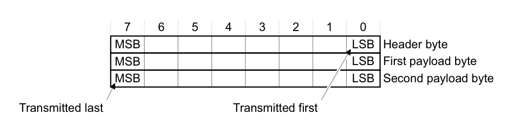

本附录描述把 **Debug ITM** 与 **DWT** 产生的数据发送给外部调试器所用的**包**（**packet**）协议。本章包含以下小节：

* 第 D4-780 页的**关于 ITM 与 DWT 包**。
* 第 D4-782 页的**包描述**。
* 第 D4-790 页的 **DWT 对硬件源包的使用**。

## 1. 关于 ITM 与 DWT 包

下列小节概述 **ITM** 与 **DWT** 包以及 **TPIU** 如何传输它们：

* **ITM** 与 **DWT** 包的用途。
* **ITM** 与 **DWT** 协议包类别。
* **TPIU** 的包传输。

**注意：** 本附录描述 **TPIU** 的包传输。不过 **ITM** 可以把包发送给任何合适的**跟踪汇聚点**（**trace sink**）。无论实际使用哪种跟踪汇聚点，**ITM** 都按本附录所述格式化包。

### 1.1. ITM 与 DWT 包的用途

下列情况下 **ITM** 向 **TPIU** 发送包：

* 软件写激励寄存器。
* 硬件生成**本地**（**Local**）或**全局时间戳**（**Global timestamp**），或任何其他协议包。
* 硬件生成**同步包**（**Synchronization packet**）。
* 它从 **DWT** 接收到包，需要转发给 **TPIU**。

下列情况下 **DWT** 向 **ITM** 发送包，由后者转发给 **TPIU**：

* 数据跟踪事件触发。
* 它采样 PC。
* 某个性能剖析计数器回卷（**wrap**）。

本附录描述所用的包协议。

### 1.2. ITM 与 DWT 协议包类别

包的第一个字节是**包头**（**packet header**），指示包类型。对某些包类型，包可以包含一个或多个字节的**载荷**（**payload**）。

表 D4-1 ITM 与 DWT 协议包类别：

| 包头 | 载荷（字节） | 包类别 | 描述 |
| --- | --- | --- | --- |
| 0b00000000 | 至少 6 | 同步 | 参见第 D4-782 页的**同步包** |
| 0bxxxxxx00，非 0b00000000 | 0-4 | 协议 | 参见第 D4-782 页的**协议包** |
| 0bxxxxxxSS，SS 非 0b00 | 1、2 或 4 | 源 | 参见第 D4-787 页的**源包** |

除同步包以及某些实现中的 **Global timestamp 2** 包之外，包的长度为 1-5 字节。

### 1.3. TPIU 的包传输

**TPIU** 可以：

* 按《Arm® CoreSight™ 体系结构规范》的要求把包组成**帧**（**frame**）。
* 通过串行端口传输包。

对每个包，**TPIU** 传输：

* 先传输包头字节，随后传输任何载荷字节。
* 包的每个字节都按**最低有效位**（**least significant bit**，**LSB**）在前传输。

本章各图把每个字节的 **LSB** 画在右侧、**最高有效位**（**most significant bit**，**MSB**）画在左侧。图 D4-1 以一个含包头字节与两个载荷字节的包为例，给出这一约定及其与数据传输的关系。



**ITM** 把来自 **ITM** 与 **DWT** 的包与本地时间戳、全局时间戳、同步以及其他协议包合并，作为单一数据流转发给 **TPIU**。更多信息参见第 C1-713 页的 **ITM 与其他调试组件的关系**。**TPIU** 再把该数据流与来自 **ETM** 的数据合并。

## 2. 包描述

第 D4-780 页的 **ITM 与 DWT 协议包类别** 概述了包类别。下列小节给出协议类别与源类别的更多信息，并描述每种包类型：

* **同步包**。
* **协议包**。
* 第 D4-787 页的**源包**。

### 2.1. 同步包

同步包在位流中提供一个独特的模式。跟踪捕获硬件可以识别该模式，并用它确定位流中包字节的对齐。同步包至少由四十七个 0 位后跟单个 1 位组成。图 D4-2 给出最小可能同步包的格式。

图 D4-2 最小同步包格式：

| 字节 | 位 7 | 位 6 | 位 5 | 位 4 | 位 3 | 位 2 | 位 1 | 位 0 |
| --- | --- | --- | --- | --- | --- | --- | --- | --- |
| 字节 0 | 0 | 0 | 0 | 0 | 0 | 0 | 0 | 0 |
| 字节 1 | 0 | 0 | 0 | 0 | 0 | 0 | 0 | 0 |
| 字节 2 | 0 | 0 | 0 | 0 | 0 | 0 | 0 | 0 |
| 字节 3 | 0 | 0 | 0 | 0 | 0 | 0 | 0 | 0 |
| 字节 4 | 0 | 0 | 0 | 0 | 0 | 0 | 0 | 0 |
| 字节 5 | 1 | 0 | 0 | 0 | 0 | 0 | 0 | 0 |

同步包的定义在 Arm 的其他跟踪协议中也相同，包括**嵌入式跟踪宏单元**（**Embedded Trace Macrocell**，**ETM**）协议与**程序流跟踪**（**Program Flow Trace**，**PFT**）协议。

**注意：**

* 若 **ITM** 连接并行跟踪端口接口，则它必须周期性生成同步包。连接异步串行跟踪端口接口的 **ITM** 可以生成同步包。
* 同步包的定义不要求包长度是 8 位的整数倍。例如，同步包可以由五十个 0 位后跟单个 1 位组成。

每当 **ITM** 传输同步包时，它把激励端口 **Page 寄存器**清零。更多信息参见第 D4-788 页的 **Instrumentation 包**。

### 2.2. 协议包

协议包的包头字节为 0bxxxxxx00，但不能是 0b00000000，参见第 D4-780 页的 **ITM 与 DWT 协议包类别**。其后是 0-6 个载荷字节。表 D4-2 列出协议包。

表 D4-2 ITM 与 DWT 协议包格式：

| 描述 | 包头 | 载荷ᵃ | 备注 |
| --- | --- | --- | --- |
| Overflow | 0b01110000 | 0 | 参见第 D4-783 页的 **Overflow 包** |
| 本地时间戳 | 0bCDDD0000，DDD 非 0b000 或 0b111 | 0 到 4 字节 | D = Data，C = Continuation。参见第 D4-783 页的**本地时间戳包**。 |
| Extension | 0bCDDD1S00 | 0 到 4 字节 | S = Source，D = Data，C = Continuation。参见第 D4-786 页的 **Extension 包**。 |
| 全局时间戳 | 0b10T10100 | 1 到 6 字节 | T = 全局时间戳包类型。参见第 D4-785 页的**全局时间戳包**。 |
| 保留 | 0b0xxx0100<br>0bx1110000<br>0b10x00100<br>0b11xx0100 | - | - |

a. 除同步包以及某些实现中的 **Global timestamp 2** 包之外，包的长度为 1-5 字节。

#### 2.2.1. 协议包中的延续位

在 **ITM** 与 **DWT** 协议中，最大包长度为 7 字节。

在协议包中，每个字节的 bit[7]——包括包头字节，但不包括 5 字节 **Extension** 包的最后一个字节——是**延续位**（**continuation bit**），记作 C。该位的含义为：

* **0**：这是包的最后一个字节。
* **1**：这不是包的最后一个字节。

### 2.3. Overflow 包

下列情况下 **ITM** 输出 **Overflow** 包：

* 软件在激励端口输出缓冲区已满时写 **Stimulus Port** 寄存器。
* **DWT** 在 **DWT** 输出缓冲区已满时尝试生成**硬件源包**（**Hardware source packet**）。
* 本地时间戳计数器溢出。

**Overflow** 包由包头构成，没有载荷。图 D4-3 给出该包格式。

图 D4-3 Overflow 包格式：

| 字节 | 位 7 | 位 6 | 位 5 | 位 4 | 位 3 | 位 2 | 位 1 | 位 0 |
| --- | --- | --- | --- | --- | --- | --- | --- | --- |
| 包头 | 0 | 1 | 1 | 1 | 0 | 0 | 0 | 0 |

### 2.4. 本地时间戳包

本地时间戳包基于 **ITM** 中的时间戳计数器编码时间戳信息，用于通用控制与同步。为减少跟踪带宽：

* 本地时间戳机制使用**增量时间戳**（**delta timestamp**），即每个本地时间戳值给出自上一个本地时间戳包生成以来的间隔。
* 本地时间戳包长度为 1-5 字节，取决于所需的时间戳值。

每当 **ITM** 输出本地时间戳包时，它把时间戳计数器清零。

**注意：** **ITM** 还可以支持**全局时间戳**（**global timestamping**），用于与系统中的其他跟踪源相关联。更多信息参见第 C1-711 页的**全局时间戳**与第 D4-785 页的**全局时间戳包**。全局时间戳使用来自系统时间戳时钟的绝对时间戳值。

若 **ITM** 把本地时间戳与对应的 **ITM** 或 **DWT** 数据同步输出，且所需时间戳值在 1-6 范围内，则它使用只含本地时间戳包头的格式，参见第 D4-785 页的**本地时间戳包格式 2：单字节**。

#### 2.4.1. 本地时间戳包格式 1：2 到 5 字节

**本地时间戳包格式 1**（**Local timestamp packet format 1**，**LTS1**）是多字节包，即包头的 C 位为 1。图 D4-4 给出该包格式。

图 D4-4 LTS1 包格式：

| 字节 | 位 7 | 位 6 | 位 5 | 位 4 | 位 3 | 位 2 | 位 1 | 位 0 |
| --- | --- | --- | --- | --- | --- | --- | --- | --- |
| 包头 | 1 | 1 | TC[1:0] | TC[1:0] | 0 | 0 | 0 | 0 |
| 载荷字节 0 | C | TS[6:0] | TS[6:0] | TS[6:0] | TS[6:0] | TS[6:0] | TS[6:0] | TS[6:0] |
| 载荷字节 1（如需） | C | TS[13:7] | TS[13:7] | TS[13:7] | TS[13:7] | TS[13:7] | TS[13:7] | TS[13:7] |
| 载荷字节 2（如需） | C | TS[20:14] | TS[20:14] | TS[20:14] | TS[20:14] | TS[20:14] | TS[20:14] | TS[20:14] |
| 载荷字节 3（如需） | 0 | TS[27:21] | TS[27:21] | TS[27:21] | TS[27:21] | TS[27:21] | TS[27:21] | TS[27:21] |

该格式中包头的 bit[6] 为 1。包其余部分的编码为：

| 字段 | 描述 |
| --- | --- |
| C | 延续位，参见第 D4-783 页的**协议包中的延续位**。 |
| TC[1:0] | 表示本地时间戳包的生成与对应的 **ITM** 或 **DWT** 数据包之间的关系。可能取值为：<br>• **00**：本地时间戳值与对应的 **ITM** 或 **DWT** 数据同步。TS 字段中的值是生成 **ITM** 或 **DWT** 包时的时间戳计数器值。<br>• **01**：本地时间戳值相对于 **ITM** 或 **DWT** 数据延迟。TS 字段中的值是生成本地时间戳包时的时间戳计数器值。<br>**注意：** 与前一个 **ITM** 或 **DWT** 包对应的本地时间戳值未知，但必须介于前一个与当前本地时间戳值之间。<br>• **10**：与本地时间戳包对应的 **ITM** 或 **DWT** 包的输出相对于关联事件延迟。TS 字段中的值是生成 **ITM** 或 **DWT** 包时的时间戳计数器值。该编码表示 **ITM** 或 **DWT** 包相对于其他跟踪输出包延迟。<br>• **11**：与本地时间戳包对应的 **ITM** 或 **DWT** 包的输出相对于关联事件延迟，且本地时间戳包相对于 **ITM** 或 **DWT** 数据延迟。这是取值 **0b01** 与 **0b10** 所示条件的组合。 |
| TS[N:0] | 本地时间戳值。这是自上一个本地时间戳包以来的间隔。所需时间戳值决定 N 取 6、13、20 还是 27，更多信息参见**本地时间戳值压缩**。 |

**注意：**

* 若更高优先级的跟踪数据占用了全部跟踪输出带宽，**ITM** 无法输出时间戳包，参见第 C1-713 页的**不同来源包之间的仲裁**。这种情况下时间戳包可能丢失，导致跟踪数据没有任何对应的时间戳信息。在 **ITM** 下次输出时间戳包之前，时序信息仍不确定。
* 由于 **ITM** 只在输出本地时间戳包时才把时间戳计数器清零，只要计数器不溢出，时间戳总是指示自上包以来的时间。若时间戳计数器溢出，**ITM** 输出 **Overflow** 包，参见第 D4-783 页的 **Overflow 包**。

#### 2.4.2. 本地时间戳值压缩

本地时间戳包只使用输出当前本地时间戳值所需的载荷字节数。例如，输出值 0b11001001 时使用两个载荷字节，如图 D4-5（第 D4-785 页）所示。

图 D4-5 本地时间戳值为 0b11001001 的本地时间戳包：

| 字节 | 位 7 | 位 6 | 位 5 | 位 4 | 位 3 | 位 2 | 位 1 | 位 0 |
| --- | --- | --- | --- | --- | --- | --- | --- | --- |
| 包头 | 1 | 1 | TC[1:0] | TC[1:0] | 0 | 0 | 0 | 0 |
| 载荷字节 0，bits[6:0] 为 TS[6:0] | 1 | 1 | 0 | 0 | 1 | 0 | 0 | 1 |
| 载荷字节 1，bits[6:0] 为 TS[13:7] | 0 | 0 | 0 | 0 | 0 | 0 | 0 | 1 |

#### 2.4.3. 本地时间戳包格式 2：单字节

**本地时间戳包格式 2**（**Local timestamp packet format 2**，**LTS2**）是单字节包，只含包头，即包头的 C 位为 0。图 D4-6 给出该包格式。

图 D4-6 LTS2 包格式：

| 字节 | 位 7 | 位 6 | 位 5 | 位 4 | 位 3 | 位 2 | 位 1 | 位 0 |
| --- | --- | --- | --- | --- | --- | --- | --- | --- |
| 包头 | 0 | TS[2:0] | TS[2:0] | TS[2:0] | 0 | 0 | 0 | 0 |

该格式的编码为：

**TS[2:0]**

本地时间戳值，范围为 0b001 到 0b110。

**注意：** 协议不允许下列 TS[2:0] 取值：

* 0b000，参见第 D4-782 页的**同步包**。
* 0b111，参见第 D4-783 页的 **Overflow 包**。

**ITM** 仅在同时满足下列条件时输出该包：

* 所需本地时间戳值在 1-6 范围内。
* 本地时间戳与对应的 **ITM** 或 **DWT** 数据同步。这与**本地时间戳包格式 1** 中 TC[1:0] == 0b00 的情形相同。

### 2.5. 全局时间戳包

若实现支持全局时间戳，**ITM** 基于全局时间戳时钟生成**全局时间戳包**（**Global timestamp packet**）。全局时间戳是 48 位或 64 位值，其宽度由实现决定。为传输全局时间戳，使用两种包格式，它们对 48 位与 64 位时间戳都适用：

* **全局时间戳包格式 1**（**Global timestamp packet format 1**，**GTS1**）包传输时间戳值的 bits[25:0]，**ITM** 通过与上一时间戳值相比不改变的高位字节不传输来压缩它们。该压缩方案与本地时间戳所用的压缩类似，参见第 D4-784 页的**本地时间戳值压缩**。
* **全局时间戳包格式 2**（**Global timestamp packet format 2**，**GTS2**）包按时间戳宽度传输相应位：
    * 对 48 位时间戳，时间戳值的 bits[47:26] 在 5 字节包中传输。**ITM** 总是完整传输该包。
    * 对 64 位时间戳，时间戳值的 bits[63:26] 在 7 字节包中传输。**ITM** 总是完整传输该包。

关于全局时间戳的更多信息参见第 C1-711 页的**全局时间戳**。

当 **ITM** 必须用 **GTS1** 与 **GTS2** 两种包传输完整的全局时间戳值时，它先传输 **GTS1** 包，并在带宽可用时把 **GTS2** 包排队传输。在能够传输 **GTS2** 包之前，它可能必须传输一个或多个附加的 **GTS1** 包。只要时间戳的 bits[47:26] 或 bits[63:26] 自上次传输 **GTS2** 包以来发生变化，**ITM** 就传输所需的 **GTS1** 包并把 **Wrap** 位置 1。**ITM** 最终传输 **GTS2** 包时，该包包含最近一次传输的 **GTS1** 包的高位。

图 D4-7（第 D4-786 页）给出 **GTS1** 包格式。

图 D4-7 GTS1 包格式：

| 字节 | 位 7 | 位 6 | 位 5 | 位 4 | 位 3 | 位 2 | 位 1 | 位 0 |
| --- | --- | --- | --- | --- | --- | --- | --- | --- |
| 包头 | 1 | 0 | 0 | 1 | 0 | 1 | 0 | 0 |
| 载荷字节 0 | C | TS[6:0] | TS[6:0] | TS[6:0] | TS[6:0] | TS[6:0] | TS[6:0] | TS[6:0] |
| 载荷字节 1（如需） | C | TS[13:7] | TS[13:7] | TS[13:7] | TS[13:7] | TS[13:7] | TS[13:7] | TS[13:7] |
| 载荷字节 2（如需） | C | TS[20:14] | TS[20:14] | TS[20:14] | TS[20:14] | TS[20:14] | TS[20:14] | TS[20:14] |
| 载荷字节 3（如需） | 0 | Wrap | ClkCh | TS[25:21] | TS[25:21] | TS[25:21] | TS[25:21] | TS[25:21] |

该格式中包头的 bit[5] 为 0。包其余部分的编码为：

**C**

延续位，参见第 D4-783 页的**协议包中的延续位**。

**TS[N:0]**

全局时间戳值的低位，取自全局时间戳时钟。所需的低位时间戳值决定 N 取 6、13、20 还是 25，更多信息参见第 D4-784 页的**本地时间戳值压缩**。

**ClkCh**

若自 **ITM** 上次生成全局时间戳包以来系统向处理器断言了时钟变化输入，则该位置 1。该信号被断言时，**ITM** 必须输出完整的 48 位或 64 位全局时间戳值。否则该位置 0。

**Wrap**

若全局时间戳的 bits[47:26] 或 bits[63:26] 自 **ITM** 上次输出 **GTS2** 包以来发生变化，则该位置 1。否则该位置 0。

包头的 bit[5] 置 1 以标识该包为 **GTS2** 包。bits TS[47:26] 或 bits TS[63:26] 是全局时间戳值的高位，取自全局时间戳时钟。

图 D4-8 给出 48 位时间戳的 **GTS2** 包格式。**ITM** 总是把它作为 5 字节包传输。

图 D4-8 GTS2 48 位时间戳包格式：

| 字节 | 位 7 | 位 6 | 位 5 | 位 4 | 位 3 | 位 2 | 位 1 | 位 0 |
| --- | --- | --- | --- | --- | --- | --- | --- | --- |
| 包头 | 1 | 0 | 1 | 1 | 0 | 1 | 0 | 0 |
| 载荷字节 0 | 1 | TS[32:26] | TS[32:26] | TS[32:26] | TS[32:26] | TS[32:26] | TS[32:26] | TS[32:26] |
| 载荷字节 1 | 1 | TS[39:33] | TS[39:33] | TS[39:33] | TS[39:33] | TS[39:33] | TS[39:33] | TS[39:33] |
| 载荷字节 2 | 1 | TS[46:40] | TS[46:40] | TS[46:40] | TS[46:40] | TS[46:40] | TS[46:40] | TS[46:40] |
| 载荷字节 3 | 0 | 0 | 0 | 0 | 0 | 0 | 0 | TS[47] |

图 D4-9 给出 64 位时间戳的 **GTS2** 包格式。**ITM** 总是把它作为 7 字节包传输。

图 D4-9 GTS2 64 位时间戳包格式：

| 字节 | 位 7 | 位 6 | 位 5 | 位 4 | 位 3 | 位 2 | 位 1 | 位 0 |
| --- | --- | --- | --- | --- | --- | --- | --- | --- |
| 包头 | 1 | 0 | 1 | 1 | 0 | 1 | 0 | 0 |
| 载荷字节 0 | 1 | TS[32:26] | TS[32:26] | TS[32:26] | TS[32:26] | TS[32:26] | TS[32:26] | TS[32:26] |
| 载荷字节 1 | 1 | TS[39:33] | TS[39:33] | TS[39:33] | TS[39:33] | TS[39:33] | TS[39:33] | TS[39:33] |
| 载荷字节 2 | 1 | TS[46:40] | TS[46:40] | TS[46:40] | TS[46:40] | TS[46:40] | TS[46:40] | TS[46:40] |
| 载荷字节 3 | 1 | TS[53:47] | TS[53:47] | TS[53:47] | TS[53:47] | TS[53:47] | TS[53:47] | TS[53:47] |
| 载荷字节 4 | 1 | TS[60:54] | TS[60:54] | TS[60:54] | TS[60:54] | TS[60:54] | TS[60:54] | TS[60:54] |
| 载荷字节 5 | 0 | 0 | 0 | 0 | 0 | TS[63:61] | TS[63:61] | TS[63:61] |

### 2.6. Extension 包

**Extension** 包提供关于已标识源的附加信息。所需信息量决定载荷字节数，取值为 0-4。图 D4-10（第 D4-787 页）给出该包格式。

图 D4-10 Extension 包格式：

| 字节 | 位 7 | 位 6 | 位 5 | 位 4 | 位 3 | 位 2 | 位 1 | 位 0 |
| --- | --- | --- | --- | --- | --- | --- | --- | --- |
| 包头 | C | EX[2:0] | EX[2:0] | EX[2:0] | 1 | SH | 0 | 0 |
| 载荷字节 0（如需） | C | EX[9:3] | EX[9:3] | EX[9:3] | EX[9:3] | EX[9:3] | EX[9:3] | EX[9:3] |
| 载荷字节 1（如需） | C | EX[16:10] | EX[16:10] | EX[16:10] | EX[16:10] | EX[16:10] | EX[16:10] | EX[16:10] |
| 载荷字节 2（如需） | C | EX[23:17] | EX[23:17] | EX[23:17] | EX[23:17] | EX[23:17] | EX[23:17] | EX[23:17] |
| 载荷字节 3（如需） | EX[31:24] | EX[31:24] | EX[31:24] | EX[31:24] | EX[31:24] | EX[31:24] | EX[31:24] | EX[31:24] |

**Extension** 包的包头中 bit[3] 为 1，bits[1:0] 为 0b00。包其余部分的编码为：

**C**

延续位，参见第 D4-783 页的**协议包中的延续位**。

**SH**

信息源位（**information source bit**）。

**EX[N:0]**

扩展信息。信息量决定所需的载荷字节数，进而决定 N 取 2、9、16、23 还是 31。

**Armv7-M ITM** 与 **DWT** 包协议只使用 **Extension** 包为 **Instrumentation** 包的解码提供附加信息，参见**激励端口页号的 Extension 包**。

#### 2.6.1. 激励端口页号的 Extension 包

**ITM** 使用单字节 **Extension** 包为后续 **Instrumentation** 包传输激励端口页号。图 D4-11 给出该包格式。

图 D4-11 激励端口页号的 Extension 包格式：

| 字节 | 位 7 | 位 6 | 位 5 | 位 4 | 位 3 | 位 2 | 位 1 | 位 0 |
| --- | --- | --- | --- | --- | --- | --- | --- | --- |
| 包头 | 0 | PAGE[2:0] | PAGE[2:0] | PAGE[2:0] | 1 | 0 | 0 | 0 |

这种用法中该包的编码为：

**SH**

源。RAZ，表示这是面向 **Instrumentation** 包的 **Extension** 包。

**PAGE[2:0]**

激励端口页号，取值 0-7。

**ITM** 把 PAGE 值写入 **Page 寄存器**，供后续 **Stimulus port** 写使用。该页号的用法参见第 D4-788 页的 **Instrumentation 包**。

**ITM** 发出同步包时，把 **Page 寄存器**的值清为 0。

### 2.7. 源包

**Instrumentation** 包或**硬件源包**的包头字节为 0bxxxxxxSS，其中 SS 非 0b00，参见第 D4-780 页的 **ITM 与 DWT 协议包类别**。其后是 1、2 或 4 个载荷字节。第 D4-782 页的表 D4-3 列出源包。

表 D4-3 ITM 与 DWT Instrumentation 与硬件源包格式：

| 描述 | 取值 | 载荷 | 类别 | 备注 |
| --- | --- | --- | --- | --- |
| Instrumentation | 0bAAAAA0SS，SS 非 0b00 | 1、2 或 4 字节 | 软件源，应用 | SS = 载荷大小<br>AAAAA = 源地址 |
| 硬件源 | 0bAAAAA1SS，SS 非 0b00 | 1、2 或 4 字节 | 硬件源，诊断 | SS = 载荷大小<br>AAAAA = 包类型判别符 ID |

SS 位指示载荷大小，编码如下：

* **01**：1 字节载荷，2 字节包。
* **10**：2 字节载荷，3 字节包。
* **11**：4 字节载荷，5 字节包。

**注意：** 协议不允许 SS 取 0b00，参见第 D4-782 页的**同步包**。

### 2.8. Instrumentation 包

软件对 **ITM** 激励端口的写生成 **Instrumentation** 包。图 D4-12 给出该包格式。

图 D4-12 Instrumentation 包格式：

| 字节 | 位 7 | 位 6 | 位 5 | 位 4 | 位 3 | 位 2 | 位 1 | 位 0 |
| --- | --- | --- | --- | --- | --- | --- | --- | --- |
| 包头 | A[4:0] | A[4:0] | A[4:0] | A[4:0] | A[4:0] | 0 | S | S |
| 载荷字节 0 | Payload[7:0] | Payload[7:0] | Payload[7:0] | Payload[7:0] | Payload[7:0] | Payload[7:0] | Payload[7:0] | Payload[7:0] |
| 载荷字节 1（如需） | Payload[15:8] | Payload[15:8] | Payload[15:8] | Payload[15:8] | Payload[15:8] | Payload[15:8] | Payload[15:8] | Payload[15:8] |
| 载荷字节 2（如需） | Payload[23:16] | Payload[23:16] | Payload[23:16] | Payload[23:16] | Payload[23:16] | Payload[23:16] | Payload[23:16] | Payload[23:16] |
| 载荷字节 3（如需） | Payload[31:24] | Payload[31:24] | Payload[31:24] | Payload[31:24] | Payload[31:24] | Payload[31:24] | Payload[31:24] | Payload[31:24] |

SS 位指示载荷大小，取 1、2 或 4 字节，参见第 D4-787 页的**源包**。包其余部分的编码为：

**A[4:0]**

端口号，取值 0-31，更多信息参见**激励端口号的编码**。

**Payload[N:0]**

Instrumentation 数据，即写入 **ITM** 激励端口的值。表 D4-4 给出 SS 位取值如何决定 N 的取值。

表 D4-4 SS 取值与载荷大小：

| SS 取值 | 载荷 | 包大小 |
| --- | --- | --- |
| 0b01 | Payload[7:0] | 2 字节 |
| 0b10 | Payload[15:0] | 3 字节 |
| 0b11 | Payload[31:0] | 5 字节 |

写事务的大小决定 **ITM** 生成的 **Instrumentation** 包大小。例如，若软件以半字访问写入 0x03A1，**ITM** 生成 3 字节的 **Instrumentation** 包，如图 D4-13 所示。

图 D4-13 半字写入 0x03A1 的 Instrumentation 包：

| 字节 | 位 7 | 位 6 | 位 5 | 位 4 | 位 3 | 位 2 | 位 1 | 位 0 |
| --- | --- | --- | --- | --- | --- | --- | --- | --- |
| 包头，SS 为 0b10 | A[4:0] | A[4:0] | A[4:0] | A[4:0] | A[4:0] | 0 | 1 | 0 |
| 载荷字节 0，0xA1 | 1 | 0 | 1 | 0 | 0 | 0 | 0 | 1 |
| 载荷字节 1，0x03 | 0 | 0 | 0 | 0 | 0 | 0 | 1 | 1 |

#### 2.8.1. 激励端口号的编码

若 **ITM** 实现支持的激励端口多于 32 个，**ITM** 使用分页方式指示激励端口号，并用 **Extension** 包为后续 **Instrumentation** 包发出页号（0-7），参见第 D4-787 页的**激励端口页号的 Extension 包**。激励端口号为：

```arm
Stimulus port number = (Page number × 32) + A[4:0]
```

**注意：** 调试器收到 **Instrumentation** 包时，使用它收到的最后一个 **Extension** 包中的页号；若自上次收到同步包以来未收到 **Extension** 包，则使用页号 0。

### 2.9. 硬件源包

**DWT** 单元生成**硬件源包**，并转发给 **ITM** 以进行优先级排序与传输。图 D4-14 给出该包格式。

图 D4-14 硬件源包格式：

| 字节 | 位 7 | 位 6 | 位 5 | 位 4 | 位 3 | 位 2 | 位 1 | 位 0 |
| --- | --- | --- | --- | --- | --- | --- | --- | --- |
| 包头 | A[4:0] | A[4:0] | A[4:0] | A[4:0] | A[4:0] | 1 | S | S |
| 载荷字节 0 | Payload[7:0] | Payload[7:0] | Payload[7:0] | Payload[7:0] | Payload[7:0] | Payload[7:0] | Payload[7:0] | Payload[7:0] |
| 载荷字节 1（如需） | Payload[15:8] | Payload[15:8] | Payload[15:8] | Payload[15:8] | Payload[15:8] | Payload[15:8] | Payload[15:8] | Payload[15:8] |
| 载荷字节 2（如需） | Payload[23:16] | Payload[23:16] | Payload[23:16] | Payload[23:16] | Payload[23:16] | Payload[23:16] | Payload[23:16] | Payload[23:16] |
| 载荷字节 3（如需） | Payload[31:24] | Payload[31:24] | Payload[31:24] | Payload[31:24] | Payload[31:24] | Payload[31:24] | Payload[31:24] | Payload[31:24] |

SS 位指示载荷大小，取 1、2 或 4 字节，参见第 D4-787 页的**源包**。包其余部分的编码为：

**A[4:0]**

包类型判别符 ID（**packet type discriminator ID**），参见第 D4-790 页的 **DWT 对硬件源包的使用**。

**Payload[N:0]**

**DWT** 数据。第 D4-788 页的表 D4-4 给出 SS 位取值如何决定 N 的取值。

第 D4-790 页的 **DWT 对硬件源包的使用** 给出这些包的编码与用法的更多信息。

## 3. DWT 对硬件源包的使用

**DWT** 使用硬件源包格式生成包，参见第 D4-789 页的**硬件源包**。它用 A[4:0] 字段存放**判别符 ID**（**discriminator ID**），**Armv7-M** 定义了下列判别符 ID：

**0**

事件计数回卷（**Event counter wrapping**），参见**事件计数包，判别符 ID0**。

**1**

异常跟踪（**Exception tracing**）。

**2**

**PC 采样**（**PC sampling**）。

**8-23**

数据跟踪（**Data tracing**）。

**注意：** **Armv7-M** 未定义任何面向硬件源包的 **Extension** 包。

### 3.1. 事件计数包，判别符 ID0

计数器值回卷到零时，**DWT** 单元生成**事件计数包**（**Event counter packet**），即：

* 递增计数器溢出。
* 递减计数器下溢。

该包只有一个载荷字节，其中的一组位表示哪些计数器发生了回卷。通常只有一个计数器回卷，但 **DWT** 可以生成多个载荷位同时置 1 的该包，表示多个计数器同时回卷到零。

若某个计数器回卷到零，而前一个事件计数包已被延迟且尚未输出，则下列两种行为为实现定义（**IMPLEMENTATION DEFINED**）：

* **DWT** 单元尝试生成第二个事件计数包。
* **DWT** 单元更新被延迟的事件计数包，把新的回卷事件包含进去。

不过，若被延迟的事件计数包中该计数器的位已经置位，**DWT** 单元必须尝试生成第二个事件计数包。

**注意：** 若 **DWT** 输出缓冲区已满时 **DWT** 单元尝试生成硬件源包，则输出 **Overflow** 包，参见第 D4-783 页的 **Overflow 包**。

图 D4-15 给出事件计数包格式。事件计数包的包头编码为：

**Bits[7:3]**

A[4:0] 字段。判别符 ID，0。

**Bit[2]**

RAO。表示这是硬件源包。

**Bits[1:0]**

SS 位。指示载荷大小。0b01，即 1 字节载荷，参见第 D4-787 页的**源包**。

图 D4-15 事件包格式：

| 字节 | 位 7 | 位 6 | 位 5 | 位 4 | 位 3 | 位 2 | 位 1 | 位 0 |
| --- | --- | --- | --- | --- | --- | --- | --- | --- |
| 包头 | 0 | 0 | 0 | 0 | 0 | 1 | 0 | 1 |
| 载荷 | (0) | (0) | Cyc | Fold | LSU | Sleep | Exc | CPI |

表 D4-5 给出载荷的位分配。

表 D4-5 事件计数包载荷的位分配：

| 位 | 名称 | 计数器回卷位 |
| --- | --- | --- |
| [7:6] | - | 保留 |
| [5] | Cyc | POSTCNT，参见第 C1-732 页的 **POSTCNT 定时器** |
| [4] | Fold | FOLDCNT，参见第 C1-734 页的性能剖析计数器支持 |
| [3] | LSU | LSUCNT，参见第 C1-734 页的性能剖析计数器支持 |
| [2] | Sleep | SLEEPCNT，参见第 C1-734 页的性能剖析计数器支持 |
| [1] | Exc | EXCCNT，参见第 C1-734 页的性能剖析计数器支持 |
| [0] | CPI | CPICNT，参见第 C1-734 页的性能剖析计数器支持 |

### 3.2. 异常跟踪包，判别符 ID1

处理器进入、退出或返回异常时，**DWT** 单元可生成**异常跟踪包**（**Exception trace packet**）。该包有两个载荷字节，指示异常编号以及处理器对该异常所执行的动作。

关于所返回 **ExceptionNumber** 值的信息，参见第 B1-525 页的**异常编号定义**。

图 D4-16 给出异常跟踪包格式。异常跟踪包的包头编码为：

**Bits[7:3]**

A[4:0] 字段。判别符 ID，1。

**Bit[2]**

RAO。表示这是硬件源包。

**Bits[1:0]**

SS 位。指示载荷大小。0b10，即 2 字节载荷，参见第 D4-787 页的**源包**。

图 D4-16 异常跟踪包格式：

| 字节 | 位 7 | 位 6 | 位 5 | 位 4 | 位 3 | 位 2 | 位 1 | 位 0 |
| --- | --- | --- | --- | --- | --- | --- | --- | --- |
| 包头 | 0 | 0 | 0 | 0 | 1 | 1 | 1 | 0 |
| 载荷字节 0 | ExceptionNumber[7:0] | ExceptionNumber[7:0] | ExceptionNumber[7:0] | ExceptionNumber[7:0] | ExceptionNumber[7:0] | ExceptionNumber[7:0] | ExceptionNumber[7:0] | ExceptionNumber[7:0] |
| 载荷字节 1 | (0) | (0) | FN[1:0] | FN[1:0] | (0) | (0) | (0) | ExceptionNumber[8] |

表 D4-6 给出载荷的位分配。

表 D4-6 异常跟踪包载荷的位分配：

| 字节 | 位 | 名称 | 描述 |
| --- | --- | --- | --- |
| 0 | [7:0] | ExceptionNumber[7:0] | 异常编号的 bits[7:0]，参见第 B1-525 页的**异常编号定义**。 |
| 1 | [7:6] | - | 保留。 |
| 1 | [5:4] | FN[1:0] | 功能。处理器所执行的动作，取值为下列之一：<br>**0b01**：进入 ExceptionNumber 字段所指示的异常。<br>**0b10**：退出 ExceptionNumber 字段所指示的异常。<br>**0b11**：返回 ExceptionNumber 字段所指示的异常。 |
| 1 | [3:1] | - | 保留。 |
| 1 | [0] | ExceptionNumber[8] | 异常编号的 bit[8]。 |

### 3.3. 周期 PC 采样包，判别符 ID2

**DWT** 单元以固定时间间隔生成 **PC 采样**，精度为一个时钟周期。POSTCNT 计数器周期决定 PC 采样间隔，软件配置 DWT_CTRL.CYCTAP 字段决定 POSTCNT 与处理器周期计数器 CYCCNT 的关系。DWT_CTRL.PCSAMPLENA 位使能 PC 采样。更多信息参见第 C1-737 页的**控制寄存器，DWT_CTRL**。

完整的**周期 PC 采样包**（**Periodic PC sample packet**）有 4 字节载荷。不过，若处理器处于休眠模式，**DWT** 单元生成只有 1 个载荷字节的**周期 PC 休眠包**（**Periodic PC sleep packet**）。

图 D4-17 给出完整的周期 PC 采样包格式。

图 D4-17 周期 PC 采样包格式：

| 字节 | 位 7 | 位 6 | 位 5 | 位 4 | 位 3 | 位 2 | 位 1 | 位 0 |
| --- | --- | --- | --- | --- | --- | --- | --- | --- |
| 包头 | 0 | 0 | 0 | 1 | 0 | 1 | 1 | 1 |
| 载荷字节 0 | PC[7:0] | PC[7:0] | PC[7:0] | PC[7:0] | PC[7:0] | PC[7:0] | PC[7:0] | PC[7:0] |
| 载荷字节 1 | PC[15:8] | PC[15:8] | PC[15:8] | PC[15:8] | PC[15:8] | PC[15:8] | PC[15:8] | PC[15:8] |
| 载荷字节 2 | PC[23:16] | PC[23:16] | PC[23:16] | PC[23:16] | PC[23:16] | PC[23:16] | PC[23:16] | PC[23:16] |
| 载荷字节 3 | PC[31:24] | PC[31:24] | PC[31:24] | PC[31:24] | PC[31:24] | PC[31:24] | PC[31:24] | PC[31:24] |

图 D4-18 给出周期 PC 休眠包格式。

图 D4-18 周期 PC 休眠包格式：

| 字节 | 位 7 | 位 6 | 位 5 | 位 4 | 位 3 | 位 2 | 位 1 | 位 0 |
| --- | --- | --- | --- | --- | --- | --- | --- | --- |
| 包头 | 0 | 0 | 0 | 1 | 0 | 1 | 0 | 1 |
| 载荷 | 0 | 0 | 0 | 0 | 0 | 0 | 0 | 0 |

周期 PC 采样包的包头编码为：

**Bits[7:3]**

A[4:0] 字段。判别符 ID，2。

**Bit[2]**

RAO。表示这是硬件源包。

**Bits[1:0]**

SS 位。指示载荷大小，参见第 D4-787 页的**源包**：

* 对完整的周期 PC 采样包为 0b11，表示 4 字节载荷。
* 对周期 PC 休眠包为 0b01，表示 1 字节载荷。

载荷的编码为：

#### 3.3.1. 完整周期 PC 采样包

4 个载荷字节存放 PC 值，即 PC[31:0]。**ITM** 按最低有效字节在前传输该包，参见图 D4-17。

**注意：** 由于 PC 值必须半字对齐，载荷字节 0 的 bit[0] 为 0。

#### 3.3.2. 周期 PC 休眠包

唯一载荷字节是零字节。

### 3.4. 数据跟踪包，判别符 ID 8-23

当与某个 **DWT** 比较器的比较匹配，且该比较器在相应 DWT_FUNCTION*n* 寄存器中的配置要求匹配时捕获数据，**DWT** 单元生成**数据跟踪包**（**Data trace packet**）。更多信息参见：

* 第 C1-746 页的**比较器功能寄存器，DWT_FUNCTIONn**。
* 第 C1-719 页的 **DWT 比较器**。

**注意：** 数据跟踪包协议只支持比较器 0 到 3 的数据捕获，即 DWT_FUNCTION0 - DWT_FUNCTION3 寄存器。

一次 **DWT** 比较器匹配可以生成下列单个包或包组合之一：

* 单个包，存放 PC 值。
* 单个包，存放数据地址的 bits[15:0]。
* 单个包，存放数据值（无论读还是写）以及传输大小。
* 两个包，PC 值后跟数据值。
* 两个包，数据地址的 bits[15:0] 后跟数据值。

在数据跟踪包中，判别符 ID 字段编码：

* 数据跟踪包类型。
* 匹配并因此要求数据捕获的 **DWT** 比较器编号。
* 对数据跟踪数据值包，关联访问是读还是写。

图 D4-19 给出数据跟踪包头的格式。

图 D4-19 数据跟踪包头格式：

| 字节 | 位 7 | 位 6 | 位 5 | 位 4 | 位 3 | 位 2 | 位 1 | 位 0 |
| --- | --- | --- | --- | --- | --- | --- | --- | --- |
| 包头 | 数据跟踪包类型 | 数据跟踪包类型 | CMPN[1:0] | CMPN[1:0] | 包类型或传输方向 | 1 | S | S |

数据跟踪包头的编码为：

**Bits[7:3]**

A[4:0] 字段。判别符 ID，编码为：

**Bits[7:6]**

数据跟踪包类型：

* **01**：PC 值或地址，参见 bit[3]。
* **10**：数据值，参见第 D4-794 页的**数据跟踪数据值包格式**。

取值 **0b00** 与 **0b11** 保留。

**Bits[5:4]**

CMPN[1:0]。生成数据的比较器编号。

**Bit[3]**

当 bits[7:6] 为 **0b01** 时：

* **0**：数据跟踪 PC 值包，参见第 D4-794 页的**数据跟踪 PC 值包格式**。
* **1**：数据跟踪地址包，参见第 D4-794 页的**数据跟踪地址包格式**。

当 bits[7:6] 为 **0b10** 时：

* **0**：读访问。
* **1**：写访问。

**Bit[2]**

RAO。表示这是硬件源包。

**Bits[1:0]**

SS 位。指示载荷大小，参见第 D4-787 页的**源包**。

表 D4-7 给出数据跟踪包头的编码如何为不同包类型分配判别符 ID。

表 D4-7 数据跟踪包的判别符 ID：

| 位[7] | 位[6] | 位[5:4] | 位[3] | 数据跟踪包类型 | 判别符 ID | 载荷 |
| --- | --- | --- | --- | --- | --- | --- |
| 0 | 1 | CMPN[1:0] | 0 | PC 值包 | 8、10、12、14 | 4 字节 |
| 0 | 1 | CMPN[1:0] | 1 | 地址包 | 9、11、13、15 | 2 字节 |
| 1 | 0 | CMPN[1:0] | 0 | 数据值包，读访问 | 16、18、20、22 | 1、2 或 4 字节 |
| 1 | 0 | CMPN[1:0] | 1 | 数据值包，写访问 | 17、19、21、23 | 1、2 或 4 字节 |

#### 3.4.1. 数据跟踪 PC 值包格式

图 D4-20 给出含 PC 值的**数据跟踪包**（**Data trace packet**）格式，该 PC 值为引起成功地址比较的指令的地址。

图 D4-20 数据跟踪 PC 值包格式，ID 8、10、12 或 14：

| 字节 | 位 7 | 位 6 | 位 5 | 位 4 | 位 3 | 位 2 | 位 1 | 位 0 |
| --- | --- | --- | --- | --- | --- | --- | --- | --- |
| 包头 | 0 | 1 | CMPN[1:0] | CMPN[1:0] | 0 | 1 | 1 | 1 |
| 载荷字节 0 | PC[7:0] | PC[7:0] | PC[7:0] | PC[7:0] | PC[7:0] | PC[7:0] | PC[7:0] | PC[7:0] |
| 载荷字节 1 | PC[15:8] | PC[15:8] | PC[15:8] | PC[15:8] | PC[15:8] | PC[15:8] | PC[15:8] | PC[15:8] |
| 载荷字节 2 | PC[23:16] | PC[23:16] | PC[23:16] | PC[23:16] | PC[23:16] | PC[23:16] | PC[23:16] | PC[23:16] |
| 载荷字节 3 | PC[31:24] | PC[31:24] | PC[31:24] | PC[31:24] | PC[31:24] | PC[31:24] | PC[31:24] | PC[31:24] |

#### 3.4.2. 数据跟踪地址包格式

图 D4-21 给出含地址 bits[15:0] 的数据跟踪包格式。当地址比较成功且相应 DWT_FUNCTION.EMITRANGE 位置 1 时，**DWT** 生成数据跟踪地址包。更多信息参见第 C1-719 页的 **DWT 比较器**与第 C1-746 页的**比较器功能寄存器，DWT_FUNCTIONn**。

图 D4-21 数据跟踪地址包格式，ID 9、11、13 或 15：

| 字节 | 位 7 | 位 6 | 位 5 | 位 4 | 位 3 | 位 2 | 位 1 | 位 0 |
| --- | --- | --- | --- | --- | --- | --- | --- | --- |
| 包头 | 0 | 1 | CMPN[1:0] | CMPN[1:0] | 1 | 1 | 1 | 0 |
| 载荷字节 0 | DADDR[7:0] | DADDR[7:0] | DADDR[7:0] | DADDR[7:0] | DADDR[7:0] | DADDR[7:0] | DADDR[7:0] | DADDR[7:0] |
| 载荷字节 1 | DADDR[15:8] | DADDR[15:8] | DADDR[15:8] | DADDR[15:8] | DADDR[15:8] | DADDR[15:8] | DADDR[15:8] | DADDR[15:8] |

#### 3.4.3. 数据跟踪数据值包格式

图 D4-22（第 D4-795 页）给出含数据值的数据跟踪包格式。

图 D4-22 数据跟踪数据值包格式，ID 16-23：

| 字节 | 位 7 | 位 6 | 位 5 | 位 4 | 位 3 | 位 2 | 位 1 | 位 0 |
| --- | --- | --- | --- | --- | --- | --- | --- | --- |
| 包头 | 1 | 0 | CMPN[1:0] | CMPN[1:0] | WnR | 1 | S | S |
| 载荷字节 0 | VALUE[7:0] | VALUE[7:0] | VALUE[7:0] | VALUE[7:0] | VALUE[7:0] | VALUE[7:0] | VALUE[7:0] | VALUE[7:0] |
| 载荷字节 1（如需） | VALUE[15:8] | VALUE[15:8] | VALUE[15:8] | VALUE[15:8] | VALUE[15:8] | VALUE[15:8] | VALUE[15:8] | VALUE[15:8] |
| 载荷字节 2（如需） | VALUE[23:16] | VALUE[23:16] | VALUE[23:16] | VALUE[23:16] | VALUE[23:16] | VALUE[23:16] | VALUE[23:16] | VALUE[23:16] |
| 载荷字节 3（如需） | VALUE[31:24] | VALUE[31:24] | VALUE[31:24] | VALUE[31:24] | VALUE[31:24] | VALUE[31:24] | VALUE[31:24] | VALUE[31:24] |

传输大小决定载荷大小：

**Byte**

1 字节载荷，VALUE[7:0]，SS 为 0b01。

**Halfword**

2 字节载荷，VALUE[15:0]，SS 为 0b10。

**Word**

4 字节载荷，VALUE[31:0]，SS 为 0b11。
