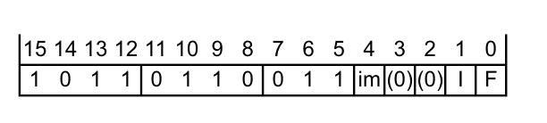
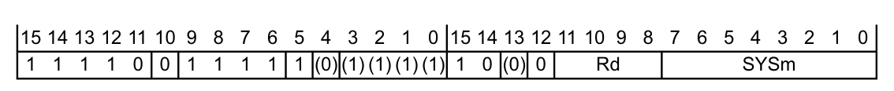
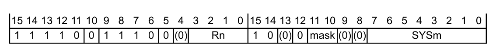

本章描述 **Armv7-M** 的系统指令 **CPS**、**MRS** 和 **MSR**，以及这些指令所用的特殊寄存器编码。

## 1. 关于 Armv7-M 系统指令

如本手册 A 部分所述，**Armv7-M** 仅在 **Thumb** 状态下执行指令，第 A7-186 页的 **Armv7-M Thumb 指令字母顺序列表** 列出了所有受支持的指令。为支持软件对特殊功能寄存器的读写，**Armv7-M** 提供了三条系统指令：`CPS`、`MRS` 和 `MSR`。

第 B5-670 页的 **Armv7-M 系统指令中使用的特殊寄存器编码** 描述了 `MSR` 和 `MRS` 指令的 `<spec_reg>` 参数所使用的编码，第 B5-672 页的 **Armv7-M 系统指令描述** 描述了每条系统指令。

### 1.1. Armv7-M 系统指令中使用的特殊寄存器编码

`MSR` 和 `MRS` 系统指令的语法包含一个 `<spec_reg>` 参数，该参数在指令编码中编译为 **SYSm** 字段中的一个数值。表 B5-1 列出了 `<spec_reg>` 参数的可能取值，并给出它们在 **SYSm** 字段中的编码。

表 B5-1 特殊寄存器字段编码：

| 特殊寄存器 | 内容 | SYSm 值ᵃ |
| --- | --- | --- |
| APSR（读取时）<br>APSR_\<bits\>（写入时） | 前序指令产生的标志。关于 `_<bits>` 限定符的信息参见第 B5-671 页的表 B5-2。 | 0 = 0b00000:000 |
| IAPSR（读取时）<br>IAPSR_\<bits\>（写入时） | IPSR 与 APSR 的组合。关于 `_<bits>` 限定符的信息参见第 B5-671 页的表 B5-2。 | 1 = 0b00000:001 |
| EAPSR（读取时）<br>EAPSR_\<bits\>（写入时） | EPSR 与 APSR 的组合。关于 `_<bits>` 限定符的信息参见第 B5-671 页的表 B5-2。 | 2 = 0b00000:010 |
| XPSR（读取时）<br>XPSR_\<bits\>（写入时） | 三个 PSR 寄存器的组合。关于 `_<bits>` 限定符的信息参见第 B5-671 页的表 B5-2。 | 3 = 0b00000:011 |
| IPSR | 中断状态寄存器。 | 5 = 0b00000:101 |
| EPSR | 执行状态寄存器。该寄存器为 RAZ/WI。 | 6 = 0b00000:110 |
| IEPSR | IPSR 与 EPSR 的组合。 | 7 = 0b00000:111 |
| MSP | 主栈指针。 | 8 = 0b00001:000 |
| PSP | 进程栈指针。 | 9 = 0b00001:001 |
| PRIMASK | 用于屏蔽可配置异常的寄存器。 | 16 = 0b00010:000 |
| BASEPRI | 基优先级寄存器。 | 17 = 0b00010:001 |
| BASEPRI_MAX | 读取时，作为 BASEPRI 的别名。写入时，可提高 BASEPRI，但若会降低 BASEPRI 则被忽略。 | 18 = 0b00010:010 |
| FAULTMASK | 用于把优先级提升到 **HardFault** 级别的寄存器。 | 19 = 0b00010:011 |
| CONTROL | 特殊功能控制寄存器。 | 20 = 0b00010:100 |

a. 二进制值按指令操作伪代码中所使用的字段划分显示，即 SYSm\<7:3\>:SYSm\<2:0\>。

在更新 APSR 的特殊寄存器写入中，软件必须用 `_<bits>` 参数限定特殊寄存器说明符，以指定要更新的 APSR 位。`MSR` 指令的 **mask** 字段编码该限定符。表 B5-2 列出了 `_<bits>` 的可能取值及其编码。

Arm 不推荐把不带 `_<bits>` 限定符的 `MSR APSR` 用作 `MSR APSR_nzcvq` 的别名。

以下小节给出特殊寄存器及其功能的更多信息：

* 第 B1-516 页的 **特殊功能程序状态寄存器 xPSR**，用于 APSR、IAPSR、EAPSR、XPSR、IPSR、EPSR 和 IEPSR。
* 第 B1-516 页的 **SP 寄存器**，用于 MSP 和 PSP。
* 第 B1-519 页的 **特殊功能屏蔽寄存器**，用于 PRIMASK、BASEPRI、BASEPRI_MAX 和 FAULTMASK。
* 第 B1-519 页的 **特殊功能 CONTROL 寄存器**，用于 CONTROL。

表 B5-2 MSR 写 APSR 时 `_<bits>` 的编码：

| `_<bits>` | 效果 | mask 编码 | 备注 |
| --- | --- | --- | --- |
| `_nzcvq` | 写入 N、Z、C、V、Q 位，即 APSR[31:27] | 10 | 始终支持 |
| `_g` | 写入 GE[3:0] 位，即 APSR[19:16] | 01 | 仅当处理器包含 DSP 扩展时支持 |
| `_nzcvqg` | 写入 N、Z、C、V、Q 和 GE[3:0] 位 | 11 |  |

## 2. Armv7-M 系统指令描述

以下小节定义 **Armv7-M** 系统指令：

* 第 B5-673 页的 **CPS**。
* 第 B5-675 页的 **MRS**。
* 第 B5-677 页的 **MSR**。

**注意：**

* 在其他 Armv7 配置文件中，`MSR`（立即数）是有效指令；在 **Armv7-M** 中，`MSR`（立即数）编码为 **UNDEFINED**。
* 在其他 Armv7 配置文件中，`VMRS` 和 `VMSR` 指令还有其他系统级用途；在 **Armv7-M** 配置文件中，它们的全部用途均在应用级可用，参见第 A7-485 页的 `VMRS` 和第 A7-486 页的 `VMSR`。

### 2.1. 改变处理器状态（CPS）

`CPS` 指令改变一个或多个特殊功能寄存器 PRIMASK 和 FAULTMASK 的值。

```arm
if (I == ‘0’ && F ==’0’) then UNPREDICTABLE;
enable = (im == ‘0’);  disable = (im == ‘1’);
affectPRI = (I == ‘1’);  affectFAULT = (F == ‘1’);
if InITBlock() then UNPREDICTABLE;
```

**汇编器语法**

```arm
CPS<effect><q> <iflags>
```

其中：

**\<effect\>**

指定要对 PRIMASK 和 FAULTMASK 产生的效果，取值为下列之一：

IE

中断使能（**Interrupt Enable**）。该值把指定位置为 0。

ID

中断禁用（**Interrupt Disable**）。该值把指定位置为 1。

**\<q\>**

参见第 A7-177 页的 **标准汇编器语法字段**。`CPS` 指令必须是无条件的。

**\<iflags\>**

为一个或多个下列项的序列，指定受影响的屏蔽位：

i

PRIMASK。置为 1 时把执行优先级提升到 0。这是 1 位寄存器，只能由特权软件更新。

f

FAULTMASK。置为 1 时把执行优先级提升到 -1，即与 **HardFault** 相同的优先级。这是 1 位寄存器，只能由特权软件更新。该寄存器在除 NMI 以外的任何异常返回时清零为 0。

**操作**

```arm
EncodingSpecificOperations();
if CurrentModeIsPrivileged() then
    if enable then
        if affectPRI then PRIMASK<0> = ‘0’;
        if affectFAULT then FAULTMASK<0> = ‘0’;
    if disable then 
        if affectPRI then PRIMASK<0> = ‘1’;
        if affectFAULT && ExecutionPriority() > -1 then FAULTMASK<0> = ‘1’;
```

**异常**

无。

**备注**

**特权**

任何非特权代码尝试写入这些屏蔽位都会被忽略。

**屏蔽位与 CPS**

`CPSIE` 和 `CPSID` 指令等效于使用 `MSR` 指令：

* `CPSIE i` 指令等效于向 PRIMASK 写入 0。
* `CPSID i` 指令等效于向 PRIMASK 写入 1。
* `CPSIE f` 指令等效于向 FAULTMASK 写入 0。
* `CPSID f` 指令等效于向 FAULTMASK 写入 1。

**执行 CPS 指令所引起的执行优先级变化的可见性**

如果执行 `CPS` 指令：

* 提高执行优先级，则该 `CPS` 执行会把该变化串行化到指令流中。
* 降低执行优先级，则体系结构仅保证新优先级对在执行 `ISB` 之后、或在执行异常进入或异常返回之后执行的指令可见。

**编码 T1**

适用于 **Armv6-M**、**Armv7-M**。

在 **Armv7-M** 中功能增强。

```arm
CPS<effect> <iflags>
```

不允许在 IT 块中使用。



### 2.2. 从特殊寄存器传送到寄存器（MRS）

`MRS` 指令把选定特殊功能寄存器中的值传送到通用寄存器。

```arm
d = UInt(Rd);
if d IN {13,15} || !(UInt(SYSm) IN {0..3,5..9,16..20}) then UNPREDICTABLE;
```

**汇编器语法**

```arm
MRS<c><q> <Rd>, <spec_reg>
```

其中：

**\<c\>\<q\>**

参见第 A7-177 页的 **标准汇编器语法字段**。

**\<Rd\>**

指定目标寄存器，用于接收特殊寄存器的值。

**\<spec_reg\>**

编码在 **SYSm** 中，参见第 B5-670 页的 **Armv7-M 系统指令中使用的特殊寄存器编码**。

**操作**

```arm
if ConditionPassed() then
    EncodingSpecificOperations();
    R[d] = Zeros(32);
    case  SYSm<7:3> of
        when ‘00000’                             /* xPSR accesses */
            if SYSm<0> == ‘1’ then
                R[d]<8:0> = IPSR<8:0>;
            if SYSm<1> == ‘1’ then
                R[d]<26:24> = ‘000’;             /* EPSR reads as zero */
                R[d]<15:10> = ‘000000’;
            if SYSm<2> == ‘0’ then
                R[d]<31:27> = APSR<31:27>;
                if HaveDSPExt() then
                    R[d]<19:16> = APSR<19:16>;
        when ‘00001’                             /* SP access     */
            if CurrentModeIsPrivileged() then 
                case SYSm<2:0> of
                    when ‘000’ 
                        R[d] = SP_main;
                    when ‘001’
                        R[d] = SP_process;
        when ‘00010’                             /* Priority mask or CONTROL access */ 
            case SYSm<2:0> of
                when ‘000’
                    R[d]<0> = if CurrentModeIsPrivileged() then PRIMASK<0> else ‘0’;
                when ‘001’ 
                    R[d]<7:0> = if CurrentModeIsPrivileged() then BASEPRI<7:0> else ‘00000000’;
                when ‘010’ 
                    R[d]<7:0> = if CurrentModeIsPrivileged() then BASEPRI<7:0> else ‘00000000’;
                when ‘011’
                    R[d]<0> = if CurrentModeIsPrivileged() then FAULTMASK<0> else ‘0’;
                when ‘100’
                    if HaveFPExt() then
                        R[d]<2:0> = CONTROL<2:0>;
                    else
                        R[d]<1:0> = CONTROL<1:0>;
```

**异常**

无。

**备注**

**特权**

如果非特权代码尝试读取任何栈指针、优先级屏蔽寄存器或 IPSR，则读取返回零。

**EPSR**

在正常执行期间 EPSR 的各位均不可读。使用 `MRS` 读取时，它们全部读为 0。停机调试（halting debug）可通过寄存器传送机制读取 EPSR 位。

**位位置**

第 B1-516 页的 **特殊功能程序状态寄存器 xPSR** 定义了 PSR 的位位置。

**编码 T1**

适用于 **Armv6-M**、**Armv7-M**。

在 **Armv7-M** 中功能增强。

```arm
MRS<c> <Rd>,<spec_reg>
```



### 2.3. 从 Arm 寄存器传送到特殊寄存器（MSR）

`MSR` 指令把通用寄存器中的值传送到选定的特殊功能寄存器。

```arm
n = UInt(Rn);
if mask == ‘00’ || (mask != “10” && !(UInt(SYSm) IN {0..3})) then UNPREDICTABLE;
if n IN {13,15} || !(UInt(SYSm) IN {0..3,5..9,16..20}) then UNPREDICTABLE;
```

**汇编器语法**

```arm
MSR<c><q> <spec_reg>, <Rn>
```

其中：

**\<c\>\<q\>**

参见第 A7-177 页的 **标准汇编器语法字段**。

**\<Rn\>**

为持有要传送到特殊寄存器的值的通用寄存器。

**\<spec_reg\>**

编码在 **SYSm** 中；对于更新 APSR 的参数，还编码在 **mask** 中，参见第 B5-670 页的 **Armv7-M 系统指令中使用的特殊寄存器编码**。

**操作**

```arm
if ConditionPassed() then
    EncodingSpecificOperations();
    case SYSm<7:3> of 
        when ‘00000’                             /* xPSR accesses */
            if SYSm<2> == ‘0’ then               /* Include APSR  */
                if mask<0> == ‘1’ then           /* GE[3:0] bits  */
                    if !HaveDSPExt() then
                        UNPREDICTABLE;
                    else
                        APSR<19:16> = R[n]<19:16>;
                if mask<1> == ‘1’ then           /* N, Z, C, V, Q bits */
                    APSR<31:27> = R[n]<31:27>;
        when ‘00001’                             /* SP access     */
            if CurrentModeIsPrivileged() then 
                case SYSm<2:0> of
                    when ‘000’ 
                        SP_main = R[n];
                    when ‘001’
                        SP_process = R[n];
        when ‘00010’                             /* Priority mask or CONTROL access */
            case SYSm<2:0> of
                when ‘000’
                    if CurrentModeIsPrivileged() then PRIMASK<0> = R[n]<0>;
                when ‘001’
                    if CurrentModeIsPrivileged() then BASEPRI<7:0> = R[n]<7:0>;
                when ‘010’ 
                    if CurrentModeIsPrivileged() &&
                    (R[n]<7:0> != ‘00000000’) &&
                    (UInt(R[n]<7:0>) < UInt(BASEPRI<7:0>) || BASEPRI<7:0> == ‘00000000’) then 
                        BASEPRI<7:0> = R[n]<7:0>;
                when ‘011’
                    if CurrentModeIsPrivileged() &&
                    (ExecutionPriority() > -1) then 
                        FAULTMASK<0> = R[n]<0>;
                when ‘100’
                    if CurrentModeIsPrivileged() then 
                        CONTROL.nPRIV = R[n]<0>;
                        if CurrentMode == Mode_Thread then
                            CONTROL.SPSEL = R[n]<1>;
                        if HaveFPExt() then CONTROL.FPCA = R[n]<2>;
```

**异常**

无。

**备注**

**特权**

处理器忽略非特权 **Thread** 模式对任何栈指针、EPSR、IPSR、屏蔽寄存器或 CONTROL 的写入。如果特权 **Thread** 模式软件向 `CONTROL.nPRIV` 位写入 1，处理器将切换到非特权 **Thread** 模式执行，并忽略对特殊功能寄存器的任何后续写入。

在任何 **Thread** 模式从特权执行切换到非特权执行之后，软件必须发出 `ISB` 指令以确保取指正确。

**IPSR**

IPSR 字段为只读。处理器忽略特权软件对它们的任何写入尝试。

**EPSR**

EPSR 字段为只读。处理器忽略特权软件对它们的任何写入尝试。

**位位置**

第 B1-516 页的 **特殊功能程序状态寄存器 xPSR** 定义了各 PSR 的字段如何映射到组合的 xPSR。

**执行 MSR 指令所引起的执行优先级变化的可见性**

如果执行 `MSR` 指令：

* 提高执行优先级，则该 `MSR` 执行会把该变化串行化到指令流中。
* 降低执行优先级，则体系结构仅保证新优先级对在执行 `ISB` 之后、或在执行异常进入或异常返回之后执行的指令可见。

**编码 T1**

适用于 **Armv6-M**、**Armv7-M**。

在 **Armv7-M** 中功能增强。

```arm
MSR<c> <spec_reg>,<Rn>
```


