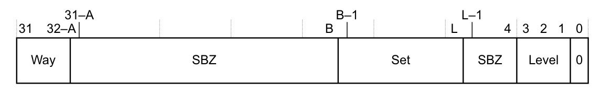

本章描述与从内存取指以及加载或存储数据访问相关的伪代码，并给出 **Armv7-M** 的缓存与分支预测器模型，以及通用内存系统操作的伪代码细节。

## 1. 关于系统内存模型

本章描述的伪代码与从内存取指以及加载或存储数据访问相关联。

加载或存储指令的伪代码层次如下：

* 指令操作使用 `MemA[]` 或 `MemU[]` 辅助函数。
* 内存属性由默认系统地址映射或 MPU 确定，前者参见第 B3-592 页的 **系统地址映射**，后者参见第 B3-632 页的 **保护内存系统架构 PMSAv7**。
* 访问行为受下列因素支配：访问是读还是写、其地址对齐、数据字节序以及内存属性。

## 2. 缓存与分支预测器

缓存的概念在第 A3-97 页的 **缓存与内存层次** 中描述。本节描述 **Armv7-M** 的缓存标识和控制机制，以及缓存维护操作。

本节包含以下小节：

* **缓存标识**。
* 第 B2-572 页的 **缓存使能和禁用**。
* 第 B2-572 页的 **缓存行为**。
* 第 B2-574 页的 **分支预测器**。
* 第 B2-574 页的 **描述缓存维护操作所用的术语**。
* 第 B2-576 页的 **Armv7-M 对缓存层次的抽象**。
* 第 B2-577 页的 **缓存和分支预测器维护操作**。
* 第 B2-581 页的 **系统级缓存**。
* 第 B2-581 页的 **执行缓存维护操作**。

### 2.1. 缓存标识

**Armv7** 缓存标识由一组寄存器组成，这些寄存器描述处理器控制之下已实现的缓存：

* 一个 **Cache Type Register** 定义：
  — 任一指令缓存的最小行长。
  — 任一数据缓存或统一缓存的最小行长。
  — Level 1 指令缓存的缓存索引和标记策略。

  更多信息参见第 B4-667 页的 **Cache Type Register，CTR**。
* 一个 **Cache Level ID Register** 定义：
  — 每个缓存级别（最多七级）上实现的缓存类型。
  — 缓存的 **Level of Coherence**。
  — 缓存的 **Level of Unification**。

  更多信息参见第 B4-665 页的 **Cache Level ID Register，CLIDR**。
* 一个 **Cache Size Selection Register** 选择当前 **Cache Size Identification Register** 的缓存级别和缓存类型，参见第 B4-667 页的 **Cache Size Selection Register，CSSELR**。
* 对于每个已实现的缓存，跨越所有缓存级别，一个 **Cache Size Identification Register** 定义：
  — 该缓存是否支持 Write-Through、write-back、Read-Allocate 和 Write-Allocate。
  — 该缓存的组数、关联度和行长。

  更多信息参见第 B4-666 页的 **Cache Size ID Registers，CCSIDR**。

**在 Armv7 中标识缓存资源**

在 **Armv7** 中，体系结构定义了多级缓存支持，最多七级。这使标识 **Armv7** 处理器可用的缓存资源的过程变得复杂。为获得这些信息，软件必须：

1. 读取 **Cache Type Register**，以找到 Level 1 指令缓存所用的索引和标记策略。该寄存器还提供指令缓存以及数据缓存和统一缓存所用最小缓存行的大小。这些值用于缓存维护操作。
2. 读取 **Cache Level ID Register**，以找到实现了哪些缓存。该寄存器包含七个缓存类型字段，对应缓存级别 1 到 7。从 Level 1 开始扫描这些字段，可识别每一级上实现的指令缓存、数据缓存或统一缓存。当扫描到达某一级、该级未定义任何缓存时，扫描结束。**Cache Level ID Register** 还提供缓存实现的 **Level of Unification** 和 **Level of Coherency**。
3. 对于第 2 阶段识别出的每个缓存：

   * 写 **Cache Size Selection Register** 以选择所需缓存。缓存由其级别以及它是下列哪种缓存来标识：
     — 指令缓存。
     — 数据缓存或统一缓存。

   * 读取 **Cache Size ID Register**，以获得该缓存的详细信息。

### 2.2. 缓存使能和禁用

在 **Armv7-M** 中，体系结构定义了多级缓存的控制。

在 **Armv7-M** 中，**Configuration and Control Register，CCR** 用于使能和禁用缓存，参见第 B3-604 页的 **Configuration and Control Register，CCR**。

`CCR.DC` 使能或禁用所有数据缓存和统一缓存，跨越处理器可见的所有缓存级别。

`CCR.IC` 使能或禁用所有指令缓存，跨越处理器可见的所有缓存级别。

如果某个实现需要对缓存使能进行更细粒度的控制，它可以在 **Auxiliary Control Register** 中实现控制位。例如，一个实现可以定义用于使能和禁用特定级别缓存的控制位。有关 **Auxiliary Control Register** 的更多信息，参见第 B3-618 页的 **Auxiliary Control Register，ACTLR**。

`CCR.DC` 和 `CCR.IC` 位是否影响已使能的 MPU 生成的内存属性，是 **IMPLEMENTATION DEFINED** 的。

**注意：** 无论 `CCR.DC` 和 `CCR.IC` 位是否影响内存属性，当某个缓存被禁用时，未保存在该缓存中的内存位置绝不会因内存访问而被带入该缓存。

如果 MPU 被禁用，第 B3-632 页的 **MPU 被禁用时的行为** 描述了 `CCR.{DC, IC}` 对内存属性的影响。

### 2.3. 缓存行为

以下小节概述 **Armv7-M** 实现中缓存的行为：

* **缓存的一般行为**。
* 第 B2-573 页的 **复位时的缓存行为**。
* 第 B2-573 页的 **预加载数据（PLD）和预加载指令（PLI）与缓存的行为**。

**缓存的一般行为**

当一个内存位置被标记为 **Normal Cacheable** 内存属性时，判断该内存位置的副本是否保存在缓存中，仍取决于实现的许多方面。下列非穷尽的因素列表可能涉及：

* 缓存的大小、行长和关联度。
* 缓存分配算法。
* 系统中可访问内存的其他部件的活动。
* 推测性取指算法。
* 推测性取数据算法。
* 中断行为。

鉴于这些因素的范围以及可能实现的各种缓存系统，体系结构无法保证：

* 缓存中存在的内存位置仍留在缓存中。
* 缓存中不存在的内存位置会被带入缓存。

相反，以下原则适用于缓存行为：

* 如果缓存被禁用，则保证不会发生新的内存位置分配进入缓存。
* 如果缓存被使能，则保证不具有 **Cacheable** 属性的内存位置不会被分配进入缓存。
* 如果缓存被使能，且某内存位置的访问权限被定义为该位置既不可通过读取访问、也不可通过写入访问，则保证该内存位置不会被分配到缓存。
* 任何内存位置都不保证与内存的其余部分保持不一致状态。
* 可被覆盖的内存最大大小称为 **Cache write-back Granule**。在某些实现中，**CTR** 标识 **Cache write-back Granule**，参见第 B4-667 页的 **Cache Type Register，CTR**。
* 将一个内存位置分配到缓存中，不得使该内存位置的最新值对某个观察者不可见——前提是该值此前对该观察者可见。

就这些原则而言，一个缓存条目覆盖至少 16 字节、不超过 2KB 的连续地址空间，并按其大小对齐。

在 **Armv7-M** 中，下列情形下该位置是从缓存返回还是从内存返回是 **UNPREDICTABLE** 的：

* 该位置未被标记为 **Cacheable**，但包含在缓存中。如果某位置在被分配进入缓存之后才被标记为 **Non-cacheable**，就会出现这种情况。
* 该位置被标记为 **Cacheable** 且可能包含在缓存中，但该缓存被禁用。

**复位时的缓存行为**

在 **Armv7-M** 中：

* 复位时所有缓存均被禁用。
* 实现可以要求在使能缓存之前使用特定的缓存初始化例程来无效化其存储阵列。任何所需初始化例程的确切形式是 **IMPLEMENTATION DEFINED** 的，且该例程必须在器件的文档中清晰记载。
* 缓存被禁用时访问能否产生缓存命中是 **IMPLEMENTATION DEFINED** 的。如果实现允许在缓存被禁用时产生缓存命中，则该缓存初始化例程必须：
  — 提供一种机制，确保缓存的正确初始化。
  — 在器件的文档中清晰记载。
* 特别是，如果实现允许在缓存被禁用时产生缓存命中，且复位时未无效化缓存内容，则初始化例程必须避免任何从尚未初始化的缓存中运行的可能性。初始化例程要求把一段固定的指令序列放在受限的内存范围内，这是可以接受的。
* Arm 建议，凡需要无效化例程时，都以 **Armv7-M** 缓存维护操作为基础。

当缓存被使能时，如果未执行适当的初始化例程，则该缓存的状态是 **UNPREDICTABLE** 的。

类似的规则适用于分支预测器行为，参见第 B2-574 页的 **复位时的分支预测器行为**。

**预加载数据（PLD）和预加载指令（PLI）与缓存的行为**

`PLD` 和 `PLI` 指令提供 **Preload Data** 和 **Preload Instruction** 操作。这些指令是内存系统提示，每条指令的效果都是 **IMPLEMENTATION DEFINED** 的，参见第 A3-99 页的 **预加载缓存**。

由于它们是对内存系统的提示，`PLD` 或 `PLI` 指令的操作不会引起同步中止。但是，作为这些内存系统提示之一而执行的内存操作可能触发异步事件，从而影响处理器的执行。可能触发的异步事件示例包括异步中止和中断。

`PLD` 指令保证不会对缓存或内存产生任何影响，除非在相同的上下文和相同的特权级下，从同一位置执行等效加载会因权限或其他原因产生的影响。

`PLD` 指令保证不访问 **Strongly-ordered** 或 **Device** 内存。

`PLI` 指令保证不会对缓存或内存产生任何影响，除非在相同的上下文和相同的特权级下，把 PC 改为 `PLI` 指令所指定的位置而产生的取指会因权限或其他原因产生的影响。

`PLI` 指令不得执行处理器可能由推测性取指执行的任何访问。因此 `PLI` 指令不能访问具有 **Strongly-ordered** 或 **Device** 属性的内存。

### 2.4. 分支预测器

分支预测器硬件通常使用某种形式的缓存来保存分支信息。**Armv7-M** 体系结构要求该分支预测器硬件对软件不可见。

**分支预测器维护操作的要求**

在 **Armv7-M** 中，不要求在已标识为同时冲刷分支预测器的缓存操作之后使用分支预测器维护操作来无效化分支预测器。

有关缓存和分支预测器维护操作，参见第 B2-577 页的 **缓存和分支预测器维护操作**。

**复位时的分支预测器行为**

在 **Armv7-M** 中，分支预测器在体系结构上不可见。

### 2.5. 描述缓存维护操作所用的术语

缓存维护操作被定义为作用于特定的内存位置。操作可以按以下方式定义：

* 按要维护的内存位置的地址定义，称为按 **MVA** 操作。
* 按描述该位置在缓存硬件中的机制的机制定义，称为按 **set/way** 操作。

此外，对于指令缓存和分支预测器，还存在无效化所有条目的操作。

以下小节定义了缓存操作描述中所用的术语。

**按 MVA 操作的术语**

本手册通篇使用 **Modified Virtual Address**（MVA）这一术语，替代虚拟地址（VA）和物理地址（PA），以与其他 Arm 体系结构参考手册保持一致。在本手册的所有情形中，MVA、VA 和 PA 具有相同的值。

**按 set/way 操作的术语**

按 **set/way** 的缓存维护操作指缓存中的特定结构。三个参数描述操作所作用的缓存层次中的位置。这些参数是：

Level

层次中的缓存级别。缓存级别的数量是 **IMPLEMENTATION DEFINED** 的，可由 **Cache Level ID Register** 确定，参见第 B4-665 页的 **Cache Level ID Register，CLIDR**。在 Arm 体系结构中，编号较小的级别是最靠近处理器的级别，参见第 A3-97 页的 **内存层次**。

Set

缓存的每一级被划分为若干组。每一组是某一缓存级别中的一组位置，地址可被分配到这些位置。通常，组号是地址的一个 **IMPLEMENTATION DEFINED** 函数。在 Arm 体系结构中，组从 0 开始编号。

Way

缓存的 **Associativity** 定义一组中可分配地址的位置数。**way** 号指定组中的一个位置。在 Arm 体系结构中，**way** 从 0 开始编号。

**Clean、Invalidate 以及 Clean and Invalidate 操作的术语**

缓存会在两个可能的方向上引入一致性问题：

1. 处理器对某个内存位置的更新（该处理器访问缓存）可能对其他可访问内存的观察者不可见。出现这种情况的原因是新更新仍在缓存中，尚未对不访问该缓存的其他观察者可见。
2. 其他可访问内存的观察者对内存位置的更新可能对访问缓存的处理器不可见。当缓存中包含该内存位置已更新之前的旧副本（过期副本）时，就会出现这种情况。

**Clean**、**Invalidate** 和 **Clean and Invalidate** 操作解决这两个问题。这些操作的定义是：

Clean

缓存 clean 操作确保由控制该缓存的观察者所做的更新，对可访问内存的其他观察者可见——可见性达到该操作所执行的边界点。当 **Clean** 完成时，保证新内存值对该操作所执行的边界点可见，例如对统一化点可见。从缓存中清理一个缓存条目，只有在下列条件下才能覆盖另一个观察者已写入的内存：该条目包含的内存位置已被该内存位置可共享性域中的某个观察者写入。

Invalidate

缓存 invalidate 操作确保由在 invalidate 所定义边界点访问内存的观察者所做、已可见的更新，对控制该缓存的观察者可见。这可能导致访问该缓存的观察者已写入、且受该 invalidate 操作影响的位置上的更新丢失。如果 invalidate 操作所作用的条目的地址不具有 **Normal Cacheable** 属性，或者缓存被禁用，则该 invalidate 操作还确保该地址不存在于缓存中。

**注意：** 具有 **Normal Cacheable** 属性的地址的条目可以随时被分配进已使能的缓存，因此缓存 invalidate 操作无法确保该地址不存在于已使能的缓存中。

Clean and Invalidate

缓存 clean and invalidate 操作的行为等同于先执行 clean 操作、紧接着执行 invalidate 操作。两个操作都作用于同一位置。

缓存维护操作所定义的边界点依操作是按 **MVA** 还是按 **set/way** 而不同。

对于 **set/way** 操作以及 **All**（整个缓存）操作，该边界点被定义为下一个缓存级。

对于 **MVA** 操作，定义了两个概念点，使用以下术语：

Point of coherency（PoC）

对于特定的 MVA，PoC 是所有可访问内存的代理都保证看到同一份内存位置副本的点。许多情况下这实际上就是主系统内存，尽管体系结构并不禁止在 PoC 之后实现对内存系统代理之间一致性没有影响的缓存。

Point of unification（PoU）

处理器的 PoU 是该处理器的指令缓存和数据缓存保证看到同一份内存位置副本的点。许多情况下，统一化点就是单处理器内存系统中指令缓存和数据缓存合并的点。

**Cache Level ID Register，CLIDR**（第 B4-665 页）中的下列字段与这些概念点相关：

LoC，Level of coherence

该字段定义在清理或无效化到一致性点时，必须清理或无效化的最后一个缓存级别。LoC 的值是一个缓存级别，因此例如如果 LoC 包含值 3：
* 到一致性点的 clean 操作要求清理 level 1、level 2 和 level 3 缓存。
* level 4 缓存是第一个不必维护的级别。

如果 LoC 字段值为 0x0，意味着在清理或无效化到一致性点时，不需要清理或无效化任何缓存级别。

如果 LoC 字段值是非零值且对应该级并未实现，则表明所有已实现的缓存都位于一致性点之前。

LoUU，Level of unification, uniprocessor

该字段定义在清理或无效化到处理器统一化点时，必须清理或无效化的最后一个缓存级别。与 LoC 一样，LoUU 的值是一个缓存级别。如果 LoUU 字段值为 0x0，意味着在清理或无效化到统一化点时，不需要清理或无效化任何缓存级别。

如果 LoUU 字段值是非零值且对应该级并未实现，则表明所有已实现的缓存都位于统一化点之前。

### 2.6. Armv7-M 对缓存层次的抽象

以下小节描述 **Armv7-M** 对缓存层次的抽象。

另请参见第 B2-577 页的 **缓存和分支预测器维护操作** 和第 B2-581 页的 **执行缓存维护操作**。

**基于地址的操作的缓存层次抽象**

基于地址的缓存操作被描述为按 **MVA** 操作。这些操作每一个总是被限定为下列之一：

* 执行到一致性点。
* 执行到统一化点。

一致性点和统一化点的定义参见第 B2-574 页的 **描述缓存维护操作所用的术语**。

第 B2-577 页的 **缓存和分支预测器维护操作** 描述了基于地址的维护操作。

**Cache Type Register，CTR**（第 B4-667 页）保存下列各项的最小行长值：

* 指令缓存。
* 数据缓存和统一缓存。

这些值有助于高效地无效化一个地址范围，因为该值是依次对一段地址施加基于地址的维护操作时最有效的地址步长。

对于 **Invalidate data or unified cache line by MVA** 操作，**CTR** 的 **Cache write-back Granule** 字段定义单条 invalidate 指令可无效化的最大粒度。该 **Cache write-back Granule** 含义是在其“定义可回写的最大大小”之外的附加含义。

**基于 set/way 的操作的缓存层次抽象**

第 B2-577 页的 **缓存和分支预测器维护操作** 列出了基于 **set/way** 的维护操作。

这些操作的编码包含一个必需字段，指定操作所针对的缓存级别：

* clean 操作从指定的缓存级别起清理，至少清理到下一级缓存，即向更远离处理器的方向推进。
* invalidate 操作仅在指定级别执行无效化。

### 2.7. 缓存和分支预测器维护操作

缓存和分支预测器维护操作是内存映射的。第 B2-579 页的表 B2-1 列出了这些操作。

第 B2-578 页的 **维护操作范围的一般要求** 给出了适用于所有这些操作的信息。在适当时，各操作的摘要会交叉引用给出与该操作相关的附加信息的小节。

**数据缓存和统一缓存操作**

这些操作中的任何一个都可作用于任何数据缓存或任何统一缓存。支持的操作按操作所需的参数分组如下：

**按 MVA 的操作**

按 **MVA** 的数据缓存和统一缓存操作是：

DCIMVAC

Invalidate，到一致性点。

DCCMVAC

Clean，到一致性点。

DCCMVAU

Clean，到统一化点。

DCCIMVAC

Clean and invalidate，到一致性点。

这些操作基于数据或统一缓存行所包含的地址，对该缓存行执行 invalidate、clean 或 clean and invalidate。

对于按 **MVA** 的数据缓存或统一缓存维护操作，该操作不能因 **Permission** 故障而产生 **MemManage** 异常。

**按 set/way 的操作**

按 **set/way** 的数据缓存和统一缓存操作是：

DCISW

Invalidate。

DCCSW

Clean。

DCCISW

Clean and invalidate，到一致性点。

这些操作基于数据或统一缓存行在缓存层次中的位置，对该缓存行执行 invalidate、clean 或 clean and invalidate。更多信息参见第 B2-578 页的 **按 set/way 操作的要求**。

**指令缓存操作**

支持的操作按操作类型分组如下：

**按 MVA 的操作**

ICIMVAU

Invalidate，到统一化点。

该指令基于指令缓存行所包含的地址，对该缓存行执行无效化。

**对所有条目的操作**

ICIALLU

Invalidate all，到统一化点。

该指令无效化整个指令缓存或所有指令缓存。

**分支预测器操作**

支持的操作按操作类型分组如下：

**对所有条目的操作**

BPIALL

Invalidate all。

该指令无效化所有分支预测器。

**按 set/way 操作的要求**

按 **set/way** 工作的缓存维护操作使用 level、set 和 way 值来确定该操作所作用的位置。与该缓存位置对应的内存地址由缓存确定。

**注意：** 由于内存地址到缓存位置的分配完全是 **IMPLEMENTATION DEFINED** 的，Arm 预期大多数可移植软件只会把 set/way 操作用作对整个缓存执行维护的例程中的单个步骤。

**维护操作范围的一般要求**

**Armv7-M** 对缓存维护操作的规范描述每个操作在系统中保证做什么。它并不限制可能出现的其他行为，前提是这些行为与第 B2-572 页的 **缓存行为** 和第 B2-574 页的 **分支预测器** 中描述的要求一致。

这意味着：

* 作为缓存维护操作的副作用：
  — 缓存中的任何位置都可能被清理。
  — 缓存中任何未锁定的位置都可能被清理并无效化。
* 作为分支预测器维护操作的副作用，分支预测器中的任何条目都可能被无效化。

**注意：** Arm 建议，为获得最佳性能，应把此类副作用保持在最低限度。

**缓存和分支预测器维护操作的排序**

以下规则描述内存顺序模型对缓存和分支预测器维护操作的影响：

* 所有未指定地址的缓存和分支预测器维护操作，彼此之间按程序顺序执行。所有指定地址的缓存维护操作：
  — 相对于所有未指定地址的缓存和分支预测器操作，按程序顺序执行。
  — 相对于所有指定相同地址的缓存维护操作，按程序顺序执行。
  — 相对于指定不同地址的缓存维护操作，可以任意顺序执行。
* `DSB` 指令使程序顺序中位于该 `DSB` 之前的所有数据缓存或统一缓存维护操作的效果，对程序顺序中位于该 `DSB` 之后的所有显式加载和存储操作可见。此外，`DSB` 指令确保程序顺序中位于该 `DSB` 之前的任何数据缓存或统一缓存维护操作的效果，在同一所需可共享性域中的任何观察者观测到程序顺序中位于该 `DSB` 之后的任何数据缓存或统一缓存维护操作或显式内存操作之前，可被该观察者观测到。
* 需要上下文同步事件来保证任何分支预测器维护操作的效果。这意味着上下文同步事件使程序顺序中位于该事件之前的所有已完成分支预测器维护操作的效果，对上下文同步事件之后的所有指令可见。

**注意：** 有关该术语的定义，参见 **上下文同步事件**。

* 按 **MVA** 的数据缓存或统一缓存维护操作相对于任何显式加载或存储的排序没有限制。在必须限制排序时，必须插入 `DSB` 指令来强制排序。
* 按 **set/way** 的数据缓存或统一缓存维护操作相对于任何显式加载或存储的排序没有限制。在必须限制排序时，必须插入 `DSB` 指令来强制排序。
* 软件必须在指令缓存维护操作完成之后执行上下文同步事件，以保证该维护操作的效果对任何取指可见。

**示例 B2-1 自修改代码的缓存清理操作**

对一行自修改代码的缓存清理操作序列为：

```arm
; Enter this code with <Rx> containing the new 32-bit instruction and <Ry>
; containing the address of the instruction.
; Use STRH in the first line instead of STR for a 16-bit instruction.
STR <Rx>, [<Ry>]        ; Write instruction to memory
DSB                     ; Ensure write is visible
MOV <Rt>, 0xE000E000    ; Create pointer to base of System Control Space
STR <Ry>, [<Rt>,#0xF64] ; Clean data cache by MVA to point of unification
DSB                     ; Ensure visibility of the data cleaned from the cache
STR <Ry>, [<Rt>,#0xF58] ; Invalidate instruction cache by MVA to PoU
STR <Ry>, [<Rt>,#0xF78] ; Invalidate branch predictor
DSB                     ; Ensure completion of the invalidations
ISB                     ; Synchronize fetched instruction stream
```

**操作描述**

本节描述缓存和分支预测器维护操作。这些操作：

* 是 32 位只写操作。
* 只能由特权软件执行。

操作通过向与所需维护操作对应的 **System Control Space** 位置存储一个字值来执行。

本节所用术语的更多信息参见第 B2-574 页的 **描述缓存维护操作所用的术语**。

表 B2-1 缓存和分支预测器维护操作：

| 地址 | 操作 | 类型 | 描述 | Rt 数据 |
| --- | --- | --- | --- | --- |
| 0xE000EF50 | ICIALLU | WO | I-cache invalidate all to PoUᵃ | 忽略 |
| 0xE000EF54 | - | - | 保留 | - |
| 0xE000EF58 | ICIMVAU | WO | I-cache invalidate by MVA to PoUᵃ | 地址 |
| 0xE000EF5C | DCIMVAC | WO | D-cache invalidate by MVA to PoC | 地址 |
| 0xE000EF60 | DCISW | WO | D-cache invalidate by set-way | Set/way |
| 0xE000EF64 | DCCMVAU | WO | D-cache clean by MVA to PoU | 地址 |
| 0xE000EF68 | DCCMVAC | WO | D-cache clean by MVA to PoC | 地址 |
| 0xE000EF6C | DCCSW | WO | D-cache clean by set-way | Set/way |
| 0xE000EF70 | DCCIMVAC | WO | D-cache clean and invalidate by MVA to PoC | 地址 |
| 0xE000EF74 | DCCISW | WO | D-cache clean and invalidate by set-way | Set/way |
| 0xE000EF78 | BPIALL | WO | Branch predictor invalidate all | 忽略 |
| 0xE000EF7C | - | - | 保留 | - |
| 0xE000EF80 | - | - | 保留 | - |

a. 仅适用于独立的指令缓存，不适用于统一缓存。

**Rt 数据** 列指定执行该操作的 `STR` 指令所指定的寄存器 Rt 中需要什么数据。**Rt 数据** 可以有以下三种可能：

Ignored

`STR` 指令所指定的寄存器中的值被忽略。软件不必在发出 `STR` 指令之前向该寄存器写入值。

Address

在维护操作的一般描述中，需要内存地址的操作被描述为按 **MVA** 操作。更多信息参见第 B2-574 页的 **描述缓存维护操作所用的术语**。这些操作需要内存映射中的物理地址。当数据被说明为地址时，它不必与缓存行对齐。

Set/way

对于 **set/way** 操作，数据通过指定下列内容来标识该操作要作用的缓存行：

* 该行所属的缓存组。
* 该行在组中的 **way** 号。
* 缓存级别。

**set/way** 操作的寄存器数据格式为：



其中：

A

= Log2(ASSOCIATIVITY)，必要时向上取整到下一个整数。

B

= (L + S)。

L

= Log2(LINELEN)。

S

= Log2(NSETS)，必要时向上取整到下一个整数。ASSOCIATIVITY、LINELEN（行长，以字节为单位）和 NSETS（组数）具有其通常含义，并且是所操作缓存级别的值。

A 和 S 的值向上取整到下一个整数。

Level

（要操作的缓存级别）–1。例如，该字段对于 L1 缓存上的操作为 0，对于 L2 缓存上的操作为 1。

Set

要操作的组号。

Way

要操作的 **way** 号。

**注意：** 如果 L == 4，则寄存器中 set 字段与 level 字段之间没有 SBZ 字段。

如果 A == 0，则寄存器中没有 way 字段，寄存器 bits[31:B] 为 SBZ。

如果寄存器中的 level、set 或 way 字段大于缓存中实现的大小，则该操作的效果是 **UNPREDICTABLE** 的。

### 2.8. 系统级缓存

系统级架构可能定义 Armv7-M 处理器体系结构未定义的缓存软件视图和内存模型的更多方面。系统级架构的这些方面可能影响软件对缓存和一致性的管理要求。例如，某个系统设计可能引入无法使用 Armv7-M 体系结构定义的维护操作来管理的附加缓存级别。此类缓存称为 **system cache**，通过内存映射操作来管理。**Armv7-M** 体系结构并不禁止存在该体系结构范围之外的系统级缓存，但 Arm 强烈建议此类缓存始终放在可能保存在缓存中的所有内存位置的一致性点之后。把此类系统级缓存放在一致性点之后，意味着一致性管理不需要维护这些系统级缓存。

Arm 还强烈建议：

* 对于任何此类系统级缓存的维护，任何 **IMPLEMENTATION DEFINED** 的系统级缓存维护操作至少包含第 B2-577 页的 **缓存和分支预测器维护操作** 所定义的功能集，这些缓存维护操作所作用的系统级缓存级别数量是 **IMPLEMENTATION DEFINED** 的。
* 在尽可能的情况下，所有需要维护以确保一致性的缓存都被包含在受体系结构定义的缓存维护操作影响的缓存之中，从而使体系结构定义的、用于管理内存模型和一致性的软件序列足以管理系统中的所有缓存。

### 2.9. 执行缓存维护操作

为确保地址空间某块中的所有缓存行跨越所有缓存级别得到维护，Arm 强烈建议软件：

* 对于数据缓存或统一缓存维护，使用 `CTR.DMINLINE` 值确定按 **MVA** 的数据缓存维护操作循环的循环增量大小。
* 对于指令缓存维护，使用 `CTR.IMINLINE` 值确定按 **MVA** 的指令缓存维护操作循环的循环增量大小。

## 3. 通用内存系统操作的伪代码细节

本节包含描述通用内存操作的伪代码，分为以下小节：

* **内存数据类型定义**。
* **基本内存访问**。
* 第 B2-583 页的 **到内存系统特定伪代码的接口**。
* 第 B2-583 页的 **对齐的内存访问**。
* 第 B2-584 页的 **非对齐的内存访问**。
* 第 B2-585 页的 **反转字节序**。
* 第 B2-586 页的 **独占监视器操作的伪代码细节**。
* 第 B2-587 页的 **访问权限检查**。
* 第 B2-588 页的 **MPU 访问控制译码**。
* 第 B2-588 页的 **默认内存访问译码**。
* 第 B2-589 页的 **MemManage 故障处理**。

关于内存保护的附加伪代码在第 B3-633 页的 **MPU 伪代码** 中给出。

寄存器名称列表参见附录 D8 **寄存器索引**。辅助函数和过程的列表参见第 D6-822 页的 **杂项辅助过程和函数**。

### 3.1. 内存数据类型定义

内存系统伪代码函数使用以下数据类型定义：

```arm
// Types of memory
enumeration MemType {MemType_Normal, MemType_Device, MemType_StronglyOrdered};
// Memory attributes descriptor
type MemoryAttributes is (
    MemType type,
    bits(2) innerattrs,  // ‘00’ = Non-cacheable; ‘01’ = WBWA; ‘10’ = WT; ‘11’ = WBnWA
    bits(2) outerattrs,  // ‘00’ = Non-cacheable; ‘01’ = WBWA; ‘10’ = WT; ‘11’ = WBnWA
    boolean shareable
)
// Descriptor used to access the underlying memory array
type AddressDescriptor is (
    MemoryAttributes memattrs,
    bits(32)         physicaladdress
)
// Access permissions descriptor
type Permissions is (
    bits(3) ap,   // Access Permission bits
    bit     xn    // Execute Never bit
)
```

### 3.2. 基本内存访问

`_Mem[]` 函数对底层物理内存字节阵列执行单副本原子、对齐、小端的内存访问：

```arm
bits(8*size) _Mem[AddressDescriptor memaddrdesc, integer size]           // non-assignment form
    assert size == 1 || size == 2 || size == 4;
_Mem[AddressDescriptor memaddrdesc, integer size] = bits(8*size) value   // assignment form
    assert size == 1 || size == 2 || size == 4;
```

`memaddrdesc.memattrs` 中的属性被内存系统用于确定内存类型和排序行为，如第 A3-78 页的 **内存类型** 和第 A3-89 页的 **内存访问顺序** 所述。

### 3.3. 到内存系统特定伪代码的接口

全局声明如下：

```arm
boolean iswrite;            // TRUE for memory stores, FALSE for load accesses
boolean ispriv;             // TRUE if the instruction executing with privileged access
boolean isinstrfetch;       // TRUE if the memory access is associated with an instruction fetch
```

`FindPriv()` 判断一次访问是否为特权访问。

```arm
// FindPriv()
// ==========
boolean FindPriv()
    return CurrentModeIsPrivileged();
```

`ValidateAddress()` 确定与某个地址关联的内存属性，并在内存保护被使能时检查该访问是否有效。

```arm
AddressDescriptor ValidateAddress(bits(32) address, AccType acctype, boolean iswrite)
```

第 B3-633 页的 **MPU 伪代码** 定义了 `ValidateAddress()` 函数。

### 3.4. 对齐的内存访问

`MemA[]` 函数在当前特权级执行内存访问，`MemA_unpriv[]` 函数执行始终为非特权的访问。两种情况下体系结构都要求访问是对齐的，若不对齐则产生 **Alignment** 故障。

```arm
// MemA[]
// ======
bits(8*size) MemA[bits(32) address, integer size]
    return MemA_with_priv[address, size, AccType_NORMAL];
MemA[bits(32) address, integer size] = bits(8*size) value
    MemA_with_priv[address, size, AccType_NORMAL] = value;
    return;
// MemA_unpriv[]
// =============
bits(8*size) MemA_unpriv[bits(32) address, integer size]
    return MemA_with_priv[address, size, AccType_UNPRIV];
MemA_unpriv[bits(32) address, integer size] = bits(8*size) value
    MemA_with_priv[address, size, AccType_UNPRIV] = value;
    return;
// MemA_with_priv[]
// ================
// Non-assignment form
bits(8*size) MemA_with_priv[bits(32) address, integer size, AccType acctype]
    // Sort out alignment
    if address != Align(address, size) then
        UFSR.UNALIGNED = ‘1’;
        ExceptionTaken(UsageFault);
    
    // default address map or MPU
    memaddrdesc = ValidateAddress(address, acctype, FALSE);

    // Memory array access, and sort out endianness
    value = _Mem[memaddrdesc, size];
    if AIRCR.ENDIANNESS == ‘1’ then
        value = BigEndianReverse(value, size);
    return value;
// Assignment form
MemA_with_priv[bits(32) address, integer size, AccType acctype] = bits(8*size) value
    // Sort out alignment
    if address != Align(address, size) then
        UFSR.UNALIGNED = ‘1’;
        ExceptionTaken(UsageFault);
    // default address map or MPU
    memaddrdesc = ValidateAddress(address, acctype, TRUE);
    // Effect on exclusives
    if memaddrdesc.memattrs.shareable then
        ClearExclusiveByAddress(memaddrdesc.physicaladdress, ProcessorID(), size);
    // Sort out endianness, then memory array access
    if AIRCR.ENDIANNESS == ‘1’ then
        value = BigEndianReverse(value, size);
    _Mem[memaddrdesc, size] = value;
    return;
```

### 3.5. 非对齐的内存访问

`MemU[]` 函数在当前特权级执行内存访问，`MemU_unpriv[]` 函数执行始终为非特权的访问。

两种情况下：

* 如果 `CCR.UNALIGN_TRP` 位为 0，则支持非对齐访问。
* 如果 `CCR.UNALIGN_TRP` 位为 1，则非对齐访问产生 **Alignment** 故障。

```arm
// MemU[]
// ======
bits(8*size) MemU[bits(32) address, integer size]
    return MemU_with_priv[address, size, AccType_NORMAL];
MemU[bits(32) address, integer size] = bits(8*size) value
    MemU_with_priv[address, size, AccType_NORMAL] = value;
    return;
// MemU_unpriv[]
// =============
bits(8*size) MemU_unpriv[bits(32) address, integer size]
    return MemU_with_priv[address, size, AccType_UNPRIV];
MemU_unpriv[bits(32) address, integer size] = bits(8*size) value
    MemU_with_priv[address, size, AccType_UNPRIV] = value;
    return;
// MemU_with_priv[]
// ================
//
// Due to single-copy atomicity constraints, the aligned accesses are distinguished from
// the unaligned accesses:
// * aligned accesses are performed at their size
// * unaligned accesses are expressed as a set of bytes.
// Non-assignment form
bits(8*size) MemU_with_priv[bits(32) address, integer size, AccType acctype]
    bits(8*size) value;
    // Do aligned access, take alignment fault, or do sequence of bytes
    if address == Align(address, size) then
        value = MemA_with_priv[address, size, acctype];
    elsif CCR.UNALIGN_TRP == ‘1’ then
        UFSR.UNALIGNED = ‘1’;
        ExceptionTaken(UsageFault);
    else // if unaligned access
        for i = 0 to size-1
            value<8*i+7:8*i> = MemA_with_priv[address+i, 1, acctype];
        if AIRCR.ENDIANNESS == ‘1’ then
            value = BigEndianReverse(value, size);

    return value;
// Assignment form
MemU_with_priv[bits(32) address, integer size, AccType acctype] = bits(8*size) value
    // Do aligned access, take alignment fault, or do sequence of bytes
    if address == Align(address, size) then
        MemA_with_priv[address, size, acctype] = value;
    elsif CCR.UNALIGN_TRP == ‘1’ then
        UFSR.UNALIGNED = ‘1’;
        ExceptionTaken(UsageFault); 
    else // if unaligned access
        if AIRCR.ENDIANNESS == ‘1’ then
            value = BigEndianReverse(value, size);
        for i = 0 to size-1
            MemA_with_priv[address+i, 1, acctype] = value<8*i+7:8*i>;
    return;
```

### 3.6. 反转字节序

以下伪代码描述反转字节序的操作：

```arm
// BigEndianReverse()
// ==================
bits(8*N) BigEndianReverse (bits(8*N) value, integer N)
    assert N == 1 || N == 2 || N == 4;
    bits(8*N) result;
    case N of 
        when 1 
            result<7:0> = value<7:0>;
        when 2
            result<15:8> = value<7:0>;
            result<7:0> =  value<15:8>;
        when 4
            result<31:24> = value<7:0>; 
            result<23:16> = value<15:8>;
            result<15:8> = value<23:16>;
            result<7:0> =  value<31:24>;
    return result;
```

### 3.7. 独占监视器操作的伪代码细节

`SetExclusiveMonitors()` 函数为加载独占指令设置独占监视器。`ExclusiveMonitorsPass()` 函数检查存储独占指令是否仍占有独占监视器，从而成功完成。

```arm
// SetExclusiveMonitors()
// ======================
SetExclusiveMonitors(bits(32) address, integer size)
    memaddrdesc = ValidateAddress(address, AccType_NORMAL, FALSE);
    if memaddrdesc.memattrs.shareable then
        MarkExclusiveGlobal(memaddrdesc.physicaladdress, ProcessorID(), size);
    MarkExclusiveLocal(memaddrdesc.physicaladdress, ProcessorID(), size);
```

```arm
// ExclusiveMonitorsPass()
// =======================
boolean ExclusiveMonitorsPass(bits(32) address, integer size)
    // It is IMPLEMENTATION DEFINED whether the detection of memory aborts happens
    // before or after the check on the local Exclusive Monitor. As a result a failure
    // of the local monitor can occur on some implementations even if the memory
    // access would give a memory abort.
    if address != Align(address, size) then
        UFSR.UNALIGNED = ‘1’;
        ExceptionTaken(UsageFault); 
    else
        memaddrdesc = ValidateAddress(address, AccType_NORMAL, TRUE);
    passed = IsExclusiveLocal(memaddrdesc.physicaladdress, ProcessorID(), size);
    if memaddrdesc.memattrs.shareable then
        passed = passed && IsExclusiveGlobal(memaddrdesc.physicaladdress, ProcessorID(), size);
    if passed then
        ClearExclusiveLocal(ProcessorID());
    return passed;
```

`MarkExclusiveGlobal()` 过程以地址、处理器标识符 processorid 和传送大小作为参数。该过程记录处理器 processorid 已请求从该地址起至少 size 字节的独占访问。被标记为独占的区域大小是 **IMPLEMENTATION DEFINED** 的，上限为 2KB，且不小于 size，并在地址空间中按该区域大小对齐。该过程是否导致同一处理器此前对任何其他地址的独占访问请求被清除，是 **UNPREDICTABLE** 的。

```arm
MarkExclusiveGlobal(bits(32) address, integer processorid, integer size)
```

`MarkExclusiveLocal()` 过程以地址、处理器标识符 processorid 和传送大小作为参数。该过程在本地记录中记录处理器 processorid 已请求对从该地址起至少 size 字节的地址的独占访问。被标记为独占的区域大小是 **IMPLEMENTATION DEFINED** 的，最大可覆盖整个内存，但不小于 size，并在地址空间中按该区域大小对齐。该过程是否还使用相同参数执行一次 `MarkExclusiveGlobal()`，是 **IMPLEMENTATION DEFINED** 的。

```arm
MarkExclusiveLocal(bits(32) address, integer processorid, integer size)
```

`IsExclusiveGlobal()` 函数以地址、处理器标识符 processorid 和传送大小作为参数。如果处理器 processorid 已在全局记录中把某个覆盖从该地址起至少 size 字节的地址范围标记为已请求独占访问，则该函数返回 TRUE。如果全局记录已把另一个地址标记为已请求独占访问，则它返回 TRUE 还是 FALSE 是 **IMPLEMENTATION DEFINED** 的。如果全局记录中没有地址被标记为已请求独占访问，则 `IsExclusiveGlobal()` 返回 FALSE。

```arm
boolean IsExclusiveGlobal(bits(32) address, integer processorid, integer size)
```

`IsExclusiveLocal()` 函数以地址、处理器标识符 processorid 和传送大小作为参数。如果处理器 processorid 已把某个覆盖从该地址起至少 size 字节的地址范围标记为已请求独占访问，则该函数返回 TRUE。如果被标记为已请求独占访问的地址并未覆盖从该地址起的全部 size 字节，则该函数返回 TRUE 还是 FALSE 是 **IMPLEMENTATION DEFINED** 的。如果没有地址被标记为已请求独占访问，则该函数返回 FALSE。该结果是否与使用相同参数的 `IsExclusiveGlobal()` 的结果做逻辑与，是 **IMPLEMENTATION DEFINED** 的。

```arm
boolean IsExclusiveLocal(bits(32) address, integer processorid, integer size)
```

`ClearExclusiveByAddress()` 过程以地址、处理器标识符 processorid 和传送大小作为参数。该过程清除所有处理器（processorid 除外）的全局记录——前提是这些记录中有一个地址区域包含从所给地址起 size 字节中的任何字节，且该区域有过独占访问请求。如果从该地址起 size 字节中的任何字节有过独占访问请求，或者任何其他地址有过独占访问请求，则处理器 processorid 的等效全局记录是否也被清除，是 **IMPLEMENTATION DEFINED** 的。

```arm
ClearExclusiveByAddress(bits(32) address, integer processorid, integer size)
```

`ClearExclusiveLocal()` 过程以处理器标识符 processorid 作为参数。该过程清除处理器 processorid 的本地记录——该记录中某个地址有过独占访问请求。该操作是否还清除处理器 processorid 的全局记录——该记录中某个地址有过独占访问请求——是 **IMPLEMENTATION DEFINED** 的。

```arm
ClearExclusiveLocal(integer processorid)
```

### 3.8. 访问权限检查

以下伪代码描述访问权限检查。当内存保护被支持并使能时，权限依据与某个区域关联的访问控制信息进行检查；否则依据与默认内存映射关联的访问控制属性进行检查。

```arm
// CheckPermission()
// =================
CheckPermission(Permissions perms, bits(32) address, AccType acctype, boolean iswrite)
    ispriv = acctype != AccType_UNPRIV && FindPriv();
    case perms.ap of
        when ‘000’  fault = TRUE;
        when ‘001’  fault = !ispriv;
        when ‘010’  fault = !ispriv && iswrite;
        when ‘011’  fault = FALSE;
        when ‘100’  UNPREDICTABLE;
        when ‘101’  fault = !ispriv || iswrite;
        when ‘110’  fault = iswrite;
        when ‘111’  fault = iswrite;
        otherwise   UNPREDICTABLE;
    if acctype == AccType_IFETCH then
        if fault || (perms.xn == ‘1’) then
            MMFSR.IACCVIOL = ‘1’;
            MMFSR.MMARVALID = ‘0’;
            ExceptionTaken(MemManage);
    elsif fault then
        MMFSR.DACCVIOL = ‘1’;
        if MMFSR.MMARVALID != ‘1’ then
            MMFAR = address;
            MMFSR.MMARVALID = ‘1’;
        ExceptionTaken(MemManage);
    return;
```

### 3.9. MPU 访问控制译码

以下伪代码描述内存保护被使能时所使用的内存属性译码。关于何时调用 `DefaultTEXDecode()`，参见第 B3-633 页的 **MPU 伪代码**。

```arm
// DefaultTEXDecode()
// ==================
MemoryAttributes DefaultTEXDecode(bits(5) texcb, bit S)
    MemoryAttributes memattrs;
    case texcb of
        when ‘00000’
            memattrs.type = MemType_StronglyOrdered;
            memattrs.innerattrs = ‘00’;  // Non-cacheable
            memattrs.outerattrs = ‘00’;  // Non-cacheable
            memattrs.shareable = TRUE;
        when ‘00001’
            memattrs.type = MemType_Device;
            memattrs.innerattrs = ‘00’;  // Non-cacheable
            memattrs.outerattrs = ‘00’;  // Non-cacheable
            memattrs.shareable = TRUE;
        when “0001x”, ‘00100’
            memattrs.type = MemType_Normal;
            memattrs.innerattrs = texcb<1:0>;
            memattrs.outerattrs = texcb<1:0>;
            memattrs.shareable = (S == ‘1’);
        when ‘00110’
            IMPLEMENTATION_DEFINED setting of memattrs;
        when ‘00111’
            memattrs.type = MemType_Normal;
            memattrs.innerattrs = ‘01’;  // Write-back write-allocate cacheable
            memattrs.outerattrs = ‘01’;  // Write-back write-allocate cacheable
            memattrs.shareable = (S == ‘1’);
        when ‘01000’
            memattrs.type = MemType_Device;
            memattrs.innerattrs = ‘00’;  // Non-cacheable
            memattrs.outerattrs = ‘00’;  // Non-cacheable
            memattrs.shareable = FALSE;
        when “1xxxx”
            memattrs.type = MemType_Normal;
            memattrs.innerattrs = texcb<1:0>;
            memattrs.outerattrs = texcb<3:2>;
            memattrs.shareable = (S == ‘1’);
        otherwise
            UNPREDICTABLE;               // reserved cases
    return memattrs;
```

### 3.10. 默认内存访问译码

以下伪代码描述内存保护被禁用、不被支持、或保护控制被覆盖时的默认内存属性译码。关于何时调用 `DefaultMemoryAttributes()`，参见第 B3-633 页的 **MPU 伪代码**。

```arm
// DefaultMemoryAttributes()
// =========================
MemoryAttributes DefaultMemoryAttributes(bits(32) address)
    MemoryAttributes memattrs;
    case address<31:29> of
        when ‘000’
            memattrs.type = MemType_Normal; 
            memattrs.innerattrs = ‘10’;
            memattrs.shareable = FALSE;
        when ‘001’
            memattrs.type = MemType_Normal; 
            memattrs.innerattrs = ‘01’;
            memattrs.shareable = FALSE;
        when ‘010’
            memattrs.type = MemType_Device; 
            memattrs.innerattrs = ‘00’;
            memattrs.shareable = FALSE;
        when ‘011’
            memattrs.type = MemType_Normal;
            memattrs.innerattrs = ‘01’;
            memattrs.shareable = FALSE;
        when ‘100’
            memattrs.type = MemType_Normal; 
            memattrs.innerattrs = ‘10’;
            memattrs.shareable = FALSE;
        when ‘101’
            memattrs.type = MemType_Device; 
            memattrs.innerattrs = ‘00’;
            memattrs.shareable = TRUE;
        when ‘110’
            memattrs.type = MemType_Device; 
            memattrs.innerattrs = ‘00’;
            memattrs.shareable = FALSE;
        when ‘111’
            if address<28:20> == ‘000000000’ then
                memattrs.type = MemType_StronglyOrdered;
                memattrs.innerattrs = ‘00’;
                memattrs.shareable = TRUE;
            else 
                memattrs.type = MemType_Device; 
                memattrs.innerattrs = ‘00’;
                memattrs.shareable = FALSE;
    // Outer attributes are the same as the inner attributes in all cases.
    memattrs.outerattrs = memattrs.innerattrs;
    return memattrs;
```

### 3.11. MemManage 故障处理

内存访问违规被报告为 **MemManage** 故障。如果该故障被禁用，故障将升级为 **HardFault** 异常。更多信息参见第 B1-523 页的 **所支持异常的概述** 和第 B1-551 页的 **故障行为**。
