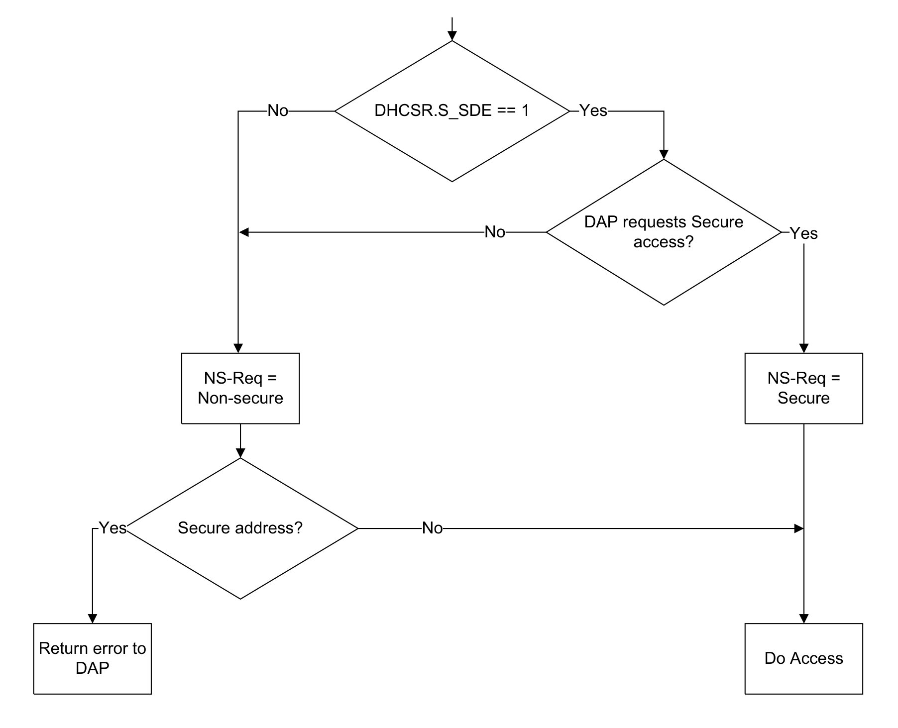
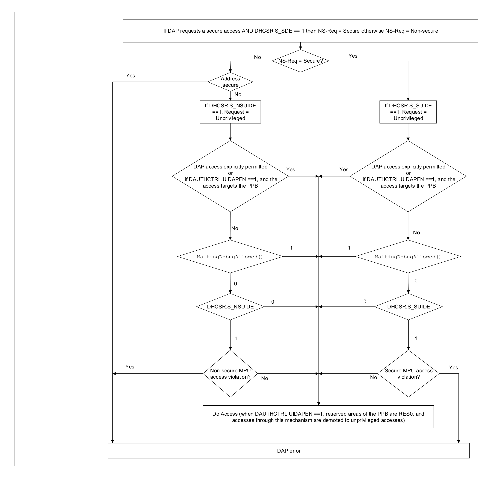

本文译自 Part B《Armv8-M 架构规则》（Armv8-M Architecture Rules） Chapter B13《调试》（Debug）。

本章规定 **Armv8-M** 调试规则。

## 1. 调试特性概览

实现的调试配置是 **IMPLEMENTATION DEFINED** 的。

适用于 **Armv8.0-M** 及以后架构版本的实现。

下表描述 **Armv8-M** 调试架构的特性：

| 特性 | Main Extension | Baseline 实现 |
| --- | --- | --- |
| DebugMonitor 异常 | 始终实现 | 从不实现 |
| Halting debug | 可选 | 可选 |
| `EDBGRQ` | 可选，需要 Halting debug | 可选，需要 Halting debug |
| 外部 Halt 信号 | 可选，需要 Halting debug | 可选，需要 Halting debug |
| Flash Patch and Breakpoint Unit（FPB） | 可选，需要 Halting debug | 可选，需要 Halting debug |
| Data Watchpoint and Trace Unit（DWT） | - | - |
| 调试功能（DWTD） | 可选，需要 Halting debug | 可选，需要 Halting debug |
| 跟踪功能（DWTT） | 需要 ITM 与调试功能 | 从不实现 |
| Instrumentation Trace Macrocell（ITM） | 可选，需要 Halting debug | 从不实现 |
| Cross Trigger Interface（CTI） | 需要 ETM 或 Halting Debug | 需要 ETM 或 Halting Debug |
| Trace Port Interface Unit（TPIU） | 需要 ITM 或 ETM | 需要 ETM |
| Embedded Trace Macrocell（ETM） | 可选，需要 Halting debug | 可选，需要 Halting debug |
| Performance Monitors Unit（PMU） | 可选，需要 Halting debug | 从不实现 |
| Unprivileged Debug Extension（UDE） | 可选，需要 Halting debug | 从不实现 |
| DSP Debug Extension（DSPDE） | 可选，需要 Halting debug | 从不实现 |

适用于 **Armv8.0-M** 及以后架构版本的实现。注意，CTI 要求 HDBG 或 ETM。

以下可选调试组件不属于 **Armv8-M** 架构：

- **交叉触发接口**（Cross-Trigger Interface，CTI）。
- **CoreSight 基本跟踪路由器**（CoreSight basic trace router，MTB）。
- **嵌入式跟踪宏单元**（Embedded Trace Macrocell，ETM）。

适用于 **Armv8.0-M** 及以后架构版本的实现。注意，CTI 要求 HDBG 或 ETM。

建议的调试实现级别为：

- **Minimum**。
- **Basic**。
- **Comprehensive**。
- **Program trace**。

**Minimum**

在包含 **Main Extension** 的实现中，**Minimum** 级别包含对 **DebugMonitor** 异常的支持，包括：

- `BKPT` 指令。
- `DEMCR` 的 Monitor 调试特性。
- 从外部调试请求进入 Monitor。
- `DFSR`。

`DHCSR`、`DCRSR`、`DCRDR` 以及 `DFSR` 与 `DEMCR` 中的 Halting debug 特性为 RES0。

`ID_DFR0` 为 RAZ。

在不包含 **Main Extension** 的实现中没有调试支持。

`DFSR`、`DHCSR`、`DCRSR`、`DCRDR` 与 `DEMCR` 为 RES0。

`ID_DFR0` 为 RAZ。

**Basic**

在包含 **Main Extension** 的实现中，**Basic** 级别增加对 **Halting debug** 的支持，具有：

- **调试访问端口**（Debug Access Port）与 ROM 表。
- `DHCSR`、`DCRSR`、`DCRDR` 以及 `DEMCR` 中的 Halting debug 特性已实现。
- 至少带两个断点的 **FPB**。
- 至少具备以下内容的 **DWT**：
  - 一个支持指令、数据地址与数据值匹配的观察点。
  - `DWT_PCSR`。
- 在多处理器系统中可选支持 **CTI**。

对 **Basic** 实现的支持由 `ID_DFR0` 标识。

在包含 **Armv8.1-M** 的实现中，**DSP Debug Extension** 增加对 **DSPDE** 的支持。对 **DSP Debug Extension** 的支持属于 **Basic** 调试级别。

在不包含 **Armv8.1-M** 的实现中，不支持 **DSP Debug Extension**。

在不包含 **Main Extension** 的实现中，**Basic** 级别增加对 **Halting debug** 的支持，具有：

- 调试访问端口与 ROM 表。
- `SHCSR`、`DFSR`、`DHCSR`、`DCRSR`、`DCRDR` 与 `DEMCR` 已实现。**PE** 的访问是 **IMPLEMENTATION DEFINED** 的。
- 至少带两个断点的 **FPB**。
- 至少具备以下内容的 **DWT**：
  - 一个支持指令、数据地址与数据值匹配的观察点。
  - `DWT_PCSR`。
- 在多处理器系统中可选支持 **CTI**。

对 **Basic** 实现的支持由 `ID_DFR0` 标识。在 **Armv8.0** 实现中，除非实现了 **Halting debug**，否则 `ID_DFR0` 为 RAZ。

**Comprehensive**

在包含 **Main Extension** 的实现中，**Comprehensive** 级别增加基本跟踪支持，具有：

- 一个 **ITM**。
- **DWT**，具有：
  - 跟踪支持。
  - 性能剖析支持。
  - 周期计数器。
- **TPIU**。

在不包含 **Main Extension** 的实现中，不支持 **Comprehensive** 级别。

**Program trace**

在包含 **Main Extension** 的实现中，**Program trace** 增加对 **ETM** 的支持。

在不包含 **Main Extension** 的实现中，**Program trace** 增加对 **ETM** 与 **TPIU** 的支持。

**Armv8.1-M** 实现引入了进一步的可选调试扩展：

**Performance Monitoring**

在包含 **Armv8.1-M** 的实现中，**Performance Monitoring** 增加对 **PMU** 的支持。对 **Performance Monitors** 扩展的支持属于 **Comprehensive** 调试级别。

在不包含 **Armv8.1-M** 的实现中，不支持 **Performance Monitoring**。

**Unprivileged Debug Extension**

在不包含 **Armv8.1-M** 的实现中，不支持 **Unprivileged Debug Extension**。对 **Unprivileged Debug Extension** 的支持属于 **Basic** 调试级别。

适用于 **Armv8.0-M** 及以后架构版本的实现。扩展要求为 - DB。

参见：

- 第 B13.1.1 节《调试机制》（Debug mechanisms）。
- 《停机调试》（Halting debug）。
- 《DebugMonitor 异常》（DebugMonitor exception）。
- 第 B13.4.4 节《断点指令》（Breakpoint instructions）。
- 第 B14.1 节《Instrumentation Trace Macrocell》。
- 第 B14.2 节《Data Watchpoint and Trace 单元》（Data Watchpoint and Trace unit）。
- 第 B14.3 节《Embedded Trace Macrocell》。
- 第 B14.4 节《Trace Port Interface Unit》。
- 第 B14.5 节《Flash Patch and Breakpoint 单元》（Flash Patch and Breakpoint unit）。
- 《调试异常与监视控制寄存器》（DEMCR, Debug Exception and Monitor Control Register）。
- 《调试故障状态寄存器》（DFSR, Debug Fault Status Register）。
- 《调试停机控制与状态寄存器》（DHCSR, Debug Halting Control and Status Register）。
- 《调试内核寄存器数据寄存器》（DCRDR, Debug Core Register Data Register）。
- 《调试内核寄存器选择寄存器》（DCRSR, Debug Core Register Select Register）。
- 《调试特性寄存器》（ID_DFR0, Debug Feature Register）。
- 《DWT 程序控制采样寄存器》（DWT_PCSR, DWT Program Control Sample Register）。

### 1.1 调试机制

**Armv8-M** 支持一系列侵入式与非侵入式调试机制。侵入式调试机制为：

- 使 **PE** 停机的能力。这提供了运行-停止（run-stop）调试模型。
- 使用 **DebugMonitor** 异常调试代码。这比使 **PE** 停机侵入性更低。

非侵入式调试技术为：

- 通过写入 **Instrumentation Trace Macrocell**（ITM）产生应用跟踪，带来较低程度的侵入。
- 非侵入式的程序跟踪与性能剖析。

适用于 **Armv8.0-M** 及以后架构版本的实现。扩展要求为 - DB。注意，**DebugMonitor** 异常与 ITM 要求 M。

当 **PE** 停机时，它处于**调试状态**（Debug state）。

适用于 **Armv8.0-M** 及以后架构版本的实现。扩展要求为 - HDBG。

当 **PE** 未停机时，它处于**非调试状态**（Non-debug state）。

适用于 **Armv8.0-M** 及以后架构版本的实现。扩展要求为 - HDBG。

非侵入式调试组件并不保证对 **PE** 的行为或性能不做任何改变。但实际发生的任何改变都不得严重，否则会降低事件计数器用于性能测量与剖析的价值。这不包括由于同一程序被插桩以使用非侵入式调试特性（例如 **Performance Monitors**）而产生的程序行为变化，也不包括由于在剖析目标进程的同时运行了其他性能监视过程而产生的变化。因此，允许存在合理的性能波动。

适用于 **Armv8.0-M** 及以后架构版本的实现。

**Unprivileged Debug Extension**（UDE）允许对 **PE** 的调试访问进行更细粒度的控制。UDE 允许在 **PE** 处于非特权模式时提供条件调试能力，包括对 **DebugMonitor** 异常以及可选的 **Halting debug** 与非侵入式调试的支持。

适用于 **Armv8.1-M** 及以后架构版本的实现。扩展要求为 - UDE。

参见：

- 第 B13.2 节《访问调试特性》（Accessing debug features）。

### 1.2 调试资源

在系统地址映射中，调试资源位于**私有外设总线**（Private Peripheral Bus，PPB）区域。

适用于 **Armv8.0-M** 及以后架构版本的实现。

除 **SCS** 中的资源外，每个调试组件都占用一个固定的 4KB 地址区域。

适用于 **Armv8.0-M** 及以后架构版本的实现。扩展要求为 - DB。

**SCS** 中的调试资源为：

- **调试控制块**（Debug Control Block，DCB）。
- **系统控制块**（System Control Block，SCB）中的调试控制。

适用于 **Armv8.0-M** 及以后架构版本的实现。扩展要求为 - DB。

若实现了 **Main Extension**，则实现 **DebugMonitor** 支持。若未实现 **Main Extension**，则不支持 **DebugMonitor**。

适用于 **Armv8.0-M** 及以后架构版本的实现。扩展要求为 - DB。

ROM 表项标识实现了哪些可选调试组件。

适用于 **Armv8.0-M** 及以后架构版本的实现。扩展要求为 - DB。

调试资源的地址如下：

| 地址范围 | 调试资源 |
| --- | --- |
| 0xE0000000-0xE0000FFF | Instrumentation Trace Macrocell（ITM） |
| 0xE0001000-0xE0001FFF | Data Watchpoint and Trace Unit（DWT） |
| 0xE0002000-0xE0002FFF | Flash Patch and Breakpoint Unit（FPB） |
| 0xE0003000-0xE0003FFF | Performance Monitor Unit（PMU） |
| 0xE000E000-0xE000EFFF | Secure SCS |
| 0xE000EC00-0xE000ED8F | Secure 与 Non-secure System Control Block（SCB） |
| 0xE000EDF0-0xE000EEFF | Secure 与 Non-secure Debug Control Block（DCB） |
| 0xE002E000-0xE002EFFF | Non-secure SCS |
| 0xE002EC00-0xE002ED8F | Non-secure System Control Block（SCB） |
| 0xE002EDF0-0xE002EEFF | Non-secure Debug Control Block（DCB） |
| 0xE0040000-0xE0040FFF | Trace Port Interface Unit（TPIU）；若未作为共享资源实现，则该区域保留 |
| 0xE0041000-0xE0041FFF | Embedded Trace Macrocell（ETM） |
| 0xE0042000-0xE00FEFFF | IMPLEMENTATION DEFINED |
| 0xE00FF000-0xE00FFFFF | ROM 表 |

适用于 **Armv8.0-M** 及以后架构版本的实现。扩展要求为 - DB。

参见：

- 第 B14.1 节《Instrumentation Trace Macrocell》。
- 第 B14.2 节《Data Watchpoint and Trace 单元》（Data Watchpoint and Trace unit）。
- 第 B14.5 节《Flash Patch and Breakpoint 单元》（Flash Patch and Breakpoint unit）。
- 第 B8 章《系统地址映射》（The System Address Map）。
- 第 B13.2.2 节《调试系统寄存器》（Debug System registers）。
- 第 B14.4 节《Trace Port Interface Unit》。
- 第 B14.3 节《Embedded Trace Macrocell》。
- 第 B13.2.1 节《ROM 表》（ROM table）。
- 第 B13.2 节《访问调试特性》（Accessing debug features）。

### 1.3 跟踪

可以使用以下单元产生跟踪：

- **Embedded Trace Macrocell**（ETM）。
- **Instrumentation Trace Macrocell**（ITM）。
- **Data Watchpoint and Trace**（DWT）单元。
- **Performance Monitoring Unit**（PMU）。

适用于 **Armv8.0-M** 及以后架构版本的实现。扩展要求为 - ETM || ITM || DWTT || PMU。

产生跟踪的调试实现包含一个**跟踪汇点**（trace sink），例如 **TPIU**。

适用于 **Armv8.0-M** 及以后架构版本的实现。扩展要求为 - (ETM || DWTT || PMU) && ITM && TPIU。

**TPIU** 既可以是 **Armv8-M TPIU** 实现，也可以是外部系统资源。

适用于 **Armv8.0-M** 及以后架构版本的实现。扩展要求为 - ETM || ITM || DWTT || PMU。

参见：

- 《ITM 与 DWT 包协议规范》（ITM and DWT Packet Protocol Specification）。
- 适用的《ETM 架构规范》（ETM Architecture Specification）。

## 2. 访问调试特性

外部调试器访问 **PE** 与系统的机制是 **IMPLEMENTATION DEFINED** 的。

适用于 **Armv8.0-M** 及以后架构版本的实现。扩展要求为 - DB。

调试器可以使用**调试访问端口**（Debug Access Port，DAP）接口（例如《Arm® Debug Interface v5 架构规范》（ADIv5）与《Arm® Debug Interface v6 架构规范》（ADIv6）中描述的 DAP），向系统查询**内存访问端口**（Memory Access Port，MEM-AP）。内存访问端口中的基址寄存器提供 ROM 表的地址，或 ROM 表层次结构中一系列 ROM 表中第一个的地址。随后内存访问端口可以读取 ROM 表项。**Arm** 建议至少实现一个 ADIv5 DAP，以便与工具兼容。

适用于 **Armv8.0-M** 及以后架构版本的实现。扩展要求为 - DB。

**DAP** 接口支持字、半字与字节访问。

适用于 **Armv8.0-M** 及以后架构版本的实现。扩展要求为 - DB。

**调试访问端口**是一个**观察者**，观察 **PE** 发起的所有访问。

适用于 **Armv8.0-M** 及以后架构版本的实现。扩展要求为 - DB。

软件通过内存映射寄存器配置与控制调试特性。

适用于 **Armv8.0-M** 及以后架构版本的实现。扩展要求为 - DB。

来自 **DAP** 内存访问的写入在 **DAP** 报告该写入完成时完成。

适用于 **Armv8.0-M** 及以后架构版本的实现。扩展要求为 - DB。

对于 **SCS** 寄存器，来自 **DAP** 的写入在写入完成且 **SCS** 寄存器已更新时完成。

适用于 **Armv8.0-M** 及以后架构版本的实现。扩展要求为 - DB。

《Arm® Debug Interface v5 架构规范》（ADIv5）与《Arm® Debug Interface v6 架构规范》（ADIv6）规定了**内存访问端口**（MEM-AP），当一次内存访问能够被该 MEM-AP 以及系统中的其他观察者观察到时，该访问完成。

适用于 **Armv8.0-M** 及以后架构版本的实现。扩展要求为 - DB。

参见：

- 第 B13.2.1 节《ROM 表》（ROM table）。
- 第 B13.3.4 节《DAP 访问权限》（DAP access permissions）。
- 第 B7.2.3 节《排序与可观察性》（Ordering and observability）。
- 《Arm® Debug Interface v5 架构规范》（The Arm® Debug Interface v5 Architecture Specification）。
- 《Arm® Debug Interface v6 架构规范》（The Arm® Debug Interface v6 Architecture Specification）。

### 2.1 ROM 表

ROM 表是一组表项，提供识别该实现所支持调试基础设施的机制。

适用于 **Armv8.0-M** 及以后架构版本的实现。扩展要求为 - DB。

ROM 表指明已实现的调试组件以及这些组件在内存映射中的位置。ROM 表项的格式见《Arm® Debug Interface v5 架构规范》。

适用于 **Armv8.0-M** 及以后架构版本的实现。扩展要求为 - DB。

对于 **Armv8-M** ROM 表，所有表项偏移都是负值。ROM 表项指向某个 4KB 页的顶部，而偏移指向该页中包含外设 ID 与组件 ID 寄存器的底部。

适用于 **Armv8.0-M** 及以后架构版本的实现。扩展要求为 - DB。

若实现了任何其他调试组件，或实现了**调试访问端口**，则实现 ROM 表。

适用于 **Armv8.0-M** 及以后架构版本的实现。扩展要求为 - DB。

ROM 表项的位 [0] 表示相应调试组件是否已实现、并可通过 **PPB** 在所指地址访问。若相应调试组件未实现，则该位取值为 0。

适用于 **Armv8.0-M** 及以后架构版本的实现。扩展要求为 - DB。

若实现了某个调试组件，则调试寄存器可以提供有关该组件已实现特性的附加信息。

适用于 **Armv8.0-M** 及以后架构版本的实现。扩展要求为 - DB。

ROM 表的格式为：

| 偏移 | 值 | 名称 | 描述 |
| --- | --- | --- | --- |
| 0x000 | 0xFFF0F003 | ROMSCS | 指向 0xE000E000 处的 SCS |
| 0x004 | 0xFFF02002 或 0xFFF02003 | ROMDWT | 指向 0xE0001000 处的 Data Watchpoint and Trace 单元 |
| 0x008 | 0xFFF03002 或 0xFFF03003 | ROMFPB | 指向 0xE0002000 处的 Flash Patch and Breakpoint 单元 |
| 0x00C | 0xFFF01002 或 0xFFF01003 | ROMITM | 指向 0xE0000000 处的 Instrumentation Trace 单元。 |
| 0x010 | 0xFFF41002 或 0xFFF41003 | ROMTPIU | 指向 Trace Port Interface Unit。 |
| 0x014 | 0xFFF42002 或 0xFFF42003 | ROMETM | 指向 Embedded Trace Macrocell。 |
| 0x018 | 0xFFF04002 或 0xFFF04003 | ROMPMU | 指向 0xE0003000 处的 Performance Monitoring Unit。 |
| - | 0x00000000 | End | 表结束标记。表是否以指向其他系统调试资源的指针扩展，是 IMPDEF 的。表项始终以空表项终止。 |
| 0x020 - 0xEFC | - | 未使用 | 保留用于附加 ROM 表项。 |
| 0xF00 - 0xFC8 | - | 保留 | 保留，不用于 ROM 表项。 |
| 0xFCC | 0x00000001 | MEMTYPE | 位 [0] 置 1 表示除 ROM 表中列出的资源之外，其他资源可在同一 32 位地址空间中通过 DAP 访问。MEMTYPE 表项的位 [31:1] 为 RES0。 |
| 0xFD0 | IMP DEF | PIDR4 | ROM 表的 CIDRx 值已完全定义，并符合 CoreSight。 |
| 0xFD4 | 0 | PIDR5 | PIDRx 值符合 CoreSight，或为 RAZ。 |
| 0xFD8 | 0 | PIDR6 | PIDRx 值符合 CoreSight，或为 RAZ。 |
| 0xFDC | 0 | PIDR7 | PIDRx 值符合 CoreSight，或为 RAZ。 |
| 0xFE0 | IMP DEF | PIDR0 | PIDRx 值符合 CoreSight，或为 RAZ。 |
| 0xFE4 | IMP DEF | PIDR1 | PIDRx 值符合 CoreSight，或为 RAZ。 |
| 0xFE8 | IMP DEF | PIDR2 | PIDRx 值符合 CoreSight，或为 RAZ。 |
| 0xFEC | IMP DEF | PIDR3 | PIDRx 值符合 CoreSight，或为 RAZ。 |
| 0xFF0 | 0x0000000D | CIDR0 | - |
| 0xFF4 | 0x00000010 | CIDR1 | - |
| 0xFF8 | 0x00000005 | CIDR2 | - |
| 0xFFC | 0x000000B1 | CIDR3 | - |

对 ROMITM 的访问不能引起不存在内存异常。

**ETM** 与 **TPIU** 是否为共享资源，以及该资源由本地 **PE** 还是其他资源管理，是 **IMPLEMENTATION DEFINED** 的。

适用于 **Armv8.0-M** 及以后架构版本的实现。扩展要求为 - DB 以及表中指明的那些要求。注意，PMU 仅在 **Armv8.1-M** 实现中可用。

若实现了 **PMU**，则表结束标记为 0x1C，其值为 0x00000000。表是否以指向其他系统调试资源的指针扩展，是 **IMPLEMENTATION DEFINED** 的。

适用于 **Armv8.1-M** 及以后架构版本的实现。扩展要求为 - DB && PMU。

参见：

- 第 B13.2.3 节《CoreSight 与标识寄存器》（CoreSight and identification registers）。

### 2.2 调试系统寄存器

**系统控制块**（System Control Block，SCB）中的调试提供内容包括：

- 两个与处理程序相关的标志位：`ICSR.ISRPREEMPT` 与 `ICSR.ISRPENDING`。
- `DFSR`。

适用于 **Armv8.0-M** 及以后架构版本的实现。扩展要求为 - DB。

参见：

- Part D《寄存器与载荷规范》（Register and Payload Specification）。
- 《调试控制块》（Debug Control Block）。

### 2.3 CoreSight 与标识寄存器

**Arm** 建议实现符合 CoreSight 的 ID 寄存器，以便调试器识别与发现各组件。

适用于 **Armv8.0-M** 及以后架构版本的实现。扩展要求为 - DB。

各调试组件中为 **IMPLEMENTATION DEFINED** 的 ID 寄存器与 CoreSight 兼容性保留的地址空间如下：

| 调试组件 | 为 ID 寄存器保留的空间 | 为 CoreSight 兼容性保留的空间 |
| --- | --- | --- |
| ITM | 0xE0000FD0-0xE0000FFC | 0xE0000FA0-0xE0000FCC |
| DWT | 0xE0001FD0-0xE0001FFC | 0xE0001FA0-0xE0001FCC |
| FPB | 0xE0002FD0-0xE0002FFC | 0xE0002FA0-0xE0002FCC |
| PMU | 0xE0003FD0-0xE0003FFC | 0xE0003FA0-0xE0003FFC |
| SCS | 0xE000EFD0-0xE000EFFC | 0xE000EFA0-0xE000EFCC |
| TPIU | 0xE0040FD0-0xE0040FFC | 0xE0040FA0-0xE0040FCC |
| ETM | 0xE0041FD0-0xE0041FFC | 0xE0041FA0-0xE0041FCC |
| ROM 表 | 0xE00FFFD0-0xE00FFFFC | 0xE00FFFA0-0xE00FFFCC |

适用于 **Armv8.0-M** 及以后架构版本的实现。扩展要求为 - DB。注意，PMU 仅在 **Armv8.1-M** 实现中可用。

对于 ROM 表，ID 寄存器空间用于一组符合 CoreSight 的 ID 寄存器。

适用于 **Armv8.0-M** 及以后架构版本的实现。扩展要求为 - DB。

对于除 ROM 表以外的所有组件，若 ID 寄存器空间中的寄存器不用于 ID 寄存器，则它们为 RAZ。

适用于 **Armv8.0-M** 及以后架构版本的实现。扩展要求为 - DB。

若实现了符合 CoreSight 的 ID 寄存器，则**组件 ID 寄存器 1** 中的 **Class** 字段为：

- ROM 表为 0x1。
- 其他组件为 0x9。

适用于 **Armv8.0-M** 及以后架构版本的实现。扩展要求为 - DB。

`PIDR` 寄存器中的 Part number 必须为每个实现赋予唯一值，或赋予**唯一组件标识符**（Unique Component Identifier），与其他所有 CoreSight 组件一样。CoreSight 允许两个或更多功能不同的组件共享同一 Part number，只要它们的 `DEVTYPE` 或 `DEVARCH` 寄存器取值不同。每个组件都有自己的 `DEVTYPE` 与 `DEVARCH` 寄存器，例如：

- `DDEVTYPE`。
- `DDEVARCH`。
- `DWT_DEVTYPE`。
- `DWT_DEVARCH`。

适用于 **Armv8.0-M** 及以后架构版本的实现。扩展要求为 - DB。

对于同一 part 的不同实现选项，`PIDR` 寄存器中的 Part number 不必唯一。

适用于 **Armv8.0-M** 及以后架构版本的实现。扩展要求为 - DB。

## 3. 调试认证接口

以下伪代码函数提供认证接口的抽象描述：

- `ExternalInvasiveDebugEnabled()`。
- `ExternalSecureInvasiveDebugEnabled()`。
- `ExternalNoninvasiveDebugEnabled()`。
- `ExternalSecureNoninvasiveDebugEnabled()`。

适用于 **Armv8.0-M** 及以后架构版本的实现。扩展要求为 - DB。

对于使用 CoreSight 信号 DBGEN、NIDEN、SPIDEN 与 SPNIDEN 的实现：

- 若 DBGEN 置位，则 `ExternalInvasiveDebugEnabled()` 返回 TRUE。
- 若 DBGEN 与 SPIDEN 都置位，则 `ExternalSecureInvasiveDebugEnabled()` 返回 TRUE。
- 若 NIDEN 或 DBGEN 之一置位，则 `ExternalNoninvasiveDebugEnabled()` 返回 TRUE。
- 若以下两个条件都成立，则 `ExternalSecureNoninvasiveDebugEnabled()` 返回 TRUE：
  - NIDEN 或 DBGEN 之一置位。
  - SPNIDEN 或 SPIDEN 之一置位。

适用于 **Armv8.0-M** 及以后架构版本的实现。扩展要求为 - DB。

由 `DAUTHCTRL.UIDEN` 置 1 所使能的非特权调试能力，无论以下各项处于何种状态都是可用的：

- `DAUTHCTRL.INTSPNIDEN`。
- `DAUTHCTRL.SPNIDENSEL`。
- `DAUTHCTRL.INTSPIDEN`。
- `DAUTHCTRL.SPIDENSEL`。
- DBGEN。
- SPIDEN。

适用于 **Armv8.1-M** 及以后架构版本的实现。扩展要求为 - HDBG && UDE。注意，**Secure** 行为要求 S。

对于认证接口的任何实现，若 `ExternalInvasiveDebugEnabled()` 为 FALSE，则 `ExternalSecureInvasiveDebugEnabled()` 为 FALSE。

适用于 **Armv8.0-M** 及以后架构版本的实现。扩展要求为 - DB。

对于认证接口的任何实现，若 `ExternalNoninvasiveDebugEnabled()` 为 FALSE，则 `ExternalSecureNoninvasiveDebugEnabled()` 为 FALSE。

适用于 **Armv8.0-M** 及以后架构版本的实现。扩展要求为 - DB。

对于认证接口的任何实现，若 `ExternalInvasiveDebugEnabled()` 为 TRUE，则 `ExternalNoninvasiveDebugEnabled()` 为 TRUE。

适用于 **Armv8.0-M** 及以后架构版本的实现。扩展要求为 - DB。

对于认证接口的任何实现，若 `ExternalSecureInvasiveDebugEnabled()` 为 TRUE，则 `ExternalSecureNoninvasiveDebugEnabled()` 为 TRUE。

适用于 **Armv8.0-M** 及以后架构版本的实现。扩展要求为 - DB。

**Secure** 自托管调试由认证接口控制。伪代码函数 `ExternalSecureSelfHostedDebugEnabled()` 提供该认证接口的抽象描述。

适用于 **Armv8.0-M** 及以后架构版本的实现。扩展要求为 - DB。

在对调试认证接口的更改与随后的**上下文同步事件**之间，**PE** 使用旧值还是新值是 **UNPREDICTABLE** 的。

适用于 **Armv8.0-M** 及以后架构版本的实现。扩展要求为 - DB。

参见：

- 第 B13.3.1 节《停机调试认证》（Halting debug authentication）。
- 第 B13.3.3 节《DebugMonitor 异常认证》（DebugMonitor exception authentication）。
- 第 B13.3.2 节《非侵入式调试认证》（Non-invasive debug authentication）。
- 第 B13.3.4 节《DAP 访问权限》（DAP access permissions）。

### 3.1 停机调试认证

停机调试认证由 **IMPLEMENTATION DEFINED** 的认证接口函数 `ExternalInvasiveDebugEnabled()` 控制；若实现了 **Security Extension**，还由 **IMPLEMENTATION DEFINED** 的认证接口函数 `ExternalSecureInvasiveDebugEnabled()` 控制。

适用于 **Armv8.0-M** 及以后架构版本的实现。扩展要求为 - HDBG。注意，External Secure 侵入式调试要求 S。

若 `ExternalInvasiveDebugEnabled()` 返回 FALSE，则在所有状态下都禁止特权模式下的停机。若未实现 UDE，本规则适用于所有特权模式。

适用于 **Armv8.1-M** 及以后架构版本的实现。扩展要求为 - HDBG。

当 **PE** 停机时，**PE** 的行为如同 `ExternalInvasiveDebugEnabled()` 为 TRUE。伪代码函数 `HaltingDebugAllowed()` 描述这一点。

适用于 **Armv8.0-M** 及以后架构版本的实现。扩展要求为 - HDBG。

若未实现 **Security Extension**，则有两种停机调试认证模式：

| ExternalInvasiveDebugEnabled() | DHCSR.S_HALT | 停机调试认证模式 |
| --- | --- | --- |
| FALSE | 0 | 禁止停机。 |
| FALSE | 1 | 允许停机。 |
| TRUE | X | 允许停机。 |

适用于 **Armv8.0-M** 及以后架构版本的实现。扩展要求为 - HDBG && !S && !UDE。

在 **Secure** 状态的特权模式下，若以下任一条件为 TRUE，则禁止停机：

- **IMPLEMENTATION DEFINED** 的 `ExternalInvasiveDebugEnabled()` 返回 FALSE。
- `DAUTHCTRL.SPIDENSEL` 置 1 且 `DAUTHCTRL_S.INTSPIDEN` 置 0。
- `DAUTHCTRL.SPIDENSEL` 置 0 且 `ExternalSecureInvasiveDebugEnabled()` 返回 FALSE。

伪代码函数 `SecureHaltingDebugAllowed` 描述这一点。

适用于 **Armv8.0-M** 及以后架构版本的实现。扩展要求为 - HDBG && S。

若未实现 **Security Extension** 而实现了 **Unprivileged Debug Extension**，则停机调试具有以下认证模式：

| HaltingDebugAllowed() | DAUTHCTRL.UIDEN | 停机调试认证模式 |
| --- | --- | --- |
| FALSE | 0 | 在所有模式下禁止停机。 |
| FALSE | 1 | 允许在非特权模式下停机。禁止在特权模式下停机。 |
| TRUE | X | 允许在所有模式下停机。 |

适用于 **Armv8.1-M** 及以后架构版本的实现。扩展要求为 - HDBG && !S && UDE。

在 **Secure** 状态，若以下全部为真，则禁止在非特权模式下停机：

- `SecureHaltingDebugAllowed()` 返回 FALSE。
- `DAUTHCTRL_S.UIDEN` 置 0。

适用于 **Armv8.1-M** 及以后架构版本的实现。扩展要求为 - UDE && HDBG && S。

在 **Non-secure** 状态，若以下全部为真，则禁止在非特权模式下停机：

- `HaltingDebugAllowed()` 返回 FALSE。
- `DAUTHCTRL_S.UIDEN` 置 0。
- `DAUTHCTRL_NS.UIDEN` 置 0。

适用于 **Armv8.1-M** 及以后架构版本的实现。扩展要求为 - UDE && HDBG && S。

`DAUTHCTRL_NS.UIDEN` 控制能否在 **Non-secure** 状态从非特权模式发起调试请求。`DAUTHCTRL_S.UIDEN` 控制能否从 **Secure** 或 **Non-secure** 状态发起调试请求。当 `DAUTHCTRL_S.UIDEN` 置 1 时，`DAUTHCTRL_NS.UIDEN` 的有效值为 1。

适用于 **Armv8.1-M** 及以后架构版本的实现。扩展要求为 - HDBG && UDE。注意，**Secure** 行为要求 S。

当 **PE** 未停机时，`DHCSR.S_SDE`、`DHCSR.S_SUIDE` 与 `DHCSR.S_NSUIDE` 的取值按函数 `UpdateDebugEnable()` 的描述更新。

适用于 **Armv8.1-M** 及以后架构版本的实现。扩展要求为 - HDBG。注意，**Secure** 行为要求 S，非特权调试要求 UDE。

若 **PE** 处于**非调试状态**，则以下条件成立：

- 若以下为真，则 `DHCSR.S_SDE` 读为 1，否则读为 0：
  - `SecureHaltingDebugAllowed()` 返回 TRUE。

适用于 **Armv8.0-M** 及以后架构版本的实现。扩展要求为 - HDBG && !UDE。注意，**Secure** 行为要求 S。

若 **PE** 处于**非调试状态**，则以下条件成立：

- 若以下任一为真，则 `DHCSR.S_SDE` 读为 1，否则读为 0：
  - `SecureHaltingDebugAllowed()` 返回 TRUE。
  - `UnprivHaltingDebugAllowed(TRUE)` 返回 TRUE。
- 若以下全部为真，则 `DHCSR.S_SUIDE` 读为 1，否则读为 0：
  - `SecureHaltingDebugAllowed()` 返回 FALSE。
  - `UnprivHaltingDebugAllowed(TRUE)` 返回 TRUE。
- 若以下全部为真，则 `DHCSR.S_NSUIDE` 读为 1，否则读为 0：
  - `HaltingDebugAllowed()` 返回 FALSE。
  - `UnprivHaltingDebugAllowed(FALSE)` 返回 TRUE。

适用于 **Armv8.1-M** 及以后架构版本的实现。扩展要求为 - HDBG && UDE。注意，**Secure** 行为要求 S。

若 **PE** 处于**调试状态**：

- 若以下任一为真，则 `DHCSR.S_SDE` 读为 1，否则读为 0：
  - **PE** 从 **Secure** 状态进入**调试状态**。
  - **PE** 在 `SecureHaltingDebugAllowed()` 返回 TRUE 时从 **Non-secure** 状态进入**调试状态**。

适用于 **Armv8.0-M** 及以后架构版本的实现。扩展要求为 - HDBG && !UDE。注意，**Secure** 行为要求 S。

若 **PE** 处于**调试状态**：

- 若以下任一为真，则 `DHCSR.S_SDE` 读为 1，否则读为 0：
  - **PE** 从 **Secure** 状态进入**调试状态**。
  - **PE** 在 `SecureHaltingDebugAllowed()` 返回 TRUE 时从 **Non-secure** 状态进入**调试状态**。
  - **PE** 在 `UnprivHaltingDebugAllowed(TRUE)` 返回 TRUE 时从 **Non-secure** 状态进入**调试状态**。
- 若 **PE** 进入**调试状态**时以下全部为真，则 `DHCSR.S_SUIDE` 读为 1，否则读为 0：
  - `SecureHaltingDebugAllowed()` 返回 FALSE。
  - `UnprivHaltingDebugAllowed(TRUE)` 返回 TRUE。
- 若 **PE** 进入**调试状态**时以下全部为真，则 `DHCSR.S_NSUIDE` 读为 1，否则读为 0：
  - `HaltingDebugAllowed()` 返回 FALSE。
  - `UnprivHaltingDebugAllowed(FALSE)` 返回 TRUE。

适用于 **Armv8.1-M** 及以后架构版本的实现。扩展要求为 - HDBG。注意，**Secure** 行为要求 S。

若实现了 **Security Extension**，则有三种停机调试认证模式：

| HaltingDebugAllowed() | DHCSR.S_SDE | 停机调试认证模式 |
| --- | --- | --- |
| FALSE | X | 禁止停机。 |
| TRUE | 0 | 允许在 Non-secure 状态停机。禁止在 Secure 状态停机。 |
| TRUE | 1 | 允许停机。 |

适用于 **Armv8.0-M** 及以后架构版本的实现。扩展要求为 - HDBG && S && !UDE。

在 **Armv8.1-M PE** 中，非特权调试认证如下：

| HaltingDebugAllowed() | SecureHaltingDebugAllowed() | DAUTHCTRL_S.UIDEN | DAUTHCTRL_NS.UIDEN | 停机调试认证模式 |
| --- | --- | --- | --- | --- |
| FALSE | FALSE | 0 | 0 | 禁止停机。 |
| FALSE | FALSE | 0 | 1 | 允许在 Non-secure 非特权模式停机。禁止在 Secure 非特权模式、Non-secure 特权模式与 Secure 特权模式停机。 |
| FALSE | FALSE | 1 | X | 允许在 Secure 与 Non-secure 非特权模式停机。禁止在 Secure 与 Non-secure 特权模式停机。 |
| TRUE | FALSE | 0 | X | 允许在 Non-secure 状态及所有特权模式停机。 |
| TRUE | FALSE | 1 | X | 允许在 Non-secure 状态及 Secure 非特权模式停机。 |
| TRUE | TRUE | X | X | 允许在所有安全状态与特权模式停机。 |

适用于 **Armv8.1-M** 及以后架构版本的实现。扩展要求为 - HDBG && UDE。注意，**Secure** 状态要求 S。

当 `DHCSR.C_DEBUGEN == 0`，或 **PE** 处于禁止停机的状态时，**PE** 不会进入**调试状态**。

适用于 **Armv8.0-M** 及以后架构版本的实现。扩展要求为 - HDBG。注意，**Secure** 行为要求 S。

参见：

- `CanHaltOnEvent()`。

### 3.2 非侵入式调试认证

非侵入式认证由 **IMPLEMENTATION DEFINED** 的函数 `ExternalNoninvasiveDebugEnabled()` 控制。

适用于 **Armv8.0-M** 及以后架构版本的实现。扩展要求为 - DB && !S。

**Secure** 非侵入式认证由 **IMPLEMENTATION DEFINED** 的以下函数控制：

- `ExternalSecureNoninvasiveDebugEnabled()`。
- `ExternalNoninvasiveDebugEnabled()`。

适用于 **Armv8.0-M** 及以后架构版本的实现。扩展要求为 - DB && S。

当 `HaltingDebugAllowed()` 为 TRUE 时，**PE** 的行为如同 `ExternalNoninvasiveDebugEnabled()` 返回 TRUE。伪代码函数 `NoninvasiveDebugAllowed()` 描述这一点。

适用于 **Armv8.0-M** 及以后架构版本的实现。扩展要求为 - DB && !UDE。

除非以下任一返回 TRUE，否则禁止对某个操作进行非侵入式调试：

- `ExternalNoninvasiveDebugEnabled()`。
- `HaltingDebugAllowed()`。
- `UnprivHaltingDebugEnabled()`，且 **PE** 处于非特权模式。

伪代码函数 `NoninvasiveDebugAllowed()` 描述这一点。

适用于 **Armv8.1-M** 及以后架构版本的实现。扩展要求为 - DB && UDE。

若函数 `SecureNoninvasiveDebugAllowed()` 与 `NoninvasiveDebugAllowed()` 都返回 FALSE，则禁止非侵入式调试。

适用于 **Armv8.0-M** 及以后架构版本的实现。扩展要求为 - DB && S。

除非以下任一为真，否则禁止对 **Secure** 状态下的操作进行非侵入式调试：

- `DHCSR.S_SDE` 置 1，且 UDE 未实现或在 **Secure** 状态不被允许。
- **PE** 处于非特权模式，且 `UnprivHaltingDebugEnabled(TRUE)` 返回 TRUE。
- `DAUTHCTRL.SPNIDENSEL` 置 1 且 `DAUTHCTRL_S.INTSPIDEN` 置 1。
- `ExternalSecureNoninvasiveDebugEnabled()` 返回 TRUE。

伪代码函数 `SecureNoninvasiveDebugAllowed()` 描述这一点。

适用于 **Armv8.0-M** 及以后架构版本的实现。扩展要求为 - DB && S && UDE。

当禁止对某个操作进行非侵入式调试时，**PE** 不产生任何跟踪或剖析数据。

适用于 **Armv8.0-M** 及以后架构版本的实现。扩展要求为 - DB。

若禁止对 **Secure** 操作进行非侵入式调试，则 **PE** 不产生任何包含安全信息或可归因于安全操作的跟踪或剖析数据。

适用于 **Armv8.0-M** 及以后架构版本的实现。扩展要求为 - DB && S。

若禁止对特权操作进行非侵入式调试，则 **PE** 不产生任何包含特权信息或可归因于特权操作的跟踪或剖析数据。

适用于 **Armv8.1-M** 及以后架构版本的实现。扩展要求为 - DB && UDE。

若在当前**安全状态**禁止非侵入式调试，则 **ETM** 的行为如相关 ETM 架构所述。

适用于 **Armv8.0-M** 及以后架构版本的实现。扩展要求为 - DB && S && ETM。

参见：

- `NoninvasiveDebugAllowed()`。
- `SecureNoninvasiveDebugAllowed()`。
- 第 B14.2.2 节《DWT 单元操作》（DWT unit operation）。

### 3.3 DebugMonitor 异常认证

只有当实现了 **Main Extension** 时，才提供 **DebugMonitor** 异常认证。

适用于 **Armv8.0-M** 及以后架构版本的实现。扩展要求为 - M。

**DebugMonitor** 异常认证由 **IMPLEMENTATION DEFINED** 的认证接口函数 `ExternalSecureSelfHostedDebugEnabled()` 控制。

适用于 **Armv8.0-M** 及以后架构版本的实现。扩展要求为 - M && S。

除非另有说明，若以下条件全部为真，则对 **Secure** 特权操作从不产生 **DebugMonitor** 异常：

- `DAUTHCTRL.FSDMA` 置 0。
- 以下任一条件为真：
  - `DAUTHCTRL.SPIDENSEL` 置 1 且 `DAUTHCTRL.INTSPIDEN` 置 0。
  - `DAUTHCTRL.SPIDENSEL` 置 0 且 `ExternalSecureSelfHostedDebugEnabled()` 返回 FALSE。

伪代码函数 `SecureDebugMonitorAllowed()` 描述这一点。

适用于 **Armv8.0-M** 及以后架构版本的实现。扩展要求为 - M && S。注意，`DAUTHCTRL.FSDMA` 仅在 **Armv8.1-M** 实现中可用。

若实现了 UDE，则 `DAUTHCTRL.FSDMA` 允许独立于 **Halting debug** 与 `ExternalSecureSelfHostedDebugEnabled()` 来使能 **Secure DebugMonitor** 异常。该字段不直接控制 **DebugMonitor** 异常的权限，而是作为 `DEMCR.SDME` 的一个输入，如 `UpdateDebugEnable()` 与 `SecureDebugMonitorAllowed()` 所述。

适用于 **Armv8.1-M** 及以后架构版本的实现。扩展要求为 - M && S && UDE。

当 **DebugMonitor** 异常既未挂起也未活动时：

- 若 `SecureDebugMonitorAllowed()` 为 TRUE，则 `DEMCR.SDME` 置 1。
- 否则 `DEMCR.SDME` 为零。

适用于 **Armv8.0-M** 及以后架构版本的实现。扩展要求为 - M。

若 **DebugMonitor** 异常挂起或活动时 `SecureDebugMonitorAllowed()` 返回 TRUE：

- 该 **DebugMonitor** 异常变为挂起或活动时，`DEMCR.SDME` 置 1。
- 否则 `DEMCR.SDME` 为零。

适用于 **Armv8.0-M** 及以后架构版本的实现。扩展要求为 - M。

若 `DEMCR.SDME == 1`，则从 **Non-secure** 状态访问 `SHPR3.PRI_12` 时其行为如同 RAZ/WI。

适用于 **Armv8.0-M** 及以后架构版本的实现。扩展要求为 - M && S。

置 1 后，`DEMCR.MON_PEND` 保持为 1，直到发生以下之一：

- 取到 **DebugMonitor** 异常。
- 对 `DEMCR` 的写入把 `DEMCR.MON_PEND` 置 0。
- **PE** 被复位。

适用于 **Armv8.0-M** 及以后架构版本的实现。扩展要求为 - M。

若以下条件全部为真，则对非特权操作从不产生 **DebugMonitor** 异常：

- `DEMCR.MON_EN` 为 0。
- `DEMCR.UMON_EN` 为 0。

适用于 **Armv8.1-M** 及以后架构版本的实现。扩展要求为 - UDE && M。

若以下全部为真，则对 **Secure** 非特权操作从不产生 **DebugMonitor** 异常：

- `SecureDebugMonitorAllowed()` 返回 FALSE。
- `DEMCR.UMON_EN` 为 0 且 `DEMCR.MON_EN` 为 0。

适用于 **Armv8.1-M** 及以后架构版本的实现。扩展要求为 - M && S && UDE。

参见：

- 《调试异常监视控制寄存器》（DEMCR, Debug Exception Monitor Control Register）。
- `ExternalSecureSelfHostedDebugEnabled()`。
- `SecureDebugMonitorAllowed()`。
- `CanPendMonitorOnEvent()`。
- `UpdateDebugEnable()`。

### 3.4 DAP 访问权限

当 `HaltingDebugAllowed()` 为 TRUE 时，外部调试器可以通过 **DAP** 向整个物理地址空间发起请求。当 **DAP** 访问某个系统寄存器时，对 **DAP** 的响应由被访问寄存器的访问权限定义。

适用于 **Armv8.0-M** 及以后架构版本的实现。扩展要求为 - DB。

外部调试器能够通过 **DAP** 发起 **Secure** 与 **Non-secure** 访问。

适用于 **Armv8.0-M** 及以后架构版本的实现。扩展要求为 - DB && S。

外部调试器能够通过 **DAP** 发起特权与非特权访问。

适用于 **Armv8.1-M** 及以后架构版本的实现。扩展要求为 - DB && UDE。

`DAUTHCTRL.UIDAPEN` 表示软件意图允许外部调试器通过 **DAP** 对选定的 **PPB** 寄存器进行非特权访问。

适用于 **Armv8.1-M** 及以后架构版本的实现。扩展要求为 - DB。注意，`DAUTHCTRL.UIDAPEN` 要求 UDE。

当 `DAUTHCTRL_S.UIDAPEN` 或 `DAUTHCTRL_NS.UIDAPEN` 置位，且没有其他调试授权生效时，**PE** 允许外部调试器通过 **DAP** 请求对 **System PPB** 空间的非特权访问。若外部调试器发起特权请求，而当任一**安全状态**的 `DAUTHCTRL.UIDAPEN` 置位时，**PE** 会将该请求降级为非特权请求。除非寄存器描述另有说明，非特权访问将向 **DAP** 返回错误。

适用于 **Armv8.1-M** 及以后架构版本的实现。扩展要求为 - DB。注意，`DAUTHCTRL.UIDAPEN` 要求 UDE。

若 `HaltingDebugAllowed()` 为 FALSE，则：

- 除非另有说明，外部调试器通过 **DAP** 对 0x00000000 至 0xDFFFFFFF 范围内地址的访问会向 **DAP** 返回错误。
- 若 `DAUTHCTRL.UIDAPEN` 的任一存储体为 1，则外部调试器通过 **DAP** 对 0xE0000000 至 0xE00FFFFF 范围之外地址的访问会向 **DAP** 返回错误。
- 若 `DAUTHCTRL.UIDAPEN` 的两个存储体都不为 1，则按下表所述允许外部调试器访问：

| 地址范围 | 组件或说明 | NoninvasiveDebugAllowed() 为 FALSE | NoninvasiveDebugAllowed() 为 TRUE |
| --- | --- | --- | --- |
| 0x00000000 - 0xDFFFFFFF | 其余内存 | DAP 错误 | DAP 错误 |
| 0xE0000000 - 0xE00FFFFF | PPB | - | - |
| 0xE00xxFB0 - 0xE00xxFB7 | CoreSight 软件锁寄存器 | DAP 错误 | RW |
| 0xE00xxFD0 - 0xE00xxFFF | CoreSight 外设与组件 ID 寄存器 | RO | RO |
| 0xE0000000 - 0xE0000FCF | ITM | DAP 错误 | RW |
| 0xE0001000 - 0xE0001FCF | DWT | DAP 错误 | RW |
| 0xE0003000 - 0xE0003FCF | PMU | DAP 错误 | RW |
| 0xE0040000 - 0xE0040FFF | TPIU | RW | RW |
| 0xE0041000 - 0xE0041FFF | ETM | RW | RW |
| 0xE0042000 - 0xE00FEFFF | IMPDEF | IMPDEF | IMPDEF |
| 0xE00FF000 - 0xE00FFFFF | ROM 表 | RO | RO |
| - | 所有其他 PPB 区域 | DAP 错误 | DAP 错误 |
| 0xE0100000 - 0xFFFFFFFF | Vendor_SYS | DAP 错误 | RW |

适用于 **Armv8.0-M** 及以后架构版本的实现。扩展要求为 - DB。注意，`DAUTHCTRL.UIDAPEN` 要求 UDE。UDE 与 PMU 仅在 **Armv8.1-M** 实现中可用。

在本规则未阻止外部调试器通过 **DAP** 访问某寄存器的情况下，访问权限由该寄存器定义。访问权限在每个寄存器描述的**使用限制**（Usage Constraints）一节中给出。

适用于 **Armv8.0-M** 及以后架构版本的实现。扩展要求为 - DB。

**DAP** 内存访问调用 `MemD_with_priv_security()` 与 `DAPCheck()`。

适用于 **Armv8.1-M** 及以后架构版本的实现。扩展要求为 - DB。注意，**Secure** 访问要求 S，非特权访问要求 UDE。

架构不描述 **DAP** 如何请求 **Secure** 或 **Non-secure** 内存访问。在推荐的 ADIv5 **内存访问端口**（MEM-AP）中，**Arm** 建议当 `CSW.DEVICEEN` 置 1 时：

- `CSW[30]`（即 `CSW.Prot[6]`）选择 **Secure** 或 **Non-secure** 访问：
  - 0：请求 **Secure** 访问。
  - 1：请求 **Non-secure** 访问。
- `CSW[23]`（即 `CSW.SPIDEN`）必须为 1。这是因为 **DAP** 始终可以请求 **Secure** 访问。

当 `CSW.DEVICEEN` 为 0 时，MEM-AP 不能请求任何访问。在 ADIv6 中 `CSW[23]` 为 `SDeviceEN`，但行为保持不变。

适用于 **Armv8.0-M** 及以后架构版本的实现。扩展要求为 - DB && S。

架构不描述 **DAP** 如何请求特权或非特权内存访问。在推荐的 ADIv5 或更高版本的**内存访问端口**（MEM-AP）中，**Arm** 建议使用 **IMPLEMENTATION DEFINED** 字段 `CSW[27:24]`（`PROT`）标志来定义特权或非特权访问。

适用于 **Armv8.1-M** 及以后架构版本的实现。扩展要求为 - DB && UDE。

在 CoreSight **DAP** 中，**Armv8-M** MEM-AP 的 `SPIDEN` 输入独立于 **PE** 的 `SPIDEN` 输入，且当 `CSW.DEVICEEN` 为 1 时必须接高电平。当 `CSW.DEVICEEN` 为 0 时，MEM-AP 被禁用，且不能发出任何内存访问请求。

适用于 **Armv8.0-M** 及以后架构版本的实现。扩展要求为 - DB && S。

若 `DHCSR.S_SDE == 1`，且 **DAP** 请求 **Secure** 访问，则 **NS-Req** 置为 **Secure**。

适用于 **Armv8.0-M** 及以后架构版本的实现。扩展要求为 - DB && S。

若 `DHCSR.S_SDE == 0`，或 **DAP** 请求 **Non-secure** 访问，则 **NS-Req** 置为 **Non-secure**。

适用于 **Armv8.0-M** 及以后架构版本的实现。扩展要求为 - DB && S。

**DAP** 访问由 **IDAU** 与 **SAU**（若适用）检查。即，若 **DAP** 访问的 **NS-Req** 指定 **Non-secure** 访问，而 **IDAU** 或 **SAU** 禁止对该地址的**非安全**访问，则向 **DAP** 返回错误响应。

适用于 **Armv8.0-M** 及以后架构版本的实现。扩展要求为 - DB && S。

除非另有说明，**DAP** 访问不受 **MPU** 检查。

适用于 **Armv8.0-M** 及以后架构版本的实现。扩展要求为 - DB && MPU。

对于对 **SCS** 寄存器的访问，**DAP** 的 **NS-Req** 信号被忽略。此时 **NS-Req** 由 `DSCSR.SBRSELEN` 与 `DSCSR.SBRSEL` 导出。导出的 **NS-Req** 用于所有权限检查，包括特权检查与降级。

适用于 **Armv8.0-M** 及以后架构版本的实现。扩展要求为 - DB && S。

对 0xE000E000-0xE000EFFF 范围内 **SCS** 寄存器的 **DAP** 访问，受 `DSCSR.SBRSELEN`、`DSCSR.SBRSEL` 的取值以及 **PE** 当前**安全状态**的影响。下表给出这些因素对所查看寄存器的影响：

| DSCSR.SBRSELEN | DSCSR.SBRSEL | PE 的当前安全状态 | 所查看的寄存器视图 |
| --- | --- | --- | --- |
| 1 | 0 | X | Non-secure。 |
| 1 | 1 | X | Secure。 |
| 0 | X | Non-secure | Non-secure。 |
| 0 | X | Secure | Secure。 |

适用于 **Armv8.0-M** 及以后架构版本的实现。扩展要求为 - DB && S。

当 `DHCSR.S_SDE == 0` 时，`DSCSR.SBRSELEN` 读为 1、`DSCSR.SBRSEL` 读为 0，从而选择 **Non-secure** 寄存器存储体。

适用于 **Armv8.0-M** 及以后架构版本的实现。扩展要求为 - DB && S。

对 0xE002E000-0xE002EFFF 区域的允许 **DAP** 访问，无论该访问是特权还是非特权，均为 RAZ/WI。特权访问从不返回 **DAP** 错误，而非特权访问是否返回 **DAP** 错误是 **IMPLEMENTATION DEFINED** 的。

适用于 **Armv8.0-M** 及以后架构版本的实现。扩展要求为 - DB。注意，本规则同样适用于通过 **Armv8.1-M UDE** 进行的非特权访问。

带 UDE 的 **Armv8.1-M PE** 扩展了 **Main Extension** 现有的 **DAP** 访问机制。

适用于 **Armv8.1-M** 及以后架构版本的实现。扩展要求为 - DB && UDE。

当 `DAUTHCTRL.UIDAPEN` 置位时，对 **PPB** 内保留位置的非特权调试器访问按 RES0 处理，且不返回 **DAP** 错误。

适用于 **Armv8.1-M** 及以后架构版本的实现。扩展要求为 - UDE。

通过 **Unprivileged Debug Extension** 机制发出的特权 **DAP** 请求会被降级为非特权访问，并受 **MPU** 检查约束。特权与非特权请求都受 **MPU** 检查约束。

适用于 **Armv8.1-M** 及以后架构版本的实现。扩展要求为 - UDE && MPU。

当实现了 **Unprivileged Debug Extension** 且 `HaltingDebugAllowed()` 返回 FALSE 时，**DAP** 访问过程按下图扩展：

适用于 **Armv8.1-M** 及以后架构版本的实现。扩展要求为 - UDE && MPU。

当 `HaltingDebugAllowed()` 返回 TRUE 时，**DAP** 访问遵循 RWMRR 所述的行为。

适用于 **Armv8.1-M** 及以后架构版本的实现。扩展要求为 - UDE && MPU。

参见：

- 第 B3.14 节《安全地址保护》（Secure address protection）。
- 第 B10 章《Armv8-M 受保护内存系统架构》（The Armv8-M Protected Memory System Architecture）。

## 4. 调试事件行为

### 4.1 关于调试事件

为调试原因而触发的事件称为**调试事件**（debug event）。

适用于 **Armv8.0-M** 及以后架构版本的实现。扩展要求为 - DB。

未被忽略的调试事件会导致以下之一发生：

- 若实现了 **Halting debug** 且已使能，则进入**调试状态**。
- **HardFault** 异常。
- **Lockup**（锁定）。

适用于 **Armv8.0-M** 及以后架构版本的实现。扩展要求为 - DB。注意，进入**调试状态**要求 HDBG。

未被忽略的调试事件可以导致 **DebugMonitor** 异常发生。

适用于 **Armv8.0-M** 及以后架构版本的实现。扩展要求为 - M。

由调试事件引起的 **HardFault** 异常或 **Lockup** 由以下产生：

- 在 **PE** 既不能停机也不能产生 **DebugMonitor** 异常时执行的 `BKPT` 指令。
- 在某些情况下，由 **FPB** 产生。

适用于 **Armv8.0-M** 及以后架构版本的实现。扩展要求为 - M。注意，**FPB** 要求 FPB。

调试事件如下：

| 调试事件 | 动作 |
| --- | --- |
| Step | 停机或 DebugMonitor 异常。 |
| Halt Request | 停机 |
| Breakpoint | 停机、DebugMonitor 异常或 HardFault。 |
| Watchpoint | 停机或 DebugMonitor 异常。 |
| Vector catch | 仅停机 |
| PMU Overflow | 停机或 DebugMonitor 异常 |
| External | 停机或 DebugMonitor 异常。 |

适用于 **Armv8.0-M** 及以后架构版本的实现。注意，**DebugMonitor** 异常要求 M。停机要求 HDBG。PMU 仅在 **Armv8.1-M** 实现中可用。

`DFSR` 包含每个调试事件的状态位。当调试事件导致 **PE** 停机或产生 **DebugMonitor** 异常时，这些位被置 1，且随后为**写 1 清零**。下表给出每个调试事件所置位的是哪一位：

| 事件原因 | DFSR 位 |
| --- | --- |
| Step | HALTED |
| Halt request | HALTED |
| Breakpoint | BKPT |
| Watchpoint | DWTTRAP |
| Vector catch | VCATCH |
| PMU Overflow | PMU |
| External | EXTERNAL |

适用于 **Armv8.0-M** 及以后架构版本的实现。扩展要求为 - M || HDBG。注意，PMU 仅在 **Armv8.1-M** 实现中可用。

当事件被忽略或调试事件被升级为 **HardFault** 时，`DFSR` 的调试事件位是否更新，是 **IMPLEMENTATION DEFINED** 的。

适用于 **Armv8.0-M** 及以后架构版本的实现。扩展要求为 - DB。

在 **Armv8.1-M** 架构的实现中，**Arm** 建议在事件被忽略时更新 `DFSR` 的调试事件位。例如，当 **DebugMonitor** 事件未被取到或被升级为 **HardFault** 时。

适用于 **Armv8.1-M** 及以后架构版本的实现。扩展要求为 - DB。

**Arm** 建议，无论对停机、**DebugMonitor**、**HardFault** 还是 **Lockup** 行为有何种认证，执行的任何 `BKPT` 都应置位 `DFSR.BKPT`。

适用于 **Armv8.0-M** 及以后架构版本的实现。扩展要求为 - DB。

若某条 `BKPT` 指令既不能停机也不能产生 **DebugMonitor** 异常，则升级为 **HardFault**。`DEMCR.SDME` 对升级后 **HardFault** 的目标**安全状态**的影响是 **IMPLEMENTATION DEFINED** 的选择，因此任何升级后的 **HardFault** 的目标**安全状态**将为以下之一：

- 当当前**安全状态**为 **Non-secure**、`AIRCR.BFHFNMINS` 为 1 且 `DEMCR.SDME` 被忽略时，为 **Non-secure** 状态。
- 当以下任一为真时，为 **Secure** 状态：
  - 当前**安全状态**为 **Secure**。
  - `AIRCR.BFHFNMINS` 为 0。
  - `DEMCR.SDME` 为 1 且未被忽略。

适用于 **Armv8.0-M** 及以后架构版本的实现。扩展要求为 - DB && M。注意，**Secure** 状态要求 S。

若某条 `BKPT` 指令既不能停机也不能产生 **DebugMonitor** 异常，则升级为 **HardFault**。若以下任一为真，则所产生的 **HardFault** 的目标**安全状态**为 **Secure** 状态：

- `DEMCR.SDME` 置 1。
- `AIRCR.BFHFNMINS` 为 0。
- 当前**安全状态**为 **Secure**。

适用于 **Armv8.1-M** 及以后架构版本的实现。扩展要求为 - DB && S。注意，**Armv8.1** 实现中始终实现 M。

在把 **DebugMonitor** 异常升级为 **HardFault** 时，无论 `DEMCR.MON_EN` 的取值如何，都应检查 `DEMCR.SDME`。

适用于 **Armv8.1-M** 及以后架构版本的实现。扩展要求为 - DB。注意，**Secure** 状态要求 S。

调试事件分为同步与异步两类。

适用于 **Armv8.0-M** 及以后架构版本的实现。扩展要求为 - DB。

同步调试事件为：

- 断点调试事件，由执行 `BKPT` 指令或 **FPB** 中的匹配引起。
- 向量捕获调试事件，当一个或多个 `DEMCR.VC_*` 位置 1 且 **PE** 取到相应异常时引起。
- 单步调试事件，由 `DHCSR.C_STEP` 或 `DEMCR.MON_STEP` 引起。

适用于 **Armv8.0-M** 及以后架构版本的实现。扩展要求为 - DB。

单条指令可以产生多个同步调试事件。

适用于 **Armv8.0-M** 及以后架构版本的实现。扩展要求为 - DB。

同步调试事件与产生它们的指令相关联，且取代执行该指令。**PE** 不产生执行该指令可能引起的任何其他同步异常或调试事件。

适用于 **Armv8.0-M** 及以后架构版本的实现。扩展要求为 - DB。

单步调试事件在被单步的指令之后的指令上发生。这意味着该事件的优先级排序是相对于后续指令的任何其他异常或调试事件，而不是相对于被单步的指令。

适用于 **Armv8.0-M** 及以后架构版本的实现。扩展要求为 - DB。

若同一条指令上产生多个调试事件与异常，则按以下顺序确定优先级：

1. Halt 请求（仅停机），包括前一条指令的 `DHCSR.C_STEP` 置位了 `DHCSR.C_HALT` 的情形。
2. 有资格被取到的最高优先级挂起异常。若实现了 **Main Extension**，当 `DEMCR.MON_PEND == 1` 时这可能是 **DebugMonitor** 异常。这也包括前一条指令的 `DEMCR.MON_STEP` 置位了 `DEMCR.MON_PEND` 的情形。
3. 向量捕获。
4. 取指故障，包括同步 **BusFault** 错误。
5. 由 **FPB** 单元发出的断点。
6. `BKPT` 指令或指令译码产生的其他异常。这包括指令产生的异常为 UNDEFINED、目标为未实现或被禁用的协处理器、或 `EPSR.T` 位为 0 的情形。
7. 执行该指令所产生的其他同步异常，包括该指令产生的内存访问所引起的异常。

适用于 **Armv8.0-M** 及以后架构版本的实现。扩展要求为 - DB。注意，所列调试特性并非都可能在特定实现中实现。

最高优先级的同步调试事件在 `DFSR` 中报告。

适用于 **Armv8.0-M** 及以后架构版本的实现。扩展要求为 - DB。

与更高优先级调试事件在同一条指令上发生的同步调试事件是否在 `DFSR` 中报告，是 **UNPREDICTABLE** 的。

适用于 **Armv8.0-M** 及以后架构版本的实现。扩展要求为 - DB。

异步调试事件为：

- **DWT** 中的匹配（包括指令地址匹配观察点）所引起的观察点调试事件。
- Halt 请求调试事件，即：
  - 调试器的写入把 `DHCSR.C_HALT` 置 1 且 `DHCSR.C_DEBUGEN` 置 1。
  - 当 `DHCSR.C_DEBUGEN` 已置 1 时，软件的写入把 `DHCSR.C_HALT` 置 1。
- **IMPLEMENTATION DEFINED** 的外部调试请求置位所引起的外部调试请求调试事件。
- 配置为产生中断的 **PMU** 计数器溢出所引起的 **PMU Overflow**。

适用于 **Armv8.0-M** 及以后架构版本的实现。扩展要求为 - DB。注意，PMU 仅在 **Armv8.1-M** 实现中可用。

当 `DHCSR.C_DEBUGEN == 0` 或 **PE** 处于禁止停机的状态时，`DHCSR.C_HALT` 与 `DHCSR.C_STEP` 被忽略，这些位的有效值为 0。

适用于 **Armv8.0-M** 及以后架构版本的实现。扩展要求为 - HDBG。

参见：

- 第 B3.13 节《优先级模型》（Priority model）。
- 《停机调试》（Halting debug）。
- 《DebugMonitor 异常》（DebugMonitor exception）。
- 第 B13.4.3 节《向量捕获》（Vector catch）。
- 第 B15.6 节《中断与调试事件》（Interrupts and Debug events）。
- `GenerateDebugEventResponse()`。

#### 停机调试

把 `DHCSR.C_DEBUGEN` 位置 1 将使能 **Halting debug**。

适用于 **Armv8.0-M** 及以后架构版本的实现。扩展要求为 - HDBG。

把 `DAUTHCTRL.UIDEN` 位置 1，将使能非特权状态下的停机调试。置位该位的 **Secure** 实例，将使能 **Secure** 与 **Non-secure** 状态下的非特权调试。

适用于 **Armv8.1-M** 及以后架构版本的实现。扩展要求为 - HDBG && UDE。

若以下条件全部成立，则调试事件把 `DHCSR.C_HALT` 置 1：

- 该调试事件支持产生进入**调试状态**。
- `DHCSR.C_DEBUGEN == 1`。
- 除非另有说明，允许停机。

适用于 **Armv8.0-M** 及以后架构版本的实现。扩展要求为 - HDBG。

若 `DHCSR.C_HALT` 为 1 且允许停机，则 **PE** 停机并进入**调试状态**。

适用于 **Armv8.0-M** 及以后架构版本的实现。扩展要求为 - HDBG。

把 `DHCSR.C_HALT` 置 1 的调试事件使进入**调试状态**的请求挂起。

适用于 **Armv8.0-M** 及以后架构版本的实现。扩展要求为 - HDBG。

调试事件可能置位 `DHCSR.C_HALT`，并在禁止 **Halting debug** 的模式或状态下保持挂起，这可能不是有限时间。

适用于 **Armv8.0-M** 及以后架构版本的实现。扩展要求为 - HDBG。

当 `SecureHaltingDebugAllowed()` 返回 FALSE 而 `HaltingDebugAllowed()` 返回 TRUE 时，把 `DHCSR.C_HALT` 置 1 的调试事件会导致以下全部：

- **PE** 在因以下任一原因从 **Secure** 状态转换到 **Non-secure** 状态时停机：
  - 异常进入。
  - 异常返回。
  - Non-secure 函数调用。
  - 函数返回。
- **PE** 在完成 **Non-secure** 状态中的第一条指令之前停机并进入**调试状态**。

适用于 **Armv8.0-M** 及以后架构版本的实现。扩展要求为 - HDBG。

当 `UnprivHaltingDebugAllowed(FALSE)` 返回 TRUE 时，把 `DHCSR.C_HALT` 置 1 的调试事件会使 **PE** 在从特权模式转换到非特权模式时、在完成非特权模式中的第一条指令之前停机并进入**调试状态**。

适用于 **Armv8.1-M** 及以后架构版本的实现。扩展要求为 - UDE && HDBG。

若在**上下文同步事件**之前 `DHCSR.C_HALT` 为 1 或 `EDBGRQ` 已置位，且该**上下文同步事件**之后允许停机，则 **PE** 在该**上下文同步事件**之后的第一条指令完成执行之前停机并进入**调试状态**。

适用于 **Armv8.0-M** 及以后架构版本的实现。扩展要求为 - HDBG || EDBGRQ。

`DFSR` 在 **PE** 把 `DHCSR.C_HALT` 置 1 的同时更新。

适用于 **Armv8.0-M** 及以后架构版本的实现。扩展要求为 - HDBG。

若被单步的指令或产生调试事件的指令读取 `DFSR` 或 `DHCSR`，则所读取的相关 `DFSR` 位或 `DHCSR.C_HALT` 的值是 **UNKNOWN** 的。

适用于 **Armv8.0-M** 及以后架构版本的实现。扩展要求为 - HDBG。

对于异步调试事件，若允许停机，则 **PE** 在有限时间内进入**调试状态**。

适用于 **Armv8.0-M** 及以后架构版本的实现。扩展要求为 - HDBG。

进入**调试状态**对**事件寄存器**与独占监视器没有架构上定义的影响。

适用于 **Armv8.0-M** 及以后架构版本的实现。扩展要求为 - HDBG。

`DHCSR.C_SNAPSTALL` 可能允许不精确地进入**调试状态**，例如强制放弃任何已停顿的加载或存储指令。

适用于 **Armv8.0-M** 及以后架构版本的实现。扩展要求为 - HDBG。

若 `DHCSR.C_DEBUGEN == 0` 或 `HaltingDebugAllowed() == FALSE`，则 `DHCSR.C_SNAPSTALL` 被忽略，其有效值为 0。

适用于 **Armv8.0-M** 及以后架构版本的实现。扩展要求为 - HDBG。

若 `DHCSR.S_SDE == 0`，则 `DHCSR.C_SNAPSTALL` 忽略来自调试器的写入。

适用于 **Armv8.0-M** 及以后架构版本的实现。扩展要求为 - HDBG && S。

若实现了 UDE 且 `DHCSR.S_SUIDE == 1`，则调试器对 `DHCSR.C_SNAPSTALL` 的写入被忽略。

适用于 **Armv8.1-M** 及以后架构版本的实现。扩展要求为 - HDBG && UDE && S。

当 **PE** 处于禁止停机的状态时，若 `DHCSR.C_HALT == 1` 且 `DHCSR.C_DEBUGEN == 1`，则除非通过对 `DHCSR` 的直接写入清除，`DHCSR.C_HALT` 保持置位。若在 `DHCSR.C_HALT` 置 1 时 **PE** 进入允许停机的状态，则 **PE** 进入**调试状态**。

适用于 **Armv8.0-M** 及以后架构版本的实现。扩展要求为 - HDBG。

参见：

- 《调试停机控制与状态寄存器》（DHCSR, Debug Halting Control and Status Register）。
- 第 B13.4.2 节《调试单步》（Debug stepping）。
- 第 B13.5 节《调试状态》（Debug state）。

#### DebugMonitor 异常

只有在实现 **Main Extension** 时才提供 **DebugMonitor** 异常。

适用于 **Armv8.0-M** 及以后架构版本的实现。扩展要求为 - M。

除非另有说明，若以下条件全部成立，则调试事件把 `DEMCR.MON_PEND` 置 1：

- 该调试事件支持产生 **DebugMonitor** 异常，且不产生进入**调试状态**。
- 以下条件之一成立：
  - `DEMCR.MON_EN` 置 1。
  - `DEMCR.UMON_EN` 置 1，且该调试事件由非特权操作产生。
- 以下条件之一成立：
  - 未实现 **Security Extension**。
  - `DEMCR.SDME` 置 1。
  - 该调试事件由 **Non-secure** 操作产生。
- **DebugMonitor** 异常组优先级不足以抢占当前执行优先级。

伪代码函数 `CanPendMonitorOnEvent()` 描述这一点。

适用于 **Armv8.1-M** 及以后架构版本的实现。扩展要求为 - M && UDE。

若某调试事件不产生进入**调试状态**，且架构不要求该调试事件把 `DEMCR.MON_PEND` 置 1，则：

- **PE** 把执行 `BKPT` 指令所产生的 **DebugMonitor** 同步异常升级为 **HardFault**。
- **PE** 可以针对观察点调试事件把 `DEMCR.MON_PEND` 置 1。
- **PE** 忽略其他调试事件。

适用于 **Armv8.1-M** 及以后架构版本的实现。扩展要求为 - M && UDE。

把 `DEMCR.MON_PEND` 置 1 的调试事件使 **DebugMonitor** 异常挂起。

适用于 **Armv8.0-M** 及以后架构版本的实现。扩展要求为 - M。

当 **PE** 取到 **DebugMonitor** 异常时，`DEMCR.MON_PEND` 被清为 0。这意味着对于同步 **DebugMonitor** 异常，可能永远观察不到 `DEMCR.MON_PEND` 为 1。

适用于 **Armv8.0-M** 及以后架构版本的实现。扩展要求为 - M。

`DFSR` 在 **PE** 把 `DEMCR.MON_PEND` 置 1 的同时更新。

适用于 **Armv8.0-M** 及以后架构版本的实现。扩展要求为 - M。

若被单步的指令或产生调试事件的指令读取 `DFSR` 或 `DEMCR`，则所读取的相关 `DFSR` 位或 `DEMCR.MON_PEND` 的值是 **UNKNOWN** 的。

适用于 **Armv8.0-M** 及以后架构版本的实现。扩展要求为 - M。

对于异步调试事件，若作为 **DebugMonitor** 异常被取到，且当前优先级低于 **DebugMonitor** 异常组优先级，则 **DebugMonitor** 异常在有限时间内被取到。

适用于 **Armv8.0-M** 及以后架构版本的实现。扩展要求为 - M。

对 `DEMCR` 的直接写入可以在任何时候把 `DEMCR.MON_PEND` 置 1 以使 **DebugMonitor** 异常挂起，或置 0 以移除挂起的 **DebugMonitor** 异常。

适用于 **Armv8.0-M** 及以后架构版本的实现。扩展要求为 - M。

当 `DEMCR.MON_PEND == 1` 时，**PE** 按异常优先级规则取到 **DebugMonitor** 异常，与 `DEMCR.SDME` 与 `DEMCR.MON_EN` 的取值无关。

适用于 **Armv8.0-M** 及以后架构版本的实现。扩展要求为 - M。

自 **Armv8.1** 起，当 `DEMCR.MON_PEND == 1` 时，**PE** 按异常优先级规则取到 **DebugMonitor** 异常，与 `DEMCR.SDME`、`DEMCR.MON_EN` 与 `DEMCR.UMON_EN` 的取值无关。

适用于 **Armv8.1-M** 及以后架构版本的实现。扩展要求为 - M && UDE。

除非另有说明，同步与异步 **DebugMonitor** 异常只能在指令边界处引起抢占。

适用于 **Armv8.0-M** 及以后架构版本的实现。扩展要求为 - M。

对于按节拍（beat-wise）执行的可执行指令，同步与异步 **DebugMonitor** 异常可以在节拍边界或指令边界处引起抢占。

适用于 **Armv8.1-M** 及以后架构版本的实现。扩展要求为 - MVE。

**DebugMonitor** 异常本身不能引起指令恢复或指令重启。然而，若另一异常抢占了可继续执行的指令，则 **PE** 可以把该异常与 **DebugMonitor** 异常一起作为尾链或迟到异常取到。

适用于 **Armv8.0-M** 及以后架构版本的实现。扩展要求为 - M。

参见：

- 第 B14.2.2 节《DWT 单元操作》（DWT unit operation）。
- 第 B14.5.2 节《FPB 单元操作》（FPB unit operation）。
- 第 B3.27 节《异常、指令恢复或指令重启》（Exceptions, instruction resume, or instruction restart）。

### 4.2 调试单步

**Armv8-M** 架构在 **Halting debug** 与 **DebugMonitor** 异常两种方式下都支持调试单步。

适用于 **Armv8.0-M** 及以后架构版本的实现。扩展要求为 - HDBG || M。注意，可能需要 **DebugMonitor** 异常。

对 `WFE` 或 `WFI` 指令单步时，该指令是：
- 退休并取到调试事件。
- 进入睡眠状态，并仅在出现另一唤醒事件时才取到调试事件。

这是 **IMPLEMENTATION DEFINED** 的。

适用于 **Armv8.0-M** 及以后架构版本的实现。扩展要求为 - HDBG || M。

若调试事件唤醒了 `WFE` 或 `WFI` 指令，则在取到该调试事件时该指令已退休。

适用于 **Armv8.0-M** 及以后架构版本的实现。扩展要求为 - HDBG || M。

若 **PE** 因异步调试事件而退出睡眠状态，则 **PE** 在停机之前会执行以下全部操作：

- 完成异常返回，包括消耗栈帧。
- 清除独占监视器状态。

适用于 **Armv8.0-M** 及以后架构版本的实现。扩展要求为 - HDBG || M。

调试架构包含对向量指令单步的支持。

适用于 **Armv8.1-M** 及以后架构版本的实现。扩展要求为 - MVE。

调试架构不支持跨**热复位**（Warm reset）的 **Halting debug** 单步或 **DebugMonitor** 单步。

适用于 **Armv8.0-M** 及以后架构版本的实现。扩展要求为 - HDBG || M。

参见：

- 《停机调试单步》（Halting debug stepping）。
- 《调试监视器单步》（Debug monitor stepping）。

#### 停机调试单步

调试器可以使用**停机调试单步**退出**调试状态**、执行单条指令，然后重新进入**调试状态**。

适用于 **Armv8.0-M** 及以后架构版本的实现。扩展要求为 - HDBG。

当以下条件全部成立时，**停机调试单步**处于活动状态：

- `DHCSR.C_DEBUGEN` 置 1，**Halting debug** 已使能，且允许停机。
- `DHCSR.C_STEP` 置 1，**停机单步**已使能。
- **PE** 处于**非调试状态**。

适用于 **Armv8.0-M** 及以后架构版本的实现。扩展要求为 - HDBG。

当 **PE** 退出**调试状态**且**停机调试单步**变为活动状态时，**PE** 按如下方式执行一次停机调试单步：

1. 执行以下之一：
   - 完成下一条指令，不产生任何异常。
   - 取到任何优先级足够的挂起异常，不完成下一条指令。**PE** 执行异常进入序列，把下一条指令的上下文压栈。若下一条指令已被部分执行且支持指令恢复，该上下文可能包含指令继续位。该异常可能是挂起异常，也可能是执行下一条指令所产生的异常。取到挂起异常可能包括进入 **Lockup**。
   - 完成下一条指令的执行，然后取到任何优先级足够的挂起异常。**PE** 执行异常进入序列，把其后指令的上下文压栈。取到异常可能包括进入 **Lockup**。
   - 若下一条指令是异常返回指令，则完成该指令，并尾链进入新的异常处理程序。在 **PE** 执行异常进入序列的每种情形中，都按异常优先级与迟到规则执行，这意味着派生异常与迟到异常可能抢占该异常进入序列。若 **PE** 因第 1 步而进入 **Lockup**，则 **PE** 会在停机之前解除 **Lockup** 信号。异常行为不递归。一次单步序列中只能发生一次 `PushStack()` 更新。
2. 把 `DFSR.HALTED` 与 `DHCSR.C_HALT` 置 1。被单步的指令对 `DFSR.HALTED` 或 `DHCSR.C_HALT` 位的读取返回 **UNKNOWN** 值。
3. 在停机调试单步之后、执行后续指令之前，由于 `DHCSR.C_HALT` 已置位，若仍允许停机，则 **PE** 会停机并进入**调试状态**。然而，若在停机调试单步之后禁止停机，则 **PE** 不进入**调试状态**，`DHCSR.C_HALT` 保持置位。

适用于 **Armv8.0-M** 及以后架构版本的实现。扩展要求为 - HDBG。

若实现包含 **Armv8.1-M** 配置文件的**向量扩展**，则在对向量指令单步时，停机调试单步具有以下附加可选动作。**PE**：

- 尝试完成所有在途向量指令的执行，不执行任何新指令，并产生一个被取到的同步异常。
- 完成所有在途向量指令的执行，不开始执行新指令，且不产生异常。
- 完整执行下一条向量指令（不重叠执行），且不产生异常。

适用于 **Armv8.1-M** 及以后架构版本的实现。扩展要求为 - HDBG && MVE。

调试器可以选择把 `DHCSR.C_MASKINTS` 置 1，以阻止取到 `PENDSV`、**SysTick** 与外部中断。若某个被允许的异常变为活动，则 **PE** 单步进入该异常处理程序，并在执行该处理程序的第一条指令之前停机。

适用于 **Armv8.0-M** 及以后架构版本的实现。扩展要求为 - HDBG。

若以下任一为真，则 `DHCSR.C_MASKINTS` 被忽略，其有效值为 0：

- `HaltingDebugAllowed()` 返回 FALSE。
- `DHCSR.C_DEBUGEN` 为 0。
- 该异常为 **Secure** 且 `DHCSR.S_SDE` 为 0。
- 实现了 UDE，该异常为 **Secure** 且 `DHCSR.S_SUIDE` 为 1。
- 实现了 UDE 且 `DHCSR.S_NSUIDE` 为 1。

适用于 **Armv8.0-M** 及以后架构版本的实现。扩展要求为 - HDBG。注意，**Secure** 状态要求 S，UDE 仅在 **Armv8.1-M** 实现中可用。

`DHCSR.{C_HALT, C_STEP, C_MASKINTS}` 可以在一次对 `DHCSR` 的写入中写入，如下表所示（该写入假定写入发生时 `DHCSR.C_DEBUGEN` 与 `DHCSR.S_HALT` 都已置 1，且 **PE** 处于停机状态）：

| C_HALT | C_STEP | C_MASKINTS | 效果 |
| --- | --- | --- | --- |
| 0 | 0 | 0 | 退出调试状态并开始执行指令。异常可以变为活动并按优先级规则与异常配置排序。 |
| 0 | 0 | 1 | 退出调试状态并开始执行指令。`PendSV`、`SysTick` 与外部中断被禁用，否则异常可以变为活动并按优先级规则排序。 |
| 0 | 1 | 0 | 退出调试状态，单步一条指令后停机。异常可以变为活动并按优先级规则排序。 |
| 0 | 1 | 1 | 退出调试状态，单步一条指令后停机。`PendSV`、`SysTick` 与外部中断被禁用，否则异常可以变为活动并按优先级规则排序。 |
| 1 | X | X | 保持在调试状态。 |

适用于 **Armv8.0-M** 及以后架构版本的实现。扩展要求为 - HDBG。

#### 调试监视器单步

调试器可以使用**调试监视器单步**从 **DebugMonitor** 异常处理程序返回、执行单条指令，然后重新进入 **DebugMonitor** 异常处理程序。

适用于 **Armv8.0-M** 及以后架构版本的实现。扩展要求为 - DebugMonitor 异常。

当以下条件全部成立时，**调试监视器单步**处于活动状态：

- `DHCSR.C_DEBUGEN` 置 0，或 **PE** 处于禁止停机的状态。
- `DEMCR.MON_EN` 置 1，即 Monitor 调试已使能。
- `DEMCR.MON_STEP` 置 1，即监视器单步已使能。
- `DEMCR.SDME == 1`，或 **PE** 处于 **Non-secure** 状态。
- 执行优先级低于 **DebugMonitor** 异常的优先级。

适用于 **Armv8.0-M** 及以后架构版本的实现。扩展要求为 - M。

自 **Armv8.1-M** 起，当以下条件全部成立时，**调试监视器单步**处于活动状态：

- `DHCSR.C_DEBUGEN` 置 0，或 **PE** 处于禁止停机的状态。
- `DEMCR.MON_EN` 置 1，或 `DEMCR.UMON_EN` 置 1 且该指令在非特权模式下执行，即 Monitor 调试已使能。
- `DEMCR.MON_STEP` 置 1，即监视器单步已使能。
- `DEMCR.SDME == 1`，或 **PE** 处于 **Non-secure** 状态。
- 执行优先级低于 **DebugMonitor** 异常的优先级。

适用于 **Armv8.1-M** 及以后架构版本的实现。扩展要求为 - M && UDE。

当**调试监视器单步**变为活动状态时，**PE** 按如下方式执行一次调试监视器单步：

1. 执行以下之一：
   - 完成下一条指令，不产生任何异常。
   - 取到任何优先级足够的挂起异常。**PE** 执行异常进入序列，把下一条指令的上下文压栈。该异常可能是挂起异常，也可能是执行下一条指令所产生的异常。取到挂起异常可能包括进入 **Lockup**。
   - 若下一条指令是异常返回指令，则 **PE** 完成该指令，并按常规异常优先级与迟到规则尾链进入新的异常处理程序。

   若 **PE** 在第 1 步中执行异常进入序列，则把下一条指令的上下文压栈。若下一条指令已被部分执行且支持指令恢复，该上下文可能包含指令继续位。

   若 **PE** 因第 1 步而进入 **Lockup**，则 **PE** 会在 **Lockup** 解除之后、进入 **DebugMonitor** 异常之前解除 **Lockup** 信号，前提是 **DebugMonitor** 异常具有足够优先级抢占 **Lockup** 解除之后的执行。
2. 若第 1 步之后执行优先级低于 **DebugMonitor** 异常的优先级，则 **PE** 把 `DEMCR.MON_PEND` 与 `DFSR.HALTED` 置 1。被单步的指令对 `DEMCR.MON_PEND` 或 `DFSR.HALTED` 的读取返回 **UNKNOWN** 值。
3. 在执行后续指令之前，**PE** 取到任何优先级足够的挂起异常。若第 2 步把 `DEMCR.MON_PEND` 置 1，则 **DebugMonitor** 异常处于挂起状态。然而，**PE** 在确定最高优先级异常时使用 `DEMCR.MON_PEND` 的新值还是旧值是 **UNPREDICTABLE** 的。这意味着：
   - 另一异常可能在 **DebugMonitor** 异常被取到之前抢占执行，且该异常可能比 **DebugMonitor** 异常优先级更低。然而，由于这是一次**上下文同步事件**，**PE** 在执行下一条指令之前使用 `DEMCR.MON_PEND` 的新值来确定最高优先级异常。这包括进入 **Lockup**。
   - 若没有其他挂起异常，则 **PE** 取到 **DebugMonitor** 异常。

   派生异常与迟到异常可能抢占该异常进入序列。

适用于 **Armv8.0-M** 及以后架构版本的实现。扩展要求为 - M。

若实现包含 **Armv8.1-M** 配置文件的**向量扩展**，则在对向量指令单步时，调试监视器单步具有以下附加可选动作。**PE**：

- 尝试完成所有在途向量指令的执行，不执行任何新指令，并产生一个被取到的同步异常。
- 完成所有在途向量指令的执行，不开始执行新指令，且不产生异常。
- 完整执行下一条向量指令（不重叠执行），且不产生异常。

适用于 **Armv8.1-M** 及以后架构版本的实现。扩展要求为 - M && MVE。

在其他所有情况下，抢占执行的 **DebugMonitor** 异常把控制权返回给 **DebugMonitor** 异常处理程序。除非该处理程序把 `DEMCR.MON_STEP` 清为 0，否则从该处理程序返回时会执行下一次调试监视器单步。

适用于 **Armv8.0-M** 及以后架构版本的实现。扩展要求为 - M。

若调试监视器单步过程之后取到异常导致执行优先级不再低于 **DebugMonitor** 异常的优先级，则 `DEMCR.MON_STEP` 与 `DEMCR.MON_PEND` 的取值意味着当执行优先级回落到低于 **DebugMonitor** 异常优先级时，调试监视器单步过程会继续。

适用于 **Armv8.0-M** 及以后架构版本的实现。扩展要求为 - M。

参见：

- 《调试停机控制与状态寄存器》（DHCSR）。

### 4.3 向量捕获

**向量捕获**是在进入特定异常处理程序或复位时产生调试事件并进入**调试状态**的机制。

适用于 **Armv8.0-M** 及以后架构版本的实现。扩展要求为 - M。

向量捕获仅由 **Halting debug** 支持。

适用于 **Armv8.0-M** 及以后架构版本的实现。扩展要求为 - HDBG。

除复位向量捕获之外，向量捕获的条件为：

- `DHCSR.C_DEBUGEN == 1`，且对异常所指向的**安全状态**允许停机。
- 相应的异常使能位置位。
- 相应的活动位置位。
- 相应的向量捕获使能位。
- 取到相应异常处理程序的异常。相应的故障状态寄存器状态位置 1。

当这些条件满足时，**PE** 把 `DHCSR.C_HALT` 置 1，并在执行该异常处理程序的第一条指令之前进入**调试状态**。

适用于 **Armv8.0-M** 及以后架构版本的实现。扩展要求为 - HDBG。

可能发生迟到异常与派生异常，抢占向量捕获所指向的异常，并推迟 **PE** 停机的时间。

适用于 **Armv8.0-M** 及以后架构版本的实现。扩展要求为 - HDBG。

下表定义异常、故障状态位与向量捕获位：

| 异常 | 故障状态位 | DEMCR 向量捕获位 |
| --- | --- | --- |
| HardFault | `HFSR.VECTTBL` | `VC_INTERR` |
| HardFault | `HFSR.FORCED` | `VC_HARDERR` |
| HardFault | `HFSR.DEBUGEVT` | `VC_HARDERR` |
| BusFault | `BFSR.IBUSERR` | `VC_BUSERR` |
| BusFault | `BFSR.PRECISERR` | `VC_BUSERR` |
| BusFault | `BFSR.IMPRECISERR` | `VC_BUSERR` |
| BusFault | `BFSR.UNSTKERR` | `VC_INTERR` |
| BusFault | `BFSR.STKERR` | `VC_INTERR` |
| BusFault | `BFSR.LSPERR` | `VC_INTERR` |
| DebugMonitor | `HFSR.DEBUGEVT` | - |
| MemManage fault | `MMFSR.IACCVIOL` | `VC_MMERR` |
| MemManage fault | `MMFSR.DACCVIOL` | `VC_MMERR` |
| MemManage fault | `MMFSR.MUNSTKERR` | `VC_INTERR` |
| MemManage fault | `MMFSR.MSTKERR` | `VC_INTERR` |
| MemManage fault | `MMFSR.MLSPERR` | `VC_INTERR` |
| NMI | - | - |
| PENDSV | - | - |
| UsageFault | `UFSR.UNDEFINSTR` | `VC_STATERR` |
| UsageFault | `UFSR.INVSTATE` | `VC_STATERR` |
| UsageFault | `UFSR.INVPC` | `VC_STATERR` |
| UsageFault | `UFSR.NOCP` | `VC_NOCPERR` |
| UsageFault | `UFSR.STKOF` | `VC_INTERR` |
| UsageFault | `UFSR.UNALIGNED` | `VC_CHKERR` |
| UsageFault | `UFSR.DIVBYZERO` | `VC_CHKERR` |
| SecureFault | `SFSR.INVEP` | `VC_SFERR` |
| SecureFault | `SFSR.INVIS` | `VC_SFERR` |
| SecureFault | `SFSR.INVER` | `VC_SFERR` |
| SecureFault | `SFSR.AUVIOL` | `VC_SFERR` |
| SecureFault | `SFSR.INVTRAN` | `VC_SFERR` |
| SecureFault | `SFSR.LSPERR` | `VC_SFERR` |
| SecureFault | `SFSR.LSERR` | `VC_SFERR` |
| SVCall | - | - |
| SysTick | - | - |

适用于 **Armv8.0-M** 及以后架构版本的实现。扩展要求为 - M。

当 `DHCSR.C_DEBUGEN == 0` 或 **PE** 处于禁止停机的状态时，除 `DEMCR.VC_CORERESET` 之外的所有 `DEMCR.VC_` 位都被忽略。

适用于 **Armv8.0-M** 及以后架构版本的实现。扩展要求为 - HDBG && S。

若 **PE** 在以下两者都成立时复位进入 **Secure** 状态：

- `DHCSR.C_DEBUGEN == 1`
- `DEMCR.VC_CORERESET == 1`

则 **PE** 将一个 Halt 请求挂起，并在允许停机时停机进入**调试状态**，同时把 `DFSR.VCATCH` 置 1。

适用于 **Armv8.1-M** 及以后架构版本的实现。扩展要求为 - HDBG && S。

若以下全部为真，则 **PE** 挂起一个向量捕获事件：

- **PE** 已复位进入 **Secure** 状态。
- `DHCSR.C_DEBUGEN == 1`。
- `DEMCR.VC_CORERESET == 1`。
- **Secure** 状态不允许停机。

**PE** 直到进入 **Non-secure** 状态或 **Secure** 状态允许调试时才停机。

适用于 **Armv8.0-M** 及以后架构版本的实现。扩展要求为 - HDBG && S。

若实现了 UDE 且以下全部为真：

- `DHCSR.C_DEBUGEN == 1`。
- `DEMCR.VC_CORERESET == 1`。
- `UnprivHaltingDebugAllowed(FALSE)` 返回 TRUE。
- **PE** 复位进入 **Secure** 状态。

则若 **Secure** 状态禁止调试，**PE** 会挂起一个**向量捕获**调试事件，并直到进入 **Non-secure** 状态或 **Secure** 状态允许调试时才停机。

适用于 **Armv8.1-M** 及以后架构版本的实现。扩展要求为 - HDBG && UDE。

参见：

- 第 B1.1 节《复位、冷复位与热复位》（Resets, Cold reset, and Warm reset）。
- 第 B3.10 节《异常使能、挂起与活动位》（Exception enable, pending, and active bits）。
- 第 B3.13 节《优先级模型》（Priority model）。
- 第 B3.12 节《故障》（Faults）。
- 第 B3.9 节《异常号与异常优先级号》（Exception numbers and exception priority numbers）。
- 第 B3.24 节《异常进入期间的异常》（Exceptions during exception entry）。
- 第 B3.25 节《异常返回期间的异常》（Exceptions during exception return）。
- 第 B1 章《复位》（Resets）。

### 4.4 断点指令

当 `DHCSR.C_DEBUGEN == 0` 或 **PE** 处于禁止停机的状态时，`BKPT` 指令不产生进入**调试状态**。若未产生 **DebugMonitor** 异常，则 `BKPT` 指令产生 **HardFault** 异常或进入 **Lockup** 状态。

适用于 **Armv8.0-M** 及以后架构版本的实现。

若以下任一情形为真，则 `BKPT` 指令使 **PE** 停机：

1. `HaltingDebugAllowed()` 返回 TRUE，且以下为真：
   - `DHCSR.C_DEBUGEN` 置 1。
   - **PE** 未停机。
   - 若实现了 **Security Extension** 且 **PE** 在 **Secure** 状态执行，则以下全部为真：
     - `DHCSR.S_SDE` 置 1。
     - UDE 未实现，或 `DHCSR.S_SUIDE` 置 0。
2. `HaltingDebugAllowed()` 返回 FALSE，且以下全部为真：
   - 实现了 UDE，**PE** 在 **Non-secure** 状态、非特权模式执行，且 `DHCSR.S_NSUIDE` 置 1。
   - 实现了 UDE，**PE** 在 **Secure** 状态、非特权模式执行，且 `DHCSR.S_SUIDE` 置 1。

适用于 **Armv8.1-M** 及以后架构版本的实现。扩展要求为 - HDBG && UDE。

若 `BKPT` 指令未使 **PE** 停机，且以下条件全部成立，则产生 **DebugMonitor** 异常：

- **DebugMonitor** 异常优先级大于当前执行优先级。
- 未实现 **Security Extension**，或该指令在 **Non-secure** 状态执行，或 `DEMCR.SDME == 1`。
- 以下条件之一成立：
  - `DEMCR.MON_EN == 1`。
  - 实现了 **Unprivileged Debug Extension**，`DEMCR.UMON_EN == 1`，且该指令在非特权模式下执行。

适用于 **Armv8.1-M** 及以后架构版本的实现。扩展要求为 - M && UDE。

### 4.5 外部调试请求

当 **PE** 处于**非调试状态**时，外部代理可以发出**外部调试请求**。

适用于 **Armv8.0-M** 及以后架构版本的实现。

外部调试请求可以引起调试事件，从而导致以下之一：

- 进入**调试状态**。
- 若实现了 **Main Extension**，**DebugMonitor** 异常。

适用于 **Armv8.0-M** 及以后架构版本的实现。扩展要求为 - M || HDBG。

当 **PE** 处于**调试状态**时，**PE** 忽略外部调试请求。

适用于 **Armv8.0-M** 及以后架构版本的实现。扩展要求为 - HDBG。

当 `DHCSR.C_DEBUGEN == 0` 或 **PE** 处于禁止停机的状态时，外部调试请求不产生进入**调试状态**，且若未产生 **DebugMonitor** 异常则被忽略。

适用于 **Armv8.0-M** 及以后架构版本的实现。

未使 **PE** 停机的外部调试请求在以下全部为真时把 `DEMCR.MON_PEND` 置 1：

- **DebugMonitor** 异常已使能，即以下任一为真：
  - `DEMCR.MON_EN` 置 1。
  - `DEMCR.UMON_EN` 置 1 且 **PE** 在非特权模式下执行。
- **DebugMonitor** 异常的优先级足以抢占当前执行优先级。

适用于 **Armv8.1-M** 及以后架构版本的实现。扩展要求为 - M && UDE。

RBNBR 描述外部调试请求置位时置 `DEMCR.MON_PEND` 的条件。RKQTP 与 RRVXG 给出置 `DEMCR.MON_PEND` 的时间界限，以便特权软件可以更新 `DEMCR`。

适用于 **Armv8.1-M** 及以后架构版本的实现。扩展要求为 - M。

在没有**上下文同步事件**的情况下，未使 **PE** 停机的外部调试请求会在有限时间内把 `DEMCR.MON_PEND` 置 1。

适用于 **Armv8.0-M** 及以后架构版本的实现。扩展要求为 - M。

**上下文同步事件**足以确保外部调试请求已对正在被切离的上下文置 `DEMCR.MON_PEND`。

适用于 **Armv8.0-M** 及以后架构版本的实现。扩展要求为 - M。

参见：

- 第 B13.4 节《调试事件行为》（Debug event behavior）。
- `DFSR.EXTERNAL`。

## 5. 调试状态

在 **Halting debug** 中，调试事件允许外部调试器使 **PE** 停机。**PE** 随后进入**调试状态**。当 **PE** 处于**调试状态**时：

- **PE** 停止从 PC 所指示的位置执行指令，改由外部调试接口控制。
- **PE** 不能服务任何中断。

适用于 **Armv8.0-M** 及以后架构版本的实现。扩展要求为 - HDBG。

在**调试状态**下，当调试器写入 `DCRSR` 时，**PE** 把 `DHCSR.S_REGRDY` 位清为 0；当 `DCRDR` 与 R0-R12（Rn）、**特殊用途寄存器**、浮点扩展寄存器或 `DebugReturnAddress` 之间的传输完成时，**PE** 再把该位置 1。

适用于 **Armv8.0-M** 及以后架构版本的实现。扩展要求为 - HDBG。注意，若未实现 FP，则浮点寄存器为 RES0。

为把一个字传输到通用寄存器、特殊用途寄存器、浮点扩展寄存器或 `DebugReturnAddress`，调试器：

1. 把所需的字写入 `DCRDR`。
2. 写入 `DCRSR`，其中 `REGSEL` 值指明所需寄存器，`REGWnR` 位置 1 表示写访问。这会把 `DHCSR.S_REGRDY` 位清为 0。
3. 若需要，轮询 `DHCSR` 直到 `DHCSR.S_REGRDY` 读为 1。这表明 **PE** 已把 `DCRDR` 的值传输到所选寄存器。

适用于 **Armv8.0-M** 及以后架构版本的实现。扩展要求为 - HDBG。

为从通用寄存器、特殊用途寄存器、浮点扩展寄存器或 `DebugReturnAddress` 传输一个字，调试器：

1. 写入 `DCRSR`，其中 `REGSEL` 值指明所需寄存器，`REGWnR` 位为 0 表示读访问。这会把 `DHCSR.S_REGRDY` 位清为 0。
2. 轮询 `DHCSR` 直到 `DHCSR.S_REGRDY` 读为 1。这表明 **PE** 已把所选寄存器的值传输到 `DCRDR`。
3. 从 `DCRDR` 读取所需的值。

适用于 **Armv8.0-M** 及以后架构版本的实现。扩展要求为 - HDBG。

在**调试状态**下，写入 `DCRSR` 把 `DHCSR.S_REGRDY` 位清为 0 之后，若在 **PE** 把 `DHCSR.S_REGRDY` 置 1 之前发生以下任一情况，则行为是 **UNPREDICTABLE** 的：

- **PE** 退出**调试状态**（**热复位**除外）。
- 调试器写入 `DCRDR` 或 `DCRSR`。

若 `DCRSR.REGWnR` 位为 0，且调试器在 **PE** 把 `DHCSR.S_REGRDY` 置 1 之前读取 `DCRDR`，则该读取返回 **UNKNOWN** 值。

适用于 **Armv8.0-M** 及以后架构版本的实现。扩展要求为 - HDBG。

使用 `DCRDR`、`DCRSR` 与 `DHCSR.S_REGRDY` 机制写入 `XPSR` 时，`XPSR` 的所有位都完全可访问。写入非法值的效果是 **UNPREDICTABLE** 的。

适用于 **Armv8.0-M** 及以后架构版本的实现。扩展要求为 - HDBG。

`DCRDR`、`DCRSR` 与 `DHCSR.S_REGRDY` 机制不同于用 `MSR` 或 `MRS` 指令访问 `XPSR` 的行为——后者在写入时会忽略某些位。

适用于 **Armv8.0-M** 及以后架构版本的实现。扩展要求为 - HDBG。

当 **PE** 停机时，调试器可以写入：

- `DebugReturnAddress`。
- `EPSR.IT/ICI` 位。

退出**调试状态**时，**PE** 从 `DebugReturnAddress` 开始执行。调试器必须确保 `EPSR.IT` 与 `EPSR.ICI` 位与 `DebugReturnAddress` 一致，否则指令执行将是 **UNPREDICTABLE** 的。

适用于 **Armv8.0-M** 及以后架构版本的实现。扩展要求为 - HDBG。

调试器可以写入 `EPSR.IT/ICI/ECI` 位。若调试器这样做，则应写入与退出**调试状态**时将执行的指令一致的值，否则指令执行将是 **UNPREDICTABLE** 的。

适用于 **Armv8.1-M** 及以后架构版本的实现。扩展要求为 - HDBG && MVE。

调试器始终可以把 `FAULTMASK` 置 1，但这样做可能在退出**调试状态**时引起意外行为。当执行优先级为 -1 或更高时，`MSR` 指令不能把 `FAULTMASK` 置 1。

适用于 **Armv8.0-M** 及以后架构版本的实现。扩展要求为 - HDBG。

调试器可以写入 `EPSR.IT/ICI` 位，退出**调试状态**时任何被中断的 `LDM` 或 `STM` 指令将使用这些新值。把 `ICI` 位清为 0 将使被中断的 `LDM` 或 `STM` 指令重启或继续。

适用于 **Armv8.0-M** 及以后架构版本的实现。扩展要求为 - HDBG。

调试器可以写入 `EPSR.ECI` 位，退出**调试状态**时任何被中断的向量指令将使用这些新值。把 `ECI` 位清为 0 将使被中断的向量指令重启。

适用于 **Armv8.1-M** 及以后架构版本的实现。扩展要求为 - HDBG && MVE。

当 **PE** 处于**调试状态**时，由调试器访问 **系统控制块**（SCB）内某寄存器所引起的对**特殊用途寄存器**的间接写入，在完成对 SCB 内该寄存器的访问之后，保证对以下后续访问可见：

- 通过 `DCRDR` 对**特殊用途寄存器**的访问。
- 为通过 `DCRDR` 或 SCB 内任何寄存器的访问而对该**特殊用途寄存器**所做的间接读取。

适用于 **Armv8.0-M** 及以后架构版本的实现。扩展要求为 - HDBG。

当 **PE** 处于**调试状态**时，调试器通过 `DCRDR` 对**特殊用途寄存器**的写入，在 `DHCSR.S_REGRDY` 中观察到该写入完成之后，保证对以下后续访问可见：

- 通过 `DCRDR` 或 SCB 内任何寄存器对任何寄存器的访问。
- 为通过 `DCRDR` 或 SCB 内任何寄存器的访问而对该**特殊用途寄存器**所做的间接读取。

适用于 **Armv8.0-M** 及以后架构版本的实现。扩展要求为 - HDBG。

通过 `DCRDR` 对寄存器的读或写以写入 `DCRSR` 开始。在架构保证先前访问对通过 `DCRDR` 的后续访问可见的场合，这意味着对 `DCRSR` 的写入发生在先前访问可见的点之后。

适用于 **Armv8.0-M** 及以后架构版本的实现。扩展要求为 - HDBG。

**Armv8.1-M** 对 `DCRDR` 与 `DCRSR` 机制引入了限制：当惰性浮点状态保存处于活动状态时，或与浮点上下文的安全状态关联的 `CPACR.CP10` 及附加浮点上下文限制访问时，非特权调试对浮点寄存器的访问受到限制。

适用于 **Armv8.1-M** 及以后架构版本的实现。扩展要求为 - HDBG && UDE。

若 `CanDebugAccessFP()` 返回 FALSE，则使用 `DCRDR` 与 `DCRSR` 机制对 `FPSCR`、`VPR` 或浮点寄存器文件的访问将返回 RAZ/WI。当 `CanDebugAccessFP()` 返回 TRUE 时，`DHCSR.S_FPD` 置 0。

适用于 **Armv8.1-M** 及以后架构版本的实现。扩展要求为 - HDBG && UDE。注意，若未实现 FP，则浮点寄存器为 RES0。

当 `DHCSR.S_SUIDE` 或 `DHCSR.S_NSUIDE` 置 1 时，使用 `DCRDR` 与 `DCRSR` 机制对以下寄存器的访问将向 `DCRDR` 返回零：

- **Secure 主栈指针**（Secure Main Stack Pointer）。
- `MSPLIM`。
- `CONTROL`。
- `FAULTMASK`。
- `PRIMASK`。
- `BASEPRI`。

适用于 **Armv8.1-M** 及以后架构版本的实现。扩展要求为 - HDBG && UDE。

当 `DHCSR.S_SUIDE` 或 `DHCSR.S_NSUIDE` 置 1 时，使用 `DCRDR` 与 `DCRSR` 机制对 `XPSR` 的访问将向 `DCRDR` 返回 EAPSR 值。

适用于 **Armv8.1-M** 及以后架构版本的实现。扩展要求为 - HDBG && UDE。

调试器可以使用 `DCRDR` 与 `DCRSR` 机制访问 PAC 密钥。`DCRDR` 与 `DCRSR` 机制由 `DebugRegisterTransfer()` 描述。

适用于 **Armv8.1-M** 及以后架构版本的实现。扩展要求为 - PACBTI && HDBG。

`PAC_KEY_Pn` 与 `PAC_KEY_Un` 寄存器可以使用 `DCRDR` 与 `DCRSR` 机制访问。

适用于 **Armv8.1-M** 及以后架构版本的实现。扩展要求为 - PACBTI && HDBG。注意，访问 **Secure** 寄存器变体要求 **Security Extension**。

非特权调试器使用 `DCRDR` 与 `DCRSR` 机制访问上述寄存器的权限，取决于当前**安全状态**以及 `DHCSR.S_SDE`、`DHCSR.S_SUIDE` 与 `DHCSR.S_NSUIDE` 的取值。这些访问权限详见下表：

| 当前 PE 安全状态 | S_SDE | S_SUIDE | S_NSUIDE | PAC_KEY 当前 | PAC_KEY Secure | PAC_KEY Non-secure |
| --- | --- | --- | --- | --- | --- | --- |
| NS | 0 | 0 | 0 | Y | N | Y |
| NS | 0 | 0 | 1 | N | N | N |
| NS | 0 | 1 | 0 | 不适用 | 不适用 | 不适用 |
| NS | 0 | 1 | 1 | 不适用 | 不适用 | 不适用 |
| NS | 1 | 0 | 0 | Y | Y | Y |
| NS | 1 | 0 | 1 | 不适用 | 不适用 | 不适用 |
| NS | 1 | 1 | 0 | Y | N | Y |
| NS | 1 | 1 | 1 | N | N | N |
| S | 0 | 0 | 0 | 不适用 | 不适用 | 不适用 |
| S | 0 | 0 | 1 | 不适用 | 不适用 | 不适用 |
| S | 0 | 1 | 0 | 不适用 | 不适用 | 不适用 |
| S | 0 | 1 | 1 | 不适用 | 不适用 | 不适用 |
| S | 1 | 0 | 0 | Y | Y | Y |
| S | 1 | 0 | 1 | 不适用 | 不适用 | 不适用 |
| S | 1 | 1 | 0 | N | N | Y |
| S | 1 | 1 | 1 | N | N | N |

适用于 **Armv8.1-M** 及以后架构版本的实现。扩展要求为 - PACBTI && HDBG && UDE && S。

调试器可以使用 `DCRDR` 与 `DCRSR` 机制访问 `CONTROL.UPAC_EN`、`PAC_EN`、`UBTI_EN` 与 `BTI_EN`。

适用于 **Armv8.1-M** 及以后架构版本的实现。扩展要求为 - PACBTI && HDBG && UDE。注意，访问 **Secure** 寄存器变体要求 **Security Extension**。

非特权调试器使用 `DCRDR` 与 `DCRSR` 机制访问上述寄存器的权限，取决于当前**安全状态**以及 `DHCSR.S_SDE`、`DHCSR.S_SUIDE` 与 `DHCSR.S_NSUIDE` 的取值。这些访问权限详见下表（`P/B` 表示 `PAC_EN`/`BTI_EN`，`U/U` 表示 `UPAC_EN`/`UBTI_EN`）：

| 当前 PE 安全状态 | S_SDE | S_SUIDE | S_NSUIDE | CONTROL（P/B） | CONTROL（U/U） | CONTROL_S（P/B） | CONTROL_S（U/U） | CONTROL_NS（P/B） | CONTROL_NS（U/U） |
| --- | --- | --- | --- | --- | --- | --- | --- | --- | --- |
| NS | 0 | 0 | 0 | Y | Y | N | N | Y | Y |
| NS | 0 | 0 | 1 | N | Y | N | N | N | Y |
| NS | 0 | 1 | 0 | 不适用 | 不适用 | 不适用 | 不适用 | 不适用 | 不适用 |
| NS | 0 | 1 | 1 | 不适用 | 不适用 | 不适用 | 不适用 | 不适用 | 不适用 |
| NS | 1 | 0 | 0 | Y | Y | Y | Y | Y | Y |
| NS | 1 | 0 | 1 | 不适用 | 不适用 | 不适用 | 不适用 | 不适用 | 不适用 |
| NS | 1 | 1 | 0 | Y | Y | N | Y | Y | Y |
| NS | 1 | 1 | 1 | N | Y | N | Y | N | Y |
| S | 0 | 0 | 0 | 不适用 | 不适用 | 不适用 | 不适用 | 不适用 | 不适用 |
| S | 0 | 0 | 1 | 不适用 | 不适用 | 不适用 | 不适用 | 不适用 | 不适用 |
| S | 0 | 1 | 0 | 不适用 | 不适用 | 不适用 | 不适用 | 不适用 | 不适用 |
| S | 0 | 1 | 1 | 不适用 | 不适用 | 不适用 | 不适用 | 不适用 | 不适用 |
| S | 1 | 0 | 0 | Y | Y | Y | Y | Y | Y |
| S | 1 | 0 | 1 | 不适用 | 不适用 | 不适用 | 不适用 | 不适用 | 不适用 |
| S | 1 | 1 | 0 | N | Y | N | Y | Y | Y |
| S | 1 | 1 | 1 | N | Y | N | Y | N | Y |

适用于 **Armv8.1-M** 及以后架构版本的实现。扩展要求为 - PACBTI && HDBG && UDE && S。

参见：

- 《调试内核寄存器数据寄存器》（DCRDR, Debug Core Register Data Register）。
- 《调试内核数据选择寄存器》（DCRSR, Debug Core Data Select Register）。
- `DebugRegisterTransfer()`。

## 6. 退出调试状态

**PE** 在以下情况退出**调试状态**：

- 调试器向 `DHCSR.C_HALT` 写入 0。
- 收到外部重启请求。
- **热复位**。

适用于 **Armv8.0-M** 及以后架构版本的实现。扩展要求为 - HDBG。

对于同步调试事件，`DebugReturnAddress` 为：

| 同步调试事件 | DebugReturnAddress |
| --- | --- |
| 断点调试事件（`BKPT` 或 FPB 匹配） | 被断点指令的地址。 |
| 向量捕获调试事件 | 异常处理程序第一条指令的地址。 |
| 单步调试事件 | 按简单顺序执行顺序，被单步指令之后的下一指令地址。若单步期间取到异常，则为该异常处理程序的第一条指令。 |

适用于 **Armv8.0-M** 及以后架构版本的实现。扩展要求为 - HDBG。

`DebugReturnAddress` 值的位 [0] 为 RAZ/SBZ。写入 `DebugReturnAddress` 时，写入地址的第 [0] 位不影响 `EPSR.T` 位。

适用于 **Armv8.0-M** 及以后架构版本的实现。扩展要求为 - HDBG。

退出**调试状态**对**事件寄存器**与独占监视器没有架构上定义的影响。

适用于 **Armv8.0-M** 及以后架构版本的实现。扩展要求为 - HDBG。

若软件在 **PE** 处于**调试状态**时把 `DHCSR.C_HALT` 清为 0，则随后读取 `DHCSR` 时若 `DHCSR.C_HALT` 与 `DHCSR.S_HALT` 都为 1，表示 **PE** 因检测到新的调试事件而重新进入**调试状态**。

适用于 **Armv8.0-M** 及以后架构版本的实现。扩展要求为 - HDBG。

在因不精确进入**调试状态**而离开**调试状态**之前，系统会被复位。

适用于 **Armv8.0-M** 及以后架构版本的实现。扩展要求为 - HDBG。

参见：

- 第 B13.5 节《调试状态》（Debug state）。

## 7. 多处理器支持

支持多于一个 **PE** 调试的系统（无论位于同一器件内，还是作为更复杂系统中的异构 **PE**），要求每个 **PE** 支持以下全部特性，以实现 **PE** 之间调试事件的交叉触发：

- 外部调试请求。
- 交叉停机事件。
- 外部重启请求。

在其他系统中，对这些特性的支持是**可选**的。

适用于 **Armv8.0-M** 及以后架构版本的实现。

### 7.1 交叉停机事件

当 **PE** 进入**调试状态**时，它向外部代理发出信号，表明其正在进入**调试状态**。

适用于 **Armv8.0-M** 及以后架构版本的实现。扩展要求为 - HDBG。

### 7.2 外部重启请求

当 **PE** 处于**调试状态**时，外部代理可以发出**外部重启请求**，使 **PE** 退出**调试状态**。

适用于 **Armv8.0-M** 及以后架构版本的实现。扩展要求为 - HDBG。

外部重启请求相对于对内存映射寄存器的访问没有排序。来自 **DAP** 的对内存映射寄存器的访问是否在外部重启请求之前完成，是 **UNPREDICTABLE** 的。

适用于 **Armv8.0-M** 及以后架构版本的实现。扩展要求为 - HDBG。

调试器确保 **DAP** 对内存映射寄存器的任何读或写在发出外部重启请求之前完成。

适用于 **Armv8.0-M** 及以后架构版本的实现。扩展要求为 - DB。

当 **PE** 处于**非调试状态**时，**PE** 忽略外部重启请求。

适用于 **Armv8.0-M** 及以后架构版本的实现。

参见：

- 第 B13.6 节《退出调试状态》（Exiting Debug state）。
