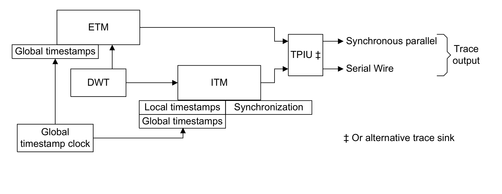
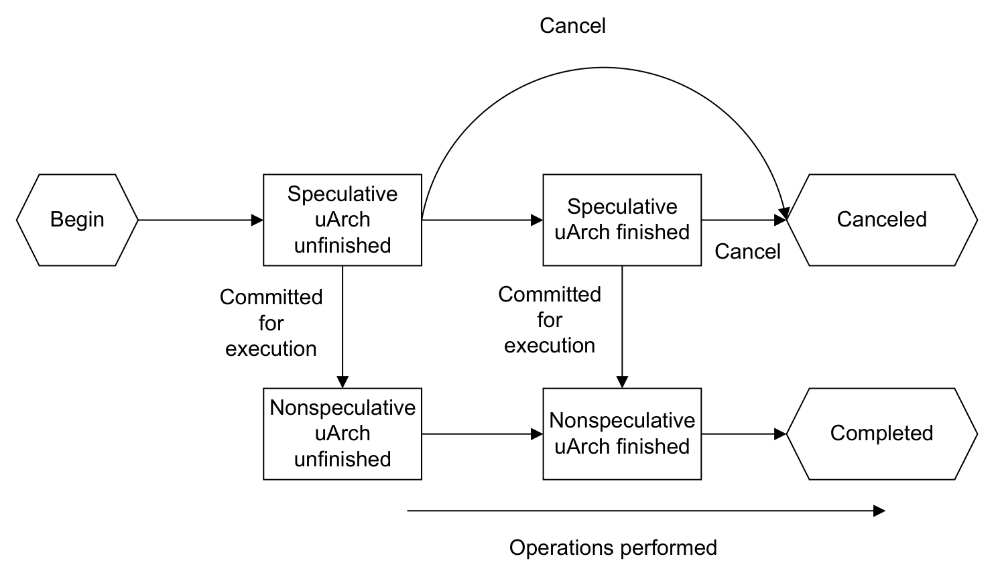

本章规定 **Armv8-M** 调试与跟踪组件规则。

## 1. 仪表化跟踪宏单元（Instrumentation Trace Macrocell）

### 1.1 关于 ITM

**Instrumentation Trace Macrocell**（ITM）提供一个内存映射寄存器接口，应用程序可以用它产生 **Instrumentation 包**。

适用于 **Armv8.0-M** 及以后架构版本的实现。扩展要求为 - ITM。

只有当实现了 **Main Extension** 时才提供 ITM。

适用于 **Armv8.0-M** 及以后架构版本的实现。扩展要求为 - ITM。

ITM 产生 **Instrumentation 包**、**同步包**以及以下协议包：

- **溢出包**（Overflow packets）。
- **本地时间戳包**（Local timestamp packets）。
- **全局时间戳包**（Global timestamp packets）。
- **扩展包**（Extension packets）。

适用于 **Armv8.0-M** 及以后架构版本的实现。扩展要求为 - ITM。

ITM 把以下包合并为单个跟踪流：

- **Instrumentation 包**。
- **同步包**。
- **协议包**。
- 由 **DWT** 产生的**硬件源包**。

适用于 **Armv8.0-M** 及以后架构版本的实现。扩展要求为 - ITM。

若实现包含 **PMU**，则 **PMU** 的**硬件源包**也包含在该单个跟踪流中。

适用于 **Armv8.1-M** 及以后架构版本的实现。扩展要求为 - ITM && PMU。

下图给出 ITM 与其他调试组件的关系：

适用于 **Armv8.0-M** 及以后架构版本的实现。扩展要求为 - ITM。

当多个源同时产生数据时，ITM 按以下优先级仲裁：

- **同步**（需要时）：优先级 -1，最高。
- **Instrumentation**：优先级 0。
- **硬件源**：优先级 1。
- **本地时间戳**：优先级 2。
- **全局时间戳 1**：优先级 3。
- **全局时间戳 2**：优先级 4。

适用于 **Armv8.0-M** 及以后架构版本的实现。扩展要求为 - ITM。

参见：

- 《全局时间戳》（Global timestamping）。
- 第 B14.2 节《Data Watchpoint and Trace 单元》（Data Watchpoint and Trace unit）。
- 《ITM 与 DWT 包协议规范》（ITM and DWT Packet Protocol Specification）。

### 1.2 ITM 操作

ITM 由以下部分组成：

- 最多 256 个**激励端口寄存器** `ITM_STIMn`。
- 最多八个**使能寄存器** `ITM_TERn`。
- 一个**访问控制寄存器** `ITM_TPR`。
- 一个**通用控制寄存器** `ITM_TCR`。

适用于 **Armv8.0-M** 及以后架构版本的实现。扩展要求为 - ITM。

`ITM_STIMn` 寄存器的数量是 8 的 **IMPLEMENTATION DEFINED** 倍数。软件可以通过向 `ITM_TPR` 写入全 1，然后读取有多少位被置 1，来发现所支持的激励端口数量。

适用于 **Armv8.0-M** 及以后架构版本的实现。扩展要求为 - ITM。

若 ITM 被禁用或未实现，则任何对 `ITM_STIMn` 的 **Secure** 或 **Non-secure** 写入都被忽略。

适用于 **Armv8.0-M** 及以后架构版本的实现。扩展要求为 - ITM && S。

非特权与特权软件始终可以读取所有 ITM 寄存器。

适用于 **Armv8.0-M** 及以后架构版本的实现。扩展要求为 - ITM。

若未实现 ITM，则 ITM 寄存器为 RAZ/WI。

适用于 **Armv8.0-M** 及以后架构版本的实现。扩展要求为 - ITM。

`ITM_TPR` 定义每组八个 `ITM_STIMn` 寄存器及其对应的 `ITM_TERn` 位是否可以由非特权访问写入。

适用于 **Armv8.0-M** 及以后架构版本的实现。扩展要求为 - ITM。

`ITM_STIMn` 寄存器是 32 位寄存器，支持以下字对齐访问：

- 字节访问，访问寄存器位 [7:0]。
- 半字访问，访问寄存器位 [15:0]。
- 字访问，访问寄存器位 [31:0]。

适用于 **Armv8.0-M** 及以后架构版本的实现。扩展要求为 - ITM。

非字对齐访问是 **UNPREDICTABLE** 的。

适用于 **Armv8.0-M** 及以后架构版本的实现。扩展要求为 - ITM。

`ITM_TCR.ITMENA` 是 ITM 的全局使能位。**冷复位**会把该位清为 0，从而禁用 ITM。

适用于 **Armv8.0-M** 及以后架构版本的实现。扩展要求为 - ITM。

`ITM_TERn` 寄存器为每个激励端口提供一个使能位。

适用于 **Armv8.0-M** 及以后架构版本的实现。扩展要求为 - ITM。

当软件写入某个已使能的 `ITM_STIMn` 寄存器时，ITM 把端口标识、写访问的尺寸以及所写入的数据组合成一个 **Instrumentation 包**，写入激励端口输出缓冲区。ITM 把包从该输出缓冲区发送到跟踪汇点。

适用于 **Armv8.0-M** 及以后架构版本的实现。扩展要求为 - ITM。

若 ITM 实现支持多于 32 个激励端口，则使用分页来表示激励端口号。激励端口号由 **Instrumentation 包**第 0 字节位 [7:3] 的 **A** 字段定义。

适用于 **Armv8.0-M** 及以后架构版本的实现。扩展要求为 - ITM。

发出一个**扩展包**来定义页码（0 到 7），作用于其后的每个 **Instrumentation 包**。

适用于 **Armv8.0-M** 及以后架构版本的实现。扩展要求为 - ITM。

每当调试器收到 **Instrumentation 包**时，它使用所收到的最后一个**扩展包**中的页码；若自上次收到**同步包**以来未收到过**扩展包**，则使用页码 0。

适用于 **Armv8.1-M** 及以后架构版本的实现。扩展要求为 - ITM。

若 `DEMCR.TRCENA == 0`，或以下任一为真，则 ITM 不产生跟踪：

- `NoninvasiveDebugAllowed() == FALSE` 且 **PE** 处于 **Non-secure** 状态。
- `SecureNoninvasiveDebugAllowed() == FALSE` 且 **PE** 处于 **Secure** 状态。

适用于 **Armv8.0-M** 及以后架构版本的实现。扩展要求为 - ITM。注意，**Secure** 状态要求 S。

若 **PE** 处于非特权模式，且当前**安全状态**下 `UnprivHaltingDebugAllowed() == FALSE`，则 ITM 不产生跟踪。

适用于 **Armv8.1-M** 及以后架构版本的实现。扩展要求为 - ITM && UDE。

当 ITM 跟踪未产生时，是否也不产生其他 ITM 包，是 **IMPLEMENTATION DEFINED** 的。**Arm** 强烈建议在未产生 ITM 跟踪时不产生任何 ITM 包。

适用于 **Armv8.0-M** 及以后架构版本的实现。扩展要求为 - ITM。

激励端口输出缓冲区的大小是 **IMPLEMENTATION DEFINED** 的，但至少有一个条目。该激励端口输出缓冲区由所有 `ITM_STIMn` 寄存器共享。

适用于 **Armv8.0-M** 及以后架构版本的实现。扩展要求为 - ITM。

当激励端口输出缓冲区已满时，若软件写入任何 `ITM_STIMn` 寄存器，则 ITM 丢弃写入数据，并产生一个**溢出包**。

适用于 **Armv8.0-M** 及以后架构版本的实现。扩展要求为 - ITM。

读取任何已使能激励端口的 `ITM_STIMn` 寄存器，返回一个表示输出缓冲区状态以及该端口已使能的值。

适用于 **Armv8.0-M** 及以后架构版本的实现。扩展要求为 - ITM。

当 ITM 被禁用，或相应 `ITM_TERn` 寄存器中该激励端口被禁用时，读取 `ITM_STIMn` 寄存器返回表示输出缓冲区因端口被禁用而无法接受数据的值。

适用于 **Armv8.0-M** 及以后架构版本的实现。扩展要求为 - ITM。

任何源产生的**硬件源包**使用单独的输出缓冲区。读取 `ITM_STIMn` 寄存器所得到的输出缓冲区状态不受任何其他源产生的跟踪影响。

适用于 **Armv8.0-M** 及以后架构版本的实现。扩展要求为 - ITM && DWTT。

通过可选控制位 `ITM_TCR.STALLENA` 支持**停转**（stalling）。当该位已实现且置 1 时，ITM 可以使 **PE** 停转，以保证以下**硬件源包**的交付：

- Data Trace Data Address。
- Data Trace Data Value。
- Data Trace Match。
- Data Trace PC Value。
- Exception Trace。

适用于 **Armv8.0-M** 及以后架构版本的实现。扩展要求为 - ITM。

停转不影响 **DWT** 计数器。

适用于 **Armv8.0-M** 及以后架构版本的实现。扩展要求为 - ITM && DWTT。

停转不影响 **PMU** 计数器。

适用于 **Armv8.1-M** 及以后架构版本的实现。扩展要求为 - ITM && PMU。

若 **DWT** 产生以下内容，则 ITM 可能在 **PE** 停转期间产生一个**溢出包**：

- 除 Data trace 包或 Exception 包之外的**硬件源包**。
- 由**周期计数器**比较器产生的 Data Trace PC value 包或 Data Trace Match 包。

适用于 **Armv8.0-M** 及以后架构版本的实现。扩展要求为 - ITM。

若 `SecureHaltingDebugAllowed() == FALSE`，则 ITM 不在 **Secure** 状态使 **PE** 停转。

适用于 **Armv8.0-M** 及以后架构版本的实现。扩展要求为 - ITM && S。

若 `HaltingDebugAllowed() == FALSE`，则 ITM 不使 **PE** 停转。

适用于 **Armv8.0-M** 及以后架构版本的实现。扩展要求为 - ITM。

ITM 不以使系统死锁的方式使 **PE** 停转。

适用于 **Armv8.0-M** 及以后架构版本的实现。扩展要求为 - ITM。

若跟踪输出被禁用，则 ITM 不使 **PE** 停转。

适用于 **Armv8.0-M** 及以后架构版本的实现。扩展要求为 - ITM。

ITM 不因对 `ITM_STIMn` 寄存器的写而停转。

适用于 **Armv8.0-M** 及以后架构版本的实现。扩展要求为 - ITM。

**Instrumentation 跟踪包**在跟踪输出中出现的顺序与写入到达 `ITM_STIMn` 寄存器的顺序一致。

适用于 **Armv8.0-M** 及以后架构版本的实现。扩展要求为 - ITM。

ITM 是否需要刷新跟踪数据以保证数据被输出，是 **IMPLEMENTATION DEFINED** 的。

适用于 **Armv8.0-M** 及以后架构版本的实现。扩展要求为 - ITM。

若需要周期性刷新，则 ITM 在以下情况刷新跟踪数据：

- 产生**同步包**时。
- 跟踪被禁用时，即 `DEMCR.TRCENA` 被清为 0，或 `ITM_TCR.{TXENA, SYNCENA, TSENA, SYNCENA}` 中一个或多个被清为 0，且缓冲的跟踪中包含至少一个相应类型的包。
- 响应来自系统的其他 **IMPLEMENTATION DEFINED** 刷新请求时。

适用于 **Armv8.0-M** 及以后架构版本的实现。扩展要求为 - ITM。

若系统支持多个跟踪流，则调试器向 `ITM_TCR.TraceBusID` 字段写入唯一的非零跟踪 ID 值。系统使用该值标识各跟踪流。为避免跟踪流被破坏，调试器在修改 `ITM_TCR.TraceBusID` 之前执行以下操作：

- 把 `ITM_TCR.ITMENA` 位清为 0，以禁用 ITM。
- 轮询 `ITM_TCR.BUSY` 位直到其返回 0，表示 ITM 已不活动。

适用于 **Armv8.0-M** 及以后架构版本的实现。扩展要求为 - ITM。

### 1.3 时间戳支持

时间戳提供事件产生时刻相对于其在跟踪输出端口可见时刻的时序信息。

适用于 **Armv8.0-M** 及以后架构版本的实现。扩展要求为 - ITM。

**Armv8-M PE** 可以实现以下一种或两种类型的时间戳：

- **本地时间戳**（Local timestamps）。
- **全局时间戳**（Global timestamps）。

适用于 **Armv8.0-M** 及以后架构版本的实现。扩展要求为 - ITM。

#### 本地时间戳

本地时间戳提供**增量时间戳**（delta timestamp）值，即每个本地时间戳表示自产生上一个本地时间戳以来经过的时间。

适用于 **Armv8.0-M** 及以后架构版本的实现。扩展要求为 - ITM。

ITM 由 ITM 单元中的时间戳计数器产生本地时间戳。

适用于 **Armv8.0-M** 及以后架构版本的实现。扩展要求为 - ITM。

时间戳计数器的大小是 **IMPLEMENTATION DEFINED** 的取值，且小于或等于 28 位。

适用于 **Armv8.0-M** 及以后架构版本的实现。扩展要求为 - ITM。

ITM 是否支持时间戳计数器的**同步时钟**方式，是 **IMPLEMENTATION DEFINED** 的。

适用于 **Armv8.0-M** 及以后架构版本的实现。扩展要求为 - ITM。

ITM 与 **TPIU** 是否支持时间戳计数器的**异步时钟**方式，是 **IMPLEMENTATION DEFINED** 的。

适用于 **Armv8.0-M** 及以后架构版本的实现。扩展要求为 - ITM。

`ITM_TCR.TSENA` 使能**本地时间戳包**的产生。

适用于 **Armv8.0-M** 及以后架构版本的实现。扩展要求为 - ITM。

当本地时间戳已使能，且 **DWT** 或 ITM 把一个**硬件源包**或 **Instrumentation 跟踪包**传输到相应的输出 FIFO，而时间戳计数器非零时，ITM：

- 产生一个**本地时间戳包**。
- 把时间戳计数器复位为零。

适用于 **Armv8.0-M** 及以后架构版本的实现。扩展要求为 - ITM。

若时间戳计数器溢出，则它从零继续计数，且 ITM 产生一个**溢出包**，并在最早的机会发送一个关联的**本地时间戳包**。若更高优先级的跟踪包延迟了该**本地时间戳包**的发送，则该时间戳包带有相应的非零本地时间戳值。

适用于 **Armv8.0-M** 及以后架构版本的实现。扩展要求为 - ITM。

ITM 可以针对单个事件包产生**本地时间戳包**，也可以在多个事件连续产生包流且没有空闲时间时，针对这一包流产生本地时间戳包。

适用于 **Armv8.0-M** 及以后架构版本的实现。扩展要求为 - ITM。

**本地时间戳包**包含状态信息，用于表示以下一项或两项中的延迟：

- 时间戳包相对于相应事件包的发送。
- 相应事件包相对于事件本身的发送。

适用于 **Armv8.0-M** 及以后架构版本的实现。扩展要求为 - ITM。

若 ITM 无法与相应事件包同步地产生**本地时间戳包**，则时间戳计数继续递增，直到 ITM 能产生**本地时间戳包**为止。

适用于 **Armv8.0-M** 及以后架构版本的实现。扩展要求为 - ITM。

ITM 通过去除前导零来压缩时间戳包中的计数值，并发送能容纳所需计数值的最小包。

适用于 **Armv8.0-M** 及以后架构版本的实现。扩展要求为 - ITM。

为防止溢出，**Arm** 建议 ITM 在时间戳计数器溢出之前发出一个**本地时间戳包**。

适用于 **Armv8.0-M** 及以后架构版本的实现。扩展要求为 - ITM。

#### 本地时间戳时钟选项

若实现同时支持本地时间戳计数器的同步与异步时钟，则由 `ITM_TCR.SWOENA` 选择时钟方式。

适用于 **Armv8.0-M** 及以后架构版本的实现。扩展要求为 - ITM。

当软件选择**同步时钟**时，若本地时间戳已使能，则由 **PE** 时钟驱动时间戳计数器，计数器在每个 **PE** 时钟周期递增。

适用于 **Armv8.0-M** 及以后架构版本的实现。扩展要求为 - ITM。

当软件选择**同步时钟**时，是否在**调试状态**下产生本地时间戳是 **IMPLEMENTATION DEFINED** 的。**Arm** 建议进入**调试状态**会禁用本地时间戳，无论 `ITM_TCR.TSENA` 位的取值如何。

适用于 **Armv8.0-M** 及以后架构版本的实现。扩展要求为 - ITM。

当软件选择**异步时钟**并使能本地时间戳时，由 **TPIU** 输出接口时钟经可配置的预分频器驱动时间戳计数器。异步时钟的速率取决于输出编码方案。该时钟可能相对于 **PE** 时钟是异步的。

适用于 **Armv8.0-M** 及以后架构版本的实现。扩展要求为 - ITM。

当实现了异步时钟时，输入时钟信号在驱动本地时间戳计数器之前是否可以被分频，是 **IMPLEMENTATION DEFINED** 的。

适用于 **Armv8.0-M** 及以后架构版本的实现。扩展要求为 - ITM。

若实现支持对输入异步时钟信号分频，则由 `ITM_TCR.TSPrescale` 设置预分频器的分频值。

适用于 **Armv8.0-M** 及以后架构版本的实现。扩展要求为 - ITM。

软件只有在 **TPIU** 被配置为使用支持异步时钟的输出模式时，才选择异步时钟。

适用于 **Armv8.0-M** 及以后架构版本的实现。扩展要求为 - ITM && TPIU。

当软件选择异步时钟且 **TPIU** 异步接口空闲时，ITM 把时间戳计数器保持为零。这意味着 ITM 不会在异步接口空闲之后的第一个包上产生本地时间戳。

适用于 **Armv8.0-M** 及以后架构版本的实现。扩展要求为 - ITM && TPIU。

参见：

- 第 B14.4 节《跟踪端口接口单元》（Trace Port Interface Unit）。

#### 全局时间戳

全局时间戳提供绝对的时间戳值，这些值基于系统的**全局时间戳时钟**。它们为系统中不同跟踪源之间提供同步。

适用于 **Armv8.0-M** 及以后架构版本的实现。扩展要求为 - ITM。

若实现包含**全局时间戳**，则 ITM 产生基于**全局时间戳时钟**的**全局时间戳**（GTS）包。

适用于 **Armv8.0-M** 及以后架构版本的实现。扩展要求为 - ITM。

全局时间戳的大小为 48 位或 64 位。在这两种选项之间的选择是 **IMPLEMENTATION DEFINED** 的。

适用于 **Armv8.0-M** 及以后架构版本的实现。扩展要求为 - ITM。

为传输全局时间戳，定义了两种格式的**全局时间戳包**：

- 第一种包格式，**Global timestamp 1 包**，保存最低有效时间戳位 [25:0] 的取值，以及回绕指示与时钟变化指示。
- 第二种包格式，**Global timestamp 2 包**，保存高位时间戳位的取值：
  - 若支持 48 位全局时间戳，则为位 [47:26]。
  - 若支持 64 位全局时间戳，则为位 [63:26]。

适用于 **Armv8.0-M** 及以后架构版本的实现。扩展要求为 - ITM。

在以下情况下，ITM 产生由 **Global timestamp 1 包**与 **Global timestamp 2 包**组成的完整**全局时间戳包**：

- 软件首次使能全局时间戳时，即把 `ITM_TCR.GTSFREQ` 字段的取值从零改为非零时。
- 系统在外部 ITM 时间戳接口上置位**时钟比率变化**信号时。
- 响应**同步包**请求时，即使 `ITM_TCR.SYNCENA == 0`。
- 当 ITM 必须产生全局时间戳，且 ITM 检测到自上次产生 **Global timestamp 2 包**以来全局时间戳高位的取值已变化时。

适用于 **Armv8.0-M** 及以后架构版本的实现。扩展要求为 - ITM。

若 ITM 所产生的全局时间戳不必是完整全局时间戳，则 ITM 只产生单个 **Global timestamp 1 包**。

适用于 **Armv8.0-M** 及以后架构版本的实现。扩展要求为 - ITM。

当 ITM 产生全局时间戳时，它在某个非延迟的 **Instrumentation 包**或**硬件源包**之后产生。**Global Timestamp 1 包**始终与最近输出的非延迟 **Instrumentation 包**或**硬件源包**相关联。

适用于 **Armv8.0-M** 及以后架构版本的实现。扩展要求为 - ITM。

当 ITM 产生完整全局时间戳时：

1. ITM 首先产生带时间戳位 [25:0] 的 **Global timestamp 1 包**，并把该包中相应的 **Wrap** 位与 **ClockCh** 位置 1，以表示时间戳的高位也将输出。这就是 ITM 在非延迟跟踪包之后立即输出的包。
2. 由于包优先级的原因，ITM 在输出包含时间戳高位的 **Global timestamp 2 包**之前，可能必须先发送其他跟踪包；也可能必须先发送另一个全局时间戳包。若如此，则它输出带时间戳位 [25:0] 且 **Wrap** 位置 1 的 **Global timestamp 1 包**。
3. ITM 随后为最近发送的 **Global timestamp 1 包**产生带高位时间戳位的 **Global timestamp 2 包**。

适用于 **Armv8.0-M** 及以后架构版本的实现。扩展要求为 - ITM。

参见：

- 第 B14.1.4 节《同步支持》（Synchronization support）。
- 第 B14.1.5 节《续接位》（Continuation bits）。
- 《ITM 与 DWT 包协议规范》（ITM and DWT Packet Protocol Specification）。

### 1.4 同步支持

外部调试器使用**同步包**来恢复串行数据流中的位到字节的对齐信息。

适用于 **Armv8.0-M** 及以后架构版本的实现。扩展要求为 - ITM。

**同步包**独立于时间戳包。

适用于 **Armv8.0-M** 及以后架构版本的实现。扩展要求为 - ITM。

若 ITM 连接到**并行跟踪端口接口**，则它必须产生周期性**同步包**。连接到**异步串行跟踪端口接口**的 ITM 可以产生**同步包**。

适用于 **Armv8.0-M** 及以后架构版本的实现。扩展要求为 - ITM。

**Arm** 建议软件在使用异步串行跟踪端口时禁用**同步包**，以减少数据流带宽。

适用于 **Armv8.0-M** 及以后架构版本的实现。扩展要求为 - ITM。

若 `ITM_TCR.SYNCENA == 1`，则 ITM 在以下情况输出**同步包**：

- 首次被使能时。
- 若实现了 `DWT_CYCCNT` 且 `DWT_CTRL.SYNCTAP` 非零，则响应来自 **DWT** 单元的**同步包**请求时。
- 若实现了 `TPIU_PSCR`，则响应来自 **TPIU** 的**同步包**请求时：
  - 若未实现 `DWT_CYCCNT`，则实现 `TPIU_PSCR`。
  - 若实现了 `DWT_CYCCNT`，则是否实现 `TPIU_PSCR` 是 **IMPLEMENTATION DEFINED** 的。
- 响应来自系统的其他 **IMPLEMENTATION DEFINED** **同步包**请求时。
- 退出**调试状态**时。

适用于 **Armv8.0-M** 及以后架构版本的实现。扩展要求为 - ITM。注意，可能还需要本规则中所述的附加扩展。

当 ITM 发出**同步包**时，ITM 把 **Page 寄存器**的值清为 0。

适用于 **Armv8.0-M** 及以后架构版本的实现。扩展要求为 - ITM。注意，适用于 ITM 支持多于 32 个激励端口的情形。

参见：

- `DWT_CTRL.SYNCTAP`。

### 1.5 续接位

**同步包**由至少 47 个零位后跟一个 1 位的位流组成。最后一位是字节对齐标记，因此**同步包**最后一个字节的位 [7] 始终为 1。

适用于 **Armv8.0-M** 及以后架构版本的实现。扩展要求为 - ITM。

最长的**扩展包**始终为 5 字节。在**扩展包**中，每个字节（包括头字节，但不包括 5 字节包的最后字节）的位 [7] 是**续接位 C**。5 字节**扩展包**最后字节的位 [7] 属于扩展字段。少于 5 字节的**扩展包**最后字节的位 [7] 始终为零。

适用于 **Armv8.0-M** 及以后架构版本的实现。扩展要求为 - ITM。

对于所有其他协议包，每个字节（包括头字节，但不包括 7 字节包的最后字节）的位 [7] 是**续接位 C**。包最后字节的位 [7] 始终为零。

适用于 **Armv8.0-M** 及以后架构版本的实现。扩展要求为 - ITM。

每种包类型都定义其最大包长度。除 **Global timestamp 2 包**与**同步包**之外，所定义的最长包为 5 字节。

适用于 **Armv8.0-M** 及以后架构版本的实现。扩展要求为 - ITM。

**续接位 C** 定义为：

- 0：这是该包的最后一个字节。
- 1：这不是该包的最后一个字节。

适用于 **Armv8.0-M** 及以后架构版本的实现。扩展要求为 - ITM。

## 2. Data Watchpoint and Trace 单元

### 2.1 关于 DWT

**Data Watchpoint and Trace**（DWT）单元提供以下特性：

- **比较器**，支持：
  - 作为单个比较器用于指令地址匹配或数据地址匹配。
  - 成对链接使用，用于指令地址范围匹配或数据地址范围匹配。
- 在比较器匹配时产生：
  - 一个调试事件，使 **PE** 进入**调试状态**，或（若实现了 **Main Extension**）取到 **DebugMonitor** 异常。
  - 向 **ETM**（若实现）发出匹配信号。
  - 向其他外部资源发出匹配信号。
- 使用**指令地址采样寄存器**进行外部指令地址采样。

适用于 **Armv8.0-M** 及以后架构版本的实现。扩展要求为 - DWTT && (DebugMonitor 异常 || HDBG)。注意，某些比较器匹配要求 ETM。

若实现了 **Main Extension**，则 DWT 提供以下特性：

- 可选的**周期计数器**。
- **比较器**，支持：
  - 若实现了周期计数器，则作为单个比较器用于周期计数器匹配。
  - 作为单个比较器用于数据值匹配。
  - 成对链接使用，用于特定数据地址处的数据值匹配。

适用于 **Armv8.0-M** 及以后架构版本的实现。扩展要求为 - DWTT && M。

若实现了 **Main Extension** 与 **ITM**，则 DWT 提供以下跟踪产生特性：

- 在比较器匹配时产生一个或多个跟踪包。
- 为软件性能剖析产生周期性跟踪包。
- 异常跟踪。
- 产生跟踪的性能事件计数器。

适用于 **Armv8.0-M** 及以后架构版本的实现。扩展要求为 - DWTT && M && ITM。

若 `DWT_CTRL.NOTRCPKT` 为 1，则没有 DWT 跟踪支持。

适用于 **Armv8.0-M** 及以后架构版本的实现。扩展要求为 - DWTT。

若 `DWT_CTRL.NOCYCCNT` 为 1，则没有周期计数器支持。

适用于 **Armv8.0-M** 及以后架构版本的实现。扩展要求为 - DWTT。

若 `DWT_CTRL.NOPRFCNT` 为 1，则没有事件计数器支持。

适用于 **Armv8.0-M** 及以后架构版本的实现。扩展要求为 - DWTT。

`DWT_CTRL.NUMCOMP` 字段指明已实现的 DWT 比较器数量，范围为 0-15。

适用于 **Armv8.0-M** 及以后架构版本的实现。扩展要求为 - DWTT。

DWT 是否支持**数据值屏蔽**（Data value masking）是可选的。若支持数据值屏蔽，则 `DWT_DEVARCH.REVISION == 0b0001`。

适用于 **Armv8.1-M** 及以后架构版本的实现。扩展要求为 - DSPDE。

若未实现 **Main Extension**，则不支持周期计数器、数据值、链接数据值、带值的数据地址比较器以及所有跟踪特性。

适用于 **Armv8.0-M** 及以后架构版本的实现。扩展要求为 - !M && DWTT。

数据跟踪包只为比较器 0-3 产生。

适用于 **Armv8.0-M** 及以后架构版本的实现。扩展要求为 - DWTT。

当 DWT 实现包含一个或多个比较器时，支持哪些比较器特性以及由哪些比较器支持，是 **IMPLEMENTATION DEFINED** 的。

适用于 **Armv8.0-M** 及以后架构版本的实现。扩展要求为 - DWTT。

### 2.2 DWT 单元操作

对于每个已实现的比较器，有一组寄存器定义该比较器的操作。对于比较器 n：

- `DWT_COMPn` 保存用于比较的值。
- `DWT_FUNCTIONn` 定义该比较器的操作。

适用于 **Armv8.0-M** 及以后架构版本的实现。扩展要求为 - DWTT。

`DWT_FUNCTION.ID` 可以按以下方式解释：

- 位 0 若置位，表示在**周期计数器**上匹配。
- 位 1 若置位，表示在**指令地址**上匹配。
- 位 2 若置位，表示在**数据值**上匹配。
- 位 3 表示在**数据地址**上匹配，以及前四个比较器之一表示**带值的数据地址**匹配。该位始终置位。
- 位 4 若置位，表示**链接匹配**，即**数据地址限值**、位 1 置位时的**指令地址限值**，以及位 2 置位时的**链接数据值**。

适用于 **Armv8.0-M** 及以后架构版本的实现。扩展要求为 - DWTT。

**Arm** 建议奇数编号的比较器支持链接。

适用于 **Armv8.0-M** 及以后架构版本的实现。扩展要求为 - DWTT。

`DWT_VMASKn` 是定义比较器操作的附加寄存器。

适用于 **Armv8.1-M** 及以后架构版本的实现。扩展要求为 - DSPDE。

DWT 在周期计数器的每次递增时检查周期计数器匹配。

适用于 **Armv8.0-M** 及以后架构版本的实现。扩展要求为 - DWTT。

**Secure 匹配**是由以下之一产生的匹配：

- 对 **NS-Req** 取值为 **Secure** 的操作所进行的向量取指。
- 对 **NS-Req** 取值为 **Secure** 的寄存器硬件压栈或出栈，涉及以下任一情况：
  - 异常进入。
  - 异常退出。
  - 函数调用进入。
  - 函数返回。
  - 惰性状态保存。
- 在 **Secure** 状态执行的指令所产生的特权或非特权操作，包括：
  - 在 **Secure** 状态执行的指令的**指令地址匹配**。
  - 在 **Secure** 状态执行的指令所产生的加载或存储的**数据地址匹配**或**数据值匹配**。
- 若 `DWT_CTRL.CYCDISS == 1`，**Secure 匹配**可以由 **Secure** 状态下的周期计数器匹配产生。

适用于 **Armv8.0-M** 及以后架构版本的实现。扩展要求为 - DWTT && S。

若周期计数器在进入或退出 **Secure** 状态时递增，则不产生 **Secure 匹配**。

适用于 **Armv8.0-M** 及以后架构版本的实现。扩展要求为 - DWTT && S。

**非特权匹配**是由以下之一产生的匹配：

- 寄存器硬件压栈或出栈，且该操作在以下任一情况下为非特权：
  - 异常进入。
  - 尾链时的附加上下文压栈。
  - 异常退出。
  - 函数调用进入。
  - 函数返回。
  - 惰性状态保存。
- 在非特权模式执行的指令所产生的操作，包括：
  - 在非特权模式执行的指令的**指令地址匹配**。
  - 在非特权模式执行的指令所产生的加载或存储的**数据地址匹配**或**数据值匹配**。

适用于 **Armv8.1-M** 及以后架构版本的实现。扩展要求为 - DWTT && S && UDE。

若以下一个或多个条件成立，则禁止**特权匹配**：

- `DEMCR.TRCENA == 0` 或 `NoninvasiveDebugAllowed(TRUE) == FALSE`。若未实现 UDE，则所有匹配都被禁止。
- `DWT_FUNCTION.ACTION` 指定调试事件，且以下条件全部成立：
  - `HaltingDebugAllowed() == FALSE` 或 `DHCSR.C_DEBUGEN == 0`。
  - 未实现 **Main Extension**，或 `DEMCR.MON_EN == 0`。

适用于 **Armv8.0-M** 及以后架构版本的实现。扩展要求为 - DWTT。

若以下一个或多个条件成立，则禁止**非特权匹配**：

- `DEMCR.TRCENA == 0`，或 `NoninvasiveDebugAllowed(FALSE) == FALSE`。
- `DWT_FUNCTION.ACTION` 指定调试事件，且以下全部成立：
  - `HaltingDebugAllowed() == FALSE` 或 `DHCSR.C_DEBUGEN == 0`。
  - 未实现 UDE，或 `UnprivHaltingDebugAllowed() == FALSE`，或 `DHCSR.C_DEBUGEN == 0`。
  - 未实现 **Main Extension**，或 `DEMCR.MON_EN == 0`。
  - 未实现 UDE，或 `DEMCR.UMON_EN == 0`。

适用于 **Armv8.0-M** 及以后架构版本的实现。扩展要求为 - DWTT。

若未实现 UDE，则 `NoninvasiveDebugAllowed()` 函数忽略匹配的特权模式，且若该函数返回 TRUE 就产生匹配。

适用于 **Armv8.0-M** 及以后架构版本的实现。扩展要求为 - DWTT。

若以下一个或多个条件成立，则禁止 **Secure 匹配**：

- `DWT_FUNCTION.ACTION` 指定跟踪或触发事件，且以下条件成立：
  - `SecureNoninvasiveDebugAllowed(TRUE) == FALSE`。
- `DWT_FUNCTION.ACTION` 指定调试事件，且以下条件全部成立：
  - `DHCSR.S_SDE == 0`。
  - 未实现 **Main Extension**，或 `DEMCR.SDME == 0`。

适用于 **Armv8.1-M** 及以后架构版本的实现。扩展要求为 - DWTT && S。注意，若 `DEMCR.SDME == 1` 则要求 M。

对于地址与值比较，控制寄存器取值、当前执行优先级与**安全状态**都与 **PE** 产生被匹配事务时的状态相关。

适用于 **Armv8.0-M** 及以后架构版本的实现。扩展要求为 - DWTT && S。

在对调试认证接口、`DHCSR` 或 `DEMCR` 的、禁用调试的更改与随后的**上下文同步事件**之间，DWT 使用旧值还是新值是 **UNPREDICTABLE** 的。

适用于 **Armv8.0-M** 及以后架构版本的实现。扩展要求为 - DWTT。

在 DWT 操作规则禁止产生匹配的场合，即使编程模型把比较器是否产生匹配定义为 **UNPREDICTABLE**（取决于 DWT 的编程方式），也不产生匹配。

适用于 **Armv8.0-M** 及以后架构版本的实现。扩展要求为 - DWTT。

若以下任一为真，则 `DWT_CTRL.FOLDEVTENA`、`LSUEVTENA`、`SLEEPEVTENA`、`EXCEVTENA` 与 `CPIEVTENA` 被忽略，这些字段的有效值为 0：

- `DEMCR.TRCENA == 0`。
- `NoninvasiveDebugAllowed(FALSE) == FALSE`。
- `NoninvasiveDebugAllowed(TRUE)` 返回 FALSE，且 **PE** 在特权模式下执行。
- 实现了 **Security Extension**，`SecureNoninvasiveDebugAllowed(FALSE)` 返回 FALSE，且 **PE** 在 **Secure** 状态执行。
- 实现了 **Security Extension** 与 UDE，`SecureNoninvasiveDebugAllowed(TRUE)` 返回 FALSE，且 **PE** 在 **Secure** 状态、特权模式下执行。

适用于 **Armv8.0-M** 及以后架构版本的实现。扩展要求为 - DWTT && UDE。注意，UDE 仅在 **Armv8.1-M** 实现中可用。

若以下任一为真，则 DWT 不为该操作产生任何跟踪包：

- `DEMCR.TRCENA == 0`。
- `NoninvasiveDebugAllowed(FALSE)` 返回 FALSE。
- `NoninvasiveDebugAllowed(TRUE)` 返回 FALSE，且该操作在特权模式下执行。
- 实现了 **Security Extension**，`SecureNoninvasiveDebugAllowed(FALSE)` 返回 FALSE，且该操作在 **Secure** 状态执行。
- 实现了 **Security Extension** 与 UDE，`SecureNoninvasiveDebugAllowed(TRUE)` 返回 FALSE，且该操作在 **Secure** 状态、特权模式下执行。

适用于 **Armv8.0-M** 及以后架构版本的实现。扩展要求为 - DWTT && UDE。注意，UDE 仅在 **Armv8.1-M** 实现中可用。

若 `SecureNoninvasiveDebugAllowed(TRUE) == FALSE`，则在 **Secure** 状态下 `DWT_CTRL.FOLDEVTENA`、`LSUEVTENA`、`SLEEPEVTENA`、`EXCEVTENA` 与 `CPIEVTENA` 被忽略，这些字段的有效值为 0。

适用于 **Armv8.0-M** 及以后架构版本的实现。扩展要求为 - DWTT && S。

若 `SecureNoninvasiveDebugAllowed() == FALSE`，则当包中的异常号表示 **Secure** 异常时不产生异常跟踪包：

- 对取到 **Secure** 状态的异常不产生异常进入包。
- 对从 **Secure** 状态退出不产生异常退出包。
- 对返回到 **Secure** 状态不产生异常返回包。

适用于 **Armv8.0-M** 及以后架构版本的实现。扩展要求为 - DWTT && S。

异常跟踪包的出现顺序与异常处理的简单顺序执行顺序一致。

适用于 **Armv8.0-M** 及以后架构版本的实现。扩展要求为 - DWTT。

当 DWT 产生匹配时，`DWT_FUNCTION.MATCHED` 置 1，除非该比较器是**数据地址限值**或**指令地址限值**比较器，此时 `DWT_FUNCTION.MATCHED` 为 **UNKNOWN**。

适用于 **Armv8.0-M** 及以后架构版本的实现。扩展要求为 - DWTT。

当 DWT 产生匹配时，若 `DWT_FUNCTION.ACTION` 指定调试事件，则在以下条件全部成立时 `DHCSR.C_HALT` 置 1：

- 以下任一条件成立：
  - `HaltingDebugAllowed()` 返回 TRUE。
  - `UnprivHaltingDebugAllowed(TRUE)` 返回 TRUE，且该操作为非特权。
- `DHCSR.C_DEBUGEN == 1`。
- `DHCSR.S_HALT == 0`。
- 以下任一条件成立：
  - `SecureHaltingDebugAllowed()` 返回 TRUE。
  - `SecureUnprivHaltingDebugAllowed()` 返回 TRUE，且该操作为非特权。

适用于 **Armv8.1-M** 及以后架构版本的实现。扩展要求为 - DWTT && UDE。

当 DWT 产生匹配时，若 `DWT_FUNCTION.ACTION` 指定调试事件，则在以下条件全部成立时 `DEMCR.MON_PEND` 置 1：

- **PE** 未因该匹配把 `DHCSR.C_HALT` 置 1。
- `DEMCR.MON_EN` 置 1，或以下全部成立：
  - 实现了 **Unprivileged Debug Extension**。
  - 该匹配为非特权匹配。
  - `DEMCR.UMON_EN` 置 1。
- 以下之一成立：
  - 该观察点不是由惰性浮点状态保存访问产生的，且 **DebugMonitor** 异常优先级足以抢占当前执行优先级。
  - 该观察点是由惰性浮点状态保存产生的，且 `FPCCR.MONRDY` 置 1。

适用于 **Armv8.1-M** 及以后架构版本的实现。扩展要求为 - DWTT && M && UDE。

当 DWT 产生匹配时，若以下条件全部成立，则产生**数据跟踪匹配包**：

- `SecureNoninvasiveDebugAllowed() == FALSE`。
- `DWT_FUNCTION.ACTION` 指定产生 Data trace PC value 包。
- 该包中将包含的指令地址指向在 **Secure** 状态执行的指令。

除非另有说明，产生由 `DWT_FUNCTION.ACTION` 指定的跟踪包类型。

适用于 **Armv8.0-M** 及以后架构版本的实现。扩展要求为 - DWTT && M && S。

当 DWT 产生匹配且 `DWT_FUNCTION.ACTION` 指定产生 Data trace PC value 包时，若针对该匹配所指向的指令（即原本将包含在 Data trace PC value 包中的指令地址所指的指令）满足以下一个或多个条件，则忽略 `DWT_FUNCTION.ACTION` 所指定的跟踪包类型，改为产生**数据跟踪匹配包**：

- 实现了 **Unprivileged Debug Extension**，`NoninvasiveDebugAllowed(TRUE)` 返回 FALSE，且该指令在特权模式下执行。
- 实现了 **Security Extension** 与 **Unprivileged Debug Extension**，该指令在 **Secure** 特权模式下执行，且 `SecureNoninvasiveDebugAllowed(TRUE)` 返回 FALSE。

适用于 **Armv8.1-M** 及以后架构版本的实现。扩展要求为 - DWTT && M && S && UDE。

因对齐、SAU、IDAU 或 MPU 检查而导致 **MemManage** 故障或 **SecureFault** 异常的访问，不被 DWT 观察，也不能产生匹配。

适用于 **Armv8.0-M** 及以后架构版本的实现。扩展要求为 - DWTT && (S || M && MPU)。

DWT 把对栈的硬件访问视为数据访问：

- 对于作为异常进入或惰性浮点状态保存的一部分由硬件压入栈的寄存器。
- 对于作为异常返回的一部分由硬件从栈弹出的寄存器。

适用于 **Armv8.0-M** 及以后架构版本的实现。扩展要求为 - DWTT。

DWT 把对栈的硬件访问视为数据访问：

- 对于作为 Non-secure 函数调用的一部分由硬件压入栈的寄存器。
- 对于作为 Non-secure 函数返回的一部分由硬件从栈弹出的寄存器。

适用于 **Armv8.0-M** 及以后架构版本的实现。扩展要求为 - DWTT && S。

当对栈的硬件访问产生 Data trace PC value 包时，包中的 PC 值如下：

- 在异常进入或函数调用时，PC 值为该异常或函数调用的返回地址。
- 在惰性浮点状态保存时，PC 值为触发该惰性浮点状态保存的指令地址。
- 在异常返回或 Non-secure 函数返回时，PC 值为以下之一：
  - 引起该异常返回或 Non-secure 函数返回的指令地址。
  - 该异常返回或 Non-secure 函数返回中所用的 `EXC_RETURN` 或 `FNC_RETURN` 载荷值。

适用于 **Armv8.0-M** 及以后架构版本的实现。扩展要求为 - DWTT。

由 DWT 单元事件引起的观察点将在所有在途指令完成时发生。然而，在少数情况下，指令在架构上可见的重叠可能被观察到。

适用于 **Armv8.1-M** 及以后架构版本的实现。扩展要求为 - DWTT && MVE。

若更高优先级的异常抢占了所产生的观察点，则当 **PE** 进入**调试状态**或随后取到 **DebugMonitor** 异常时，在途指令可能是可见的。调试器与软件可以观察 `EPSR.ECI` 的压栈值来判断重叠状态。

适用于 **Armv8.1-M** 及以后架构版本的实现。扩展要求为 - DWTT && MVE && HDBG || DebugMonitor 异常。

观察点可以基于可配置事件由多个比较器触发。若由指令地址比较器触发，则每当该指令试图执行时都触发观察点。谓词化对观察点地址比较器没有影响。

适用于 **Armv8.1-M** 及以后架构版本的实现。扩展要求为 - DWTT && MVE。

谓词化影响数据地址与数据值比较器：若内存访问未被谓词化则触发观察点；若未执行该访问则不触发。

适用于 **Armv8.1-M** 及以后架构版本的实现。扩展要求为 - DWTT && MVE。

若支持数据值匹配，则 DWT 为每个支持数据值匹配的已实现比较器 n 实现 `DWT_VMASK<n>` 寄存器。

适用于 **Armv8.1-M** 及以后架构版本的实现。扩展要求为 - DSPDE。

**Armv8.1-M** 为 `BF` 指令引入了隐式分支，这种行为可能引起程序流的隐式变化。若断点或观察点按程序顺序设置在分支点之后，而隐式分支被取到，则该断点或观察点不会生效。

适用于 **Armv8.1-M** 及以后架构版本的实现。扩展要求为 - LOB。

针对 `LE` 或 `LETP` 指令的观察点或断点是否会产生任何效果，是 **UNKNOWN** 的。

适用于 **Armv8.1-M** 及以后架构版本的实现。扩展要求为 - LOB && (DWTD || FPB)。

### 2.3 对 DWT 比较器编程的约束

若某个 DWT 比较器 `<n>`，或某对比较器 `<n>` 与 `<n+1>`，被编程为保留的 `DWT_FUNCTION.MATCH` 与 `DWT_FUNCTION.ACTION` 组合，则任何比较器的行为是 **UNPREDICTABLE** 的，可能：

- 表现得如同被禁用。
- 产生匹配，把 `DWT_FUNCTION.MATCHED` 位置为 **UNKNOWN** 值，并执行以下一项或多项：
  - 置位 `CMPMATCH`。
  - 产生调试事件。
  - 以任意顺序产生一个或多个跟踪包。

适用于 **Armv8.0-M** 及以后架构版本的实现。扩展要求为 - DWTT。

未规定为有效组合的 `DWT_FUNCTION.MATCH` 与 `DWT_FUNCTION.ACTION` 组合为保留。

适用于 **Armv8.0-M** 及以后架构版本的实现。扩展要求为 - DWTT。

哪些 `DWT_FUNCTION.MATCH` 取值对计数器 `<n>` 有效，是 **IMPLEMENTATION DEFINED** 的。`DWT_FUNCTION.ID` 定义哪些取值有效。无效的取值为保留。

适用于 **Armv8.0-M** 及以后架构版本的实现。扩展要求为 - DWTT。

对于单个比较器，`DWT_FUNCTION.MATCH` 与 `DWT_FUNCTION.ACTION` 的有效组合，以及该比较器在匹配单次访问时可以产生的事件与数据跟踪包，如下表所示。

表中：`-` 表示不产生该包或事件；`Yes` 表示在比较器匹配时产生该包或事件。

| 比较器类型 | MATCH | ACTION | 调试事件 | 匹配包 | PC Value 包 | 数据地址包 | 数据值包 |
| --- | --- | --- | --- | --- | --- | --- | --- |
| Disabled | 0b0000 | 0bxx | - | - | - | - | - |
| Cycle Counter | 0b0001 | 0b00 | - | - | - | - | - |
| Cycle Counter | 0b0001 | 0b01 | Yes | - | - | - | - |
| Cycle Counter | 0b0001 | 0b10 | - | Yes | - | - | - |
| Cycle Counter | 0b0001 | 0b11 | - | - | Yes | - | - |
| Instruction Address | 0b0010 | 0b00 | - | - | - | - | - |
| Instruction Address | 0b0010 | 0b01 | Yes | - | - | - | - |
| Instruction Address | 0b0010 | 0b10 | - | Yes | - | - | - |
| Data address（非 0b0111） | 0b01xx | 0b00 | - | - | - | - | - |
| Data address（非 0b0111） | 0b01xx | 0b01 | Yes | - | - | - | - |
| Data address（非 0b0111） | 0b01xx | 0b10 | - | Yes | - | - | - |
| Data address（非 0b0111） | 0b01xx | 0b11 | - | - | Yes | - | - |
| Data value（非 0b1011） | 0b10xx | 0b00 | - | - | - | - | - |
| Data value（非 0b1011） | 0b10xx | 0b01 | Yes | - | - | - | - |
| Data value（非 0b1011） | 0b10xx | 0b10 | - | Yes | - | - | - |
| Data address with value（非 0b1111） | 0b11xx | 0b10 | - | - | - | - | Yes |
| Data address with value（非 0b1111） | 0b11xx | 0b11 | - | - | Yes | - | Yes |

适用于 **Armv8.0-M** 及以后架构版本的实现。扩展要求为 - DWTT。注意，**周期计数器**、**数据值**与**带值的数据地址**仅在实现 M 时可用。

#### 指令地址范围

要匹配位于某个**指令地址范围**内的指令，需满足以下条件：

- 第一个比较器 `<n-1>` 被编程为 **Instruction address**。
- 第二个比较器 `<n>` 被编程为 **Instruction address limit**。

适用于 **Armv8.0-M** 及以后架构版本的实现。扩展要求为 - DWTT。

对于**指令地址范围**，`DWT_FUNCTION.MATCH` 与 `DWT_FUNCTION.ACTION` 的有效组合，以及匹配单次访问可以产生的事件与数据跟踪包，如下表所示。

表中：`-` 表示不产生该包或事件；`First` 表示由第一个比较器匹配产生该包或事件；`Second` 表示由第二个比较器匹配产生该包或事件。

| MATCH `<n-1>` | MATCH `<n>` | ACTION `<n-1>` | ACTION `<n>` | 调试事件 | 匹配包 | PC Value 包 | 数据地址包 | 数据值包 |
| --- | --- | --- | --- | --- | --- | --- | --- | --- |
| 0b0000 | 0b0011 | 0bxx | 0bxx | - | - | - | - | - |
| 0b0010 | 0b0011 | 0b00 | 0b00 | - | - | - | - | - |
| 0b0010 | 0b0011 | 0b00 | 0b11 | - | - | - | - | Second |
| 0b0010 | 0b0011 | 0b01 | 0b00 | First | - | - | - | - |
| 0b0010 | 0b0011 | 0b10 | 0b00 | - | First | - | - | - |

适用于 **Armv8.0-M** 及以后架构版本的实现。扩展要求为 - DWTT && M。

若未实现 **Main Extension**，则对于**指令地址范围**，`DWT_FUNCTION.MATCH` 与 `DWT_FUNCTION.ACTION` 的有效组合，以及匹配单次访问可以产生的事件与数据跟踪包，如下表所示。

表中：`-` 表示不产生该包或事件；`First` 表示由第一个比较器匹配产生该包或事件；`Second` 表示由第二个比较器匹配产生该包或事件。

| MATCH `<n-1>` | MATCH `<n>` | ACTION `<n-1>` | ACTION `<n>` | 调试事件 | 匹配包 | PC Value 包 | 数据地址包 | 数据值包 |
| --- | --- | --- | --- | --- | --- | --- | --- | --- |
| 0b0000 | 0b0011 | 0bxx | 0bxx | - | - | - | - | - |
| 0b0010 | 0b0011 | 0b00 | 0b00 | - | - | - | - | - |
| 0b0010 | 0b0011 | 0b01 | 0b00 | First | - | - | - | - |

适用于 **Armv8.0-M** 及以后架构版本的实现。扩展要求为 - DWTT && !M。

#### 数据地址范围

要匹配**数据地址范围**内的数据访问，需满足以下条件：

- 第一个比较器 `<n-1>` 被编程为 **Data address** 或 **Data address with value**。
- 第二个比较器 `<n>` 被编程为 **Data address limit**。

适用于 **Armv8.0-M** 及以后架构版本的实现。扩展要求为 - DWTT && M。

对于**数据地址范围**，`DWT_FUNCTION.MATCH` 与 `DWT_FUNCTION.ACTION` 的有效组合，以及匹配单次访问可以产生的事件与数据跟踪包，如下表所示。

表中：`-` 表示不产生该包或事件；`First` 表示由第一个比较器匹配产生该包或事件；`Second` 表示由第二个比较器匹配产生该包或事件。

| MATCH `<n-1>` | MATCH `<n>` | ACTION `<n-1>` | ACTION `<n>` | 调试事件 | 匹配包 | PC Value 包 | 数据地址包 | 数据值包 |
| --- | --- | --- | --- | --- | --- | --- | --- | --- |
| 0b0000 | 0b0111 | 0bxx | 0bxx | - | - | - | - | - |
| 0b01xx（非 0b0111） | 0b0111 | 0b00 | 0b00 | - | - | - | - | - |
| 0b01xx（非 0b0111） | 0b0111 | 0b00 | 0b11 | - | - | - | Second | - |
| 0b01xx（非 0b0111） | 0b0111 | 0b01 | 0b00 | First | - | - | - | - |
| 0b01xx（非 0b0111） | 0b0111 | 0b10 | 0b00 | - | First | - | - | - |
| 0b01xx（非 0b0111） | 0b0111 | 0b11 | 0b00 | - | - | First | - | - |
| 0b01xx（非 0b0111） | 0b0111 | 0b11 | 0b11 | - | - | First | Second | - |
| 0b11xx（非 0b1111） | 0b0111 | 0b10 | 0b00 | - | - | - | - | First |
| 0b11xx（非 0b1111） | 0b0111 | 0b10 | 0b11 | - | - | - | Second | First |
| 0b11xx（非 0b1111） | 0b0111 | 0b11 | 0b00 | - | - | First | - | First |
| 0b11xx（非 0b1111） | 0b0111 | 0b11 | 0b11 | - | - | First | Second | First |

适用于 **Armv8.0-M** 及以后架构版本的实现。扩展要求为 - DWTT。

若未实现 **Main Extension**，则对于**数据地址范围**，有效组合及可产生的事件与数据跟踪包如下表所示。

| MATCH `<n-1>` | MATCH `<n>` | ACTION `<n-1>` | ACTION `<n>` | 调试事件 | 匹配包 | PC Value 包 | 数据地址包 | 数据值包 |
| --- | --- | --- | --- | --- | --- | --- | --- | --- |
| 0b0000 | 0b0111 | 0bxx | 0bxx | - | - | - | - | - |
| 0b01xx（非 0b0111） | 0b0111 | 0b00 | 0b00 | - | - | - | - | - |
| 0b01xx（非 0b0111） | 0b0111 | 0b00 | 0b11 | - | - | - | Second | - |
| 0b01xx（非 0b0111） | 0b0111 | 0b01 | 0b00 | First | - | - | - | - |

适用于 **Armv8.0-M** 及以后架构版本的实现。扩展要求为 - DWTT && !M。

#### 特定地址上的数据值

只有在实现 **Main Extension** 时，才能匹配特定数据地址上的数据值。

适用于 **Armv8.0-M** 及以后架构版本的实现。扩展要求为 - DWTT。

要匹配特定数据地址上的数据值，需满足以下条件：

- 第一个比较器 `<n-1>` 被编程为 **Data address** 或 **Data address with value**。
- 第二个比较器 `<n>` 被编程为 **Linked data value**。

适用于 **Armv8.0-M** 及以后架构版本的实现。扩展要求为 - DWTT。

第一个比较器匹配任何与该地址匹配的访问。第二个比较器只匹配同时与该地址及数据值匹配的访问。

适用于 **Armv8.0-M** 及以后架构版本的实现。扩展要求为 - DWTT。

对于**链接数据值**，`DWT_FUNCTION.MATCH` 与 `DWT_FUNCTION.ACTION` 的有效组合，以及匹配单次访问可以产生的事件与数据跟踪包，如下表所示。

表中：`-` 表示不产生该包或事件；`First` 表示由第一个比较器匹配产生该包或事件；`Second` 表示由第二个比较器匹配产生该包或事件。

| MATCH `<n-1>` | MATCH `<n>` | ACTION `<n-1>` | ACTION `<n>` | 调试事件 | 匹配包 | PC Value 包 | 数据地址包 | 数据值包 |
| --- | --- | --- | --- | --- | --- | --- | --- | --- |
| 0b0000 | 0b1011 | 0bxx | 0bxx | - | - | - | - | - |
| 0b01xx（非 0b0111） | 0b1011 | 0b00 | 0b00 | - | - | - | - | - |
| 0b01xx（非 0b0111） | 0b1011 | 0b00 | 0b01 | Second | - | - | - | - |
| 0b01xx（非 0b0111） | 0b1011 | 0b00 | 0b10 | - | Second | - | - | - |
| 0b01xx（非 0b0111） | 0b1011 | 0b01 | 0b00 | First | - | - | - | - |
| 0b01xx（非 0b0111） | 0b1011 | 0b01 | 0b10 | First | Second | - | - | - |
| 0b01xx（非 0b0111） | 0b1011 | 0b10 | 0b00 | - | First | - | - | - |
| 0b01xx（非 0b0111） | 0b1011 | 0b10 | 0b01 | Second | First | - | - | - |
| 0b01xx（非 0b0111） | 0b1011 | 0b11 | 0b00 | - | - | First | - | - |
| 0b01xx（非 0b0111） | 0b1011 | 0b11 | 0b01 | Second | - | First | - | - |
| 0b01xx（非 0b0111） | 0b1011 | 0b11 | 0b10 | - | Second | First | - | - |
| 0b11xx（非 0b1111） | 0b1011 | 0b10 | 0b00 | - | - | - | - | First |
| 0b11xx（非 0b1111） | 0b1011 | 0b10 | 0b01 | Second | - | - | - | First |
| 0b11xx（非 0b1111） | 0b1011 | 0b10 | 0b10 | - | Second | - | - | First |
| 0b11xx（非 0b1111） | 0b1011 | 0b11 | 0b00 | - | - | First | - | First |
| 0b11xx（非 0b1111） | 0b1011 | 0b11 | 0b01 | Second | - | First | - | First |
| 0b11xx（非 0b1111） | 0b1011 | 0b11 | 0b10 | - | Second | First | - | First |

适用于 **Armv8.0-M** 及以后架构版本的实现。扩展要求为 - DWTT。

软件应注意其使能或禁用链接比较器对的顺序，以避免 **UNPREDICTABLE** 或意外行为。

适用于 **Armv8.0-M** 及以后架构版本的实现。扩展要求为 - DWTT。

### 2.4 CMPMATCH 触发事件

**CMPMATCH** 事件表示观察点匹配。

适用于 **Armv8.0-M** 及以后架构版本的实现。扩展要求为 - DWTT。

**CMPMATCH** 的实现是 **IMPLEMENTATION DEFINED** 的。

适用于 **Armv8.0-M** 及以后架构版本的实现。扩展要求为 - DWTT。

若实现了 **ETM**，则 **CMPMATCH** 事件输出到 **ETM**。

适用于 **Armv8.0-M** 及以后架构版本的实现。扩展要求为 - DWTT && ETM。

若未实现 **ETM**，则 **CMPMATCH** 的效果是 **IMPLEMENTATION DEFINED** 的，包括该触发事件是否有任何可观察效果，以及可观察效果是否对系统中的其他组件可见。

适用于 **Armv8.0-M** 及以后架构版本的实现。扩展要求为 - DWTT。

对于所有已使能的观察点，若 `DWT_FUNCTIONn` 未被编程为**指令地址限值**比较器、也未被编程为**数据地址限值**比较器，则在比较器匹配时触发 `CMPMATCH[n]`。

适用于 **Armv8.0-M** 及以后架构版本的实现。扩展要求为 - DWTT。

对于所有已使能的观察点，若 `DWT_FUNCTIONn` 被编程为**指令地址限值**或**数据地址限值**比较器，则在比较器匹配时是否触发 `CMPMATCH[n]` 是 **UNPREDICTABLE** 的。

适用于 **Armv8.0-M** 及以后架构版本的实现。扩展要求为 - DWTT。

### 2.5 详细匹配规则

#### 指令地址匹配的细节

DWT 对由程序简单顺序执行所执行、且不产生任何异常的指令检查**指令地址匹配**，其中包括条件码检查失败的条件指令。

适用于 **Armv8.0-M** 及以后架构版本的实现。扩展要求为 - DWTT。

若指令满足以下任一条件，则 DWT 可以对其检查**指令地址匹配**：

- 由程序简单顺序执行所执行，并产生同步异常。
- 本应由程序顺序执行所执行，但因异步异常而被放弃。

适用于 **Armv8.0-M** 及以后架构版本的实现。扩展要求为 - DWTT。

除本应由程序顺序执行所执行、但因异步异常而被放弃的取指之外，推测性指令预取不产生匹配。

适用于 **Armv8.0-M** 及以后架构版本的实现。扩展要求为 - DWTT。

对于所有指令地址匹配，若比较器地址的位 [0] 取值为 1，则在其余地址位匹配时是否产生匹配是 **UNPREDICTABLE** 的。

适用于 **Armv8.0-M** 及以后架构版本的实现。扩展要求为 - DWTT。

对于单指令地址匹配，若指令首字节的地址与比较器地址匹配，则该指令匹配。

适用于 **Armv8.0-M** 及以后架构版本的实现。扩展要求为 - DWTT。

对于单地址匹配，若地址 A 处的指令是 4 字节 T32 指令，且地址 A+2 匹配而地址 A 不匹配，则是否产生匹配是 **UNPREDICTABLE** 的。

适用于 **Armv8.0-M** 及以后架构版本的实现。扩展要求为 - DWTT。

对于**指令地址范围匹配**，若地址 A 位于由比较器 `<n-1>` 指定的较低比较器地址与由比较器 `<n>` 指定的限值比较器地址之间，则地址 A 处的指令匹配。两个地址都包含在范围内。

适用于 **Armv8.0-M** 及以后架构版本的实现。扩展要求为 - DWTT。

对于**指令地址范围匹配**，若地址 A 处的指令是 4 字节 T32 指令，且地址 A+2 位于范围内而地址 A 不位于范围内，则是否产生匹配是 **UNPREDICTABLE** 的。

适用于 **Armv8.0-M** 及以后架构版本的实现。扩展要求为 - DWTT。

对于**指令地址范围匹配**，若按此配置，则对范围内执行的第一条指令产生 Data trace PC value 包或 Data trace match 包。

适用于 **Armv8.0-M** 及以后架构版本的实现。扩展要求为 - DWTT。

对于**指令地址范围匹配**，若按此配置，则保持在范围内的分支或顺序执行不必产生新包。

适用于 **Armv8.0-M** 及以后架构版本的实现。扩展要求为 - DWTT。

对于**指令地址范围匹配**，若按此配置，则对范围内执行的每条指令触发 `CMPMATCH[n-1]`，其中 n-1 是配置该范围的两个比较器中较低的那个。

适用于 **Armv8.0-M** 及以后架构版本的实现。扩展要求为 - DWTT。

#### 数据地址匹配的细节

对于所有**数据地址匹配**，比较器地址的所有位都参与比较。

适用于 **Armv8.0-M** 及以后架构版本的实现。扩展要求为 - DWTT。

推测性读取可能产生数据地址匹配。

适用于 **Armv8.0-M** 及以后架构版本的实现。扩展要求为 - DWTT。

推测性写入不产生数据地址匹配。

适用于 **Armv8.0-M** 及以后架构版本的实现。扩展要求为 - DWTT。

向高速缓存中的预取不产生数据地址匹配。

适用于 **Armv8.0-M** 及以后架构版本的实现。扩展要求为 - DWTT。

对于单数据地址匹配，若所访问的任一字节位于比较器地址与由 `DWT_FUNCTION.DATAVSIZE` 定义的限值之间，则该访问匹配。

适用于 **Armv8.0-M** 及以后架构版本的实现。扩展要求为 - DWTT。

对于单数据地址匹配，比较器地址按 `DWT_FUNCTION.DATAVSIZE` 自然对齐，否则观察点事件的产生是 **UNPREDICTABLE** 的。

适用于 **Armv8.0-M** 及以后架构版本的实现。扩展要求为 - DWTT。

对于**数据地址范围匹配**，若所访问的任一字节位于由比较器 `<n-1>` 指定的较低比较器地址与由比较器 `<n>` 指定的限值比较器地址之间，则该访问匹配。两个地址都包含在范围内。

适用于 **Armv8.0-M** 及以后架构版本的实现。扩展要求为 - DWTT。

对于**数据地址范围匹配**，两个比较器（较低比较器地址与限值比较器地址）的 `DWT_FUNCTION.DATAVSIZE` 都置为 0b00，否则是否产生匹配是 **UNPREDICTABLE** 的。

适用于 **Armv8.0-M** 及以后架构版本的实现。扩展要求为 - DWTT。

#### 数据值匹配的细节

只有在实现 **Main Extension** 时才能进行数据值匹配。

适用于 **Armv8.0-M** 及以后架构版本的实现。扩展要求为 - DWTT。

推测性读取可能产生数据值匹配。

适用于 **Armv8.0-M** 及以后架构版本的实现。扩展要求为 - DWTT。

推测性写入不产生数据值匹配。

适用于 **Armv8.0-M** 及以后架构版本的实现。扩展要求为 - DWTT。

向高速缓存中的预取不产生数据值匹配。

适用于 **Armv8.0-M** 及以后架构版本的实现。扩展要求为 - DWTT。

对于数据值匹配，若访问尺寸小于 `DWT_FUNCTION.DATAVSIZE`，则不匹配。

适用于 **Armv8.0-M** 及以后架构版本的实现。扩展要求为 - DWTT。

对于**非链接数据值匹配**，若该访问的任何尺寸为 `DWT_FUNCTION.DATAVSIZE` 的自然对齐子集的全部字节都与 `DWT_COMPn` 中的数据值匹配，则该访问匹配。

适用于 **Armv8.0-M** 及以后架构版本的实现。扩展要求为 - DWTT。

`DWT_COMPn` 中的数据值相对于内存为小端顺序。

适用于 **Armv8.0-M** 及以后架构版本的实现。扩展要求为 - DWTT。

若访问是非对齐的，则根据指令类型、配置与配置项，这可能产生更高优先级的对齐故障。在这些情况下不产生匹配。

适用于 **Armv8.0-M** 及以后架构版本的实现。扩展要求为 - DWTT。

对于**非链接数据值匹配**，若访问是非对齐的，则它是以下哪一种由 **IMPLEMENTATION DEFINED** 决定：

- 视为一系列字节访问。
- 视为覆盖所访问字节的一系列自然对齐访问。对于读取，该访问可能访问比原访问更多的字节。

适用于 **Armv8.0-M** 及以后架构版本的实现。扩展要求为 - DWTT。

对于**链接数据值匹配**，若访问尺寸大于 `DWT_FUNCTION.DATAVSIZE`，则只比较匹配地址处尺寸为 `DWT_FUNCTION.DATAVSIZE` 的自然对齐子集。

适用于 **Armv8.0-M** 及以后架构版本的实现。扩展要求为 - DWTT。

对于**链接数据值匹配**，数据地址比较器地址按 `DWT_FUNCTION.DATAVSIZE` 自然对齐，且两个比较器的 `DWT_FUNCTION.DATAVSIZE` 取值相同。

适用于 **Armv8.0-M** 及以后架构版本的实现。扩展要求为 - DWTT。

链接到**数据地址比较器**的**数据值比较器**不改变地址比较器的行为。

适用于 **Armv8.0-M** 及以后架构版本的实现。扩展要求为 - DWTT。

对于每个配置为**数据值**或**链接数据值**匹配的比较器 n，当对位 m=31-0 满足以下任一条件时，比较器 n 是否产生匹配是 **UNPREDICTABLE** 的：

- `DWT_FUNCTION<n>.DATAVSIZE` 指定半字或字节比较，而 `DWT_COMPn[31:16]` 不等于 `DWT_COMPn[15:0]`。
- `DWT_FUNCTION<n>.DATAVSIZE` 指定字节比较，而 `DWT_COMPn[15:8]` 不等于 `DWT_COMPn[7:0]`。

适用于 **Armv8.0-M** 及以后架构版本的实现。扩展要求为 - DWTT。

对于每个配置为**数据值**或**链接数据值**匹配的比较器 n，若对每个位 [m] 满足以下任一条件，则该值匹配：

- 该值的位 [m] 等于 `DWT_COMPn[m]`。
- 实现了 `DWT_VMASKn`，`DWT_COMPn[m]` 置 0，且 `DWT_VMASKn[m]` 置 1。

适用于 **Armv8.1-M** 及以后架构版本的实现。扩展要求为 - DSPDE。

对于每个配置为**数据值**或**链接值**匹配的比较器 n，若实现了 `DWT_VMASKn`，则当对位 m = 0-31 以下全部为真时，比较器 n 是否产生匹配是 **UNPREDICTABLE** 的：

- `DWT_VMASKn[m]` 置 1。
- `DWT_COMPn[m]` 未置 0。

适用于 **Armv8.1-M** 及以后架构版本的实现。扩展要求为 - DSPDE。

对于每个配置为**数据值**或**链接值**匹配的比较器 n，若实现了 `DWT_VMASKn`，则当以下任一为真时，比较器 n 是否产生匹配是 **UNPREDICTABLE** 的：

- `DWT_FUNCTION<n>.DATAVSIZE` 指定半字或字节比较，而 `DWT_VMASKn[31:16]` 不等于 `DWT_VMASKn[15:0]`。
- `DWT_FUNCTION<n>.DATAVSIZE` 指定字节比较，而 `DWT_VMASKn[15:8]` 不等于 `DWT_VMASKn[7:0]`。

适用于 **Armv8.1-M** 及以后架构版本的实现。扩展要求为 - DSPDE。

对于每个既未配置为**数据值**匹配、也未配置为**链接数据值**匹配的比较器 n，若实现了 `DWT_VMASKn`，则忽略该寄存器。

适用于 **Armv8.1-M** 及以后架构版本的实现。扩展要求为 - DSPDE。

参见：

- `DWT_AddressCompare()`。
- `DWT_ValidMatch()`。
- `DWT_InstructionAddressMatch()`。
- `DWT_DataAddressMatch()`。
- `DWT_DataValueMatch()`。

### 2.6 DWT 匹配的限制与放宽

对于 DWT 比较器匹配，DWT 把异常进入或复位过程中对异常向量表的取指视为数据访问还是忽略这些访问，是 **IMPLEMENTATION DEFINED** 的。

适用于 **Armv8.0-M** 及以后架构版本的实现。扩展要求为 - DWTT。

作为异常进入的一部分、由 DWT 对异常向量表的取指，绝不视为指令取指。

适用于 **Armv8.0-M** 及以后架构版本的实现。扩展要求为 - DWTT。

若返回被**尾链**（tail-chained），则硬件是否访问栈是 **IMPLEMENTATION DEFINED** 的，因此 DWT 能否产生事件或跟踪也是 **IMPLEMENTATION DEFINED** 的。

适用于 **Armv8.0-M** 及以后架构版本的实现。扩展要求为 - DWTT。

DWT 不匹配来自 **DAP** 的访问。

适用于 **Armv8.0-M** 及以后架构版本的实现。扩展要求为 - DWTT。

任何已执行的 **NOP** 或 **IT** 指令，只要匹配适当配置的指令地址观察点，就会产生匹配。

适用于 **Armv8.0-M** 及以后架构版本的实现。扩展要求为 - DWTT。

失败的 `STREX` 指令能否产生数据访问匹配，是 **IMPLEMENTATION DEFINED** 的。

适用于 **Armv8.0-M** 及以后架构版本的实现。扩展要求为 - DWTT。

若一条指令或一次操作产生多次或非对齐的数据访问，则由产生匹配访问的指令所引起的任何非匹配访问是否被视为匹配访问，是 **UNPREDICTABLE** 的。

适用于 **Armv8.0-M** 及以后架构版本的实现。扩展要求为 - DWTT。

若一条指令或一次操作产生多次或非对齐的数据访问，则对每次匹配的访问都触发 `CMPMATCH`。

适用于 **Armv8.0-M** 及以后架构版本的实现。扩展要求为 - DWTT。

若一条指令或一次操作产生多次或非对齐的数据访问，则在按此配置时，只有对至少那部分保证**单拷贝原子**（single-copy atomic）的值的数据值匹配才能产生匹配。

适用于 **Armv8.0-M** 及以后架构版本的实现。扩展要求为 - DWTT。

若一条指令或一次操作产生多次或非对齐的数据访问，则在按此配置时，对于产生调试事件的匹配数据访问，若允许，则相应地置位 `DHCSR.C_HALT` 或 `DEMCR.MON_PEND`。

注意，挂起的 **DebugMonitor** 异常不会中断这些多次访问，但其他中断可能中断，这意味着调试事件可能在多次操作完成之前被接受。

适用于 **Armv8.0-M** 及以后架构版本的实现。扩展要求为 - DWTT。

DWT 是否会在产生 **BusFault** 的访问地址上匹配，是 **UNKNOWN** 的。

适用于 **Armv8.0-M** 及以后架构版本的实现。扩展要求为 - DWTT。

对于产生 **BusFault** 的访问的存储值，以下各项是 **IMPLEMENTATION DEFINED** 的：

- 能否产生数据值匹配。
- 能否被跟踪。

适用于 **Armv8.0-M** 及以后架构版本的实现。扩展要求为 - DWTT。

对于返回 **BusFault** 的加载访问，内存系统返回的任何数据都是无效的，DWT 不会：

- 产生数据值匹配。
- 产生 **Data trace data value** 包。

适用于 **Armv8.0-M** 及以后架构版本的实现。扩展要求为 - DWTT。

对于产生除 **BusFault** 之外任何故障的数据访问，DWT 不产生数据地址或数据值匹配，也不对其进行跟踪。

适用于 **Armv8.0-M** 及以后架构版本的实现。扩展要求为 - DWTT。

DWT 匹配是异步产生的。

适用于 **Armv8.0-M** 及以后架构版本的实现。扩展要求为 - DWTT。

`DSB` 屏障保证 DWT 匹配的效果对随后对 `DWT_FUNCTION.MATCHED`、`DHCSR` 或 `DEMCR` 的读取可见。在没有 `DSB` 屏障时，该效果只保证在有限时间内可见。

适用于 **Armv8.0-M** 及以后架构版本的实现。扩展要求为 - DWTT。

DWT 匹配的效果绝不影响在程序顺序上位于产生该匹配的操作之前的指令。

适用于 **Armv8.0-M** 及以后架构版本的实现。扩展要求为 - DWTT。

参见：

- 第 B3.26 节《尾链》（Tail-chaining）。

### 2.7 DWT 跟踪的限制与放宽

若一条指令产生多次**单拷贝原子**访问（例如非对齐访问或谓词化向量加载/存储操作产生的多字节访问），则 DWT 可以把这些多次访问中的连续字节收集成一个序列，并作为单个访问进行跟踪。

适用于 **Armv8.0-M** 及以后架构版本的实现。扩展要求为 - DWTT。

若一条指令、一次操作或多条指令产生多次访问，且每次访问都产生一个或多个跟踪包，则当架构保证某一对访问被 **PE** 观察到的顺序时，为这些访问各自产生的首批跟踪包在跟踪输出中也按相同顺序出现。

适用于 **Armv8.0-M** 及以后架构版本的实现。扩展要求为 - DWTT。

若一条指令、一次操作或多条指令产生多次访问，且每次访问都产生一个或多个跟踪包，则当架构不保证这些访问的顺序时，跟踪包在跟踪输出中的顺序未定义。

适用于 **Armv8.0-M** 及以后架构版本的实现。扩展要求为 - DWTT。

若一条指令或一次操作产生多次或非对齐的数据访问，则在按此配置时，只保证第一次访问产生 **Data trace PC value** 包、**Data trace data address** 包或 **Data trace match** 包。若架构不保证这些访问的顺序，则第一次访问可能是其中任意一次。

适用于 **Armv8.0-M** 及以后架构版本的实现。扩展要求为 - DWTT。

若一条指令或一次操作产生多次或非对齐的数据访问，则在按此配置时，对每次匹配的访问都产生一个 **Data trace data value** 包。

适用于 **Armv8.0-M** 及以后架构版本的实现。扩展要求为 - DWTT。

若一条指令或一次操作产生非对齐的数据访问，则对每次非对齐的匹配访问产生多少个 **Data trace data value** 包是 **UNPREDICTABLE** 的。实现可能过度读取，即可能跟踪访问之外的更多数据。

适用于 **Armv8.0-M** 及以后架构版本的实现。扩展要求为 - DWTT。

若一条指令或一次操作产生多次或非对齐的数据访问，则在按此配置时，对于产生 **Data trace data value** 包的匹配数据访问，至少跟踪那部分保证**单拷贝原子**的值。

适用于 **Armv8.0-M** 及以后架构版本的实现。扩展要求为 - DWTT。

对单次访问不会产生重复的 **Data trace PC value** 包、**Data trace data address** 包与 **Data trace data value** 包。

适用于 **Armv8.0-M** 及以后架构版本的实现。扩展要求为 - DWTT。

若某个比较器或某对链接比较器对单次访问产生多种包类型，则这些包在跟踪输出中按以下顺序出现：

1. **Data trace PC value** 包。
2. **Data trace match** 包，由**数据地址**、**带值的数据地址**或**数据地址限值**比较器匹配产生。
3. **Data trace data address** 包。
4. **Data trace match** 包，由**数据值**比较器匹配或**链接数据值**匹配产生。
5. **Data trace data value** 包。

适用于 **Armv8.0-M** 及以后架构版本的实现。扩展要求为 - DWTT。

若某个比较器或某对链接比较器对单次访问产生多种包类型，则这些包不与同一比较器或同一对链接比较器由其他访问产生的包交错。

适用于 **Armv8.0-M** 及以后架构版本的实现。扩展要求为 - DWTT。

若某个比较器或某对链接比较器对单次访问产生一个跟踪包，而本比较器或本对链接比较器之外的另一比较器或另一对链接比较器为同一次访问产生了同一类型的跟踪包，则只输出其中一个包。选择哪个比较器是 **IMPLEMENTATION DEFINED** 的。

适用于 **Armv8.0-M** 及以后架构版本的实现。扩展要求为 - DWTT。

**Arm** 建议输出编号最低的比较器所产生的包。

适用于 **Armv8.0-M** 及以后架构版本的实现。扩展要求为 - DWTT。

若某个比较器或某对链接比较器对单次访问产生多种包类型，且其中任一包无法输出并产生了**溢出包**，则该次访问剩余的包不再产生。

适用于 **Armv8.0-M** 及以后架构版本的实现。扩展要求为 - DWTT。

若某个比较器或某对链接比较器对单次访问产生多种包类型，则这些包可以与本比较器或本对链接比较器之外的其他比较器为同一次访问产生的包交错。

适用于 **Armv8.0-M** 及以后架构版本的实现。扩展要求为 - DWTT。

### 2.8 CYCCNT 周期计数器及相关定时器

`CYCCNT` 是可选的自由运行 32 位周期计数器。若 DWT 单元实现了 `CYCCNT`，则 `DWT_CTRL.NOCYCCNT` 为 RAZ。

适用于 **Armv8.0-M** 及以后架构版本的实现。扩展要求为 - DWTT。

当 `DEMCR.TRCENA == 0` 时，周期计数器 `DWT_CYCCNT` 与 `POSTCNT` 计数器被禁用，但除此之外不受调试认证影响。

适用于 **Armv8.0-M** 及以后架构版本的实现。扩展要求为 - DWTT。

当 `DWT_CTRL.CYCDISS` 置 1 时，周期计数器在 **Secure** 状态下不计数。这与 **Secure** 调试认证无关。

适用于 **Armv8.0-M** 及以后架构版本的实现。扩展要求为 - DWTT && S。

实现并使能后，`CYCCNT` 在每个 **PE** 时钟周期递增，其所用的周期定义与事件计数器在省电模式下计数周期时相同。

适用于 **Armv8.0-M** 及以后架构版本的实现。扩展要求为 - DWTT。

计数器溢出后透明地回绕到零。

适用于 **Armv8.0-M** 及以后架构版本的实现。扩展要求为 - DWTT。

`DWT_CTRL.CYCCNTENA` 使能 `CYCCNT` 计数器。

适用于 **Armv8.0-M** 及以后架构版本的实现。扩展要求为 - DWTT。

`POSTCNT` 是一个由 `CYCCNT` 派生的 4 位递减计数器，在使能相应包时充当周期性产生 **Periodic PC sample** 包或**事件计数器**包的定时器。

适用于 **Armv8.0-M** 及以后架构版本的实现。扩展要求为 - DWTT。

**Periodic PC sample** 包与 DWT 比较器产生的 **Data trace PC value** 包不同。

适用于 **Armv8.0-M** 及以后架构版本的实现。扩展要求为 - DWTT。

若 DWT 未实现 `CYCCNT` 定时器且 `DWT_CTRL.NOTRCPKT` 为 RAO，则 DWT 不支持产生 **Periodic PC sample** 包或**事件包**。

适用于 **Armv8.0-M** 及以后架构版本的实现。扩展要求为 - DWTT。

`DWT_CTRL.CYCTAP` 位选择用于 `POSTCNT` 的 `CYCCNT` 抽头位。

| `CYCTAP` 位 | `CYCCNT` 抽头位 | `POSTCNT` 时钟速率 |
| --- | --- | --- |
| 0 | 位 [6] | (PE clock)/64 |
| 1 | 位 [10] | (PE clock)/1024 |

适用于 **Armv8.0-M** 及以后架构版本的实现。扩展要求为 - DWTT。

若以下全部为真，则对 `DWT_CTRL` 的写操作会把 `POSTCNT` 初始化为 `DWT_CTRL.POSTINIT` 的原值：

- 写入前 `DWT_CTRL.PCSAMPLENA` 置为 0。
- 写入前 `DWT_CTRL.CYCEVTENA` 置为 0。
- 该写入把 `DWT_CTRL.PCSAMPLENA` 或 `DWT_CTRL.CYCEVTENA` 之一置 1。

对其他任何改变 `DWT_CTRL.PCSAMPLENA` 与 `DWT_CTRL.CYCEVTENA` 取值的 `DWT_CTRL` 写入，是把 `POSTCNT` 置为 `DWT_CTRL.POSTINIT` 还是保持不变，是 **UNPREDICTABLE** 的。

适用于 **Armv8.0-M** 及以后架构版本的实现。扩展要求为 - DWTT。

当 `DWT_CTRL.PCSAMPLENA` 或 `DWT_CTRL.CYCEVTENA` 之一置 1，且 `CYCCNT` 抽头位发生跳变（由 0 到 1 或由 1 到 0）时：

- 若 `POSTCNT` 非零，则 `POSTCNT` 递减 1。
- 若 `POSTCNT` 为 0，则 DWT：
  - 从 `DWT_CTRL.POSTPRESET` 重装 `POSTCNT`。
  - 若 `DWT_CTRL.PCSAMPLENA` 置 1，则产生 **Periodic PC Sample** 包。
  - 若 `DWT_CTRL.CYCEVTENA` 置 1，则产生 **Cyc** 位置 1 的**事件计数器**包。

适用于 **Armv8.0-M** 及以后架构版本的实现。扩展要求为 - DWTT。

`POSTCNT` 计数器下溢事件的使能位是 `DWT_CTRL.CYCEVTENA`。`CYCCNT` 计数器没有溢出事件。`CYCCNT` 溢出时透明地回绕到零。软件不能直接访问或修改 `POSTCNT` 的值。

适用于 **Armv8.0-M** 及以后架构版本的实现。扩展要求为 - DWTT。

这意味着，软件按以下步骤初始化 `POSTCNT`：

1. 确保 `DWT_CTRL.CYCEVTENA` 与 `DWT_CTRL.PCSAMPLENA` 置为 0。这可以通过对 `DWT_CTRL` 的单次写入完成。这些位也是复位值。
2. 把 `POSTCNT` 所需的初始值写入 `DWT_CTRL.POSTINIT` 字段，同时保持 `DWT_CTRL.CYCEVTENA` 与 `DWT_CTRL.PCSAMPLENA` 为 0。
3. 把 `DWT_CTRL.CYCEVTENA` 或 `DWT_CTRL.PCSAMPLENA` 之一置 1，以使能 `POSTCNT` 计数器。

这些操作各自是对 `DWT_CTRL` 的独立写入。

适用于 **Armv8.0-M** 及以后架构版本的实现。扩展要求为 - DWTT。

禁用 `CYCCNT` 会停止 `POSTCNT`。

适用于 **Armv8.0-M** 及以后架构版本的实现。扩展要求为 - DWTT。

若写入前 `DWT_CTRL.CYCEVTENA` 已置 1 或 `DWT_CTRL.PCSAMPLENA` 已置 1，则对 `DWT_CTRL.POSTINIT` 的写入被忽略。

适用于 **Armv8.0-M** 及以后架构版本的实现。扩展要求为 - DWTT。

### 2.9 剖析计数器支持

若实现了 **Main Extension**，则事件计数器支持是一项可选的**非侵入式调试**特性。

适用于 **Armv8.0-M** 及以后架构版本的实现。扩展要求为 - DWTT && M。

若实现了事件计数器支持，则 DWT 为软件剖析提供五个 8 位事件计数器：

- `DWT_FOLDCNT`。
- `DWT_LSUNCT`。
- `DWT_EXCCNT`。
- `DWT_SLEEPCNT`。
- `DWT_CPICNT`。

适用于 **Armv8.0-M** 及以后架构版本的实现。扩展要求为 - DWTT。

**PE** 停止时 DWT 事件计数器不递增。

适用于 **Armv8.0-M** 及以后架构版本的实现。扩展要求为 - DWTT。

事件计数器提供大体准确的、具有统计意义的计数信息。但架构允许计数存在一定程度的合理误差。

适用于 **Armv8.0-M** 及以后架构版本的实现。扩展要求为 - DWTT。

事件计数器与 `CYCCNT` 使用相同的周期定义，特别是在省电模式下计数周期时。

适用于 **Armv8.0-M** 及以后架构版本的实现。扩展要求为 - DWTT && M。

为降低实现与验证成本，计数上一定程度的合理误差是可以接受的。**Arm** 未定义合理误差的程度，但建议遵循以下准则：

- 在正常工作条件下，事件计数器给出准确的计数值。
- 进入或退出**调试状态**可能是误差的来源。
- 在极不寻常、非重复的病态情形下，计数可能不准确。

实现不引入可被正常软件执行系统性地触发的误差。由于事件计数器包含用于度量异常开销的计数器，这包括异常的操作。

适用于 **Armv8.0-M** 及以后架构版本的实现。扩展要求为 - DWTT。

**Arm** 强烈建议实现在文档中说明预期会出现事件计数器显著误差的具体场景。

适用于 **Armv8.0-M** 及以后架构版本的实现。扩展要求为 - DWTT。

在进入与退出异常或睡眠状态时，周期究竟归属于异常计数还是睡眠开销计数器，是 **IMPLEMENTATION DEFINED** 的。**Arm** 建议把开销周期归属于开销计数器。

适用于 **Armv8.0-M** 及以后架构版本的实现。扩展要求为 - DWTT。

架构未定义特定指令递增事件计数器的流水线位置，也未定义该位置相对递增后计数器可被读取的位置。

适用于 **Armv8.0-M** 及以后架构版本的实现。扩展要求为 - DWTT。

每当计数到第 256 个事件时事件计数器溢出，然后回绕到 0。若在 `DWT_CTRL` 中使能了相应计数器的溢出事件，则 DWT 输出相应计数器标志置 1 的**事件计数器**包。

适用于 **Armv8.0-M** 及以后架构版本的实现。扩展要求为 - DWTT。

把某个使能位置 1 会把相应计数器清为 0。

适用于 **Armv8.0-M** 及以后架构版本的实现。扩展要求为 - DWTT。

以下等式成立：

`ICNT = CNTCYCLES + CNTFOLD - (CNTLSU + CNTEXC + CNTSLEEP + CNTCPI)`

其中：

- `ICNT`：架构上执行的指令总数。
- `CNTCYCLES`：`DWT_CYCCNT` 计得的周期数。
- `CNTFOLD`：`DWT_FOLDCNT` 计得的指令数。
- `CNTLSU`：`DWT_LSUNCT` 计得的周期数。
- `CNTEXC`：`DWT_EXCCNT` 计得的周期数。
- `CNTSLEEP`：`DWT_SLEEPCNT` 计得的周期数。
- `CNTCPI`：`DWT_CPICNT` 计得的周期数。

适用于 **Armv8.0-M** 及以后架构版本的实现。扩展要求为 - DWTT。

参见：

- 第 B14.4 节《跟踪端口接口单元》（Trace Port Interface Unit）。

#### 由事件计数器产生溢出包

若事件计数器回绕到零，而上一个事件计数器包已被延迟且尚未输出，且该上一个事件计数器包中的计数器标志置为 0，则以下是 **IMPLEMENTATION DEFINED** 的：

- DWT 尝试产生第二个事件计数器包。
- DWT 更新被延迟的事件计数器包，以包含新的回绕事件。

适用于 **Armv8.0-M** 及以后架构版本的实现。扩展要求为 - DWTT。

若事件计数器回绕到零，而上一个事件计数器包已被延迟且尚未输出，且该上一个事件计数器包中的计数器标志置为 1，则 DWT 尝试产生第二个事件计数器包。

适用于 **Armv8.0-M** 及以后架构版本的实现。扩展要求为 - DWTT。

若 DWT 单元在其输出缓冲区满时尝试产生包，则输出一个**溢出包**。

适用于 **Armv8.0-M** 及以后架构版本的实现。扩展要求为 - DWTT。

DWT 输出缓冲区的大小是 **IMPLEMENTATION DEFINED** 的。

适用于 **Armv8.0-M** 及以后架构版本的实现。扩展要求为 - DWTT。

### 2.10 程序计数器采样支持

程序计数器采样是通过 `DWT_PCSR` 提供的可选组件。

适用于 **Armv8.0-M** 及以后架构版本的实现。扩展要求为 - DWTT。

程序计数器采样独立于以下方式提供的 PC 采样：

- **Periodic PC sample** 包。
- 由 DWT 比较器匹配产生的 **Data trace PC value** 包。

适用于 **Armv8.0-M** 及以后架构版本的实现。扩展要求为 - DWTT。

架构未定义指令被 **PE** 执行与其地址被写入 `DWT_PCSR` 之间的延迟。

适用于 **Armv8.0-M** 及以后架构版本的实现。扩展要求为 - DWTT。

当 `DWT_PCSR` 返回非 `0xFFFFFFFF` 的值时，返回值是一条已**提交执行**（committed for execution）的指令。未通过条件码检查的指令是否视为已提交执行，是 **IMPLEMENTATION DEFINED** 的。读取 `DWT_PCSR` 不会返回已取指但尚未提交执行的指令地址。

适用于 **Armv8.0-M** 及以后架构版本的实现。扩展要求为 - DWTT。

下图描述指令何时被提交执行：

适用于 **Armv8.0-M** 及以后架构版本的实现。

**Arm** 建议把未通过条件码检查的指令视为已提交指令。

适用于 **Armv8.0-M** 及以后架构版本的实现。扩展要求为 - DWTT。

`DWT_PCSR` 能够采样对分支目标的引用。它能否采样对其他指令的引用，是 **IMPLEMENTATION DEFINED** 的。

适用于 **Armv8.0-M** 及以后架构版本的实现。扩展要求为 - DWTT。

**Arm** 建议 `DWT_PCSR` 能采样对任意指令的引用。

适用于 **Armv8.0-M** 及以后架构版本的实现。扩展要求为 - DWTT。

未通过条件码检查的条件分支，其分支目标是紧跟在条件分支指令之后的指令。异常的分支目标是异常向量地址。

适用于 **Armv8.0-M** 及以后架构版本的实现。扩展要求为 - DWTT。

对 `DWT_PCSR` 的周期性采样提供大体准确的、具有统计意义的剖析信息。但架构允许采样数据存在一定程度的合理误差。

适用于 **Armv8.0-M** 及以后架构版本的实现。扩展要求为 - DWTT。

为降低实现与验证成本，计数上一定程度的合理误差是可以接受的。**Arm** 未定义合理误差的程度，但建议遵循以下准则：

- 在特殊情形下，例如安全状态变化或其他边界条件，采样代表的指令未提交执行是可以接受的。
- 在不寻常的非重复病态情形下，采样可能代表未提交执行的指令。这类情形很可能由异步异常（如中断）引起，此时出现系统性采样错误的可能性极低。

适用于 **Armv8.0-M** 及以后架构版本的实现。扩展要求为 - DWTT。

**Arm** 强烈建议实现在文档中说明预期会出现采样数据显著误差的具体场景。

适用于 **Armv8.0-M** 及以后架构版本的实现。扩展要求为 - DWTT。

若以下任一为真，则读取 `DWT_PCSR` 返回 `0xFFFFFFFF`：

- **PE** 处于**调试状态**。
- 最近执行的指令的地址不可用。
- `NoninvasiveDebugAllowed(FALSE)` 返回 FALSE。
- 实现了**非特权调试扩展**，`NoninvasiveDebugAllowed(TRUE)` 返回 FALSE，且该指令在特权模式下执行。
- 实现了**安全扩展**，`SecureNoninvasiveDebugAllowed(FALSE)` 返回 FALSE，且该指令在 **Secure** 状态下执行。
- 实现了**安全扩展**与**非特权调试扩展**，`SecureNoninvasiveDebugAllowed(TRUE)` 返回 FALSE，且该指令在 **Secure** 状态且特权模式下执行。
- `DEMCR.TRCENA` 置为 0。

适用于 **Armv8.0-M** 及以后架构版本的实现。扩展要求为 - DWTT && UDE && S。注意，UDE 仅在 Armv8.1-M 实现中可用。

## 3. 嵌入式跟踪宏单元（Embedded Trace Macrocell）

**嵌入式跟踪宏单元**（ETM）是 Armv8-M 实现的可选**非侵入式调试**特性。

适用于 **Armv8.0-M** 及以后架构版本的实现。扩展要求为 - ETM。

ETM 实现符合以下某一版本的 ETM 架构：

| Data trace | Security Extension：Implemented | Security Extension：Not implemented |
| --- | --- | --- |
| Implemented | ETMv3 not permitted ETMv4，version 4.2 或更高版本 | ETMv3 not permitted ETMv4，version 4.0 或更高版本 |
| Not Implemented | ETMv3，version 3.5 或更高版本 ETMv4，version 4.2 或更高版本 | ETMv3，version 3.5 ETMv4，version 4.0 或更高版本 |

适用于 **Armv8.0-M** 及以后架构版本的实现。扩展要求为 - ETM。

若实现了 **Armv8.1-M** 且实现了 ETM，则至少要求 ETMv4 版本 4.5。ETMv4 版本 4.5 不支持数据跟踪，**Armv8.1-M** 也不支持数据跟踪。

适用于 **Armv8.1-M** 及以后架构版本的实现。扩展要求为 - ETM。

若实现了 ETM，则也实现一个跟踪汇点。若所实现的跟踪汇点是 **TPIU**，则它符合 **CoreSight** 规范，并符合 TPIU 架构，以便与 **Arm** 及其他 CoreSight 兼容的调试方案互通。

适用于 **Armv8.0-M** 及以后架构版本的实现。扩展要求为 - ETM。

当 Armv8-M 实现包含 ETM 时，来自 DWT 单元的 `CMPMATCH[N]` 信号可作为 ETM 单元的控制输入。

适用于 **Armv8.0-M** 及以后架构版本的实现。扩展要求为 - ETM。

若未实现 **Main Extension**，则 ETM 是否仅对调试器可访问、而对软件为 RES0，是 **IMPLEMENTATION DEFINED** 的。

适用于 **Armv8.0-M** 及以后架构版本的实现。扩展要求为 - ETM && !M。

若实现了 ETMv3，则调试器用唯一的非零跟踪 ID 值编程 `ETMTRACEIDR`，作为 ETM 跟踪流的跟踪 ID。

适用于 **Armv8.0-M** 及以后架构版本的实现。扩展要求为 - ETM。

若实现了 ETMv4，则调试器用唯一的非零跟踪 ID 值编程 `TRCTRACEIDR`，作为 ETM 跟踪流的跟踪 ID。

适用于 **Armv8.0-M** 及以后架构版本的实现。扩展要求为 - ETM。

ETM 不受 `DEMCR.TRCENA` 置 0 的直接影响。

注意，系统在跟踪未激活时可能采用显著的省电技术，例如直接或间接基于跟踪使能信号进行时钟门控；但这些技术不得影响编程 ETM 的能力。取决于 **PE** 的实现，确保这一点的责任可能落在集成该 PE 的系统架构上。

适用于 **Armv8.0-M** 及以后架构版本的实现。扩展要求为 - ETM。

参见：

- 《Arm® CoreSight™ Architecture Specification》。
- 第 B14.2.4 节《CMPMATCH 触发事件》。

## 4. 跟踪端口接口单元（Trace Port Interface Unit）

**跟踪端口接口单元**（TPIU）对 Armv8-M 的支持为来自 **DWT**、**ITM** 与 **ETM** 的跟踪数据提供输出通路。TPIU 是一个**跟踪汇点**。

适用于 **Armv8.0-M** 及以后架构版本的实现。扩展要求为 - TPIU。

TPIU 是否支持并行跟踪端口输出，是 **IMPLEMENTATION DEFINED** 的。

适用于 **Armv8.0-M** 及以后架构版本的实现。扩展要求为 - TPIU。

TPIU 是否支持使用 **NRZ** 编码的低速异步串口输出，是 **IMPLEMENTATION DEFINED** 的。它以传统 **UART** 方式工作。

适用于 **Armv8.0-M** 及以后架构版本的实现。扩展要求为 - TPIU。

TPIU 是否支持使用 **Manchester** 编码的中速异步串口输出，是 **IMPLEMENTATION DEFINED** 的。

适用于 **Armv8.0-M** 及以后架构版本的实现。扩展要求为 - TPIU。

**Arm** 建议 TPIU 同时提供并行端口与异步串口，以便与外部捕获设备配合时具有最大灵活性。

适用于 **Armv8.0-M** 及以后架构版本的实现。扩展要求为 - TPIU。

跟踪端口时钟是否与 **PE** 时钟同步，是 **IMPLEMENTATION DEFINED** 的。

适用于 **Armv8.0-M** 及以后架构版本的实现。扩展要求为 - TPIU。

TPIU 是由**冷复位**复位还是具有独立的冷复位，是 **IMPLEMENTATION DEFINED** 的。

适用于 **Armv8.0-M** 及以后架构版本的实现。扩展要求为 - TPIU。

软件在把 `DEMCR.TRCENA` 位清为 0 之前，确保所有跟踪都已输出并冲刷到跟踪汇点。

适用于 **Armv8.0-M** 及以后架构版本的实现。扩展要求为 - TPIU。

TPIU 不受 `DEMCR.TRCENA` 置 0 或 `NoninvasiveDebugAllowed()` 返回 FALSE 的直接影响。

注意，系统在跟踪未激活时可能采用显著的省电技术，例如直接或间接基于跟踪使能信号进行时钟门控；但这些技术不得影响编程 TPIU 的能力。取决于 **PE** 的实现，确保这一点的责任可能落在集成该 PE 的系统架构上。

适用于 **Armv8.0-M** 及以后架构版本的实现。扩展要求为 - TPIU。

TPIU 支持的输出格式化模式是 **IMPLEMENTATION DEFINED** 的。这些模式为：

- **Bypass**。
- **Continuous**。

适用于 **Armv8.0-M** 及以后架构版本的实现。扩展要求为 - TPIU。

仅在支持串口输出时才支持 **Bypass** 模式。

适用于 **Armv8.0-M** 及以后架构版本的实现。扩展要求为 - TPIU。

若实现了并行跟踪端口，则支持 **Continuous** 模式。使用并行跟踪端口时选择 **Continuous** 模式。

适用于 **Armv8.0-M** 及以后架构版本的实现。扩展要求为 - TPIU。

若实现了 ETM，则支持 **Continuous** 模式。使用 ETM 时选择 **Continuous** 模式。

适用于 **Armv8.0-M** 及以后架构版本的实现。扩展要求为 - TPIU。

当 `ITM_TCR.SWOENA` 置 1 且 `TPIU_SPPR.TXMODE` 为 `0b01` 或 `0b10` 时，来自 TPIU 的跟踪端口时钟信号经可配置的预分频器 `TPIU_ACPR` 驱动时间戳计数器。

适用于 **Armv8.0-M** 及以后架构版本的实现。扩展要求为 - TPIU && ITM。

参见：

- `TPIU_FFCR`，**格式化与冲刷控制寄存器**（Formatter and Flush Control Register）。
- 第 B14.1 节《仪表化跟踪宏单元》（Instrumentation Trace Macrocell）。
- 第 B14.3 节《嵌入式跟踪宏单元》（Embedded Trace Macrocell）。
- 第 B1 章《复位》。

## 5. 闪存补丁与断点单元（Flash Patch and Breakpoint）

### 5.1 关于 FPB 单元

**闪存补丁与断点**（FPB）单元支持在指令取指上设置断点。

适用于 **Armv8.0-M** 及以后架构版本的实现。扩展要求为 - FPB。

闪存补丁与断点单元这一名称是历史名称，架构不支持重映射（remapping）功能。

适用于 **Armv8.0-M** 及以后架构版本的实现。扩展要求为 - FPB。

所实现的指令地址比较器的数量是 **IMPLEMENTATION DEFINED** 的。软件可以从 `FP_CTRL.NUM_CODE` 得知所实现的指令地址比较器数量。

适用于 **Armv8.0-M** 及以后架构版本的实现。扩展要求为 - FPB。

参见：

- 第 B8 章《系统地址映射》。
- 第 B14.2.7 节《DWT 跟踪的限制与放宽》。
- 第 D 部分《寄存器与有效载荷规范》。

### 5.2 FPB 单元操作

FPB 包含以下寄存器类型：

- 一个通用控制寄存器 `FP_CTRL`。
- 比较器寄存器。

适用于 **Armv8.0-M** 及以后架构版本的实现。扩展要求为 - FPB。

每个已实现的指令地址比较器都支持产生断点。

适用于 **Armv8.0-M** 及以后架构版本的实现。扩展要求为 - FPB。

`FP_CTRL` 寄存器为 FPB 提供一个全局使能位，以及表示所实现的指令地址比较寄存器与字面值比较寄存器数量的 ID 字段。

适用于 **Armv8.0-M** 及以后架构版本的实现。扩展要求为 - FPB。

配置为产生断点时，指令地址比较器可以配置为匹配整个系统地址映射中任何半字对齐的地址。

适用于 **Armv8.0-M** 及以后架构版本的实现。扩展要求为 - FPB。

指令地址比较器仅在指令取指上匹配。对于以下寄存器，FPB 把硬件对栈的访问视为数据访问：

- 在异常进入或惰性浮点状态保存过程中由硬件压入栈的寄存器。
- 在异常返回过程中由硬件从栈弹出的寄存器。
- 在 Non-secure 函数返回过程中由硬件压入栈的寄存器。
- 在 Non-secure 函数调用过程中由硬件从栈弹出的寄存器。

对于 FPB 地址比较器匹配，FPB 把异常进入过程中从异常向量表的取指视为数据访问还是忽略这些访问，是 **IMPLEMENTATION DEFINED** 的。该取指绝不视为指令取指。

FPB 不匹配来自 **DAP** 的访问。

适用于 **Armv8.0-M** 及以后架构版本的实现。扩展要求为 - FPB。

每条指令取指地址的位 [0] 始终为 0。

适用于 **Armv8.0-M** 及以后架构版本的实现。扩展要求为 - FPB。

当指令地址匹配比较器配置为产生断点时，对 32 位指令地址的匹配可以配置为匹配该指令的第一个半字或两个半字。

适用于 **Armv8.0-M** 及以后架构版本的实现。扩展要求为 - FPB。

若 FPB 在 32 位 T32 指令的第二个半字上产生**断点调试事件**，则该断点是否产生调试事件是 **UNPREDICTABLE** 的。

适用于 **Armv8.0-M** 及以后架构版本的实现。扩展要求为 - FPB。

若以下全部为真，则指定**断点调试事件**的 FPB 匹配会产生使 **PE** 停止的**断点调试事件**：

- `HaltingDebugAllowed()` 返回 TRUE。
- `DHCSR.C_DEBUGEN == 1`。
- `DHCSR.S_HALT == 0`。
- 匹配指令在 **Non-secure** 状态下执行，或 `DHCSR.S_SDE == 1`。

适用于 **Armv8.0-M** 及以后架构版本的实现。扩展要求为 - FPB。

若实现了 **UDE**，则当以下任一为真时，指定**断点调试事件**的 FPB 匹配会在非特权模式下产生使 **PE** 停止的**断点调试事件**：

- `HaltingDebugAllowed()` 返回 TRUE。
- `UnprivHaltingDebugAllowed()` 返回 TRUE。

并且以下全部为真：

- `DHCSR.S_HALT == 0`。
- 未实现**安全扩展**、匹配指令在 **Non-secure** 状态下执行，或 `UnprivHaltingDebugAllowed(TRUE)` 返回 TRUE。

适用于 **Armv8.1-M** 及以后架构版本的实现。扩展要求为 - FPB && UDE。

若 FPB 匹配指定**断点调试事件**、未使 **PE** 停止，且以下全部为真，则产生 **DebugMonitor** 异常：

- `DEMCR.MON_EN == 1`。
- `DHCSR.S_HALT == 0`。
- DebugMonitor 异常组优先级高于当前执行优先级。
- 未实现**安全扩展**、匹配指令在 **Non-secure** 状态下执行，或 `DEMCR.SDME == 1`。

适用于 **Armv8.0-M** 及以后架构版本的实现。扩展要求为 - FPB。

若 FPB 匹配指定**断点调试事件**、未使 **PE** 停止，且以下任一为真，则产生 **DebugMonitor** 异常：

- `DEMCR.MON_EN == 1`。
- 实现了**非特权调试扩展**，`DEMCR.UMON_EN == 1`，且 **PE** 正在非特权模式下执行。

并且以下全部成立：

- `DHCSR.S_HALT == 0`。
- DebugMonitor 异常组优先级高于当前执行优先级。
- 未实现**安全扩展**、匹配指令在 **Non-secure** 状态下执行，或 `DEMCR.SDME == 1`。

适用于 **Armv8.1-M** 及以后架构版本的实现。扩展要求为 - FPB && UDE。

若指定**断点调试事件**的 FPB 匹配不满足以下任一条件，则可能被忽略：

- 产生使 **PE** 停止的**断点调试事件**。
- 产生 **DebugMonitor** 异常。

适用于 **Armv8.0-M** 及以后架构版本的实现。扩展要求为 - FPB。

在调试认证接口、`DHCSR`、`DEMCR` 或 `DAUTHCTRL` 的一次改变与随后的**上下文同步事件**之间，FPB 产生的断点是否属于以下情形是 **CONSTRAINED UNPREDICTABLE** 的：

- 依据旧值产生**断点调试事件**，并且：
  - 若实现了 **Main Extension**，产生 **DebugMonitor** 异常。
  - 使 **PE** 停止。
- 升级为 **HardFault** 或 **Lockup**。
- 被忽略。

适用于 **Armv8.0-M** 及以后架构版本的实现。扩展要求为 - FPB。

由 FPB 单元事件产生的断点的行为与标量 `BKPT` 指令相同。所有在途指令在停止之前完成。

适用于 **Armv8.1-M** 及以后架构版本的实现。扩展要求为 - FPB && MVE。

进入**调试状态**与**调试监控**的时机推迟到所有在途指令完成之后。

适用于 **Armv8.1-M** 及以后架构版本的实现。扩展要求为 - FPB && MVE。

参见：

- 停止调试（Halting debug）。
- 第 B13.4.1 节《关于调试事件》。
- `GenerateDebugEventResponse()`。
- `InstructionExecute()`。

适用于 **Armv8.1-M** 及以后架构版本的实现。

### 5.3 缓存维护

指令缓存不允许缓存由**闪存补丁与断点**单元产生的断点。

适用于 **Armv8.0-M** 及以后架构版本的实现。扩展要求为 - FPB。
