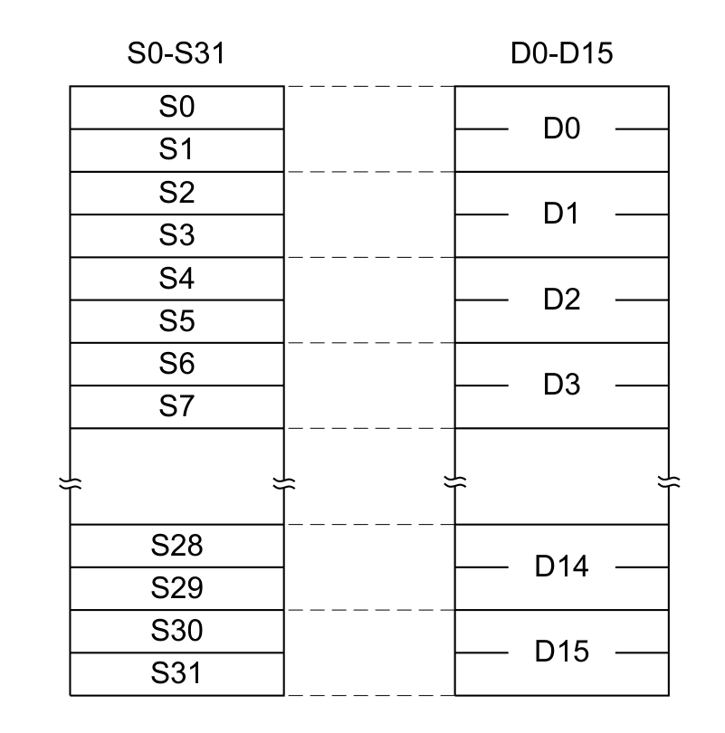
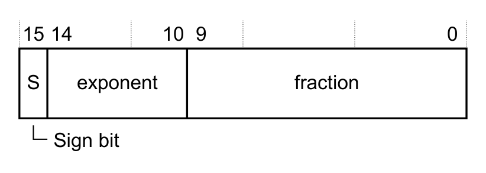
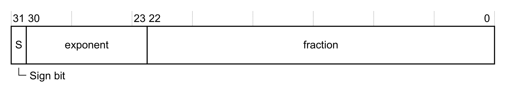
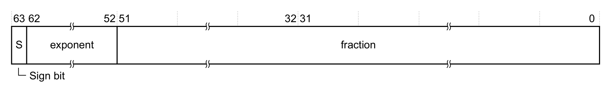

本文译自 Part B《Armv8-M 架构规则》（Armv8-M Architecture Rules） Chapter B4《浮点支持》（Floating-point Support）。

本章规定 **Armv8-M** 的浮点支持规则。

## 1. 可选的 Floating-point Extension，FPv5

可选的 **Floating-point Extension** 定义了一个浮点单元（**FPU**）。协处理器 10 与 11 支持该扩展。

适用于 **Armv8.0-M** 及以后架构版本的实现。扩展要求为 - FP。

标量 **Floating-point Extension** 可以在有或没有 **MVE-F** 的情况下实现。

适用于 **Armv8.1-M** 及以后架构版本的实现。扩展要求为 - FP。

**Floating-point** 有时缩写为 **FP**。

适用于 **Armv8.0-M** 及以后架构版本的实现。扩展要求为 - FP。

所支持的 **Floating-point Extension** 版本为 **FPv5**。

适用于 **Armv8.0-M** 及以后架构版本的实现。扩展要求为 - FP。

**FPv5** 提供以下全部内容：

- 单精度算术运算。
- 可选的双精度算术运算。
- 整型、双精度、单精度与半精度格式之间的转换。
- 用于浮点处理的寄存器 **S0-S31** 或 **D0-D15**。
- **Arm** 通用寄存器与 **FPv5** 扩展寄存器 **S0-S31** 或 **D0-D15** 之间单精度与双精度值的数据传送。
- 软件可以启用或禁用的**清零模式**（Flush-to-zero mode）。
- 对 **IEEE 754** 半精度编码格式的可选替代半精度解释。

**FPv5** 向系统寄存器空间添加以下系统寄存器：

- **FPSCR**，添加至 **CP10** 与 **CP11** 系统寄存器空间。
- **FPCAR**、**FPCCR**、**FPDSCR**、**MVFR0**、**MVFR1** 与 **MVFR2**，添加至系统控制块（**SCB**）。

适用于 **Armv8.0-M** 及以后架构版本的实现。扩展要求为 - FP || MVE。

从 **Armv8.1-M** 起，**FPv5** 提供半精度算术运算。

适用于 **Armv8.1-M** 及以后架构版本的实现。扩展要求为 - FP。

实现 **Floating-point Extension** 时，某些软件工具可能需要以下信息：

| Extension | Single-precision arithmetic operations only | Single and double-precision arithmetic operations |
| --- | --- | --- |
| FPv5 | FPv5-SP-D16-M | FPv5-D16-M |

适用于 **Armv8.0-M** 及以后架构版本的实现。扩展要求为 - FP。

实现 **Floating-point Extension** 时，软件可以查询 **MVFR0**、**MVFR1** 与 **MVFR2**，以发现所实现的浮点特性。

适用于 **Armv8.0-M** 及以后架构版本的实现。扩展要求为 - FP。

要使用 **Floating-point Extension**，软件必须通过写 **CPACR.CP10** 使能对 **CP10** 的访问。

适用于 **Armv8.0-M** 及以后架构版本的实现。扩展要求为 - FP。

若 **CPACR.CP11** 未被编程为与 **CPACR.CP10** 相同的值，则 **CPACR.CP11** 的值为 **UNKNOWN**。

适用于 **Armv8.0-M** 及以后架构版本的实现。扩展要求为 - FP。

参见：

- 第 B8.1 节《系统地址映射》（System address map）。
- 第 B4.2 节《浮点状态与控制寄存器》（About the Floating-point Status and Control Registers）。
- 第 B4.3 节《用于浮点数据处理的寄存器 S0-S31 或 D0-D15》（Registers for Floating-point data processing, S0-S31, or D0-D15）。
- 第 B4.8 节《清零模式》（The Flush-to-zero mode）。
- 第 B4.9 节《Default NaN 模式与 NaN 处理》（The Default NaN mode, and NaN handling）。
- 第 B4.6 节《浮点编码格式：半精度、单精度与双精度》（Floating-point encoding formats, half-precision, single-precision, and double-precision）。

## 2. 浮点状态与控制寄存器

对于 **Armv8.1-M** 架构的实现，**FPCXT** 与 **VPR** 提供额外的控制。

适用于 **Armv8.1-M** 及以后架构版本的实现。扩展要求为 - FP。

协处理器系统寄存器空间的寄存器映射如下。

| 位置 | 寄存器 | 信息 |
| --- | --- | --- |
| 0b0001 | **FPSCR.{N, Z, C, V}** | 标志访问 |

未在本表中明确列出的所有位置均为保留，对这些位置的访问会导致 **UNPREDICTABLE** 行为。

适用于 **Armv8.0-M** 及以后架构版本的实现。扩展要求为 - FP。

协处理器系统寄存器空间的寄存器映射如下。

| 位置 | 寄存器 | 信息 |
| --- | --- | --- |
| 0b0001 | **FPSCR.{N, Z, C, V}** | 标志访问 |
| 0b0010 | **FPSCR.{N, Z, C, V, QC}** | 标志访问，包括 **MVE** 饱和标志 |
| 0b1100 | **VPR** | 仅特权访问该寄存器 |
| 0b1101 | **VPR.P0** | 访问 **P0** 字段 |
| 0b1110 | **FPCXT_NS** | 保存与恢复 **Non-secure** 浮点上下文 |
| 0b1111 | **FPCXT_S** | 保存与恢复 **Secure** 浮点上下文 |

未在本表中明确列出的所有位置均为保留，对这些位置的访问会导致 **UNPREDICTABLE** 行为。

适用于 **Armv8.1-M** 及以后架构版本的实现。扩展要求为 - FP || MVE。

软件可以使用 `VMRS` 与 `VMSR` 指令访问**浮点状态与控制**寄存器。

适用于 **Armv8.0-M** 及以后架构版本的实现。扩展要求为 - FP。

软件可以使用 `VMRS`、`VMSR`、`VLDR (System Register)` 与 `VSTR (System Register)` 指令访问 **FPCXT**、**VPR** 以及**浮点状态与控制**寄存器。

适用于 **Armv8.1-M** 及以后架构版本的实现。扩展要求为 - FP || MVE。

除非至少实现了 **MVE** 或 **Floating-point Extension** 之一，否则对 **FPCXT** 的访问表现为 **NOP**。

适用于 **Armv8.1-M** 及以后架构版本的实现。扩展要求为 - FP || MVE。

从 **Non-secure** 状态访问 **FPCXT** 为 **UNDEFINED**。

适用于 **Armv8.1-M** 及以后架构版本的实现。扩展要求为 - (FP || MVE) && S。

产生浮点异常的浮点指令执行时，会更新 **FPSCR** 的相应状态字段。

适用于 **Armv8.0-M** 及以后架构版本的实现。扩展要求为 - FP。

参见：

- 第 B3.36 节《协处理器支持》（Coprocessor support）。
- 第 B4.1 节《可选的 Floating-point Extension，FPv5》（The optional Floating-point Extension, FPv5）。
- **FPSCR**，浮点状态与控制寄存器（Floating Point Status and Control Register）。

## 3. 用于浮点数据处理的寄存器 S0-S31 或 D0-D15

**FPv5** 为浮点处理添加的寄存器可以按以下两种方式之一呈现：

- 32 个单精度寄存器 **S0-S31**。
- 16 个双精度寄存器 **D0-D15**。

二者的映射关系如下：

适用于 **Armv8.0-M** 及以后架构版本的实现。扩展要求为 - FP || MVE。

热复位之后，**S0-S31** 或 **D0-D15** 的值为 **UNKNOWN**。

适用于 **Armv8.0-M** 及以后架构版本的实现。扩展要求为 - FP || MVE。

若 `VLDM` 索引了超出 `VFPSmallRegisterBank()` 所定义范围的 **S** 与 **D** 寄存器，则该指令对未实现的 **S** 或 **D** 寄存器表现为 **NOP**。

适用于 **Armv8.1-M** 及以后架构版本的实现。扩展要求为 - FP || MVE。

若 `VSTM` 索引了超出 `VFPSmallRegisterBank()` 所定义范围的 **S** 与 **D** 寄存器，则行为如下：

- 对于未实现的 **S** 寄存器，该指令表现为 **NOP**，且不向内存写入任何内容。
- 对于未实现的 **D** 寄存器，该指令要么表现为 **NOP**，要么允许对该指令所指定地址进行某些写入，但写入的值为 **UNKNOWN**。

适用于 **Armv8.1-M** 及以后架构版本的实现。扩展要求为 - FP || MVE。

若 `VSCCLRM` 索引了超出 `VFPSmallRegisterBank()` 所定义范围的 **S** 与 **D** 寄存器，则该指令对未实现的 **S** 或 **D** 寄存器表现为 **NOP**。

适用于 **Armv8.1-M** 及以后架构版本的实现。扩展要求为 - FP || MVE。

若执行 `VLSTM` 指令时满足以下全部条件，则产生 **LSERR SecureFault**：

- **CONTROL_S.FPCA** 已置位。
- 由 **FPCCR_S.S** 所指示的**分组版** **FPCCR.LSPACT** 已置位。

若产生 **LSERR SecureFault**，则以下各项均发生：

- 现有的惰性状态激活不被修改。
- 与**浮点上下文**相关的寄存器不被修改。
- 与**附加浮点状态上下文**相关的寄存器不被修改。
- 不执行任何压栈操作。

适用于 **Armv8.0-M** 及以后架构版本的实现。扩展要求为 - S && (FP || MVE)。

参见：

- 第 B4.1 节《可选的 Floating-point Extension，FPv5》（The optional Floating-point Extension, FPv5）。
- 第 B3.18 节《异常处理》（Exception handling）。

## 4. 浮点标准与术语

**IEEE 754** 标准有两个版本：

- **IEEE 754-1985**。
- **IEEE 754-2008**。

在本手册中，未指明年份的 **IEEE 754** 引用同时适用于这两个版本。

适用于 **Armv8.0-M** 及以后架构版本的实现。扩展要求为 - FP。

本手册所使用的浮点术语与 **IEEE 754-2008** 中所用术语的差异如下：

| 本手册 | IEEE 754-2008 |
| --- | --- |
| Normalized | Normal |
| Denormal，或 denormalized | Subnormal |
| Round towards Minus Infinity (RM) | roundTowardNegative |
| Round towards Plus Infinity (RP) | roundTowardPositive |
| Round towards Zero (RZ) | roundTowardZero |
| Round to Nearest (RN) | roundTiesToEven |
| Round to Nearest with Ties to Away | roundTiesToAway |
| Rounding mode | Rounding-direction attribute |

适用于 **Armv8.0-M** 及以后架构版本的实现。扩展要求为 - FP。

以下配置称为 **Arm** 标准浮点运算：

- **IEEE 754-2008**，加上以下配置：
  - 使能**清零模式**（Flush-to-zero mode）。
  - 使能 **Default NaN** 模式。
  - 选择 **Round to Nearest** 模式。
  - 未选择替代半精度解释。

适用于 **Armv8.0-M** 及以后架构版本的实现。扩展要求为 - FP。

参见：

- 《IEEE 754-2008, IEEE Standard for Floating-point Arithmetic》，2008 年 8 月。
- 第 B4.8 节《清零模式》（The Flush-to-zero mode）。
- 第 B4.9 节《Default NaN 模式与 NaN 处理》（The Default NaN mode, and NaN handling）。
- 第 B4.6 节《浮点编码格式：半精度、单精度与双精度》（Floating-point encoding formats, half-precision, single-precision, and double-precision）。

## 5. 可表示的浮点数据

**FPv5** 按 **IEEE 754** 的定义支持以下各项：

- **Normalized** 数。
- **Denormalized** 数。
- 零，即 +0 与 -0。
- 无穷大，即 +∞ 与 −∞。
- **NaN**，即信号 **NaN**（signaling NaN）与静默 **NaN**（quiet NaN）。

适用于 **Armv8.0-M** 及以后架构版本的实现。扩展要求为 - FP。

参见：

- 第 B4.4 节《浮点标准与术语》（Floating-point standards and terminology）。
- 《IEEE 754-2008, IEEE Standard for Floating-point Arithmetic》，2008 年 8 月。
- 第 B4.6 节《浮点编码格式：半精度、单精度与双精度》（Floating-point encoding formats, half-precision, single-precision, and double-precision）。

## 6. 浮点编码格式：半精度、单精度与双精度

半精度、单精度与双精度编码格式即 **IEEE 754-2008** 所定义的格式，另加一种替代半精度格式。

适用于 **Armv8.0-M** 及以后架构版本的实现。扩展要求为 - FP。

半精度编码格式为：

适用于 **Armv8.0-M** 及以后架构版本的实现。扩展要求为 - FP。

单精度编码格式为：

适用于 **Armv8.0-M** 及以后架构版本的实现。扩展要求为 - FP。

双精度编码格式为：

适用于 **Armv8.0-M** 及以后架构版本的实现。扩展要求为 - FP。

半精度、单精度与双精度编码格式的解释方式如下。

**Half-precision**

半精度编码格式有两种解释：

- **IEEE 754-2008** 所定义的解释。
- 替代半精度解释，由 **FPSCR.AHP** 指示。

**Single-precision**

**IEEE 754-2008** 所定义的解释。

**Double-precision**

**IEEE 754-2008** 所定义的解释。参见下表：

| E（偏置指数） | T（尾随有效数） | S（符号位） | T[51] | 值 |
| --- | --- | --- | --- | --- |
| 对所有格式均为零。 | Nonzero | - | - | 非规范化数。 |
| - | Zero | 0 | - | 零，+0 |
| - | - | 1 | - | 零，-0 |
| 0 < E < 0x1F，若为半精度格式之一。 | - | - | - | 规范化数。 |
| 0 < E < 0xFF，若为单精度格式。 | - | - | - | - |
| 0 < E < 0x7FF，若为双精度格式。 | - | - | - | - |
| 0x1F，若为半精度格式的 **IEEE** 解释。 | Nonzero | - | 0 | 信号 **NaN** |
| 0xFF，若为单精度格式。 | - | - | 1 | 静默 **NaN** |
| 0x7FF，若为双精度格式。 | Zero | 0 | - | 无穷大，+∞ |
| - | Zero | 1 | - | 无穷大，−∞ |
| 0x1F，若为半精度替代半精度解释。 | - | - | - | 规范化数。 |

适用于 **Armv8.0-M** 及以后架构版本的实现。扩展要求为 - FP。

规范化数的值等于：

- 半精度：`(−1)^S × 2^(E−15) × (1.T)`
- 单精度：`(−1)^S × 2^(E−127) × (1.T)`
- 双精度：`(−1)^S × 2^(E−1023) × (1.T)`

非规范化数的值等于：

- 半精度：`(−1)^S × 2^(−14) × (0.T)`
- 单精度：`(−1)^S × 2^(−126) × (0.T)`
- 双精度：`(−1)^S × 2^(−1022) × (0.T)`

适用于 **Armv8.0-M** 及以后架构版本的实现。扩展要求为 - FP。

非规范化数可以被清零。**FPv5** 提供**清零模式**（Flush-to-zero mode）。

适用于 **Armv8.0-M** 及以后架构版本的实现。扩展要求为 - FP。

参见：

- 《IEEE 754-2008, IEEE Standard for Floating-point Arithmetic》，2008 年 8 月。
- 第 B4.5 节《可表示的浮点数据》（Floating-point data representable）。

## 7. IEEE 754 浮点异常

**IEEE 754** 浮点异常包括：

- **Invalid Operation**：该异常如 **IEEE 754-2008**（7.2）所述。
- **Division by zero**：该异常如 **IEEE 754-2008**（7.3）所述，并附加以下假设：
  - 对于倒数与倒数平方根估算函数，被除数假定为 `+1.0`。
- **Overflow**：该异常如 **IEEE 754-2008**（7.4）所述。
- **Underflow**：该异常如 **IEEE 754-2008**（7.5）所述，并附加以下澄清：
  - 对结果是否为 tiny 且非零的判定在舍入**之前**进行。
- **Inexact**：该异常如 **IEEE 754-2008**（7.6）所述。

适用于 **Armv8.0-M** 及以后架构版本的实现。扩展要求为 - FP。

在**清零模式**下，产生 **Underflow** 异常的条件有所不同。

适用于 **Armv8.0-M** 及以后架构版本的实现。扩展要求为 - FP。

**IEEE 754** 浮点异常对应的状态标志为 `FPSCR.{IOC, DZC, OFC, UFC, IXC}`。

适用于 **Armv8.0-M** 及以后架构版本的实现。扩展要求为 - FP。

参见：

- 《IEEE 754-2008, IEEE Standard for Floating-point Arithmetic》，2008 年 8 月。

## 8. 清零模式

软件可以通过将 `FPSCR.FZ` 置 1 使能**清零模式**（Flush-to-zero mode）。

适用于 **Armv8.0-M** 及以后架构版本的实现。扩展要求为 - FP。

使用**清零模式**是对 **IEEE 754** 的一种偏离。

适用于 **Armv8.0-M** 及以后架构版本的实现。扩展要求为 - FP。

半精度浮点数不受**清零模式**影响。

适用于 **Armv8.0-M** 及以后架构版本的实现。扩展要求为 - FP。

在 **Armv8.1-M** 实现中，半精度浮点数受**清零模式**影响。

适用于 **Armv8.1-M** 及以后架构版本的实现。扩展要求为 - FP。

当**清零模式**使能时，浮点运算的所有单精度非规范化输入与双精度非规范化输入均被视为零，即被清零。

适用于 **Armv8.0-M** 及以后架构版本的实现。扩展要求为 - FP。

在 **Armv8.1-M** 实现中，当**清零模式**使能时，浮点运算的所有半精度非规范化输入均被视为零，即被清零。

适用于 **Armv8.1-M** 及以后架构版本的实现。扩展要求为 - FP。

当浮点运算的输入被清零时，PE 产生 **Input Denormal** 异常。

适用于 **Armv8.0-M** 及以后架构版本的实现。扩展要求为 - FP。

**Input Denormal** 异常仅在**清零模式**下产生。

适用于 **Armv8.0-M** 及以后架构版本的实现。扩展要求为 - FP。

当**清零模式**使能时，浮点运算输入的处理顺序为：

1. 执行清零处理。若符合条件，输入被清零且 PE 产生 **Input Denormal** 异常。
2. 对其他任何浮点异常是否产生的检测在清零处理**之后**进行。

适用于 **Armv8.0-M** 及以后架构版本的实现。扩展要求为 - FP。

当**清零模式**使能时，若浮点运算的结果在舍入**之前**满足以下条件，则该结果被视为零：

`0 < Abs(result) < MinNorm`，其中：

- 对于单精度，`MinNorm` 为 2^−126。
- 对于双精度，`MinNorm` 为 2^−1022。

此时称该结果被清零。

适用于 **Armv8.0-M** 及以后架构版本的实现。扩展要求为 - FP。

当浮点运算的结果被清零时，PE 产生 **Underflow** 异常。

适用于 **Armv8.0-M** 及以后架构版本的实现。扩展要求为 - FP。

在**清零模式**下，PE 仅当结果被清零时才产生 **Underflow** 异常。此判定条件与**清零模式**禁用时不同。

适用于 **Armv8.0-M** 及以后架构版本的实现。扩展要求为 - FP。

当浮点数被清零时，符号得到保留。即零的符号位与被清零的数的符号位相同。

适用于 **Armv8.0-M** 及以后架构版本的实现。扩展要求为 - M && FP。

当浮点数被清零时，PE 不产生 **Inexact** 异常。

适用于 **Armv8.0-M** 及以后架构版本的实现。扩展要求为 - FP。

**Input Denormal** 异常对应的状态标志为 `FPSCR.IDC`。

适用于 **Armv8.0-M** 及以后架构版本的实现。扩展要求为 - FP。

### 8.1 清零模式的半精度计算

适用于 **Armv8.1-M** 及以后架构版本的实现。

在 **Armv8.1-M** 实现中，**清零模式**扩展至涵盖半精度计算。

适用于 **Armv8.1-M** 及以后架构版本的实现。扩展要求为 - FP。注意，不适用于 **Armv8.0-M**。

软件可以通过将 `FPSCR.FZ16` 置 1 使能半精度计算的**清零模式**。

适用于 **Armv8.1-M** 及以后架构版本的实现。扩展要求为 - FP。注意，不适用于 **Armv8.0-M**。

当**清零模式**使能时，若浮点运算的结果在舍入**之前**满足以下条件，则该结果被视为零：

`0 < Abs(result) < MinNorm`，其中：

- 对于半精度，`MinNorm` 为 2^−14。
- 对于单精度，`MinNorm` 为 2^−126。
- 对于双精度，`MinNorm` 为 2^−1022。

此时称该结果被清零。

适用于 **Armv8.1-M** 及以后架构版本的实现。扩展要求为 - FP。注意，不适用于 **Armv8.0-M**。

当把实数值与整数从一种浮点格式转换为另一种浮点格式时，`FPSCR.FZ16` 的有效值为零。

适用于 **Armv8.1-M** 及以后架构版本的实现。扩展要求为 - FP。注意，不适用于 **Armv8.0-M**。

当半精度浮点的**清零模式**使能时，若半精度浮点数被清零，则不产生 **Input Denormal** 浮点异常。

适用于 **Armv8.1-M** 及以后架构版本的实现。扩展要求为 - FP。注意，不适用于 **Armv8.0-M**。

参见：

- 第 B4.7 节《IEEE 754 浮点异常》（The IEEE 754 Floating-point exceptions）。

## 9. Default NaN 模式与 NaN 处理

软件可以通过将 `FPSCR.DN` 置 1 使能 **Default NaN** 模式。

适用于 **Armv8.0-M** 及以后架构版本的实现。扩展要求为 - FP。

使用 **Default NaN** 模式是对 **IEEE 754** 的一种偏离。

适用于 **Armv8.0-M** 及以后架构版本的实现。扩展要求为 - FP。

当 **Default NaN** 模式使能时，**Default NaN** 是以下两者的结果：

- 所有产生未陷入 **Invalid Operation** 异常的浮点运算。
- 所有输入中至少包含一个静默 **NaN**、但不含信号 **NaN** 的浮点运算。

适用于 **Armv8.0-M** 及以后架构版本的实现。扩展要求为 - FP。

**IEEE 754** 规定：

- 产生未陷入 **Invalid Operation** 异常的操作返回静默 **NaN** 作为其结果。

当 **Default NaN** 模式禁用时，行为遵循该规定，并附加：

- 若 **Invalid Operation** 异常是因该操作的某个输入为信号 **NaN** 而产生，则静默 **NaN** 结果等于第一个信号 **NaN** 输入，且其最高有效位被置 1。
- 否则，静默 **NaN** 结果为 **Default NaN**。

第一个信号 **NaN** 输入指按从左到右的参数顺序传给描述该操作的伪代码函数的第一个参数。

适用于 **Armv8.0-M** 及以后架构版本的实现。扩展要求为 - FP。

**IEEE 754** 规定：

- 输入中含静默 **NaN**、但不含信号 **NaN** 的操作返回其某个静默 **NaN** 输入作为其结果。

当 **Default NaN** 模式禁用时，行为遵循该规定，并附加：

- 静默 **NaN** 结果为第一个静默 **NaN** 输入。

第一个静默 **NaN** 输入指按从左到右的参数顺序传给描述该操作的伪代码函数的第一个参数。

适用于 **Armv8.0-M** 及以后架构版本的实现。扩展要求为 - FP。

取决于具体的浮点运算，静默 **NaN** 结果的确切值在符号与 **T** 位个数上都可能与源值不同。

适用于 **Armv8.0-M** 及以后架构版本的实现。扩展要求为 - FP。

参见：

- 第 B4.10 节《Default NaN 值》（The Default NaN）。
- 第 B4.6 节《浮点编码格式：半精度、单精度与双精度》（Floating-point encoding formats, half-precision, single-precision, and double-precision）。

## 10. Default NaN 值

**Default NaN** 的各字段取值如下，其中数值按 **IEEE 754-2008** 解释：

| 字段 | 半精度 | 单精度 | 双精度 |
| --- | --- | --- | --- |
| S | 0 | 0 | 0 |
| E | 0x1F | 0xFF | 0x7FF |
| T | bit[9] == 1，bits[8:0] == 0 | bit[22] == 1，bits[21:0] == 0 | bit[51] == 1，bits[50:0] == 0 |

适用于 **Armv8.0-M** 及以后架构版本的实现。扩展要求为 - FP。

参见：

- 第 B4.6 节《浮点编码格式：半精度、单精度与双精度》（Floating-point encoding formats, half-precision, single-precision, and double-precision）。
- 第 B4.9 节《Default NaN 模式与 NaN 处理》（The Default NaN mode, and NaN handling）。

## 11. 浮点异常的组合

按照 **IEEE 754** 的规定：

- **Inexact** 浮点异常可以与 **Overflow** 浮点异常同时产生。
- **Inexact** 浮点异常可以与 **Underflow** 浮点异常同时产生。

适用于 **Armv8.0-M** 及以后架构版本的实现。扩展要求为 - FP。

**Input Denormal** 异常可以与其他浮点异常同时产生。

适用于 **Armv8.0-M** 及以后架构版本的实现。扩展要求为 - FP。

参见：

- 第 B4.7 节《IEEE 754 浮点异常》（The IEEE 754 Floating-point exceptions）。
- 第 B4.8 节《清零模式》（The Flush-to-zero mode）。

## 12. 浮点异常相对其他浮点异常的优先级

某些浮点指令规定了不止一个浮点运算。在这些情况下，若第二个异常的产生依赖于第一个运算的结果，则第一个运算上的异常优先级高于另一个运算上的异常。否则，哪个异常的优先级更高是 **UNPREDICTABLE** 的。

适用于 **Armv8.0-M** 及以后架构版本的实现。扩展要求为 - FP。

参见：

- 第 B4.7 节《IEEE 754 浮点异常》（The IEEE 754 Floating-point exceptions）。
