本文译自 Part C《Armv8-M 指令》（Armv8-M Instructions） Chapter C2《指令规范》（Instruction Specification，C2.1–C2.2）。

本章给出第 C2 章《指令规范》中 T32 指令集编码的顶层划分与 16 位编码分配。各小节给出解码字段取值与所对应子分组、指令的关系；指令名保持原样。

## 1. 顶层 T32 指令集编码

T32 指令流是一串半字对齐的半字。每条 T32 指令要么是该流中的单个 16 位半字，要么是由该流中两个连续半字组成的 32 位指令。

若正在解码的半字的位 [15:11] 为以下之一，则该半字是 32 位指令的第一个半字：

- `0b11101`。
- `0b11110`。
- `0b11111`。

否则，该半字是 16 位指令。

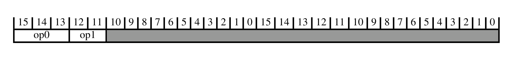

下表给出解码字段取值与所关联的子分组：

| op0 | op1 | 子分组 |
| --- | --- | --- |
| != 111 | - | 16 位 T32 指令编码 |
| 111 | != 00 | 32 位 T32 指令编码 |

下表给出解码字段取值与所关联的指令：

| op0 | op1 | 指令 |
| --- | --- | --- |
| 111 | 00 | B T2 |

## 2. 16 位 T32 指令编码

本节描述 16 位 T32 指令编码的编码方式。本节由**顶层 T32 指令集编码**解码。

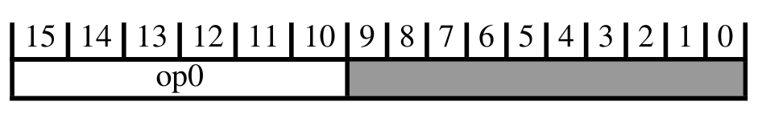

下表给出解码字段取值与所关联的子分组：

| op0 | 子分组 |
| --- | --- |
| 00xxxx | （立即数）移位、加、减、移动与比较 |
| 010000 | 数据处理（两个低寄存器） |
| 010001 | 特殊数据指令以及分支与交换 |
| 0101xx | 加载/存储（寄存器偏移） |
| 011xxx | 加载/存储字/字节（立即数偏移） |
| 1000xx | 加载/存储半字（立即数偏移） |
| 1001xx | 加载/存储（SP 相对） |
| 1010xx | 加 PC/SP（立即数） |
| 1011xx | 杂项 16 位指令 |
| 1100xx | 加载/存储多寄存器 |
| 1101xx | 条件分支与超级用户调用 |

下表给出解码字段取值与所关联的指令：

| op0 | 指令 |
| --- | --- |
| 01001x | LDR (literal) T1 |

### 2.1 （立即数）移位、加、减、移动与比较

本节描述**（立即数）移位、加、减、移动与比较**的编码方式。本节由 **16 位 T32 指令编码**解码。

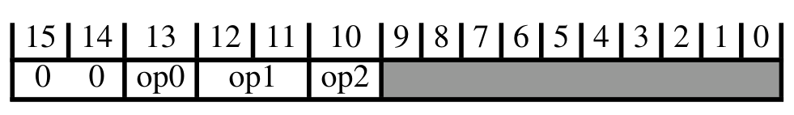

下表给出解码字段取值与所关联的子分组：

| op0 | op1 | op2 | 子分组 |
| --- | --- | --- | --- |
| 0 | 11 | 0 | 加、减（三个低寄存器） |
| 0 | 11 | 1 | 加、减（两个低寄存器与立即数） |
| 1 | - | - | 加、减、比较、移动（一个低寄存器与立即数） |

下表给出解码字段取值与所关联的指令：

| op0 | op1 | op2 | 指令 | 别名 |
| --- | --- | --- | --- | --- |
| Alias |  |  | ASRS (immediate) T2 | ASR (immediate) T2 |
|  |  |  | LSLS (immediate) T2 | LSL (immediate) T2 |
|  |  |  | LSRS (immediate) T2 | LSR (immediate) T2 |
| 0 | != 11 | - | MOV (register) T2 |  |

#### 2.1.1 加、减（三个低寄存器）

本节描述**加、减（三个低寄存器）**的编码方式。本节由**（立即数）移位、加、减、移动与比较**解码。

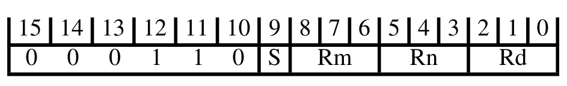

下表给出解码字段取值与所关联的指令：

| S | 指令 |
| --- | --- |
| 0 | ADD (register) T1 |
| 1 | SUB (register) T1 |

#### 2.1.2 加、减（两个低寄存器与立即数）

本节描述**加、减（两个低寄存器与立即数）**的编码方式。本节由**（立即数）移位、加、减、移动与比较**解码。

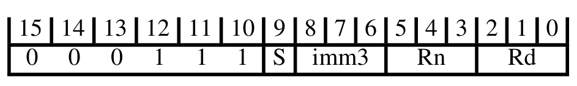

下表给出解码字段取值与所关联的指令：

| S | 指令 |
| --- | --- |
| 0 | ADD (immediate) T1 |
| 1 | SUB (immediate) T1 |

#### 2.1.3 加、减、比较、移动（一个低寄存器与立即数）

本节描述**加、减、比较、移动（一个低寄存器与立即数）**的编码方式。本节由**（立即数）移位、加、减、移动与比较**解码。

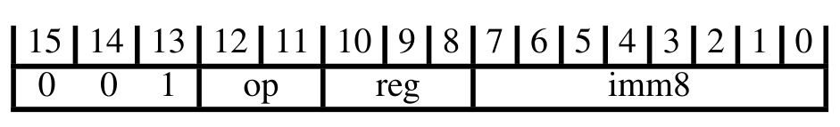

下表给出解码字段取值与所关联的指令：

| op | 指令 |
| --- | --- |
| 00 | MOV (immediate) T1 |
| 01 | CMP (immediate) T1 |
| 10 | ADD (immediate) T2 |
| 11 | SUB (immediate) T2 |

### 2.2 数据处理（两个低寄存器）

本节描述**数据处理（两个低寄存器）**的编码方式。本节由 **16 位 T32 指令编码**解码。

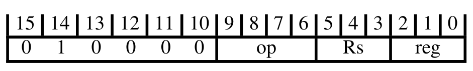

下表给出解码字段取值与所关联的指令：

| op | 指令 |
| --- | --- |
| 0000 | AND (register) T1 |
| 0001 | EOR (register) T1 |
| Alias | LSL (register) T1 |
| Alias | LSLS (register) T1 |
| Alias | LSR (register) T1 |
| Alias | LSRS (register) T1 |
| Alias | ASR (register) T1 |
| Alias | ASRS (register) T1 |
| 0101 | ADC (register) T1 |
| 0110 | SBC (register) T1 |
| Alias | ROR (register) T1 |
| Alias | RORS (register) T1 |
| 1000 | TST (register) T1 |
| 1001 | RSB (immediate) T1 |
| 1010 | CMP (register) T1 |
| 1011 | CMN (register) T1 |
| 1100 | ORR (register) T1 |
| 1101 | MUL T1 |
| 1110 | BIC (register) T1 |
| 1111 | MVN (register) T1 |
| 0010 |  |
| 0011 |  |
| 0100 |  |
| 0111 |  |

### 2.3 特殊数据指令以及分支与交换

本节描述**特殊数据指令以及分支与交换**的编码方式。本节由 **16 位 T32 指令编码**解码。

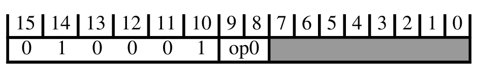

下表给出解码字段取值与所关联的子分组：

| op0 | 子分组 |
| --- | --- |
| 11 | 分支与交换 |
| != 11 | 加、减、比较、移动（两个高寄存器） |

#### 2.3.1 分支与交换

本节描述**分支与交换**的编码方式。本节由**特殊数据指令以及分支与交换**解码。

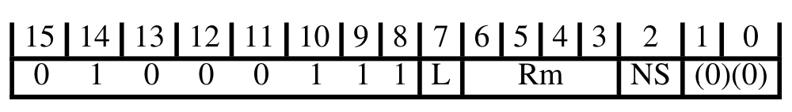

下表给出解码字段取值与所关联的指令：

| L | 指令 |
| --- | --- |
| 0 | BX, BXNS T1 |
| 1 | BLX, BLXNS T1 |

#### 2.3.2 加、减、比较、移动（两个高寄存器）

本节描述**加、减、比较、移动（两个高寄存器）**的编码方式。本节由**特殊数据指令以及分支与交换**解码。

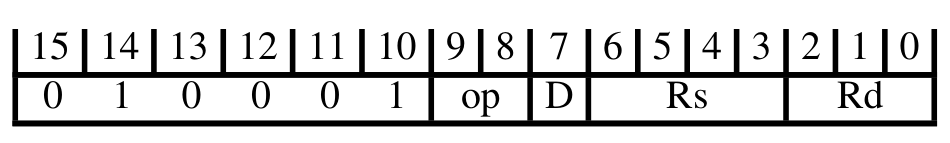

下表给出解码字段取值与所关联的指令：

| D:Rd | Rs | op | 指令 |
| --- | --- | --- | --- |
| != 1101 | != 1101 | 00 | ADD (register) T2 |
| - | 1101 | 00 | ADD (SP plus register) T1 |
| 1101 | != 1101 | 00 | ADD (SP plus register) T2 |
| - | - | 01 | CMP (register) T2 |
| - | - | 10 | MOV (register) T1 |

### 2.4 加载/存储（寄存器偏移）

本节描述**加载/存储（寄存器偏移）**的编码方式。本节由 **16 位 T32 指令编码**解码。

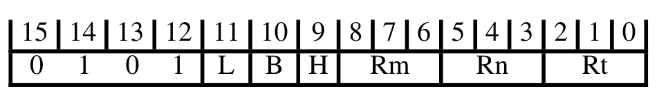

下表给出解码字段取值与所关联的指令：

| B | H | L | 指令 |
| --- | --- | --- | --- |
| 0 | 0 | 0 | STR (register) T1 |
| 0 | 1 | 0 | STRH (register) T1 |
| 1 | 0 | 0 | STRB (register) T1 |
| 1 | 1 | 0 | LDRSB (register) T1 |
| 0 | 0 | 1 | LDR (register) T1 |
| 0 | 1 | 1 | LDRH (register) T1 |
| 1 | 0 | 1 | LDRB (register) T1 |
| 1 | 1 | 1 | LDRSH (register) T1 |

### 2.5 加载/存储字/字节（立即数偏移）

本节描述**加载/存储字/字节（立即数偏移）**的编码方式。本节由 **16 位 T32 指令编码**解码。

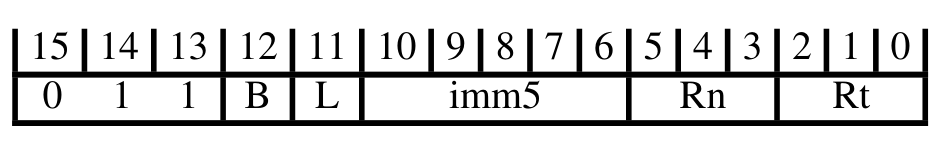

下表给出解码字段取值与所关联的指令：

| B | L | 指令 |
| --- | --- | --- |
| 0 | 0 | STR (immediate) T1 |
| 0 | 1 | LDR (immediate) T1 |
| 1 | 0 | STRB (immediate) T1 |
| 1 | 1 | LDRB (immediate) T1 |

### 2.6 加载/存储半字（立即数偏移）

本节描述**加载/存储半字（立即数偏移）**的编码方式。本节由 **16 位 T32 指令编码**解码。

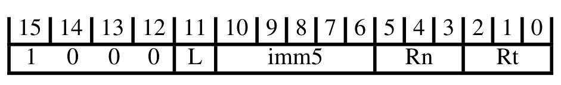

下表给出解码字段取值与所关联的指令：

| L | 指令 |
| --- | --- |
| 0 | STRH (immediate) T1 |
| 1 | LDRH (immediate) T1 |

### 2.7 加载/存储（SP 相对）

本节描述**加载/存储（SP 相对）**的编码方式。本节由 **16 位 T32 指令编码**解码。

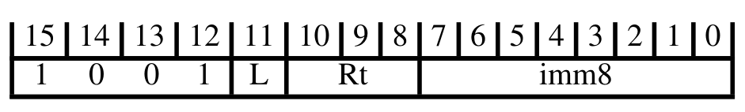

下表给出解码字段取值与所关联的指令：

| L | 指令 |
| --- | --- |
| 0 | STR (immediate) T2 |
| 1 | LDR (immediate) T2 |

### 2.8 加 PC/SP（立即数）

本节描述**加 PC/SP（立即数）**的编码方式。本节由 **16 位 T32 指令编码**解码。

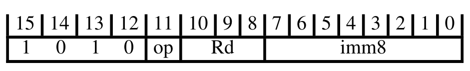

下表给出解码字段取值与所关联的指令：

| op | 指令 |
| --- | --- |
| Alias | ADD (immediate, to PC) T1 |
| 0 | ADR T1 |
| 1 | ADD (SP plus immediate) T1 |

### 2.9 杂项 16 位指令

本节描述**杂项 16 位指令**的编码方式。本节由 **16 位 T32 指令编码**解码。

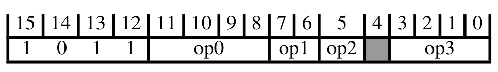

下表给出解码字段取值与所关联的子分组：

| op0 | op1 | op2 | op3 | 子分组 |
| --- | --- | --- | --- | --- |
| 0000 | - | - | - | 调整 SP（立即数） |
| 0010 | - | - | - | 扩展 |
| 1010 | != 10 | - | - | 反转字节 |
| 1111 | - | - | 0000 | 提示 |
| x10x | - | - | - | 压栈与出栈 |

下表给出解码字段取值与所关联的指令：

| op0 | op1 | op2 | op3 | 指令 |
| --- | --- | --- | --- | --- |
| 0110 | 01 | 1 | - | CPS T1 |
| 1110 | - | - | - | BKPT T1 |
| 1111 | - | - | != 0000 | IT T1 |
| x0x1 | - | - | - | CBNZ, CBZ T1 |

#### 2.9.1 调整 SP（立即数）

本节描述**调整 SP（立即数）**的编码方式。本节由**杂项 16 位指令**解码。

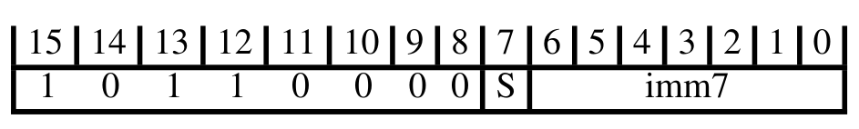

下表给出解码字段取值与所关联的指令：

| S | 指令 |
| --- | --- |
| 0 | ADD (SP plus immediate) T2 |
| 1 | SUB (SP minus immediate) T1 |

#### 2.9.2 扩展

本节描述**扩展**的编码方式。本节由**杂项 16 位指令**解码。

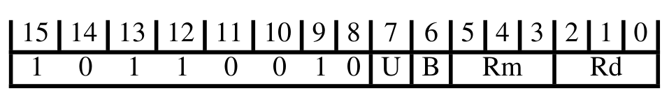

下表给出解码字段取值与所关联的指令：

| B | U | 指令 |
| --- | --- | --- |
| 0 | 0 | SXTH T1 |
| 1 | 0 | SXTB T1 |
| 0 | 1 | UXTH T1 |
| 1 | 1 | UXTB T1 |

#### 2.9.3 反转字节

本节描述**反转字节**的编码方式。本节由**杂项 16 位指令**解码。

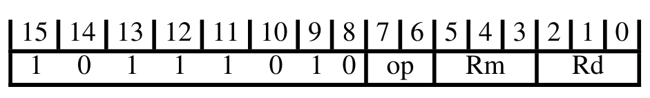

下表给出解码字段取值与所关联的指令：

| op | 指令 |
| --- | --- |
| 00 | REV T1 |
| 01 | REV16 T1 |
| 11 | REVSH T1 |

#### 2.9.4 提示

本节描述**提示**的编码方式。本节由**杂项 16 位指令**解码。

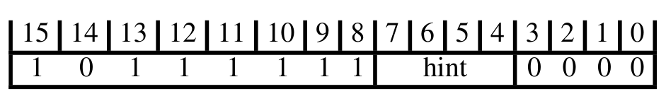

下表给出解码字段取值与所关联的指令：

| hint | 指令 |
| --- | --- |
| 0000 | NOP T1 |
| 0001 | YIELD T1 |
| 0010 | WFE T1 |
| 0011 | WFI T1 |
| 0100 | SEV T1 |
| 0101 | 保留提示，表现为 NOP |
| 011x | 保留提示，表现为 NOP |
| 1xxx | 保留提示，表现为 NOP |

#### 2.9.5 压栈与出栈

本节描述**压栈与出栈**的编码方式。本节由**杂项 16 位指令**解码。

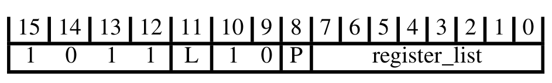

下表给出解码字段取值与所关联的指令：

| L | 指令 |
| --- | --- |
| 1 | LDM, LDMIA, LDMFD T3 |
| Alias | POP (multiple registers) T3 |
| Alias | PUSH (multiple registers) T2 |
| 0 | STMDB, STMFD T2 |

### 2.10 加载/存储多寄存器

本节描述**加载/存储多寄存器**的编码方式。本节由 **16 位 T32 指令编码**解码。

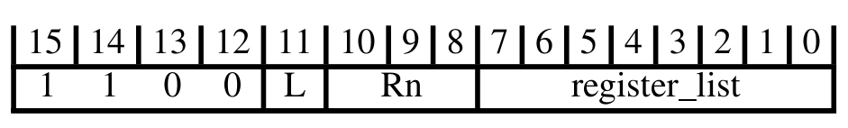

下表给出解码字段取值与所关联的指令：

| L | 指令 |
| --- | --- |
| 1 | LDM, LDMIA, LDMFD T1 |
| 0 | STM, STMIA, STMEA T1 |

### 2.11 条件分支与超级用户调用

本节描述**条件分支与超级用户调用**的编码方式。本节由 **16 位 T32 指令编码**解码。

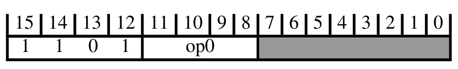

下表给出解码字段取值与所关联的子分组：

| op0 | 子分组 |
| --- | --- |
| 111x | 异常生成 |

下表给出解码字段取值与所关联的指令：

| op0 | 指令 |
| --- | --- |
| != 111x | B T1 |

#### 2.11.1 异常生成

本节描述**异常生成**的编码方式。本节由**条件分支与超级用户调用**解码。

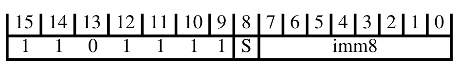

下表给出解码字段取值与所关联的指令：

| S | imm8 | 指令 |
| --- | --- | --- |
| 0 | - | UDF T1 |
| 1 | - | SVC T1 |
