本文译自 Part C《Armv8-M 指令》（Armv8-M Instructions） Chapter C2《指令规范》（Instruction Specification，C2.3）。

本章给出第 C2 章《指令规范》中 32 位 T32 指令编码的解码树。各小节给出解码字段取值与所对应子分组、指令的关系；指令助记符、字段名与解码值保持原样，小节名译为中文。

## 1. 32 位 T32 指令编码

本节描述 **32 位 T32 指令编码**的编码方式。本节由**顶层 T32 指令集编码**解码。

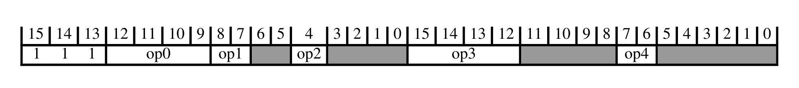

下表给出解码字段取值与所关联的子分组：

| op0 | op1 | op1:op2 | op2 | op3 | op4 | 子分组 |
| --- | --- | --- | --- | --- | --- | --- |
| x11x | - | - | - | - | - | 协处理器、浮点与向量指令 |
| 0100 | - | - | - | - | - | 加载/存储（多寄存器、双字、独占、获取-释放） |
| 0101 | - | - | - | - | - | 数据处理（移位寄存器） |
| 10xx | - | - | - | 1xxx | - | 分支与杂项控制 |
| 10x0 | - | - | - | 0xxx | - | 数据处理（修改立即数） |
| 10x1 | - | - | 0 | 0xxx | - | 数据处理（纯二进制立即数） |
| 1100 | - | != 1x0 | - | - | - | 加载/存储单个 |
| 1101 | 0x | - | - | 1111 | - | 数据处理（寄存器） |
| 1101 | 10 | - | - | - | 00 | 乘法、乘加与绝对差 |
| 1101 | 11 | - | - | - | - | 长乘法与除法 |

### 1.1. 协处理器、浮点与向量指令

本节描述**协处理器、浮点与向量指令**的编码方式。本节由 **32 位 T32 指令编码**解码。

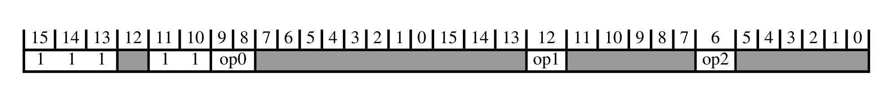

下表给出解码字段取值与所关联的子分组：

| op0 | op1 | op2 | 子分组 |
| --- | --- | --- | --- |
| 10 | - | - | 浮点与向量杂项指令 |
| 0x | - | - | 浮点与向量加载/存储、移动与协处理器指令 |
| 11 | 0 | 1 | 杂项向量算术指令 |

#### 1.1.1. 浮点与向量杂项指令

本节描述**浮点与向量杂项指令**的编码方式。本节由**协处理器、浮点与向量指令**解码。

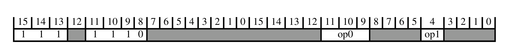

下表给出解码字段取值与所关联的子分组：

| op0 | op1 | 子分组 |
| --- | --- | --- |
| 0xx | - | 协处理器数据处理指令 |
| 100 | 1 | 向量移动指令 |
| 10x | 0 | 浮点数据处理、minNum/maxNum 与转换 |
| 101 | 1 | 浮点与向量移动（寄存器） |
| 110 | - | 架构定义的协处理器数据处理指令 |
| 111 | 0 | 向量立即数与寄存器，以及协处理器数据处理指令 |

##### 1.1.1.1. 协处理器数据处理指令

本节描述**协处理器数据处理指令**的编码方式。本节由**浮点与向量杂项指令**解码。

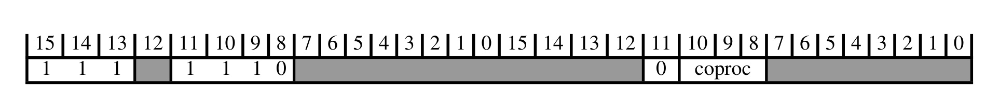

下表给出解码字段取值与所关联的子分组：

| CoprocType(UInt(coproc)) | 子分组 |
| --- | --- |
| CP_GCP | 架构定义的协处理器数据处理指令 |
| CP_CDEv1 | 自定义通用寄存器指令 |

###### 架构定义的协处理器数据处理指令

本节描述**架构定义的协处理器数据处理指令**的编码方式。本节由**协处理器数据处理指令**解码。

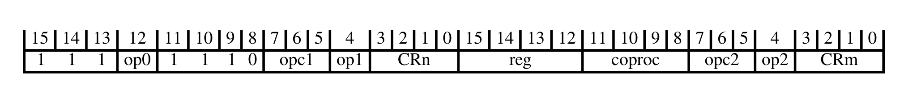

下表给出解码字段取值与所关联的指令：

| op0 | op1 | op2 | 指令 |
| --- | --- | --- | --- |
| 0 | - | 0 | CDP, CDP2 T1 |
| 1 | - | 0 | CDP, CDP2 T2 |
| 0 | 0 | 1 | MCR, MCR2 T1 |
| 1 | 0 | 1 | MCR, MCR2 T2 |
| 0 | 1 | 1 | MRC, MRC2 T1 |
| 1 | 1 | 1 | MRC, MRC2 T2 |

###### 自定义通用寄存器指令

本节描述**自定义通用寄存器指令**的编码方式。本节由**协处理器数据处理指令**解码。

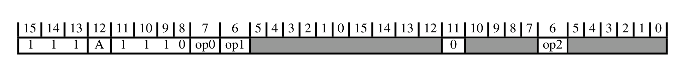

下表给出解码字段取值与所关联的指令：

| op0 | op1 | op2 | 指令 |
| --- | --- | --- | --- |
| 0 | 0 | 0 | CX1 T1 |
| 0 | 0 | 1 | CX1D T1 |
| 0 | 1 | 0 | CX2 T1 |
| 0 | 1 | 1 | CX2D T1 |
| 1 | - | 0 | CX3 T1 |
| 1 | - | 1 | CX3D T1 |

##### 1.1.1.2. 向量移动指令

本节描述**向量移动指令**的编码方式。本节由**浮点与向量杂项指令**解码。

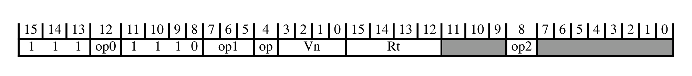

下表给出解码字段取值与所关联的指令：

| op0 | op1 | op2 | 指令 |
| --- | --- | --- | --- |
| 0 | 000 | 1 | VMOV (between general-purpose register and half-precision register) T1 |

##### 1.1.1.3. 浮点数据处理、minNum/maxNum 与转换

本节描述**浮点数据处理、minNum/maxNum 与转换**的编码方式。本节由**浮点与向量杂项指令**解码。

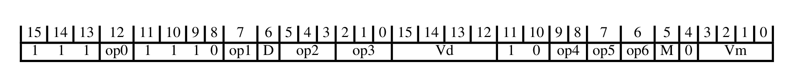

下表给出解码字段取值与所关联的指令：

| op0 | op1 | op2 | op3 | op4 | op5 | op6 | 指令 |
| --- | --- | --- | --- | --- | --- | --- | --- |
| 1 | 1 | 00x | - | - | - | 1 | VMINNM T2 |
| 1 | 1 | 111 | 110 | - | - | 1 | VCVTP T1 |
| 0 | 1 | 00x | - | - | - | 0 | VDIV T1 |
| 0 | 0 | 11x | - | - | - | 0 | VADD T2 |
| 0 | 0 | 01x | - | - | - | 0 | VNMLS T1 |
| 1 | 1 | 111 | 010 | - | 0 | 1 | VRINTP T1 |
| 0 | 1 | 110 | 000 | 1x | 0 | 1 | VMOV (register) T2 |
| 0 | 1 | 111 | 000 | - | - | 1 | VCVT (integer to floating-point) T1 |
| 0 | 1 | 10x | - | - | - | 1 | VFMS T2 |
| 0 | 1 | 01x | - | - | - | 0 | VFNMS T1 |
| 0 | 1 | 110 | 100 | - | 1 | 1 | VCMPE T1 |
| 0 | 1 | 110 | 101 | - | 1 | 1 | VCMPE T2 |
| 0 | 1 | 110 | 01x | 1x | 1 | 1 | VCVTT T1 |
| 1 | 1 | 111 | 011 | - | 0 | 1 | VRINTM T1 |
| 1 | 1 | 111 | 000 | - | 0 | 1 | VRINTA T1 |
| 0 | 1 | 110 | 001 | - | 0 | 1 | VNEG T2 |
| 0 | 1 | 110 | 111 | - | 0 | 1 | VRINTX T1 |
| 1 | 1 | 111 | 111 | - | - | 1 | VCVTM T1 |
| 0 | 1 | 110 | 01x | 1x | 0 | 1 | VCVTB T1 |
| 1 | 1 | 00x | - | - | - | 0 | VMAXNM T2 |
| 0 | 0 | 00x | - | - | - | 0 | VMLA T2 |
| 0 | 0 | 00x | - | - | - | 1 | VMLS T2 |
| 0 | 1 | 111 | 10x | - | 1 | 1 | VCVT (floating-point to integer) T1 |
| 0 | 1 | 01x | - | - | - | 1 | VFNMA T1 |
| 0 | 1 | 10x | - | - | - | 0 | VFMA T2 |
| 0 | 1 | 110 | 000 | - | 1 | 1 | VABS T2 |
| 0 | 1 | 110 | 110 | - | 0 | 1 | VRINTR T1 |
| 0 | 1 | 11x | - | - | - | 0 | VMOV (immediate) T2 |
| 0 | 1 | 110 | 100 | - | 0 | 1 | VCMP T1 |
| 1 | 1 | 110 | 000 | 10 | 0 | 1 | VMOVX T1 |
| 0 | 1 | 110 | 101 | - | 0 | 1 | VCMP T2 |
| 0 | 1 | 110 | 111 | 1x | 1 | 1 | VCVT (between double-precision and single-precision) T1 |
| 0 | 1 | 111 | x1x | - | - | 1 | VCVT (between floating-point and fixed-point) T1 |
| 1 | 1 | 110 | 000 | 10 | 1 | 1 | VINS T1 |
| 1 | 1 | 111 | 001 | - | 0 | 1 | VRINTN T1 |
| 1 | 0 | - | - | - | - | 0 | VSEL T1 |
| 0 | 0 | 01x | - | - | - | 1 | VNMLA T1 |
| 0 | 1 | 110 | 110 | - | 1 | 1 | VRINTZ T1 |
| 1 | 1 | 111 | 101 | - | - | 1 | VCVTN T1 |
| 0 | 0 | 10x | - | - | - | 0 | VMUL T2 |
| 1 | 1 | 111 | 100 | - | - | 1 | VCVTA T1 |
| 0 | 1 | 110 | 001 | - | 1 | 1 | VSQRT T1 |
| 0 | 1 | 111 | 10x | - | 0 | 1 | VCVTR T1 |
| 0 | 0 | 10x | - | - | - | 1 | VNMUL T2 |
| 0 | 0 | 11x | - | - | - | 1 | VSUB T2 |

##### 1.1.1.4. 浮点与向量移动（寄存器）

本节描述**浮点与向量移动（寄存器）**的编码方式。本节由**浮点与向量杂项指令**解码。

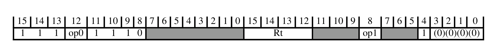

下表给出解码字段取值与所关联的子分组：

| op0 | op1 | 子分组 |
| --- | --- | --- |
| 0 | 1 M | 浮点寄存器与向量寄存器之间的移动 |
| 0 | 0 M | 通用寄存器与浮点特殊寄存器之间的移动 |

###### 浮点寄存器与向量寄存器之间的移动

本节描述**浮点寄存器与向量寄存器之间的移动**的编码方式。本节由**浮点与向量移动（寄存器）**解码。

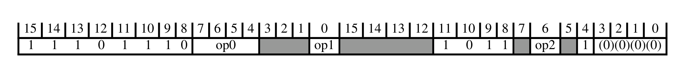

下表给出解码字段取值与所关联的指令：

| op0 | op1 | op2 | 指令 |
| --- | --- | --- | --- |
| 1x10 | 0 | 0 | VDUP T1 |
| 0xx0 | - | - | VMOV (general-purpose register to vector lane) T1 |
| xxx1 | - | - | VMOV (vector lane to general-purpose register) T1 |
| Alias |  |  | VMOV (single general-purpose register to half of doubleword register) T1 |
| Alias |  |  | VMOV (half of doubleword register to single general-purpose register) T1 |

###### 通用寄存器与浮点特殊寄存器之间的移动

本节描述**通用寄存器与浮点特殊寄存器之间的移动**的编码方式。本节由**浮点与向量移动（寄存器）**解码。

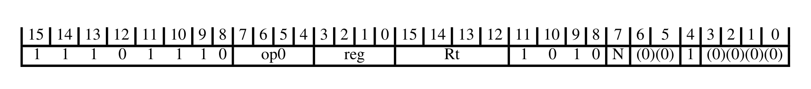

下表给出解码字段取值与所关联的指令：

| op0 | 指令 |
| --- | --- |
| 000x | VMOV (between general-purpose register and single-precision register) T1 |
| 1111 | VMRS T1 |
| 1110 | VMSR T1 |

##### 1.1.1.5. 架构定义的协处理器数据处理指令

本节描述**架构定义的协处理器数据处理指令**的编码方式。本节由**浮点与向量杂项指令**解码。

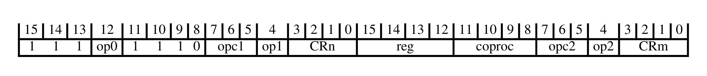

下表给出解码字段取值与所关联的指令：

| op0 | op1 | op2 | 指令 |
| --- | --- | --- | --- |
| 0 | - | 0 | CDP, CDP2 T1 |
| 1 | - | 0 | CDP, CDP2 T2 |
| 0 | 0 | 1 | MCR, MCR2 T1 |
| 1 | 0 | 1 | MCR, MCR2 T2 |
| 0 | 1 | 1 | MRC, MRC2 T1 |
| 1 | 1 | 1 | MRC, MRC2 T2 |

##### 1.1.1.6. 向量立即数与寄存器，以及协处理器数据处理指令

本节描述**向量立即数与寄存器，以及协处理器数据处理指令**的编码方式。本节由**浮点与向量杂项指令**解码。

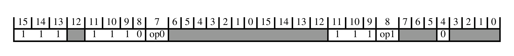

下表给出解码字段取值与所关联的子分组：

| op0 | op1 | 子分组 |
| --- | --- | --- |
| 0 | 0 | 杂项向量寄存器指令 |
| 1 | 0 | 杂项向量寄存器与立即数指令 |
| 0 | 1 | 向量寄存器、立即数与谓词化指令 |
| 1 | 1 | 向量算术、最小值、最大值与移位指令 |

###### 杂项向量寄存器指令

本节描述**杂项向量寄存器指令**的编码方式。本节由**向量立即数与寄存器，以及协处理器数据处理指令**解码。

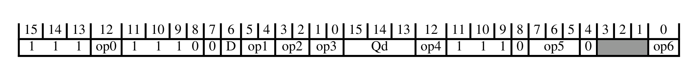

下表给出解码字段取值与所关联的指令：

| op0 | op1 | op2 | op3 | op4 | op5 | op6 | 指令 |
| --- | --- | --- | --- | --- | --- | --- | --- |
| 0 | 11 | != 11 | 01 | - | 10x | 1 | VQMOVUN T1 |
| - | != 11 | - | x1 | 1 | x10 | - | VMLAS (vector by vector plus scalar) T1 |
| - | 11 | != 11 | 11 | 1 | 10x | 1 | VMIN, VMINA T2 |
| 1 | != 11 | - | x0 | - | x0x | 0 | VQDMLSDH, VQRDMLSDH T1 |
| - | 11 | != 11 | 01 | 1 | 111 | - | VQSHL, VQSHLU T1 |
| - | 11 | 11 | 11 | 1 | 10x | 1 | VMINNM, VMINNMA (floating-point) T2 |
| - | 11 | != 11 | 11 | 0 | 10x | 1 | VMAX, VMAXA T2 |
| - | 11 | - | x1 | - | x0x | 0 | VMULL (polynomial) T1 |
| 1 | 11 | != 11 | 01 | - | 10x | 1 | VMOVN T1 |
| - | != 11 | - | x1 | 0 | x0x | 1 | VMULH, VRMULH T1 |
| - | != 11 | - | x1 | 1 | x0x | 1 | VMULH, VRMULH T2 |
| 0 | != 11 | - | x1 | 1 | x11 | - | VMUL (vector) T2 |
| - | != 11 | - | x0 | 0 | x11 | - | VQDMLAH, VQRDMLAH (vector by scalar plus vector) T1 |
| - | != 11 | - | x0 | 0 | x10 | - | VQDMLAH, VQRDMLAH (vector by scalar plus vector) T2 |
| - | 11 | - | x1 | 0 | x10 | - | VFMA (vector by scalar plus vector, floating-point) T1 |
| 0 | != 11 | - | x0 | - | x0x | 1 | VQDMLADH, VQRDMLADH T2 |
| - | 11 | - | x1 | 0 | x11 | - | VMUL (floating-point) T2 |
| - | 11 | - | x1 | 1 | x10 | - | VFMAS (vector by vector plus scalar, floating-point) T1 |
| 0 | != 11 | - | x1 | 0 | x11 | - | VQDMULH, VQRDMULH T3 |
| - | 11 | - | x0 | - | x0x | - | VCMUL (floating-point) T1 |
| 0 | != 11 | - | x0 | - | x0x | 0 | VQDMLADH, VQRDMLADH T1 |
| 1 | != 11 | - | x1 | 0 | x11 | - | VQDMULH, VQRDMULH T4 |
| 1 | != 11 | - | x0 | - | x0x | 1 | VQDMLSDH, VQRDMLSDH T2 |
| - | != 11 | - | x0 | 1 | x11 | - | VQDMLASH, VQRDMLASH (vector by vector plus scalar) T1 |
| - | != 11 | - | x0 | 1 | x10 | - | VQDMLASH, VQRDMLASH (vector by vector plus scalar) T2 |
| - | 11 | != 11 | 01 | - | 00x | 1 | VSHLL T2 |
| - | 11 | != 11 | 11 | 1 | 011 | - | VRSHL T2 |
| - | 11 | != 11 | 01 | 1 | 011 | - | VSHL T2 |
| - | 11 | 11 | 11 | - | 00x | 1 | VCVT (between single and half-precision floating-point) T1 |
| - | 11 | != 11 | 11 | - | 00x | 1 | VQMOVN T1 |
| - | != 11 | - | x1 | - | x0x | 0 | VMULL (integer) T1 |
| 1 | != 11 | - | x1 | 1 | x11 | - | VBRSR T1 |
| - | 11 | 11 | 11 | 0 | 10x | 1 | VMAXNM, VMAXNMA (floating-point) T2 |
| - | 11 | != 11 | 11 | 1 | 111 | - | VQRSHL T2 |
| - | != 11 | - | x1 | 0 | x10 | - | VMLA (vector by scalar plus vector) T1 |

###### 杂项向量寄存器与立即数指令

本节描述**杂项向量寄存器与立即数指令**的编码方式。本节由**向量立即数与寄存器，以及协处理器数据处理指令**解码。

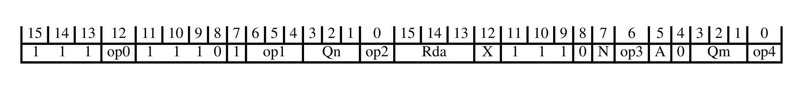

下表给出解码字段取值与所关联的指令：

| op0 | op1 | op2 | op3 | op4 | 指令 |
| --- | --- | --- | --- | --- | --- |
| - | 111 | - | 0 | 0 | VMLADAV T1 |
| Alias |  |  |  |  | VMLAV T1 |
| Alias |  |  |  |  | VMLALV T1 |
| - | != 111 | - | 0 | 0 | VMLALDAV T1 |
| 0 | != 111 | - | 0 | 1 | VMLSLDAV T1 |
| 0 | 111 | - | 0 | 1 | VMLSDAV T1 |
| 1 | 111 | 0 | 0 | 1 | VMLSDAV T2 |
| 1 | != 111 | 0 | 0 | 1 | VRMLSLDAVH T1 |

###### 向量寄存器、立即数与谓词化指令

本节描述**向量寄存器、立即数与谓词化指令**的编码方式。本节由**向量立即数与寄存器，以及协处理器数据处理指令**解码。

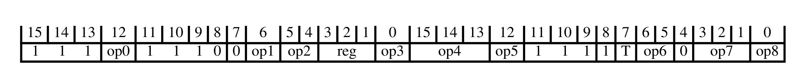

下表给出解码字段取值与所关联的指令：

| op0 | op1:op4 | op2 | op3:op4:op5 | op5:op8 | op6 | op7 | op7:op8 | op8 | 指令 |
| --- | --- | --- | --- | --- | --- | --- | --- | --- | --- |
| 0 | - | != 11 | 1xxx0 | - | 11 | 111 | - | - | VIDUP, VIWDUP T2 |
| 0 | - | != 11 | 1xxx0 | - | 11 | != 111 | - | - | VIDUP, VIWDUP T1 |
| - | - | 11 | 0xxxx | - | 0x | - | - | 1 | VQDMULL T1 |
| - | - | != 11 | 0xxx0 | - | 11 | - | - | - | VQADD T2 |
| - | - | 11 | 0xxx0 | - | 10 | - | - | - | VADD (floating-point) T2 |
| 0 | - | != 11 | 1xxx1 | - | 10 | - | - | - | VSUB (vector) T2 |
| 0 | - | != 11 | 1xxx0 | - | 10 | - | - | - | VADD (vector) T2 |
| 0 | - | != 11 | 0xxxx | - | 0x | - | - | 0 | VHCADD T1 |
| 0 | - | != 11 | 1xxx1 | - | 11 | 111 | - | - | VDDUP, VDWDUP T2 |
| 0 | - | != 11 | 1xxx1 | - | 11 | != 111 | - | - | VDDUP, VDWDUP T1 |
| 1 | - | != 11 | 0xxxx | - | 0x | - | - | 0 | VCADD T1 |
| - | - | != 11 | 0xxx0 | - | 10 | - | - | - | VHADD T2 |
| - | - | 11 | 0xxx1 | - | 10 | - | - | - | VSUB (floating-point) T2 |
| - | - | != 11 | 0xxx1 | - | 10 | - | - | - | VHSUB T2 |
| 1 | - | 11 | 1xxx0 | 01 | 0x | - | - | - | VPSEL T1 |
| 1 | 0000 | 11 | 1xxxx | - | 1x | - | 1101 | - | VPNOT T1 |
| 1 | 0000 | != 11 | 10000 | - | 0x | - | - | 0 | VCMP (vector) T1 |
| 1 | 0000 | != 11 | 10000 | - | 0x | - | - | 1 | VCMP (vector) T2 |
| 1 | 0000 | != 11 | 10001 | - | 0x | - | - | - | VCMP (vector) T3 |
| 1 | 0000 | != 11 | 10000 | - | 10 | - | - | - | VCMP (vector) T4 |
| 1 | 0000 | != 11 | 10000 | - | 11 | - | - | - | VCMP (vector) T5 |
| 1 | 0000 | != 11 | 10001 | - | 1x | - | - | - | VCMP (vector) T6 |
| - | 0000 | 11 | 1000x | - | 1x | - | != 1101 | - | VCMP (floating-point) T2 |
| - | 0000 | 11 | 1000x | != 01 | 0x | - | - | - | VCMP (floating-point) T1 |
| 1 | != 0000 | 11 | 1xxxx | - | 1x | - | 1101 | - | VPST T1 |
| 1 | != 0000 | != 11 | 1xxx0 | - | 0x | - | - | 0 | VPT T1 |
| 1 | != 0000 | != 11 | 1xxx0 | - | 0x | - | - | 1 | VPT T2 |
| 1 | != 0000 | != 11 | 1xxx1 | - | 0x | - | - | - | VPT T3 |
| 1 | != 0000 | != 11 | 1xxx0 | - | 10 | - | - | - | VPT T4 |
| 1 | != 0000 | != 11 | 1xxx0 | - | 11 | - | - | - | VPT T5 |
| 1 | != 0000 | != 11 | 1xxx1 | - | 1x | - | - | - | VPT T6 |
| - | != 0000 | 11 | 1xxxx | - | 1x | - | != 1101 | - | VPT (floating-point) T2 |
| - | != 0000 | 11 | 1xxxx | != 01 | 0x | - | - | - | VPT (floating-point) T1 |
| 0 | - | 11 | 0xxxx | - | 0x | - | - | 0 | VADC T1 |
| - | - | != 11 | 0xxx1 | - | 11 | - | - | - | VQSUB T2 |
| - | - | 11 | 0xxxx | - | 11 | - | - | - | VQDMULL T2 |
| 1 | - | 11 | 0xxxx | - | 0x | - | - | 0 | VSBC T1 |

###### 向量算术、最小值、最大值与移位指令

本节描述**向量算术、最小值、最大值与移位指令**的编码方式。本节由**向量立即数与寄存器，以及协处理器数据处理指令**解码。

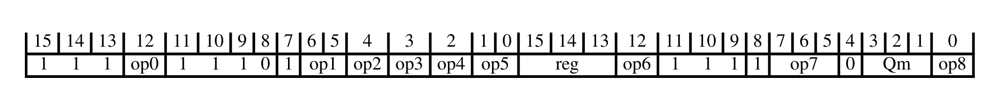

下表给出解码字段取值与所关联的指令：

| op0 | op1:op2 | op2:op3:op4:op5 | op3:op4 | op5 | op6 | op7 | op8 | 指令 |
| --- | --- | --- | --- | --- | --- | --- | --- | --- |
| - | 110 | - | != 11 | 00 | - | 10x | 0 | VMINV, VMINAV T2 |
| 0 | x0x | - | - | - | - | 11x | 1 | VSHRN T1 |
| - | 110 | - | != 11 | 10 | - | 10x | 0 | VMINV, VMINAV T1 |
| 1 | x0x | - | - | - | - | 11x | 0 | VQRSHRUN T1 |
| - | 110 | - | 11 | 10 | - | 10x | 0 | VMINNMV, VMINNMAV (floating-point) T1 |
| - | 111 | - | - | x0 | - | x0x | 0 | VMLADAV T2 |
| - | != 111 | - | - | 01 | - | 00x | 0 | VADDLV T1 |
| - | 111 | - | != 11 | 01 | - | 00x | 0 | VADDV T1 |
| - | 110 | - | 11 | 00 | - | 10x | 0 | VMINNMV, VMINNMAV (floating-point) T2 |
| 0 | x1x | - | - | - | 0 | 110 | - | VSHLC T1 |
| 0 | x0x | - | - | - | - | 11x | 0 | VQSHRUN T1 |
| - | x0x | - | - | - | - | 01x | 0 | VQSHRN T1 |
| 1 | x0x | - | - | - | - | 11x | 1 | VRSHRN T1 |
| - | 110 | - | 11 | 10 | - | 00x | 0 | VMAXNMV, VMAXNMAV (floating-point) T1 |
| - | 110 | - | != 11 | 00 | - | 00x | 0 | VMAXV, VMAXAV T2 |
| - | 110 | - | != 11 | 10 | - | 00x | 0 | VMAXV, VMAXAV T1 |
| - | 110 | - | 11 | 00 | - | 00x | 0 | VMAXNMV, VMAXNMAV (floating-point) T2 |
| - | != 11x | - | - | x0 | - | x0x | 0 | VRMLALDAVH T1 |
| Alias |  |  |  |  |  |  |  | VRMLALVH T1 |
| - | x0x | - | - | - | - | 01x | 1 | VQRSHRN T1 |
| - | 00x 010 | - | - | x0 | - | x0x | 1 | VABAV T1 |
| - | x1x | 00000 11000 xx001 xx01x xx1xx | - | - | - | 01x | 0 | VSHLL T1 |
| - | x1x | 01000 10000 | - | - | - | 01x | 0 | VMOVL T1 |

#### 1.1.2. 浮点与向量加载/存储、移动与协处理器指令

本节描述**浮点与向量加载/存储、移动与协处理器指令**的编码方式。本节由**协处理器、浮点与向量指令**解码。

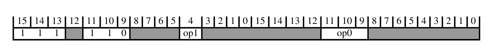

下表给出解码字段取值与所关联的子分组：

| op0 | op1 | 子分组 |
| --- | --- | --- |
| 0xx | - | 协处理器加载、存储与移动指令 |
| 100 | - | 浮点与向量加载/存储及复数算术指令 |
| 101 | - | 协处理器与浮点加载/存储、移动与安全 |
| 110 | - | 架构定义的协处理器加载、存储与移动指令 |
| 111 | 1 | 向量加载指令 |
| 111 | 0 | 向量存储指令 |

##### 1.1.2.1. 协处理器加载、存储与移动指令

本节描述**协处理器加载、存储与移动指令**的编码方式。本节由**浮点与向量加载/存储、移动与协处理器指令**解码。

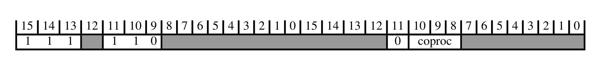

下表给出解码字段取值与所关联的子分组：

| CoprocType(UInt(coproc)) | 子分组 |
| --- | --- |
| CP_GCP | 架构定义的协处理器加载、存储与移动指令 |
| CP_CDEv1 | 自定义浮点与向量指令 |

###### 架构定义的协处理器加载、存储与移动指令

本节描述**架构定义的协处理器加载、存储与移动指令**的编码方式。本节由**协处理器加载、存储与移动指令**解码。

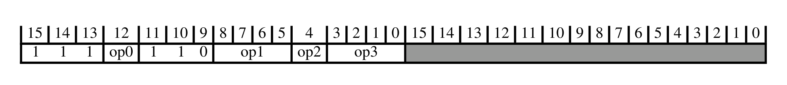

下表给出解码字段取值与所关联的指令：

| op0 | op1 | op2 | op3 | 指令 |
| --- | --- | --- | --- | --- |
| 0 | != 0010 | 1 | != 1111 | LDC, LDC2 (immediate) T1 |
| 1 | != 0010 | 1 | != 1111 | LDC, LDC2 (immediate) T2 |
| 0 | != 0010 | 1 | 1111 | LDC, LDC2 (literal) T1 |
| 1 | != 0010 | 1 | 1111 | LDC, LDC2 (literal) T2 |
| 0 | != 0010 | 0 | - | STC, STC2 T1 |
| 1 | != 0010 | 0 | - | STC, STC2 T2 |
| 0 | 0010 | 1 | - | MRRC, MRRC2 T1 |
| 1 | 0010 | 1 | - | MRRC, MRRC2 T2 |
| 0 | 0010 | 0 | - | MCRR, MCRR2 T1 |
| 1 | 0010 | 0 | - | MCRR, MCRR2 T2 |

###### 自定义浮点与向量指令

本节描述**自定义浮点与向量指令**的编码方式。本节由**协处理器加载、存储与移动指令**解码。

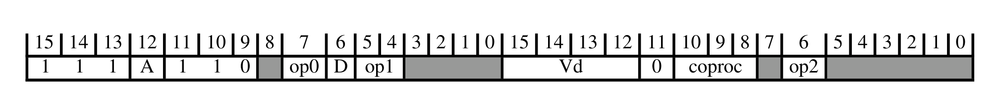

下表给出解码字段取值与所关联的指令：

| op0 | op1 | op2 | 指令 |
| --- | --- | --- | --- |
| 0 | 10 | 1 | VCX1 (vector) T1 |
| 0 | 10 | 0 | VCX1 T1 |
| 0 | 11 | 1 | VCX2 (vector) T1 |
| 0 | 11 | 0 | VCX2 T1 |
| 1 | - | 1 | VCX3 (vector) T1 |
| 1 | - | 0 | VCX3 T1 |

##### 1.1.2.2. 浮点与向量加载/存储及复数算术指令

本节描述**浮点与向量加载/存储及复数算术指令**的编码方式。本节由**浮点与向量加载/存储、移动与协处理器指令**解码。

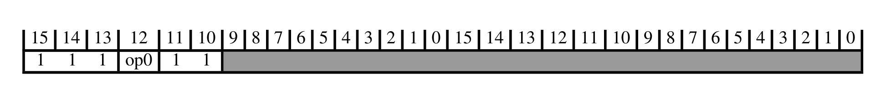

下表给出解码字段取值与所关联的子分组：

| op0 | 子分组 |
| --- | --- |
| 1 | 浮点与向量复数算术指令 |
| 0 | 浮点与向量加载/存储指令 |

###### 浮点与向量复数算术指令

本节描述**浮点与向量复数算术指令**的编码方式。本节由**浮点与向量加载/存储及复数算术指令**解码。

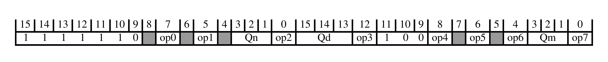

下表给出解码字段取值与所关联的指令：

| op0 | op1 | op2 | op3 | op4 | op5 | op6 | op7 | 指令 |
| --- | --- | --- | --- | --- | --- | --- | --- | --- |
| 1 | 0 | 0 | 0 | 0 | 1 | 0 | 0 | VCADD (floating-point) T1 |
| - | 1 | 0 | 0 | 0 | 1 | 0 | 0 | VCMLA (floating-point) T1 |

###### 浮点与向量加载/存储指令

本节描述**浮点与向量加载/存储指令**的编码方式。本节由**浮点与向量加载/存储及复数算术指令**解码。

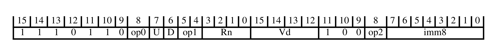

下表给出解码字段取值与所关联的指令：

| op0 | op1 | op2 | 指令 |
| --- | --- | --- | --- |
| 1 | 01 | 1 | VLDR T3 |
| 1 | 00 | 1 | VSTR T3 |

##### 1.1.2.3. 协处理器与浮点加载/存储、移动与安全

本节描述**协处理器与浮点加载/存储、移动与安全**的编码方式。本节由**浮点与向量加载/存储、移动与协处理器指令**解码。

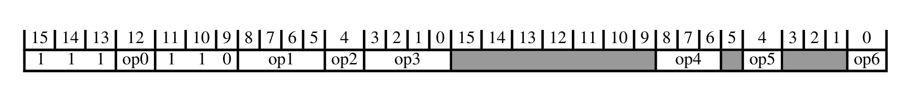

下表给出解码字段取值与所关联的指令：

| op0 | op1 | op1:op3 | op2 | op3 | op4 | op5 | op6 | 指令 |
| --- | --- | --- | --- | --- | --- | --- | --- | --- |
| 0 | 00x1 01xx 1xx1 | != 01x01111 | 1 | - | 1xx | - | 1 | FLDMDBX, FLDMIAX T1 |
| 0 | 00x1 01xx 1xx1 | != 01x01111 | 1 | - | 1xx | - | 0 | VLDM T1 |
| 0 | 01xx 1xx1 | != 01x01111 | 1 | - | 0xx | - | - | VLDM T2 |
| 0 | 1xx0 | - | 1 | - | 1xx | - | - | VLDR T1 |
| 0 | 1xx0 | - | 1 | - | 0xx | - | - | VLDR T2 |
| 0 | 00x1 | - | 1 | - | 00x | - | - | VLLDM T1 |
| 0 | 00x1 | - | 1 | - | 01x | - | - | VLLDM T2 |
| Alias |  |  |  |  |  |  |  | VPOP T1 |
| Alias |  |  |  |  |  |  |  | VPOP T2 |
| 0 | 00x1 01xx 1xx1 | - | 0 | - | 1xx | - | 1 | FSTMDBX, FSTMIAX T1 |
| 0 | 00x1 01xx 1xx1 | - | 0 | - | 1xx | - | 0 | VSTM T1 |
| 0 | 01xx 1xx1 | - | 0 | - | 0xx | - | - | VSTM T2 |
| 0 | 1xx0 | - | 0 | - | 1xx | - | - | VSTR T1 |
| 0 | 1xx0 | - | 0 | - | 0xx | - | - | VSTR T2 |
| 0 | 00x1 | - | 0 | - | 00x | - | - | VLSTM T1 |
| 0 | 00x1 | - | 0 | - | 01x | - | - | VLSTM T2 |
| Alias |  |  |  |  |  |  |  | VPUSH T1 |
| Alias |  |  |  |  |  |  |  | VPUSH T2 |
| 0 | 0010 | - | - | - | 100 | 1 | - | VMOV (two GP registers and a doubleword register) T1 |
| 0 | 0010 | - | - | - | 000 | 1 | - | VMOV (two GP registers and two SP registers) T1 |
| 0 | 01x0 | - | 1 | 1111 | 1xx | - | 0 | VSCCLRM T1 |
| 0 | 01x0 | - | 1 | 1111 | 0xx | - | - | VSCCLRM T2 |

##### 1.1.2.4. 架构定义的协处理器加载、存储与移动指令

本节描述**架构定义的协处理器加载、存储与移动指令**的编码方式。本节由**浮点与向量加载/存储、移动与协处理器指令**解码。

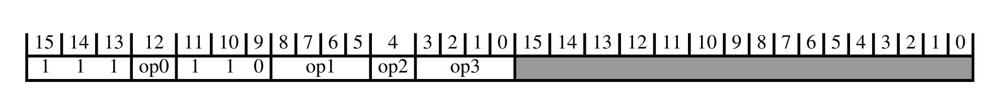

下表给出解码字段取值与所关联的指令：

| op0 | op1 | op2 | op3 | 指令 |
| --- | --- | --- | --- | --- |
| 0 | != 0010 | 1 | != 1111 | LDC, LDC2 (immediate) T1 |
| 1 | != 0010 | 1 | != 1111 | LDC, LDC2 (immediate) T2 |
| 0 | != 0010 | 1 | 1111 | LDC, LDC2 (literal) T1 |
| 1 | != 0010 | 1 | 1111 | LDC, LDC2 (literal) T2 |
| 0 | != 0010 | 0 | - | STC, STC2 T1 |
| 1 | != 0010 | 0 | - | STC, STC2 T2 |
| 0 | 0010 | 1 | - | MRRC, MRRC2 T1 |
| 1 | 0010 | 1 | - | MRRC, MRRC2 T2 |
| 0 | 0010 | 0 | - | MCRR, MCRR2 T1 |
| 1 | 0010 | 0 | - | MCRR, MCRR2 T2 |

##### 1.1.2.5. 向量加载指令

本节描述**向量加载指令**的编码方式。本节由**浮点与向量加载/存储、移动与协处理器指令**解码。

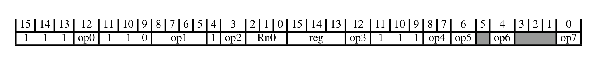

下表给出解码字段取值与所关联的指令：

| op0 | op1 | op2 | op3 | op4 | op5 | op6 | op7 | 指令 |
| --- | --- | --- | --- | --- | --- | --- | --- | --- |
| 1 | 01xx | - | 1 | != 11 | - | - | 0 | VLD2 T1 |
| 1 | 01xx | - | 1 | != 11 | - | - | 1 | VLD4 T1 |
| 0 | 1xxx 0xx1 | - | 1 | 00 | - | - | - | VLDRB, VLDRH, VLDRW T5 |
| 0 | 1xxx 0xx1 | - | 1 | 01 | - | - | - | VLDRB, VLDRH, VLDRW T6 |
| 0 | 1xxx 0xx1 | - | 1 | 10 | - | - | - | VLDRB, VLDRH, VLDRW T7 |
| 1 | 1xxx | - | 1 | 0x | - | - | - | VLDRB, VLDRH, VLDRW, VLDRD (vector) T5 |
| 1 | 1xxx | - | 1 | 1x | - | - | - | VLDRB, VLDRH, VLDRW, VLDRD (vector) T6 |
| - | 1x0x 0x01 | 0 | 0 | != 11 | - | - | - | VLDRB, VLDRH, VLDRW T1 |
| - | 1x0x 0x01 | 1 | 0 | != 11 | - | - | - | VLDRB, VLDRH, VLDRW T2 |
| - | 1xxx 0xx1 | - | 0 | 11 | - | - | - | VLDR (System Register) T1 |
| - | 01x0 | - | 0 | - | 0 | 0 | - | VLDRB, VLDRH, VLDRW, VLDRD (vector) T1 |
| - | 01x0 | - | 0 | - | 0 | 1 | - | VLDRB, VLDRH, VLDRW, VLDRD (vector) T2 |
| - | 01x0 | - | 0 | - | 1 | 0 | - | VLDRB, VLDRH, VLDRW, VLDRD (vector) T3 |
| - | 01x0 | - | 0 | - | 1 | 1 | - | VLDRB, VLDRH, VLDRW, VLDRD (vector) T4 |
| 0 | 00x0 | - | 0 | 1x | - | - | - | VMOV (two general-purpose registers to two 32-bit vector lanes) T1 |

##### 1.1.2.6. 向量存储指令

本节描述**向量存储指令**的编码方式。本节由**浮点与向量加载/存储、移动与协处理器指令**解码。

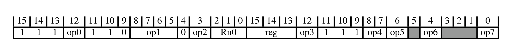

下表给出解码字段取值与所关联的指令：

| op0 | op1 | op2 | op3 | op4 | op5 | op6 | op7 | 指令 |
| --- | --- | --- | --- | --- | --- | --- | --- | --- |
| 1 | 01xx | - | 1 | != 11 | - | - | 0 | VST2 T1 |
| 1 | 01xx | - | 1 | != 11 | - | - | 1 | VST4 T1 |
| 0 | 1xxx 0xx1 | - | 1 | 00 | - | - | - | VSTRB, VSTRH, VSTRW T5 |
| 0 | 1xxx 0xx1 | - | 1 | 01 | - | - | - | VSTRB, VSTRH, VSTRW T6 |
| 0 | 1xxx 0xx1 | - | 1 | 10 | - | - | - | VSTRB, VSTRH, VSTRW T7 |
| 1 | 1xxx | - | 1 | 0x | - | - | - | VSTRB, VSTRH, VSTRW, VSTRD (vector) T5 |
| 1 | 1xxx | - | 1 | 1x | - | - | - | VSTRB, VSTRH, VSTRW, VSTRD (vector) T6 |
| - | 1x0x 0x01 | 0 | 0 | != 11 | - | - | - | VSTRB, VSTRH, VSTRW T1 |
| - | 1x0x 0x01 | 1 | 0 | != 11 | - | - | - | VSTRB, VSTRH, VSTRW T2 |
| - | 1xxx 0xx1 | - | 0 | 11 | - | - | - | VSTR (System Register) T1 |
| - | 01x0 | - | 0 | - | 0 | 0 | - | VSTRB, VSTRH, VSTRW, VSTRD (vector) T1 |
| - | 01x0 | - | 0 | - | 0 | 1 | - | VSTRB, VSTRH, VSTRW, VSTRD (vector) T2 |
| - | 01x0 | - | 0 | - | 1 | 0 | - | VSTRB, VSTRH, VSTRW, VSTRD (vector) T3 |
| - | 01x0 | - | 0 | - | 1 | 1 | - | VSTRB, VSTRH, VSTRW, VSTRD (vector) T4 |
| 0 | 00x0 | - | 0 | 1x | - | - | - | VMOV (two 32-bit vector lanes to two general-purpose registers) T1 |

#### 1.1.3. 杂项向量算术指令

本节描述**杂项向量算术指令**的编码方式。本节由**协处理器、浮点与向量指令**解码。

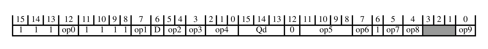

下表给出解码字段取值与所关联的指令：

| op0 | op1 | op2 | op2:op3 | op4 | op5 | op6 | op7:op5 | op7:op8 | op9 | 指令 |
| --- | --- | --- | --- | --- | --- | --- | --- | --- | --- | --- |
| 1 | 1 | 11 | - | x00 | 0100 | 0 | - | x0 | 0 | VCLS T1 |
| 0 | 0 | 00 | - | xx0 | 0001 | - | - | x1 | 0 | VAND T1 |
| - | 1 | - | 000 | - | - | 0 | 1111x 0xxx0 011x1 | x1 | - | VMOV (immediate) (vector) T1 |
| - | 0 | - | - | xx0 | 0000 | - | - | x1 | 0 | VQADD T1 |
| Alias |  |  |  |  |  |  |  |  |  | VORN (immediate) T1 |
| - | 0 | != 11 | - | xx0 | 0100 | - | - | x0 | 0 | VSHL T3 |
| - | 1 | - | 000 | - | 0xx1 10x1 | 0 | - | 11 | - | VBIC (immediate) T1 |
| - | 0 | != 11 | - | xx0 | 0110 | - | - | x1 | 0 | VMIN, VMINA T1 |
| 0 | 0 | 0x | - | xx0 | 1101 | - | - | x0 | 0 | VADD (floating-point) T1 |
| 1 | 0 | 1x | - | xx0 | 1111 | - | - | x1 | 0 | VMINNM, VMINNMA (floating-point) T1 |
| - | 1 | - | != 000 | - | 0111 | 0 | - | x1 | 0 | VQSHL, VQSHLU T2 |
| - | 0 | != 11 | - | xx0 | 0110 | - | - | x0 | 0 | VMAX, VMAXA T1 |
| 0 | 0 | - | - | xx0 | 1000 | - | - | x0 | 0 | VADD (vector) T1 |
| - | 1 | - | != 000 | - | 0010 | 0 | - | x1 | 0 | VRSHR T1 |
| - | 0 | - | - | xx0 | 0111 | - | - | x0 | 0 | VABD T1 |
| - | 1 | - | != 000 | - | 0000 | 0 | - | x1 | 0 | VSHR T1 |
| - | 1 | - | 000 | - | 0xx1 10x1 | 0 | - | 01 | - | VORR (immediate) T1 |
| Alias |  |  |  |  |  |  |  |  |  | VMOV (register) (vector) T1 |
| 1 | 0 | - | - | xx0 | 1000 | - | - | x0 | 0 | VSUB (vector) T1 |
| 0 | 0 | 1x | - | xx0 | 1100 | - | - | x1 | 0 | VFMA, VFMS (floating-point) T2 |
| 0 | 0 | 0x | - | xx0 | 1100 | - | - | x1 | 0 | VFMA, VFMS (floating-point) T1 |
| - | 1 | - | != 000 | - | 11xx | 0 | - | x1 | 0 | VCVT (between floating-point and fixed-point) (vector) T1 |
| 1 | 1 | 11 | - | x00 | 0000 | 0 | - | x0 | 0 | VREV64 T1 |
| 0 | 0 | - | - | xx0 | 1001 | - | - | x1 | 0 | VMUL (vector) T1 |
| 0 | 0 | 1x | - | xx0 | 1101 | - | - | x0 | 0 | VSUB (floating-point) T1 |
| - | 0 | - | - | xx0 | 0000 | - | - | x0 | 0 | VHADD T1 |
| 1 | 0 | 0x | - | xx0 | 1101 | - | - | x1 | 0 | VMUL (floating-point) T1 |
| 1 | 1 | 11 | - | x01 | 0111 | 0 | - | x0 | 0 | VABS (floating-point) T1 |
| 1 | 1 | 11 | - | x00 | 0111 | 1 | - | x0 | 0 | VQNEG T1 |
| - | 0 | - | - | xx0 | 0010 | - | - | x0 | 0 | VHSUB T1 |
| 1 | 1 | - | 110 | 000 | 0101 | 1 | - | x0 | 0 | VMVN (register) T1 |
| - | 0 | != 11 | - | xx0 | 0101 | - | - | x0 | 0 | VRSHL T1 |
| 1 | 0 | - | - | xx0 | 1011 | - | - | x0 | 0 | VQDMULH, VQRDMULH T2 |
| Alias |  |  |  |  |  |  |  |  |  | VAND (immediate) T1 |
| 1 | 1 | 11 | - | x00 | 0111 | 0 | - | x0 | 0 | VQABS T1 |
| 1 | 1 | 11 | - | x01 | 0011 | 0 | - | x0 | 0 | VABS (vector) T1 |
| 1 | 1 | 11 | - | x10 | 01xx | - | - | x0 | 0 | VRINT (floating-point) T1 |
| 1 | 0 | 1x | - | xx0 | 1101 | - | - | x0 | 0 | VABD (floating-point) T1 |
| 1 | 1 | 11 | - | x11 | 011x | - | - | x0 | 0 | VCVT (between floating-point and integer) T1 |
| 0 | 1 | - | != 000 | - | 0101 | 0 | - | x1 | 0 | VSHL T1 |
| - | 0 | - | - | xx0 | 0001 | - | - | x0 | 0 | VRHADD T1 |
| 0 | 0 | 11 | - | xx0 | 0001 | - | - | x1 | 0 | VORN T1 |
| 1 | 1 | - | != 000 | - | 0101 | 0 | - | x1 | 0 | VSLI T1 |
| 1 | 1 | - | != 000 | - | 0100 | 0 | - | x1 | 0 | VSRI T1 |
| 0 | 0 | 10 | - | xx0 | 0001 | - | - | x1 | 0 | VORR T1 |
| 1 | 0 | 00 | - | xx0 | 0001 | - | - | x1 | 0 | VEOR T1 |
| 0 | 0 | - | - | xx0 | 1011 | - | - | x0 | 0 | VQDMULH, VQRDMULH T1 |
| 1 | 1 | 11 | - | x11 | 00xx | - | - | x0 | 0 | VCVT (from floating-point to integer) T1 |
| 1 | 1 | 11 | - | x01 | 0011 | 1 | - | x0 | 0 | VNEG (vector) T1 |
| - | 1 | - | 000 | - | 0xx0 10x0 110x | 0 | - | 11 | - | VMVN (immediate) T1 |
| - | 0 | != 11 | - | xx0 | 0100 | - | - | x1 | 0 | VQSHL, VQSHLU T4 |
| 1 | 1 | 11 | - | x01 | 0111 | 1 | - | x0 | 0 | VNEG (floating-point) T1 |
| 1 | 1 | 11 | - | x00 | 0001 | 0 | - | x0 | 0 | VREV16 T1 |
| 1 | 0 | 0x | - | xx0 | 1111 | - | - | x1 | 0 | VMAXNM, VMAXNMA (floating-point) T1 |
| 0 | 0 | 01 | - | xx0 | 0001 | - | - | x1 | 0 | VBIC (register) T1 |
| 1 | 1 | - | != 000 | - | 0110 | 0 | - | x1 | 0 | VQSHL, VQSHLU T3 |
| 1 | 1 | 11 | - | x00 | 0000 | 1 | - | x0 | 0 | VREV32 T1 |
| - | 0 | - | - | xx0 | 0010 | - | - | x1 | 0 | VQSUB T1 |
| 1 | 1 | 11 | - | x00 | 0100 | 1 | - | x0 | 0 | VCLZ T1 |
| - | 0 | != 11 | - | xx0 | 0101 | - | - | x1 | 0 | VQRSHL T1 |

### 1.2. 加载/存储（多寄存器、双字、独占、获取-释放）

本节描述**加载/存储（多寄存器、双字、独占、获取-释放）**的编码方式。本节由 **32 位 T32 指令编码**解码。

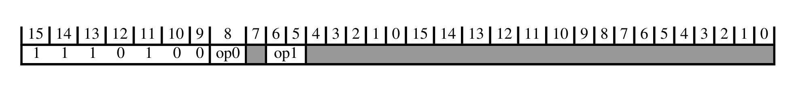

下表给出解码字段取值与所关联的子分组：

| op0 | op1 | 子分组 |
| --- | --- | --- |
| - | 0x | 加载/存储多寄存器 |
| 0 | 10 | 加载/存储独占、加载-获取/存储-释放 |
| 0 | 11 | 加载/存储双字（后索引） |
| 1 | 10 | 加载/存储双字（字面值与立即数） |
| 1 | 11 | 加载/存储双字（前索引）、安全网关 |

#### 1.2.1. 加载/存储多寄存器

本节描述**加载/存储多寄存器**的编码方式。本节由**加载/存储（多寄存器、双字、独占、获取-释放）**解码。

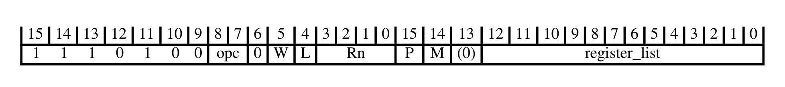

下表给出解码字段取值与所关联的指令：

| L | Rn | opc | 指令 |
| --- | --- | --- | --- |
| 0 | - | 01 | STM, STMIA, STMEA T2 |
| 1 | != 1111 | 01 | LDM, LDMIA, LDMFD T2 |
| 1 | 1111 | 01 | CLRM T1 |
| 0 | - | 10 | STMDB, STMFD T1 |
| 1 | - | 10 | LDMDB, LDMEA T1 |
| Alias |  |  | PUSH (multiple registers) T1 |
| Alias |  |  | POP (multiple registers) T2 |

#### 1.2.2. 加载/存储独占、加载-获取/存储-释放

本节描述**加载/存储独占、加载-获取/存储-释放**的编码方式。本节由**加载/存储（多寄存器、双字、独占、获取-释放）**解码。

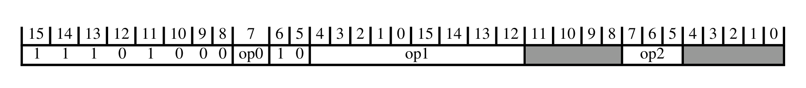

下表给出解码字段取值与所关联的子分组：

| op0 | op1 | op2 | 子分组 |
| --- | --- | --- | --- |
| 0 | != 0xxxx1111 | - | 加载/存储独占 |
| 1 | - | 01x | 加载/存储独占字节/半字/双字 |
| 1 | - | 1xx | 加载-获取 / 存储-释放 |

下表给出解码字段取值与所关联的指令：

| op0 | op1 | op2 | 指令 |
| --- | --- | --- | --- |
| 0 | 0xxxx1111 | - | TT, TTT, TTA, TTAT T1 |
| 1 | 1xxxxxxxx | 000 | TBB, TBH T1 |

##### 1.2.2.1. 加载/存储独占

本节描述**加载/存储独占**的编码方式。本节由**加载/存储独占、加载-获取/存储-释放**解码。

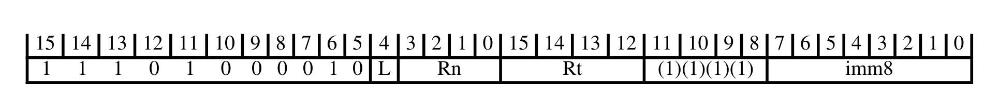

下表给出解码字段取值与所关联的指令：

| L | 指令 |
| --- | --- |
| 0 | STREX T1 |
| 1 | LDREX T1 |

##### 1.2.2.2. 加载/存储独占字节/半字/双字

本节描述**加载/存储独占字节/半字/双字**的编码方式。本节由**加载/存储独占、加载-获取/存储-释放**解码。

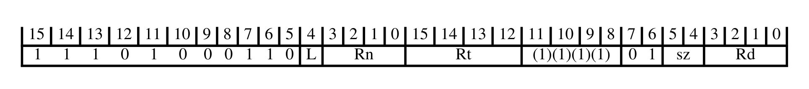

下表给出解码字段取值与所关联的指令：

| L | sz | 指令 |
| --- | --- | --- |
| 0 | 00 | STREXB T1 |
| 0 | 01 | STREXH T1 |
| 1 | 00 | LDREXB T1 |
| 1 | 01 | LDREXH T1 |

##### 1.2.2.3. 加载-获取 / 存储-释放

本节描述**加载-获取 / 存储-释放**的编码方式。本节由**加载/存储独占、加载-获取/存储-释放**解码。

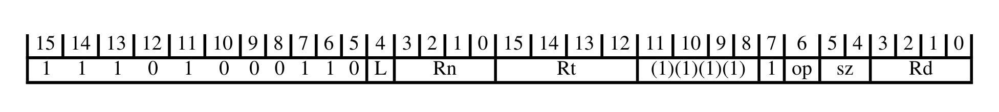

下表给出解码字段取值与所关联的指令：

| L | op | sz | 指令 |
| --- | --- | --- | --- |
| 0 | 0 | 00 | STLB T1 |
| 0 | 0 | 01 | STLH T1 |
| 0 | 0 | 10 | STL T1 |
| 0 | 1 | 00 | STLEXB T1 |
| 0 | 1 | 01 | STLEXH T1 |
| 0 | 1 | 10 | STLEX T1 |
| 1 | 0 | 00 | LDAB T1 |
| 1 | 0 | 01 | LDAH T1 |
| 1 | 0 | 10 | LDA T1 |
| 1 | 1 | 00 | LDAEXB T1 |
| 1 | 1 | 01 | LDAEXH T1 |
| 1 | 1 | 10 | LDAEX T1 |

#### 1.2.3. 加载/存储双字（后索引）

本节描述**加载/存储双字（后索引）**的编码方式。本节由**加载/存储（多寄存器、双字、独占、获取-释放）**解码。

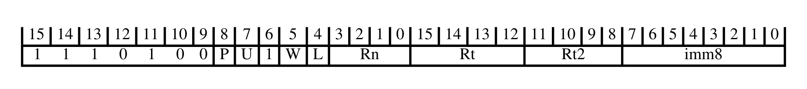

下表给出解码字段取值与所关联的指令：

| L | Rn | 指令 |
| --- | --- | --- |
| 0 | != 1111 | STRD (immediate) T1 |
| 1 | != 1111 | LDRD (immediate) T1 |
| - | 1111 | UNPREDICTABLE |

#### 1.2.4. 加载/存储双字（字面值与立即数）

本节描述**加载/存储双字（字面值与立即数）**的编码方式。本节由**加载/存储（多寄存器、双字、独占、获取-释放）**解码。

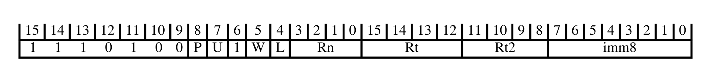

下表给出解码字段取值与所关联的指令：

| L | Rn | 指令 |
| --- | --- | --- |
| 1 | 1111 | LDRD (literal) T1 |
| 0 | != 1111 | STRD (immediate) T1 |
| 1 | != 1111 | LDRD (immediate) T1 |

#### 1.2.5. 加载/存储双字（前索引）、安全网关

本节描述**加载/存储双字（前索引）、安全网关**的编码方式。本节由**加载/存储（多寄存器、双字、独占、获取-释放）**解码。

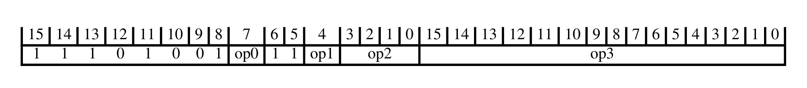

下表给出解码字段取值与所关联的指令：

| op0 | op1 | op2 | op3 | 指令 |
| --- | --- | --- | --- | --- |
| 0 | 0 | 1111 | - | UNPREDICTABLE |
| 0 | 1 | 1111 | != 1110100101111111 | UNPREDICTABLE |
| 0 | 1 | 1111 | 1110100101111111 | SG T1 |
| - | 0 | != 1111 | - | STRD (immediate) T1 |
| 1 | - | 1111 | - | UNPREDICTABLE |
| - | 1 | != 1111 | - | LDRD (immediate) T1 |

### 1.3. 数据处理（移位寄存器）

本节描述**数据处理（移位寄存器）**的编码方式。本节由 **32 位 T32 指令编码**解码。

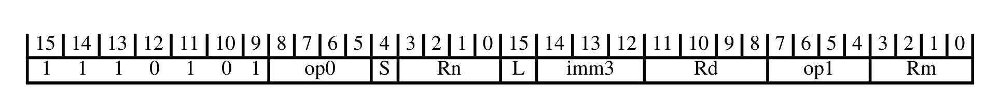

下表给出解码字段取值与所关联的子分组：

| op0 | 子分组 |
| --- | --- |
| 0010 | 宽移位、移位与条件指令 |
| != 0010 | 移位寄存器指令 |

#### 1.3.1. 宽移位、移位与条件指令

本节描述**宽移位、移位与条件指令**的编码方式。本节由**数据处理（移位寄存器）**解码。

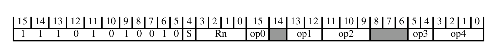

下表给出解码字段取值与所关联的指令：

| Rn | S | op0 | op1 | op2 | op3 | op4 | 指令 |
| --- | --- | --- | --- | --- | --- | --- | --- |
| xxx0 | 1 | 0 | - | != 111 | 10 | 1111 | ASRL (immediate) T1 |
| xxx0 | 1 | 0 | - | != 111 | 00 | 1111 | LSLL (immediate) T1 |
| xxx0 | 1 | 0 | - | != 111 | 01 | 1111 | LSRL (immediate) T1 |
| - | 1 | 0 | - | != 111 | 11 | 1111 | SQSHLL (immediate) T1 |
| xxx1 | 1 | 0 | - | != 111 | 10 | 1111 | SRSHRL (immediate) T1 |
| xxx1 | 1 | 0 | - | != 111 | 00 | 1111 | UQSHLL (immediate) T1 |
| xxx1 | 1 | 0 | - | != 111 | 01 | 1111 | URSHRL (immediate) T1 |
| - | 1 | 0 | - | 111 | 11 | 1111 | SQSHL (immediate) T1 |
| - | 1 | 0 | - | 111 | 10 | 1111 | SRSHR (immediate) T1 |
| - | 1 | 0 | - | 111 | 00 | 1111 | UQSHL (immediate) T1 |
| - | 1 | 0 | - | 111 | 01 | 1111 | URSHR (immediate) T1 |
| xxx0 | 1 | - | - | != 111 | 10 | 1101 | ASRL (register) T1 |
| xxx0 | 1 | - | - | != 111 | 00 | 1101 | LSLL (register) T1 |
| - | 1 | - | - | 111 | 10 | 1101 | SQRSHR (register) T1 |
| xxx1 | 1 | - | - | != 111 | 10 | 1101 | SQRSHRL (register) T1 |
| - | 1 | - | - | 111 | 00 | 1101 | UQRSHL (register) T1 |
| xxx1 | 1 | - | - | != 111 | 00 | 1101 | UQRSHLL (register) T1 |
| != 1111 | 0 | 0 | - | - | - | - | ORR (register) T2 |
| != 1111 | 1 | 0 | - | - | - | != 11x1 | ORRS (register) T2 |
| 1111 | 0 | 0 | - | - | - | - | MOV (register) T3 |
| 1111 | 1 | 0 | - | - | - | != 11x1 | MOVS (register) T3 |
| Alias |  |  |  |  |  |  | ASR (immediate) T3 |
| Alias |  |  |  |  |  |  | ASRS (immediate) T3 |
| Alias |  |  |  |  |  |  | LSL (immediate) T3 |
| Alias |  |  |  |  |  |  | LSLS (immediate) T3 |
| Alias |  |  |  |  |  |  | LSR (immediate) T3 |
| Alias |  |  |  |  |  |  | LSRS (immediate) T3 |
| Alias |  |  |  |  |  |  | ROR (immediate) T3 |
| Alias |  |  |  |  |  |  | RORS (immediate) T3 |
| Alias |  |  |  |  |  |  | RRX T3 |
| Alias |  |  |  |  |  |  | RRXS T3 |
| - | 1 | 1 | 00 | - | - | != 1101 | CSEL T1 |
| - | 1 | 1 | 01 | - | - | != 1101 | CSINC T1 |
| - | 1 | 1 | 10 | - | - | != 1101 | CSINV T1 |
| - | 1 | 1 | 11 | - | - | != 1101 | CSNEG T1 |
| Alias |  |  |  |  |  |  | CINC T1 |
| Alias |  |  |  |  |  |  | CINV T1 |
| Alias |  |  |  |  |  |  | CNEG T1 |
| Alias |  |  |  |  |  |  | CSET T1 |
| Alias |  |  |  |  |  |  | CSETM T1 |

#### 1.3.2. 移位寄存器指令

本节描述**移位寄存器指令**的编码方式。本节由**数据处理（移位寄存器）**解码。

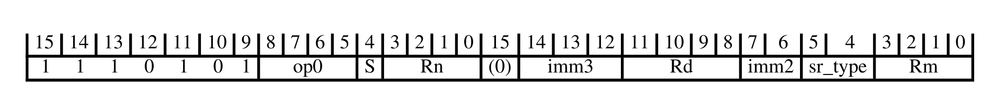

下表给出解码字段取值与所关联的指令：

| Rd | Rn | S | imm3:imm2:sr_type | op0 | 指令 |
| --- | --- | --- | --- | --- | --- |
| - | - | 0 | != 0000011 | 0000 | AND (register) T2 |
| - | - | 0 | 0000011 | 0000 | AND extend (register) T2 |
| != 1111 | - | 1 | != 0000011 | 0000 | ANDS (register) T2 |
| != 1111 | - | 1 | 0000011 | 0000 | ANDS extend (register) T2 |
| 1111 | - | 1 | != 0000011 | 0000 | TST (register) T2 |
| 1111 | - | 1 | 0000011 | 0000 | TST extend (register) T2 |
| - | - | - | - | 0001 | BIC (register) T2 |
| - | != 1111 | 0 | - | 0011 | ORN (register) T1 |
| - | != 1111 | 1 | - | 0011 | ORNS (register) T1 |
| - | 1111 | 0 | - | 0011 | MVN (register) T2 |
| - | 1111 | 1 | - | 0011 | MVNS (register) T2 |
| - | - | 0 | != 0000011 | 0100 | EOR (register) T2 |
| - | - | 0 | 0000011 | 0100 | EOR extend (register) T2 |
| != 1111 | - | 1 | != 0000011 | 0100 | EORS (register) T2 |
| != 1111 | - | 1 | 0000011 | 0100 | EORS extend (register) T2 |
| 1111 | - | 1 | != 0000011 | 0100 | TEQ (register) T1 |
| 1111 | - | 1 | 0000011 | 0100 | TEQ extend (register) T1 |
| - | - | 0 | xxxxxx0 | 0110 | PKHBT, PKHTB T1 |
| - | != 1101 | 0 | - | 1000 | ADD (register) T3 |
| != 1111 | != 1101 | 1 | - | 1000 | ADDS (register) T3 |
| - | 1101 | 0 | - | 1000 | ADD (SP plus register) T3 |
| != 1111 | 1101 | 1 | - | 1000 | ADDS (SP plus register) T3 |
| 1111 | - | 1 | - | 1000 | CMN (register) T2 |
| - | - | - | - | 1010 | ADC (register) T2 |
| - | - | - | - | 1011 | SBC (register) T2 |
| - | != 1101 | 0 | - | 1101 | SUB (register) T2 |
| != 1111 | != 1101 | 1 | - | 1101 | SUBS (register) T2 |
| - | 1101 | 0 | - | 1101 | SUB (SP minus register) T1 |
| != 1111 | 1101 | 1 | - | 1101 | SUBS (SP minus register) T1 |
| 1111 | - | 1 | - | 1101 | CMP (register) T3 |
| - | - | - | - | 1110 | RSB (register) T1 |

### 1.4. 分支与杂项控制

本节描述**分支与杂项控制**的编码方式。本节由 **32 位 T32 指令编码**解码。

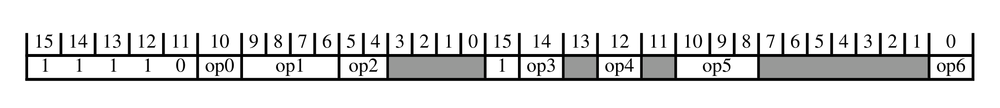

下表给出解码字段取值与所关联的子分组：

| op0 | op1 | op2 | op3 | op4 | op5 | op6 | 子分组 |
| --- | --- | --- | --- | --- | --- | --- | --- |
| 0 | 1110 | 10 | 0 | 0 | 000 | - | 提示 |
| 0 | 1110 | 11 | 0 | 0 | - | - | 杂项系统 |
| 1 | 1111 | 1x | 0 | 0 | - | - | 异常生成 |
| - | - | - | 1 | 0 | - | 1 | 循环与分支指令 |

下表给出解码字段取值与所关联的指令：

| op0 | op1 | op2 | op3 | op4 | op5 | op6 | 指令 |
| --- | --- | --- | --- | --- | --- | --- | --- |
| 0 | 1110 | 0x | 0 | 0 | - | - | MSR (register) T1 |
| 0 | 1111 | 1x | 0 | 0 | - | - | MRS T1 |
| - | != 111x | - | 0 | 0 | - | - | B T3 |
| - | - | - | 0 | 1 | - | - | B T4 |
| - | - | - | 1 | 1 | - | - | BL T1 |

#### 1.4.1. 提示

本节描述**提示**的编码方式。本节由**分支与杂项控制**解码。

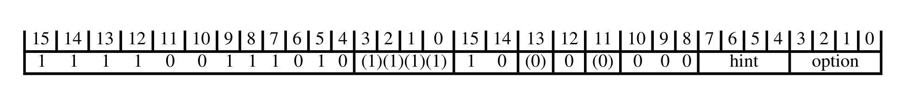

下表给出解码字段取值与所关联的指令：

| hint | option | 指令 |
| --- | --- | --- |
| 0000 | 0000 | NOP T2 |
| 0000 | 0001 | YIELD T2 |
| 0000 | 0010 | WFE T2 |
| 0000 | 0011 | WFI T2 |
| 0000 | 0100 | SEV T2 |
| 0000 | 0101 | 保留提示（若实现了 Main 扩展则表现为 NOP，否则为 UNDEFINED） |
| 0000 | 011x | 保留提示（若实现了 Main 扩展则表现为 NOP，否则为 UNDEFINED） |
| 0000 | 10xx | 保留提示（若实现了 Main 扩展则表现为 NOP，否则为 UNDEFINED） |
| 0000 | 11x0 | 保留提示（若实现了 Main 扩展则表现为 NOP，否则为 UNDEFINED） |
| 0000 | 1101 | PACBTI T1 |
| 0000 | 1111 | BTI T1 |
| 0001 | 0000 | ESB T1 |
| 0001 | 001x | 保留提示（若实现了 Main 扩展则表现为 NOP，否则为 UNDEFINED） |
| 0001 | 0100 | CSDB T1 |
| 0001 | 0x01 | 保留提示（若实现了 Main 扩展则表现为 NOP，否则为 UNDEFINED） |
| 0001 | 011x | 保留提示（若实现了 Main 扩展则表现为 NOP，否则为 UNDEFINED） |
| 0001 | 10xx | 保留提示（若实现了 Main 扩展则表现为 NOP，否则为 UNDEFINED） |
| 0001 | 11x0 | 保留提示（若实现了 Main 扩展则表现为 NOP，否则为 UNDEFINED） |
| 0001 | 1101 | PAC T1 |
| 0001 | 1111 | 保留提示（若实现了 Main 扩展则表现为 NOP，否则为 UNDEFINED） |
| 0010 | 0xxx | 保留提示（若实现了 Main 扩展则表现为 NOP，否则为 UNDEFINED） |
| 0010 | 10xx | 保留提示（若实现了 Main 扩展则表现为 NOP，否则为 UNDEFINED） |
| 0010 | 11x0 | 保留提示（若实现了 Main 扩展则表现为 NOP，否则为 UNDEFINED） |
| 0010 | 1101 | AUT T1 |
| 0010 | 1111 | 保留提示（若实现了 Main 扩展则表现为 NOP，否则为 UNDEFINED） |
| 0011 | - | 保留提示（若实现了 Main 扩展则表现为 NOP，否则为 UNDEFINED） |
| 01xx | - | 保留提示（若实现了 Main 扩展则表现为 NOP，否则为 UNDEFINED） |
| 10xx | - | 保留提示（若实现了 Main 扩展则表现为 NOP，否则为 UNDEFINED） |
| 110x | - | 保留提示（若实现了 Main 扩展则表现为 NOP，否则为 UNDEFINED） |
| 1110 | - | 保留提示（若实现了 Main 扩展则表现为 NOP，否则为 UNDEFINED） |
| 1111 | - | DBG T1 |

#### 1.4.2. 杂项系统

本节描述**杂项系统**的编码方式。本节由**分支与杂项控制**解码。

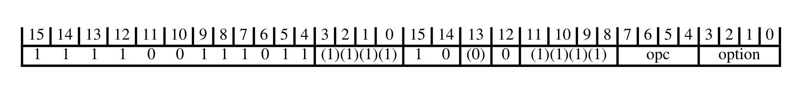

下表给出解码字段取值与所关联的指令：

| opc | option | 指令 |
| --- | --- | --- |
| 0010 | - | CLREX T1 |
| 0100 | != 0x00 | DSB T1 |
| 0100 | 0000 | SSBB T1 |
| 0100 | 0100 | PSSBB T1 |
| 0101 | - | DMB T1 |
| 0110 | - | ISB T1 |

#### 1.4.3. 异常生成

本节描述**异常生成**的编码方式。本节由**分支与杂项控制**解码。

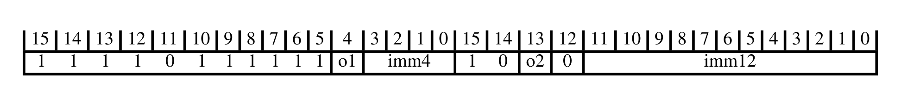

下表给出解码字段取值与所关联的指令：

| o1 | o2 | 指令 |
| --- | --- | --- |
| 1 | 1 | UDF T2 |

#### 1.4.4. 循环与分支指令

本节描述**循环与分支指令**的编码方式。本节由**分支与杂项控制**解码。

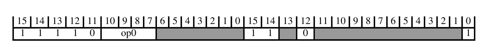

下表给出解码字段取值与所关联的子分组：

| op0 | 子分组 |
| --- | --- |
| != 0000 | 分支未来指令 |
| 0000 | 循环指令 |

##### 1.4.4.1. 分支未来指令

本节描述**分支未来指令**的编码方式。本节由**循环与分支指令**解码。

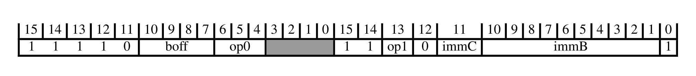

下表给出解码字段取值与所关联的指令：

| op0 | op1 | 指令 |
| --- | --- | --- |
| - | 0 | BF, BFX, BFL, BFLX, BFCSEL T4 |
| 0xx | 1 | BF, BFX, BFL, BFLX, BFCSEL T2 |
| 10x | 1 | BF, BFX, BFL, BFLX, BFCSEL T1 |
| 110 | 1 | BF, BFX, BFL, BFLX, BFCSEL T3 |
| 111 | 1 | BF, BFX, BFL, BFLX, BFCSEL T5 |

##### 1.4.4.2. 循环指令

本节描述**循环指令**的编码方式。本节由**循环与分支指令**解码。

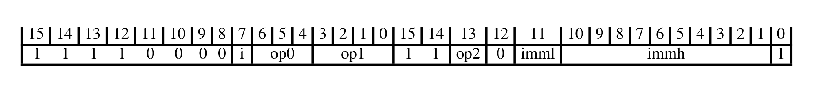

下表给出解码字段取值与所关联的指令：

| imml | op0 | op1 | op2 | 指令 |
| --- | --- | --- | --- | --- |
| - | 0xx | 1111 | 1 | LCTP T1 |
| - | 000 | 1111 | 0 | LE, LETP T1 |
| - | 01x | 1111 | 0 | LE, LETP T2 |
| - | 001 | 1111 | 0 | LE, LETP T3 |
| - | 1xx | - | 0 | WLS, DLS, WLSTP, DLSTP T1 |
| - | 1xx | - | 1 | WLS, DLS, WLSTP, DLSTP T2 |
| - | 0xx | != 1111 | 0 | WLS, DLS, WLSTP, DLSTP T3 |
| 0 | 0xx | != 1111 | 1 | WLS, DLS, WLSTP, DLSTP T4 |
| 1 | 0xx | != 1111 | 1 | VCTP T1 |

### 1.5. 数据处理（修改立即数）

本节描述**数据处理（修改立即数）**的编码方式。本节由 **32 位 T32 指令编码**解码。

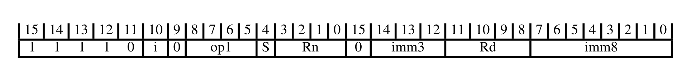

下表给出解码字段取值与所关联的指令：

| Rd | Rn | S | op1 | 指令 |
| --- | --- | --- | --- | --- |
| - | - | 0 | 0000 | AND (immediate) T1 |
| != 1111 | - | 1 | 0000 | ANDS (immediate) T1 |
| 1111 | - | 1 | 0000 | TST (immediate) T1 |
| - | - | - | 0001 | BIC (immediate) T1 |
| - | != 1111 | - | 0010 | ORR (immediate) T1 |
| - | 1111 | - | 0010 | MOV (immediate) T2 |
| - | != 1111 | - | 0011 | ORN (immediate) T1 |
| - | 1111 | - | 0011 | MVN (immediate) T1 |
| - | - | 0 | 0100 | EOR (immediate) T1 |
| != 1111 | - | 1 | 0100 | EORS (immediate) T1 |
| 1111 | - | 1 | 0100 | TEQ (immediate) T1 |
| - | != 1101 | 0 | 1000 | ADD (immediate) T3 |
| != 1111 | != 1101 | 1 | 1000 | ADDS (immediate) T3 |
| - | 1101 | 0 | 1000 | ADD (SP plus immediate) T3 |
| != 1111 | 1101 | 1 | 1000 | ADDS (SP plus immediate) T3 |
| 1111 | - | 1 | 1000 | CMN (immediate) T1 |
| - | - | - | 1010 | ADC (immediate) T1 |
| - | - | - | 1011 | SBC (immediate) T1 |
| - | != 1101 | 0 | 1101 | SUB (immediate) T3 |
| != 1111 | != 1101 | 1 | 1101 | SUBS (immediate) T3 |
| - | 1101 | 0 | 1101 | SUB (SP minus immediate) T2 |
| != 1111 | 1101 | 1 | 1101 | SUBS (SP minus immediate) T2 |
| 1111 | - | 1 | 1101 | CMP (immediate) T2 |
| - | - | - | 1110 | RSB (immediate) T2 |

### 1.6. 数据处理（纯二进制立即数）

本节描述**数据处理（纯二进制立即数）**的编码方式。本节由 **32 位 T32 指令编码**解码。

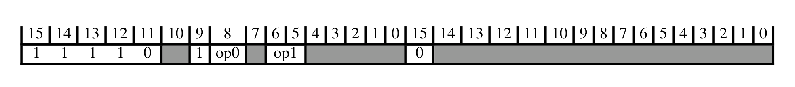

下表给出解码字段取值与所关联的子分组：

| op0 | op1 | 子分组 |
| --- | --- | --- |
| 0 | 0x | 数据处理（简单立即数） |
| 0 | 10 | 宽移动（16 位立即数） |
| 1 | - | 饱和、位域 |

#### 1.6.1. 数据处理（简单立即数）

本节描述**数据处理（简单立即数）**的编码方式。本节由**数据处理（纯二进制立即数）**解码。

下表给出解码字段取值与所关联的指令：

| Rn | o1 | o2 | 指令 |
| --- | --- | --- | --- |
| Alias |  |  | ADD (immediate, to PC) T3 |
| != 11x1 | 0 | 0 | ADD (immediate) T4 |
| 1101 | 0 | 0 | ADD (SP plus immediate) T4 |
| 1111 | 0 | 0 | ADR T3 |
| != 11x1 | 1 | 1 | SUB (immediate) T4 |
| 1101 | 1 | 1 | SUB (SP minus immediate) T3 |
| 1111 | 1 | 1 | ADR T2 |
| Alias |  |  | SUB (immediate, from PC) T2 |

#### 1.6.2. 宽移动（16 位立即数）

本节描述**宽移动（16 位立即数）**的编码方式。本节由**数据处理（纯二进制立即数）**解码。

下表给出解码字段取值与所关联的指令：

| o1 | 指令 |
| --- | --- |
| 0 | MOV (immediate) T3 |
| 1 | MOVT T1 |

#### 1.6.3. 饱和、位域

本节描述**饱和、位域**的编码方式。本节由**数据处理（纯二进制立即数）**解码。

下表给出解码字段取值与所关联的指令：

| Rn | imm3:imm2 | op1 | 指令 |
| --- | --- | --- | --- |
| - | - | 000 | SSAT LSL T1 |
| - | != 00000 | 001 | SSAT ASR T1 |
| - | 00000 | 001 | SSAT16 T1 |
| - | - | 010 | SBFX T1 |
| != 1111 | - | 011 | BFI T1 |
| 1111 | - | 011 | BFC T1 |
| - | - | 100 | USAT LSL T1 |
| - | != 00000 | 101 | USAT ASR T1 |
| - | 00000 | 101 | USAT16 T1 |
| - | - | 110 | UBFX T1 |

### 1.7. 加载/存储单个

本节描述**加载/存储单个**的编码方式。本节由 **32 位 T32 指令编码**解码。

下表给出解码字段取值与所关联的子分组：

| op0 | op1 | op2 | op3 | 子分组 |
| --- | --- | --- | --- | --- |
| 00 | - | != 1111 | 000000 | 加载/存储，无符号（寄存器偏移） |
| 00 | - | != 1111 | 10xxxx | 加载/存储，无符号（立即数，后索引） |
| 00 | - | != 1111 | 1100xx | 加载/存储，无符号（负立即数） |
| 00 | - | != 1111 | 1110xx | 加载/存储，无符号（非特权） |
| 00 | - | != 1111 | 11x1xx | 加载/存储，无符号（立即数，前索引） |
| 01 | - | != 1111 | - | 加载/存储，无符号（正立即数） |
| 0x | - | 1111 | - | 加载，无符号（字面值） |
| 10 | 1 | != 1111 | 000000 | 加载/存储，有符号（寄存器偏移） |
| 10 | 1 | != 1111 | 10xxxx | 加载/存储，有符号（立即数，后索引） |
| 10 | 1 | != 1111 | 1100xx | 加载/存储，有符号（负立即数） |
| 10 | 1 | != 1111 | 1110xx | 加载/存储，有符号（非特权） |
| 10 | 1 | != 1111 | 11x1xx | 加载/存储，有符号（立即数，前索引） |
| 11 | 1 | != 1111 | - | 加载/存储，有符号（正立即数） |
| 1x | 1 | 1111 | - | 加载，有符号（字面值） |

#### 1.7.1. 加载/存储，无符号（寄存器偏移）

本节描述**加载/存储，无符号（寄存器偏移）**的编码方式。本节由**加载/存储单个**解码。

下表给出解码字段取值与所关联的指令：

| L | Rt | size | 指令 |
| --- | --- | --- | --- |
| 0 | - | 00 | STRB (register) T2 |
| 1 | != 1111 | 00 | LDRB (register) T2 |
| 1 | 1111 | 0x | PLD, PLDW (register) T1 |
| 0 | - | 01 | STRH (register) T2 |
| 1 | != 1111 | 01 | LDRH (register) T2 |
| 0 | - | 10 | STR (register) T2 |
| 1 | - | 10 | LDR (register) T2 |

#### 1.7.2. 加载/存储，无符号（立即数，后索引）

本节描述**加载/存储，无符号（立即数，后索引）**的编码方式。本节由**加载/存储单个**解码。

下表给出解码字段取值与所关联的指令：

| L | size | 指令 |
| --- | --- | --- |
| 0 | 00 | STRB (immediate) T3 |
| 1 | 00 | LDRB (immediate) T3 |
| 0 | 01 | STRH (immediate) T3 |
| 1 | 01 | LDRH (immediate) T3 |
| 0 | 10 | STR (immediate) T4 |
| Alias |  | PUSH (single register) T4 |
| 1 | 10 | LDR (immediate) T4 |
| Alias |  | POP (single register) T4 |

#### 1.7.3. 加载/存储，无符号（负立即数）

本节描述**加载/存储，无符号（负立即数）**的编码方式。本节由**加载/存储单个**解码。

下表给出解码字段取值与所关联的指令：

| L | Rt | size | 指令 |
| --- | --- | --- | --- |
| 0 | - | 00 | STRB (immediate) T3 |
| 1 | != 1111 | 00 | LDRB (immediate) T3 |
| 1 | 1111 | 0x | PLD, PLDW (immediate) T2 |
| 0 | - | 01 | STRH (immediate) T3 |
| 1 | != 1111 | 01 | LDRH (immediate) T3 |
| 0 | - | 10 | STR (immediate) T4 |
| Alias |  |  | PUSH (single register) T4 |
| 1 | - | 10 | LDR (immediate) T4 |
| Alias |  |  | POP (single register) T4 |

#### 1.7.4. 加载/存储，无符号（非特权）

本节描述**加载/存储，无符号（非特权）**的编码方式。本节由**加载/存储单个**解码。

下表给出解码字段取值与所关联的指令：

| L | size | 指令 |
| --- | --- | --- |
| 0 | 00 | STRBT T1 |
| 1 | 00 | LDRBT T1 |
| 0 | 01 | STRHT T1 |
| 1 | 01 | LDRHT T1 |
| 0 | 10 | STRT T1 |
| 1 | 10 | LDRT T1 |

#### 1.7.5. 加载/存储，无符号（立即数，前索引）

本节描述**加载/存储，无符号（立即数，前索引）**的编码方式。本节由**加载/存储单个**解码。

下表给出解码字段取值与所关联的指令：

| L | size | 指令 |
| --- | --- | --- |
| 0 | 00 | STRB (immediate) T3 |
| 1 | 00 | LDRB (immediate) T3 |
| 0 | 01 | STRH (immediate) T3 |
| 1 | 01 | LDRH (immediate) T3 |
| 0 | 10 | STR (immediate) T4 |
| Alias |  | PUSH (single register) T4 |
| 1 | 10 | LDR (immediate) T4 |
| Alias |  | POP (single register) T4 |

#### 1.7.6. 加载/存储，无符号（正立即数）

本节描述**加载/存储，无符号（正立即数）**的编码方式。本节由**加载/存储单个**解码。

下表给出解码字段取值与所关联的指令：

| L | Rt | size | 指令 |
| --- | --- | --- | --- |
| 0 | - | 00 | STRB (immediate) T2 |
| 1 | != 1111 | 00 | LDRB (immediate) T2 |
| 1 | 1111 | 0x | PLD, PLDW (immediate) T1 |
| 0 | - | 01 | STRH (immediate) T2 |
| 1 | != 1111 | 01 | LDRH (immediate) T2 |
| 0 | - | 10 | STR (immediate) T3 |
| 1 | - | 10 | LDR (immediate) T3 |

#### 1.7.7. 加载，无符号（字面值）

本节描述**加载，无符号（字面值）**的编码方式。本节由**加载/存储单个**解码。

下表给出解码字段取值与所关联的指令：

| L | Rt | size | 指令 |
| --- | --- | --- | --- |
| 1 | != 1111 | 00 | LDRB (literal) T1 |
| 1 | 1111 | 0x | PLD (literal) T1 |
| 1 | != 1111 | 01 | LDRH (literal) T1 |
| 1 | - | 10 | LDR (literal) T2 |

#### 1.7.8. 加载/存储，有符号（寄存器偏移）

本节描述**加载/存储，有符号（寄存器偏移）**的编码方式。本节由**加载/存储单个**解码。

下表给出解码字段取值与所关联的指令：

| Rt | size | 指令 |
| --- | --- | --- |
| != 1111 | 00 | LDRSB (register) T2 |
| 1111 | 00 | PLI (register) T1 |
| != 1111 | 01 | LDRSH (register) T2 |
| 1111 | 01 | 保留提示（若实现了 Main 扩展则表现为 NOP，否则为 UNDEFINED） |

#### 1.7.9. 加载/存储，有符号（立即数，后索引）

本节描述**加载/存储，有符号（立即数，后索引）**的编码方式。本节由**加载/存储单个**解码。

下表给出解码字段取值与所关联的指令：

| size | 指令 |
| --- | --- |
| 00 | LDRSB (immediate) T2 |
| 01 | LDRSH (immediate) T2 |

#### 1.7.10. 加载/存储，有符号（负立即数）

本节描述**加载/存储，有符号（负立即数）**的编码方式。本节由**加载/存储单个**解码。

下表给出解码字段取值与所关联的指令：

| Rt | size | 指令 |
| --- | --- | --- |
| != 1111 | 00 | LDRSB (immediate) T2 |
| 1111 | 00 | PLI (immediate, literal) T2 |
| != 1111 | 01 | LDRSH (immediate) T2 |
| 1111 | 01 | 保留提示（若实现了 Main 扩展则表现为 NOP，否则为 UNDEFINED） |

#### 1.7.11. 加载/存储，有符号（非特权）

本节描述**加载/存储，有符号（非特权）**的编码方式。本节由**加载/存储单个**解码。

下表给出解码字段取值与所关联的指令：

| size | 指令 |
| --- | --- |
| 00 | LDRSBT T1 |
| 01 | LDRSHT T1 |

#### 1.7.12. 加载/存储，有符号（立即数，前索引）

本节描述**加载/存储，有符号（立即数，前索引）**的编码方式。本节由**加载/存储单个**解码。

下表给出解码字段取值与所关联的指令：

| size | 指令 |
| --- | --- |
| 00 | LDRSB (immediate) T2 |
| 01 | LDRSH (immediate) T2 |

#### 1.7.13. 加载/存储，有符号（正立即数）

本节描述**加载/存储，有符号（正立即数）**的编码方式。本节由**加载/存储单个**解码。

下表给出解码字段取值与所关联的指令：

| Rt | size | 指令 |
| --- | --- | --- |
| != 1111 | 00 | LDRSB (immediate) T1 |
| 1111 | 00 | PLI (immediate, literal) T1 |
| != 1111 | 01 | LDRSH (immediate) T1 |
| 1111 | 01 | 保留提示（若实现了 Main 扩展则表现为 NOP，否则为 UNDEFINED） |

#### 1.7.14. 加载，有符号（字面值）

本节描述**加载，有符号（字面值）**的编码方式。本节由**加载/存储单个**解码。

下表给出解码字段取值与所关联的指令：

| Rt | size | 指令 |
| --- | --- | --- |
| != 1111 | 00 | LDRSB (literal) T1 |
| 1111 | 00 | PLI (immediate, literal) T3 |
| != 1111 | 01 | LDRSH (literal) T1 |
| 1111 | 01 | 保留提示（若实现了 Main 扩展则表现为 NOP，否则为 UNDEFINED） |

### 1.8. 数据处理（寄存器）

本节描述**数据处理（寄存器）**的编码方式。本节由 **32 位 T32 指令编码**解码。

下表给出解码字段取值与所关联的子分组：

| op0 | op1 | 子分组 |
| --- | --- | --- |
| 0 | 1xxx | 寄存器扩展 |
| 1 | 0xxx | 并行加/减 |
| 1 | 10xx | 数据处理（两个源寄存器） |

下表给出解码字段取值与所关联的指令：

| op0 | op1 | 指令 |
| --- | --- | --- |
| Alias |  | ASRS (register) T2 |
| Alias |  | ASR (register) T2 |
| Alias |  | LSLS (register) T2 |
| Alias |  | LSL (register) T2 |
| Alias |  | LSRS (register) T2 |
| Alias |  | LSR (register) T2 |
| 0 | 0000 | MOV, MOVS (register-shifted register) T2 |
| Alias |  | RORS (register) T2 |
| Alias |  | ROR (register) T2 |

#### 1.8.1. 寄存器扩展

本节描述**寄存器扩展**的编码方式。本节由**数据处理（寄存器）**解码。

下表给出解码字段取值与所关联的指令：

| Rn | U | op1 | 指令 |
| --- | --- | --- | --- |
| != 1111 | 0 | 00 | SXTAH T1 |
| 1111 | 0 | 00 | SXTH T2 |
| != 1111 | 1 | 00 | UXTAH T1 |
| 1111 | 1 | 00 | UXTH T2 |
| != 1111 | 0 | 01 | SXTAB16 T1 |
| 1111 | 0 | 01 | SXTB16 T1 |
| != 1111 | 1 | 01 | UXTAB16 T1 |
| 1111 | 1 | 01 | UXTB16 T1 |
| != 1111 | 0 | 10 | SXTAB T1 |
| 1111 | 0 | 10 | SXTB T2 |
| != 1111 | 1 | 10 | UXTAB T1 |
| 1111 | 1 | 10 | UXTB T2 |

#### 1.8.2. 并行加/减

本节描述**并行加/减**的编码方式。本节由**数据处理（寄存器）**解码。

下表给出解码字段取值与所关联的指令：

| H | S | U | op1 | 指令 |
| --- | --- | --- | --- | --- |
| 0 | 0 | 0 | 000 | SADD8 T1 |
| 0 | 1 | 0 | 000 | QADD8 T1 |
| 1 | 0 | 0 | 000 | SHADD8 T1 |
| 0 | 0 | 1 | 000 | UADD8 T1 |
| 0 | 1 | 1 | 000 | UQADD8 T1 |
| 1 | 0 | 1 | 000 | UHADD8 T1 |
| 0 | 0 | 0 | 001 | SADD16 T1 |
| 0 | 1 | 0 | 001 | QADD16 T1 |
| 1 | 0 | 0 | 001 | SHADD16 T1 |
| 0 | 0 | 1 | 001 | UADD16 T1 |
| 0 | 1 | 1 | 001 | UQADD16 T1 |
| 1 | 0 | 1 | 001 | UHADD16 T1 |
| 0 | 0 | 0 | 010 | SASX T1 |
| 0 | 1 | 0 | 010 | QASX T1 |
| 1 | 0 | 0 | 010 | SHASX T1 |
| 0 | 0 | 1 | 010 | UASX T1 |
| 0 | 1 | 1 | 010 | UQASX T1 |
| 1 | 0 | 1 | 010 | UHASX T1 |
| 0 | 0 | 0 | 100 | SSUB8 T1 |
| 0 | 1 | 0 | 100 | QSUB8 T1 |
| 1 | 0 | 0 | 100 | SHSUB8 T1 |
| 0 | 0 | 1 | 100 | USUB8 T1 |
| 0 | 1 | 1 | 100 | UQSUB8 T1 |
| 1 | 0 | 1 | 100 | UHSUB8 T1 |
| 0 | 0 | 0 | 101 | SSUB16 T1 |
| 0 | 1 | 0 | 101 | QSUB16 T1 |
| 1 | 0 | 0 | 101 | SHSUB16 T1 |
| 0 | 0 | 1 | 101 | USUB16 T1 |
| 0 | 1 | 1 | 101 | UQSUB16 T1 |
| 1 | 0 | 1 | 101 | UHSUB16 T1 |
| 0 | 0 | 0 | 110 | SSAX T1 |
| 0 | 1 | 0 | 110 | QSAX T1 |
| 1 | 0 | 0 | 110 | SHSAX T1 |
| 0 | 0 | 1 | 110 | USAX T1 |
| 0 | 1 | 1 | 110 | UQSAX T1 |
| 1 | 0 | 1 | 110 | UHSAX T1 |

#### 1.8.3. 数据处理（两个源寄存器）

本节描述**数据处理（两个源寄存器）**的编码方式。本节由**数据处理（寄存器）**解码。

下表给出解码字段取值与所关联的指令：

| op0 | op1 | 指令 |
| --- | --- | --- |
| 000 | 00 | QADD T1 |
| 000 | 01 | QDADD T1 |
| 000 | 10 | QSUB T1 |
| 000 | 11 | QDSUB T1 |
| 001 | 00 | REV T2 |
| 001 | 01 | REV16 T2 |
| 001 | 10 | RBIT T1 |
| 001 | 11 | REVSH T2 |
| 010 | 00 | SEL T1 |
| 011 | 00 | CLZ T1 |

### 1.9. 乘法、乘加与绝对差

本节描述**乘法、乘加与绝对差**的编码方式。本节由 **32 位 T32 指令编码**解码。

下表给出解码字段取值与所关联的指令：

| Ra | Rd | op1 | op2 | 指令 |
| --- | --- | --- | --- | --- |
| != 1111 | - | 000 | 00 | MLA T1 |
| - | - | 000 | 01 | MLS T1 |
| 1111 | - | 000 | 00 | MUL T2 |
| != 1111 | - | 001 | - | SMLABB, SMLABT, SMLATB, SMLATT T1 |
| 1111 | - | 001 | - | SMULBB, SMULBT, SMULTB, SMULTT T1 |
| != 1111 | - | 010 | 0x | SMLAD, SMLADX T1 |
| 1111 | - | 010 | 0x | SMUAD, SMUADX T1 |
| != 1111 | - | 011 | 0x | SMLAWB, SMLAWT T1 |
| 1111 | - | 011 | 0x | SMULWB, SMULWT T1 |
| != 1111 | - | 100 | 0x | SMLSD, SMLSDX T1 |
| 1111 | - | 100 | 0x | SMUSD, SMUSDX T1 |
| != 1111 | != 1111 | 101 | 0x | SMMLA, SMMLAR T1 |
| != 1111 | 1111 | 101 | 00 | AUTG T1 |
| != 1111 | 1111 | 101 | 01 | BXAUT T1 |
| 1111 | - | 101 | 0x | SMMUL, SMMULR T1 |
| != 1111 | - | 110 | 0x | SMMLS, SMMLSR T1 |
| 1111 | - | 110 | 00 | PACG T1 |
| != 1111 | - | 111 | 00 | USADA8 T1 |
| 1111 | - | 111 | 00 | USAD8 T1 |

### 1.10. 长乘法与除法

本节描述**长乘法与除法**的编码方式。本节由 **32 位 T32 指令编码**解码。

下表给出解码字段取值与所关联的指令：

| op1 | op2 | 指令 |
| --- | --- | --- |
| 000 | 0000 | SMULL T1 |
| 001 | 1111 | SDIV T1 |
| 010 | 0000 | UMULL T1 |
| 011 | 1111 | UDIV T1 |
| 100 | 0000 | SMLAL T1 |
| 100 | 10xx | SMLALBB, SMLALBT, SMLALTB, SMLALTT T1 |
| 100 | 110x | SMLALD, SMLALDX T1 |
| 101 | 110x | SMLSLD, SMLSLDX T1 |
| 110 | 0000 | UMLAL T1 |
| 110 | 0110 | UMAAL T1 |

