本文译自 Part C《Armv8-M 指令》（Armv8-M Instructions） Chapter C2《指令规范》（Instruction Specification，C2.4.1–C2.4.18）。

本页是第 C2 章《指令规范》中 C2.4 按字母顺序排列的指令列表的 A 段（C2.4.1–C2.4.18，印刷 528–564）。每条指令依次给出用途说明、各编码（T1、T2 …）的位域图与汇编语法、解码与操作伪代码、汇编符号说明，以及受限行为和数据独立时序行为。指令助记符、字段名、寄存器名、伪代码与汇编语法保持原样，说明文字译为中文。

## 1. ADC (immediate)：立即数带进位加

带进位加（立即数）。ADC (immediate) 把一个立即数和进位标志值加到一个寄存器值上，并把结果写入目标寄存器；它可以选择根据结果更新条件标志。

### 1.1 编码 T1

适用于 Armv8-M Main 扩展。

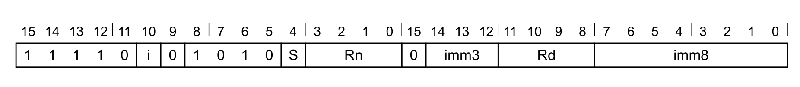

**ADC 变体**（当 `S == 0` 时适用）

```arm
ADC{<c>}{<q>} {<Rd>,} <Rn>, #<const>
```

**ADCS 变体**（当 `S == 1` 时适用）

```arm
ADCS{<c>}{<q>} {<Rd>,} <Rn>, #<const>
```

**解码**

```arm
if !HaveMainExt() then UNDEFINED;
d = UInt(Rd);  n = UInt(Rn);  setflags = (S == '1');  imm32 = T32ExpandImm(i:imm3:imm8);
if d IN {13,15} || n IN {13,15} then UNPREDICTABLE;
```

### 1.2 汇编符号（所有编码）

- **`<c>`**：见 C1.2.5 标准汇编语法字段。
- **`<q>`**：见 C1.2.5 标准汇编语法字段。
- **`<Rd>`**：通用目标寄存器，编码在 `Rd` 字段中。若省略，则该寄存器与 `<Rn>` 相同。
- **`<Rn>`**：通用源寄存器，编码在 `Rn` 字段中。
- **`<const>`**：由编码在 `i:imm3:imm8` 字段中的 12 位立即数导出的立即数。取值范围见 C1.5 修改立即数常量。

### 1.3 操作（所有编码）

```arm
if ConditionPassed() then
  EncodingSpecificOperations();
  (result, carry, overflow) = AddWithCarry(R[n], imm32, APSR.C);
  R[d] = result;
  if setflags then
    APSR.N = result[31];
    APSR.Z = IsZeroBit(result);
    APSR.C = carry;
    APSR.V = overflow;
```

### 1.4 受限行为

无额外限制。

### 1.5 数据独立时序行为

若 `AIRCR.DIT` 为 1：

- 本指令的执行时间与以下各项无关：
  - 其任一寄存器中提供的数据值。
  - N、Z、C、V 标志的值。
- 异步异常的接受时刻不因以下各项而变化：
  - 本指令所使用的任一寄存器中提供的数据值。
  - N、Z、C、V 标志的值。

## 2. ADC (register)：寄存器带进位加

带进位加（寄存器）。ADC (register) 把一个寄存器值、进位标志值以及一个可选移位的寄存器值相加，并把结果写入目标寄存器；它可以选择根据结果更新条件标志。

### 2.1 编码 T1

适用于 Armv8-M。

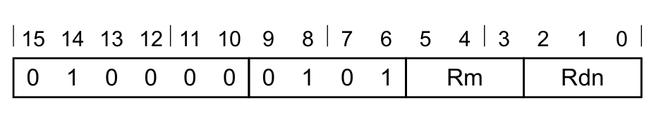

**T1 变体**

```arm
ADC<c>{<q>} {<Rdn>,} <Rdn>, <Rm>
  // IT 块内
ADCS{<q>} {<Rdn>,} <Rdn>, <Rm>
  // IT 块外
```

**解码**

```arm
d = UInt(Rdn);  n = UInt(Rdn);  m = UInt(Rm);  setflags = !InITBlock();
(shift_t, shift_n) = (SRType_LSL, 0);
```

### 2.2 编码 T2

适用于 Armv8-M Main 扩展。

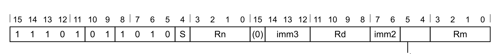

**ADC，带扩展的循环右移变体**（当 `S == 0 && imm3 == 000 && imm2 == 00 && sr_type == 11` 时适用）

```arm
ADC{<c>}{<q>} {<Rd>,} <Rn>, <Rm>, RRX
```

**ADC，按值移位或循环移位变体**（当 `S == 0 && !(imm3 == 000 && imm2 == 00 && sr_type == 11)` 时适用）

```arm
ADC<c>.W {<Rd>,} <Rn>, <Rm>
  // IT 块内，且 <Rd>、<Rn>、<Rm> 可用 T1 表示
ADC{<c>}{<q>} {<Rd>,} <Rn>, <Rm> {, <shift> #<amount>}
```

**ADCS，带扩展的循环右移变体**（当 `S == 1 && imm3 == 000 && imm2 == 00 && sr_type == 11` 时适用）

```arm
ADCS{<c>}{<q>} {<Rd>,} <Rn>, <Rm>, RRX
```

**ADCS，按值移位或循环移位变体**（当 `S == 1 && !(imm3 == 000 && imm2 == 00 && sr_type == 11)` 时适用）

```arm
ADCS.W {<Rd>,} <Rn>, <Rm>
  // IT 块外，且 <Rd>、<Rn>、<Rm> 可用 T1 表示
ADCS{<c>}{<q>} {<Rd>,} <Rn>, <Rm> {, <shift> #<amount>}
```

**解码**

```arm
if !HaveMainExt() then UNDEFINED;
d = UInt(Rd);  n = UInt(Rn);  m = UInt(Rm);  setflags = (S == '1');
(shift_t, shift_n) = DecodeImmShift(sr_type, imm3:imm2);
if d IN {13,15} || n IN {13,15} || m IN {13,15} then UNPREDICTABLE;
```

### 2.3 汇编符号（所有编码）

- **`<c>`**：见 C1.2.5 标准汇编语法字段。
- **`<q>`**：见 C1.2.5 标准汇编语法字段。
- **`<Rdn>`**：第一个通用源寄存器兼目标寄存器，编码在 `Rdn` 字段中。
- **`<Rd>`**：通用目标寄存器，编码在 `Rd` 字段中。若省略，则该寄存器与 `<Rn>` 相同。
- **`<Rn>`**：第一个通用源寄存器，编码在 `Rn` 字段中。
- **`<Rm>`**：第二个通用源寄存器，编码在 `Rm` 字段中。
- **`<shift>`**：施加于第二个源寄存器的移位类型，编码在 `sr_type` 字段中，可取以下值：
  - `LSL`：当 `sr_type = 00` 时。
  - `LSR`：当 `sr_type = 01` 时。
  - `ASR`：当 `sr_type = 10` 时。
  - `ROR`：当 `sr_type = 11` 时。
- **`<amount>`**：移位量，取值 1–31（`<shift>` 为 `LSL` 或 `ROR` 时）或 1–32（`<shift>` 为 `LSR` 或 `ASR` 时），以 `<amount>` 对 32 取模后编码在 `imm3:imm2` 字段中。

### 2.4 操作（所有编码）

```arm
if ConditionPassed() then
  EncodingSpecificOperations();
  shifted = Shift(R[m], shift_t, shift_n, APSR.C);
  (result, carry, overflow) = AddWithCarry(R[n], shifted, APSR.C);
  R[d] = result;
  if setflags then
    APSR.N = result[31];
    APSR.Z = IsZeroBit(result);
    APSR.C = carry;
    APSR.V = overflow;
```

### 2.5 受限行为

无额外限制。

### 2.6 数据独立时序行为

若 `AIRCR.DIT` 为 1：

- 本指令的执行时间与以下各项无关：
  - 其任一寄存器中提供的数据值。
  - N、Z、C、V 标志的值。
- 异步异常的接受时刻不因以下各项而变化：
  - 本指令所使用的任一寄存器中提供的数据值。
  - N、Z、C、V 标志的值。

## 3. ADD (SP plus immediate)：SP 加（立即数）

SP 加（立即数）。ADD (SP plus immediate) 把一个立即数加到 SP 值上，并把结果写入目标寄存器。

本指令受栈限检查（stack limit checking）约束。

### 3.1 编码 T1

适用于 Armv8-M。

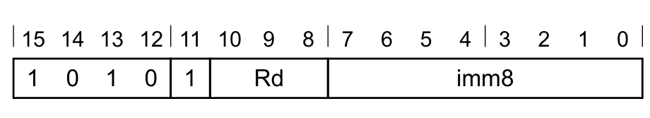

**T1 变体**

```arm
ADD{<c>}{<q>} <Rd>, SP, #<imm8>
```

**解码**

```arm
d = UInt(Rd);  setflags = FALSE;  imm32 = ZeroExtend(imm8:'00', 32);
```

### 3.2 编码 T2

适用于 Armv8-M。

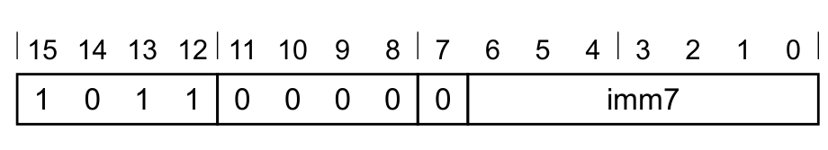

**T2 变体**

```arm
ADD{<c>}{<q>} {SP,} SP, #<imm7>
```

**解码**

```arm
d = 13;  setflags = FALSE;  imm32 = ZeroExtend(imm7:'00', 32);
```

### 3.3 编码 T3

适用于 Armv8-M Main 扩展。


**ADD 变体**（当 `S == 0` 时适用）

```arm
ADD{<c>}.W {<Rd>,} SP, #<const>
  // <Rd>、<const> 可用 T1 或 T2 表示
ADD{<c>}{<q>} {<Rd>,} SP, #<const>
```

**ADDS 变体**（当 `S == 1 && Rd != 1111` 时适用）

```arm
ADDS{<c>}{<q>} {<Rd>,} SP, #<const>
```

**解码**

```arm
if Rd == '1111' && S == '1' then SEE "CMN (immediate)";
if !HaveMainExt() then UNDEFINED;
d = UInt(Rd);  setflags = (S == '1');  imm32 = T32ExpandImm(i:imm3:imm8);
if d == 15 && S == '0' then UNPREDICTABLE;
```

### 3.4 编码 T4

适用于 Armv8-M Main 扩展。

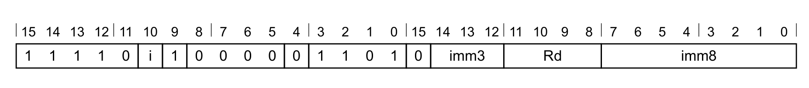

**T4 变体**

```arm
ADD{<c>}{<q>} {<Rd>,} SP, #<imm12>
  // <imm12> 无法用 T1、T2、T3 表示
ADDW{<c>}{<q>} {<Rd>,} SP, #<imm12>
  // <imm12> 可用 T1、T2、T3 表示
```

**解码**

```arm
if !HaveMainExt() then UNDEFINED;
d = UInt(Rd);  setflags = FALSE;  imm32 = ZeroExtend(i:imm3:imm8, 32);
if d == 15 then UNPREDICTABLE;
```

### 3.5 汇编符号（所有编码）

- **`<c>`**：见 C1.2.5 标准汇编语法字段。
- **`<q>`**：见 C1.2.5 标准汇编语法字段。
- **`<imm7>`**：无符号立即数，为 4 的倍数，取值 0–508，以 `<imm7>/4` 编码在 `imm7` 字段中。
- **`<Rd>`**：目标寄存器。编码 T1 中为通用目标寄存器，编码在 `Rd` 字段中；编码 T3、T4 中为通用目标寄存器，编码在 `Rd` 字段中。若省略，则该寄存器为 SP。
- **`<imm8>`**：无符号立即数，为 4 的倍数，取值 0–1020，以 `<imm8>/4` 编码在 `imm8` 字段中。
- **`<imm12>`**：12 位无符号立即数，取值 0–4095，编码在 `i:imm3:imm8` 字段中。
- **`<const>`**：由编码在 `i:imm3:imm8` 字段中的 12 位立即数导出的立即数。取值范围见 C1.5 修改立即数常量。

### 3.6 操作（所有编码）

```arm
if ConditionPassed() then
  EncodingSpecificOperations();
  (result, carry, overflow) = AddWithCarry(SP, imm32, '0');
  RSPCheck[d] = result;
  if setflags then
    APSR.N = result[31];
    APSR.Z = IsZeroBit(result);
    APSR.C = carry;
    APSR.V = overflow;
```

## 4. ADD (SP plus register)：SP 加（寄存器）

SP 加（寄存器）。ADD (SP plus register) 把一个可选移位的寄存器值加到 SP 值上，并把结果写入目标寄存器。

本指令受栈限检查约束。

### 4.1 编码 T1

适用于 Armv8-M。

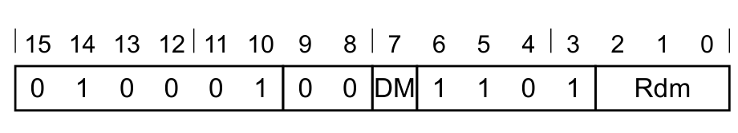

**T1 变体**

```arm
ADD{<c>}{<q>} {<Rdm>,} SP, <Rdm>
```

**解码**

```arm
d = UInt(DM:Rdm);  m = UInt(DM:Rdm);  setflags = FALSE;
if d == 15 && InITBlock() && !LastInITBlock() then UNPREDICTABLE;
(shift_t, shift_n) = (SRType_LSL, 0);
```

### 4.2 编码 T2

适用于 Armv8-M。

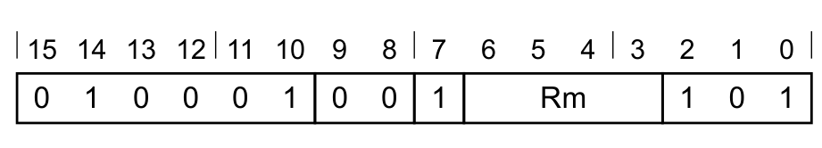

**T2 变体**

```arm
ADD{<c>}{<q>} {SP,} SP, <Rm>
```

**解码**

```arm
if Rm == '1101' then SEE "encoding T1";
m = UInt(Rm);  d = 13;  setflags = FALSE;
(shift_t, shift_n) = (SRType_LSL, 0);
```

### 4.3 编码 T3

适用于 Armv8-M Main 扩展。

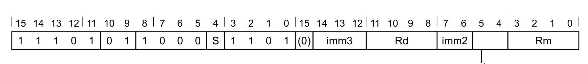

**ADD，带扩展的循环右移变体**（当 `S == 0 && imm3 == 000 && imm2 == 00 && sr_type == 11` 时适用）

```arm
ADD{<c>}{<q>} {<Rd>,} SP, <Rm>, RRX
```

**ADD，按值移位或循环移位变体**（当 `S == 0 && !(imm3 == 000 && imm2 == 00 && sr_type == 11)` 时适用）

```arm
ADD{<c>}.W {<Rd>,} SP, <Rm>
  // <Rd>、<Rm> 可用 T1 或 T2 表示
ADD{<c>}{<q>} {<Rd>,} SP, <Rm> {, <shift> #<amount>}
```

**ADDS，带扩展的循环右移变体**（当 `S == 1 && imm3 == 000 && Rd != 1111 && imm2 == 00 && sr_type == 11` 时适用）

```arm
ADDS{<c>}{<q>} {<Rd>,} SP, <Rm>, RRX
```

**ADDS，按值移位或循环移位变体**（当 `S == 1 && !(imm3 == 000 && imm2 == 00 && sr_type == 11) && Rd != 1111` 时适用）

```arm
ADDS{<c>}{<q>} {<Rd>,} SP, <Rm> {, <shift> #<amount>}
```

**解码**

```arm
if Rd == '1111' && S == '1' then SEE "CMN (register)";
if !HaveMainExt() then UNDEFINED;
d = UInt(Rd);  m = UInt(Rm);  setflags = (S == '1');
(shift_t, shift_n) = DecodeImmShift(sr_type, imm3:imm2);
if d == 13 && (shift_t != SRType_LSL || shift_n > 3) then UNPREDICTABLE;
if (d == 15 && S == '0') || m IN {13,15} then UNPREDICTABLE;
```

### 4.4 汇编符号（所有编码）

- **`<c>`**：见 C1.2.5 标准汇编语法字段。
- **`<q>`**：见 C1.2.5 标准汇编语法字段。
- **`<Rdm>`**：通用目标寄存器兼第二个源寄存器，编码在 `Rdm` 字段中。若省略，则该寄存器为 SP。Arm 不建议把 PC 用作目标寄存器，但若使用 PC，本指令就是对运算所得地址的简单分支。
- **`<Rd>`**：通用目标寄存器，编码在 `Rd` 字段中。若省略，则该寄存器为 SP。
- **`<Rm>`**：第二个通用源寄存器。编码 T2 中编码在 `Rm` 字段中，可使用 PC 但不建议；编码 T3 中编码在 `Rm` 字段中。
- **`<shift>`**：施加于第二个源寄存器的移位类型，编码在 `sr_type` 字段中，可取以下值：
  - `LSL`：当 `sr_type = 00` 时。
  - `LSR`：当 `sr_type = 01` 时。
  - `ASR`：当 `sr_type = 10` 时。
  - `ROR`：当 `sr_type = 11` 时。
- **`<amount>`**：移位量，取值 1–31（`<shift>` 为 `LSL` 或 `ROR` 时）或 1–32（`<shift>` 为 `LSR` 或 `ASR` 时），以 `<amount>` 对 32 取模后编码在 `imm3:imm2` 字段中。

### 4.5 操作（所有编码）

```arm
if ConditionPassed() then
  EncodingSpecificOperations();
  shifted = Shift(R[m], shift_t, shift_n, APSR.C);
  (result, carry, overflow) = AddWithCarry(SP, shifted, '0');
  if d == 15 then
    BranchTo(result);  // 此处 setflags 恒为 FALSE
  else
    RSPCheck[d] = result;
    if setflags then
      APSR.N = result[31];
      APSR.Z = IsZeroBit(result);
      APSR.C = carry;
      APSR.V = overflow;
```

## 5. ADD (immediate)：加（立即数）

加（立即数）。ADD (immediate) 把一个立即数加到一个寄存器值上，并把结果写入目标寄存器；它可以选择根据结果更新条件标志。

### 5.1 编码 T1

适用于 Armv8-M。

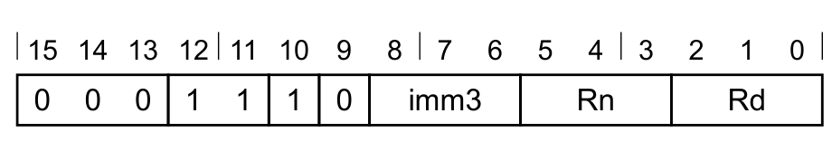

**T1 变体**

```arm
ADD<c>{<q>} <Rd>, <Rn>, #<imm3>
  // IT 块内
ADDS{<q>} <Rd>, <Rn>, #<imm3>
  // IT 块外
```

**解码**

```arm
d = UInt(Rd);  n = UInt(Rn);  setflags = !InITBlock();  imm32 = ZeroExtend(imm3, 32);
```

### 5.2 编码 T2

适用于 Armv8-M。

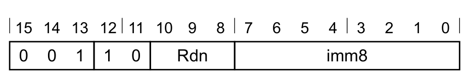

**T2 变体**

```arm
ADD<c>{<q>} <Rdn>, #<imm8>
  // IT 块内，且 <Rdn>、<imm8> 可用 T1 表示
ADD<c>{<q>} {<Rdn>,} <Rdn>, #<imm8>
  // IT 块内，且 <Rdn>、<imm8> 无法用 T1 表示
ADDS{<q>} <Rdn>, #<imm8>
  // IT 块外，且 <Rdn>、<imm8> 可用 T1 表示
ADDS{<q>} {<Rdn>,} <Rdn>, #<imm8>
  // IT 块外，且 <Rdn>、<imm8> 无法用 T1 表示
```

**解码**

```arm
d = UInt(Rdn);  n = UInt(Rdn);  setflags = !InITBlock();  imm32 = ZeroExtend(imm8, 32);
```

### 5.3 编码 T3

适用于 Armv8-M Main 扩展。

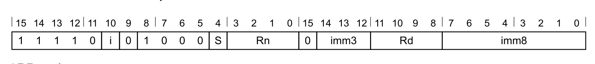

**ADD 变体**（当 `S == 0` 时适用）

```arm
ADD<c>.W {<Rd>,} <Rn>, #<const>
  // IT 块内，且 <Rd>、<Rn>、<const> 可用 T1 或 T2 表示
ADD{<c>}{<q>} {<Rd>,} <Rn>, #<const>
```

**ADDS 变体**（当 `S == 1 && Rd != 1111` 时适用）

```arm
ADDS.W {<Rd>,} <Rn>, #<const>
  // IT 块外，且 <Rd>、<Rn>、<const> 可用 T1 或 T2 表示
ADDS{<c>}{<q>} {<Rd>,} <Rn>, #<const>
```

**解码**

```arm
if Rd == '1111' && S == '1' then SEE "CMN (immediate)";
if Rn == '1101' then SEE "ADD (SP plus immediate)";
if !HaveMainExt() then UNDEFINED;
d = UInt(Rd);  n = UInt(Rn);  setflags = (S == '1');  imm32 = T32ExpandImm(i:imm3:imm8);
if d == 13 || (d == 15 && S == '0') || n == 15 then UNPREDICTABLE;
```

### 5.4 编码 T4

适用于 Armv8-M Main 扩展。

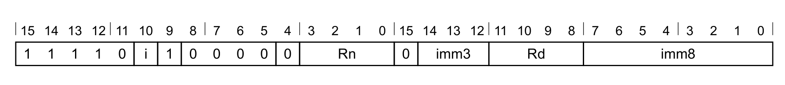

**T4 变体**

```arm
ADD{<c>}{<q>} {<Rd>,} <Rn>, #<imm12>
  // <imm12> 无法用 T1、T2、T3 表示
ADDW{<c>}{<q>} {<Rd>,} <Rn>, #<imm12>
  // <imm12> 可用 T1、T2、T3 表示
```

**解码**

```arm
if Rn == '1111' then SEE ADR;
if Rn == '1101' then SEE "ADD (SP plus immediate)";
if !HaveMainExt() then UNDEFINED;
d = UInt(Rd);  n = UInt(Rn);  setflags = FALSE;  imm32 = ZeroExtend(i:imm3:imm8, 32);
if d IN {13,15} then UNPREDICTABLE;
```

### 5.5 汇编符号（所有编码）

- **`<c>`**：见 C1.2.5 标准汇编语法字段。
- **`<q>`**：见 C1.2.5 标准汇编语法字段。
- **`<Rdn>`**：通用源寄存器兼目标寄存器，编码在 `Rdn` 字段中。
- **`<imm8>`**：8 位无符号立即数，取值 0–255，编码在 `imm8` 字段中。
- **`<Rd>`**：通用目标寄存器，编码在 `Rd` 字段中。若省略，则该寄存器与 `<Rn>` 相同。
- **`<Rn>`**：通用源寄存器，编码在 `Rn` 字段中。编码 T3 中若使用 SP，参见 C2.4.3 ADD (SP plus immediate)；编码 T4 中若使用 SP，参见 C2.4.3 ADD (SP plus immediate)，若使用 PC，参见 C2.4.8 ADR。
- **`<imm3>`**：3 位无符号立即数，取值 0–7，编码在 `imm3` 字段中。
- **`<imm12>`**：12 位无符号立即数，取值 0–4095，编码在 `i:imm3:imm8` 字段中。
- **`<const>`**：由编码在 `i:imm3:imm8` 字段中的 12 位立即数导出的立即数。取值范围见 C1.5 修改立即数常量。

### 5.6 操作（所有编码）

```arm
if ConditionPassed() then
  EncodingSpecificOperations();
  (result, carry, overflow) = AddWithCarry(R[n], imm32, '0');
  R[d] = result;
  if setflags then
    APSR.N = result[31];
    APSR.Z = IsZeroBit(result);
    APSR.C = carry;
    APSR.V = overflow;
```

### 5.7 受限行为

无额外限制。

### 5.8 数据独立时序行为

若 `AIRCR.DIT` 为 1：

- 本指令的执行时间与以下各项无关：
  - 其任一寄存器中提供的数据值。
  - N、Z、C、V 标志的值。
- 异步异常的接受时刻不因以下各项而变化：
  - 本指令所使用的任一寄存器中提供的数据值。
  - N、Z、C、V 标志的值。

## 6. ADD (immediate, to PC)：PC 加（立即数）

PC 加。Add to PC 把一个立即数加到 Align(PC, 4) 值上，形成 PC 相对地址，并把结果写入目标寄存器。Arm 建议软件尽可能避免使用该别名。

本指令是 ADR 指令的伪指令，这意味着：

- 本说明中的编码按 ADR 的编码命名。
- 汇编语法只用于汇编，不用于反汇编。
- ADR 的说明给出了本指令的操作伪代码。

### 6.1 编码 T1

适用于 Armv8-M。

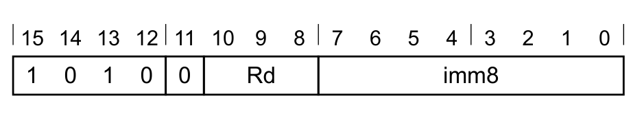

**T1 变体**

```arm
ADD{<c>}{<q>} <Rd>, PC, #<imm8>
```

**等价于**

```arm
ADR{<c>}{<q>} <Rd>, <label>
```

**且从不是首选的反汇编形式。**

### 6.2 编码 T3

适用于 Armv8-M Main 扩展。

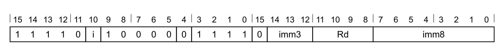

**T3 变体**

```arm
ADDW{<c>}{<q>} <Rd>, PC, #<imm12>
  // <Rd>、<imm12> 可用 T1 表示
```

**等价于**

```arm
ADR{<c>}{<q>} <Rd>, <label>
```

**且从不是首选的反汇编形式。**

**T3 变体**

```arm
ADD{<c>}{<q>} <Rd>, PC, #<imm12>
```

**等价于**

```arm
ADR{<c>}{<q>} <Rd>, <label>
```

**且从不是首选的反汇编形式。**

### 6.3 汇编符号（所有编码）

- **`<c>`**：见 C1.2.5 标准汇编语法字段。
- **`<q>`**：见 C1.2.5 标准汇编语法字段。
- **`<Rd>`**：通用目标寄存器，编码在 `Rd` 字段中。
- **`<label>`**：要装入 `<Rd>` 的指令或字面量数据项的标号。汇编器根据 ADR 指令的 Align(PC, 4) 值计算到该标号所需的偏移值；偏移大小允许取 0–1020 范围内 4 的倍数（编码 T1），或 0–4095（编码 T2、T3）。编码 T2、T3 中，若偏移为零或正数则使用编码 T3，`imm32` 等于该偏移；若偏移为负数则使用编码 T2，`imm32` 等于偏移的大小，即使用编码 T2 表示所需偏移为 `imm32` 的负值。
- **`<imm8>`**：无符号立即数，为 4 的倍数，取值 0–1020，以 `<imm8>/4` 编码在 `imm8` 字段中。
- **`<imm12>`**：12 位无符号立即数，取值 0–4095，编码在 `i:imm3:imm8` 字段中。

### 6.4 操作（所有编码）

ADR 的说明给出了本指令的操作伪代码。

## 7. ADD (register)：寄存器加

寄存器加。ADD (register) 把一个寄存器值与一个可选移位的寄存器值相加，并把结果写入目标寄存器；它可以选择根据结果更新条件标志。

### 7.1 编码 T1

适用于 Armv8-M。

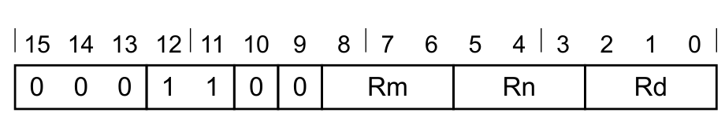

**T1 变体**

```arm
ADD<c>{<q>} <Rd>, <Rn>, <Rm>
  // IT 块内
ADDS{<q>} {<Rd>,} <Rn>, <Rm>
  // IT 块外
```

**解码**

```arm
d = UInt(Rd);  n = UInt(Rn);  m = UInt(Rm);  setflags = !InITBlock();
(shift_t, shift_n) = (SRType_LSL, 0);
```

### 7.2 编码 T2

适用于 Armv8-M。

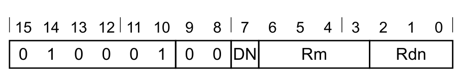

**T2 变体**

```arm
ADD<c>{<q>} <Rdn>, <Rm>
  // 首选语法，IT 块内
ADD{<c>}{<q>} {<Rdn>,} <Rdn>, <Rm>
```

**解码**

```arm
if (DN:Rdn) == '1101' || Rm == '1101' then SEE "ADD (SP plus register)";
d = UInt(DN:Rdn);  n = UInt(DN:Rdn);  m = UInt(Rm);  setflags = FALSE;
(shift_t, shift_n) = (SRType_LSL, 0);
if d == 15 && InITBlock() && !LastInITBlock() then UNPREDICTABLE;
if d == 15 && m == 15 then UNPREDICTABLE;
```

### 7.3 编码 T3

适用于 Armv8-M Main 扩展。

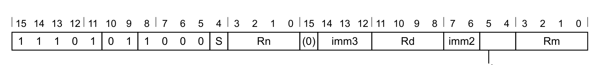

**ADD，带扩展的循环右移变体**（当 `S == 0 && imm3 == 000 && imm2 == 00 && sr_type == 11` 时适用）

```arm
ADD{<c>}{<q>} {<Rd>,} <Rn>, <Rm>, RRX
```

**ADD，按值移位或循环移位变体**（当 `S == 0 && !(imm3 == 000 && imm2 == 00 && sr_type == 11)` 时适用）

```arm
ADD<c>.W {<Rd>,} <Rn>, <Rm>
  // IT 块内，且 <Rd>、<Rn>、<Rm> 可用 T1 或 T2 表示
ADD{<c>}{<q>} {<Rd>,} <Rn>, <Rm> {, <shift> #<amount>}
```

**ADDS，带扩展的循环右移变体**（当 `S == 1 && imm3 == 000 && Rd != 1111 && imm2 == 00 && sr_type == 11` 时适用）

```arm
ADDS{<c>}{<q>} {<Rd>,} <Rn>, <Rm>, RRX
```

**ADDS，按值移位或循环移位变体**（当 `S == 1 && !(imm3 == 000 && imm2 == 00 && sr_type == 11) && Rd != 1111` 时适用）

```arm
ADDS.W {<Rd>,} <Rn>, <Rm>
  // IT 块外，且 <Rd>、<Rn>、<Rm> 可用 T1 或 T2 表示
ADDS{<c>}{<q>} {<Rd>,} <Rn>, <Rm> {, <shift> #<amount>}
```

**解码**

```arm
if Rd == '1111' && S == '1' then SEE "CMN (register)";
if Rn == '1101' then SEE "ADD (SP plus register)";
if !HaveMainExt() then UNDEFINED;
d = UInt(Rd);  n = UInt(Rn);  m = UInt(Rm);  setflags = (S == '1');
(shift_t, shift_n) = DecodeImmShift(sr_type, imm3:imm2);
if d == 13 || (d == 15 && S == '0') || n == 15 || m IN {13,15} then UNPREDICTABLE;
```

### 7.4 汇编符号（所有编码）

- **`<c>`**：见 C1.2.5 标准汇编语法字段。
- **`<q>`**：见 C1.2.5 标准汇编语法字段。
- **`<Rdn>`**：通用源寄存器兼目标寄存器，编码在 `DN:Rdn` 字段中。若使用 PC，则本指令是对运算所得地址的分支，即简单分支。汇编语言允许 `<Rdn>` 在汇编语法中出现一次或两次：在 IT 块内且 `<Rdn>`、`<Rm>` 位于 R0–R7 时，`<Rdn>` 必须只出现一次，以便优先选用编码 T2 而非编码 T1；其他情况下，`<Rdn>` 出现一次或两次的行为没有差别。
- **`<Rd>`**：通用目标寄存器。编码 T1 中编码在 `Rd` 字段中：在 IT 块内使用时必须指定 `<Rd>`；在 IT 块外使用时 `<Rd>` 可选，省略时该寄存器与 `<Rn>` 相同，指定时优先选用编码 T1 而非编码 T2。编码 T3 中编码在 `Rd` 字段中，若省略，则该寄存器与 `<Rn>` 相同。
- **`<Rn>`**：第一个通用源寄存器，编码在 `Rn` 字段中。编码 T3 中若使用 SP，参见 C2.4.4 ADD (SP plus register)。
- **`<Rm>`**：第二个通用源寄存器，编码在 `Rm` 字段中。编码 T1 与 T3 中编码在 `Rm` 字段中；编码 T2 中编码在 `Rm` 字段中，可使用 PC。
- **`<shift>`**：施加于第二个源寄存器的移位类型，编码在 `sr_type` 字段中，可取以下值：
  - `LSL`：当 `sr_type = 00` 时。
  - `LSR`：当 `sr_type = 01` 时。
  - `ASR`：当 `sr_type = 10` 时。
  - `ROR`：当 `sr_type = 11` 时。
- **`<amount>`**：移位量，取值 1–31（`<shift>` 为 `LSL` 或 `ROR` 时）或 1–32（`<shift>` 为 `LSR` 或 `ASR` 时），以 `<amount>` 对 32 取模后编码在 `imm3:imm2` 字段中。

### 7.5 操作（所有编码）

```arm
if ConditionPassed() then
  EncodingSpecificOperations();
  shifted = Shift(R[m], shift_t, shift_n, APSR.C);
  (result, carry, overflow) = AddWithCarry(R[n], shifted, '0');
  if d == 15 then
    BranchTo(result);  // 此处 setflags 恒为 FALSE
  else
    R[d] = result;
    if setflags then
      APSR.N = result[31];
      APSR.Z = IsZeroBit(result);
      APSR.C = carry;
      APSR.V = overflow;
```

### 7.6 受限行为

无额外限制。

### 7.7 数据独立时序行为

若 `AIRCR.DIT` 为 1：

- 本指令的执行时间与以下各项无关：
  - 其任一寄存器中提供的数据值。
  - N、Z、C、V 标志的值。
- 异步异常的接受时刻不因以下各项而变化：
  - 本指令所使用的任一寄存器中提供的数据值。
  - N、Z、C、V 标志的值。

## 8. ADR：形成 PC 相对地址

形成 PC 相对地址。Address to Register 把一个立即数加到 PC 值上，并把结果写入目标寄存器。

本指令被伪指令 ADD (immediate, to PC) 与 SUB (immediate, from PC) 使用。

### 8.1 编码 T1

适用于 Armv8-M。


**T1 变体**

```arm
ADR{<c>}{<q>} <Rd>, <label>
```

**解码**

```arm
d = UInt(Rd);  imm32 = ZeroExtend(imm8:'00', 32);  add = TRUE;
```

### 8.2 编码 T2

适用于 Armv8-M Main 扩展。

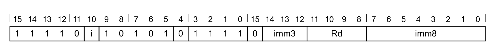

**T2 变体**

```arm
ADR{<c>}{<q>} <Rd>, <label>
```

**解码**

```arm
if !HaveMainExt() then UNDEFINED;
d = UInt(Rd);  imm32 = ZeroExtend(i:imm3:imm8, 32);  add = FALSE;
if d IN {13,15} then UNPREDICTABLE;
```

### 8.3 编码 T3

适用于 Armv8-M Main 扩展。

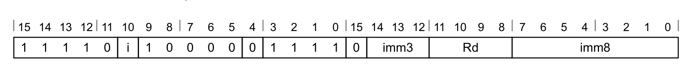

**T3 变体**

```arm
ADR{<c>}.W <Rd>, <label>
  // <Rd>、<label> 可用 T1 表示
ADR{<c>}{<q>} <Rd>, <label>
```

**解码**

```arm
if !HaveMainExt() then UNDEFINED;
d = UInt(Rd);  imm32 = ZeroExtend(i:imm3:imm8, 32);  add = TRUE;
if d IN {13,15} then UNPREDICTABLE;
```

### 8.4 别名条件

| 别名或伪指令 | 优先使用条件 |
| --- | --- |
| ADD (immediate, to PC) | 从不 |
| SUB (immediate, from PC) | `i:imm3:imm8 == '000000000000'` |

### 8.5 汇编符号（所有编码）

- **`<c>`**：见 C1.2.5 标准汇编语法字段。
- **`<q>`**：见 C1.2.5 标准汇编语法字段。
- **`<Rd>`**：通用目标寄存器，编码在 `Rd` 字段中。
- **`<label>`**：要装入 `<Rd>` 的指令或字面量数据项的标号。汇编器根据 ADR 指令的 Align(PC, 4) 值计算到该标号所需的偏移值；偏移大小允许取 0–1020 范围内 4 的倍数（编码 T1），或 0–4095（编码 T2、T3）。编码 T2、T3 中，若偏移为零或正数则使用编码 T3，`imm32` 等于该偏移；若偏移为负数则使用编码 T2，`imm32` 等于偏移的大小，即使用编码 T2 表示所需偏移为 `imm32` 的负值。

### 8.6 操作（所有编码）

```arm
if ConditionPassed() then
  EncodingSpecificOperations();
  result = if add then (Align(PC,4) + imm32) else (Align(PC,4) - imm32);
  R[d] = result;
```

## 9. AND (immediate)：立即数按位与

按位与（立即数）。AND (immediate) 对一个寄存器值与一个立即数执行按位与运算，并把结果写入目标寄存器。

### 9.1 编码 T1

适用于 Armv8-M Main 扩展。

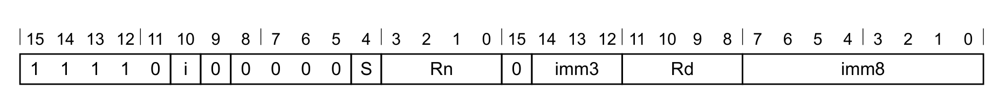

**AND 变体**（当 `S == 0` 时适用）

```arm
AND{<c>}{<q>} {<Rd>,} <Rn>, #<const>
```

**ANDS 变体**（当 `S == 1 && Rd != 1111` 时适用）

```arm
ANDS{<c>}{<q>} {<Rd>,} <Rn>, #<const>
```

**解码**

```arm
if Rd == '1111' && S == '1' then SEE "TST (immediate)";
if !HaveMainExt() then UNDEFINED;
d = UInt(Rd);  n = UInt(Rn);  setflags = (S == '1');
(imm32, carry) = T32ExpandImm_C(i:imm3:imm8, APSR.C);
if d == 13 || (d == 15 && S == '0') || n IN {13,15} then UNPREDICTABLE;
```

### 9.2 汇编符号（所有编码）

- **`<c>`**：见 C1.2.5 标准汇编语法字段。
- **`<q>`**：见 C1.2.5 标准汇编语法字段。
- **`<Rd>`**：通用目标寄存器，编码在 `Rd` 字段中。若省略，则该寄存器与 `<Rn>` 相同。
- **`<Rn>`**：通用源寄存器，编码在 `Rn` 字段中。
- **`<const>`**：由编码在 `i:imm3:imm8` 字段中的 12 位立即数导出的立即数。取值范围见 C1.5 修改立即数常量。

### 9.3 操作（所有编码）

```arm
if ConditionPassed() then
  EncodingSpecificOperations();
  result = R[n] AND imm32;
  R[d] = result;
  if setflags then
    APSR.N = result[31];
    APSR.Z = IsZeroBit(result);
    APSR.C = carry;
    // APSR.V 不变
```

### 9.4 受限行为

无额外限制。

### 9.5 数据独立时序行为

若 `AIRCR.DIT` 为 1：

- 本指令的执行时间与以下各项无关：
  - 其任一寄存器中提供的数据值。
  - N、Z、C、V 标志的值。
- 异步异常的接受时刻不因以下各项而变化：
  - 本指令所使用的任一寄存器中提供的数据值。
  - N、Z、C、V 标志的值。

## 10. AND (register)：寄存器按位与

按位与（寄存器）。AND (register) 对一个寄存器值与一个可选移位的寄存器值执行按位与运算，并把结果写入目标寄存器；它可以选择根据结果更新条件标志。

### 10.1 编码 T1

适用于 Armv8-M。

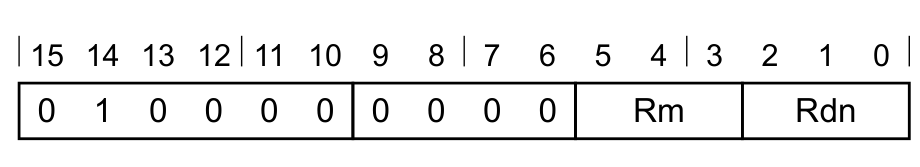

**T1 变体**

```arm
AND<c>{<q>} {<Rdn>,} <Rdn>, <Rm>
  // IT 块内
ANDS{<q>} {<Rdn>,} <Rdn>, <Rm>
  // IT 块外
```

**解码**

```arm
d = UInt(Rdn);  n = UInt(Rdn);  m = UInt(Rm);  setflags = !InITBlock();
(shift_t, shift_n) = (SRType_LSL, 0);
```

### 10.2 编码 T2

适用于 Armv8-M Main 扩展。

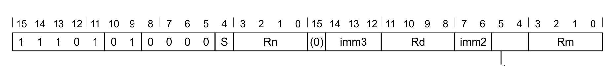

**AND，带扩展的循环右移变体**（当 `S == 0 && imm3 == 000 && imm2 == 00 && sr_type == 11` 时适用）

```arm
AND{<c>}{<q>} {<Rd>,} <Rn>, <Rm>, RRX
```

**AND，按值移位或循环移位变体**（当 `S == 0 && !(imm3 == 000 && imm2 == 00 && sr_type == 11)` 时适用）

```arm
AND<c>.W {<Rd>,} <Rn>, <Rm>
  // IT 块内，且 <Rd>、<Rn>、<Rm> 可用 T1 表示
AND{<c>}{<q>} {<Rd>,} <Rn>, <Rm> {, <shift> #<amount>}
```

**ANDS，带扩展的循环右移变体**（当 `S == 1 && imm3 == 000 && Rd != 1111 && imm2 == 00 && sr_type == 11` 时适用）

```arm
ANDS{<c>}{<q>} {<Rd>,} <Rn>, <Rm>, RRX
```

**ANDS，按值移位或循环移位变体**（当 `S == 1 && !(imm3 == 000 && imm2 == 00 && sr_type == 11) && Rd != 1111` 时适用）

```arm
ANDS.W {<Rd>,} <Rn>, <Rm>
  // IT 块外，且 <Rd>、<Rn>、<Rm> 可用 T1 表示
ANDS{<c>}{<q>} {<Rd>,} <Rn>, <Rm> {, <shift> #<amount>}
```

**解码**

```arm
if Rd == '1111' && S == '1' then SEE "TST (register)";
if !HaveMainExt() then UNDEFINED;
d = UInt(Rd);  n = UInt(Rn);  m = UInt(Rm);  setflags = (S == '1');
(shift_t, shift_n) = DecodeImmShift(sr_type, imm3:imm2);
if d == 13 || (d == 15 && S == '0') || n IN {13,15} || m IN {13,15} then UNPREDICTABLE;
```

### 10.3 汇编符号（所有编码）

- **`<c>`**：见 C1.2.5 标准汇编语法字段。
- **`<q>`**：见 C1.2.5 标准汇编语法字段。
- **`<Rdn>`**：第一个通用源寄存器兼目标寄存器，编码在 `Rdn` 字段中。
- **`<Rd>`**：通用目标寄存器，编码在 `Rd` 字段中。若省略，则该寄存器与 `<Rn>` 相同。
- **`<Rn>`**：第一个通用源寄存器，编码在 `Rn` 字段中。
- **`<Rm>`**：第二个通用源寄存器，编码在 `Rm` 字段中。
- **`<shift>`**：施加于第二个源寄存器的移位类型，编码在 `sr_type` 字段中，可取以下值：
  - `LSL`：当 `sr_type = 00` 时。
  - `LSR`：当 `sr_type = 01` 时。
  - `ASR`：当 `sr_type = 10` 时。
  - `ROR`：当 `sr_type = 11` 时。
- **`<amount>`**：移位量，取值 1–31（`<shift>` 为 `LSL` 或 `ROR` 时）或 1–32（`<shift>` 为 `LSR` 或 `ASR` 时），以 `<amount>` 对 32 取模后编码在 `imm3:imm2` 字段中。

### 10.4 操作（所有编码）

```arm
if ConditionPassed() then
  EncodingSpecificOperations();
  (shifted, carry) = Shift_C(R[m], shift_t, shift_n, APSR.C);
  result = R[n] AND shifted;
  R[d] = result;
  if setflags then
    APSR.N = result[31];
    APSR.Z = IsZeroBit(result);
    APSR.C = carry;
    // APSR.V 不变
```

### 10.5 受限行为

无额外限制。

### 10.6 数据独立时序行为

若 `AIRCR.DIT` 为 1：

- 本指令的执行时间与以下各项无关：
  - 其任一寄存器中提供的数据值。
  - N、Z、C、V 标志的值。
- 异步异常的接受时刻不因以下各项而变化：
  - 本指令所使用的任一寄存器中提供的数据值。
  - N、Z、C、V 标志的值。

## 11. ASR (immediate)：立即数算术右移

算术右移（立即数）。ASR (immediate) 把一个寄存器值右移一个立即数位数，空出的高位用其符号位的副本填充，并把结果写入目标寄存器。

本指令是 MOV (register) 指令的别名，这意味着：

- 本说明中的编码按 MOV (register) 的编码命名。
- MOV (register) 的说明给出了本指令的操作伪代码。

### 11.1 编码 T2

适用于 Armv8-M Main 扩展。

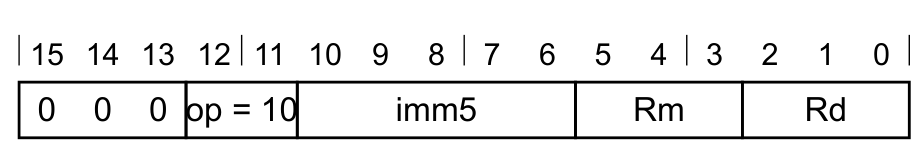

**T2 变体**

```arm
ASR<c>{<q>} {<Rd>,} <Rm>, #<imm>
  // IT 块内
```

**等价于**

```arm
MOV<c>{<q>} <Rd>, <Rm>, ASR #<imm>
```

**当 `InITBlock()` 时为首选的反汇编形式。**

### 11.2 编码 T3

适用于 Armv8-M Main 扩展。

- 在 Armv8.0-M 中，bit[15]（编码的低 16 位）[0] 表示 (0)。
- 在 Armv8.1-M 中，bit[15]（编码的低 16 位）[0] 表示 0。

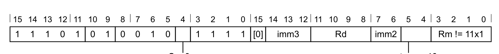

**MOV，按值移位或循环移位变体**

```arm
ASR<c>.W {<Rd>,} <Rm>, #<imm>
  // IT 块内，且 <Rd>、<Rm>、<imm> 可用 T2 表示
```

**等价于**

```arm
MOV{<c>}{<q>} <Rd>, <Rm>, ASR #<imm>
```

**且始终是首选的反汇编形式。**

**MOV，按值移位或循环移位变体**

```arm
ASR{<c>}{<q>} {<Rd>,} <Rm>, #<imm>
```

**等价于**

```arm
MOV{<c>}{<q>} <Rd>, <Rm>, ASR #<imm>
```

**且始终是首选的反汇编形式。**

### 11.3 汇编符号（所有编码）

- **`<c>`**：见 C1.2.5 标准汇编语法字段。
- **`<q>`**：见 C1.2.5 标准汇编语法字段。
- **`<Rd>`**：通用目标寄存器，编码在 `Rd` 字段中。
- **`<Rm>`**：通用源寄存器，编码在 `Rm` 字段中。
- **`<imm>`**：移位量，取值 1–32。编码 T2 中以 `<imm>` 对 32 取模后编码在 `imm5` 字段中；编码 T3 中以 `<imm>` 对 32 取模后编码在 `imm3:imm2` 字段中。

### 11.4 操作（所有编码）

MOV (register) 的说明给出了本指令的操作伪代码。

### 11.5 受限行为

无额外限制。

### 11.6 数据独立时序行为

若 `AIRCR.DIT` 为 1：

- 本指令的执行时间与以下各项无关：
  - 其任一寄存器中提供的数据值。
  - N、Z、C、V 标志的值。
- 异步异常的接受时刻不因以下各项而变化：
  - 本指令所使用的任一寄存器中提供的数据值。
  - N、Z、C、V 标志的值。

## 12. ASR (register)：寄存器算术右移

算术右移（寄存器）。ASR (register) 把一个寄存器值右移一个可变位数，空出的高位用其符号位的副本填充，并把结果写入目标寄存器；该位数取自另一个寄存器的最低字节。

本指令是 MOV, MOVS (register-shifted register) 指令的别名，这意味着：

- 本说明中的编码按 MOV, MOVS (register-shifted register) 的编码命名。
- MOV, MOVS (register-shifted register) 的说明给出了本指令的操作伪代码。

### 12.1 编码 T1

适用于 Armv8-M Main 扩展。

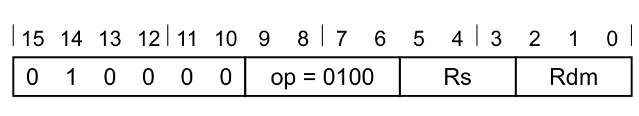

**算术右移变体**

```arm
ASR<c>{<q>} {<Rdm>,} <Rdm>, <Rs>
  // IT 块内
```

**等价于**

```arm
MOV<c>{<q>} <Rdm>, <Rdm>, ASR <Rs>
```

**当 `InITBlock()` 时为首选的反汇编形式。**

### 12.2 编码 T2

适用于 Armv8-M Main 扩展。

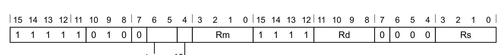

**非标志设置变体**

```arm
ASR<c>.W {<Rd>,} <Rm>, <Rs>
  // IT 块内，且 <Rd>、<Rm>、<sr_type>、<Rs> 可用 T1 表示
```

**等价于**

```arm
MOV{<c>}{<q>} <Rd>, <Rm>, ASR <Rs>
```

**且始终是首选的反汇编形式。**

**非标志设置变体**

```arm
ASR{<c>}{<q>} {<Rd>,} <Rm>, <Rs>
```

**等价于**

```arm
MOV{<c>}{<q>} <Rd>, <Rm>, ASR <Rs>
```

**且始终是首选的反汇编形式。**

### 12.3 汇编符号（所有编码）

- **`<c>`**：见 C1.2.5 标准汇编语法字段。
- **`<q>`**：见 C1.2.5 标准汇编语法字段。
- **`<Rdm>`**：第一个通用源寄存器兼目标寄存器，编码在 `Rdm` 字段中。
- **`<Rd>`**：通用目标寄存器，编码在 `Rd` 字段中。
- **`<Rm>`**：第一个通用源寄存器，编码在 `Rm` 字段中。
- **`<Rs>`**：第二个通用源寄存器，其最低 8 位存放移位量，编码在 `Rs` 字段中。

### 12.4 操作（所有编码）

MOV, MOVS (register-shifted register) 的说明给出了本指令的操作伪代码。

### 12.5 受限行为

无额外限制。

### 12.6 数据独立时序行为

若 `AIRCR.DIT` 为 1：

- 本指令的执行时间与以下各项无关：
  - 其任一寄存器中提供的数据值。
  - N、Z、C、V 标志的值。
- 异步异常的接受时刻不因以下各项而变化：
  - 本指令所使用的任一寄存器中提供的数据值。
  - N、Z、C、V 标志的值。

## 13. ASRL (immediate)：立即数长算术右移

长算术右移。把存放在两个通用寄存器中的 64 位值算术右移 1–32 位。

### 13.1 编码 T1

适用于 Armv8.1-M MVE。

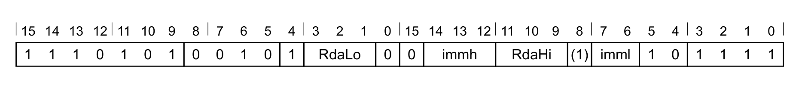

**T1：ASRL 变体**

```arm
ASRL<c><q> RdaLo, RdaHi, #<imm>
```

**解码**

```arm
if RdaHi == '111'  then SEE "SRSHR (immediate)";
if !HaveMainExt()  then UNDEFINED;
if !HasArchVersion(Armv8p1) then SEE "Related encodings";
if !HaveMve()  then UNDEFINED;
dah = UInt(RdaHi:'1');
dal = UInt(RdaLo:'0');
(-, amount) = DecodeImmShift('10', immh:imml);
if RdaHi == '110' then CONSTRAINED_UNPREDICTABLE;
```

### 13.2 汇编符号（所有编码）

- **`<c, q>`**：见 C1.2.5 标准汇编语法字段。
- **`<RdaLo>`**：64 位源兼目标值低半部分所用的通用寄存器，其中存放待移位的值。该寄存器必须是偶数编号寄存器。
- **`<RdaHi>`**：64 位源兼目标值高半部分所用的通用寄存器，其中存放待移位的值。该寄存器必须是奇数编号寄存器。
- **`<imm>`**：移位位数，取值 1–32。

### 13.3 操作（所有编码）

```arm
if ConditionPassed() then
  EncodingSpecificOperations();
  op1  = SInt(R[dah]:R[dal]);
  result = (op1 >> amount)[63:0];
  R[dah] = result[63:32];
  R[dal] = result[31:0];
```

### 13.4 受限行为

无额外限制。

### 13.5 数据独立时序行为

若 `AIRCR.DIT` 为 1：

- 本指令的执行时间与本指令所处理数据的取值无关。
- 异步异常的接受时刻不因本指令所使用的取值而变化。

## 14. ASRL (register)：寄存器长算术右移

长算术右移。把存放在两个通用寄存器中的 64 位值算术右移 0–64 位，移位量取自 `Rm` 的最低字节；若移位量为负，则移位方向相反。

### 14.1 编码 T1

适用于 Armv8.1-M MVE。

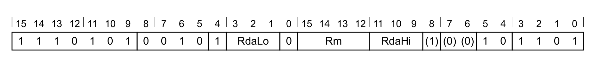

**T1：ASRL 变体**

```arm
ASRL<c><q> RdaLo, RdaHi, Rm
```

**解码**

```arm
if RdaHi == '111'  then SEE "SQRSHR (register)";
if !HaveMainExt()  then UNDEFINED;
if !HasArchVersion(Armv8p1) then SEE "Related encodings";
if !HaveMve()  then UNDEFINED;
dah = UInt(RdaHi:'1');
dal = UInt(RdaLo:'0');
m = UInt(Rm);
if RdaHi == '110' || Rm == '11x1' || Rm == RdaHi:'1' then CONSTRAINED_UNPREDICTABLE;
if Rm  == RdaLo:'0' then CONSTRAINED_UNPREDICTABLE;
```

### 14.2 汇编符号（所有编码）

- **`<c, q>`**：见 C1.2.5 标准汇编语法字段。
- **`<RdaLo>`**：64 位源兼目标值低半部分所用的通用寄存器，其中存放待移位的值。该寄存器必须是偶数编号寄存器。
- **`<RdaHi>`**：64 位源兼目标值高半部分所用的通用寄存器，其中存放待移位的值。该寄存器必须是奇数编号寄存器。
- **`<Rm>`**：通用源寄存器，其最低 8 位存放移位量。

### 14.3 操作（所有编码）

```arm
if ConditionPassed() then
  EncodingSpecificOperations();
  amount = SInt(R[m][7:0]);
  op1  = SInt(R[dah]:R[dal]);
  result = (op1 >> amount)[63:0];
  R[dah] = result[63:32];
  R[dal] = result[31:0];
```

### 14.4 受限行为

无额外限制。

### 14.5 数据独立时序行为

若 `AIRCR.DIT` 为 1：

- 本指令的执行时间与本指令所处理数据的取值无关。
- 异步异常的接受时刻不因本指令所使用的取值而变化。

## 15. ASRS (immediate)：立即数算术右移并设置标志

算术右移并设置标志（立即数）。ASRS (immediate) 把一个寄存器值右移一个立即数位数，空出的高位用其符号位的副本填充，把结果写入目标寄存器，并根据结果更新条件标志。

本指令是 MOV (register) 指令的别名，这意味着：

- 本说明中的编码按 MOV (register) 的编码命名。
- MOV (register) 的说明给出了本指令的操作伪代码。

### 15.1 编码 T2

适用于 Armv8-M。


**T2 变体**

```arm
ASRS{<q>} {<Rd>,} <Rm>, #<imm>
  // IT 块外
```

**等价于**

```arm
MOVS{<q>} <Rd>, <Rm>, ASR #<imm>
```

**当 `!InITBlock()` 时为首选的反汇编形式。**

### 15.2 编码 T3

适用于 Armv8-M Main 扩展。

- 在 Armv8.0-M 中，bit[15]（编码的低 16 位）[0] 表示 (0)。
- 在 Armv8.1-M 中，bit[15]（编码的低 16 位）[0] 表示 0。

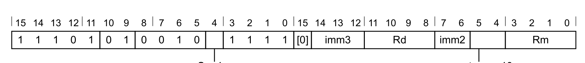

**MOVS，按值移位或循环移位变体**

```arm
ASRS.W {<Rd>,} <Rm>, #<imm>
  // IT 块外，且 <Rd>、<Rm>、<imm> 可用 T2 表示
```

**等价于**

```arm
MOVS{<c>}{<q>} <Rd>, <Rm>, ASR #<imm>
```

**且始终是首选的反汇编形式。**

**MOVS，按值移位或循环移位变体**

```arm
ASRS{<c>}{<q>} {<Rd>,} <Rm>, #<imm>
```

**等价于**

```arm
MOVS{<c>}{<q>} <Rd>, <Rm>, ASR #<imm>
```

**且始终是首选的反汇编形式。**

### 15.3 汇编符号（所有编码）

- **`<c>`**：见 C1.2.5 标准汇编语法字段。
- **`<q>`**：见 C1.2.5 标准汇编语法字段。
- **`<Rd>`**：通用目标寄存器，编码在 `Rd` 字段中。
- **`<Rm>`**：通用源寄存器，编码在 `Rm` 字段中。
- **`<imm>`**：移位量，取值 1–32。编码 T2 中以 `<imm>` 对 32 取模后编码在 `imm5` 字段中；编码 T3 中以 `<imm>` 对 32 取模后编码在 `imm3:imm2` 字段中。

### 15.4 操作（所有编码）

MOV (register) 的说明给出了本指令的操作伪代码。

### 15.5 受限行为

无额外限制。

### 15.6 数据独立时序行为

若 `AIRCR.DIT` 为 1：

- 本指令的执行时间与以下各项无关：
  - 其任一寄存器中提供的数据值。
  - N、Z、C、V 标志的值。
- 异步异常的接受时刻不因以下各项而变化：
  - 本指令所使用的任一寄存器中提供的数据值。
  - N、Z、C、V 标志的值。

## 16. ASRS (register)：寄存器算术右移并设置标志

算术右移并设置标志（寄存器）。ASRS (register) 把一个寄存器值右移一个可变位数，空出的高位用其符号位的副本填充，把结果写入目标寄存器，并根据结果更新条件标志；该位数取自另一个寄存器的最低字节。

本指令是 MOV, MOVS (register-shifted register) 指令的别名，这意味着：

- 本说明中的编码按 MOV, MOVS (register-shifted register) 的编码命名。
- MOV, MOVS (register-shifted register) 的说明给出了本指令的操作伪代码。

### 16.1 编码 T1

适用于 Armv8-M。


**算术右移变体**

```arm
ASRS{<q>} {<Rdm>,} <Rdm>, <Rs>
  // IT 块外
```

**等价于**

```arm
MOVS{<q>} <Rdm>, <Rdm>, ASR <Rs>
```

**当 `!InITBlock()` 时为首选的反汇编形式。**

### 16.2 编码 T2

适用于 Armv8-M Main 扩展。

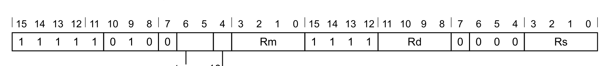

**标志设置变体**

```arm
ASRS.W {<Rd>,} <Rm>, <Rs>
  // IT 块外，且 <Rd>、<Rm>、<sr_type>、<Rs> 可用 T1 表示
```

**等价于**

```arm
MOVS{<c>}{<q>} <Rd>, <Rm>, ASR <Rs>
```

**且始终是首选的反汇编形式。**

**标志设置变体**

```arm
ASRS{<c>}{<q>} {<Rd>,} <Rm>, <Rs>
```

**等价于**

```arm
MOVS{<c>}{<q>} <Rd>, <Rm>, ASR <Rs>
```

**且始终是首选的反汇编形式。**

### 16.3 汇编符号（所有编码）

- **`<c>`**：见 C1.2.5 标准汇编语法字段。
- **`<q>`**：见 C1.2.5 标准汇编语法字段。
- **`<Rdm>`**：第一个通用源寄存器兼目标寄存器，编码在 `Rdm` 字段中。
- **`<Rd>`**：通用目标寄存器，编码在 `Rd` 字段中。
- **`<Rm>`**：第一个通用源寄存器，编码在 `Rm` 字段中。
- **`<Rs>`**：第二个通用源寄存器，其最低 8 位存放移位量，编码在 `Rs` 字段中。

### 16.4 操作（所有编码）

MOV, MOVS (register-shifted register) 的说明给出了本指令的操作伪代码。

### 16.5 受限行为

无额外限制。

### 16.6 数据独立时序行为

若 `AIRCR.DIT` 为 1：

- 本指令的执行时间与本指令所处理数据的取值无关。
- 异步异常的接受时刻不因本指令所使用的取值而变化。

## 17. AUT：使用密钥验证链接寄存器

使用密钥验证链接寄存器。本指令以 LR 作为地址、SP 作为修饰符并配合密钥计算指针认证码，把计算出的 PAC 与 R12 中的 PAC 比较；若两者不相等，则产生 INVSTATE UsageFault。

本指令不允许出现在 IT 块中。

本指令是兼容 NOP 的提示（NOP-compatible hint）。

### 17.1 编码 T1

适用于 Armv8.1-M PACBTI。

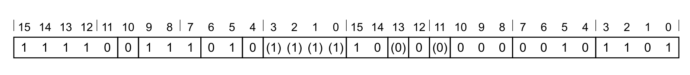

**T1 变体**

```arm
AUT R12, LR, SP
```

**解码**

```arm
if !HaveMainExt() then UNDEFINED;
if InITBlock()  then CONSTRAINED_UNPREDICTABLE;
```

### 17.2 受限不可预测（CONSTRAINED UNPREDICTABLE）行为

若 `InITBlock()` 为真，则必须出现下列行为之一：

- 该指令为 UNDEFINED。
- 该指令按 NOP 执行。
- 该指令无条件执行。
- 该指令条件执行。

### 17.3 汇编符号（所有编码）

- **`LR`**：`LR` 寄存器，本指令必须使用该寄存器；该寄存器存放地址。
- **`SP`**：`SP` 寄存器，本指令必须使用该寄存器；该寄存器存放生成 PAC 码期间施加的修饰符。
- **`R12`**：`R12` 寄存器，本指令必须使用该寄存器；该寄存器存放用于比较的 PAC。

### 17.4 操作（所有编码）

```arm
EncodingSpecificOperations();
if PACEnabled() then
  if !ValidatePAC(LR, SP, R[12]) then
    UFSR.INVSTATE = '1';
    excInfo = CreateException(UsageFault);
    HandleException(excInfo);
```

### 17.5 受限行为

**数据独立时序行为与 PACBTI 扩展**

无论 `AIRCR.DIT` 取何值，本指令在访问以下各项时的时序都对所加载或所存储数据的取值不敏感：

- `PAC_KEY_P_n`。
- `PAC_KEY_U_n`。
- 指针值。
- 修饰符值。
- PAC 值。

异步异常的接受时刻不因以下各项而变化：

- `PAC_KEY_P_n`。
- `PAC_KEY_U_n`。
- 指针值。
- 修饰符值。
- PAC 值。

## 18. AUTG：使用密钥验证通用值

使用密钥验证通用值。本指令使用两个输入寄存器和一把密钥计算指针认证码，把计算出的 PAC 与指定寄存器中的 PAC 比较；若两者不相等，则产生 INVSTATE UsageFault。

### 18.1 编码 T1

适用于 Armv8.1-M PACBTI。

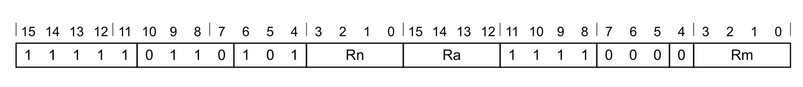

**T1 变体**

```arm
AUTG{<c>} <Ra>, <Rn>, <Rm>
```

**解码**

```arm
if !HavePACBTIExt() then
  if HaveDSPExt() then UNPREDICTABLE; else UNDEFINED;
if Ra == '1111' then SEE SMMUL;
a = UInt(Ra); n = UInt(Rn); m = UInt(Rm);
if n == 15 || m == 15 || a == 13 then UNPREDICTABLE;
```

### 18.2 汇编符号（所有编码）

- **`<c>`**：见 C1.2.5 标准汇编语法字段。
- **`<Rn>`**：存放待加密值的通用源寄存器，编码在 `Rn` 字段中。
- **`<Rm>`**：存放加密操作所用修饰符的通用源寄存器，编码在 `Rm` 字段中。
- **`<Ra>`**：存放已加密值的通用寄存器，编码在 `Ra` 字段中。该寄存器中的值将与加密操作产生的值比较。

### 18.3 操作（所有编码）

```arm
if ConditionPassed() then
  EncodingSpecificOperations();
  if PACEnabled() then
    if !ValidatePAC(R[n], R[m], R[a]) then
      UFSR.INVSTATE = '1';
      excInfo = CreateException(UsageFault);
      HandleException(excInfo);
```

### 18.4 受限行为

**数据独立时序行为与 PACBTI 扩展**

无论 `AIRCR.DIT` 取何值，本指令在访问以下各项时的时序都对所加载或所存储数据的取值不敏感：

- `PAC_KEY_P_n`。
- `PAC_KEY_U_n`。
- 指针值。
- 修饰符值。
- PAC 值。

异步异常的接受时刻不因以下各项而变化：

- `PAC_KEY_P_n`。
- `PAC_KEY_U_n`。
- 指针值。
- 修饰符值。
- PAC 值。
