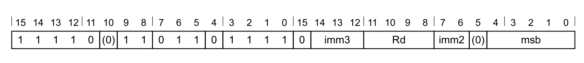
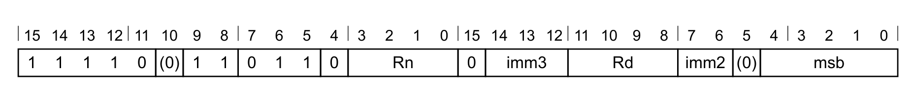
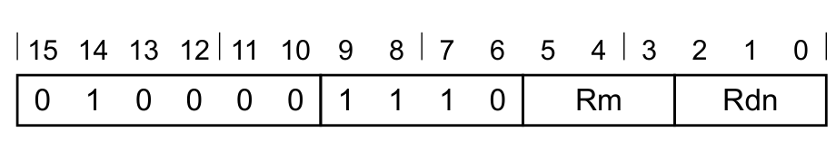
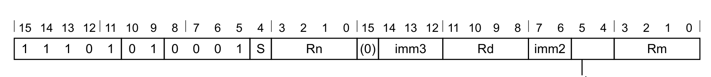
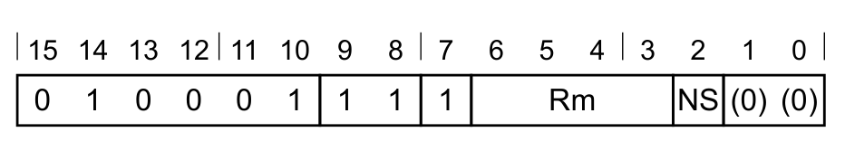
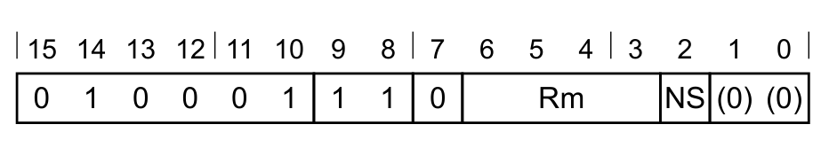
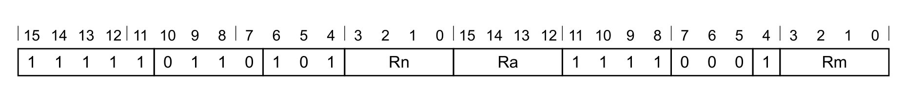

本文译自 Part C《Armv8-M 指令》（Armv8-M Instructions） Chapter C2《指令规范》（Instruction Specification，C2.4.19–C2.4.30）。

本页是第 C2 章《指令规范》中 C2.4 按字母顺序排列的指令列表的 B 段（C2.4.19–C2.4.30，印刷 565–587）。每条指令依次给出用途说明、各编码（T1、T2 …）的位域图与汇编语法、解码与操作伪代码、汇编符号说明，以及受限行为和数据独立时序行为。指令助记符、字段名、寄存器名、伪代码与汇编语法保持原样，说明文字译为中文。

## 1. B：分支

分支。Branch 使程序分支到目标地址。

### 1.1 编码 T1

适用于 Armv8-M。


**T1 变体**

```arm
B<c>{<q>} <label>
  // 不允许出现在 IT 块中
```

**解码**

```arm
if cond == '1110' then SEE UDF;
if cond == '1111' then SEE SVC;
imm32 = SignExtend(imm8:'0', 32);
if InITBlock() then UNPREDICTABLE;
```

### 1.2 编码 T2

适用于 Armv8-M。


**T2 变体**

```arm
B{<c>}{<q>} <label>
  // IT 块外，或 IT 块中的最后一条
```

**解码**

```arm
imm32 = SignExtend(imm11:'0', 32);
cond = CurrentCond();
if InITBlock() && !LastInITBlock() then UNPREDICTABLE;
```

### 1.3 编码 T3

适用于 Armv8-M Main 扩展。


**T3 变体**

```arm
B<c>.W <label>
  // 不允许出现在 IT 块中，且 <label> 可用 T1 表示
B<c>{<q>} <label>
  // 不允许出现在 IT 块中
```

**解码**

```arm
if cond[3:1] == '111' then SEE "Related encodings";
if !HaveMainExt() then UNDEFINED;
imm32 = SignExtend(S:J2:J1:imm6:imm11:'0', 32);
if InITBlock() then UNPREDICTABLE;
```

### 1.4 编码 T4

适用于 Armv8-M。


**T4 变体**

```arm
B{<c>}.W <label>
  // <label> 可用 T2 表示
B{<c>}{<q>} <label>
```

**解码**

```arm
I1 = NOT(J1 EOR S);  I2 = NOT(J2 EOR S);  imm32 = SignExtend(S:I1:I2:imm10:imm11:'0', 32);
cond = CurrentCond();
if InITBlock() && !LastInITBlock() then UNPREDICTABLE;
```

### 1.5 汇编符号（所有编码）

- **`<c>`**：见 C1.2.5 标准汇编语法字段。编码 T1、T3 中不得为 `AL`，也不得省略。
- **`<q>`**：见 C1.2.5 标准汇编语法字段。
- **`<label>`**：要分支到的指令的标号。汇编器根据 B 指令的 PC 值计算到该标号所需的偏移值，然后选择一种把 `imm32` 置为该偏移的编码。允许的偏移为偶数：编码 T1 为 −256 至 254，编码 T2 为 −2048 至 2046，编码 T3 为 −1048576 至 1048574，编码 T4 为 −16777216 至 16777214。

### 1.6 操作（所有编码）

```arm
if ConditionPassed(cond) then
  EncodingSpecificOperations();
  BranchTo(PC + imm32);
```

## 2. BF, BFX, BFL, BFLX, BFCSEL：分支未来

分支未来、分支未来并交换、带链接的分支未来、带链接并交换的分支未来、分支未来条件选择。这些指令把即将发生的到 `<label>` 的分支通知给 PE，使该分支被执行，而不是取指并执行 `<b_label>` 处的指令。这样 PE 可以减少或消除因未被告知的分支可能带来的性能损失。该指令是否被当作 NOP 处理由实现定义；为保证此类情况下程序流的正确行为，应在 `<b_label>` 指定的位置放置回退代码。

对带链接的分支未来变体，分支执行时会更新链接寄存器。写入值相对分支点偏移 4 字节，对应回退代码中通常紧跟分支点的 BL (immediate) 指令长度。

对带链接并交换的分支未来变体，分支执行时会更新链接寄存器。写入值相对分支点偏移 2 字节，对应回退代码中通常紧跟分支点的 BLX (register) 指令长度。若实现了 PACBTI 扩展，本指令会把 `LO_BRANCH_INFO.BTI` 置 1（若 BFX 中以 LR 寄存器作为参数，则该位不置位）。分支被执行且启用 BTI 时，`EPSR.B` 置 1。

分支未来条件选择变体在条件码通过时创建到 `<label>` 的未来分支。若显式条件码不通过，该变体不作为 NOP 处理，而是在循环与分支缓存中没有其他有效 BF 条目时，创建到 `<ba_label>` 所指定指令的未来分支。

### 2.1 编码 T1

适用于 Armv8.1-M 低开销分支扩展。


**T1：BF 变体**

```arm
BF<c><q> <b_label>, <label>
```

**解码**

```arm
if boff == '0000' then SEE "Related encodings";
if !HaveLOBExt()  then UNDEFINED;
endOffset = ZeroExtend(boff:'0', 32);
offset  = SignExtend(immA:immB:immC:'1', 32);
bOffset  = bits(32) UNKNOWN;
n  = integer UNKNOWN;
regAddr  = FALSE;
link  = FALSE;
setBti  = FALSE;
bcond  = CondAL;
```

### 2.2 编码 T2

适用于 Armv8.1-M 低开销分支扩展。


**T2：BFCSEL 变体**

```arm
BFCSEL <b_label>, <label>, <ba_label>, <bcond>
```

**解码**

```arm
if boff == '0000' then SEE "Related encodings";
if !HaveLOBExt()  then UNDEFINED;
endOffset = ZeroExtend(boff:'0', 32);
offset  = SignExtend(immA:immB:immC:'1', 32);
bOffset  = (if T == '1' then 5 else 3)[31:0];
n  = integer UNKNOWN;
regAddr  = FALSE;
link  = FALSE;
setBti  = FALSE;
if InITBlock()  then CONSTRAINED_UNPREDICTABLE;
if bcond == '111x' then CONSTRAINED_UNPREDICTABLE;
```

### 2.3 编码 T3

适用于 Armv8.1-M 低开销分支扩展。


**T3：BFX 变体**

```arm
BFX<c><q> <b_label>, Rn
```

**解码**

```arm
if boff == '0000' then SEE "Related encodings";
if !HaveLOBExt()  then UNDEFINED;
endOffset = ZeroExtend(boff:'0', 32);
offset  = Zeros(32);
bOffset  = bits(32) UNKNOWN;
n  = UInt(Rn);
regAddr  = TRUE;
link  = FALSE;
setBti  = if n != 14 then TRUE else FALSE;
bcond  = CondAL;
if Rn == '11x1' then CONSTRAINED_UNPREDICTABLE;
```

### 2.4 编码 T4

适用于 Armv8.1-M 低开销分支扩展。


**T4：BFL 变体**

```arm
BFL<c><q> <b_label>, <label>
```

**解码**

```arm
if boff == '0000' then SEE "Related encodings";
if !HaveLOBExt()  then UNDEFINED;
endOffset = ZeroExtend(boff:'0', 32);
offset  = SignExtend(immA:immB:immC:'1', 32);
bOffset  = bits(32) UNKNOWN;
n  = integer UNKNOWN;
regAddr  = FALSE;
link  = TRUE;
setBti  = FALSE;
bcond  = CondAL;
```

### 2.5 编码 T5

适用于 Armv8.1-M 低开销分支扩展。


**T5：BFLX 变体**

```arm
BFLX<c><q> <b_label>, Rn
```

**解码**

```arm
if boff == '0000' then SEE "Related encodings";
if !HaveLOBExt()  then UNDEFINED;
endOffset = ZeroExtend(boff:'0', 32);
offset  = Zeros(32);
bOffset  = bits(32) UNKNOWN;
n  = UInt(Rn);
regAddr  = TRUE;
link  = TRUE;
setBti  = TRUE;
bcond  = CondAL;
if Rn == '11x1' then CONSTRAINED_UNPREDICTABLE;
```

### 2.6 汇编符号（所有编码）

- **`<c, q>`**：见 C1.2.5 标准汇编语法字段。
- **`<b_label>`**：回退代码中第一条指令的 PC 相对偏移；若未来分支被执行，该指令不会被执行。
- **`<Rn>`**：要分支到的地址。
- **`<ba_label>`**：当关联的 BFCSEL 条件码检查失败且没有其他挂起的分支未来时，要分支到的地址的 PC 相对偏移。该地址范围允许跳过位于 `<b_label>` 的 2 字节或 4 字节指令。
- **`<T>`**：选择 `<b_label>` 处被绕过的指令是 2 字节（`T = 0`）还是 4 字节（`T = 1`），由 `<ba_label>` 规定。
- **`<bcond>`**：使用的比较条件。该比较在指令执行时求值，而不是在分支执行时求值。取值如下：
  - `EQ`：编码为 `bcond = 0000`。
  - `NE`：编码为 `bcond = 0001`。
  - `CS`：编码为 `bcond = 0010`。
  - `CC`：编码为 `bcond = 0011`。
  - `MI`：编码为 `bcond = 0100`。
  - `PL`：编码为 `bcond = 0101`。
  - `VS`：编码为 `bcond = 0110`。
  - `VC`：编码为 `bcond = 0111`。
  - `HI`：编码为 `bcond = 1000`。
  - `LS`：编码为 `bcond = 1001`。
  - `GE`：编码为 `bcond = 1010`。
  - `LT`：编码为 `bcond = 1011`。
  - `GT`：编码为 `bcond = 1100`。
  - `LE`：编码为 `bcond = 1101`。
- **`<label>`**：要分支到的地址的 PC 相对偏移。

### 2.7 操作（所有编码）

```arm
if ConditionPassed() then
  EncodingSpecificOperations();
  // BF 可以实现为 NOP
  allow_bf = boolean IMPLEMENTATION_DEFINED "BF allowed";
  if ConditionPassed(bcond) then
    jump_addr = if regAddr then R[n] else PC + offset;
  else
    jump_addr = PC + endOffset + bOffset;
    // 条件失败时，仅在不覆盖已有 BF 条目时才捕获 BF 条目
    if LO_BRANCH_INFO.VALID == '1' && LO_BRANCH_INFO.BF == '1' then
      allow_bf = FALSE;
  // 导致切换到不同指令集的分支会使 BF 指令被当作 NOP
  allow_bf = allow_bf && (jump_addr[0] == '1');
  // 会导致 FNC_RETURN 或 EXC_RETURN 的分支不受支持，
  // 同样使 BF 被当作 NOP
  allow_bf = allow_bf && (!regAddr || IsReturn(jump_addr) == AddrType_NORMAL);
  // 检查是否启用了分支缓存信息
  allow_bf = allow_bf && CCR.LOB == '1';
  // 若允许，则建立分支信息缓存
  if allow_bf then
    LO_BRANCH_INFO.VALID  = '1';
    LO_BRANCH_INFO.BF  = '1';
    LO_BRANCH_INFO.LF  = if link  then '1' else '0';
    LO_BRANCH_INFO.T16IND  = if regAddr then '1' else '0';
    LO_BRANCH_INFO.BTI  = if setBti  then '1' else '0';
    LO_BRANCH_INFO.END_ADDR  = (PC + endOffset)[31:1];
    LO_BRANCH_INFO.JUMP_ADDR = jump_addr[31:1];
```

## 3. BFC：位域清零

位域清零。Bit Field Clear 清除寄存器中任意位置的任意数量相邻位，不影响寄存器中的其他位。

### 3.1 编码 T1

适用于 Armv8-M Main 扩展。



**T1 变体**

```arm
BFC{<c>}{<q>} <Rd>, #<lsb>, #<width>
```

**解码**

```arm
if !HaveMainExt() then UNDEFINED;
d = UInt(Rd);  msbit = UInt(msb);  lsbit = UInt(imm3:imm2);
if msbit < lsbit then UNPREDICTABLE;
if d IN {13,15} then UNPREDICTABLE;
```

### 3.2 受限不可预测（CONSTRAINED UNPREDICTABLE）行为

若 `msbit < lsbit`，则必须出现下列行为之一：

- 该指令为 UNDEFINED。
- 该指令按 NOP 执行。
- 目标寄存器中的值为 UNKNOWN。

### 3.3 汇编符号（所有编码）

- **`<c>`**：见 C1.2.5 标准汇编语法字段。
- **`<q>`**：见 C1.2.5 标准汇编语法字段。
- **`<Rd>`**：通用目标寄存器，编码在 `Rd` 字段中。
- **`<lsb>`**：要清除的最低有效位，取值 0–31，编码在 `imm3:imm2` 字段中。
- **`<width>`**：要清除的位数，取值 1 至 32−`<lsb>`，以 `<lsb>+<width>-1` 编码在 `msb` 字段中。

### 3.4 操作（所有编码）

```arm
if ConditionPassed() then
  EncodingSpecificOperations();
  if msbit >= lsbit then
    R[d][msbit:lsbit] = Replicate('0', msbit-lsbit+1);
    // R[d] 的其他位不变
  else
    R[d] = bits(32) UNKNOWN;
```

### 3.5 受限行为

无额外限制。

### 3.6 数据独立时序行为

若 `AIRCR.DIT` 为 1：

- 本指令的执行时间与以下各项无关：
  - 其任一寄存器中提供的数据值。
  - N、Z、C、V 标志的值。
- 异步异常的接受时刻不因以下各项而变化：
  - 本指令所使用的任一寄存器中提供的数据值。
  - N、Z、C、V 标志的值。

## 4. BFI：位域插入

位域插入。Bit Field Insert 把寄存器中任意数量的低位复制到目标寄存器任意位置起同样数量的相邻位上。

### 4.1 编码 T1

适用于 Armv8-M Main 扩展。



**T1 变体**

```arm
BFI{<c>}{<q>} <Rd>, <Rn>, #<lsb>, #<width>
```

**解码**

```arm
if Rn == '1111' then SEE BFC;
if !HaveMainExt() then UNDEFINED;
d = UInt(Rd);  n = UInt(Rn);  msbit = UInt(msb);  lsbit = UInt(imm3:imm2);
if msbit < lsbit then UNPREDICTABLE;
if d IN {13,15} || n == 13 then UNPREDICTABLE;
```

### 4.2 受限不可预测（CONSTRAINED UNPREDICTABLE）行为

若 `msbit < lsbit`，则必须出现下列行为之一：

- 该指令为 UNDEFINED。
- 该指令按 NOP 执行。
- 目标寄存器中的值为 UNKNOWN。

### 4.3 汇编符号（所有编码）

- **`<c>`**：见 C1.2.5 标准汇编语法字段。
- **`<q>`**：见 C1.2.5 标准汇编语法字段。
- **`<Rd>`**：通用目标寄存器，编码在 `Rd` 字段中。
- **`<Rn>`**：通用源寄存器，编码在 `Rn` 字段中。
- **`<lsb>`**：最低有效目标位，取值 0–31，编码在 `imm3:imm2` 字段中。
- **`<width>`**：要复制的位数，取值 1 至 32−`<lsb>`，以 `<lsb>+<width>-1` 编码在 `msb` 字段中。

### 4.4 操作（所有编码）

```arm
if ConditionPassed() then
  EncodingSpecificOperations();
  if msbit >= lsbit then
    R[d][msbit:lsbit] = R[n][(msbit-lsbit):0];
    // R[d] 的其他位不变
  else
    R[d] = bits(32) UNKNOWN;
```

### 4.5 受限行为

无额外限制。

### 4.6 数据独立时序行为

若 `AIRCR.DIT` 为 1：

- 本指令的执行时间与以下各项无关：
  - 其任一寄存器中提供的数据值。
  - N、Z、C、V 标志的值。
- 异步异常的接受时刻不因以下各项而变化：
  - 本指令所使用的任一寄存器中提供的数据值。
  - N、Z、C、V 标志的值。

## 5. BIC (immediate)：立即数位清除

位清除（立即数）。BIC (immediate) 对一个寄存器值与一个立即数的反码执行按位与运算，并把结果写入目标寄存器；它可以选择根据结果更新条件标志。

### 5.1 编码 T1

适用于 Armv8-M Main 扩展。


**BIC 变体**（当 `S == 0` 时适用）

```arm
BIC{<c>}{<q>} {<Rd>,} <Rn>, #<const>
```

**BICS 变体**（当 `S == 1` 时适用）

```arm
BICS{<c>}{<q>} {<Rd>,} <Rn>, #<const>
```

**解码**

```arm
if !HaveMainExt() then UNDEFINED;
d = UInt(Rd);  n = UInt(Rn);  setflags = (S == '1');
(imm32, carry) = T32ExpandImm_C(i:imm3:imm8, APSR.C);
if d IN {13,15} || n IN {13,15} then UNPREDICTABLE;
```

### 5.2 汇编符号（所有编码）

- **`<c>`**：见 C1.2.5 标准汇编语法字段。
- **`<q>`**：见 C1.2.5 标准汇编语法字段。
- **`<Rd>`**：通用目标寄存器，编码在 `Rd` 字段中。若省略，则该寄存器与 `<Rn>` 相同。
- **`<Rn>`**：通用源寄存器，编码在 `Rn` 字段中。
- **`<const>`**：由编码在 `i:imm3:imm8` 字段中的 12 位立即数导出的立即数。取值范围见 C1.5 修改立即数常量。

### 5.3 操作（所有编码）

```arm
if ConditionPassed() then
  EncodingSpecificOperations();
  result = R[n] AND NOT(imm32);
  R[d] = result;
  if setflags then
    APSR.N = result[31];
    APSR.Z = IsZeroBit(result);
    APSR.C = carry;
    // APSR.V 不变
```

### 5.4 受限行为

无额外限制。

### 5.5 数据独立时序行为

若 `AIRCR.DIT` 为 1：

- 本指令的执行时间与以下各项无关：
  - 其任一寄存器中提供的数据值。
  - N、Z、C、V 标志的值。
- 异步异常的接受时刻不因以下各项而变化：
  - 本指令所使用的任一寄存器中提供的数据值。
  - N、Z、C、V 标志的值。

## 6. BIC (register)：寄存器位清除

位清除（寄存器）。BIC (register) 对一个寄存器值与一个可选移位的寄存器值的反码执行按位与运算，并把结果写入目标寄存器；它可以选择根据结果更新条件标志。

### 6.1 编码 T1

适用于 Armv8-M。



**T1 变体**

```arm
BIC<c>{<q>} {<Rdn>,} <Rdn>, <Rm>
  // IT 块内
BICS{<q>} {<Rdn>,} <Rdn>, <Rm>
  // IT 块外
```

**解码**

```arm
d = UInt(Rdn);  n = UInt(Rdn);  m = UInt(Rm);  setflags = !InITBlock();
(shift_t, shift_n) = (SRType_LSL, 0);
```

### 6.2 编码 T2

适用于 Armv8-M Main 扩展。



**BIC，带扩展的循环右移变体**（当 `S == 0 && imm3 == 000 && imm2 == 00 && sr_type == 11` 时适用）

```arm
BIC{<c>}{<q>} {<Rd>,} <Rn>, <Rm>, RRX
```

**BIC，按值移位或循环移位变体**（当 `S == 0 && !(imm3 == 000 && imm2 == 00 && sr_type == 11)` 时适用）

```arm
BIC<c>.W {<Rd>,} <Rn>, <Rm>
  // IT 块内，且 <Rd>、<Rn>、<Rm> 可用 T1 表示
BIC{<c>}{<q>} {<Rd>,} <Rn>, <Rm> {, <shift> #<amount>}
```

**BICS，带扩展的循环右移变体**（当 `S == 1 && imm3 == 000 && imm2 == 00 && sr_type == 11` 时适用）

```arm
BICS{<c>}{<q>} {<Rd>,} <Rn>, <Rm>, RRX
```

**BICS，按值移位或循环移位变体**（当 `S == 1 && !(imm3 == 000 && imm2 == 00 && sr_type == 11)` 时适用）

```arm
BICS.W {<Rd>,} <Rn>, <Rm>
  // IT 块外，且 <Rd>、<Rn>、<Rm> 可用 T1 表示
BICS{<c>}{<q>} {<Rd>,} <Rn>, <Rm> {, <shift> #<amount>}
```

**解码**

```arm
if !HaveMainExt() then UNDEFINED;
d = UInt(Rd);  n = UInt(Rn);  m = UInt(Rm);  setflags = (S == '1');
(shift_t, shift_n) = DecodeImmShift(sr_type, imm3:imm2);
if d IN {13,15} || n IN {13,15} || m IN {13,15} then UNPREDICTABLE;
```

### 6.3 汇编符号（所有编码）

- **`<c>`**：见 C1.2.5 标准汇编语法字段。
- **`<q>`**：见 C1.2.5 标准汇编语法字段。
- **`<Rdn>`**：第一个通用源寄存器兼目标寄存器，编码在 `Rdn` 字段中。
- **`<Rd>`**：通用目标寄存器，编码在 `Rd` 字段中。若省略，则该寄存器与 `<Rn>` 相同。
- **`<Rn>`**：第一个通用源寄存器，编码在 `Rn` 字段中。
- **`<Rm>`**：第二个通用源寄存器，编码在 `Rm` 字段中。
- **`<shift>`**：施加于第二个源寄存器的移位类型，编码在 `sr_type` 字段中，可取以下值：
  - `LSL`：当 `sr_type = 00` 时。
  - `LSR`：当 `sr_type = 01` 时。
  - `ASR`：当 `sr_type = 10` 时。
  - `ROR`：当 `sr_type = 11` 时。
- **`<amount>`**：移位量，取值 1–31（`<shift>` 为 `LSL` 或 `ROR` 时）或 1–32（`<shift>` 为 `LSR` 或 `ASR` 时），以 `<amount>` 对 32 取模后编码在 `imm3:imm2` 字段中。

### 6.4 操作（所有编码）

```arm
if ConditionPassed() then
  EncodingSpecificOperations();
  (shifted, carry) = Shift_C(R[m], shift_t, shift_n, APSR.C);
  result = R[n] AND NOT(shifted);
  R[d] = result;
  if setflags then
    APSR.N = result[31];
    APSR.Z = IsZeroBit(result);
    APSR.C = carry;
    // APSR.V 不变
```

### 6.5 受限行为

无额外限制。

### 6.6 数据独立时序行为

若 `AIRCR.DIT` 为 1：

- 本指令的执行时间与以下各项无关：
  - 其任一寄存器中提供的数据值。
  - N、Z、C、V 标志的值。
- 异步异常的接受时刻不因以下各项而变化：
  - 本指令所使用的任一寄存器中提供的数据值。
  - N、Z、C、V 标志的值。

## 7. BKPT：断点

断点。Breakpoint 依据调试支持的配置产生 DebugMonitor 异常或调试暂停。

BKPT 是无条件指令，在 IT 指令块内外都按无条件方式执行。

### 7.1 编码 T1

适用于 Armv8-M。


**T1 变体**

```arm
BKPT{<q>} {#}<imm>
```

**解码**

```arm
imm32 = ZeroExtend(imm8, 32);
// imm32 仅用于汇编/反汇编，硬件忽略该值。
```

### 7.2 汇编符号（所有编码）

- **`<q>`**：见 C1.2.5 标准汇编语法字段。BKPT 指令必须是无条件指令。
- **`<imm>`**：8 位无符号立即数，取值 0–255，编码在 `imm8` 字段中。PE 忽略该值，但调试器可以用它保存关于断点的附加信息。

### 7.3 操作（所有编码）

```arm
EncodingSpecificOperations();
GenerateDebugEventResponse(DebugEventCause_BKPT);
```

## 8. BL：带链接的分支

带链接的分支。Branch with Link (immediate) 调用 PC 相对地址处的子程序。

### 8.1 编码 T1

适用于 Armv8-M。


**T1 变体**

```arm
BL{<c>}{<q>} <label>
```

**解码**

```arm
I1 = NOT(J1 EOR S);  I2 = NOT(J2 EOR S);  imm32 = SignExtend(S:I1:I2:imm10:imm11:'0', 32);
if InITBlock() && !LastInITBlock() then UNPREDICTABLE;
```

### 8.2 汇编符号（所有编码）

- **`<c>`**：见 C1.2.5 标准汇编语法字段。
- **`<q>`**：见 C1.2.5 标准汇编语法字段。
- **`<label>`**：要分支到的指令的标号。汇编器根据 BL 指令的 PC 值计算到该标号所需的偏移值，然后选择一种把 `imm32` 置为该偏移的编码。允许的偏移为 −16777216 至 16777214 范围内的偶数。

### 8.3 操作（所有编码）

```arm
if ConditionPassed() then
  EncodingSpecificOperations();
  LR = (ThisInstrAddr()[31:1] : '1') + ThisInstrLength();
  BranchTo(PC + imm32);
```

## 9. BLX, BLXNS：带链接与交换的分支

带链接与交换的分支（非安全）。Branch with Link and Exchange 调用一个地址处的子程序，该地址与指令集由寄存器指定。bit[0] 遵循 Arm 架构在 A32 与 T32 指令集之间切换的互工作规则；但 Armv8-M 只支持 T32 指令集，因此 bit[0] 必须为 1。若 bit[0] 为 0，PE 会在目标地址处的指令上产生 INVSTATE UsageFault 异常。

Branch with Link and Exchange Non-secure 调用一个由寄存器指定的地址处的子程序；若目标地址的 bit[0] 为 0，则该指令引起从安全状态到非安全状态的转换。只有在已采取使此类转换安全的附加步骤时，才可使用本指令的这一变体。

在非安全状态下执行时，或未实现安全扩展时，BLXNS 为 UNDEFINED。

若实现了 PACBTI 扩展，且目标安全状态与特权模式启用了 BTI，则本指令是 BTI 设置指令；执行本指令会把 `EPSR.B` 置 1。

本指令受栈限检查约束。

### 9.1 编码 T1

适用于 Armv8-M。



**BLX 变体**（当 `NS == 0` 时适用）

```arm
BLX{<c>}{<q>} <Rm>
```

**BLXNS 变体**（当 `NS == 1` 时适用）

```arm
BLXNS{<c>}{<q>} <Rm>
```

**解码**

```arm
m = UInt(Rm); allowNonSecure = NS == '1';
if !IsSecure() && allowNonSecure then UNDEFINED;
if m IN {13,15} then UNPREDICTABLE;
if InITBlock() && !LastInITBlock() then UNPREDICTABLE;
```

### 9.2 汇编符号（所有编码）

- **`<c>`**：见 C1.2.5 标准汇编语法字段。
- **`<q>`**：见 C1.2.5 标准汇编语法字段。
- **`<Rm>`**：存放要分支到的地址的通用寄存器，编码在 `Rm` 字段中。

### 9.3 操作（所有编码）

```arm
if ConditionPassed() then
  EncodingSpecificOperations();
  target  = R[m];
  nextInstrAddr = (ThisInstrAddr()[31:1] : '1') + ThisInstrLength();
  if allowNonSecure && (target[0] == '0') then
    targetIsSecure = FALSE;
    if !IsAligned(SP, 8) then UNPREDICTABLE;
    address = SP - 8;
    RETPSR_Type savedPSR = Zeros();
    // EPSR.B 不在栈上保存
    savedPSR.Exception  = IPSR.Exception;
    savedPSR.SFPA  = CONTROL_S.SFPA;
    // 只有栈位置是架构定义的，存储顺序不是
    spName = LookUpSP();
    mode  = CurrentMode();
    exc  = Stack(address, 0, spName, mode, nextInstrAddr);
    if exc.fault == NoFault then exc = Stack(address, 4, spName, mode, savedPSR);
    HandleException(exc);
    // 栈指针更新若违反限值将产生故障
    SP = address;
    LR = 0xFEFFFFFF[31:0];
    // 若处于处理模式，IPSR 必须非零。为避免泄露是哪个安全处理程序
    // 在调用非安全代码，IPSR 被置为一个非法但非零的值（即复位异常号）
    if mode == PEMode_Handler then
      IPSR = 0x1[31:0];
  else
    targetIsSecure = IsSecure();
    LR  = nextInstrAddr;
  setBti = BTIEnabled(targetIsSecure);
  BranchCall(target, allowNonSecure, setBti);
```

### 9.4 受限不可预测（CONSTRAINED UNPREDICTABLE）行为

若 `!IsAligned(SP, 8)`，则必须出现下列行为之一：

- 该指令使用栈指针的当前值。
- 该指令的行为如同栈指针的 bits[2:0] 为 `0b000`。

## 10. BTI：分支目标识别

分支目标识别。启用 PACBTI 扩展时，本指令被当作跳转与调用的有效着陆垫（landing pad），并把 `EPSR.B` 复位为 0。

本指令不允许出现在 IT 块中。

本指令是兼容 NOP 的提示。

### 10.1 编码 T1

适用于 Armv8.1-M PACBTI。


**T1 变体**

```arm
BTI
```

**解码**

```arm
if !HaveMainExt() then UNDEFINED;
if InITBlock()  then CONSTRAINED_UNPREDICTABLE;
```

### 10.2 受限不可预测（CONSTRAINED UNPREDICTABLE）行为

若 `InITBlock()` 为真，则必须出现下列行为之一：

- 该指令为 UNDEFINED。
- 该指令按 NOP 执行。
- 该指令无条件执行。
- 该指令条件执行。

### 10.3 汇编符号（所有编码）

无。

### 10.4 操作（所有编码）

```arm
EncodingSpecificOperations();
// 本指令是显式的 BTI 着陆垫指令
// EPSR.B 位被复位为 0
EPSR.B = '0';
```

## 11. BX, BXNS：分支与交换

分支与交换（非安全）。Branch and Exchange 分支到一个地址，该地址与指令集由寄存器指定。bit[0] 遵循 Arm 架构在 A32 与 T32 指令集之间切换的互工作规则；但 Armv8-M 只支持 T32 指令集，因此 bit[0] 必须为 1。若 bit[0] 为 0，PE 会在目标地址处的指令上产生 INVSTATE UsageFault 异常。

Branch and Exchange Non-secure 分支到一个由寄存器指定的地址。若目标地址的 bit[0] 为 0，且目标地址不是 FNC_RETURN 或 EXC_RETURN，则该指令引起从安全状态到非安全状态的转换。只有在已采取使此类转换安全的附加步骤时，才可使用本指令的这一变体。

BX 也可用于异常返回。

在非安全状态下执行时，或未实现安全扩展时，BXNS 为 UNDEFINED。

若实现了 PACBTI 扩展、目标安全与特权状态启用了 BTI、该操作不是 FNC_RETURN 或 EXC_RETURN 且 `<Rm>` 不是 LR，则本指令是 BTI 设置指令，执行时会把 `EPSR.B` 置 1。

### 11.1 编码 T1

适用于 Armv8-M。



**BX 变体**（当 `NS == 0` 时适用）

```arm
BX{<c>}{<q>} <Rm>
```

**BXNS 变体**（当 `NS == 1` 时适用）

```arm
BXNS{<c>}{<q>} <Rm>
```

**解码**

```arm
m = UInt(Rm); allowNonSecure = NS == '1';
if !IsSecure() && allowNonSecure then UNDEFINED;
if m IN {13,15} then UNPREDICTABLE;
if InITBlock() && !LastInITBlock() then UNPREDICTABLE;
```

### 11.2 汇编符号（所有编码）

- **`<c>`**：见 C1.2.5 标准汇编语法字段。
- **`<q>`**：见 C1.2.5 标准汇编语法字段。
- **`<Rm>`**：存放要分支到的地址的通用寄存器，编码在 `Rm` 字段中。

### 11.3 操作（所有编码）

```arm
if ConditionPassed() then
  EncodingSpecificOperations();
  // 若启用了 BTI，该分支会置位 EPSR.B，以确保目标指令是 BTI 清零的。
  // 若使用寄存器 LR，则分支目标处不需要 BTI 清零指令。
  target  = R[m];
  targetIsSecure = IsSecure() && !(allowNonSecure && target[0] == '0');
  setBti  = BTIEnabled(targetIsSecure) && m != 14;
  exc  = BranchReturn(target, allowNonSecure, setBti);
  HandleException(exc);
```

## 12. BXAUT：验证地址后使用密钥的分支交换

验证地址后使用密钥的分支交换。本指令使用地址、一个修饰符和一把密钥计算指针认证码，把计算出的 PAC 与指定寄存器中的 PAC 比较；若两者不相等，则产生 INVSTATE UsageFault。地址通过认证后，PE 分支到该地址。

bit[0] 遵循 Arm 架构在 A32 与 T32 指令集之间切换的互工作规则；但 Armv8-M 只支持 T32 指令集，因此 bit[0] 必须为 1。若 bit[0] 为 0，PE 会在目标地址处的指令上产生 INVSTATE UsageFault 异常。

BXAUT 可用于异常返回。

本指令必须位于任何 IT 块之外，或作为 IT 块中的最后一条指令。

### 12.1 编码 T1

适用于 Armv8.1-M PACBTI。



**T1 变体**

```arm
BXAUT{<c>} <Ra>, <Rn>, <Rm>
```

**解码**

```arm
if !HavePACBTIExt() then
  if HaveDSPExt() then UNPREDICTABLE; else UNDEFINED;
if Ra == '1111' then SEE SMMUL;
a = UInt(Ra); n = UInt(Rn); m = UInt(Rm);
if n IN {13,15} || m == 15 || a == 13  then UNPREDICTABLE;
if InITBlock() && !LastInITBlock()  then CONSTRAINED_UNPREDICTABLE;
```

### 12.2 受限不可预测（CONSTRAINED UNPREDICTABLE）行为

若 `InITBlock() && !LastInITBlock()`，则必须出现下列行为之一：

- 该指令为 UNDEFINED。
- 该指令按 NOP 执行。
- 该指令无条件执行。
- 该指令条件执行。

### 12.3 汇编符号（所有编码）

- **`<c>`**：见 C1.2.5 标准汇编语法字段。
- **`<Rn>`**：存放待加密地址的通用源寄存器，编码在 `Rn` 字段中。
- **`<Rm>`**：存放加密操作所用修饰符的通用源寄存器，编码在 `Rm` 字段中。
- **`<Ra>`**：存放已加密值的通用寄存器，编码在 `Ra` 字段中。该寄存器中的值将与加密操作产生的值比较。

### 12.4 操作（所有编码）

```arm
if ConditionPassed() then
  EncodingSpecificOperations();
  if PACEnabled() then
    if !ValidatePAC(R[n], R[m], R[a]) then
      UFSR.INVSTATE = '1';
      excInfo = CreateException(UsageFault);
      HandleException(excInfo);
  exc = BranchReturn(R[n], FALSE);
  HandleException(exc);
```

### 12.5 受限行为

**数据独立时序行为与 PACBTI 扩展**

无论 `AIRCR.DIT` 取何值，本指令在访问以下各项时的时序都对所加载或所存储数据的取值不敏感：

- `PAC_KEY_P_n`。
- `PAC_KEY_U_n`。
- 指针值。
- 修饰符值。
- PAC 值。

异步异常的接受时刻不因以下各项而变化：

- `PAC_KEY_P_n`。
- `PAC_KEY_U_n`。
- 指针值。
- 修饰符值。
- PAC 值。
