本文译自 Part C《Armv8-M 指令》（Armv8-M Instructions） Chapter C2《指令规范》（Instruction Specification，C2.4.31–C2.4.56）。

本页是第 C2 章《指令规范》中 C2.4 按字母顺序排列的指令列表的 C 段（C2.4.31–C2.4.56，印刷 588–630）。每条指令依次给出用途说明、各编码（T1、T2 …）的位域图与汇编语法、解码与操作伪代码、汇编符号说明，以及受限行为和数据独立时序行为。指令助记符、字段名、寄存器名、伪代码与汇编语法保持原样，说明文字译为中文。

## 1. CBNZ, CBZ：非零/零比较并分支

非零比较并分支、零比较并分支。CBNZ 与 CBZ 把一个寄存器中的值与零比较，并据此向前条件分支一个常量距离；它们不影响条件标志。

### 1.1 编码 T1

适用于 Armv8-M。

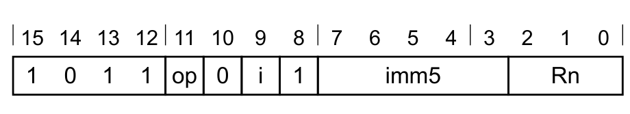

**CBNZ 变体**（当 `op == 1` 时适用）

```arm
CBNZ{<q>} <Rn>, <label>
```

**CBZ 变体**（当 `op == 0` 时适用）

```arm
CBZ{<q>} <Rn>, <label>
```

**解码**

```arm
n = UInt(Rn);  imm32 = ZeroExtend(i:imm5:'0', 32);  nonzero = (op == '1');
if InITBlock() then UNPREDICTABLE;
```

### 1.2 汇编符号（所有编码）

- **`<q>`**：见 C1.2.5 标准汇编语法字段。
- **`<Rn>`**：待测试的通用寄存器，编码在 `Rn` 字段中。
- **`<label>`**：条件分支到的程序标号。其相对 PC 的偏移为 0–126 范围内 2 的倍数，以 `i:imm5` 乘以 4 的形式编码。

### 1.3 操作（所有编码）

```arm
EncodingSpecificOperations();
if nonzero != IsZero(R[n]) then
  BranchTo(PC + imm32);
```

## 2. CDP, CDP2：协处理器数据处理

协处理器数据处理。Coprocessor Data Processing 指示协处理器执行某个操作。

若没有协处理器能执行该指令，则产生 UsageFault 异常。

Arm 保留协处理器 CP8–CP15；本手册定义了 `coproc` 处于该范围时的有效指令。

### 2.1 编码 T1

适用于 Armv8-M Main 扩展。

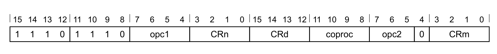

**T1 变体**

```arm
CDP{<c>}{<q>} <coproc>, {#}<opc1>, <CRd>, <CRn>, <CRm> {, {#}<opc2>}
```

**解码**

```arm
if coproc IN {'100x', '101x', '111x'}  then SEE "Floating-point and MVE";
if CoprocType(UInt(coproc)) == CP_CDEv1 then SEE "CDE instructions";
cp = UInt(coproc);
CheckCPDecodeFaults(cp);
if !HaveMainExt()  then UNDEFINED;
```

### 2.2 编码 T2

适用于 Armv8-M Main 扩展。


**T2 变体**

```arm
CDP2{<c>}{<q>} <coproc>, {#}<opc1>, <CRd>, <CRn>, <CRm> {, {#}<opc2>}
```

**解码**

```arm
if coproc IN {'100x', '101x', '111x'}  then SEE "Floating-point and MVE";
if CoprocType(UInt(coproc)) == CP_CDEv1 then SEE "CDE instructions";
cp = UInt(coproc);
CheckCPDecodeFaults(cp);
if !HaveMainExt()  then UNDEFINED;
```

### 2.3 汇编符号（所有编码）

- **`<c>`**：见 C1.2.5 标准汇编语法字段。
- **`<q>`**：见 C1.2.5 标准汇编语法字段。
- **`<coproc>`**：协处理器名称，编码在 `coproc` 字段中。通用协处理器名称为 `p0` 至 `p15`。
- **`<opc1>`**：协处理器专用操作码，取值 0–15，编码在 `opc1` 字段中。
- **`<CRd>`**：目标协处理器寄存器，编码在 `CRd` 字段中。
- **`<CRn>`**：存放第一个操作数的协处理器寄存器，编码在 `CRn` 字段中。
- **`<CRm>`**：存放第二个操作数的协处理器寄存器，编码在 `CRm` 字段中。
- **`<opc2>`**：协处理器专用操作码，取值 0–7，默认为 0，编码在 `opc2` 字段中。

### 2.4 操作（所有编码）

```arm
if ConditionPassed() then
  EncodingSpecificOperations();
  if !Coproc_Accepted(cp, ThisInstr()) then
    GenerateCoprocessorException();
  else
    Coproc_InternalOperation(cp, ThisInstr());
```

## 3. CINC：条件自增

条件自增。若条件为 TRUE，则在目标寄存器中返回源寄存器值加 1；否则返回源寄存器的值。

本指令是 CSINC 的别名，满足以下条件：`Rn == Rm && Rn != 15`。

该别名是首选的反汇编形式。

### 3.1 编码 T1


**CINC 变体**

```arm
CINC<q> Rd, Rn, <fcond>
```

**等价于**

```arm
CSINC<q> Rd, Rn, Rn, invert (<cond>)
```

**当 `Rn == Rm && Rn != 15` 时为首选的反汇编形式。**

### 3.2 受限行为

**数据独立时序行为**

若 `AIRCR.DIT` 为 1：

- 本指令的执行时间与以下各项无关：
  - 其任一寄存器中提供的数据值。
  - N、Z、C、V 标志的值。
- 异步异常的接受时刻不因以下各项而变化：
  - 本指令所使用的任一寄存器中提供的数据值。
  - N、Z、C、V 标志的值。

## 4. CINV：条件取反

条件取反。若条件为 TRUE，则在目标寄存器中返回源寄存器值的按位取反；否则返回源寄存器的值。

本指令是 CSINV 的别名，满足以下条件：`Rn == Rm && Rn != 15`。

该别名是首选的反汇编形式。

### 4.1 编码 T1


**T1：CINV 变体**

```arm
CINV<q> Rd, Rn, <fcond>
```

**等价于**

```arm
CSINV<q> Rd, Rn, Rn, invert (<cond>)
```

**当 `Rn == Rm && Rn != 15` 时为首选的反汇编形式。**

### 4.2 受限行为

**数据独立时序行为**

若 `AIRCR.DIT` 为 1：

- 本指令的执行时间与以下各项无关：
  - 其任一寄存器中提供的数据值。
  - N、Z、C、V 标志的值。
- 异步异常的接受时刻不因以下各项而变化：
  - 本指令所使用的任一寄存器中提供的数据值。
  - N、Z、C、V 标志的值。

## 5. CLREX：清除独占

清除独占。Clear Exclusive 清除执行 PE 关于某地址存在独占访问请求的本地记录。

### 5.1 编码 T1

适用于 Armv8-M。

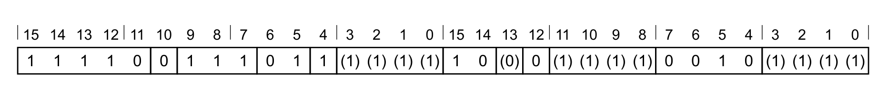

**T1 变体**

```arm
CLREX{<c>}{<q>}
```

**解码**

```arm
// 无需附加解码
```

### 5.2 汇编符号（所有编码）

- **`<c>`**：见 C1.2.5 标准汇编语法字段。
- **`<q>`**：见 C1.2.5 标准汇编语法字段。

### 5.3 操作（所有编码）

```arm
if ConditionPassed() then
  EncodingSpecificOperations();
  ClearExclusiveLocal(ProcessorID());
```

## 6. CLRM：清除多寄存器

清除多寄存器。把指定的通用寄存器清零。本指令是否可被中断续行由实现定义，见 `EPSR.ICI`。若异常返回到本指令时 `EPSR.ICI` 位非零，且 PE 不支持可中断续行的行为，则本指令从头重新开始执行。

### 6.1 编码 T1

适用于 Armv8.1-M Main 扩展。

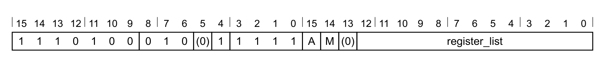

**T1：CLRM 变体**

```arm
CLRM<c><q> <registers>
```

**解码**

```arm
if !HaveMainExt()  then UNDEFINED;
if !HasArchVersion(Armv8p1) then CONSTRAINED_UNPREDICTABLE;
registers = A:M:'0':register_list;
if BitCount(registers) < 1 then CONSTRAINED_UNPREDICTABLE;
```

### 6.2 汇编符号（所有编码）

- **`<c, q>`**：见 C1.2.5 标准汇编语法字段。
- **`<registers>`**：要清除的寄存器列表，以逗号分隔并用 `{` 与 `}` 括起。有效寄存器为 APSR、LR/R14 以及 R12–R0，以位掩码形式编码在 `A`、`M` 和 `register_list` 字段中。

### 6.3 操作（所有编码）

```arm
if ConditionPassed() then
  EncodingSpecificOperations();
  for i = 0 to 14
    if registers[i] == '1' then
      R[i] = Zeros(32);
  if registers[15] == '1' then
    APSR = Zeros(32);
```

## 7. CLZ：前导零计数

前导零计数。Count Leading Zeros 返回一个值中第一个二进制 1 之前的二进制 0 的个数。

### 7.1 编码 T1

适用于 Armv8-M Main 扩展。

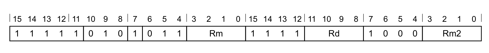

**T1 变体**

```arm
CLZ{<c>}{<q>} <Rd>, <Rm>
```

**解码**

```arm
if !HaveMainExt() then UNDEFINED;
if Rm != Rm2 then UNPREDICTABLE;
d = UInt(Rd);  m = UInt(Rm); m2 = UInt(Rm2);
if d IN {13,15} || m IN {13,15} || m2 IN {13,15} then UNPREDICTABLE;
```

### 7.2 受限不可预测（CONSTRAINED UNPREDICTABLE）行为

若 `Rm != Rm2`，则必须出现下列行为之一：

- 该指令为 UNDEFINED。
- 该指令按 NOP 执行。
- 该指令按所述方式执行，行为不变且无附加副作用。
- 目标寄存器中的值为 UNKNOWN。

### 7.3 汇编符号（所有编码）

- **`<c>`**：见 C1.2.5 标准汇编语法字段。
- **`<q>`**：见 C1.2.5 标准汇编语法字段。
- **`<Rd>`**：通用目标寄存器，编码在 `Rd` 字段中。
- **`<Rm>`**：通用源寄存器，编码在 `Rm` 字段中。其编号必须编码两次。

### 7.4 操作（所有编码）

```arm
if ConditionPassed() then
  EncodingSpecificOperations();
  result = CountLeadingZeroBits(R[m]);
  R[d] = result[31:0];
```

### 7.5 受限行为

无额外限制。

### 7.6 数据独立时序行为

若 `AIRCR.DIT` 为 1：

- 本指令的执行时间与以下各项无关：
  - 其任一寄存器中提供的数据值。
  - N、Z、C、V 标志的值。
- 异步异常的接受时刻不因以下各项而变化：
  - 本指令所使用的任一寄存器中提供的数据值。
  - N、Z、C、V 标志的值。

## 8. CMN (immediate)：立即数比较负数

比较负数（立即数）。CMN (immediate) 把一个寄存器值与一个立即数相加，根据结果更新条件标志，并丢弃结果。

### 8.1 编码 T1

适用于 Armv8-M Main 扩展。

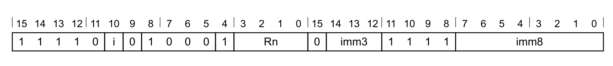

**T1 变体**

```arm
CMN{<c>}{<q>} <Rn>, #<const>
```

**解码**

```arm
if !HaveMainExt() then UNDEFINED;
n = UInt(Rn);  imm32 = T32ExpandImm(i:imm3:imm8);
if n == 15 then UNPREDICTABLE;
```

### 8.2 汇编符号（所有编码）

- **`<c>`**：见 C1.2.5 标准汇编语法字段。
- **`<q>`**：见 C1.2.5 标准汇编语法字段。
- **`<Rn>`**：通用源寄存器，编码在 `Rn` 字段中。
- **`<const>`**：由编码在 `i:imm3:imm8` 字段中的 12 位立即数导出的立即数。取值范围见 C1.5 修改立即数常量。

### 8.3 操作（所有编码）

```arm
if ConditionPassed() then
  EncodingSpecificOperations();
  (result, carry, overflow) = AddWithCarry(R[n], imm32, '0');
  APSR.N = result[31];
  APSR.Z = IsZeroBit(result);
  APSR.C = carry;
  APSR.V = overflow;
```

### 8.4 受限行为

无额外限制。

### 8.5 数据独立时序行为

若 `AIRCR.DIT` 为 1：

- 本指令的执行时间与以下各项无关：
  - 其任一寄存器中提供的数据值。
  - N、Z、C、V 标志的值。
- 异步异常的接受时刻不因以下各项而变化：
  - 本指令所使用的任一寄存器中提供的数据值。
  - N、Z、C、V 标志的值。

## 9. CMN (register)：寄存器比较负数

比较负数（寄存器）。CMN (register) 把一个寄存器值与一个可选移位的寄存器值相加，根据结果更新条件标志，并丢弃结果。

### 9.1 编码 T1

适用于 Armv8-M。

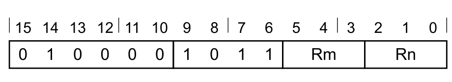

**T1 变体**

```arm
CMN{<c>}{<q>} <Rn>, <Rm>
```

**解码**

```arm
n = UInt(Rn);  m = UInt(Rm);
(shift_t, shift_n) = (SRType_LSL, 0);
```

### 9.2 编码 T2

适用于 Armv8-M Main 扩展。

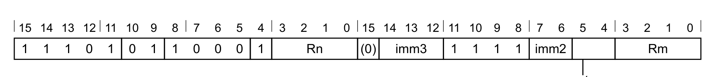

**带扩展的循环右移变体**（当 `imm3 == 000 && imm2 == 00 && sr_type == 11` 时适用）

```arm
CMN{<c>}{<q>} <Rn>, <Rm>, RRX
```

**按值移位或循环移位变体**（当 `!(imm3 == 000 && imm2 == 00 && sr_type == 11)` 时适用）

```arm
CMN{<c>}.W <Rn>, <Rm>
  // <Rn>、<Rm> 可用 T1 表示
CMN{<c>}{<q>} <Rn>, <Rm> {, <shift> #<amount>}
```

**解码**

```arm
if !HaveMainExt() then UNDEFINED;
n = UInt(Rn);  m = UInt(Rm);
(shift_t, shift_n) = DecodeImmShift(sr_type, imm3:imm2);
if n == 15 || m IN {13,15} then UNPREDICTABLE;
```

### 9.3 汇编符号（所有编码）

- **`<c>`**：见 C1.2.5 标准汇编语法字段。
- **`<q>`**：见 C1.2.5 标准汇编语法字段。
- **`<Rn>`**：第一个通用源寄存器，编码在 `Rn` 字段中。
- **`<Rm>`**：第二个通用源寄存器，编码在 `Rm` 字段中。
- **`<shift>`**：施加于第二个源寄存器的移位类型，编码在 `sr_type` 字段中，可取以下值：
  - `LSL`：当 `sr_type = 00` 时。
  - `LSR`：当 `sr_type = 01` 时。
  - `ASR`：当 `sr_type = 10` 时。
  - `ROR`：当 `sr_type = 11` 时。
- **`<amount>`**：移位量，取值 1–31（`<shift>` 为 `LSL` 或 `ROR` 时）或 1–32（`<shift>` 为 `LSR` 或 `ASR` 时），以 `<amount>` 对 32 取模后编码在 `imm3:imm2` 字段中。

### 9.4 操作（所有编码）

```arm
if ConditionPassed() then
  EncodingSpecificOperations();
  shifted = Shift(R[m], shift_t, shift_n, APSR.C);
  (result, carry, overflow) = AddWithCarry(R[n], shifted, '0');
  APSR.N = result[31];
  APSR.Z = IsZeroBit(result);
  APSR.C = carry;
  APSR.V = overflow;
```

### 9.5 受限行为

无额外限制。

### 9.6 数据独立时序行为

若 `AIRCR.DIT` 为 1：

- 本指令的执行时间与以下各项无关：
  - 其任一寄存器中提供的数据值。
  - N、Z、C、V 标志的值。
- 异步异常的接受时刻不因以下各项而变化：
  - 本指令所使用的任一寄存器中提供的数据值。
  - N、Z、C、V 标志的值。

## 10. CMP (immediate)：立即数比较

比较（立即数）。CMP (immediate) 从一个寄存器值中减去一个立即数，根据结果更新条件标志，并丢弃结果。

### 10.1 编码 T1

适用于 Armv8-M。

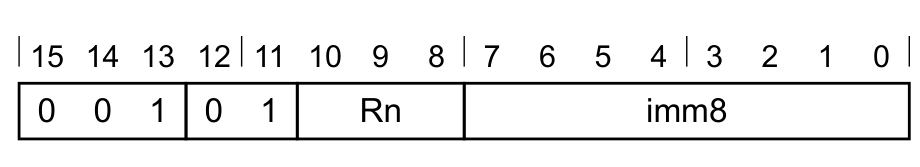

**T1 变体**

```arm
CMP{<c>}{<q>} <Rn>, #<imm8>
```

**解码**

```arm
n = UInt(Rn);  imm32 = ZeroExtend(imm8, 32);
```

### 10.2 编码 T2

适用于 Armv8-M Main 扩展。

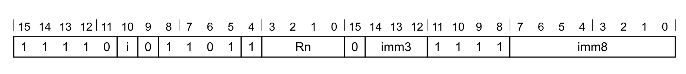

**T2 变体**

```arm
CMP{<c>}.W <Rn>, #<const>
  // <Rn>、<const> 可用 T1 表示
CMP{<c>}{<q>} <Rn>, #<const>
```

**解码**

```arm
if !HaveMainExt() then UNDEFINED;
n = UInt(Rn);  imm32 = T32ExpandImm(i:imm3:imm8);
if n == 15 then UNPREDICTABLE;
```

### 10.3 汇编符号（所有编码）

- **`<c>`**：见 C1.2.5 标准汇编语法字段。
- **`<q>`**：见 C1.2.5 标准汇编语法字段。
- **`<Rn>`**：通用源寄存器，编码在 `Rn` 字段中（编码 T1、T2 相同）。
- **`<imm8>`**：8 位无符号立即数，取值 0–255，编码在 `imm8` 字段中。
- **`<const>`**：由编码在 `i:imm3:imm8` 字段中的 12 位立即数导出的立即数。取值范围见 C1.5 修改立即数常量。

### 10.4 操作（所有编码）

```arm
if ConditionPassed() then
  EncodingSpecificOperations();
  (result, carry, overflow) = AddWithCarry(R[n], NOT(imm32), '1');
  APSR.N = result[31];
  APSR.Z = IsZeroBit(result);
  APSR.C = carry;
  APSR.V = overflow;
```

### 10.5 受限行为

无额外限制。

### 10.6 数据独立时序行为

若 `AIRCR.DIT` 为 1：

- 本指令的执行时间与以下各项无关：
  - 其任一寄存器中提供的数据值。
  - N、Z、C、V 标志的值。
- 异步异常的接受时刻不因以下各项而变化：
  - 本指令所使用的任一寄存器中提供的数据值。
  - N、Z、C、V 标志的值。

## 11. CMP (register)：寄存器比较

比较（寄存器）。CMP (register) 从一个寄存器值中减去一个可选移位的寄存器值，根据结果更新条件标志，并丢弃结果。

### 11.1 编码 T1

适用于 Armv8-M。

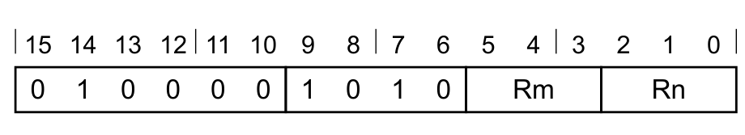

**T1 变体**

```arm
CMP{<c>}{<q>} <Rn>, <Rm>
  // <Rn> 与 <Rm> 均位于 R0–R7
```

**解码**

```arm
n = UInt(Rn);  m = UInt(Rm);
(shift_t, shift_n) = (SRType_LSL, 0);
```

### 11.2 编码 T2

适用于 Armv8-M。

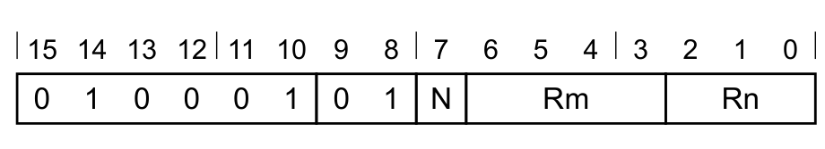

**T2 变体**

```arm
CMP{<c>}{<q>} <Rn>, <Rm>
  // <Rn> 与 <Rm> 不都位于 R0–R7
```

**解码**

```arm
n = UInt(N:Rn);  m = UInt(Rm);
(shift_t, shift_n) = (SRType_LSL, 0);
if n < 8 && m < 8 then UNPREDICTABLE;
if n == 15 || m == 15 then UNPREDICTABLE;
```

### 11.3 受限不可预测（CONSTRAINED UNPREDICTABLE）行为

若 `n < 8 && m < 8`，则必须出现下列行为之一：

- 该指令为 UNDEFINED。
- 该指令按 NOP 执行。
- 该指令按所述方式执行，行为不变且无附加副作用。
- 条件标志变为 UNKNOWN。

### 11.4 编码 T3

适用于 Armv8-M Main 扩展。

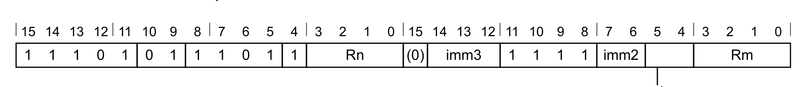

**带扩展的循环右移变体**（当 `imm3 == 000 && imm2 == 00 && sr_type == 11` 时适用）

```arm
CMP{<c>}{<q>} <Rn>, <Rm>, RRX
```

**按值移位或循环移位变体**（当 `!(imm3 == 000 && imm2 == 00 && sr_type == 11)` 时适用）

```arm
CMP{<c>}.W <Rn>, <Rm>
  // <Rn>、<Rm> 可用 T1 或 T2 表示
CMP{<c>}{<q>} <Rn>, <Rm>, <shift> #<amount>
```

**解码**

```arm
if !HaveMainExt() then UNDEFINED;
n = UInt(Rn);  m = UInt(Rm);
(shift_t, shift_n) = DecodeImmShift(sr_type, imm3:imm2);
if n == 15 || m IN {13,15} then UNPREDICTABLE;
```

### 11.5 汇编符号（所有编码）

- **`<c>`**：见 C1.2.5 标准汇编语法字段。
- **`<q>`**：见 C1.2.5 标准汇编语法字段。
- **`<Rn>`**：第一个通用源寄存器。编码 T1、T3 中编码在 `Rn` 字段中；编码 T2 中编码在 `N:Rn` 字段中。
- **`<Rm>`**：第二个通用源寄存器，编码在 `Rm` 字段中。
- **`<shift>`**：施加于第二个源寄存器的移位类型，编码在 `sr_type` 字段中，可取以下值：
  - `LSL`：当 `sr_type = 00` 时。
  - `LSR`：当 `sr_type = 01` 时。
  - `ASR`：当 `sr_type = 10` 时。
  - `ROR`：当 `sr_type = 11` 时。
- **`<amount>`**：移位量，取值 1–31（`<shift>` 为 `LSL` 或 `ROR` 时）或 1–32（`<shift>` 为 `LSR` 或 `ASR` 时），以 `<amount>` 对 32 取模后编码在 `imm3:imm2` 字段中。

### 11.6 操作（所有编码）

```arm
if ConditionPassed() then
  EncodingSpecificOperations();
  shifted = Shift(R[m], shift_t, shift_n, APSR.C);
  (result, carry, overflow) = AddWithCarry(R[n], NOT(shifted), '1');
  APSR.N = result[31];
  APSR.Z = IsZeroBit(result);
  APSR.C = carry;
  APSR.V = overflow;
```

### 11.7 受限行为

无额外限制。

### 11.8 数据独立时序行为

若 `AIRCR.DIT` 为 1：

- 本指令的执行时间与以下各项无关：
  - 其任一寄存器中提供的数据值。
  - N、Z、C、V 标志的值。
- 异步异常的接受时刻不因以下各项而变化：
  - 本指令所使用的任一寄存器中提供的数据值。
  - N、Z、C、V 标志的值。

## 12. CNEG：条件取负

条件取负。若条件为 TRUE，则在目标寄存器中返回源寄存器值的相反数；否则返回源寄存器的值。

本指令是 CSNEG 的别名，满足以下条件：`Rn == Rm`。

该别名是首选的反汇编形式。

### 12.1 编码 T1

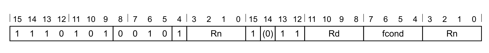

**CNEG 变体**

```arm
CNEG<q> Rd, Rn, <fcond>
```

**等价于**

```arm
CSNEG<q> Rd, Rn, Rn, invert (<cond>)
```

**当 `Rn == Rm` 时为首选的反汇编形式。**

### 12.2 受限行为

**数据独立时序行为**

若 `AIRCR.DIT` 为 1：

- 本指令的执行时间与以下各项无关：
  - 其任一寄存器中提供的数据值。
  - N、Z、C、V 标志的值。
- 异步异常的接受时刻不因以下各项而变化：
  - 本指令所使用的任一寄存器中提供的数据值。
  - N、Z、C、V 标志的值。

## 13. CPS：更改 PE 状态

更改 PE 状态。本指令修改 PRIMASK 与 FAULTMASK 专用寄存器的值。

### 13.1 编码 T1

适用于 Armv8-M。

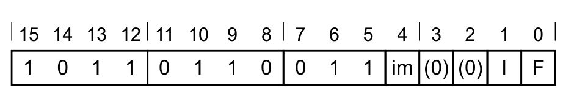

**CPSID 变体**（当 `im == 1` 时适用）

```arm
CPSID{<q>} <iflags>
```

**CPSIE 变体**（当 `im == 0` 时适用）

```arm
CPSIE{<q>} <iflags>
```

**解码**

```arm
enable = (im == '0');  disable = (im == '1');
if InITBlock() then UNPREDICTABLE;
if (I == '0' && F =='0') then UNPREDICTABLE;
affectPRI = (I == '1');  affectFAULT = (F == '1');
if !HaveMainExt() then
  if (I == '0') then UNPREDICTABLE;
  if (F == '1') then UNPREDICTABLE;
```

### 13.2 受限不可预测（CONSTRAINED UNPREDICTABLE）行为

若 `I == '0' && F == '0'`，则必须出现下列行为之一：

- 该指令为 UNDEFINED。
- 该指令按 NOP 执行。

若 `!HaveMainExt() && (I == '0' || F == '1')`，则必须出现下列行为之一：

- 该指令为 UNDEFINED。
- 该指令按 NOP 执行。

### 13.3 汇编符号（所有编码）

- **`<q>`**：见 C1.2.5 标准汇编语法字段。
- **`<iflags>`**：一个或多个下列取值的序列，用于指定受影响的中断屏蔽位：
  - `f`：FAULTMASK。置 1 时把执行优先级提升到 −1，与 HardFault 的优先级相同。这是一个 1 位寄存器，只能由特权软件更新；从除 NMI 以外的任何异常返回时该寄存器清零。
  - `i`：PRIMASK。置 1 时把执行优先级提升到 0。这是一个 1 位寄存器，只能由特权软件更新。

### 13.4 操作（所有编码）

```arm
EncodingSpecificOperations();
if CurrentModeIsPrivileged() then
  if enable then
    if affectPRI then
      PRIMASK.PM = '0';
    if affectFAULT then
      FAULTMASK.FM = '0';
  if disable then
    if affectPRI then
      PRIMASK.PM = '1';
    if affectFAULT && ExecutionPriority() > -1 then
      FAULTMASK.FM = '1';
```

## 14. CSDB：推测数据消耗屏障

推测数据消耗屏障。Consumption of Speculative Data Barrier 是控制推测执行与数据值预测的内存屏障。

按程序顺序出现在 CSDB 之后的指令中，除分支指令和写入 PC 的指令外，任何指令都不得使用以下任一结果进行推测执行：

- 任何指令的数据值预测。
- 按程序顺序出现在 CSDB 之前、尚未在架构上解决的、除条件分支指令和写入 PC 的条件指令以外的任何指令的 APSR.N、Z、C、V 预测。

APSR.N、Z、C、V 不视为数据值。本指令允许：

- CSDB 前后的控制流推测。
- CSDB 之后条件数据处理指令的推测执行，除非它们使用了按程序顺序出现在 CSDB 之前、尚未在架构上解决的指令的数据值或 APSR.N、Z、C、V 预测结果。

本指令是兼容 NOP 的提示。

### 14.1 编码 T1

适用于 Armv8-M Main 扩展。

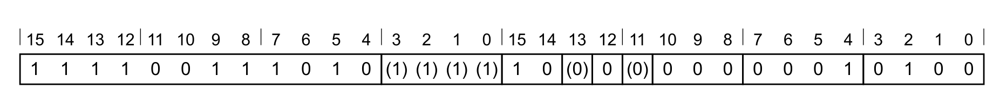

**T1 变体**

```arm
CSDB{<c>}.W
```

**解码**

```arm
if !HaveMainExt() then UNDEFINED;
if InITBlock() then UNPREDICTABLE;
```

### 14.2 受限不可预测（CONSTRAINED UNPREDICTABLE）行为

若 `InITBlock()` 为真，则必须出现下列行为之一：

- 该指令为 UNDEFINED。
- 该指令按 NOP 执行。
- 该指令无条件执行。
- 该指令条件执行。

### 14.3 汇编符号（所有编码）

- **`<c>`**：见 C1.2.5 标准汇编语法字段。

### 14.4 操作（所有编码）

```arm
EncodingSpecificOperations();
ConsumptionOfSpeculativeDataBarrier();
```

## 15. CSEL：条件选择

条件选择。若条件为 TRUE，则在目标寄存器中返回第一个源寄存器的值；否则返回第二个源寄存器的值。

本指令不允许出现在 IT 块中。

### 15.1 编码 T1

适用于 Armv8.1-M Main 扩展。


**T1：CSEL 变体**

```arm
CSEL<q> Rd, Rn, Rm, <fcond>
```

**解码**

```arm
if Rm == '1101'  then SEE "Related encodings";
if !HaveMainExt()  then UNDEFINED;
if !HasArchVersion(Armv8p1) then CONSTRAINED_UNPREDICTABLE;
d = UInt(Rd);
m = UInt(Rm);
n = UInt(Rn);
if InITBlock()  then CONSTRAINED_UNPREDICTABLE;
if Rd  == '11x1' || Rn == '1101' then CONSTRAINED_UNPREDICTABLE;
if fcond == '111x'  then CONSTRAINED_UNPREDICTABLE;
```

### 15.2 汇编符号（所有编码）

- **`<q>`**：见 C1.2.5 标准汇编语法字段。
- **`<Rd>`**：目标通用寄存器。
- **`<Rn>`**：第一个源通用寄存器（允许 ZR，不允许 PC）。
- **`<Rm>`**：第二个源通用寄存器（允许 ZR，不允许 PC）。
- **`<fcond>`**：使用的比较条件，采用标准 Arm 条件码格式。取值如下：
  - `EQ`：编码为 `fcond = 0000`。
  - `NE`：编码为 `fcond = 0001`。
  - `CS`：编码为 `fcond = 0010`。
  - `CC`：编码为 `fcond = 0011`。
  - `MI`：编码为 `fcond = 0100`。
  - `PL`：编码为 `fcond = 0101`。
  - `VS`：编码为 `fcond = 0110`。
  - `VC`：编码为 `fcond = 0111`。
  - `HI`：编码为 `fcond = 1000`。
  - `LS`：编码为 `fcond = 1001`。
  - `GE`：编码为 `fcond = 1010`。
  - `LT`：编码为 `fcond = 1011`。
  - `GT`：编码为 `fcond = 1100`。
  - `LE`：编码为 `fcond = 1101`。

### 15.3 操作（所有编码）

```arm
EncodingSpecificOperations();
bits(32) result;
if ConditionHolds(fcond) then
  result = RZ[n];
else
  result = RZ[m];
R[d] = result;
```

### 15.4 受限行为

无额外限制。

### 15.5 数据独立时序行为

若 `AIRCR.DIT` 为 1：

- 本指令的执行时间与以下各项无关：
  - 其任一寄存器中提供的数据值。
  - N、Z、C、V 标志的值。
- 异步异常的接受时刻不因以下各项而变化：
  - 本指令所使用的任一寄存器中提供的数据值。
  - N、Z、C、V 标志的值。

## 16. CSET：条件置位

条件置位。若条件为 TRUE，则把目标寄存器置为 1；否则置为 0。

本指令是 CSINC 的别名，满足以下条件：`Rn==15 && Rm==15`。

该别名是首选的反汇编形式。

### 16.1 编码 T1


**CSET 变体**

```arm
CSET<q> Rd, <fcond>
```

**等价于**

```arm
CSINC<q> Rd, Zr, Zr, invert (<cond>)
```

**当 `Rn == 15 && Rm == 15` 时为首选的反汇编形式。**

### 16.2 受限行为

**数据独立时序行为**

若 `AIRCR.DIT` 为 1：

- 本指令的执行时间与以下各项无关：
  - 其任一寄存器中提供的数据值。
  - N、Z、C、V 标志的值。
- 异步异常的接受时刻不因以下各项而变化：
  - 本指令所使用的任一寄存器中提供的数据值。
  - N、Z、C、V 标志的值。

## 17. CSETM：条件置屏蔽

条件置屏蔽。若条件为 TRUE，则把目标寄存器的所有位置为 1；否则全部置为 0。

本指令是 CSINV 的别名，满足以下条件：`Rn==15 && Rm==15`。

该别名是首选的反汇编形式。

### 17.1 编码 T1

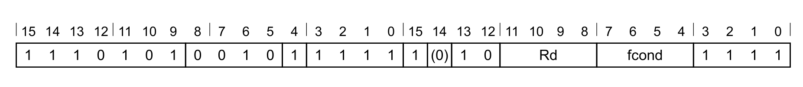

**T1：CSETM 变体**

```arm
CSETM<q> Rd, <fcond>
```

**等价于**

```arm
CSINV<q> Rd, Zr, Zr, invert (<cond>)
```

**当 `Rn == 15 && Rm == 15` 时为首选的反汇编形式。**

### 17.2 受限行为

**数据独立时序行为**

若 `AIRCR.DIT` 为 1：

- 本指令的执行时间与以下各项无关：
  - 其任一寄存器中提供的数据值。
  - N、Z、C、V 标志的值。
- 异步异常的接受时刻不因以下各项而变化：
  - 本指令所使用的任一寄存器中提供的数据值。
  - N、Z、C、V 标志的值。

## 18. CSINC：条件选择自增

条件选择自增。若条件为 TRUE，则在目标寄存器中返回第一个源寄存器的值；否则返回第二个源寄存器的值加 1。

本指令不允许出现在 IT 块中。

### 18.1 编码 T1

适用于 Armv8.1-M Main 扩展。

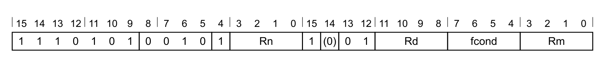

**T1：CSINC 变体**

```arm
CSINC<q> Rd, Rn, Rm, <fcond>
```

**解码**

```arm
if Rm == '1101'  then SEE "Related encodings";
if !HaveMainExt()  then UNDEFINED;
if !HasArchVersion(Armv8p1) then CONSTRAINED_UNPREDICTABLE;
d = UInt(Rd);
m = UInt(Rm);
n = UInt(Rn);
if InITBlock()  then CONSTRAINED_UNPREDICTABLE;
if Rd  == '11x1' || Rn == '1101' then CONSTRAINED_UNPREDICTABLE;
if fcond == '111x'  then CONSTRAINED_UNPREDICTABLE;
```

### 18.2 汇编符号（所有编码）

- **`<q>`**：见 C1.2.5 标准汇编语法字段。
- **`<Rd>`**：目标通用寄存器。
- **`<Rn>`**：第一个源通用寄存器（允许 ZR，不允许 PC）。
- **`<Rm>`**：第二个源通用寄存器（允许 ZR，不允许 PC）。
- **`<fcond>`**：使用的比较条件，采用标准 Arm 条件码格式。取值如下：
  - `EQ`：编码为 `fcond = 0000`。
  - `NE`：编码为 `fcond = 0001`。
  - `CS`：编码为 `fcond = 0010`。
  - `CC`：编码为 `fcond = 0011`。
  - `MI`：编码为 `fcond = 0100`。
  - `PL`：编码为 `fcond = 0101`。
  - `VS`：编码为 `fcond = 0110`。
  - `VC`：编码为 `fcond = 0111`。
  - `HI`：编码为 `fcond = 1000`。
  - `LS`：编码为 `fcond = 1001`。
  - `GE`：编码为 `fcond = 1010`。
  - `LT`：编码为 `fcond = 1011`。
  - `GT`：编码为 `fcond = 1100`。
  - `LE`：编码为 `fcond = 1101`。

### 18.3 操作（所有编码）

```arm
EncodingSpecificOperations();
bits(32) result;
if ConditionHolds(fcond) then
  result = RZ[n];
else
  result = RZ[m] + 1;
R[d] = result;
```

### 18.4 受限行为

无额外限制。

### 18.5 数据独立时序行为

若 `AIRCR.DIT` 为 1：

- 本指令的执行时间与以下各项无关：
  - 其任一寄存器中提供的数据值。
  - N、Z、C、V 标志的值。
- 异步异常的接受时刻不因以下各项而变化：
  - 本指令所使用的任一寄存器中提供的数据值。
  - N、Z、C、V 标志的值。

## 19. CSINV：条件选择取反

条件选择取反。若条件为 TRUE，则在目标寄存器中返回第一个源寄存器的值；否则返回第二个源寄存器的按位取反值。

本指令不允许出现在 IT 块中。

### 19.1 编码 T1

适用于 Armv8.1-M Main 扩展。


**T1：CSINV 变体**

```arm
CSINV<q> Rd, Rn, Rm, <fcond>
```

**解码**

```arm
if Rm == '1101'  then SEE "Related encodings";
if !HaveMainExt()  then UNDEFINED;
if !HasArchVersion(Armv8p1) then CONSTRAINED_UNPREDICTABLE;
d = UInt(Rd);
m = UInt(Rm);
n = UInt(Rn);
if InITBlock()  then CONSTRAINED_UNPREDICTABLE;
if Rd  == '11x1' || Rn == '1101' then CONSTRAINED_UNPREDICTABLE;
if fcond == '111x'  then CONSTRAINED_UNPREDICTABLE;
```

### 19.2 汇编符号（所有编码）

- **`<q>`**：见 C1.2.5 标准汇编语法字段。
- **`<Rd>`**：目标通用寄存器。
- **`<Rn>`**：第一个源通用寄存器（允许 ZR，不允许 PC）。
- **`<Rm>`**：第二个源通用寄存器（允许 ZR，不允许 PC）。
- **`<fcond>`**：使用的比较条件，采用标准 Arm 条件码格式。取值如下：
  - `EQ`：编码为 `fcond = 0000`。
  - `NE`：编码为 `fcond = 0001`。
  - `CS`：编码为 `fcond = 0010`。
  - `CC`：编码为 `fcond = 0011`。
  - `MI`：编码为 `fcond = 0100`。
  - `PL`：编码为 `fcond = 0101`。
  - `VS`：编码为 `fcond = 0110`。
  - `VC`：编码为 `fcond = 0111`。
  - `HI`：编码为 `fcond = 1000`。
  - `LS`：编码为 `fcond = 1001`。
  - `GE`：编码为 `fcond = 1010`。
  - `LT`：编码为 `fcond = 1011`。
  - `GT`：编码为 `fcond = 1100`。
  - `LE`：编码为 `fcond = 1101`。

### 19.3 操作（所有编码）

```arm
EncodingSpecificOperations();
bits(32) result;
if ConditionHolds(fcond) then
  result = RZ[n];
else
  result = NOT(RZ[m]);
R[d] = result;
```

### 19.4 受限行为

无额外限制。

### 19.5 数据独立时序行为

若 `AIRCR.DIT` 为 1：

- 本指令的执行时间与以下各项无关：
  - 其任一寄存器中提供的数据值。
  - N、Z、C、V 标志的值。
- 异步异常的接受时刻不因以下各项而变化：
  - 本指令所使用的任一寄存器中提供的数据值。
  - N、Z、C、V 标志的值。

## 20. CSNEG：条件选择取负

条件选择取负。若条件为 TRUE，则在目标寄存器中返回第一个源寄存器的值；否则返回第二个源寄存器的相反数。

本指令不允许出现在 IT 块中。

### 20.1 编码 T1

适用于 Armv8.1-M Main 扩展。

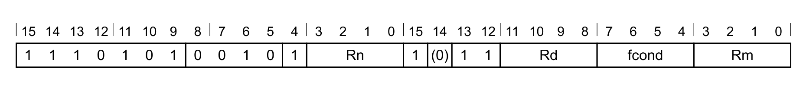

**T1：CSNEG 变体**

```arm
CSNEG<q> Rd, Rn, Rm, <fcond>
```

**解码**

```arm
if Rm == '1101'  then SEE "Related encodings";
if !HaveMainExt()  then UNDEFINED;
if !HasArchVersion(Armv8p1) then CONSTRAINED_UNPREDICTABLE;
d = UInt(Rd);
m = UInt(Rm);
n = UInt(Rn);
if InITBlock()  then CONSTRAINED_UNPREDICTABLE;
if Rd  == '11x1' || Rn == '1101' then CONSTRAINED_UNPREDICTABLE;
if fcond == '111x'  then CONSTRAINED_UNPREDICTABLE;
```

### 20.2 汇编符号（所有编码）

- **`<q>`**：见 C1.2.5 标准汇编语法字段。
- **`<Rd>`**：目标通用寄存器。
- **`<Rn>`**：第一个源通用寄存器（允许 ZR，不允许 PC）。
- **`<Rm>`**：第二个源通用寄存器（允许 ZR，不允许 PC）。
- **`<fcond>`**：使用的比较条件，采用标准 Arm 条件码格式。取值如下：
  - `EQ`：编码为 `fcond = 0000`。
  - `NE`：编码为 `fcond = 0001`。
  - `CS`：编码为 `fcond = 0010`。
  - `CC`：编码为 `fcond = 0011`。
  - `MI`：编码为 `fcond = 0100`。
  - `PL`：编码为 `fcond = 0101`。
  - `VS`：编码为 `fcond = 0110`。
  - `VC`：编码为 `fcond = 0111`。
  - `HI`：编码为 `fcond = 1000`。
  - `LS`：编码为 `fcond = 1001`。
  - `GE`：编码为 `fcond = 1010`。
  - `LT`：编码为 `fcond = 1011`。
  - `GT`：编码为 `fcond = 1100`。
  - `LE`：编码为 `fcond = 1101`。

### 20.3 操作（所有编码）

```arm
EncodingSpecificOperations();
bits(32) result;
if ConditionHolds(fcond) then
  result = RZ[n];
else
  result = NOT(RZ[m]);
  result = result + 1;
R[d] = result;
```

### 20.4 受限行为

无额外限制。

### 20.5 数据独立时序行为

若 `AIRCR.DIT` 为 1：

- 本指令的执行时间与以下各项无关：
  - 其任一寄存器中提供的数据值。
  - N、Z、C、V 标志的值。
- 异步异常的接受时刻不因以下各项而变化：
  - 本指令所使用的任一寄存器中提供的数据值。
  - N、Z、C、V 标志的值。

## 21. CX1：自定义指令类 1

自定义指令类 1。自定义指令类 1 根据一个立即数以及（可选地）目标值计算出一个值，并把结果写入目标寄存器。

源寄存器与目标寄存器可以是一般通用寄存器，也可以是条件标志（用 `APSR_nzcv` 指定）。

### 21.1 编码 T1

适用于 Armv8-M 自定义数据通路扩展。

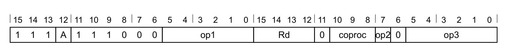

**累加器变体**（当 `A == 1` 时适用）

```arm
CX1A<c>, <coproc>, <Rd>, #<imm>
```

**非累加器变体**（当 `A == 0` 时适用）

```arm
CX1 <coproc>, <Rd>, #<imm>
```

**解码**

```arm
if CoprocType(UInt(coproc)) != CP_CDEv1 then SEE "Coprocessor instructions";
if !HaveMainExt()  then UNDEFINED;
cp  = UInt(coproc);
d  = UInt(Rd);
imm = op1:op2:op3;
acc = (A == '1');
CheckCPDecodeFaults(cp);
if d == 13  then UNPREDICTABLE;
if !acc && InITBlock()  then UNPREDICTABLE;
```

### 21.2 受限不可预测（CONSTRAINED UNPREDICTABLE）行为

若 `d == 13`，则必须出现下列行为之一：

- 该指令为 UNDEFINED。
- 该指令在 SP 中返回 UNKNOWN 值，且是否执行栈限检查为 UNKNOWN。
- 该指令按 NOP 执行。

若 `!acc && InITBlock()`，则必须出现下列行为之一：

- 该指令为 UNDEFINED。
- 该指令如同通过了条件码检查一样执行。
- 该指令按 NOP 执行。

### 21.3 汇编符号（所有编码）

- **`<A>`**：与现有寄存器内容累加。取值如下：
  - `-`：编码为 `A = 0`。
  - `A`：编码为 `A = 1`。
- **`<c>`**：见 C1.2.5 标准汇编语法字段。
- **`<coproc>`**：协处理器名称，编码在 `coproc` 字段中。有效名称为 `p0` 至 `p7`。
- **`<Rd>`**：通用寄存器 R0–R14 或 `APSR_nzcv` 目标寄存器，编码在 `Rd` 字段中。对累加器变体，`<Rd>` 同时指定源寄存器；`APSR_nzcv` 以 `Rd` 字段值 `0b1111` 编码。
- **`<imm>`**：编码在 `op1:op2:op3` 中的立即数。

### 21.4 操作（所有编码）

```arm
if ConditionPassed() then
  EncodingSpecificOperations();
  if (!Coproc_Accepted(cp, ThisInstr())) then
    GenerateCoprocessorException();
  elsif acc then
    RF[d] = CX_op1(ThisInstr(), RF[d], 32);
  else
    RF[d] = CX_op0(ThisInstr(), 32);
```

## 22. CX1D：自定义指令类 1（双寄存器）

自定义指令类 1（双寄存器）。自定义指令类 1 双寄存器根据一个立即数以及（可选地）目标寄存器对的值计算出一个值，并把结果写入目标寄存器对。

目标寄存器是一对连续的通用寄存器。

每一对中两个字的重要性与当前数据端序一致。

### 22.1 编码 T1

适用于 Armv8-M 自定义数据通路扩展。


**累加器变体**（当 `A == 1` 时适用）

```arm
CX1DA<c>, <coproc>, <Rd>, <Rd+1>, #<imm>
```

**非累加器变体**（当 `A == 0` 时适用）

```arm
CX1D <coproc>, <Rd>, <Rd+1>, #<imm>
```

**解码**

```arm
if CoprocType(UInt(coproc)) != CP_CDEv1 then SEE "Coprocessor instructions";
if !HaveMainExt()  then UNDEFINED;
cp  = UInt(coproc);
d  = UInt(Rd);
d2  = d + 1;
imm = op1:op2:op3;
acc = (A == '1');
CheckCPDecodeFaults(cp);
// 寄存器对中包含 SP 或 PC 时为 UNPREDICTABLE
if d > 10  then UNPREDICTABLE;
if Rd[0] == '1'  then UNPREDICTABLE;
if !acc && InITBlock()  then UNPREDICTABLE;
```

### 22.2 受限不可预测（CONSTRAINED UNPREDICTABLE）行为

若 `d` 为奇数，则必须出现下列行为之一：

- 该指令为 UNDEFINED。
- 该指令在 `Rd`、`Rd + 1` 与 `Rd - 1` 中返回 UNKNOWN 值。
- 该指令按 NOP 执行。

若 `d == 12`，则必须出现下列行为之一：

- 该指令为 UNDEFINED。
- 该指令在 R12 与 SP 中返回 UNKNOWN 值。
- 该指令按 NOP 执行。

若 `d == 12 || d == 13`，则必须出现下列行为之一：

- 是否执行栈限检查为 UNKNOWN。

若 `d == 14`，则必须出现下列行为之一：

- 该指令为 UNDEFINED。
- 该指令按 NOP 执行。

若 `!acc && InITBlock()`，则必须出现下列行为之一：

- 该指令为 UNDEFINED。
- 该指令如同通过了条件码检查一样执行。
- 该指令按 NOP 执行。

### 22.3 汇编符号（所有编码）

- **`<A>`**：与现有寄存器内容累加。取值如下：
  - `-`：编码为 `A = 0`。
  - `A`：编码为 `A = 1`。
- **`<c>`**：见 C1.2.5 标准汇编语法字段。
- **`<coproc>`**：协处理器名称，编码在 `coproc` 字段中。有效名称为 `p0` 至 `p7`。
- **`<Rd>`**：指定目标寄存器对中第一个寄存器的通用寄存器 R0–R10，编码在 `Rd` 字段中。对累加器变体，`<Rd>` 同时指定源寄存器。
- **`<imm>`**：编码在 `op1:op2:op3` 中的立即数。

### 22.4 操作（所有编码）

```arm
if ConditionPassed() then
  EncodingSpecificOperations();
  if (!Coproc_Accepted(cp, ThisInstr())) then
    GenerateCoprocessorException();
  elsif acc then
    RFD[d] = CX_op1(ThisInstr(), RFD[d], 64);
  else
    RFD[d] = CX_op0(ThisInstr(), 64);
```

## 23. CX2：自定义指令类 2

自定义指令类 2。自定义指令类 2 根据一个源寄存器、一个立即数以及（可选地）目标值计算出一个值，并把结果写入目标寄存器。源寄存器与目标寄存器可以是一般通用寄存器，也可以是条件标志（用 `APSR_nzcv` 指定）。

### 23.1 编码 T1

适用于 Armv8-M 自定义数据通路扩展。

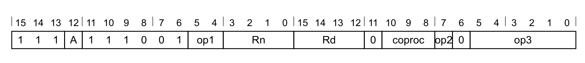

**累加器变体**（当 `A == 1` 时适用）

```arm
CX2A<c>, <coproc>, <Rd>, <Rn>, #<imm>
```

**非累加器变体**（当 `A == 0` 时适用）

```arm
CX2 <coproc>, <Rd>, <Rn>, #<imm>
```

**解码**

```arm
if CoprocType(UInt(coproc)) != CP_CDEv1 then SEE "Coprocessor instructions";
if !HaveMainExt()  then UNDEFINED;
cp  = UInt(coproc);
d  = UInt(Rd);
n  = UInt(Rn);
imm = op1:op2:op3;
acc = (A == '1');
CheckCPDecodeFaults(cp);
if d == 13 || n == 13  then UNPREDICTABLE;
if !acc && InITBlock()  then UNPREDICTABLE;
```

### 23.2 受限不可预测（CONSTRAINED UNPREDICTABLE）行为

若 `d == 13`，则必须出现下列行为之一：

- 该指令为 UNDEFINED。
- 该指令在 SP 中返回 UNKNOWN 值，且是否执行栈限检查为 UNKNOWN。
- 该指令按 NOP 执行。

若 `n == 13`，则必须出现下列行为之一：

- 该指令按 NOP 执行。
- 该指令返回 UNKNOWN 值。
- 该指令为 UNDEFINED。

若 `!acc && InITBlock()`，则必须出现下列行为之一：

- 该指令为 UNDEFINED。
- 该指令如同通过了条件码检查一样执行。
- 该指令按 NOP 执行。

### 23.3 汇编符号（所有编码）

- **`<A>`**：与现有寄存器内容累加。取值如下：
  - `-`：编码为 `A = 0`。
  - `A`：编码为 `A = 1`。
- **`<c>`**：见 C1.2.5 标准汇编语法字段。
- **`<coproc>`**：协处理器名称，编码在 `coproc` 字段中。有效名称为 `p0` 至 `p7`。
- **`<Rd>`**：通用寄存器 R0–R14 或 `APSR_nzcv` 目标寄存器，编码在 `Rd` 字段中。对累加器变体，`<Rd>` 同时指定源寄存器；`APSR_nzcv` 以 `Rd` 字段值 `0b1111` 编码。
- **`<Rn>`**：通用寄存器 R0–R14 或 `APSR_nzcv` 源寄存器，编码在 `Rn` 字段中；`APSR_nzcv` 以 `Rn` 字段值 `0b1111` 编码。
- **`<imm>`**：编码在 `op1:op2:op3` 中的立即数。

### 23.4 操作（所有编码）

```arm
if ConditionPassed() then
  EncodingSpecificOperations();
  if (!Coproc_Accepted(cp, ThisInstr())) then
    GenerateCoprocessorException();
  elsif acc then
    RF[d] = CX_op2(ThisInstr(), RF[d], RF[n], 32);
  else
    RF[d] = CX_op1(ThisInstr(), RF[n], 32);
```

## 24. CX2D：自定义指令类 2（双寄存器）

自定义指令类 2（双寄存器）。自定义指令类 2 双寄存器根据一个源寄存器、一个立即数以及（可选地）目标寄存器对的值计算出一个值，并把结果写入目标寄存器对。

目标寄存器是一对连续的通用寄存器。

源寄存器可以是一般通用寄存器，也可以是条件标志（用 `APSR_nzcv` 指定）。

每一对中两个字的重要性与当前数据端序一致。

### 24.1 编码 T1

适用于 Armv8-M 自定义数据通路扩展。

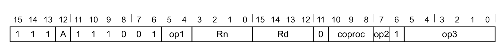

**累加器变体**（当 `A == 1` 时适用）

```arm
CX2DA<c>, <coproc>, <Rd>, <Rd+1>, <Rn>, #<imm>
```

**非累加器变体**（当 `A == 0` 时适用）

```arm
CX2D <coproc>, <Rd>, <Rd+1>, <Rn>, #<imm>
```

**解码**

```arm
if CoprocType(UInt(coproc)) != CP_CDEv1 then SEE "Coprocessor instructions";
if !HaveMainExt()  then UNDEFINED;
cp  = UInt(coproc);
d  = UInt(Rd);
n  = UInt(Rn);
imm = op1:op2:op3;
acc = (A == '1');
CheckCPDecodeFaults(cp);
// 寄存器对中包含 SP 或 PC 时为 UNPREDICTABLE
if d > 10  then UNPREDICTABLE;
if n == 13  then UNPREDICTABLE;
if Rd[0] == '1'  then UNPREDICTABLE;
if !acc && InITBlock()  then UNPREDICTABLE;
```

### 24.2 受限不可预测（CONSTRAINED UNPREDICTABLE）行为

若 `d` 为奇数，则必须出现下列行为之一：

- 该指令为 UNDEFINED。
- 该指令在 `Rd`、`Rd + 1` 与 `Rd - 1` 中返回 UNKNOWN 值。
- 该指令按 NOP 执行。

若 `d == 12`，则必须出现下列行为之一：

- 该指令为 UNDEFINED。
- 该指令在 R12 与 SP 中返回 UNKNOWN 值。
- 该指令按 NOP 执行。

若 `d == 12 || d == 13`，则必须出现下列行为之一：

- 是否执行栈限检查为 UNKNOWN。

若 `d == 14`，则必须出现下列行为之一：

- 该指令为 UNDEFINED。
- 该指令按 NOP 执行。

若 `n == 13`，则必须出现下列行为之一：

- 该指令为 UNDEFINED。
- 目标寄存器中的值为 UNKNOWN。
- 该指令按 NOP 执行。

若 `!acc && InITBlock()`，则必须出现下列行为之一：

- 该指令为 UNDEFINED。
- 该指令如同通过了条件码检查一样执行。
- 该指令按 NOP 执行。

### 24.3 汇编符号（所有编码）

- **`<A>`**：与现有寄存器内容累加。取值如下：
  - `-`：编码为 `A = 0`。
  - `A`：编码为 `A = 1`。
- **`<c>`**：见 C1.2.5 标准汇编语法字段。
- **`<coproc>`**：协处理器名称，编码在 `coproc` 字段中。有效名称为 `p0` 至 `p7`。
- **`<Rd>`**：指定目标寄存器对中第一个寄存器的通用寄存器 R0–R10，编码在 `Rd` 字段中。对累加器变体，`<Rd>` 同时指定源寄存器。
- **`<Rn>`**：通用寄存器 R0–R14 或 `APSR_nzcv` 源寄存器，编码在 `Rn` 字段中；`APSR_nzcv` 以 `Rn` 字段值 `0b1111` 编码。
- **`<imm>`**：编码在 `op1:op2:op3` 中的立即数。

### 24.4 操作（所有编码）

```arm
if ConditionPassed() then
  EncodingSpecificOperations();
  if (!Coproc_Accepted(cp, ThisInstr())) then
    GenerateCoprocessorException();
  elsif acc then
    RFD[d] = CX_op2(ThisInstr(), RFD[d], RF[n], 64);
  else
    RFD[d] = CX_op1(ThisInstr(), RF[n], 64);
```

## 25. CX3：自定义指令类 3

自定义指令类 3。自定义指令类 3 根据两个源寄存器、一个立即数以及（可选地）目标值计算出一个值，并把结果写入目标寄存器。

源寄存器与目标寄存器可以是一般通用寄存器，也可以是条件标志（用 `APSR_nzcv` 指定）。

### 25.1 编码 T1

适用于 Armv8-M 自定义数据通路扩展。


**累加器变体**（当 `A == 1` 时适用）

```arm
CX3A<c>, <coproc>, <Rd>, <Rn>, <Rm>, #<imm>
```

**非累加器变体**（当 `A == 0` 时适用）

```arm
CX3 <coproc>, <Rd>, <Rn>, <Rm>, #<imm>
```

**解码**

```arm
if CoprocType(UInt(coproc)) != CP_CDEv1 then SEE "Coprocessor instructions";
if !HaveMainExt()  then UNDEFINED;
cp  = UInt(coproc);
d  = UInt(Rd);
n  = UInt(Rn);
m  = UInt(Rm);
imm = op1:op2:op3;
acc = (A == '1');
CheckCPDecodeFaults(cp);
if d == 13 || n == 13 || m == 13  then UNPREDICTABLE;
if !acc && InITBlock()  then UNPREDICTABLE;
```

### 25.2 受限不可预测（CONSTRAINED UNPREDICTABLE）行为

若 `d == 13`，则必须出现下列行为之一：

- 该指令为 UNDEFINED。
- 该指令在 SP 中返回 UNKNOWN 值，且是否执行栈限检查为 UNKNOWN。
- 该指令按 NOP 执行。

若 `n == 13 or m == 13`，则必须出现下列行为之一：

- 该指令为 UNDEFINED。
- 该指令在 SP 中返回 UNKNOWN 值。
- 该指令按 NOP 执行。

若 `!acc && InITBlock()`，则必须出现下列行为之一：

- 该指令为 UNDEFINED。
- 该指令如同通过了条件码检查一样执行。
- 该指令按 NOP 执行。

### 25.3 汇编符号（所有编码）

- **`<A>`**：与现有寄存器内容累加。取值如下：
  - `-`：编码为 `A = 0`。
  - `A`：编码为 `A = 1`。
- **`<c>`**：见 C1.2.5 标准汇编语法字段。
- **`<coproc>`**：协处理器名称，编码在 `coproc` 字段中。有效名称为 `p0` 至 `p7`。
- **`<Rd>`**：通用寄存器 R0–R14 或 `APSR_nzcv` 目标寄存器，编码在 `Rd` 字段中。对累加器变体，`<Rd>` 同时指定源寄存器；`APSR_nzcv` 以 `Rd` 字段值 `0b1111` 编码。
- **`<Rn>`**：通用寄存器 R0–R14 或 `APSR_nzcv` 寄存器，编码在 `Rn` 字段中；`APSR_nzcv` 以 `Rn` 字段值 `0b1111` 编码。
- **`<Rm>`**：通用寄存器 R0–R14 或 `APSR_nzcv` 寄存器，编码在 `Rm` 字段中；`APSR_nzcv` 以 `Rm` 字段值 `0b1111` 编码。
- **`<imm>`**：编码在 `op1:op2:op3` 中的立即数。

### 25.4 操作（所有编码）

```arm
if ConditionPassed() then
  EncodingSpecificOperations();
  if (!Coproc_Accepted(cp, ThisInstr())) then
    GenerateCoprocessorException();
  elsif acc then
    RF[d] = CX_op3(ThisInstr(), RF[d], RF[n], RF[m], 32);
  else
    RF[d] = CX_op2(ThisInstr(), RF[n], RF[m], 32);
```

## 26. CX3D：自定义指令类 3（双寄存器）

自定义指令类 3（双寄存器）。自定义指令类 3 双寄存器根据两个源寄存器、一个立即数以及（可选地）目标寄存器对的值计算出一个值，并把结果写入目标寄存器对。

源寄存器可以是一般通用寄存器，也可以是条件标志（用 `APSR_nzcv` 指定）。

目标寄存器是一对连续的通用寄存器。

每一对中两个字的重要性与当前数据端序一致。

### 26.1 编码 T1

适用于 Armv8-M 自定义数据通路扩展。

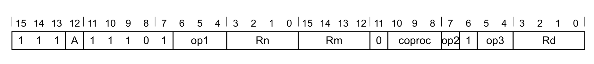

**累加器变体**（当 `A == 1` 时适用）

```arm
CX3DA<c>, <coproc>, <Rd>, <Rd+1>, <Rn>, <Rm>, #<imm>
```

**非累加器变体**（当 `A == 0` 时适用）

```arm
CX3D <coproc>, <Rd>, <Rd+1>, <Rn>, <Rm>, #<imm>
```

**解码**

```arm
if CoprocType(UInt(coproc)) != CP_CDEv1 then SEE "Coprocessor instructions";
if !HaveMainExt()  then UNDEFINED;
cp  = UInt(coproc);
d  = UInt(Rd);
n  = UInt(Rn);
m  = UInt(Rm);
imm = op1:op2:op3;
acc = (A == '1');
CheckCPDecodeFaults(cp);
// 寄存器对中包含 SP 或 PC 时为 UNPREDICTABLE
if d > 10  then UNPREDICTABLE;
if n == 13 || m == 13  then UNPREDICTABLE;
if Rd[0] == '1'  then UNPREDICTABLE;
if !acc && InITBlock()  then UNPREDICTABLE;
```

### 26.2 受限不可预测（CONSTRAINED UNPREDICTABLE）行为

若 `d` 为奇数，则必须出现下列行为之一：

- 该指令为 UNDEFINED。
- 该指令在 `Rd`、`Rd + 1` 与 `Rd - 1` 中返回 UNKNOWN 值。
- 该指令按 NOP 执行。

若 `d == 12`，则必须出现下列行为之一：

- 该指令为 UNDEFINED。
- 该指令在 SP 中返回 UNKNOWN 值。
- 该指令按 NOP 执行。

若 `d == 12 || d == 13`，则必须出现下列行为之一：

- 是否执行栈限检查为 UNKNOWN。

若 `d == 14`，则必须出现下列行为之一：

- 该指令为 UNDEFINED。
- 该指令按 NOP 执行。

若 `n == 13 || m == 13`，则必须出现下列行为之一：

- 该指令为 UNDEFINED。
- 目标寄存器中的值为 UNKNOWN。
- 该指令按 NOP 执行。

若 `!acc && InITBlock()`，则必须出现下列行为之一：

- 该指令为 UNDEFINED。
- 该指令如同通过了条件码检查一样执行。
- 该指令按 NOP 执行。

### 26.3 汇编符号（所有编码）

- **`<A>`**：与现有寄存器内容累加。取值如下：
  - `-`：编码为 `A = 0`。
  - `A`：编码为 `A = 1`。
- **`<c>`**：见 C1.2.5 标准汇编语法字段。
- **`<coproc>`**：协处理器名称，编码在 `coproc` 字段中。有效名称为 `p0` 至 `p7`。
- **`<Rd>`**：指定目标寄存器对中第一个寄存器的通用寄存器 R0–R10，编码在 `Rd` 字段中。对累加器变体，`<Rd>` 同时指定源寄存器。
- **`<Rn>`**：通用寄存器 R0–R14 或 `APSR_nzcv` 源寄存器，编码在 `Rn` 字段中；`APSR_nzcv` 以 `Rn` 字段值 `0b1111` 编码。
- **`<Rm>`**：通用寄存器 R0–R14 或 `APSR_nzcv` 源寄存器，编码在 `Rm` 字段中；`APSR_nzcv` 以 `Rm` 字段值 `0b1111` 编码。
- **`<imm>`**：编码在 `op1:op2:op3` 中的立即数。

### 26.4 操作（所有编码）

```arm
if ConditionPassed() then
  EncodingSpecificOperations();
  if (!Coproc_Accepted(cp, ThisInstr())) then
    GenerateCoprocessorException();
  elsif acc then
    RFD[d] = CX_op3(ThisInstr(), RFD[d], RF[n], RF[m], 64);
  else
    RFD[d] = CX_op2(ThisInstr(), RF[n], RF[m], 64);
```
