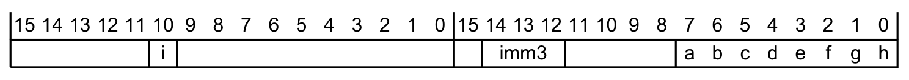

本章给出第 C2 章《指令规范》中各项指令描述的组成定义。

## 1. 指令集

只有一套指令集，称为 **T32**。

适用于 **Armv8.0-M** 及以后架构版本的实现。

参见：

- 第 C1.4 节《指令集编码信息》。
- 第 C2 章《指令规范》。

## 2. 指令描述格式

第 C2 章《指令规范》中的每条指令描述包含以下内容：

1. 标题。
2. 简短描述。
3. 该指令的编码（一种或多种）。
4. 任何别名条件（如适用）。
5. 该指令的汇编符号列表。
6. 描述该指令如何操作的伪代码。
7. 注释（如适用）。

适用于 **Armv8.0-M** 及以后架构版本的实现。

### 2.1 标题

指令描述的标题包含该指令的基本助记符。它是汇编语法的一部分，例如 `SUB`。

适用于 **Armv8.0-M** 及以后架构版本的实现。

若同一指令的不同形式使用相同的基本助记符，则每种形式各有自己的描述。此时标题为助记符后跟括号中的该指令形式的简短描述。这最常用于某指令形式的一个操作数是立即数、而在另一形式中是寄存器的情况。

例如，在第 C2 章《指令规范》中，`ADD` 指令的不同形式有如下标题：

- `ADD (SP plus immediate)`
- `ADD (SP plus register)`
- `ADD (immediate)`
- `ADD (immediate to PC)`
- `ADD (register)`

适用于 **Armv8.0-M** 及以后架构版本的实现。

若一条指令有多个变体，其描述可以合并，例如 `CDP` 与 `CDP2`。

适用于 **Armv8.0-M** 及以后架构版本的实现。

### 2.2 简短描述

简短描述简要说明指令的功能。它不是该指令的完整描述，必须与指令编码、助记符、别名条件、汇编符号、伪代码以及任何适用的注释一起阅读。

适用于 **Armv8.0-M** 及以后架构版本的实现。

### 2.3 指令编码

本手册中的指令描述包含：

- 一个**编码段**，包含一个或多个编码图，每个编码图后跟解码伪代码，用于：
  1. 挑出任何编码特定的特殊情况。
  2. 把编码的字段转换为该指令公共伪代码的输入。
- 一个**操作段**，包含适用于所描述的全部编码的公共伪代码。

操作段的伪代码包含对 `EncodingSpecificOperations()` 函数的调用，该调用触发解码伪代码；调用位置可以在其开头，也可以仅在由 `if ConditionPassed() then` 执行的条件码检查之后。

适用于 **Armv8.0-M** 及以后架构版本的实现。

编码图把指令编码的每一位规定为以下之一：

- 强制的 0 或 1，在图中表示为 0 或 1。若 **PE** 试图解码并执行该指令而某位不具有强制值，则该编码对应另一条指令。
- 应为 0 或应为 1，在图中表示为 (0) 或 (1)。若 **PE** 试图解码并执行该指令而某位不具有「应为」值，则该指令是 **CONSTRAINED UNPREDICTABLE** 的。
- 一个有名字的单一位，或一个有名字的多位字段中的一位。

适用于 **Armv8.0-M** 及以后架构版本的实现。

若一条指令的位模式在上述字段不具有「应为」值的情况下被执行，则必须发生以下一项或多项：

- 该指令为 **UNDEFINED**。
- 该指令作为 **NOP** 执行。
- 该指令按该位具有「应为」值的方式操作。
- 该指令的任何目的寄存器变为 **UNKNOWN**。
- 对于包含 3 位字段（表示 4 位通用源寄存器规定符的高 3 位）、且其后紧跟 SBZ 或 SBO 字段的 MVE 指令，该寄存器读为 **UNKNOWN** 值。
- 对于包含 3 位字段（表示 4 位通用目的寄存器规定符的高 3 位）、且其后紧跟 SBZ 或 SBO 字段的 MVE 指令，最低位选择的是对应高 3 位的偶数还是奇数通用目的寄存器，是 **UNKNOWN** 的。
- 对于属于 **PACBTI 扩展**的指令，任何硬编码的操作数寄存器读为 **UNKNOWN** 值。

本规则的例外为：

- 以下指令对「应为」值 `hw2` 位 13 的处理与上述不同：
  - `LDM`、`LDMIA`、`LDMFD`。
  - `LDMDB`、`LDMEA`。
  - `POP (multiple registers)`。
  - `PUSH (multiple registers)`。
  - `STM`、`STMIA`、`STMEA`。
  - `STMDB`、`STMFD`。

  其行为是 **CONSTRAINED UNPREDICTABLE** 的，且必须发生以下之一：
  - 该指令为 **UNDEFINED**。
  - 该指令作为 **NOP** 执行。
  - 该指令按规定的寻址模式完成全部加载或存储，但 **SP** 为 **UNKNOWN**。
- 在 `SDIV` 与 `UDIV` 指令中，「应为」值被当作寄存器字段处理。若「应为」值不是 `0b1111`，则行为是 **CONSTRAINED UNPREDICTABLE** 的，且必须发生以下之一：
  - 该指令为 **UNDEFINED**。
  - 该指令作为 **NOP** 执行。
  - 该指令按该字段具有「应为」值的方式操作。
  - 该指令执行除法操作，但由「应为」值规定的寄存器变为 **UNKNOWN**。

适用于 **Armv8.0-M** 及以后架构版本的实现。

在本架构的某些版本中，一些指令编码包含 SBO 或 SBZ 字段或位。若这些编码字段或位被改为硬位 1 或 0，则图中该字段或位用方括号括起。所实现的架构版本决定实现遵循硬编码还是 SBZ/SBO 规则。

例如在 `MOV (register)` 中，T3 编码第二个半字的位 15 已从 **Armv8.0-M** 的 SBZ 变为 **Armv8.1-M** 的 0，表示为 `[0]`。

适用于 **Armv8.0-M** 及以后架构版本的实现。

若编码图与指令中的所有强制位相同，则该编码图与该指令匹配。

适用于 **Armv8.0-M** 及以后架构版本的实现。

在每个编码图与其 T\<n\> 标题之间，有一段斜体说明，描述该编码出现在哪种 Armv8-M 变体中。例如 `Armv8-M Main Extension only.`。

适用于 **Armv8.0-M** 及以后架构版本的实现。

指令描述给出指令编码图；若指令有多个编码，则给出全部编码图。每个编码的标题为字母 T 后跟一个任意编号，通常在 1 到 5 之间。

适用于 **Armv8.0-M** 及以后架构版本的实现。

每个编码图下方是该编码的**汇编语法原型**，以打字机字体书写。汇编语法原型描述汇编器中可用于选择该编码的语法，也描述反汇编该编码时使用的语法。

适用于 **Armv8.0-M** 及以后架构版本的实现。

某些情况下，一个编码有多个汇编语法原型变体，原型随一个或多个编码字段的取值而不同。此时可通过以下之一确定应使用的正确变体：

- 其子标题。
- 对语法的注释。

适用于 **Armv8.0-M** 及以后架构版本的实现。

参见：

- 第 B7.5 节《字节序》。
- 第 C1.2.6 节《描述指令如何操作的伪代码》。

### 2.4 别名条件（如适用）

别名条件是指令描述的可选部分。若包含，它描述一组条件：在这些条件下，反汇编器在反汇编时应优先使用另一助记符及其关联的汇编语法原型。它包含指向定义替代语法的别名指令描述的链接。别名语法与原始语法可以在汇编源代码中互换使用。

适用于 **Armv8.0-M** 及以后架构版本的实现。

**Arm** 建议：若反汇编器输出别名语法，则应一致地输出别名语法。

适用于 **Armv8.0-M** 及以后架构版本的实现。

**Arm** 建议尽可能使用别名。

适用于 **Armv8.0-M** 及以后架构版本的实现。

### 2.5 标准汇编语法字段

本手册使用 **Arm 统一汇编语言**（UAL）。该汇编语言语法为所有 T32 指令提供规范形式。

适用于 **Armv8.0-M** 及以后架构版本的实现。

UAL 描述每条指令的助记符与操作数的语法。操作数也可称为**汇编符号**。此外，UAL 假定指令与数据项可以带标签。它未规定标签使用的语法，详见汇编器文档。

适用于 **Armv8.0-M** 及以后架构版本的实现。

指令描述的**汇编符号**子节列出汇编语法原型所使用的符号。使用以下约定：

`< >`：尖括号。任何被尖括号括起的符号都是强制的。每个符号都有其含义说明，通常还规定该符号由哪个编码字段编码。

`{ }`：花括号。任何被花括号括起的符号都是可选的。每个可选符号都有其含义说明，以及其存在与否如何编码的说明。

在某些汇编语法原型中，某些花括号是强制的，例如括起寄存器列表的花括号。当花括号的使用是强制的时候，它们与其他语法项之间用一个或多个空格分隔。

`#`：通常位于数值常量之前。汇编源代码中所有 `#` 的使用都是可选的。**Arm** 建议反汇编器在汇编语法原型包含 `#` 时输出该 `#`。

`+/-`：表示可选的 `+` 或 `-` 符号。若都不写，则假定为 `+`。

`!`：表示结果地址写回基址寄存器。

适用于 **Armv8.0-M** 及以后架构版本的实现。

为清晰起见，使用单个空格分隔语法项。若空格是强制的，汇编语法原型中显示两个或更多连续空格。

适用于 **Armv8.0-M** 及以后架构版本的实现。

本约定列表未列出的任何字符，必须与汇编语法原型中所示完全一致地书写。除花括号外，这些字符用于元语言中定义指令编码的架构汇编语法原型，但在汇编器输入或反汇编器输出中没有架构定义的意义。

适用于 **Armv8.0-M** 及以后架构版本的实现。

UAL 包含**指令选择规则**，规定当多个编码都能提供所需功能时选择哪个编码。以下汇编语法原型字段在所有或大多数指令中是标准的：

`<c>`：规定指令执行的条件。若省略 `<c>`，则默认为 always（AL）。

`<q>`：规定指令上的以下可选汇编限定符之一：

- `.N`：表示 narrow（窄）。汇编器必须为该指令选择 16 位编码。若不可能，则产生汇编错误。
- `.W`：表示 wide（宽）。汇编器必须为该指令选择 32 位编码。若不可能，则产生汇编错误。

若既未指定 `.W` 也未指定 `.N`，汇编器可以选择 16 位或 32 位编码。若两种编码长度都可用，则必须选择 16 位编码。在少数情况下，同一长度的多个编码都可用，其间的选择规则是指令特定的，属于指令描述的一部分。

适用于 **Armv8.0-M** 及以后架构版本的实现。

对于受 **VPT** 谓词化的 MVE 指令，以下汇编语法原型字段是标准的：

`<v>`：规定 **VPT** 谓词化块。该字段仅在包含 MVE 的实现中可用，且仅在 VPT 块内可用。在 VPT 块内，`<v>` 可以取以下值之一：

- `T`：表示该指令位于 VPT 块的 **THEN** 部分。
- `E`：表示该指令位于 VPT 块的 **ELSE** 部分。

`<v>` 不影响指令的编码，只是向程序员提示某些向量通道可能因 **VPT** 谓词化而被屏蔽。在 VPT 块之外使用 `T` 或 `E` 会产生汇编错误。

适用于 **Armv8.1-M** 及以后架构版本的实现。扩展要求为 - MVE。

`<dt>` 字段通常包含一个数据类型规定符。除该指令的汇编语法描述另有说明外，`<dt>` 表示以下位置所含的数据类型：

- 第二个操作数（若有）。
- 若无第二个操作数，则为该操作数。
- 若无操作数寄存器，则为结果。

适用于 **Armv8.0-M** 及以后架构版本的实现。扩展要求为 - FP || MVE。

`<dt>` 字段通常规定为单个字段。不过，它可以、也可能规定为两个或更多字段的连接。

适用于 **Armv8.0-M** 及以后架构版本的实现。扩展要求为 - FP || MVE。

数据类型规定符语法有一定的灵活性：

- 可以规定三个数据类型：结果与两个操作数的数据类型。

  `VMULL.P16.P8.P8, Q0, Q1, Q3`（而不是 `VMULL.P8, Q0, Q1, Q3`）。

- 可以规定两个数据类型：两个操作数的数据类型。此时结果的数据类型由指令的形状隐含。

  `VMULL.P8.P8, Q0, Q1, Q3`（而不是 `VMULL.P8, Q0, Q1, Q3`）。

- 可以规定两个数据类型：单操作数与目的的数据类型。

  `VMOVN.I16.I32 Q0, Q1`（而不是 `VMOVN.I32 Q0, Q1`）。

- 若指令未规定数据类型，可以为该指令规定一个数据类型。
- 可以使用比指令所规定的更具体的数据类型。
- `F32` 数据类型可以缩写为 `F`。
- `F64` 数据类型可以缩写为 `D`。

| 指定的数据类型 | 允许的更具体数据类型 |
| --- | --- |
| None | Any |
| `.I<size>` | - `.S<size>` `.U<size>` - - |
| `.8` | `.I8` `.S8` `.U8` `.P8` - |
| `.16` | `.I16` `.S16` `.U16` `.P16` `.F16` |
| `.32` | `.I32` `.S32` `.U32` - `.F32` 或 `.F` |
| `.64` | `.I64` `.S64` `.U64` - `.F64` 或 `.D` |

适用于 **Armv8.0-M** 及以后架构版本的实现。扩展要求为 - FP || MVE。

存在一些语法选项，可以覆盖常规的指令选择规则并确保选中特定编码。这些选项在反汇编代码时很有用——可确保随后的汇编产生原始代码——在某些其他情形下也有用。

适用于 **Armv8.0-M** 及以后架构版本的实现。

参见：

- 第 B5.5.2 节《VPT 谓词化》。

适用于 **Armv8.1-M** 及以后架构版本的实现。

### 2.6 描述指令如何操作的伪代码

每条指令描述都包含给出该指令精确行为的伪代码。

适用于 **Armv8.0-M** 及以后架构版本的实现。

在指令伪代码中，指令字段以该指令编码图所示的名称引用。

适用于 **Armv8.0-M** 及以后架构版本的实现。

若伪代码描述 **UNPREDICTABLE** 行为，则该行为的约束在**操作**段中描述。

适用于 **Armv8.0-M** 及以后架构版本的实现。

伪代码不描述指令产生多次内存访问时的顺序要求。

适用于 **Armv8.0-M** 及以后架构版本的实现。

伪代码描述 **UNDEFINED** 指令未通过条件码检查时的确切规则。此时，`UNDEFINED` 伪代码语句位于 `if ConditionPassed() then ...` 结构之内——或直接位于其中，或位于 `EncodingSpecificOperations()` 函数调用中——因此伪代码表明该指令作为 **NOP** 执行。

适用于 **Armv8.0-M** 及以后架构版本的实现。

伪代码不描述单条浮点指令产生多个浮点异常且其中一个或多个异常被捕获时的确切顺序要求。

适用于 **Armv8.0-M** 及以后架构版本的实现。

在指令伪代码的执行过程中可能接受异常：或者显式地由伪代码函数的执行引起，或者隐式地（例如在执行 `LDM` 指令过程中接受中断）。若发生这种情况，伪代码不描述该指令正常行为执行到何种程度。

适用于 **Armv8.0-M** 及以后架构版本的实现。

参见：

- 第 E1 章《Arm 伪代码定义》。
- 第 B7.2.3 节《顺序性与可观察性》。
- 第 E1.1.1 节《Arm 伪代码的一般限制》。
- 第 C1.3.3 节《未定义指令的条件执行》。
- 第 B4.12 节《浮点异常相对其他浮点异常的优先级》。
- 第 B3.18 节《异常处理》。
- 第 B3.22 节《异常返回》。

### 2.7 UAL 指令语法中标签的使用

某些指令的 UAL 语法包含一条指令的标签，或一个距该指令固定偏移的字面数据项的标签。汇编器必须：

1. 计算该指令的 PC 值或 `Align(PC,4)` 值。指令的 PC 值是其地址加 4（对 T32 指令）。指令的 `Align(PC,4)` 值是其 PC 值按位与 `0xFFFFFFFC`，以强制为字对齐。
2. 计算从该指令的 PC 值或 `Align(PC,4)` 值到带标签指令或字面数据项地址的偏移。
3. 汇编该指令的 PC 相对编码，即读取其 PC 值或 `Align(PC,4)` 值并加上所计算偏移以形成所需地址的编码。

适用于 **Armv8.0-M** 及以后架构版本的实现。

对于编码减法操作的指令，若该指令无法编码所计算的偏移、但能够编码所计算偏移的负值，则该指令编码规定的是减去所计算偏移的负值。

适用于 **Armv8.0-M** 及以后架构版本的实现。

以下指令类型对 `<label>` 编码适用下述特殊处理：

对于以 **PC** 为基址寄存器的加载指令及其别名：

- 当汇编器为这些指令的常规语法计算出零偏移时，它必须汇编一个向该指令的 `Align(PC,4)` 值加零的编码。常规语法无法指定从 `Align(PC,4)` 值减零的编码。
- 这些指令还有一种替代语法，显式规定加或减以及立即数偏移。在该语法中，标签被替换为 `[PC, #+/-<imm>]`，其中：
  - `+/-`：若使用 `+` 或省略，表示立即数偏移加到 `Align(PC,4)` 值上；若使用 `-`，表示立即数偏移从 `Align(PC,4)` 值中减去。
  - `<imm>`：立即数偏移。
- 该替代语法使得汇编从 `Align(PC,4)` 值减零的编码成为可能，并可将其反汇编为能够正确重新汇编的语法。

对于 `ADR`：

- 当汇编器为该指令的常规语法计算出零偏移时，它必须汇编向该指令的 `Align(PC,4)` 值加零的编码。常规语法无法指定从 `Align(PC,4)` 值减去的编码。
- 该指令还有一种替代语法，通过写成加法 `ADD <Rd>, PC, #<imm>` 或减法 `SUB <Rd>, PC, #<imm>` 来显式规定加或减以及立即数值。该替代语法使得汇编从 `Align(PC,4)` 值减零的编码成为可能，并可将其反汇编为能够正确重新汇编的语法。

适用于 **Armv8.0-M** 及以后架构版本的实现。

### 2.8 使用语法信息

对于某个特定编码：

- 通常有不止一个汇编语法原型变体汇编到该编码。
- 可汇编到该编码的原型变体集合通常取决于该指令的操作数，例如寄存器编号或立即数常量。举例来说，对于 `AND (register)` 指令，语法 `AND R0, R0, R8` 选择 32 位编码，而 `AND R0, R0, R1` 选择 16 位编码。

适用于 **Armv8.0-M** 及以后架构版本的实现。

对于属于目标指令集的每个指令编码，汇编器可以利用编码中的信息判断能否用该特定编码来编码 UAL 源代码所请求的指令。若多个编码都能编码该指令，则：

- 若 16 位编码与 32 位编码都能编码该指令，则架构上首选的编码是 16 位编码。这意味着汇编器必须使用 16 位编码而不是 32 位编码。
- 若同一宽度的多个编码都能编码该指令，则汇编语法指出首选编码，以及软件在需要时如何选择其他编码。每个编码还记录选择它（优先于其他任何编码）的 UAL 语法。若目标指令集中没有任何编码能够编码 UAL 源代码所请求的指令，则汇编器通常产生一个错误，指出该指令在该指令集中不可用。

适用于 **Armv8.0-M** 及以后架构版本的实现。

## 3. 条件执行

**条件执行**意味着：只有当 **APSR** 中的 N、Z、C 与 V 标志满足指令中规定的条件时，该指令才对程序员模型操作、内存与协处理器产生其正常效果。若标志不满足该条件，该指令表现为 **NOP**，即照常执行到下一条指令（包括接受异常的相关检查），但没有其他效果。

适用于 **Armv8.0-M** 及以后架构版本的实现。

大多数 T32 指令是无条件的。T32 代码中的条件执行可以通过以下任一指令实现：

- 16 位条件分支指令，分支范围为 -256 至 +254 字节。详见 `B`。
- 32 位条件分支指令，分支范围约为 ±1MB。详见 `B`。
- 16 位的 Compare and Branch on Zero 与 Compare and Branch on Nonzero 指令，分支范围为 +4 至 +130 字节。详见 `CBNZ`、`CBZ`。
- 16 位 If-Then 指令，可使随后最多四条指令成为条件指令。详见 `IT`。由 `IT` 指令变成条件的指令称为其 **IT 块**。IT 块中的指令必须全部具有相同条件，或者其中一些具有一种条件、另一些具有相反条件。

适用于 **Armv8.0-M** 及以后架构版本的实现。

在 T32 指令中，条件（若不是 AL）编码在前置的 `IT` 指令中——`B`、`CBNZ` 与 `CBZ` 除外。某些条件分支指令不需要前置的 `IT` 指令，其编码中包含条件码。

适用于 **Armv8.0-M** 及以后架构版本的实现。

下表给出可用于条件执行指令的条件。

| cond | 助记符 | 含义（整数运算） | 含义（浮点运算） | APSR 条件标志 |
| --- | --- | --- | --- | --- |
| 0000 | EQ | 相等 | 相等 | Z == 1 |
| 0001 | NE | 不相等 | 不相等或无序 | Z == 0 |
| 0010 | CS | 进位已置位 | 大于、等于或无序 | C == 1 |
| 0011 | CC | 进位已清零 | 小于 | C == 0 |
| 0100 | MI | 负数 | 小于 | N == 1 |
| 0101 | PL | 正数或零 | 大于、等于或无序 | N == 0 |
| 0110 | VS | 溢出 | 无序 | V == 1 |
| 0111 | VC | 未溢出 | 非无序 | V == 0 |
| 1000 | HI | 无符号大于 | 大于或无序 | C == 1 且 Z == 0 |
| 1001 | LS | 无符号小于或等于 | 小于或等于 | C == 0 或 Z == 1 |
| 1010 | GE | 有符号大于或等于 | 大于或等于 | N == V |
| 1011 | LT | 有符号小于 | 小于或无序 | N != V |
| 1100 | GT | 有符号大于 | 大于 | Z == 0 且 N == V |
| 1101 | LE | 有符号小于或等于 | 小于、等于或无序 | Z == 1 或 N != V |
| 1110 | None（AL） | 总是（无条件） | 总是（无条件） | 任意 |

**无序**（Unordered）表示至少有一个操作数是 NaN。

`HS`（无符号高于或相同）是 `CS` 的同义词。

`LO`（无符号低于）是 `CC` 的同义词。

`AL` 是 always 的可选助记符扩展，`IT` 指令中除外。详见 `IT`。

适用于 **Armv8.0-M** 及以后架构版本的实现。

### 3.1 条件指令

由 `IT` 指令变成条件的指令，必须在助记符之后写出条件。这些条件必须与 `IT` 指令所施加的条件匹配。

适用于 **Armv8.0-M** 及以后架构版本的实现。

示例如下：

```text
1  ITTEE EQ
2  ADDEQ R0, R1
3  SUBEQ R2, R3
4  ADDNE R4, R5
5  SUBNE R6, R7
```

适用于 **Armv8.0-M** 及以后架构版本的实现。

某些指令不能由 `IT` 指令变成条件指令。某些指令若是 IT 块中的最后一条指令则可以带条件，否则不行，详见各指令的描述。

适用于 **Armv8.0-M** 及以后架构版本的实现。

若汇编语法指示的条件分支与前一条 `IT` 指令正确匹配，则它使用不包含条件字段的分支指令编码来汇编。

适用于 **Armv8.0-M** 及以后架构版本的实现。

参见：

- `IT` 指令。

### 3.2 条件执行的伪代码细节

`CurrentCond()` 伪代码函数原型按下述方式返回 4 位条件规定符：

- 对于 `Branch` 指令的 T1 与 T3 编码，返回该编码的 4 位 `cond` 字段。
- 对于其他所有 T32 指令：
  - 若 `ITSTATE.IT[3:0] != '0000'`，返回 `ITSTATE.IT[7:4]`。
  - 若 `ITSTATE.IT[7:0] == '00000000'`，返回 `'1110'`。
  - 否则，该指令的执行是 **UNPREDICTABLE** 的。

适用于 **Armv8.0-M** 及以后架构版本的实现。

`ConditionPassed()` 函数调用 `ConditionHolds()` 函数以确定该指令是否必须执行。

适用于 **Armv8.0-M** 及以后架构版本的实现。

参见：

- 第 C1.3.5 节《ITSTATE》。

### 3.3 未定义指令的条件执行

条件执行适用于所有指令，包括未定义指令以及会导致进入 **UsageFault** 或 **UNDEFINSTR** UsageFault 的其他指令。

适用于 **Armv8.0-M** 及以后架构版本的实现。

若这类指令未通过其条件码检查，则该指令表现为 **NOP**，且不产生 **UsageFault**。

适用于 **Armv8.0-M** 及以后架构版本的实现。

### 3.4 未定义指令行为与 UNPREDICTABLE 或 CONSTRAINED_UNPREDICTABLE 指令行为的交互

若本手册把一条指令同时描述为：

- **UNPREDICTABLE** 与 **UNDEFINED**，则该指令是 **UNPREDICTABLE** 的。
- **CONSTRAINED UNPREDICTABLE** 与 **UNDEFINED**，则该指令是 **CONSTRAINED UNPREDICTABLE** 的。

适用于 **Armv8.0-M** 及以后架构版本的实现。

### 3.5 ITSTATE

**ITSTATE** 保存在 `EPSR.IT` 中。该寄存器保存 T32 `IT` 指令的 If-Then 执行状态位。

适用于 **Armv8.0-M** 及以后架构版本的实现。

`EPSR.IT` 与 **ITSTATE** 分为两个子字段：

`IT[7:5]`：保存当前 IT 块的**基条件**。基条件是由 `IT` 指令所规定条件的高 3 位。没有活动 IT 块时，该子字段为 `0b000`。

`IT[4:0]`：编码以下内容：

- IT 块的大小，即要被条件执行的指令条数。块的大小由该字段中最低有效 1 的位置指示，即位 [4 - 块大小]。
- 块中每条指令条件码最低有效位（位 [0]）的取值。
- 把条件码最低有效位由 0 改为 1 会反转该条件码。例如 cond `0000` 是 EQ，cond `0001` 是 NE。

没有活动 IT 块时，该子字段为 `0b00000`。

适用于 **Armv8.0-M** 及以后架构版本的实现。

执行 `IT` 指令时，IT 位 [7:0] 按该指令中的条件以及 Then 与 Else（T 与 E）参数置位。

适用于 **Armv8.0-M** 及以后架构版本的实现。

IT 块中的指令是条件指令，所用条件是 `IT[7:4]` 的当前值。当 IT 块中的指令正常完成执行时，**ITSTATE** 通过把 IT 位 [4:0] 左移 1 位而推进。

适用于 **Armv8.0-M** 及以后架构版本的实现。

例如：

| 指令 | `IT[7:5]` | `IT[4:0]` |
| --- | --- | --- |
| `ITTEE EQ` | 000 | 00111 |
| `ADDEQ R0, R1` | 000 | 01110 |
| `SUBEQ R2, R3` | 000 | 11100 |
| `ADDNE R4, R5` | 000 | 11000 |
| `SUBNE R6, R7` | 000 | 00000 |

适用于 **Armv8.0-M** 及以后架构版本的实现。

能够以分支方式完成其正常执行的指令，在 IT 块中只允许作为最后一条指令，因此总是使 **ITSTATE** 推进到正常执行。

适用于 **Armv8.0-M** 及以后架构版本的实现。

下表中，P 表示基条件或基条件的反转。

| `IT[7:5]` | `IT[4]` | `IT[3]` | `IT[2]` | `IT[1]` | `IT[0]` | 说明 |
| --- | --- | --- | --- | --- | --- | --- |
| cond_base | P1 | P2 | P3 | P4 | 1 | 4 条指令 IT 块的入口点 |
| cond_base | P1 | P2 | P3 | 1 | 0 | 3 条指令 IT 块的入口点 |
| cond_base | P1 | P2 | 1 | 0 | 0 | 2 条指令 IT 块的入口点 |
| cond_base | P1 | 1 | 0 | 0 | 0 | 1 条指令 IT 块的入口点 |
| 000 | 0 | 0 | 0 | 0 | 0 | 正常执行，不在 IT 块中 |

本表未示出的 IT 位组合为保留。

适用于 **Armv8.0-M** 及以后架构版本的实现。

### 3.6 ITSTATE 操作的伪代码细节

`ITAdvance()` 描述 **ITSTATE** 在正常执行之后如何推进。

适用于 **Armv8.0-M** 及以后架构版本的实现。

`InITBlock()` 与 `LastInITBlock()` 测试当前指令是否位于 IT 块中，以及它是否是 IT 块的最后一条指令。

适用于 **Armv8.0-M** 及以后架构版本的实现。

### 3.7 SVC 与 ITSTATE

`SVC` 指令的返回地址必须指向紧跟在 `SVC` 指令之后的指令，即 `SVC` 指令地址加 2。执行 `SVC` 会使 **ITSTATE** 推进。

适用于 **Armv8.0-M** 及以后架构版本的实现。

当 `SVC` 指令升级为 **HardFault** 从而导致 **Lockup** 时，返回地址为 `0xEFFFFFFE`。

适用于 **Armv8.0-M** 及以后架构版本的实现。

参见：

- 第 B3.33 节《Lockup》。

### 3.8 CONSTRAINED_UNPREDICTABLE 行为与 IT 块

以异常返回或退出**调试状态**之外的方式跳入 IT 块，会导致 **CONSTRAINED UNPREDICTABLE** 行为。执行从分支所确定的地址开始，但 IT 块中的每条指令：

- 按该指令不在 IT 块中的方式执行，即该指令无条件执行。
- 按该指令在 IT 块中通过其条件码检查的方式执行。
- 作为 **NOP** 执行，即该指令表现得如同未通过条件码检查。

适用于 **Armv8.0-M** 及以后架构版本的实现。

对于使 `EPSR.IT` 被置为保留值、且 `EPSR.IT` 中数值非零的异常返回或**调试状态**退出，`EPSR.IT` 位被强制为 `0b00000000`。

适用于 **Armv8.0-M** 及以后架构版本的实现。注意，**调试状态**要求 HDBG。

使 `EPSR.IT` 被置为非保留值的异常返回或**调试状态**退出，可能发生在执行流返回到以下位置时：

- IT 块之外，但 `EPSR.IT` 位被置为 `0b00000000` 之外的值。
- IT 块之内，但 `EPSR.IT` 位的取值与 IT 块未经异常返回或**调试状态**退出而执行时不同。

此时，异常返回或**调试状态**退出目标处的指令执行以下之一：

- 按通过条件码检查的方式，执行 **EPSR.IT** 状态机剩余的迭代。
- 作为 **NOP** 执行，即表现得如同在 **EPSR.IT** 状态机剩余的迭代中未通过条件码检查。

适用于 **Armv8.0-M** 及以后架构版本的实现。注意，**调试状态**要求 HDBG。

本架构中有若干指令被描述为在以下情形中属于 **CONSTRAINED UNPREDICTABLE**：

- IT 块内的任何位置。
- 作为 IT 块内的指令，但不是 IT 块内的最后一条指令。

除本参考手册另有说明外，在这些指令被提交执行时，发生以下之一：

- 接受 **UNDEFINED** 异常。
- 指令按通过条件码检查的方式执行。
- 指令作为 **NOP** 执行，如同未通过条件码检查。

适用于 **Armv8.0-M** 及以后架构版本的实现。

在某些实现中，该行为可能因指令而异，或在同一指令的不同实例之间而异。

适用于 **Armv8.0-M** 及以后架构版本的实现。

改变 **PC** 的分支指令或其他非顺序指令在 IT 块中是 **CONSTRAINED UNPREDICTABLE** 的。若这些指令在 IT 块内未被当作 **UNDEFINED**，则 **EPSR.IT** 状态机剩余的迭代按以下方式之一处理：

- `EPSR.IT` 清为 0。
- `EPSR.IT` 对顺序或非顺序的 **PC** 变化都按与「引起 **PC** 顺序变化、且不属于 **CONSTRAINED UNPREDICTABLE** 的指令」相同的方式推进。

适用于 **Armv8.0-M** 及以后架构版本的实现。

该行为不适用于作为 IT 块中最后一条指令的指令。

适用于 **Armv8.0-M** 及以后架构版本的实现。

更新后的 **PC** 所指向的指令执行以下之一：

- 按通过条件码检查的方式，执行 **EPSR.IT** 状态机剩余的迭代。
- 作为 **NOP** 执行，即表现得如同在 **EPSR.IT** 状态机剩余的迭代中未通过条件码检查。

适用于 **Armv8.0-M** 及以后架构版本的实现。

**EPSR.IT** 状态机剩余的迭代按以下方式之一处理：

- **EPSR.IT** 状态机如同处于 IT 块中那样推进。
- 忽略 `EPSR.IT` 位。
- `EPSR.IT` 位被强制为 `0b00000000`。

适用于 **Armv8.0-M** 及以后架构版本的实现。

在 **ITSTATE** 被置为零、置为 **ICI** 值、或置为与 IT 块不一致的值时，执行 IT 块内的指令是 **UNPREDICTABLE** 的。

适用于 **Armv8.0-M** 及以后架构版本的实现。

在 `VIWDUP` 与 `VDWDUP` 指令中，以下条件导致 **CONSTRAINED UNPREDICTABLE** 行为：

- Rn 不是 imm 的倍数。
- Rm 不是 imm 的倍数。
- Rn >= Rm。

其 **CONSTRAINED UNPREDICTABLE** 行为是 Rn 与 Qd 的结果值变为 **UNKNOWN**。

适用于 **Armv8.1-M** 及以后架构版本的实现。扩展要求为 - MVE。

参见：

- 第 B3.5 节《XPSR、APSR、IPSR 与 EPSR》。
- 第 B3.5.2 节《执行程序状态寄存器（EPSR）》。

## 4. 指令集编码信息

### 4.1 UNDEFINED 与 UNPREDICTABLE 指令集空间

试图执行未分配的指令会导致以下之一：

- **UNPREDICTABLE** 行为。该指令被描述为 **UNPREDICTABLE**。
- **UNDEFINSTR** UsageFault。该指令被描述为 **UNDEFINED**。
- NOP 提示空间中的未分配指令表现为 **NOP**。

适用于 **Armv8.0-M** 及以后架构版本的实现。

若某指令在指令描述中被声明为 **UNDEFINED**，则该指令是 **UNDEFINED** 的。

适用于 **Armv8.0-M** 及以后架构版本的实现。

若以下任一为真，则指令是 **UNPREDICTABLE** 或 **CONSTRAINED UNPREDICTABLE** 的：

- 指令编码图中标记为 (0) 或 (1) 的位不为 0 或 1，且该编码的伪代码未表明适用不同的特殊情况。
- 指令描述中声明该指令为 **UNPREDICTABLE** 或 **CONSTRAINED UNPREDICTABLE**。

若指令被定义为 **CONSTRAINED UNPREDICTABLE**，其行为约束的细节包含在相关指令描述中。

适用于 **Armv8.0-M** 及以后架构版本的实现。

除另有规定外，由一个或多个架构扩展提供的 T32 指令，在不包含这些扩展的实现中是 **UNPREDICTABLE** 或 **UNDEFINED** 的。详见各指令描述。

适用于 **Armv8.0-M** 及以后架构版本的实现。

### 4.2 通用寄存器与 PC 操作的伪代码描述

在伪代码中，`R[]` 函数的用途为：

- 读写 R0–R12、SP 与 LR，分别使用 n = 0–12、13 与 14。
- 读取 PC，使用 n = 15。

适用于 **Armv8.0-M** 及以后架构版本的实现。

`RSPCheck()` 的用途是返回当前 SP 的值。

适用于 **Armv8.0-M** 及以后架构版本的实现。

若以 PC 调用 `RZ` 函数，它返回零。

适用于 **Armv8.1-M** 及以后架构版本的实现。

参见：

- `R[]`。
- `RSPCheck()`。
- `RZ`。

适用于 **Armv8.1-M** 及以后架构版本的实现。

### 4.3 使用 0b1111 作为寄存器规定符

对在伪代码或本参考手册其他地方被描述为 **CONSTRAINED UNPREDICTABLE** 的、作为源寄存器的 **PC** 命名寄存器规定符的所有使用，都会导致以下之一：

- 使该指令被当作 **UNDEFINED**。
- 使该指令作为 **NOP** 执行。
- 为规定为 **PC** 的源寄存器读入 **UNKNOWN** 值。

适用于 **Armv8.0-M** 及以后架构版本的实现。

对在伪代码或本参考手册其他地方被描述为 **CONSTRAINED UNPREDICTABLE** 的、作为目的寄存器的 **PC** 命名寄存器规定符的所有使用，都会导致以下之一：

- 使该指令被当作 **UNDEFINED**。
- 使该指令作为 **NOP** 执行。
- 忽略该写。
- 跳转到 **UNKNOWN** 位置。

适用于 **Armv8.0-M** 及以后架构版本的实现。

**PC** 作为源寄存器或目的寄存器时的行为选择，在某些实现中可能因指令而异，或在同一指令的不同实例之间而异。

适用于 **Armv8.0-M** 及以后架构版本的实现。

对于规定两个目的寄存器、且其中之一规定为 **PC** 的指令，该对中的另一目的寄存器为 **UNKNOWN**。对 **PC** 写入的 **CONSTRAINED UNPREDICTABLE** 行为是忽略该写，或跳转到 **UNKNOWN** 位置。

适用于 **Armv8.0-M** 及以后架构版本的实现。

规定 **PC** 为基址寄存器、且规定基址寄存器写回的指令是 **CONSTRAINED UNPREDICTABLE** 的，其行为如同 **PC** 既是源寄存器又是目的寄存器。

适用于 **Armv8.0-M** 及以后架构版本的实现。

对于影响 `APSR.{N, Z, C, V}` 或 `APSR.GE` 中任何或全部标志、且寄存器规定符不是 **PC** 的指令，由 **CONSTRAINED UNPREDICTABLE** 指令所影响的任何标志变为 **UNKNOWN**。

适用于 **Armv8.0-M** 及以后架构版本的实现。

对于使用 **PC** 作为目的寄存器描述符（因而以 `APSR.{N, Z, C, V}` 为目标）、且被描述为 **CONSTRAINED UNPREDICTABLE** 的 `MRC` 指令，标志的状态变为 **UNKNOWN**。

适用于 **Armv8.0-M** 及以后架构版本的实现。

从 **Device** 内存加载 **PC** 的多访问指令是 **CONSTRAINED UNPREDICTABLE** 的，并发生以下行为之一：

- 该指令如同该内存位置具有 **Normal Non-cacheable** 属性那样从该内存位置加载 **PC**。
- 该指令产生 **IACCVIOL** MemManage 故障。

适用于 **Armv8.0-M** 及以后架构版本的实现。

当各指令描述中指示允许 0b1111 作为寄存器规定符时，可能有多种含义。对于寄存器读，这些含义为：

- 读取 **PC** 值，即当前指令地址 + 4。表分支指令 `TBB` 与 `TBH` 的基址寄存器可以是 **PC**。这使分支表可以紧接在该指令之后放在内存中。（某些指令隐式读取 **PC** 值而不使用寄存器规定符，例如条件分支指令 `B<cond>`。）
- 读取字对齐的 **PC** 值，即当前指令地址 + 4 且位 [1:0] 强制为零。`LDC`、`LDR`、`LDRB`、`LDRD`（前索引、无写回）、`LDRH`、`LDRSB` 与 `LDRSH` 指令的基址寄存器可以是字对齐的 **PC**。这使 PC 相对数据寻址成为可能。此外，`ADD` 与 `SUB` 指令的某些编码出于同样目的允许其源寄存器为 `0b1111`。
- 读取零。这在某条指令是另一条更通用指令的特殊情况、但其中一个操作数为零时使用。此时这些指令列在单独页面上，通用指令伪代码中的特殊情况会交叉引用另一页。`MOV (register)` 与 `ORR (register)` 的描述即为一例。

适用于 **Armv8.0-M** 及以后架构版本的实现。

当各指令描述中指示允许 0b1111 作为寄存器规定符时，可能有多种含义。对于寄存器写，这些含义为：

- 可以把 **PC** 规定为 `LDR` 指令的目的寄存器，方法是将 Rt 编码为 `0b1111`。加载的值被当作地址，执行的效果是跳转到该地址。加载值的位 [0] 选择分支之后的**执行状态**，必须为 1。
- 丢弃计算结果。这在某条指令是另一条更通用指令的特殊情况、但结果被丢弃时使用。此时这些指令列在单独页面上，通用指令伪代码中的特殊情况会交叉引用另一页。`TST (register)` 与 `AND (register)` 的描述即为一例。
- 若 `LDRB`、`LDRH`、`LDRSB` 或 `LDRSH` 指令的目的寄存器规定符为 `0b1111`，则该指令是内存提示而非加载操作。
- 若 `MRC` 指令的目的寄存器规定符为 `0b1111`，则从协处理器传送的值的位 [31:28] 被写入 **APSR** 中的 N、Z、C 与 V 标志，位 [27:0] 被丢弃。

适用于 **Armv8.0-M** 及以后架构版本的实现。

某些指令允许使用**零寄存器**（ZR）作为标量源操作数，如各指令描述所指示。使用 4 位寄存器规定符时，ZR 编码为 `0b1111`。ZR 为 RAZ/WI。

适用于 **Armv8.1-M** 及以后架构版本的实现。

### 4.4 使用 0b1101 作为寄存器规定符

#### SP[1:0] 定义

**SP** 的位 [1:0] 必须按 **SBZP**（Should Be Zero or Preserved，应为零或保持）处理。向位 [1:0] 写入非零值会导致 **UNPREDICTABLE** 行为。读取位 [1:0] 返回零。

适用于 **Armv8.0-M** 及以后架构版本的实现。

#### 32 位 T32 指令对 SP 的支持

在 T32 指令与 16 位数据处理指令中，**SP** 的使用限于以下情形：

- **SP** 作为 `MOV` 指令的源或目的寄存器。仅支持不带移位的寄存器到寄存器传送，且不置标志：

  ```text
  MOV SP, Rm
  MOV Rn, SP
  ```

- 以 SP 对齐值的倍数上调或下调 **SP**：

  ```text
  ADD{W} SP, SP, #N        ; N 为 4 的倍数
  SUB{W} SP, SP, #N        ; N 为 4 的倍数
  ADD SP, SP, Rm, LSL #shft   ; shft=0,1,2,3
  SUB SP, SP, Rm, LSL #shft   ; shft=0,1,2,3
  ```

- **SP** 作为任何加载或存储指令的基址寄存器 Rn。这支持加载、存储或内存提示指令基于 **SP** 的寻址，可带正偏移或负偏移，可写回或不写回。
- **SP** 作为任何 `ADD{S}`、`CMN`、`CMP` 或 `SUB{S}` 指令的第一个操作数 Rn。加、减指令支持基于 **SP** 的地址生成，地址写入通用寄存器。`CMN` 与 `CMP` 可以检查栈指针。
- **SP** 作为任何 `LDR` 或 `STR` 指令的传送寄存器 Rt。
- **SP** 作为 `POP` 或 `PUSH` 指令中的地址。

适用于 **Armv8.0-M** 及以后架构版本的实现。

当指令声称 **SP** 为 **UNPREDICTABLE** 而又使用了 **SP** 时：

- 从 **SP** 读出或向其写入的值为 **UNKNOWN**。
- 允许把该指令当作 **UNDEFINED** 处理。
- 若正在写入 **SP**，是否施加栈限检查是 **UNKNOWN** 的。

适用于 **Armv8.0-M** 及以后架构版本的实现。

### 4.5 16 位 T32 指令对 SP 的支持

**Arm** 不推荐在 16 位 T32 指令中以任何其他方式使用 **SP**。这影响 `CMP` 与 `ADD` 的高寄存器形式——**Arm** 不推荐在其中把 **SP** 用作 Rm。

适用于 **Armv8.0-M** 及以后架构版本的实现。

### 4.6 分支

向 **PC** 写入地址会导致到该地址的简单分支或**互工作分支**（interworking branch）。

适用于 **Armv8.0-M** 及以后架构版本的实现。

简单分支由 `BranchTo()` 执行。

适用于 **Armv8.0-M** 及以后架构版本的实现。

互工作分支由 `BranchReturn()` 执行。

适用于 **Armv8.0-M** 及以后架构版本的实现。

分支也可能在 0b1111 不是寄存器规定符的情形下发生。此时指令写入 **PC** 的方式可以是：

- 隐式的，例如 `B<cond>`。
- 使用寄存器掩码而非寄存器规定符，例如 `LDM`。

适用于 **Armv8.0-M** 及以后架构版本的实现。

分支目标地址可以是：

- 加载的值，例如 `LDM`。
- 寄存器的值，例如 `BX`。
- 计算的结果，例如 `TBB` 或 `TBH`。

适用于 **Armv8.0-M** 及以后架构版本的实现。

下表汇总 T32 指令集中的分支指令。

| 指令 | 参见 | T32 范围 |
| --- | --- | --- |
| 跳转到目标地址 | `B` | ±16MB |
| Compare and Branch on Nonzero、Compare and Branch on Zero | `CBNZ`、`CBZ` | 0–126 字节 |
| 调用子程序 | `BL` | ±16MB |
| 调用子程序，可选改变安全状态 | `BLX`、`BLXNS` | 任意 |
| 跳转到目标地址，切换到 Non-secure 状态 | `BX`、`BXNS` | 任意 |
| 表分支（字节偏移） | `TBB`、`TBH` | 0–510 字节 |
| 表分支（半字偏移） |  | 0–31070 字节 |

适用于 **Armv8.0-M** 及以后架构版本的实现。

跳转到已加载地址与已计算地址，可以由 `LDR`、`LDM` 与数据处理指令完成。

适用于 **Armv8.0-M** 及以后架构版本的实现。

以 **PC** 为目标的加载指令表现为分支指令。

适用于 **Armv8.0-M** 及以后架构版本的实现。

### 4.7 指令集、互工作与互状态支持

以下指令是**互工作分支**：

- `BX` 与 `BLX`。
- 寄存器列表包含 **PC** 时的 `POP (multiple registers)` 以及所有形式的 `LDM`。
- `<Rt>` 等于 **PC** 时的 `LDR (immediate)`、`LDR (literal)` 与 `LDR (register)`。

适用于 **Armv8.0-M** 及以后架构版本的实现。

互工作分支指令位 [0] 的值不存入 **PC**。互工作分支指令的位 [0] 设置 `EPSR.T`。若 `EPSR.T` 被清为 0，则 **PE** 试图执行的下一条指令会产生 **INVSTATE** UsageFault。

适用于 **Armv8.0-M** 及以后架构版本的实现。

以下指令是**互状态分支**（interstating branch）：

- `BXNS` 与 `BLXNS`。

适用于 **Armv8.0-M** 及以后架构版本的实现。扩展要求为 - S。

在 **Secure** 状态下执行互状态分支时，目标地址的位 [0] 指示目标安全状态：

- 0：目标安全状态为 **Non-secure** 状态。
- 1：目标安全状态为 **Secure** 状态。

互状态分支指令位 [0] 的值不存入 **PC**。

适用于 **Armv8.0-M** 及以后架构版本的实现。扩展要求为 - S。

在 **Non-secure** 状态下执行时，互状态分支是 **UNDEFINED** 的。

适用于 **Armv8.0-M** 及以后架构版本的实现。扩展要求为 - S。

参见：

- 第 C1.1 节《指令集》。
- 第 B3.15 节《安全状态转换》。

## 5. 修改立即数常量

T32 指令中修改立即数常量的编码如下：



适用于 **Armv8.0-M** 及以后架构版本的实现。

下表给出 T32 数据处理指令中可用的修改立即数常量范围，以及它们在指令的 a、b、c、d、e、f、g、h、i 与 imm3 字段中的编码方式。

| i:imm3:a | `<const>` | 进位标志置位 |
| --- | --- | --- |
| 0000x | 00000000 00000000 00000000 abcdefgh | 否 |
| 0001x | 00000000 abcdefgh 00000000 abcdefgh | 否 |
| 0010x | abcdefgh 00000000 abcdefgh 00000000 | 否 |
| 0011x | abcdefgh abcdefgh abcdefgh abcdefgh | 否 |
| 01000 | 1bcdefgh 00000000 00000000 00000000 | 是，置 1 |
| 01001 | 01bcdefg h0000000 00000000 00000000 | 是，置 0 |
| 01010 | 001bcdef gh000000 00000000 00000000 | 是，置 0 |
| 01011 | 0001bcde fgh00000 00000000 00000000 | 是，置 0 |
| - | 8 位值移位到其他位置 | 是，置 0 |
| 11101 | 00000000 00000000 000001bc defgh000 | 是，置 0 |
| 11110 | 00000000 00000000 0000001b cdefgh00 | 是，置 0 |
| 11111 | 00000000 00000000 00000001 bcdefgh0 | 是，置 0 |

该表以二进制形式给出立即数常量值，以便把 abcdefgh 与编码图对应起来。在汇编语法中，立即数值默认以十进制整数规定。

只有在带修改立即数常量的逻辑操作能够置标志时，才会设置进位标志。

当 i:imm3:a 为 0001x、0010x 或 0011x 时，若 abcdefgh == 0b00000000，则指令是 **UNPREDICTABLE** 的。

适用于 **Armv8.0-M** 及以后架构版本的实现。

### 5.1 修改立即数常量的操作

`T32ExpandImm()` 与 `T32ExpandImm_C()` 描述修改立即数常量的操作。

适用于 **Armv8.0-M** 及以后架构版本的实现。

当以下两者同时成立时，修改立即数常量的操作是 **UNPREDICTABLE** 的：

- `hw2[7:0] == 0b0000000`。
- `hw1[10] == 0`，且满足以下之一：
  - `hw2[14:12] == 0b001`。
  - `hw2[14:12] == 0b010`。
  - `hw2[14:12] == 0b011`。

适用于 **Armv8.0-M** 及以后架构版本的实现。

### 5.2 MVE 指令的修改立即数值

MVE 指令的修改立即数值如下：

| op | cmode | Constant | `<dt>` | Notes |
| --- | --- | --- | --- | --- |
| - | 000x | 00000000 00000000 00000000 abcdefgh 00000000 00000000 00000000 abcdefgh | I32 | c |
| - | 001x | 00000000 00000000 abcdefgh 00000000 00000000 00000000 abcdefgh 00000000 | I32 | c |
| - | 010x | 00000000 abcdefgh 00000000 00000000 00000000 abcdefgh 00000000 00000000 | I32 | c |
| - | 011x | abcdefgh 00000000 00000000 00000000 abcdefgh 00000000 00000000 00000000 | I32 | c |
| - | 100x | 00000000 abcdefgh 00000000 abcdefgh 00000000 abcdefgh 00000000 abcdefgh | I16 | c |
| - | 101x | abcdefgh 00000000 abcdefgh 00000000 abcdefgh 00000000 abcdefgh 00000000 | I16 | c |
| - | 1100 | 00000000 00000000 abcdefgh 11111111 00000000 00000000 abcdefgh 11111111 | I32 | d |
| - | 1101 | 00000000 abcdefgh 11111111 11111111 00000000 abcdefgh 11111111 11111111 | I32 | d |
| 0 | 1110 | abcdefgh abcdefgh abcdefgh abcdefgh abcdefgh abcdefgh abcdefgh abcdefgh | I8 | e |
| 0 | 1111 | aBbbbbbc defgh000 00000000 00000000 aBbbbbbc defgh000 00000000 00000000 | F32 | e、f |
| 1 | 1110 | aaaaaaaa bbbbbbbb cccccccc dddddddd eeeeeeee ffffffff gggggggg hhhhhhhh | I64 | e |
| 1 | 1111 | UNDEFINED | - | - |

表中：

- **a**：该表以二进制形式给出立即数值，以便把 abcdefgh 与编码图对应起来。在汇编语法中，常量由数据类型与该类型的值规定。该值按常规方式规定（默认为十进制数），并重复足够多次以填满 64 位立即数。例如，数据类型 I32 与值 10 规定 64 位常量 `0x0000000A0000000A`。
- **b**：这规定了反汇编该指令时使用的数据类型。汇编时应在可能的情况下与表中的数据类型匹配。汇编程序时也允许把其他数据类型作为伪指令使用，只要该数据类型与取值所规定的 64 位常量对该指令可用。若某个常量可以通过多种方式获得，则使用本表中能够产生它的第一条目。例如，`VMOV.I64 Q0, #0x8000000080000000` 所规定的 64 位常量无法由表中的 I64 行提供，但可由第四行 I32 或 F32 行提供；它汇编为前者，因此反汇编为 `VMOV.I32 Q0, #0x80000000`。
- **c**：该常量可用于 `VBIC (immediate)`、`VMOV (immediate) (vector)`、`VMVN (immediate)` 与 `VORR (immediate)` 指令。
- **d**：该常量仅可用于 `VMOV (immediate) (vector)` 与 `VMVN (immediate)` 指令。
- **e**：该常量仅可用于 `VMOV` 指令。
- **f**：在该条目中，B = NOT(b)。该位模式表示浮点数：

  `(-1)^S × 2^exp × mantissa`

  其中：
  - S = UInt(a)
  - exp = UInt(NOT(b):c:d) - 3
  - mantissa = (16 + (UInt(e:f:g:h)) / 16)

适用于 **Armv8.1-M** 及以后架构版本的实现。扩展要求为 - MVE。

### 5.3 浮点指令的修改立即数常量

浮点指令的修改立即数为：

| size | Constant | `<D:Vd 或 Vd:D>` |
| --- | --- | --- |
| 01 | aBbbcdef gh00000 - - - - - - | F16 |
| 10 | aBbbbbbc defgh000 00000000 00000000 - - - - | F32 |
| 11 | aBbbbbbc bbcdefgh 00000000 00000000 0000000 00000000 00000000 00000000 | F64 |

该表中，B = NOT(b)。该位模式表示浮点数：

`(-1)^S × 2^exp × mantissa`

其中：

- S = UInt(a)
- exp = UInt(NOT(b):c:d) - 3
- mantissa = (16 + (UInt(e:f:g:h)) / 16)

适用于 **Armv8.0-M** 及以后架构版本的实现。扩展要求为 - FP。

参见：

- `T32ExpandImm()`。
- `T32ExpandImm_C()`。
- `AdvSIMDExpandImm()`。
- `VFPExpandImm()`。

## 6. NOP 兼容提示指令

提示指令只是向 **PE** 提供一个指示。并不要求 **PE** 对提示指令执行任何操作。

适用于 **Armv8.0-M** 及以后架构版本的实现。

NOP 兼容提示指令可以：

- 作为 **NOP**（No Operation）指令。
- 执行某种 **IMPLEMENTATION DEFINED** 行为。

适用于 **Armv8.0-M** 及以后架构版本的实现。

不带 **Main Extension** 的 **PE** 只支持 Armv8-M NOP 兼容提示指令的 16 位编码。若未实现 Main Extension，则 32 位 NOP 兼容指令是 **UNDEFINED** 的。

适用于 **Armv8.0-M** 及以后架构版本的实现。扩展要求为 - !M。

带 **Main Extension** 的 **PE** 同时支持 Armv8-M NOP 兼容提示指令的 16 位与 32 位编码。

适用于 **Armv8.0-M** 及以后架构版本的实现。扩展要求为 - M。
