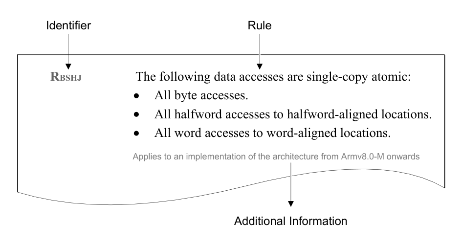

本文译自 Part A《Armv8-M 架构简介与概述》（Armv8-M Architecture Introduction and Overview） Chapter A1《简介》（Introduction）。

本章介绍 **Armv8** 架构、其定义的各**架构 Profile**（architecture profile），以及本手册所定义的 **Armv8-M** 架构 Profile。

## 1. 架构参考手册的布局与术语

本节描述本**架构参考手册**（Architecture Reference Manual）的结构与范围，并描述本架构参考手册所使用的术语。本节不构成架构参考手册的一部分，不得被解读为实现指导。

### 1.1. 架构参考手册的结构

本架构参考手册将**处理元件**（Processing Element，PE）的行为描述为一组独立的**规则**（rule）。

每条规则都由字母 `R` 后跟一组随机的下标字母明确标识，这些下标字母不反映任何预期的顺序或优先级，例如 `R_BSHJ`。在下例中，`R_BSHJ` 只是一个随机的规则标识符，除唯一标识本手册中的一条规则外没有任何含义。

下图给出了该规则示例。

不得孤立地理解规则；当某一特性存在多条相关规则时，各条规则会被归入节与小节中以提供恰当的上下文。在适当情况下，这些节会包含一段简短的介绍以帮助读者。

符合本手册所述全部规则的**实现**（implementation）即为符合 **Armv8-M** 的实现。行为偏离这些规则的实现不符合 **Armv8-M** 架构。

某些节包含不构成规则的附加信息与指导。这些信息与指导纯粹用于帮助理解架构。**信息语句**（information statement）由字母 `I` 后跟一组随机的下标字母明确标识，例如 `IPRTD`。

每条规则或信息语句下方的一行文字给出附加信息，指明架构版本、该规则或信息语句适用所必需的**扩展**（extension），以及其他注释。某些扩展依赖于其他扩展的实现，例如 `FP`。

**注意：**

Arm 强烈建议实现者阅读本架构参考手册的所有章与节，以确保实现符合架构。

符合本架构参考手册所述全部规则、但选择忽略任何附加信息与指导的实现，仍符合 **Armv8-M** 架构。

在本架构参考手册的以下部分中，架构规则不由特定前缀和一组随机的下标字母标识：

- 第 B15 章《性能监控扩展》（The Performance Monitors Extension）的部分内容。

适用于 **Armv8.1-M** 及以后架构版本的实现。

- Part C《Armv8-M 指令集》（Armv8-M Instruction Set）的部分内容。
- Part D《Armv8-M 寄存器与有效载荷规范》（Armv8-M Register and Payload Specification）。
- Part E《Armv8-M 伪代码》（Armv8-M Pseudocode）。
- Part F《Armv8-M 调试包协议》（Armv8-M Debug Packet Protocols）。

### 1.2. 架构参考手册的范围

本架构参考手册只包含专门与 **Armv8-M** 架构相关的规则与信息。它不包含有关其他 Arm 架构的任何信息，也不描述 **Armv8-M** 与其他架构之间的相似之处。

读者不得假定本手册给出的规则适用于 **Armv7-M** 或 **Armv6-M** 实现，也不得假定适用于 **Armv7-M** 或 **Armv6-M** 实现的规则同样适用于 **Armv8-M** 实现。

### 1.3. 目标读者

本手册面向希望设计、实现或编程 **Armv8-M** PE 的用户，涵盖从简单的单处理器实现到复杂的多处理器系统等各种符合 Arm 架构的实现。本手册不假定读者熟悉 **M-Profile** 架构的早期版本。

本架构参考手册给出一组精确、准确且正确的规则，**Armv8-M** 实现必须遵循这些规则才能在架构上合规。它是一本明确的参考手册，而不是 **Armv8-M** 架构的通用入门或用户指南。

### 1.4. 术语与表述

本小节列出 Arm 架构文档中使用的一些标准词汇与短语。这些词汇与短语具有 Arm 专有的定义，本节予以说明。

**Architecturally visible**
> 架构可见（Architecturally visible）：对**控制主体**（controlling agent）可见的事物。控制主体可以是软件。

**Arm recommends**
> Arm 建议（Arm recommends）：一种可确保一致性与可用性的特定用法。遵循本手册列出的全部规则可得到符合架构的可预测结果，但可能产生非预期的输出。遵循建议可确保输出符合预期。

**Arm strongly recommends**
> Arm 强烈建议（Arm strongly recommends）：本质上属于强制要求、但超出本手册所述架构范围的事项。不遵循强烈建议可能破坏系统，尽管 PE 本身仍符合本手册所述的架构。

**Finite time**
> 有限时间（Finite time）：某个动作将在未来的某个时刻发生。有限时间不对所涉及的时间作出任何陈述。但是，将动作延迟到超过绝对必要的程度可能对性能产生不利影响。

**Permitted**
> 允许（Permitted）：被允许的行为。

**Required**
> 要求（Required）：强制的行为。

**Support**
> 支持（Support）：该实现已实现某一特定特性。

### 1.5. 术语，Armv8-M 专用术语

**Armv8-M** 专用术语的定义请参见**术语表**（Glossary）。

## 2. 关于 Armv8 架构与架构 Profile

**Armv8-M** 作为一组架构 Profile 之一进行描述。

Arm 定义了三种架构 Profile：

**应用 Profile（Application profile）**

- 支持基于**内存管理单元**（**Memory Management Unit**，MMU）的**虚拟内存系统架构**（**Virtual Memory System Architecture**，VMSA）。
- 支持 A64、A32 和 T32 指令集。

**实时 Profile（Real-time profile）**

- 支持 AArch64 或 AArch32 **执行状态**（Execution state）。
- 支持 A64，或 A32 和 T32 指令集。
- 支持基于**内存保护单元**（**Memory Protection Unit**，MPU）的**受保护内存系统架构**（**Protected Memory System Architecture**，PMSA）。
- 支持 VMSA。

**微控制器 Profile（本手册所述，Microcontroller profile）**

- 实现为低延迟中断处理而设计的程序员模型，支持寄存器硬件堆叠，并支持用高级语言编写中断处理程序。
- 可选实现基于 MPU 的 PMSA 变体。
- 支持 T32 指令集的变体。

本架构参考手册只描述 **Armv8-M** Profile。

## 3. Armv8-M 架构 Profile

**M-Profile** 架构包含：

- 可采用简单的流水线设计，在广泛的市场与应用中提供领先的系统性能水平。
- 高度确定性的操作：

  - 单周期或低周期数执行。
  - 采用短流水线，实现极小的中断延迟。
  - 能够在无缓存的情况下运行。

- 对 C/C++ 代码的良好支持。这与 Arm 在该领域的编程标准一致：

  - 异常处理程序是标准的 C/C++ 函数，使用标准调用约定进入。

- 面向深度嵌入式系统的设计支持：

  - 低引脚数器件。

- 支持事件驱动系统的调试与软件性能分析。

### 3.1. Armv8-M 指令集

**Armv8-M** 只支持 **T32** 指令的执行。

有关指令的更多信息，请参见第 C1 章《指令集概述》（Instruction Set Overview）和第 C2 章《指令规范》（Instruction Specification）。

### 3.2. 基线实现

不带有任何可选扩展的最简单 **Armv8.0-M** 实现称为**基线实现**（Baseline implementation）。**Armv8.0-M** 基线在以下方面较先前的 **M-Profile** 架构有所改进：

- 改进的**内存保护单元**（MPU）模型。
- 与 **Armv8-A** 和 **Armv8-R** 内存类型对齐。
- 栈指针限制检查。
- 改进的多处理支持。
- 与 C11 和 C11++ 标准更好地对齐。
- 增强的调试能力。

在本架构参考手册中，基线实现指不带有**主扩展**（Main Extension）的实现。

如果实现不包含主扩展，则 `CPUID.Architecture` 读回 `0b1100`。

适用于 **Armv8.0-M** 及以后架构版本的实现。

### 3.3. 嵌套向量中断控制器

**嵌套向量中断控制器**（**Nested Vectored Interrupt Controller**，NVIC）最多可支持 496 个外部中断。NVIC 始终被实现，用于：

- 集成中断。
- 异常处理。
- 优先级管理。
- 自动向量化。
- 自动状态保存。

更多信息请参见第 B12 章《嵌套向量中断控制器》（Nested Vectored Interrupt Controller）。

## 4. 可选扩展

### 4.1. CDE —— 自定义数据通路扩展

**自定义数据通路扩展**（Custom Datapath Extension，CDE）是 **Armv8-M** 架构提供的**可选**（OPTIONAL）特性。包含自定义数据通路扩展的实现必须实现**主扩展**（Main Extension，M）所要求的全部特性，并可实现以下可选特性：

- **浮点扩展**（Floating-point Extension，FP）所提供的特性。
- **Armv8.1-M 向量扩展**（M Vector Extension，MVE）所提供的特性。

操作 S 或 D 寄存器组的 CDE 指令要求实现 FP 或 MVE。操作 Q 寄存器组的 CDE 指令要求实现 MVE。

更多信息请参见 B3.37《自定义数据通路扩展》（The Custom Datapath Extension）。

**注意：** 自定义数据通路扩展也可称为面向 **Armv8-M** 的 Arm 自定义指令（Arm Custom Instructions for Armv8-M）。

适用于 **Armv8.0-M** 及以后架构版本的实现。

### 4.2. 调试

**Armv8-M** 架构引入了：

- 增强的断点和观察点功能。
- 对**插桩跟踪宏单元**（Instrumentation Trace Macrocell，ITM）的改进。
- 全面的跟踪与自托管调试扩展，使嵌入式软件更易于调试和跟踪。

**停机调试**（Halting debug，HDBG）是一项可选特性，允许调试器暂停 PE。

可实现以下可选外设：

- **数据跟踪与观察点单元** —— 一个存储器映射外设，提供两种选项：

  - 用于数据、指令和地址匹配的比较器与观察点（DWTD）。
  - 跟踪包生成（DWTT）。

- **嵌入式跟踪宏单元** —— 提供跟踪信息的存储器映射外设（ETM）。
- **插桩跟踪宏单元** —— 用于生成插桩跟踪包的存储器映射接口（ITM）。
- **Flash 补丁与断点单元** —— 提供断点的存储器映射外设（FPB）。
- **跟踪端口接口单元** —— 为 DWT、ETM 和 ITM 提供输出路径与跟踪接收端的存储器映射外设（TPIU）。

生成跟踪包要求实现主扩展。

对 **Armv8-M** 调试架构的支持由 `ID_DFR0.MProfDbg` 指示。

更多信息请参见 B13.1《调试特性概述》（Debug feature overview）。

适用于 **Armv8.0-M** 及以后架构版本的实现。

在 **Armv8.1-M** 实现中，可选的**非特权调试扩展**（Unprivileged Debug Extension，UDE）增加了对非特权调试的支持。UDE 要求实现主扩展（M）。

对若干寄存器的访问限制被放宽，允许调试器在 PE 不处于**调试状态**（Debug state）时写入这些寄存器。

对 **Armv8-M** 调试架构的支持由 `ID_DFR0.UDE` 指示。

适用于 **Armv8.1-M** 及以后架构版本的实现。

有关调试的更多信息，请参见第 B13 章《调试》（Debug）和第 B14 章《调试与跟踪组件》（Debug and Trace Components）。

### 4.3. DSP —— 数字信号处理扩展

**数字信号处理扩展**（Digital Signal Processing Extension，DSP）是一项可选特性。DSP 增加了对 **SIMD** 指令的支持。

实现 DSP 扩展的 PE 必须实现主扩展（M）。

对 DSP 的支持由以下寄存器指示：

- `ID_ISAR1`。
- `ID_ISAR2`。
- `ID_ISAR3`。

适用于 **Armv8.0-M** 及以后架构版本的实现。

### 4.4. DSP 调试扩展

**Armv8.1-M** 为 DSP 增加了可选的调试支持。

如果实现了 **DSP 调试扩展**（DSP Debug Extension，DSPDE），则还必须实现以下特性：

- 停机调试（HDBG）。
- 主扩展（M）。
- 数字信号处理扩展（DSP）。

如果实现了 MVE 和 DWTD，则必须实现 DSPDE。

适用于 **Armv8.1-M** 及以后架构版本的实现。

### 4.5. 浮点扩展

实现浮点扩展的 PE 必须实现主扩展（M）。

浮点扩展支持单精度浮点指令，或同时支持单精度与双精度浮点指令。

适用于 **Armv8.0-M** 及以后架构版本的实现。

**HP —— 半精度浮点指令**

**Armv8.1-M** 架构扩展了浮点扩展以包含半精度数据类型。如果实现了单精度数据类型，则也必须实现半精度数据类型。

适用于 **Armv8.1-M** 及以后架构版本的实现。

### 4.6. 主扩展

实现主扩展的 PE 也实现**系统定时器扩展**（System Timer Extension）。

**注意：**

- 带有主扩展的 PE 也称为 **Mainline 实现**（Mainline implementation）。
- 不带主扩展的 PE 也称为**基线实现**（Baseline implementation）。基线实现拥有 Mainline 实现的指令、寄存器和特性的一个子集。
- **Armv7-M** 兼容性要求主扩展。
- **Armv6-M** 兼容性由所有 **Armv8-M** 实现提供。

对主扩展的支持由 `CPUID.Architecture` 指示。

适用于 **Armv8.0-M** 及以后架构版本的实现。

### 4.7. MPU 模型

**Armv8-M** 架构提供系统地址映射，并允许实现包含一个可选的 MPU。该可选 MPU 使用**受保护内存系统架构**（Protected Memory System Architecture，PMSAv8），并在 MPU 区域定义上提供更高的灵活性。

**Armv8.1-M** 架构为 MPU 区域引入了一个进一步的属性 `MPU_RLAR.PXN`。

适用于 **Armv8.1-M** 及以后架构版本的实现。

更多信息请参见第 B10 章《Armv8-M 受保护内存系统架构》（The Armv8-M Protected Memory System Architecture）。

### 4.8. M-Profile 向量扩展，MVE

该扩展提供对各种 **SIMD** 数据类型的操作。

它由 **MVE-I**（整数）和 **MVE-F**（浮点）组成。

实现 MVE-I 的 PE 要求具备主扩展（M）和数字信号处理扩展（DSP）所提供的特性。

实现 MVE-F 的 PE 要求实现浮点扩展（FP）和 MVE-I。

更多信息请参见第 B5 章《向量扩展》（Vector Extension）。

对 MVE 的支持由 `ID_MVFR1.MVE` 指示。

**注意：** **Armv8-M** 的 MVE 也可称为面向 **Armv8-M** 的 Arm Helium™（Arm Helium™ for Armv8-M）。

适用于 **Armv8.1-M** 及以后架构版本的实现。

### 4.9. 指针认证与分支目标识别扩展

**Armv8.1-M** 的可选**指针认证与分支目标识别扩展**（Pointer Authentication and Branch Target Identification Extension，PACBTI）增加了以下支持：在寄存器被用作加载地址或间接分支目标之前对其内容进行认证，以及对栈指针进行认证。

更多信息请参见第 B6 章《指针认证与分支目标识别扩展》（Pointer authentication and branch target identification Extension）。

对 PACBTI 扩展的支持由 `ID_ISAR5.PACBTI` 指示。

适用于 **Armv8.1-M** 及以后架构版本的实现。

### 4.10. 性能监控扩展

在 **Armv8.1-M** 实现中，可选的**性能监控扩展**（Performance Monitors Extension）增加了对**性能监控单元**（Performance Monitor Unit，PMU）的支持。

更多信息请参见第 B15 章《性能监控扩展》（The Performance Monitors Extension）。

对性能监控扩展的支持由 `PMU_TYPE.N` 指示。

适用于 **Armv8.1-M** 及以后架构版本的实现。

### 4.11. 可靠性、可用性与可服务性

在 **Armv8.1-M** 实现中，**可靠性、可用性与可服务性**（Reliability, Availability, and Serviceability，RAS）扩展增加了额外的调试支持。最小 RAS 扩展在 **Armv8.1-M** 实现中是强制要求的。

更多信息请参见第 B16 章《可靠性、可用性与可服务性（RAS）扩展》（Reliability, Availability, and Serviceability (RAS) Extension）。

对 RAS 的支持由 `ID_PFR0.RAS` 指示。

适用于 **Armv8.1-M** 及以后架构版本的实现。

### 4.12. 安全扩展

**Armv8-M** 架构引入了可选的**安全扩展**（Security Extension），它提供一种机制来保护敏感数据、内存区域和其他资源。这通过指令和硬件创建**安全状态**（Secure state）来实现，该状态受到保护，免受**非安全状态**（Non-secure state）的影响。

从 **Armv8.1-M** 起，`SG` 指令上的 Thread 模式可重入性可以被禁用。

适用于 **Armv8.1-M** 及以后架构版本的实现。

在带有主扩展的 PE 中，对安全扩展的支持由 `ID_PFR1.Security` 指示。

**注意：** **Armv8-M** 安全扩展也可称为面向 **Armv8-M** 的 Arm TrustZone（Arm TrustZone for Armv8-M）。

### 4.13. 系统定时器扩展

**系统定时器扩展**（System Timer Extension，也称为 SysTick）提供一个递减、归零回绕、写清零的计数器。

对于不带主扩展的 PE，它是一项可选特性；实现零个、一个还是两个计数器是 **IMPLEMENTATION DEFINED**。如果实现一个定时器，则在实现了安全扩展时由各安全状态共享；如果实现两个定时器，则每个安全状态拥有一个专用定时器。

在带有主扩展的实现中，每个安全状态实现一个定时器。

更多信息请参见第 B11 章《系统定时器，SysTick》（The System Timer, SysTick）。
