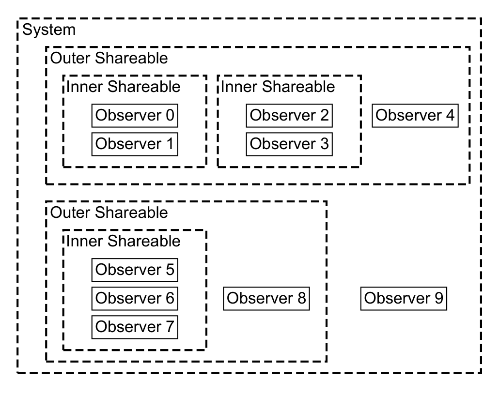
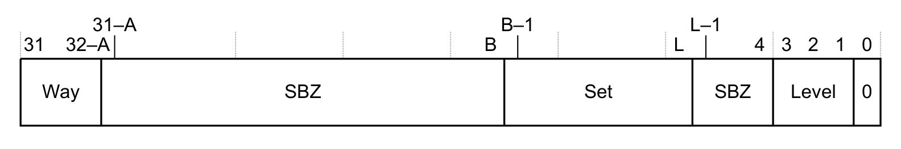

本文译自 Part B《Armv8-M 架构规则》（Armv8-M Architecture Rules） Chapter B7《内存模型》（Memory Model）。

本章规定 **Armv8-M** 内存模型架构规则。

## 1. Armv8 内存模型的定义

本节描述 Armv8 内存模型中的观察与排序。它包含以下小节：

- 第 B7.1.1 节《位置》（Locations）。
- 第 B7.2.3 节《排序与可观察性》（Ordering and observability）。
- 第 B7.2.5 节《排序约束》（Ordering constraints）。
- 第 B7.2.7 节《外部排序约束》（External ordering constraints）。
- 第 B7.2.6 节《完成与端点排序》（Completion and endpoint ordering）。
- 第 B7.2.9 节《内存屏障》（Memory barriers）。

适用于 **Armv8.0-M** 及以后架构版本的实现。

### 1.1 位置

Armv8 内存模型提供一组定义，用于约束允许的内存访问序列。Armv8 内存模型定义了：

- 不同**观察者**之间内存访问的观察顺序。
- 到达某个**端点**的内存访问的到达顺序。
- 控制内存访问的观察顺序以及内存访问到达**端点**的机制。

适用于 **Armv8.0-M** 及以后架构版本的实现。

#### 位置、内存效应与观察者

一个**位置**（**Location**）是与物理地址空间中某个地址相关联的单个字节。

适用于 **Armv8.0-M** 及以后架构版本的实现。

指令在执行过程中可能产生**内存效应**。系统中的**观察者**可能观察到该指令对某个**位置**产生的**内存效应**。

适用于 **Armv8.0-M** 及以后架构版本的实现。

#### 效应

指令的**效应**（**Effects**）可以是：

- **寄存器效应**。
- **内存效应**。
- **屏障效应**。
- **分支效应**。

当且仅当指令 I1 在程序指定的顺序中先于指令 I2 出现时，称指令 I1 的效应在**程序顺序**（program order）上先于指令 I2 的效应。指令产生的每个效应都有一个唯一标识符，用于在同一指令产生的事件中区分该效应。

适用于 **Armv8.0-M** 及以后架构版本的实现。

#### 寄存器效应

指令的**寄存器效应**是指该指令的寄存器读取或寄存器写入。

适用于 **Armv8.0-M** 及以后架构版本的实现。

对于访问寄存器的指令，该指令读取的每个寄存器都会产生一个寄存器读效应，写入的每个寄存器都会产生一个寄存器写效应。一条指令可以同时产生读与写**寄存器效应**。

适用于 **Armv8.0-M** 及以后架构版本的实现。

#### 内存效应

指令的**内存效应**是指该指令的读效应、写效应或屏障效应。

适用于 **Armv8.0-M** 及以后架构版本的实现。

对于访问内存的指令：

- 该指令读取的每个**位置**都会产生一个读效应。
- 该指令写入的每个**位置**都会产生一个写效应。

适用于 **Armv8.0-M** 及以后架构版本的实现。

一条指令可以同时产生读效应与写效应。

适用于 **Armv8.0-M** 及以后架构版本的实现。

当且仅当指令 I1 在**程序顺序**上先于指令 I2 时，称指令 I1 的**内存效应**在**程序顺序**上先于指令 I2 的**内存效应**。

适用于 **Armv8.0-M** 及以后架构版本的实现。

为描述 Armv8 内存模型，所有读效应与写效应都只访问同一**可共享域**内的 **Normal** 内存**位置**。本节中不加限定地提到读、写或**内存屏障**时，均指相应的**内存效应**。

适用于 **Armv8.0-M** 及以后架构版本的实现。

#### 分支效应

指令的**分支效应**是指与做出某个分支决策相对应的效应。

适用于 **Armv8.0-M** 及以后架构版本的实现。

条件指令与比较并交换指令不产生**分支效应**。

适用于 **Armv8.0-M** 及以后架构版本的实现。

#### 固有顺序

存在一种针对单条指令的**固有顺序**（**Intrinsic order**）关系，它依据该指令的操作，给出该指令各效应之间的偏序。

适用于 **Armv8.0-M** 及以后架构版本的实现。

#### 观察者

**观察者**（**Observer**）指一个 **PE**，或某个其他能够产生内存读取或内存写入的、可访问内存的主体。

适用于 **Armv8.0-M** 及以后架构版本的实现。

#### 重叠访问

当且仅当两个**内存效应**访问同一个**位置**时，称这两个**内存效应**重叠。

适用于 **Armv8.0-M** 及以后架构版本的实现。

#### 公共可共享域

程序的**公共可共享域**（common **Shareability domain**）是包含该程序所产生**内存效应**的全部活动**观察者**的最小**可共享域**。

适用于 **Armv8.0-M** 及以后架构版本的实现。

## 2. 原子性

### 2.1 单拷贝原子性

由不同**观察者**产生的**单拷贝原子**（single-copy atomic）内存访问操作具有以下性质：

1. 对于一对**单拷贝原子**写操作 W1 与 W2，若二者至少有一个**位置**重叠，且 W1 产生的任一重叠写入在**一致性顺序**上位于 W2 产生的相应写入之后，则 W1 产生的全部重叠写入都在**一致性顺序**上位于 W2 产生的相应写入之后。
2. 对于与**单拷贝原子**写操作 W2 至少有一个**位置**重叠的**单拷贝原子**读操作 R1，若 R1 产生的任一重叠读取**读取自** W2 产生的某个重叠写入，则 W2 产生的任何重叠写入都不在**一致性顺序**上位于 R1 产生的相应重叠读取之后。

适用于 **Armv8.0-M** 及以后架构版本的实现。

对于显式内存访问，适用以下规则：

- 由加载单个通用寄存器的加载指令产生、且与指令中该读取的尺寸对齐的读取，是**单拷贝原子**的。
- 由存储单个通用寄存器的存储指令产生、且与指令中该写入的尺寸对齐的写入，是**单拷贝原子**的。
- 由加载两个通用寄存器的 **Load Pair** 指令产生、且与每个寄存器加载的尺寸对齐的读取，被视为两次**单拷贝原子**读取，每个被加载的寄存器各一次。
- 由存储两个通用寄存器的 **Store Pair** 指令产生、且与每个寄存器存储的尺寸对齐的写入，被视为两次**单拷贝原子**写入，每个被存储的寄存器各一次。
- 针对两个 32 位量的 **Load-Exclusive Pair** 指令与针对两个 32 位量的 **Store-Exclusive Pair** 指令是**单拷贝原子**的。
- 对 **SIMD** 与浮点寄存器的、单个 32 位或更小量且与被读取量尺寸对齐的读取，被视为**单拷贝原子**的。
- 从 **SIMD** 与浮点寄存器写出的、单个 32 位或更小量且与被存储量尺寸对齐的写入，被视为**单拷贝原子**的。

适用于 **Armv8.0-M** 及以后架构版本的实现。注意，浮点寄存器组 **S0-S31** 与 **D0-D16** 需要 **FP**。**SIMD** 指令需要 **DSP**。

若实现了 **MVE**，则对于显式内存访问适用以下规则：

- 对 **SIMD** 与浮点寄存器的、32 位或更小**元素**的按**元素**读取，其中每个**元素**与被加载量的尺寸对齐时，每个**元素**都被视为一次**单拷贝原子**读取。
- 从 **SIMD** 与浮点寄存器写出的、32 位或更小**元素**的按**元素**写入，其中每个**元素**与被存储量的尺寸对齐时，每个**元素**都被视为一次**单拷贝原子**存储。
- 对 **SIMD** 与浮点寄存器的、在内存中 64 位对齐的 64 位值的读取，被视为一对**单拷贝原子**的 32 位读取。
- 从 **SIMD** 与浮点寄存器写出的、在内存中 64 位对齐的 64 位值的写入，被视为一对**单拷贝原子**的 32 位写入。

适用于 **Armv8.1-M** 及以后架构版本的实现。扩展要求为 - MVE。

对单个字节的所有访问都是**单拷贝原子**的。

适用于 **Armv8.0-M** 及以后架构版本的实现。

所有其他内存访问都被视为字节访问流，架构不保证字节访问之间的原子性。

适用于 **Armv8.0-M** 及以后架构版本的实现。

若按上述规则某条指令被作为一系列访问来执行，则在该序列期间可以接受异常（包括中断），无论所访问的内存类型为何。若其中任一异常使用其首选返回地址返回，则产生该访问序列的指令被重新执行，因此在异常被接受之前已完成的任何访问都会被重复。

适用于 **Armv8.0-M** 及以后架构版本的实现。

### 2.2 多拷贝原子性

在多处理环境中，当且仅当以下全部条件成立时，对内存的写入才是**多拷贝原子**（multi-copy atomic）的：

- 对同一**位置**的所有写入被所有**观察者**以相同顺序观察到，尽管某些**观察者**可能观察不到全部写入。
- 对某个**位置**的读取，在所有**观察者**都观察到对同一**位置**的某次写入之前，不会返回该次写入的值。

适用于 **Armv8.0-M** 及以后架构版本的实现。

对 **Normal** 内存的写入不要求是**多拷贝原子**的。

适用于 **Armv8.0-M** 及以后架构版本的实现。

对具有 **Gathering** 属性的 **Device** 内存的写入不要求是**多拷贝原子**的。

适用于 **Armv8.0-M** 及以后架构版本的实现。

对具有 **non-Gathering** 属性且为**单拷贝原子**的 **Device** 内存的写入，也是**多拷贝原子**的。

适用于 **Armv8.0-M** 及以后架构版本的实现。

参见：

- 第 B7.11 节《Device 内存》（Device memory）。
- 第 B7.9 节《Normal 内存》（Normal memory）。
- 第 B7.18 节《对内存的 Load-Acquire 与 Store-Release 访问》（Load-Acquire and Store-Release accesses to memory）。
- 第 B7.6 节《对齐行为》（Alignment behavior）。
- 第 B7.2.5 节《排序约束》（Ordering constraints）。

### 2.3 排序与可观察性

Armv8 内存模型允许对内存访问重排序。本描述通过以下方式定义对内存访问重排序的约束：

- 使用**寄存器值依赖**建立 **PE** 上指令之间的顺序。
- 使用**排序约束**建立对某个**位置**的访问之间的顺序。

适用于 **Armv8.0-M** 及以后架构版本的实现。

#### 寄存器值依赖

Armv8 内存模型定义指令之间的以下依赖：

- **经由寄存器的依赖**。
- **地址依赖**。
- **数据依赖**。
- **控制依赖**。

适用于 **Armv8.0-M** 及以后架构版本的实现。

#### 经由寄存器的依赖

在 **PE** 内，当且仅当以下至少一项成立时，存在从第一个效应 E1 到第二个效应 E2 的**经由寄存器的依赖**（**Dependency through registers**）：

- E1 是由 **Store Exclusive** 产生的寄存器写 W1，E2 是寄存器读 R2，且 R2 **寄存器读取自** W1。
- E1 与 E2 由同一条指令产生，且在该指令的**固有顺序**中 E1 先于 E2。
- 存在从 E1 到第三个效应 E3 的**经由寄存器的依赖**，且存在从 E3 到 E2 的**经由寄存器的依赖**。

适用于 **Armv8.0-M** 及以后架构版本的实现。

#### 地址依赖

当且仅当存在从内存读 R1 到由内存效应 RW2 产生的**寄存器效应** E3 的**经由寄存器的依赖**，且 E3 影响 RW2 的地址部分，并且满足以下任一条件时，存在从 R1 到内存效应 RW2 的**地址依赖**（**address dependency**）：

- RW2 是内存写效应 W2。
- RW2 是内存读效应 R2，且不存在分支效应 D4 使得到 D4 与从 D4 到 R2 都存在**经由寄存器的依赖**。

适用于 **Armv8.0-M** 及以后架构版本的实现。

#### 数据依赖

当且仅当存在从 R1 返回的数据值到 W2 写入的数据值的寄存器依赖时，存在从读 R1 到后续写 W2 的**数据依赖**（**data dependency**）。

适用于 **Armv8.0-M** 及以后架构版本的实现。

#### 控制依赖

当且仅当满足以下任一条件时，存在从内存读 R1 到内存效应 RW2 的**控制依赖**（**Control dependency**）：

- 存在从 R1 到分支效应 B2 的**经由寄存器的依赖**，且 B3 在**程序顺序**上先于 RW2。
- 存在从 R1 到对产生效应 RW3 的指令上某个同步异常的判定的**经由寄存器的依赖**，且 RW2 在**程序顺序**上出现于 RW3 之后。

适用于 **Armv8.0-M** 及以后架构版本的实现。

### 2.4 位置上的排序与可观察性

对某个**位置**的**内存效应**具有以下关系：

- **寄存器读取自**（Reads-from-register）。
- **读取自**（Reads-from）。
- **本地读后继**（Local-read-successor）。
- **本地写后继**（Local write successor）。
- **数据依赖**。
- **一致性顺序**（Coherence order）。
- **一致性之后**（Coherence-after）。
- **完成**（Completion）。
- **全局完成**（Global completion）。
- **重叠访问**。
- **被观察于**（Observed-by）。
- **DMB**。

适用于 **Armv8.0-M** 及以后架构版本的实现。

#### 寄存器读取自

**寄存器读取自**关系将同一寄存器的读取与写入耦合成对，使得在程序执行中每次寄存器读取恰好与一次寄存器写入配对。当且仅当读 R2 从写 W1 取得数据时，称对同一寄存器的 R2 **寄存器读取自** W1。按构造，W1 必须在**程序顺序**上先于 R2，且在 W1 与 R2 之间的**程序顺序**上不得存在对同一寄存器的中间写入。

适用于 **Armv8.0-M** 及以后架构版本的实现。

#### 读取自

**读取自**关系将同一**位置**的读取与写入耦合，使得在程序中每次读取都与单次写入配对。当且仅当对某个**位置**的读 R2 从对该**位置**的写 W1 取得数据时，称 R2 **读取自** W1。

适用于 **Armv8.0-M** 及以后架构版本的实现。

**读取自**关系表示读由某次写满足，随后返回所写入的数据。

适用于 **Armv8.0-M** 及以后架构版本的实现。

#### 本地读后继

当且仅当写 W1 在**程序顺序**上先于读 R2，且 W1 与 R2 之间没有来自同一**观察者**、对同一**位置**的写 W3 在**程序顺序**上出现时，称来自同一**观察者**对同一**位置**的读 R2 是写 W1 的**本地读后继**。

适用于 **Armv8.0-M** 及以后架构版本的实现。

#### 本地写后继

当且仅当写 W1 在**程序顺序**上先于写 W2 时，称对某个**位置**的 W2 是来自同一**观察者**、对同一**位置**的写 W1 的**本地写后继**。

适用于 **Armv8.0-M** 及以后架构版本的实现。

#### 数据依赖（位置级）

当且仅当存在从内存读 R1 到由内存写 W2 产生的**寄存器效应** E3 的**经由寄存器的依赖**，且 E3 影响 W2 的数据部分时，存在从 R1 到 W2 的**数据依赖**。

适用于 **Armv8.0-M** 及以后架构版本的实现。

#### 一致性顺序

程序中每个**位置**都有一个**一致性顺序**关系，它给出从所有一致性**观察者**到该**位置**的全部写入的全序，并以对该**位置**初始值的概念性写入作为起点。

适用于 **Armv8.0-M** 及以后架构版本的实现。

某个**位置**的**一致性顺序**表示对该**位置**的写入到达内存的顺序。

适用于 **Armv8.0-M** 及以后架构版本的实现。

#### 一致性之后

当且仅当写 W2 在该**位置**的**一致性顺序**中排在写 W1 之后时，称对某个**位置**的写 W2 **一致性之后**于对同一**位置**的写 W1。

适用于 **Armv8.0-M** 及以后架构版本的实现。

当且仅当读 R1 **读取自**对同一**位置**的写 W3，且 W2 **一致性之后**于 W3 时，称对某个**位置**的写 W2 **一致性之后**于对同一**位置**的读 R1。

适用于 **Armv8.0-M** 及以后架构版本的实现。

#### 完成

当另一个**观察者**对同一**位置**的写入**一致性之后**于读 R1 时，称某个**观察者**对该**位置**的读 R1 为**完成**（**Complete**）。

适用于 **Armv8.0-M** 及以后架构版本的实现。

当以下两项同时成立时，称某个**观察者**对某个**位置**的写 W1 为**完成**：

1. 另一个**观察者**对同一**位置**的写入将**一致性之后**于 W1。
2. 另一个**观察者**对同一**位置**的读取将**读取自**某个**一致性之后**于 W1 的写入。

适用于 **Armv8.0-M** 及以后架构版本的实现。

#### 全局完成

若某个**观察者**对某个**位置**的**读取自** R1 是**完成**的，且它所**读取自**的写入也是**完成**的，则称该 R1 **全局完成**（**Globally complete**）。

适用于 **Armv8.0-M** 及以后架构版本的实现。

若某个**观察者**对某个**位置**的写 W1 是**完成**的，则称该 W1 **全局完成**。

适用于 **Armv8.0-M** 及以后架构版本的实现。

#### 重叠访问（位置级）

当且仅当两个**内存效应**访问同一个**位置**时，二者重叠。当且仅当两条指令所产生的**内存效应**中有一个或多个重叠时，称这两条指令重叠。

适用于 **Armv8.0-M** 及以后架构版本的实现。

#### 被观察于

当且仅当写 W2 **一致性之后**于读或写 RW1 时，称来自某个**观察者**的 RW1 **被观察于**（**Observed-by**）来自另一个**观察者**的写 W2。

适用于 **Armv8.0-M** 及以后架构版本的实现。

当且仅当读 R2 **读取自**写 W1 时，称来自某个**观察者**的写 W1 **被观察于**来自另一个**观察者**的读 R2。

适用于 **Armv8.0-M** 及以后架构版本的实现。

**被观察于**关系只关联由不同**观察者**产生的访问。

适用于 **Armv8.0-M** 及以后架构版本的实现。

#### DMB SY

除非定义了特定的**可共享域**，`DMB SY` 作用于**公共可共享域**。

适用于 **Armv8.0-M** 及以后架构版本的实现。

`DMB SY` 的全部性质同样适用于相应的 `DSB`。

适用于 **Armv8.0-M** 及以后架构版本的实现。

#### 2.4.1 排序关系

除针对单个**位置**的排序关系外，Armv8 内存模型还提供描述对多个**位置**的内存效应排序的排序关系。

适用于 **Armv8.0-M** 及以后架构版本的实现。

#### 依赖排序先于

依赖在同一**观察者**产生的某个读与另一个**内存效应**之间建立外部可见的顺序。当且仅当读 R1 在**程序顺序**上先于 RW2，且满足以下任一情形时，称 R1 **依赖排序先于**（**dependency-ordered-before**）来自同一**观察者**的读或写 RW2：

- 存在从 R1 到 RW2 的**地址依赖**或**数据依赖**。
- RW2 是写 W2，且存在从 R1 到 W2 的**控制依赖**。
- RW2 是由某条指令产生的读 R2，该指令在**程序顺序**上出现于产生**上下文同步事件**的指令 I3 之后，且存在从 R1 到 I3 的**经由寄存器的依赖**。
- RW2 是写 W2，在**程序顺序**上出现于读或写 RW3 之后，且存在从 R1 到 RW3 的**地址依赖**。
- RW2 是写 W3 的**本地读后继** R2，且存在从 R1 到 W3 的**地址依赖**或**数据依赖**。

适用于 **Armv8.0-M** 及以后架构版本的实现。

#### 原子排序先于

**Load-Exclusive** 与 **Store-Exclusive** 指令即使在没有依赖的情况下也提供一定的排序保证。当且仅当读或写 RW1 在**程序顺序**上先于 RW2，且满足以下任一情形时，称 RW1 **原子排序先于**（**atomic-ordered-before**）来自同一**观察者**的读或写 RW2：

- RW1 是读 R1，RW2 是写 W2，且 R1 与 W2 由针对同一**位置**的原子指令或成功的 **Load-Exclusive/Store-Exclusive** 指令对产生。
- RW1 是由原子指令或成功的 **Store-Exclusive** 指令产生的写 W1，RW2 是由具有 **Acquire** 或 **AcquirePC** 语义的指令产生的读 R2，且 R2 **读取自** W1。

适用于 **Armv8.0-M** 及以后架构版本的实现。

#### 单拷贝原子排序先于

当且仅当以下全部陈述为真时，称读 R1 **单拷贝原子排序先于**（**single-copy-atomic-ordered-before**）另一个读 R2：

- R1 与 R2 是来自同一指令的读取。
- R1 不是某个写入的**本地读后继**。
- R2 是某个写入的**本地读后继**。

适用于 **Armv8.0-M** 及以后架构版本的实现。

#### 屏障排序先于

屏障指令将同一**观察者**产生的先前**内存效应**排序在后续**内存效应**之前。当且仅当读或写 RW1 在**程序顺序**上先于 RW2，且满足以下任一情形时，称 RW1 **屏障排序先于**（**barrier-ordered-before**）来自同一**观察者**的读或写 RW2：

- RW1 在**程序顺序**上先于某个 `DMB`，且该 `DMB` 在**程序顺序**上先于 RW2。
- RW1 在**程序顺序**上先于某个同时具有 **Acquire** 与 **Release** 语义的原子指令，且该指令在**程序顺序**上先于 RW2。
- RW1 是由具有 **Release** 语义的指令产生的写 W1，RW2 是由具有 **Acquire** 语义的指令产生的读 R2。
- RW1 是读 R1，且 R1 由具有 **Acquire** 语义的指令产生。
- RW2 是写 W2，且 W2 由具有 **Release** 语义的指令产生。

适用于 **Armv8.0-M** 及以后架构版本的实现。

#### 本地排序先于

依赖、**本地写后继**、**Load/Store-Exclusive**、原子与屏障指令可以与**观察者**组合，形成外部可见的顺序。当且仅当满足以下任一情形时，称读或写 RW1 **本地排序先于**（**locally-ordered-before**）来自同一**观察者**的读或写 RW2：

- RW1 是写 W1，RW2 是写 W2，且 W2 等于 RW1 的**本地写后继**或由与之一同的指令产生。
- RW1 **依赖排序先于** RW2。
- RW1 **原子排序先于** RW2。
- RW1 **屏障排序先于** RW2。
- RW1 **本地排序先于** RW2。

适用于 **Armv8.0-M** 及以后架构版本的实现。

#### 排序先于

当且仅当任意一对**内存效应**可以由一条与外部观察一致的、已排序访问的链连接时，称这对**内存效应**是有序的。当且仅当满足以下任一情形时，称读或写 RW1 **排序先于**（**ordered-before**）读或写 RW2：

- RW1 **被观察于**与 RW2 由同一指令产生的 RW3。
- RW1 **本地排序先于** RW2。
- RW1 **排序先于**某个读或写，而该读或写又**排序先于** RW2。

适用于 **Armv8.0-M** 及以后架构版本的实现。

对于来自某个**观察者**、排序先于来自另一个**观察者**的读或写 RW2 的读或写 RW1，**外部可见性要求**要求 RW2 不**被观察于** RW1。这意味着架构上良构的执行不得在**排序先于**关系中表现出环。

适用于 **Armv8.0-M** 及以后架构版本的实现。

非正式地说，若来自某个**观察者**的内存效应 M1 在**程序顺序**上先于来自同一**观察者**的内存效应 M2，则系统中所有**观察者**都会看到 M1 先于 M2 发生。

适用于 **Armv8.0-M** 及以后架构版本的实现。

参见：

- 第 B3.35 节《上下文同步事件》（Context Synchronization Event）。
- 第 B9 章《同步与信号量》（Synchronization and Semaphores）。

### 2.5 排序约束

#### 其他多拷贝原子

在**其他多拷贝原子**（other-multi-copy atomic）系统中，要求来自某个**观察者**的写入在被另一个**观察者**观察到之后，被所有以一致性方式访问该**位置**的其他**观察者**观察到。但是，允许某个**观察者**在使自身的写入对系统中其他**观察者**可见之前先观察到这些写入。

适用于 **Armv8.0-M** 及以后架构版本的实现。

Armv8 内存模型被描述为**其他多拷贝原子**的。

适用于 **Armv8.0-M** 及以后架构版本的实现。

Armv8 内存模型的**其他多拷贝原子**性质通过对程序的可能执行施加约束来保证。满足排序模型所给约束的那些执行被称为**架构上良构**（architecturally well-formed）的。执行程序的实现只允许表现出与**架构上良构**执行一致的行为。

适用于 **Armv8.0-M** 及以后架构版本的实现。

#### 架构上良构

**架构上良构**的执行必须同时满足以下两项要求：

- **内部可见性**。
- **外部可见性**。

适用于 **Armv8.0-M** 及以后架构版本的实现。

#### 内部可见性要求

对于在**程序顺序**上先于对同一**位置**的读或写 RW2 的读或写 RW1，**内部可见性要求**要求以下陈述中恰好有一项为真：

- RW2 是写 W2，且**一致性之后**于 RW1。
- RW1 是写 W1，RW2 是读 R2，且满足以下之一：
  - R2 **读取自** W1。
  - R2 **读取自**另一个**一致性之后**于 W1 的写入。
- RW1 与 RW2 都是读取 R1 与 R2，R1 **读取自**写 W3，且满足以下之一：
  - R2 **读取自** W3。
  - R2 **读取自**另一个**一致性之后**于 W3 的写入。

适用于 **Armv8.0-M** 及以后架构版本的实现。

若来自某个**观察者**的内存效应 M1 在**程序顺序**上先于来自同一**观察者**的内存效应 M2，则该**观察者**会看到 M1 先于 M2 发生。

适用于 **Armv8.0-M** 及以后架构版本的实现。

#### 外部可见性要求

对于来自某个**观察者**、**排序先于**来自另一个**观察者**的读或写 RW2 的读或写 RW1，**外部可见性约束**要求 RW2 不**被观察于** RW1。这意味着**架构上良构**的执行不得在**排序先于**关系中表现出环。

适用于 **Armv8.0-M** 及以后架构版本的实现。

若来自某个**观察者**的内存效应 M1 **排序先于**来自另一个**观察者**的内存效应 M2，则系统中所有**观察者**都会看到 M1 先于 M2 发生。

适用于 **Armv8.0-M** 及以后架构版本的实现。

### 2.6 完成与端点排序

系统中**观察者**之间的交互并不限于通过一致性内存中的共享变量进行通信。例如，某个**观察者**可以把中断控制器配置为在另一个**观察者**上产生中断，作为一种消息传递方式。这些交互通常涉及一个附加主体，该主体定义了在不同**观察者**之间建立通信链路所需的指令序列。当这些交互形式与共享变量一起使用时，可以使用 `DSB` 指令来强制它们之间的排序。

适用于 **Armv8.0-M** 及以后架构版本的实现。

当**可共享域**内某个**观察者**对同一**位置**的任何写入都将**一致性之后**于读 R1 时，称对某个**位置**的读 R1 **对该可共享域完成**。

适用于 **Armv8.0-M** 及以后架构版本的实现。

当以下全部条件成立时，称对某个**位置**的写 W1 **对该可共享域完成**：

- **可共享域**内某个**观察者**对同一**位置**的任何写入都将**一致性之后**于 W1。
- **可共享域**内某个**观察者**对同一**位置**的任何读取都将**读取自** W1，或**读取自**某个**一致性之后**于 W1 的写入。

适用于 **Armv8.0-M** 及以后架构版本的实现。

当某条指令的**内存效应**对某个**可共享域**完成时，称该**高速缓存维护操作**对该**可共享域完成**。

适用于 **Armv8.0-M** 及以后架构版本的实现。

任何**高速缓存维护操作**的完成，包括其在所有受该操作与为保证该维护操作可见性所需的 `DSB` 指令二者影响的 **PE** 上的完成。

适用于 **Armv8.0-M** 及以后架构版本的实现。

这些完成规则意味着，例如，作用于 **PoC** 的**高速缓存维护操作**只有在 **PoC** 处的内存已被更新之后才算完成。

适用于 **Armv8.0-M** 及以后架构版本的实现。

此外，对于 **Device-nGnRnE** 内存，只有当对呈现副作用的**内存映射外设**中某个**位置**的读取或写入同时满足以下两项时，该读取或写入才算完成：

- 能够开始影响该**内存映射外设**的状态。
- 能够触发所有相关副作用，无论这些副作用影响其他外设、**PE** 还是内存。

适用于 **Armv8.0-M** 及以后架构版本的实现。

对 **Device-nGnRnE** 内存的这一要求，与内存访问已到达**外设端点**是一致的。

适用于 **Armv8.0-M** 及以后架构版本的实现。

#### 外设

本节定义**内存映射外设**以及对外设的读取与写入的全序，该全序被称为**外设一致性顺序**。

适用于 **Armv8.0-M** 及以后架构版本的实现。

#### 内存映射外设

**内存映射外设**占据一段 **IMPLEMENTATION DEFINED** 大小的内存区域，可以使用加载与存储指令访问。对**内存映射外设**的**内存效应**可能具有副作用，例如使外设执行某个动作。从**内存映射外设**内地址读取的值可能并不对应于最后一次写入这些地址的数据值。因此，对**内存映射外设**的**内存效应**可能不出现在**读取自**或**一致性之后**关系中。

适用于 **Armv8.0-M** 及以后架构版本的实现。

#### 外设一致性顺序

**内存映射外设**的**外设一致性顺序**是对该外设的全部读取与写入的全序。

适用于 **Armv8.0-M** 及以后架构版本的实现。

**内存映射外设**的**外设一致性顺序**表示访问到达**端点**的顺序。

适用于 **Armv8.0-M** 及以后架构版本的实现。

对于对同一外设的读或写 RW1 与读或写 RW2，若满足以下任一情形，则 RW1 将出现在该外设的**外设一致性顺序**中 RW2 之前：

- RW1 与 RW2 是使用 **Non-cacheable** 或 **Device** 属性的访问，且 RW1 **排序先于** RW2。
- RW1 与 RW2 是使用 **Device-nGnRE** 或 **Device-nGnRnE** 属性的访问，且 RW1 在**程序顺序**上先于 RW2。

适用于 **Armv8.0-M** 及以后架构版本的实现。

#### 带外排序先于

当且仅当满足以下任一情形时，称读或写 RW1 **带外排序先于**（**out-of-band-ordered-before**）读或写 RW2：

- RW1 在**程序顺序**上先于某条 `DSB` 指令，该指令启动一段间接导致产生 RW2 的 **IMPLEMENTATION DEFINED** 指令序列。
- RW1 **排序先于**某个读或写 RW3，且 RW3 **带外排序先于** RW2。

适用于 **Armv8.0-M** 及以后架构版本的实现。

若内存效应 M1 **带外排序先于**读或写 M2，则所有**观察者**都会看到 M1 先于 M2 发生。

适用于 **Armv8.0-M** 及以后架构版本的实现。

### 2.7 外部排序约束

Armv8 内存模型提供以下三种**外部排序约束**的替代表述：

- **外部可见性要求**。
- **外部完成要求**。
- **外部全局完成要求**。

适用于 **Armv8.0-M** 及以后架构版本的实现。

#### 先完成顺序

**先完成顺序**（**Completes-before order**）是与系统中内存效应完成的顺序相对应的全序。以下效应在**先完成顺序**中构成单个条目：

- 来自同一指令的写入。
- 来自同一指令、且读取外部写入的读取。
- 来自同一指令、且读取同一内部写入的读取。

所有其他读取在**先完成顺序**中构成各自不同的条目。

适用于 **Armv8.0-M** 及以后架构版本的实现。

#### 先完成

当且仅当读或写 RW1 在**先完成顺序**中出现在 RW2 之前时，称 RW1 **先完成于**（**completes-before**）读或写 RW2。

适用于 **Armv8.0-M** 及以后架构版本的实现。

#### 从先完成顺序推导读取自与一致性顺序

**先完成顺序**可用于确定系统中每次内存访问的**读取自**关系。

适用于 **Armv8.0-M** 及以后架构版本的实现。

对于某个**观察者**对某个**位置**的读 R1：

- 若存在来自同一**观察者**对同一**位置**的写 W2，则当以下全部条件成立时，R1 将**读取自** W2：
  - W2 在**程序顺序**上先于 R1。
  - R1 **先完成于** W2。
  - 在 W2 与 R1 之间的**程序顺序**上没有对同一**位置**的写入。
- 若存在来自不同**观察者**对同一**位置**的写 W2，则当以下全部条件成立时，R1 将**读取自** W2：
  - W2 **先完成于** R1。
  - 在 W2 与 R1 之间的**程序顺序**或**先完成顺序**上没有对该**位置**的写入。
- 若不存在这样的写入，则 R1 **读取自**该**位置**的初始值。

适用于 **Armv8.0-M** 及以后架构版本的实现。

对某个**位置**写入的**一致性顺序**是这些写入在**先完成顺序**中出现的顺序。每个**位置**的最终值由**先完成顺序**中对每个**位置**的最后一次写入确定。若对某个**位置**不存在这样的写入，则该**位置**的最终值就是其初始值。

适用于 **Armv8.0-M** 及以后架构版本的实现。

#### 外部完成要求

当且仅当以下任一为真时，称读或写 RW1 **全局先完成于**（**Globally-completes-before**）读或写 RW2：

- RW1 **本地排序先于** RW2。
- RW2 是读 R2，且 R1 **单拷贝原子排序先于** R2。

适用于 **Armv8.0-M** 及以后架构版本的实现。

### 2.8 全局先完成顺序

**全局先完成顺序**（**globally-completes-before order**）是与系统中内存效应全局完成的顺序相对应的全序。以下效应在**全局先完成顺序**中构成单个条目：

- 来自同一指令的写入。
- 来自同一指令、且读取外部写入的读取。
- 来自同一指令、且读取同一内部写入的读取。

所有其他读取在**全局先完成顺序**中构成各自不同的条目。

适用于 **Armv8.0-M** 及以后架构版本的实现。

#### 全局先完成

当且仅当读或写 RW1 在**全局先完成顺序**中出现在读或写 RW2 之前时，称 RW1 **全局先完成于**（**globally-completes-before**）RW2。

适用于 **Armv8.0-M** 及以后架构版本的实现。

#### 从全局先完成顺序推导读取自与一致性顺序

**全局先完成顺序**可用于确定系统中每次内存访问的**读取自**与**一致性顺序**关系。

适用于 **Armv8.0-M** 及以后架构版本的实现。

某个**观察者**对某个**位置**的读 R1 **读取自**该**位置**在**全局先完成顺序**中位于其之前、且距离最近的写入。若不存在这样的写入，则 R1 **读取自**该**位置**的初始值。

适用于 **Armv8.0-M** 及以后架构版本的实现。

对某个**位置**写入的**一致性顺序**是这些写入在**全局先完成顺序**中出现的顺序。每个**位置**的最终值由**全局先完成顺序**中对每个**位置**的最后一次写入确定。若对某个**位置**不存在这样的写入，则最终值就是该**位置**的初始值。

适用于 **Armv8.0-M** 及以后架构版本的实现。

#### 外部全局完成要求

对于**本地排序先于**读或写 RW2 的读或写 RW1，**外部全局完成要求**要求：当且仅当以下任一陈述为真时，RW1 **全局先完成于** RW2：

- RW1 **本地排序先于** RW2，且满足以下之一：
  - RW1 是写入。
  - RW1 是读 R1，且满足以下之一：
    - R1 不本地读取自任何写入。
    - R1 本地读取自某个**本地排序先于** RW2 的写入。
- RW1 是读 R1，RW2 是读 R2，且 R1 **单拷贝原子排序先于** R2。

适用于 **Armv8.0-M** 及以后架构版本的实现。

### 2.9 内存屏障

**Arm** 架构支持指令的乱序完成。

适用于 **Armv8.0-M** 及以后架构版本的实现。

**Armv8-M** 架构支持以下**内存屏障**：

- **Instruction Synchronization Barrier**（`ISB`）。
- **Data Memory Barrier**（`DMB`）。
- **Data Synchronization Barrier**（`DSB`）。
- **Consumption of Speculative Data Barrier**（`CSDB`）。
- **Physical Speculative Store Bypass Barrier**（`PSSBB`）。
- **Speculative Store Bypass Barrier**（`SSBB`）。

适用于 **Armv8.0-M** 及以后架构版本的实现。

`DMB` 与 `DSB` 内存屏障影响由 **PE** 执行的 **Load/Store** 指令以及数据或统一**高速缓存维护操作**产生的、对内存系统的读取与写入。指令取指不是显式访问。

适用于 **Armv8.0-M** 及以后架构版本的实现。

### 2.10 指令同步屏障（Instruction Synchronization Barrier）

`ISB` 保证在**程序顺序**上位于 `ISB` 指令之后的所有指令，都在 `ISB` 指令完成之后从高速缓存或内存取指。

适用于 **Armv8.0-M** 及以后架构版本的实现。

使用 `ISB` 可保证在 `ISB` 之前执行的、改变上下文的操作的效果对在 `ISB` 之后取指的指令可见。

适用于 **Armv8.0-M** 及以后架构版本的实现。

在**程序顺序**上出现于 `ISB` 指令之后的任何改变上下文的操作，只有在 `ISB` 执行之后才生效。

适用于 **Armv8.0-M** 及以后架构版本的实现。

参见：

- `InstructionSynchronizationBarrier()`。
- **上下文同步事件**（Context synchronization event）。

### 2.11 数据内存屏障（Data Memory Barrier）

`DMB` 所要求的**可共享性**为 **Full system**，并作用于**可共享域**中的所有**观察者**。

适用于 **Armv8.0-M** 及以后架构版本的实现。

`DMB` 只影响内存访问以及数据高速缓存与统一**高速缓存维护操作**的操作，对任何其他指令的排序没有影响。

适用于 **Armv8.0-M** 及以后架构版本的实现。

用于确保**高速缓存维护指令**完成的 `DMB`，其访问类型同时为加载与存储。

适用于 **Armv8.0-M** 及以后架构版本的实现。

`DMB` 的原理是在作为参数提供给 `DMB` 指令的、指定受 `DMB` 影响的内存访问之间引入顺序。

适用于 **Armv8.0-M** 及以后架构版本的实现。

`DMB` 指令保证：执行该 `DMB` 的 **PE** 产生的、在**程序顺序**上先于该 `DMB` 指令的所有受影响内存访问，以及来自不同 **PE** 的这些访问，在每个 **PE** 观察到在**程序顺序**上位于该 `DMB` 之后受影响的任何内存访问之前，先被该 **PE** 观察到。

适用于 **Armv8.0-M** 及以后架构版本的实现。

在指令的**内存效应**之间使用 `DMB` 指令，属于**屏障排序先于**。

适用于 **Armv8.0-M** 及以后架构版本的实现。

参见：

- `DataMemoryBarrier()`。
- 第 B7.14 节《可共享域》（Shareability domains）。

### 2.12 数据同步屏障（Data Synchronization Barrier）

`DSB` 是一种**内存屏障**，它保证在 `DSB` 指令之前出现的内存访问在该 `DSB` 指令完成之前已经完成。`DSB` 的作用比 `DMB` 指令更强，由 `DMB` 建立的所有排序也由 `DSB` 产生。

适用于 **Armv8.0-M** 及以后架构版本的实现。

`DSB` 所要求的**可共享性**为 **Full system**，并作用于**可共享域**中的所有**观察者**。

适用于 **Armv8.0-M** 及以后架构版本的实现。

当以下全部条件成立时，`DSB` 完成：

- 由 `PEe` 在 `DSB` 执行之前观察到的、具有所需访问类型的、来自与 `PEe` 处于同一所需**可共享域**的**观察者**的所有显式内存访问，都已对所需**可共享域**中的**观察者**集合完成。
- 若 `DSB` 所需的访问类型为读取与写入，则由 `PEe` 在 `DSB` 之前发出的所有高速缓存与分支预测器维护指令都已对所需**可共享域**完成。
- 由 `PEe` 在 `DSB` 之前发出的、导致上下文改变操作的所有对**系统控制空间**的显式访问都已完成。

适用于 **Armv8.0-M** 及以后架构版本的实现。

在 `DSB` 完成之前，任何在**程序顺序**上出现于该 `DSB` 指令之后的指令都不能执行。

适用于 **Armv8.0-M** 及以后架构版本的实现。

一系列隐式访问与显式访问的发生顺序只在以下情形之一得到保证，或在访问之间执行 `DSB` 指令时得到保证：

- 由对 `MPU_RBAR`、`MPU_RBAR_An`、`MPU_RLAR` 或 `MPU_RLAR_An` 的显式访问触发的、对 `MPU_RNR` 的隐式读取，必须出现在对 `MPU_RNR` 的显式写入之后，并观察到该写入的更新值，该显式写入发生在对基址或限值寄存器的显式访问之前。
- 由对 `SAU_RBAR` 或 `SAU_RLAR` 的显式访问触发的、对 `SAU_RNR` 的隐式读取，必须出现在对 `SAU_RNR` 的显式写入之后，并观察到该写入的更新值，该显式写入发生在对基址或限值寄存器的显式访问之前。
- 异常处理程序中对 **PPB** 空间的显式访问，必须出现在引发并进入该异常期间的隐式写入之后，并观察到这些写入的值。例如，**BusFault** 处理程序执行的、访问 `BFSR` 的 `LDR` 指令，必须观察到引发并进入 **BusFault** 异常期间对 `BFSR` 的更新。
- 对于直接访问公共架构状态的一组 **PPB** 寄存器，例如写 1 清零与写 1 置位寄存器 `NVIC_ICER` 与 `NVIC_ISER`，由显式读取触发的、对公共架构状态的隐式读取，必须出现在对该公共架构状态的显式写入之后，并观察到该写入的值，该显式写入发生在该显式读取之前。

适用于 **Armv8.0-M** 及以后架构版本的实现。

参见：

- `DataSynchronizationBarrier()`。
- 第 B7.14 节《可共享域》（Shareability domains）。

### 2.13 推测性数据消费屏障（Consumption of Speculative Data Barrier）

`CSDB` 是一种**内存屏障**，它阻止在**程序顺序**上出现于该屏障完成之后的指令，通过评估已分配或已逐出的高速缓存条目，确定任何由在 **CSDB** 内存屏障完成之前、在**程序顺序**上执行的推测性加载指令所衍生数据的任何部分。

适用于 **Armv8.0-M** 及以后架构版本的实现。扩展要求为 - M。

当执行 `CSDB` 指令，但在 `CSDB` 完成之前，存在以下三条指令时：

1. 在**程序顺序**上先于该屏障、被推测性执行的加载指令，该指令可能被架构执行，也可能不被架构执行。
2. 已通过其条件码检查、且其输入寄存器对该推测性执行的加载不存在**地址依赖**的 **Conditional Move** 指令。
3. 在**程序顺序**上出现于该屏障之后的加载、存储、数据预加载或指令预加载，其地址依赖该 **Conditional Move** 指令。

则对该加载、存储、数据预加载或指令预加载的推测性执行，不得通过评估已分配或已逐出的高速缓存条目，影响为确定该推测性执行的加载指令所衍生数据任何部分而进行的缓存条目分配。

适用于 **Armv8.0-M** 及以后架构版本的实现。扩展要求为 - M。

当执行 `CSDB` 指令，但在 `CSDB` 完成之前，存在以下三条指令时：

1. 在**程序顺序**上先于该屏障、被推测性执行的加载指令，该指令可能被架构执行，也可能不被架构执行。
2. 对通过条件测试或其输入寄存器均无依赖关系的 **Conditional Move** 指令。
3. 在**程序顺序**上出现于该屏障之后、且其间接分支目标地址依赖该 **Conditional Move** 指令的间接分支指令。

则对该间接分支的推测性执行，不得通过评估已分配或已逐出的高速缓存条目，影响为确定该推测性执行的加载指令所衍生数据任何部分而进行的缓存条目分配。

适用于 **Armv8.0-M** 及以后架构版本的实现。扩展要求为 - M。

`CSDB` 指令不能被推测性执行。

适用于 **Armv8.0-M** 及以后架构版本的实现。扩展要求为 - M。

可以在已知某条 `CSDB` 不是推测性的时候，推测性地插入该 `CSDB` 并在此时完成。

适用于 **Armv8.0-M** 及以后架构版本的实现。扩展要求为 - M。

未实现 **Main Extension** 的实现中不提供 `CSDB` 指令。

适用于 **Armv8.0-M** 及以后架构版本的实现。注意，适用于未实现 **M** 扩展的实现。

**Arm** 建议插入 `DSB` 与 `ISB` 的组合，以防止推测性数据的消费。

适用于 **Armv8.0-M** 及以后架构版本的实现。注意，适用于未实现 **M** 扩展的实现。

### 2.14 物理推测性存储绕过屏障（Physical Speculative Store Bypass Barrier）

`PSSBB` 阻止推测性加载：

- 返回早于在**程序顺序**上先于该加载的、对同一物理地址最近一次存储的数据。
- 返回来自在**程序顺序**上晚于该加载的、使用同一物理地址的存储的数据。

适用于 **Armv8.0-M** 及以后架构版本的实现。

### 2.15 推测性存储绕过屏障（Speculative Store Bypass Barrier）

`SSBB` 阻止推测性加载：

- 返回早于在**程序顺序**上先于该加载的、对同一地址最近一次存储的数据。
- 返回来自在**程序顺序**上晚于该加载的、使用同一地址的存储的数据。

适用于 **Armv8.0-M** 及以后架构版本的实现。

### 2.16 系统控制空间的同步要求

`DSB` 保证对**系统控制空间**的所有写入都已完成。

适用于 **Armv8.0-M** 及以后架构版本的实现。

仅执行 `DSB` 并不保证对**系统控制空间**写入的副作用可见。要使对**系统控制空间**写入的副作用可见，需要**上下文同步事件**。

适用于 **Armv8.0-M** 及以后架构版本的实现。

**上下文同步事件**保证在**上下文同步事件**之后，任何已完成的**系统控制空间**写入的副作用都是可见的。

适用于 **Armv8.0-M** 及以后架构版本的实现。

参见：

- 第 B8.3 节《系统控制空间》（The System Control Space）。

## 3. 内存访问

描述内存模型时所提到的内存访问是指从内存取指以及加载或存储数据访问。

适用于 **Armv8.0-M** 及以后架构版本的实现。

指令操作使用 `MemA()` 或 `MemU()` 辅助函数。若未实现 **Main Extension**，则使用 `MemU()` 辅助函数的非对齐访问会产生对齐错误。

适用于 **Armv8.0-M** 及以后架构版本的实现。

内存访问受以下因素支配：

- 该访问是读取还是写入。
- 地址对齐。
- 数据字节序。
- 内存属性。

适用于 **Armv8.0-M** 及以后架构版本的实现。

由使用 `MemA_MVE()` 的 **MVE** 指令产生的内存读取，若以下两项同时成立，则允许访问该指令未显式访问的字节：

- 所访问的字节位于按 32 字节对齐的 32 字节窗口内。
- 该窗口至少包含一个由该指令显式访问的字节。

适用于 **Armv8.1-M** 及以后架构版本的实现。扩展要求为 - MVE。

**Arm** 建议软件不要对 **Device** 内存中的数据使用向量加载/存储指令。

适用于 **Armv8.1-M** 及以后架构版本的实现。

若 **MVE** 加载或存储操作导致访问系统地址映射中 **System** 区域内的**私有外设总线**（**PPB**）地址空间，则该访问的行为是 **CONSTRAINED UNPREDICTABLE** 的，并会发生以下之一：

- 产生 **Bus Fault**。
- 执行对 **PPB** 地址空间的指定访问。

适用于 **Armv8.1-M** 及以后架构版本的实现。扩展要求为 - MVE。

参见：

- 第 B7.1 节《Armv8 内存模型的定义》（Definition of the Armv8 memory model）。
- 第 B7.9 节《Normal 内存》（Normal memory）。
- 第 B7.11 节《Device 内存》（Device memory）。
- 第 B7.15 节《内存访问限制》（Memory access restrictions）。
- 第 B8.2 节《系统地址映射的 System 区域》（The System region of the system address map）。

## 4. 地址空间

地址空间是单个平坦地址空间，大小为 2<sup>32</sup> 字节。

适用于 **Armv8.0-M** 及以后架构版本的实现。

在地址空间中，字节地址是取值范围为 0 到（2<sup>32</sup> − 1）的无符号数。

适用于 **Armv8.0-M** 及以后架构版本的实现。

若地址计算在地址空间上溢出或下溢，则发生回绕。地址计算按 2<sup>32</sup> 取模。

适用于 **Armv8.0-M** 及以后架构版本的实现。

正常的顺序执行不会溢出地址空间顶端，因为内存顶端始终具有**从不执行**（**XN**）内存属性。

适用于 **Armv8.0-M** 及以后架构版本的实现。

一个或多个以内存顶端或底端字节为目标或回绕到这些字节的访问，会访问地址递增的一系列字，实际上对每次加载或存储将地址加 4。若该计算溢出地址空间顶端，则结果为 **UNPREDICTABLE**。

适用于 **Armv8.0-M** 及以后架构版本的实现。注意，某些指令的编码要求 **M** 扩展，某些指令的编码要求 **FP** 扩展。

参见：

- 第 B8 章《系统地址映射》（The System Address Map）。

## 5. 字节序

在内存中，以下图示给出以下各项之间的关系：

- 地址 A 处的字。
- 地址 A 与 A+2 处的半字。
- 地址 A、A+1、A+2 与 A+3 处的字节。


**指令对齐与字节顺序**：

- a) 位 [15:0]：对于 16 位编码的 **T32** 指令，这是 hw 1。
- b) 位 [31:0]：对于 32 位编码的 **T32** 指令，这是 hw1 与 hw2。


适用于 **Armv8.0-M** 及以后架构版本的实现。

指令取指始终为小端，这意味着 **PE** 假定内存中的指令按小端排列。

适用于 **Armv8.0-M** 及以后架构版本的实现。

对**私有外设总线**（**PPB**）的所有访问始终为小端，这意味着 **PE** 假定 **PPB** 寄存器按小端排列。

适用于 **Armv8.0-M** 及以后架构版本的实现。

数据访问的字节序是 **IMPLEMENTATION DEFINED** 的，由 `AIRCR.ENDIANNESS` 指示。

适用于 **Armv8.0-M** 及以后架构版本的实现。

`AIRCR.ENDIANNESS` 是以下之一：

- 由静态值实现。
- 由复位时的硬件输入配置。

适用于 **Armv8.0-M** 及以后架构版本的实现。

若 `AIRCR.ENDIANNESS` 置为 1，则导致跨越 **PPB** 边界的内存访问的指令是 **CONSTRAINED UNPREDICTABLE** 的。允许的行为是以下之一：

- 该指令表现为 **NOP**。
- 该指令产生 **UNALIGNED UsageFault**。
- 若跨越 **PPB** 边界的指令是加载，则目的寄存器的值变为 **UNKNOWN**。
- 若跨越 **PPB** 边界的指令是存储，则所访问的内存位置的值变为 **UNKNOWN**。

适用于 **Armv8.0-M** 及以后架构版本的实现。注意，**UsageFault** 需要 **M** 扩展。

对于数据访问，下表给出为进行字节序转换时字节序所适用的数据元素尺寸。

| 指令类别 | 指令 | 元素尺寸 |
| --- | --- | --- |
| 加载或存储字节 | `LDR{S}B{T}`、`LDAB`、`LDAEXB`、`STLB`、`STLEXB`、`STRB{T}`、`TBB`、`LDREXB`、`STREXB` | 字节 |
| 加载或存储半字 | `LDR{S}H{T}`、`LDAH`、`LDAEXH`、`STLH`、`STLEXH`、`STRH{T}`、`TBH`、`LDREXH`、`STREXH` | 半字 |
| 加载或存储字 | `LDR{T}`、`LDA`、`LDAEX`、`STL`、`STLEX`、`STR{T}`、`LDREX`、`STREX`、`VLDR.F32`、`VSTR.F32` | 字 |
| 加载或存储两个字 | `LDRD`（字面量）、`LDRD`（立即数）、`STRD`（立即数）、`VLDR.64`、`VSTR.64` | 字 |
| 加载或存储多个字 | `LDM{IA, DB}`、`STM{IA, DB}`、`PUSH`（多寄存器）、`POP`（多寄存器）、`LDC`、`STC`、`VLDM`、`VSTM`、`VPUSH`、`VPOP`、`BLX`、`BLXNS`、`BX`、`BXNS`、`VLLDM`、`VLSTM` | 字 |

适用于 **Armv8.0-M** 及以后架构版本的实现。

这些指令只支持 32 位单拷贝原子性。

适用于 **Armv8.0-M** 及以后架构版本的实现。

以下指令改变所加载或存储数据的字节序：

- `REV`：反转寄存器中的一个字（四个字节），用于转换 32 位表示。
- `REVSH`：反转半字并符号扩展，用于转换有符号 16 位表示。
- `REV16`：反转寄存器中打包的半字，用于转换无符号 16 位表示。

适用于 **Armv8.0-M** 及以后架构版本的实现。

## 6. 对齐行为

所有指令取指都是半字对齐的。

适用于 **Armv8.0-M** 及以后架构版本的实现。

若下列指令未按要求对齐，则任何数据访问都会产生对齐错误：

- 未半字对齐的 `LDAH`、`LDREXH`、`LDAEXH`、`STLH`、`STLEXH`、`STREXH`、`VLDR.16`、`VLDRH`、`VLDRH`（向量）、`VLD2.16`、`VLD4.16`、`VSTR.16`、`VSTRH`、`VSTRH`（向量）、`VST2.16` 与 `VST4.16`。
- 未字对齐的 `LDREX`、`LDAEX`、`STLEX`、`STREX`、`LDRD`（立即数）、`LDRD`（字面量）、`LDMIA`、`LDMDB`、`POP`（多寄存器）、`LDC`（立即数）、`LDC`（字面量）、`VLDM`、`VLDR`（系统寄存器）、`VPOP`、`LDA`、`STL`、`STRD`（立即数）、`STMIA`、`STMDB`、`PUSH`（多寄存器）、`STC`、`VLDRW`、`VLDRW`（向量）、`VLDRD`（向量）、`VLDR.32`、`VLDR.64`、`VLD2.32`、`VLD4.32`、`VSTR`、`VSTR`（系统寄存器）、`VST2.32`、`VST4.32`、`VSTM`、`VSTRW`、`VSTRW`（向量）、`VSTRD`（向量）、`VSTR.32`、`VSTR.64` 与 `VPUSH`。
- 未双字对齐的 `VLLDM` 与 `VLSTM`。

适用于 **Armv8.0-M** 及以后架构版本的实现。注意，所需扩展参见各指令的描述。

若 `CCR.UNALIGN_TRP` 置为 1，则以下非对齐数据访问会产生对齐错误：

- 未半字对齐的 `LDR{S}H{T}` 与 `STRH{T}`。
- 未半字对齐的 `TBH`。
- 未字对齐的 `LDR{T}` 与 `STR{T}`。

适用于 **Armv8.0-M** 及以后架构版本的实现。

只有实现了 **Main Extension**，才支持非对齐访问。

适用于 **Armv8.0-M** 及以后架构版本的实现。扩展要求为 - M。

对 **Device** 内存的访问始终是对齐的。

适用于 **Armv8.0-M** 及以后架构版本的实现。

若未实现 **Main Extension**，则非对齐访问会产生对齐 **HardFault**。

适用于 **Armv8.0-M** 及以后架构版本的实现。扩展要求为 - !M。

对齐错误是同步的，并产生 **UNALIGNED UsageFault**。

适用于 **Armv8.0-M** 及以后架构版本的实现。扩展要求为 - M。

非对齐加载与存储的 **CONSTRAINED UNPREDICTABLE** 行为是以下之一：

- 产生 **UNALIGNED UsageFault**。
- 执行对非对齐**位置**的指定加载或存储。

适用于 **Armv8.0-M** 及以后架构版本的实现。扩展要求为 - M。

非对齐加载与存储执行对非对齐**位置**的指定加载与存储。

适用于 **Armv8.0-M** 及以后架构版本的实现。

参见：

- 第 B7.9 节《Normal 内存》（Normal memory）。
- 第 B7.11 节《Device 内存》（Device memory）。

## 7. 指令的并发修改与执行

**Armv8** 架构限制了在一个执行线程的指令被另一个执行线程修改的同时、无需显式同步即可执行的指令集合。

适用于 **Armv8.0-M** 及以后架构版本的实现。

除非另有说明，指令的并发修改与执行会导致 **CONSTRAINED UNPREDICTABLE** 地选择任何可通过执行同一安全状态或同一特权级别下的任意指令序列实现的行为。

适用于 **Armv8.0-M** 及以后架构版本的实现。

对于可被并发修改的指令，**PE** 执行以下之一：

- 原始指令。
- 被修改后的指令。

适用于 **Armv8.0-M** 及以后架构版本的实现。

16 位指令可以被并发修改，此时修改前的 16 位指令与修改后的 16 位指令是以下任一指令：

- `B`。
- `BX`。
- `BLX`。
- `BKPT`。
- `NOP`。
- `SVC`。

适用于 **Armv8.0-M** 及以后架构版本的实现。

32 位 `BL` 立即数指令的 hw1 可以被并发修改为另一条 `BL` 立即数指令的最高半字。

适用于 **Armv8.0-M** 及以后架构版本的实现。

32 位 `BL` 立即数指令的 hw1 可以被并发修改为 16 位 `B`、`BLX`、`BKPT` 或 `SVC` 指令。该修改也可以反向进行。

适用于 **Armv8.0-M** 及以后架构版本的实现。

32 位 `BL` 立即数指令的 hw2 可以被并发修改为具有不同立即数的另一条 `BL` 指令的 hw2。

适用于 **Armv8.0-M** 及以后架构版本的实现。

带有条件字段的 32 位 `B` 立即数指令的 hw2，可以被并发修改为具有不同立即数的、另一条带条件字段的 32 位 `B` 立即数指令的 hw2。

适用于 **Armv8.0-M** 及以后架构版本的实现。

不带条件字段的 32 位 `B` 立即数指令的 hw2，可以被并发修改为另一条不带条件字段的 32 位 `B` 立即数指令的 hw2。

适用于 **Armv8.0-M** 及以后架构版本的实现。

参见：

- 第 B7.5 节《字节序》（Endianness）。
- `B`。
- `BL`。

## 8. 访问权限

指令取指的可能结果在 *Arm® Armv8-M Faults on Instruction Fetch*（ARM DDI 0624）中描述。

适用于 **Armv8.0-M** 及以后架构版本的实现。

若 `EPSR.T` 为 0，则就取指故障而言，指令操作码在取指时被当作半字还是字处理是 **IMPLEMENTATION DEFINED** 的。

适用于 **Armv8.0-M** 及以后架构版本的实现。

参见：

- 第 B3.9 节《异常编号与异常优先级编号》（Exception numbers and exception priority numbers）。
- 第 B10 章《Armv8-M 受保护内存系统架构》（The Armv8-M Protected Memory System Architecture）。
- *Arm® Armv8-M Faults on Instruction Fetch*（ARM DDI 0624）。

## 9. Normal 内存

具有**幂等**（idempotent）属性的内存**位置**具有以下性质：

- 读访问可以重复进行且没有副作用。
- 重复的读访问返回最后一次写入被读取资源的值。
- 读访问可以为取更多内存**位置**且没有副作用。
- 若被访问**位置**的内容在重复写入之间或由于异常而没有改变，则写访问可以重复进行且没有副作用。
- 可以支持非对齐访问。
- 访问可以在访问目标内存系统之前被合并。

适用于 **Armv8.0-M** 及以后架构版本的实现。

由于这些性质，对 **Normal** 内存**位置**可能发生推测性读取；再加上中间缓冲与数据转发的可能性，把非幂等内存**位置**映射为 **Normal** 内存可能导致对这些**位置**的内存访问返回 **UNKNOWN** 值，并且以这种方式映射的**内存映射外设**可能出现 **UNPREDICTABLE** 效应。

适用于 **Armv8.0-M** 及以后架构版本的实现。

**PE** 可以把被赋予 **Normal** 内存类型的内存区域视为幂等的。

适用于 **Armv8.0-M** 及以后架构版本的实现。

**Normal** 内存可以标记为 **Cacheable** 或 **Non-cacheable**。**Normal** 内存被赋予**可缓存性**（Cacheability）属性。

适用于 **Armv8.0-M** 及以后架构版本的实现。

**Normal Non-cacheable** 内存始终被视为可共享的。

适用于 **Armv8.0-M** 及以后架构版本的实现。

允许对 **Normal** 内存进行推测性数据访问。

适用于 **Armv8.0-M** 及以后架构版本的实现。

对 **Normal** 内存的写入在有限时间内完成。

适用于 **Armv8.0-M** 及以后架构版本的实现。

对 **Non-cacheable** 的 **Normal** 内存**位置**的写入在有限时间内到达该**位置**在内存系统中的**端点**。

适用于 **Armv8.0-M** 及以后架构版本的实现。

对 **Normal** 内存类型、且内层与外层可缓存性均为 **Non-cacheable** 或 **Write-through cacheable** 的内存**位置**的写入，必须在有限时间内到达该**位置**在内存系统中的**端点**。对同一**位置**的两次写入中至少有一次使用 **Normal** 内存类型时，这两次写入在到达**端点**之前可能被合并，除非这两次写入之间存在**排序先于**关系。

适用于 **Armv8.0-M** 及以后架构版本的实现。

对于访问 **Normal** 内存的多寄存器 **Load/Store** 指令，架构不定义寄存器的访问顺序。

适用于 **Armv8.0-M** 及以后架构版本的实现。

不要求 **PE** 之外的内存系统能够识别所访问**元素**的尺寸。

适用于 **Armv8.0-M** 及以后架构版本的实现。

若把非幂等内存**位置**映射为 **Normal** 内存类型，则：

- 推测性读访问可能导致对非幂等内存**位置**的访问，而这些访问在简单的顺序执行中不会发生，从而破坏该非幂等内存**位置**的状态。
- 对非幂等内存**位置**的写入可能被合并或拆分，这意味着该内存**位置**所看到的写入数量与尺寸，可能不同于简单顺序执行中发生的数量与尺寸，从而破坏该非幂等内存**位置**的状态。

适用于 **Armv8.0-M** 及以后架构版本的实现。

参见：

- 第 B7.3 节《内存访问》（Memory accesses）。
- 第 B7.14 节《可共享域》（Shareability domains）。
- 第 B7.10 节《可缓存性属性》（Cacheability attributes）。
- 第 B7.17 节《对 Normal 内存的 Load-Exclusive 与 Store-Exclusive 访问》（Load-Exclusive and Store-Exclusive accesses to Normal memory）。
- **MAIR_ATTR**，内存属性间接寄存器属性（Memory Attributes Indirection Register Attributes）。

## 10. 可缓存性属性

架构提供**可缓存性属性**，它们针对两个概念上的高速缓存级别分别独立定义：

- **Inner** 高速缓存。
- **Outer** 高速缓存。

适用于 **Armv8.0-M** 及以后架构版本的实现。

**可缓存性属性**为：

- **Non-cacheable**。
- **Write-Through Cacheable**。
- **Write-Back Cacheable**。

适用于 **Armv8.0-M** 及以后架构版本的实现。

**Write-Through Cacheable** 与 **Write-Back Cacheable** 是否可以带有附加属性 **Transient** 或 **Non-transient**，是 **IMPLEMENTATION DEFINED** 的。

适用于 **Armv8.0-M** 及以后架构版本的实现。

**Transient** 属性是一种内存提示，表示缓存带来的收益只持续很短时间。架构不定义“短时间”的含义。

适用于 **Armv8.0-M** 及以后架构版本的实现。

除 **Non-cacheable** 之外的可缓存性属性可以由以下**缓存分配提示**补充，这些提示对读访问与写访问分别独立：

- **Read-Allocate**、**Transient Read-Allocate** 或 **No Read-Allocate**。
- **Write-Allocate**、**Transient Write-Allocate** 或 **No Write-Allocate**。

适用于 **Armv8.0-M** 及以后架构版本的实现。

架构不要求实现使用任何**缓存分配提示**。

适用于 **Armv8.0-M** 及以后架构版本的实现。

任何可缓存的 **Normal** 内存区域都被视为 **Read-Allocate**、**No Write-Allocate**，除非明确为其赋予其他缓存分配提示。

适用于 **Armv8.0-M** 及以后架构版本的实现。

具有 **No Read-Allocate** 与 **No Write-Allocate** 提示的 **Cacheable** 位置，与 **Non-cacheable** 位置并不相同。**Non-cacheable** 位置对系统中所有**观察者**都有一致性保证，而 **Cacheable**、**No Read-Allocate**、**No Write-Allocate** 的位置不具备这些保证。

适用于 **Armv8.0-M** 及以后架构版本的实现。

对 **Non-cacheable** 的 **Normal** 内存**位置**的所有数据访问，对所有**观察者**都是数据一致的。

适用于 **Armv8.0-M** 及以后架构版本的实现。

参见：

- 第 B7.9 节《Normal 内存》（Normal memory）。

## 11. Device 内存

**Device** 内存是一种内存类型，被赋予那些访问可能带副作用的内存区域。

适用于 **Armv8.0-M** 及以后架构版本的实现。

**Device** 内存不可缓存。

适用于 **Armv8.0-M** 及以后架构版本的实现。

**Device** 内存始终被视为可共享的。

适用于 **Armv8.0-M** 及以后架构版本的实现。

不能对 **Device** 内存进行推测性数据访问。但是，对于访问一串按字对齐的字的指令，这些访问可能发生多次。

这包括导致例如 **FNC_RETURN** 栈帧压栈或出栈的指令，这些指令需要访问一串按字对齐的字。

适用于 **Armv8.0-M** 及以后架构版本的实现。

实现 **MVE** 时，允许向量加载/存储指令对 **Device** 内存的访问对同一**位置**进行多次访问。

适用于 **Armv8.1-M** 及以后架构版本的实现。扩展要求为 - MVE。

对 **Device** 内存的任何非对齐访问都会产生 **UNALIGNED UsageFault** 异常。

适用于 **Armv8.0-M** 及以后架构版本的实现。

**Device** 内存被赋予 **Device** 内存属性的某种组合。

适用于 **Armv8.0-M** 及以后架构版本的实现。

对 **Device** 内存的写入在有限时间内完成。

适用于 **Armv8.0-M** 及以后架构版本的实现。

对 **Device** 内存**位置**的写入在有限时间内到达该**位置**在内存系统中的**端点**。

适用于 **Armv8.0-M** 及以后架构版本的实现。

对同一**位置**的两次 **Device** 内存类型写入在到达**端点**之前可能被合并，除非满足以下任一条件：

- 两次写入都具有 **non-Reordering** 属性。
- 两次写入之间存在**排序先于**关系。

适用于 **Armv8.0-M** 及以后架构版本的实现。

对 **Device** 内存**位置**的已完成写入在有限时间内对该**可共享域**全局可见，且不需要高速缓存维护指令或屏障。

适用于 **Armv8.0-M** 及以后架构版本的实现。

若 **Device** 内存**位置**的内容在没有对该**位置**直接写入的情况下发生变化，则该变化在有限时间内对该**可共享域**可见。

适用于 **Armv8.0-M** 及以后架构版本的实现。

对于从 **Device** 内存取指，若分支使**程序计数器**（**PC**）指向未标记为**从不执行**的内存区域，则实现可以采取以下之一：

- 把该取指当作对 **Normal Non-cacheable** 内存中某个**位置**的取指。
- 产生 **IACCVIOL MemManage** 故障。

适用于 **Armv8.0-M** 及以后架构版本的实现。注意，**MemManage** 故障需要 **M** 扩展。

对于从 **Device** 内存加载以下内容的指令，不要求 **PE** 之外的内存系统能够识别所访问**元素**的尺寸：

- 多于一个通用寄存器。
- 浮点寄存器组中的一个或多个寄存器。

适用于 **Armv8.0-M** 及以后架构版本的实现。注意，浮点寄存器组需要 **FP**，或从 **Armv8.1-M** 起需要 **MVE**。

对于寄存器列表中包含 **PC** 的 `LDM`、`STM`、`LDRD` 或 `STRD` 指令，架构不定义寄存器的访问顺序。

适用于 **Armv8.0-M** 及以后架构版本的实现。

对于寄存器列表不包含 **PC** 的 `LDM`、`STM`、`VLDM`、`VSTM`、`VPOP` 或 `VPUSH` 指令，对于具有 **non-Reordering** 属性的 **Device** 内存，所有寄存器按它们在寄存器列表中出现的顺序被访问。

适用于 **Armv8.0-M** 及以后架构版本的实现。

参见：

- 第 B7.3 节《内存访问》（Memory accesses）。
- 第 B7.13 节《可共享性属性》（Shareability attributes）。
- 第 B7.12 节《Device 内存属性》（Device memory attributes）。
- 第 B7.14 节《可共享域》（Shareability domains）。

## 12. Device 内存属性

每个 **Device** 内存区域都被赋予 **Device** 内存属性的某种组合。这些属性为：

- **Gathering**，**G** 与 **nG**：聚合与非聚合属性。
- **Reordering**，**R** 与 **nR**：重排序与非重排序属性。
- **Early Write Acknowledgement**，**E** 与 **nE**：提前写确认与无提前写确认属性。

适用于 **Armv8.0-M** 及以后架构版本的实现。

每个 **Device** 内存区域被赋予下表中某种组合，其中 **Y** 表示具备该属性，**-** 表示不具备：

| 内存排序 | 名称 | nG | nR | nE | G | R | E |
| --- | --- | --- | --- | --- | --- | --- | --- |
| Strong | Device-nGnRnE | Y | Y | Y | - | - | - |
| ↓ | Device-nGnRE | Y | Y | - | - | - | Y |
| ↓ | Device-nGRE | Y | - | - | - | Y | Y |
| Weak | Device-GRE | - | - | - | Y | Y | Y |

适用于 **Armv8.0-M** 及以后架构版本的实现。

较弱的内存可以按照为较强内存规定的规则访问：

- 具有以下属性的内存：
  - **G** 属性可以按照为 **nG** 属性规定的规则访问。
  - **nG** 属性不能按照为 **G** 属性规定的规则访问。
- 具有以下属性的内存：
  - **R** 属性可以按照为 **nR** 属性规定的规则访问。
  - **nR** 属性不能按照为 **R** 属性规定的规则访问。

因为 **nE** 属性只是一种提示：

- 允许实现以符合 **nE** 属性所规定要求的方式执行带 **E** 属性的访问。
- 允许实现以 **E** 属性所允许的放松方式执行带 **nE** 属性的访问。

适用于 **Armv8.0-M** 及以后架构版本的实现。

对于 **Device-GRE** 与 **Device-nGRE** 内存，需要使用屏障来对访问排序。

适用于 **Armv8.0-M** 及以后架构版本的实现。

由向量指令产生、目标为任何类型 **Device** 内存的内存访问，其行为如同该访问的目标是 **Device-GRE** 区域。

适用于 **Armv8.1-M** 及以后架构版本的实现。扩展要求为 - MVE。

参见：

- 第 B7.12.1 节《聚合与非聚合 Device 内存属性》（Gathering and non-Gathering Device memory attributes）。
- 第 B7.12.2 节《重排序与非重排序 Device 内存属性》（Reordering and non-Reordering Device memory attributes）。
- 第 B7.12.3 节《提前写确认与无提前写确认 Device 内存属性》（Early Write Acknowledgement and no Early Write Acknowledgement Device memory attributes）。
- 第 B7.11 节《Device 内存》（Device memory）。

### 12.1 聚合与非聚合 Device 内存属性

**G 属性**

若多个同类型（读或写）访问的目标为：

- 同一**位置**且带 **G** 属性，则这些访问可以合并为单个事务。
- 不同**位置**且全部带 **G** 属性，则这些访问可以合并为单个事务。

适用于 **Armv8.0-M** 及以后架构版本的实现。

不允许对被内存屏障分隔的访问进行聚合。

适用于 **Armv8.0-M** 及以后架构版本的实现。

不允许对由 **Load-Acquire/Store-Release** 产生的访问进行聚合。

适用于 **Armv8.0-M** 及以后架构版本的实现。

若满足以下全部条件，则读操作可以来自对先前写入的中间缓冲：

- 这些访问没有被 `DMB` 或 `DSB` 屏障分隔。
- 这些访问没有被任何其他要求访问有序的排序构造分隔，例如 **Load-Acquire** 与 **Store-Release** 的组合。
- 这些访问不是由 **Store-Release** 指令产生的。

适用于 **Armv8.0-M** 及以后架构版本的实现。

架构只定义程序员可见的行为。因此，若程序员无法判断是否发生了聚合，则可以进行聚合。

适用于 **Armv8.0-M** 及以后架构版本的实现。

**nG 属性**

对带 **nG** 属性的**位置**的多次访问不能合并为单个事务。

适用于 **Armv8.0-M** 及以后架构版本的实现。

对带 **nG** 属性**位置**的读取不能来自高速缓存或缓冲，而必须来自该地址在内存系统中的**端点**。

适用于 **Armv8.0-M** 及以后架构版本的实现。

参见：

- 第 B7.18 节《对内存的 Load-Acquire 与 Store-Release 访问》（Load-Acquire and Store-Release accesses to memory）。

### 12.2 重排序与非重排序 Device 内存属性

**R 属性**

该属性不施加任何限制，也不允许任何放松。

适用于 **Armv8.0-M** 及以后架构版本的实现。

**nR 属性**

若访问的目标为：

- **外设**，则按**程序顺序**到达该外设。若同一外设中混有对 **Device nGnRE** 与 **Device-nGnRnE** 的访问，则这些访问按**程序顺序**发生。
- 非**外设**，则该属性不施加任何限制，也不允许任何放松。

适用于 **Armv8.0-M** 及以后架构版本的实现。

单个**外设**的 **IMPLEMENTATION DEFINED** 尺寸，与 `DMB` 指令所提供的排序保证所适用的尺寸相同。

适用于 **Armv8.0-M** 及以后架构版本的实现。

除适用于 **Normal** 内存的排序之外，**non-Reordering** 属性不要求在以下访问之间提供任何额外排序：

- 带 **non-Reordering** 属性的访问与带 **Reordering** 属性的访问。
- 带 **non-Reordering** 属性的访问与对 **Normal** 内存的访问。
- 带 **non-Reordering** 属性的访问与对 **IMPLEMENTATION DEFINED** 尺寸的不同**外设**的访问。

适用于 **Armv8.0-M** 及以后架构版本的实现。

### 12.3 提前写确认与无提前写确认 Device 内存属性

**E 属性**

该属性不施加任何限制，也不允许任何放松。

适用于 **Armv8.0-M** 及以后架构版本的实现。

**nE 属性**

赋予 **nE** 属性表示建议只有写访问的**端点**返回该访问的写确认，内存系统中更早的任何点都不返回写确认。

适用于 **Armv8.0-M** 及以后架构版本的实现。

**E** 属性被当作一种提示。**Arm** 强烈建议 **PE** 不要忽略该提示，而是使其可供系统使用。

适用于 **Armv8.0-M** 及以后架构版本的实现。

参见：

- 第 B7.2.9 节《内存屏障》（Memory barriers）。

## 13. 可共享性属性

每个 **Normal** 可缓存内存区域都被赋予以下**可共享性属性**之一：

- **Non-shareable**。
- **Inner-shareable**。
- **Outer-shareable**。

适用于 **Armv8.0-M** 及以后架构版本的实现。

对于 **Non-shareable** 内存，不要求硬件使**调试访问端口**之外的不同**观察者**的数据访问保持一致。若多个**观察者**共享该内存，则除确保内存排序所需的屏障操作之外，还可以使用高速缓存维护指令来确保高速缓存的存在不会导致一致性问题。

适用于 **Armv8.0-M** 及以后架构版本的实现。

参见：

- 第 B7.3 节《内存访问》（Memory accesses）。
- 第 B7.9 节《Normal 内存》（Normal memory）。
- 第 B7.11 节《Device 内存》（Device memory）。
- 第 B7.14 节《可共享域》（Shareability domains）。
- 第 B7.27 节《高速缓存维护操作》（Cache maintenance operations）。

## 14. 可共享域

存在两个概念上的**可共享域**：

- **Inner 可共享域**。
- **Outer 可共享域**。

适用于 **Armv8.0-M** 及以后架构版本的实现。

下图给出**可共享域**的划分：



适用于 **Armv8.0-M** 及以后架构版本的实现。

**Inner 可共享域**中的所有**观察者**，对具有 **Inner-shareable** 可共享性属性的内存的数据访问是数据一致的。

适用于 **Armv8.0-M** 及以后架构版本的实现。

**Outer 可共享域**中的所有**观察者**，对具有 **Outer-shareable** 可共享性属性的内存的数据访问是数据一致的。

适用于 **Armv8.0-M** 及以后架构版本的实现。

每个**观察者**只属于单个 **Inner 可共享域**。

适用于 **Armv8.0-M** 及以后架构版本的实现。

每个**观察者**只属于单个 **Outer 可共享域**。

适用于 **Armv8.0-M** 及以后架构版本的实现。

同一 **Inner 可共享域**的所有成员始终也是同一 **Outer 可共享域**的成员。

适用于 **Armv8.0-M** 及以后架构版本的实现。

对可共享**位置**的访问在该**位置**所属的**可共享域**内是一致的。

适用于 **Armv8.0-M** 及以后架构版本的实现。

**Inner 可共享域**是 **Outer 可共享域**的子集，但不要求是真子集。

适用于 **Armv8.0-M** 及以后架构版本的实现。

若以下全部条件成立，则要求硬件保证该**可共享域**内的一致性与排序：

- 在写入未使用 **Write-Back** 属性的**位置**之前，高速缓存中可能已由某个代理以 **Write-Back** 属性写入的**位置**已被无效化或清理。
- 在写入带 **Write-Back** 属性的**位置**之后，该**位置**已从高速缓存中清理，以使该写入对外部内存可见。
- 在读取带可缓存属性的**位置**之前，该高速缓存**位置**已被无效化，或已被清理并无效化。
- 在对同一**位置**、使用不同属性的任何访问之间，已执行作用域适用于这些访问的公共**可共享性**的 `DMB` 屏障指令。

适用于 **Armv8.0-M** 及以后架构版本的实现。

参见：

- 第 B7.2.3 节《排序与可观察性》（Ordering and observability）。
- 第 B7.13 节《可共享性属性》（Shareability attributes）。

## 15. 内存访问限制

对于由同一条指令产生的、对内存中任意两个相邻**位置** p 与 p + 1 的两个显式内存读效应，以及由同一条指令产生的、对内存中任意两个相邻**位置** p 与 p + 1 的两个显式内存写效应：

- **位置** p 与 p + 1 必须具有相同的内存类型与**可共享性**属性，否则结果是以下 **CONSTRAINED UNPREDICTABLE** 之一：
  - 该指令产生的每个内存访问使用与其自身**位置**相关联的内存类型与**可共享性**属性。
  - 该指令表现为 **NOP**。
  - 该指令产生 **UNALIGNED UsageFault**。
- 除缓存分配提示可能存在差异之外，**Arm** 不赞成对同一条指令产生的任意两个字节的访问使用不同的**可缓存性属性**。

适用于 **Armv8.0-M** 及以后架构版本的实现。

若某条指令对任何类型 **Device** 内存产生多次访问，且这些访问跨越内存区域边界，则其行为是以下 **CONSTRAINED UNPREDICTABLE** 之一：

- 该指令产生的所有内存访问都如同边界不存在一样执行。
- 该指令产生的所有内存访问都如同边界不存在一样执行，只是不保证内存访问之间的排序。
- 该指令表现为 **NOP**。
- 该指令产生 **UNALIGNED UsageFault**。

适用于 **Armv8.0-M** 及以后架构版本的实现。

可以对内存（包括 **Device** 内存）进行推测性指令取指，除非该**位置**被标记为**从不执行**。

适用于 **Armv8.0-M** 及以后架构版本的实现。

参见：

- 第 B7.3 节《内存访问》（Memory accesses）。

## 16. 不匹配的内存属性

若对某个**位置**的所有访问都没有使用该**位置**以下全部内存属性的共同定义，则称该**位置**以**不匹配的属性**（mismatched attributes）被访问：

- 内存类型：**Device** 或 **Normal**。
- **可共享性**。
- **可缓存性**，针对 **Inner** 或 **Outer** 高速缓存的同一级别，但不包括任何缓存分配提示。

适用于 **Armv8.0-M** 及以后架构版本的实现。

当某个内存**位置**以**不匹配的属性**被访问时，唯一允许的效应是以下一项或多项：

- 对该内存**位置**读写的单处理器语义可能丢失。这意味着：
  - 某个代理对该内存**位置**的读取可能不返回同一代理最近一次写入该内存**位置**的值。
  - 某个代理使用不同内存属性对该内存**位置**的多次写入可能不按**程序顺序**排序。
- 当多个代理试图访问某个内存**位置**时，一致性可能丢失。
- 从内存类型导出的性质可能丢失。
- 若跨所有线程访问某个内存**位置**的全部 **Load-Exclusive/Store-Exclusive** 指令没有使用一致的内存属性，则**独占监视器**状态变为 **UNKNOWN**。
- 在同一 **Write-Back** 粒度内、未使用 **Write-Back cacheable** 属性写入的字节，其值可能因高速缓存 **Write-Back** 而被恢复为旧值。

适用于 **Armv8.0-M** 及以后架构版本的实现。

与**不匹配的内存类型**属性相关联的性质丢失，只涉及 **Device** 内存相对于 **Normal** 内存所附加的以下性质：

- 禁止推测性读访问。
- 禁止聚合。
- 禁止重排序。

适用于 **Armv8.0-M** 及以后架构版本的实现。

若某个代理使用**可共享性**与**可缓存性**属性的共同定义读取以不匹配属性访问的内存**位置**，则只有在以下全部条件成立时，才保证该代理在该内存属性共同定义所要求的程度上一致地访问它：

- 对该内存**位置**的所有具有写权限的别名都使用该内存**位置**的**可共享性**与**可缓存性**属性的共同定义，且其 **Inner 可缓存性**属性与 **Outer 可缓存性**属性相同。
- 对某个内存**位置**的所有别名所使用的**可共享性**属性定义，涵盖所有有权访问该**位置**的代理。

适用于 **Armv8.0-M** 及以后架构版本的实现。

若某个**位置**的全部不匹配属性都将其定义为以下之一，则对该**位置**由不匹配属性引起的可能允许效应有更精确的定义：

- 任何 **Device** 内存类型。
- **Normal Inner Non-cacheable**、**Outer Non-cacheable** 内存。

在这些情况下，不匹配属性唯一允许的软件可见效应是以下一项或多项：

- 当多个代理试图访问该内存**位置**时，从内存类型导出的性质可能丢失。
- 对同一内存**位置**、使用不同内存属性的内存事务可能被重排序，从而可能导致一致性或单处理器语义丢失。若在同一内存**位置**的、可能使用不同属性的访问之间插入 `DMB` 屏障指令，则可以避免任何一致性或单处理器语义的丢失。

适用于 **Armv8.0-M** 及以后架构版本的实现。

若某个**位置**的不匹配属性意味着对该**位置**的多次可缓存访问可能使用不同的**可共享性**属性，则只有在以下条件成立时才保证排序与一致性：

- 每个以可缓存属性访问该**位置**的 **PE** 在访问该**位置**之前与之后都对该**位置**执行清理并无效化。
- 在对同一内存**位置**、使用不同属性的任何访问之间，放置作用域覆盖这些访问完整**可共享性**的 `DMB` 屏障。

适用于 **Armv8.0-M** 及以后架构版本的实现。

若多个代理试图使用 **Load-Exclusive** 或 **Store-Exclusive** 指令访问某个**位置**，且来自不同代理的访问与该**位置**关联的内存属性不同，则**独占监视器**状态变为 **UNKNOWN**。

适用于 **Armv8.0-M** 及以后架构版本的实现。

若所有高速缓存维护指令与内存事务没有被公共地址的使用自然地排序，则必须通过屏障操作使其完成或排序。

适用于 **Armv8.0-M** 及以后架构版本的实现。

**Arm** 强烈建议软件不要对同一**位置**的别名使用**不匹配的属性**。实现可能不会对使用不匹配别名的系统做性能优化。

适用于 **Armv8.0-M** 及以后架构版本的实现。

参见：

- 第 B10 章《Armv8-M 受保护内存系统架构》（The Armv8-M Protected Memory System Architecture）。
- 第 B7.14 节《可共享域》（Shareability domains）。
- 第 B7.10 节《可缓存性属性》（Cacheability attributes）。
- 第 B7.11 节《Device 内存》（Device memory）。
- 第 B7.9 节《Normal 内存》（Normal memory）。
- 第 B7.17 节《对 Normal 内存的 Load-Exclusive 与 Store-Exclusive 访问》（Load-Exclusive and Store-Exclusive accesses to Normal memory）。

## 17. 对 Normal 内存的 Load-Exclusive 与 Store-Exclusive 访问

对于 **Normal** 内存：

- 若为 **Non-shareable**，则 **Load-Exclusive** 与 **Store-Exclusive** 指令是否考虑多于一个**观察者**访问的可能性是 **IMPLEMENTATION DEFINED** 的。
- 若为**可共享**，则 **Load-Exclusive** 与 **Store-Exclusive** 指令考虑多于一个**观察者**访问的可能性。

适用于 **Armv8.0-M** 及以后架构版本的实现。

参见：

- 第 B7.9 节《Normal 内存》（Normal memory）。
- 第 B7.3 节《内存访问》（Memory accesses）。

## 18. 对内存的 Load-Acquire 与 Store-Release 访问

**Load-Acquire** 指令的原理是在该指令产生的内存访问与其后在**程序顺序**上出现的内存访问之间建立顺序，确保该 **Load-Acquire** 指令产生的内存访问满足以下全部条件：

- 被每个 **PE** **观察到**。
- 在该 **PE** 观察到该 **Load-Acquire** 指令之后**程序顺序**上出现的任何内存访问之前被观察到。
- 在每个 **PE** 被要求一致地观察该访问的程度上被观察到。

**Load-Acquire** 指令按**屏障排序先于**的定义所述，在指令的**内存效应**之间建立顺序。

适用于 **Armv8.0-M** 及以后架构版本的实现。

**Store-Release** 指令的原理是在执行该指令的 **PE**（`PEe`）产生的内存访问与来自其他 **PE** 的内存访问之间建立顺序，其程度以 `PEe` 被要求一致地观察它们为限，即它们在执行 **Store-Release** 之前被 `PEe` **观察到**。**Store-Release** 指令的使用按**屏障排序先于**的定义所述，在指令的**内存效应**之间建立顺序。

适用于 **Armv8.0-M** 及以后架构版本的实现。

下表汇总 **Load-Acquire/Store-Release** 指令：

| 数据类型 | Load-Acquire | Store-Release | Load-Acquire Exclusive | Store-Release Exclusive |
| --- | --- | --- | --- | --- |
| 32 位字 | `LDA` | `STL` | `LDAEX` | `STLEX` |
| 16 位半字 | `LDAH` | `STLH` | `LDAEXH` | `STLEXH` |
| 8 位字节 | `LDAB` | `STLB` | `LDAEXB` | `STLEXB` |

适用于 **Armv8.0-M** 及以后架构版本的实现。

**Store-Release** 之后跟随 **Load-Acquire** 时，在被 **Store-Release** 访问的内存地址与被 **Load-Acquire** 访问的内存地址所属**可共享域**内的每个**观察者**，都按**程序顺序**观察到这两个访问。

适用于 **Armv8.0-M** 及以后架构版本的实现。

对于 **Load-Acquire**，被 **Load-Acquire** 访问的地址所属**可共享域**内的**观察者**按以下顺序观察访问：

1. 由 **Load-Acquire** 引起的读取。
2. 由在**程序顺序**上出现于 **Load-Acquire** 之后的加载与存储所引起的读写，且该加载或存储所访问地址的**可共享性**要求该**观察者**观察该访问。

对出现于 **Load-Acquire** 之前的加载或存储没有其他排序要求。

适用于 **Armv8.0-M** 及以后架构版本的实现。

对于 **Store-Release**，被 **Store-Release** 访问的地址所属**可共享域**内的**观察者**按以下顺序观察访问：

1. 以下全部内容中，其访问地址的**可共享性**要求该**观察者**观察该访问的部分：
   - 由在**程序顺序**上出现于 **Store-Release** 之前的加载与存储所引起的读写。
   - 执行 **Store-Release** 的 **PE** 在执行该 **Store-Release** 之前所观察到的写入。
2. 由 **Store-Release** 引起的写入。

对在**程序顺序**上出现于 **Store-Release** 之后的加载或存储没有其他排序要求。

适用于 **Armv8.0-M** 及以后架构版本的实现。

当使用 **Load-Acquire** 指令观察时，所有 **Store-Release** 指令都是**多拷贝原子**的。

适用于 **Armv8.0-M** 及以后架构版本的实现。

对**内存映射外设**中某个地址（其尺寸由系统任意定义、且被定义为任何类型的 **Device** 内存访问）的 **Load-Acquire**，确保架构上要求在该 **Load-Acquire** 之后被观察的、对该**内存映射外设**的所有使用 **Device** 内存类型的内存访问，在该 **Load-Acquire** 的内存访问之后到达该**内存映射外设**。

适用于 **Armv8.0-M** 及以后架构版本的实现。

对**内存映射外设**中某个地址（其尺寸由系统任意定义、且被定义为任何类型的 **Device** 内存访问）的 **Store-Release**，确保架构上要求在该 **Store-Release** 之前被观察的、对该**内存映射外设**的所有使用 **Device** 内存类型的内存访问，在该 **Store-Release** 的内存访问之前到达该**内存映射外设**。

适用于 **Armv8.0-M** 及以后架构版本的实现。

若对**内存映射外设**中某个地址（其尺寸由系统任意定义、且被定义为任何类型的 **Device** 内存访问）的 **Load-Acquire** 已观察到某条 **Store-Release** 存储到该地址的值，则架构上要求在该 **Store-Release** 的内存访问之前被排序的、对该**内存映射外设**的任何内存访问，都将先于架构上要求在该 **Load-Acquire** 的内存访问之后被排序的、对同一外设的任何内存访问到达该**内存映射外设**。

适用于 **Armv8.0-M** 及以后架构版本的实现。

**Load-Acquire** 与 **Store-Release** 只访问单个数据**元素**。

适用于 **Armv8.0-M** 及以后架构版本的实现。

**Load-Acquire** 与 **Store-Release** 访问是**单拷贝原子**的。

适用于 **Armv8.0-M** 及以后架构版本的实现。

若 **Load-Acquire** 或 **Store-Release** 指令访问的地址未按所访问数据**元素**的尺寸对齐，则该访问产生对齐故障。

适用于 **Armv8.0-M** 及以后架构版本的实现。

**Store-Release Exclusive** 指令只有在存储成功时才具有 **Release** 语义。

适用于 **Armv8.0-M** 及以后架构版本的实现。

参见：

- 第 B7.14 节《可共享域》（Shareability domains）。
- 第 B7.11 节《Device 内存》（Device memory）。

## 19. 高速缓存

当某个**位置**被标记为 **Normal Cacheable** 内存属性时，判断该**位置**的副本是否保存在高速缓存中可能取决于实现的许多方面，例如以下因素：

- 高速缓存的大小、行长与相联度。
- 高速缓存分配算法。
- 系统中其他可访问该内存的部件的活动。
- 推测性取指算法。
- 推测性取数算法。
- 中断行为。

适用于 **Armv8.0-M** 及以后架构版本的实现。

实现可以在分层内存系统中包含多级高速缓存，最多七级。

适用于 **Armv8.0-M** 及以后架构版本的实现。

高速缓存级别越低，该高速缓存越靠近 **PE**。

适用于 **Armv8.0-M** 及以后架构版本的实现。

具有 **Normal Cacheable** 属性的地址的条目可以在任意时刻分配到已使能的高速缓存中。

适用于 **Armv8.0-M** 及以后架构版本的实现。

内存地址到高速缓存**位置**的分配是 **IMPLEMENTATION DEFINED** 的。

适用于 **Armv8.0-M** 及以后架构版本的实现。

一个高速缓存条目覆盖至少 16 字节、至多 2KB 的连续地址空间，并按其所覆盖的尺寸对齐。

适用于 **Armv8.0-M** 及以后架构版本的实现。

在可能发生一致性破坏的地方，高速缓存的数据一致性以 **IMPLEMENTATION DEFINED** 的方式控制。

适用于 **Armv8.0-M** 及以后架构版本的实现。

架构不能保证以下情形：

- 已存在于高速缓存中的**位置**会继续保留在高速缓存中。
- 不存在于高速缓存中的**位置**会被载入高速缓存。

适用于 **Armv8.0-M** 及以后架构版本的实现。

若高速缓存被禁用，则不会发生新的内存**位置**分配到该高速缓存。

适用于 **Armv8.0-M** 及以后架构版本的实现。

若某个**位置**的最新值先前对该**观察者**可见，则将该**位置**分配到高速缓存不能使该最新值对该**观察者**变得不可见。

适用于 **Armv8.0-M** 及以后架构版本的实现。

若高速缓存被使能，则保证不具有可缓存属性的**位置**不会被分配到该高速缓存。

适用于 **Armv8.0-M** 及以后架构版本的实现。

若高速缓存被使能，则当某个**位置**的访问权限使该**位置**既不能被读取也不能被写入时，保证该**位置**不会被分配到该高速缓存。

适用于 **Armv8.0-M** 及以后架构版本的实现。

不保证任何已缓存的内存**位置**与内存其余部分保持不一致。

适用于 **Armv8.0-M** 及以后架构版本的实现。

若实现允许在可缓存性控制字段强制将所有内存**位置**视为 **Non-cacheable** 时仍发生高速缓存命中，则该高速缓存初始化例程：

- 提供确保高速缓存正确初始化的机制。
- 在设备文档中予以清晰说明。

特别是，若实现允许在可缓存性控制强制将所有内存**位置**视为 **Non-cacheable** 时仍发生高速缓存命中，且高速缓存内容在复位时未被无效化，则初始化例程应避免从尚未初始化的高速缓存运行的可能性。初始化例程要求把固定的指令序列放置在受限的内存范围内是允许的。

适用于 **Armv8.0-M** 及以后架构版本的实现。

在以下情况下，**位置**是从高速缓存还是从内存返回是 **UNPREDICTABLE** 的：

- 该**位置**未标记为可缓存，但包含在高速缓存中。若某个**位置**在分配到高速缓存之后才被标记为 **Non-cacheable**，就会发生这种情况。
- 该**位置**标记为可缓存且可能包含在高速缓存中，但该高速缓存被禁用。

适用于 **Armv8.0-M** 及以后架构版本的实现。

架构允许缓存控制值或数据值的副本。若在控制值或数据值变化之后没有正确无效化高速缓存，则这类副本的存在可能导致 **CONSTRAINED UNPREDICTABLE** 行为。除非另有说明，**PE** 的行为与以下之一一致：

- 旧值。
- 新值。
- 旧值与新值的混合。

适用于 **Armv8.0-M** 及以后架构版本的实现。

在某些实现中，这些行为之间的选择可能随控制值或数据值的每次使用而变化。

适用于 **Armv8.0-M** 及以后架构版本的实现。

参见：

- 第 B7.20 节《高速缓存识别》（Cache identification）。
- 第 B7.23 节《高速缓存的使能与禁用》（Cache enabling and disabling）。
- 第 B7.10 节《可缓存性属性》（Cacheability attributes）。
- 第 B7.24 节《复位时的高速缓存行为》（Cache behavior at reset）。
- 第 B7.28 节《高速缓存维护操作的排序》（Ordering of cache maintenance operations）。
- 第 B7.16 节《不匹配的内存属性》（Mismatched memory attributes）。

## 20. 高速缓存识别

**PE** 使用以下寄存器控制已实现的高速缓存：

- 单个**高速缓存类型寄存器**（Cache Type Register，`CTR`）。
- 单个**高速缓存级别 ID 寄存器**（Cache Level ID Register，`CLIDR`）。
- 单个**高速缓存尺寸选择寄存器**（Cache Size Selection Register，`CSSELR`）。
- 对于每个已实现的高速缓存，跨越所有高速缓存级别，一个**高速缓存尺寸识别寄存器**（Cache Size Identification Register，`CCSIDR`）。

适用于 **Armv8.0-M** 及以后架构版本的实现。

高速缓存级别的数量是 **IMPLEMENTATION DEFINED** 的，可以从**高速缓存级别 ID 寄存器**中确定。

适用于 **Armv8.0-M** 及以后架构版本的实现。

**高速缓存集合**（Cache set）与**高速缓存路**（Cache way）从 0 开始编号。通常，集合编号是地址的一个 **IMPLEMENTATION DEFINED** 函数。

适用于 **Armv8.0-M** 及以后架构版本的实现。

## 21. 高速缓存可见性

对于某个高速缓存级别而言为 **Non-cacheable** 的内存**位置**，或为 **Write-Through Cacheable** 的内存**位置**，由在该高速缓存级别内部访问内存系统的**观察者**所完成的写入，无需显式的高速缓存维护，即可对在该高速缓存级别外部访问内存系统的所有**观察者**可见。

适用于 **Armv8.0-M** 及以后架构版本的实现。

对于某个高速缓存级别而言为 **Non-cacheable** 的内存**位置**，由在该高速缓存级别外部访问内存系统的**观察者**所完成的写入，无需显式的高速缓存维护，即可对在该高速缓存级别内部访问内存系统的所有**观察者**可见。

适用于 **Armv8.0-M** 及以后架构版本的实现。

参见：

- 第 B7.10 节《可缓存性属性》（Cacheability attributes）。

## 22. 高速缓存一致性

在以下情况下保证高速缓存的数据一致性：

- 不使用高速缓存时。
- 作为高速缓存维护操作的结果。
- 通过使用硬件一致性机制，确保不同**可共享域**中的**观察者**对可缓存**位置**的内存访问的数据一致性。

适用于 **Armv8.0-M** 及以后架构版本的实现。

即使对具有**可共享性**属性的内存区域，也不要求硬件保证指令高速缓存与内存之间的一致性。

适用于 **Armv8.0-M** 及以后架构版本的实现。

参见：

- 第 B7.27 节《高速缓存维护操作》（Cache maintenance operations）。
- 第 B7.2.9 节《内存屏障》（Memory barriers）。
- 第 B7.13 节《可共享性属性》（Shareability attributes）。

## 23. 高速缓存的使能与禁用

**配置与控制寄存器**（Configuration and Control Register，`CCR`）使能与禁用对 **PE** 可见的所有级别的高速缓存。

适用于 **Armv8.0-M** 及以后架构版本的实现。

`CCR.DC` 与 `CCR.IC` 位是否影响由已使能的 **MPU** 生成的内存属性，是 **IMPLEMENTATION DEFINED** 的。

适用于 **Armv8.0-M** 及以后架构版本的实现。扩展要求为 - M && MPU。

实现可以使用**辅助控制寄存器**（Auxiliary Control Register，`ACTLR`）中的控制位，对高速缓存的使能进行更细粒度的控制。

适用于 **Armv8.0-M** 及以后架构版本的实现。

对于取指与数据访问，**NS-Attr** 决定使用 `CCR.IC` 或 `CCR.DC` 的哪一个存储体实例（**Secure** 或 **Non-secure**）。

适用于 **Armv8.0-M** 及以后架构版本的实现。

若 **MPU** 被禁用（`MPU_CTRL.ENABLE == 0`），则由 `CCR.DC` 与 `CCR.IC` 位决定系统地址映射中可缓存区域的高速缓存状态。

适用于 **Armv8.0-M** 及以后架构版本的实现。扩展要求为 - M && MPU。

参见：

- 第 B7.20 节《高速缓存识别》（Cache identification）。
- 第 B7.19 节《高速缓存》（Caches）。
- 第 B7.24 节《复位时的高速缓存行为》（Cache behavior at reset）。
- 第 B3.14 节《安全地址保护》（Secure address protection）。

## 24. 复位时的高速缓存行为

复位时所有高速缓存均被禁用。

适用于 **Armv8.0-M** 及以后架构版本的实现。

实现可以要求在使能某个高速缓存之前，使用特定的高速缓存初始化例程来无效化其存储阵列：

- 任何所需高速缓存初始化例程的确切形式是 **IMPLEMENTATION DEFINED** 的。
- 若未执行所需的初始化例程，则已使能的高速缓存的状态是 **UNPREDICTABLE** 的。

适用于 **Armv8.0-M** 及以后架构版本的实现。

若实现允许在高速缓存被禁用时发生高速缓存命中，则该高速缓存初始化例程提供一种确保高速缓存被正确初始化的机制。

适用于 **Armv8.0-M** 及以后架构版本的实现。

若实现允许在高速缓存被禁用时发生高速缓存命中，且高速缓存内容在复位时未被无效化，则该初始化例程避免任何从尚未初始化的高速缓存运行的可能性。

适用于 **Armv8.0-M** 及以后架构版本的实现。

初始化例程可以要求把一段固定的指令序列放置在受限的内存范围内。

适用于 **Armv8.0-M** 及以后架构版本的实现。

**Arm** 建议，凡是需要无效化例程的场合，该例程都应基于 **Armv8-M** 的高速缓存维护操作来实现。

适用于 **Armv8.0-M** 及以后架构版本的实现。

参见：

- 第 B7.19 节《高速缓存》（Caches）。
- 第 B7.23 节《高速缓存的使能与禁用》（Cache enabling and disabling）。
- 第 B7.27 节《高速缓存维护操作》（Cache maintenance operations）。

## 25. 带高速缓存时 Preload Data（PLD）与 Preload Instruction（PLI）指令的行为

`PLD` 与 `PLI` 是内存系统提示，其效果是 **IMPLEMENTATION DEFINED** 的。

适用于 **Armv8.0-M** 及以后架构版本的实现。

`PLD` 与 `PLI` 指令不产生异常，但内存系统操作可能因该内存访问而产生不精确故障（异步异常）。

适用于 **Armv8.0-M** 及以后架构版本的实现。

`PLD` 指令除以下影响外，不对高速缓存或内存产生任何影响：在相同上下文、相同特权级与相同安全状态下，从同一位置进行的等效加载因权限或其他原因可能产生的影响。

适用于 **Armv8.0-M** 及以后架构版本的实现。

`PLD` 指令不访问 **Device-nGnRnE** 或 **Device-nGnRE** 内存。

适用于 **Armv8.0-M** 及以后架构版本的实现。

`PLI` 指令除以下影响外，不对高速缓存或内存产生任何影响：在相同上下文、相同特权级与相同安全状态下，把 PC 改为该 `PLI` 指令所指定的位置而产生的取指因权限或其他原因可能产生的影响。

适用于 **Armv8.0-M** 及以后架构版本的实现。

`PLI` 指令不能访问具有 **Device-nGnRnE** 或 **Device-nGnRE** 属性的内存。

适用于 **Armv8.0-M** 及以后架构版本的实现。

参见：

- `PLD`、`PLDW`（立即数）。
- `PLD`（字面量）。
- `PLD`、`PLDW`（寄存器）。
- `PLI`（立即数、字面量）。
- `PLI`（寄存器）。

## 26. 分支预测器

分支预测器硬件通常使用某种形式的高速缓存来保存分支信息。

适用于 **Armv8.0-M** 及以后架构版本的实现。

分支预测器在架构上不可见。

适用于 **Armv8.0-M** 及以后架构版本的实现。

提供 `BPIALL` 操作用于计时与确定性。

适用于 **Armv8.0-M** 及以后架构版本的实现。

参见：

- 第 B7.29 节《分支预测器维护操作》（Branch predictor maintenance operations）。

## 27. 高速缓存维护操作

高速缓存维护操作作用于特定的内存**位置**。

适用于 **Armv8.0-M** 及以后架构版本的实现。

在一次 **Clean** 操作之后，控制该高速缓存的**观察者**所做的更新，对能访问该操作所作用点的内存的其他**观察者**可见。

适用于 **Armv8.0-M** 及以后架构版本的实现。

只有当某个高速缓存条目所包含的**位置**已被处于该内存**位置**所属**可共享域**内的某个**观察者**写入时，把该条目从高速缓存中清理出去才可能覆盖另一个**观察者**已写入的内存。

适用于 **Armv8.0-M** 及以后架构版本的实现。

在一次无效化操作之后，在无效化所定义的作用点访问内存的**观察者**已使之可见的更新，对控制该高速缓存的**观察者**可见。

适用于 **Armv8.0-M** 及以后架构版本的实现。

无效化操作可能导致访问该高速缓存的**观察者**已写入的、受该操作影响的**位置**上的更新丢失。

适用于 **Armv8.0-M** 及以后架构版本的实现。

若无效化操作所作用的条目的地址不具有 **Normal** 可缓存属性，或高速缓存被禁用，则无效化操作确保该地址不在高速缓存中。

适用于 **Armv8.0-M** 及以后架构版本的实现。

若无效化操作所作用的条目的地址具有 **Normal** 可缓存属性，则高速缓存无效化操作无法确保该地址不在已使能的高速缓存中。

适用于 **Armv8.0-M** 及以后架构版本的实现。

清理并无效化操作的行为等同于执行一次清理操作后立即执行一次无效化操作。两个操作都作用于同一**位置**。

适用于 **Armv8.0-M** 及以后架构版本的实现。

清理操作从所指定的高速缓存级别开始清理，至少清理到离 **PE** 更远的下一个高速缓存级别。

适用于 **Armv8.0-M** 及以后架构版本的实现。

无效化操作仅在所指定的级别上执行无效化。

适用于 **Armv8.0-M** 及以后架构版本的实现。

对于集合/路操作与 All（整个高速缓存）操作，高速缓存维护操作作用于下一个高速缓存级别。

适用于 **Armv8.0-M** 及以后架构版本的实现。

对于地址操作，高速缓存维护操作作用于**一致性点**（Point of coherency，PoC）或**统一点**（Point of unification，PoU），具体取决于 `CLIDR.{LoC, LOUU}` 中的设置。

适用于 **Armv8.0-M** 及以后架构版本的实现。

数据高速缓存维护操作影响数据高速缓存与统一高速缓存。

适用于 **Armv8.0-M** 及以后架构版本的实现。

指令高速缓存维护操作只影响指令高速缓存。

适用于 **Armv8.0-M** 及以后架构版本的实现。

高速缓存维护操作是内存映射的 32 位只写操作。

适用于 **Armv8.0-M** 及以后架构版本的实现。

高速缓存维护操作可以具有以下副作用之一：

- 高速缓存中的任意**位置**可能被清理。
- 高速缓存中任意未锁定的**位置**可能被清理并无效化。

适用于 **Armv8.0-M** 及以后架构版本的实现。

`ICIMVAU`、`DCIMVAC`、`DCCMVAU`、`DCCMVAC` 与 `DCCIMVAC` 操作需要内存映射中的物理地址，但该地址不必按高速缓存行对齐。

适用于 **Armv8.0-M** 及以后架构版本的实现。

对于 `DCISW`、`DCCSW` 与 `DCCISW`，`STR` 操作通过指定以下内容来标识其所作用的高速缓存行：

- 该行所属的**高速缓存集合**。
- 该行在该集合中的**路号**。
- 高速缓存级别。

集合/路操作的寄存器数据格式如下：



其中：

- `A` = `Log2(ASSOCIATIVITY)`，必要时向上取整到下一个整数。
- `B` = (`L` + `S`)。
- `L` = `Log2(LINELEN)`。
- `S` = `Log2(NSETS)`，必要时向上取整到下一个整数。`ASSOCIATIVITY`、`LINELEN`（行长，以字节计）与 `NSETS`（集合数）具有通常含义，且是所操作的高速缓存级别的取值。
- 对 `A` 与 `S` 的取值向上取整到下一个整数。
- `Level` = （所操作的高速缓存级别）− 1。例如，对 L1 高速缓存操作时该字段为 0，对 L2 高速缓存操作时为 1。
- `Set` = 所操作的集合编号。
- `Way` = 所操作的**路**编号。

- 若 `L == 4`，则寄存器中集合字段与级别字段之间没有 SBZ 字段。
- 若 `A == 0`，则寄存器中没有**路**字段，且寄存器位 [31:B] 为 SBZ。
- 若寄存器中的级别、集合或**路**字段大于高速缓存中所实现的尺寸，则该操作的效果是 **UNPREDICTABLE** 的。

适用于 **Armv8.0-M** 及以后架构版本的实现。

在一次指令高速缓存维护操作完成之后，**上下文同步事件**保证该高速缓存维护操作的效果对所有跟随该**上下文同步事件**的取指可见。

适用于 **Armv8.0-M** 及以后架构版本的实现。

**Arm** 建议，凡可能时，都应把为确保一致性而需要维护的所有高速缓存纳入架构定义的高速缓存维护操作所影响的范围内。

适用于 **Armv8.0-M** 及以后架构版本的实现。

当从 **Non-secure** 状态执行 `DCIMVAC` 与 `DCISW` 操作时，采用以下两种做法中的哪一种，是 **IMPLEMENTATION DEFINED** 的：

- 在无效化可能属于 **Secure** 数据的任何数据之前，先清理这些数据。
- 不无效化 **Secure** 数据。

适用于 **Armv8.0-M** 及以后架构版本的实现。扩展要求为 - S。

`ICIALLU`、`ICIMVAU`、`DCCMVAU`、`DCCMVAC`、`DCCSW`、`DCCIMVAC`、`DCCISW` 与 `BPIALL` 对 **Secure** 数据的操作，若该操作是从 **Non-secure** 状态执行的，则可能被忽略。

适用于 **Armv8.0-M** 及以后架构版本的实现。扩展要求为 - S。

以下是一段自修改代码中某一行的**高速缓存清理操作**序列：

```arm
// Enter this code with <Rx> containing the new 32-bit instruction and <Ry>
// containing the address of the instruction.
// Use STRH in the first line instead of STR for a 16-bit instruction.
STR  <Rx>, [<Ry>]        // Write instruction to memory
DSB                      // Ensure write is visible
MOV  <Rt>, 0xE000E000    // Create pointer to base of System Control Space
STR  <Ry>, [<Rt>,#0xF64] // Clean data cache by address to point of unification
DSB                      // Ensure visibility of the data cleaned from the cache
STR  <Ry>, [<Rt>,#0xF58] // Invalidate instruction cache by address to PoU
STR  <Ry>, [<Rt>,#0xF78] // Invalidate branch predictor
DSB                      // Ensure completion of the invalidations
ISB                      // Synchronize fetched instruction stream
```

适用于 **Armv8.0-M** 及以后架构版本的实现。

若内存的**安全归属**发生变化，是否需要高速缓存维护操作来保持系统状态有效，是 **IMPLEMENTATION DEFINED** 的。

适用于 **Armv8.0-M** 及以后架构版本的实现。扩展要求为 - S。

在按集合/路操作的高速缓存维护指令中，若任一索引参数大于实现所支持的值，则行为是 **CONSTRAINED UNPREDICTABLE** 的，并出现以下情况之一：

- 该指令产生 **BusFault**。
- 该指令对以下之一执行高速缓存维护：
  - 没有高速缓存行。
  - 单个任意的**高速缓存行**。
  - 多个任意的**高速缓存行**。

适用于 **Armv8.0-M** 及以后架构版本的实现。

参见：

- 《高速缓存维护操作》（Cache Maintenance Operations）。
- 《高速缓存维护操作（NS 别名）》（Cache Maintenance Operations (NS alias)）。
- 第 B7.2.3 节《排序与可观察性》（Ordering and observability）。
- 第 B7.10 节《可缓存性属性》（Cacheability attributes）。

## 28. 高速缓存维护操作的排序

所有不指定地址的高速缓存维护操作与分支预测器维护操作，彼此之间按**程序顺序**执行。

适用于 **Armv8.0-M** 及以后架构版本的实现。

所有指定地址的高速缓存维护操作：

- 相对于所有不指定地址的高速缓存操作按**程序顺序**执行。
- 相对于所有指定相同地址的高速缓存维护操作按**程序顺序**执行。
- 相对于指定不同地址的高速缓存维护操作可以按任意顺序执行。

适用于 **Armv8.0-M** 及以后架构版本的实现。

按地址的数据或统一高速缓存维护操作相对于任何显式加载或存储，其排序不受限制。

适用于 **Armv8.0-M** 及以后架构版本的实现。

按集合/路的数据或统一高速缓存维护操作相对于任何显式加载或存储，其排序不受限制。

适用于 **Armv8.0-M** 及以后架构版本的实现。

可以插入 `DSB` 指令以按要求强制排序。

适用于 **Armv8.0-M** 及以后架构版本的实现。

对于 `ICIALLU` 操作，执行该操作的 `STR` 指令所指定的寄存器中的值被忽略。

适用于 **Armv8.0-M** 及以后架构版本的实现。

若被缓存内存的**安全归属**发生变化（无论由 **SAU** 还是 **IDAU** 引起），则应使用以下高速缓存维护序列：

1. 执行一条 `DSB` 指令。
2. 使用 `DCC*` 操作清理数据高速缓存或统一高速缓存中的受影响行。
3. 执行一条 `DSB` 指令。
4. 更改该地址范围的**安全归属**。
5. 执行一条 `DSB` 指令。
6. 使用 `DCI*` 与 `ICI*` 操作无效化所有高速缓存中的受影响行。
7. 执行一次**上下文同步事件**。

适用于 **Armv8.0-M** 及以后架构版本的实现。扩展要求为 - S。

参见：

- 第 B7.2.12 节《数据同步屏障》（Data Synchronization Barrier）。
- 第 B10.2 节《安全归属》（Security attribution）。
- 第 B7.27 节《高速缓存维护操作》（Cache maintenance operations）。

## 29. 分支预测器维护操作

分支预测器维护操作独立于高速缓存维护操作。

适用于 **Armv8.0-M** 及以后架构版本的实现。

跟随在分支预测器维护操作之后的**上下文同步事件**保证该分支预测器维护操作的效果对该**上下文同步事件**之后的所有指令可见。

适用于 **Armv8.0-M** 及以后架构版本的实现。

执行 `BPIALL` 操作时，写入 `BPIALL` 寄存器的值被忽略。

适用于 **Armv8.0-M** 及以后架构版本的实现。

作为分支预测器维护操作的副作用，分支预测器中的任何条目都可能被无效化。

适用于 **Armv8.0-M** 及以后架构版本的实现。

参见：

- 《高速缓存维护操作》（Cache Maintenance Operations）。
- 《高速缓存维护操作（NS 别名）》（Cache Maintenance Operations (NS alias)）。
- `BPIALL`（分支预测器全部无效化，Branch Predictor Invalidate All）。
- 第 B7.2.9 节《内存屏障》（Memory barriers）。
- `DSB`。
